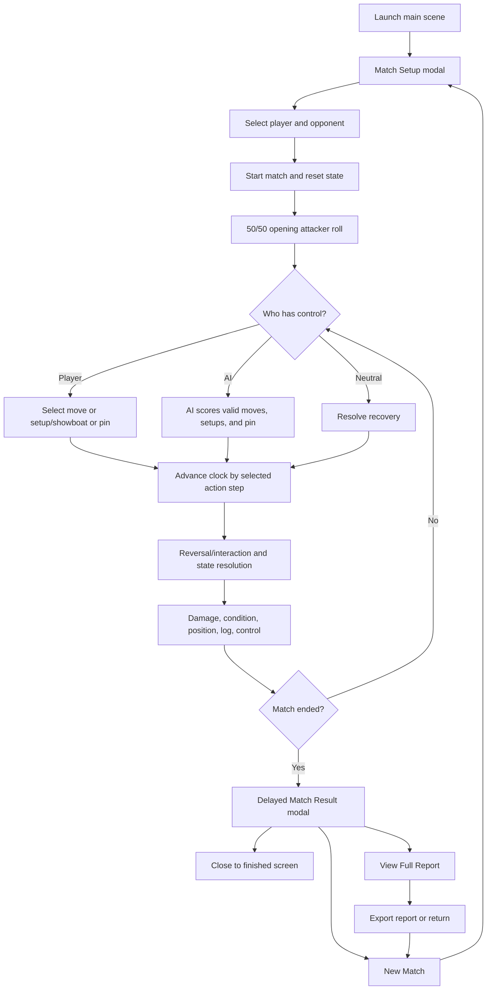
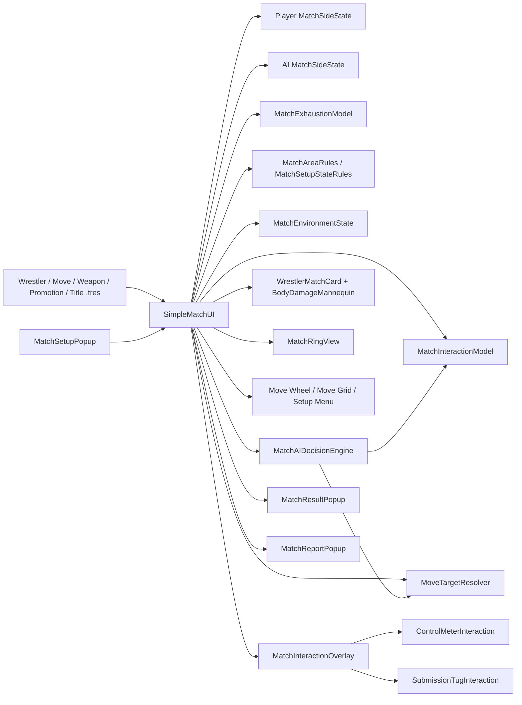
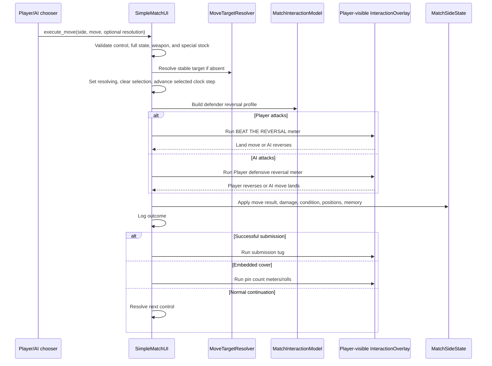

# Rise to Relevance
## All-in-One Game Design Document and Technical Architecture Document

**Document version:** 1.2

**Project state documented:** 21 July 2026

**Engine:** Godot 4.7

**Current main scene:** `res://Scenes/Match/simple_match_ui.tscn`

**Primary targets:** Windows desktop and Android phone/foldable/tablet

**Document owner:** Rise to Relevance project

---

## 1. Document purpose

This document is the combined product, game-design, systems-design, content-design, user-experience, technical-architecture, data, build, testing, and roadmap specification for **Rise to Relevance**, a text-led professional-wrestling simulation game.

It has two equally important jobs:

1. Define what the game is intended to feel like and how its systems work from a player's perspective.
2. Describe how the current Godot project implements those systems, including public interfaces, data ownership, scene responsibilities, runtime flow, export behavior, known limitations, and extension points.

The document is written to be useful to design, engineering, UI/UX, content, QA, and future contributors. It is deliberately more precise than a pitch document and more readable than source code alone. Its generated appendices also provide an exhaustive snapshot of all 11 promotions, 33 titles, 656 moves, 400 wrestlers, 11 weapon/environment resources, and 18,000 authored wrestler-moveset slots across regular, signature, and finisher sections.

### 1.1 Source-of-truth hierarchy

When two descriptions disagree, use this order:

1. Current runtime scripts and authored scenes.
2. Current `.tres` resources and generated audit reports.
3. This GDD/TAD.
4. Older design summaries and planning notes.
5. Future-facing concepts that have not yet been implemented.

This distinction matters because the repository includes an older world summary with encoding damage, older enum numbering, and the former FWGP name. The current promotion resource is **Nihon Wrestling Grand Prix (NWGP)**, and the current `WrestlerClass` enum begins at zero.

### 1.2 Status vocabulary

| Status | Meaning |
|---|---|
| Implemented | Present in the current main-scene runtime and expected to work now. |
| Data foundation | Resource schema or content exists, but no complete player-facing loop uses it yet. |
| Legacy-compatible | Retained so unfinished or older screens do not break; not part of the current main flow. |
| Proposed | Recommended future behavior, not current behavior. |
| Known issue | A verified mismatch, limitation, or maintenance risk. |

---

# Part I - Game Design Document

## 2. Product definition

### 2.1 High concept

Rise to Relevance is a strategic, text-led wrestling simulator in which a player selects a wrestler, faces an AI-controlled opponent, constructs believable match sequences through position-aware moves and setups, works specific body parts, responds to reversals and finish attempts through concise interaction meters, and receives a detailed written record of the resulting match.

The current playable product is a **one-on-one exhibition match simulator**. Broader promotion, title, contract, finance, trait, injury/status, and regional-popularity resources establish a foundation for a later career or booking layer, but those systems are not yet a complete playable campaign.

### 2.2 Player fantasy

The player should feel like all of the following at once:

- A wrestler making tactical choices inside a match.
- A performer constructing match rhythm rather than choosing attacks from a flat list.
- A strategist who can create openings through movement and setup.
- A storyteller who can work a limb, build toward a submission, tease a flash finish, or land a decisive finisher.
- A reader watching a distinct wrestling story form in the match log.

### 2.3 Design pillars

#### Pillar A: Wrestling logic before generic combat logic

Moves require credible attacker and target positions. Running attacks require running, corner attacks require a cornered opponent, springboards require the apron, dives require the top rope, and grounded offence requires a grounded target. Setup actions exist to create those opportunities.

#### Pillar B: Text is the performance

The match log is not debug output. It is the primary dramatic presentation. Names, gimmicks, move names, position changes, reversals, body-part damage, finish teases, and the final result must read like wrestling commentary.

#### Pillar C: Strategy remains visible

The player can see health by body part, stamina, fatigue, momentum, position, move targets, valid move categories, and finisher availability. Outcomes should be understandable rather than hidden behind unexplained randomness.

#### Pillar D: Short interaction, long consequence

Reversal/breakthrough meters are brief, binary, one-shot interactions. Player kickouts use a retryable hold-and-release meter across the live three-count. Submission struggles are sustained but accelerated symmetrically. Physical input supports drama without replacing the strategic match layer.

#### Pillar E: Emergent matches, protected pacing

Matches are not forced to a fixed duration. Early finishes remain possible but difficult; long matches become progressively more finishable. Flash pins, squashes, finishers, body damage, exhaustion, and momentum allow context to override ordinary pacing.

#### Pillar F: Distinct wrestlers and promotions

Classes, movesets, gimmicks, disposition, origin, promotion, finishers, and AI preferences should make matchups read and play differently.

### 2.4 Current scope

#### Implemented

- One player wrestler versus one AI wrestler.
- Exhibition match selection from 400 wrestler resources.
- Position-aware moves and generic setup/showboat actions.
- Four-part match state: position, orientation, area, and motion.
- Six-part health and target focus.
- Attribute-scaled stamina pools, fatigue, centralized exhaustion, momentum, control, Catch Breath, and neutral recovery.
- Strategic AI action selection and targeting memory.
- Binary one-pass Control Meter reversals for both player offence and defence.
- A three-real-second hold-and-release kickout meter for the Player and pressure-based AI kickout simulation.
- Submission lock-in and tug-of-war.
- Signature readiness, three-slot finisher stock, flash pins, squash contexts, and time-based finish pressure.
- Count-outs, disqualification rules, and configurable 10/15/20/25/30-second action-clock steps.
- Eleven reusable weapons/environmental objects, durability, bleeding, table/tack spots, and ladder scaffolding.
- Presentation-only tactical ring view with wrestler, control, movement, area, and object markers.
- Auto-scrolling match log and body-story commentary.
- End-of-match result modal, full report, text export, and new-match flow.
- Responsive desktop, foldable/tablet, and phone behavior.

#### Not currently a complete gameplay loop

- Career progression.
- Booking cards or running a promotion.
- Calendar/week simulation.
- Contract negotiation.
- Persistent injuries and recovery.
- Title changes driven by match results.
- Morale, relationships, rivalries, crowd heat, attendance, revenue, or ratings.
- Selectable Tables/Ladder match objectives, tag matches, battle royals, and other multi-side match types.
- PvP or AI-versus-AI presentation modes.
- Audio production or animated wrestling characters.

### 2.5 Target audience

- Wrestling fans who enjoy booking logic, match structure, and move variety.
- Simulation players who prefer readable systems to real-time character control.
- Mobile and foldable users who want a complete match in a touch-friendly interface.
- Players who enjoy exporting and reading match reports.
- Content creators who value large rosters and emergent written match stories.

### 2.6 Session profile

- Setup should take under one minute with search and filters.
- Ordinary matches should naturally tend toward roughly 8-25 in-game minutes, without a hard cap.
- Every action advances by the setup-selected 10, 15, 20, 25, or 30 seconds; 20 seconds is the default. Interaction animation time does not add more match time.
- A match can finish early through an earned or rare route and can run long when control and condition remain competitive.
- A complete session includes selection, match, result beat, report review/export, and optional new match.

---

## 3. World and promotion design

### 3.1 World structure

The setting is a compressed global wrestling ecosystem. Eleven current promotion resources cover ten regional companies plus the global Indie Scene. Each promotion is intended to be memorable in text and broad enough to represent a regional wrestling identity.

The compression is intentional. The game favors clear identity and readable variation over dozens of nearly interchangeable companies.

### 3.2 Current promotion inventory

| ID | Initials | Promotion | Region/country | Roster resources | Current titles | Intended identity |
|---:|---|---|---|---:|---|---|
| 1 | TIS | The Indie Scene | Global hub | 40 | World Independent, Open-Challenge, Independent Women's Grand Prix | Entry point and open global talent market. |
| 2 | VWF | Vanguard Wrestling Federation | USA, North America | 36 | VWF, VWF National, VWF Women's | Corporate, polished, mainstream industry leader. |
| 3 | TCG | Trans-Canada Grappling | Canada, North America | 36 | Heavyweight, Cross-Province, Women's | Sport-oriented grappling and grounded realism. |
| 4 | SLN | Sociedad de Lucha Nacional | Mexico, North America | 36 | Anillo Mundial, Campeonato Inter Mexicano, Reina del Circulo | Lucha libre, speed, fluidity, expression. |
| 5 | END | ENDEAVOUR | UK, Europe | 36 | British Heavyweight, Atlas, Knockouts | Unified UK indie ecosystem with technical, striking, and attitude influences. |
| 6 | IVW | Iron & Velvet Wrestling | Germany/mainland Europe | 36 | King of Europe, Underground, Queen of Europe | Alternative underground European scene; technical base with brutality. |
| 7 | NWGP | Nihon Wrestling Grand Prix | Japan, Asia | 36 | NWGP Global, A.R.I.S.E. Openweight, NWGP Joshi | Disciplined, elite, hard-hitting strong-style identity. |
| 8 | ZWA | Zhongguo Wrestling Alliance | China, Asia | 36 | ZWA Supreme, A.R.I.S.E. Battle, ZWA Empress | Modern, high-energy spectacle and impact. |
| 9 | UFC | Ula Fala Combat | Samoa, Oceania | 36 | The Ula Fala, Pacific, Siamupini a Tamaitai | Cultural, warrior-driven, combat-focused tone. |
| 10 | SSWC | Silver-Sun Wrestling Confederation | Argentina, South America | 36 | Sol Dorado, Southern Cross, Campeonato de Luna y Estrellas | Mythic, poetic, fluid wrestling. |
| 11 | AAWA | Ankh-Art Wrestling Association | Egypt, Africa | 36 | Eternal, Gift of Osiris, Matriarch | Symbolic, ceremonial, precise, deliberate presentation. |

### 3.3 A.R.I.S.E. alliance

A.R.I.S.E. is a flavor-first Asian alliance connecting NWGP and ZWA. It creates shared regional prestige without requiring a full alliance-management system.

- NWGP hosts the A.R.I.S.E. Openweight Championship.
- ZWA hosts the A.R.I.S.E. Battle Championship.
- The alliance should communicate a counterweight to North American dominance.
- Future development may add inter-promotional cards, talent exchange, rankings, or alliance reputation, but none are current requirements.

### 3.4 Text identity rule

Promotion identity must eventually influence more than names. Future content should vary commentary cadence, event naming, presentation language, AI preferences, title prestige, and roster construction. Style overlap is acceptable; identical reading experiences are not.

### 3.5 Current setting-data cautions

- The older world summary says FWGP; current resources use NWGP.
- The older summary numbers classes from 1-5; the current enum uses 0-4.
- Promotion `preferred_styles` values may therefore require an audit before they drive gameplay.
- TIS is the eleventh resource and global hub, while older prose describes ten regional promotions.

---

## 4. Core game flow

### 4.1 Launch and setup

The main match scene loads the roster recursively from `res://Wrestlers` using `ResourceLoader.list_directory()`. This is export-safe and does not depend on raw filesystem enumeration. Wrestlers are sorted alphabetically, with resource path as a stable tie-breaker.

The setup modal opens after the scene initializes. The initial setup cannot be cancelled. A setup opened after a completed match can be cancelled back to the finished screen.

### 4.2 Wrestler selection

Player and opponent have independent:

- Free-text search.
- Class filter.
- Promotion-initials filter.
- Scrollable roster list.
- Selection summary.
- Persistent side lock.

Search includes display name, gimmick name, gimmick description, classes, country, region, face/heel terminology, promotion initials, and promotion name.

Roster display format:

- `Jamie Mercer (f)` for a face.
- `Jamie Mercer (h)` for a heel.
- `(c) Jamie Mercer (f)` for a champion.

Color rules:

- Champion: gold.
- Face: blue.
- Heel: red.
- Unspecified: off-white.

The summary shows finishers, class, gimmick and description, nationality, and promotion. The same wrestler cannot fill both roles.

`RANDOM MATCH`, `RANDOM PLAYER`, and `RANDOM AI` randomize only within each side's current filtered pool. Locks preserve the selected side. Randomization previews the result and never launches automatically; `START MATCH` is always the explicit commit. The last five accepted participants are avoided when possible without relaxing active filters.

Match rules expose Disqualifications, Count-Outs, count limit, and the action-clock step. The accepted setup metadata and rules are retained in the match report.

### 4.3 Match initialization

Starting a match:

- Invalidates pending turns through the turn-generation counter.
- Resets winner, loser, result, finishing move, match time, selected move, interaction flags, log, report, setup intent, targeting, AI memory, and all per-match statistics.
- Initializes both wrestlers Standing / Front / In Ring / Stationary with every body part at 100 HP, match stamina at `ceil(Stamina attribute * 2.5)`, 0 fatigue, 0 momentum, no ready signature, and zero finisher stock.
- Closes setup, result, report, move, setup, and interaction overlays.
- Rolls a true 50/50 opening attacker choice between Player and AI.
- Schedules the normal delayed AI turn if the AI wins opening control.
- Logs the opening bell.

### 4.4 Match turn loop

The match has four control states:

| State | Meaning |
|---|---|
| `PLAYER_CONTROL` | Player is the current attacker and may use enabled action controls. |
| `AI_CONTROL` | AI is the current attacker; player controls are disabled. |
| `NEUTRAL` | Neither wrestler has immediate control; recovery is resolved after a delay. |
| `MATCH_ENDED` | Match-changing input and AI actions are permanently disabled for this match. |

Player and AI use the same move-validity, state, stock, damage, pin, submission, and outcome rules. AI offence executes automatically once selected; the Player receives a visible reversal meter. During Player offence, the Player receives a visible `BEAT THE REVERSAL` meter: landing in gold executes the move and missing gives the AI the reversal. No hidden AI reversal roll decides a Player move off-screen.

---

## 5. Main match interface

### 5.1 Three-column composition

The main screen is authored as a container-driven layout:

1. Player wrestler card.
2. Center match-control column.
3. AI wrestler card.

The old selector strip remains authored but hidden. Match selection is handled by the setup modal.

### 5.2 Wrestler cards

Each card displays:

- Role: Player or AI.
- Wrestler name.
- Country and region.
- Height.
- Weight in pounds.
- Age.
- Gender.
- Face/heel disposition.
- All assigned classes.
- Gimmick name and description.
- Strength, Speed, Stamina, Skill, Striking, Charisma.
- Computed Global Popularity.
- Assigned signatures with ready/locked state.
- Three assigned finishers with filled/empty stock markers.
- Held weapon and remaining durability.
- Bleeding severity.
- Six-part SVG body-damage mannequin.
- Exact HP labels for Head, Body, Left Arm, Right Arm, Left Leg, Right Leg.
- Current fatigue, `current/max (percent)` match stamina, momentum, and a stable two-line Position/Orientation plus Area/Motion summary.

The Player card uses blue accenting; the AI card uses red. Health colors have the same meaning on both sides.

### 5.3 Body-damage mannequin

The mannequin uses one neutral outline and six aligned local SVG layers. It is presentation-only and receives current health values from the card.

Continuous health colors:

| HP | Color role | Hex/current value |
|---:|---|---|
| 100 | Healthy steel blue | `#3f91d8` |
| 70 | Warning gold | `#c9a227` |
| 40 | Damaged orange | `#e07a2d` |
| 0 | Critical red | `#c83f4a` |

Labels remain off-white on a dark backing with an outline, so target focus or health colors do not reduce legibility.

When player targeting is enabled, the opponent mannequin exposes forgiving hit areas for all six parts. Selecting the same part again returns focus to Auto. The player mannequin remains read-only.

### 5.4 Center column

The center column contains:

- Gold match-rules/stipulation banner.
- Current attacker indicator or `MATCH OVER`.
- Match clock.
- Result banner and report access after a finish.
- Auto-scrolling match log.
- `SELECT MOVE`.
- `SETUP / SHOWBOAT`.
- `EXECUTE`.
- `PIN`.
- `SET UP NEW MATCH` after the match ends.

A fixed-allocation tactical ring view sits below the center match panel. It presents authoritative snapshots without changing simulation state: a square ring, left-facing entrance ramp, ring/apron/rope/corner/outside/ladder anchors, wrestler posture/facing/motion markers, control halo, targeting, and persistent weapon/environment markers. Presentation anchors and tweens are generation-safe and reset for every match.

Controls disable whenever the player lacks control, a result is resolving, an interaction is active, a pin/submission sequence is active, or the match has ended.

### 5.5 Visual language

The current design language is:

- Near-black/graphite and navy backgrounds.
- Steel-blue structure and player accents.
- Red AI and danger accents.
- Off-white primary text.
- Restrained gold for finishers, selected targets, key moments, counts, and result emphasis.
- Thin borders and modest glow rather than neon or large color blocks.
- Minimum practical touch targets around 44-58 logical pixels.

---

## 6. Match time and pacing

### 6.1 Abstract match clock

Match creation offers 10, 15, 20, 25, and 30-second action increments. The default is 20 seconds. Every move attempt, setup/showboat action, separately initiated pin, and neutral recovery advances the selected amount before resolution. Embedded covers do not advance again.

Example with the default step:

`[00:20] Jamie Mercer lands a brainbuster.`

The log never records an attempted action at 00:00 and then advances afterward.

### 6.2 Finish-pressure bands

The shared late-match profile is:

| Match time | Finish pressure | Recovery penalty | Contested-control threshold | Laboured success | AI finish bonus | Movement setup penalty |
|---|---:|---:|---:|---|---:|---:|
| 0:00-14:59 | 0 | 0 | 15 | No | 0 | 0 |
| 15:00-24:59 | +15 | 8 | 12 | No | +8 | 0 |
| 25:00-34:59 | +30 | 15 | 8 | Yes in legacy combined flow | +20 | 20 |
| 35:00+ | +45 | 25 | 4 | Yes in legacy combined flow | +35 | 50 |

Current primary move resolution is binary reversal/no reversal; laboured and contested outcomes remain in state/report compatibility code but are not emitted by the current binary move path.

### 6.3 Match-length philosophy

- Under five minutes: ordinary finishes are extremely difficult but not mathematically forbidden.
- Five to ten minutes: ordinary finishes remain protected but credible context matters more.
- Ten to fifteen minutes: finish behavior reaches a neutral baseline.
- Fifteen minutes onward: pressure rises.
- Twenty-five and thirty-five minutes add stronger escalation against endless recovery/setup loops.
- No time band guarantees a finish or guarantees survival.

### 6.4 Rules, count-outs, and disqualifications

Match setup independently exposes disqualifications, count-outs, a configurable count limit (default ten), and the action-clock step. A referee count begins whenever one or both wrestlers occupy Apron, Outside, or Ramp and advances once per 30 in-game seconds spent there. Returning safely resets the count; one stranded wrestler loses by count-out and two lose by double count-out.

`STAY INSIDE / LET REFEREE COUNT` is a pass rather than a control-preserving spam action: it spends basic stamina and hands the next turn to the wrestler outside, giving them a fair recovery/re-entry opportunity. AI treats imminent count-out recovery as mandatory safety.

With DQs enabled, only landed illegal offensive contact ends the match. Retrieval, carrying, setup, misses, and reversals do not. Defensive table/thumbtack redirection does not disqualify either wrestler. Turning DQs off legalizes the implemented weapon/environment offence without changing the underlying object rules.

---

## 7. Wrestler attributes and class identity

### 7.1 Core attributes

| Attribute | Current use |
|---|---|
| Strength | Power/control-meter compatibility and setup capability. |
| Speed | Aerial execution relevance and high-flyer identity. |
| Stamina | Defines the live stamina pool: `ceil(attribute x 2.5)`. UI shows `current/max (percent)`. |
| Skill | Reversal, technical, power, setup, and submission calculations. |
| Striking | Strike interaction relevance. |
| Charisma | Taunt AI scoring and presentation identity. |
| Regional popularity | Six stored regional values. |
| Global popularity | Rounded arithmetic mean of the six regional values. |

### 7.2 Wrestler classes

The serialized enum order is:

| Value | Class | Match identity |
|---:|---|---|
| 0 | High Flyer | Running, springboard, and diving offense; accepts high-risk choices more readily. |
| 1 | Powerhouse | High-impact, body/head offense, Irish whips, and corner setups. |
| 2 | Technician | Submissions, standing grappling, and sustained limb targeting. |
| 3 | Striker | Strikes, running strikes, head and limb offense. |
| 4 | Hardcore | Rugged strike/grapple identity and a meaningful AI preference for weapon offence; no exclusive match rules. |

Wrestlers may have multiple classes. A move may declare explicit `class_preferrence` values. The misspelling is a serialized public field and must not be renamed without migration.

### 7.3 Current class AI bonuses

- Explicit move/class compatibility: +10 AI move score.
- Powerhouse: +10 for impact 6+; -10 for incompatible high risk; +10 for Irish-whip/corner setups.
- Technician: +12 submissions; -8 high risk; class target focus favors limbs.
- High Flyer: +15 Running/Springboard/Diving; base high-risk penalty is -2 instead of -8.
- Striker: +12 strikes; another +8 for running strikes; +5 head/limb targeting.
- Hardcore: prefers credible weapon/environment candidates while still obeying DQ gates and ordinary strategic scoring.

---

## 8. Four-part match-state system

### 8.1 Serialized state axes

Move legality is no longer represented by one overloaded position enum. Every wrestler has four independent, append-only state axes:

| Axis | Values |
|---|---|
| Position | `NONE`, `STANDING`, `GROUNDED`, `SEATED`, `KNEELING`, `PERCHED`, `CLIMBING` |
| Orientation | `NONE`, `FRONT`, `BACK`, `FACE_UP`, `FACE_DOWN` |
| Area | `IN_RING`, `CORNER`, `ROPES`, `APRON`, `OUTSIDE`, `RAMP`, `TOP_ROPE`, `LADDER` |
| Motion | `STATIONARY`, `RUNNING`, `ROPE_REBOUND`, `RISING`, `STAGGERING` |

`NONE` is a wildcard only where the resource schema explicitly permits it. `STAGGERING` and `RISING` are distinct transient states and do not satisfy a `STATIONARY` requirement.

### 8.2 Area compatibility

`MatchAreaRules` owns shared-flat and directional compatibility. `IN_RING`, `OUTSIDE`, and `RAMP` can be treated as a shared flat area where authored rules allow it. Supported directional attacks include ring-to-corner, ring-to-ropes, ring-to-apron, apron-to-ring, apron-to-ropes, ropes-to-outside, top-rope-to-ring, and top-rope-to-outside. Compatibility is directional; the inverse is not implied.

Fine ring sides/corners used by `MatchRingView` are presentation anchors only. They never change simulation legality.

### 8.3 Move validity

A move is executable only when:

1. It belongs to the attacker's regular, signature, or finisher assignments, or is a currently held weapon's runtime attack.
2. Required attacker and target position, orientation, area, and motion match the authoritative live snapshots.
3. Directional area compatibility passes `MatchAreaRules`.
4. Any required weapon and weapon-posture requirements are satisfied.
5. A signature has `signature_ready`, or a finisher has at least one stored finisher stock. Regular moves need no stock.
6. The match is active, the side has control, and no incompatible interaction sequence is resolving.

There is no clock gate for signatures or finishers. Validity and the resolved body target are rechecked immediately before resolution. Stale selections close when identity, control, state, or interaction generation changes.

### 8.4 Authored results

Clean landed moves apply their authored attacker and target result position, orientation, area, and motion. Directional dives from the ring to the outside leave both participants outside where authored/contextual resolution requires it. A failed high-risk action grounds the attacker in the authored landing area rather than teleporting them into the ring.

---

## 9. Move-selection UX

### 9.1 Category wheel

`SELECT MOVE` opens a ten-category wrestling move wheel. It is a presentation component; it does not mutate match state.

The center badge shows:

- `MOVE TYPE`.
- Context such as `Standing vs Grounded`.

Each orbiting card shows:

- Procedural category icon.
- Category label.
- Count of currently valid moves.
- Disabled/locked state.
- Restrained gold accent when an available signature or finisher is relevant.

The categories are Strike, Grapple, Submission, Aerial, Springboard, Running, Reversal, Pinning Move, Weapon, and Environmental. Invalid zero-move categories cannot open. A position-matching but stock-locked special can remain inspectable so its readiness requirement is readable.

### 9.2 Move grid

Selecting a category opens a non-scrolling responsive move grid rather than a long second-level list.

- Phone preference: 2 columns.
- Tablet/foldable preference: 3 columns.
- Desktop preference: 4 columns.
- The grid may add columns dynamically to fit all visible moves within available height, subject to minimum button width.
- Buttons wrap names and use a 58-pixel minimum height.

Prefixes:

- `(F)` = finisher.
- `(S)` = submission.
- `(F)(S)` = submission finisher.
- `[HEAD]`, `[L ARM]`, `[BOTH LEGS]`, etc. = resolved target.
- Phone uses compact tags such as `[H]`, `[LA]`, and `[RL]`.

### 9.3 Target focus selector

The move grid provides:

- Auto.
- Head.
- Body.
- Left Arm.
- Right Arm.
- Left Leg.
- Right Leg.

Focus is synchronized with the opponent mannequin. It persists through category changes during one match and resets to Auto for a new match. Focus never makes an otherwise valid move invalid; incompatible focus is ignored by the resolver.

### 9.4 Special and setup affordances

When the player is at the top rope or apron and legal diving/springboard moves exist, `SELECT MOVE` receives a restrained gold highlight and contextual wording.

`SETUP / SHOWBOAT` opens one responsive, visually grouped page rather than a long scrolling list or a second radial wheel. It shows only recoveries, legal utility actions, Taunt/Catch Breath when eligible, and first steps that reach an assigned move within the bounded setup planner.

---

## 10. Move data and content inventory

### 10.1 Current content totals

| Move type | Resources |
|---|---:|
| Strike | 60 |
| Grapple | 246 |
| Submission | 80 |
| Aerial | 62 |
| Springboard | 55 |
| Running | 113 |
| Pinning Move | 40 |
| **Total authored moves** | **656** |

Additional classifications:

- 59 finishers and 597 non-finishers.
- 80 submission-flagged moves.
- 140 strike-flagged moves.
- 40 flash-pin moves.
- Weapon and Environmental categories are populated contextually by runtime object attacks/spots, not assigned into generated wrestler movesets.

### 10.2 Move fields

Every move resource can define:

- Display name.
- Move type/category.
- Preferred wrestler classes.
- Target body parts.
- Targeting mode and tie-break default.
- Required attacker/target position, orientation, area, and motion.
- Resulting attacker/target position, orientation, area, and motion.
- Additional compatible target positions where authored.
- Finisher flag.
- Submission flag.
- Flash-pin flag.
- Optional interaction override.
- Strike flag and strike weight.
- Impact from 1 to 10.
- Pinning-combination metadata.
- Optional required weapon ID and weapon-posture compatibility.

### 10.3 Targeting modes

| Mode | Behavior |
|---|---|
| Fixed Parts | Uses listed parts. Requested focus becomes story part only when compatible. |
| Choose Arm | Uses selected arm; otherwise weaker arm; otherwise declared default, normally left. |
| Choose Leg | Uses selected leg; otherwise weaker leg; otherwise declared default, normally left. |
| Both Arms | Damages both arms with split limb weight and uses average paired HP for submission pressure. |
| Both Legs | Damages both legs with split limb weight and uses average paired HP for submission pressure. |

Current catalogue count is 572 fixed, 43 choose-arm, 24 choose-leg, 8 both-arms, and 9 both-legs.

### 10.4 Damage weights

- One resolved part: weight 1.0.
- Multi-part standard move: each listed part weight 0.7.
- Bilateral limb pair: each paired limb weight 0.5.
- Non-paired secondary parts in a bilateral move: weight 0.7.

---

## 11. Body-part targeting and damage

### 11.1 Six-part health model

Each wrestler has independent 0-100 HP for:

- Head.
- Body.
- Left arm.
- Right arm.
- Left leg.
- Right leg.

Total HP is the sum of all six values and is used only in contextual checks; there is no universal knockout at zero total HP.

### 11.2 Damage formula

For every resolved target part:

`raw part damage = move impact + ((100 - current part HP) * 0.08)`

Then apply:

- Clean success multiplier: 1.00.
- Laboured success multiplier: 0.60, retained for compatibility.
- Contested glancing strike multiplier: 0.25, retained for compatibility.
- Target-resolution weight: 1.0, 0.7, or 0.5 depending on the move.

High-risk crash self-damage applies `move impact * 0.75` to the attacker's Body.

The damaged-part vulnerability ramp is intentionally shallow. Working a limb remains rewarding without allowing bonus damage alone to create an uncontrollable snowball.

### 11.3 Target-story milestones

Each defender/part records threshold crossings at:

- 80 HP.
- 60 HP.
- 40 HP.
- 20 HP.
- 0 HP.

Repeated targeting milestones occur on the third and fifth landed attack to a part.

At most one body-story line is added per move, prioritized as:

1. Critical threshold.
2. Submission danger on a damaged part.
3. Other threshold.
4. Repeated targeting.

Noncritical body commentary observes a 60-second in-game cooldown and can be held as pending commentary.

### 11.4 Defensive adaptation

Repeated attacks to the same limb raise reversal chance:

- At least 2 of the recent 5 resolved target attempts: +7 reversal chance.
- At least 4 of the recent 5: +12 reversal chance.

This is in addition to exact-move, move-type, and setup-pattern predictability.

### 11.5 Future injury hook

`MatchSideState.get_body_damage_summary()` exposes final HP, damage taken per part, thresholds crossed, parts at zero, target counts, and last submission/finisher target. Future career systems should consume this summary rather than reading transient UI nodes.

---

## 12. Setup and showboat system

### 12.1 Availability principle

`MatchSetupStateRules` is the shared projector used by the Player menu, AI, and flow watchdog. Positioning actions are shown only when they shorten a path to an assigned, unlocked move within at most two setup steps. This applies equally to Player and AI and prevents purposeless Running, Ropes, Apron, Top Rope, Corner, Outside, Ramp, or Ladder loops.

Required recoveries, Taunt, Catch Breath, count-out safety, object escape, and last-resort reset are the controlled exceptions. Staggering is a transient motion state, not a reason to walk toward the opponent; its explicit recovery restores stationary motion. The flat setup UI keeps all eligible actions on one visually grouped page.

### 12.2 Action families

- Self movement/recovery: stand up, start/stop running, regain footing/composure, climb/descend top rope, step to/leave ropes or apron, enter/leave corner, return from outside/ramp, ladder climb/down, and object-position escape.
- Opponent posture/orientation: pick up, get behind, turn face-up/down, sit up front/back, pull to knees, wake/call forward, catch a running opponent, and pull an opponent out of a special state.
- Area positioning: Irish whip, corner/rope/apron/top-rope positioning, send/call/take the fight outside, move along the ramp, bring the match back in, and contextual ring re-entry.
- Environment: retrieve/pick up/drop weapons, set tables/ladders, spread thumbtacks, position a victim, tip a ladder, and clear a hazard.
- Utility: Taunt, Catch Breath, Stay Inside/Let Ref Count, and guarded Reset Stance.

Automatic movement and recovery actions do not receive a reversal prompt. Opponent-control, Taunt, ladder-climb, and environmental positioning actions are contested through the same readable binary reversal presentation as moves. Every committed setup consumes exactly the selected match-clock increment.

### 12.3 Reversed setup positions

Core reversal results remain contextual: an Irish-whip reversal sends the initiator into rope rebound; a corner reversal sends the initiator to the corner; a pick-up reversal leaves the initiator grounded; ladder-climb reversals ground the climber and drop the ladder. Reversed apron taunts return the taunter to the ring, and reversed top-rope taunts ground them. Newly projected setup state is not applied when the defender reverses.

### 12.4 Generic setup cost

Successful tactical positioning normally spends 3 stamina and adds 1 fatigue, after the shared exhaustion cost multiplier. Cheap posture/motion recovery uses 1 stamina and 0.5 fatigue. Setup actions grant no incidental momentum. A reversed contested setup spends 3 stamina, adds 2 fatigue, grants the defender +5 reversal momentum and control, and does not charge the initiator the offensive-move reversal loss.

### 12.5 Taunts

Taunt has a shared two-minute in-game cooldown beginning on every attempt.

Taunt is legal from a suitable standing/apron/top-rope/outside/ramp presentation against a standing or grounded opponent. A successful Taunt restores 4 stamina from a normal stance, 3 from the apron, or 2 from the top rope, scaled by fatigue recovery, and grants the same +10 momentum as any other successful offensive beat. It stores no delayed momentum bonus.

Base taunt interruption chance before condition modifiers:

| Taunter | vs Standing | vs Grounded |
|---|---:|---:|
| Standing | 30% | 18% |
| Apron | 35% | 23% |
| Top Rope | 42% | 28% |

AI avoids taunting when a finisher or credible pin exists, when cooldown is active, when no current move exists, or when a standing opponent presents at least 45% interruption risk.

### 12.6 Catch Breath

Catch Breath is available with control while standing and stationary in the ring, outside, or on the ramp, below 60% stamina, and outside its personal 90-second cooldown. It restores `18 x recovery_multiplier` stamina, never lowers fatigue, advances the clock once, and returns control to Neutral. Below 20% stamina the AI strongly prefers it unless a credible finish is available; below 40% it remains a high scored option. It is excluded from setup intent and loop penalties.

---

## 13. Reversal system

### 13.1 Current interaction rule

The current main flow uses a **binary defender response**:

- Defender succeeds: full reversal, or high-risk crash if appropriate.
- Defender fails: move lands cleanly.

There are no partial counters, weak reversals, or color-tier outcomes in the active reversal flow.

### 13.2 Readable asymmetric reversal presentation

- Horizontal dark track with one gold target.
- Marker travels once across the full track and never bounces.
- Consecutive one-shot meters alternate direction: left-to-right, then right-to-left.
- Player gets one press through touch, left click, or `ui_accept`/Space.
- Timeout or miss is failure.
- Success uses the rendered marker center against the rendered gold rectangle in the same logical-pixel coordinate system.
- There is no invisible edge forgiveness for reversal or breakthrough meters.

When the AI attacks, the AI's legal move executes automatically and the Player receives the defensive reversal meter. When the Player attacks, the AI does not make a hidden reversal roll: the Player receives a `BEAT THE REVERSAL` meter, hitting gold lands the move and missing means the AI reversed it. The same presentation is used for Player-initiated contested setups. Both use a one-eighth visual scale with practical raw width clamps so targets cannot collapse to a one-pixel sliver.

### 13.3 Base reversal chance

| Context | Base chance |
|---|---:|
| Normal move | 22% |
| Heavy move | 18% |
| High-risk move | 28% |
| Finisher | 12% |
| Pick-up setup | 30% |
| Irish whip/corner throw | 28% |
| Other contested setup | 25% |

Condition, momentum, repetition, target damage, class, position, and bleeding then modify the chance, clamped to 5-65%. Late-match finish escalation does not secretly suppress reversals.

Important modifier examples:

- Fresh defender stamina 80+: +8.
- Defender fatigue 80+: -15.
- Defender momentum 70+: +10.
- Attacker momentum 70+: -8.
- Exhausted attacker: up to +15 for defender.
- Finisher: -10.
- High risk: +10.
- Exact repeated move: +10.
- Same move type 3 times in 5: +6.
- Repeated setup-follow-up pattern: +5.
- Technician defender: +5.
- Already damaged resolved target: lowers reversal chance by 5 or 10 at under 50/25 HP.

### 13.4 Timing

| Move context | One-pass time limit |
|---|---:|
| Normal | 2.0 seconds |
| Heavy | 1.8 seconds |
| High risk | 1.75 seconds |
| Finisher | 1.6 seconds |

The marker is deliberately faster than the original meter while the full time allowance remains. One-way target placement accounts for starting direction and travel so gold cannot spawn under or immediately beside the marker.

---

## 14. Move resolution, stamina, fatigue, momentum, and control

### 14.1 Active binary outcomes

| Outcome | Damage | Position | Control |
|---|---|---|---|
| Clean success | Full resolved damage | Move's intended result positions | Attacker, except grounded/grounded recovery flow |
| Reversal | No intended move damage | Positions unchanged unless setup reversal specifies otherwise | Defender |
| High-risk crash | Attacker Body self-damage | Attacker Grounded | Defender |

Legacy state values for contested struggle, botch/scramble, partial defense, near miss, and laboured success remain for compatibility and reporting but are not normal outputs of the current binary move-resolution path.

### 14.2 Stamina, fatigue, and exhaustion

Each wrestler starts with `max_stamina = ceil(stamina attribute x 2.5)` and current stamina equal to that maximum. Percentage-based calculations normalize against the personal pool. HP, fatigue, and momentum clamp to 0-100; live stamina clamps to `0..max_stamina`.

`MatchExhaustionModel` combines 65% stamina depletion, 35% fatigue, and their interaction into Fresh, Winded, Tired, Exhausted, and Spent bands. It centrally supplies demand classification, stamina-cost multipliers, reversal/kickout/submission penalties, recovery multipliers, recovery-delay chance, and post-move control retention. Basic offence is least affected; aerial, springboard, running, rebound, perched, ladder, finisher, high-impact, heavy weapon, and major environmental offence is Explosive.

Fatigue scales stamina cost from 1.0x at zero to 1.5x at 100 and reduces recovery from 100% to 10%. Exhaustion never invalidates a legal move and never makes defence mathematically zero.

### 14.3 Momentum and control

- Every landed move, Player or AI: +10 momentum to the attacker.
- Every reversal or high-risk crash: initiator -5, reverser +5.
- Interrupted contested setup: defender +5; initiator has no setup-momentum loss.
- Ordinary setup/stance actions grant no momentum.
- Successful Taunt grants +10.

The same helpers service both sides. Landed demanding offence can lose initiative to Neutral through exhaustion control-retention, but it never gives the opponent an unearned reversal. Basic moves retain control. Embedded covers and landed finisher-cover flow preserve control.

### 14.4 Grounded/grounded and neutral recovery

When a successful move leaves both wrestlers grounded, control becomes neutral rather than automatically switching. The successful attacker is favored to recover first with an 80% chance; the defender receives the remaining 20%.

Otherwise neutral recovery score is:

`stamina_percent + momentum - fatigue - late recovery penalty contribution`

Then:

- Zero stamina: -25.
- Fatigue 80+: -20.
- Momentum 90+: +15.
- Small random tie-breaking applies when neither side is explicitly favored.

After repeated neutral resets, the stronger score is favored rather than sustaining a loop.

At Tired or worse, posture/motion recovery can consume one beat without completing, capped at 35% and never affecting special-area exits or watchdog fallback. A per-wrestler guard guarantees the next recovery attempt cannot also be delayed.

---

## 15. Signature and finisher progression

### 15.1 Readiness and stock

- Both wrestlers begin at zero momentum, with signature locked and zero finisher stock.
- Reaching 100 momentum sets `signature_ready`.
- Landing an assigned signature consumes readiness, resets momentum to zero, and grants one finisher stock.
- Finisher stock is capped at three and shown as three UI slots.
- Attempting a finisher spends one stock; a stale/cancelled interaction refunds it.
- Reversing an opponent's finisher grants the reverser one finisher stock, capped at three, whether the reverser is Player or AI.
- Signature and finisher use still requires exact current state validity. There is no match-time unlock gate.

### 15.2 Finisher behavior

- Clean finishers preserve attacker control.
- Clean finishers that leave both wrestlers grounded may transition directly into an embedded cover.
- Embedded covers do not advance the clock again.
- The defender still receives the ordinary move reversal opportunity before the finisher lands.
- Submission finishers enter the submission tug after a successful lock-in.
- Finishers reduce early finish protection but never guarantee a pinfall or submission.
- AI deterministically prioritizes an immediately valid stocked finisher over a ready signature, otherwise the ready signature, before ordinary weighted choices. If setup is needed it follows the shortest valid projected path and does not abandon a useful top-rope/apron/etc. state for generic recovery unless safety (especially a count-out) requires it.

---

## 16. Pinfall system

### 16.1 Pin eligibility

The manual Pin button is enabled only when:

- The pinning side has control.
- Attacker is Standing.
- Target is Grounded.
- No move, contest, pin, submission, or match-end resolution is active.

Flash-pin moves and qualifying clean grounded finishers can create embedded covers without requiring the button and without adding another clock increment.

### 16.2 Player-defender hold-and-release sequence

When the Player is pinned, ONE-TWO-THREE runs continuously across three real seconds. Holding touch/click/Space fills the horizontal bar left-to-right; releasing inside the pressure-scaled gold zone kicks out. A miss resets the fill and the Player may try again while time remains. Timeout at THREE produces the pinfall. The active profile uses the existing count-two pressure baseline, a 3.0-second limit, and a 2.7-second full fill. Small 2-pixel desktop/4-pixel touch release forgiveness applies only to this hold meter.

### 16.3 AI-defender sequence

When the AI is pinned, the referee evaluates ONE, TWO, and THREE separately using the pressure model. Success at any count kicks out and enters Neutral; failure continues, and count-three failure ends the match. AI kickout probability is the profile's unshrunk `ai_window`; the Player's older one-shot `/4`, `/5`, `/6` kickout target is no longer the active Player UI.

Exactly one final `THREE!` or `THREE-NO!` line is permitted.

### 16.4 Pin pressure

Pin pressure preserves match time, impact, finisher, flash, squash, body damage, momentum, bleeding, and count context. Direct stamina/fatigue duplication was removed; the shared exhaustion model applies one final kickout reduction.

Additional pressure:

- Last move finisher: +35.
- Successful flash check: +65.
- Squash context: +45.
- Defender Head below 40: +10.
- Defender Body below 40: +10.

Early protection then adds:

- Ordinary under-five protection: +120.
- Qualifying under-ten protection: +55.
- Flash success: -35.
- Squash: -25.
- Count one: +30.
- Count two: +5.
- Count three: -20.

These values make early ordinary pinfalls very difficult without creating an impossible branch.

### 16.5 Flash pins

Flash qualification can come from:

- Explicit `is_flash_pin` metadata.
- Recognized names such as roll-up, schoolboy, backslide, O'Connor roll, small package, cradle, victory roll, sunset flip, rolling crucifix, or surprise pin.
- A recent reversal catch.
- Catching a high-momentum defender with a low-impact move.

Time-band flash success chance:

| Time | Chance |
|---|---:|
| Under 5:00 | 5% |
| 5:00-9:59 | 10% |
| 10:00-14:59 | 15% |
| 15:00+ | 20% |

### 16.6 Squash qualification

A non-finisher squash finish requires all of:

- Attacker momentum at least 80 and defender momentum at most 20.
- Defender has landed at most one move and dealt under 20 damage.
- Attacker has landed at least three moves.
- Defender is worn down by fatigue, relative fatigue, or stamina.
- Last move impact at least 8.

A landed finisher independently qualifies for the squash-protection bypass context.

---

## 17. Submission system

### 17.1 Flow

1. Player or AI selects a valid submission move.
2. Clock advances once for the move attempt.
3. Defender receives the standard binary reversal response.
4. If reversed, control changes and no tug begins.
5. If the lock-in succeeds, the exact resolved target is frozen for the whole struggle.
6. Submission tug starts with the marker visually at dead center: 50.
7. The struggle ends at escape, tap-out, cancellation, or rare stationary safeguard.

### 17.2 Tug presentation and input

- Horizontal `ESCAPE` to `TAP OUT` track.
- Submission name and player-role prompt.
- Bright marker starts at exactly 50.
- Touch, left click, Space, and `ui_accept` are supported.
- Effective player taps are capped at eight per second.
- Player-end feedback pulses after accepted input.
- Both player and AI forces use the same configurable resolution-speed multiplier, currently 1.5 by default.

### 17.3 Symmetric pacing

The speed multiplier increases movement for both sides rather than simply buffing escape or attack. The purpose is shorter physical struggles with approximately the same favored outcome.

Player tap impulse ranges from 0.65 to 1.15 before the active multiplier. AI drift pulses every 0.2 seconds. Target-part damage ticks every second.

### 17.4 Thresholds and time safety

Escape threshold is always 10. Tap-out threshold varies:

| Time | Time resistance | Base tap threshold |
|---|---:|---:|
| Under 5:00 | +35 | 96 |
| 5:00-9:59 | +18 | 93 |
| 10:00-14:59 | 0 | 90 |
| 15:00-24:59 | Attacker +10 | 89 |
| 25:00-34:59 | Attacker +30 | 85 |
| 35:00+ | Attacker +45 | 82 |

Target HP modifiers:

| Target HP | Context effect |
|---|---|
| 80-100 | Defender resistance +35 for a normal submission; threshold +2 (max 98) |
| 60-79 | Defender resistance +15 |
| 40-59 | +10 resistance for non-finisher submissions |
| 20-39 | Attacker pressure +15 |
| 0-19 | Attacker pressure +30 |

Fresh defender protection:

- Stamina 80+ and fatigue 20 or less: +25 resistance.
- Before 5:00, stamina 90+ and fatigue 10 or less: another +15 and threshold 98.

Submission finisher exception:

- Halves time resistance.
- Halves fresh and super-fresh resistance.
- Caps early threshold at 92.
- Still considers body-part HP and wrestler condition.
- Does not receive the additional healthy-part +5/+2 modifier.

True squash context removes time and super-fresh bonuses but retains body and general condition influence.

No legal submission is hard-vetoed from winning early. Protection operates through resistance and reachable thresholds.

### 17.5 Pressure scores

Attacker pressure score includes:

- Base 20.
- Skill * 0.35.
- Momentum * 0.20.
- Missing target HP * 0.25.
- Move impact * 2.
- +15 finisher.
- Stamina * 0.10.
- Fatigue * -0.20.

Defender score includes:

- Base 20.
- Skill * 0.30.
- Stamina * 0.25.
- Momentum * 0.20.
- Target HP * 0.15.
- Fatigue * -0.25.

Repeated target work adds attacker pressure at three and five attacks; Technician class, attacker momentum, and defender exhaustion add modest further pressure. The shared escape-reduction curve is applied once and symmetrically whether the defender is Player or AI. AI pulses are normalized by `8/5` against the Player's eight accepted inputs per second so equal scores provide equal maximum force per second.

### 17.6 Damage ticks

Once per second:

`tick damage = 0.5 + max(0, marker - 50) / 50 * 0.75`

The frozen target-resolution weights distribute this damage. Damage alone does not resolve the submission.

### 17.7 Stall safeguard

After 30 seconds, the struggle resolves to a neutral scramble only if:

- Marker movement during the preceding 10 seconds is under three points.
- No effective player input occurred during that window.

Active struggles may continue beyond 30 seconds.

---

## 18. AI design

### 18.1 Goals

The AI should:

- Respect the same position and finisher rules as the player.
- Build credible setup-to-move sequences.
- Avoid repeated setup loops.
- Use wrestler class and condition.
- Work damaged body parts without becoming perfectly optimal.
- Recognize credible pins, submissions, finishers, reversals, and high-risk crash opportunities.
- Retain enough weighted randomness for replay variety.

### 18.2 Candidate generation

On every AI turn the engine builds candidates for:

- Every currently valid move.
- Every valid setup/showboat action.
- A legal pin.

Each candidate contains kind, score, optional move, optional setup action, and resolved target data. Candidates are sorted; only the top five are retained. Weighted selection uses:

`weight = max(1, score - lowest top-five score + 10)`

This strongly favors sound decisions without making the highest score deterministic.

AI offensive execution itself is automatic: after it chooses a legal move, only the Player's visible reversal meter can stop it. Exhaustion influences move selection, costs, control retention, and defence rather than adding a hidden AI execution-failure roll.

### 18.3 Base move scoring

Move score begins at 50, then considers:

- Impact tier: +8 at 4+, +14 at 7+, +20 at 9+.
- Shared defender response chance: subtract chance * 0.08.
- Attacker stamina/fatigue and high-risk suitability.
- Target stamina, fatigue, momentum, body damage, and resolved target HP.
- Attacker momentum.
- Explicit and inferred class compatibility.
- Exact move and category repetition.
- High-risk context.
- Finisher and submission bonuses.
- Setup intent.
- Reversal, big-move, and crash follow-ups.
- Late-match finish escalation.

### 18.4 Repetition control

- Immediate exact repeat: -20 move score and +10 defender reversal chance.
- Three uses in recent eight: -25 score.
- Two uses in recent five: -12 score.
- Same move type three times in five: +6 defender reversal chance.
- Repeated setup-follow-up pattern: +5 defender reversal chance.
- Repeated same-limb targeting adds the separate +7/+12 adaptation described earlier.

### 18.5 Ready specials and setup intent

Before ordinary scoring, the AI takes an immediately valid stocked finisher, otherwise a valid ready signature. If neither is currently valid, the path planner identifies the shortest legal setup chain of at most two steps. Only urgent safety recovery can pre-empt it.

Ordinary offensive positioning creates a bounded intent containing the exact projected action path and desired move-state signature. A planned distinct second step is not treated as a loop.

Matching follow-up:

- +60 score.
- +30 if the follow-up is a finisher.
- +10/+18/+25 when resolved target HP is under 70/45/25.

When a valid matching follow-up appears, the AI chooses the best matching move rather than allowing weighted randomness to select another setup. It does not repeatedly climb down/re-enter and climb again when the current special state already has a reachable follow-up.

Intent clears after the attempt, expiry, fallback, or abandonment.

### 18.6 Loop prevention

- Setup with no projected valid move: -70.
- Any consecutive setup without a move: all setups -40.
- Same setup in recent setup history: -60.
- Two consecutive setups: nonmandatory setup -75 and direct moves +80.
- Three consecutive setups: force highest-scoring valid move; otherwise prioritized recovery/reset.
- Forced reset creates a one-turn effective setup cooldown.
- Movement setups below 20 stamina: -45.
- At zero stamina: -80 unless a high-value follow-up offsets most of it.
- Late-match movement setup penalties add 20 at 25:00 and 50 at 35:00.

Mandatory recovery remains available so special positions cannot deadlock the match, but generic recovery does not erase a reachable offensive continuation. Count-out re-entry is always allowed to override offensive intent. Catch Breath has its own recovery priority and is excluded from setup-loop history.

### 18.7 Target focus memory

AI builds a set of compatible body parts from current valid moves. It prefers the lowest adjusted HP, with class biases:

- Powerhouse: Head/Body effectively 6 points more attractive.
- Technician: limbs 6 points more attractive.
- Striker: Head 6 and limbs 3 points more attractive.
- High Flyer: +3 score against rigid focus, making focus less strict.

The AI keeps its current focus until:

- It has no compatible move for two decisions.
- Another compatible part is at least 15 HP weaker.
- A required high-value move temporarily overrides selection.

When being dissected by the opponent, AI targeting-threat context activates when the opponent has at least three total and two recent attacks to a part at 60 HP or lower. This adds modest preference for rhythm-breaking setup/recovery and penalizes aerial movement when a leg is threatened.

### 18.8 AI pin behavior

All legal pins remain candidates. Early poor covers are discouraged by scores rather than rejected:

- Ordinary under-five cover: -90.
- Ordinary five-to-ten cover: -25.
- Minimal offense: additional penalties.
- Flash pin: +65.
- Squash: +65.
- Landed finisher: +45.
- Big move, damage, fatigue, low stamina, reversal opportunity, crash opportunity, and late escalation add credibility.

### 18.9 AI and difficulty diagnostics

Debug-build difficulty diagnostics are opt-in and disabled by default. Structured action and candidate snapshots are written compactly under `user://` rather than flooding the Godot console. The normal report retains concise totals; detailed probabilities, setup-loop counters, fallback states, exhaustion profiles, and internal safeguards live under Debug Metrics only. Diagnostics never enter the wrestling commentary log.

---

## 19. Match log and storytelling

### 19.1 Log requirements

- Every line carries the current advanced timestamp.
- New entries auto-scroll into view after wrapped layout settles.
- The latest line remains visible behind the result modal and after closing it.
- Logs use wrestler and move names rather than generic IDs.
- Finishers, counts, result lines, and critical body moments receive restrained gold/orange emphasis.

### 19.2 Commentary categories

- Opening bell.
- Setup/recovery movement.
- Clean move impact.
- Limb-specific clean offense.
- Reversal and high-risk crash.
- Taunt and interruption.
- Body thresholds and sustained targeting.
- Submission momentum states.
- Pin count and kickout cadence.
- Flash/squash/exhaustion finish framing.
- Final pinfall or submission result.

### 19.3 Writing principles

- Prefer active wrestling verbs.
- Avoid repeated mechanical phrases in adjacent lines.
- Preserve clear cause/effect.
- Name the target limb when tactically relevant.
- Keep normal lines concise; reserve heightened punctuation for finish teases.
- Never log debug probability details.

---

## 20. Match end, report, and replay flow

### 20.1 Finish presentation

On pinfall or submission:

- Match state becomes ended immediately.
- Pending AI generations are invalidated.
- Move, setup, and interaction overlays close.
- Match-changing controls disable.
- Final result line is added to the log.
- Attacker indicator becomes `MATCH OVER`.
- Report data is built and retained.
- After 0.65 seconds, the Match Result modal appears.

The delay prevents submission button mashing from immediately closing the result presentation. The result modal itself has an additional 0.75-second input lock.

### 20.2 Result modal

Displays:

- `MATCH RESULT`.
- Winner.
- Result: Pinfall or Submission.
- Final time.
- Finishing move.
- Winner damage dealt and reversals.

Actions:

- View Full Report.
- Close/stay on match screen.
- Set Up New Match.

Back/cancel closes the modal after the input lock. Outside taps do not accidentally dismiss it.

### 20.3 Full report structure

The responsive popup and text export use the same three-section hierarchy:

1. **Match Summary** - matchup/setup method, result, finish, final time, major turning points, and complete match log.
2. **Key Stats** - moves landed, reversals, damage, final current/max stamina and fatigue, pins/kickouts, submissions, signatures/finishers, targeting story, weapons, environment, and bleeding.
3. **Debug Metrics** - internal tuning data, safeguards, setup-flow/loop metrics, averages, probabilities, interaction counters, exhaustion diagnostics, watchdog/fallback data, and final environment snapshots.

No tracked data is discarded; the first two sections are intentionally short and readable while all tuning detail remains available below. AI execution is labelled `Automatic - player reversal only` instead of presenting a misleading `0 / 0`. Target reporting distinguishes the opponent part most attacked, the target's final most-damaged part, and the wrestler's own most-damaged part.

The full report is scrollable by wheel, drag, and touch on mobile, and offers Export, New Match, and Return to Finished Match.

### 20.5 Text export

Desktop writes to:

`user://match_reports/<player>_vs_<opponent>_<timestamp>.txt`

On the current Windows project this resolves under:

`C:\Users\<username>\AppData\Roaming\Godot\app_userdata\RiseToRelevance - Text Based Wrestling Sim\match_reports\`

Android first opens the native document picker so the user chooses a visible destination. If unavailable, export falls back to the app's internal `user://match_reports` directory.

---

## 21. Accessibility and input

### 21.1 Supported interaction

- Mouse hover and click.
- Android touch.
- Space/`ui_accept` for meters and submission tapping.
- `ui_cancel`/Back for modal return or cancellation where allowed.
- Keyboard/controller focus for category wheel and modal buttons.

### 21.2 Input safety

- Touch-generated mouse events are deduplicated using a short timestamp window.
- Interactions are one-shot and guard against repeated completion.
- Request IDs and active-state checks reject stale responses.
- Match end or context change closes active interaction overlays.

### 21.3 Readability

- Important text uses off-white rather than low-contrast red-on-black.
- Disabled state uses opacity/lock/text, not color alone.
- Body health always has exact percentages.
- Move target icons/tags supplement names rather than replacing them.
- Touch targets are designed around at least 44 logical pixels where practical.

### 21.4 Current accessibility gaps

- No user-facing text-size option.
- No color-blind palette presets.
- No screen-reader narration layer.
- No remappable match-interaction input menu.
- No reduced-motion setting.
- No localization system.

These should be considered before a broad public release.

---

## 22. Content-generation rules

### 22.1 Wrestler movesets

The generated roster currently stores exactly 40 regular moves, 2 signatures, and 3 finishers per wrestler: 18,000 authored assignment slots across 400 wrestlers. The safe `@tool EditorScript` generator discovers resources recursively and uses deterministic weighted selection from real attributes, classes, physical suitability, class preference, family diversity, positional coverage, and setup reachability of at most two steps.

Regular, signature, and finisher sections are unique and independently preservable. Signatures are non-finishers with suitable impact; finishers must carry `is_finisher`. Hard capability filters prevent implausible aerial, submission, and impact-heavy assignments. Class distribution targets are soft identity profiles, while signatures/finishers favor practical state variety. Generation defaults to audit/dry-run and saving requires dry-run disabled plus confirmation token `APPLY_MOVESETS`; detailed output goes to a report file rather than flooding the editor console.

### 22.2 Audit tooling

- `MoveAudit.gd`: validates move metadata, positions, targets, and reports counts/duplicates.
- `MovesetAudit.gd`: validates per-wrestler moveset hard and flavor rules.
- `MoveGen.gd`: regenerates move resources and target metadata.
- `MovesetGen.gd`: safe audit/preview/apply generator for 40 regular, configurable signature, and 3 finisher assignments.
- `MoveStriker.gd`: repairs Striker-style tags.
- `WrestlerGen.gd`: wrestler generation/duplicate cleanup support.
- `PromotionRepair.gd`: rebuilds promotion roster references from folders.
- `Audit.gd`: readable wrestler-folder audit.

Generation scripts are tooling, not runtime gameplay.

---

## 23. Future game-design expansion

### 23.1 Data foundations already present

- Contracts with length, salary, dates, and clauses.
- Promotion finances and regional popularity.
- Wrestler bank balance and contract history.
- Titles, holders, history IDs, gender category, and reign length.
- Wrestler traits for booking behavior, locker room, match safety, and popularity.
- Wrestler Active/Injured/Retired status.
- Regional popularity and global average.

### 23.2 Recommended roadmap

#### Phase A: Exhibition hardening

- Automated deterministic match tests.
- Accessibility settings.
- Continued match-screen layout, tactical-ring, and accessibility polish.
- Balance telemetry over large seeded match batches.
- Content audit cleanup and duplicate-name policy.

#### Phase B: Persistent profiles

- Player profile and settings save.
- Match history index linking exported reports.
- Win/loss records and wrestler statistics.
- Injury rolls consuming body-damage summaries.

#### Phase C: Career loop

- Calendar and weeks.
- Contracts and negotiations.
- Promotion offers and regional popularity.
- Title opportunities and rankings.
- Recovery, training, finances, and retirement.

#### Phase D: Booking/promotion management

- Event cards.
- Attendance, revenue, ratings, and budgets.
- Rivalries, morale, locker room traits, and creative control.
- AI booking and promotion competition.

#### Phase E: Match variety

- Tag matches and multi-side state ownership.
- Selectable Tables and Ladder objectives (their state/event scaffolding already exists).
- Tag matches, ringside geometry, and additional stipulation-specific state.
- Hardcore class mechanics.

---

# Part II - Technical Architecture Document

## 24. Technical overview

### 24.1 Runtime stack

| Area | Current choice |
|---|---|
| Engine | Godot 4.7 |
| Language | Typed and partially typed GDScript |
| Rendering | Forward Plus; Windows D3D12; ETC2/ASTC mobile texture import enabled |
| UI model | Authored `Control` scenes and Godot containers |
| Design canvas | 1920x1080 |
| Default desktop test window | 1280x720 |
| Stretch | `canvas_items`, expand aspect |
| Handheld orientation | Sensor landscape configuration (`6`) |
| Data | Godot `Resource` subclasses and `.tres` files |
| Persistence | Text reports only in current playable flow |
| Main scene | `res://Scenes/Match/simple_match_ui.tscn` |

### 24.2 Architectural style

The current match system is scene-driven and resource-driven:

- Authored scenes own visual hierarchy.
- UI component scripts own presentation and input.
- `SimpleMatchUI` is the main orchestration/controller layer.
- `MatchSideState` owns mutable per-side match data and statistics.
- `MatchInteractionModel` owns shared deterministic formulas/profile builders.
- `MatchExhaustionModel` owns stamina/fatigue consequences.
- `MatchAreaRules` and `MatchSetupStateRules` own state compatibility and setup projection.
- `MatchAIDecisionEngine` owns AI candidate scoring and tactical memory.
- `MoveTargetResolver` owns body-target resolution.
- `MatchEnvironmentState` owns live weapons and environmental objects.
- `WrestlerResource`, `MoveResource`, and other resources own authored data.

---

## 25. Repository layout

| Path | Responsibility |
|---|---|
| `Assets/UI/body_damage/` | Local SVG mannequin outline and six body parts. |
| `Moves/` | 656 authored move resources grouped by move family and subfolders. |
| `Weapons/` | Export-safe weapon catalogue and eleven item resources. |
| `Wrestlers/` | 400 wrestler resources grouped by promotion folder. |
| `Promotions/` | 11 promotion resources and 33 title resources. |
| `Scenes/Match/` | Main match scene and reusable match UI/interaction components. |
| `Scripts/Data/` | Resource schemas. |
| `Scripts/Match/` | Match orchestration, state, formulas, targeting, and AI. |
| `Scripts/UI/` | Reusable visual/input controllers. |
| `Scripts/Utility/` | Generation, repair, and audit tools. |
| `reusable/responsive_ui/` | Portable responsive autoload and integration guide. |
| `exports/` | Export output location. |
| `Tests/` and utility runners | Framework-free deterministic/headless regression scenes and scripts. |
| `move_audit_report.txt` | Current generated move-content audit. |
| `export_presets.cfg` | Android export preset. |
| `project.godot` | Project, input, display, autoload, and rendering settings. |

---

## 26. Scene architecture

### 26.1 Main and active component scenes

| Scene | Script/class | Responsibility |
|---|---|---|
| `simple_match_ui.tscn` | `SimpleMatchUI` | Main composition and match controller. |
| `wrestler_match_card.tscn` | `WrestlerMatchCard` | Profile, attributes, mannequin, condition. |
| `body_damage_mannequin.tscn` | `BodyDamageMannequin` | SVG health and target input. |
| `moves_radial_menu.tscn` | `MovesRadialMenu` | Coordinates category wheel and move grid. |
| `move_category_radial_menu.tscn` | `MoveCategoryRadialMenu` | Category-wheel presentation and selection. |
| `move_category_item.tscn` | `MoveCategoryItem` | Reusable orbiting category card. |
| `setup_actions_menu.tscn` | `SetupActionsMenu` | Current-state setup/showboat actions. |
| `match_interaction_overlay.tscn` | `MatchInteractionOverlay` | Full-screen interaction router. |
| `control_meter_interaction.tscn` | `ControlMeterInteraction` | One-shot or legacy bouncing horizontal meter. |
| `submission_tug_interaction.tscn` | `SubmissionTugInteraction` | Sustained submission struggle. |
| `hold_release_interaction.tscn` | `HoldReleaseInteraction` | Active Player kickout hold/release meter. |
| `weapon_radial_menu.tscn` | `WeaponRadialMenu` | Two-ring weapon/object selector. |
| `UI/match_ring_view.tscn` | `MatchRingView` | Responsive tactical ring presentation. |
| `UI/wrestler_ring_marker.tscn` | `WrestlerRingMarker` | Reusable participant marker. |
| `match_setup_popup.tscn` | `MatchSetupPopup` | Roster filtering and match assignment. |
| `match_result_popup.tscn` | `MatchResultPopup` | Delayed concise match result. |
| `match_report_popup.tscn` | `MatchReportPopup` | Scrollable full report and export. |

### 26.2 Legacy-compatible component scenes

| Scene | Status |
|---|---|
| `timing_circle_interaction.tscn` | Authored and routed by overlay, but not called by the current binary move flow. |
| `control_meter_interaction.tscn` bouncing mode | Retained for compatibility; active reversal/breakthrough calls are one-way. |
| `contest_timing_bar.tscn` | Legacy red/yellow/green component retained for unfinished legacy paths. |

The old `Scripts/Match/match_screen.gd` remains intact but is not the main scene.

### 26.3 Z-order intent

The main scene owns all overlays as siblings after the safe-area content. Conceptually:

1. Match screen.
2. Move/setup overlays.
3. Interaction overlay.
4. Result modal.
5. Full report/setup modal as flow requires.

Only one match-changing overlay should accept input at a time.

---

## 27. Core runtime classes and responsibilities

### 27.1 `SimpleMatchUI`

Primary responsibilities:

- Load roster and initial assignments.
- Start/reset matches.
- Own player/AI side states and controller state.
- Validate moves and setup actions.
- Advance clock and write match log.
- Resolve moves, damage, condition, positions, reversals, pins, and submissions.
- Schedule AI and neutral turns.
- Synchronize cards, menus, and targeting.
- End match and build reports.

This class is currently a large orchestration monolith of more than 6,000 lines. It works as the integration boundary but is the highest-priority future refactoring candidate.

### 27.2 `MatchSideState`

Mutable match data is separated from authored wrestler data. It stores:

- Current condition and all four state axes.
- Personal current/max stamina, signature readiness, and finisher stock.
- Move and setup memory.
- Tactical target focus.
- Exhaustion, weapon/environment, setup-flow, special-use, and report counters.
- Body-story thresholds and summaries.

`initialize()` resets every mutable field, derives max stamina from the wrestler attribute, and synchronizes public condition values back to the wrestler resource. `sync_to_resource()` writes four-part state, six HP values, fatigue, and momentum. Current/max stamina and match-only stock remain state-only.

### 27.3 `MatchInteractionModel`

Static/shared responsibilities:

- Interaction classification.
- Binary/legacy combined-outcome mapping.
- Legacy execution profiles retained for diagnostics/compatibility; the active move flow has no attacker execution check.
- Reversal probability/profile.
- AI pin probability and Player hold-release target profile.
- Late-match escalation.
- Submission context, start calculations, thresholds, and pressure scores.
- Class compatibility and high-risk detection.

It does not mutate match state or UI.

### 27.4 `MatchAIDecisionEngine`

RefCounted per-match decision service. It owns:

- Candidate scoring.
- Top-five weighted choice.
- Ready-special priority, exact setup paths, and loop protection.
- Catch Breath and mandatory safety recovery priority.
- Target focus memory.
- Short-lived reversal, crash, finisher, and big-move opportunities.
- AI diagnostics.

It returns action dictionaries; `SimpleMatchUI` remains responsible for execution and state mutation.

### 27.5 `MoveTargetResolver`

Pure resolver with no UI or match mutation. Its result dictionary contains:

- `parts`.
- `primary_part`.
- `story_part`.
- `damage_weights`.
- `pressure_parts`.
- `pressure_uses_average`.
- `is_bilateral`.
- `focus_applied`.
- `full_tag`.
- `compact_tag`.

One resolution should be created before an attempt and carried through damage, commentary, submissions, AI memory, and reports.

### 27.6 Presentation components

Presentation components receive state/data and emit intent:

- Menus emit category, move, setup action, or focus selection.
- Widgets emit request ID, result, timeout, marker/accuracy, or submission state.
- Cards emit target-focus requests from the mannequin.
- Popups emit view report, return, close, new match, or selected matchup.

Widgets must never apply damage, change control, or end a match directly.

---

## 28. Resource data model

### 28.1 `WrestlerResource`

Major groups:

- Personal: name, gimmick, ID, classes, gender, disposition, age, height, weight, traits, birthplace/country.
- Contract/finance: current contract, history, bank balance.
- Physical: Strength, Speed, Stamina.
- Wrestling: Skill, Striking, Charisma.
- Popularity: six regions and computed global value.
- Match/public condition: fatigue, six HP values, momentum, runtime position.
- Movesets: exactly 40 regular `move_set` entries, 2 current `signature_moves`, and 3 `finisher_moves`.

Country properties are conditionally hidden in the inspector according to region.

### 28.2 `MoveResource`

The move schema is covered in GDD section 10. Integer enum stability is critical because 656 text resources serialize values directly.

`InteractionOverride.HOLD_POWER` is a legacy serialized name whose present semantic meaning is Control Meter/power behavior. Do not rename without migration.

### 28.3 `PromotionResource`

Stores company name/initials/ID, preferred styles, indie flag, finances, home geography, men's and women's divisions, titles, and regional popularity.

### 28.4 `TitleResource`

Stores title name, promotion ID, gender division, current holder ID, weeks held, and previous holder IDs.

The match setup popup derives champion presentation by joining `current_holder_id` against wrestler IDs in promotion divisions.

### 28.5 `ContractResource`

Stores wrestler/promotion IDs, length, salary, dates, and creative-control, iron-clad, title-shot, and medical-care clauses. Title-shot deadline is inspector-visible only when the clause is active.

### 28.6 `TraitsResource`

Stores name/description and future-facing flags for refusal to job, creative control, locker-room effects, carry ability, stiff/safe work, mainstream draw, and cult following.

---

## 29. State machine and action transaction

### 29.1 Move transaction

### 29.2 Transaction invariants

- Clock advances at most once per attempted action.
- Embedded cover does not add another increment.
- Target resolution remains stable for the entire attempt/hold.
- A widget result never directly mutates state.
- Match-changing controls remain disabled while resolving.
- Control changes only after state/result application.
- Match end invalidates pending turn/interaction continuations.
- Every path must clear or transfer `is_resolving_action` correctly.

### 29.3 Async generation safety

`_turn_generation` increments whenever control changes, a match starts, or the match ends. Deferred AI, neutral recovery, and delayed result presentation capture a generation and abort when it no longer matches.

The interaction overlay assigns monotonically increasing request IDs. Close/context-change paths make old results stale. Widget-level `_active`, `_resolved`, and completion guards prevent double emission.

---

## 30. Interaction overlay architecture

### 30.1 Public methods

- `run_timing_circle(request) -> Dictionary`
- `run_control_meter(request) -> Dictionary`
- `run_hold_release(request) -> Dictionary` for the active Player kickout interaction.
- `run_submission_tug(request) -> Dictionary`
- `close_interaction(immediate := true)`
- `is_interaction_active() -> bool`

### 30.2 Control Meter request contract

Common fields:

- `request_id` assigned by overlay.
- `title`.
- `prompt`.
- `button_text`.
- `success_window`.
- `gold_zone_scale`.
- `raw_zone_min` / `raw_zone_max`.
- `marker_speed`.
- `time_limit`.
- Optional `rng_seed`.
- Optional `zone_center`.
- Optional pixel/normalized edge forgiveness (zero for reversals; small pin-release tolerance only).
- `binary_only`.
- `one_way`.

For deterministic tests, fixed seed or center must produce repeatable zone placement.

### 30.3 Render/hit-test coordinate contract

The Control Meter lays out marker and gold target in `_track` logical-pixel coordinates. On press it refreshes layout and compares:

- Marker rendered center X.
- Gold rendered left/right X.
- Optional forgiveness expressed in logical pixels plus legacy normalized track percentage.

This prevents DPI or content-scale drift between what the player sees and what the hit test accepts.

### 30.4 One-way direction

When `one_way` is true:

- The marker begins at 0 or 1.
- `_next_one_way_direction` alternates for the next prompt.
- Speed is normalized so the marker crosses the complete track within the time limit.
- Reaching the far edge without input resolves one timeout failure.
- Bounce logic is skipped.

Non-one-way Control Meter callers retain legacy bouncing behavior, but the current move reversal/breakthrough flow is one-way.

### 30.5 Submission tug contract

Request fields include start marker, player direction, player score, AI score, tap/escape thresholds, stall failsafe, and resolution-speed multiplier.

Signals provide:

- Final outcome, timeout/stall flag, final marker, elapsed struggle time.
- One-second damage ticks.
- Deduplicated attacker gaining, defender gaining, near escape, and near tap presentation events.

---

## 31. Responsive UI architecture

### 31.1 Service responsibilities

`ResponsiveUI` is a portable autoload that:

- Configures a 1920x1080 `canvas_items` root.
- Detects phone, tablet/foldable, and desktop using DPI-adjusted logical size.
- Applies separate content scales.
- Tracks portrait/landscape changes.
- Converts Android safe areas to authored-canvas margins.
- Calls `set_responsive_layout(mode, effective_size)` on registered targets.
- Provides a desktop preview mode.

It deliberately does not create scene hierarchies.

### 31.2 Classification

- Phone when either DPI-adjusted dimension is below 600.
- Desktop when landscape and at least 1100x620 logical pixels.
- Tablet for the intermediate range, including square unfolded screens.

Content scale defaults:

- Phone portrait: 2.85.
- Tablet/foldable: 1.25.
- Desktop: 1.0.
- Phone landscape: calculated from physical scale/DPI and clamped 1.0-4.0.

### 31.3 Layout adaptation

- Main page uses authored containers and changes row orientation in phone mode.
- Setup popup stacks vertically only for portrait phone.
- Report header, stats, and buttons stack on phone.
- Move grid uses 2/3/4 preferred columns.
- Mannequin height scales from effective screen height and clamps 175-340.
- Safe-area `MarginContainer`s receive device insets.
- Modal widths/margins use `ResponsiveUI.choose()`.

### 31.4 Registration lifecycle

Every responsive component should:

1. Register itself in `_ready()`.
2. Register its dedicated safe-area container if present.
3. Implement `set_responsive_layout()`.
4. Unregister in `_exit_tree()`.

Use authored `GridContainer`, `BoxContainer`, `MarginContainer`, and `ScrollContainer` nodes. Fixed-position control construction in script should be limited to dynamic list/grid contents.

---

## 32. Reporting and persistence architecture

### 32.1 In-memory report

At match end, `SimpleMatchUI` builds one deeply copyable dictionary containing summary, Player stats, AI stats, log lines, safe file stem, and preformatted export text.

The dictionary persists while result/report popups open and close. It is cleared only when a genuinely new match starts.

### 32.2 Export naming

`<safe_player>_vs_<safe_ai>_YYYY-MM-DD_HH-MM-SS.txt`

Filename sanitizer allows lowercase letters, numbers, underscore, and hyphen.

### 32.3 Android Storage Access Framework

On Android the report popup calls Godot's native file dialog in save-file mode with a `.txt` MIME filter. The returned URI is written through `FileAccess`. No broad storage permission is requested.

### 32.4 Current persistence boundary

There is no database or save-game resource. Match reports are the only durable player-created data in the current loop. Authored `.tres` resources are packaged read-only content at runtime.

---

## 33. Export and packaging

### 33.1 Android preset

Current preset:

- Platform: Android.
- Export filter: `all_resources`.
- Output: `exports/android/RtR-13.apk`.
- Package: `com.rtr` / `RiseToRelevance`.
- Architecture: ARM64 only.
- Signed package enabled.
- Immersive mode enabled.
- Edge-to-edge disabled.
- Supports small, normal, large, and xlarge screens.
- No Internet, external-storage, or other optional permissions enabled.

`export_filter="all_resources"` is critical: all wrestler, move, promotion, title, SVG, scene, and script resources are included even when loaded recursively at runtime rather than referenced by the main scene.

### 33.2 Resource discovery rule

Use `ResourceLoader.list_directory("res://...")` for runtime recursive discovery. Do not depend on `DirAccess` filesystem behavior for packaged PCK content when an export-safe ResourceLoader listing is available.

### 33.3 Desktop packaging gap

Only Android is currently defined in `export_presets.cfg`. A Windows release preset, icon configuration, version metadata, and installer/signing strategy remain to be authored.

---

## 34. Performance and memory

### 34.1 Current profile

The project is UI-heavy and logic-heavy rather than rendering-heavy. Primary costs are:

- Loading 400 wrestler resources and their referenced movesets.
- Loading promotion/title references for filters/champions.
- Dynamic move buttons and report labels.
- Frequent 0.2-second card/UI refresh.
- Match log growth and wrapped-label layout.

### 34.2 Existing mitigations

- Roster loads once into `_roster`.
- Match state snapshots are small dictionaries.
- Move grids clear old dynamic nodes when closed.
- Report and log use scroll containers.
- Responsive targets use weak references.
- Interaction widgets process only while active.
- AI evaluates only the active wrestler's valid options.

### 34.3 Recommended profiling/optimization

- Measure cold roster load and memory on low-end Android hardware.
- Cache promotion/champion lookup once rather than reloading on every setup open if profiling shows cost.
- Consider pooling match-log rows for extremely long matches.
- Replace broad 0.2-second refresh with dirty-state signals if UI CPU becomes measurable.
- Consider Godot Compatibility renderer for wider Android hardware if visual needs remain 2D-only.
- Validate resource sharing so repeated move references are not unnecessarily duplicated.

---

## 35. Error handling and defensive behavior

Current defensive rules include:

- Null wrestler/move checks.
- Fallback display names.
- Empty roster and duplicate assignment protection.
- Move revalidation before execution.
- Setup follow-up projection.
- Invalid/stale interaction cancellation.
- AI fallback to stance reset/neutral when no action exists.
- Missing report/export status messages.
- Android document-picker fallback.
- Position repair for invalid serialized/runtime values.
- HP/stamina/fatigue/momentum clamps.

Missing resources should produce placeholders, disabled actions, or fallback state rather than node errors.

---

## 36. Testing strategy

### 36.1 Current state

Validation currently combines Godot parser/headless editor checks, generated move/moveset audits, framework-free deterministic regression runners, manual desktop/Android testing, and opt-in file-based difficulty diagnostics. The utility match-flow runner covers opening control, state recovery, special progression, AI setup planning/loop prevention, exhaustion, weapons, and stale-flow safety. This is useful protection but is not yet a comprehensive unit/integration test suite.

### 36.2 Required automated suites

#### Data/resource tests

- Load all 400 wrestlers.
- Load all 656 authored moves, eleven weapons, and twenty runtime weapon attacks.
- Validate enum ranges, null references, 40/2/3 moveset sections, target modes, four-part state, and title/roster joins.
- Verify every move's target resolver output.
- Verify no runtime-discovered resource is omitted from export.

#### Formula tests

- Damage at HP 100/70/40/0 and each outcome multiplier.
- Reversal modifiers and 5-65 clamp.
- Pin widths at min/max pressure for counts 1/2/3.
- Player hold-release pin target and AI kickout probability respond consistently to the same pressure context.
- Flash chances at exact boundaries.
- Submission thresholds at 04:59, 05:00, 09:59, 10:00, 14:59, 15:00, 24:59, 25:00, 34:59, and 35:00.
- Personal max stamina at integer and half-step attribute products.
- Signature readiness at 100 momentum, signature conversion, three-stock cap, spend/refund, and reversal reward.

#### Interaction tests

- One-way traversal from both directions.
- Direction alternation.
- Rendered zone equals hit-test coordinates at multiple scales.
- Zero-forgiveness reversal/breakthrough boundaries.
- Retryable Player hold-release kickout releases before THREE.
- One press, repeated press, touch/mouse emulation, press-at-timeout race.
- Close/stale request and match-end cancellation.
- Submission click/touch/Space input and tap cap.

#### Match-flow tests

- 50/50 opening control across a large deterministic sample.
- Every position/orientation/area/motion setup transition and reversal state.
- Embedded flash/finisher cover does not add time.
- Pin counts produce one final THREE line.
- Submission escape/tap/stall paths.
- AI setup intent and forced fallback.
- Match end stops AI and opens delayed result.
- New Match fully resets all state.

#### UI tests

- Phone portrait/landscape, 880x880 fold/tablet, 1280x720, and 1920x1080.
- Setup filtering and all 400 names.
- Move wheel counts and disabled categories.
- Grid fits without second-level scrolling.
- Full cards fit without scrolling.
- Report page remains on-screen and scrollable.
- Android safe area and touch targets.

### 36.3 Seeded simulation targets

- Ordinary under-five fresh pinfalls: rare but greater than zero.
- Ordinary under-five fresh submissions: rare but greater than zero.
- Most ordinary matches: approximately 8-25 minutes.
- Fewer than 10% should exceed 40 minutes due to setup/recovery loops.
- All classes should use meaningful offense and credible class flavor.
- AI should produce pins, submissions, finishers, setups, reversals, and natural wins.

### 36.4 Release gate

A release candidate should have:

- Zero parser errors.
- Zero runtime errors in a complete match.
- Zero mixed tab/space indentation diagnostics.
- Zero missing resources.
- Zero stale-overlay/double-resolution/softlock failures.
- Successful Android export and physical-device smoke test.
- Successful report export through Android picker and desktop user directory.

---

## 37. Coding and contribution standards

### 37.1 GDScript formatting

- Tabs only for indentation.
- Typed local variables and return types where inference is ambiguous.
- Append serialized enum values; never reorder existing values.
- Prefer `StringName` for stable action IDs.
- Use `clampf`, `clampi`, and explicit fallback values at data boundaries.
- Keep UI widgets presentation-only.
- Keep formulas in model/resolver classes when shared by player and AI.

### 37.2 Scene practices

- Author structural nodes in `.tscn` scenes.
- Use unique-name nodes (`%Node`) for required references.
- Use containers for reflow.
- Register/unregister responsive targets and safe areas symmetrically.
- Dynamic nodes are acceptable for roster items, log rows, move buttons, and setup actions.

### 37.3 Resource migration rules

- Enum additions are append-only.
- Renaming exported fields requires an explicit migration; `class_preferrence` is preserved despite spelling.
- Bulk `.tres` edits must be mechanically audited.
- Generators must reproduce current metadata, not erase hand-authored flags.
- Run move and moveset audits after content changes.

### 37.4 Async rules

- Capture and validate generation/request IDs across every `await`.
- Clear resolving flags on every non-ended exit.
- Never allow a widget signal to resolve the same request twice.
- Close stale overlays immediately when controller, identity, position, or match state changes.

---

## 38. Known issues and technical debt register

### 38.1 High priority

1. **Incomplete automated coverage.** Framework-free regressions exist, but the match's formula and asynchronous surface still needs broader deterministic coverage.
2. **Large controller class.** `SimpleMatchUI` combines orchestration, formulas, logging, UI synchronization, flow, and report construction. Recommended extraction: `MatchController`, `MatchResolver`, `FinishResolver`, `MatchLogWriter`, and `MatchReportBuilder`.
3. **Outdated world reference.** Old summary contains mojibake, FWGP naming, and obsolete class numbers.
4. **Promotion preferred-style migration risk.** Stored integer arrays should be audited against the current zero-based class enum before gameplay relies on them.
5. **Selectable stipulation gap.** Table/Ladder objective scaffolding exists but those modes are not yet exposed in match creation.

### 38.2 Medium priority

6. **Duplicate autoload names.** `project.godot` lists `autoload`, `ResponsiveUi`, and `ResponsiveUI` entries pointing at two UIDs/aliases. Consolidate after confirming dependencies.
7. **Legacy code volume.** Old contest, timing-circle, bouncing-meter, probability, and unfinished match-screen paths remain. Mark/deprecate formally or isolate under a legacy folder.
8. **Content duplication.** Move audit reports duplicate names across contexts. Some are legitimate variants; establish unique-ID and display-name policy.
9. **Large generated documentation.** The exhaustive resource appendices make this file several megabytes; keep authored design review separate from deterministic catalogue regeneration.
10. **Runtime resource mutation.** Match state synchronizes HP/fatigue/momentum/position into loaded wrestler resources. New-match initialization resets them, but future persistent systems must separate authored base data, save data, and transient match data more rigorously.

### 38.3 Low priority/cleanup

11. `Contract & Fiances` inspector label is misspelled.
12. README currently contains only the repository title.
13. Android version name is empty and launcher/adaptive icons are not configured.
14. No Windows export preset exists.
15. Forward Plus may be unnecessary for a 2D Control-only project; benchmark Compatibility renderer before changing.
16. Some source/reference text contains encoding-corrupted punctuation. Normalize files to UTF-8.
17. Report still retains counters for interaction paths no longer active in the binary model.

---

## 39. Public interface reference

### 39.1 Match UI

- Exported `player_wrestler: WrestlerResource`.
- Exported `ai_wrestler: WrestlerResource`.
- `start_match()`.
- `refresh_cards()` / `refresh_match_ui()`.
- `get_valid_moves(side)`.
- `get_valid_setup_actions(side)`.
- `execute_move(side, move, target_resolution := {})`.
- `execute_setup_action(side, action_id)`.
- `start_pin_sequence(attacker, defender, embedded := false)`.
- `start_submission_sequence(attacker, defender, move, contested := false, target_resolution := {})`.

### 39.2 Targeting

- `MoveTargetResolver.resolve(move, requested_focus, defender_state)`.
- `MoveTargetResolver.target_hp(defender_state, resolution)`.
- `MovesRadialMenu.target_focus_changed(part)`.
- `MovesRadialMenu.set_target_focus(part)`.
- `BodyDamageMannequin.target_focus_requested(part)`.
- `WrestlerMatchCard.target_focus_requested(part)`.
- `MatchSideState.get_body_damage_summary()`.

### 39.3 Interaction

- `MatchInteractionModel.build_reversal_profile(...)`.
- `MatchInteractionModel.build_pin_profile(...)`.
- `MatchInteractionModel.build_submission_context(...)`.
- `MatchInteractionOverlay.run_control_meter(request)`.
- `MatchInteractionOverlay.run_hold_release(request)`.
- `MatchInteractionOverlay.run_submission_tug(request)`.
- `MatchInteractionOverlay.close_interaction(immediate := true)`.

### 39.4 Flow popups

- `MatchSetupPopup.open_setup(roster, current_player, current_opponent, allow_cancel, recent_wrestler_paths := PackedStringArray())`.
- `MatchSetupPopup.match_requested(player, opponent, setup_metadata)`.
- `MatchSetupPopup.confirm_launch()` / `reject_launch(message)`.
- `MatchResultPopup.open_result(summary)`.
- `MatchResultPopup.view_report_requested`.
- `MatchReportPopup.open_report(report)`.
- `MatchReportPopup.return_requested`.
- `MatchReportPopup.new_match_requested`.

### 39.5 State, rules, environment, and presentation

- `MatchAreaRules.areas_match(...)` and directional/shared-flat helpers.
- `MatchSetupStateRules.get_candidate_actions(attacker, target)`.
- `MatchSetupStateRules.project_action(action_id, attacker_snapshot, target_snapshot)`.
- `MatchSetupStateRules.find_followup_paths(move_set, attacker_snapshot, target_snapshot, max_setup_steps := 2)`.
- `MatchExhaustionModel` execution/defence/cost/recovery/control profile helpers.
- `MatchRules.from_dictionary(values)`, `to_dictionary()`, and `summary()`.
- `MatchEnvironmentState` create/hold/drop/setup/consume/snapshot operations.
- `MatchRingView.set_participants(snapshots)`, `apply_state_snapshot(snapshots, context)`, `present_event(event)`, `reset_match()`, and `set_match_ended(winner_id)`.
- `SimpleMatchUI.ensure_match_can_continue(context)` and `get_match_flow_snapshot(context)`.

---

## 40. Definition of done for the current exhibition product

The current exhibition product is functionally complete when:

- All 400 wrestlers can be found and selected through filters/search.
- Two distinct wrestlers can start a match without restarting the application.
- Opening control is unbiased 50/50.
- Every valid position category can be reached only when it has a usable follow-up.
- Player and AI obey identical move and finisher validity.
- Reversal targets are visually honest, binary, one-shot, and responsive.
- Player pin defence is a pressure-scaled, retryable hold/release interaction across a real three-count; AI kickouts use the corresponding simulated pressure model.
- Submission struggles start centered, accept touch/click/Space, and resolve without asymmetric speed buffs.
- Body targeting, commentary, submissions, AI adaptation, and reports use one stable resolved target.
- AI cannot remain trapped in setup/running/top-rope/apron loops.
- Match log remains readable and auto-scrolls.
- Match finish presents a delayed result beat rather than an immediate report cut.
- Full report is scrollable at all supported layouts and exports successfully.
- New Match returns to selection and completely resets transient state.
- Android export contains all `.tres` resources and runs without missing-resource errors.
- Godot 4.7 parse/runtime checks finish with zero script, mixed-indentation, stale-input, duplicate-resolution, or softlock errors.

---

## 41. Weapons and environmental objects

### 41.1 Implemented catalogue

The exhibition match engine uses a referenced, export-safe catalogue of eleven weapons and environmental objects. These definitions are deliberately separate from wrestler movesets. Ten attack-capable items each author standing and grounded attack definitions, producing 20 runtime Weapon-category attacks; thumbtacks are environmental only.

| Item | Kind | Impact | Stamina | Durability | Bleed | Special use |
|---|---|---:|---:|---:|---:|---|
| Steel Chair | Handheld | 8 | 9 | 1-4 | 5 | Direct standing/grounded attacks |
| Kendo Stick | Handheld | 6 | 6 | 2-4 | Faster moderate offence |
| Baseball Bat | Handheld | 7 | 7 | 2-4 | Balanced heavy strike |
| Hockey Stick | Handheld | 6 | 7 | 2-4 | Moderate reach weapon |
| Shovel | Handheld | 8 | 9 | 1-4 | Slow heavy strike |
| Light Tube | Handheld | 6 | 6 | 1 | 55 | Always breaks after its committed attack |
| Barbed-Wire Baseball Bat | Handheld | 8 | 8 | 1-4 | 65 | Can bleed any targeted body part |
| Janice | Handheld | 8 | 10 | 1-3 | 80 | Nail-covered board; highest bleed threat |
| Table | Environmental | 7 | 10 | 1-2 | 8 | Flat, corner, and two-table stack spots |
| Ladder | Environmental | 8 | 11 | 2-4 | 5 | Direct attacks, setup, two-stage climbing, dives |
| Thumbtacks | Environmental | - | 4 | 1 use | 50 | Persistent spread patch and grounding spots |

The live-object budget is six. At most two tables may coexist; every other item is limited to one live instance. Broken and consumed instances release their capacity. Each wrestler can hold one object. A durability value of one remains usable for one final committed attack and breaks only after that attempt resolves.

### 41.2 Retrieval and presentation

Standing wrestlers outside the ring may use `RETRIEVE WEAPON`. A responsive, non-scrolling two-ring wheel displays all eleven items with procedural icons, impact, durability, DQ warning, and current availability. The same wheel resolves multiple dropped-object choices. Cancellation does not spend time; a confirmed retrieval does.

Held items and durability appear on wrestler cards. Held, dropped, set, spread, and broken object state is represented on the tactical ring and included in report/debug snapshots. Runtime attacks appear only in the existing Weapon move-wheel category and continue to use Target Focus.

### 41.3 Direct attacks and disqualification

Weapon attacks use the same visible defender-reversal/breakthrough flow as ordinary moves; there is no separate attacker execution stage. Every committed swing consumes durability. A reversal drops the object in the current area with its remaining durability. Standing attacks require a standing target; grounded attacks also accept grounded, seated, or kneeling targets.

In a standard match, only landed illegal offensive contact causes disqualification. Retrieval, carrying, dropping, setup, misses, and reversals produce no DQ. Defensive redirection through a table or onto thumbtacks does not disqualify either wrestler. No-Disqualification rules legalise direct and environmental weapon offence. Ladder-assisted wrestling dives remain legal even in a standard match; direct ladder strikes remain illegal.

### 41.4 Tables

A table may be used directly, set flat, set in a corner, or stacked on a second flat table in the same area. Reversible opponent-positioning actions are exposed only when a compatible follow-up exists. Qualifying follow-ups must be grapples, running moves, aerials, springboards, or finishers that ground the victim. Normal tables require impact 6; stacked tables require impact 8, or a finisher at impact 6 or above.

Clean and laboured success consume the setup and add +4 flat, +5 corner, or +8 stacked environmental damage. A full reversal redirects the initiator through the table; qualifying high-risk crashes can do the same. Other failed outcomes preserve the setup. A positioned wrestler who gains control receives `MOVE CLEAR OF TABLE`.

### 41.5 Ladders

Ladders can be swung, dropped, and set in-ring or at ringside. Climbing is a reversible two-stage sequence: `CLIMB LADDER` enters `CLIMBING / LADDER`, then `CLIMB TO THE TOP` enters `PERCHED / LADDER`. The defender may interrupt either stage; grounded, exhausted, or distant defenders receive less interruption leverage. `TIP LADDER` and `CLIMB DOWN` prevent stranded states.

The climb is hidden when the wrestler has no compatible assigned aerial. At the top, valid top-rope aerials become ladder variants with 1.20x damage, 1.25x stamina cost, 1.25x crash damage, a harder reversal/breakthrough profile, and +1 effective pin-pressure impact capped at ten. The set ladder persists after a dive.

### 41.6 Thumbtacks

Retrieving thumbtacks gives the wrestler a held bag. `SPREAD THUMBTACKS` creates a persistent in-ring or ringside patch. The reversible positioning action appears only with a compatible grounding follow-up. The next qualifying grapple, running move, aerial, springboard, or finisher consumes the patch, adds four environmental damage, and performs a bleed roll. A full reversal redirects the initiator. A positioned wrestler who gains control receives `MOVE CLEAR OF THUMBTACKS`.

### 41.7 Bleeding

Bleeding is match-local and advances at most one tier per landed attack: None, Minor, Moderate, Heavy. The seeded roll uses weapon bleed rating, impact above five, existing damage to the resolved body part, current severity, and clean/laboured outcome. Blunt objects normally roll only against the head; light tubes, barbed-wire bats, Janice, and thumbtacks may bleed any resolved target.

Bleeding does not heal, drain HP automatically, or directly cause a stoppage. It adds +0.25/+0.50/+1.00 fatigue per completed action and reduces reversal, kickout, and submission resistance by 1/3/6. Cards, ring markers, commentary, reports, and exports display the severity without obscuring body-part HP.

### 41.8 AI, flow safety, and future stipulations

AI weapon and environmental candidates are scored against a concrete follow-up. Hardcore wrestlers receive a weapon preference; High Flyers prefer credible ladder dives. In standard matches, illegal AI offence requires either a 2% heel-behaviour gate or a 5% desperation gate after 15:00 while severely behind; passing the gate only creates a low-scored candidate. Existing intent lifetimes, repetition penalties, setup cooldowns, and watchdog exits apply to every object plan.

The rules schema includes dormant `TABLES` and `LADDER` stipulations plus objective state for table-break initiator/victim, ladder setup, climb stage, and suspended-object eligibility. These modes are not selectable and do not activate win conditions yet.

### 41.9 Runtime architecture

- `WeaponResource` and `WeaponAttackResource` author immutable item/attack data.
- `WeaponCatalogueResource` keeps every export dependency explicit.
- `MatchWeaponInstance` owns durability, holder, area, lifecycle, positioning intent, and climb state for one live object.
- `MatchEnvironmentState` enforces capacity and supports lookup, hold, drop, setup, consume, and report snapshots.
- `MatchObjectiveState` records future table/ladder objective events without ending current standard matches.
- `WeaponRadialMenu` and `WeaponIcon` are presentation-only selection components.
- `SimpleMatchUI` remains authoritative for legality, time, interactions, damage, DQ, AI continuation, logs, and reports.

---

## Appendix A - Current content numbers

| Content | Count |
|---|---:|
| Wrestlers | 400 |
| Authored wrestler moves | 656 |
| Referenced weapons/environment objects | 11 |
| Embedded runtime weapon attacks | 20 |
| Promotions | 11 |
| Titles | 33 |
| Authored scenes | 20 |
| Match scenes | 19 |
| Project scripts | 67 |
| SVG body-damage assets | 7 |

Roster folder distribution is 36 wrestlers for each regional promotion and 40 for TIS.

---

## Appendix B - Core enums

### Side

`NONE`, `PLAYER`, `AI`

### ControlState

`PLAYER_CONTROL`, `AI_CONTROL`, `NEUTRAL`, `MATCH_ENDED`

### FinishType

`NONE`, `PINFALL`, `SUBMISSION`, `COUNT_OUT`, `DISQUALIFICATION`, `DOUBLE_COUNT_OUT`, `DOUBLE_DISQUALIFICATION`, `DRAW`, `NO_CONTEST`, `TABLE_BREAK`, `LADDER_RETRIEVAL`

### MoveType

`NONE`, `STRIKE`, `GRAPPLE`, `SUBMISSION`, `AERIAL`, `SPRINGBOARD`, `RUNNING`, `REVERSAL`, `PINNING_MOVE`, `WEAPON`, `ENVIRONMENTAL`

### MoveTargetParts

`NONE`, `HEAD`, `BODY`, `LEFT_ARM`, `RIGHT_ARM`, `LEFT_LEG`, `RIGHT_LEG`

### TargetingMode

`FIXED_PARTS`, `CHOOSE_ARM`, `CHOOSE_LEG`, `BOTH_ARMS`, `BOTH_LEGS`

### Position

`NONE=0`, `STANDING=1`, `GROUNDED=2`, `SEATED=3`, `KNEELING=4`, `PERCHED=5`, `CLIMBING=6`

### Orientation

`NONE=0`, `FRONT=1`, `BACK=2`, `FACE_UP=3`, `FACE_DOWN=4`

### Area

`IN_RING=0`, `CORNER=1`, `ROPES=2`, `APRON=3`, `OUTSIDE=4`, `RAMP=5`, `TOP_ROPE=6`, `LADDER=7`

### MotionState

`STATIONARY=0`, `RUNNING=1`, `ROPE_REBOUND=2`, `RISING=3`, `STAGGERING=4`

### WeaponKind

`HANDHELD=0`, `TABLE=1`, `LADDER=2`, `THUMBTACKS=3`

### WeaponLifecycle

`HELD`, `DROPPED`, `SET_FLAT`, `SET_CORNER`, `SET_STACKED`, `SPREAD`, `SET_LADDER`, `BROKEN`, `CONSUMED`

---

## Appendix C - Glossary

| Term | Definition |
|---|---|
| Attacker | Wrestler currently holding match control. |
| Defender/target | Opponent responding to the current action. |
| Control | Permission to choose the next offensive action. |
| Neutral | Neither side has immediate control; recovery decides initiative. |
| Setup action | Generic non-moveset action that creates or exits a position. |
| Setup intent | Short-lived AI/player memory connecting setup to its expected move type. |
| High risk | Springboard/diving/top-rope/apron move, or an aerial-named running/rebound move. |
| Flash pin | Surprise pin qualified by metadata, recognized name, reversal, or momentum catch. |
| Squash | Early dominant finish context earned through overwhelming offense and condition. |
| Finish pressure | Time/context modifier making late pins and submissions more dangerous. |
| Target focus | Player or AI preference for a body part when the move supports that choice. |
| Story part | Primary resolved body part used for commentary and reporting. |
| Embedded cover | Pin sequence entered directly from a pinning move without another action/time increment. |
| Clean success | Current binary outcome where defender fails to reverse and intended move lands. |
| Stale request | Interaction result whose match/controller/position/request generation no longer matches. |

---

## Appendix D - Maintainer checklist

Before merging a match-system change:

1. Identify whether any serialized enum or exported field changes.
2. Confirm player-visible probability and AI probability remain intentionally related.
3. Confirm clock advances exactly once.
4. Confirm target resolution is stable.
5. Confirm all `await` paths reject stale generation/request IDs.
6. Confirm action controls disable during resolution.
7. Confirm setup projection cannot enter a dead state.
8. Confirm match-end paths stop AI and preserve report data.
9. Run move and moveset audits when content metadata changes.
10. Run Godot parser, main-scene smoke test, mixed-indentation scan, and Android touch smoke test.
11. Update this GDD/TAD when behavior, formulas, public interfaces, exports, or content totals change.

---

<!-- GENERATED_CONTENT_CATALOG_START -->

## Appendix E - Complete generated content catalogue

This appendix is generated directly from the project's live `.tres` resources by `Scripts/Utility/GenerateGddContentCatalog.gd`. It is an exhaustive content snapshot, not a representative sample.

Snapshot totals:

| Resource family | Loaded records |
|---|---:|
| Promotions | 11 |
| Titles | 33 |
| Wrestlers | 400 |
| Moves | 656 |

Catalogue conventions:

- `None`, `Empty`, and zero values are deliberately printed. They identify unpopulated schema fields rather than hiding them.
- Resource paths and UIDs provide an exact link back to the authored source.
- Enum integers are rendered as their current Godot enum labels.
- Global popularity is the live computed average of the six regional popularity values.
- Wrestler promotion/division and move users are derived from promotion rosters and wrestler movesets.
- Title-holder names are resolved within the title's promotion because wrestler IDs are promotion-local in the current content.
- Baseline match-condition fields describe resource defaults, not the result of a played match.
- Regular, signature, and finisher move sections preserve their authored array order.

## Appendix F - Complete promotion catalogue

The promotion catalogue is included because it is the authoritative ownership layer for wrestlers and titles.

### F.1 Ankh-Art Wrestling Association (AAWA)

| Field | Authored value |
|---|---|
| Resource | `res://Promotions/AAWA/AAWA.tres` |
| UID | uid://bcm7x4xm6hofy |
| Promotion ID | 11 |
| Name | Ankh-Art Wrestling Association |
| Initials | AAWA |
| Home | Africa - Egypt |
| Preferred styles | Striker |
| Independent promotion | No |
| Bank balance | $0 |
| Computed global popularity | 10 |
| North America popularity | 5 |
| South America popularity | 0 |
| Europe popularity | 20 |
| Asia popularity | 5 |
| Africa popularity | 25 |
| Oceania popularity | 5 |
| Men's division | 28 wrestlers |
| Women's division | 8 wrestlers |
| Titles | 3 titles |

**Men's division:** Adel Sabry, Amr Bekhit, Faris Helmy, Ilias Marwan, Karim Zayed, Khalid Anwar, Kwesi Obeng, Malik Farouq, Nadir Hassan, Naeem Shalabi, Omar Ghali, Tariq Selim, Tendai Moyo, Ayodele Kareem, Hatem Younis, Jabari Ndlovu, Mahmoud Rafiq, Mazen Iskander, Rami Qadir, Saleh Barakat, Samir Dakhil, Seti Rahem, Youssef Nadim, Zein Harb, Hiroto Kanemaru, Bastien Delacroix, Nicolai Soren, Pablo Almada

**Women's division:** Amina el-Sherif, Layla Mansour, Nefisa Zahra, Samira Kassem, Nahla Sabek, Rania Fekri, Zola Adeyemi, Chiara Bellandi

**Titles:** AAWA Gift of Osiris Championship, AAWA Eternal Championship, AAWA Matriarch Championship

### F.2 ENDEAVOUR (END)

| Field | Authored value |
|---|---|
| Resource | `res://Promotions/END/END.tres` |
| UID | uid://b0q2qjcdi1ch8 |
| Promotion ID | 5 |
| Name | ENDEAVOUR |
| Initials | END |
| Home | Europe - UK |
| Preferred styles | Striker, Hardcore |
| Independent promotion | No |
| Bank balance | $0 |
| Computed global popularity | 28 |
| North America popularity | 35 |
| South America popularity | 0 |
| Europe popularity | 65 |
| Asia popularity | 45 |
| Africa popularity | 10 |
| Oceania popularity | 15 |
| Men's division | 28 wrestlers |
| Women's division | 8 wrestlers |
| Titles | 3 titles |

**Men's division:** Kofi Mensah, Haruki Sato, Albert Finch, Arthur "The Anchor" Vane, Dexter Rose, George Mason, Jack Sterling, Kip Cooper, Klaus Meyer, Leo Thorne, Marcus Grey, Riley Cross, Sidney Moss, Alastair Montrose, Franky Flint, Hugo Sterling, Jax Harlow, Lucien Marceau, Sebastian Vane, Sir Reginald Banks, Toby Banks, Tommy Knuckles, Victor Vile, Brock Douglas, Brennan Crowe, Miguel Santos, Liam O'Neill, Mateo Silva

**Women's division:** Nomsa Dlamini, Amara Singh, Charlotte Vane, Eleanor Thorne, Poppy Reed, Beatrice Banks, Isabella Vane, Raven Cross

**Titles:** British Heavyweight Championship, ENDEAVOUR Atlas Championship, ENDEAVOUR Knockouts Championship

### F.3 Iron & Velvet Wrestling (IVW)

| Field | Authored value |
|---|---|
| Resource | `res://Promotions/IVW/IVW.tres` |
| UID | uid://crcq0gityvi1e |
| Promotion ID | 6 |
| Name | Iron & Velvet Wrestling |
| Initials | IVW |
| Home | Europe - Germany |
| Preferred styles | Striker, Unknown (5) |
| Independent promotion | No |
| Bank balance | $0 |
| Computed global popularity | 18 |
| North America popularity | 25 |
| South America popularity | 0 |
| Europe popularity | 45 |
| Asia popularity | 20 |
| Africa popularity | 0 |
| Oceania popularity | 15 |
| Men's division | 28 wrestlers |
| Women's division | 8 wrestlers |
| Titles | 3 titles |

**Men's division:** Chidi Adara, Hendrikje van der Merwe, Da-bin Lee, Min-Jun Park, Etienne Chevalier, Gareth Pembroke, Hans Schulze, Javier De la Vega, Konrad Kessler, Luca Ferraro, Lucian Valois, Lukas Vogel, Matthias Brandt, Olivier Dupont, Dieter Richter, Donatello Moretti, Gideon Vale, Julian Vain, Otto Adler, Santiago Morales, Sebastien Noir, Viktor Van den Berg, Wolfgang Hertz, Brock Bennett, Mason Mercer, El Verdugo, Zane Samoa, Rafael Carvalho

**Women's division:** Maki Ishii, Amelie Blanc, Greta Scholz, Sarah Banks, Colette Vernier, Helga Schmidt, Madame Malice, Sigrid Kruger

**Titles:** IVW King of Europe, IVW Underground Championship, IVW Queen of Europe

### F.4 Nihon Wrestling Grand Prix (NWGP)

| Field | Authored value |
|---|---|
| Resource | `res://Promotions/NWGP/NWGP.tres` |
| UID | uid://6w5vl5f3p4kh |
| Promotion ID | 7 |
| Name | Nihon Wrestling Grand Prix |
| Initials | NWGP |
| Home | Asia - Japan |
| Preferred styles | Hardcore, Striker |
| Independent promotion | No |
| Bank balance | $0 |
| Computed global popularity | 28 |
| North America popularity | 25 |
| South America popularity | 0 |
| Europe popularity | 30 |
| Asia popularity | 95 |
| Africa popularity | 0 |
| Oceania popularity | 15 |
| Men's division | 28 wrestlers |
| Women's division | 8 wrestlers |
| Titles | 3 titles |

**Men's division:** Adebayo "The Great" Okoro, Genki Honda, Haru Kojima, Hiroshi Kazama, Junji Ishii, Kenjiro Sano, Masato Kurata, Ryusei Tanaka, Shinjiro Sato, Takeshi Kaito, Tatsuya Fujii, Zhang Lin, Akira Nishimura, Daisuke Murata, Katsuhiko Inoki, Kazuo Kurosawa, Makoto Enomoto, Nobuhiro Gushiken, Osamu Maruyama, Shingo Imai, Tetsuya Arima, Yoshiro Kanda, Edward Blackwell, Bruno "The Bull" Argento, Carlos "The Eagle" Mendoza, Jackson "Iron" Reed, Malosi Sikoa, Talia Rourke

**Women's division:** Sakura Himura, Shoko Onishi, Kaori Sakata, Kyosuke Hanada, Yuki Nagatomo, Elena Rodriguez, Sheila Angus, Chispa Silva

**Titles:** NWGP Global Championship, A.R.I.S.E. Openweight Championship, NWGP Joshi Championship

### F.5 Sociedad de Lucha Nacional (SLN)

| Field | Authored value |
|---|---|
| Resource | `res://Promotions/SLN/SLN.tres` |
| UID | uid://dad6j2vjpqfb6 |
| Promotion ID | 4 |
| Name | Sociedad de Lucha Nacional |
| Initials | SLN |
| Home | North America - Mexico |
| Preferred styles | Powerhouse, Striker |
| Independent promotion | No |
| Bank balance | $0 |
| Computed global popularity | 20 |
| North America popularity | 45 |
| South America popularity | 0 |
| Europe popularity | 30 |
| Asia popularity | 25 |
| Africa popularity | 5 |
| Oceania popularity | 15 |
| Men's division | 28 wrestlers |
| Women's division | 8 wrestlers |
| Titles | 3 titles |

**Men's division:** Satori, Zhen de las Sombras, Aristócrata del Ring, Águila de Bronce, Cénit, Cometa Nocturno, Destello, El Académico, El Bastión, Guardia Solar, Halcón de Guerra, Heredero de Obsidiana, "Macho" Martínez, Resistente, Rey del Barrio, Caos Magnético, El Curtidor, El Juez, El Patriarca, Espíritu Trágico, Fernando "El Éxito" Rivera, Hierro Forjado, Julian "El Rayo" Valenti, Muralla Negra, Narciso El Guapo, "Roughneck" Rick Miller, Vándalo del Norte, Ocelote

**Women's division:** "The Lock" Jenny West, Chispa Divina, La Intocable, Pequeña Maravilla, Diosa de Sombras, La Rencorosa, Victoria "Diamante" de la Vega, "The Hammer" Brenda Banks

**Titles:** SLN Anillo Mundial, SLN Campeonato Inter Mexicano, SLN Reina del Circulo Championship

### F.6 Silver-Sun Wrestling Confederation (SSWC)

| Field | Authored value |
|---|---|
| Resource | `res://Promotions/SSWC/SSWC.tres` |
| UID | uid://ui5v5wxed3s8 |
| Promotion ID | 10 |
| Name | Silver-Sun Wrestling Confederation |
| Initials | SSWC |
| Home | South America - Argentina |
| Preferred styles | Striker, Powerhouse |
| Independent promotion | No |
| Bank balance | $0 |
| Computed global popularity | 7 |
| North America popularity | 15 |
| South America popularity | 0 |
| Europe popularity | 10 |
| Asia popularity | 5 |
| Africa popularity | 0 |
| Oceania popularity | 10 |
| Men's division | 28 wrestlers |
| Women's division | 8 wrestlers |
| Titles | 3 titles |

**Men's division:** Daichi Kurose, Seo Jun-ho, Alejandro Montalban, Luca Moretti, Adrian Vega, Orion Cross, Caio Marins, Elias Pereyra, Felipe Nogueira, Gael Barrenechea, Joaquin Serrano, Luciano Funes, Mateo del Sol, Rafael Quiroga, Ramiro Cardenas, Santiago Rojas, Thiago Valente, Tomi Sepulveda, Bruno Azevedo, Davi Rocha, Esteban Luna, Hernan Acosta, Leandro Paz, Matias Olivares, Mauro Villalba, Nicolas Aguirre, Tomas Varela, Vicente Ledesma

**Women's division:** Solene Marchand, Camila Pizarro, Isadora Campos, Luna Ferreyra, Valentina Fuego, Abril Sosa, Paloma Vera, Renata Moura

**Titles:** SSWC Sol Dorado Championship, SSWC Southern Cross Title, SSWC Campeonato de Luna y estrellas

### F.7 Trans-Canada Grappling (TCG)

| Field | Authored value |
|---|---|
| Resource | `res://Promotions/TCG/TCG.tres` |
| UID | uid://ck0ypkivtcvky |
| Promotion ID | 3 |
| Name | Trans-Canada Grappling |
| Initials | TCG |
| Home | North America - Canada |
| Preferred styles | Striker, Technician |
| Independent promotion | No |
| Bank balance | $0 |
| Computed global popularity | 28 |
| North America popularity | 65 |
| South America popularity | 0 |
| Europe popularity | 30 |
| Asia popularity | 45 |
| Africa popularity | 5 |
| Oceania popularity | 20 |
| Men's division | 28 wrestlers |
| Women's division | 8 wrestlers |
| Titles | 3 titles |

**Men's division:** Hiroshi Sato, Arthur Penhaligon, Philippe Leclair, Bjorn Sorensen, Friedrich Hoffman, Hans Mueller, Nigel Thorne, Brad Taylor, Brett Douglas, Jace West, Jim LeBlanc, Jordan Gray, Kyle Sterling, Mark Bennett, Nolan Fraser, Sam Burns, Scott Gauthier, Wyatt Travis, Clay Mason, Elias Blackwood, Gary Gauthier, Luc Bouchard, Richard Hayes, Robert Vance, Terry Walsh, Thomas Black, Tyler Cole, Bruce Angus

**Women's division:** Althea Ashford, Brunhilde Von Essen, Bridget Bouchard, Lexi Gray, Maya Vance, Cassidy Vale, Maude Henderson, Tiffany Thorne

**Titles:** TCG Heavyweight Title, TCG Cross-Province Title, TCG Women's Title

### F.8 The Indie Scene (TIS)

| Field | Authored value |
|---|---|
| Resource | `res://Promotions/Indie/TIS.tres` |
| UID | uid://bc33we2gt8o0k |
| Promotion ID | 1 |
| Name | The Indie Scene |
| Initials | TIS |
| Home | Not Set - Not Set |
| Preferred styles | None |
| Independent promotion | No |
| Bank balance | $0 |
| Computed global popularity | 0 |
| North America popularity | 0 |
| South America popularity | 0 |
| Europe popularity | 0 |
| Asia popularity | 0 |
| Africa popularity | 0 |
| Oceania popularity | 0 |
| Men's division | 23 wrestlers |
| Women's division | 17 wrestlers |
| Titles | 3 titles |

**Men's division:** Tunde Akin, Faris Adly, Jun Park, Sora Mikami, Goro Shindo, Iker Duran, Miro Vuk, Cass Vane, Matteo Bruni, Pavel Korda, Leo Mercer, Riot Navarro, Seth Quarry, Bishop Blackridge, Cero Rojo, Harlan Wren, Knox Vale, Mason Hex, Aru Kelepi, Rex Carrion, Thiago Moura, Nico Barral, Yago Ferraz

**Women's division:** Ama Quaye, Sable Osiris, Zola Mbeki, Rika Nozomi, Yuri Sato, Priya Khatri, Hana Vex, Talia Rook, Lucia Vanta, Val Reyes, Dani Velez, Clove Mercer, Greer Knox, Veda Riot, Nia Kahele, Mina Cordeiro, Paloma Grief

**Titles:** World Independent Championship, Open-Challenge Title, Independent Women's Grand Prix

### F.9 Ula Fala Combat (UFC)

| Field | Authored value |
|---|---|
| Resource | `res://Promotions/UFC/UFC.tres` |
| UID | uid://d1ybhdg6nx6nd |
| Promotion ID | 9 |
| Name | Ula Fala Combat |
| Initials | UFC |
| Home | Oceania - Samoa |
| Preferred styles | Technician, Hardcore |
| Independent promotion | No |
| Bank balance | $0 |
| Computed global popularity | 17 |
| North America popularity | 15 |
| South America popularity | 0 |
| Europe popularity | 10 |
| Asia popularity | 20 |
| Africa popularity | 5 |
| Oceania popularity | 50 |
| Men's division | 28 wrestlers |
| Women's division | 8 wrestlers |
| Titles | 3 titles |

**Men's division:** Cole Mercer, Curtis Pakele, Afa Togia, Brock Tamihana, Kaleo Misa, Kitiona Faumuina, Leka Toomalatai, Maleko Vaea, Mana Pula, Noa Alapati, Peni Auelua, Rangi Tupuola, Samiuela Niko, Tala Siope, Tama Satele, Tevita Hakaio, Faatoese Lemafa, Fetu Aiono, Hemi Koro, Ikaika Moana, Iosefa Mapu, Jett Kuresa, Loto Savaliga, Mika Taufale, Riko Vasa, Sefa Leuta, Sio Vunipola, Tavita Soliola

**Women's division:** Alamea Fepuleai, Moana Satele, Nia Tufuga, Vaea Lokeni, Kora Tamihana, Leilani Taua, Sina Vaea, Tasi Aiono

**Titles:** The Ula Fala, UFC Pacific Title, UFC Siamupini a Tamaitai

### F.10 Vanguard Wrestling Federation (VWF)

| Field | Authored value |
|---|---|
| Resource | `res://Promotions/VWF/VWF.tres` |
| UID | uid://cey6e8eyqqld |
| Promotion ID | 2 |
| Name | Vanguard Wrestling Federation |
| Initials | VWF |
| Home | North America - USA |
| Preferred styles | Technician, Hardcore |
| Independent promotion | No |
| Bank balance | $0 |
| Computed global popularity | 53 |
| North America popularity | 95 |
| South America popularity | 0 |
| Europe popularity | 75 |
| Asia popularity | 65 |
| Africa popularity | 25 |
| Oceania popularity | 55 |
| Men's division | 28 wrestlers |
| Women's division | 8 wrestlers |
| Titles | 3 titles |

**Men's division:** Kofi Asante, Kenji Mori, Jae-Won Shin, Declan Ward, Luc Girard, Caius Marlowe, Karl Reinhardt, Viktor Haas, Brett McLean, Colt Briggs, Cruz Ibarra, Dean Whitmore, Jamie Mercer, Jesse Rowe, Mace Corrigan, Marcus Webb, Mike Callahan, Ray Hollis, Buck Stratton, Dez Raines, Gauge, Hoss Pruitt, Lance Beaumont, Remy Sloane, Rico Delgado, Weston Holt, Brent Hawker, Marco Ferreira

**Women's division:** Adaeze Okafor, Sora Mishima, Victoria Ashford, Dana Mercer, Lauren Chase, Cali Prescott, Diane Calder, Lani Tuilagi

**Titles:** VWF Championship, VWF National Championship, VWF Women's Championship

### F.11 Zhongguo Wrestling Alliance (ZWA)

| Field | Authored value |
|---|---|
| Resource | `res://Promotions/ZWA/ZWA.tres` |
| UID | uid://bahjejlk02orf |
| Promotion ID | 8 |
| Name | Zhongguo Wrestling Alliance |
| Initials | ZWA |
| Home | Asia - China |
| Preferred styles | Hardcore, Technician |
| Independent promotion | No |
| Bank balance | $0 |
| Computed global popularity | 20 |
| North America popularity | 30 |
| South America popularity | 0 |
| Europe popularity | 20 |
| Asia popularity | 60 |
| Africa popularity | 0 |
| Oceania popularity | 10 |
| Men's division | 28 wrestlers |
| Women's division | 8 wrestlers |
| Titles | 3 titles |

**Men's division:** Adebayo Okoro, Chen Long, Fan Tao, Kim Jae-Hoon, Li Feng, Lu Bu, Ren Ishikawa, Sanjay Gupta, Wang Shuo, Xu Kai, Yang Bo, Zhang Wei, Zhou Min, Cao Cao, Feng Xui, Kenshiro Raizen, Kong Ming, Liu Kang, Qin Shi, Sun Quan, Wei Yan, Wu Gang, Zhang He, Zhao Han, Zhao Ren, Viktor Stahl, Jett Calder, Mateus Silva

**Women's division:** Empress Wu, Lin Mei, Mei Lian, Park Shin-Hye, Lady Sun, Madame Qin, Mulan X, Xiahou Ning

**Titles:** ZWA Supreme Championship, A.R.I.S.E. Battle Championship, ZWA Empress Championship

## Appendix G - Complete title catalogue

Every `TitleResource` is listed below with every serialized field and its resolved ownership/holder context.

### Ankh-Art Wrestling Association (AAWA) titles

#### G.1 AAWA Eternal Championship

| Field | Authored/resolved value |
|---|---|
| Resource | `res://Promotions/AAWA/Titles/AAWA_ETERNAL_CHAMPIONSHIP.tres` |
| UID | uid://cghs30lj1j1ye |
| Title name | AAWA Eternal Championship |
| Promotion ID | 11 |
| Promotion | Ankh-Art Wrestling Association (AAWA) |
| Gender division | Male |
| Current holder ID | 0 |
| Current holder | Vacant / none assigned |
| Weeks held | 0 |
| Previous holder IDs | None |
| Previous holders | None |
| Current status | Vacant |

#### G.2 AAWA Gift of Osiris Championship

| Field | Authored/resolved value |
|---|---|
| Resource | `res://Promotions/AAWA/Titles/AAWA_GIFT_OF_OSIRIS_CHAMPIONSHIP.tres` |
| UID | uid://b8eufyjl8mwxe |
| Title name | AAWA Gift of Osiris Championship |
| Promotion ID | 11 |
| Promotion | Ankh-Art Wrestling Association (AAWA) |
| Gender division | Male |
| Current holder ID | 0 |
| Current holder | Vacant / none assigned |
| Weeks held | 0 |
| Previous holder IDs | None |
| Previous holders | None |
| Current status | Vacant |

#### G.3 AAWA Matriarch Championship

| Field | Authored/resolved value |
|---|---|
| Resource | `res://Promotions/AAWA/Titles/AAWA_MATRIARCH_CHAMPIONSHIP.tres` |
| UID | uid://6rxeft02kqlh |
| Title name | AAWA Matriarch Championship |
| Promotion ID | 11 |
| Promotion | Ankh-Art Wrestling Association (AAWA) |
| Gender division | Female |
| Current holder ID | 0 |
| Current holder | Vacant / none assigned |
| Weeks held | 0 |
| Previous holder IDs | None |
| Previous holders | None |
| Current status | Vacant |

### ENDEAVOUR (END) titles

#### G.4 British Heavyweight Championship

| Field | Authored/resolved value |
|---|---|
| Resource | `res://Promotions/END/Titles/END_BRITISH_HEAVYWEIGHT_CHAMPIONSHIP.tres` |
| UID | uid://bylnr6ts5ao2y |
| Title name | British Heavyweight Championship |
| Promotion ID | 5 |
| Promotion | ENDEAVOUR (END) |
| Gender division | Male |
| Current holder ID | 0 |
| Current holder | Vacant / none assigned |
| Weeks held | 0 |
| Previous holder IDs | None |
| Previous holders | None |
| Current status | Vacant |

#### G.5 ENDEAVOUR Atlas Championship

| Field | Authored/resolved value |
|---|---|
| Resource | `res://Promotions/END/Titles/END_ATLAS_CHAMPIONSHIP.tres` |
| UID | uid://dyg6eq8d6adw5 |
| Title name | ENDEAVOUR Atlas Championship |
| Promotion ID | 5 |
| Promotion | ENDEAVOUR (END) |
| Gender division | Male |
| Current holder ID | 0 |
| Current holder | Vacant / none assigned |
| Weeks held | 0 |
| Previous holder IDs | None |
| Previous holders | None |
| Current status | Vacant |

#### G.6 ENDEAVOUR Knockouts Championship

| Field | Authored/resolved value |
|---|---|
| Resource | `res://Promotions/END/Titles/END_KNOCKOUTS_CHAMPIONSHIP.tres` |
| UID | uid://1b2v1utr4uyo |
| Title name | ENDEAVOUR Knockouts Championship |
| Promotion ID | 5 |
| Promotion | ENDEAVOUR (END) |
| Gender division | Female |
| Current holder ID | 0 |
| Current holder | Vacant / none assigned |
| Weeks held | 0 |
| Previous holder IDs | None |
| Previous holders | None |
| Current status | Vacant |

### Iron & Velvet Wrestling (IVW) titles

#### G.7 IVW King of Europe

| Field | Authored/resolved value |
|---|---|
| Resource | `res://Promotions/IVW/Titles/IVW_KING_OF_EUROPE.tres` |
| UID | uid://cmfevhjcei6jj |
| Title name | IVW King of Europe |
| Promotion ID | 6 |
| Promotion | Iron & Velvet Wrestling (IVW) |
| Gender division | Male |
| Current holder ID | 0 |
| Current holder | Vacant / none assigned |
| Weeks held | 0 |
| Previous holder IDs | None |
| Previous holders | None |
| Current status | Vacant |

#### G.8 IVW Queen of Europe

| Field | Authored/resolved value |
|---|---|
| Resource | `res://Promotions/IVW/Titles/IVW_QUEEN_OF_EUROPE.tres.tres` |
| UID | uid://px6nbvb5quyu |
| Title name | IVW Queen of Europe |
| Promotion ID | 6 |
| Promotion | Iron & Velvet Wrestling (IVW) |
| Gender division | Female |
| Current holder ID | 0 |
| Current holder | Vacant / none assigned |
| Weeks held | 0 |
| Previous holder IDs | None |
| Previous holders | None |
| Current status | Vacant |

#### G.9 IVW Underground Championship

| Field | Authored/resolved value |
|---|---|
| Resource | `res://Promotions/IVW/Titles/IVW_UNDERGROUND_CHAMPIONSHIP.tres` |
| UID | uid://bxqspbdcrxur8 |
| Title name | IVW Underground Championship |
| Promotion ID | 6 |
| Promotion | Iron & Velvet Wrestling (IVW) |
| Gender division | Male |
| Current holder ID | 0 |
| Current holder | Vacant / none assigned |
| Weeks held | 0 |
| Previous holder IDs | None |
| Previous holders | None |
| Current status | Vacant |

### Nihon Wrestling Grand Prix (NWGP) titles

#### G.10 A.R.I.S.E. Openweight Championship

| Field | Authored/resolved value |
|---|---|
| Resource | `res://Promotions/NWGP/Titles/ARISE_OPENWEIGHT_CHAMPIONSHIP.tres` |
| UID | uid://bysb00htxkryn |
| Title name | A.R.I.S.E. Openweight Championship |
| Promotion ID | 7 |
| Promotion | Nihon Wrestling Grand Prix (NWGP) |
| Gender division | Male |
| Current holder ID | 0 |
| Current holder | Vacant / none assigned |
| Weeks held | 0 |
| Previous holder IDs | None |
| Previous holders | None |
| Current status | Vacant |

#### G.11 NWGP Global Championship

| Field | Authored/resolved value |
|---|---|
| Resource | `res://Promotions/NWGP/Titles/NWGP_GLOBAL_CHAMPIONSHIP.tres` |
| UID | uid://b4u3nxli6yuds |
| Title name | NWGP Global Championship |
| Promotion ID | 7 |
| Promotion | Nihon Wrestling Grand Prix (NWGP) |
| Gender division | Male |
| Current holder ID | 0 |
| Current holder | Vacant / none assigned |
| Weeks held | 0 |
| Previous holder IDs | None |
| Previous holders | None |
| Current status | Vacant |

#### G.12 NWGP Joshi Championship

| Field | Authored/resolved value |
|---|---|
| Resource | `res://Promotions/NWGP/Titles/NWGP_JOSHI_CHAMPIONSHIP.tres` |
| UID | uid://bjtdfi1av8sa2 |
| Title name | NWGP Joshi Championship |
| Promotion ID | 7 |
| Promotion | Nihon Wrestling Grand Prix (NWGP) |
| Gender division | Female |
| Current holder ID | 0 |
| Current holder | Vacant / none assigned |
| Weeks held | 0 |
| Previous holder IDs | None |
| Previous holders | None |
| Current status | Vacant |

### Sociedad de Lucha Nacional (SLN) titles

#### G.13 SLN Anillo Mundial

| Field | Authored/resolved value |
|---|---|
| Resource | `res://Promotions/SLN/Titles/SLN_ANILLO_MUNDIAL.tres` |
| UID | uid://bw5e6wnipyo3f |
| Title name | SLN Anillo Mundial |
| Promotion ID | 4 |
| Promotion | Sociedad de Lucha Nacional (SLN) |
| Gender division | Male |
| Current holder ID | 0 |
| Current holder | Vacant / none assigned |
| Weeks held | 0 |
| Previous holder IDs | None |
| Previous holders | None |
| Current status | Vacant |

#### G.14 SLN Campeonato Inter Mexicano

| Field | Authored/resolved value |
|---|---|
| Resource | `res://Promotions/SLN/Titles/SLN_CAMPEONATO_INTER_MEXICANO.tres` |
| UID | uid://cjohdq1us2rt6 |
| Title name | SLN Campeonato Inter Mexicano |
| Promotion ID | 4 |
| Promotion | Sociedad de Lucha Nacional (SLN) |
| Gender division | Male |
| Current holder ID | 0 |
| Current holder | Vacant / none assigned |
| Weeks held | 0 |
| Previous holder IDs | None |
| Previous holders | None |
| Current status | Vacant |

#### G.15 SLN Reina del Circulo Championship

| Field | Authored/resolved value |
|---|---|
| Resource | `res://Promotions/SLN/Titles/SLN_REINA_DEL_CIRCULO_CHAMPIONSHIP.tres` |
| UID | uid://dah5b7epo11rx |
| Title name | SLN Reina del Circulo Championship |
| Promotion ID | 4 |
| Promotion | Sociedad de Lucha Nacional (SLN) |
| Gender division | Female |
| Current holder ID | 0 |
| Current holder | Vacant / none assigned |
| Weeks held | 0 |
| Previous holder IDs | None |
| Previous holders | None |
| Current status | Vacant |

### Silver-Sun Wrestling Confederation (SSWC) titles

#### G.16 SSWC Campeonato de Luna y estrellas

| Field | Authored/resolved value |
|---|---|
| Resource | `res://Promotions/SSWC/Titles/SSWC_CAMPEONATO_DE_LUNA_Y_ESTRELLAS.tres` |
| UID | uid://cdvmtfcviiahb |
| Title name | SSWC Campeonato de Luna y estrellas |
| Promotion ID | 10 |
| Promotion | Silver-Sun Wrestling Confederation (SSWC) |
| Gender division | Female |
| Current holder ID | 0 |
| Current holder | Vacant / none assigned |
| Weeks held | 0 |
| Previous holder IDs | None |
| Previous holders | None |
| Current status | Vacant |

#### G.17 SSWC Sol Dorado Championship

| Field | Authored/resolved value |
|---|---|
| Resource | `res://Promotions/SSWC/Titles/SSWC_SOL_DORADO_CHAMPIONSHIP.tres` |
| UID | uid://c7ufdhwypfp2a |
| Title name | SSWC Sol Dorado Championship |
| Promotion ID | 10 |
| Promotion | Silver-Sun Wrestling Confederation (SSWC) |
| Gender division | Male |
| Current holder ID | 0 |
| Current holder | Vacant / none assigned |
| Weeks held | 0 |
| Previous holder IDs | None |
| Previous holders | None |
| Current status | Vacant |

#### G.18 SSWC Southern Cross Title

| Field | Authored/resolved value |
|---|---|
| Resource | `res://Promotions/SSWC/Titles/SSWC_SOUTHERN_CROSS_TITLE.tres` |
| UID | uid://cpt5hxcc5yvbf |
| Title name | SSWC Southern Cross Title |
| Promotion ID | 10 |
| Promotion | Silver-Sun Wrestling Confederation (SSWC) |
| Gender division | Male |
| Current holder ID | 0 |
| Current holder | Vacant / none assigned |
| Weeks held | 0 |
| Previous holder IDs | None |
| Previous holders | None |
| Current status | Vacant |

### Trans-Canada Grappling (TCG) titles

#### G.19 TCG Cross-Province Title

| Field | Authored/resolved value |
|---|---|
| Resource | `res://Promotions/TCG/Titles/TCG_CROSS_PROVINCE_TITLE.tres` |
| UID | uid://cdjld6wwd3a5q |
| Title name | TCG Cross-Province Title |
| Promotion ID | 3 |
| Promotion | Trans-Canada Grappling (TCG) |
| Gender division | Male |
| Current holder ID | 0 |
| Current holder | Vacant / none assigned |
| Weeks held | 0 |
| Previous holder IDs | None |
| Previous holders | None |
| Current status | Vacant |

#### G.20 TCG Heavyweight Title

| Field | Authored/resolved value |
|---|---|
| Resource | `res://Promotions/TCG/Titles/TCG_HEAVYWEIGHT_TITLE.tres` |
| UID | uid://dvjw34qpvxfj4 |
| Title name | TCG Heavyweight Title |
| Promotion ID | 3 |
| Promotion | Trans-Canada Grappling (TCG) |
| Gender division | Male |
| Current holder ID | 0 |
| Current holder | Vacant / none assigned |
| Weeks held | 0 |
| Previous holder IDs | None |
| Previous holders | None |
| Current status | Vacant |

#### G.21 TCG Women's Title

| Field | Authored/resolved value |
|---|---|
| Resource | `res://Promotions/TCG/Titles/TCG_WOMENS_TITLE.tres` |
| UID | uid://drowssykkx5no |
| Title name | TCG Women's Title |
| Promotion ID | 3 |
| Promotion | Trans-Canada Grappling (TCG) |
| Gender division | Male |
| Current holder ID | 0 |
| Current holder | Vacant / none assigned |
| Weeks held | 0 |
| Previous holder IDs | None |
| Previous holders | None |
| Current status | Vacant |

### The Indie Scene (TIS) titles

#### G.22 Independent Women's Grand Prix

| Field | Authored/resolved value |
|---|---|
| Resource | `res://Promotions/Indie/Titles/INDEPENDENT_WOMENS_GRAND_PRIX.tres` |
| UID | uid://7egj2v4aseug |
| Title name | Independent Women's Grand Prix |
| Promotion ID | 1 |
| Promotion | The Indie Scene (TIS) |
| Gender division | Female |
| Current holder ID | 0 |
| Current holder | Vacant / none assigned |
| Weeks held | 0 |
| Previous holder IDs | None |
| Previous holders | None |
| Current status | Vacant |

#### G.23 Open-Challenge Title

| Field | Authored/resolved value |
|---|---|
| Resource | `res://Promotions/Indie/Titles/OPEN_CHALLENGE_TITLE.tres` |
| UID | uid://sn2ivmi62dve |
| Title name | Open-Challenge Title |
| Promotion ID | 1 |
| Promotion | The Indie Scene (TIS) |
| Gender division | Male |
| Current holder ID | 0 |
| Current holder | Vacant / none assigned |
| Weeks held | 0 |
| Previous holder IDs | None |
| Previous holders | None |
| Current status | Vacant |

#### G.24 World Independent Championship

| Field | Authored/resolved value |
|---|---|
| Resource | `res://Promotions/Indie/Titles/WORLD_INDEPENDENT_CHAMPIONSHIP.tres` |
| UID | uid://doaodav05a1vi |
| Title name | World Independent Championship |
| Promotion ID | 1 |
| Promotion | The Indie Scene (TIS) |
| Gender division | Male |
| Current holder ID | 0 |
| Current holder | Vacant / none assigned |
| Weeks held | 0 |
| Previous holder IDs | None |
| Previous holders | None |
| Current status | Vacant |

### Ula Fala Combat (UFC) titles

#### G.25 The Ula Fala

| Field | Authored/resolved value |
|---|---|
| Resource | `res://Promotions/UFC/Titles/UFC_ULA_FALA.tres` |
| UID | uid://bcgqkdfft2rbo |
| Title name | The Ula Fala |
| Promotion ID | 9 |
| Promotion | Ula Fala Combat (UFC) |
| Gender division | Male |
| Current holder ID | 0 |
| Current holder | Vacant / none assigned |
| Weeks held | 0 |
| Previous holder IDs | None |
| Previous holders | None |
| Current status | Vacant |

#### G.26 UFC Pacific Title

| Field | Authored/resolved value |
|---|---|
| Resource | `res://Promotions/UFC/Titles/UFC_PACIFIC_TITLE.tres` |
| UID | uid://bo6nw4fdveqh5 |
| Title name | UFC Pacific Title |
| Promotion ID | 9 |
| Promotion | Ula Fala Combat (UFC) |
| Gender division | Male |
| Current holder ID | 0 |
| Current holder | Vacant / none assigned |
| Weeks held | 0 |
| Previous holder IDs | None |
| Previous holders | None |
| Current status | Vacant |

#### G.27 UFC Siamupini a Tamaitai

| Field | Authored/resolved value |
|---|---|
| Resource | `res://Promotions/UFC/Titles/UFC_SIAMUPINI_A_TAMAITAI.tres` |
| UID | uid://yodqoivbul60 |
| Title name | UFC Siamupini a Tamaitai |
| Promotion ID | 9 |
| Promotion | Ula Fala Combat (UFC) |
| Gender division | Female |
| Current holder ID | 0 |
| Current holder | Vacant / none assigned |
| Weeks held | 0 |
| Previous holder IDs | None |
| Previous holders | None |
| Current status | Vacant |

### Vanguard Wrestling Federation (VWF) titles

#### G.28 VWF Championship

| Field | Authored/resolved value |
|---|---|
| Resource | `res://Promotions/VWF/Titles/VWF_CHAMPIONSHIP.tres` |
| UID | uid://dp4igct2eba0j |
| Title name | VWF Championship |
| Promotion ID | 2 |
| Promotion | Vanguard Wrestling Federation (VWF) |
| Gender division | Male |
| Current holder ID | 0 |
| Current holder | Vacant / none assigned |
| Weeks held | 0 |
| Previous holder IDs | None |
| Previous holders | None |
| Current status | Vacant |

#### G.29 VWF National Championship

| Field | Authored/resolved value |
|---|---|
| Resource | `res://Promotions/VWF/Titles/VWF_NATIONAL_CHAMPIONSHIP.tres` |
| UID | uid://ce482gxu1a4ss |
| Title name | VWF National Championship |
| Promotion ID | 2 |
| Promotion | Vanguard Wrestling Federation (VWF) |
| Gender division | Male |
| Current holder ID | 0 |
| Current holder | Vacant / none assigned |
| Weeks held | 0 |
| Previous holder IDs | None |
| Previous holders | None |
| Current status | Vacant |

#### G.30 VWF Women's Championship

| Field | Authored/resolved value |
|---|---|
| Resource | `res://Promotions/VWF/Titles/VWF_WOMENS_CHAMPIONSHIP.tres` |
| UID | uid://byc7avdsa6emk |
| Title name | VWF Women's Championship |
| Promotion ID | 2 |
| Promotion | Vanguard Wrestling Federation (VWF) |
| Gender division | Female |
| Current holder ID | 0 |
| Current holder | Vacant / none assigned |
| Weeks held | 0 |
| Previous holder IDs | None |
| Previous holders | None |
| Current status | Vacant |

### Zhongguo Wrestling Alliance (ZWA) titles

#### G.31 A.R.I.S.E. Battle Championship

| Field | Authored/resolved value |
|---|---|
| Resource | `res://Promotions/ZWA/Titles/ARISE_BATTLE_CHAMPIONSHIP.tres` |
| UID | uid://c6sn0u67nu55k |
| Title name | A.R.I.S.E. Battle Championship |
| Promotion ID | 8 |
| Promotion | Zhongguo Wrestling Alliance (ZWA) |
| Gender division | Male |
| Current holder ID | 0 |
| Current holder | Vacant / none assigned |
| Weeks held | 0 |
| Previous holder IDs | None |
| Previous holders | None |
| Current status | Vacant |

#### G.32 ZWA Empress Championship

| Field | Authored/resolved value |
|---|---|
| Resource | `res://Promotions/ZWA/Titles/ZWA_EMPRESS_CHAMPIONSHIP.tres` |
| UID | uid://ctttnnpyodby5 |
| Title name | ZWA Empress Championship |
| Promotion ID | 8 |
| Promotion | Zhongguo Wrestling Alliance (ZWA) |
| Gender division | Female |
| Current holder ID | 0 |
| Current holder | Vacant / none assigned |
| Weeks held | 0 |
| Previous holder IDs | None |
| Previous holders | None |
| Current status | Vacant |

#### G.33 ZWA Supreme Championship

| Field | Authored/resolved value |
|---|---|
| Resource | `res://Promotions/ZWA/Titles/ZWA_SUPREME_CHAMPIONSHIP.tres` |
| UID | uid://2jxyfn3xe4pl |
| Title name | ZWA Supreme Championship |
| Promotion ID | 8 |
| Promotion | Zhongguo Wrestling Alliance (ZWA) |
| Gender division | Male |
| Current holder ID | 0 |
| Current holder | Vacant / none assigned |
| Weeks held | 0 |
| Previous holder IDs | None |
| Previous holders | None |
| Current status | Vacant |

## Appendix H - Complete move catalogue

All 656 move resources are listed individually. Target arrays are the authored damage candidates; targeting mode and default side determine how selectable/bilateral limbs resolve at runtime.

### Strike moves (60)

#### H.1 Axe Kick

| Field | Authored/derived value |
|---|---|
| Resource | `res://Moves/Strikes/Standing_Front/Heavy/axe_kick.tres` |
| UID | None |
| Move name | Axe Kick |
| Move type/category | Strike |
| Impact | 8 / 10 |
| Class preference | Striker |
| Authored target parts | Head |
| Targeting mode | Fixed Parts |
| Default side target | None |
| Required attacker position | Standing |
| Required attacker orientation | Front |
| Required attacker area mode | Any |
| Required attacker area | In Ring |
| Required attacker motion | Stationary |
| Required target position | Standing |
| Required target orientation | Front |
| Required target area mode | Same As Other |
| Required target area | In Ring |
| Required target motion | Stationary |
| Resulting attacker position | Standing |
| Resulting attacker orientation | Front |
| Resulting attacker area mode | Unchanged |
| Resulting attacker area | In Ring |
| Resulting attacker motion | Stationary |
| Resulting target position | Grounded |
| Resulting target orientation | Face Down |
| Resulting target area mode | Unchanged |
| Resulting target area | In Ring |
| Resulting target motion | Stationary |
| Finisher | No |
| Submission | No |
| Flash pin | No |
| Pinning combination | No |
| Strike | Yes |
| Strike weight | Heavy |
| Interaction override | Auto |
| Wrestler usage | 82 wrestler(s) |

**Used by:** "Macho" Martínez (SLN, ID 6) [Regular], "The Lock" Jenny West (SLN, ID 31) [Regular], Adrian Vega (SSWC, ID 20) [Regular], Bruce Angus (TCG, ID 2018) [Signature], Camila Pizarro (SSWC, ID 32) [Regular], Cao Cao (ZWA, ID 22) [Regular], Caos Magnético (SLN, ID 25) [Regular], Cero Rojo (TIS, ID 5) [Regular], Chidi Adara (IVW, ID 28) [Regular], Clay Mason (TCG, ID 2022) [Regular], Cole Mercer (UFC, ID 11) [Regular], Daichi Kurose (SSWC, ID 12) [Regular], Davi Rocha (SSWC, ID 23) [Regular], Diane Calder (VWF, ID 1036) [Regular], Diosa de Sombras (SLN, ID 33) [Regular], El Juez (SLN, ID 11) [Regular], Esteban Luna (SSWC, ID 7) [Regular], Fetu Aiono (UFC, ID 7) [Regular], Franky Flint (END, ID 25) [Regular], Friedrich Hoffman (TCG, ID 2028) [Regular], Gideon Vale (IVW, ID 12) [Regular], Hana Vex (TIS, ID 39) [Regular], Haru Kojima (NWGP, ID 18) [Regular], Hendrikje van der Merwe (IVW, ID 14) [Regular], Hiroshi Kazama (NWGP, ID 1) [Regular], Hiroshi Sato (TCG, ID 2011) [Regular], Iker Duran (TIS, ID 15) [Regular], Isadora Campos (SSWC, ID 31) [Regular], Jackson "Iron" Reed (NWGP, ID 20) [Regular], Javier De la Vega (IVW, ID 5) [Regular], Jax Harlow (END, ID 9) [Regular], Joaquin Serrano (SSWC, ID 13) [Regular], Jordan Gray (TCG, ID 2019) [Regular], Jun Park (TIS, ID 4) [Regular], Karim Zayed (AAWA, ID 15) [Regular], Klaus Meyer (END, ID 7) [Regular], Knox Vale (TIS, ID 1) [Regular], Kwesi Obeng (AAWA, ID 6) [Regular], Kyosuke Hanada (NWGP, ID 35) [Regular], Lani Tuilagi (VWF, ID 1031) [Regular], Layla Mansour (AAWA, ID 30) [Regular], Leka Toomalatai (UFC, ID 2) [Regular], Luc Bouchard (TCG, ID 2012) [Regular], Luc Girard (VWF, ID 1020) [Regular], Luca Moretti (SSWC, ID 28) [Signature], Mace Corrigan (VWF, ID 1005) [Signature], Mahmoud Rafiq (AAWA, ID 23) [Regular], Makoto Enomoto (NWGP, ID 25) [Regular], Maleko Vaea (UFC, ID 3) [Regular], Malik Farouq (AAWA, ID 4) [Regular], Marco Ferreira (VWF, ID 1006) [Regular], Marcus Grey (END, ID 21) [Regular], Maude Henderson (TCG, ID 2033) [Regular], Mika Taufale (UFC, ID 22) [Regular], Moana Satele (UFC, ID 29) [Regular], Nahla Sabek (AAWA, ID 33) [Regular], Nia Kahele (TIS, ID 30) [Regular], Nicolas Aguirre (SSWC, ID 10) [Regular], Nomsa Dlamini (END, ID 32) [Signature], Rami Qadir (AAWA, ID 9) [Regular], Raven Cross (END, ID 34) [Regular], Rey del Barrio (SLN, ID 4) [Regular], Richard Hayes (TCG, ID 2009) [Regular], Sam Burns (TCG, ID 2007) [Regular], Santiago Rojas (SSWC, ID 4) [Regular], Sheila Angus (NWGP, ID 36) [Regular], Sio Vunipola (UFC, ID 8) [Regular], Sora Mishima (VWF, ID 1030) [Regular], Tasi Aiono (UFC, ID 34) [Regular], Tatsuya Fujii (NWGP, ID 16) [Regular], Tetsuya Arima (NWGP, ID 9) [Regular], Thiago Moura (TIS, ID 7) [Regular], Thomas Black (TCG, ID 2026) [Regular], Tyler Cole (TCG, ID 2027) [Regular], Vaea Lokeni (UFC, ID 31) [Regular], Weston Holt (VWF, ID 1021) [Regular], Xu Kai (ZWA, ID 21) [Regular], Yoshiro Kanda (NWGP, ID 22) [Regular], Zane Samoa (IVW, ID 27) [Regular], Zhang He (ZWA, ID 23) [Regular], Zola Mbeki (TIS, ID 32) [Signature], Águila de Bronce (SLN, ID 3) [Regular]

#### H.2 Back Kick

| Field | Authored/derived value |
|---|---|
| Resource | `res://Moves/Strikes/Standing_Front/Medium/back_kick.tres` |
| UID | None |
| Move name | Back Kick |
| Move type/category | Strike |
| Impact | 5 / 10 |
| Class preference | Striker |
| Authored target parts | Body |
| Targeting mode | Fixed Parts |
| Default side target | None |
| Required attacker position | Standing |
| Required attacker orientation | Front |
| Required attacker area mode | Any |
| Required attacker area | In Ring |
| Required attacker motion | Stationary |
| Required target position | Standing |
| Required target orientation | Front |
| Required target area mode | Same As Other |
| Required target area | In Ring |
| Required target motion | Stationary |
| Resulting attacker position | Standing |
| Resulting attacker orientation | Front |
| Resulting attacker area mode | Unchanged |
| Resulting attacker area | In Ring |
| Resulting attacker motion | Stationary |
| Resulting target position | Standing |
| Resulting target orientation | Back |
| Resulting target area mode | Unchanged |
| Resulting target area | In Ring |
| Resulting target motion | Staggering |
| Finisher | No |
| Submission | No |
| Flash pin | No |
| Pinning combination | No |
| Strike | Yes |
| Strike weight | Medium |
| Interaction override | Auto |
| Wrestler usage | 77 wrestler(s) |

**Used by:** Brennan Crowe (END, ID 11) [Regular], Brent Hawker (VWF, ID 1022) [Regular], Brock Tamihana (UFC, ID 18) [Regular], Cali Prescott (VWF, ID 1035) [Regular], Cao Cao (ZWA, ID 22) [Regular], Caos Magnético (SLN, ID 25) [Regular], Chispa Silva (NWGP, ID 32) [Regular], Clove Mercer (TIS, ID 36) [Regular], Cole Mercer (UFC, ID 11) [Regular], Colette Vernier (IVW, ID 35) [Regular], Cometa Nocturno (SLN, ID 20) [Regular], Dana Mercer (VWF, ID 1032) [Regular], Dani Velez (TIS, ID 35) [Regular], Diosa de Sombras (SLN, ID 33) [Regular], El Curtidor (SLN, ID 26) [Regular], Elena Rodriguez (NWGP, ID 31) [Regular], Elias Blackwood (TCG, ID 2023) [Regular], Elias Pereyra (SSWC, ID 18) [Regular], Espíritu Trágico (SLN, ID 23) [Regular], Fan Tao (ZWA, ID 19) [Regular], Fernando "El Éxito" Rivera (SLN, ID 8) [Regular], George Mason (END, ID 19) [Regular], Gideon Vale (IVW, ID 12) [Regular], Halcón de Guerra (SLN, ID 15) [Regular], Hiroto Kanemaru (AAWA, ID 27) [Regular], Iker Duran (TIS, ID 15) [Regular], Isabella Vane (END, ID 35) [Regular], Jett Calder (ZWA, ID 17) [Regular], Kenshiro Raizen (ZWA, ID 27) [Regular], Kofi Mensah (END, ID 17) [Regular], Kwesi Obeng (AAWA, ID 6) [Regular], Lady Sun (ZWA, ID 33) [Regular], Leilani Taua (UFC, ID 33) [Regular], Leka Toomalatai (UFC, ID 2) [Regular], Lexi Gray (TCG, ID 2031) [Regular], Li Feng (ZWA, ID 2) [Regular], Luc Girard (VWF, ID 1020) [Regular], Malik Farouq (AAWA, ID 4) [Regular], Matteo Bruni (TIS, ID 3) [Regular], Maya Vance (TCG, ID 2029) [Regular], Mika Taufale (UFC, ID 22) [Regular], Min-Jun Park (IVW, ID 6) [Regular], Miro Vuk (TIS, ID 22) [Regular], Nigel Thorne (TCG, ID 2014) [Regular], Nolan Fraser (TCG, ID 20) [Regular], Paloma Grief (TIS, ID 33) [Regular], Park Shin-Hye (ZWA, ID 32) [Regular], Peni Auelua (UFC, ID 13) [Regular], Pequeña Maravilla (SLN, ID 32) [Regular], Qin Shi (ZWA, ID 26) [Regular], Rangi Tupuola (UFC, ID 6) [Regular], Remy Sloane (VWF, ID 1010) [Regular], Rico Delgado (VWF, ID 1023) [Regular], Robert Vance (TCG, ID 2013) [Regular], Saleh Barakat (AAWA, ID 24) [Regular], Sanjay Gupta (ZWA, ID 6) [Regular], Santiago Rojas (SSWC, ID 4) [Regular], Sarah Banks (IVW, ID 31) [Regular], Satori (SLN, ID 5) [Regular], Sefa Leuta (UFC, ID 28) [Regular], Sheila Angus (NWGP, ID 36) [Regular], Sidney Moss (END, ID 4) [Regular], Sio Vunipola (UFC, ID 8) [Regular], Sora Mishima (VWF, ID 1030) [Regular], Talia Rourke (NWGP, ID 28) [Regular], Tama Satele (UFC, ID 1) [Regular], Tasi Aiono (UFC, ID 34) [Regular], Tevita Hakaio (UFC, ID 20) [Regular], Tyler Cole (TCG, ID 2027) [Regular], Victor Vile (END, ID 22) [Regular], Wyatt Travis (TCG, ID 2005) [Regular], Xu Kai (ZWA, ID 21) [Regular], Youssef Nadim (AAWA, ID 8) [Regular], Zhao Han (ZWA, ID 8) [Regular], Zhou Min (ZWA, ID 7) [Regular], Zola Adeyemi (AAWA, ID 35) [Regular], Águila de Bronce (SLN, ID 3) [Regular]

#### H.3 Backfist

| Field | Authored/derived value |
|---|---|
| Resource | `res://Moves/Strikes/Standing_Front/Medium/backfist.tres` |
| UID | None |
| Move name | Backfist |
| Move type/category | Strike |
| Impact | 5 / 10 |
| Class preference | Striker |
| Authored target parts | Head |
| Targeting mode | Fixed Parts |
| Default side target | None |
| Required attacker position | Standing |
| Required attacker orientation | Front |
| Required attacker area mode | Any |
| Required attacker area | In Ring |
| Required attacker motion | Stationary |
| Required target position | Standing |
| Required target orientation | Front |
| Required target area mode | Same As Other |
| Required target area | In Ring |
| Required target motion | Stationary |
| Resulting attacker position | Standing |
| Resulting attacker orientation | Front |
| Resulting attacker area mode | Unchanged |
| Resulting attacker area | In Ring |
| Resulting attacker motion | Stationary |
| Resulting target position | Standing |
| Resulting target orientation | Front |
| Resulting target area mode | Unchanged |
| Resulting target area | In Ring |
| Resulting target motion | Staggering |
| Finisher | No |
| Submission | No |
| Flash pin | No |
| Pinning combination | No |
| Strike | Yes |
| Strike weight | Medium |
| Interaction override | Auto |
| Wrestler usage | 68 wrestler(s) |

**Used by:** "Roughneck" Rick Miller (SLN, ID 22) [Regular], "The Hammer" Brenda Banks (SLN, ID 34) [Regular], Amara Singh (END, ID 36) [Regular], Amina el-Sherif (AAWA, ID 32) [Regular], Aristócrata del Ring (SLN, ID 24) [Regular], Aru Kelepi (TIS, ID 11) [Regular], Bridget Bouchard (TCG, ID 2030) [Regular], Caius Marlowe (VWF, ID 1007) [Regular], Chiara Bellandi (AAWA, ID 36) [Regular], Chidi Adara (IVW, ID 28) [Regular], Colette Vernier (IVW, ID 35) [Regular], El Académico (SLN, ID 21) [Regular], Elena Rodriguez (NWGP, ID 31) [Regular], Faris Adly (TIS, ID 20) [Regular], Goro Shindo (TIS, ID 18) [Regular], Hatem Younis (AAWA, ID 21) [Regular], Hendrikje van der Merwe (IVW, ID 14) [Regular], Hierro Forjado (SLN, ID 13) [Regular], Hiroshi Sato (TCG, ID 2011) [Regular], Hiroto Kanemaru (AAWA, ID 27) [Regular], Isabella Vane (END, ID 35) [Regular], Jackson "Iron" Reed (NWGP, ID 20) [Regular], Jamie Mercer (VWF, ID 1001) [Regular], Jax Harlow (END, ID 9) [Regular], Jett Calder (ZWA, ID 17) [Regular], Jim LeBlanc (TCG, ID 2004) [Regular], Kenshiro Raizen (ZWA, ID 27) [Regular], Khalid Anwar (AAWA, ID 1) [Regular], Kofi Asante (VWF, ID 1011) [Regular], Kong Ming (ZWA, ID 14) [Regular], Leandro Paz (SSWC, ID 11) [Regular], Liu Kang (ZWA, ID 9) [Regular], Loto Savaliga (UFC, ID 26) [Regular], Luc Bouchard (TCG, ID 2012) [Regular], Luca Ferraro (IVW, ID 21) [Regular], Luca Moretti (SSWC, ID 28) [Regular], Mahmoud Rafiq (AAWA, ID 23) [Regular], Masato Kurata (NWGP, ID 4) [Regular], Mason Mercer (IVW, ID 7) [Regular], Matthias Brandt (IVW, ID 17) [Regular], Mike Callahan (VWF, ID 1019) [Regular], Moana Satele (UFC, ID 29) [Regular], Nia Kahele (TIS, ID 30) [Regular], Nicolas Aguirre (SSWC, ID 10) [Regular], Nobuhiro Gushiken (NWGP, ID 10) [Regular], Nolan Fraser (TCG, ID 20) [Regular], Olivier Dupont (IVW, ID 4) [Regular], Pavel Korda (TIS, ID 9) [Regular], Riley Cross (END, ID 3) [Regular], Riot Navarro (TIS, ID 2) [Regular], Ryusei Tanaka (NWGP, ID 15) [Regular], Sakura Himura (NWGP, ID 30) [Regular], Samiuela Niko (UFC, ID 19) [Regular], Santiago Morales (IVW, ID 24) [Regular], Sarah Banks (IVW, ID 31) [Regular], Satori (SLN, ID 5) [Regular], Scott Gauthier (TCG, ID 2001) [Regular], Sigrid Kruger (IVW, ID 36) [Regular], Tala Siope (UFC, ID 14) [Regular], Tiffany Thorne (TCG, ID 2035) [Regular], Tommy Knuckles (END, ID 10) [Regular], Viktor Stahl (ZWA, ID 10) [Regular], Wolfgang Hertz (IVW, ID 8) [Regular], Yang Bo (ZWA, ID 18) [Regular], Yuki Nagatomo (NWGP, ID 34) [Regular], Yuri Sato (TIS, ID 31) [Regular], Zhen de las Sombras (SLN, ID 10) [Regular], Águila de Bronce (SLN, ID 3) [Regular]

#### H.4 Backhand Chop

| Field | Authored/derived value |
|---|---|
| Resource | `res://Moves/Strikes/Standing_Front/Weak/backhand_chop.tres` |
| UID | None |
| Move name | Backhand Chop |
| Move type/category | Strike |
| Impact | 2 / 10 |
| Class preference | Striker |
| Authored target parts | Body |
| Targeting mode | Fixed Parts |
| Default side target | None |
| Required attacker position | Standing |
| Required attacker orientation | Front |
| Required attacker area mode | Any |
| Required attacker area | In Ring |
| Required attacker motion | Stationary |
| Required target position | Standing |
| Required target orientation | Front |
| Required target area mode | Same As Other |
| Required target area | In Ring |
| Required target motion | Stationary |
| Resulting attacker position | Standing |
| Resulting attacker orientation | Front |
| Resulting attacker area mode | Unchanged |
| Resulting attacker area | In Ring |
| Resulting attacker motion | Stationary |
| Resulting target position | Standing |
| Resulting target orientation | Front |
| Resulting target area mode | Unchanged |
| Resulting target area | In Ring |
| Resulting target motion | Stationary |
| Finisher | No |
| Submission | No |
| Flash pin | No |
| Pinning combination | No |
| Strike | Yes |
| Strike weight | Weak |
| Interaction override | Auto |
| Wrestler usage | 64 wrestler(s) |

**Used by:** "The Lock" Jenny West (SLN, ID 31) [Regular], Adel Sabry (AAWA, ID 17) [Regular], Afa Togia (UFC, ID 5) [Regular], Amr Bekhit (AAWA, ID 5) [Regular], Arthur Penhaligon (TCG, ID 2006) [Regular], Bishop Blackridge (TIS, ID 14) [Regular], Bruce Angus (TCG, ID 2018) [Regular], Brunhilde Von Essen (TCG, ID 2034) [Regular], Caius Marlowe (VWF, ID 1007) [Regular], Clove Mercer (TIS, ID 36) [Regular], Daisuke Murata (NWGP, ID 11) [Regular], Davi Rocha (SSWC, ID 23) [Regular], El Bastión (SLN, ID 18) [Regular], Faatoese Lemafa (UFC, ID 21) [Regular], Goro Shindo (TIS, ID 18) [Regular], Guardia Solar (SLN, ID 17) [Regular], Hana Vex (TIS, ID 39) [Regular], Jack Sterling (END, ID 2) [Regular], Javier De la Vega (IVW, ID 5) [Regular], Jesse Rowe (VWF, ID 1013) [Regular], Jim LeBlanc (TCG, ID 2004) [Regular], Jun Park (TIS, ID 4) [Regular], Karim Zayed (AAWA, ID 15) [Regular], Karl Reinhardt (VWF, ID 1009) [Regular], Kenshiro Raizen (ZWA, ID 27) [Regular], Kip Cooper (END, ID 18) [Regular], Kwesi Obeng (AAWA, ID 6) [Regular], Kyosuke Hanada (NWGP, ID 35) [Regular], Lance Beaumont (VWF, ID 1028) [Regular], Layla Mansour (AAWA, ID 30) [Regular], Leilani Taua (UFC, ID 33) [Regular], Li Feng (ZWA, ID 2) [Regular], Lu Bu (ZWA, ID 15) [Regular], Madame Malice (IVW, ID 34) [Regular], Mahmoud Rafiq (AAWA, ID 23) [Regular], Maki Ishii (IVW, ID 32) [Regular], Mateo del Sol (SSWC, ID 1) [Regular], Muralla Negra (SLN, ID 28) [Regular], Nadir Hassan (AAWA, ID 2) [Regular], Nefisa Zahra (AAWA, ID 29) [Regular], Nico Barral (TIS, ID 13) [Regular], Omar Ghali (AAWA, ID 13) [Regular], Priya Khatri (TIS, ID 40) [Regular], Qin Shi (ZWA, ID 26) [Regular], Renata Moura (SSWC, ID 34) [Regular], Rey del Barrio (SLN, ID 4) [Regular], Riko Vasa (UFC, ID 24) [Regular], Samir Dakhil (AAWA, ID 10) [Regular], Satori (SLN, ID 5) [Regular], Sora Mikami (TIS, ID 12) [Regular], Tama Satele (UFC, ID 1) [Regular], Tasi Aiono (UFC, ID 34) [Regular], Tavita Soliola (UFC, ID 10) [Regular], Tomi Sepulveda (SSWC, ID 19) [Regular], Valentina Fuego (SSWC, ID 29) [Regular], Victor Vile (END, ID 22) [Regular], Vándalo del Norte (SLN, ID 9) [Regular], Wu Gang (ZWA, ID 12) [Regular], Xu Kai (ZWA, ID 21) [Regular], Yago Ferraz (TIS, ID 23) [Regular], Youssef Nadim (AAWA, ID 8) [Regular], Zhang Wei (ZWA, ID 1) [Regular], Zhao Han (ZWA, ID 8) [Regular], Águila de Bronce (SLN, ID 3) [Regular]

#### H.5 Backhand Slap

| Field | Authored/derived value |
|---|---|
| Resource | `res://Moves/Strikes/Standing_Front/Weak/backhand_slap.tres` |
| UID | None |
| Move name | Backhand Slap |
| Move type/category | Strike |
| Impact | 2 / 10 |
| Class preference | Striker |
| Authored target parts | Head |
| Targeting mode | Fixed Parts |
| Default side target | None |
| Required attacker position | Standing |
| Required attacker orientation | Front |
| Required attacker area mode | Any |
| Required attacker area | In Ring |
| Required attacker motion | Stationary |
| Required target position | Standing |
| Required target orientation | Front |
| Required target area mode | Same As Other |
| Required target area | In Ring |
| Required target motion | Stationary |
| Resulting attacker position | Standing |
| Resulting attacker orientation | Front |
| Resulting attacker area mode | Unchanged |
| Resulting attacker area | In Ring |
| Resulting attacker motion | Stationary |
| Resulting target position | Standing |
| Resulting target orientation | Front |
| Resulting target area mode | Unchanged |
| Resulting target area | In Ring |
| Resulting target motion | Staggering |
| Finisher | No |
| Submission | No |
| Flash pin | No |
| Pinning combination | No |
| Strike | Yes |
| Strike weight | Weak |
| Interaction override | Auto |
| Wrestler usage | 80 wrestler(s) |

**Used by:** "The Lock" Jenny West (SLN, ID 31) [Regular], Adaeze Okafor (VWF, ID 1034) [Regular], Adel Sabry (AAWA, ID 17) [Regular], Afa Togia (UFC, ID 5) [Regular], Alamea Fepuleai (UFC, ID 30) [Regular], Albert Finch (END, ID 15) [Regular], Aristócrata del Ring (SLN, ID 24) [Regular], Bastien Delacroix (AAWA, ID 11) [Regular], Beatrice Banks (END, ID 33) [Regular], Bjorn Sorensen (TCG, ID 2024) [Regular], Brent Hawker (VWF, ID 1022) [Regular], Brett Douglas (TCG, ID 2017) [Regular], Buck Stratton (VWF, ID 1012) [Regular], Caio Marins (SSWC, ID 16) [Regular], Caos Magnético (SLN, ID 25) [Regular], Cassidy Vale (TCG, ID 2036) [Regular], Chidi Adara (IVW, ID 28) [Regular], Chispa Divina (SLN, ID 29) [Regular], Curtis Pakele (UFC, ID 25) [Regular], Daisuke Murata (NWGP, ID 11) [Regular], Dani Velez (TIS, ID 35) [Regular], Davi Rocha (SSWC, ID 23) [Regular], Dean Whitmore (VWF, ID 1017) [Regular], Dez Raines (VWF, ID 1027) [Regular], El Bastión (SLN, ID 18) [Regular], El Curtidor (SLN, ID 26) [Regular], Elias Blackwood (TCG, ID 2023) [Regular], Esteban Luna (SSWC, ID 7) [Regular], Fetu Aiono (UFC, ID 7) [Regular], Franky Flint (END, ID 25) [Regular], Friedrich Hoffman (TCG, ID 2028) [Regular], Gareth Pembroke (IVW, ID 18) [Regular], Genki Honda (NWGP, ID 19) [Regular], Goro Shindo (TIS, ID 18) [Regular], Iosefa Mapu (UFC, ID 9) [Regular], Jabari Ndlovu (AAWA, ID 12) [Regular], Jim LeBlanc (TCG, ID 2004) [Regular], Kazuo Kurosawa (NWGP, ID 8) [Regular], Kenji Mori (VWF, ID 1018) [Regular], Kenshiro Raizen (ZWA, ID 27) [Regular], Kitiona Faumuina (UFC, ID 4) [Regular], Kofi Asante (VWF, ID 1011) [Regular], Lady Sun (ZWA, ID 33) [Regular], Leilani Taua (UFC, ID 33) [Regular], Leka Toomalatai (UFC, ID 2) [Regular], Lexi Gray (TCG, ID 2031) [Regular], Lin Mei (ZWA, ID 30) [Regular], Lu Bu (ZWA, ID 15) [Regular], Lucia Vanta (TIS, ID 28) [Regular], Mace Corrigan (VWF, ID 1005) [Regular], Madame Qin (ZWA, ID 34) [Regular], Mahmoud Rafiq (AAWA, ID 23) [Regular], Marco Ferreira (VWF, ID 1006) [Regular], Marcus Webb (VWF, ID 1016) [Regular], Mei Lian (ZWA, ID 31) [Regular], Nadir Hassan (AAWA, ID 2) [Regular], Narciso El Guapo (SLN, ID 12) [Regular], Orion Cross (SSWC, ID 27) [Regular], Pablo Almada (AAWA, ID 20) [Regular], Philippe Leclair (TCG, ID 2016) [Regular], Qin Shi (ZWA, ID 26) [Regular], Rafael Quiroga (SSWC, ID 5) [Regular], Rania Fekri (AAWA, ID 34) [Regular], Rico Delgado (VWF, ID 1023) [Regular], Riley Cross (END, ID 3) [Regular], Robert Vance (TCG, ID 2013) [Regular], Samiuela Niko (UFC, ID 19) [Regular], Seti Rahem (AAWA, ID 7) [Regular], Sina Vaea (UFC, ID 36) [Regular], Sora Mikami (TIS, ID 12) [Regular], Talia Rourke (NWGP, ID 28) [Regular], Thomas Black (TCG, ID 2026) [Regular], Tunde Akin (TIS, ID 16) [Regular], Veda Riot (TIS, ID 24) [Regular], Victoria Ashford (VWF, ID 1033) [Regular], Wang Shuo (ZWA, ID 3) [Regular], Wei Yan (ZWA, ID 28) [Regular], Yang Bo (ZWA, ID 18) [Regular], Yoshiro Kanda (NWGP, ID 22) [Regular], Zane Samoa (IVW, ID 27) [Regular]

#### H.6 Bicycle Kick

| Field | Authored/derived value |
|---|---|
| Resource | `res://Moves/Strikes/Standing_Front/Heavy/bicycle_kick.tres` |
| UID | None |
| Move name | Bicycle Kick |
| Move type/category | Strike |
| Impact | 8 / 10 |
| Class preference | Striker |
| Authored target parts | Head |
| Targeting mode | Fixed Parts |
| Default side target | None |
| Required attacker position | Standing |
| Required attacker orientation | Front |
| Required attacker area mode | Any |
| Required attacker area | In Ring |
| Required attacker motion | Stationary |
| Required target position | Standing |
| Required target orientation | Front |
| Required target area mode | Same As Other |
| Required target area | In Ring |
| Required target motion | Stationary |
| Resulting attacker position | Standing |
| Resulting attacker orientation | Front |
| Resulting attacker area mode | Unchanged |
| Resulting attacker area | In Ring |
| Resulting attacker motion | Stationary |
| Resulting target position | Grounded |
| Resulting target orientation | Face Up |
| Resulting target area mode | Unchanged |
| Resulting target area | In Ring |
| Resulting target motion | Stationary |
| Finisher | No |
| Submission | No |
| Flash pin | No |
| Pinning combination | No |
| Strike | Yes |
| Strike weight | Heavy |
| Interaction override | Auto |
| Wrestler usage | 73 wrestler(s) |

**Used by:** Adel Sabry (AAWA, ID 17) [Regular], Akira Nishimura (NWGP, ID 23) [Regular], Alastair Montrose (END, ID 8) [Regular], Arthur "The Anchor" Vane (END, ID 1) [Regular], Arthur Penhaligon (TCG, ID 2006) [Regular], Aru Kelepi (TIS, ID 11) [Regular], Brock Bennett (IVW, ID 19) [Regular], Brock Douglas (END, ID 20) [Regular], Bruce Angus (TCG, ID 2018) [Regular], Camila Pizarro (SSWC, ID 32) [Regular], Cass Vane (TIS, ID 17) [Regular], Clay Mason (TCG, ID 2022) [Regular], Da-bin Lee (IVW, ID 20) [Regular], Dez Raines (VWF, ID 1027) [Regular], El Bastión (SLN, ID 18) [Regular], El Juez (SLN, ID 11) [Regular], Elena Rodriguez (NWGP, ID 31) [Regular], Etienne Chevalier (IVW, ID 2) [Regular], Felipe Nogueira (SSWC, ID 14) [Regular], Feng Xui (ZWA, ID 11) [Regular], Gareth Pembroke (IVW, ID 18) [Regular], Genki Honda (NWGP, ID 19) [Signature], Harlan Wren (TIS, ID 6) [Regular], Hierro Forjado (SLN, ID 13) [Regular], Hiroto Kanemaru (AAWA, ID 27) [Regular], Jae-Won Shin (VWF, ID 1026) [Regular], Javier De la Vega (IVW, ID 5) [Regular], Jax Harlow (END, ID 9) [Regular], Jett Kuresa (UFC, ID 23) [Regular], Joaquin Serrano (SSWC, ID 13) [Regular], Kaleo Misa (UFC, ID 17) [Regular], Khalid Anwar (AAWA, ID 1) [Regular], Kofi Asante (VWF, ID 1011) [Regular], Kwesi Obeng (AAWA, ID 6) [Regular], Kyle Sterling (TCG, ID 2002) [Regular], Lance Beaumont (VWF, ID 1028) [Regular], Leandro Paz (SSWC, ID 11) [Regular], Leilani Taua (UFC, ID 33) [Regular], Leo Mercer (TIS, ID 10) [Regular], Li Feng (ZWA, ID 2) [Regular], Luc Bouchard (TCG, ID 2012) [Regular], Luciano Funes (SSWC, ID 2) [Regular], Mason Hex (TIS, ID 8) [Regular], Mateo del Sol (SSWC, ID 1) [Regular], Mina Cordeiro (TIS, ID 25) [Regular], Miro Vuk (TIS, ID 22) [Regular], Mulan X (ZWA, ID 36) [Regular], Narciso El Guapo (SLN, ID 12) [Regular], Nia Tufuga (UFC, ID 32) [Regular], Nicolas Aguirre (SSWC, ID 10) [Regular], Nigel Thorne (TCG, ID 2014) [Regular], Rafael Carvalho (IVW, ID 26) [Regular], Rami Qadir (AAWA, ID 9) [Regular], Rangi Tupuola (UFC, ID 6) [Regular], Raven Cross (END, ID 34) [Regular], Remy Sloane (VWF, ID 1010) [Regular], Ren Ishikawa (ZWA, ID 4) [Regular], Sable Osiris (TIS, ID 34) [Regular], Samira Kassem (AAWA, ID 31) [Regular], Satori (SLN, ID 5) [Regular], Sefa Leuta (UFC, ID 28) [Regular], Sidney Moss (END, ID 4) [Regular], Sun Quan (ZWA, ID 25) [Regular], Tama Satele (UFC, ID 1) [Regular], Tavita Soliola (UFC, ID 10) [Regular], Tomas Varela (SSWC, ID 9) [Regular], Tomi Sepulveda (SSWC, ID 19) [Regular], Tunde Akin (TIS, ID 16) [Regular], Viktor Haas (VWF, ID 1024) [Regular], Viktor Van den Berg (IVW, ID 25) [Regular], Wolfgang Hertz (IVW, ID 8) [Signature], Xu Kai (ZWA, ID 21) [Regular], Zola Adeyemi (AAWA, ID 35) [Regular]

#### H.7 Bionic Elbow

| Field | Authored/derived value |
|---|---|
| Resource | `res://Moves/Strikes/Standing_Front/Medium/bionic_elbow.tres` |
| UID | None |
| Move name | Bionic Elbow |
| Move type/category | Strike |
| Impact | 5 / 10 |
| Class preference | None |
| Authored target parts | Head |
| Targeting mode | Fixed Parts |
| Default side target | None |
| Required attacker position | Standing |
| Required attacker orientation | Front |
| Required attacker area mode | Any |
| Required attacker area | In Ring |
| Required attacker motion | Stationary |
| Required target position | Standing |
| Required target orientation | Front |
| Required target area mode | Same As Other |
| Required target area | In Ring |
| Required target motion | Stationary |
| Resulting attacker position | Standing |
| Resulting attacker orientation | Front |
| Resulting attacker area mode | Unchanged |
| Resulting attacker area | In Ring |
| Resulting attacker motion | Stationary |
| Resulting target position | Standing |
| Resulting target orientation | Front |
| Resulting target area mode | Unchanged |
| Resulting target area | In Ring |
| Resulting target motion | Staggering |
| Finisher | No |
| Submission | No |
| Flash pin | No |
| Pinning combination | No |
| Strike | Yes |
| Strike weight | Medium |
| Interaction override | Auto |
| Wrestler usage | 49 wrestler(s) |

**Used by:** Adebayo Okoro (ZWA, ID 20) [Regular], Adrian Vega (SSWC, ID 20) [Regular], Albert Finch (END, ID 15) [Regular], Brent Hawker (VWF, ID 1022) [Regular], Cole Mercer (UFC, ID 11) [Regular], Dana Mercer (VWF, ID 1032) [Regular], Destello (SLN, ID 7) [Regular], Diane Calder (VWF, ID 1036) [Regular], Dieter Richter (IVW, ID 10) [Regular], El Juez (SLN, ID 11) [Regular], Empress Wu (ZWA, ID 29) [Regular], Guardia Solar (SLN, ID 17) [Regular], Halcón de Guerra (SLN, ID 15) [Regular], Hans Schulze (IVW, ID 3) [Regular], Harlan Wren (TIS, ID 6) [Regular], Haru Kojima (NWGP, ID 18) [Regular], Ilias Marwan (AAWA, ID 19) [Regular], Jett Calder (ZWA, ID 17) [Regular], Karl Reinhardt (VWF, ID 1009) [Regular], Luca Ferraro (IVW, ID 21) [Regular], Lucian Valois (IVW, ID 16) [Regular], Maleko Vaea (UFC, ID 3) [Regular], Malosi Sikoa (NWGP, ID 27) [Regular], Marcus Webb (VWF, ID 1016) [Regular], Mateus Silva (ZWA, ID 24) [Regular], Mulan X (ZWA, ID 36) [Regular], Nefisa Zahra (AAWA, ID 29) [Regular], Nia Kahele (TIS, ID 30) [Regular], Nigel Thorne (TCG, ID 2014) [Regular], Ocelote (SLN, ID 16) [Regular], Orion Cross (SSWC, ID 27) [Regular], Rami Qadir (AAWA, ID 9) [Regular], Samira Kassem (AAWA, ID 31) [Regular], Sarah Banks (IVW, ID 31) [Regular], Sefa Leuta (UFC, ID 28) [Regular], Shingo Imai (NWGP, ID 12) [Regular], Sio Vunipola (UFC, ID 8) [Regular], Sir Reginald Banks (END, ID 26) [Regular], Tariq Selim (AAWA, ID 3) [Regular], Tavita Soliola (UFC, ID 10) [Regular], Tendai Moyo (AAWA, ID 18) [Regular], Thomas Black (TCG, ID 2026) [Regular], Tomas Varela (SSWC, ID 9) [Regular], Tommy Knuckles (END, ID 10) [Regular], Val Reyes (TIS, ID 38) [Regular], Vándalo del Norte (SLN, ID 9) [Regular], Wyatt Travis (TCG, ID 2005) [Regular], Youssef Nadim (AAWA, ID 8) [Regular], Zhao Han (ZWA, ID 8) [Regular]

#### H.8 Body Straight Punch

| Field | Authored/derived value |
|---|---|
| Resource | `res://Moves/Strikes/Standing_Front/Weak/body_straight_punch.tres` |
| UID | None |
| Move name | Body Straight Punch |
| Move type/category | Strike |
| Impact | 2 / 10 |
| Class preference | Striker |
| Authored target parts | Body |
| Targeting mode | Fixed Parts |
| Default side target | None |
| Required attacker position | Standing |
| Required attacker orientation | Front |
| Required attacker area mode | Any |
| Required attacker area | In Ring |
| Required attacker motion | Stationary |
| Required target position | Standing |
| Required target orientation | Front |
| Required target area mode | Same As Other |
| Required target area | In Ring |
| Required target motion | Stationary |
| Resulting attacker position | Standing |
| Resulting attacker orientation | Front |
| Resulting attacker area mode | Unchanged |
| Resulting attacker area | In Ring |
| Resulting attacker motion | Stationary |
| Resulting target position | Standing |
| Resulting target orientation | Front |
| Resulting target area mode | Unchanged |
| Resulting target area | In Ring |
| Resulting target motion | Stationary |
| Finisher | No |
| Submission | No |
| Flash pin | No |
| Pinning combination | No |
| Strike | Yes |
| Strike weight | Weak |
| Interaction override | Auto |
| Wrestler usage | 52 wrestler(s) |

**Used by:** Alejandro Montalban (SSWC, ID 6) [Regular], Brennan Crowe (END, ID 11) [Regular], Brett Douglas (TCG, ID 2017) [Regular], Cali Prescott (VWF, ID 1035) [Regular], Colt Briggs (VWF, ID 1014) [Regular], Diosa de Sombras (SLN, ID 33) [Regular], El Curtidor (SLN, ID 26) [Regular], Etienne Chevalier (IVW, ID 2) [Regular], Faatoese Lemafa (UFC, ID 21) [Regular], Gideon Vale (IVW, ID 12) [Regular], Haru Kojima (NWGP, ID 18) [Regular], Isadora Campos (SSWC, ID 31) [Regular], Julian Vain (IVW, ID 9) [Regular], Jun Park (TIS, ID 4) [Regular], Kaleo Misa (UFC, ID 17) [Regular], Karim Zayed (AAWA, ID 15) [Regular], Kazuo Kurosawa (NWGP, ID 8) [Regular], Kenji Mori (VWF, ID 1018) [Regular], Kenshiro Raizen (ZWA, ID 27) [Regular], Kitiona Faumuina (UFC, ID 4) [Regular], Kora Tamihana (UFC, ID 35) [Regular], Lauren Chase (VWF, ID 1029) [Regular], Lin Mei (ZWA, ID 30) [Regular], Liu Kang (ZWA, ID 9) [Regular], Luna Ferreyra (SSWC, ID 30) [Regular], Maki Ishii (IVW, ID 32) [Regular], Mana Pula (UFC, ID 16) [Regular], Mark Bennett (TCG, ID 2003) [Regular], Mason Hex (TIS, ID 8) [Regular], Mateo del Sol (SSWC, ID 1) [Regular], Matthias Brandt (IVW, ID 17) [Regular], Maya Vance (TCG, ID 2029) [Regular], Nefisa Zahra (AAWA, ID 29) [Regular], Noa Alapati (UFC, ID 15) [Regular], Park Shin-Hye (ZWA, ID 32) [Regular], Richard Hayes (TCG, ID 2009) [Regular], Robert Vance (TCG, ID 2013) [Regular], Sanjay Gupta (ZWA, ID 6) [Regular], Santiago Morales (IVW, ID 24) [Regular], Sebastien Noir (IVW, ID 23) [Regular], Sefa Leuta (UFC, ID 28) [Regular], Sigrid Kruger (IVW, ID 36) [Regular], Sora Mishima (VWF, ID 1030) [Regular], Takeshi Kaito (NWGP, ID 2) [Regular], Tala Siope (UFC, ID 14) [Regular], Tavita Soliola (UFC, ID 10) [Regular], Thiago Moura (TIS, ID 7) [Regular], Tunde Akin (TIS, ID 16) [Regular], Wolfgang Hertz (IVW, ID 8) [Regular], Wyatt Travis (TCG, ID 2005) [Regular], Xiahou Ning (ZWA, ID 35) [Regular], Yoshiro Kanda (NWGP, ID 22) [Regular]

#### H.9 Crescent Kick

| Field | Authored/derived value |
|---|---|
| Resource | `res://Moves/Strikes/Standing_Front/Heavy/crescent_kick.tres` |
| UID | None |
| Move name | Crescent Kick |
| Move type/category | Strike |
| Impact | 8 / 10 |
| Class preference | Striker |
| Authored target parts | Head |
| Targeting mode | Fixed Parts |
| Default side target | None |
| Required attacker position | Standing |
| Required attacker orientation | Front |
| Required attacker area mode | Any |
| Required attacker area | In Ring |
| Required attacker motion | Stationary |
| Required target position | Standing |
| Required target orientation | Front |
| Required target area mode | Same As Other |
| Required target area | In Ring |
| Required target motion | Stationary |
| Resulting attacker position | Standing |
| Resulting attacker orientation | Front |
| Resulting attacker area mode | Unchanged |
| Resulting attacker area | In Ring |
| Resulting attacker motion | Stationary |
| Resulting target position | Standing |
| Resulting target orientation | Back |
| Resulting target area mode | Unchanged |
| Resulting target area | In Ring |
| Resulting target motion | Staggering |
| Finisher | No |
| Submission | No |
| Flash pin | No |
| Pinning combination | No |
| Strike | Yes |
| Strike weight | Heavy |
| Interaction override | Auto |
| Wrestler usage | 62 wrestler(s) |

**Used by:** Abril Sosa (SSWC, ID 33) [Regular], Adaeze Okafor (VWF, ID 1034) [Regular], Adebayo Okoro (ZWA, ID 20) [Regular], Alejandro Montalban (SSWC, ID 6) [Regular], Amara Singh (END, ID 36) [Regular], Amr Bekhit (AAWA, ID 5) [Regular], Bishop Blackridge (TIS, ID 14) [Regular], Brennan Crowe (END, ID 11) [Regular], Bruce Angus (TCG, ID 2018) [Regular], Bruno Azevedo (SSWC, ID 8) [Regular], Carlos "The Eagle" Mendoza (NWGP, ID 7) [Regular], Charlotte Vane (END, ID 29) [Regular], Da-bin Lee (IVW, ID 20) [Regular], Davi Rocha (SSWC, ID 23) [Signature], Declan Ward (VWF, ID 1015) [Regular], Dieter Richter (IVW, ID 10) [Regular], Edward Blackwell (NWGP, ID 6) [Regular], El Verdugo (IVW, ID 13) [Regular], Fernando "El Éxito" Rivera (SLN, ID 8) [Regular], Greer Knox (TIS, ID 27) [Regular], Hiroto Kanemaru (AAWA, ID 27) [Regular], Ikaika Moana (UFC, ID 27) [Regular], Jabari Ndlovu (AAWA, ID 12) [Regular], Jesse Rowe (VWF, ID 1013) [Regular], Jett Calder (ZWA, ID 17) [Regular], Jim LeBlanc (TCG, ID 2004) [Regular], Kaori Sakata (NWGP, ID 33) [Regular], Karim Zayed (AAWA, ID 15) [Regular], Kim Jae-Hoon (ZWA, ID 16) [Regular], Knox Vale (TIS, ID 1) [Regular], Kyosuke Hanada (NWGP, ID 35) [Signature], Layla Mansour (AAWA, ID 30) [Regular], Lin Mei (ZWA, ID 30) [Regular], Liu Kang (ZWA, ID 9) [Regular], Lucia Vanta (TIS, ID 28) [Regular], Marco Ferreira (VWF, ID 1006) [Regular], Mika Taufale (UFC, ID 22) [Regular], Mina Cordeiro (TIS, ID 25) [Regular], Nolan Fraser (TCG, ID 20) [Regular], Ocelote (SLN, ID 16) [Regular], Pablo Almada (AAWA, ID 20) [Regular], Paloma Vera (SSWC, ID 35) [Regular], Pequeña Maravilla (SLN, ID 32) [Regular], Rafael Carvalho (IVW, ID 26) [Regular], Ray Hollis (VWF, ID 1004) [Regular], Remy Sloane (VWF, ID 1010) [Regular], Ryusei Tanaka (NWGP, ID 15) [Regular], Sable Osiris (TIS, ID 34) [Regular], Scott Gauthier (TCG, ID 2001) [Regular], Seo Jun-ho (SSWC, ID 26) [Regular], Shinjiro Sato (NWGP, ID 17) [Regular], Sigrid Kruger (IVW, ID 36) [Regular], Sina Vaea (UFC, ID 36) [Regular], Solene Marchand (SSWC, ID 36) [Regular], Takeshi Kaito (NWGP, ID 2) [Regular], Tasi Aiono (UFC, ID 34) [Signature], Tendai Moyo (AAWA, ID 18) [Regular], Veda Riot (TIS, ID 24) [Regular], Victoria "Diamante" de la Vega (SLN, ID 36) [Regular], Weston Holt (VWF, ID 1021) [Regular], Wolfgang Hertz (IVW, ID 8) [Regular], Zola Mbeki (TIS, ID 32) [Regular]

#### H.10 Cross Chop

| Field | Authored/derived value |
|---|---|
| Resource | `res://Moves/Strikes/Standing_Front/Medium/cross_chop.tres` |
| UID | None |
| Move name | Cross Chop |
| Move type/category | Strike |
| Impact | 5 / 10 |
| Class preference | Striker, Powerhouse |
| Authored target parts | Body |
| Targeting mode | Fixed Parts |
| Default side target | None |
| Required attacker position | Standing |
| Required attacker orientation | Front |
| Required attacker area mode | Any |
| Required attacker area | In Ring |
| Required attacker motion | Stationary |
| Required target position | Standing |
| Required target orientation | Front |
| Required target area mode | Same As Other |
| Required target area | In Ring |
| Required target motion | Stationary |
| Resulting attacker position | Standing |
| Resulting attacker orientation | Front |
| Resulting attacker area mode | Unchanged |
| Resulting attacker area | In Ring |
| Resulting attacker motion | Stationary |
| Resulting target position | Standing |
| Resulting target orientation | Front |
| Resulting target area mode | Unchanged |
| Resulting target area | In Ring |
| Resulting target motion | Staggering |
| Finisher | No |
| Submission | No |
| Flash pin | No |
| Pinning combination | No |
| Strike | Yes |
| Strike weight | Medium |
| Interaction override | Auto |
| Wrestler usage | 66 wrestler(s) |

**Used by:** "Macho" Martínez (SLN, ID 6) [Regular], "Roughneck" Rick Miller (SLN, ID 22) [Regular], "The Hammer" Brenda Banks (SLN, ID 34) [Regular], Afa Togia (UFC, ID 5) [Regular], Ama Quaye (TIS, ID 37) [Regular], Amr Bekhit (AAWA, ID 5) [Regular], Bastien Delacroix (AAWA, ID 11) [Regular], Beatrice Banks (END, ID 33) [Regular], Brett Douglas (TCG, ID 2017) [Regular], Brock Tamihana (UFC, ID 18) [Regular], Brunhilde Von Essen (TCG, ID 2034) [Regular], Bruno "The Bull" Argento (NWGP, ID 14) [Regular], Bruno Azevedo (SSWC, ID 8) [Regular], Buck Stratton (VWF, ID 1012) [Regular], Camila Pizarro (SSWC, ID 32) [Regular], Cassidy Vale (TCG, ID 2036) [Regular], Charlotte Vane (END, ID 29) [Regular], Colt Briggs (VWF, ID 1014) [Regular], Curtis Pakele (UFC, ID 25) [Regular], Daisuke Murata (NWGP, ID 11) [Regular], Dana Mercer (VWF, ID 1032) [Regular], Dexter Rose (END, ID 6) [Regular], El Académico (SLN, ID 21) [Regular], Elias Pereyra (SSWC, ID 18) [Regular], Fetu Aiono (UFC, ID 7) [Regular], Franky Flint (END, ID 25) [Regular], Greta Scholz (IVW, ID 29) [Regular], Hans Mueller (TCG, ID 2008) [Regular], Harlan Wren (TIS, ID 6) [Regular], Hatem Younis (AAWA, ID 21) [Regular], Jae-Won Shin (VWF, ID 1026) [Regular], Khalid Anwar (AAWA, ID 1) [Regular], Kip Cooper (END, ID 18) [Regular], La Rencorosa (SLN, ID 35) [Regular], Lady Sun (ZWA, ID 33) [Regular], Lani Tuilagi (VWF, ID 1031) [Regular], Lexi Gray (TCG, ID 2031) [Regular], Loto Savaliga (UFC, ID 26) [Regular], Luc Girard (VWF, ID 1020) [Regular], Madame Malice (IVW, ID 34) [Regular], Marcus Grey (END, ID 21) [Regular], Marcus Webb (VWF, ID 1016) [Regular], Mateo Silva (END, ID 28) [Regular], Mauro Villalba (SSWC, ID 25) [Regular], Mika Taufale (UFC, ID 22) [Regular], Min-Jun Park (IVW, ID 6) [Regular], Mulan X (ZWA, ID 36) [Regular], Olivier Dupont (IVW, ID 4) [Regular], Orion Cross (SSWC, ID 27) [Regular], Osamu Maruyama (NWGP, ID 26) [Regular], Otto Adler (IVW, ID 22) [Regular], Qin Shi (ZWA, ID 26) [Regular], Resistente (SLN, ID 19) [Regular], Rex Carrion (TIS, ID 21) [Regular], Sanjay Gupta (ZWA, ID 6) [Regular], Scott Gauthier (TCG, ID 2001) [Regular], Sebastien Noir (IVW, ID 23) [Regular], Sidney Moss (END, ID 4) [Regular], Tasi Aiono (UFC, ID 34) [Regular], Victoria Ashford (VWF, ID 1033) [Regular], Viktor Stahl (ZWA, ID 10) [Regular], Weston Holt (VWF, ID 1021) [Regular], Wolfgang Hertz (IVW, ID 8) [Regular], Zhao Ren (ZWA, ID 13) [Regular], Zhou Min (ZWA, ID 7) [Regular], Zola Mbeki (TIS, ID 32) [Regular]

#### H.11 Discus Forearm

| Field | Authored/derived value |
|---|---|
| Resource | `res://Moves/Strikes/Standing_Front/Heavy/discus_forearm.tres` |
| UID | None |
| Move name | Discus Forearm |
| Move type/category | Strike |
| Impact | 8 / 10 |
| Class preference | Striker, Powerhouse |
| Authored target parts | Head |
| Targeting mode | Fixed Parts |
| Default side target | None |
| Required attacker position | Standing |
| Required attacker orientation | Front |
| Required attacker area mode | Any |
| Required attacker area | In Ring |
| Required attacker motion | Stationary |
| Required target position | Standing |
| Required target orientation | Front |
| Required target area mode | Same As Other |
| Required target area | In Ring |
| Required target motion | Stationary |
| Resulting attacker position | Standing |
| Resulting attacker orientation | Front |
| Resulting attacker area mode | Unchanged |
| Resulting attacker area | In Ring |
| Resulting attacker motion | Stationary |
| Resulting target position | Standing |
| Resulting target orientation | Back |
| Resulting target area mode | Unchanged |
| Resulting target area | In Ring |
| Resulting target motion | Staggering |
| Finisher | No |
| Submission | No |
| Flash pin | No |
| Pinning combination | No |
| Strike | Yes |
| Strike weight | Heavy |
| Interaction override | Auto |
| Wrestler usage | 69 wrestler(s) |

**Used by:** "The Hammer" Brenda Banks (SLN, ID 34) [Signature], Abril Sosa (SSWC, ID 33) [Regular], Alamea Fepuleai (UFC, ID 30) [Regular], Amelie Blanc (IVW, ID 30) [Regular], Brad Taylor (TCG, ID 2021) [Regular], Brent Hawker (VWF, ID 1022) [Regular], Brock Douglas (END, ID 20) [Regular], Buck Stratton (VWF, ID 1012) [Regular], Caius Marlowe (VWF, ID 1007) [Regular], Cass Vane (TIS, ID 17) [Regular], Cassidy Vale (TCG, ID 2036) [Regular], Cero Rojo (TIS, ID 5) [Regular], Charlotte Vane (END, ID 29) [Regular], Cole Mercer (UFC, ID 11) [Regular], Curtis Pakele (UFC, ID 25) [Regular], Diosa de Sombras (SLN, ID 33) [Regular], El Académico (SLN, ID 21) [Regular], Elena Rodriguez (NWGP, ID 31) [Regular], Fetu Aiono (UFC, ID 7) [Regular], Genki Honda (NWGP, ID 19) [Regular], Haruki Sato (END, ID 5) [Regular], Hendrikje van der Merwe (IVW, ID 14) [Regular], Heredero de Obsidiana (SLN, ID 1) [Regular], Jabari Ndlovu (AAWA, ID 12) [Regular], Kenji Mori (VWF, ID 1018) [Regular], Kitiona Faumuina (UFC, ID 4) [Regular], Klaus Meyer (END, ID 7) [Signature], Kofi Asante (VWF, ID 1011) [Regular], Kwesi Obeng (AAWA, ID 6) [Regular], Lance Beaumont (VWF, ID 1028) [Signature], Lani Tuilagi (VWF, ID 1031) [Regular], Leo Mercer (TIS, ID 10) [Regular], Lukas Vogel (IVW, ID 15) [Regular], Mahmoud Rafiq (AAWA, ID 23) [Regular], Maki Ishii (IVW, ID 32) [Regular], Makoto Enomoto (NWGP, ID 25) [Regular], Malosi Sikoa (NWGP, ID 27) [Regular], Marcus Webb (VWF, ID 1016) [Signature], Mark Bennett (TCG, ID 2003) [Regular], Masato Kurata (NWGP, ID 4) [Regular], Mateo Silva (END, ID 28) [Regular], Mazen Iskander (AAWA, ID 25) [Regular], Miro Vuk (TIS, ID 22) [Regular], Naeem Shalabi (AAWA, ID 16) [Regular], Narciso El Guapo (SLN, ID 12) [Regular], Nico Barral (TIS, ID 13) [Regular], Noa Alapati (UFC, ID 15) [Regular], Nobuhiro Gushiken (NWGP, ID 10) [Signature], Nolan Fraser (TCG, ID 20) [Regular], Park Shin-Hye (ZWA, ID 32) [Regular], Rey del Barrio (SLN, ID 4) [Regular], Ryusei Tanaka (NWGP, ID 15) [Regular], Sakura Himura (NWGP, ID 30) [Regular], Santiago Rojas (SSWC, ID 4) [Regular], Sebastian Vane (END, ID 12) [Regular], Sir Reginald Banks (END, ID 26) [Regular], Sun Quan (ZWA, ID 25) [Regular], Tama Satele (UFC, ID 1) [Regular], Tasi Aiono (UFC, ID 34) [Regular], Tevita Hakaio (UFC, ID 20) [Regular], Thiago Valente (SSWC, ID 3) [Regular], Toby Banks (END, ID 23) [Regular], Val Reyes (TIS, ID 38) [Regular], Victoria Ashford (VWF, ID 1033) [Regular], Viktor Van den Berg (IVW, ID 25) [Regular], Yago Ferraz (TIS, ID 23) [Regular], Yuki Nagatomo (NWGP, ID 34) [Regular], Yuri Sato (TIS, ID 31) [Regular], Zhou Min (ZWA, ID 7) [Regular]

#### H.12 Discus Punch

| Field | Authored/derived value |
|---|---|
| Resource | `res://Moves/Strikes/Standing_Front/Heavy/discus_punch.tres` |
| UID | None |
| Move name | Discus Punch |
| Move type/category | Strike |
| Impact | 8 / 10 |
| Class preference | Powerhouse |
| Authored target parts | Head |
| Targeting mode | Fixed Parts |
| Default side target | None |
| Required attacker position | Standing |
| Required attacker orientation | Front |
| Required attacker area mode | Any |
| Required attacker area | In Ring |
| Required attacker motion | Stationary |
| Required target position | Standing |
| Required target orientation | Front |
| Required target area mode | Same As Other |
| Required target area | In Ring |
| Required target motion | Stationary |
| Resulting attacker position | Standing |
| Resulting attacker orientation | Front |
| Resulting attacker area mode | Unchanged |
| Resulting attacker area | In Ring |
| Resulting attacker motion | Stationary |
| Resulting target position | Grounded |
| Resulting target orientation | Face Up |
| Resulting target area mode | Unchanged |
| Resulting target area | In Ring |
| Resulting target motion | Stationary |
| Finisher | No |
| Submission | No |
| Flash pin | No |
| Pinning combination | No |
| Strike | Yes |
| Strike weight | Heavy |
| Interaction override | Auto |
| Wrestler usage | 67 wrestler(s) |

**Used by:** Adaeze Okafor (VWF, ID 1034) [Regular], Afa Togia (UFC, ID 5) [Regular], Albert Finch (END, ID 15) [Regular], Althea Ashford (TCG, ID 2032) [Regular], Ama Quaye (TIS, ID 37) [Regular], Amelie Blanc (IVW, ID 30) [Regular], Amr Bekhit (AAWA, ID 5) [Regular], Beatrice Banks (END, ID 33) [Regular], Brock Bennett (IVW, ID 19) [Regular], Cali Prescott (VWF, ID 1035) [Regular], Cassidy Vale (TCG, ID 2036) [Regular], Chen Long (ZWA, ID 5) [Regular], Chidi Adara (IVW, ID 28) [Regular], Cole Mercer (UFC, ID 11) [Regular], Daichi Kurose (SSWC, ID 12) [Regular], Edward Blackwell (NWGP, ID 6) [Regular], El Juez (SLN, ID 11) [Regular], El Patriarca (SLN, ID 14) [Regular], Espíritu Trágico (SLN, ID 23) [Regular], Franky Flint (END, ID 25) [Regular], Gauge (VWF, ID 1008) [Regular], Halcón de Guerra (SLN, ID 15) [Regular], Helga Schmidt (IVW, ID 33) [Regular], Hierro Forjado (SLN, ID 13) [Regular], Jett Kuresa (UFC, ID 23) [Regular], Karim Zayed (AAWA, ID 15) [Regular], Katsuhiko Inoki (NWGP, ID 24) [Regular], Knox Vale (TIS, ID 1) [Regular], Kong Ming (ZWA, ID 14) [Signature], Kyosuke Hanada (NWGP, ID 35) [Regular], Li Feng (ZWA, ID 2) [Regular], Liu Kang (ZWA, ID 9) [Regular], Loto Savaliga (UFC, ID 26) [Regular], Lucian Valois (IVW, ID 16) [Regular], Maki Ishii (IVW, ID 32) [Regular], Marcus Grey (END, ID 21) [Regular], Marcus Webb (VWF, ID 1016) [Regular], Mason Hex (TIS, ID 8) [Regular], Maude Henderson (TCG, ID 2033) [Regular], Mei Lian (ZWA, ID 31) [Regular], Miguel Santos (END, ID 24) [Regular], Miro Vuk (TIS, ID 22) [Regular], Nomsa Dlamini (END, ID 32) [Regular], Pablo Almada (AAWA, ID 20) [Regular], Priya Khatri (TIS, ID 40) [Regular], Ren Ishikawa (ZWA, ID 4) [Regular], Renata Moura (SSWC, ID 34) [Signature], Rex Carrion (TIS, ID 21) [Regular], Riko Vasa (UFC, ID 24) [Regular], Robert Vance (TCG, ID 2013) [Regular], Sheila Angus (NWGP, ID 36) [Regular], Sidney Moss (END, ID 4) [Regular], Sina Vaea (UFC, ID 36) [Regular], Tatsuya Fujii (NWGP, ID 16) [Regular], Terry Walsh (TCG, ID 2010) [Regular], Tommy Knuckles (END, ID 10) [Regular], Tyler Cole (TCG, ID 2027) [Regular], Valentina Fuego (SSWC, ID 29) [Regular], Veda Riot (TIS, ID 24) [Regular], Victoria Ashford (VWF, ID 1033) [Regular], Viktor Stahl (ZWA, ID 10) [Regular], Viktor Van den Berg (IVW, ID 25) [Regular], Wei Yan (ZWA, ID 28) [Regular], Weston Holt (VWF, ID 1021) [Regular], Yuri Sato (TIS, ID 31) [Regular], Zhang Wei (ZWA, ID 1) [Signature], Águila de Bronce (SLN, ID 3) [Regular]

#### H.13 Double Axe Handle

| Field | Authored/derived value |
|---|---|
| Resource | `res://Moves/Strikes/Standing_Front/Medium/double_axe_handle.tres` |
| UID | None |
| Move name | Double Axe Handle |
| Move type/category | Strike |
| Impact | 5 / 10 |
| Class preference | Powerhouse |
| Authored target parts | Body |
| Targeting mode | Fixed Parts |
| Default side target | None |
| Required attacker position | Standing |
| Required attacker orientation | Front |
| Required attacker area mode | Any |
| Required attacker area | In Ring |
| Required attacker motion | Stationary |
| Required target position | Standing |
| Required target orientation | Front |
| Required target area mode | Same As Other |
| Required target area | In Ring |
| Required target motion | Stationary |
| Resulting attacker position | Standing |
| Resulting attacker orientation | Front |
| Resulting attacker area mode | Unchanged |
| Resulting attacker area | In Ring |
| Resulting attacker motion | Stationary |
| Resulting target position | Standing |
| Resulting target orientation | Front |
| Resulting target area mode | Unchanged |
| Resulting target area | In Ring |
| Resulting target motion | Staggering |
| Finisher | No |
| Submission | No |
| Flash pin | No |
| Pinning combination | No |
| Strike | Yes |
| Strike weight | Medium |
| Interaction override | Auto |
| Wrestler usage | 63 wrestler(s) |

**Used by:** Adaeze Okafor (VWF, ID 1034) [Regular], Adel Sabry (AAWA, ID 17) [Regular], Akira Nishimura (NWGP, ID 23) [Regular], Alamea Fepuleai (UFC, ID 30) [Regular], Arthur "The Anchor" Vane (END, ID 1) [Regular], Ayodele Kareem (AAWA, ID 26) [Regular], Bastien Delacroix (AAWA, ID 11) [Regular], Brock Douglas (END, ID 20) [Regular], Bruno Azevedo (SSWC, ID 8) [Regular], Caius Marlowe (VWF, ID 1007) [Regular], Cero Rojo (TIS, ID 5) [Regular], Charlotte Vane (END, ID 29) [Regular], Chen Long (ZWA, ID 5) [Regular], Chidi Adara (IVW, ID 28) [Regular], Clay Mason (TCG, ID 2022) [Regular], Dean Whitmore (VWF, ID 1017) [Regular], Dez Raines (VWF, ID 1027) [Regular], Donatello Moretti (IVW, ID 11) [Regular], Elena Rodriguez (NWGP, ID 31) [Regular], Franky Flint (END, ID 25) [Regular], Friedrich Hoffman (TCG, ID 2028) [Regular], Guardia Solar (SLN, ID 17) [Regular], Hana Vex (TIS, ID 39) [Regular], Hans Schulze (IVW, ID 3) [Regular], Ikaika Moana (UFC, ID 27) [Regular], Jackson "Iron" Reed (NWGP, ID 20) [Regular], Joaquin Serrano (SSWC, ID 13) [Regular], Jordan Gray (TCG, ID 2019) [Regular], Karl Reinhardt (VWF, ID 1009) [Regular], Katsuhiko Inoki (NWGP, ID 24) [Regular], Kitiona Faumuina (UFC, ID 4) [Regular], Kora Tamihana (UFC, ID 35) [Regular], Leka Toomalatai (UFC, ID 2) [Regular], Lin Mei (ZWA, ID 30) [Regular], Lu Bu (ZWA, ID 15) [Regular], Luc Girard (VWF, ID 1020) [Regular], Malik Farouq (AAWA, ID 4) [Regular], Marcus Grey (END, ID 21) [Regular], Marcus Webb (VWF, ID 1016) [Regular], Mateus Silva (ZWA, ID 24) [Regular], Matias Olivares (SSWC, ID 21) [Regular], Min-Jun Park (IVW, ID 6) [Regular], Pablo Almada (AAWA, ID 20) [Regular], Rangi Tupuola (UFC, ID 6) [Regular], Rex Carrion (TIS, ID 21) [Regular], Rey del Barrio (SLN, ID 4) [Regular], Rika Nozomi (TIS, ID 26) [Regular], Ryusei Tanaka (NWGP, ID 15) [Regular], Sanjay Gupta (ZWA, ID 6) [Regular], Sebastien Noir (IVW, ID 23) [Regular], Shinjiro Sato (NWGP, ID 17) [Regular], Talia Rourke (NWGP, ID 28) [Regular], Tetsuya Arima (NWGP, ID 9) [Regular], Tiffany Thorne (TCG, ID 2035) [Regular], Tommy Knuckles (END, ID 10) [Regular], Tyler Cole (TCG, ID 2027) [Regular], Vándalo del Norte (SLN, ID 9) [Regular], Wei Yan (ZWA, ID 28) [Regular], Wyatt Travis (TCG, ID 2005) [Regular], Youssef Nadim (AAWA, ID 8) [Regular], Zhang He (ZWA, ID 23) [Regular], Zhao Han (ZWA, ID 8) [Regular], Zhao Ren (ZWA, ID 13) [Regular]

#### H.14 Double Palm Thrust

| Field | Authored/derived value |
|---|---|
| Resource | `res://Moves/Strikes/Standing_Front/Medium/double_palm_thrust.tres` |
| UID | None |
| Move name | Double Palm Thrust |
| Move type/category | Strike |
| Impact | 5 / 10 |
| Class preference | Striker, Powerhouse |
| Authored target parts | Body |
| Targeting mode | Fixed Parts |
| Default side target | None |
| Required attacker position | Standing |
| Required attacker orientation | Front |
| Required attacker area mode | Any |
| Required attacker area | In Ring |
| Required attacker motion | Stationary |
| Required target position | Standing |
| Required target orientation | Front |
| Required target area mode | Same As Other |
| Required target area | In Ring |
| Required target motion | Stationary |
| Resulting attacker position | Standing |
| Resulting attacker orientation | Front |
| Resulting attacker area mode | Unchanged |
| Resulting attacker area | In Ring |
| Resulting attacker motion | Stationary |
| Resulting target position | Grounded |
| Resulting target orientation | Face Up |
| Resulting target area mode | Unchanged |
| Resulting target area | In Ring |
| Resulting target motion | Stationary |
| Finisher | No |
| Submission | No |
| Flash pin | No |
| Pinning combination | No |
| Strike | Yes |
| Strike weight | Medium |
| Interaction override | Auto |
| Wrestler usage | 74 wrestler(s) |

**Used by:** Adel Sabry (AAWA, ID 17) [Regular], Akira Nishimura (NWGP, ID 23) [Regular], Ama Quaye (TIS, ID 37) [Regular], Aru Kelepi (TIS, ID 11) [Regular], Brent Hawker (VWF, ID 1022) [Regular], Bridget Bouchard (TCG, ID 2030) [Regular], Brunhilde Von Essen (TCG, ID 2034) [Regular], Caos Magnético (SLN, ID 25) [Regular], Cero Rojo (TIS, ID 5) [Regular], Chispa Silva (NWGP, ID 32) [Regular], Colt Briggs (VWF, ID 1014) [Regular], Curtis Pakele (UFC, ID 25) [Regular], Da-bin Lee (IVW, ID 20) [Regular], Elias Pereyra (SSWC, ID 18) [Regular], Faatoese Lemafa (UFC, ID 21) [Regular], Fetu Aiono (UFC, ID 7) [Regular], Friedrich Hoffman (TCG, ID 2028) [Regular], Gary Gauthier (TCG, ID 2025) [Regular], Greta Scholz (IVW, ID 29) [Regular], Hemi Koro (UFC, ID 12) [Regular], Hernan Acosta (SSWC, ID 24) [Regular], Hiroshi Kazama (NWGP, ID 1) [Regular], Hiroshi Sato (TCG, ID 2011) [Regular], Iker Duran (TIS, ID 15) [Regular], Iosefa Mapu (UFC, ID 9) [Regular], Isadora Campos (SSWC, ID 31) [Regular], Jett Calder (ZWA, ID 17) [Regular], Jett Kuresa (UFC, ID 23) [Regular], Joaquin Serrano (SSWC, ID 13) [Regular], Julian "El Rayo" Valenti (SLN, ID 27) [Regular], Kaleo Misa (UFC, ID 17) [Regular], Karl Reinhardt (VWF, ID 1009) [Regular], Kazuo Kurosawa (NWGP, ID 8) [Regular], Khalid Anwar (AAWA, ID 1) [Regular], Kip Cooper (END, ID 18) [Regular], Knox Vale (TIS, ID 1) [Regular], Kofi Asante (VWF, ID 1011) [Regular], Kora Tamihana (UFC, ID 35) [Regular], Kyosuke Hanada (NWGP, ID 35) [Regular], Lady Sun (ZWA, ID 33) [Regular], Leandro Paz (SSWC, ID 11) [Regular], Leo Mercer (TIS, ID 10) [Regular], Liam O'Neill (END, ID 27) [Regular], Lu Bu (ZWA, ID 15) [Regular], Luna Ferreyra (SSWC, ID 30) [Regular], Madame Malice (IVW, ID 34) [Regular], Malosi Sikoa (NWGP, ID 27) [Regular], Matias Olivares (SSWC, ID 21) [Regular], Maude Henderson (TCG, ID 2033) [Regular], Mei Lian (ZWA, ID 31) [Regular], Moana Satele (UFC, ID 29) [Regular], Muralla Negra (SLN, ID 28) [Regular], Nico Barral (TIS, ID 13) [Regular], Nigel Thorne (TCG, ID 2014) [Regular], Noa Alapati (UFC, ID 15) [Regular], Nolan Fraser (TCG, ID 20) [Regular], Olivier Dupont (IVW, ID 4) [Regular], Pequeña Maravilla (SLN, ID 32) [Regular], Rangi Tupuola (UFC, ID 6) [Regular], Rania Fekri (AAWA, ID 34) [Regular], Raven Cross (END, ID 34) [Regular], Rico Delgado (VWF, ID 1023) [Regular], Riot Navarro (TIS, ID 2) [Regular], Solene Marchand (SSWC, ID 36) [Regular], Sun Quan (ZWA, ID 25) [Regular], Tatsuya Fujii (NWGP, ID 16) [Regular], Tendai Moyo (AAWA, ID 18) [Regular], Tetsuya Arima (NWGP, ID 9) [Regular], Tevita Hakaio (UFC, ID 20) [Regular], Thiago Moura (TIS, ID 7) [Regular], Tunde Akin (TIS, ID 16) [Regular], Viktor Stahl (ZWA, ID 10) [Regular], Wolfgang Hertz (IVW, ID 8) [Regular], Wyatt Travis (TCG, ID 2005) [Regular]

#### H.15 Ear Clap

| Field | Authored/derived value |
|---|---|
| Resource | `res://Moves/Strikes/Standing_Front/Medium/ear_clap.tres` |
| UID | None |
| Move name | Ear Clap |
| Move type/category | Strike |
| Impact | 5 / 10 |
| Class preference | Hardcore |
| Authored target parts | Head |
| Targeting mode | Fixed Parts |
| Default side target | None |
| Required attacker position | Standing |
| Required attacker orientation | Front |
| Required attacker area mode | Any |
| Required attacker area | In Ring |
| Required attacker motion | Stationary |
| Required target position | Standing |
| Required target orientation | Front |
| Required target area mode | Same As Other |
| Required target area | In Ring |
| Required target motion | Stationary |
| Resulting attacker position | Standing |
| Resulting attacker orientation | Front |
| Resulting attacker area mode | Unchanged |
| Resulting attacker area | In Ring |
| Resulting attacker motion | Stationary |
| Resulting target position | Standing |
| Resulting target orientation | Front |
| Resulting target area mode | Unchanged |
| Resulting target area | In Ring |
| Resulting target motion | Staggering |
| Finisher | No |
| Submission | No |
| Flash pin | No |
| Pinning combination | No |
| Strike | Yes |
| Strike weight | Medium |
| Interaction override | Auto |
| Wrestler usage | 60 wrestler(s) |

**Used by:** "The Hammer" Brenda Banks (SLN, ID 34) [Regular], Adrian Vega (SSWC, ID 20) [Regular], Alejandro Montalban (SSWC, ID 6) [Regular], Aristócrata del Ring (SLN, ID 24) [Regular], Beatrice Banks (END, ID 33) [Regular], Brock Douglas (END, ID 20) [Regular], Cali Prescott (VWF, ID 1035) [Regular], Camila Pizarro (SSWC, ID 32) [Regular], Cao Cao (ZWA, ID 22) [Regular], Clove Mercer (TIS, ID 36) [Regular], Daisuke Murata (NWGP, ID 11) [Regular], Dani Velez (TIS, ID 35) [Regular], Davi Rocha (SSWC, ID 23) [Regular], El Curtidor (SLN, ID 26) [Regular], Franky Flint (END, ID 25) [Regular], Haru Kojima (NWGP, ID 18) [Regular], Hatem Younis (AAWA, ID 21) [Regular], Hemi Koro (UFC, ID 12) [Regular], Heredero de Obsidiana (SLN, ID 1) [Regular], Hiroto Kanemaru (AAWA, ID 27) [Regular], Jack Sterling (END, ID 2) [Regular], Jae-Won Shin (VWF, ID 1026) [Regular], Jamie Mercer (VWF, ID 1001) [Regular], Julian "El Rayo" Valenti (SLN, ID 27) [Regular], Kaori Sakata (NWGP, ID 33) [Regular], Kenji Mori (VWF, ID 1018) [Regular], Kenjiro Sano (NWGP, ID 5) [Regular], Kitiona Faumuina (UFC, ID 4) [Regular], La Intocable (SLN, ID 30) [Regular], La Rencorosa (SLN, ID 35) [Regular], Leo Mercer (TIS, ID 10) [Regular], Liu Kang (ZWA, ID 9) [Regular], Loto Savaliga (UFC, ID 26) [Regular], Luca Ferraro (IVW, ID 21) [Regular], Mace Corrigan (VWF, ID 1005) [Regular], Madame Malice (IVW, ID 34) [Regular], Madame Qin (ZWA, ID 34) [Regular], Mason Mercer (IVW, ID 7) [Regular], Mateus Silva (ZWA, ID 24) [Regular], Moana Satele (UFC, ID 29) [Regular], Nicolas Aguirre (SSWC, ID 10) [Regular], Nobuhiro Gushiken (NWGP, ID 10) [Regular], Nomsa Dlamini (END, ID 32) [Regular], Peni Auelua (UFC, ID 13) [Regular], Priya Khatri (TIS, ID 40) [Regular], Resistente (SLN, ID 19) [Regular], Riko Vasa (UFC, ID 24) [Regular], Sakura Himura (NWGP, ID 30) [Regular], Shinjiro Sato (NWGP, ID 17) [Regular], Takeshi Kaito (NWGP, ID 2) [Regular], Tatsuya Fujii (NWGP, ID 16) [Regular], Tendai Moyo (AAWA, ID 18) [Regular], Tommy Knuckles (END, ID 10) [Regular], Wei Yan (ZWA, ID 28) [Regular], Wu Gang (ZWA, ID 12) [Regular], Xu Kai (ZWA, ID 21) [Regular], Yoshiro Kanda (NWGP, ID 22) [Regular], Zane Samoa (IVW, ID 27) [Regular], Zola Adeyemi (AAWA, ID 35) [Regular], Zola Mbeki (TIS, ID 32) [Regular]

#### H.16 Elbow Jab

| Field | Authored/derived value |
|---|---|
| Resource | `res://Moves/Strikes/Standing_Front/Weak/elbow_jab.tres` |
| UID | None |
| Move name | Elbow Jab |
| Move type/category | Strike |
| Impact | 2 / 10 |
| Class preference | Striker, Technician |
| Authored target parts | Body |
| Targeting mode | Fixed Parts |
| Default side target | None |
| Required attacker position | Standing |
| Required attacker orientation | Front |
| Required attacker area mode | Any |
| Required attacker area | In Ring |
| Required attacker motion | Stationary |
| Required target position | Standing |
| Required target orientation | Front |
| Required target area mode | Same As Other |
| Required target area | In Ring |
| Required target motion | Stationary |
| Resulting attacker position | Standing |
| Resulting attacker orientation | Front |
| Resulting attacker area mode | Unchanged |
| Resulting attacker area | In Ring |
| Resulting attacker motion | Stationary |
| Resulting target position | Standing |
| Resulting target orientation | Front |
| Resulting target area mode | Unchanged |
| Resulting target area | In Ring |
| Resulting target motion | Stationary |
| Finisher | No |
| Submission | No |
| Flash pin | No |
| Pinning combination | No |
| Strike | Yes |
| Strike weight | Weak |
| Interaction override | Auto |
| Wrestler usage | 72 wrestler(s) |

**Used by:** "The Hammer" Brenda Banks (SLN, ID 34) [Regular], Adaeze Okafor (VWF, ID 1034) [Regular], Adebayo Okoro (ZWA, ID 20) [Regular], Alamea Fepuleai (UFC, ID 30) [Regular], Amara Singh (END, ID 36) [Regular], Amina el-Sherif (AAWA, ID 32) [Regular], Brett McLean (VWF, ID 1002) [Regular], Brock Bennett (IVW, ID 19) [Regular], Brock Douglas (END, ID 20) [Regular], Cass Vane (TIS, ID 17) [Regular], Cassidy Vale (TCG, ID 2036) [Regular], Chen Long (ZWA, ID 5) [Regular], Chispa Divina (SLN, ID 29) [Regular], Clay Mason (TCG, ID 2022) [Regular], Clove Mercer (TIS, ID 36) [Regular], Colette Vernier (IVW, ID 35) [Regular], Curtis Pakele (UFC, ID 25) [Regular], Daichi Kurose (SSWC, ID 12) [Regular], Destello (SLN, ID 7) [Regular], Dieter Richter (IVW, ID 10) [Regular], Friedrich Hoffman (TCG, ID 2028) [Regular], Gael Barrenechea (SSWC, ID 15) [Regular], Gauge (VWF, ID 1008) [Regular], Gideon Vale (IVW, ID 12) [Regular], Ikaika Moana (UFC, ID 27) [Regular], Jace West (TCG, ID 2015) [Regular], Jackson "Iron" Reed (NWGP, ID 20) [Regular], Javier De la Vega (IVW, ID 5) [Regular], Jordan Gray (TCG, ID 2019) [Regular], Katsuhiko Inoki (NWGP, ID 24) [Regular], Kim Jae-Hoon (ZWA, ID 16) [Regular], Kofi Asante (VWF, ID 1011) [Regular], Kong Ming (ZWA, ID 14) [Regular], Lance Beaumont (VWF, ID 1028) [Regular], Lani Tuilagi (VWF, ID 1031) [Regular], Lu Bu (ZWA, ID 15) [Regular], Luciano Funes (SSWC, ID 2) [Regular], Mahmoud Rafiq (AAWA, ID 23) [Regular], Malik Farouq (AAWA, ID 4) [Regular], Marcus Webb (VWF, ID 1016) [Regular], Mateo Silva (END, ID 28) [Regular], Matias Olivares (SSWC, ID 21) [Regular], Matthias Brandt (IVW, ID 17) [Regular], Mike Callahan (VWF, ID 1019) [Regular], Miro Vuk (TIS, ID 22) [Regular], Nahla Sabek (AAWA, ID 33) [Regular], Nicolai Soren (AAWA, ID 28) [Regular], Olivier Dupont (IVW, ID 4) [Regular], Paloma Vera (SSWC, ID 35) [Regular], Philippe Leclair (TCG, ID 2016) [Regular], Rafael Carvalho (IVW, ID 26) [Regular], Rangi Tupuola (UFC, ID 6) [Regular], Rania Fekri (AAWA, ID 34) [Regular], Ray Hollis (VWF, ID 1004) [Regular], Resistente (SLN, ID 19) [Regular], Richard Hayes (TCG, ID 2009) [Regular], Rico Delgado (VWF, ID 1023) [Regular], Samir Dakhil (AAWA, ID 10) [Regular], Samiuela Niko (UFC, ID 19) [Regular], Sanjay Gupta (ZWA, ID 6) [Regular], Sefa Leuta (UFC, ID 28) [Regular], Sheila Angus (NWGP, ID 36) [Regular], Shinjiro Sato (NWGP, ID 17) [Regular], Sigrid Kruger (IVW, ID 36) [Regular], Sio Vunipola (UFC, ID 8) [Regular], Tala Siope (UFC, ID 14) [Regular], Toby Banks (END, ID 23) [Regular], Tomas Varela (SSWC, ID 9) [Regular], Vaea Lokeni (UFC, ID 31) [Regular], Viktor Stahl (ZWA, ID 10) [Regular], Zein Harb (AAWA, ID 22) [Regular], Zhou Min (ZWA, ID 7) [Regular]

#### H.17 Elbow Smash

| Field | Authored/derived value |
|---|---|
| Resource | `res://Moves/Strikes/Standing_Front/Medium/elbow_smash.tres` |
| UID | None |
| Move name | Elbow Smash |
| Move type/category | Strike |
| Impact | 5 / 10 |
| Class preference | Striker |
| Authored target parts | Head |
| Targeting mode | Fixed Parts |
| Default side target | None |
| Required attacker position | Standing |
| Required attacker orientation | Front |
| Required attacker area mode | Any |
| Required attacker area | In Ring |
| Required attacker motion | Stationary |
| Required target position | Standing |
| Required target orientation | Front |
| Required target area mode | Same As Other |
| Required target area | In Ring |
| Required target motion | Stationary |
| Resulting attacker position | Standing |
| Resulting attacker orientation | Front |
| Resulting attacker area mode | Unchanged |
| Resulting attacker area | In Ring |
| Resulting attacker motion | Stationary |
| Resulting target position | Standing |
| Resulting target orientation | Front |
| Resulting target area mode | Unchanged |
| Resulting target area | In Ring |
| Resulting target motion | Staggering |
| Finisher | No |
| Submission | No |
| Flash pin | No |
| Pinning combination | No |
| Strike | Yes |
| Strike weight | Medium |
| Interaction override | Auto |
| Wrestler usage | 82 wrestler(s) |

**Used by:** "The Lock" Jenny West (SLN, ID 31) [Regular], Adebayo Okoro (ZWA, ID 20) [Regular], Akira Nishimura (NWGP, ID 23) [Regular], Alejandro Montalban (SSWC, ID 6) [Regular], Brett McLean (VWF, ID 1002) [Regular], Brock Bennett (IVW, ID 19) [Regular], Brunhilde Von Essen (TCG, ID 2034) [Regular], Bruno Azevedo (SSWC, ID 8) [Regular], Caius Marlowe (VWF, ID 1007) [Regular], Cass Vane (TIS, ID 17) [Regular], Charlotte Vane (END, ID 29) [Regular], Chiara Bellandi (AAWA, ID 36) [Regular], Cole Mercer (UFC, ID 11) [Regular], Daichi Kurose (SSWC, ID 12) [Regular], Dean Whitmore (VWF, ID 1017) [Regular], Donatello Moretti (IVW, ID 11) [Regular], El Bastión (SLN, ID 18) [Regular], El Curtidor (SLN, ID 26) [Regular], El Verdugo (IVW, ID 13) [Regular], Esteban Luna (SSWC, ID 7) [Regular], Fan Tao (ZWA, ID 19) [Regular], Feng Xui (ZWA, ID 11) [Regular], Gideon Vale (IVW, ID 12) [Regular], Greta Scholz (IVW, ID 29) [Regular], Guardia Solar (SLN, ID 17) [Regular], Hugo Sterling (END, ID 13) [Regular], Ikaika Moana (UFC, ID 27) [Regular], Iker Duran (TIS, ID 15) [Regular], Iosefa Mapu (UFC, ID 9) [Regular], Jack Sterling (END, ID 2) [Regular], Jae-Won Shin (VWF, ID 1026) [Regular], Jett Kuresa (UFC, ID 23) [Regular], Joaquin Serrano (SSWC, ID 13) [Regular], Kenji Mori (VWF, ID 1018) [Regular], Khalid Anwar (AAWA, ID 1) [Regular], Kim Jae-Hoon (ZWA, ID 16) [Regular], Klaus Meyer (END, ID 7) [Regular], Kofi Mensah (END, ID 17) [Regular], Konrad Kessler (IVW, ID 1) [Regular], Kyosuke Hanada (NWGP, ID 35) [Regular], La Rencorosa (SLN, ID 35) [Regular], Loto Savaliga (UFC, ID 26) [Regular], Luc Girard (VWF, ID 1020) [Regular], Mana Pula (UFC, ID 16) [Regular], Mason Hex (TIS, ID 8) [Regular], Mason Mercer (IVW, ID 7) [Regular], Mauro Villalba (SSWC, ID 25) [Regular], Mika Taufale (UFC, ID 22) [Regular], Moana Satele (UFC, ID 29) [Regular], Narciso El Guapo (SLN, ID 12) [Regular], Nefisa Zahra (AAWA, ID 29) [Regular], Nobuhiro Gushiken (NWGP, ID 10) [Regular], Nomsa Dlamini (END, ID 32) [Regular], Ocelote (SLN, ID 16) [Regular], Olivier Dupont (IVW, ID 4) [Regular], Osamu Maruyama (NWGP, ID 26) [Regular], Otto Adler (IVW, ID 22) [Regular], Remy Sloane (VWF, ID 1010) [Regular], Rey del Barrio (SLN, ID 4) [Regular], Riko Vasa (UFC, ID 24) [Regular], Ryusei Tanaka (NWGP, ID 15) [Regular], Sam Burns (TCG, ID 2007) [Regular], Samir Dakhil (AAWA, ID 10) [Regular], Samiuela Niko (UFC, ID 19) [Regular], Seth Quarry (TIS, ID 19) [Regular], Shoko Onishi (NWGP, ID 29) [Regular], Sigrid Kruger (IVW, ID 36) [Regular], Sina Vaea (UFC, ID 36) [Regular], Sora Mishima (VWF, ID 1030) [Regular], Sun Quan (ZWA, ID 25) [Regular], Tama Satele (UFC, ID 1) [Regular], Tetsuya Arima (NWGP, ID 9) [Regular], Thomas Black (TCG, ID 2026) [Regular], Tiffany Thorne (TCG, ID 2035) [Regular], Toby Banks (END, ID 23) [Regular], Tommy Knuckles (END, ID 10) [Regular], Tyler Cole (TCG, ID 2027) [Regular], Veda Riot (TIS, ID 24) [Regular], Yang Bo (ZWA, ID 18) [Regular], Zhang Wei (ZWA, ID 1) [Regular], Zola Adeyemi (AAWA, ID 35) [Regular], Zola Mbeki (TIS, ID 32) [Regular]

#### H.18 European Uppercut

| Field | Authored/derived value |
|---|---|
| Resource | `res://Moves/Strikes/Standing_Front/Medium/european_uppercut.tres` |
| UID | None |
| Move name | European Uppercut |
| Move type/category | Strike |
| Impact | 5 / 10 |
| Class preference | Technician, Striker |
| Authored target parts | Head |
| Targeting mode | Fixed Parts |
| Default side target | None |
| Required attacker position | Standing |
| Required attacker orientation | Front |
| Required attacker area mode | Any |
| Required attacker area | In Ring |
| Required attacker motion | Stationary |
| Required target position | Standing |
| Required target orientation | Front |
| Required target area mode | Same As Other |
| Required target area | In Ring |
| Required target motion | Stationary |
| Resulting attacker position | Standing |
| Resulting attacker orientation | Front |
| Resulting attacker area mode | Unchanged |
| Resulting attacker area | In Ring |
| Resulting attacker motion | Stationary |
| Resulting target position | Standing |
| Resulting target orientation | Front |
| Resulting target area mode | Unchanged |
| Resulting target area | In Ring |
| Resulting target motion | Staggering |
| Finisher | No |
| Submission | No |
| Flash pin | No |
| Pinning combination | No |
| Strike | Yes |
| Strike weight | Medium |
| Interaction override | Auto |
| Wrestler usage | 80 wrestler(s) |

**Used by:** "Macho" Martínez (SLN, ID 6) [Regular], Amr Bekhit (AAWA, ID 5) [Regular], Aristócrata del Ring (SLN, ID 24) [Regular], Beatrice Banks (END, ID 33) [Regular], Brett McLean (VWF, ID 1002) [Regular], Bridget Bouchard (TCG, ID 2030) [Regular], Bruno Azevedo (SSWC, ID 8) [Regular], Caio Marins (SSWC, ID 16) [Regular], Cali Prescott (VWF, ID 1035) [Regular], Cao Cao (ZWA, ID 22) [Regular], Cole Mercer (UFC, ID 11) [Regular], Colt Briggs (VWF, ID 1014) [Regular], Da-bin Lee (IVW, ID 20) [Regular], Diosa de Sombras (SLN, ID 33) [Regular], Elias Blackwood (TCG, ID 2023) [Regular], Empress Wu (ZWA, ID 29) [Regular], Esteban Luna (SSWC, ID 7) [Regular], Feng Xui (ZWA, ID 11) [Regular], Goro Shindo (TIS, ID 18) [Regular], Greer Knox (TIS, ID 27) [Regular], Guardia Solar (SLN, ID 17) [Regular], Hans Schulze (IVW, ID 3) [Regular], Haruki Sato (END, ID 5) [Regular], Hatem Younis (AAWA, ID 21) [Regular], Helga Schmidt (IVW, ID 33) [Regular], Hiroshi Sato (TCG, ID 2011) [Regular], Hoss Pruitt (VWF, ID 1025) [Regular], Jabari Ndlovu (AAWA, ID 12) [Regular], Jett Kuresa (UFC, ID 23) [Regular], Jim LeBlanc (TCG, ID 2004) [Regular], Junji Ishii (NWGP, ID 3) [Regular], Karl Reinhardt (VWF, ID 1009) [Regular], Kim Jae-Hoon (ZWA, ID 16) [Regular], Kitiona Faumuina (UFC, ID 4) [Regular], Knox Vale (TIS, ID 1) [Regular], La Intocable (SLN, ID 30) [Regular], La Rencorosa (SLN, ID 35) [Regular], Li Feng (ZWA, ID 2) [Regular], Loto Savaliga (UFC, ID 26) [Regular], Lu Bu (ZWA, ID 15) [Regular], Luc Bouchard (TCG, ID 2012) [Regular], Luca Moretti (SSWC, ID 28) [Regular], Lucia Vanta (TIS, ID 28) [Regular], Lucian Valois (IVW, ID 16) [Regular], Lucien Marceau (END, ID 14) [Regular], Luna Ferreyra (SSWC, ID 30) [Regular], Mace Corrigan (VWF, ID 1005) [Regular], Maleko Vaea (UFC, ID 3) [Regular], Malik Farouq (AAWA, ID 4) [Regular], Mark Bennett (TCG, ID 2003) [Regular], Masato Kurata (NWGP, ID 4) [Regular], Mateo Silva (END, ID 28) [Regular], Miguel Santos (END, ID 24) [Regular], Mike Callahan (VWF, ID 1019) [Regular], Min-Jun Park (IVW, ID 6) [Regular], Mulan X (ZWA, ID 36) [Regular], Naeem Shalabi (AAWA, ID 16) [Regular], Nico Barral (TIS, ID 13) [Regular], Osamu Maruyama (NWGP, ID 26) [Regular], Peni Auelua (UFC, ID 13) [Regular], Rafael Carvalho (IVW, ID 26) [Regular], Rami Qadir (AAWA, ID 9) [Regular], Rangi Tupuola (UFC, ID 6) [Regular], Rico Delgado (VWF, ID 1023) [Regular], Riot Navarro (TIS, ID 2) [Regular], Sam Burns (TCG, ID 2007) [Regular], Samir Dakhil (AAWA, ID 10) [Regular], Samiuela Niko (UFC, ID 19) [Regular], Sarah Banks (IVW, ID 31) [Regular], Sefa Leuta (UFC, ID 28) [Regular], Sidney Moss (END, ID 4) [Regular], Takeshi Kaito (NWGP, ID 2) [Regular], Tasi Aiono (UFC, ID 34) [Regular], Thiago Moura (TIS, ID 7) [Regular], Vaea Lokeni (UFC, ID 31) [Regular], Victoria Ashford (VWF, ID 1033) [Regular], Xu Kai (ZWA, ID 21) [Regular], Zhang He (ZWA, ID 23) [Regular], Zhen de las Sombras (SLN, ID 10) [Regular], Zola Mbeki (TIS, ID 32) [Regular]

#### H.19 Eye Poke

| Field | Authored/derived value |
|---|---|
| Resource | `res://Moves/Strikes/Standing_Front/Weak/eye_poke.tres` |
| UID | None |
| Move name | Eye Poke |
| Move type/category | Strike |
| Impact | 2 / 10 |
| Class preference | Hardcore |
| Authored target parts | Head |
| Targeting mode | Fixed Parts |
| Default side target | None |
| Required attacker position | Standing |
| Required attacker orientation | Front |
| Required attacker area mode | Any |
| Required attacker area | In Ring |
| Required attacker motion | Stationary |
| Required target position | Standing |
| Required target orientation | Front |
| Required target area mode | Same As Other |
| Required target area | In Ring |
| Required target motion | Stationary |
| Resulting attacker position | Standing |
| Resulting attacker orientation | Front |
| Resulting attacker area mode | Unchanged |
| Resulting attacker area | In Ring |
| Resulting attacker motion | Stationary |
| Resulting target position | Standing |
| Resulting target orientation | Front |
| Resulting target area mode | Unchanged |
| Resulting target area | In Ring |
| Resulting target motion | Staggering |
| Finisher | No |
| Submission | No |
| Flash pin | No |
| Pinning combination | No |
| Strike | Yes |
| Strike weight | Weak |
| Interaction override | Auto |
| Wrestler usage | 65 wrestler(s) |

**Used by:** "Roughneck" Rick Miller (SLN, ID 22) [Regular], Abril Sosa (SSWC, ID 33) [Regular], Adebayo "The Great" Okoro (NWGP, ID 13) [Regular], Akira Nishimura (NWGP, ID 23) [Regular], Alejandro Montalban (SSWC, ID 6) [Regular], Amara Singh (END, ID 36) [Regular], Amelie Blanc (IVW, ID 30) [Regular], Bishop Blackridge (TIS, ID 14) [Regular], Bruno Azevedo (SSWC, ID 8) [Regular], Buck Stratton (VWF, ID 1012) [Regular], Caos Magnético (SLN, ID 25) [Regular], Carlos "The Eagle" Mendoza (NWGP, ID 7) [Regular], Chiara Bellandi (AAWA, ID 36) [Regular], Colt Briggs (VWF, ID 1014) [Regular], Cometa Nocturno (SLN, ID 20) [Regular], Cénit (SLN, ID 2) [Regular], Declan Ward (VWF, ID 1015) [Regular], Diane Calder (VWF, ID 1036) [Regular], Dieter Richter (IVW, ID 10) [Regular], Edward Blackwell (NWGP, ID 6) [Regular], Esteban Luna (SSWC, ID 7) [Regular], Etienne Chevalier (IVW, ID 2) [Regular], Faatoese Lemafa (UFC, ID 21) [Regular], Felipe Nogueira (SSWC, ID 14) [Regular], Hierro Forjado (SLN, ID 13) [Regular], Hoss Pruitt (VWF, ID 1025) [Regular], Ilias Marwan (AAWA, ID 19) [Regular], Jackson "Iron" Reed (NWGP, ID 20) [Regular], Javier De la Vega (IVW, ID 5) [Regular], Jax Harlow (END, ID 9) [Regular], Julian Vain (IVW, ID 9) [Regular], Jun Park (TIS, ID 4) [Regular], Kaleo Misa (UFC, ID 17) [Regular], Katsuhiko Inoki (NWGP, ID 24) [Regular], Kim Jae-Hoon (ZWA, ID 16) [Regular], Kip Cooper (END, ID 18) [Regular], Kyle Sterling (TCG, ID 2002) [Regular], La Intocable (SLN, ID 30) [Regular], Leilani Taua (UFC, ID 33) [Regular], Lu Bu (ZWA, ID 15) [Regular], Marcus Webb (VWF, ID 1016) [Regular], Mazen Iskander (AAWA, ID 25) [Regular], Narciso El Guapo (SLN, ID 12) [Regular], Nobuhiro Gushiken (NWGP, ID 10) [Regular], Nomsa Dlamini (END, ID 32) [Regular], Qin Shi (ZWA, ID 26) [Regular], Renata Moura (SSWC, ID 34) [Regular], Rika Nozomi (TIS, ID 26) [Regular], Sable Osiris (TIS, ID 34) [Regular], Sebastian Vane (END, ID 12) [Regular], Sefa Leuta (UFC, ID 28) [Regular], Seth Quarry (TIS, ID 19) [Regular], Sina Vaea (UFC, ID 36) [Regular], Sora Mikami (TIS, ID 12) [Regular], Talia Rook (TIS, ID 29) [Regular], Talia Rourke (NWGP, ID 28) [Regular], Tariq Selim (AAWA, ID 3) [Regular], Tetsuya Arima (NWGP, ID 9) [Regular], Valentina Fuego (SSWC, ID 29) [Regular], Viktor Haas (VWF, ID 1024) [Regular], Wolfgang Hertz (IVW, ID 8) [Regular], Wyatt Travis (TCG, ID 2005) [Regular], Youssef Nadim (AAWA, ID 8) [Regular], Yuki Nagatomo (NWGP, ID 34) [Regular], Zhao Han (ZWA, ID 8) [Regular]

#### H.20 Foot Stomp

| Field | Authored/derived value |
|---|---|
| Resource | `res://Moves/Strikes/Standing_Front/Weak/foot_stomp.tres` |
| UID | None |
| Move name | Foot Stomp |
| Move type/category | Strike |
| Impact | 2 / 10 |
| Class preference | Hardcore |
| Authored target parts | Left Leg, Right Leg |
| Targeting mode | Choose Leg |
| Default side target | Left Leg |
| Required attacker position | Standing |
| Required attacker orientation | Front |
| Required attacker area mode | Any |
| Required attacker area | In Ring |
| Required attacker motion | Stationary |
| Required target position | Standing |
| Required target orientation | Front |
| Required target area mode | Same As Other |
| Required target area | In Ring |
| Required target motion | Stationary |
| Resulting attacker position | Standing |
| Resulting attacker orientation | Front |
| Resulting attacker area mode | Unchanged |
| Resulting attacker area | In Ring |
| Resulting attacker motion | Stationary |
| Resulting target position | Standing |
| Resulting target orientation | Front |
| Resulting target area mode | Unchanged |
| Resulting target area | In Ring |
| Resulting target motion | Stationary |
| Finisher | No |
| Submission | No |
| Flash pin | No |
| Pinning combination | No |
| Strike | Yes |
| Strike weight | Weak |
| Interaction override | Auto |
| Wrestler usage | 59 wrestler(s) |

**Used by:** "The Hammer" Brenda Banks (SLN, ID 34) [Regular], Adebayo "The Great" Okoro (NWGP, ID 13) [Regular], Adebayo Okoro (ZWA, ID 20) [Regular], Ama Quaye (TIS, ID 37) [Regular], Amara Singh (END, ID 36) [Regular], Amina el-Sherif (AAWA, ID 32) [Regular], Arthur "The Anchor" Vane (END, ID 1) [Regular], Bruno "The Bull" Argento (NWGP, ID 14) [Regular], Bruno Azevedo (SSWC, ID 8) [Regular], Chidi Adara (IVW, ID 28) [Regular], Clay Mason (TCG, ID 2022) [Regular], Colt Briggs (VWF, ID 1014) [Regular], Destello (SLN, ID 7) [Regular], El Académico (SLN, ID 21) [Regular], Empress Wu (ZWA, ID 29) [Regular], Espíritu Trágico (SLN, ID 23) [Regular], Feng Xui (ZWA, ID 11) [Regular], Gareth Pembroke (IVW, ID 18) [Regular], Gideon Vale (IVW, ID 12) [Regular], Hana Vex (TIS, ID 39) [Regular], Hans Schulze (IVW, ID 3) [Regular], Hemi Koro (UFC, ID 12) [Regular], Hoss Pruitt (VWF, ID 1025) [Regular], Isabella Vane (END, ID 35) [Regular], Isadora Campos (SSWC, ID 31) [Regular], Jace West (TCG, ID 2015) [Regular], Jett Kuresa (UFC, ID 23) [Regular], Kong Ming (ZWA, ID 14) [Regular], Kora Tamihana (UFC, ID 35) [Regular], La Rencorosa (SLN, ID 35) [Regular], Leandro Paz (SSWC, ID 11) [Regular], Leka Toomalatai (UFC, ID 2) [Regular], Liam O'Neill (END, ID 27) [Regular], Maleko Vaea (UFC, ID 3) [Regular], Mateo Silva (END, ID 28) [Regular], Mina Cordeiro (TIS, ID 25) [Regular], Naeem Shalabi (AAWA, ID 16) [Regular], Nia Kahele (TIS, ID 30) [Regular], Nicolas Aguirre (SSWC, ID 10) [Regular], Paloma Vera (SSWC, ID 35) [Regular], Philippe Leclair (TCG, ID 2016) [Regular], Poppy Reed (END, ID 30) [Regular], Rafael Carvalho (IVW, ID 26) [Regular], Rami Qadir (AAWA, ID 9) [Regular], Samira Kassem (AAWA, ID 31) [Regular], Scott Gauthier (TCG, ID 2001) [Regular], Sebastien Noir (IVW, ID 23) [Regular], Sefa Leuta (UFC, ID 28) [Regular], Sidney Moss (END, ID 4) [Regular], Sio Vunipola (UFC, ID 8) [Regular], Sir Reginald Banks (END, ID 26) [Regular], Sora Mikami (TIS, ID 12) [Regular], Thiago Valente (SSWC, ID 3) [Regular], Tunde Akin (TIS, ID 16) [Regular], Victor Vile (END, ID 22) [Regular], Yoshiro Kanda (NWGP, ID 22) [Regular], Zhang Lin (NWGP, ID 21) [Regular], Zhang Wei (ZWA, ID 1) [Regular], Zhao Ren (ZWA, ID 13) [Regular]

#### H.21 Forearm Strike

| Field | Authored/derived value |
|---|---|
| Resource | `res://Moves/Strikes/Standing_Front/Weak/forearm_strike.tres` |
| UID | None |
| Move name | Forearm Strike |
| Move type/category | Strike |
| Impact | 2 / 10 |
| Class preference | Striker |
| Authored target parts | Head |
| Targeting mode | Fixed Parts |
| Default side target | None |
| Required attacker position | Standing |
| Required attacker orientation | Front |
| Required attacker area mode | Any |
| Required attacker area | In Ring |
| Required attacker motion | Stationary |
| Required target position | Standing |
| Required target orientation | Front |
| Required target area mode | Same As Other |
| Required target area | In Ring |
| Required target motion | Stationary |
| Resulting attacker position | Standing |
| Resulting attacker orientation | Front |
| Resulting attacker area mode | Unchanged |
| Resulting attacker area | In Ring |
| Resulting attacker motion | Stationary |
| Resulting target position | Standing |
| Resulting target orientation | Front |
| Resulting target area mode | Unchanged |
| Resulting target area | In Ring |
| Resulting target motion | Staggering |
| Finisher | No |
| Submission | No |
| Flash pin | No |
| Pinning combination | No |
| Strike | Yes |
| Strike weight | Weak |
| Interaction override | Auto |
| Wrestler usage | 54 wrestler(s) |

**Used by:** "Macho" Martínez (SLN, ID 6) [Regular], "The Hammer" Brenda Banks (SLN, ID 34) [Regular], Ama Quaye (TIS, ID 37) [Regular], Aru Kelepi (TIS, ID 11) [Regular], Bastien Delacroix (AAWA, ID 11) [Regular], Brett McLean (VWF, ID 1002) [Regular], Brock Tamihana (UFC, ID 18) [Regular], Bruno Azevedo (SSWC, ID 8) [Regular], Chispa Silva (NWGP, ID 32) [Regular], Cometa Nocturno (SLN, ID 20) [Regular], Davi Rocha (SSWC, ID 23) [Regular], Declan Ward (VWF, ID 1015) [Regular], Elias Blackwood (TCG, ID 2023) [Regular], Faris Adly (TIS, ID 20) [Regular], Franky Flint (END, ID 25) [Regular], Goro Shindo (TIS, ID 18) [Regular], Hans Mueller (TCG, ID 2008) [Regular], Harlan Wren (TIS, ID 6) [Regular], Iker Duran (TIS, ID 15) [Regular], Jack Sterling (END, ID 2) [Regular], Jett Calder (ZWA, ID 17) [Regular], Julian "El Rayo" Valenti (SLN, ID 27) [Regular], Karl Reinhardt (VWF, ID 1009) [Regular], Kenji Mori (VWF, ID 1018) [Regular], Klaus Meyer (END, ID 7) [Regular], Kofi Asante (VWF, ID 1011) [Regular], Lady Sun (ZWA, ID 33) [Regular], Loto Savaliga (UFC, ID 26) [Regular], Maki Ishii (IVW, ID 32) [Regular], Malik Farouq (AAWA, ID 4) [Regular], Mateus Silva (ZWA, ID 24) [Regular], Matias Olivares (SSWC, ID 21) [Regular], Matteo Bruni (TIS, ID 3) [Regular], Mika Taufale (UFC, ID 22) [Regular], Muralla Negra (SLN, ID 28) [Regular], Narciso El Guapo (SLN, ID 12) [Regular], Noa Alapati (UFC, ID 15) [Regular], Osamu Maruyama (NWGP, ID 26) [Regular], Pablo Almada (AAWA, ID 20) [Regular], Peni Auelua (UFC, ID 13) [Regular], Raven Cross (END, ID 34) [Regular], Samira Kassem (AAWA, ID 31) [Regular], Sebastien Noir (IVW, ID 23) [Regular], Seti Rahem (AAWA, ID 7) [Regular], Sheila Angus (NWGP, ID 36) [Regular], Sina Vaea (UFC, ID 36) [Regular], Solene Marchand (SSWC, ID 36) [Regular], Sora Mikami (TIS, ID 12) [Regular], Tunde Akin (TIS, ID 16) [Regular], Wyatt Travis (TCG, ID 2005) [Regular], Yoshiro Kanda (NWGP, ID 22) [Regular], Zein Harb (AAWA, ID 22) [Regular], Zhen de las Sombras (SLN, ID 10) [Regular], Zola Adeyemi (AAWA, ID 35) [Regular]

#### H.22 Front Kick

| Field | Authored/derived value |
|---|---|
| Resource | `res://Moves/Strikes/Standing_Front/Medium/front_kick.tres` |
| UID | None |
| Move name | Front Kick |
| Move type/category | Strike |
| Impact | 5 / 10 |
| Class preference | Striker |
| Authored target parts | Body |
| Targeting mode | Fixed Parts |
| Default side target | None |
| Required attacker position | Standing |
| Required attacker orientation | Front |
| Required attacker area mode | Any |
| Required attacker area | In Ring |
| Required attacker motion | Stationary |
| Required target position | Standing |
| Required target orientation | Front |
| Required target area mode | Same As Other |
| Required target area | In Ring |
| Required target motion | Stationary |
| Resulting attacker position | Standing |
| Resulting attacker orientation | Front |
| Resulting attacker area mode | Unchanged |
| Resulting attacker area | In Ring |
| Resulting attacker motion | Stationary |
| Resulting target position | Standing |
| Resulting target orientation | Back |
| Resulting target area mode | Unchanged |
| Resulting target area | In Ring |
| Resulting target motion | Staggering |
| Finisher | No |
| Submission | No |
| Flash pin | No |
| Pinning combination | No |
| Strike | Yes |
| Strike weight | Medium |
| Interaction override | Auto |
| Wrestler usage | 68 wrestler(s) |

**Used by:** "Roughneck" Rick Miller (SLN, ID 22) [Regular], "The Hammer" Brenda Banks (SLN, ID 34) [Regular], "The Lock" Jenny West (SLN, ID 31) [Regular], Adebayo Okoro (ZWA, ID 20) [Regular], Arthur "The Anchor" Vane (END, ID 1) [Regular], Aru Kelepi (TIS, ID 11) [Regular], Bjorn Sorensen (TCG, ID 2024) [Regular], Caio Marins (SSWC, ID 16) [Regular], Dez Raines (VWF, ID 1027) [Regular], Espíritu Trágico (SLN, ID 23) [Regular], Faatoese Lemafa (UFC, ID 21) [Regular], Felipe Nogueira (SSWC, ID 14) [Regular], Fernando "El Éxito" Rivera (SLN, ID 8) [Regular], Friedrich Hoffman (TCG, ID 2028) [Regular], Gareth Pembroke (IVW, ID 18) [Regular], Gauge (VWF, ID 1008) [Regular], Greer Knox (TIS, ID 27) [Regular], Greta Scholz (IVW, ID 29) [Regular], Guardia Solar (SLN, ID 17) [Regular], Hiroshi Kazama (NWGP, ID 1) [Regular], Hiroshi Sato (TCG, ID 2011) [Regular], Jack Sterling (END, ID 2) [Regular], Jamie Mercer (VWF, ID 1001) [Regular], Jax Harlow (END, ID 9) [Regular], Jesse Rowe (VWF, ID 1013) [Regular], Jun Park (TIS, ID 4) [Regular], Kaleo Misa (UFC, ID 17) [Regular], Kazuo Kurosawa (NWGP, ID 8) [Regular], Kenjiro Sano (NWGP, ID 5) [Regular], Kim Jae-Hoon (ZWA, ID 16) [Regular], Kitiona Faumuina (UFC, ID 4) [Regular], Konrad Kessler (IVW, ID 1) [Regular], Kyle Sterling (TCG, ID 2002) [Regular], La Rencorosa (SLN, ID 35) [Regular], Layla Mansour (AAWA, ID 30) [Regular], Loto Savaliga (UFC, ID 26) [Regular], Luc Girard (VWF, ID 1020) [Regular], Lucien Marceau (END, ID 14) [Regular], Mace Corrigan (VWF, ID 1005) [Regular], Marco Ferreira (VWF, ID 1006) [Regular], Mika Taufale (UFC, ID 22) [Regular], Min-Jun Park (IVW, ID 6) [Regular], Moana Satele (UFC, ID 29) [Regular], Nicolai Soren (AAWA, ID 28) [Regular], Nigel Thorne (TCG, ID 2014) [Regular], Nomsa Dlamini (END, ID 32) [Regular], Priya Khatri (TIS, ID 40) [Regular], Qin Shi (ZWA, ID 26) [Regular], Rafael Quiroga (SSWC, ID 5) [Regular], Rania Fekri (AAWA, ID 34) [Regular], Seti Rahem (AAWA, ID 7) [Regular], Sheila Angus (NWGP, ID 36) [Regular], Shinjiro Sato (NWGP, ID 17) [Regular], Sidney Moss (END, ID 4) [Regular], Sigrid Kruger (IVW, ID 36) [Regular], Sina Vaea (UFC, ID 36) [Regular], Sun Quan (ZWA, ID 25) [Regular], Tala Siope (UFC, ID 14) [Regular], Talia Rook (TIS, ID 29) [Regular], Tevita Hakaio (UFC, ID 20) [Regular], Val Reyes (TIS, ID 38) [Regular], Viktor Haas (VWF, ID 1024) [Regular], Wei Yan (ZWA, ID 28) [Regular], Wyatt Travis (TCG, ID 2005) [Regular], Xiahou Ning (ZWA, ID 35) [Regular], Yoshiro Kanda (NWGP, ID 22) [Regular], Zein Harb (AAWA, ID 22) [Regular], Zhang Lin (NWGP, ID 21) [Regular]

#### H.23 Gamengiri

| Field | Authored/derived value |
|---|---|
| Resource | `res://Moves/Strikes/Standing_Front/Heavy/gamengiri.tres` |
| UID | None |
| Move name | Gamengiri |
| Move type/category | Strike |
| Impact | 8 / 10 |
| Class preference | Striker |
| Authored target parts | Head |
| Targeting mode | Fixed Parts |
| Default side target | None |
| Required attacker position | Standing |
| Required attacker orientation | Front |
| Required attacker area mode | Any |
| Required attacker area | In Ring |
| Required attacker motion | Stationary |
| Required target position | Standing |
| Required target orientation | Front |
| Required target area mode | Same As Other |
| Required target area | In Ring |
| Required target motion | Stationary |
| Resulting attacker position | Grounded |
| Resulting attacker orientation | Face Down |
| Resulting attacker area mode | Unchanged |
| Resulting attacker area | In Ring |
| Resulting attacker motion | Stationary |
| Resulting target position | Grounded |
| Resulting target orientation | Face Up |
| Resulting target area mode | Unchanged |
| Resulting target area | In Ring |
| Resulting target motion | Stationary |
| Finisher | No |
| Submission | No |
| Flash pin | No |
| Pinning combination | No |
| Strike | Yes |
| Strike weight | Heavy |
| Interaction override | Auto |
| Wrestler usage | 68 wrestler(s) |

**Used by:** Alastair Montrose (END, ID 8) [Regular], Althea Ashford (TCG, ID 2032) [Regular], Ama Quaye (TIS, ID 37) [Regular], Amina el-Sherif (AAWA, ID 32) [Regular], Ayodele Kareem (AAWA, ID 26) [Regular], Caio Marins (SSWC, ID 16) [Regular], Chen Long (ZWA, ID 5) [Regular], Cole Mercer (UFC, ID 11) [Regular], Daichi Kurose (SSWC, ID 12) [Regular], Dana Mercer (VWF, ID 1032) [Regular], Diane Calder (VWF, ID 1036) [Regular], Elena Rodriguez (NWGP, ID 31) [Regular], Etienne Chevalier (IVW, ID 2) [Regular], Faris Helmy (AAWA, ID 14) [Regular], Gael Barrenechea (SSWC, ID 15) [Regular], Haruki Sato (END, ID 5) [Regular], Helga Schmidt (IVW, ID 33) [Regular], Hoss Pruitt (VWF, ID 1025) [Regular], Iosefa Mapu (UFC, ID 9) [Regular], Jax Harlow (END, ID 9) [Regular], Jim LeBlanc (TCG, ID 2004) [Regular], Junji Ishii (NWGP, ID 3) [Regular], Kaori Sakata (NWGP, ID 33) [Regular], Kenji Mori (VWF, ID 1018) [Regular], Konrad Kessler (IVW, ID 1) [Regular], Li Feng (ZWA, ID 2) [Regular], Liam O'Neill (END, ID 27) [Regular], Lin Mei (ZWA, ID 30) [Regular], Liu Kang (ZWA, ID 9) [Signature], Lu Bu (ZWA, ID 15) [Regular], Luc Girard (VWF, ID 1020) [Regular], Lucia Vanta (TIS, ID 28) [Regular], Lukas Vogel (IVW, ID 15) [Regular], Maleko Vaea (UFC, ID 3) [Regular], Malosi Sikoa (NWGP, ID 27) [Regular], Masato Kurata (NWGP, ID 4) [Regular], Mateus Silva (ZWA, ID 24) [Regular], Matteo Bruni (TIS, ID 3) [Regular], Matthias Brandt (IVW, ID 17) [Regular], Min-Jun Park (IVW, ID 6) [Regular], Moana Satele (UFC, ID 29) [Regular], Pablo Almada (AAWA, ID 20) [Regular], Paloma Vera (SSWC, ID 35) [Regular], Park Shin-Hye (ZWA, ID 32) [Regular], Pavel Korda (TIS, ID 9) [Signature], Priya Khatri (TIS, ID 40) [Regular], Ramiro Cardenas (SSWC, ID 17) [Regular], Rania Fekri (AAWA, ID 34) [Regular], Rex Carrion (TIS, ID 21) [Regular], Robert Vance (TCG, ID 2013) [Regular], Sarah Banks (IVW, ID 31) [Regular], Seo Jun-ho (SSWC, ID 26) [Regular], Sina Vaea (UFC, ID 36) [Regular], Tendai Moyo (AAWA, ID 18) [Regular], Terry Walsh (TCG, ID 2010) [Regular], Tetsuya Arima (NWGP, ID 9) [Signature], Tevita Hakaio (UFC, ID 20) [Regular], Thiago Valente (SSWC, ID 3) [Regular], Thomas Black (TCG, ID 2026) [Regular], Tomi Sepulveda (SSWC, ID 19) [Regular], Tommy Knuckles (END, ID 10) [Regular], Vicente Ledesma (SSWC, ID 22) [Regular], Victoria "Diamante" de la Vega (SLN, ID 36) [Regular], Wei Yan (ZWA, ID 28) [Regular], Yago Ferraz (TIS, ID 23) [Regular], Zein Harb (AAWA, ID 22) [Regular], Zhang Lin (NWGP, ID 21) [Regular], Zola Mbeki (TIS, ID 32) [Regular]

#### H.24 Haymaker

| Field | Authored/derived value |
|---|---|
| Resource | `res://Moves/Strikes/Standing_Front/Medium/haymaker.tres` |
| UID | None |
| Move name | Haymaker |
| Move type/category | Strike |
| Impact | 5 / 10 |
| Class preference | Powerhouse |
| Authored target parts | Head |
| Targeting mode | Fixed Parts |
| Default side target | None |
| Required attacker position | Standing |
| Required attacker orientation | Front |
| Required attacker area mode | Any |
| Required attacker area | In Ring |
| Required attacker motion | Stationary |
| Required target position | Standing |
| Required target orientation | Front |
| Required target area mode | Same As Other |
| Required target area | In Ring |
| Required target motion | Stationary |
| Resulting attacker position | Standing |
| Resulting attacker orientation | Front |
| Resulting attacker area mode | Unchanged |
| Resulting attacker area | In Ring |
| Resulting attacker motion | Stationary |
| Resulting target position | Standing |
| Resulting target orientation | Back |
| Resulting target area mode | Unchanged |
| Resulting target area | In Ring |
| Resulting target motion | Staggering |
| Finisher | No |
| Submission | No |
| Flash pin | No |
| Pinning combination | No |
| Strike | Yes |
| Strike weight | Medium |
| Interaction override | Auto |
| Wrestler usage | 57 wrestler(s) |

**Used by:** Adrian Vega (SSWC, ID 20) [Regular], Althea Ashford (TCG, ID 2032) [Regular], Amara Singh (END, ID 36) [Regular], Brennan Crowe (END, ID 11) [Regular], Brent Hawker (VWF, ID 1022) [Regular], Bruno "The Bull" Argento (NWGP, ID 14) [Regular], Colt Briggs (VWF, ID 1014) [Regular], Da-bin Lee (IVW, ID 20) [Regular], Diosa de Sombras (SLN, ID 33) [Regular], Donatello Moretti (IVW, ID 11) [Regular], Eleanor Thorne (END, ID 31) [Regular], Elias Pereyra (SSWC, ID 18) [Regular], Faatoese Lemafa (UFC, ID 21) [Regular], Faris Adly (TIS, ID 20) [Regular], Felipe Nogueira (SSWC, ID 14) [Regular], Feng Xui (ZWA, ID 11) [Regular], Franky Flint (END, ID 25) [Regular], Gauge (VWF, ID 1008) [Regular], Genki Honda (NWGP, ID 19) [Regular], Hernan Acosta (SSWC, ID 24) [Regular], Ilias Marwan (AAWA, ID 19) [Regular], Jax Harlow (END, ID 9) [Regular], Katsuhiko Inoki (NWGP, ID 24) [Regular], Kenji Mori (VWF, ID 1018) [Regular], Klaus Meyer (END, ID 7) [Regular], Kyle Sterling (TCG, ID 2002) [Regular], Kyosuke Hanada (NWGP, ID 35) [Regular], Leo Thorne (END, ID 16) [Regular], Luca Ferraro (IVW, ID 21) [Regular], Lucia Vanta (TIS, ID 28) [Regular], Lucien Marceau (END, ID 14) [Regular], Marcus Grey (END, ID 21) [Regular], Matteo Bruni (TIS, ID 3) [Regular], Mauro Villalba (SSWC, ID 25) [Regular], Maya Vance (TCG, ID 2029) [Regular], Mulan X (ZWA, ID 36) [Regular], Nico Barral (TIS, ID 13) [Regular], Osamu Maruyama (NWGP, ID 26) [Regular], Rangi Tupuola (UFC, ID 6) [Regular], Remy Sloane (VWF, ID 1010) [Regular], Renata Moura (SSWC, ID 34) [Regular], Rex Carrion (TIS, ID 21) [Regular], Richard Hayes (TCG, ID 2009) [Regular], Rika Nozomi (TIS, ID 26) [Regular], Riot Navarro (TIS, ID 2) [Regular], Santiago Morales (IVW, ID 24) [Regular], Santiago Rojas (SSWC, ID 4) [Regular], Scott Gauthier (TCG, ID 2001) [Regular], Shinjiro Sato (NWGP, ID 17) [Regular], Tala Siope (UFC, ID 14) [Regular], Tiffany Thorne (TCG, ID 2035) [Regular], Tomi Sepulveda (SSWC, ID 19) [Regular], Tunde Akin (TIS, ID 16) [Regular], Xu Kai (ZWA, ID 21) [Regular], Yang Bo (ZWA, ID 18) [Regular], Zhen de las Sombras (SLN, ID 10) [Regular], Zola Adeyemi (AAWA, ID 35) [Regular]

#### H.25 Headbutt

| Field | Authored/derived value |
|---|---|
| Resource | `res://Moves/Strikes/Standing_Front/Medium/headbutt.tres` |
| UID | None |
| Move name | Headbutt |
| Move type/category | Strike |
| Impact | 5 / 10 |
| Class preference | Striker, Hardcore |
| Authored target parts | Head |
| Targeting mode | Fixed Parts |
| Default side target | None |
| Required attacker position | Standing |
| Required attacker orientation | Front |
| Required attacker area mode | Any |
| Required attacker area | In Ring |
| Required attacker motion | Stationary |
| Required target position | Standing |
| Required target orientation | Front |
| Required target area mode | Same As Other |
| Required target area | In Ring |
| Required target motion | Stationary |
| Resulting attacker position | Standing |
| Resulting attacker orientation | Front |
| Resulting attacker area mode | Unchanged |
| Resulting attacker area | In Ring |
| Resulting attacker motion | Stationary |
| Resulting target position | Standing |
| Resulting target orientation | Front |
| Resulting target area mode | Unchanged |
| Resulting target area | In Ring |
| Resulting target motion | Staggering |
| Finisher | No |
| Submission | No |
| Flash pin | No |
| Pinning combination | No |
| Strike | Yes |
| Strike weight | Medium |
| Interaction override | Auto |
| Wrestler usage | 68 wrestler(s) |

**Used by:** Adebayo "The Great" Okoro (NWGP, ID 13) [Regular], Ama Quaye (TIS, ID 37) [Regular], Amina el-Sherif (AAWA, ID 32) [Regular], Aristócrata del Ring (SLN, ID 24) [Regular], Arthur "The Anchor" Vane (END, ID 1) [Regular], Caius Marlowe (VWF, ID 1007) [Regular], Cali Prescott (VWF, ID 1035) [Regular], Chispa Silva (NWGP, ID 32) [Regular], Colt Briggs (VWF, ID 1014) [Regular], Cruz Ibarra (VWF, ID 1003) [Regular], Curtis Pakele (UFC, ID 25) [Regular], Cénit (SLN, ID 2) [Regular], Daisuke Murata (NWGP, ID 11) [Regular], Eleanor Thorne (END, ID 31) [Regular], Etienne Chevalier (IVW, ID 2) [Regular], Fetu Aiono (UFC, ID 7) [Regular], Friedrich Hoffman (TCG, ID 2028) [Regular], Gary Gauthier (TCG, ID 2025) [Regular], Hans Schulze (IVW, ID 3) [Regular], Hatem Younis (AAWA, ID 21) [Regular], Hiroto Kanemaru (AAWA, ID 27) [Regular], Hoss Pruitt (VWF, ID 1025) [Regular], Ikaika Moana (UFC, ID 27) [Regular], Iker Duran (TIS, ID 15) [Regular], Jabari Ndlovu (AAWA, ID 12) [Regular], Jace West (TCG, ID 2015) [Regular], Jim LeBlanc (TCG, ID 2004) [Regular], Julian Vain (IVW, ID 9) [Regular], Kenshiro Raizen (ZWA, ID 27) [Regular], Khalid Anwar (AAWA, ID 1) [Regular], Klaus Meyer (END, ID 7) [Regular], Knox Vale (TIS, ID 1) [Regular], Kofi Asante (VWF, ID 1011) [Regular], La Rencorosa (SLN, ID 35) [Regular], Lance Beaumont (VWF, ID 1028) [Regular], Luc Girard (VWF, ID 1020) [Regular], Luca Ferraro (IVW, ID 21) [Regular], Luna Ferreyra (SSWC, ID 30) [Regular], Mana Pula (UFC, ID 16) [Regular], Moana Satele (UFC, ID 29) [Regular], Muralla Negra (SLN, ID 28) [Regular], Nadir Hassan (AAWA, ID 2) [Regular], Orion Cross (SSWC, ID 27) [Regular], Otto Adler (IVW, ID 22) [Regular], Paloma Vera (SSWC, ID 35) [Regular], Pequeña Maravilla (SLN, ID 32) [Regular], Priya Khatri (TIS, ID 40) [Regular], Ray Hollis (VWF, ID 1004) [Regular], Resistente (SLN, ID 19) [Regular], Rex Carrion (TIS, ID 21) [Regular], Riley Cross (END, ID 3) [Regular], Sam Burns (TCG, ID 2007) [Regular], Samiuela Niko (UFC, ID 19) [Regular], Seti Rahem (AAWA, ID 7) [Regular], Talia Rook (TIS, ID 29) [Regular], Tariq Selim (AAWA, ID 3) [Regular], Tasi Aiono (UFC, ID 34) [Regular], Tendai Moyo (AAWA, ID 18) [Regular], Thiago Valente (SSWC, ID 3) [Regular], Tiffany Thorne (TCG, ID 2035) [Regular], Tunde Akin (TIS, ID 16) [Regular], Vicente Ledesma (SSWC, ID 22) [Regular], Victor Vile (END, ID 22) [Regular], Victoria Ashford (VWF, ID 1033) [Regular], Viktor Haas (VWF, ID 1024) [Regular], Vándalo del Norte (SLN, ID 9) [Regular], Wang Shuo (ZWA, ID 3) [Regular], Zhen de las Sombras (SLN, ID 10) [Regular]

#### H.26 High Roundhouse Kick

| Field | Authored/derived value |
|---|---|
| Resource | `res://Moves/Strikes/Standing_Front/Heavy/high_roundhouse_kick.tres` |
| UID | None |
| Move name | High Roundhouse Kick |
| Move type/category | Strike |
| Impact | 8 / 10 |
| Class preference | Striker |
| Authored target parts | Head |
| Targeting mode | Fixed Parts |
| Default side target | None |
| Required attacker position | Standing |
| Required attacker orientation | Front |
| Required attacker area mode | Any |
| Required attacker area | In Ring |
| Required attacker motion | Stationary |
| Required target position | Standing |
| Required target orientation | Front |
| Required target area mode | Same As Other |
| Required target area | In Ring |
| Required target motion | Stationary |
| Resulting attacker position | Standing |
| Resulting attacker orientation | Front |
| Resulting attacker area mode | Unchanged |
| Resulting attacker area | In Ring |
| Resulting attacker motion | Stationary |
| Resulting target position | Grounded |
| Resulting target orientation | Face Up |
| Resulting target area mode | Unchanged |
| Resulting target area | In Ring |
| Resulting target motion | Stationary |
| Finisher | No |
| Submission | No |
| Flash pin | No |
| Pinning combination | No |
| Strike | Yes |
| Strike weight | Heavy |
| Interaction override | Auto |
| Wrestler usage | 76 wrestler(s) |

**Used by:** "The Hammer" Brenda Banks (SLN, ID 34) [Regular], Adaeze Okafor (VWF, ID 1034) [Regular], Adebayo Okoro (ZWA, ID 20) [Regular], Adel Sabry (AAWA, ID 17) [Regular], Alamea Fepuleai (UFC, ID 30) [Regular], Alastair Montrose (END, ID 8) [Regular], Althea Ashford (TCG, ID 2032) [Regular], Bjorn Sorensen (TCG, ID 2024) [Regular], Brent Hawker (VWF, ID 1022) [Regular], Bridget Bouchard (TCG, ID 2030) [Regular], Bruno "The Bull" Argento (NWGP, ID 14) [Regular], Camila Pizarro (SSWC, ID 32) [Regular], Cao Cao (ZWA, ID 22) [Regular], Cassidy Vale (TCG, ID 2036) [Regular], Cénit (SLN, ID 2) [Regular], Dean Whitmore (VWF, ID 1017) [Regular], El Juez (SLN, ID 11) [Regular], El Patriarca (SLN, ID 14) [Regular], Eleanor Thorne (END, ID 31) [Regular], Faris Helmy (AAWA, ID 14) [Regular], Felipe Nogueira (SSWC, ID 14) [Regular], Fernando "El Éxito" Rivera (SLN, ID 8) [Regular], Gauge (VWF, ID 1008) [Signature], Haruki Sato (END, ID 5) [Regular], Hiroto Kanemaru (AAWA, ID 27) [Regular], Jabari Ndlovu (AAWA, ID 12) [Regular], Jackson "Iron" Reed (NWGP, ID 20) [Regular], Jae-Won Shin (VWF, ID 1026) [Regular], Joaquin Serrano (SSWC, ID 13) [Regular], Julian Vain (IVW, ID 9) [Regular], Kip Cooper (END, ID 18) [Regular], Knox Vale (TIS, ID 1) [Regular], Kofi Mensah (END, ID 17) [Regular], Kwesi Obeng (AAWA, ID 6) [Regular], Lady Sun (ZWA, ID 33) [Regular], Lauren Chase (VWF, ID 1029) [Regular], Leandro Paz (SSWC, ID 11) [Regular], Leilani Taua (UFC, ID 33) [Regular], Leka Toomalatai (UFC, ID 2) [Signature], Luc Girard (VWF, ID 1020) [Regular], Malik Farouq (AAWA, ID 4) [Regular], Marcus Grey (END, ID 21) [Regular], Mateus Silva (ZWA, ID 24) [Regular], Mei Lian (ZWA, ID 31) [Regular], Miguel Santos (END, ID 24) [Regular], Mika Taufale (UFC, ID 22) [Regular], Mulan X (ZWA, ID 36) [Regular], Nahla Sabek (AAWA, ID 33) [Regular], Narciso El Guapo (SLN, ID 12) [Regular], Nigel Thorne (TCG, ID 2014) [Regular], Nomsa Dlamini (END, ID 32) [Regular], Omar Ghali (AAWA, ID 13) [Regular], Paloma Grief (TIS, ID 33) [Regular], Peni Auelua (UFC, ID 13) [Regular], Poppy Reed (END, ID 30) [Regular], Rangi Tupuola (UFC, ID 6) [Regular], Raven Cross (END, ID 34) [Regular], Resistente (SLN, ID 19) [Regular], Rika Nozomi (TIS, ID 26) [Regular], Riley Cross (END, ID 3) [Regular], Saleh Barakat (AAWA, ID 24) [Regular], Santiago Morales (IVW, ID 24) [Signature], Sebastian Vane (END, ID 12) [Regular], Seth Quarry (TIS, ID 19) [Regular], Sir Reginald Banks (END, ID 26) [Regular], Sun Quan (ZWA, ID 25) [Regular], Tama Satele (UFC, ID 1) [Regular], Terry Walsh (TCG, ID 2010) [Regular], Thiago Moura (TIS, ID 7) [Regular], Thomas Black (TCG, ID 2026) [Regular], Tomas Varela (SSWC, ID 9) [Regular], Victor Vile (END, ID 22) [Regular], Weston Holt (VWF, ID 1021) [Regular], Zane Samoa (IVW, ID 27) [Regular], Zhen de las Sombras (SLN, ID 10) [Regular], Zola Adeyemi (AAWA, ID 35) [Regular]

#### H.27 Hip Check

| Field | Authored/derived value |
|---|---|
| Resource | `res://Moves/Strikes/Standing_Front/Medium/hip_check.tres` |
| UID | None |
| Move name | Hip Check |
| Move type/category | Strike |
| Impact | 5 / 10 |
| Class preference | Powerhouse |
| Authored target parts | Body |
| Targeting mode | Fixed Parts |
| Default side target | None |
| Required attacker position | Standing |
| Required attacker orientation | Front |
| Required attacker area mode | Any |
| Required attacker area | In Ring |
| Required attacker motion | Stationary |
| Required target position | Standing |
| Required target orientation | Front |
| Required target area mode | Same As Other |
| Required target area | In Ring |
| Required target motion | Stationary |
| Resulting attacker position | Standing |
| Resulting attacker orientation | Front |
| Resulting attacker area mode | Unchanged |
| Resulting attacker area | In Ring |
| Resulting attacker motion | Stationary |
| Resulting target position | Grounded |
| Resulting target orientation | Face Up |
| Resulting target area mode | Unchanged |
| Resulting target area | In Ring |
| Resulting target motion | Stationary |
| Finisher | No |
| Submission | No |
| Flash pin | No |
| Pinning combination | No |
| Strike | Yes |
| Strike weight | Medium |
| Interaction override | Auto |
| Wrestler usage | 57 wrestler(s) |

**Used by:** Abril Sosa (SSWC, ID 33) [Regular], Amelie Blanc (IVW, ID 30) [Regular], Brennan Crowe (END, ID 11) [Regular], Brett Douglas (TCG, ID 2017) [Regular], Brock Bennett (IVW, ID 19) [Regular], Bruce Angus (TCG, ID 2018) [Regular], Cass Vane (TIS, ID 17) [Regular], Chidi Adara (IVW, ID 28) [Regular], Colette Vernier (IVW, ID 35) [Regular], Cénit (SLN, ID 2) [Regular], Daichi Kurose (SSWC, ID 12) [Regular], Empress Wu (ZWA, ID 29) [Regular], Etienne Chevalier (IVW, ID 2) [Regular], Fan Tao (ZWA, ID 19) [Regular], Hernan Acosta (SSWC, ID 24) [Regular], Hierro Forjado (SLN, ID 13) [Regular], Hiroshi Kazama (NWGP, ID 1) [Regular], Hoss Pruitt (VWF, ID 1025) [Regular], Hugo Sterling (END, ID 13) [Regular], Ilias Marwan (AAWA, ID 19) [Regular], Iosefa Mapu (UFC, ID 9) [Regular], Isabella Vane (END, ID 35) [Regular], Isadora Campos (SSWC, ID 31) [Regular], Jack Sterling (END, ID 2) [Regular], Jett Kuresa (UFC, ID 23) [Regular], Jun Park (TIS, ID 4) [Regular], Kaleo Misa (UFC, ID 17) [Regular], Kazuo Kurosawa (NWGP, ID 8) [Regular], Kong Ming (ZWA, ID 14) [Regular], Leo Thorne (END, ID 16) [Regular], Luca Moretti (SSWC, ID 28) [Regular], Luciano Funes (SSWC, ID 2) [Regular], Lukas Vogel (IVW, ID 15) [Regular], Mace Corrigan (VWF, ID 1005) [Regular], Nahla Sabek (AAWA, ID 33) [Regular], Olivier Dupont (IVW, ID 4) [Regular], Orion Cross (SSWC, ID 27) [Regular], Raven Cross (END, ID 34) [Regular], Riot Navarro (TIS, ID 2) [Regular], Sakura Himura (NWGP, ID 30) [Regular], Saleh Barakat (AAWA, ID 24) [Regular], Samiuela Niko (UFC, ID 19) [Regular], Sigrid Kruger (IVW, ID 36) [Regular], Sio Vunipola (UFC, ID 8) [Regular], Sir Reginald Banks (END, ID 26) [Regular], Tatsuya Fujii (NWGP, ID 16) [Regular], Terry Walsh (TCG, ID 2010) [Regular], Thiago Moura (TIS, ID 7) [Regular], Thomas Black (TCG, ID 2026) [Regular], Toby Banks (END, ID 23) [Regular], Valentina Fuego (SSWC, ID 29) [Regular], Weston Holt (VWF, ID 1021) [Regular], Wolfgang Hertz (IVW, ID 8) [Regular], Xu Kai (ZWA, ID 21) [Regular], Yuri Sato (TIS, ID 31) [Regular], Zein Harb (AAWA, ID 22) [Regular], Zhou Min (ZWA, ID 7) [Regular]

#### H.28 Hook Kick

| Field | Authored/derived value |
|---|---|
| Resource | `res://Moves/Strikes/Standing_Front/Heavy/hook_kick.tres` |
| UID | None |
| Move name | Hook Kick |
| Move type/category | Strike |
| Impact | 8 / 10 |
| Class preference | Striker, Technician |
| Authored target parts | Head |
| Targeting mode | Fixed Parts |
| Default side target | None |
| Required attacker position | Standing |
| Required attacker orientation | Front |
| Required attacker area mode | Any |
| Required attacker area | In Ring |
| Required attacker motion | Stationary |
| Required target position | Standing |
| Required target orientation | Front |
| Required target area mode | Same As Other |
| Required target area | In Ring |
| Required target motion | Stationary |
| Resulting attacker position | Standing |
| Resulting attacker orientation | Front |
| Resulting attacker area mode | Unchanged |
| Resulting attacker area | In Ring |
| Resulting attacker motion | Stationary |
| Resulting target position | Standing |
| Resulting target orientation | Back |
| Resulting target area mode | Unchanged |
| Resulting target area | In Ring |
| Resulting target motion | Staggering |
| Finisher | No |
| Submission | No |
| Flash pin | No |
| Pinning combination | No |
| Strike | Yes |
| Strike weight | Heavy |
| Interaction override | Auto |
| Wrestler usage | 71 wrestler(s) |

**Used by:** "Macho" Martínez (SLN, ID 6) [Regular], "The Hammer" Brenda Banks (SLN, ID 34) [Regular], Alamea Fepuleai (UFC, ID 30) [Regular], Alastair Montrose (END, ID 8) [Regular], Alejandro Montalban (SSWC, ID 6) [Regular], Aristócrata del Ring (SLN, ID 24) [Regular], Arthur "The Anchor" Vane (END, ID 1) [Regular], Bjorn Sorensen (TCG, ID 2024) [Regular], Brad Taylor (TCG, ID 2021) [Regular], Camila Pizarro (SSWC, ID 32) [Regular], Charlotte Vane (END, ID 29) [Regular], Clay Mason (TCG, ID 2022) [Regular], Colette Vernier (IVW, ID 35) [Regular], Diane Calder (VWF, ID 1036) [Regular], Eleanor Thorne (END, ID 31) [Regular], Elias Blackwood (TCG, ID 2023) [Regular], Elias Pereyra (SSWC, ID 18) [Regular], Esteban Luna (SSWC, ID 7) [Regular], Etienne Chevalier (IVW, ID 2) [Regular], Fernando "El Éxito" Rivera (SLN, ID 8) [Regular], Harlan Wren (TIS, ID 6) [Regular], Hierro Forjado (SLN, ID 13) [Regular], Ilias Marwan (AAWA, ID 19) [Regular], Jesse Rowe (VWF, ID 1013) [Regular], Julian Vain (IVW, ID 9) [Regular], Junji Ishii (NWGP, ID 3) [Regular], Kaori Sakata (NWGP, ID 33) [Regular], Khalid Anwar (AAWA, ID 1) [Regular], Kim Jae-Hoon (ZWA, ID 16) [Signature], Kong Ming (ZWA, ID 14) [Regular], Konrad Kessler (IVW, ID 1) [Regular], Kora Tamihana (UFC, ID 35) [Regular], Kwesi Obeng (AAWA, ID 6) [Regular], Layla Mansour (AAWA, ID 30) [Regular], Lexi Gray (TCG, ID 2031) [Regular], Lin Mei (ZWA, ID 30) [Regular], Mace Corrigan (VWF, ID 1005) [Regular], Madame Malice (IVW, ID 34) [Regular], Madame Qin (ZWA, ID 34) [Regular], Mateo Silva (END, ID 28) [Regular], Mei Lian (ZWA, ID 31) [Regular], Mika Taufale (UFC, ID 22) [Regular], Mike Callahan (VWF, ID 1019) [Regular], Nia Kahele (TIS, ID 30) [Regular], Omar Ghali (AAWA, ID 13) [Regular], Priya Khatri (TIS, ID 40) [Regular], Rafael Carvalho (IVW, ID 26) [Regular], Rangi Tupuola (UFC, ID 6) [Regular], Rania Fekri (AAWA, ID 34) [Regular], Rey del Barrio (SLN, ID 4) [Regular], Richard Hayes (TCG, ID 2009) [Regular], Ryusei Tanaka (NWGP, ID 15) [Regular], Samira Kassem (AAWA, ID 31) [Regular], Seo Jun-ho (SSWC, ID 26) [Regular], Shingo Imai (NWGP, ID 12) [Regular], Sina Vaea (UFC, ID 36) [Signature], Sora Mikami (TIS, ID 12) [Regular], Sora Mishima (VWF, ID 1030) [Regular], Tasi Aiono (UFC, ID 34) [Regular], Tavita Soliola (UFC, ID 10) [Regular], Tetsuya Arima (NWGP, ID 9) [Regular], Tevita Hakaio (UFC, ID 20) [Regular], Tiffany Thorne (TCG, ID 2035) [Regular], Victor Vile (END, ID 22) [Regular], Wang Shuo (ZWA, ID 3) [Regular], Wei Yan (ZWA, ID 28) [Regular], Yago Ferraz (TIS, ID 23) [Regular], Yuki Nagatomo (NWGP, ID 34) [Regular], Zein Harb (AAWA, ID 22) [Regular], Zhang Lin (NWGP, ID 21) [Regular], Zhao Ren (ZWA, ID 13) [Regular]

#### H.29 Jab

| Field | Authored/derived value |
|---|---|
| Resource | `res://Moves/Strikes/Standing_Front/Weak/jab.tres` |
| UID | uid://byqph6bn3o3xq |
| Move name | Jab |
| Move type/category | Strike |
| Impact | 2 / 10 |
| Class preference | Striker |
| Authored target parts | Head |
| Targeting mode | Fixed Parts |
| Default side target | None |
| Required attacker position | Standing |
| Required attacker orientation | Front |
| Required attacker area mode | Any |
| Required attacker area | In Ring |
| Required attacker motion | Stationary |
| Required target position | Standing |
| Required target orientation | Front |
| Required target area mode | Same As Other |
| Required target area | In Ring |
| Required target motion | Stationary |
| Resulting attacker position | Standing |
| Resulting attacker orientation | Front |
| Resulting attacker area mode | Unchanged |
| Resulting attacker area | In Ring |
| Resulting attacker motion | Stationary |
| Resulting target position | Standing |
| Resulting target orientation | Front |
| Resulting target area mode | Unchanged |
| Resulting target area | In Ring |
| Resulting target motion | Stationary |
| Finisher | No |
| Submission | No |
| Flash pin | No |
| Pinning combination | No |
| Strike | Yes |
| Strike weight | Weak |
| Interaction override | Auto |
| Wrestler usage | 53 wrestler(s) |

**Used by:** Adaeze Okafor (VWF, ID 1034) [Regular], Adebayo "The Great" Okoro (NWGP, ID 13) [Regular], Adebayo Okoro (ZWA, ID 20) [Regular], Arthur Penhaligon (TCG, ID 2006) [Regular], Aru Kelepi (TIS, ID 11) [Regular], Bishop Blackridge (TIS, ID 14) [Regular], Brennan Crowe (END, ID 11) [Regular], Brent Hawker (VWF, ID 1022) [Regular], Bridget Bouchard (TCG, ID 2030) [Regular], Colette Vernier (IVW, ID 35) [Regular], El Bastión (SLN, ID 18) [Regular], El Curtidor (SLN, ID 26) [Regular], Faris Helmy (AAWA, ID 14) [Regular], Felipe Nogueira (SSWC, ID 14) [Regular], Fernando "El Éxito" Rivera (SLN, ID 8) [Regular], Gauge (VWF, ID 1008) [Regular], George Mason (END, ID 19) [Regular], Hana Vex (TIS, ID 39) [Regular], Hans Schulze (IVW, ID 3) [Regular], Hiroshi Kazama (NWGP, ID 1) [Regular], Hugo Sterling (END, ID 13) [Regular], Karim Zayed (AAWA, ID 15) [Regular], Kazuo Kurosawa (NWGP, ID 8) [Regular], Kyle Sterling (TCG, ID 2002) [Regular], Kyosuke Hanada (NWGP, ID 35) [Regular], Lani Tuilagi (VWF, ID 1031) [Regular], Leka Toomalatai (UFC, ID 2) [Regular], Loto Savaliga (UFC, ID 26) [Regular], Marco Ferreira (VWF, ID 1006) [Regular], Mateus Silva (ZWA, ID 24) [Regular], Matias Olivares (SSWC, ID 21) [Regular], Mika Taufale (UFC, ID 22) [Regular], Miro Vuk (TIS, ID 22) [Regular], Nico Barral (TIS, ID 13) [Regular], Ocelote (SLN, ID 16) [Regular], Park Shin-Hye (ZWA, ID 32) [Regular], Philippe Leclair (TCG, ID 2016) [Regular], Rafael Carvalho (IVW, ID 26) [Regular], Remy Sloane (VWF, ID 1010) [Regular], Ren Ishikawa (ZWA, ID 4) [Regular], Santiago Morales (IVW, ID 24) [Regular], Sidney Moss (END, ID 4) [Regular], Takeshi Kaito (NWGP, ID 2) [Regular], Tama Satele (UFC, ID 1) [Regular], Tariq Selim (AAWA, ID 3) [Regular], Tetsuya Arima (NWGP, ID 9) [Regular], Tevita Hakaio (UFC, ID 20) [Regular], Thomas Black (TCG, ID 2026) [Regular], Tomi Sepulveda (SSWC, ID 19) [Regular], Val Reyes (TIS, ID 38) [Regular], Xu Kai (ZWA, ID 21) [Regular], Zane Samoa (IVW, ID 27) [Regular], Zein Harb (AAWA, ID 22) [Regular]

#### H.30 Jumping Front Kick

| Field | Authored/derived value |
|---|---|
| Resource | `res://Moves/Strikes/Standing_Front/Heavy/jumping_front_kick.tres` |
| UID | None |
| Move name | Jumping Front Kick |
| Move type/category | Strike |
| Impact | 8 / 10 |
| Class preference | Striker |
| Authored target parts | Head |
| Targeting mode | Fixed Parts |
| Default side target | None |
| Required attacker position | Standing |
| Required attacker orientation | Front |
| Required attacker area mode | Any |
| Required attacker area | In Ring |
| Required attacker motion | Stationary |
| Required target position | Standing |
| Required target orientation | Front |
| Required target area mode | Same As Other |
| Required target area | In Ring |
| Required target motion | Stationary |
| Resulting attacker position | Standing |
| Resulting attacker orientation | Front |
| Resulting attacker area mode | Unchanged |
| Resulting attacker area | In Ring |
| Resulting attacker motion | Stationary |
| Resulting target position | Grounded |
| Resulting target orientation | Face Up |
| Resulting target area mode | Unchanged |
| Resulting target area | In Ring |
| Resulting target motion | Stationary |
| Finisher | No |
| Submission | No |
| Flash pin | No |
| Pinning combination | No |
| Strike | Yes |
| Strike weight | Heavy |
| Interaction override | Auto |
| Wrestler usage | 71 wrestler(s) |

**Used by:** Adebayo "The Great" Okoro (NWGP, ID 13) [Regular], Afa Togia (UFC, ID 5) [Regular], Alastair Montrose (END, ID 8) [Regular], Albert Finch (END, ID 15) [Regular], Aristócrata del Ring (SLN, ID 24) [Regular], Arthur Penhaligon (TCG, ID 2006) [Regular], Bridget Bouchard (TCG, ID 2030) [Regular], Bruce Angus (TCG, ID 2018) [Regular], Brunhilde Von Essen (TCG, ID 2034) [Regular], Chispa Divina (SLN, ID 29) [Regular], Daichi Kurose (SSWC, ID 12) [Regular], Dani Velez (TIS, ID 35) [Regular], Dean Whitmore (VWF, ID 1017) [Regular], Dez Raines (VWF, ID 1027) [Regular], Diane Calder (VWF, ID 1036) [Regular], Diosa de Sombras (SLN, ID 33) [Regular], Edward Blackwell (NWGP, ID 6) [Regular], El Verdugo (IVW, ID 13) [Regular], Elias Blackwood (TCG, ID 2023) [Regular], Fetu Aiono (UFC, ID 7) [Regular], Franky Flint (END, ID 25) [Regular], Gael Barrenechea (SSWC, ID 15) [Regular], Hana Vex (TIS, ID 39) [Regular], Hans Schulze (IVW, ID 3) [Regular], Hatem Younis (AAWA, ID 21) [Regular], Kenshiro Raizen (ZWA, ID 27) [Regular], Kitiona Faumuina (UFC, ID 4) [Signature], Knox Vale (TIS, ID 1) [Regular], Kofi Mensah (END, ID 17) [Regular], Lance Beaumont (VWF, ID 1028) [Regular], Leo Mercer (TIS, ID 10) [Regular], Leo Thorne (END, ID 16) [Regular], Luc Girard (VWF, ID 1020) [Regular], Maki Ishii (IVW, ID 32) [Regular], Makoto Enomoto (NWGP, ID 25) [Regular], Marco Ferreira (VWF, ID 1006) [Regular], Mateus Silva (ZWA, ID 24) [Regular], Matias Olivares (SSWC, ID 21) [Regular], Matthias Brandt (IVW, ID 17) [Regular], Miguel Santos (END, ID 24) [Regular], Moana Satele (UFC, ID 29) [Regular], Nefisa Zahra (AAWA, ID 29) [Signature], Nico Barral (TIS, ID 13) [Regular], Nicolas Aguirre (SSWC, ID 10) [Regular], Nolan Fraser (TCG, ID 20) [Regular], Nomsa Dlamini (END, ID 32) [Regular], Ocelote (SLN, ID 16) [Regular], Orion Cross (SSWC, ID 27) [Regular], Osamu Maruyama (NWGP, ID 26) [Regular], Paloma Grief (TIS, ID 33) [Regular], Pavel Korda (TIS, ID 9) [Regular], Philippe Leclair (TCG, ID 2016) [Regular], Rafael Quiroga (SSWC, ID 5) [Regular], Rex Carrion (TIS, ID 21) [Regular], Sam Burns (TCG, ID 2007) [Regular], Santiago Rojas (SSWC, ID 4) [Regular], Scott Gauthier (TCG, ID 2001) [Regular], Seth Quarry (TIS, ID 19) [Regular], Tatsuya Fujii (NWGP, ID 16) [Regular], Thiago Moura (TIS, ID 7) [Regular], Tyler Cole (TCG, ID 2027) [Regular], Vaea Lokeni (UFC, ID 31) [Regular], Veda Riot (TIS, ID 24) [Regular], Victoria "Diamante" de la Vega (SLN, ID 36) [Regular], Wu Gang (ZWA, ID 12) [Regular], Xiahou Ning (ZWA, ID 35) [Regular], Yago Ferraz (TIS, ID 23) [Regular], Yoshiro Kanda (NWGP, ID 22) [Regular], Zane Samoa (IVW, ID 27) [Regular], Zhang He (ZWA, ID 23) [Regular], Zhao Ren (ZWA, ID 13) [Regular]

#### H.31 Jumping Knee Strike

| Field | Authored/derived value |
|---|---|
| Resource | `res://Moves/Strikes/Standing_Front/Heavy/jumping_knee_strike.tres` |
| UID | None |
| Move name | Jumping Knee Strike |
| Move type/category | Strike |
| Impact | 8 / 10 |
| Class preference | Striker |
| Authored target parts | Head |
| Targeting mode | Fixed Parts |
| Default side target | None |
| Required attacker position | Standing |
| Required attacker orientation | Front |
| Required attacker area mode | Any |
| Required attacker area | In Ring |
| Required attacker motion | Stationary |
| Required target position | Standing |
| Required target orientation | Front |
| Required target area mode | Same As Other |
| Required target area | In Ring |
| Required target motion | Stationary |
| Resulting attacker position | Standing |
| Resulting attacker orientation | Front |
| Resulting attacker area mode | Unchanged |
| Resulting attacker area | In Ring |
| Resulting attacker motion | Stationary |
| Resulting target position | Grounded |
| Resulting target orientation | Face Up |
| Resulting target area mode | Unchanged |
| Resulting target area | In Ring |
| Resulting target motion | Stationary |
| Finisher | No |
| Submission | No |
| Flash pin | No |
| Pinning combination | No |
| Strike | Yes |
| Strike weight | Heavy |
| Interaction override | Auto |
| Wrestler usage | 64 wrestler(s) |

**Used by:** Abril Sosa (SSWC, ID 33) [Regular], Althea Ashford (TCG, ID 2032) [Regular], Arthur "The Anchor" Vane (END, ID 1) [Regular], Brad Taylor (TCG, ID 2021) [Regular], Brennan Crowe (END, ID 11) [Regular], Brock Bennett (IVW, ID 19) [Regular], Caio Marins (SSWC, ID 16) [Regular], Cero Rojo (TIS, ID 5) [Regular], Chidi Adara (IVW, ID 28) [Regular], Clay Mason (TCG, ID 2022) [Regular], Colette Vernier (IVW, ID 35) [Regular], Cometa Nocturno (SLN, ID 20) [Regular], Cénit (SLN, ID 2) [Regular], Dana Mercer (VWF, ID 1032) [Regular], Dani Velez (TIS, ID 35) [Regular], Declan Ward (VWF, ID 1015) [Regular], El Verdugo (IVW, ID 13) [Regular], Elena Rodriguez (NWGP, ID 31) [Regular], Fan Tao (ZWA, ID 19) [Regular], Gareth Pembroke (IVW, ID 18) [Regular], Gideon Vale (IVW, ID 12) [Regular], Hans Mueller (TCG, ID 2008) [Regular], Haruki Sato (END, ID 5) [Regular], Hiroshi Kazama (NWGP, ID 1) [Regular], Jabari Ndlovu (AAWA, ID 12) [Regular], Julian Vain (IVW, ID 9) [Regular], Katsuhiko Inoki (NWGP, ID 24) [Regular], Kora Tamihana (UFC, ID 35) [Regular], Lu Bu (ZWA, ID 15) [Regular], Lucia Vanta (TIS, ID 28) [Regular], Lucian Valois (IVW, ID 16) [Signature], Mace Corrigan (VWF, ID 1005) [Regular], Makoto Enomoto (NWGP, ID 25) [Regular], Maleko Vaea (UFC, ID 3) [Regular], Marco Ferreira (VWF, ID 1006) [Regular], Mateus Silva (ZWA, ID 24) [Regular], Mike Callahan (VWF, ID 1019) [Regular], Moana Satele (UFC, ID 29) [Regular], Nahla Sabek (AAWA, ID 33) [Regular], Narciso El Guapo (SLN, ID 12) [Regular], Nomsa Dlamini (END, ID 32) [Regular], Ocelote (SLN, ID 16) [Regular], Paloma Vera (SSWC, ID 35) [Regular], Ramiro Cardenas (SSWC, ID 17) [Regular], Rangi Tupuola (UFC, ID 6) [Signature], Ray Hollis (VWF, ID 1004) [Regular], Resistente (SLN, ID 19) [Regular], Saleh Barakat (AAWA, ID 24) [Regular], Scott Gauthier (TCG, ID 2001) [Regular], Seo Jun-ho (SSWC, ID 26) [Regular], Shingo Imai (NWGP, ID 12) [Regular], Sio Vunipola (UFC, ID 8) [Regular], Solene Marchand (SSWC, ID 36) [Regular], Talia Rourke (NWGP, ID 28) [Regular], Tevita Hakaio (UFC, ID 20) [Regular], Thiago Valente (SSWC, ID 3) [Regular], Tomi Sepulveda (SSWC, ID 19) [Regular], Tommy Knuckles (END, ID 10) [Regular], Tyler Cole (TCG, ID 2027) [Regular], Val Reyes (TIS, ID 38) [Regular], Victor Vile (END, ID 22) [Regular], Vándalo del Norte (SLN, ID 9) [Regular], Zhang Lin (NWGP, ID 21) [Regular], Águila de Bronce (SLN, ID 3) [Regular]

#### H.32 Jumping Roundhouse Kick

| Field | Authored/derived value |
|---|---|
| Resource | `res://Moves/Strikes/Standing_Front/Heavy/jumping_roundhouse_kick.tres` |
| UID | None |
| Move name | Jumping Roundhouse Kick |
| Move type/category | Strike |
| Impact | 8 / 10 |
| Class preference | Striker |
| Authored target parts | Head |
| Targeting mode | Fixed Parts |
| Default side target | None |
| Required attacker position | Standing |
| Required attacker orientation | Front |
| Required attacker area mode | Any |
| Required attacker area | In Ring |
| Required attacker motion | Stationary |
| Required target position | Standing |
| Required target orientation | Front |
| Required target area mode | Same As Other |
| Required target area | In Ring |
| Required target motion | Stationary |
| Resulting attacker position | Grounded |
| Resulting attacker orientation | Face Down |
| Resulting attacker area mode | Unchanged |
| Resulting attacker area | In Ring |
| Resulting attacker motion | Stationary |
| Resulting target position | Grounded |
| Resulting target orientation | Face Up |
| Resulting target area mode | Unchanged |
| Resulting target area | In Ring |
| Resulting target motion | Stationary |
| Finisher | No |
| Submission | No |
| Flash pin | No |
| Pinning combination | No |
| Strike | Yes |
| Strike weight | Heavy |
| Interaction override | Auto |
| Wrestler usage | 75 wrestler(s) |

**Used by:** Abril Sosa (SSWC, ID 33) [Regular], Adaeze Okafor (VWF, ID 1034) [Regular], Adebayo "The Great" Okoro (NWGP, ID 13) [Regular], Alastair Montrose (END, ID 8) [Regular], Ama Quaye (TIS, ID 37) [Regular], Amelie Blanc (IVW, ID 30) [Regular], Amr Bekhit (AAWA, ID 5) [Regular], Cassidy Vale (TCG, ID 2036) [Regular], Chiara Bellandi (AAWA, ID 36) [Regular], Edward Blackwell (NWGP, ID 6) [Regular], Eleanor Thorne (END, ID 31) [Regular], Elena Rodriguez (NWGP, ID 31) [Regular], Espíritu Trágico (SLN, ID 23) [Regular], Etienne Chevalier (IVW, ID 2) [Regular], Fan Tao (ZWA, ID 19) [Regular], Felipe Nogueira (SSWC, ID 14) [Regular], Feng Xui (ZWA, ID 11) [Regular], Gauge (VWF, ID 1008) [Regular], Gideon Vale (IVW, ID 12) [Regular], Halcón de Guerra (SLN, ID 15) [Regular], Hemi Koro (UFC, ID 12) [Regular], Heredero de Obsidiana (SLN, ID 1) [Regular], Hernan Acosta (SSWC, ID 24) [Regular], Hierro Forjado (SLN, ID 13) [Regular], Hugo Sterling (END, ID 13) [Regular], Iosefa Mapu (UFC, ID 9) [Regular], Joaquin Serrano (SSWC, ID 13) [Regular], Junji Ishii (NWGP, ID 3) [Regular], Kenjiro Sano (NWGP, ID 5) [Regular], Kofi Asante (VWF, ID 1011) [Regular], Kwesi Obeng (AAWA, ID 6) [Regular], Leandro Paz (SSWC, ID 11) [Regular], Li Feng (ZWA, ID 2) [Regular], Lin Mei (ZWA, ID 30) [Regular], Liu Kang (ZWA, ID 9) [Regular], Lucian Valois (IVW, ID 16) [Regular], Luciano Funes (SSWC, ID 2) [Regular], Mace Corrigan (VWF, ID 1005) [Regular], Mana Pula (UFC, ID 16) [Regular], Marco Ferreira (VWF, ID 1006) [Regular], Marcus Grey (END, ID 21) [Regular], Mason Hex (TIS, ID 8) [Regular], Maya Vance (TCG, ID 2029) [Regular], Mei Lian (ZWA, ID 31) [Regular], Naeem Shalabi (AAWA, ID 16) [Regular], Nahla Sabek (AAWA, ID 33) [Regular], Orion Cross (SSWC, ID 27) [Signature], Pablo Almada (AAWA, ID 20) [Regular], Park Shin-Hye (ZWA, ID 32) [Regular], Philippe Leclair (TCG, ID 2016) [Regular], Rafael Quiroga (SSWC, ID 5) [Regular], Ray Hollis (VWF, ID 1004) [Regular], Renata Moura (SSWC, ID 34) [Regular], Riley Cross (END, ID 3) [Regular], Riot Navarro (TIS, ID 2) [Regular], Ryusei Tanaka (NWGP, ID 15) [Regular], Sakura Himura (NWGP, ID 30) [Regular], Samir Dakhil (AAWA, ID 10) [Regular], Sebastian Vane (END, ID 12) [Regular], Shoko Onishi (NWGP, ID 29) [Regular], Sidney Moss (END, ID 4) [Regular], Sina Vaea (UFC, ID 36) [Regular], Sora Mikami (TIS, ID 12) [Regular], Tala Siope (UFC, ID 14) [Regular], Tariq Selim (AAWA, ID 3) [Regular], Thiago Valente (SSWC, ID 3) [Regular], Vaea Lokeni (UFC, ID 31) [Regular], Val Reyes (TIS, ID 38) [Regular], Victor Vile (END, ID 22) [Regular], Victoria "Diamante" de la Vega (SLN, ID 36) [Regular], Xiahou Ning (ZWA, ID 35) [Regular], Youssef Nadim (AAWA, ID 8) [Regular], Zein Harb (AAWA, ID 22) [Regular], Zhang He (ZWA, ID 23) [Regular], Zhang Lin (NWGP, ID 21) [Regular]

#### H.33 Jumping Side Kick

| Field | Authored/derived value |
|---|---|
| Resource | `res://Moves/Strikes/Standing_Front/Heavy/jumping_side_kick.tres` |
| UID | None |
| Move name | Jumping Side Kick |
| Move type/category | Strike |
| Impact | 8 / 10 |
| Class preference | Striker |
| Authored target parts | Body |
| Targeting mode | Fixed Parts |
| Default side target | None |
| Required attacker position | Standing |
| Required attacker orientation | Front |
| Required attacker area mode | Any |
| Required attacker area | In Ring |
| Required attacker motion | Stationary |
| Required target position | Standing |
| Required target orientation | Front |
| Required target area mode | Same As Other |
| Required target area | In Ring |
| Required target motion | Stationary |
| Resulting attacker position | Standing |
| Resulting attacker orientation | Front |
| Resulting attacker area mode | Unchanged |
| Resulting attacker area | In Ring |
| Resulting attacker motion | Stationary |
| Resulting target position | Grounded |
| Resulting target orientation | Face Up |
| Resulting target area mode | Unchanged |
| Resulting target area | In Ring |
| Resulting target motion | Stationary |
| Finisher | No |
| Submission | No |
| Flash pin | No |
| Pinning combination | No |
| Strike | Yes |
| Strike weight | Heavy |
| Interaction override | Auto |
| Wrestler usage | 67 wrestler(s) |

**Used by:** "Roughneck" Rick Miller (SLN, ID 22) [Regular], Akira Nishimura (NWGP, ID 23) [Regular], Alamea Fepuleai (UFC, ID 30) [Regular], Ayodele Kareem (AAWA, ID 26) [Regular], Bjorn Sorensen (TCG, ID 2024) [Regular], Brennan Crowe (END, ID 11) [Regular], Bruce Angus (TCG, ID 2018) [Regular], Bruno Azevedo (SSWC, ID 8) [Regular], Carlos "The Eagle" Mendoza (NWGP, ID 7) [Regular], Chiara Bellandi (AAWA, ID 36) [Regular], Daisuke Murata (NWGP, ID 11) [Regular], Dana Mercer (VWF, ID 1032) [Regular], Dez Raines (VWF, ID 1027) [Regular], El Patriarca (SLN, ID 14) [Signature], Eleanor Thorne (END, ID 31) [Regular], Elena Rodriguez (NWGP, ID 31) [Regular], Fetu Aiono (UFC, ID 7) [Regular], Gareth Pembroke (IVW, ID 18) [Regular], Goro Shindo (TIS, ID 18) [Regular], Halcón de Guerra (SLN, ID 15) [Regular], Hana Vex (TIS, ID 39) [Regular], Hans Mueller (TCG, ID 2008) [Regular], Haru Kojima (NWGP, ID 18) [Regular], Helga Schmidt (IVW, ID 33) [Regular], Hendrikje van der Merwe (IVW, ID 14) [Regular], Heredero de Obsidiana (SLN, ID 1) [Regular], Hiroshi Kazama (NWGP, ID 1) [Signature], Jesse Rowe (VWF, ID 1013) [Regular], Jordan Gray (TCG, ID 2019) [Regular], Jun Park (TIS, ID 4) [Regular], Kazuo Kurosawa (NWGP, ID 8) [Regular], Kong Ming (ZWA, ID 14) [Regular], La Intocable (SLN, ID 30) [Regular], Lady Sun (ZWA, ID 33) [Regular], Lukas Vogel (IVW, ID 15) [Regular], Mahmoud Rafiq (AAWA, ID 23) [Regular], Maleko Vaea (UFC, ID 3) [Regular], Matteo Bruni (TIS, ID 3) [Regular], Mauro Villalba (SSWC, ID 25) [Regular], Mei Lian (ZWA, ID 31) [Regular], Min-Jun Park (IVW, ID 6) [Regular], Moana Satele (UFC, ID 29) [Regular], Otto Adler (IVW, ID 22) [Regular], Pavel Korda (TIS, ID 9) [Regular], Philippe Leclair (TCG, ID 2016) [Regular], Rania Fekri (AAWA, ID 34) [Regular], Ren Ishikawa (ZWA, ID 4) [Regular], Renata Moura (SSWC, ID 34) [Regular], Sam Burns (TCG, ID 2007) [Regular], Scott Gauthier (TCG, ID 2001) [Regular], Sefa Leuta (UFC, ID 28) [Regular], Shingo Imai (NWGP, ID 12) [Regular], Sir Reginald Banks (END, ID 26) [Signature], Tetsuya Arima (NWGP, ID 9) [Regular], Tevita Hakaio (UFC, ID 20) [Signature], Tomas Varela (SSWC, ID 9) [Regular], Vaea Lokeni (UFC, ID 31) [Regular], Veda Riot (TIS, ID 24) [Regular], Vicente Ledesma (SSWC, ID 22) [Regular], Victoria Ashford (VWF, ID 1033) [Regular], Viktor Stahl (ZWA, ID 10) [Regular], Wu Gang (ZWA, ID 12) [Regular], Wyatt Travis (TCG, ID 2005) [Regular], Xiahou Ning (ZWA, ID 35) [Regular], Yago Ferraz (TIS, ID 23) [Regular], Yuki Nagatomo (NWGP, ID 34) [Regular], Zhang Wei (ZWA, ID 1) [Regular]

#### H.34 Knee Lift

| Field | Authored/derived value |
|---|---|
| Resource | `res://Moves/Strikes/Standing_Front/Medium/knee_lift.tres` |
| UID | None |
| Move name | Knee Lift |
| Move type/category | Strike |
| Impact | 5 / 10 |
| Class preference | Striker |
| Authored target parts | Body |
| Targeting mode | Fixed Parts |
| Default side target | None |
| Required attacker position | Standing |
| Required attacker orientation | Front |
| Required attacker area mode | Any |
| Required attacker area | In Ring |
| Required attacker motion | Stationary |
| Required target position | Standing |
| Required target orientation | Front |
| Required target area mode | Same As Other |
| Required target area | In Ring |
| Required target motion | Stationary |
| Resulting attacker position | Standing |
| Resulting attacker orientation | Front |
| Resulting attacker area mode | Unchanged |
| Resulting attacker area | In Ring |
| Resulting attacker motion | Stationary |
| Resulting target position | Standing |
| Resulting target orientation | Front |
| Resulting target area mode | Unchanged |
| Resulting target area | In Ring |
| Resulting target motion | Staggering |
| Finisher | No |
| Submission | No |
| Flash pin | No |
| Pinning combination | No |
| Strike | Yes |
| Strike weight | Medium |
| Interaction override | Auto |
| Wrestler usage | 66 wrestler(s) |

**Used by:** "The Hammer" Brenda Banks (SLN, ID 34) [Regular], Abril Sosa (SSWC, ID 33) [Regular], Adaeze Okafor (VWF, ID 1034) [Regular], Afa Togia (UFC, ID 5) [Regular], Amr Bekhit (AAWA, ID 5) [Regular], Ayodele Kareem (AAWA, ID 26) [Regular], Bishop Blackridge (TIS, ID 14) [Regular], Brock Tamihana (UFC, ID 18) [Regular], Bruno "The Bull" Argento (NWGP, ID 14) [Regular], Dana Mercer (VWF, ID 1032) [Regular], Dez Raines (VWF, ID 1027) [Regular], Diosa de Sombras (SLN, ID 33) [Regular], Donatello Moretti (IVW, ID 11) [Regular], Elena Rodriguez (NWGP, ID 31) [Regular], Fan Tao (ZWA, ID 19) [Regular], Feng Xui (ZWA, ID 11) [Regular], Franky Flint (END, ID 25) [Regular], Gael Barrenechea (SSWC, ID 15) [Regular], Genki Honda (NWGP, ID 19) [Regular], Greta Scholz (IVW, ID 29) [Regular], Hugo Sterling (END, ID 13) [Regular], Ikaika Moana (UFC, ID 27) [Regular], Jae-Won Shin (VWF, ID 1026) [Regular], Jesse Rowe (VWF, ID 1013) [Regular], Jett Kuresa (UFC, ID 23) [Regular], Kaleo Misa (UFC, ID 17) [Regular], Kaori Sakata (NWGP, ID 33) [Regular], Katsuhiko Inoki (NWGP, ID 24) [Regular], Kazuo Kurosawa (NWGP, ID 8) [Regular], Kofi Mensah (END, ID 17) [Regular], Kora Tamihana (UFC, ID 35) [Regular], La Intocable (SLN, ID 30) [Regular], Leilani Taua (UFC, ID 33) [Regular], Luc Bouchard (TCG, ID 2012) [Regular], Luca Moretti (SSWC, ID 28) [Regular], Luciano Funes (SSWC, ID 2) [Regular], Malik Farouq (AAWA, ID 4) [Regular], Mateus Silva (ZWA, ID 24) [Regular], Muralla Negra (SLN, ID 28) [Regular], Nahla Sabek (AAWA, ID 33) [Regular], Nefisa Zahra (AAWA, ID 29) [Regular], Nicolai Soren (AAWA, ID 28) [Regular], Omar Ghali (AAWA, ID 13) [Regular], Osamu Maruyama (NWGP, ID 26) [Regular], Otto Adler (IVW, ID 22) [Regular], Park Shin-Hye (ZWA, ID 32) [Regular], Ramiro Cardenas (SSWC, ID 17) [Regular], Rangi Tupuola (UFC, ID 6) [Regular], Rania Fekri (AAWA, ID 34) [Regular], Rey del Barrio (SLN, ID 4) [Regular], Ryusei Tanaka (NWGP, ID 15) [Regular], Sakura Himura (NWGP, ID 30) [Regular], Sidney Moss (END, ID 4) [Regular], Solene Marchand (SSWC, ID 36) [Regular], Sun Quan (ZWA, ID 25) [Regular], Tala Siope (UFC, ID 14) [Regular], Tama Satele (UFC, ID 1) [Regular], Tevita Hakaio (UFC, ID 20) [Regular], Thiago Valente (SSWC, ID 3) [Regular], Toby Banks (END, ID 23) [Regular], Victor Vile (END, ID 22) [Regular], Viktor Van den Berg (IVW, ID 25) [Regular], Wang Shuo (ZWA, ID 3) [Regular], Yang Bo (ZWA, ID 18) [Regular], Zhao Ren (ZWA, ID 13) [Regular], Zola Adeyemi (AAWA, ID 35) [Regular]

#### H.35 Knee Strike to Thigh

| Field | Authored/derived value |
|---|---|
| Resource | `res://Moves/Strikes/Standing_Front/Weak/knee_strike_to_thigh.tres` |
| UID | None |
| Move name | Knee Strike to Thigh |
| Move type/category | Strike |
| Impact | 2 / 10 |
| Class preference | Striker, Technician |
| Authored target parts | Left Leg, Right Leg |
| Targeting mode | Choose Leg |
| Default side target | Left Leg |
| Required attacker position | Standing |
| Required attacker orientation | Front |
| Required attacker area mode | Any |
| Required attacker area | In Ring |
| Required attacker motion | Stationary |
| Required target position | Standing |
| Required target orientation | Front |
| Required target area mode | Same As Other |
| Required target area | In Ring |
| Required target motion | Stationary |
| Resulting attacker position | Standing |
| Resulting attacker orientation | Front |
| Resulting attacker area mode | Unchanged |
| Resulting attacker area | In Ring |
| Resulting attacker motion | Stationary |
| Resulting target position | Standing |
| Resulting target orientation | Front |
| Resulting target area mode | Unchanged |
| Resulting target area | In Ring |
| Resulting target motion | Stationary |
| Finisher | No |
| Submission | No |
| Flash pin | No |
| Pinning combination | No |
| Strike | Yes |
| Strike weight | Weak |
| Interaction override | Auto |
| Wrestler usage | 88 wrestler(s) |

**Used by:** "Macho" Martínez (SLN, ID 6) [Regular], Akira Nishimura (NWGP, ID 23) [Regular], Aru Kelepi (TIS, ID 11) [Regular], Ayodele Kareem (AAWA, ID 26) [Regular], Bastien Delacroix (AAWA, ID 11) [Regular], Brett Douglas (TCG, ID 2017) [Regular], Brock Bennett (IVW, ID 19) [Regular], Brock Douglas (END, ID 20) [Regular], Bruce Angus (TCG, ID 2018) [Regular], Buck Stratton (VWF, ID 1012) [Regular], Cali Prescott (VWF, ID 1035) [Regular], Cao Cao (ZWA, ID 22) [Regular], Chispa Divina (SLN, ID 29) [Regular], Colt Briggs (VWF, ID 1014) [Regular], Cruz Ibarra (VWF, ID 1003) [Regular], Davi Rocha (SSWC, ID 23) [Regular], Declan Ward (VWF, ID 1015) [Regular], Dexter Rose (END, ID 6) [Regular], El Bastión (SLN, ID 18) [Regular], El Curtidor (SLN, ID 26) [Regular], Empress Wu (ZWA, ID 29) [Regular], Espíritu Trágico (SLN, ID 23) [Regular], Esteban Luna (SSWC, ID 7) [Regular], Faris Helmy (AAWA, ID 14) [Regular], Gael Barrenechea (SSWC, ID 15) [Regular], Greta Scholz (IVW, ID 29) [Regular], Hans Mueller (TCG, ID 2008) [Regular], Hans Schulze (IVW, ID 3) [Regular], Haruki Sato (END, ID 5) [Regular], Hernan Acosta (SSWC, ID 24) [Regular], Hiroshi Kazama (NWGP, ID 1) [Regular], Hiroto Kanemaru (AAWA, ID 27) [Regular], Jabari Ndlovu (AAWA, ID 12) [Regular], Jace West (TCG, ID 2015) [Regular], Jamie Mercer (VWF, ID 1001) [Regular], Jax Harlow (END, ID 9) [Regular], Jim LeBlanc (TCG, ID 2004) [Regular], Jordan Gray (TCG, ID 2019) [Regular], Julian "El Rayo" Valenti (SLN, ID 27) [Regular], Kaleo Misa (UFC, ID 17) [Regular], Kenshiro Raizen (ZWA, ID 27) [Regular], Khalid Anwar (AAWA, ID 1) [Regular], Kitiona Faumuina (UFC, ID 4) [Regular], Knox Vale (TIS, ID 1) [Regular], Kofi Asante (VWF, ID 1011) [Regular], La Rencorosa (SLN, ID 35) [Regular], Lance Beaumont (VWF, ID 1028) [Regular], Luc Bouchard (TCG, ID 2012) [Regular], Luca Moretti (SSWC, ID 28) [Regular], Luciano Funes (SSWC, ID 2) [Regular], Lukas Vogel (IVW, ID 15) [Regular], Luna Ferreyra (SSWC, ID 30) [Regular], Malosi Sikoa (NWGP, ID 27) [Regular], Mason Mercer (IVW, ID 7) [Regular], Mateo del Sol (SSWC, ID 1) [Regular], Mauro Villalba (SSWC, ID 25) [Regular], Mika Taufale (UFC, ID 22) [Regular], Nicolas Aguirre (SSWC, ID 10) [Regular], Nigel Thorne (TCG, ID 2014) [Regular], Nobuhiro Gushiken (NWGP, ID 10) [Regular], Nolan Fraser (TCG, ID 20) [Regular], Omar Ghali (AAWA, ID 13) [Regular], Pavel Korda (TIS, ID 9) [Regular], Priya Khatri (TIS, ID 40) [Regular], Rika Nozomi (TIS, ID 26) [Regular], Robert Vance (TCG, ID 2013) [Regular], Sable Osiris (TIS, ID 34) [Regular], Sam Burns (TCG, ID 2007) [Regular], Samir Dakhil (AAWA, ID 10) [Regular], Sebastian Vane (END, ID 12) [Regular], Seo Jun-ho (SSWC, ID 26) [Regular], Shingo Imai (NWGP, ID 12) [Regular], Sir Reginald Banks (END, ID 26) [Regular], Sora Mishima (VWF, ID 1030) [Regular], Takeshi Kaito (NWGP, ID 2) [Regular], Talia Rook (TIS, ID 29) [Regular], Tariq Selim (AAWA, ID 3) [Regular], Tatsuya Fujii (NWGP, ID 16) [Regular], Tetsuya Arima (NWGP, ID 9) [Regular], Thiago Moura (TIS, ID 7) [Regular], Thomas Black (TCG, ID 2026) [Regular], Tomas Varela (SSWC, ID 9) [Regular], Victoria "Diamante" de la Vega (SLN, ID 36) [Regular], Viktor Haas (VWF, ID 1024) [Regular], Wu Gang (ZWA, ID 12) [Regular], Yang Bo (ZWA, ID 18) [Regular], Yuki Nagatomo (NWGP, ID 34) [Regular], Zhen de las Sombras (SLN, ID 10) [Regular]

#### H.36 Knife-Edge Chop

| Field | Authored/derived value |
|---|---|
| Resource | `res://Moves/Strikes/Standing_Front/Weak/knife_edge_chop.tres` |
| UID | None |
| Move name | Knife-Edge Chop |
| Move type/category | Strike |
| Impact | 2 / 10 |
| Class preference | Striker |
| Authored target parts | Body |
| Targeting mode | Fixed Parts |
| Default side target | None |
| Required attacker position | Standing |
| Required attacker orientation | Front |
| Required attacker area mode | Any |
| Required attacker area | In Ring |
| Required attacker motion | Stationary |
| Required target position | Standing |
| Required target orientation | Front |
| Required target area mode | Same As Other |
| Required target area | In Ring |
| Required target motion | Stationary |
| Resulting attacker position | Standing |
| Resulting attacker orientation | Front |
| Resulting attacker area mode | Unchanged |
| Resulting attacker area | In Ring |
| Resulting attacker motion | Stationary |
| Resulting target position | Standing |
| Resulting target orientation | Front |
| Resulting target area mode | Unchanged |
| Resulting target area | In Ring |
| Resulting target motion | Staggering |
| Finisher | No |
| Submission | No |
| Flash pin | No |
| Pinning combination | No |
| Strike | Yes |
| Strike weight | Weak |
| Interaction override | Auto |
| Wrestler usage | 64 wrestler(s) |

**Used by:** "Roughneck" Rick Miller (SLN, ID 22) [Regular], Adebayo "The Great" Okoro (NWGP, ID 13) [Regular], Adrian Vega (SSWC, ID 20) [Regular], Amina el-Sherif (AAWA, ID 32) [Regular], Ayodele Kareem (AAWA, ID 26) [Regular], Bastien Delacroix (AAWA, ID 11) [Regular], Bishop Blackridge (TIS, ID 14) [Regular], Bjorn Sorensen (TCG, ID 2024) [Regular], Brett Douglas (TCG, ID 2017) [Regular], Brett McLean (VWF, ID 1002) [Regular], Brock Douglas (END, ID 20) [Regular], Bruno "The Bull" Argento (NWGP, ID 14) [Regular], Curtis Pakele (UFC, ID 25) [Regular], Da-bin Lee (IVW, ID 20) [Regular], Diane Calder (VWF, ID 1036) [Regular], Faatoese Lemafa (UFC, ID 21) [Regular], Faris Helmy (AAWA, ID 14) [Regular], George Mason (END, ID 19) [Regular], Haruki Sato (END, ID 5) [Regular], Jack Sterling (END, ID 2) [Regular], Junji Ishii (NWGP, ID 3) [Regular], Katsuhiko Inoki (NWGP, ID 24) [Regular], Kip Cooper (END, ID 18) [Regular], Kitiona Faumuina (UFC, ID 4) [Regular], Klaus Meyer (END, ID 7) [Regular], Kofi Asante (VWF, ID 1011) [Regular], Layla Mansour (AAWA, ID 30) [Regular], Leandro Paz (SSWC, ID 11) [Regular], Leo Thorne (END, ID 16) [Regular], Lu Bu (ZWA, ID 15) [Regular], Luc Bouchard (TCG, ID 2012) [Regular], Lucien Marceau (END, ID 14) [Regular], Maleko Vaea (UFC, ID 3) [Regular], Marco Ferreira (VWF, ID 1006) [Regular], Mark Bennett (TCG, ID 2003) [Regular], Matthias Brandt (IVW, ID 17) [Regular], Maya Vance (TCG, ID 2029) [Regular], Nadir Hassan (AAWA, ID 2) [Regular], Nia Tufuga (UFC, ID 32) [Regular], Otto Adler (IVW, ID 22) [Regular], Park Shin-Hye (ZWA, ID 32) [Regular], Ramiro Cardenas (SSWC, ID 17) [Regular], Remy Sloane (VWF, ID 1010) [Regular], Ren Ishikawa (ZWA, ID 4) [Regular], Renata Moura (SSWC, ID 34) [Regular], Rika Nozomi (TIS, ID 26) [Regular], Riko Vasa (UFC, ID 24) [Regular], Robert Vance (TCG, ID 2013) [Regular], Ryusei Tanaka (NWGP, ID 15) [Regular], Satori (SLN, ID 5) [Regular], Sebastian Vane (END, ID 12) [Regular], Talia Rook (TIS, ID 29) [Regular], Tendai Moyo (AAWA, ID 18) [Regular], Terry Walsh (TCG, ID 2010) [Regular], Tommy Knuckles (END, ID 10) [Regular], Vicente Ledesma (SSWC, ID 22) [Regular], Vándalo del Norte (SLN, ID 9) [Regular], Wyatt Travis (TCG, ID 2005) [Regular], Xiahou Ning (ZWA, ID 35) [Regular], Youssef Nadim (AAWA, ID 8) [Regular], Yuri Sato (TIS, ID 31) [Regular], Zhang He (ZWA, ID 23) [Regular], Zhao Ren (ZWA, ID 13) [Regular], Zola Adeyemi (AAWA, ID 35) [Regular]

#### H.37 Low Round Kick

| Field | Authored/derived value |
|---|---|
| Resource | `res://Moves/Strikes/Standing_Front/Weak/low_round_kick.tres` |
| UID | None |
| Move name | Low Round Kick |
| Move type/category | Strike |
| Impact | 2 / 10 |
| Class preference | Striker |
| Authored target parts | Left Leg, Right Leg |
| Targeting mode | Choose Leg |
| Default side target | Left Leg |
| Required attacker position | Standing |
| Required attacker orientation | Front |
| Required attacker area mode | Any |
| Required attacker area | In Ring |
| Required attacker motion | Stationary |
| Required target position | Standing |
| Required target orientation | Front |
| Required target area mode | Same As Other |
| Required target area | In Ring |
| Required target motion | Stationary |
| Resulting attacker position | Standing |
| Resulting attacker orientation | Front |
| Resulting attacker area mode | Unchanged |
| Resulting attacker area | In Ring |
| Resulting attacker motion | Stationary |
| Resulting target position | Standing |
| Resulting target orientation | Front |
| Resulting target area mode | Unchanged |
| Resulting target area | In Ring |
| Resulting target motion | Stationary |
| Finisher | No |
| Submission | No |
| Flash pin | No |
| Pinning combination | No |
| Strike | Yes |
| Strike weight | Weak |
| Interaction override | Auto |
| Wrestler usage | 70 wrestler(s) |

**Used by:** "Macho" Martínez (SLN, ID 6) [Regular], Adebayo "The Great" Okoro (NWGP, ID 13) [Regular], Adel Sabry (AAWA, ID 17) [Regular], Althea Ashford (TCG, ID 2032) [Regular], Arthur Penhaligon (TCG, ID 2006) [Regular], Bruce Angus (TCG, ID 2018) [Regular], Bruno Azevedo (SSWC, ID 8) [Regular], Caio Marins (SSWC, ID 16) [Regular], Carlos "The Eagle" Mendoza (NWGP, ID 7) [Regular], Cassidy Vale (TCG, ID 2036) [Regular], Cero Rojo (TIS, ID 5) [Regular], Chiara Bellandi (AAWA, ID 36) [Regular], Cole Mercer (UFC, ID 11) [Regular], Cruz Ibarra (VWF, ID 1003) [Regular], Curtis Pakele (UFC, ID 25) [Regular], Donatello Moretti (IVW, ID 11) [Regular], El Académico (SLN, ID 21) [Regular], Friedrich Hoffman (TCG, ID 2028) [Regular], George Mason (END, ID 19) [Regular], Gideon Vale (IVW, ID 12) [Regular], Harlan Wren (TIS, ID 6) [Regular], Hiroshi Sato (TCG, ID 2011) [Regular], Isabella Vane (END, ID 35) [Regular], Jace West (TCG, ID 2015) [Regular], Junji Ishii (NWGP, ID 3) [Regular], Kaleo Misa (UFC, ID 17) [Regular], Kaori Sakata (NWGP, ID 33) [Regular], Katsuhiko Inoki (NWGP, ID 24) [Regular], Kenji Mori (VWF, ID 1018) [Regular], Kenshiro Raizen (ZWA, ID 27) [Regular], Kitiona Faumuina (UFC, ID 4) [Regular], Kofi Mensah (END, ID 17) [Regular], Kyle Sterling (TCG, ID 2002) [Regular], Leka Toomalatai (UFC, ID 2) [Regular], Li Feng (ZWA, ID 2) [Regular], Liu Kang (ZWA, ID 9) [Regular], Luca Moretti (SSWC, ID 28) [Regular], Mark Bennett (TCG, ID 2003) [Regular], Masato Kurata (NWGP, ID 4) [Regular], Mateo Silva (END, ID 28) [Regular], Mauro Villalba (SSWC, ID 25) [Regular], Miguel Santos (END, ID 24) [Regular], Naeem Shalabi (AAWA, ID 16) [Regular], Nia Tufuga (UFC, ID 32) [Regular], Ocelote (SLN, ID 16) [Regular], Omar Ghali (AAWA, ID 13) [Regular], Orion Cross (SSWC, ID 27) [Regular], Osamu Maruyama (NWGP, ID 26) [Regular], Otto Adler (IVW, ID 22) [Regular], Pavel Korda (TIS, ID 9) [Regular], Pequeña Maravilla (SLN, ID 32) [Regular], Philippe Leclair (TCG, ID 2016) [Regular], Ramiro Cardenas (SSWC, ID 17) [Regular], Remy Sloane (VWF, ID 1010) [Regular], Robert Vance (TCG, ID 2013) [Regular], Saleh Barakat (AAWA, ID 24) [Regular], Sir Reginald Banks (END, ID 26) [Regular], Takeshi Kaito (NWGP, ID 2) [Regular], Tariq Selim (AAWA, ID 3) [Regular], Tasi Aiono (UFC, ID 34) [Regular], Tendai Moyo (AAWA, ID 18) [Regular], Tevita Hakaio (UFC, ID 20) [Regular], Vaea Lokeni (UFC, ID 31) [Regular], Veda Riot (TIS, ID 24) [Regular], Vándalo del Norte (SLN, ID 9) [Regular], Xiahou Ning (ZWA, ID 35) [Regular], Yago Ferraz (TIS, ID 23) [Regular], Zane Samoa (IVW, ID 27) [Regular], Zhao Ren (ZWA, ID 13) [Regular], Zhou Min (ZWA, ID 7) [Regular]

#### H.38 Mongolian Chop

| Field | Authored/derived value |
|---|---|
| Resource | `res://Moves/Strikes/Standing_Front/Medium/mongolian_chop.tres` |
| UID | None |
| Move name | Mongolian Chop |
| Move type/category | Strike |
| Impact | 5 / 10 |
| Class preference | Striker |
| Authored target parts | Head |
| Targeting mode | Fixed Parts |
| Default side target | None |
| Required attacker position | Standing |
| Required attacker orientation | Front |
| Required attacker area mode | Any |
| Required attacker area | In Ring |
| Required attacker motion | Stationary |
| Required target position | Standing |
| Required target orientation | Front |
| Required target area mode | Same As Other |
| Required target area | In Ring |
| Required target motion | Stationary |
| Resulting attacker position | Standing |
| Resulting attacker orientation | Front |
| Resulting attacker area mode | Unchanged |
| Resulting attacker area | In Ring |
| Resulting attacker motion | Stationary |
| Resulting target position | Standing |
| Resulting target orientation | Front |
| Resulting target area mode | Unchanged |
| Resulting target area | In Ring |
| Resulting target motion | Staggering |
| Finisher | No |
| Submission | No |
| Flash pin | No |
| Pinning combination | No |
| Strike | Yes |
| Strike weight | Medium |
| Interaction override | Auto |
| Wrestler usage | 54 wrestler(s) |

**Used by:** "Roughneck" Rick Miller (SLN, ID 22) [Regular], Adrian Vega (SSWC, ID 20) [Regular], Akira Nishimura (NWGP, ID 23) [Regular], Brad Taylor (TCG, ID 2021) [Regular], Bruno "The Bull" Argento (NWGP, ID 14) [Regular], Cao Cao (ZWA, ID 22) [Regular], Cero Rojo (TIS, ID 5) [Regular], Dana Mercer (VWF, ID 1032) [Regular], Dexter Rose (END, ID 6) [Regular], El Verdugo (IVW, ID 13) [Regular], Elias Blackwood (TCG, ID 2023) [Regular], Elias Pereyra (SSWC, ID 18) [Regular], Faris Helmy (AAWA, ID 14) [Regular], Fernando "El Éxito" Rivera (SLN, ID 8) [Regular], Hoss Pruitt (VWF, ID 1025) [Regular], Jim LeBlanc (TCG, ID 2004) [Regular], Kaori Sakata (NWGP, ID 33) [Regular], Karl Reinhardt (VWF, ID 1009) [Regular], Klaus Meyer (END, ID 7) [Regular], Kyosuke Hanada (NWGP, ID 35) [Regular], Lady Sun (ZWA, ID 33) [Regular], Lani Tuilagi (VWF, ID 1031) [Regular], Lauren Chase (VWF, ID 1029) [Regular], Lexi Gray (TCG, ID 2031) [Regular], Liam O'Neill (END, ID 27) [Regular], Madame Malice (IVW, ID 34) [Regular], Malosi Sikoa (NWGP, ID 27) [Regular], Marco Ferreira (VWF, ID 1006) [Regular], Matthias Brandt (IVW, ID 17) [Regular], Min-Jun Park (IVW, ID 6) [Regular], Nahla Sabek (AAWA, ID 33) [Regular], Nicolai Soren (AAWA, ID 28) [Regular], Paloma Grief (TIS, ID 33) [Regular], Pavel Korda (TIS, ID 9) [Regular], Peni Auelua (UFC, ID 13) [Regular], Poppy Reed (END, ID 30) [Regular], Rafael Quiroga (SSWC, ID 5) [Regular], Rania Fekri (AAWA, ID 34) [Regular], Ren Ishikawa (ZWA, ID 4) [Regular], Renata Moura (SSWC, ID 34) [Regular], Rex Carrion (TIS, ID 21) [Regular], Sakura Himura (NWGP, ID 30) [Regular], Saleh Barakat (AAWA, ID 24) [Regular], Santiago Morales (IVW, ID 24) [Regular], Sarah Banks (IVW, ID 31) [Regular], Sora Mishima (VWF, ID 1030) [Regular], Talia Rourke (NWGP, ID 28) [Regular], Tasi Aiono (UFC, ID 34) [Regular], Tatsuya Fujii (NWGP, ID 16) [Regular], Toby Banks (END, ID 23) [Regular], Vaea Lokeni (UFC, ID 31) [Regular], Veda Riot (TIS, ID 24) [Regular], Yuki Nagatomo (NWGP, ID 34) [Regular], Zola Adeyemi (AAWA, ID 35) [Regular]

#### H.39 Oblique Kick

| Field | Authored/derived value |
|---|---|
| Resource | `res://Moves/Strikes/Standing_Front/Weak/oblique_kick.tres` |
| UID | None |
| Move name | Oblique Kick |
| Move type/category | Strike |
| Impact | 2 / 10 |
| Class preference | Striker, Technician |
| Authored target parts | Left Leg, Right Leg |
| Targeting mode | Choose Leg |
| Default side target | Left Leg |
| Required attacker position | Standing |
| Required attacker orientation | Front |
| Required attacker area mode | Any |
| Required attacker area | In Ring |
| Required attacker motion | Stationary |
| Required target position | Standing |
| Required target orientation | Front |
| Required target area mode | Same As Other |
| Required target area | In Ring |
| Required target motion | Stationary |
| Resulting attacker position | Standing |
| Resulting attacker orientation | Front |
| Resulting attacker area mode | Unchanged |
| Resulting attacker area | In Ring |
| Resulting attacker motion | Stationary |
| Resulting target position | Standing |
| Resulting target orientation | Front |
| Resulting target area mode | Unchanged |
| Resulting target area | In Ring |
| Resulting target motion | Staggering |
| Finisher | No |
| Submission | No |
| Flash pin | No |
| Pinning combination | No |
| Strike | Yes |
| Strike weight | Weak |
| Interaction override | Auto |
| Wrestler usage | 61 wrestler(s) |

**Used by:** Amina el-Sherif (AAWA, ID 32) [Regular], Arthur Penhaligon (TCG, ID 2006) [Regular], Aru Kelepi (TIS, ID 11) [Regular], Beatrice Banks (END, ID 33) [Regular], Bjorn Sorensen (TCG, ID 2024) [Regular], Brad Taylor (TCG, ID 2021) [Regular], Brennan Crowe (END, ID 11) [Regular], Cassidy Vale (TCG, ID 2036) [Regular], Chispa Divina (SLN, ID 29) [Regular], Cole Mercer (UFC, ID 11) [Regular], Cruz Ibarra (VWF, ID 1003) [Regular], Cénit (SLN, ID 2) [Regular], Daisuke Murata (NWGP, ID 11) [Regular], Dez Raines (VWF, ID 1027) [Regular], El Académico (SLN, ID 21) [Regular], El Patriarca (SLN, ID 14) [Regular], El Verdugo (IVW, ID 13) [Regular], Faris Helmy (AAWA, ID 14) [Regular], Helga Schmidt (IVW, ID 33) [Regular], Hernan Acosta (SSWC, ID 24) [Regular], Hiroshi Kazama (NWGP, ID 1) [Regular], Hiroto Kanemaru (AAWA, ID 27) [Regular], Ilias Marwan (AAWA, ID 19) [Regular], Jae-Won Shin (VWF, ID 1026) [Regular], Jett Calder (ZWA, ID 17) [Regular], Karim Zayed (AAWA, ID 15) [Regular], Kofi Mensah (END, ID 17) [Regular], Kora Tamihana (UFC, ID 35) [Regular], Kyosuke Hanada (NWGP, ID 35) [Regular], La Intocable (SLN, ID 30) [Regular], La Rencorosa (SLN, ID 35) [Regular], Leka Toomalatai (UFC, ID 2) [Regular], Lukas Vogel (IVW, ID 15) [Regular], Madame Malice (IVW, ID 34) [Regular], Mahmoud Rafiq (AAWA, ID 23) [Regular], Malosi Sikoa (NWGP, ID 27) [Regular], Marcus Grey (END, ID 21) [Regular], Matias Olivares (SSWC, ID 21) [Regular], Matthias Brandt (IVW, ID 17) [Regular], Mike Callahan (VWF, ID 1019) [Regular], Mina Cordeiro (TIS, ID 25) [Regular], Nicolai Soren (AAWA, ID 28) [Regular], Park Shin-Hye (ZWA, ID 32) [Regular], Resistente (SLN, ID 19) [Regular], Riley Cross (END, ID 3) [Regular], Riot Navarro (TIS, ID 2) [Regular], Sable Osiris (TIS, ID 34) [Regular], Saleh Barakat (AAWA, ID 24) [Regular], Seth Quarry (TIS, ID 19) [Regular], Sheila Angus (NWGP, ID 36) [Regular], Shoko Onishi (NWGP, ID 29) [Regular], Sigrid Kruger (IVW, ID 36) [Regular], Talia Rook (TIS, ID 29) [Regular], Talia Rourke (NWGP, ID 28) [Regular], Tama Satele (UFC, ID 1) [Regular], Thiago Valente (SSWC, ID 3) [Regular], Tomas Varela (SSWC, ID 9) [Regular], Victoria Ashford (VWF, ID 1033) [Regular], Zhang Lin (NWGP, ID 21) [Regular], Zhang Wei (ZWA, ID 1) [Regular], Zola Adeyemi (AAWA, ID 35) [Regular]

#### H.40 Open-Hand Slap

| Field | Authored/derived value |
|---|---|
| Resource | `res://Moves/Strikes/Standing_Front/Weak/open_hand_slap.tres` |
| UID | None |
| Move name | Open-Hand Slap |
| Move type/category | Strike |
| Impact | 2 / 10 |
| Class preference | None |
| Authored target parts | Head |
| Targeting mode | Fixed Parts |
| Default side target | None |
| Required attacker position | Standing |
| Required attacker orientation | Front |
| Required attacker area mode | Any |
| Required attacker area | In Ring |
| Required attacker motion | Stationary |
| Required target position | Standing |
| Required target orientation | Front |
| Required target area mode | Same As Other |
| Required target area | In Ring |
| Required target motion | Stationary |
| Resulting attacker position | Standing |
| Resulting attacker orientation | Front |
| Resulting attacker area mode | Unchanged |
| Resulting attacker area | In Ring |
| Resulting attacker motion | Stationary |
| Resulting target position | Standing |
| Resulting target orientation | Front |
| Resulting target area mode | Unchanged |
| Resulting target area | In Ring |
| Resulting target motion | Stationary |
| Finisher | No |
| Submission | No |
| Flash pin | No |
| Pinning combination | No |
| Strike | Yes |
| Strike weight | Weak |
| Interaction override | Auto |
| Wrestler usage | 59 wrestler(s) |

**Used by:** "Macho" Martínez (SLN, ID 6) [Regular], "Roughneck" Rick Miller (SLN, ID 22) [Regular], Adebayo "The Great" Okoro (NWGP, ID 13) [Regular], Afa Togia (UFC, ID 5) [Regular], Ama Quaye (TIS, ID 37) [Regular], Amina el-Sherif (AAWA, ID 32) [Regular], Bridget Bouchard (TCG, ID 2030) [Regular], Buck Stratton (VWF, ID 1012) [Regular], Cali Prescott (VWF, ID 1035) [Regular], Cao Cao (ZWA, ID 22) [Regular], Caos Magnético (SLN, ID 25) [Regular], Clove Mercer (TIS, ID 36) [Regular], Cruz Ibarra (VWF, ID 1003) [Regular], Cénit (SLN, ID 2) [Regular], Daichi Kurose (SSWC, ID 12) [Regular], Destello (SLN, ID 7) [Regular], Diane Calder (VWF, ID 1036) [Regular], Donatello Moretti (IVW, ID 11) [Regular], El Patriarca (SLN, ID 14) [Regular], Gael Barrenechea (SSWC, ID 15) [Regular], Gareth Pembroke (IVW, ID 18) [Regular], Gary Gauthier (TCG, ID 2025) [Regular], George Mason (END, ID 19) [Regular], Greer Knox (TIS, ID 27) [Regular], Halcón de Guerra (SLN, ID 15) [Regular], Hendrikje van der Merwe (IVW, ID 14) [Regular], Javier De la Vega (IVW, ID 5) [Regular], Jim LeBlanc (TCG, ID 2004) [Regular], Jun Park (TIS, ID 4) [Regular], Junji Ishii (NWGP, ID 3) [Regular], Karl Reinhardt (VWF, ID 1009) [Regular], Kitiona Faumuina (UFC, ID 4) [Regular], Klaus Meyer (END, ID 7) [Regular], Lani Tuilagi (VWF, ID 1031) [Regular], Liu Kang (ZWA, ID 9) [Regular], Lu Bu (ZWA, ID 15) [Regular], Luc Bouchard (TCG, ID 2012) [Regular], Mace Corrigan (VWF, ID 1005) [Regular], Mahmoud Rafiq (AAWA, ID 23) [Regular], Malik Farouq (AAWA, ID 4) [Regular], Mark Bennett (TCG, ID 2003) [Regular], Mason Hex (TIS, ID 8) [Regular], Narciso El Guapo (SLN, ID 12) [Regular], Nefisa Zahra (AAWA, ID 29) [Regular], Nia Tufuga (UFC, ID 32) [Regular], Ocelote (SLN, ID 16) [Regular], Renata Moura (SSWC, ID 34) [Regular], Sebastien Noir (IVW, ID 23) [Regular], Seth Quarry (TIS, ID 19) [Regular], Sigrid Kruger (IVW, ID 36) [Regular], Sina Vaea (UFC, ID 36) [Regular], Tiffany Thorne (TCG, ID 2035) [Regular], Tomi Sepulveda (SSWC, ID 19) [Regular], Tyler Cole (TCG, ID 2027) [Regular], Vicente Ledesma (SSWC, ID 22) [Regular], Vándalo del Norte (SLN, ID 9) [Regular], Wei Yan (ZWA, ID 28) [Regular], Yang Bo (ZWA, ID 18) [Regular], Zhao Han (ZWA, ID 8) [Regular]

#### H.41 Overhead Chop

| Field | Authored/derived value |
|---|---|
| Resource | `res://Moves/Strikes/Standing_Front/Medium/overhead_chop.tres` |
| UID | None |
| Move name | Overhead Chop |
| Move type/category | Strike |
| Impact | 5 / 10 |
| Class preference | Striker |
| Authored target parts | Body |
| Targeting mode | Fixed Parts |
| Default side target | None |
| Required attacker position | Standing |
| Required attacker orientation | Front |
| Required attacker area mode | Any |
| Required attacker area | In Ring |
| Required attacker motion | Stationary |
| Required target position | Standing |
| Required target orientation | Front |
| Required target area mode | Same As Other |
| Required target area | In Ring |
| Required target motion | Stationary |
| Resulting attacker position | Standing |
| Resulting attacker orientation | Front |
| Resulting attacker area mode | Unchanged |
| Resulting attacker area | In Ring |
| Resulting attacker motion | Stationary |
| Resulting target position | Standing |
| Resulting target orientation | Front |
| Resulting target area mode | Unchanged |
| Resulting target area | In Ring |
| Resulting target motion | Staggering |
| Finisher | No |
| Submission | No |
| Flash pin | No |
| Pinning combination | No |
| Strike | Yes |
| Strike weight | Medium |
| Interaction override | Auto |
| Wrestler usage | 67 wrestler(s) |

**Used by:** "Macho" Martínez (SLN, ID 6) [Regular], "The Hammer" Brenda Banks (SLN, ID 34) [Regular], Abril Sosa (SSWC, ID 33) [Regular], Althea Ashford (TCG, ID 2032) [Regular], Amr Bekhit (AAWA, ID 5) [Regular], Brock Douglas (END, ID 20) [Regular], Bruce Angus (TCG, ID 2018) [Regular], Bruno Azevedo (SSWC, ID 8) [Regular], Cero Rojo (TIS, ID 5) [Regular], Charlotte Vane (END, ID 29) [Regular], Chiara Bellandi (AAWA, ID 36) [Regular], Chispa Divina (SLN, ID 29) [Regular], Colt Briggs (VWF, ID 1014) [Regular], Cometa Nocturno (SLN, ID 20) [Regular], Curtis Pakele (UFC, ID 25) [Regular], Davi Rocha (SSWC, ID 23) [Regular], Dieter Richter (IVW, ID 10) [Regular], El Verdugo (IVW, ID 13) [Regular], Elena Rodriguez (NWGP, ID 31) [Regular], Elias Blackwood (TCG, ID 2023) [Regular], Faatoese Lemafa (UFC, ID 21) [Regular], Fernando "El Éxito" Rivera (SLN, ID 8) [Regular], George Mason (END, ID 19) [Regular], Isadora Campos (SSWC, ID 31) [Regular], Jett Calder (ZWA, ID 17) [Regular], Junji Ishii (NWGP, ID 3) [Regular], Kaori Sakata (NWGP, ID 33) [Regular], Kenjiro Sano (NWGP, ID 5) [Regular], Kip Cooper (END, ID 18) [Regular], Kyosuke Hanada (NWGP, ID 35) [Regular], La Intocable (SLN, ID 30) [Regular], Lady Sun (ZWA, ID 33) [Regular], Lauren Chase (VWF, ID 1029) [Regular], Lu Bu (ZWA, ID 15) [Regular], Luc Girard (VWF, ID 1020) [Regular], Lukas Vogel (IVW, ID 15) [Regular], Madame Qin (ZWA, ID 34) [Regular], Mana Pula (UFC, ID 16) [Regular], Mason Hex (TIS, ID 8) [Regular], Mazen Iskander (AAWA, ID 25) [Regular], Mike Callahan (VWF, ID 1019) [Regular], Narciso El Guapo (SLN, ID 12) [Regular], Nia Kahele (TIS, ID 30) [Regular], Nia Tufuga (UFC, ID 32) [Regular], Nico Barral (TIS, ID 13) [Regular], Nigel Thorne (TCG, ID 2014) [Regular], Pablo Almada (AAWA, ID 20) [Regular], Ray Hollis (VWF, ID 1004) [Regular], Richard Hayes (TCG, ID 2009) [Regular], Rico Delgado (VWF, ID 1023) [Regular], Riko Vasa (UFC, ID 24) [Regular], Sam Burns (TCG, ID 2007) [Regular], Samira Kassem (AAWA, ID 31) [Regular], Sarah Banks (IVW, ID 31) [Regular], Scott Gauthier (TCG, ID 2001) [Regular], Seti Rahem (AAWA, ID 7) [Regular], Sio Vunipola (UFC, ID 8) [Regular], Solene Marchand (SSWC, ID 36) [Regular], Thiago Moura (TIS, ID 7) [Regular], Thomas Black (TCG, ID 2026) [Regular], Tommy Knuckles (END, ID 10) [Regular], Viktor Stahl (ZWA, ID 10) [Regular], Wei Yan (ZWA, ID 28) [Regular], Wolfgang Hertz (IVW, ID 8) [Regular], Zane Samoa (IVW, ID 27) [Regular], Zola Mbeki (TIS, ID 32) [Regular], Águila de Bronce (SLN, ID 3) [Regular]

#### H.42 Palm Strike

| Field | Authored/derived value |
|---|---|
| Resource | `res://Moves/Strikes/Standing_Front/Weak/palm_strike.tres` |
| UID | None |
| Move name | Palm Strike |
| Move type/category | Strike |
| Impact | 2 / 10 |
| Class preference | Striker, Technician |
| Authored target parts | Head |
| Targeting mode | Fixed Parts |
| Default side target | None |
| Required attacker position | Standing |
| Required attacker orientation | Front |
| Required attacker area mode | Any |
| Required attacker area | In Ring |
| Required attacker motion | Stationary |
| Required target position | Standing |
| Required target orientation | Front |
| Required target area mode | Same As Other |
| Required target area | In Ring |
| Required target motion | Stationary |
| Resulting attacker position | Standing |
| Resulting attacker orientation | Front |
| Resulting attacker area mode | Unchanged |
| Resulting attacker area | In Ring |
| Resulting attacker motion | Stationary |
| Resulting target position | Standing |
| Resulting target orientation | Front |
| Resulting target area mode | Unchanged |
| Resulting target area | In Ring |
| Resulting target motion | Staggering |
| Finisher | No |
| Submission | No |
| Flash pin | No |
| Pinning combination | No |
| Strike | Yes |
| Strike weight | Weak |
| Interaction override | Auto |
| Wrestler usage | 74 wrestler(s) |

**Used by:** "Roughneck" Rick Miller (SLN, ID 22) [Regular], Albert Finch (END, ID 15) [Regular], Ama Quaye (TIS, ID 37) [Regular], Amina el-Sherif (AAWA, ID 32) [Regular], Aru Kelepi (TIS, ID 11) [Regular], Beatrice Banks (END, ID 33) [Regular], Bjorn Sorensen (TCG, ID 2024) [Regular], Brad Taylor (TCG, ID 2021) [Regular], Brett Douglas (TCG, ID 2017) [Regular], Caius Marlowe (VWF, ID 1007) [Regular], Cali Prescott (VWF, ID 1035) [Regular], Cao Cao (ZWA, ID 22) [Regular], Carlos "The Eagle" Mendoza (NWGP, ID 7) [Regular], Chen Long (ZWA, ID 5) [Regular], Cometa Nocturno (SLN, ID 20) [Regular], Daichi Kurose (SSWC, ID 12) [Regular], Dexter Rose (END, ID 6) [Regular], Dez Raines (VWF, ID 1027) [Regular], Diane Calder (VWF, ID 1036) [Regular], Edward Blackwell (NWGP, ID 6) [Regular], El Patriarca (SLN, ID 14) [Regular], Eleanor Thorne (END, ID 31) [Regular], Espíritu Trágico (SLN, ID 23) [Regular], Fan Tao (ZWA, ID 19) [Regular], Faris Helmy (AAWA, ID 14) [Regular], Fetu Aiono (UFC, ID 7) [Regular], Friedrich Hoffman (TCG, ID 2028) [Regular], Gideon Vale (IVW, ID 12) [Regular], Halcón de Guerra (SLN, ID 15) [Regular], Hans Mueller (TCG, ID 2008) [Regular], Haruki Sato (END, ID 5) [Regular], Helga Schmidt (IVW, ID 33) [Regular], Heredero de Obsidiana (SLN, ID 1) [Regular], Ikaika Moana (UFC, ID 27) [Regular], Jackson "Iron" Reed (NWGP, ID 20) [Regular], Javier De la Vega (IVW, ID 5) [Regular], Julian Vain (IVW, ID 9) [Regular], Kenjiro Sano (NWGP, ID 5) [Regular], Khalid Anwar (AAWA, ID 1) [Regular], Kitiona Faumuina (UFC, ID 4) [Regular], Konrad Kessler (IVW, ID 1) [Regular], Kora Tamihana (UFC, ID 35) [Regular], Kwesi Obeng (AAWA, ID 6) [Regular], Layla Mansour (AAWA, ID 30) [Regular], Leo Thorne (END, ID 16) [Regular], Lexi Gray (TCG, ID 2031) [Regular], Liam O'Neill (END, ID 27) [Regular], Loto Savaliga (UFC, ID 26) [Regular], Luciano Funes (SSWC, ID 2) [Regular], Makoto Enomoto (NWGP, ID 25) [Regular], Mana Pula (UFC, ID 16) [Regular], Mark Bennett (TCG, ID 2003) [Regular], Mateo del Sol (SSWC, ID 1) [Regular], Matteo Bruni (TIS, ID 3) [Regular], Mauro Villalba (SSWC, ID 25) [Regular], Miguel Santos (END, ID 24) [Regular], Min-Jun Park (IVW, ID 6) [Regular], Nefisa Zahra (AAWA, ID 29) [Regular], Nicolai Soren (AAWA, ID 28) [Regular], Nigel Thorne (TCG, ID 2014) [Regular], Priya Khatri (TIS, ID 40) [Regular], Rafael Carvalho (IVW, ID 26) [Regular], Raven Cross (END, ID 34) [Regular], Sakura Himura (NWGP, ID 30) [Regular], Samir Dakhil (AAWA, ID 10) [Regular], Samira Kassem (AAWA, ID 31) [Regular], Santiago Rojas (SSWC, ID 4) [Regular], Sir Reginald Banks (END, ID 26) [Regular], Solene Marchand (SSWC, ID 36) [Regular], Val Reyes (TIS, ID 38) [Regular], Yuki Nagatomo (NWGP, ID 34) [Regular], Zhao Han (ZWA, ID 8) [Regular], Zhou Min (ZWA, ID 7) [Regular], Águila de Bronce (SLN, ID 3) [Regular]

#### H.43 Pump Kick

| Field | Authored/derived value |
|---|---|
| Resource | `res://Moves/Strikes/Standing_Front/Heavy/pump_kick.tres` |
| UID | None |
| Move name | Pump Kick |
| Move type/category | Strike |
| Impact | 8 / 10 |
| Class preference | Striker, Powerhouse |
| Authored target parts | Head |
| Targeting mode | Fixed Parts |
| Default side target | None |
| Required attacker position | Standing |
| Required attacker orientation | Front |
| Required attacker area mode | Any |
| Required attacker area | In Ring |
| Required attacker motion | Stationary |
| Required target position | Standing |
| Required target orientation | Front |
| Required target area mode | Same As Other |
| Required target area | In Ring |
| Required target motion | Stationary |
| Resulting attacker position | Standing |
| Resulting attacker orientation | Front |
| Resulting attacker area mode | Unchanged |
| Resulting attacker area | In Ring |
| Resulting attacker motion | Stationary |
| Resulting target position | Grounded |
| Resulting target orientation | Face Up |
| Resulting target area mode | Unchanged |
| Resulting target area | In Ring |
| Resulting target motion | Stationary |
| Finisher | No |
| Submission | No |
| Flash pin | No |
| Pinning combination | No |
| Strike | Yes |
| Strike weight | Heavy |
| Interaction override | Auto |
| Wrestler usage | 70 wrestler(s) |

**Used by:** "Roughneck" Rick Miller (SLN, ID 22) [Regular], "The Lock" Jenny West (SLN, ID 31) [Regular], Adaeze Okafor (VWF, ID 1034) [Regular], Adebayo Okoro (ZWA, ID 20) [Regular], Adel Sabry (AAWA, ID 17) [Regular], Amelie Blanc (IVW, ID 30) [Regular], Amr Bekhit (AAWA, ID 5) [Regular], Brett Douglas (TCG, ID 2017) [Regular], Brett McLean (VWF, ID 1002) [Regular], Bridget Bouchard (TCG, ID 2030) [Regular], Brock Tamihana (UFC, ID 18) [Regular], Brunhilde Von Essen (TCG, ID 2034) [Regular], Cero Rojo (TIS, ID 5) [Regular], Charlotte Vane (END, ID 29) [Regular], Chiara Bellandi (AAWA, ID 36) [Regular], Chidi Adara (IVW, ID 28) [Regular], Da-bin Lee (IVW, ID 20) [Regular], Daisuke Murata (NWGP, ID 11) [Regular], Dani Velez (TIS, ID 35) [Regular], Declan Ward (VWF, ID 1015) [Regular], Dexter Rose (END, ID 6) [Regular], El Patriarca (SLN, ID 14) [Regular], Fetu Aiono (UFC, ID 7) [Regular], George Mason (END, ID 19) [Regular], Hans Schulze (IVW, ID 3) [Regular], Hiroto Kanemaru (AAWA, ID 27) [Regular], Hoss Pruitt (VWF, ID 1025) [Regular], Ilias Marwan (AAWA, ID 19) [Regular], Jax Harlow (END, ID 9) [Regular], Lexi Gray (TCG, ID 2031) [Regular], Li Feng (ZWA, ID 2) [Regular], Luciano Funes (SSWC, ID 2) [Regular], Mace Corrigan (VWF, ID 1005) [Regular], Makoto Enomoto (NWGP, ID 25) [Regular], Marcus Grey (END, ID 21) [Regular], Mason Mercer (IVW, ID 7) [Regular], Mateo Silva (END, ID 28) [Regular], Mateo del Sol (SSWC, ID 1) [Regular], Mazen Iskander (AAWA, ID 25) [Regular], Min-Jun Park (IVW, ID 6) [Regular], Miro Vuk (TIS, ID 22) [Regular], Nia Tufuga (UFC, ID 32) [Regular], Nolan Fraser (TCG, ID 20) [Regular], Olivier Dupont (IVW, ID 4) [Regular], Paloma Vera (SSWC, ID 35) [Signature], Park Shin-Hye (ZWA, ID 32) [Regular], Philippe Leclair (TCG, ID 2016) [Regular], Rami Qadir (AAWA, ID 9) [Regular], Ramiro Cardenas (SSWC, ID 17) [Regular], Ren Ishikawa (ZWA, ID 4) [Regular], Resistente (SLN, ID 19) [Regular], Rex Carrion (TIS, ID 21) [Regular], Richard Hayes (TCG, ID 2009) [Regular], Riot Navarro (TIS, ID 2) [Regular], Santiago Morales (IVW, ID 24) [Regular], Santiago Rojas (SSWC, ID 4) [Regular], Shoko Onishi (NWGP, ID 29) [Regular], Sir Reginald Banks (END, ID 26) [Regular], Takeshi Kaito (NWGP, ID 2) [Regular], Tala Siope (UFC, ID 14) [Regular], Talia Rourke (NWGP, ID 28) [Regular], Tendai Moyo (AAWA, ID 18) [Regular], Terry Walsh (TCG, ID 2010) [Regular], Viktor Stahl (ZWA, ID 10) [Regular], Viktor Van den Berg (IVW, ID 25) [Regular], Wang Shuo (ZWA, ID 3) [Regular], Xiahou Ning (ZWA, ID 35) [Regular], Yago Ferraz (TIS, ID 23) [Regular], Youssef Nadim (AAWA, ID 8) [Regular], Zhang Wei (ZWA, ID 1) [Regular]

#### H.44 Ridgehand Strike

| Field | Authored/derived value |
|---|---|
| Resource | `res://Moves/Strikes/Standing_Front/Weak/ridgehand_strike.tres` |
| UID | None |
| Move name | Ridgehand Strike |
| Move type/category | Strike |
| Impact | 2 / 10 |
| Class preference | Striker |
| Authored target parts | Head |
| Targeting mode | Fixed Parts |
| Default side target | None |
| Required attacker position | Standing |
| Required attacker orientation | Front |
| Required attacker area mode | Any |
| Required attacker area | In Ring |
| Required attacker motion | Stationary |
| Required target position | Standing |
| Required target orientation | Front |
| Required target area mode | Same As Other |
| Required target area | In Ring |
| Required target motion | Stationary |
| Resulting attacker position | Standing |
| Resulting attacker orientation | Front |
| Resulting attacker area mode | Unchanged |
| Resulting attacker area | In Ring |
| Resulting attacker motion | Stationary |
| Resulting target position | Standing |
| Resulting target orientation | Front |
| Resulting target area mode | Unchanged |
| Resulting target area | In Ring |
| Resulting target motion | Stationary |
| Finisher | No |
| Submission | No |
| Flash pin | No |
| Pinning combination | No |
| Strike | Yes |
| Strike weight | Weak |
| Interaction override | Auto |
| Wrestler usage | 76 wrestler(s) |

**Used by:** Amina el-Sherif (AAWA, ID 32) [Regular], Bishop Blackridge (TIS, ID 14) [Regular], Brock Tamihana (UFC, ID 18) [Regular], Brunhilde Von Essen (TCG, ID 2034) [Regular], Caos Magnético (SLN, ID 25) [Regular], Carlos "The Eagle" Mendoza (NWGP, ID 7) [Regular], Chispa Divina (SLN, ID 29) [Regular], Chispa Silva (NWGP, ID 32) [Regular], Clove Mercer (TIS, ID 36) [Regular], Daisuke Murata (NWGP, ID 11) [Regular], Dean Whitmore (VWF, ID 1017) [Regular], Destello (SLN, ID 7) [Regular], Dexter Rose (END, ID 6) [Regular], Dieter Richter (IVW, ID 10) [Regular], Edward Blackwell (NWGP, ID 6) [Regular], Elias Pereyra (SSWC, ID 18) [Regular], Faris Adly (TIS, ID 20) [Regular], Feng Xui (ZWA, ID 11) [Regular], Fernando "El Éxito" Rivera (SLN, ID 8) [Regular], Genki Honda (NWGP, ID 19) [Regular], Greer Knox (TIS, ID 27) [Regular], Haruki Sato (END, ID 5) [Regular], Hemi Koro (UFC, ID 12) [Regular], Hendrikje van der Merwe (IVW, ID 14) [Regular], Iosefa Mapu (UFC, ID 9) [Regular], Jace West (TCG, ID 2015) [Regular], Jett Calder (ZWA, ID 17) [Regular], Jordan Gray (TCG, ID 2019) [Regular], Julian "El Rayo" Valenti (SLN, ID 27) [Regular], Kaleo Misa (UFC, ID 17) [Regular], Kaori Sakata (NWGP, ID 33) [Regular], Kenjiro Sano (NWGP, ID 5) [Regular], Kitiona Faumuina (UFC, ID 4) [Regular], Konrad Kessler (IVW, ID 1) [Regular], Kyle Sterling (TCG, ID 2002) [Regular], Liam O'Neill (END, ID 27) [Regular], Lin Mei (ZWA, ID 30) [Regular], Luciano Funes (SSWC, ID 2) [Regular], Luna Ferreyra (SSWC, ID 30) [Regular], Maki Ishii (IVW, ID 32) [Regular], Maleko Vaea (UFC, ID 3) [Regular], Malik Farouq (AAWA, ID 4) [Regular], Maude Henderson (TCG, ID 2033) [Regular], Mazen Iskander (AAWA, ID 25) [Regular], Mina Cordeiro (TIS, ID 25) [Regular], Miro Vuk (TIS, ID 22) [Regular], Moana Satele (UFC, ID 29) [Regular], Naeem Shalabi (AAWA, ID 16) [Regular], Nicolai Soren (AAWA, ID 28) [Regular], Nomsa Dlamini (END, ID 32) [Regular], Otto Adler (IVW, ID 22) [Regular], Pequeña Maravilla (SLN, ID 32) [Regular], Rafael Carvalho (IVW, ID 26) [Regular], Ramiro Cardenas (SSWC, ID 17) [Regular], Rania Fekri (AAWA, ID 34) [Regular], Ren Ishikawa (ZWA, ID 4) [Regular], Sable Osiris (TIS, ID 34) [Regular], Saleh Barakat (AAWA, ID 24) [Regular], Sam Burns (TCG, ID 2007) [Regular], Samiuela Niko (UFC, ID 19) [Regular], Satori (SLN, ID 5) [Regular], Scott Gauthier (TCG, ID 2001) [Regular], Seth Quarry (TIS, ID 19) [Regular], Sheila Angus (NWGP, ID 36) [Regular], Shingo Imai (NWGP, ID 12) [Regular], Talia Rourke (NWGP, ID 28) [Regular], Tavita Soliola (UFC, ID 10) [Regular], Thiago Moura (TIS, ID 7) [Regular], Val Reyes (TIS, ID 38) [Regular], Wei Yan (ZWA, ID 28) [Regular], Weston Holt (VWF, ID 1021) [Regular], Wu Gang (ZWA, ID 12) [Regular], Zhang He (ZWA, ID 23) [Regular], Zhao Ren (ZWA, ID 13) [Regular], Zhen de las Sombras (SLN, ID 10) [Regular], Zola Adeyemi (AAWA, ID 35) [Regular]

#### H.45 Rising Palm Strike

| Field | Authored/derived value |
|---|---|
| Resource | `res://Moves/Strikes/Standing_Front/Heavy/rising_palm_strike.tres` |
| UID | None |
| Move name | Rising Palm Strike |
| Move type/category | Strike |
| Impact | 8 / 10 |
| Class preference | Striker, Technician |
| Authored target parts | Head |
| Targeting mode | Fixed Parts |
| Default side target | None |
| Required attacker position | Standing |
| Required attacker orientation | Front |
| Required attacker area mode | Any |
| Required attacker area | In Ring |
| Required attacker motion | Stationary |
| Required target position | Standing |
| Required target orientation | Front |
| Required target area mode | Same As Other |
| Required target area | In Ring |
| Required target motion | Stationary |
| Resulting attacker position | Standing |
| Resulting attacker orientation | Front |
| Resulting attacker area mode | Unchanged |
| Resulting attacker area | In Ring |
| Resulting attacker motion | Stationary |
| Resulting target position | Grounded |
| Resulting target orientation | Face Up |
| Resulting target area mode | Unchanged |
| Resulting target area | In Ring |
| Resulting target motion | Stationary |
| Finisher | No |
| Submission | No |
| Flash pin | No |
| Pinning combination | No |
| Strike | Yes |
| Strike weight | Heavy |
| Interaction override | Auto |
| Wrestler usage | 74 wrestler(s) |

**Used by:** "Macho" Martínez (SLN, ID 6) [Regular], Alamea Fepuleai (UFC, ID 30) [Regular], Beatrice Banks (END, ID 33) [Regular], Bjorn Sorensen (TCG, ID 2024) [Regular], Caio Marins (SSWC, ID 16) [Regular], Caius Marlowe (VWF, ID 1007) [Regular], Caos Magnético (SLN, ID 25) [Regular], Clay Mason (TCG, ID 2022) [Regular], Clove Mercer (TIS, ID 36) [Signature], Curtis Pakele (UFC, ID 25) [Regular], Destello (SLN, ID 7) [Regular], Diane Calder (VWF, ID 1036) [Regular], El Bastión (SLN, ID 18) [Regular], El Patriarca (SLN, ID 14) [Regular], El Verdugo (IVW, ID 13) [Regular], Empress Wu (ZWA, ID 29) [Regular], Espíritu Trágico (SLN, ID 23) [Regular], Feng Xui (ZWA, ID 11) [Regular], Fetu Aiono (UFC, ID 7) [Regular], Gauge (VWF, ID 1008) [Regular], Goro Shindo (TIS, ID 18) [Regular], Greta Scholz (IVW, ID 29) [Regular], Guardia Solar (SLN, ID 17) [Regular], Hans Mueller (TCG, ID 2008) [Regular], Haru Kojima (NWGP, ID 18) [Regular], Ikaika Moana (UFC, ID 27) [Regular], Isabella Vane (END, ID 35) [Regular], Jace West (TCG, ID 2015) [Regular], Jett Kuresa (UFC, ID 23) [Regular], Julian "El Rayo" Valenti (SLN, ID 27) [Regular], Junji Ishii (NWGP, ID 3) [Regular], Leo Mercer (TIS, ID 10) [Regular], Lexi Gray (TCG, ID 2031) [Regular], Liu Kang (ZWA, ID 9) [Regular], Luna Ferreyra (SSWC, ID 30) [Regular], Mace Corrigan (VWF, ID 1005) [Regular], Maleko Vaea (UFC, ID 3) [Regular], Marcus Webb (VWF, ID 1016) [Regular], Masato Kurata (NWGP, ID 4) [Regular], Mason Mercer (IVW, ID 7) [Regular], Matias Olivares (SSWC, ID 21) [Regular], Mei Lian (ZWA, ID 31) [Regular], Miro Vuk (TIS, ID 22) [Regular], Nia Kahele (TIS, ID 30) [Regular], Noa Alapati (UFC, ID 15) [Regular], Nolan Fraser (TCG, ID 20) [Regular], Nomsa Dlamini (END, ID 32) [Regular], Orion Cross (SSWC, ID 27) [Regular], Paloma Grief (TIS, ID 33) [Regular], Peni Auelua (UFC, ID 13) [Regular], Poppy Reed (END, ID 30) [Regular], Rami Qadir (AAWA, ID 9) [Regular], Rey del Barrio (SLN, ID 4) [Regular], Riot Navarro (TIS, ID 2) [Regular], Sable Osiris (TIS, ID 34) [Regular], Seo Jun-ho (SSWC, ID 26) [Regular], Seth Quarry (TIS, ID 19) [Regular], Shingo Imai (NWGP, ID 12) [Regular], Shoko Onishi (NWGP, ID 29) [Regular], Sigrid Kruger (IVW, ID 36) [Regular], Sora Mishima (VWF, ID 1030) [Regular], Tasi Aiono (UFC, ID 34) [Regular], Tetsuya Arima (NWGP, ID 9) [Regular], Thiago Valente (SSWC, ID 3) [Regular], Thomas Black (TCG, ID 2026) [Regular], Victor Vile (END, ID 22) [Regular], Viktor Stahl (ZWA, ID 10) [Regular], Vándalo del Norte (SLN, ID 9) [Regular], Wu Gang (ZWA, ID 12) [Regular], Xiahou Ning (ZWA, ID 35) [Regular], Youssef Nadim (AAWA, ID 8) [Regular], Yuki Nagatomo (NWGP, ID 34) [Regular], Yuri Sato (TIS, ID 31) [Regular], Zhang He (ZWA, ID 23) [Regular]

#### H.46 Rolling Elbow

| Field | Authored/derived value |
|---|---|
| Resource | `res://Moves/Strikes/Standing_Front/Heavy/rolling_elbow.tres` |
| UID | None |
| Move name | Rolling Elbow |
| Move type/category | Strike |
| Impact | 8 / 10 |
| Class preference | Striker |
| Authored target parts | Head |
| Targeting mode | Fixed Parts |
| Default side target | None |
| Required attacker position | Standing |
| Required attacker orientation | Front |
| Required attacker area mode | Any |
| Required attacker area | In Ring |
| Required attacker motion | Stationary |
| Required target position | Standing |
| Required target orientation | Front |
| Required target area mode | Same As Other |
| Required target area | In Ring |
| Required target motion | Stationary |
| Resulting attacker position | Standing |
| Resulting attacker orientation | Front |
| Resulting attacker area mode | Unchanged |
| Resulting attacker area | In Ring |
| Resulting attacker motion | Stationary |
| Resulting target position | Grounded |
| Resulting target orientation | Face Up |
| Resulting target area mode | Unchanged |
| Resulting target area | In Ring |
| Resulting target motion | Stationary |
| Finisher | No |
| Submission | No |
| Flash pin | No |
| Pinning combination | No |
| Strike | Yes |
| Strike weight | Heavy |
| Interaction override | Auto |
| Wrestler usage | 68 wrestler(s) |

**Used by:** Abril Sosa (SSWC, ID 33) [Regular], Adebayo Okoro (ZWA, ID 20) [Regular], Alamea Fepuleai (UFC, ID 30) [Regular], Ama Quaye (TIS, ID 37) [Regular], Aristócrata del Ring (SLN, ID 24) [Regular], Bishop Blackridge (TIS, ID 14) [Regular], Bjorn Sorensen (TCG, ID 2024) [Regular], Brett McLean (VWF, ID 1002) [Regular], Bruce Angus (TCG, ID 2018) [Regular], Brunhilde Von Essen (TCG, ID 2034) [Regular], Caos Magnético (SLN, ID 25) [Regular], Colt Briggs (VWF, ID 1014) [Regular], El Académico (SLN, ID 21) [Regular], Faris Adly (TIS, ID 20) [Regular], Gary Gauthier (TCG, ID 2025) [Regular], Genki Honda (NWGP, ID 19) [Regular], Goro Shindo (TIS, ID 18) [Regular], Hatem Younis (AAWA, ID 21) [Regular], Heredero de Obsidiana (SLN, ID 1) [Regular], Hoss Pruitt (VWF, ID 1025) [Regular], Jackson "Iron" Reed (NWGP, ID 20) [Regular], Jamie Mercer (VWF, ID 1001) [Regular], Jordan Gray (TCG, ID 2019) [Regular], Kaleo Misa (UFC, ID 17) [Regular], Kitiona Faumuina (UFC, ID 4) [Regular], Kong Ming (ZWA, ID 14) [Regular], Konrad Kessler (IVW, ID 1) [Regular], La Intocable (SLN, ID 30) [Regular], Lani Tuilagi (VWF, ID 1031) [Regular], Leo Thorne (END, ID 16) [Regular], Liam O'Neill (END, ID 27) [Regular], Lu Bu (ZWA, ID 15) [Regular], Luca Ferraro (IVW, ID 21) [Regular], Lucien Marceau (END, ID 14) [Regular], Madame Qin (ZWA, ID 34) [Regular], Mana Pula (UFC, ID 16) [Regular], Maude Henderson (TCG, ID 2033) [Regular], Mauro Villalba (SSWC, ID 25) [Regular], Miguel Santos (END, ID 24) [Regular], Min-Jun Park (IVW, ID 6) [Regular], Naeem Shalabi (AAWA, ID 16) [Regular], Nia Kahele (TIS, ID 30) [Regular], Noa Alapati (UFC, ID 15) [Regular], Nobuhiro Gushiken (NWGP, ID 10) [Regular], Omar Ghali (AAWA, ID 13) [Regular], Osamu Maruyama (NWGP, ID 26) [Regular], Paloma Grief (TIS, ID 33) [Regular], Peni Auelua (UFC, ID 13) [Regular], Priya Khatri (TIS, ID 40) [Regular], Qin Shi (ZWA, ID 26) [Regular], Ray Hollis (VWF, ID 1004) [Regular], Ren Ishikawa (ZWA, ID 4) [Regular], Resistente (SLN, ID 19) [Regular], Scott Gauthier (TCG, ID 2001) [Regular], Sefa Leuta (UFC, ID 28) [Regular], Seth Quarry (TIS, ID 19) [Regular], Shinjiro Sato (NWGP, ID 17) [Regular], Takeshi Kaito (NWGP, ID 2) [Regular], Tatsuya Fujii (NWGP, ID 16) [Regular], Tomas Varela (SSWC, ID 9) [Regular], Tomi Sepulveda (SSWC, ID 19) [Regular], Tommy Knuckles (END, ID 10) [Regular], Vicente Ledesma (SSWC, ID 22) [Regular], Victor Vile (END, ID 22) [Regular], Weston Holt (VWF, ID 1021) [Regular], Yang Bo (ZWA, ID 18) [Regular], Zhang Lin (NWGP, ID 21) [Regular], Zhao Ren (ZWA, ID 13) [Regular]

#### H.47 Roundhouse Kick

| Field | Authored/derived value |
|---|---|
| Resource | `res://Moves/Strikes/Standing_Front/Medium/roundhouse_kick.tres` |
| UID | None |
| Move name | Roundhouse Kick |
| Move type/category | Strike |
| Impact | 5 / 10 |
| Class preference | Striker |
| Authored target parts | Head |
| Targeting mode | Fixed Parts |
| Default side target | None |
| Required attacker position | Standing |
| Required attacker orientation | Front |
| Required attacker area mode | Any |
| Required attacker area | In Ring |
| Required attacker motion | Stationary |
| Required target position | Standing |
| Required target orientation | Front |
| Required target area mode | Same As Other |
| Required target area | In Ring |
| Required target motion | Stationary |
| Resulting attacker position | Standing |
| Resulting attacker orientation | Front |
| Resulting attacker area mode | Unchanged |
| Resulting attacker area | In Ring |
| Resulting attacker motion | Stationary |
| Resulting target position | Grounded |
| Resulting target orientation | Face Up |
| Resulting target area mode | Unchanged |
| Resulting target area | In Ring |
| Resulting target motion | Stationary |
| Finisher | No |
| Submission | No |
| Flash pin | No |
| Pinning combination | No |
| Strike | Yes |
| Strike weight | Medium |
| Interaction override | Auto |
| Wrestler usage | 67 wrestler(s) |

**Used by:** "The Hammer" Brenda Banks (SLN, ID 34) [Regular], Alastair Montrose (END, ID 8) [Regular], Amara Singh (END, ID 36) [Regular], Arthur Penhaligon (TCG, ID 2006) [Regular], Beatrice Banks (END, ID 33) [Regular], Brett McLean (VWF, ID 1002) [Regular], Brock Tamihana (UFC, ID 18) [Regular], Bruno "The Bull" Argento (NWGP, ID 14) [Regular], Chispa Divina (SLN, ID 29) [Regular], Cruz Ibarra (VWF, ID 1003) [Regular], Daichi Kurose (SSWC, ID 12) [Regular], Dana Mercer (VWF, ID 1032) [Regular], Destello (SLN, ID 7) [Regular], El Patriarca (SLN, ID 14) [Regular], El Verdugo (IVW, ID 13) [Regular], Eleanor Thorne (END, ID 31) [Regular], Elias Blackwood (TCG, ID 2023) [Regular], Empress Wu (ZWA, ID 29) [Regular], Feng Xui (ZWA, ID 11) [Regular], Franky Flint (END, ID 25) [Regular], Gareth Pembroke (IVW, ID 18) [Regular], Gary Gauthier (TCG, ID 2025) [Regular], Gauge (VWF, ID 1008) [Regular], Helga Schmidt (IVW, ID 33) [Regular], Hemi Koro (UFC, ID 12) [Regular], Jett Calder (ZWA, ID 17) [Regular], Kaleo Misa (UFC, ID 17) [Regular], Kwesi Obeng (AAWA, ID 6) [Regular], Kyle Sterling (TCG, ID 2002) [Regular], Lauren Chase (VWF, ID 1029) [Regular], Leilani Taua (UFC, ID 33) [Regular], Liam O'Neill (END, ID 27) [Regular], Loto Savaliga (UFC, ID 26) [Regular], Luna Ferreyra (SSWC, ID 30) [Regular], Mazen Iskander (AAWA, ID 25) [Regular], Mei Lian (ZWA, ID 31) [Regular], Mina Cordeiro (TIS, ID 25) [Regular], Mulan X (ZWA, ID 36) [Regular], Nia Kahele (TIS, ID 30) [Regular], Nicolai Soren (AAWA, ID 28) [Regular], Noa Alapati (UFC, ID 15) [Regular], Pablo Almada (AAWA, ID 20) [Regular], Poppy Reed (END, ID 30) [Regular], Ramiro Cardenas (SSWC, ID 17) [Regular], Renata Moura (SSWC, ID 34) [Regular], Rex Carrion (TIS, ID 21) [Regular], Riko Vasa (UFC, ID 24) [Regular], Saleh Barakat (AAWA, ID 24) [Regular], Sarah Banks (IVW, ID 31) [Regular], Scott Gauthier (TCG, ID 2001) [Regular], Shingo Imai (NWGP, ID 12) [Regular], Shoko Onishi (NWGP, ID 29) [Regular], Tala Siope (UFC, ID 14) [Regular], Tendai Moyo (AAWA, ID 18) [Regular], Tomas Varela (SSWC, ID 9) [Regular], Tomi Sepulveda (SSWC, ID 19) [Regular], Tyler Cole (TCG, ID 2027) [Regular], Vicente Ledesma (SSWC, ID 22) [Regular], Wang Shuo (ZWA, ID 3) [Regular], Wei Yan (ZWA, ID 28) [Regular], Wu Gang (ZWA, ID 12) [Regular], Wyatt Travis (TCG, ID 2005) [Regular], Yago Ferraz (TIS, ID 23) [Regular], Zhang Wei (ZWA, ID 1) [Regular], Zhao Han (ZWA, ID 8) [Regular], Zhen de las Sombras (SLN, ID 10) [Regular], Zola Mbeki (TIS, ID 32) [Regular]

#### H.48 Shin Kick

| Field | Authored/derived value |
|---|---|
| Resource | `res://Moves/Strikes/Standing_Front/Weak/shin_kick.tres` |
| UID | None |
| Move name | Shin Kick |
| Move type/category | Strike |
| Impact | 2 / 10 |
| Class preference | Striker |
| Authored target parts | Left Leg, Right Leg |
| Targeting mode | Choose Leg |
| Default side target | Left Leg |
| Required attacker position | Standing |
| Required attacker orientation | Front |
| Required attacker area mode | Any |
| Required attacker area | In Ring |
| Required attacker motion | Stationary |
| Required target position | Standing |
| Required target orientation | Front |
| Required target area mode | Same As Other |
| Required target area | In Ring |
| Required target motion | Stationary |
| Resulting attacker position | Standing |
| Resulting attacker orientation | Front |
| Resulting attacker area mode | Unchanged |
| Resulting attacker area | In Ring |
| Resulting attacker motion | Stationary |
| Resulting target position | Standing |
| Resulting target orientation | Front |
| Resulting target area mode | Unchanged |
| Resulting target area | In Ring |
| Resulting target motion | Stationary |
| Finisher | No |
| Submission | No |
| Flash pin | No |
| Pinning combination | No |
| Strike | Yes |
| Strike weight | Weak |
| Interaction override | Auto |
| Wrestler usage | 60 wrestler(s) |

**Used by:** "Roughneck" Rick Miller (SLN, ID 22) [Regular], Adebayo Okoro (ZWA, ID 20) [Regular], Afa Togia (UFC, ID 5) [Regular], Akira Nishimura (NWGP, ID 23) [Regular], Alejandro Montalban (SSWC, ID 6) [Regular], Amelie Blanc (IVW, ID 30) [Regular], Amr Bekhit (AAWA, ID 5) [Regular], Brad Taylor (TCG, ID 2021) [Regular], Brent Hawker (VWF, ID 1022) [Regular], Brock Tamihana (UFC, ID 18) [Regular], Bruno Azevedo (SSWC, ID 8) [Regular], Buck Stratton (VWF, ID 1012) [Regular], Caio Marins (SSWC, ID 16) [Regular], Camila Pizarro (SSWC, ID 32) [Regular], Cao Cao (ZWA, ID 22) [Regular], Cass Vane (TIS, ID 17) [Regular], Cassidy Vale (TCG, ID 2036) [Regular], Charlotte Vane (END, ID 29) [Regular], Clove Mercer (TIS, ID 36) [Regular], Curtis Pakele (UFC, ID 25) [Regular], Dani Velez (TIS, ID 35) [Regular], Dieter Richter (IVW, ID 10) [Regular], El Patriarca (SLN, ID 14) [Regular], Elias Blackwood (TCG, ID 2023) [Regular], Faatoese Lemafa (UFC, ID 21) [Regular], Faris Adly (TIS, ID 20) [Regular], Faris Helmy (AAWA, ID 14) [Regular], Gideon Vale (IVW, ID 12) [Regular], Hans Mueller (TCG, ID 2008) [Regular], Hierro Forjado (SLN, ID 13) [Regular], Hiroshi Kazama (NWGP, ID 1) [Regular], Hugo Sterling (END, ID 13) [Regular], Jackson "Iron" Reed (NWGP, ID 20) [Regular], Joaquin Serrano (SSWC, ID 13) [Regular], Karl Reinhardt (VWF, ID 1009) [Regular], Kenshiro Raizen (ZWA, ID 27) [Regular], Khalid Anwar (AAWA, ID 1) [Regular], Kora Tamihana (UFC, ID 35) [Regular], Lauren Chase (VWF, ID 1029) [Regular], Leo Thorne (END, ID 16) [Regular], Lucia Vanta (TIS, ID 28) [Regular], Madame Malice (IVW, ID 34) [Regular], Makoto Enomoto (NWGP, ID 25) [Regular], Mason Mercer (IVW, ID 7) [Regular], Matthias Brandt (IVW, ID 17) [Regular], Maude Henderson (TCG, ID 2033) [Regular], Mazen Iskander (AAWA, ID 25) [Regular], Muralla Negra (SLN, ID 28) [Regular], Nolan Fraser (TCG, ID 20) [Regular], Pavel Korda (TIS, ID 9) [Regular], Pequeña Maravilla (SLN, ID 32) [Regular], Raven Cross (END, ID 34) [Regular], Rico Delgado (VWF, ID 1023) [Regular], Sanjay Gupta (ZWA, ID 6) [Regular], Tavita Soliola (UFC, ID 10) [Regular], Tevita Hakaio (UFC, ID 20) [Regular], Vaea Lokeni (UFC, ID 31) [Regular], Val Reyes (TIS, ID 38) [Regular], Viktor Haas (VWF, ID 1024) [Regular], Águila de Bronce (SLN, ID 3) [Regular]

#### H.49 Short Hook Punch

| Field | Authored/derived value |
|---|---|
| Resource | `res://Moves/Strikes/Standing_Front/Weak/short_hook_punch.tres` |
| UID | None |
| Move name | Short Hook Punch |
| Move type/category | Strike |
| Impact | 2 / 10 |
| Class preference | Striker |
| Authored target parts | Head |
| Targeting mode | Fixed Parts |
| Default side target | None |
| Required attacker position | Standing |
| Required attacker orientation | Front |
| Required attacker area mode | Any |
| Required attacker area | In Ring |
| Required attacker motion | Stationary |
| Required target position | Standing |
| Required target orientation | Front |
| Required target area mode | Same As Other |
| Required target area | In Ring |
| Required target motion | Stationary |
| Resulting attacker position | Standing |
| Resulting attacker orientation | Front |
| Resulting attacker area mode | Unchanged |
| Resulting attacker area | In Ring |
| Resulting attacker motion | Stationary |
| Resulting target position | Standing |
| Resulting target orientation | Front |
| Resulting target area mode | Unchanged |
| Resulting target area | In Ring |
| Resulting target motion | Staggering |
| Finisher | No |
| Submission | No |
| Flash pin | No |
| Pinning combination | No |
| Strike | Yes |
| Strike weight | Weak |
| Interaction override | Auto |
| Wrestler usage | 62 wrestler(s) |

**Used by:** Alastair Montrose (END, ID 8) [Regular], Amelie Blanc (IVW, ID 30) [Regular], Bridget Bouchard (TCG, ID 2030) [Regular], Brunhilde Von Essen (TCG, ID 2034) [Regular], Caio Marins (SSWC, ID 16) [Regular], Cassidy Vale (TCG, ID 2036) [Regular], Chen Long (ZWA, ID 5) [Regular], Declan Ward (VWF, ID 1015) [Regular], Dez Raines (VWF, ID 1027) [Regular], Donatello Moretti (IVW, ID 11) [Regular], El Juez (SLN, ID 11) [Regular], Faatoese Lemafa (UFC, ID 21) [Regular], Hemi Koro (UFC, ID 12) [Regular], Hendrikje van der Merwe (IVW, ID 14) [Regular], Heredero de Obsidiana (SLN, ID 1) [Regular], Hierro Forjado (SLN, ID 13) [Regular], Hiroshi Sato (TCG, ID 2011) [Regular], Isadora Campos (SSWC, ID 31) [Regular], Jack Sterling (END, ID 2) [Regular], Jae-Won Shin (VWF, ID 1026) [Regular], Jim LeBlanc (TCG, ID 2004) [Regular], Jun Park (TIS, ID 4) [Regular], Karim Zayed (AAWA, ID 15) [Regular], Kenjiro Sano (NWGP, ID 5) [Regular], La Intocable (SLN, ID 30) [Regular], Leo Thorne (END, ID 16) [Regular], Lu Bu (ZWA, ID 15) [Regular], Luc Girard (VWF, ID 1020) [Regular], Lucia Vanta (TIS, ID 28) [Regular], Lucien Marceau (END, ID 14) [Regular], Malosi Sikoa (NWGP, ID 27) [Regular], Maude Henderson (TCG, ID 2033) [Regular], Mina Cordeiro (TIS, ID 25) [Regular], Miro Vuk (TIS, ID 22) [Regular], Mulan X (ZWA, ID 36) [Regular], Nadir Hassan (AAWA, ID 2) [Regular], Naeem Shalabi (AAWA, ID 16) [Regular], Nefisa Zahra (AAWA, ID 29) [Regular], Noa Alapati (UFC, ID 15) [Regular], Nobuhiro Gushiken (NWGP, ID 10) [Regular], Olivier Dupont (IVW, ID 4) [Regular], Otto Adler (IVW, ID 22) [Regular], Peni Auelua (UFC, ID 13) [Regular], Rafael Quiroga (SSWC, ID 5) [Regular], Ramiro Cardenas (SSWC, ID 17) [Regular], Renata Moura (SSWC, ID 34) [Regular], Rey del Barrio (SLN, ID 4) [Regular], Robert Vance (TCG, ID 2013) [Regular], Sakura Himura (NWGP, ID 30) [Regular], Satori (SLN, ID 5) [Regular], Sefa Leuta (UFC, ID 28) [Regular], Shinjiro Sato (NWGP, ID 17) [Regular], Takeshi Kaito (NWGP, ID 2) [Regular], Thiago Valente (SSWC, ID 3) [Regular], Tommy Knuckles (END, ID 10) [Regular], Victoria "Diamante" de la Vega (SLN, ID 36) [Regular], Viktor Haas (VWF, ID 1024) [Regular], Wu Gang (ZWA, ID 12) [Regular], Wyatt Travis (TCG, ID 2005) [Regular], Youssef Nadim (AAWA, ID 8) [Regular], Zein Harb (AAWA, ID 22) [Regular], Zhen de las Sombras (SLN, ID 10) [Regular]

#### H.50 Short Uppercut

| Field | Authored/derived value |
|---|---|
| Resource | `res://Moves/Strikes/Standing_Front/Weak/short_uppercut.tres` |
| UID | None |
| Move name | Short Uppercut |
| Move type/category | Strike |
| Impact | 2 / 10 |
| Class preference | Striker |
| Authored target parts | Head |
| Targeting mode | Fixed Parts |
| Default side target | None |
| Required attacker position | Standing |
| Required attacker orientation | Front |
| Required attacker area mode | Any |
| Required attacker area | In Ring |
| Required attacker motion | Stationary |
| Required target position | Standing |
| Required target orientation | Front |
| Required target area mode | Same As Other |
| Required target area | In Ring |
| Required target motion | Stationary |
| Resulting attacker position | Standing |
| Resulting attacker orientation | Front |
| Resulting attacker area mode | Unchanged |
| Resulting attacker area | In Ring |
| Resulting attacker motion | Stationary |
| Resulting target position | Standing |
| Resulting target orientation | Front |
| Resulting target area mode | Unchanged |
| Resulting target area | In Ring |
| Resulting target motion | Staggering |
| Finisher | No |
| Submission | No |
| Flash pin | No |
| Pinning combination | No |
| Strike | Yes |
| Strike weight | Weak |
| Interaction override | Auto |
| Wrestler usage | 75 wrestler(s) |

**Used by:** Abril Sosa (SSWC, ID 33) [Regular], Adaeze Okafor (VWF, ID 1034) [Regular], Afa Togia (UFC, ID 5) [Regular], Akira Nishimura (NWGP, ID 23) [Regular], Amr Bekhit (AAWA, ID 5) [Regular], Aristócrata del Ring (SLN, ID 24) [Regular], Bastien Delacroix (AAWA, ID 11) [Regular], Bishop Blackridge (TIS, ID 14) [Regular], Brent Hawker (VWF, ID 1022) [Regular], Brock Douglas (END, ID 20) [Regular], Brock Tamihana (UFC, ID 18) [Regular], Bruno "The Bull" Argento (NWGP, ID 14) [Regular], Caos Magnético (SLN, ID 25) [Regular], Chen Long (ZWA, ID 5) [Regular], Cruz Ibarra (VWF, ID 1003) [Regular], Curtis Pakele (UFC, ID 25) [Regular], Cénit (SLN, ID 2) [Regular], Da-bin Lee (IVW, ID 20) [Regular], Dana Mercer (VWF, ID 1032) [Regular], Destello (SLN, ID 7) [Regular], Dexter Rose (END, ID 6) [Regular], Diosa de Sombras (SLN, ID 33) [Regular], El Juez (SLN, ID 11) [Regular], Esteban Luna (SSWC, ID 7) [Regular], Faatoese Lemafa (UFC, ID 21) [Regular], Faris Adly (TIS, ID 20) [Regular], Friedrich Hoffman (TCG, ID 2028) [Regular], Gauge (VWF, ID 1008) [Regular], Goro Shindo (TIS, ID 18) [Regular], Haruki Sato (END, ID 5) [Regular], Helga Schmidt (IVW, ID 33) [Regular], Hiroshi Sato (TCG, ID 2011) [Regular], Jae-Won Shin (VWF, ID 1026) [Regular], Jax Harlow (END, ID 9) [Regular], Julian "El Rayo" Valenti (SLN, ID 27) [Regular], Kaori Sakata (NWGP, ID 33) [Regular], Kenji Mori (VWF, ID 1018) [Regular], Kofi Mensah (END, ID 17) [Regular], Kong Ming (ZWA, ID 14) [Regular], Lady Sun (ZWA, ID 33) [Regular], Lance Beaumont (VWF, ID 1028) [Regular], Luca Ferraro (IVW, ID 21) [Regular], Luca Moretti (SSWC, ID 28) [Regular], Mace Corrigan (VWF, ID 1005) [Regular], Maki Ishii (IVW, ID 32) [Regular], Mauro Villalba (SSWC, ID 25) [Regular], Mazen Iskander (AAWA, ID 25) [Regular], Miguel Santos (END, ID 24) [Regular], Mina Cordeiro (TIS, ID 25) [Regular], Nia Tufuga (UFC, ID 32) [Regular], Noa Alapati (UFC, ID 15) [Regular], Paloma Vera (SSWC, ID 35) [Regular], Pavel Korda (TIS, ID 9) [Regular], Peni Auelua (UFC, ID 13) [Regular], Poppy Reed (END, ID 30) [Regular], Rafael Carvalho (IVW, ID 26) [Regular], Resistente (SLN, ID 19) [Regular], Riko Vasa (UFC, ID 24) [Regular], Riley Cross (END, ID 3) [Regular], Sakura Himura (NWGP, ID 30) [Regular], Seo Jun-ho (SSWC, ID 26) [Regular], Seti Rahem (AAWA, ID 7) [Regular], Sheila Angus (NWGP, ID 36) [Regular], Shinjiro Sato (NWGP, ID 17) [Regular], Tariq Selim (AAWA, ID 3) [Regular], Tasi Aiono (UFC, ID 34) [Regular], Tavita Soliola (UFC, ID 10) [Regular], Tyler Cole (TCG, ID 2027) [Regular], Veda Riot (TIS, ID 24) [Regular], Vicente Ledesma (SSWC, ID 22) [Regular], Wu Gang (ZWA, ID 12) [Regular], Xiahou Ning (ZWA, ID 35) [Regular], Youssef Nadim (AAWA, ID 8) [Regular], Zhang He (ZWA, ID 23) [Regular], Zola Adeyemi (AAWA, ID 35) [Regular]

#### H.51 Shoulder Thrust

| Field | Authored/derived value |
|---|---|
| Resource | `res://Moves/Strikes/Standing_Front/Medium/shoulder_thrust.tres` |
| UID | None |
| Move name | Shoulder Thrust |
| Move type/category | Strike |
| Impact | 5 / 10 |
| Class preference | Powerhouse |
| Authored target parts | Body |
| Targeting mode | Fixed Parts |
| Default side target | None |
| Required attacker position | Standing |
| Required attacker orientation | Front |
| Required attacker area mode | Any |
| Required attacker area | In Ring |
| Required attacker motion | Stationary |
| Required target position | Standing |
| Required target orientation | Front |
| Required target area mode | Same As Other |
| Required target area | In Ring |
| Required target motion | Stationary |
| Resulting attacker position | Standing |
| Resulting attacker orientation | Front |
| Resulting attacker area mode | Unchanged |
| Resulting attacker area | In Ring |
| Resulting attacker motion | Stationary |
| Resulting target position | Standing |
| Resulting target orientation | Back |
| Resulting target area mode | Unchanged |
| Resulting target area | In Ring |
| Resulting target motion | Staggering |
| Finisher | No |
| Submission | No |
| Flash pin | No |
| Pinning combination | No |
| Strike | Yes |
| Strike weight | Medium |
| Interaction override | Auto |
| Wrestler usage | 60 wrestler(s) |

**Used by:** Adaeze Okafor (VWF, ID 1034) [Regular], Akira Nishimura (NWGP, ID 23) [Regular], Althea Ashford (TCG, ID 2032) [Regular], Ama Quaye (TIS, ID 37) [Regular], Amelie Blanc (IVW, ID 30) [Regular], Arthur Penhaligon (TCG, ID 2006) [Regular], Caos Magnético (SLN, ID 25) [Regular], Chispa Silva (NWGP, ID 32) [Regular], Clove Mercer (TIS, ID 36) [Regular], Cole Mercer (UFC, ID 11) [Regular], Cometa Nocturno (SLN, ID 20) [Regular], Cruz Ibarra (VWF, ID 1003) [Regular], Davi Rocha (SSWC, ID 23) [Regular], Donatello Moretti (IVW, ID 11) [Regular], Edward Blackwell (NWGP, ID 6) [Regular], Esteban Luna (SSWC, ID 7) [Regular], Felipe Nogueira (SSWC, ID 14) [Regular], Gary Gauthier (TCG, ID 2025) [Regular], Greer Knox (TIS, ID 27) [Regular], Hendrikje van der Merwe (IVW, ID 14) [Regular], Hiroshi Sato (TCG, ID 2011) [Regular], Isabella Vane (END, ID 35) [Regular], Jabari Ndlovu (AAWA, ID 12) [Regular], Jace West (TCG, ID 2015) [Regular], Jackson "Iron" Reed (NWGP, ID 20) [Regular], Jae-Won Shin (VWF, ID 1026) [Regular], Jamie Mercer (VWF, ID 1001) [Regular], Julian "El Rayo" Valenti (SLN, ID 27) [Regular], Julian Vain (IVW, ID 9) [Regular], Kazuo Kurosawa (NWGP, ID 8) [Regular], Kenshiro Raizen (ZWA, ID 27) [Regular], Kim Jae-Hoon (ZWA, ID 16) [Regular], Lani Tuilagi (VWF, ID 1031) [Regular], Leandro Paz (SSWC, ID 11) [Regular], Lucia Vanta (TIS, ID 28) [Regular], Lucian Valois (IVW, ID 16) [Regular], Maki Ishii (IVW, ID 32) [Regular], Malosi Sikoa (NWGP, ID 27) [Regular], Maya Vance (TCG, ID 2029) [Regular], Mulan X (ZWA, ID 36) [Regular], Nadir Hassan (AAWA, ID 2) [Regular], Nico Barral (TIS, ID 13) [Regular], Nobuhiro Gushiken (NWGP, ID 10) [Regular], Ocelote (SLN, ID 16) [Regular], Pablo Almada (AAWA, ID 20) [Regular], Paloma Grief (TIS, ID 33) [Regular], Pavel Korda (TIS, ID 9) [Regular], Ray Hollis (VWF, ID 1004) [Regular], Rey del Barrio (SLN, ID 4) [Regular], Rico Delgado (VWF, ID 1023) [Regular], Santiago Rojas (SSWC, ID 4) [Regular], Sora Mikami (TIS, ID 12) [Regular], Wang Shuo (ZWA, ID 3) [Regular], Wei Yan (ZWA, ID 28) [Regular], Weston Holt (VWF, ID 1021) [Regular], Yago Ferraz (TIS, ID 23) [Regular], Yang Bo (ZWA, ID 18) [Regular], Zhang He (ZWA, ID 23) [Regular], Zhang Wei (ZWA, ID 1) [Regular], Zhou Min (ZWA, ID 7) [Regular]

#### H.52 Side Kick

| Field | Authored/derived value |
|---|---|
| Resource | `res://Moves/Strikes/Standing_Front/Medium/side_kick.tres` |
| UID | None |
| Move name | Side Kick |
| Move type/category | Strike |
| Impact | 5 / 10 |
| Class preference | Striker |
| Authored target parts | Body |
| Targeting mode | Fixed Parts |
| Default side target | None |
| Required attacker position | Standing |
| Required attacker orientation | Front |
| Required attacker area mode | Any |
| Required attacker area | In Ring |
| Required attacker motion | Stationary |
| Required target position | Standing |
| Required target orientation | Front |
| Required target area mode | Same As Other |
| Required target area | In Ring |
| Required target motion | Stationary |
| Resulting attacker position | Standing |
| Resulting attacker orientation | Front |
| Resulting attacker area mode | Unchanged |
| Resulting attacker area | In Ring |
| Resulting attacker motion | Stationary |
| Resulting target position | Standing |
| Resulting target orientation | Back |
| Resulting target area mode | Unchanged |
| Resulting target area | In Ring |
| Resulting target motion | Staggering |
| Finisher | No |
| Submission | No |
| Flash pin | No |
| Pinning combination | No |
| Strike | Yes |
| Strike weight | Medium |
| Interaction override | Auto |
| Wrestler usage | 54 wrestler(s) |

**Used by:** Albert Finch (END, ID 15) [Regular], Amara Singh (END, ID 36) [Regular], Brennan Crowe (END, ID 11) [Regular], Daichi Kurose (SSWC, ID 12) [Regular], Dez Raines (VWF, ID 1027) [Regular], El Curtidor (SLN, ID 26) [Regular], Faris Helmy (AAWA, ID 14) [Regular], Franky Flint (END, ID 25) [Regular], Gael Barrenechea (SSWC, ID 15) [Regular], Gideon Vale (IVW, ID 12) [Regular], Harlan Wren (TIS, ID 6) [Regular], Hatem Younis (AAWA, ID 21) [Regular], Hiroto Kanemaru (AAWA, ID 27) [Regular], Iosefa Mapu (UFC, ID 9) [Regular], Jabari Ndlovu (AAWA, ID 12) [Regular], Jack Sterling (END, ID 2) [Regular], Jett Calder (ZWA, ID 17) [Regular], Jun Park (TIS, ID 4) [Regular], Kazuo Kurosawa (NWGP, ID 8) [Regular], Kim Jae-Hoon (ZWA, ID 16) [Regular], Kong Ming (ZWA, ID 14) [Regular], Kwesi Obeng (AAWA, ID 6) [Regular], Leilani Taua (UFC, ID 33) [Regular], Leo Mercer (TIS, ID 10) [Regular], Lucien Marceau (END, ID 14) [Regular], Marcus Grey (END, ID 21) [Regular], Mark Bennett (TCG, ID 2003) [Regular], Mateo Silva (END, ID 28) [Regular], Mateus Silva (ZWA, ID 24) [Regular], Matias Olivares (SSWC, ID 21) [Regular], Matteo Bruni (TIS, ID 3) [Regular], Maude Henderson (TCG, ID 2033) [Regular], Maya Vance (TCG, ID 2029) [Regular], Miguel Santos (END, ID 24) [Regular], Mulan X (ZWA, ID 36) [Regular], Naeem Shalabi (AAWA, ID 16) [Regular], Nahla Sabek (AAWA, ID 33) [Regular], Orion Cross (SSWC, ID 27) [Regular], Osamu Maruyama (NWGP, ID 26) [Regular], Peni Auelua (UFC, ID 13) [Regular], Poppy Reed (END, ID 30) [Regular], Ren Ishikawa (ZWA, ID 4) [Regular], Riley Cross (END, ID 3) [Regular], Sable Osiris (TIS, ID 34) [Regular], Samir Dakhil (AAWA, ID 10) [Regular], Sanjay Gupta (ZWA, ID 6) [Regular], Sora Mikami (TIS, ID 12) [Regular], Tama Satele (UFC, ID 1) [Regular], Terry Walsh (TCG, ID 2010) [Regular], Tunde Akin (TIS, ID 16) [Regular], Xiahou Ning (ZWA, ID 35) [Regular], Yoshiro Kanda (NWGP, ID 22) [Regular], Zhang Lin (NWGP, ID 21) [Regular], Zhou Min (ZWA, ID 7) [Regular]

#### H.53 Spinning Back Elbow

| Field | Authored/derived value |
|---|---|
| Resource | `res://Moves/Strikes/Standing_Front/Medium/spinning_back_elbow.tres` |
| UID | None |
| Move name | Spinning Back Elbow |
| Move type/category | Strike |
| Impact | 5 / 10 |
| Class preference | Striker |
| Authored target parts | Head |
| Targeting mode | Fixed Parts |
| Default side target | None |
| Required attacker position | Standing |
| Required attacker orientation | Front |
| Required attacker area mode | Any |
| Required attacker area | In Ring |
| Required attacker motion | Stationary |
| Required target position | Standing |
| Required target orientation | Front |
| Required target area mode | Same As Other |
| Required target area | In Ring |
| Required target motion | Stationary |
| Resulting attacker position | Standing |
| Resulting attacker orientation | Front |
| Resulting attacker area mode | Unchanged |
| Resulting attacker area | In Ring |
| Resulting attacker motion | Stationary |
| Resulting target position | Standing |
| Resulting target orientation | Back |
| Resulting target area mode | Unchanged |
| Resulting target area | In Ring |
| Resulting target motion | Staggering |
| Finisher | No |
| Submission | No |
| Flash pin | No |
| Pinning combination | No |
| Strike | Yes |
| Strike weight | Medium |
| Interaction override | Auto |
| Wrestler usage | 67 wrestler(s) |

**Used by:** Amara Singh (END, ID 36) [Regular], Ayodele Kareem (AAWA, ID 26) [Regular], Bastien Delacroix (AAWA, ID 11) [Regular], Bjorn Sorensen (TCG, ID 2024) [Regular], Brad Taylor (TCG, ID 2021) [Regular], Brock Tamihana (UFC, ID 18) [Regular], Cao Cao (ZWA, ID 22) [Regular], Caos Magnético (SLN, ID 25) [Regular], Carlos "The Eagle" Mendoza (NWGP, ID 7) [Regular], Cole Mercer (UFC, ID 11) [Regular], Colette Vernier (IVW, ID 35) [Regular], Dean Whitmore (VWF, ID 1017) [Regular], Diosa de Sombras (SLN, ID 33) [Regular], El Académico (SLN, ID 21) [Regular], El Juez (SLN, ID 11) [Regular], Feng Xui (ZWA, ID 11) [Regular], George Mason (END, ID 19) [Regular], Greer Knox (TIS, ID 27) [Regular], Hiroshi Sato (TCG, ID 2011) [Regular], Hiroto Kanemaru (AAWA, ID 27) [Regular], Isabella Vane (END, ID 35) [Regular], Jae-Won Shin (VWF, ID 1026) [Regular], Jordan Gray (TCG, ID 2019) [Regular], Julian Vain (IVW, ID 9) [Regular], Kaleo Misa (UFC, ID 17) [Regular], Kim Jae-Hoon (ZWA, ID 16) [Regular], Kofi Mensah (END, ID 17) [Regular], Konrad Kessler (IVW, ID 1) [Regular], Kyle Sterling (TCG, ID 2002) [Regular], Lady Sun (ZWA, ID 33) [Regular], Lauren Chase (VWF, ID 1029) [Regular], Leandro Paz (SSWC, ID 11) [Regular], Liam O'Neill (END, ID 27) [Regular], Lucian Valois (IVW, ID 16) [Regular], Madame Qin (ZWA, ID 34) [Regular], Mahmoud Rafiq (AAWA, ID 23) [Regular], Mason Mercer (IVW, ID 7) [Regular], Mateo Silva (END, ID 28) [Regular], Mike Callahan (VWF, ID 1019) [Regular], Muralla Negra (SLN, ID 28) [Regular], Nia Tufuga (UFC, ID 32) [Regular], Park Shin-Hye (ZWA, ID 32) [Regular], Pavel Korda (TIS, ID 9) [Regular], Remy Sloane (VWF, ID 1010) [Regular], Ryusei Tanaka (NWGP, ID 15) [Regular], Sable Osiris (TIS, ID 34) [Regular], Sakura Himura (NWGP, ID 30) [Regular], Santiago Morales (IVW, ID 24) [Regular], Seti Rahem (AAWA, ID 7) [Regular], Talia Rook (TIS, ID 29) [Regular], Tavita Soliola (UFC, ID 10) [Regular], Tendai Moyo (AAWA, ID 18) [Regular], Terry Walsh (TCG, ID 2010) [Regular], Tetsuya Arima (NWGP, ID 9) [Regular], Thiago Moura (TIS, ID 7) [Regular], Tiffany Thorne (TCG, ID 2035) [Regular], Toby Banks (END, ID 23) [Regular], Vaea Lokeni (UFC, ID 31) [Regular], Victoria "Diamante" de la Vega (SLN, ID 36) [Regular], Viktor Van den Berg (IVW, ID 25) [Regular], Wang Shuo (ZWA, ID 3) [Regular], Wei Yan (ZWA, ID 28) [Regular], Youssef Nadim (AAWA, ID 8) [Regular], Zhang Wei (ZWA, ID 1) [Regular], Zhou Min (ZWA, ID 7) [Regular], Zola Adeyemi (AAWA, ID 35) [Regular], Zola Mbeki (TIS, ID 32) [Regular]

#### H.54 Spinning Backfist

| Field | Authored/derived value |
|---|---|
| Resource | `res://Moves/Strikes/Standing_Front/Heavy/spinning_backfist.tres` |
| UID | None |
| Move name | Spinning Backfist |
| Move type/category | Strike |
| Impact | 8 / 10 |
| Class preference | Striker |
| Authored target parts | Head |
| Targeting mode | Fixed Parts |
| Default side target | None |
| Required attacker position | Standing |
| Required attacker orientation | Front |
| Required attacker area mode | Any |
| Required attacker area | In Ring |
| Required attacker motion | Stationary |
| Required target position | Standing |
| Required target orientation | Front |
| Required target area mode | Same As Other |
| Required target area | In Ring |
| Required target motion | Stationary |
| Resulting attacker position | Standing |
| Resulting attacker orientation | Front |
| Resulting attacker area mode | Unchanged |
| Resulting attacker area | In Ring |
| Resulting attacker motion | Stationary |
| Resulting target position | Standing |
| Resulting target orientation | Back |
| Resulting target area mode | Unchanged |
| Resulting target area | In Ring |
| Resulting target motion | Staggering |
| Finisher | No |
| Submission | No |
| Flash pin | No |
| Pinning combination | No |
| Strike | Yes |
| Strike weight | Heavy |
| Interaction override | Auto |
| Wrestler usage | 69 wrestler(s) |

**Used by:** Abril Sosa (SSWC, ID 33) [Regular], Adel Sabry (AAWA, ID 17) [Regular], Adrian Vega (SSWC, ID 20) [Regular], Afa Togia (UFC, ID 5) [Regular], Brett Douglas (TCG, ID 2017) [Regular], Brock Tamihana (UFC, ID 18) [Regular], Bruno Azevedo (SSWC, ID 8) [Regular], Caio Marins (SSWC, ID 16) [Regular], Camila Pizarro (SSWC, ID 32) [Regular], Chen Long (ZWA, ID 5) [Regular], Colt Briggs (VWF, ID 1014) [Regular], Davi Rocha (SSWC, ID 23) [Regular], Diane Calder (VWF, ID 1036) [Regular], Diosa de Sombras (SLN, ID 33) [Regular], Fan Tao (ZWA, ID 19) [Regular], Fetu Aiono (UFC, ID 7) [Regular], Gareth Pembroke (IVW, ID 18) [Regular], Helga Schmidt (IVW, ID 33) [Regular], Hendrikje van der Merwe (IVW, ID 14) [Regular], Hierro Forjado (SLN, ID 13) [Regular], Hugo Sterling (END, ID 13) [Regular], Iosefa Mapu (UFC, ID 9) [Regular], Jack Sterling (END, ID 2) [Regular], Javier De la Vega (IVW, ID 5) [Regular], Jett Calder (ZWA, ID 17) [Regular], Jett Kuresa (UFC, ID 23) [Regular], Jim LeBlanc (TCG, ID 2004) [Regular], Junji Ishii (NWGP, ID 3) [Regular], Kim Jae-Hoon (ZWA, ID 16) [Regular], Kofi Mensah (END, ID 17) [Regular], Leilani Taua (UFC, ID 33) [Regular], Leo Mercer (TIS, ID 10) [Regular], Loto Savaliga (UFC, ID 26) [Regular], Lucian Valois (IVW, ID 16) [Regular], Lukas Vogel (IVW, ID 15) [Regular], Mahmoud Rafiq (AAWA, ID 23) [Regular], Makoto Enomoto (NWGP, ID 25) [Regular], Marcus Grey (END, ID 21) [Regular], Mason Mercer (IVW, ID 7) [Regular], Mateo del Sol (SSWC, ID 1) [Regular], Matteo Bruni (TIS, ID 3) [Regular], Mika Taufale (UFC, ID 22) [Regular], Muralla Negra (SLN, ID 28) [Regular], Nahla Sabek (AAWA, ID 33) [Regular], Nomsa Dlamini (END, ID 32) [Regular], Otto Adler (IVW, ID 22) [Regular], Rafael Carvalho (IVW, ID 26) [Regular], Rami Qadir (AAWA, ID 9) [Regular], Ray Hollis (VWF, ID 1004) [Regular], Remy Sloane (VWF, ID 1010) [Regular], Ren Ishikawa (ZWA, ID 4) [Regular], Riot Navarro (TIS, ID 2) [Regular], Samira Kassem (AAWA, ID 31) [Regular], Seo Jun-ho (SSWC, ID 26) [Regular], Seth Quarry (TIS, ID 19) [Regular], Seti Rahem (AAWA, ID 7) [Regular], Shoko Onishi (NWGP, ID 29) [Regular], Sigrid Kruger (IVW, ID 36) [Regular], Sio Vunipola (UFC, ID 8) [Regular], Sora Mikami (TIS, ID 12) [Regular], Talia Rook (TIS, ID 29) [Regular], Talia Rourke (NWGP, ID 28) [Regular], Tama Satele (UFC, ID 1) [Regular], Thomas Black (TCG, ID 2026) [Regular], Tiffany Thorne (TCG, ID 2035) [Regular], Valentina Fuego (SSWC, ID 29) [Regular], Yoshiro Kanda (NWGP, ID 22) [Regular], Zhen de las Sombras (SLN, ID 10) [Signature], Zola Mbeki (TIS, ID 32) [Regular]

#### H.55 Spinning Heel Kick

| Field | Authored/derived value |
|---|---|
| Resource | `res://Moves/Strikes/Standing_Front/Heavy/spinning_heel_kick.tres` |
| UID | None |
| Move name | Spinning Heel Kick |
| Move type/category | Strike |
| Impact | 8 / 10 |
| Class preference | Striker |
| Authored target parts | Head |
| Targeting mode | Fixed Parts |
| Default side target | None |
| Required attacker position | Standing |
| Required attacker orientation | Front |
| Required attacker area mode | Any |
| Required attacker area | In Ring |
| Required attacker motion | Stationary |
| Required target position | Standing |
| Required target orientation | Front |
| Required target area mode | Same As Other |
| Required target area | In Ring |
| Required target motion | Stationary |
| Resulting attacker position | Standing |
| Resulting attacker orientation | Front |
| Resulting attacker area mode | Unchanged |
| Resulting attacker area | In Ring |
| Resulting attacker motion | Stationary |
| Resulting target position | Grounded |
| Resulting target orientation | Face Up |
| Resulting target area mode | Unchanged |
| Resulting target area | In Ring |
| Resulting target motion | Stationary |
| Finisher | No |
| Submission | No |
| Flash pin | No |
| Pinning combination | No |
| Strike | Yes |
| Strike weight | Heavy |
| Interaction override | Auto |
| Wrestler usage | 68 wrestler(s) |

**Used by:** "The Lock" Jenny West (SLN, ID 31) [Regular], Alamea Fepuleai (UFC, ID 30) [Regular], Amara Singh (END, ID 36) [Regular], Ayodele Kareem (AAWA, ID 26) [Regular], Beatrice Banks (END, ID 33) [Regular], Bishop Blackridge (TIS, ID 14) [Regular], Brett Douglas (TCG, ID 2017) [Regular], Brett McLean (VWF, ID 1002) [Regular], Brunhilde Von Essen (TCG, ID 2034) [Regular], Chidi Adara (IVW, ID 28) [Regular], Colt Briggs (VWF, ID 1014) [Regular], Cometa Nocturno (SLN, ID 20) [Regular], Dana Mercer (VWF, ID 1032) [Regular], Dez Raines (VWF, ID 1027) [Regular], El Bastión (SLN, ID 18) [Regular], El Curtidor (SLN, ID 26) [Regular], Eleanor Thorne (END, ID 31) [Regular], Elias Pereyra (SSWC, ID 18) [Regular], Fan Tao (ZWA, ID 19) [Regular], Feng Xui (ZWA, ID 11) [Regular], Franky Flint (END, ID 25) [Regular], Gael Barrenechea (SSWC, ID 15) [Regular], Genki Honda (NWGP, ID 19) [Regular], Hana Vex (TIS, ID 39) [Regular], Hernan Acosta (SSWC, ID 24) [Regular], Jamie Mercer (VWF, ID 1001) [Regular], Joaquin Serrano (SSWC, ID 13) [Regular], Kazuo Kurosawa (NWGP, ID 8) [Regular], Khalid Anwar (AAWA, ID 1) [Regular], Leka Toomalatai (UFC, ID 2) [Regular], Li Feng (ZWA, ID 2) [Regular], Lin Mei (ZWA, ID 30) [Regular], Loto Savaliga (UFC, ID 26) [Regular], Lucian Valois (IVW, ID 16) [Regular], Luna Ferreyra (SSWC, ID 30) [Regular], Malosi Sikoa (NWGP, ID 27) [Regular], Mason Hex (TIS, ID 8) [Regular], Mason Mercer (IVW, ID 7) [Regular], Mazen Iskander (AAWA, ID 25) [Regular], Muralla Negra (SLN, ID 28) [Regular], Nadir Hassan (AAWA, ID 2) [Regular], Nicolas Aguirre (SSWC, ID 10) [Regular], Olivier Dupont (IVW, ID 4) [Regular], Poppy Reed (END, ID 30) [Regular], Qin Shi (ZWA, ID 26) [Regular], Raven Cross (END, ID 34) [Regular], Rika Nozomi (TIS, ID 26) [Regular], Riko Vasa (UFC, ID 24) [Regular], Saleh Barakat (AAWA, ID 24) [Signature], Sebastian Vane (END, ID 12) [Regular], Sebastien Noir (IVW, ID 23) [Regular], Sheila Angus (NWGP, ID 36) [Regular], Solene Marchand (SSWC, ID 36) [Regular], Takeshi Kaito (NWGP, ID 2) [Regular], Tala Siope (UFC, ID 14) [Regular], Tendai Moyo (AAWA, ID 18) [Regular], Terry Walsh (TCG, ID 2010) [Regular], Thiago Valente (SSWC, ID 3) [Regular], Toby Banks (END, ID 23) [Regular], Tomi Sepulveda (SSWC, ID 19) [Regular], Tunde Akin (TIS, ID 16) [Regular], Vándalo del Norte (SLN, ID 9) [Regular], Wang Shuo (ZWA, ID 3) [Regular], Wolfgang Hertz (IVW, ID 8) [Regular], Wu Gang (ZWA, ID 12) [Regular], Yago Ferraz (TIS, ID 23) [Regular], Yuri Sato (TIS, ID 31) [Regular], Zola Mbeki (TIS, ID 32) [Regular]

#### H.56 Spinning Side Kick

| Field | Authored/derived value |
|---|---|
| Resource | `res://Moves/Strikes/Standing_Front/Heavy/spinning_side_kick.tres` |
| UID | None |
| Move name | Spinning Side Kick |
| Move type/category | Strike |
| Impact | 8 / 10 |
| Class preference | Striker, Powerhouse |
| Authored target parts | Body |
| Targeting mode | Fixed Parts |
| Default side target | None |
| Required attacker position | Standing |
| Required attacker orientation | Front |
| Required attacker area mode | Any |
| Required attacker area | In Ring |
| Required attacker motion | Stationary |
| Required target position | Standing |
| Required target orientation | Front |
| Required target area mode | Same As Other |
| Required target area | In Ring |
| Required target motion | Stationary |
| Resulting attacker position | Standing |
| Resulting attacker orientation | Front |
| Resulting attacker area mode | Unchanged |
| Resulting attacker area | In Ring |
| Resulting attacker motion | Stationary |
| Resulting target position | Grounded |
| Resulting target orientation | Face Up |
| Resulting target area mode | Unchanged |
| Resulting target area | In Ring |
| Resulting target motion | Stationary |
| Finisher | No |
| Submission | No |
| Flash pin | No |
| Pinning combination | No |
| Strike | Yes |
| Strike weight | Heavy |
| Interaction override | Auto |
| Wrestler usage | 72 wrestler(s) |

**Used by:** Adrian Vega (SSWC, ID 20) [Regular], Alamea Fepuleai (UFC, ID 30) [Regular], Alejandro Montalban (SSWC, ID 6) [Regular], Brock Tamihana (UFC, ID 18) [Regular], Bruno Azevedo (SSWC, ID 8) [Regular], Caius Marlowe (VWF, ID 1007) [Regular], Carlos "The Eagle" Mendoza (NWGP, ID 7) [Regular], Clay Mason (TCG, ID 2022) [Regular], Cole Mercer (UFC, ID 11) [Regular], Davi Rocha (SSWC, ID 23) [Regular], El Curtidor (SLN, ID 26) [Regular], Empress Wu (ZWA, ID 29) [Regular], Etienne Chevalier (IVW, ID 2) [Regular], Gary Gauthier (TCG, ID 2025) [Regular], Gauge (VWF, ID 1008) [Regular], George Mason (END, ID 19) [Signature], Goro Shindo (TIS, ID 18) [Regular], Hans Mueller (TCG, ID 2008) [Regular], Hans Schulze (IVW, ID 3) [Regular], Haru Kojima (NWGP, ID 18) [Regular], Helga Schmidt (IVW, ID 33) [Regular], Hendrikje van der Merwe (IVW, ID 14) [Regular], Hierro Forjado (SLN, ID 13) [Regular], Hiroshi Sato (TCG, ID 2011) [Regular], Hiroto Kanemaru (AAWA, ID 27) [Regular], Ikaika Moana (UFC, ID 27) [Regular], Iker Duran (TIS, ID 15) [Regular], Isadora Campos (SSWC, ID 31) [Regular], Jabari Ndlovu (AAWA, ID 12) [Regular], Jack Sterling (END, ID 2) [Regular], Jackson "Iron" Reed (NWGP, ID 20) [Signature], Jesse Rowe (VWF, ID 1013) [Regular], Jim LeBlanc (TCG, ID 2004) [Regular], Jordan Gray (TCG, ID 2019) [Regular], Kazuo Kurosawa (NWGP, ID 8) [Regular], Kenjiro Sano (NWGP, ID 5) [Regular], Kenshiro Raizen (ZWA, ID 27) [Regular], Klaus Meyer (END, ID 7) [Regular], Kong Ming (ZWA, ID 14) [Regular], Kwesi Obeng (AAWA, ID 6) [Regular], Kyosuke Hanada (NWGP, ID 35) [Regular], Lin Mei (ZWA, ID 30) [Regular], Liu Kang (ZWA, ID 9) [Regular], Lu Bu (ZWA, ID 15) [Regular], Mateo del Sol (SSWC, ID 1) [Regular], Mina Cordeiro (TIS, ID 25) [Regular], Nadir Hassan (AAWA, ID 2) [Regular], Nefisa Zahra (AAWA, ID 29) [Regular], Nicolai Soren (AAWA, ID 28) [Regular], Nobuhiro Gushiken (NWGP, ID 10) [Regular], Nolan Fraser (TCG, ID 20) [Regular], Osamu Maruyama (NWGP, ID 26) [Regular], Pablo Almada (AAWA, ID 20) [Regular], Peni Auelua (UFC, ID 13) [Regular], Ray Hollis (VWF, ID 1004) [Regular], Riko Vasa (UFC, ID 24) [Regular], Saleh Barakat (AAWA, ID 24) [Regular], Sarah Banks (IVW, ID 31) [Regular], Satori (SLN, ID 5) [Regular], Sebastian Vane (END, ID 12) [Regular], Sun Quan (ZWA, ID 25) [Regular], Takeshi Kaito (NWGP, ID 2) [Regular], Talia Rourke (NWGP, ID 28) [Regular], Tama Satele (UFC, ID 1) [Regular], Terry Walsh (TCG, ID 2010) [Regular], Veda Riot (TIS, ID 24) [Regular], Victor Vile (END, ID 22) [Regular], Viktor Haas (VWF, ID 1024) [Regular], Wu Gang (ZWA, ID 12) [Regular], Wyatt Travis (TCG, ID 2005) [Signature], Yoshiro Kanda (NWGP, ID 22) [Regular], Zhao Han (ZWA, ID 8) [Regular]

#### H.57 Standing Dropkick

| Field | Authored/derived value |
|---|---|
| Resource | `res://Moves/Strikes/Standing_Front/Heavy/standing_dropkick.tres` |
| UID | None |
| Move name | Standing Dropkick |
| Move type/category | Strike |
| Impact | 8 / 10 |
| Class preference | Striker |
| Authored target parts | Body |
| Targeting mode | Fixed Parts |
| Default side target | None |
| Required attacker position | Standing |
| Required attacker orientation | Front |
| Required attacker area mode | Any |
| Required attacker area | In Ring |
| Required attacker motion | Stationary |
| Required target position | Standing |
| Required target orientation | Front |
| Required target area mode | Same As Other |
| Required target area | In Ring |
| Required target motion | Stationary |
| Resulting attacker position | Grounded |
| Resulting attacker orientation | Face Up |
| Resulting attacker area mode | Unchanged |
| Resulting attacker area | In Ring |
| Resulting attacker motion | Stationary |
| Resulting target position | Grounded |
| Resulting target orientation | Face Up |
| Resulting target area mode | Unchanged |
| Resulting target area | In Ring |
| Resulting target motion | Stationary |
| Finisher | No |
| Submission | No |
| Flash pin | No |
| Pinning combination | No |
| Strike | Yes |
| Strike weight | Heavy |
| Interaction override | Auto |
| Wrestler usage | 81 wrestler(s) |

**Used by:** "The Hammer" Brenda Banks (SLN, ID 34) [Regular], Adebayo "The Great" Okoro (NWGP, ID 13) [Regular], Albert Finch (END, ID 15) [Regular], Alejandro Montalban (SSWC, ID 6) [Regular], Aristócrata del Ring (SLN, ID 24) [Regular], Ayodele Kareem (AAWA, ID 26) [Regular], Bishop Blackridge (TIS, ID 14) [Regular], Brennan Crowe (END, ID 11) [Regular], Bridget Bouchard (TCG, ID 2030) [Regular], Brunhilde Von Essen (TCG, ID 2034) [Regular], Cali Prescott (VWF, ID 1035) [Regular], Charlotte Vane (END, ID 29) [Regular], Chidi Adara (IVW, ID 28) [Regular], Da-bin Lee (IVW, ID 20) [Regular], Daisuke Murata (NWGP, ID 11) [Regular], Dieter Richter (IVW, ID 10) [Regular], Diosa de Sombras (SLN, ID 33) [Regular], Empress Wu (ZWA, ID 29) [Regular], Espíritu Trágico (SLN, ID 23) [Regular], Feng Xui (ZWA, ID 11) [Regular], Fernando "El Éxito" Rivera (SLN, ID 8) [Regular], Genki Honda (NWGP, ID 19) [Regular], Halcón de Guerra (SLN, ID 15) [Regular], Haruki Sato (END, ID 5) [Regular], Hemi Koro (UFC, ID 12) [Regular], Hendrikje van der Merwe (IVW, ID 14) [Regular], Hiroshi Kazama (NWGP, ID 1) [Regular], Hiroshi Sato (TCG, ID 2011) [Regular], Hugo Sterling (END, ID 13) [Regular], Ikaika Moana (UFC, ID 27) [Regular], Iker Duran (TIS, ID 15) [Regular], Jace West (TCG, ID 2015) [Regular], Jamie Mercer (VWF, ID 1001) [Regular], Julian Vain (IVW, ID 9) [Regular], Junji Ishii (NWGP, ID 3) [Regular], Kaori Sakata (NWGP, ID 33) [Regular], Kenjiro Sano (NWGP, ID 5) [Regular], Kip Cooper (END, ID 18) [Regular], Kitiona Faumuina (UFC, ID 4) [Regular], Leandro Paz (SSWC, ID 11) [Regular], Liam O'Neill (END, ID 27) [Regular], Makoto Enomoto (NWGP, ID 25) [Regular], Marco Ferreira (VWF, ID 1006) [Regular], Mason Hex (TIS, ID 8) [Regular], Matthias Brandt (IVW, ID 17) [Regular], Maude Henderson (TCG, ID 2033) [Regular], Miguel Santos (END, ID 24) [Regular], Mika Taufale (UFC, ID 22) [Regular], Mina Cordeiro (TIS, ID 25) [Regular], Moana Satele (UFC, ID 29) [Regular], Naeem Shalabi (AAWA, ID 16) [Regular], Nia Tufuga (UFC, ID 32) [Regular], Pavel Korda (TIS, ID 9) [Regular], Pequeña Maravilla (SLN, ID 32) [Regular], Priya Khatri (TIS, ID 40) [Regular], Rafael Quiroga (SSWC, ID 5) [Regular], Raven Cross (END, ID 34) [Regular], Renata Moura (SSWC, ID 34) [Regular], Ryusei Tanaka (NWGP, ID 15) [Regular], Sable Osiris (TIS, ID 34) [Regular], Samir Dakhil (AAWA, ID 10) [Regular], Samira Kassem (AAWA, ID 31) [Regular], Sanjay Gupta (ZWA, ID 6) [Regular], Santiago Morales (IVW, ID 24) [Regular], Satori (SLN, ID 5) [Regular], Sebastien Noir (IVW, ID 23) [Regular], Seo Jun-ho (SSWC, ID 26) [Regular], Seti Rahem (AAWA, ID 7) [Regular], Shingo Imai (NWGP, ID 12) [Regular], Sina Vaea (UFC, ID 36) [Regular], Takeshi Kaito (NWGP, ID 2) [Regular], Tavita Soliola (UFC, ID 10) [Regular], Terry Walsh (TCG, ID 2010) [Regular], Toby Banks (END, ID 23) [Regular], Tomas Varela (SSWC, ID 9) [Regular], Valentina Fuego (SSWC, ID 29) [Regular], Veda Riot (TIS, ID 24) [Regular], Victoria "Diamante" de la Vega (SLN, ID 36) [Regular], Yuri Sato (TIS, ID 31) [Regular], Zein Harb (AAWA, ID 22) [Regular], Zola Mbeki (TIS, ID 32) [Regular]

#### H.58 Superkick

| Field | Authored/derived value |
|---|---|
| Resource | `res://Moves/Strikes/Standing_Front/Heavy/superkick.tres` |
| UID | None |
| Move name | Superkick |
| Move type/category | Strike |
| Impact | 8 / 10 |
| Class preference | Striker |
| Authored target parts | Head |
| Targeting mode | Fixed Parts |
| Default side target | None |
| Required attacker position | Standing |
| Required attacker orientation | Front |
| Required attacker area mode | Any |
| Required attacker area | In Ring |
| Required attacker motion | Stationary |
| Required target position | Standing |
| Required target orientation | Front |
| Required target area mode | Same As Other |
| Required target area | In Ring |
| Required target motion | Stationary |
| Resulting attacker position | Standing |
| Resulting attacker orientation | Front |
| Resulting attacker area mode | Unchanged |
| Resulting attacker area | In Ring |
| Resulting attacker motion | Stationary |
| Resulting target position | Grounded |
| Resulting target orientation | Face Up |
| Resulting target area mode | Unchanged |
| Resulting target area | In Ring |
| Resulting target motion | Stationary |
| Finisher | No |
| Submission | No |
| Flash pin | No |
| Pinning combination | No |
| Strike | Yes |
| Strike weight | Heavy |
| Interaction override | Auto |
| Wrestler usage | 89 wrestler(s) |

**Used by:** "Macho" Martínez (SLN, ID 6) [Regular], "The Lock" Jenny West (SLN, ID 31) [Regular], Aru Kelepi (TIS, ID 11) [Regular], Beatrice Banks (END, ID 33) [Regular], Brock Bennett (IVW, ID 19) [Regular], Caio Marins (SSWC, ID 16) [Regular], Chen Long (ZWA, ID 5) [Regular], Chispa Divina (SLN, ID 29) [Regular], Chispa Silva (NWGP, ID 32) [Regular], Davi Rocha (SSWC, ID 23) [Regular], Dean Whitmore (VWF, ID 1017) [Regular], Dexter Rose (END, ID 6) [Regular], Dieter Richter (IVW, ID 10) [Regular], Elias Blackwood (TCG, ID 2023) [Signature], Empress Wu (ZWA, ID 29) [Regular], Esteban Luna (SSWC, ID 7) [Regular], Fernando "El Éxito" Rivera (SLN, ID 8) [Regular], Franky Flint (END, ID 25) [Regular], Greer Knox (TIS, ID 27) [Regular], Greta Scholz (IVW, ID 29) [Regular], Harlan Wren (TIS, ID 6) [Regular], Haru Kojima (NWGP, ID 18) [Regular], Hatem Younis (AAWA, ID 21) [Regular], Heredero de Obsidiana (SLN, ID 1) [Regular], Iker Duran (TIS, ID 15) [Regular], Isadora Campos (SSWC, ID 31) [Regular], Jabari Ndlovu (AAWA, ID 12) [Signature], Jesse Rowe (VWF, ID 1013) [Regular], Julian Vain (IVW, ID 9) [Regular], Kaleo Misa (UFC, ID 17) [Regular], Karl Reinhardt (VWF, ID 1009) [Regular], Kazuo Kurosawa (NWGP, ID 8) [Regular], Kofi Asante (VWF, ID 1011) [Regular], Kyosuke Hanada (NWGP, ID 35) [Regular], Lady Sun (ZWA, ID 33) [Regular], Lani Tuilagi (VWF, ID 1031) [Regular], Leka Toomalatai (UFC, ID 2) [Regular], Lin Mei (ZWA, ID 30) [Regular], Lu Bu (ZWA, ID 15) [Regular], Madame Qin (ZWA, ID 34) [Regular], Maleko Vaea (UFC, ID 3) [Regular], Malosi Sikoa (NWGP, ID 27) [Regular], Mana Pula (UFC, ID 16) [Regular], Marcus Webb (VWF, ID 1016) [Regular], Masato Kurata (NWGP, ID 4) [Regular], Matias Olivares (SSWC, ID 21) [Regular], Mauro Villalba (SSWC, ID 25) [Regular], Mazen Iskander (AAWA, ID 25) [Regular], Mei Lian (ZWA, ID 31) [Regular], Nadir Hassan (AAWA, ID 2) [Regular], Nefisa Zahra (AAWA, ID 29) [Regular], Nia Kahele (TIS, ID 30) [Regular], Nia Tufuga (UFC, ID 32) [Regular], Noa Alapati (UFC, ID 15) [Regular], Nomsa Dlamini (END, ID 32) [Regular], Ocelote (SLN, ID 16) [Regular], Paloma Grief (TIS, ID 33) [Regular], Paloma Vera (SSWC, ID 35) [Regular], Pequeña Maravilla (SLN, ID 32) [Regular], Rangi Tupuola (UFC, ID 6) [Signature], Raven Cross (END, ID 34) [Regular], Ray Hollis (VWF, ID 1004) [Regular], Rex Carrion (TIS, ID 21) [Regular], Richard Hayes (TCG, ID 2009) [Regular], Riko Vasa (UFC, ID 24) [Regular], Sam Burns (TCG, ID 2007) [Regular], Samira Kassem (AAWA, ID 31) [Regular], Sanjay Gupta (ZWA, ID 6) [Signature], Santiago Morales (IVW, ID 24) [Regular], Santiago Rojas (SSWC, ID 4) [Regular], Seo Jun-ho (SSWC, ID 26) [Regular], Seti Rahem (AAWA, ID 7) [Regular], Sidney Moss (END, ID 4) [Regular], Sio Vunipola (UFC, ID 8) [Regular], Sir Reginald Banks (END, ID 26) [Regular], Sora Mikami (TIS, ID 12) [Signature], Sora Mishima (VWF, ID 1030) [Regular], Sun Quan (ZWA, ID 25) [Regular], Talia Rook (TIS, ID 29) [Regular], Tasi Aiono (UFC, ID 34) [Signature], Thiago Valente (SSWC, ID 3) [Regular], Val Reyes (TIS, ID 38) [Regular], Valentina Fuego (SSWC, ID 29) [Regular], Victoria Ashford (VWF, ID 1033) [Regular], Viktor Van den Berg (IVW, ID 25) [Regular], Xu Kai (ZWA, ID 21) [Regular], Yuri Sato (TIS, ID 31) [Regular], Zein Harb (AAWA, ID 22) [Regular], Zhang Lin (NWGP, ID 21) [Regular]

#### H.59 Throat Thrust

| Field | Authored/derived value |
|---|---|
| Resource | `res://Moves/Strikes/Standing_Front/Weak/throat_thrust.tres` |
| UID | None |
| Move name | Throat Thrust |
| Move type/category | Strike |
| Impact | 2 / 10 |
| Class preference | Hardcore |
| Authored target parts | Head |
| Targeting mode | Fixed Parts |
| Default side target | None |
| Required attacker position | Standing |
| Required attacker orientation | Front |
| Required attacker area mode | Any |
| Required attacker area | In Ring |
| Required attacker motion | Stationary |
| Required target position | Standing |
| Required target orientation | Front |
| Required target area mode | Same As Other |
| Required target area | In Ring |
| Required target motion | Stationary |
| Resulting attacker position | Standing |
| Resulting attacker orientation | Front |
| Resulting attacker area mode | Unchanged |
| Resulting attacker area | In Ring |
| Resulting attacker motion | Stationary |
| Resulting target position | Standing |
| Resulting target orientation | Front |
| Resulting target area mode | Unchanged |
| Resulting target area | In Ring |
| Resulting target motion | Staggering |
| Finisher | No |
| Submission | No |
| Flash pin | No |
| Pinning combination | No |
| Strike | Yes |
| Strike weight | Weak |
| Interaction override | Auto |
| Wrestler usage | 56 wrestler(s) |

**Used by:** Albert Finch (END, ID 15) [Regular], Althea Ashford (TCG, ID 2032) [Regular], Amara Singh (END, ID 36) [Regular], Amina el-Sherif (AAWA, ID 32) [Regular], Buck Stratton (VWF, ID 1012) [Regular], Cass Vane (TIS, ID 17) [Regular], Cero Rojo (TIS, ID 5) [Regular], Chen Long (ZWA, ID 5) [Regular], Daichi Kurose (SSWC, ID 12) [Regular], Dani Velez (TIS, ID 35) [Regular], Declan Ward (VWF, ID 1015) [Regular], Dexter Rose (END, ID 6) [Regular], Gary Gauthier (TCG, ID 2025) [Regular], Hemi Koro (UFC, ID 12) [Regular], Hernan Acosta (SSWC, ID 24) [Regular], Hugo Sterling (END, ID 13) [Regular], Ilias Marwan (AAWA, ID 19) [Regular], Isadora Campos (SSWC, ID 31) [Regular], Jesse Rowe (VWF, ID 1013) [Regular], Kenji Mori (VWF, ID 1018) [Regular], Kenjiro Sano (NWGP, ID 5) [Regular], Lance Beaumont (VWF, ID 1028) [Regular], Lauren Chase (VWF, ID 1029) [Regular], Layla Mansour (AAWA, ID 30) [Regular], Liam O'Neill (END, ID 27) [Regular], Luc Bouchard (TCG, ID 2012) [Regular], Luc Girard (VWF, ID 1020) [Regular], Luca Moretti (SSWC, ID 28) [Regular], Lucia Vanta (TIS, ID 28) [Regular], Maleko Vaea (UFC, ID 3) [Regular], Matthias Brandt (IVW, ID 17) [Regular], Nia Tufuga (UFC, ID 32) [Regular], Nico Barral (TIS, ID 13) [Regular], Nobuhiro Gushiken (NWGP, ID 10) [Regular], Olivier Dupont (IVW, ID 4) [Regular], Pequeña Maravilla (SLN, ID 32) [Regular], Priya Khatri (TIS, ID 40) [Regular], Rafael Carvalho (IVW, ID 26) [Regular], Rafael Quiroga (SSWC, ID 5) [Regular], Raven Cross (END, ID 34) [Regular], Richard Hayes (TCG, ID 2009) [Regular], Rika Nozomi (TIS, ID 26) [Regular], Samir Dakhil (AAWA, ID 10) [Regular], Santiago Morales (IVW, ID 24) [Regular], Scott Gauthier (TCG, ID 2001) [Regular], Sheila Angus (NWGP, ID 36) [Regular], Shinjiro Sato (NWGP, ID 17) [Regular], Sun Quan (ZWA, ID 25) [Regular], Terry Walsh (TCG, ID 2010) [Regular], Val Reyes (TIS, ID 38) [Regular], Valentina Fuego (SSWC, ID 29) [Regular], Wang Shuo (ZWA, ID 3) [Regular], Wei Yan (ZWA, ID 28) [Regular], Weston Holt (VWF, ID 1021) [Regular], Zhang He (ZWA, ID 23) [Regular], Águila de Bronce (SLN, ID 3) [Regular]

#### H.60 Toe Kick

| Field | Authored/derived value |
|---|---|
| Resource | `res://Moves/Strikes/Standing_Front/Weak/toe_kick.tres` |
| UID | None |
| Move name | Toe Kick |
| Move type/category | Strike |
| Impact | 2 / 10 |
| Class preference | None |
| Authored target parts | Body |
| Targeting mode | Fixed Parts |
| Default side target | None |
| Required attacker position | Standing |
| Required attacker orientation | Front |
| Required attacker area mode | Any |
| Required attacker area | In Ring |
| Required attacker motion | Stationary |
| Required target position | Standing |
| Required target orientation | Front |
| Required target area mode | Same As Other |
| Required target area | In Ring |
| Required target motion | Stationary |
| Resulting attacker position | Standing |
| Resulting attacker orientation | Front |
| Resulting attacker area mode | Unchanged |
| Resulting attacker area | In Ring |
| Resulting attacker motion | Stationary |
| Resulting target position | Standing |
| Resulting target orientation | Front |
| Resulting target area mode | Unchanged |
| Resulting target area | In Ring |
| Resulting target motion | Staggering |
| Finisher | No |
| Submission | No |
| Flash pin | No |
| Pinning combination | No |
| Strike | Yes |
| Strike weight | Weak |
| Interaction override | Auto |
| Wrestler usage | 60 wrestler(s) |

**Used by:** Adaeze Okafor (VWF, ID 1034) [Regular], Adebayo "The Great" Okoro (NWGP, ID 13) [Regular], Akira Nishimura (NWGP, ID 23) [Regular], Arthur "The Anchor" Vane (END, ID 1) [Regular], Ayodele Kareem (AAWA, ID 26) [Regular], Bishop Blackridge (TIS, ID 14) [Regular], Camila Pizarro (SSWC, ID 32) [Regular], Cass Vane (TIS, ID 17) [Regular], Chispa Silva (NWGP, ID 32) [Regular], Cruz Ibarra (VWF, ID 1003) [Regular], Da-bin Lee (IVW, ID 20) [Regular], Dexter Rose (END, ID 6) [Regular], El Curtidor (SLN, ID 26) [Regular], El Juez (SLN, ID 11) [Regular], El Patriarca (SLN, ID 14) [Regular], Etienne Chevalier (IVW, ID 2) [Regular], Faris Adly (TIS, ID 20) [Regular], Guardia Solar (SLN, ID 17) [Regular], Hatem Younis (AAWA, ID 21) [Regular], Hemi Koro (UFC, ID 12) [Regular], Ikaika Moana (UFC, ID 27) [Regular], Javier De la Vega (IVW, ID 5) [Regular], Katsuhiko Inoki (NWGP, ID 24) [Regular], Kenjiro Sano (NWGP, ID 5) [Regular], La Intocable (SLN, ID 30) [Regular], Lance Beaumont (VWF, ID 1028) [Regular], Leandro Paz (SSWC, ID 11) [Regular], Leilani Taua (UFC, ID 33) [Regular], Leo Thorne (END, ID 16) [Regular], Luca Ferraro (IVW, ID 21) [Regular], Lucien Marceau (END, ID 14) [Regular], Madame Qin (ZWA, ID 34) [Regular], Mana Pula (UFC, ID 16) [Regular], Marcus Webb (VWF, ID 1016) [Regular], Masato Kurata (NWGP, ID 4) [Regular], Mauro Villalba (SSWC, ID 25) [Regular], Maya Vance (TCG, ID 2029) [Regular], Nadir Hassan (AAWA, ID 2) [Regular], Narciso El Guapo (SLN, ID 12) [Regular], Nia Kahele (TIS, ID 30) [Regular], Nia Tufuga (UFC, ID 32) [Regular], Omar Ghali (AAWA, ID 13) [Regular], Orion Cross (SSWC, ID 27) [Regular], Priya Khatri (TIS, ID 40) [Regular], Rangi Tupuola (UFC, ID 6) [Regular], Ren Ishikawa (ZWA, ID 4) [Regular], Sam Burns (TCG, ID 2007) [Regular], Sebastian Vane (END, ID 12) [Regular], Sefa Leuta (UFC, ID 28) [Regular], Shoko Onishi (NWGP, ID 29) [Regular], Sora Mikami (TIS, ID 12) [Regular], Sora Mishima (VWF, ID 1030) [Regular], Talia Rook (TIS, ID 29) [Regular], Talia Rourke (NWGP, ID 28) [Regular], Valentina Fuego (SSWC, ID 29) [Regular], Viktor Stahl (ZWA, ID 10) [Regular], Viktor Van den Berg (IVW, ID 25) [Regular], Zhang Lin (NWGP, ID 21) [Regular], Zhang Wei (ZWA, ID 1) [Regular], Zhao Ren (ZWA, ID 13) [Regular]

### Grapple moves (246)

#### H.61 Air Raid Crash

| Field | Authored/derived value |
|---|---|
| Resource | `res://Moves/Grapple/standing_front/air_raid_crash.tres` |
| UID | None |
| Move name | Air Raid Crash |
| Move type/category | Grapple |
| Impact | 8 / 10 |
| Class preference | Powerhouse, Technician, Hardcore |
| Authored target parts | Head |
| Targeting mode | Fixed Parts |
| Default side target | None |
| Required attacker position | Standing |
| Required attacker orientation | Front |
| Required attacker area mode | Shared Flat Area |
| Required attacker area | In Ring |
| Required attacker motion | Stationary |
| Required target position | Standing |
| Required target orientation | Front |
| Required target area mode | Shared Flat Area |
| Required target area | In Ring |
| Required target motion | Stationary |
| Resulting attacker position | Grounded |
| Resulting attacker orientation | Face Up |
| Resulting attacker area mode | Unchanged |
| Resulting attacker area | In Ring |
| Resulting attacker motion | Stationary |
| Resulting target position | Grounded |
| Resulting target orientation | Face Up |
| Resulting target area mode | Unchanged |
| Resulting target area | In Ring |
| Resulting target motion | Stationary |
| Finisher | No |
| Submission | No |
| Flash pin | No |
| Pinning combination | No |
| Strike | No |
| Strike weight | Not applicable |
| Interaction override | Auto |
| Wrestler usage | 34 wrestler(s) |

**Used by:** Buck Stratton (VWF, ID 1012) [Regular], Caos Magnético (SLN, ID 25) [Signature], Chidi Adara (IVW, ID 28) [Regular], Cénit (SLN, ID 2) [Regular], Edward Blackwell (NWGP, ID 6) [Regular], Esteban Luna (SSWC, ID 7) [Regular], Fetu Aiono (UFC, ID 7) [Regular], George Mason (END, ID 19) [Regular], Haruki Sato (END, ID 5) [Regular], Helga Schmidt (IVW, ID 33) [Regular], Jackson "Iron" Reed (NWGP, ID 20) [Regular], Kitiona Faumuina (UFC, ID 4) [Regular], Knox Vale (TIS, ID 1) [Signature], Kofi Asante (VWF, ID 1011) [Regular], La Rencorosa (SLN, ID 35) [Regular], Liu Kang (ZWA, ID 9) [Regular], Luc Girard (VWF, ID 1020) [Regular], Mahmoud Rafiq (AAWA, ID 23) [Regular], Malosi Sikoa (NWGP, ID 27) [Regular], Mateus Silva (ZWA, ID 24) [Regular], Nadir Hassan (AAWA, ID 2) [Regular], Nomsa Dlamini (END, ID 32) [Regular], Philippe Leclair (TCG, ID 2016) [Regular], Qin Shi (ZWA, ID 26) [Regular], Samir Dakhil (AAWA, ID 10) [Regular], Sefa Leuta (UFC, ID 28) [Regular], Sigrid Kruger (IVW, ID 36) [Signature], Sina Vaea (UFC, ID 36) [Regular], Victoria Ashford (VWF, ID 1033) [Regular], Viktor Haas (VWF, ID 1024) [Regular], Viktor Stahl (ZWA, ID 10) [Signature], Yang Bo (ZWA, ID 18) [Regular], Yoshiro Kanda (NWGP, ID 22) [Regular], Zhang He (ZWA, ID 23) [Regular]

#### H.62 Alabama Slam

| Field | Authored/derived value |
|---|---|
| Resource | `res://Moves/Grapple/standing_front/alabama_slam.tres` |
| UID | None |
| Move name | Alabama Slam |
| Move type/category | Grapple |
| Impact | 7 / 10 |
| Class preference | Powerhouse |
| Authored target parts | Body |
| Targeting mode | Fixed Parts |
| Default side target | None |
| Required attacker position | Standing |
| Required attacker orientation | Front |
| Required attacker area mode | Shared Flat Area |
| Required attacker area | In Ring |
| Required attacker motion | Stationary |
| Required target position | Standing |
| Required target orientation | Front |
| Required target area mode | Shared Flat Area |
| Required target area | In Ring |
| Required target motion | Stationary |
| Resulting attacker position | Standing |
| Resulting attacker orientation | Front |
| Resulting attacker area mode | Unchanged |
| Resulting attacker area | In Ring |
| Resulting attacker motion | Stationary |
| Resulting target position | Grounded |
| Resulting target orientation | Face Up |
| Resulting target area mode | Unchanged |
| Resulting target area | In Ring |
| Resulting target motion | Stationary |
| Finisher | No |
| Submission | No |
| Flash pin | No |
| Pinning combination | No |
| Strike | No |
| Strike weight | Not applicable |
| Interaction override | Auto |
| Wrestler usage | 38 wrestler(s) |

**Used by:** Abril Sosa (SSWC, ID 33) [Regular], Adebayo "The Great" Okoro (NWGP, ID 13) [Regular], Althea Ashford (TCG, ID 2032) [Regular], Brock Douglas (END, ID 20) [Regular], Camila Pizarro (SSWC, ID 32) [Regular], Diane Calder (VWF, ID 1036) [Regular], El Bastión (SLN, ID 18) [Regular], Greer Knox (TIS, ID 27) [Regular], Helga Schmidt (IVW, ID 33) [Regular], Hemi Koro (UFC, ID 12) [Regular], Ikaika Moana (UFC, ID 27) [Regular], Kaori Sakata (NWGP, ID 33) [Regular], Karl Reinhardt (VWF, ID 1009) [Signature], Kim Jae-Hoon (ZWA, ID 16) [Regular], Kofi Asante (VWF, ID 1011) [Regular], Liu Kang (ZWA, ID 9) [Regular], Loto Savaliga (UFC, ID 26) [Regular], Lu Bu (ZWA, ID 15) [Regular], Maki Ishii (IVW, ID 32) [Signature], Mateo Silva (END, ID 28) [Regular], Mateo del Sol (SSWC, ID 1) [Signature], Min-Jun Park (IVW, ID 6) [Signature], Muralla Negra (SLN, ID 28) [Regular], Nicolai Soren (AAWA, ID 28) [Regular], Peni Auelua (UFC, ID 13) [Regular], Priya Khatri (TIS, ID 40) [Regular], Rangi Tupuola (UFC, ID 6) [Regular], Riot Navarro (TIS, ID 2) [Regular], Santiago Morales (IVW, ID 24) [Regular], Seo Jun-ho (SSWC, ID 26) [Regular], Sio Vunipola (UFC, ID 8) [Regular], Sora Mishima (VWF, ID 1030) [Regular], Sun Quan (ZWA, ID 25) [Regular], Tatsuya Fujii (NWGP, ID 16) [Regular], Terry Walsh (TCG, ID 2010) [Signature], Thomas Black (TCG, ID 2026) [Regular], Victor Vile (END, ID 22) [Signature], Águila de Bronce (SLN, ID 3) [Regular]

#### H.63 Apron Arm Drag to Floor

| Field | Authored/derived value |
|---|---|
| Resource | `res://Moves/Grapple/apron_rope_grapple/apron_arm_drag_to_floor.tres` |
| UID | None |
| Move name | Apron Arm Drag to Floor |
| Move type/category | Grapple |
| Impact | 6 / 10 |
| Class preference | Technician, High Flyer |
| Authored target parts | Left Arm, Right Arm |
| Targeting mode | Choose Arm |
| Default side target | Left Arm |
| Required attacker position | Standing |
| Required attacker orientation | Front |
| Required attacker area mode | Specific |
| Required attacker area | Apron |
| Required attacker motion | Stationary |
| Required target position | Standing |
| Required target orientation | Front |
| Required target area mode | Specific |
| Required target area | Apron |
| Required target motion | Stationary |
| Resulting attacker position | Standing |
| Resulting attacker orientation | Front |
| Resulting attacker area mode | Specific |
| Resulting attacker area | Apron |
| Resulting attacker motion | Stationary |
| Resulting target position | Grounded |
| Resulting target orientation | Face Up |
| Resulting target area mode | Specific |
| Resulting target area | Outside |
| Resulting target motion | Stationary |
| Finisher | No |
| Submission | No |
| Flash pin | No |
| Pinning combination | No |
| Strike | No |
| Strike weight | Not applicable |
| Interaction override | Auto |
| Wrestler usage | 26 wrestler(s) |

**Used by:** Akira Nishimura (NWGP, ID 23) [Regular], Cali Prescott (VWF, ID 1035) [Regular], Caos Magnético (SLN, ID 25) [Regular], Chen Long (ZWA, ID 5) [Regular], Colette Vernier (IVW, ID 35) [Regular], Dana Mercer (VWF, ID 1032) [Regular], Edward Blackwell (NWGP, ID 6) [Regular], Hans Schulze (IVW, ID 3) [Regular], Hiroshi Kazama (NWGP, ID 1) [Regular], Ilias Marwan (AAWA, ID 19) [Regular], Jackson "Iron" Reed (NWGP, ID 20) [Regular], Madame Malice (IVW, ID 34) [Regular], Mateo del Sol (SSWC, ID 1) [Regular], Matteo Bruni (TIS, ID 3) [Regular], Miguel Santos (END, ID 24) [Regular], Muralla Negra (SLN, ID 28) [Regular], Narciso El Guapo (SLN, ID 12) [Regular], Priya Khatri (TIS, ID 40) [Regular], Rami Qadir (AAWA, ID 9) [Regular], Ren Ishikawa (ZWA, ID 4) [Regular], Renata Moura (SSWC, ID 34) [Regular], Sam Burns (TCG, ID 2007) [Regular], Shinjiro Sato (NWGP, ID 17) [Regular], Sun Quan (ZWA, ID 25) [Regular], Tariq Selim (AAWA, ID 3) [Regular], Tetsuya Arima (NWGP, ID 9) [Regular]

#### H.64 Apron Chokeslam to Floor

| Field | Authored/derived value |
|---|---|
| Resource | `res://Moves/Grapple/apron_rope_grapple/apron_chokeslam_to_floor.tres` |
| UID | None |
| Move name | Apron Chokeslam to Floor |
| Move type/category | Grapple |
| Impact | 9 / 10 |
| Class preference | Powerhouse, Hardcore |
| Authored target parts | Body |
| Targeting mode | Fixed Parts |
| Default side target | None |
| Required attacker position | Standing |
| Required attacker orientation | Front |
| Required attacker area mode | Specific |
| Required attacker area | Apron |
| Required attacker motion | Stationary |
| Required target position | Standing |
| Required target orientation | Front |
| Required target area mode | Specific |
| Required target area | Apron |
| Required target motion | Stationary |
| Resulting attacker position | Standing |
| Resulting attacker orientation | Front |
| Resulting attacker area mode | Specific |
| Resulting attacker area | Apron |
| Resulting attacker motion | Stationary |
| Resulting target position | Grounded |
| Resulting target orientation | Face Up |
| Resulting target area mode | Specific |
| Resulting target area | Outside |
| Resulting target motion | Stationary |
| Finisher | No |
| Submission | No |
| Flash pin | No |
| Pinning combination | No |
| Strike | No |
| Strike weight | Not applicable |
| Interaction override | Auto |
| Wrestler usage | 34 wrestler(s) |

**Used by:** Aristócrata del Ring (SLN, ID 24) [Regular], Arthur "The Anchor" Vane (END, ID 1) [Regular], Aru Kelepi (TIS, ID 11) [Regular], Bishop Blackridge (TIS, ID 14) [Regular], Brett Douglas (TCG, ID 2017) [Regular], Brett McLean (VWF, ID 1002) [Regular], Brunhilde Von Essen (TCG, ID 2034) [Regular], Caos Magnético (SLN, ID 25) [Regular], Cole Mercer (UFC, ID 11) [Regular], Cénit (SLN, ID 2) [Regular], Dez Raines (VWF, ID 1027) [Regular], Diane Calder (VWF, ID 1036) [Regular], El Académico (SLN, ID 21) [Regular], El Bastión (SLN, ID 18) [Regular], El Curtidor (SLN, ID 26) [Regular], Elias Blackwood (TCG, ID 2023) [Regular], Gary Gauthier (TCG, ID 2025) [Regular], Genki Honda (NWGP, ID 19) [Regular], Haru Kojima (NWGP, ID 18) [Regular], Hendrikje van der Merwe (IVW, ID 14) [Regular], Hierro Forjado (SLN, ID 13) [Regular], Javier De la Vega (IVW, ID 5) [Regular], Liu Kang (ZWA, ID 9) [Regular], Min-Jun Park (IVW, ID 6) [Regular], Rafael Quiroga (SSWC, ID 5) [Signature], Riley Cross (END, ID 3) [Signature], Sable Osiris (TIS, ID 34) [Regular], Scott Gauthier (TCG, ID 2001) [Regular], Shinjiro Sato (NWGP, ID 17) [Regular], Wang Shuo (ZWA, ID 3) [Regular], Wu Gang (ZWA, ID 12) [Regular], Yoshiro Kanda (NWGP, ID 22) [Regular], Youssef Nadim (AAWA, ID 8) [Regular], Zhou Min (ZWA, ID 7) [Regular]

#### H.65 Apron DDT to Floor

| Field | Authored/derived value |
|---|---|
| Resource | `res://Moves/Grapple/apron_rope_grapple/apron_ddt_to_floor.tres` |
| UID | None |
| Move name | Apron DDT to Floor |
| Move type/category | Grapple |
| Impact | 9 / 10 |
| Class preference | Hardcore, Technician |
| Authored target parts | Head |
| Targeting mode | Fixed Parts |
| Default side target | None |
| Required attacker position | Standing |
| Required attacker orientation | Front |
| Required attacker area mode | Specific |
| Required attacker area | Apron |
| Required attacker motion | Stationary |
| Required target position | Standing |
| Required target orientation | Front |
| Required target area mode | Specific |
| Required target area | Apron |
| Required target motion | Stationary |
| Resulting attacker position | Grounded |
| Resulting attacker orientation | Face Up |
| Resulting attacker area mode | Specific |
| Resulting attacker area | Outside |
| Resulting attacker motion | Stationary |
| Resulting target position | Grounded |
| Resulting target orientation | Face Down |
| Resulting target area mode | Specific |
| Resulting target area | Outside |
| Resulting target motion | Stationary |
| Finisher | No |
| Submission | No |
| Flash pin | No |
| Pinning combination | No |
| Strike | No |
| Strike weight | Not applicable |
| Interaction override | Auto |
| Wrestler usage | 32 wrestler(s) |

**Used by:** Althea Ashford (TCG, ID 2032) [Regular], Brock Douglas (END, ID 20) [Regular], Bruno "The Bull" Argento (NWGP, ID 14) [Regular], Cao Cao (ZWA, ID 22) [Regular], Cass Vane (TIS, ID 17) [Regular], Colette Vernier (IVW, ID 35) [Regular], Diosa de Sombras (SLN, ID 33) [Signature], Elias Blackwood (TCG, ID 2023) [Regular], Elias Pereyra (SSWC, ID 18) [Regular], Feng Xui (ZWA, ID 11) [Regular], Gareth Pembroke (IVW, ID 18) [Regular], Konrad Kessler (IVW, ID 1) [Regular], Lauren Chase (VWF, ID 1029) [Regular], Leka Toomalatai (UFC, ID 2) [Signature], Leo Mercer (TIS, ID 10) [Regular], Li Feng (ZWA, ID 2) [Regular], Liu Kang (ZWA, ID 9) [Regular], Luc Bouchard (TCG, ID 2012) [Regular], Mason Mercer (IVW, ID 7) [Regular], Mateus Silva (ZWA, ID 24) [Regular], Maude Henderson (TCG, ID 2033) [Regular], Mei Lian (ZWA, ID 31) [Regular], Miguel Santos (END, ID 24) [Regular], Nigel Thorne (TCG, ID 2014) [Regular], Pavel Korda (TIS, ID 9) [Regular], Resistente (SLN, ID 19) [Regular], Richard Hayes (TCG, ID 2009) [Regular], Ryusei Tanaka (NWGP, ID 15) [Signature], Sam Burns (TCG, ID 2007) [Regular], Sebastien Noir (IVW, ID 23) [Regular], Tariq Selim (AAWA, ID 3) [Regular], Zhou Min (ZWA, ID 7) [Regular]

#### H.66 Apron Death Valley Driver to Floor

| Field | Authored/derived value |
|---|---|
| Resource | `res://Moves/Grapple/apron_rope_grapple/apron_death_valley_driver_to_floor.tres` |
| UID | None |
| Move name | Apron Death Valley Driver to Floor |
| Move type/category | Grapple |
| Impact | 10 / 10 |
| Class preference | Powerhouse, Hardcore |
| Authored target parts | Head |
| Targeting mode | Fixed Parts |
| Default side target | None |
| Required attacker position | Standing |
| Required attacker orientation | Front |
| Required attacker area mode | Specific |
| Required attacker area | Apron |
| Required attacker motion | Stationary |
| Required target position | Standing |
| Required target orientation | Front |
| Required target area mode | Specific |
| Required target area | Apron |
| Required target motion | Stationary |
| Resulting attacker position | Grounded |
| Resulting attacker orientation | Face Down |
| Resulting attacker area mode | Specific |
| Resulting attacker area | Outside |
| Resulting attacker motion | Stationary |
| Resulting target position | Grounded |
| Resulting target orientation | Face Up |
| Resulting target area mode | Specific |
| Resulting target area | Outside |
| Resulting target motion | Stationary |
| Finisher | No |
| Submission | No |
| Flash pin | No |
| Pinning combination | No |
| Strike | No |
| Strike weight | Not applicable |
| Interaction override | Auto |
| Wrestler usage | 32 wrestler(s) |

**Used by:** Adebayo Okoro (ZWA, ID 20) [Regular], Afa Togia (UFC, ID 5) [Regular], Amr Bekhit (AAWA, ID 5) [Regular], Bruno Azevedo (SSWC, ID 8) [Regular], Buck Stratton (VWF, ID 1012) [Regular], Cao Cao (ZWA, ID 22) [Regular], Carlos "The Eagle" Mendoza (NWGP, ID 7) [Regular], Chispa Divina (SLN, ID 29) [Regular], Genki Honda (NWGP, ID 19) [Regular], George Mason (END, ID 19) [Signature], Hans Mueller (TCG, ID 2008) [Regular], Haruki Sato (END, ID 5) [Regular], Hugo Sterling (END, ID 13) [Regular], Ikaika Moana (UFC, ID 27) [Regular], Jackson "Iron" Reed (NWGP, ID 20) [Regular], Julian Vain (IVW, ID 9) [Regular], Kenshiro Raizen (ZWA, ID 27) [Regular], Konrad Kessler (IVW, ID 1) [Regular], Lady Sun (ZWA, ID 33) [Regular], Lance Beaumont (VWF, ID 1028) [Regular], Leka Toomalatai (UFC, ID 2) [Regular], Madame Malice (IVW, ID 34) [Regular], Mahmoud Rafiq (AAWA, ID 23) [Regular], Mason Hex (TIS, ID 8) [Signature], Moana Satele (UFC, ID 29) [Regular], Muralla Negra (SLN, ID 28) [Regular], Qin Shi (ZWA, ID 26) [Regular], Sable Osiris (TIS, ID 34) [Signature], Scott Gauthier (TCG, ID 2001) [Regular], Tariq Selim (AAWA, ID 3) [Regular], Wei Yan (ZWA, ID 28) [Regular], Zhao Han (ZWA, ID 8) [Regular]

#### H.67 Apron German Suplex to Floor

| Field | Authored/derived value |
|---|---|
| Resource | `res://Moves/Grapple/apron_rope_grapple/apron_german_suplex_to_floor.tres` |
| UID | None |
| Move name | Apron German Suplex to Floor |
| Move type/category | Grapple |
| Impact | 9 / 10 |
| Class preference | Powerhouse, Technician |
| Authored target parts | Body |
| Targeting mode | Fixed Parts |
| Default side target | None |
| Required attacker position | Standing |
| Required attacker orientation | Front |
| Required attacker area mode | Specific |
| Required attacker area | Apron |
| Required attacker motion | Stationary |
| Required target position | Standing |
| Required target orientation | Back |
| Required target area mode | Specific |
| Required target area | Apron |
| Required target motion | Stationary |
| Resulting attacker position | Grounded |
| Resulting attacker orientation | Face Up |
| Resulting attacker area mode | Specific |
| Resulting attacker area | Outside |
| Resulting attacker motion | Stationary |
| Resulting target position | Grounded |
| Resulting target orientation | Face Up |
| Resulting target area mode | Specific |
| Resulting target area | Outside |
| Resulting target motion | Stationary |
| Finisher | No |
| Submission | No |
| Flash pin | No |
| Pinning combination | No |
| Strike | No |
| Strike weight | Not applicable |
| Interaction override | Auto |
| Wrestler usage | 30 wrestler(s) |

**Used by:** Abril Sosa (SSWC, ID 33) [Regular], Aristócrata del Ring (SLN, ID 24) [Signature], Arthur Penhaligon (TCG, ID 2006) [Regular], Brent Hawker (VWF, ID 1022) [Regular], Bridget Bouchard (TCG, ID 2030) [Regular], Brock Tamihana (UFC, ID 18) [Regular], Bruno "The Bull" Argento (NWGP, ID 14) [Regular], Charlotte Vane (END, ID 29) [Regular], Chispa Divina (SLN, ID 29) [Regular], Colette Vernier (IVW, ID 35) [Regular], El Curtidor (SLN, ID 26) [Regular], El Patriarca (SLN, ID 14) [Regular], Elias Pereyra (SSWC, ID 18) [Signature], Friedrich Hoffman (TCG, ID 2028) [Regular], Gareth Pembroke (IVW, ID 18) [Signature], Hendrikje van der Merwe (IVW, ID 14) [Regular], Jack Sterling (END, ID 2) [Regular], Jett Calder (ZWA, ID 17) [Regular], Jordan Gray (TCG, ID 2019) [Regular], Lukas Vogel (IVW, ID 15) [Regular], Malik Farouq (AAWA, ID 4) [Regular], Malosi Sikoa (NWGP, ID 27) [Regular], Matias Olivares (SSWC, ID 21) [Regular], Raven Cross (END, ID 34) [Signature], Riley Cross (END, ID 3) [Regular], Shoko Onishi (NWGP, ID 29) [Regular], Sir Reginald Banks (END, ID 26) [Regular], Tasi Aiono (UFC, ID 34) [Regular], Wu Gang (ZWA, ID 12) [Regular], Yang Bo (ZWA, ID 18) [Regular]

#### H.68 Apron Hip Toss to Ring

| Field | Authored/derived value |
|---|---|
| Resource | `res://Moves/Grapple/apron_rope_grapple/apron_hip_toss_to_ring.tres` |
| UID | None |
| Move name | Apron Hip Toss to Ring |
| Move type/category | Grapple |
| Impact | 5 / 10 |
| Class preference | Technician, High Flyer |
| Authored target parts | Body |
| Targeting mode | Fixed Parts |
| Default side target | None |
| Required attacker position | Standing |
| Required attacker orientation | Front |
| Required attacker area mode | Specific |
| Required attacker area | In Ring |
| Required attacker motion | Stationary |
| Required target position | Standing |
| Required target orientation | Front |
| Required target area mode | Specific |
| Required target area | Apron |
| Required target motion | Stationary |
| Resulting attacker position | Standing |
| Resulting attacker orientation | Front |
| Resulting attacker area mode | Specific |
| Resulting attacker area | In Ring |
| Resulting attacker motion | Stationary |
| Resulting target position | Grounded |
| Resulting target orientation | Face Up |
| Resulting target area mode | Specific |
| Resulting target area | In Ring |
| Resulting target motion | Stationary |
| Finisher | No |
| Submission | No |
| Flash pin | No |
| Pinning combination | No |
| Strike | No |
| Strike weight | Not applicable |
| Interaction override | Auto |
| Wrestler usage | 26 wrestler(s) |

**Used by:** Caius Marlowe (VWF, ID 1007) [Regular], Cero Rojo (TIS, ID 5) [Regular], Dieter Richter (IVW, ID 10) [Regular], Faris Adly (TIS, ID 20) [Regular], Hierro Forjado (SLN, ID 13) [Regular], Hugo Sterling (END, ID 13) [Regular], Isabella Vane (END, ID 35) [Regular], Javier De la Vega (IVW, ID 5) [Regular], Kofi Asante (VWF, ID 1011) [Regular], La Rencorosa (SLN, ID 35) [Regular], Lin Mei (ZWA, ID 30) [Regular], Maude Henderson (TCG, ID 2033) [Regular], Mauro Villalba (SSWC, ID 25) [Regular], Naeem Shalabi (AAWA, ID 16) [Regular], Nia Kahele (TIS, ID 30) [Regular], Noa Alapati (UFC, ID 15) [Regular], Pablo Almada (AAWA, ID 20) [Regular], Resistente (SLN, ID 19) [Regular], Robert Vance (TCG, ID 2013) [Regular], Shoko Onishi (NWGP, ID 29) [Regular], Sidney Moss (END, ID 4) [Regular], Tariq Selim (AAWA, ID 3) [Regular], Tatsuya Fujii (NWGP, ID 16) [Regular], Tendai Moyo (AAWA, ID 18) [Regular], Tiffany Thorne (TCG, ID 2035) [Regular], Zola Adeyemi (AAWA, ID 35) [Regular]

#### H.69 Apron Powerbomb to Floor

| Field | Authored/derived value |
|---|---|
| Resource | `res://Moves/Grapple/apron_rope_grapple/apron_powerbomb_to_floor.tres` |
| UID | None |
| Move name | Apron Powerbomb to Floor |
| Move type/category | Grapple |
| Impact | 10 / 10 |
| Class preference | Powerhouse, Hardcore |
| Authored target parts | Body |
| Targeting mode | Fixed Parts |
| Default side target | None |
| Required attacker position | Standing |
| Required attacker orientation | Front |
| Required attacker area mode | Specific |
| Required attacker area | Apron |
| Required attacker motion | Stationary |
| Required target position | Standing |
| Required target orientation | Front |
| Required target area mode | Specific |
| Required target area | Apron |
| Required target motion | Stationary |
| Resulting attacker position | Standing |
| Resulting attacker orientation | Front |
| Resulting attacker area mode | Specific |
| Resulting attacker area | Apron |
| Resulting attacker motion | Stationary |
| Resulting target position | Grounded |
| Resulting target orientation | Face Up |
| Resulting target area mode | Specific |
| Resulting target area | Outside |
| Resulting target motion | Stationary |
| Finisher | Yes |
| Submission | No |
| Flash pin | No |
| Pinning combination | No |
| Strike | No |
| Strike weight | Not applicable |
| Interaction override | Auto |
| Wrestler usage | 34 wrestler(s) |

**Used by:** Amara Singh (END, ID 36) [Finisher], Beatrice Banks (END, ID 33) [Finisher], Brock Douglas (END, ID 20) [Finisher], Bruno Azevedo (SSWC, ID 8) [Finisher], Donatello Moretti (IVW, ID 11) [Finisher], Esteban Luna (SSWC, ID 7) [Finisher], Gael Barrenechea (SSWC, ID 15) [Finisher], Harlan Wren (TIS, ID 6) [Finisher], Hoss Pruitt (VWF, ID 1025) [Finisher], Hugo Sterling (END, ID 13) [Finisher], Jackson "Iron" Reed (NWGP, ID 20) [Finisher], Khalid Anwar (AAWA, ID 1) [Finisher], Klaus Meyer (END, ID 7) [Finisher], Kyosuke Hanada (NWGP, ID 35) [Finisher], Madame Malice (IVW, ID 34) [Finisher], Marco Ferreira (VWF, ID 1006) [Finisher], Matteo Bruni (TIS, ID 3) [Finisher], Mika Taufale (UFC, ID 22) [Finisher], Mike Callahan (VWF, ID 1019) [Finisher], Nomsa Dlamini (END, ID 32) [Finisher], Omar Ghali (AAWA, ID 13) [Finisher], Saleh Barakat (AAWA, ID 24) [Finisher], Santiago Morales (IVW, ID 24) [Finisher], Sebastien Noir (IVW, ID 23) [Finisher], Sheila Angus (NWGP, ID 36) [Finisher], Terry Walsh (TCG, ID 2010) [Finisher], Tevita Hakaio (UFC, ID 20) [Finisher], Viktor Stahl (ZWA, ID 10) [Finisher], Wu Gang (ZWA, ID 12) [Finisher], Yoshiro Kanda (NWGP, ID 22) [Finisher], Zane Samoa (IVW, ID 27) [Finisher], Zhang Wei (ZWA, ID 1) [Finisher], Zhen de las Sombras (SLN, ID 10) [Finisher], Águila de Bronce (SLN, ID 3) [Finisher]

#### H.70 Apron Side Slam to Floor

| Field | Authored/derived value |
|---|---|
| Resource | `res://Moves/Grapple/apron_rope_grapple/apron_side_slam_to_floor.tres` |
| UID | None |
| Move name | Apron Side Slam to Floor |
| Move type/category | Grapple |
| Impact | 8 / 10 |
| Class preference | Powerhouse, Hardcore |
| Authored target parts | Body |
| Targeting mode | Fixed Parts |
| Default side target | None |
| Required attacker position | Standing |
| Required attacker orientation | Front |
| Required attacker area mode | Specific |
| Required attacker area | Apron |
| Required attacker motion | Stationary |
| Required target position | Standing |
| Required target orientation | Front |
| Required target area mode | Specific |
| Required target area | Apron |
| Required target motion | Stationary |
| Resulting attacker position | Grounded |
| Resulting attacker orientation | Face Up |
| Resulting attacker area mode | Specific |
| Resulting attacker area | Outside |
| Resulting attacker motion | Stationary |
| Resulting target position | Grounded |
| Resulting target orientation | Face Up |
| Resulting target area mode | Specific |
| Resulting target area | Outside |
| Resulting target motion | Stationary |
| Finisher | No |
| Submission | No |
| Flash pin | No |
| Pinning combination | No |
| Strike | No |
| Strike weight | Not applicable |
| Interaction override | Auto |
| Wrestler usage | 25 wrestler(s) |

**Used by:** Adaeze Okafor (VWF, ID 1034) [Regular], Bjorn Sorensen (TCG, ID 2024) [Regular], Camila Pizarro (SSWC, ID 32) [Signature], Caos Magnético (SLN, ID 25) [Regular], Fan Tao (ZWA, ID 19) [Regular], Greer Knox (TIS, ID 27) [Regular], Hendrikje van der Merwe (IVW, ID 14) [Regular], Jackson "Iron" Reed (NWGP, ID 20) [Regular], Jax Harlow (END, ID 9) [Regular], Jim LeBlanc (TCG, ID 2004) [Regular], Karim Zayed (AAWA, ID 15) [Regular], Kenjiro Sano (NWGP, ID 5) [Regular], Khalid Anwar (AAWA, ID 1) [Regular], Lucian Valois (IVW, ID 16) [Signature], Lucien Marceau (END, ID 14) [Regular], Mazen Iskander (AAWA, ID 25) [Regular], Nobuhiro Gushiken (NWGP, ID 10) [Regular], Olivier Dupont (IVW, ID 4) [Regular], Pablo Almada (AAWA, ID 20) [Signature], Rafael Quiroga (SSWC, ID 5) [Regular], Remy Sloane (VWF, ID 1010) [Regular], Sakura Himura (NWGP, ID 30) [Signature], Samiuela Niko (UFC, ID 19) [Regular], Yang Bo (ZWA, ID 18) [Regular], Zhao Han (ZWA, ID 8) [Regular]

#### H.71 Apron Snapmare to Ring

| Field | Authored/derived value |
|---|---|
| Resource | `res://Moves/Grapple/apron_rope_grapple/apron_snapmare_to_ring.tres` |
| UID | None |
| Move name | Apron Snapmare to Ring |
| Move type/category | Grapple |
| Impact | 5 / 10 |
| Class preference | Technician |
| Authored target parts | Head |
| Targeting mode | Fixed Parts |
| Default side target | None |
| Required attacker position | Standing |
| Required attacker orientation | Front |
| Required attacker area mode | Specific |
| Required attacker area | In Ring |
| Required attacker motion | Stationary |
| Required target position | Standing |
| Required target orientation | Front |
| Required target area mode | Specific |
| Required target area | Apron |
| Required target motion | Stationary |
| Resulting attacker position | Standing |
| Resulting attacker orientation | Front |
| Resulting attacker area mode | Specific |
| Resulting attacker area | In Ring |
| Resulting attacker motion | Stationary |
| Resulting target position | Seated |
| Resulting target orientation | Front |
| Resulting target area mode | Specific |
| Resulting target area | In Ring |
| Resulting target motion | Stationary |
| Finisher | No |
| Submission | No |
| Flash pin | No |
| Pinning combination | No |
| Strike | No |
| Strike weight | Not applicable |
| Interaction override | Auto |
| Wrestler usage | 36 wrestler(s) |

**Used by:** Arthur "The Anchor" Vane (END, ID 1) [Regular], Brett Douglas (TCG, ID 2017) [Regular], Brett McLean (VWF, ID 1002) [Regular], Cali Prescott (VWF, ID 1035) [Regular], Caos Magnético (SLN, ID 25) [Regular], Carlos "The Eagle" Mendoza (NWGP, ID 7) [Regular], Da-bin Lee (IVW, ID 20) [Regular], Dez Raines (VWF, ID 1027) [Regular], El Juez (SLN, ID 11) [Regular], Elena Rodriguez (NWGP, ID 31) [Regular], Gauge (VWF, ID 1008) [Regular], Goro Shindo (TIS, ID 18) [Regular], Jae-Won Shin (VWF, ID 1026) [Regular], Knox Vale (TIS, ID 1) [Regular], Lucia Vanta (TIS, ID 28) [Regular], Madame Qin (ZWA, ID 34) [Regular], Mark Bennett (TCG, ID 2003) [Regular], Nefisa Zahra (AAWA, ID 29) [Regular], Nico Barral (TIS, ID 13) [Regular], Paloma Grief (TIS, ID 33) [Regular], Philippe Leclair (TCG, ID 2016) [Regular], Priya Khatri (TIS, ID 40) [Regular], Ray Hollis (VWF, ID 1004) [Regular], Renata Moura (SSWC, ID 34) [Regular], Resistente (SLN, ID 19) [Regular], Sable Osiris (TIS, ID 34) [Regular], Samir Dakhil (AAWA, ID 10) [Regular], Sarah Banks (IVW, ID 31) [Regular], Sebastian Vane (END, ID 12) [Regular], Sora Mishima (VWF, ID 1030) [Regular], Tunde Akin (TIS, ID 16) [Regular], Val Reyes (TIS, ID 38) [Regular], Weston Holt (VWF, ID 1021) [Regular], Yoshiro Kanda (NWGP, ID 22) [Regular], Yuri Sato (TIS, ID 31) [Regular], Zein Harb (AAWA, ID 22) [Regular]

#### H.72 Apron Sunset Flip Powerbomb

| Field | Authored/derived value |
|---|---|
| Resource | `res://Moves/Grapple/apron_rope_grapple/apron_sunset_flip_powerbomb.tres` |
| UID | None |
| Move name | Apron Sunset Flip Powerbomb |
| Move type/category | Grapple |
| Impact | 8 / 10 |
| Class preference | High Flyer, Powerhouse |
| Authored target parts | Body |
| Targeting mode | Fixed Parts |
| Default side target | None |
| Required attacker position | Standing |
| Required attacker orientation | Front |
| Required attacker area mode | Specific |
| Required attacker area | Apron |
| Required attacker motion | Stationary |
| Required target position | Standing |
| Required target orientation | Back |
| Required target area mode | Specific |
| Required target area | In Ring |
| Required target motion | Stationary |
| Resulting attacker position | Seated |
| Resulting attacker orientation | Front |
| Resulting attacker area mode | Specific |
| Resulting attacker area | Outside |
| Resulting attacker motion | Stationary |
| Resulting target position | Grounded |
| Resulting target orientation | Face Up |
| Resulting target area mode | Specific |
| Resulting target area | Outside |
| Resulting target motion | Stationary |
| Finisher | No |
| Submission | No |
| Flash pin | No |
| Pinning combination | No |
| Strike | No |
| Strike weight | Not applicable |
| Interaction override | Auto |
| Wrestler usage | 34 wrestler(s) |

**Used by:** "The Hammer" Brenda Banks (SLN, ID 34) [Regular], Alamea Fepuleai (UFC, ID 30) [Regular], Brent Hawker (VWF, ID 1022) [Regular], Bruce Angus (TCG, ID 2018) [Regular], Camila Pizarro (SSWC, ID 32) [Regular], Carlos "The Eagle" Mendoza (NWGP, ID 7) [Regular], Chen Long (ZWA, ID 5) [Regular], Clay Mason (TCG, ID 2022) [Regular], Faris Helmy (AAWA, ID 14) [Regular], Jace West (TCG, ID 2015) [Regular], Jim LeBlanc (TCG, ID 2004) [Regular], Kitiona Faumuina (UFC, ID 4) [Regular], Konrad Kessler (IVW, ID 1) [Regular], Kora Tamihana (UFC, ID 35) [Regular], Li Feng (ZWA, ID 2) [Regular], Luc Bouchard (TCG, ID 2012) [Regular], Madame Qin (ZWA, ID 34) [Regular], Makoto Enomoto (NWGP, ID 25) [Regular], Malosi Sikoa (NWGP, ID 27) [Signature], Mana Pula (UFC, ID 16) [Regular], Mauro Villalba (SSWC, ID 25) [Regular], Otto Adler (IVW, ID 22) [Regular], Raven Cross (END, ID 34) [Regular], Ray Hollis (VWF, ID 1004) [Regular], Rex Carrion (TIS, ID 21) [Regular], Sarah Banks (IVW, ID 31) [Regular], Sigrid Kruger (IVW, ID 36) [Regular], Talia Rourke (NWGP, ID 28) [Regular], Tunde Akin (TIS, ID 16) [Regular], Tyler Cole (TCG, ID 2027) [Regular], Vaea Lokeni (UFC, ID 31) [Regular], Yuki Nagatomo (NWGP, ID 34) [Signature], Zane Samoa (IVW, ID 27) [Regular], Zhao Han (ZWA, ID 8) [Regular]

#### H.73 Apron Uranage to Floor

| Field | Authored/derived value |
|---|---|
| Resource | `res://Moves/Grapple/apron_rope_grapple/apron_uranage_to_floor.tres` |
| UID | None |
| Move name | Apron Uranage to Floor |
| Move type/category | Grapple |
| Impact | 8 / 10 |
| Class preference | Powerhouse, Hardcore |
| Authored target parts | Body |
| Targeting mode | Fixed Parts |
| Default side target | None |
| Required attacker position | Standing |
| Required attacker orientation | Front |
| Required attacker area mode | Specific |
| Required attacker area | Apron |
| Required attacker motion | Stationary |
| Required target position | Standing |
| Required target orientation | Front |
| Required target area mode | Specific |
| Required target area | Apron |
| Required target motion | Stationary |
| Resulting attacker position | Kneeling |
| Resulting attacker orientation | Front |
| Resulting attacker area mode | Specific |
| Resulting attacker area | Outside |
| Resulting attacker motion | Stationary |
| Resulting target position | Grounded |
| Resulting target orientation | Face Up |
| Resulting target area mode | Specific |
| Resulting target area | Outside |
| Resulting target motion | Stationary |
| Finisher | No |
| Submission | No |
| Flash pin | No |
| Pinning combination | No |
| Strike | No |
| Strike weight | Not applicable |
| Interaction override | Auto |
| Wrestler usage | 24 wrestler(s) |

**Used by:** Adaeze Okafor (VWF, ID 1034) [Regular], Afa Togia (UFC, ID 5) [Regular], Bastien Delacroix (AAWA, ID 11) [Signature], Da-bin Lee (IVW, ID 20) [Signature], Fetu Aiono (UFC, ID 7) [Regular], Goro Shindo (TIS, ID 18) [Regular], Greer Knox (TIS, ID 27) [Regular], Hugo Sterling (END, ID 13) [Regular], Kyosuke Hanada (NWGP, ID 35) [Regular], Leka Toomalatai (UFC, ID 2) [Regular], Maki Ishii (IVW, ID 32) [Signature], Mateo Silva (END, ID 28) [Regular], Matias Olivares (SSWC, ID 21) [Regular], Moana Satele (UFC, ID 29) [Regular], Nobuhiro Gushiken (NWGP, ID 10) [Regular], Otto Adler (IVW, ID 22) [Regular], Philippe Leclair (TCG, ID 2016) [Regular], Remy Sloane (VWF, ID 1010) [Regular], Shingo Imai (NWGP, ID 12) [Regular], Shinjiro Sato (NWGP, ID 17) [Regular], Veda Riot (TIS, ID 24) [Regular], Victor Vile (END, ID 22) [Regular], Xu Kai (ZWA, ID 21) [Regular], Zane Samoa (IVW, ID 27) [Regular]

#### H.74 Apron-to-Ring Back Suplex

| Field | Authored/derived value |
|---|---|
| Resource | `res://Moves/Grapple/apron_rope_grapple/apron_to_ring_back_suplex.tres` |
| UID | None |
| Move name | Apron-to-Ring Back Suplex |
| Move type/category | Grapple |
| Impact | 8 / 10 |
| Class preference | Powerhouse, Technician |
| Authored target parts | Body |
| Targeting mode | Fixed Parts |
| Default side target | None |
| Required attacker position | Standing |
| Required attacker orientation | Front |
| Required attacker area mode | Specific |
| Required attacker area | In Ring |
| Required attacker motion | Stationary |
| Required target position | Standing |
| Required target orientation | Back |
| Required target area mode | Specific |
| Required target area | Apron |
| Required target motion | Stationary |
| Resulting attacker position | Grounded |
| Resulting attacker orientation | Face Up |
| Resulting attacker area mode | Specific |
| Resulting attacker area | In Ring |
| Resulting attacker motion | Stationary |
| Resulting target position | Grounded |
| Resulting target orientation | Face Up |
| Resulting target area mode | Specific |
| Resulting target area | In Ring |
| Resulting target motion | Stationary |
| Finisher | No |
| Submission | No |
| Flash pin | No |
| Pinning combination | No |
| Strike | No |
| Strike weight | Not applicable |
| Interaction override | Auto |
| Wrestler usage | 38 wrestler(s) |

**Used by:** "Macho" Martínez (SLN, ID 6) [Regular], Adaeze Okafor (VWF, ID 1034) [Regular], Arthur "The Anchor" Vane (END, ID 1) [Regular], Ayodele Kareem (AAWA, ID 26) [Regular], Bastien Delacroix (AAWA, ID 11) [Regular], Brent Hawker (VWF, ID 1022) [Regular], Brock Tamihana (UFC, ID 18) [Regular], Bruno "The Bull" Argento (NWGP, ID 14) [Regular], Cali Prescott (VWF, ID 1035) [Regular], Camila Pizarro (SSWC, ID 32) [Regular], Cao Cao (ZWA, ID 22) [Regular], Chen Long (ZWA, ID 5) [Signature], Chispa Silva (NWGP, ID 32) [Regular], Declan Ward (VWF, ID 1015) [Regular], Dexter Rose (END, ID 6) [Regular], Gareth Pembroke (IVW, ID 18) [Regular], Gary Gauthier (TCG, ID 2025) [Regular], Genki Honda (NWGP, ID 19) [Regular], Helga Schmidt (IVW, ID 33) [Regular], Hiroshi Kazama (NWGP, ID 1) [Regular], Iosefa Mapu (UFC, ID 9) [Regular], Jackson "Iron" Reed (NWGP, ID 20) [Regular], Jax Harlow (END, ID 9) [Regular], Kazuo Kurosawa (NWGP, ID 8) [Regular], Kitiona Faumuina (UFC, ID 4) [Regular], Lady Sun (ZWA, ID 33) [Regular], Lucia Vanta (TIS, ID 28) [Regular], Lucien Marceau (END, ID 14) [Regular], Malosi Sikoa (NWGP, ID 27) [Regular], Mina Cordeiro (TIS, ID 25) [Regular], Rania Fekri (AAWA, ID 34) [Regular], Riko Vasa (UFC, ID 24) [Regular], Sanjay Gupta (ZWA, ID 6) [Regular], Santiago Morales (IVW, ID 24) [Regular], Tomi Sepulveda (SSWC, ID 19) [Regular], Victoria "Diamante" de la Vega (SLN, ID 36) [Regular], Wang Shuo (ZWA, ID 3) [Regular], Wolfgang Hertz (IVW, ID 8) [Regular]

#### H.75 Argentine Backbreaker Drop

| Field | Authored/derived value |
|---|---|
| Resource | `res://Moves/Grapple/standing_back/argentine_backbreaker_drop.tres` |
| UID | None |
| Move name | Argentine Backbreaker Drop |
| Move type/category | Grapple |
| Impact | 7 / 10 |
| Class preference | Powerhouse |
| Authored target parts | Body |
| Targeting mode | Fixed Parts |
| Default side target | None |
| Required attacker position | Standing |
| Required attacker orientation | Front |
| Required attacker area mode | Shared Flat Area |
| Required attacker area | In Ring |
| Required attacker motion | Stationary |
| Required target position | Standing |
| Required target orientation | Back |
| Required target area mode | Shared Flat Area |
| Required target area | In Ring |
| Required target motion | Stationary |
| Resulting attacker position | Grounded |
| Resulting attacker orientation | Face Up |
| Resulting attacker area mode | Unchanged |
| Resulting attacker area | In Ring |
| Resulting attacker motion | Stationary |
| Resulting target position | Grounded |
| Resulting target orientation | Face Up |
| Resulting target area mode | Unchanged |
| Resulting target area | In Ring |
| Resulting target motion | Stationary |
| Finisher | No |
| Submission | No |
| Flash pin | No |
| Pinning combination | No |
| Strike | No |
| Strike weight | Not applicable |
| Interaction override | Auto |
| Wrestler usage | 19 wrestler(s) |

**Used by:** Althea Ashford (TCG, ID 2032) [Regular], Amara Singh (END, ID 36) [Regular], Amr Bekhit (AAWA, ID 5) [Regular], Brock Douglas (END, ID 20) [Regular], Haru Kojima (NWGP, ID 18) [Signature], Ikaika Moana (UFC, ID 27) [Signature], Kenshiro Raizen (ZWA, ID 27) [Regular], Lani Tuilagi (VWF, ID 1031) [Regular], Nobuhiro Gushiken (NWGP, ID 10) [Regular], Ocelote (SLN, ID 16) [Regular], Pequeña Maravilla (SLN, ID 32) [Regular], Sebastien Noir (IVW, ID 23) [Regular], Sheila Angus (NWGP, ID 36) [Regular], Sidney Moss (END, ID 4) [Regular], Sina Vaea (UFC, ID 36) [Regular], Sir Reginald Banks (END, ID 26) [Regular], Tama Satele (UFC, ID 1) [Regular], Viktor Haas (VWF, ID 1024) [Regular], Yoshiro Kanda (NWGP, ID 22) [Regular]

#### H.76 Arm Drag

| Field | Authored/derived value |
|---|---|
| Resource | `res://Moves/Grapple/standing_front/arm_drag.tres` |
| UID | None |
| Move name | Arm Drag |
| Move type/category | Grapple |
| Impact | 2 / 10 |
| Class preference | Technician, High Flyer, Striker |
| Authored target parts | Left Arm, Right Arm |
| Targeting mode | Choose Arm |
| Default side target | Left Arm |
| Required attacker position | Standing |
| Required attacker orientation | Front |
| Required attacker area mode | Shared Flat Area |
| Required attacker area | In Ring |
| Required attacker motion | Stationary |
| Required target position | Standing |
| Required target orientation | Front |
| Required target area mode | Shared Flat Area |
| Required target area | In Ring |
| Required target motion | Stationary |
| Resulting attacker position | Standing |
| Resulting attacker orientation | Front |
| Resulting attacker area mode | Unchanged |
| Resulting attacker area | In Ring |
| Resulting attacker motion | Stationary |
| Resulting target position | Grounded |
| Resulting target orientation | Face Up |
| Resulting target area mode | Unchanged |
| Resulting target area | In Ring |
| Resulting target motion | Stationary |
| Finisher | No |
| Submission | No |
| Flash pin | No |
| Pinning combination | No |
| Strike | No |
| Strike weight | Not applicable |
| Interaction override | Auto |
| Wrestler usage | 31 wrestler(s) |

**Used by:** Ama Quaye (TIS, ID 37) [Regular], Bjorn Sorensen (TCG, ID 2024) [Regular], Camila Pizarro (SSWC, ID 32) [Regular], Chen Long (ZWA, ID 5) [Regular], Hans Schulze (IVW, ID 3) [Regular], Hemi Koro (UFC, ID 12) [Regular], Hierro Forjado (SLN, ID 13) [Regular], Jack Sterling (END, ID 2) [Regular], Jesse Rowe (VWF, ID 1013) [Regular], Jun Park (TIS, ID 4) [Regular], Kip Cooper (END, ID 18) [Regular], Luc Girard (VWF, ID 1020) [Regular], Malosi Sikoa (NWGP, ID 27) [Regular], Mike Callahan (VWF, ID 1019) [Regular], Mina Cordeiro (TIS, ID 25) [Regular], Miro Vuk (TIS, ID 22) [Regular], Nigel Thorne (TCG, ID 2014) [Regular], Pablo Almada (AAWA, ID 20) [Regular], Ren Ishikawa (ZWA, ID 4) [Regular], Samira Kassem (AAWA, ID 31) [Regular], Scott Gauthier (TCG, ID 2001) [Regular], Seo Jun-ho (SSWC, ID 26) [Regular], Seti Rahem (AAWA, ID 7) [Regular], Tama Satele (UFC, ID 1) [Regular], Tasi Aiono (UFC, ID 34) [Regular], Tatsuya Fujii (NWGP, ID 16) [Regular], Toby Banks (END, ID 23) [Regular], Tomas Varela (SSWC, ID 9) [Regular], Tunde Akin (TIS, ID 16) [Regular], Xiahou Ning (ZWA, ID 35) [Regular], Yuki Nagatomo (NWGP, ID 34) [Regular]

#### H.77 Atomic Drop

| Field | Authored/derived value |
|---|---|
| Resource | `res://Moves/Grapple/standing_back/atomic_drop.tres` |
| UID | None |
| Move name | Atomic Drop |
| Move type/category | Grapple |
| Impact | 4 / 10 |
| Class preference | Powerhouse, Technician |
| Authored target parts | Body |
| Targeting mode | Fixed Parts |
| Default side target | None |
| Required attacker position | Standing |
| Required attacker orientation | Front |
| Required attacker area mode | Shared Flat Area |
| Required attacker area | In Ring |
| Required attacker motion | Stationary |
| Required target position | Standing |
| Required target orientation | Back |
| Required target area mode | Shared Flat Area |
| Required target area | In Ring |
| Required target motion | Stationary |
| Resulting attacker position | Standing |
| Resulting attacker orientation | Front |
| Resulting attacker area mode | Unchanged |
| Resulting attacker area | In Ring |
| Resulting attacker motion | Stationary |
| Resulting target position | Standing |
| Resulting target orientation | Back |
| Resulting target area mode | Unchanged |
| Resulting target area | In Ring |
| Resulting target motion | Staggering |
| Finisher | No |
| Submission | No |
| Flash pin | No |
| Pinning combination | No |
| Strike | No |
| Strike weight | Not applicable |
| Interaction override | Auto |
| Wrestler usage | 29 wrestler(s) |

**Used by:** Adebayo Okoro (ZWA, ID 20) [Regular], Amelie Blanc (IVW, ID 30) [Regular], Amr Bekhit (AAWA, ID 5) [Regular], Aristócrata del Ring (SLN, ID 24) [Regular], Bastien Delacroix (AAWA, ID 11) [Regular], Camila Pizarro (SSWC, ID 32) [Regular], Cao Cao (ZWA, ID 22) [Regular], Colt Briggs (VWF, ID 1014) [Regular], Dexter Rose (END, ID 6) [Regular], Dez Raines (VWF, ID 1027) [Regular], El Patriarca (SLN, ID 14) [Regular], Faris Adly (TIS, ID 20) [Regular], Genki Honda (NWGP, ID 19) [Regular], George Mason (END, ID 19) [Regular], Jae-Won Shin (VWF, ID 1026) [Regular], Kong Ming (ZWA, ID 14) [Regular], Kora Tamihana (UFC, ID 35) [Regular], Li Feng (ZWA, ID 2) [Regular], Madame Malice (IVW, ID 34) [Regular], Makoto Enomoto (NWGP, ID 25) [Regular], Mina Cordeiro (TIS, ID 25) [Regular], Mulan X (ZWA, ID 36) [Regular], Sigrid Kruger (IVW, ID 36) [Regular], Sora Mishima (VWF, ID 1030) [Regular], Tomi Sepulveda (SSWC, ID 19) [Regular], Wang Shuo (ZWA, ID 3) [Regular], Yago Ferraz (TIS, ID 23) [Regular], Zhao Han (ZWA, ID 8) [Regular], Zhao Ren (ZWA, ID 13) [Regular]

#### H.78 Avalanche Back Suplex

| Field | Authored/derived value |
|---|---|
| Resource | `res://Moves/Grapple/top_rope_grapple/avalanche_back_suplex.tres` |
| UID | None |
| Move name | Avalanche Back Suplex |
| Move type/category | Grapple |
| Impact | 8 / 10 |
| Class preference | Powerhouse, Technician |
| Authored target parts | Body |
| Targeting mode | Fixed Parts |
| Default side target | None |
| Required attacker position | Perched |
| Required attacker orientation | Front |
| Required attacker area mode | Specific |
| Required attacker area | Top Rope |
| Required attacker motion | Stationary |
| Required target position | Perched |
| Required target orientation | Back |
| Required target area mode | Specific |
| Required target area | Top Rope |
| Required target motion | Stationary |
| Resulting attacker position | Grounded |
| Resulting attacker orientation | Face Up |
| Resulting attacker area mode | Specific |
| Resulting attacker area | In Ring |
| Resulting attacker motion | Stationary |
| Resulting target position | Grounded |
| Resulting target orientation | Face Up |
| Resulting target area mode | Specific |
| Resulting target area | In Ring |
| Resulting target motion | Stationary |
| Finisher | No |
| Submission | No |
| Flash pin | No |
| Pinning combination | No |
| Strike | No |
| Strike weight | Not applicable |
| Interaction override | Auto |
| Wrestler usage | 9 wrestler(s) |

**Used by:** Aru Kelepi (TIS, ID 11) [Regular], Cass Vane (TIS, ID 17) [Regular], Goro Shindo (TIS, ID 18) [Regular], Hiroshi Sato (TCG, ID 2011) [Signature], Konrad Kessler (IVW, ID 1) [Signature], Leka Toomalatai (UFC, ID 2) [Regular], Leo Thorne (END, ID 16) [Regular], Marco Ferreira (VWF, ID 1006) [Regular], Tendai Moyo (AAWA, ID 18) [Signature]

#### H.79 Avalanche Belly-to-Belly Suplex

| Field | Authored/derived value |
|---|---|
| Resource | `res://Moves/Grapple/top_rope_grapple/avalanche_belly_to_belly_suplex.tres` |
| UID | None |
| Move name | Avalanche Belly-to-Belly Suplex |
| Move type/category | Grapple |
| Impact | 8 / 10 |
| Class preference | Powerhouse |
| Authored target parts | Body |
| Targeting mode | Fixed Parts |
| Default side target | None |
| Required attacker position | Perched |
| Required attacker orientation | Front |
| Required attacker area mode | Specific |
| Required attacker area | Top Rope |
| Required attacker motion | Stationary |
| Required target position | Perched |
| Required target orientation | Front |
| Required target area mode | Specific |
| Required target area | Top Rope |
| Required target motion | Stationary |
| Resulting attacker position | Grounded |
| Resulting attacker orientation | Face Up |
| Resulting attacker area mode | Specific |
| Resulting attacker area | In Ring |
| Resulting attacker motion | Stationary |
| Resulting target position | Grounded |
| Resulting target orientation | Face Up |
| Resulting target area mode | Specific |
| Resulting target area | In Ring |
| Resulting target motion | Stationary |
| Finisher | No |
| Submission | No |
| Flash pin | No |
| Pinning combination | No |
| Strike | No |
| Strike weight | Not applicable |
| Interaction override | Auto |
| Wrestler usage | 16 wrestler(s) |

**Used by:** Aristócrata del Ring (SLN, ID 24) [Regular], Bastien Delacroix (AAWA, ID 11) [Regular], Hiroto Kanemaru (AAWA, ID 27) [Regular], Leandro Paz (SSWC, ID 11) [Signature], Li Feng (ZWA, ID 2) [Regular], Madame Qin (ZWA, ID 34) [Regular], Mina Cordeiro (TIS, ID 25) [Regular], Muralla Negra (SLN, ID 28) [Regular], Nico Barral (TIS, ID 13) [Signature], Rangi Tupuola (UFC, ID 6) [Regular], Samira Kassem (AAWA, ID 31) [Regular], Talia Rook (TIS, ID 29) [Regular], Thiago Valente (SSWC, ID 3) [Regular], Vándalo del Norte (SLN, ID 9) [Signature], Yoshiro Kanda (NWGP, ID 22) [Regular], Zein Harb (AAWA, ID 22) [Regular]

#### H.80 Avalanche Brainbuster

| Field | Authored/derived value |
|---|---|
| Resource | `res://Moves/Grapple/top_rope_grapple/avalanche_brainbuster.tres` |
| UID | None |
| Move name | Avalanche Brainbuster |
| Move type/category | Grapple |
| Impact | 10 / 10 |
| Class preference | Powerhouse, Hardcore |
| Authored target parts | Head |
| Targeting mode | Fixed Parts |
| Default side target | None |
| Required attacker position | Perched |
| Required attacker orientation | Front |
| Required attacker area mode | Specific |
| Required attacker area | Top Rope |
| Required attacker motion | Stationary |
| Required target position | Perched |
| Required target orientation | Front |
| Required target area mode | Specific |
| Required target area | Top Rope |
| Required target motion | Stationary |
| Resulting attacker position | Grounded |
| Resulting attacker orientation | Face Up |
| Resulting attacker area mode | Specific |
| Resulting attacker area | In Ring |
| Resulting attacker motion | Stationary |
| Resulting target position | Grounded |
| Resulting target orientation | Face Up |
| Resulting target area mode | Specific |
| Resulting target area | In Ring |
| Resulting target motion | Stationary |
| Finisher | Yes |
| Submission | No |
| Flash pin | No |
| Pinning combination | No |
| Strike | No |
| Strike weight | Not applicable |
| Interaction override | Auto |
| Wrestler usage | 14 wrestler(s) |

**Used by:** Adebayo Okoro (ZWA, ID 20) [Finisher], Amelie Blanc (IVW, ID 30) [Finisher], Cénit (SLN, ID 2) [Finisher], Franky Flint (END, ID 25) [Finisher], Helga Schmidt (IVW, ID 33) [Finisher], Li Feng (ZWA, ID 2) [Finisher], Mateus Silva (ZWA, ID 24) [Finisher], Park Shin-Hye (ZWA, ID 32) [Finisher], Raven Cross (END, ID 34) [Finisher], Satori (SLN, ID 5) [Finisher], Seo Jun-ho (SSWC, ID 26) [Finisher], Tevita Hakaio (UFC, ID 20) [Finisher], Viktor Haas (VWF, ID 1024) [Finisher], Zola Mbeki (TIS, ID 32) [Finisher]

#### H.81 Avalanche Bulldog

| Field | Authored/derived value |
|---|---|
| Resource | `res://Moves/Grapple/top_rope_grapple/avalanche_bulldog.tres` |
| UID | None |
| Move name | Avalanche Bulldog |
| Move type/category | Grapple |
| Impact | 8 / 10 |
| Class preference | High Flyer, Technician |
| Authored target parts | Head |
| Targeting mode | Fixed Parts |
| Default side target | None |
| Required attacker position | Perched |
| Required attacker orientation | Front |
| Required attacker area mode | Specific |
| Required attacker area | Top Rope |
| Required attacker motion | Stationary |
| Required target position | Perched |
| Required target orientation | Back |
| Required target area mode | Specific |
| Required target area | Top Rope |
| Required target motion | Stationary |
| Resulting attacker position | Kneeling |
| Resulting attacker orientation | Front |
| Resulting attacker area mode | Specific |
| Resulting attacker area | In Ring |
| Resulting attacker motion | Stationary |
| Resulting target position | Grounded |
| Resulting target orientation | Face Down |
| Resulting target area mode | Specific |
| Resulting target area | In Ring |
| Resulting target motion | Stationary |
| Finisher | No |
| Submission | No |
| Flash pin | No |
| Pinning combination | No |
| Strike | No |
| Strike weight | Not applicable |
| Interaction override | Auto |
| Wrestler usage | 19 wrestler(s) |

**Used by:** Brad Taylor (TCG, ID 2021) [Regular], Donatello Moretti (IVW, ID 11) [Regular], Hans Schulze (IVW, ID 3) [Regular], Haru Kojima (NWGP, ID 18) [Regular], Hiroshi Sato (TCG, ID 2011) [Signature], Iker Duran (TIS, ID 15) [Regular], Luca Moretti (SSWC, ID 28) [Regular], Mason Hex (TIS, ID 8) [Regular], Nicolas Aguirre (SSWC, ID 10) [Regular], Paloma Grief (TIS, ID 33) [Signature], Paloma Vera (SSWC, ID 35) [Regular], Pavel Korda (TIS, ID 9) [Signature], Peni Auelua (UFC, ID 13) [Regular], Seth Quarry (TIS, ID 19) [Signature], Sio Vunipola (UFC, ID 8) [Regular], Sora Mishima (VWF, ID 1030) [Signature], Tomas Varela (SSWC, ID 9) [Signature], Viktor Haas (VWF, ID 1024) [Signature], Xu Kai (ZWA, ID 21) [Regular]

#### H.82 Avalanche Chokeslam

| Field | Authored/derived value |
|---|---|
| Resource | `res://Moves/Grapple/top_rope_grapple/avalanche_chokeslam.tres` |
| UID | None |
| Move name | Avalanche Chokeslam |
| Move type/category | Grapple |
| Impact | 9 / 10 |
| Class preference | Powerhouse |
| Authored target parts | Body |
| Targeting mode | Fixed Parts |
| Default side target | None |
| Required attacker position | Perched |
| Required attacker orientation | Front |
| Required attacker area mode | Specific |
| Required attacker area | Top Rope |
| Required attacker motion | Stationary |
| Required target position | Perched |
| Required target orientation | Front |
| Required target area mode | Specific |
| Required target area | Top Rope |
| Required target motion | Stationary |
| Resulting attacker position | Grounded |
| Resulting attacker orientation | Face Up |
| Resulting attacker area mode | Specific |
| Resulting attacker area | In Ring |
| Resulting attacker motion | Stationary |
| Resulting target position | Grounded |
| Resulting target orientation | Face Up |
| Resulting target area mode | Specific |
| Resulting target area | In Ring |
| Resulting target motion | Stationary |
| Finisher | No |
| Submission | No |
| Flash pin | No |
| Pinning combination | No |
| Strike | No |
| Strike weight | Not applicable |
| Interaction override | Auto |
| Wrestler usage | 8 wrestler(s) |

**Used by:** Bjorn Sorensen (TCG, ID 2024) [Regular], Caos Magnético (SLN, ID 25) [Regular], George Mason (END, ID 19) [Regular], Greer Knox (TIS, ID 27) [Regular], Greta Scholz (IVW, ID 29) [Signature], Mazen Iskander (AAWA, ID 25) [Regular], Tasi Aiono (UFC, ID 34) [Regular], Vicente Ledesma (SSWC, ID 22) [Regular]

#### H.83 Avalanche Cutter

| Field | Authored/derived value |
|---|---|
| Resource | `res://Moves/Grapple/top_rope_grapple/avalanche_cutter.tres` |
| UID | None |
| Move name | Avalanche Cutter |
| Move type/category | Grapple |
| Impact | 9 / 10 |
| Class preference | High Flyer, Technician |
| Authored target parts | Head |
| Targeting mode | Fixed Parts |
| Default side target | None |
| Required attacker position | Perched |
| Required attacker orientation | Front |
| Required attacker area mode | Specific |
| Required attacker area | Top Rope |
| Required attacker motion | Stationary |
| Required target position | Perched |
| Required target orientation | Front |
| Required target area mode | Specific |
| Required target area | Top Rope |
| Required target motion | Stationary |
| Resulting attacker position | Grounded |
| Resulting attacker orientation | Face Up |
| Resulting attacker area mode | Specific |
| Resulting attacker area | In Ring |
| Resulting attacker motion | Stationary |
| Resulting target position | Grounded |
| Resulting target orientation | Face Down |
| Resulting target area mode | Specific |
| Resulting target area | In Ring |
| Resulting target motion | Stationary |
| Finisher | No |
| Submission | No |
| Flash pin | No |
| Pinning combination | No |
| Strike | No |
| Strike weight | Not applicable |
| Interaction override | Auto |
| Wrestler usage | 19 wrestler(s) |

**Used by:** Albert Finch (END, ID 15) [Regular], Brad Taylor (TCG, ID 2021) [Regular], Charlotte Vane (END, ID 29) [Regular], Chiara Bellandi (AAWA, ID 36) [Regular], Fan Tao (ZWA, ID 19) [Regular], Felipe Nogueira (SSWC, ID 14) [Signature], Gary Gauthier (TCG, ID 2025) [Signature], Greta Scholz (IVW, ID 29) [Regular], Hierro Forjado (SLN, ID 13) [Regular], Karl Reinhardt (VWF, ID 1009) [Regular], Mateus Silva (ZWA, ID 24) [Regular], Matteo Bruni (TIS, ID 3) [Regular], Muralla Negra (SLN, ID 28) [Regular], Pequeña Maravilla (SLN, ID 32) [Regular], Philippe Leclair (TCG, ID 2016) [Signature], Sefa Leuta (UFC, ID 28) [Regular], Sina Vaea (UFC, ID 36) [Regular], Tevita Hakaio (UFC, ID 20) [Regular], Vaea Lokeni (UFC, ID 31) [Regular]

#### H.84 Avalanche DDT

| Field | Authored/derived value |
|---|---|
| Resource | `res://Moves/Grapple/top_rope_grapple/avalanche_ddt.tres` |
| UID | None |
| Move name | Avalanche DDT |
| Move type/category | Grapple |
| Impact | 9 / 10 |
| Class preference | High Flyer, Technician |
| Authored target parts | Head |
| Targeting mode | Fixed Parts |
| Default side target | None |
| Required attacker position | Perched |
| Required attacker orientation | Front |
| Required attacker area mode | Specific |
| Required attacker area | Top Rope |
| Required attacker motion | Stationary |
| Required target position | Perched |
| Required target orientation | Front |
| Required target area mode | Specific |
| Required target area | Top Rope |
| Required target motion | Stationary |
| Resulting attacker position | Grounded |
| Resulting attacker orientation | Face Up |
| Resulting attacker area mode | Specific |
| Resulting attacker area | In Ring |
| Resulting attacker motion | Stationary |
| Resulting target position | Grounded |
| Resulting target orientation | Face Down |
| Resulting target area mode | Specific |
| Resulting target area | In Ring |
| Resulting target motion | Stationary |
| Finisher | Yes |
| Submission | No |
| Flash pin | No |
| Pinning combination | No |
| Strike | No |
| Strike weight | Not applicable |
| Interaction override | Auto |
| Wrestler usage | 21 wrestler(s) |

**Used by:** Adrian Vega (SSWC, ID 20) [Finisher], Albert Finch (END, ID 15) [Finisher], Brennan Crowe (END, ID 11) [Finisher], Bruno Azevedo (SSWC, ID 8) [Finisher], Daichi Kurose (SSWC, ID 12) [Finisher], Diosa de Sombras (SLN, ID 33) [Finisher], Halcón de Guerra (SLN, ID 15) [Finisher], Hatem Younis (AAWA, ID 21) [Finisher], Iosefa Mapu (UFC, ID 9) [Finisher], Jae-Won Shin (VWF, ID 1026) [Finisher], Karim Zayed (AAWA, ID 15) [Finisher], Lucia Vanta (TIS, ID 28) [Finisher], Madame Qin (ZWA, ID 34) [Finisher], Marcus Webb (VWF, ID 1016) [Finisher], Matias Olivares (SSWC, ID 21) [Finisher], Rafael Quiroga (SSWC, ID 5) [Finisher], Ray Hollis (VWF, ID 1004) [Finisher], Vaea Lokeni (UFC, ID 31) [Finisher], Valentina Fuego (SSWC, ID 29) [Finisher], Victoria "Diamante" de la Vega (SLN, ID 36) [Finisher], Wu Gang (ZWA, ID 12) [Finisher]

#### H.85 Avalanche Death Valley Driver

| Field | Authored/derived value |
|---|---|
| Resource | `res://Moves/Grapple/top_rope_grapple/avalanche_death_valley_driver.tres` |
| UID | None |
| Move name | Avalanche Death Valley Driver |
| Move type/category | Grapple |
| Impact | 10 / 10 |
| Class preference | Powerhouse, Hardcore |
| Authored target parts | Head |
| Targeting mode | Fixed Parts |
| Default side target | None |
| Required attacker position | Perched |
| Required attacker orientation | Front |
| Required attacker area mode | Specific |
| Required attacker area | Top Rope |
| Required attacker motion | Stationary |
| Required target position | Perched |
| Required target orientation | Front |
| Required target area mode | Specific |
| Required target area | Top Rope |
| Required target motion | Stationary |
| Resulting attacker position | Grounded |
| Resulting attacker orientation | Face Down |
| Resulting attacker area mode | Specific |
| Resulting attacker area | In Ring |
| Resulting attacker motion | Stationary |
| Resulting target position | Grounded |
| Resulting target orientation | Face Up |
| Resulting target area mode | Specific |
| Resulting target area | In Ring |
| Resulting target motion | Stationary |
| Finisher | Yes |
| Submission | No |
| Flash pin | No |
| Pinning combination | No |
| Strike | No |
| Strike weight | Not applicable |
| Interaction override | Auto |
| Wrestler usage | 31 wrestler(s) |

**Used by:** "Roughneck" Rick Miller (SLN, ID 22) [Finisher], "The Lock" Jenny West (SLN, ID 31) [Finisher], Brock Tamihana (UFC, ID 18) [Finisher], Bruce Angus (TCG, ID 2018) [Finisher], Chidi Adara (IVW, ID 28) [Finisher], Declan Ward (VWF, ID 1015) [Finisher], El Académico (SLN, ID 21) [Finisher], El Juez (SLN, ID 11) [Finisher], Eleanor Thorne (END, ID 31) [Finisher], Espíritu Trágico (SLN, ID 23) [Finisher], Hiroto Kanemaru (AAWA, ID 27) [Finisher], Jackson "Iron" Reed (NWGP, ID 20) [Finisher], Jamie Mercer (VWF, ID 1001) [Finisher], Javier De la Vega (IVW, ID 5) [Finisher], Kaleo Misa (UFC, ID 17) [Finisher], Kitiona Faumuina (UFC, ID 4) [Finisher], Lauren Chase (VWF, ID 1029) [Finisher], Layla Mansour (AAWA, ID 30) [Finisher], Lu Bu (ZWA, ID 15) [Finisher], Luca Moretti (SSWC, ID 28) [Finisher], Mana Pula (UFC, ID 16) [Finisher], Mason Mercer (IVW, ID 7) [Finisher], Miro Vuk (TIS, ID 22) [Finisher], Naeem Shalabi (AAWA, ID 16) [Finisher], Nahla Sabek (AAWA, ID 33) [Finisher], Resistente (SLN, ID 19) [Finisher], Sanjay Gupta (ZWA, ID 6) [Finisher], Sarah Banks (IVW, ID 31) [Finisher], Sebastien Noir (IVW, ID 23) [Finisher], Tendai Moyo (AAWA, ID 18) [Finisher], Águila de Bronce (SLN, ID 3) [Finisher]

#### H.86 Avalanche Dragon Suplex

| Field | Authored/derived value |
|---|---|
| Resource | `res://Moves/Grapple/top_rope_grapple/avalanche_dragon_suplex.tres` |
| UID | None |
| Move name | Avalanche Dragon Suplex |
| Move type/category | Grapple |
| Impact | 10 / 10 |
| Class preference | Technician, Powerhouse |
| Authored target parts | Head |
| Targeting mode | Fixed Parts |
| Default side target | None |
| Required attacker position | Perched |
| Required attacker orientation | Front |
| Required attacker area mode | Specific |
| Required attacker area | Top Rope |
| Required attacker motion | Stationary |
| Required target position | Perched |
| Required target orientation | Back |
| Required target area mode | Specific |
| Required target area | Top Rope |
| Required target motion | Stationary |
| Resulting attacker position | Grounded |
| Resulting attacker orientation | Face Up |
| Resulting attacker area mode | Specific |
| Resulting attacker area | In Ring |
| Resulting attacker motion | Stationary |
| Resulting target position | Grounded |
| Resulting target orientation | Face Up |
| Resulting target area mode | Specific |
| Resulting target area | In Ring |
| Resulting target motion | Stationary |
| Finisher | No |
| Submission | No |
| Flash pin | No |
| Pinning combination | No |
| Strike | No |
| Strike weight | Not applicable |
| Interaction override | Auto |
| Wrestler usage | 12 wrestler(s) |

**Used by:** Adebayo "The Great" Okoro (NWGP, ID 13) [Regular], Brennan Crowe (END, ID 11) [Regular], El Verdugo (IVW, ID 13) [Regular], Greta Scholz (IVW, ID 29) [Regular], Jabari Ndlovu (AAWA, ID 12) [Regular], Lady Sun (ZWA, ID 33) [Regular], Malosi Sikoa (NWGP, ID 27) [Regular], Marcus Grey (END, ID 21) [Signature], Mika Taufale (UFC, ID 22) [Regular], Nigel Thorne (TCG, ID 2014) [Regular], Rami Qadir (AAWA, ID 9) [Regular], Satori (SLN, ID 5) [Regular]

#### H.87 Avalanche Exploder Suplex

| Field | Authored/derived value |
|---|---|
| Resource | `res://Moves/Grapple/top_rope_grapple/avalanche_exploder_suplex.tres` |
| UID | None |
| Move name | Avalanche Exploder Suplex |
| Move type/category | Grapple |
| Impact | 8 / 10 |
| Class preference | Powerhouse, Technician |
| Authored target parts | Body |
| Targeting mode | Fixed Parts |
| Default side target | None |
| Required attacker position | Perched |
| Required attacker orientation | Front |
| Required attacker area mode | Specific |
| Required attacker area | Top Rope |
| Required attacker motion | Stationary |
| Required target position | Perched |
| Required target orientation | Front |
| Required target area mode | Specific |
| Required target area | Top Rope |
| Required target motion | Stationary |
| Resulting attacker position | Grounded |
| Resulting attacker orientation | Face Up |
| Resulting attacker area mode | Specific |
| Resulting attacker area | In Ring |
| Resulting attacker motion | Stationary |
| Resulting target position | Grounded |
| Resulting target orientation | Face Up |
| Resulting target area mode | Specific |
| Resulting target area | In Ring |
| Resulting target motion | Stationary |
| Finisher | No |
| Submission | No |
| Flash pin | No |
| Pinning combination | No |
| Strike | No |
| Strike weight | Not applicable |
| Interaction override | Auto |
| Wrestler usage | 11 wrestler(s) |

**Used by:** Brett Douglas (TCG, ID 2017) [Signature], Elena Rodriguez (NWGP, ID 31) [Regular], Feng Xui (ZWA, ID 11) [Regular], Gideon Vale (IVW, ID 12) [Signature], Karim Zayed (AAWA, ID 15) [Signature], Kofi Asante (VWF, ID 1011) [Regular], Kwesi Obeng (AAWA, ID 6) [Signature], Rania Fekri (AAWA, ID 34) [Regular], Samira Kassem (AAWA, ID 31) [Regular], Sigrid Kruger (IVW, ID 36) [Regular], Tala Siope (UFC, ID 14) [Regular]

#### H.88 Avalanche Fisherman Buster

| Field | Authored/derived value |
|---|---|
| Resource | `res://Moves/Grapple/top_rope_grapple/avalanche_fisherman_buster.tres` |
| UID | None |
| Move name | Avalanche Fisherman Buster |
| Move type/category | Grapple |
| Impact | 9 / 10 |
| Class preference | Technician, Powerhouse |
| Authored target parts | Head |
| Targeting mode | Fixed Parts |
| Default side target | None |
| Required attacker position | Perched |
| Required attacker orientation | Front |
| Required attacker area mode | Specific |
| Required attacker area | Top Rope |
| Required attacker motion | Stationary |
| Required target position | Perched |
| Required target orientation | Front |
| Required target area mode | Specific |
| Required target area | Top Rope |
| Required target motion | Stationary |
| Resulting attacker position | Grounded |
| Resulting attacker orientation | Face Up |
| Resulting attacker area mode | Specific |
| Resulting attacker area | In Ring |
| Resulting attacker motion | Stationary |
| Resulting target position | Grounded |
| Resulting target orientation | Face Up |
| Resulting target area mode | Specific |
| Resulting target area | In Ring |
| Resulting target motion | Stationary |
| Finisher | No |
| Submission | No |
| Flash pin | No |
| Pinning combination | No |
| Strike | No |
| Strike weight | Not applicable |
| Interaction override | Auto |
| Wrestler usage | 11 wrestler(s) |

**Used by:** Alastair Montrose (END, ID 8) [Regular], Bruno "The Bull" Argento (NWGP, ID 14) [Regular], Chidi Adara (IVW, ID 28) [Regular], Dieter Richter (IVW, ID 10) [Regular], Jae-Won Shin (VWF, ID 1026) [Regular], Karl Reinhardt (VWF, ID 1009) [Regular], Luc Bouchard (TCG, ID 2012) [Regular], Masato Kurata (NWGP, ID 4) [Regular], Narciso El Guapo (SLN, ID 12) [Regular], Rey del Barrio (SLN, ID 4) [Signature], Terry Walsh (TCG, ID 2010) [Regular]

#### H.89 Avalanche Flatliner

| Field | Authored/derived value |
|---|---|
| Resource | `res://Moves/Grapple/top_rope_grapple/avalanche_flatliner.tres` |
| UID | None |
| Move name | Avalanche Flatliner |
| Move type/category | Grapple |
| Impact | 9 / 10 |
| Class preference | High Flyer, Technician |
| Authored target parts | Head |
| Targeting mode | Fixed Parts |
| Default side target | None |
| Required attacker position | Perched |
| Required attacker orientation | Front |
| Required attacker area mode | Specific |
| Required attacker area | Top Rope |
| Required attacker motion | Stationary |
| Required target position | Perched |
| Required target orientation | Front |
| Required target area mode | Specific |
| Required target area | Top Rope |
| Required target motion | Stationary |
| Resulting attacker position | Grounded |
| Resulting attacker orientation | Face Up |
| Resulting attacker area mode | Specific |
| Resulting attacker area | In Ring |
| Resulting attacker motion | Stationary |
| Resulting target position | Grounded |
| Resulting target orientation | Face Down |
| Resulting target area mode | Specific |
| Resulting target area | In Ring |
| Resulting target motion | Stationary |
| Finisher | No |
| Submission | No |
| Flash pin | No |
| Pinning combination | No |
| Strike | No |
| Strike weight | Not applicable |
| Interaction override | Auto |
| Wrestler usage | 19 wrestler(s) |

**Used by:** "The Hammer" Brenda Banks (SLN, ID 34) [Signature], "The Lock" Jenny West (SLN, ID 31) [Regular], Adel Sabry (AAWA, ID 17) [Regular], Cali Prescott (VWF, ID 1035) [Regular], Felipe Nogueira (SSWC, ID 14) [Regular], Joaquin Serrano (SSWC, ID 13) [Regular], Kim Jae-Hoon (ZWA, ID 16) [Regular], Konrad Kessler (IVW, ID 1) [Regular], Lauren Chase (VWF, ID 1029) [Regular], Leo Mercer (TIS, ID 10) [Signature], Luc Bouchard (TCG, ID 2012) [Regular], Madame Malice (IVW, ID 34) [Regular], Miro Vuk (TIS, ID 22) [Regular], Nia Kahele (TIS, ID 30) [Regular], Raven Cross (END, ID 34) [Regular], Sefa Leuta (UFC, ID 28) [Regular], Sina Vaea (UFC, ID 36) [Regular], Sio Vunipola (UFC, ID 8) [Regular], Talia Rourke (NWGP, ID 28) [Signature]

#### H.90 Avalanche Frankensteiner

| Field | Authored/derived value |
|---|---|
| Resource | `res://Moves/Grapple/top_rope_grapple/avalanche_frankensteiner.tres` |
| UID | None |
| Move name | Avalanche Frankensteiner |
| Move type/category | Grapple |
| Impact | 8 / 10 |
| Class preference | High Flyer |
| Authored target parts | Head |
| Targeting mode | Fixed Parts |
| Default side target | None |
| Required attacker position | Perched |
| Required attacker orientation | Front |
| Required attacker area mode | Specific |
| Required attacker area | Top Rope |
| Required attacker motion | Stationary |
| Required target position | Perched |
| Required target orientation | Front |
| Required target area mode | Specific |
| Required target area | Top Rope |
| Required target motion | Stationary |
| Resulting attacker position | Grounded |
| Resulting attacker orientation | Face Up |
| Resulting attacker area mode | Specific |
| Resulting attacker area | In Ring |
| Resulting attacker motion | Stationary |
| Resulting target position | Grounded |
| Resulting target orientation | Face Up |
| Resulting target area mode | Specific |
| Resulting target area | In Ring |
| Resulting target motion | Stationary |
| Finisher | No |
| Submission | No |
| Flash pin | No |
| Pinning combination | No |
| Strike | No |
| Strike weight | Not applicable |
| Interaction override | Auto |
| Wrestler usage | 16 wrestler(s) |

**Used by:** Adebayo Okoro (ZWA, ID 20) [Regular], Albert Finch (END, ID 15) [Regular], Caius Marlowe (VWF, ID 1007) [Regular], Chiara Bellandi (AAWA, ID 36) [Signature], Faatoese Lemafa (UFC, ID 21) [Regular], Ilias Marwan (AAWA, ID 19) [Signature], Jett Kuresa (UFC, ID 23) [Regular], Luca Moretti (SSWC, ID 28) [Regular], Ocelote (SLN, ID 16) [Regular], Olivier Dupont (IVW, ID 4) [Signature], Paloma Grief (TIS, ID 33) [Regular], Philippe Leclair (TCG, ID 2016) [Signature], Robert Vance (TCG, ID 2013) [Signature], Santiago Rojas (SSWC, ID 4) [Regular], Sebastian Vane (END, ID 12) [Regular], Shingo Imai (NWGP, ID 12) [Regular]

#### H.91 Avalanche German Suplex

| Field | Authored/derived value |
|---|---|
| Resource | `res://Moves/Grapple/top_rope_grapple/avalanche_german_suplex.tres` |
| UID | None |
| Move name | Avalanche German Suplex |
| Move type/category | Grapple |
| Impact | 9 / 10 |
| Class preference | Powerhouse, Technician |
| Authored target parts | Body |
| Targeting mode | Fixed Parts |
| Default side target | None |
| Required attacker position | Perched |
| Required attacker orientation | Front |
| Required attacker area mode | Specific |
| Required attacker area | Top Rope |
| Required attacker motion | Stationary |
| Required target position | Perched |
| Required target orientation | Back |
| Required target area mode | Specific |
| Required target area | Top Rope |
| Required target motion | Stationary |
| Resulting attacker position | Grounded |
| Resulting attacker orientation | Face Up |
| Resulting attacker area mode | Specific |
| Resulting attacker area | In Ring |
| Resulting attacker motion | Stationary |
| Resulting target position | Grounded |
| Resulting target orientation | Face Up |
| Resulting target area mode | Specific |
| Resulting target area | In Ring |
| Resulting target motion | Stationary |
| Finisher | No |
| Submission | No |
| Flash pin | No |
| Pinning combination | No |
| Strike | No |
| Strike weight | Not applicable |
| Interaction override | Auto |
| Wrestler usage | 15 wrestler(s) |

**Used by:** Adel Sabry (AAWA, ID 17) [Regular], Cass Vane (TIS, ID 17) [Signature], El Bastión (SLN, ID 18) [Regular], Hendrikje van der Merwe (IVW, ID 14) [Signature], Hierro Forjado (SLN, ID 13) [Regular], Isabella Vane (END, ID 35) [Regular], Junji Ishii (NWGP, ID 3) [Regular], Kaleo Misa (UFC, ID 17) [Signature], Kenji Mori (VWF, ID 1018) [Regular], Kyosuke Hanada (NWGP, ID 35) [Regular], Malosi Sikoa (NWGP, ID 27) [Regular], Muralla Negra (SLN, ID 28) [Regular], Narciso El Guapo (SLN, ID 12) [Regular], Nico Barral (TIS, ID 13) [Regular], Park Shin-Hye (ZWA, ID 32) [Signature]

#### H.92 Avalanche Hurricanrana

| Field | Authored/derived value |
|---|---|
| Resource | `res://Moves/Grapple/top_rope_grapple/avalanche_hurricanrana.tres` |
| UID | None |
| Move name | Avalanche Hurricanrana |
| Move type/category | Grapple |
| Impact | 9 / 10 |
| Class preference | High Flyer |
| Authored target parts | Head |
| Targeting mode | Fixed Parts |
| Default side target | None |
| Required attacker position | Perched |
| Required attacker orientation | Front |
| Required attacker area mode | Specific |
| Required attacker area | Top Rope |
| Required attacker motion | Stationary |
| Required target position | Perched |
| Required target orientation | Front |
| Required target area mode | Specific |
| Required target area | Top Rope |
| Required target motion | Stationary |
| Resulting attacker position | Grounded |
| Resulting attacker orientation | Face Up |
| Resulting attacker area mode | Specific |
| Resulting attacker area | In Ring |
| Resulting attacker motion | Stationary |
| Resulting target position | Grounded |
| Resulting target orientation | Face Up |
| Resulting target area mode | Specific |
| Resulting target area | In Ring |
| Resulting target motion | Stationary |
| Finisher | Yes |
| Submission | No |
| Flash pin | No |
| Pinning combination | No |
| Strike | No |
| Strike weight | Not applicable |
| Interaction override | Auto |
| Wrestler usage | 16 wrestler(s) |

**Used by:** Amr Bekhit (AAWA, ID 5) [Finisher], Bruno "The Bull" Argento (NWGP, ID 14) [Finisher], Cassidy Vale (TCG, ID 2036) [Finisher], Faris Adly (TIS, ID 20) [Finisher], Felipe Nogueira (SSWC, ID 14) [Finisher], Ilias Marwan (AAWA, ID 19) [Finisher], Jun Park (TIS, ID 4) [Finisher], Malik Farouq (AAWA, ID 4) [Finisher], Park Shin-Hye (ZWA, ID 32) [Finisher], Resistente (SLN, ID 19) [Finisher], Satori (SLN, ID 5) [Finisher], Sio Vunipola (UFC, ID 8) [Finisher], Tommy Knuckles (END, ID 10) [Finisher], Tyler Cole (TCG, ID 2027) [Finisher], Valentina Fuego (SSWC, ID 29) [Finisher], Zhen de las Sombras (SLN, ID 10) [Finisher]

#### H.93 Avalanche Piledriver

| Field | Authored/derived value |
|---|---|
| Resource | `res://Moves/Grapple/top_rope_grapple/avalanche_piledriver.tres` |
| UID | None |
| Move name | Avalanche Piledriver |
| Move type/category | Grapple |
| Impact | 10 / 10 |
| Class preference | Hardcore, Powerhouse |
| Authored target parts | Head |
| Targeting mode | Fixed Parts |
| Default side target | None |
| Required attacker position | Perched |
| Required attacker orientation | Front |
| Required attacker area mode | Specific |
| Required attacker area | Top Rope |
| Required attacker motion | Stationary |
| Required target position | Perched |
| Required target orientation | Front |
| Required target area mode | Specific |
| Required target area | Top Rope |
| Required target motion | Stationary |
| Resulting attacker position | Seated |
| Resulting attacker orientation | Front |
| Resulting attacker area mode | Specific |
| Resulting attacker area | In Ring |
| Resulting attacker motion | Stationary |
| Resulting target position | Grounded |
| Resulting target orientation | Face Down |
| Resulting target area mode | Specific |
| Resulting target area | In Ring |
| Resulting target motion | Stationary |
| Finisher | Yes |
| Submission | No |
| Flash pin | No |
| Pinning combination | No |
| Strike | No |
| Strike weight | Not applicable |
| Interaction override | Auto |
| Wrestler usage | 32 wrestler(s) |

**Used by:** "The Hammer" Brenda Banks (SLN, ID 34) [Finisher], Adebayo "The Great" Okoro (NWGP, ID 13) [Finisher], Aristócrata del Ring (SLN, ID 24) [Finisher], Bridget Bouchard (TCG, ID 2030) [Finisher], Cali Prescott (VWF, ID 1035) [Finisher], Cometa Nocturno (SLN, ID 20) [Finisher], Cruz Ibarra (VWF, ID 1003) [Finisher], Davi Rocha (SSWC, ID 23) [Finisher], Dexter Rose (END, ID 6) [Finisher], El Curtidor (SLN, ID 26) [Finisher], Espíritu Trágico (SLN, ID 23) [Finisher], Goro Shindo (TIS, ID 18) [Finisher], Guardia Solar (SLN, ID 17) [Finisher], Jae-Won Shin (VWF, ID 1026) [Finisher], Kenji Mori (VWF, ID 1018) [Finisher], Konrad Kessler (IVW, ID 1) [Finisher], La Rencorosa (SLN, ID 35) [Finisher], Lucian Valois (IVW, ID 16) [Finisher], Maki Ishii (IVW, ID 32) [Finisher], Malosi Sikoa (NWGP, ID 27) [Finisher], Mark Bennett (TCG, ID 2003) [Finisher], Mason Hex (TIS, ID 8) [Finisher], Mei Lian (ZWA, ID 31) [Finisher], Ren Ishikawa (ZWA, ID 4) [Finisher], Resistente (SLN, ID 19) [Finisher], Robert Vance (TCG, ID 2013) [Finisher], Sakura Himura (NWGP, ID 30) [Finisher], Sarah Banks (IVW, ID 31) [Finisher], Takeshi Kaito (NWGP, ID 2) [Finisher], Thiago Valente (SSWC, ID 3) [Finisher], Wei Yan (ZWA, ID 28) [Finisher], Zane Samoa (IVW, ID 27) [Finisher]

#### H.94 Avalanche Poison Rana

| Field | Authored/derived value |
|---|---|
| Resource | `res://Moves/Grapple/top_rope_grapple/avalanche_poison_rana.tres` |
| UID | None |
| Move name | Avalanche Poison Rana |
| Move type/category | Grapple |
| Impact | 10 / 10 |
| Class preference | High Flyer, Technician |
| Authored target parts | Head |
| Targeting mode | Fixed Parts |
| Default side target | None |
| Required attacker position | Perched |
| Required attacker orientation | Front |
| Required attacker area mode | Specific |
| Required attacker area | Top Rope |
| Required attacker motion | Stationary |
| Required target position | Perched |
| Required target orientation | Back |
| Required target area mode | Specific |
| Required target area | Top Rope |
| Required target motion | Stationary |
| Resulting attacker position | Grounded |
| Resulting attacker orientation | Face Down |
| Resulting attacker area mode | Specific |
| Resulting attacker area | In Ring |
| Resulting attacker motion | Stationary |
| Resulting target position | Grounded |
| Resulting target orientation | Face Up |
| Resulting target area mode | Specific |
| Resulting target area | In Ring |
| Resulting target motion | Stationary |
| Finisher | No |
| Submission | No |
| Flash pin | No |
| Pinning combination | No |
| Strike | No |
| Strike weight | Not applicable |
| Interaction override | Auto |
| Wrestler usage | 17 wrestler(s) |

**Used by:** Adel Sabry (AAWA, ID 17) [Regular], Alastair Montrose (END, ID 8) [Regular], Althea Ashford (TCG, ID 2032) [Regular], Carlos "The Eagle" Mendoza (NWGP, ID 7) [Regular], Cero Rojo (TIS, ID 5) [Signature], Chispa Silva (NWGP, ID 32) [Regular], Clove Mercer (TIS, ID 36) [Regular], El Académico (SLN, ID 21) [Regular], Eleanor Thorne (END, ID 31) [Regular], Empress Wu (ZWA, ID 29) [Regular], Joaquin Serrano (SSWC, ID 13) [Regular], Kazuo Kurosawa (NWGP, ID 8) [Signature], Luc Bouchard (TCG, ID 2012) [Regular], Sam Burns (TCG, ID 2007) [Signature], Santiago Morales (IVW, ID 24) [Regular], Viktor Van den Berg (IVW, ID 25) [Regular], Zane Samoa (IVW, ID 27) [Regular]

#### H.95 Avalanche Powerbomb

| Field | Authored/derived value |
|---|---|
| Resource | `res://Moves/Grapple/top_rope_grapple/avalanche_powerbomb.tres` |
| UID | None |
| Move name | Avalanche Powerbomb |
| Move type/category | Grapple |
| Impact | 10 / 10 |
| Class preference | Powerhouse, Hardcore |
| Authored target parts | Body |
| Targeting mode | Fixed Parts |
| Default side target | None |
| Required attacker position | Perched |
| Required attacker orientation | Front |
| Required attacker area mode | Specific |
| Required attacker area | Top Rope |
| Required attacker motion | Stationary |
| Required target position | Perched |
| Required target orientation | Front |
| Required target area mode | Specific |
| Required target area | Top Rope |
| Required target motion | Stationary |
| Resulting attacker position | Grounded |
| Resulting attacker orientation | Face Up |
| Resulting attacker area mode | Specific |
| Resulting attacker area | In Ring |
| Resulting attacker motion | Stationary |
| Resulting target position | Grounded |
| Resulting target orientation | Face Up |
| Resulting target area mode | Specific |
| Resulting target area | In Ring |
| Resulting target motion | Stationary |
| Finisher | Yes |
| Submission | No |
| Flash pin | No |
| Pinning combination | No |
| Strike | No |
| Strike weight | Not applicable |
| Interaction override | Auto |
| Wrestler usage | 18 wrestler(s) |

**Used by:** Adel Sabry (AAWA, ID 17) [Finisher], Ayodele Kareem (AAWA, ID 26) [Finisher], Bjorn Sorensen (TCG, ID 2024) [Finisher], Clay Mason (TCG, ID 2022) [Finisher], Colt Briggs (VWF, ID 1014) [Finisher], Eleanor Thorne (END, ID 31) [Finisher], Esteban Luna (SSWC, ID 7) [Finisher], Kaori Sakata (NWGP, ID 33) [Finisher], Lady Sun (ZWA, ID 33) [Finisher], Leandro Paz (SSWC, ID 11) [Finisher], Mika Taufale (UFC, ID 22) [Finisher], Miro Vuk (TIS, ID 22) [Finisher], Poppy Reed (END, ID 30) [Finisher], Ren Ishikawa (ZWA, ID 4) [Finisher], Riko Vasa (UFC, ID 24) [Finisher], Sam Burns (TCG, ID 2007) [Finisher], Seth Quarry (TIS, ID 19) [Finisher], Viktor Van den Berg (IVW, ID 25) [Finisher]

#### H.96 Avalanche Reverse DDT

| Field | Authored/derived value |
|---|---|
| Resource | `res://Moves/Grapple/top_rope_grapple/avalanche_reverse_ddt.tres` |
| UID | None |
| Move name | Avalanche Reverse DDT |
| Move type/category | Grapple |
| Impact | 9 / 10 |
| Class preference | High Flyer, Technician |
| Authored target parts | Head |
| Targeting mode | Fixed Parts |
| Default side target | None |
| Required attacker position | Perched |
| Required attacker orientation | Front |
| Required attacker area mode | Specific |
| Required attacker area | Top Rope |
| Required attacker motion | Stationary |
| Required target position | Perched |
| Required target orientation | Back |
| Required target area mode | Specific |
| Required target area | Top Rope |
| Required target motion | Stationary |
| Resulting attacker position | Grounded |
| Resulting attacker orientation | Face Up |
| Resulting attacker area mode | Specific |
| Resulting attacker area | In Ring |
| Resulting attacker motion | Stationary |
| Resulting target position | Grounded |
| Resulting target orientation | Face Up |
| Resulting target area mode | Specific |
| Resulting target area | In Ring |
| Resulting target motion | Stationary |
| Finisher | No |
| Submission | No |
| Flash pin | No |
| Pinning combination | No |
| Strike | No |
| Strike weight | Not applicable |
| Interaction override | Auto |
| Wrestler usage | 18 wrestler(s) |

**Used by:** Alejandro Montalban (SSWC, ID 6) [Signature], Cassidy Vale (TCG, ID 2036) [Signature], Greta Scholz (IVW, ID 29) [Regular], Hierro Forjado (SLN, ID 13) [Regular], Iosefa Mapu (UFC, ID 9) [Regular], La Intocable (SLN, ID 30) [Regular], Mana Pula (UFC, ID 16) [Regular], Marcus Grey (END, ID 21) [Regular], Mateus Silva (ZWA, ID 24) [Regular], Min-Jun Park (IVW, ID 6) [Regular], Olivier Dupont (IVW, ID 4) [Regular], Rex Carrion (TIS, ID 21) [Regular], Riot Navarro (TIS, ID 2) [Regular], Talia Rook (TIS, ID 29) [Regular], Toby Banks (END, ID 23) [Regular], Tomi Sepulveda (SSWC, ID 19) [Regular], Tunde Akin (TIS, ID 16) [Signature], Victor Vile (END, ID 22) [Regular]

#### H.97 Avalanche Samoan Drop

| Field | Authored/derived value |
|---|---|
| Resource | `res://Moves/Grapple/top_rope_grapple/avalanche_samoan_drop.tres` |
| UID | None |
| Move name | Avalanche Samoan Drop |
| Move type/category | Grapple |
| Impact | 8 / 10 |
| Class preference | Powerhouse, High Flyer |
| Authored target parts | Body |
| Targeting mode | Fixed Parts |
| Default side target | None |
| Required attacker position | Perched |
| Required attacker orientation | Front |
| Required attacker area mode | Specific |
| Required attacker area | Top Rope |
| Required attacker motion | Stationary |
| Required target position | Perched |
| Required target orientation | Front |
| Required target area mode | Specific |
| Required target area | Top Rope |
| Required target motion | Stationary |
| Resulting attacker position | Grounded |
| Resulting attacker orientation | Face Up |
| Resulting attacker area mode | Specific |
| Resulting attacker area | In Ring |
| Resulting attacker motion | Stationary |
| Resulting target position | Grounded |
| Resulting target orientation | Face Up |
| Resulting target area mode | Specific |
| Resulting target area | In Ring |
| Resulting target motion | Stationary |
| Finisher | No |
| Submission | No |
| Flash pin | No |
| Pinning combination | No |
| Strike | No |
| Strike weight | Not applicable |
| Interaction override | Auto |
| Wrestler usage | 15 wrestler(s) |

**Used by:** "The Hammer" Brenda Banks (SLN, ID 34) [Regular], Afa Togia (UFC, ID 5) [Regular], Alastair Montrose (END, ID 8) [Signature], Bruce Angus (TCG, ID 2018) [Regular], Dez Raines (VWF, ID 1027) [Regular], Empress Wu (ZWA, ID 29) [Signature], Fetu Aiono (UFC, ID 7) [Regular], Goro Shindo (TIS, ID 18) [Regular], Halcón de Guerra (SLN, ID 15) [Regular], Kofi Asante (VWF, ID 1011) [Regular], Lani Tuilagi (VWF, ID 1031) [Regular], Masato Kurata (NWGP, ID 4) [Regular], Rania Fekri (AAWA, ID 34) [Regular], Satori (SLN, ID 5) [Regular], Sebastien Noir (IVW, ID 23) [Regular]

#### H.98 Avalanche Sit-Out Powerbomb

| Field | Authored/derived value |
|---|---|
| Resource | `res://Moves/Grapple/top_rope_grapple/avalanche_sit_out_powerbomb.tres` |
| UID | None |
| Move name | Avalanche Sit-Out Powerbomb |
| Move type/category | Grapple |
| Impact | 9 / 10 |
| Class preference | Powerhouse, Hardcore |
| Authored target parts | Body |
| Targeting mode | Fixed Parts |
| Default side target | None |
| Required attacker position | Perched |
| Required attacker orientation | Front |
| Required attacker area mode | Specific |
| Required attacker area | Top Rope |
| Required attacker motion | Stationary |
| Required target position | Perched |
| Required target orientation | Front |
| Required target area mode | Specific |
| Required target area | Top Rope |
| Required target motion | Stationary |
| Resulting attacker position | Seated |
| Resulting attacker orientation | Front |
| Resulting attacker area mode | Specific |
| Resulting attacker area | In Ring |
| Resulting attacker motion | Stationary |
| Resulting target position | Grounded |
| Resulting target orientation | Face Up |
| Resulting target area mode | Specific |
| Resulting target area | In Ring |
| Resulting target motion | Stationary |
| Finisher | No |
| Submission | No |
| Flash pin | No |
| Pinning combination | No |
| Strike | No |
| Strike weight | Not applicable |
| Interaction override | Auto |
| Wrestler usage | 12 wrestler(s) |

**Used by:** Colette Vernier (IVW, ID 35) [Signature], Edward Blackwell (NWGP, ID 6) [Signature], Hans Schulze (IVW, ID 3) [Regular], Ikaika Moana (UFC, ID 27) [Regular], Ilias Marwan (AAWA, ID 19) [Regular], Kenji Mori (VWF, ID 1018) [Regular], Lani Tuilagi (VWF, ID 1031) [Regular], Madame Qin (ZWA, ID 34) [Regular], Maki Ishii (IVW, ID 32) [Regular], Nolan Fraser (TCG, ID 20) [Regular], Rami Qadir (AAWA, ID 9) [Regular], Zhang He (ZWA, ID 23) [Regular]

#### H.99 Avalanche Spanish Fly

| Field | Authored/derived value |
|---|---|
| Resource | `res://Moves/Grapple/top_rope_grapple/avalanche_spanish_fly.tres` |
| UID | None |
| Move name | Avalanche Spanish Fly |
| Move type/category | Grapple |
| Impact | 9 / 10 |
| Class preference | High Flyer |
| Authored target parts | Body |
| Targeting mode | Fixed Parts |
| Default side target | None |
| Required attacker position | Perched |
| Required attacker orientation | Front |
| Required attacker area mode | Specific |
| Required attacker area | Top Rope |
| Required attacker motion | Stationary |
| Required target position | Perched |
| Required target orientation | Front |
| Required target area mode | Specific |
| Required target area | Top Rope |
| Required target motion | Stationary |
| Resulting attacker position | Grounded |
| Resulting attacker orientation | Face Up |
| Resulting attacker area mode | Specific |
| Resulting attacker area | In Ring |
| Resulting attacker motion | Stationary |
| Resulting target position | Grounded |
| Resulting target orientation | Face Up |
| Resulting target area mode | Specific |
| Resulting target area | In Ring |
| Resulting target motion | Stationary |
| Finisher | No |
| Submission | No |
| Flash pin | No |
| Pinning combination | No |
| Strike | No |
| Strike weight | Not applicable |
| Interaction override | Auto |
| Wrestler usage | 13 wrestler(s) |

**Used by:** Adebayo "The Great" Okoro (NWGP, ID 13) [Regular], Dana Mercer (VWF, ID 1032) [Signature], Declan Ward (VWF, ID 1015) [Signature], Faris Adly (TIS, ID 20) [Regular], Hemi Koro (UFC, ID 12) [Regular], Isabella Vane (END, ID 35) [Regular], La Intocable (SLN, ID 30) [Regular], Marcus Webb (VWF, ID 1016) [Signature], Mateus Silva (ZWA, ID 24) [Regular], Matthias Brandt (IVW, ID 17) [Signature], Terry Walsh (TCG, ID 2010) [Regular], Valentina Fuego (SSWC, ID 29) [Regular], Wu Gang (ZWA, ID 12) [Regular]

#### H.100 Back-to-Belly Piledriver

| Field | Authored/derived value |
|---|---|
| Resource | `res://Moves/Grapple/standing_back/back_to_belly_piledriver.tres` |
| UID | None |
| Move name | Back-to-Belly Piledriver |
| Move type/category | Grapple |
| Impact | 9 / 10 |
| Class preference | Powerhouse, Hardcore |
| Authored target parts | Head |
| Targeting mode | Fixed Parts |
| Default side target | None |
| Required attacker position | Standing |
| Required attacker orientation | Front |
| Required attacker area mode | Shared Flat Area |
| Required attacker area | In Ring |
| Required attacker motion | Stationary |
| Required target position | Standing |
| Required target orientation | Back |
| Required target area mode | Shared Flat Area |
| Required target area | In Ring |
| Required target motion | Stationary |
| Resulting attacker position | Seated |
| Resulting attacker orientation | Front |
| Resulting attacker area mode | Unchanged |
| Resulting attacker area | In Ring |
| Resulting attacker motion | Stationary |
| Resulting target position | Grounded |
| Resulting target orientation | Face Down |
| Resulting target area mode | Unchanged |
| Resulting target area | In Ring |
| Resulting target motion | Stationary |
| Finisher | No |
| Submission | No |
| Flash pin | No |
| Pinning combination | No |
| Strike | No |
| Strike weight | Not applicable |
| Interaction override | Auto |
| Wrestler usage | 32 wrestler(s) |

**Used by:** "The Lock" Jenny West (SLN, ID 31) [Regular], Akira Nishimura (NWGP, ID 23) [Regular], Alastair Montrose (END, ID 8) [Regular], Ama Quaye (TIS, ID 37) [Signature], Brett Douglas (TCG, ID 2017) [Regular], Bridget Bouchard (TCG, ID 2030) [Regular], Caos Magnético (SLN, ID 25) [Regular], Cass Vane (TIS, ID 17) [Regular], Chen Long (ZWA, ID 5) [Regular], Cénit (SLN, ID 2) [Regular], Daichi Kurose (SSWC, ID 12) [Regular], Dieter Richter (IVW, ID 10) [Regular], El Patriarca (SLN, ID 14) [Regular], Esteban Luna (SSWC, ID 7) [Regular], Faris Adly (TIS, ID 20) [Regular], Gideon Vale (IVW, ID 12) [Regular], Kofi Mensah (END, ID 17) [Regular], Lady Sun (ZWA, ID 33) [Signature], Liam O'Neill (END, ID 27) [Signature], Lu Bu (ZWA, ID 15) [Regular], Maki Ishii (IVW, ID 32) [Regular], Malik Farouq (AAWA, ID 4) [Regular], Narciso El Guapo (SLN, ID 12) [Regular], Nia Kahele (TIS, ID 30) [Regular], Takeshi Kaito (NWGP, ID 2) [Regular], Talia Rook (TIS, ID 29) [Regular], Tama Satele (UFC, ID 1) [Regular], Tendai Moyo (AAWA, ID 18) [Regular], Tevita Hakaio (UFC, ID 20) [Regular], Thiago Valente (SSWC, ID 3) [Regular], Toby Banks (END, ID 23) [Regular], Wang Shuo (ZWA, ID 3) [Regular]

#### H.101 Backbreaker

| Field | Authored/derived value |
|---|---|
| Resource | `res://Moves/Grapple/standing_back/backbreaker.tres` |
| UID | None |
| Move name | Backbreaker |
| Move type/category | Grapple |
| Impact | 5 / 10 |
| Class preference | Powerhouse, Technician |
| Authored target parts | Body |
| Targeting mode | Fixed Parts |
| Default side target | None |
| Required attacker position | Standing |
| Required attacker orientation | Front |
| Required attacker area mode | Shared Flat Area |
| Required attacker area | In Ring |
| Required attacker motion | Stationary |
| Required target position | Standing |
| Required target orientation | Back |
| Required target area mode | Shared Flat Area |
| Required target area | In Ring |
| Required target motion | Stationary |
| Resulting attacker position | Kneeling |
| Resulting attacker orientation | Front |
| Resulting attacker area mode | Unchanged |
| Resulting attacker area | In Ring |
| Resulting attacker motion | Stationary |
| Resulting target position | Grounded |
| Resulting target orientation | Face Up |
| Resulting target area mode | Unchanged |
| Resulting target area | In Ring |
| Resulting target motion | Stationary |
| Finisher | No |
| Submission | No |
| Flash pin | No |
| Pinning combination | No |
| Strike | No |
| Strike weight | Not applicable |
| Interaction override | Auto |
| Wrestler usage | 24 wrestler(s) |

**Used by:** "Roughneck" Rick Miller (SLN, ID 22) [Regular], Albert Finch (END, ID 15) [Regular], Amara Singh (END, ID 36) [Regular], Beatrice Banks (END, ID 33) [Regular], Cassidy Vale (TCG, ID 2036) [Regular], Colette Vernier (IVW, ID 35) [Regular], El Juez (SLN, ID 11) [Regular], Eleanor Thorne (END, ID 31) [Regular], Etienne Chevalier (IVW, ID 2) [Regular], Feng Xui (ZWA, ID 11) [Regular], Kyle Sterling (TCG, ID 2002) [Regular], Lucien Marceau (END, ID 14) [Regular], Maki Ishii (IVW, ID 32) [Regular], Mason Hex (TIS, ID 8) [Regular], Nia Tufuga (UFC, ID 32) [Regular], Olivier Dupont (IVW, ID 4) [Regular], Rico Delgado (VWF, ID 1023) [Regular], Sakura Himura (NWGP, ID 30) [Regular], Tariq Selim (AAWA, ID 3) [Regular], Tendai Moyo (AAWA, ID 18) [Regular], Tiffany Thorne (TCG, ID 2035) [Regular], Vándalo del Norte (SLN, ID 9) [Regular], Yuki Nagatomo (NWGP, ID 34) [Regular], Zein Harb (AAWA, ID 22) [Regular]

#### H.102 Backbreaker Rack Drop

| Field | Authored/derived value |
|---|---|
| Resource | `res://Moves/Grapple/standing_back/backbreaker_rack_drop.tres` |
| UID | None |
| Move name | Backbreaker Rack Drop |
| Move type/category | Grapple |
| Impact | 7 / 10 |
| Class preference | Powerhouse |
| Authored target parts | Body |
| Targeting mode | Fixed Parts |
| Default side target | None |
| Required attacker position | Standing |
| Required attacker orientation | Front |
| Required attacker area mode | Shared Flat Area |
| Required attacker area | In Ring |
| Required attacker motion | Stationary |
| Required target position | Standing |
| Required target orientation | Back |
| Required target area mode | Shared Flat Area |
| Required target area | In Ring |
| Required target motion | Stationary |
| Resulting attacker position | Grounded |
| Resulting attacker orientation | Face Up |
| Resulting attacker area mode | Unchanged |
| Resulting attacker area | In Ring |
| Resulting attacker motion | Stationary |
| Resulting target position | Grounded |
| Resulting target orientation | Face Up |
| Resulting target area mode | Unchanged |
| Resulting target area | In Ring |
| Resulting target motion | Stationary |
| Finisher | No |
| Submission | No |
| Flash pin | No |
| Pinning combination | No |
| Strike | No |
| Strike weight | Not applicable |
| Interaction override | Auto |
| Wrestler usage | 17 wrestler(s) |

**Used by:** Abril Sosa (SSWC, ID 33) [Regular], Akira Nishimura (NWGP, ID 23) [Regular], Aristócrata del Ring (SLN, ID 24) [Regular], Ayodele Kareem (AAWA, ID 26) [Signature], Fernando "El Éxito" Rivera (SLN, ID 8) [Regular], Isabella Vane (END, ID 35) [Regular], La Rencorosa (SLN, ID 35) [Signature], Lance Beaumont (VWF, ID 1028) [Regular], Liu Kang (ZWA, ID 9) [Regular], Loto Savaliga (UFC, ID 26) [Regular], Malosi Sikoa (NWGP, ID 27) [Regular], Marcus Grey (END, ID 21) [Regular], Nomsa Dlamini (END, ID 32) [Signature], Olivier Dupont (IVW, ID 4) [Regular], Val Reyes (TIS, ID 38) [Regular], Vicente Ledesma (SSWC, ID 22) [Regular], Victoria "Diamante" de la Vega (SLN, ID 36) [Regular]

#### H.103 Backdrop Driver

| Field | Authored/derived value |
|---|---|
| Resource | `res://Moves/Grapple/standing_back/backdrop_driver.tres` |
| UID | None |
| Move name | Backdrop Driver |
| Move type/category | Grapple |
| Impact | 9 / 10 |
| Class preference | Powerhouse, Hardcore |
| Authored target parts | Head |
| Targeting mode | Fixed Parts |
| Default side target | None |
| Required attacker position | Standing |
| Required attacker orientation | Front |
| Required attacker area mode | Shared Flat Area |
| Required attacker area | In Ring |
| Required attacker motion | Stationary |
| Required target position | Standing |
| Required target orientation | Back |
| Required target area mode | Shared Flat Area |
| Required target area | In Ring |
| Required target motion | Stationary |
| Resulting attacker position | Grounded |
| Resulting attacker orientation | Face Up |
| Resulting attacker area mode | Unchanged |
| Resulting attacker area | In Ring |
| Resulting attacker motion | Stationary |
| Resulting target position | Grounded |
| Resulting target orientation | Face Up |
| Resulting target area mode | Unchanged |
| Resulting target area | In Ring |
| Resulting target motion | Stationary |
| Finisher | Yes |
| Submission | No |
| Flash pin | No |
| Pinning combination | No |
| Strike | No |
| Strike weight | Not applicable |
| Interaction override | Auto |
| Wrestler usage | 21 wrestler(s) |

**Used by:** Aru Kelepi (TIS, ID 11) [Finisher], Bishop Blackridge (TIS, ID 14) [Finisher], Brock Tamihana (UFC, ID 18) [Finisher], Bruno Azevedo (SSWC, ID 8) [Finisher], Chiara Bellandi (AAWA, ID 36) [Finisher], Chidi Adara (IVW, ID 28) [Finisher], El Académico (SLN, ID 21) [Finisher], Hugo Sterling (END, ID 13) [Finisher], Jax Harlow (END, ID 9) [Finisher], Katsuhiko Inoki (NWGP, ID 24) [Finisher], Kofi Asante (VWF, ID 1011) [Finisher], Luc Bouchard (TCG, ID 2012) [Finisher], Mahmoud Rafiq (AAWA, ID 23) [Finisher], Narciso El Guapo (SLN, ID 12) [Finisher], Nobuhiro Gushiken (NWGP, ID 10) [Finisher], Olivier Dupont (IVW, ID 4) [Finisher], Richard Hayes (TCG, ID 2009) [Finisher], Seo Jun-ho (SSWC, ID 26) [Finisher], Shinjiro Sato (NWGP, ID 17) [Finisher], Sigrid Kruger (IVW, ID 36) [Finisher], Wyatt Travis (TCG, ID 2005) [Finisher]

#### H.104 Backpack Stunner

| Field | Authored/derived value |
|---|---|
| Resource | `res://Moves/Grapple/standing_back/backpack_stunner.tres` |
| UID | None |
| Move name | Backpack Stunner |
| Move type/category | Grapple |
| Impact | 8 / 10 |
| Class preference | Powerhouse, Technician |
| Authored target parts | Head |
| Targeting mode | Fixed Parts |
| Default side target | None |
| Required attacker position | Standing |
| Required attacker orientation | Front |
| Required attacker area mode | Shared Flat Area |
| Required attacker area | In Ring |
| Required attacker motion | Stationary |
| Required target position | Standing |
| Required target orientation | Back |
| Required target area mode | Shared Flat Area |
| Required target area | In Ring |
| Required target motion | Stationary |
| Resulting attacker position | Seated |
| Resulting attacker orientation | Front |
| Resulting attacker area mode | Unchanged |
| Resulting attacker area | In Ring |
| Resulting attacker motion | Stationary |
| Resulting target position | Grounded |
| Resulting target orientation | Face Up |
| Resulting target area mode | Unchanged |
| Resulting target area | In Ring |
| Resulting target motion | Stationary |
| Finisher | No |
| Submission | No |
| Flash pin | No |
| Pinning combination | No |
| Strike | No |
| Strike weight | Not applicable |
| Interaction override | Auto |
| Wrestler usage | 23 wrestler(s) |

**Used by:** Afa Togia (UFC, ID 5) [Signature], Arthur Penhaligon (TCG, ID 2006) [Regular], Brock Douglas (END, ID 20) [Regular], Cole Mercer (UFC, ID 11) [Regular], Cénit (SLN, ID 2) [Regular], Daisuke Murata (NWGP, ID 11) [Regular], George Mason (END, ID 19) [Regular], Greta Scholz (IVW, ID 29) [Signature], Hans Schulze (IVW, ID 3) [Regular], Kazuo Kurosawa (NWGP, ID 8) [Regular], Kenji Mori (VWF, ID 1018) [Regular], Liu Kang (ZWA, ID 9) [Regular], Mace Corrigan (VWF, ID 1005) [Regular], Philippe Leclair (TCG, ID 2016) [Regular], Priya Khatri (TIS, ID 40) [Regular], Qin Shi (ZWA, ID 26) [Signature], Sable Osiris (TIS, ID 34) [Regular], Sam Burns (TCG, ID 2007) [Regular], Samiuela Niko (UFC, ID 19) [Regular], Veda Riot (TIS, ID 24) [Regular], Yuki Nagatomo (NWGP, ID 34) [Regular], Zane Samoa (IVW, ID 27) [Regular], Zhen de las Sombras (SLN, ID 10) [Regular]

#### H.105 Backstabber

| Field | Authored/derived value |
|---|---|
| Resource | `res://Moves/Grapple/standing_back/backstabber.tres` |
| UID | None |
| Move name | Backstabber |
| Move type/category | Grapple |
| Impact | 7 / 10 |
| Class preference | High Flyer, Striker |
| Authored target parts | Body |
| Targeting mode | Fixed Parts |
| Default side target | None |
| Required attacker position | Standing |
| Required attacker orientation | Front |
| Required attacker area mode | Shared Flat Area |
| Required attacker area | In Ring |
| Required attacker motion | Stationary |
| Required target position | Standing |
| Required target orientation | Back |
| Required target area mode | Shared Flat Area |
| Required target area | In Ring |
| Required target motion | Stationary |
| Resulting attacker position | Grounded |
| Resulting attacker orientation | Face Up |
| Resulting attacker area mode | Unchanged |
| Resulting attacker area | In Ring |
| Resulting attacker motion | Stationary |
| Resulting target position | Grounded |
| Resulting target orientation | Face Down |
| Resulting target area mode | Unchanged |
| Resulting target area | In Ring |
| Resulting target motion | Stationary |
| Finisher | No |
| Submission | No |
| Flash pin | No |
| Pinning combination | No |
| Strike | No |
| Strike weight | Not applicable |
| Interaction override | Auto |
| Wrestler usage | 31 wrestler(s) |

**Used by:** Amara Singh (END, ID 36) [Regular], Amina el-Sherif (AAWA, ID 32) [Regular], Cero Rojo (TIS, ID 5) [Regular], Daichi Kurose (SSWC, ID 12) [Regular], El Bastión (SLN, ID 18) [Regular], Eleanor Thorne (END, ID 31) [Regular], Faris Adly (TIS, ID 20) [Regular], Franky Flint (END, ID 25) [Regular], Hatem Younis (AAWA, ID 21) [Regular], Hiroshi Sato (TCG, ID 2011) [Regular], Jace West (TCG, ID 2015) [Regular], Kaori Sakata (NWGP, ID 33) [Regular], Katsuhiko Inoki (NWGP, ID 24) [Regular], Klaus Meyer (END, ID 7) [Regular], Kofi Asante (VWF, ID 1011) [Regular], Kong Ming (ZWA, ID 14) [Regular], Leandro Paz (SSWC, ID 11) [Regular], Mana Pula (UFC, ID 16) [Regular], Matthias Brandt (IVW, ID 17) [Regular], Maude Henderson (TCG, ID 2033) [Regular], Miro Vuk (TIS, ID 22) [Regular], Peni Auelua (UFC, ID 13) [Regular], Rangi Tupuola (UFC, ID 6) [Regular], Riot Navarro (TIS, ID 2) [Regular], Sigrid Kruger (IVW, ID 36) [Regular], Solene Marchand (SSWC, ID 36) [Signature], Tama Satele (UFC, ID 1) [Regular], Tyler Cole (TCG, ID 2027) [Signature], Zane Samoa (IVW, ID 27) [Regular], Zhang He (ZWA, ID 23) [Signature], Zola Mbeki (TIS, ID 32) [Regular]

#### H.106 Belly-to-Back Suplex

| Field | Authored/derived value |
|---|---|
| Resource | `res://Moves/Grapple/standing_back/belly_to_back_suplex.tres` |
| UID | None |
| Move name | Belly-to-Back Suplex |
| Move type/category | Grapple |
| Impact | 5 / 10 |
| Class preference | Technician |
| Authored target parts | Body |
| Targeting mode | Fixed Parts |
| Default side target | None |
| Required attacker position | Standing |
| Required attacker orientation | Front |
| Required attacker area mode | Shared Flat Area |
| Required attacker area | In Ring |
| Required attacker motion | Stationary |
| Required target position | Standing |
| Required target orientation | Back |
| Required target area mode | Shared Flat Area |
| Required target area | In Ring |
| Required target motion | Stationary |
| Resulting attacker position | Grounded |
| Resulting attacker orientation | Face Up |
| Resulting attacker area mode | Unchanged |
| Resulting attacker area | In Ring |
| Resulting attacker motion | Stationary |
| Resulting target position | Grounded |
| Resulting target orientation | Face Up |
| Resulting target area mode | Unchanged |
| Resulting target area | In Ring |
| Resulting target motion | Stationary |
| Finisher | No |
| Submission | No |
| Flash pin | No |
| Pinning combination | No |
| Strike | No |
| Strike weight | Not applicable |
| Interaction override | Auto |
| Wrestler usage | 24 wrestler(s) |

**Used by:** Amelie Blanc (IVW, ID 30) [Regular], Brennan Crowe (END, ID 11) [Regular], Colette Vernier (IVW, ID 35) [Regular], Curtis Pakele (UFC, ID 25) [Regular], Dexter Rose (END, ID 6) [Regular], El Juez (SLN, ID 11) [Regular], Elena Rodriguez (NWGP, ID 31) [Regular], Genki Honda (NWGP, ID 19) [Regular], Hierro Forjado (SLN, ID 13) [Regular], Julian "El Rayo" Valenti (SLN, ID 27) [Regular], Marco Ferreira (VWF, ID 1006) [Regular], Mateo Silva (END, ID 28) [Regular], Noa Alapati (UFC, ID 15) [Regular], Osamu Maruyama (NWGP, ID 26) [Regular], Raven Cross (END, ID 34) [Regular], Shingo Imai (NWGP, ID 12) [Regular], Takeshi Kaito (NWGP, ID 2) [Regular], Tendai Moyo (AAWA, ID 18) [Regular], Tomi Sepulveda (SSWC, ID 19) [Regular], Victoria Ashford (VWF, ID 1033) [Regular], Viktor Haas (VWF, ID 1024) [Regular], Wolfgang Hertz (IVW, ID 8) [Regular], Yuki Nagatomo (NWGP, ID 34) [Regular], Zhen de las Sombras (SLN, ID 10) [Regular]

#### H.107 Belly-to-Belly Suplex

| Field | Authored/derived value |
|---|---|
| Resource | `res://Moves/Grapple/standing_front/belly_to_belly_suplex.tres` |
| UID | None |
| Move name | Belly-to-Belly Suplex |
| Move type/category | Grapple |
| Impact | 5 / 10 |
| Class preference | Powerhouse |
| Authored target parts | Body |
| Targeting mode | Fixed Parts |
| Default side target | None |
| Required attacker position | Standing |
| Required attacker orientation | Front |
| Required attacker area mode | Shared Flat Area |
| Required attacker area | In Ring |
| Required attacker motion | Stationary |
| Required target position | Standing |
| Required target orientation | Front |
| Required target area mode | Shared Flat Area |
| Required target area | In Ring |
| Required target motion | Stationary |
| Resulting attacker position | Grounded |
| Resulting attacker orientation | Face Up |
| Resulting attacker area mode | Unchanged |
| Resulting attacker area | In Ring |
| Resulting attacker motion | Stationary |
| Resulting target position | Grounded |
| Resulting target orientation | Face Up |
| Resulting target area mode | Unchanged |
| Resulting target area | In Ring |
| Resulting target motion | Stationary |
| Finisher | No |
| Submission | No |
| Flash pin | No |
| Pinning combination | No |
| Strike | No |
| Strike weight | Not applicable |
| Interaction override | Auto |
| Wrestler usage | 28 wrestler(s) |

**Used by:** Alejandro Montalban (SSWC, ID 6) [Regular], Caio Marins (SSWC, ID 16) [Regular], Chiara Bellandi (AAWA, ID 36) [Regular], Cruz Ibarra (VWF, ID 1003) [Regular], Dez Raines (VWF, ID 1027) [Regular], El Bastión (SLN, ID 18) [Regular], Esteban Luna (SSWC, ID 7) [Regular], Goro Shindo (TIS, ID 18) [Regular], Hoss Pruitt (VWF, ID 1025) [Regular], Jace West (TCG, ID 2015) [Regular], Kenji Mori (VWF, ID 1018) [Regular], Kip Cooper (END, ID 18) [Regular], Kora Tamihana (UFC, ID 35) [Regular], Lexi Gray (TCG, ID 2031) [Regular], Mace Corrigan (VWF, ID 1005) [Regular], Marcus Webb (VWF, ID 1016) [Regular], Miro Vuk (TIS, ID 22) [Regular], Nicolai Soren (AAWA, ID 28) [Regular], Ray Hollis (VWF, ID 1004) [Regular], Ren Ishikawa (ZWA, ID 4) [Regular], Richard Hayes (TCG, ID 2009) [Regular], Samiuela Niko (UFC, ID 19) [Regular], Seti Rahem (AAWA, ID 7) [Regular], Sora Mikami (TIS, ID 12) [Regular], Tala Siope (UFC, ID 14) [Regular], Xiahou Ning (ZWA, ID 35) [Regular], Youssef Nadim (AAWA, ID 8) [Regular], Zhao Han (ZWA, ID 8) [Regular]

#### H.108 Blue Thunder Bomb

| Field | Authored/derived value |
|---|---|
| Resource | `res://Moves/Grapple/standing_back/blue_thunder_bomb.tres` |
| UID | None |
| Move name | Blue Thunder Bomb |
| Move type/category | Grapple |
| Impact | 7 / 10 |
| Class preference | Powerhouse, Technician |
| Authored target parts | Body |
| Targeting mode | Fixed Parts |
| Default side target | None |
| Required attacker position | Standing |
| Required attacker orientation | Front |
| Required attacker area mode | Shared Flat Area |
| Required attacker area | In Ring |
| Required attacker motion | Stationary |
| Required target position | Standing |
| Required target orientation | Back |
| Required target area mode | Shared Flat Area |
| Required target area | In Ring |
| Required target motion | Stationary |
| Resulting attacker position | Seated |
| Resulting attacker orientation | Front |
| Resulting attacker area mode | Unchanged |
| Resulting attacker area | In Ring |
| Resulting attacker motion | Stationary |
| Resulting target position | Grounded |
| Resulting target orientation | Face Up |
| Resulting target area mode | Unchanged |
| Resulting target area | In Ring |
| Resulting target motion | Stationary |
| Finisher | No |
| Submission | No |
| Flash pin | No |
| Pinning combination | Yes |
| Strike | No |
| Strike weight | Not applicable |
| Interaction override | Auto |
| Wrestler usage | 37 wrestler(s) |

**Used by:** Adel Sabry (AAWA, ID 17) [Regular], Alejandro Montalban (SSWC, ID 6) [Regular], Aru Kelepi (TIS, ID 11) [Regular], Bjorn Sorensen (TCG, ID 2024) [Regular], Brennan Crowe (END, ID 11) [Regular], Brent Hawker (VWF, ID 1022) [Regular], Brock Tamihana (UFC, ID 18) [Regular], Caius Marlowe (VWF, ID 1007) [Regular], Clove Mercer (TIS, ID 36) [Regular], Curtis Pakele (UFC, ID 25) [Regular], Elias Blackwood (TCG, ID 2023) [Signature], Elias Pereyra (SSWC, ID 18) [Regular], Empress Wu (ZWA, ID 29) [Regular], Fan Tao (ZWA, ID 19) [Regular], Hana Vex (TIS, ID 39) [Regular], Ilias Marwan (AAWA, ID 19) [Regular], Jabari Ndlovu (AAWA, ID 12) [Regular], Jackson "Iron" Reed (NWGP, ID 20) [Regular], Jamie Mercer (VWF, ID 1001) [Regular], Jett Calder (ZWA, ID 17) [Regular], Lauren Chase (VWF, ID 1029) [Regular], Leka Toomalatai (UFC, ID 2) [Regular], Mason Mercer (IVW, ID 7) [Regular], Mateus Silva (ZWA, ID 24) [Regular], Mika Taufale (UFC, ID 22) [Signature], Nadir Hassan (AAWA, ID 2) [Regular], Ray Hollis (VWF, ID 1004) [Regular], Samiuela Niko (UFC, ID 19) [Regular], Sidney Moss (END, ID 4) [Regular], Tevita Hakaio (UFC, ID 20) [Regular], Thomas Black (TCG, ID 2026) [Regular], Tunde Akin (TIS, ID 16) [Regular], Vaea Lokeni (UFC, ID 31) [Regular], Val Reyes (TIS, ID 38) [Regular], Weston Holt (VWF, ID 1021) [Regular], Yuri Sato (TIS, ID 31) [Regular], Águila de Bronce (SLN, ID 3) [Regular]

#### H.109 Brainbuster

| Field | Authored/derived value |
|---|---|
| Resource | `res://Moves/Grapple/standing_front/brainbuster.tres` |
| UID | None |
| Move name | Brainbuster |
| Move type/category | Grapple |
| Impact | 8 / 10 |
| Class preference | Technician, Striker |
| Authored target parts | Head |
| Targeting mode | Fixed Parts |
| Default side target | None |
| Required attacker position | Standing |
| Required attacker orientation | Front |
| Required attacker area mode | Shared Flat Area |
| Required attacker area | In Ring |
| Required attacker motion | Stationary |
| Required target position | Standing |
| Required target orientation | Front |
| Required target area mode | Shared Flat Area |
| Required target area | In Ring |
| Required target motion | Stationary |
| Resulting attacker position | Grounded |
| Resulting attacker orientation | Face Up |
| Resulting attacker area mode | Unchanged |
| Resulting attacker area | In Ring |
| Resulting attacker motion | Stationary |
| Resulting target position | Grounded |
| Resulting target orientation | Face Up |
| Resulting target area mode | Unchanged |
| Resulting target area | In Ring |
| Resulting target motion | Stationary |
| Finisher | No |
| Submission | No |
| Flash pin | No |
| Pinning combination | No |
| Strike | No |
| Strike weight | Not applicable |
| Interaction override | Auto |
| Wrestler usage | 37 wrestler(s) |

**Used by:** Amara Singh (END, ID 36) [Regular], Brett Douglas (TCG, ID 2017) [Regular], Bruno "The Bull" Argento (NWGP, ID 14) [Regular], Caos Magnético (SLN, ID 25) [Regular], Carlos "The Eagle" Mendoza (NWGP, ID 7) [Regular], Dana Mercer (VWF, ID 1032) [Regular], Davi Rocha (SSWC, ID 23) [Regular], Diosa de Sombras (SLN, ID 33) [Signature], Edward Blackwell (NWGP, ID 6) [Regular], Eleanor Thorne (END, ID 31) [Regular], Espíritu Trágico (SLN, ID 23) [Regular], Faris Adly (TIS, ID 20) [Signature], Genki Honda (NWGP, ID 19) [Regular], Hana Vex (TIS, ID 39) [Regular], Hernan Acosta (SSWC, ID 24) [Regular], Javier De la Vega (IVW, ID 5) [Regular], Julian Vain (IVW, ID 9) [Regular], Kazuo Kurosawa (NWGP, ID 8) [Signature], Kenshiro Raizen (ZWA, ID 27) [Regular], Kofi Mensah (END, ID 17) [Regular], La Rencorosa (SLN, ID 35) [Signature], Mason Mercer (IVW, ID 7) [Regular], Mazen Iskander (AAWA, ID 25) [Regular], Min-Jun Park (IVW, ID 6) [Regular], Moana Satele (UFC, ID 29) [Regular], Muralla Negra (SLN, ID 28) [Regular], Nicolai Soren (AAWA, ID 28) [Regular], Olivier Dupont (IVW, ID 4) [Regular], Pavel Korda (TIS, ID 9) [Regular], Santiago Morales (IVW, ID 24) [Regular], Shoko Onishi (NWGP, ID 29) [Regular], Tetsuya Arima (NWGP, ID 9) [Regular], Thiago Moura (TIS, ID 7) [Regular], Valentina Fuego (SSWC, ID 29) [Regular], Victoria Ashford (VWF, ID 1033) [Regular], Weston Holt (VWF, ID 1021) [Regular], Yuri Sato (TIS, ID 31) [Regular]

#### H.110 Bridging German Suplex

| Field | Authored/derived value |
|---|---|
| Resource | `res://Moves/Grapple/standing_back/bridging_german_suplex.tres` |
| UID | None |
| Move name | Bridging German Suplex |
| Move type/category | Grapple |
| Impact | 7 / 10 |
| Class preference | Technician, Powerhouse |
| Authored target parts | Body |
| Targeting mode | Fixed Parts |
| Default side target | None |
| Required attacker position | Standing |
| Required attacker orientation | Front |
| Required attacker area mode | Shared Flat Area |
| Required attacker area | In Ring |
| Required attacker motion | Stationary |
| Required target position | Standing |
| Required target orientation | Back |
| Required target area mode | Shared Flat Area |
| Required target area | In Ring |
| Required target motion | Stationary |
| Resulting attacker position | Grounded |
| Resulting attacker orientation | Face Up |
| Resulting attacker area mode | Unchanged |
| Resulting attacker area | In Ring |
| Resulting attacker motion | Stationary |
| Resulting target position | Grounded |
| Resulting target orientation | Face Up |
| Resulting target area mode | Unchanged |
| Resulting target area | In Ring |
| Resulting target motion | Stationary |
| Finisher | No |
| Submission | No |
| Flash pin | No |
| Pinning combination | Yes |
| Strike | No |
| Strike weight | Not applicable |
| Interaction override | Auto |
| Wrestler usage | 28 wrestler(s) |

**Used by:** "Macho" Martínez (SLN, ID 6) [Regular], Arthur "The Anchor" Vane (END, ID 1) [Regular], Brennan Crowe (END, ID 11) [Regular], Bruno Azevedo (SSWC, ID 8) [Regular], Clay Mason (TCG, ID 2022) [Regular], Dana Mercer (VWF, ID 1032) [Regular], Elena Rodriguez (NWGP, ID 31) [Regular], Empress Wu (ZWA, ID 29) [Regular], Espíritu Trágico (SLN, ID 23) [Regular], Gauge (VWF, ID 1008) [Regular], Goro Shindo (TIS, ID 18) [Regular], Jett Calder (ZWA, ID 17) [Regular], Kwesi Obeng (AAWA, ID 6) [Regular], Lucien Marceau (END, ID 14) [Regular], Luna Ferreyra (SSWC, ID 30) [Regular], Marcus Grey (END, ID 21) [Regular], Mason Mercer (IVW, ID 7) [Regular], Mateo del Sol (SSWC, ID 1) [Regular], Nadir Hassan (AAWA, ID 2) [Regular], Nicolai Soren (AAWA, ID 28) [Regular], Orion Cross (SSWC, ID 27) [Regular], Paloma Vera (SSWC, ID 35) [Regular], Rey del Barrio (SLN, ID 4) [Regular], Sanjay Gupta (ZWA, ID 6) [Regular], Seth Quarry (TIS, ID 19) [Regular], Yang Bo (ZWA, ID 18) [Regular], Yoshiro Kanda (NWGP, ID 22) [Regular], Zane Samoa (IVW, ID 27) [Regular]

#### H.111 Buckle Bomb

| Field | Authored/derived value |
|---|---|
| Resource | `res://Moves/Grapple/corner_grapple/buckle_bomb.tres` |
| UID | None |
| Move name | Buckle Bomb |
| Move type/category | Grapple |
| Impact | 8 / 10 |
| Class preference | Powerhouse, Hardcore |
| Authored target parts | Body |
| Targeting mode | Fixed Parts |
| Default side target | None |
| Required attacker position | Standing |
| Required attacker orientation | Front |
| Required attacker area mode | Specific |
| Required attacker area | In Ring |
| Required attacker motion | Stationary |
| Required target position | Standing |
| Required target orientation | Front |
| Required target area mode | Specific |
| Required target area | Corner |
| Required target motion | Stationary |
| Resulting attacker position | Standing |
| Resulting attacker orientation | Front |
| Resulting attacker area mode | Specific |
| Resulting attacker area | In Ring |
| Resulting attacker motion | Stationary |
| Resulting target position | Seated |
| Resulting target orientation | Front |
| Resulting target area mode | Specific |
| Resulting target area | Corner |
| Resulting target motion | Staggering |
| Finisher | No |
| Submission | No |
| Flash pin | No |
| Pinning combination | No |
| Strike | No |
| Strike weight | Not applicable |
| Interaction override | Auto |
| Wrestler usage | 27 wrestler(s) |

**Used by:** Afa Togia (UFC, ID 5) [Regular], Amara Singh (END, ID 36) [Regular], Brad Taylor (TCG, ID 2021) [Regular], Brock Bennett (IVW, ID 19) [Regular], Dexter Rose (END, ID 6) [Regular], Diane Calder (VWF, ID 1036) [Signature], Haru Kojima (NWGP, ID 18) [Regular], Haruki Sato (END, ID 5) [Regular], Hiroshi Kazama (NWGP, ID 1) [Regular], Hoss Pruitt (VWF, ID 1025) [Regular], Jamie Mercer (VWF, ID 1001) [Regular], Kazuo Kurosawa (NWGP, ID 8) [Regular], Luc Girard (VWF, ID 1020) [Signature], Lucian Valois (IVW, ID 16) [Regular], Madame Qin (ZWA, ID 34) [Regular], Mateo Silva (END, ID 28) [Regular], Narciso El Guapo (SLN, ID 12) [Regular], Nia Kahele (TIS, ID 30) [Regular], Nicolas Aguirre (SSWC, ID 10) [Regular], Poppy Reed (END, ID 30) [Regular], Resistente (SLN, ID 19) [Regular], Samiuela Niko (UFC, ID 19) [Regular], Tavita Soliola (UFC, ID 10) [Regular], Thiago Valente (SSWC, ID 3) [Regular], Tunde Akin (TIS, ID 16) [Regular], Wu Gang (ZWA, ID 12) [Regular], Zhen de las Sombras (SLN, ID 10) [Signature]

#### H.112 Bulldog

| Field | Authored/derived value |
|---|---|
| Resource | `res://Moves/Grapple/standing_back/bulldog.tres` |
| UID | None |
| Move name | Bulldog |
| Move type/category | Grapple |
| Impact | 5 / 10 |
| Class preference | Technician |
| Authored target parts | Head |
| Targeting mode | Fixed Parts |
| Default side target | None |
| Required attacker position | Standing |
| Required attacker orientation | Front |
| Required attacker area mode | Shared Flat Area |
| Required attacker area | In Ring |
| Required attacker motion | Stationary |
| Required target position | Standing |
| Required target orientation | Back |
| Required target area mode | Shared Flat Area |
| Required target area | In Ring |
| Required target motion | Stationary |
| Resulting attacker position | Kneeling |
| Resulting attacker orientation | Front |
| Resulting attacker area mode | Unchanged |
| Resulting attacker area | In Ring |
| Resulting attacker motion | Stationary |
| Resulting target position | Grounded |
| Resulting target orientation | Face Down |
| Resulting target area mode | Unchanged |
| Resulting target area | In Ring |
| Resulting target motion | Stationary |
| Finisher | No |
| Submission | No |
| Flash pin | No |
| Pinning combination | No |
| Strike | No |
| Strike weight | Not applicable |
| Interaction override | Auto |
| Wrestler usage | 27 wrestler(s) |

**Used by:** Adel Sabry (AAWA, ID 17) [Regular], Althea Ashford (TCG, ID 2032) [Regular], Amelie Blanc (IVW, ID 30) [Regular], Amina el-Sherif (AAWA, ID 32) [Regular], Beatrice Banks (END, ID 33) [Regular], Chidi Adara (IVW, ID 28) [Regular], Da-bin Lee (IVW, ID 20) [Regular], Declan Ward (VWF, ID 1015) [Regular], Espíritu Trágico (SLN, ID 23) [Regular], Friedrich Hoffman (TCG, ID 2028) [Regular], George Mason (END, ID 19) [Regular], Halcón de Guerra (SLN, ID 15) [Regular], Helga Schmidt (IVW, ID 33) [Regular], Jabari Ndlovu (AAWA, ID 12) [Regular], Liam O'Neill (END, ID 27) [Regular], Mateus Silva (ZWA, ID 24) [Regular], Mei Lian (ZWA, ID 31) [Regular], Miguel Santos (END, ID 24) [Regular], Miro Vuk (TIS, ID 22) [Regular], Naeem Shalabi (AAWA, ID 16) [Regular], Poppy Reed (END, ID 30) [Regular], Rex Carrion (TIS, ID 21) [Regular], Victoria "Diamante" de la Vega (SLN, ID 36) [Regular], Viktor Haas (VWF, ID 1024) [Regular], Wyatt Travis (TCG, ID 2005) [Regular], Zane Samoa (IVW, ID 27) [Regular], Zola Adeyemi (AAWA, ID 35) [Regular]

#### H.113 Butterfly Superplex

| Field | Authored/derived value |
|---|---|
| Resource | `res://Moves/Grapple/top_rope_grapple/butterfly_superplex.tres` |
| UID | None |
| Move name | Butterfly Superplex |
| Move type/category | Grapple |
| Impact | 9 / 10 |
| Class preference | Technician, Powerhouse |
| Authored target parts | Body |
| Targeting mode | Fixed Parts |
| Default side target | None |
| Required attacker position | Perched |
| Required attacker orientation | Front |
| Required attacker area mode | Specific |
| Required attacker area | Top Rope |
| Required attacker motion | Stationary |
| Required target position | Perched |
| Required target orientation | Front |
| Required target area mode | Specific |
| Required target area | Top Rope |
| Required target motion | Stationary |
| Resulting attacker position | Grounded |
| Resulting attacker orientation | Face Up |
| Resulting attacker area mode | Specific |
| Resulting attacker area | In Ring |
| Resulting attacker motion | Stationary |
| Resulting target position | Grounded |
| Resulting target orientation | Face Up |
| Resulting target area mode | Specific |
| Resulting target area | In Ring |
| Resulting target motion | Stationary |
| Finisher | Yes |
| Submission | No |
| Flash pin | No |
| Pinning combination | No |
| Strike | No |
| Strike weight | Not applicable |
| Interaction override | Auto |
| Wrestler usage | 27 wrestler(s) |

**Used by:** Althea Ashford (TCG, ID 2032) [Finisher], Amina el-Sherif (AAWA, ID 32) [Finisher], Arthur "The Anchor" Vane (END, ID 1) [Finisher], Aru Kelepi (TIS, ID 11) [Finisher], Beatrice Banks (END, ID 33) [Finisher], Da-bin Lee (IVW, ID 20) [Finisher], Fan Tao (ZWA, ID 19) [Finisher], Jim LeBlanc (TCG, ID 2004) [Finisher], Li Feng (ZWA, ID 2) [Finisher], Luc Girard (VWF, ID 1020) [Finisher], Maleko Vaea (UFC, ID 3) [Finisher], Mateus Silva (ZWA, ID 24) [Finisher], Miguel Santos (END, ID 24) [Finisher], Nicolai Soren (AAWA, ID 28) [Finisher], Nigel Thorne (TCG, ID 2014) [Finisher], Peni Auelua (UFC, ID 13) [Finisher], Qin Shi (ZWA, ID 26) [Finisher], Rangi Tupuola (UFC, ID 6) [Finisher], Rania Fekri (AAWA, ID 34) [Finisher], Seti Rahem (AAWA, ID 7) [Finisher], Sun Quan (ZWA, ID 25) [Finisher], Tala Siope (UFC, ID 14) [Finisher], Tama Satele (UFC, ID 1) [Finisher], Victor Vile (END, ID 22) [Finisher], Vándalo del Norte (SLN, ID 9) [Finisher], Yuri Sato (TIS, ID 31) [Finisher], Zola Mbeki (TIS, ID 32) [Finisher]

#### H.114 Butterfly Suplex

| Field | Authored/derived value |
|---|---|
| Resource | `res://Moves/Grapple/standing_front/butterfly_suplex.tres` |
| UID | None |
| Move name | Butterfly Suplex |
| Move type/category | Grapple |
| Impact | 5 / 10 |
| Class preference | Technician |
| Authored target parts | Body |
| Targeting mode | Fixed Parts |
| Default side target | None |
| Required attacker position | Standing |
| Required attacker orientation | Front |
| Required attacker area mode | Shared Flat Area |
| Required attacker area | In Ring |
| Required attacker motion | Stationary |
| Required target position | Standing |
| Required target orientation | Front |
| Required target area mode | Shared Flat Area |
| Required target area | In Ring |
| Required target motion | Stationary |
| Resulting attacker position | Grounded |
| Resulting attacker orientation | Face Up |
| Resulting attacker area mode | Unchanged |
| Resulting attacker area | In Ring |
| Resulting attacker motion | Stationary |
| Resulting target position | Grounded |
| Resulting target orientation | Face Up |
| Resulting target area mode | Unchanged |
| Resulting target area | In Ring |
| Resulting target motion | Stationary |
| Finisher | No |
| Submission | No |
| Flash pin | No |
| Pinning combination | No |
| Strike | No |
| Strike weight | Not applicable |
| Interaction override | Auto |
| Wrestler usage | 20 wrestler(s) |

**Used by:** Bridget Bouchard (TCG, ID 2030) [Regular], Buck Stratton (VWF, ID 1012) [Regular], Jett Kuresa (UFC, ID 23) [Regular], Lady Sun (ZWA, ID 33) [Regular], Lani Tuilagi (VWF, ID 1031) [Regular], Leilani Taua (UFC, ID 33) [Regular], Matthias Brandt (IVW, ID 17) [Regular], Nahla Sabek (AAWA, ID 33) [Regular], Ocelote (SLN, ID 16) [Regular], Otto Adler (IVW, ID 22) [Regular], Rangi Tupuola (UFC, ID 6) [Regular], Sam Burns (TCG, ID 2007) [Regular], Tetsuya Arima (NWGP, ID 9) [Regular], Thiago Moura (TIS, ID 7) [Regular], Tyler Cole (TCG, ID 2027) [Regular], Veda Riot (TIS, ID 24) [Regular], Viktor Haas (VWF, ID 1024) [Regular], Wei Yan (ZWA, ID 28) [Regular], Zhang Lin (NWGP, ID 21) [Regular], Zhao Ren (ZWA, ID 13) [Regular]

#### H.115 Canadian Destroyer

| Field | Authored/derived value |
|---|---|
| Resource | `res://Moves/Grapple/standing_front/canadian_destroyer.tres` |
| UID | None |
| Move name | Canadian Destroyer |
| Move type/category | Grapple |
| Impact | 9 / 10 |
| Class preference | High Flyer, Technician |
| Authored target parts | Head |
| Targeting mode | Fixed Parts |
| Default side target | None |
| Required attacker position | Standing |
| Required attacker orientation | Front |
| Required attacker area mode | Shared Flat Area |
| Required attacker area | In Ring |
| Required attacker motion | Stationary |
| Required target position | Standing |
| Required target orientation | Front |
| Required target area mode | Shared Flat Area |
| Required target area | In Ring |
| Required target motion | Stationary |
| Resulting attacker position | Grounded |
| Resulting attacker orientation | Face Up |
| Resulting attacker area mode | Unchanged |
| Resulting attacker area | In Ring |
| Resulting attacker motion | Stationary |
| Resulting target position | Grounded |
| Resulting target orientation | Face Up |
| Resulting target area mode | Unchanged |
| Resulting target area | In Ring |
| Resulting target motion | Stationary |
| Finisher | Yes |
| Submission | No |
| Flash pin | No |
| Pinning combination | No |
| Strike | No |
| Strike weight | Not applicable |
| Interaction override | Auto |
| Wrestler usage | 25 wrestler(s) |

**Used by:** "The Hammer" Brenda Banks (SLN, ID 34) [Finisher], Ama Quaye (TIS, ID 37) [Finisher], Curtis Pakele (UFC, ID 25) [Finisher], Feng Xui (ZWA, ID 11) [Finisher], Fernando "El Éxito" Rivera (SLN, ID 8) [Finisher], Friedrich Hoffman (TCG, ID 2028) [Finisher], Guardia Solar (SLN, ID 17) [Finisher], Hans Schulze (IVW, ID 3) [Finisher], Harlan Wren (TIS, ID 6) [Finisher], Haru Kojima (NWGP, ID 18) [Finisher], Jack Sterling (END, ID 2) [Finisher], Khalid Anwar (AAWA, ID 1) [Finisher], Luc Girard (VWF, ID 1020) [Finisher], Luna Ferreyra (SSWC, ID 30) [Finisher], Matthias Brandt (IVW, ID 17) [Finisher], Paloma Grief (TIS, ID 33) [Finisher], Pequeña Maravilla (SLN, ID 32) [Finisher], Rania Fekri (AAWA, ID 34) [Finisher], Richard Hayes (TCG, ID 2009) [Finisher], Sigrid Kruger (IVW, ID 36) [Finisher], Terry Walsh (TCG, ID 2010) [Finisher], Tiffany Thorne (TCG, ID 2035) [Finisher], Wyatt Travis (TCG, ID 2005) [Finisher], Yago Ferraz (TIS, ID 23) [Finisher], Yuri Sato (TIS, ID 31) [Finisher]

#### H.116 Chokeslam

| Field | Authored/derived value |
|---|---|
| Resource | `res://Moves/Grapple/standing_front/chokeslam.tres` |
| UID | None |
| Move name | Chokeslam |
| Move type/category | Grapple |
| Impact | 8 / 10 |
| Class preference | Powerhouse, Hardcore |
| Authored target parts | Body |
| Targeting mode | Fixed Parts |
| Default side target | None |
| Required attacker position | Standing |
| Required attacker orientation | Front |
| Required attacker area mode | Shared Flat Area |
| Required attacker area | In Ring |
| Required attacker motion | Stationary |
| Required target position | Standing |
| Required target orientation | Front |
| Required target area mode | Shared Flat Area |
| Required target area | In Ring |
| Required target motion | Stationary |
| Resulting attacker position | Standing |
| Resulting attacker orientation | Front |
| Resulting attacker area mode | Unchanged |
| Resulting attacker area | In Ring |
| Resulting attacker motion | Stationary |
| Resulting target position | Grounded |
| Resulting target orientation | Face Up |
| Resulting target area mode | Unchanged |
| Resulting target area | In Ring |
| Resulting target motion | Stationary |
| Finisher | No |
| Submission | No |
| Flash pin | No |
| Pinning combination | No |
| Strike | No |
| Strike weight | Not applicable |
| Interaction override | Auto |
| Wrestler usage | 28 wrestler(s) |

**Used by:** Akira Nishimura (NWGP, ID 23) [Regular], Aru Kelepi (TIS, ID 11) [Regular], Bjorn Sorensen (TCG, ID 2024) [Regular], Brock Douglas (END, ID 20) [Signature], Buck Stratton (VWF, ID 1012) [Regular], Chispa Divina (SLN, ID 29) [Regular], Da-bin Lee (IVW, ID 20) [Regular], Destello (SLN, ID 7) [Regular], Hans Mueller (TCG, ID 2008) [Regular], Hierro Forjado (SLN, ID 13) [Regular], Jabari Ndlovu (AAWA, ID 12) [Regular], Jae-Won Shin (VWF, ID 1026) [Regular], Javier De la Vega (IVW, ID 5) [Regular], Luc Bouchard (TCG, ID 2012) [Regular], Lucia Vanta (TIS, ID 28) [Regular], Matthias Brandt (IVW, ID 17) [Regular], Nia Tufuga (UFC, ID 32) [Regular], Nomsa Dlamini (END, ID 32) [Regular], Rafael Carvalho (IVW, ID 26) [Regular], Richard Hayes (TCG, ID 2009) [Signature], Sanjay Gupta (ZWA, ID 6) [Regular], Sebastien Noir (IVW, ID 23) [Regular], Seo Jun-ho (SSWC, ID 26) [Regular], Tala Siope (UFC, ID 14) [Regular], Thomas Black (TCG, ID 2026) [Regular], Toby Banks (END, ID 23) [Regular], Viktor Van den Berg (IVW, ID 25) [Regular], Zhao Ren (ZWA, ID 13) [Regular]

#### H.117 Cobra Clutch Backbreaker

| Field | Authored/derived value |
|---|---|
| Resource | `res://Moves/Grapple/standing_back/cobra_clutch_backbreaker.tres` |
| UID | None |
| Move name | Cobra Clutch Backbreaker |
| Move type/category | Grapple |
| Impact | 7 / 10 |
| Class preference | Powerhouse, Technician |
| Authored target parts | Body |
| Targeting mode | Fixed Parts |
| Default side target | None |
| Required attacker position | Standing |
| Required attacker orientation | Front |
| Required attacker area mode | Shared Flat Area |
| Required attacker area | In Ring |
| Required attacker motion | Stationary |
| Required target position | Standing |
| Required target orientation | Back |
| Required target area mode | Shared Flat Area |
| Required target area | In Ring |
| Required target motion | Stationary |
| Resulting attacker position | Kneeling |
| Resulting attacker orientation | Front |
| Resulting attacker area mode | Unchanged |
| Resulting attacker area | In Ring |
| Resulting attacker motion | Stationary |
| Resulting target position | Grounded |
| Resulting target orientation | Face Up |
| Resulting target area mode | Unchanged |
| Resulting target area | In Ring |
| Resulting target motion | Stationary |
| Finisher | No |
| Submission | No |
| Flash pin | No |
| Pinning combination | No |
| Strike | No |
| Strike weight | Not applicable |
| Interaction override | Auto |
| Wrestler usage | 24 wrestler(s) |

**Used by:** "The Hammer" Brenda Banks (SLN, ID 34) [Regular], Arthur "The Anchor" Vane (END, ID 1) [Regular], Cassidy Vale (TCG, ID 2036) [Regular], Diane Calder (VWF, ID 1036) [Regular], Donatello Moretti (IVW, ID 11) [Regular], Hiroshi Sato (TCG, ID 2011) [Regular], Hugo Sterling (END, ID 13) [Regular], Isadora Campos (SSWC, ID 31) [Signature], Javier De la Vega (IVW, ID 5) [Regular], Jax Harlow (END, ID 9) [Regular], Kip Cooper (END, ID 18) [Regular], Kofi Asante (VWF, ID 1011) [Regular], Kwesi Obeng (AAWA, ID 6) [Regular], Kyle Sterling (TCG, ID 2002) [Regular], Luca Ferraro (IVW, ID 21) [Regular], Marcus Grey (END, ID 21) [Regular], Mason Hex (TIS, ID 8) [Regular], Nadir Hassan (AAWA, ID 2) [Regular], Nia Kahele (TIS, ID 30) [Regular], Priya Khatri (TIS, ID 40) [Signature], Solene Marchand (SSWC, ID 36) [Regular], Vaea Lokeni (UFC, ID 31) [Regular], Victor Vile (END, ID 22) [Regular], Zola Mbeki (TIS, ID 32) [Regular]

#### H.118 Cobra Clutch Slam

| Field | Authored/derived value |
|---|---|
| Resource | `res://Moves/Grapple/standing_back/cobra_clutch_slam.tres` |
| UID | None |
| Move name | Cobra Clutch Slam |
| Move type/category | Grapple |
| Impact | 7 / 10 |
| Class preference | Technician, Powerhouse |
| Authored target parts | Body |
| Targeting mode | Fixed Parts |
| Default side target | None |
| Required attacker position | Standing |
| Required attacker orientation | Front |
| Required attacker area mode | Shared Flat Area |
| Required attacker area | In Ring |
| Required attacker motion | Stationary |
| Required target position | Standing |
| Required target orientation | Back |
| Required target area mode | Shared Flat Area |
| Required target area | In Ring |
| Required target motion | Stationary |
| Resulting attacker position | Kneeling |
| Resulting attacker orientation | Front |
| Resulting attacker area mode | Unchanged |
| Resulting attacker area | In Ring |
| Resulting attacker motion | Stationary |
| Resulting target position | Grounded |
| Resulting target orientation | Face Up |
| Resulting target area mode | Unchanged |
| Resulting target area | In Ring |
| Resulting target motion | Stationary |
| Finisher | No |
| Submission | No |
| Flash pin | No |
| Pinning combination | No |
| Strike | No |
| Strike weight | Not applicable |
| Interaction override | Auto |
| Wrestler usage | 19 wrestler(s) |

**Used by:** "The Hammer" Brenda Banks (SLN, ID 34) [Regular], Aristócrata del Ring (SLN, ID 24) [Regular], Brock Bennett (IVW, ID 19) [Regular], Franky Flint (END, ID 25) [Regular], Jun Park (TIS, ID 4) [Regular], Konrad Kessler (IVW, ID 1) [Regular], Lani Tuilagi (VWF, ID 1031) [Regular], Leo Mercer (TIS, ID 10) [Regular], Liam O'Neill (END, ID 27) [Regular], Madame Qin (ZWA, ID 34) [Signature], Mazen Iskander (AAWA, ID 25) [Regular], Mike Callahan (VWF, ID 1019) [Regular], Nia Tufuga (UFC, ID 32) [Regular], Nomsa Dlamini (END, ID 32) [Regular], Philippe Leclair (TCG, ID 2016) [Regular], Tiffany Thorne (TCG, ID 2035) [Regular], Zane Samoa (IVW, ID 27) [Regular], Zhang Lin (NWGP, ID 21) [Regular], Zhou Min (ZWA, ID 7) [Regular]

#### H.119 Cobra Clutch Suplex

| Field | Authored/derived value |
|---|---|
| Resource | `res://Moves/Grapple/standing_back/cobra_clutch_suplex.tres` |
| UID | None |
| Move name | Cobra Clutch Suplex |
| Move type/category | Grapple |
| Impact | 7 / 10 |
| Class preference | Technician, Powerhouse |
| Authored target parts | Head |
| Targeting mode | Fixed Parts |
| Default side target | None |
| Required attacker position | Standing |
| Required attacker orientation | Front |
| Required attacker area mode | Shared Flat Area |
| Required attacker area | In Ring |
| Required attacker motion | Stationary |
| Required target position | Standing |
| Required target orientation | Back |
| Required target area mode | Shared Flat Area |
| Required target area | In Ring |
| Required target motion | Stationary |
| Resulting attacker position | Grounded |
| Resulting attacker orientation | Face Up |
| Resulting attacker area mode | Unchanged |
| Resulting attacker area | In Ring |
| Resulting attacker motion | Stationary |
| Resulting target position | Grounded |
| Resulting target orientation | Face Up |
| Resulting target area mode | Unchanged |
| Resulting target area | In Ring |
| Resulting target motion | Stationary |
| Finisher | No |
| Submission | No |
| Flash pin | No |
| Pinning combination | No |
| Strike | No |
| Strike weight | Not applicable |
| Interaction override | Auto |
| Wrestler usage | 32 wrestler(s) |

**Used by:** Akira Nishimura (NWGP, ID 23) [Regular], Arthur Penhaligon (TCG, ID 2006) [Regular], Aru Kelepi (TIS, ID 11) [Regular], Chen Long (ZWA, ID 5) [Regular], Chispa Divina (SLN, ID 29) [Signature], Chispa Silva (NWGP, ID 32) [Regular], Cénit (SLN, ID 2) [Regular], Dean Whitmore (VWF, ID 1017) [Regular], El Bastión (SLN, ID 18) [Regular], Goro Shindo (TIS, ID 18) [Regular], Isadora Campos (SSWC, ID 31) [Regular], Jabari Ndlovu (AAWA, ID 12) [Regular], Jax Harlow (END, ID 9) [Regular], Jim LeBlanc (TCG, ID 2004) [Regular], Kenjiro Sano (NWGP, ID 5) [Regular], Klaus Meyer (END, ID 7) [Regular], Kyle Sterling (TCG, ID 2002) [Regular], Mace Corrigan (VWF, ID 1005) [Regular], Madame Qin (ZWA, ID 34) [Regular], Malik Farouq (AAWA, ID 4) [Regular], Mauro Villalba (SSWC, ID 25) [Regular], Maya Vance (TCG, ID 2029) [Regular], Nadir Hassan (AAWA, ID 2) [Regular], Noa Alapati (UFC, ID 15) [Regular], Ocelote (SLN, ID 16) [Signature], Olivier Dupont (IVW, ID 4) [Regular], Peni Auelua (UFC, ID 13) [Regular], Priya Khatri (TIS, ID 40) [Regular], Rafael Carvalho (IVW, ID 26) [Regular], Santiago Morales (IVW, ID 24) [Regular], Satori (SLN, ID 5) [Regular], Sora Mikami (TIS, ID 12) [Regular]

#### H.120 Corner Arm Drag

| Field | Authored/derived value |
|---|---|
| Resource | `res://Moves/Grapple/corner_grapple/corner_arm_drag.tres` |
| UID | None |
| Move name | Corner Arm Drag |
| Move type/category | Grapple |
| Impact | 4 / 10 |
| Class preference | Technician, High Flyer |
| Authored target parts | Left Arm, Right Arm |
| Targeting mode | Choose Arm |
| Default side target | Left Arm |
| Required attacker position | Standing |
| Required attacker orientation | Front |
| Required attacker area mode | Specific |
| Required attacker area | In Ring |
| Required attacker motion | Stationary |
| Required target position | Standing |
| Required target orientation | Front |
| Required target area mode | Specific |
| Required target area | Corner |
| Required target motion | Stationary |
| Resulting attacker position | Standing |
| Resulting attacker orientation | Front |
| Resulting attacker area mode | Specific |
| Resulting attacker area | In Ring |
| Resulting attacker motion | Stationary |
| Resulting target position | Grounded |
| Resulting target orientation | Face Up |
| Resulting target area mode | Specific |
| Resulting target area | In Ring |
| Resulting target motion | Stationary |
| Finisher | No |
| Submission | No |
| Flash pin | No |
| Pinning combination | No |
| Strike | No |
| Strike weight | Not applicable |
| Interaction override | Auto |
| Wrestler usage | 36 wrestler(s) |

**Used by:** Afa Togia (UFC, ID 5) [Regular], Alastair Montrose (END, ID 8) [Regular], Amina el-Sherif (AAWA, ID 32) [Regular], Arthur Penhaligon (TCG, ID 2006) [Regular], Bridget Bouchard (TCG, ID 2030) [Regular], Brock Tamihana (UFC, ID 18) [Regular], Camila Pizarro (SSWC, ID 32) [Regular], Chiara Bellandi (AAWA, ID 36) [Regular], Cruz Ibarra (VWF, ID 1003) [Regular], Diosa de Sombras (SLN, ID 33) [Regular], Edward Blackwell (NWGP, ID 6) [Regular], El Juez (SLN, ID 11) [Regular], Faris Helmy (AAWA, ID 14) [Regular], Gideon Vale (IVW, ID 12) [Regular], Hans Schulze (IVW, ID 3) [Regular], Hiroshi Sato (TCG, ID 2011) [Regular], Hoss Pruitt (VWF, ID 1025) [Regular], Ilias Marwan (AAWA, ID 19) [Regular], Jae-Won Shin (VWF, ID 1026) [Regular], Jesse Rowe (VWF, ID 1013) [Regular], Jim LeBlanc (TCG, ID 2004) [Regular], Kong Ming (ZWA, ID 14) [Regular], Leo Mercer (TIS, ID 10) [Regular], Leo Thorne (END, ID 16) [Regular], Luciano Funes (SSWC, ID 2) [Regular], Lukas Vogel (IVW, ID 15) [Regular], Mason Hex (TIS, ID 8) [Regular], Matias Olivares (SSWC, ID 21) [Regular], Maude Henderson (TCG, ID 2033) [Regular], Nia Tufuga (UFC, ID 32) [Regular], Omar Ghali (AAWA, ID 13) [Regular], Santiago Morales (IVW, ID 24) [Regular], Takeshi Kaito (NWGP, ID 2) [Regular], Tariq Selim (AAWA, ID 3) [Regular], Yago Ferraz (TIS, ID 23) [Regular], Zhang Lin (NWGP, ID 21) [Regular]

#### H.121 Corner Back Suplex

| Field | Authored/derived value |
|---|---|
| Resource | `res://Moves/Grapple/corner_grapple/corner_back_suplex.tres` |
| UID | None |
| Move name | Corner Back Suplex |
| Move type/category | Grapple |
| Impact | 7 / 10 |
| Class preference | Powerhouse, Technician |
| Authored target parts | Body |
| Targeting mode | Fixed Parts |
| Default side target | None |
| Required attacker position | Standing |
| Required attacker orientation | Front |
| Required attacker area mode | Specific |
| Required attacker area | In Ring |
| Required attacker motion | Stationary |
| Required target position | Standing |
| Required target orientation | Back |
| Required target area mode | Specific |
| Required target area | Corner |
| Required target motion | Stationary |
| Resulting attacker position | Grounded |
| Resulting attacker orientation | Face Up |
| Resulting attacker area mode | Specific |
| Resulting attacker area | In Ring |
| Resulting attacker motion | Stationary |
| Resulting target position | Grounded |
| Resulting target orientation | Face Up |
| Resulting target area mode | Specific |
| Resulting target area | In Ring |
| Resulting target motion | Stationary |
| Finisher | No |
| Submission | No |
| Flash pin | No |
| Pinning combination | No |
| Strike | No |
| Strike weight | Not applicable |
| Interaction override | Auto |
| Wrestler usage | 50 wrestler(s) |

**Used by:** Alastair Montrose (END, ID 8) [Regular], Althea Ashford (TCG, ID 2032) [Regular], Amr Bekhit (AAWA, ID 5) [Regular], Aru Kelepi (TIS, ID 11) [Regular], Ayodele Kareem (AAWA, ID 26) [Regular], Bastien Delacroix (AAWA, ID 11) [Regular], Beatrice Banks (END, ID 33) [Signature], Bishop Blackridge (TIS, ID 14) [Regular], Bruno "The Bull" Argento (NWGP, ID 14) [Regular], Cali Prescott (VWF, ID 1035) [Regular], Chidi Adara (IVW, ID 28) [Regular], Cole Mercer (UFC, ID 11) [Regular], Dani Velez (TIS, ID 35) [Regular], Dexter Rose (END, ID 6) [Regular], Dieter Richter (IVW, ID 10) [Regular], El Curtidor (SLN, ID 26) [Regular], Esteban Luna (SSWC, ID 7) [Regular], Fetu Aiono (UFC, ID 7) [Regular], Hiroto Kanemaru (AAWA, ID 27) [Regular], Hugo Sterling (END, ID 13) [Regular], Ikaika Moana (UFC, ID 27) [Regular], Jack Sterling (END, ID 2) [Regular], Jim LeBlanc (TCG, ID 2004) [Regular], Julian "El Rayo" Valenti (SLN, ID 27) [Regular], Kenshiro Raizen (ZWA, ID 27) [Regular], Kim Jae-Hoon (ZWA, ID 16) [Regular], Klaus Meyer (END, ID 7) [Regular], Kwesi Obeng (AAWA, ID 6) [Regular], Lani Tuilagi (VWF, ID 1031) [Regular], Luc Girard (VWF, ID 1020) [Regular], Mei Lian (ZWA, ID 31) [Regular], Olivier Dupont (IVW, ID 4) [Regular], Otto Adler (IVW, ID 22) [Regular], Priya Khatri (TIS, ID 40) [Regular], Rafael Carvalho (IVW, ID 26) [Regular], Rami Qadir (AAWA, ID 9) [Regular], Ramiro Cardenas (SSWC, ID 17) [Regular], Ren Ishikawa (ZWA, ID 4) [Regular], Sanjay Gupta (ZWA, ID 6) [Regular], Seo Jun-ho (SSWC, ID 26) [Regular], Sidney Moss (END, ID 4) [Regular], Solene Marchand (SSWC, ID 36) [Regular], Tomi Sepulveda (SSWC, ID 19) [Regular], Veda Riot (TIS, ID 24) [Regular], Viktor Stahl (ZWA, ID 10) [Regular], Viktor Van den Berg (IVW, ID 25) [Regular], Yuri Sato (TIS, ID 31) [Regular], Zane Samoa (IVW, ID 27) [Regular], Zhao Han (ZWA, ID 8) [Regular], Zola Adeyemi (AAWA, ID 35) [Signature]

#### H.122 Corner Belly-to-Belly Suplex

| Field | Authored/derived value |
|---|---|
| Resource | `res://Moves/Grapple/corner_grapple/corner_belly_to_belly_suplex.tres` |
| UID | None |
| Move name | Corner Belly-to-Belly Suplex |
| Move type/category | Grapple |
| Impact | 7 / 10 |
| Class preference | Powerhouse |
| Authored target parts | Body |
| Targeting mode | Fixed Parts |
| Default side target | None |
| Required attacker position | Standing |
| Required attacker orientation | Front |
| Required attacker area mode | Specific |
| Required attacker area | In Ring |
| Required attacker motion | Stationary |
| Required target position | Standing |
| Required target orientation | Front |
| Required target area mode | Specific |
| Required target area | Corner |
| Required target motion | Stationary |
| Resulting attacker position | Grounded |
| Resulting attacker orientation | Face Up |
| Resulting attacker area mode | Specific |
| Resulting attacker area | In Ring |
| Resulting attacker motion | Stationary |
| Resulting target position | Grounded |
| Resulting target orientation | Face Up |
| Resulting target area mode | Specific |
| Resulting target area | In Ring |
| Resulting target motion | Stationary |
| Finisher | No |
| Submission | No |
| Flash pin | No |
| Pinning combination | No |
| Strike | No |
| Strike weight | Not applicable |
| Interaction override | Auto |
| Wrestler usage | 23 wrestler(s) |

**Used by:** "Roughneck" Rick Miller (SLN, ID 22) [Regular], Abril Sosa (SSWC, ID 33) [Regular], Adebayo "The Great" Okoro (NWGP, ID 13) [Regular], Alastair Montrose (END, ID 8) [Regular], Alejandro Montalban (SSWC, ID 6) [Regular], Brock Bennett (IVW, ID 19) [Regular], Caos Magnético (SLN, ID 25) [Regular], Colt Briggs (VWF, ID 1014) [Regular], Goro Shindo (TIS, ID 18) [Regular], Hana Vex (TIS, ID 39) [Regular], Jordan Gray (TCG, ID 2019) [Regular], Lance Beaumont (VWF, ID 1028) [Regular], Lucia Vanta (TIS, ID 28) [Regular], Mazen Iskander (AAWA, ID 25) [Regular], Samiuela Niko (UFC, ID 19) [Regular], Sir Reginald Banks (END, ID 26) [Regular], Takeshi Kaito (NWGP, ID 2) [Signature], Tama Satele (UFC, ID 1) [Regular], Terry Walsh (TCG, ID 2010) [Regular], Tunde Akin (TIS, ID 16) [Regular], Veda Riot (TIS, ID 24) [Regular], Yago Ferraz (TIS, ID 23) [Regular], Yuri Sato (TIS, ID 31) [Regular]

#### H.123 Corner Biel Throw

| Field | Authored/derived value |
|---|---|
| Resource | `res://Moves/Grapple/corner_grapple/corner_biel_throw.tres` |
| UID | None |
| Move name | Corner Biel Throw |
| Move type/category | Grapple |
| Impact | 5 / 10 |
| Class preference | Powerhouse |
| Authored target parts | Body |
| Targeting mode | Fixed Parts |
| Default side target | None |
| Required attacker position | Standing |
| Required attacker orientation | Front |
| Required attacker area mode | Specific |
| Required attacker area | In Ring |
| Required attacker motion | Stationary |
| Required target position | Standing |
| Required target orientation | Front |
| Required target area mode | Specific |
| Required target area | Corner |
| Required target motion | Stationary |
| Resulting attacker position | Standing |
| Resulting attacker orientation | Front |
| Resulting attacker area mode | Specific |
| Resulting attacker area | In Ring |
| Resulting attacker motion | Stationary |
| Resulting target position | Grounded |
| Resulting target orientation | Face Up |
| Resulting target area mode | Specific |
| Resulting target area | In Ring |
| Resulting target motion | Stationary |
| Finisher | No |
| Submission | No |
| Flash pin | No |
| Pinning combination | No |
| Strike | No |
| Strike weight | Not applicable |
| Interaction override | Auto |
| Wrestler usage | 39 wrestler(s) |

**Used by:** "Roughneck" Rick Miller (SLN, ID 22) [Regular], Amina el-Sherif (AAWA, ID 32) [Regular], Arthur Penhaligon (TCG, ID 2006) [Regular], Brent Hawker (VWF, ID 1022) [Regular], Camila Pizarro (SSWC, ID 32) [Regular], Charlotte Vane (END, ID 29) [Regular], Chiara Bellandi (AAWA, ID 36) [Regular], Clay Mason (TCG, ID 2022) [Regular], Cruz Ibarra (VWF, ID 1003) [Regular], Daichi Kurose (SSWC, ID 12) [Regular], Dana Mercer (VWF, ID 1032) [Regular], Edward Blackwell (NWGP, ID 6) [Regular], Elias Pereyra (SSWC, ID 18) [Regular], Fan Tao (ZWA, ID 19) [Regular], Guardia Solar (SLN, ID 17) [Regular], Hana Vex (TIS, ID 39) [Regular], Hatem Younis (AAWA, ID 21) [Regular], Hemi Koro (UFC, ID 12) [Regular], Hernan Acosta (SSWC, ID 24) [Regular], Ilias Marwan (AAWA, ID 19) [Regular], Junji Ishii (NWGP, ID 3) [Regular], Leo Thorne (END, ID 16) [Regular], Li Feng (ZWA, ID 2) [Regular], Lu Bu (ZWA, ID 15) [Regular], Mateo Silva (END, ID 28) [Regular], Mateus Silva (ZWA, ID 24) [Regular], Miro Vuk (TIS, ID 22) [Regular], Nigel Thorne (TCG, ID 2014) [Regular], Noa Alapati (UFC, ID 15) [Regular], Rey del Barrio (SLN, ID 4) [Regular], Riko Vasa (UFC, ID 24) [Regular], Sora Mishima (VWF, ID 1030) [Regular], Tasi Aiono (UFC, ID 34) [Regular], Thiago Valente (SSWC, ID 3) [Regular], Tommy Knuckles (END, ID 10) [Regular], Wu Gang (ZWA, ID 12) [Regular], Zhang Wei (ZWA, ID 1) [Regular], Zhou Min (ZWA, ID 7) [Regular], Zola Adeyemi (AAWA, ID 35) [Regular]

#### H.124 Corner Bulldog

| Field | Authored/derived value |
|---|---|
| Resource | `res://Moves/Grapple/corner_grapple/corner_bulldog.tres` |
| UID | None |
| Move name | Corner Bulldog |
| Move type/category | Grapple |
| Impact | 6 / 10 |
| Class preference | High Flyer, Technician |
| Authored target parts | Head |
| Targeting mode | Fixed Parts |
| Default side target | None |
| Required attacker position | Standing |
| Required attacker orientation | Front |
| Required attacker area mode | Specific |
| Required attacker area | In Ring |
| Required attacker motion | Stationary |
| Required target position | Standing |
| Required target orientation | Back |
| Required target area mode | Specific |
| Required target area | Corner |
| Required target motion | Stationary |
| Resulting attacker position | Kneeling |
| Resulting attacker orientation | Front |
| Resulting attacker area mode | Specific |
| Resulting attacker area | In Ring |
| Resulting attacker motion | Stationary |
| Resulting target position | Grounded |
| Resulting target orientation | Face Down |
| Resulting target area mode | Specific |
| Resulting target area | In Ring |
| Resulting target motion | Stationary |
| Finisher | No |
| Submission | No |
| Flash pin | No |
| Pinning combination | No |
| Strike | No |
| Strike weight | Not applicable |
| Interaction override | Auto |
| Wrestler usage | 34 wrestler(s) |

**Used by:** Adebayo "The Great" Okoro (NWGP, ID 13) [Regular], Akira Nishimura (NWGP, ID 23) [Regular], Albert Finch (END, ID 15) [Regular], Alejandro Montalban (SSWC, ID 6) [Regular], Bishop Blackridge (TIS, ID 14) [Regular], Brent Hawker (VWF, ID 1022) [Regular], Bruce Angus (TCG, ID 2018) [Regular], Chen Long (ZWA, ID 5) [Regular], Davi Rocha (SSWC, ID 23) [Regular], Dean Whitmore (VWF, ID 1017) [Regular], Dexter Rose (END, ID 6) [Regular], Diane Calder (VWF, ID 1036) [Regular], Hiroshi Sato (TCG, ID 2011) [Regular], Iosefa Mapu (UFC, ID 9) [Regular], Jace West (TCG, ID 2015) [Regular], Lady Sun (ZWA, ID 33) [Regular], Leandro Paz (SSWC, ID 11) [Regular], Lukas Vogel (IVW, ID 15) [Regular], Malik Farouq (AAWA, ID 4) [Regular], Marco Ferreira (VWF, ID 1006) [Regular], Matteo Bruni (TIS, ID 3) [Regular], Maude Henderson (TCG, ID 2033) [Regular], Nigel Thorne (TCG, ID 2014) [Regular], Omar Ghali (AAWA, ID 13) [Regular], Pequeña Maravilla (SLN, ID 32) [Regular], Rico Delgado (VWF, ID 1023) [Regular], Riley Cross (END, ID 3) [Regular], Seth Quarry (TIS, ID 19) [Regular], Sidney Moss (END, ID 4) [Regular], Sun Quan (ZWA, ID 25) [Regular], Tendai Moyo (AAWA, ID 18) [Regular], Tyler Cole (TCG, ID 2027) [Regular], Yoshiro Kanda (NWGP, ID 22) [Regular], Youssef Nadim (AAWA, ID 8) [Regular]

#### H.125 Corner Code Red

| Field | Authored/derived value |
|---|---|
| Resource | `res://Moves/Grapple/corner_grapple/corner_code_red.tres` |
| UID | None |
| Move name | Corner Code Red |
| Move type/category | Grapple |
| Impact | 7 / 10 |
| Class preference | High Flyer, Technician |
| Authored target parts | Head |
| Targeting mode | Fixed Parts |
| Default side target | None |
| Required attacker position | Standing |
| Required attacker orientation | Front |
| Required attacker area mode | Specific |
| Required attacker area | In Ring |
| Required attacker motion | Stationary |
| Required target position | Standing |
| Required target orientation | Front |
| Required target area mode | Specific |
| Required target area | Corner |
| Required target motion | Stationary |
| Resulting attacker position | Grounded |
| Resulting attacker orientation | Face Up |
| Resulting attacker area mode | Specific |
| Resulting attacker area | In Ring |
| Resulting attacker motion | Stationary |
| Resulting target position | Grounded |
| Resulting target orientation | Face Up |
| Resulting target area mode | Specific |
| Resulting target area | In Ring |
| Resulting target motion | Stationary |
| Finisher | No |
| Submission | No |
| Flash pin | No |
| Pinning combination | No |
| Strike | No |
| Strike weight | Not applicable |
| Interaction override | Auto |
| Wrestler usage | 40 wrestler(s) |

**Used by:** Adebayo Okoro (ZWA, ID 20) [Regular], Adrian Vega (SSWC, ID 20) [Regular], Akira Nishimura (NWGP, ID 23) [Regular], Aristócrata del Ring (SLN, ID 24) [Signature], Bjorn Sorensen (TCG, ID 2024) [Regular], Bruce Angus (TCG, ID 2018) [Regular], Cometa Nocturno (SLN, ID 20) [Regular], Dani Velez (TIS, ID 35) [Regular], Donatello Moretti (IVW, ID 11) [Regular], Edward Blackwell (NWGP, ID 6) [Regular], El Juez (SLN, ID 11) [Regular], Fernando "El Éxito" Rivera (SLN, ID 8) [Regular], Fetu Aiono (UFC, ID 7) [Signature], Greta Scholz (IVW, ID 29) [Regular], Guardia Solar (SLN, ID 17) [Regular], Harlan Wren (TIS, ID 6) [Regular], Hiroshi Sato (TCG, ID 2011) [Regular], Hoss Pruitt (VWF, ID 1025) [Regular], Jax Harlow (END, ID 9) [Regular], Kaori Sakata (NWGP, ID 33) [Regular], Kenji Mori (VWF, ID 1018) [Regular], Knox Vale (TIS, ID 1) [Regular], Kofi Mensah (END, ID 17) [Regular], Konrad Kessler (IVW, ID 1) [Regular], La Rencorosa (SLN, ID 35) [Regular], Lance Beaumont (VWF, ID 1028) [Regular], Mace Corrigan (VWF, ID 1005) [Regular], Maleko Vaea (UFC, ID 3) [Regular], Matias Olivares (SSWC, ID 21) [Regular], Orion Cross (SSWC, ID 27) [Regular], Rika Nozomi (TIS, ID 26) [Regular], Saleh Barakat (AAWA, ID 24) [Regular], Santiago Rojas (SSWC, ID 4) [Regular], Sebastien Noir (IVW, ID 23) [Regular], Tevita Hakaio (UFC, ID 20) [Regular], Vaea Lokeni (UFC, ID 31) [Regular], Viktor Van den Berg (IVW, ID 25) [Regular], Yuri Sato (TIS, ID 31) [Regular], Zane Samoa (IVW, ID 27) [Regular], Zhang Lin (NWGP, ID 21) [Regular]

#### H.126 Corner Death Valley Driver

| Field | Authored/derived value |
|---|---|
| Resource | `res://Moves/Grapple/corner_grapple/corner_death_valley_driver.tres` |
| UID | None |
| Move name | Corner Death Valley Driver |
| Move type/category | Grapple |
| Impact | 8 / 10 |
| Class preference | Powerhouse, Hardcore |
| Authored target parts | Head |
| Targeting mode | Fixed Parts |
| Default side target | None |
| Required attacker position | Standing |
| Required attacker orientation | Front |
| Required attacker area mode | Specific |
| Required attacker area | In Ring |
| Required attacker motion | Stationary |
| Required target position | Standing |
| Required target orientation | Front |
| Required target area mode | Specific |
| Required target area | Corner |
| Required target motion | Stationary |
| Resulting attacker position | Grounded |
| Resulting attacker orientation | Face Down |
| Resulting attacker area mode | Specific |
| Resulting attacker area | In Ring |
| Resulting attacker motion | Stationary |
| Resulting target position | Grounded |
| Resulting target orientation | Face Up |
| Resulting target area mode | Specific |
| Resulting target area | In Ring |
| Resulting target motion | Stationary |
| Finisher | No |
| Submission | No |
| Flash pin | No |
| Pinning combination | No |
| Strike | No |
| Strike weight | Not applicable |
| Interaction override | Auto |
| Wrestler usage | 29 wrestler(s) |

**Used by:** Cassidy Vale (TCG, ID 2036) [Regular], Cero Rojo (TIS, ID 5) [Regular], Chidi Adara (IVW, ID 28) [Signature], Dez Raines (VWF, ID 1027) [Regular], El Verdugo (IVW, ID 13) [Regular], Elena Rodriguez (NWGP, ID 31) [Signature], Faris Helmy (AAWA, ID 14) [Signature], Feng Xui (ZWA, ID 11) [Regular], Gael Barrenechea (SSWC, ID 15) [Regular], Hernan Acosta (SSWC, ID 24) [Regular], Hiroshi Kazama (NWGP, ID 1) [Regular], Isabella Vane (END, ID 35) [Regular], Jett Kuresa (UFC, ID 23) [Regular], Karl Reinhardt (VWF, ID 1009) [Regular], Kenjiro Sano (NWGP, ID 5) [Regular], Maya Vance (TCG, ID 2029) [Regular], Mike Callahan (VWF, ID 1019) [Regular], Mulan X (ZWA, ID 36) [Regular], Nia Tufuga (UFC, ID 32) [Regular], Noa Alapati (UFC, ID 15) [Regular], Otto Adler (IVW, ID 22) [Regular], Rex Carrion (TIS, ID 21) [Regular], Rey del Barrio (SLN, ID 4) [Regular], Santiago Rojas (SSWC, ID 4) [Signature], Satori (SLN, ID 5) [Regular], Shinjiro Sato (NWGP, ID 17) [Regular], Sidney Moss (END, ID 4) [Signature], Terry Walsh (TCG, ID 2010) [Regular], Wang Shuo (ZWA, ID 3) [Regular]

#### H.127 Corner Exploder Suplex

| Field | Authored/derived value |
|---|---|
| Resource | `res://Moves/Grapple/corner_grapple/corner_exploder_suplex.tres` |
| UID | None |
| Move name | Corner Exploder Suplex |
| Move type/category | Grapple |
| Impact | 7 / 10 |
| Class preference | Powerhouse, Technician |
| Authored target parts | Body |
| Targeting mode | Fixed Parts |
| Default side target | None |
| Required attacker position | Standing |
| Required attacker orientation | Front |
| Required attacker area mode | Specific |
| Required attacker area | In Ring |
| Required attacker motion | Stationary |
| Required target position | Standing |
| Required target orientation | Front |
| Required target area mode | Specific |
| Required target area | Corner |
| Required target motion | Stationary |
| Resulting attacker position | Grounded |
| Resulting attacker orientation | Face Up |
| Resulting attacker area mode | Specific |
| Resulting attacker area | In Ring |
| Resulting attacker motion | Stationary |
| Resulting target position | Grounded |
| Resulting target orientation | Face Up |
| Resulting target area mode | Specific |
| Resulting target area | In Ring |
| Resulting target motion | Stationary |
| Finisher | No |
| Submission | No |
| Flash pin | No |
| Pinning combination | No |
| Strike | No |
| Strike weight | Not applicable |
| Interaction override | Auto |
| Wrestler usage | 38 wrestler(s) |

**Used by:** Brett McLean (VWF, ID 1002) [Regular], Brunhilde Von Essen (TCG, ID 2034) [Regular], Charlotte Vane (END, ID 29) [Regular], Cole Mercer (UFC, ID 11) [Regular], Declan Ward (VWF, ID 1015) [Regular], Donatello Moretti (IVW, ID 11) [Regular], El Bastión (SLN, ID 18) [Regular], Etienne Chevalier (IVW, ID 2) [Regular], Faris Adly (TIS, ID 20) [Regular], Gael Barrenechea (SSWC, ID 15) [Regular], Hernan Acosta (SSWC, ID 24) [Regular], Hierro Forjado (SLN, ID 13) [Regular], Ikaika Moana (UFC, ID 27) [Regular], Jett Calder (ZWA, ID 17) [Regular], Julian Vain (IVW, ID 9) [Regular], Karl Reinhardt (VWF, ID 1009) [Regular], Kitiona Faumuina (UFC, ID 4) [Regular], Knox Vale (TIS, ID 1) [Regular], Kyosuke Hanada (NWGP, ID 35) [Regular], Lin Mei (ZWA, ID 30) [Regular], Luc Bouchard (TCG, ID 2012) [Regular], Madame Qin (ZWA, ID 34) [Regular], Mana Pula (UFC, ID 16) [Regular], Maya Vance (TCG, ID 2029) [Regular], Mei Lian (ZWA, ID 31) [Regular], Nefisa Zahra (AAWA, ID 29) [Regular], Nobuhiro Gushiken (NWGP, ID 10) [Signature], Philippe Leclair (TCG, ID 2016) [Regular], Qin Shi (ZWA, ID 26) [Regular], Rami Qadir (AAWA, ID 9) [Regular], Richard Hayes (TCG, ID 2009) [Regular], Rika Nozomi (TIS, ID 26) [Regular], Sakura Himura (NWGP, ID 30) [Regular], Sina Vaea (UFC, ID 36) [Regular], Talia Rourke (NWGP, ID 28) [Regular], Youssef Nadim (AAWA, ID 8) [Regular], Zane Samoa (IVW, ID 27) [Regular], Zhang He (ZWA, ID 23) [Regular]

#### H.128 Corner German Suplex

| Field | Authored/derived value |
|---|---|
| Resource | `res://Moves/Grapple/corner_grapple/corner_german_suplex.tres` |
| UID | None |
| Move name | Corner German Suplex |
| Move type/category | Grapple |
| Impact | 7 / 10 |
| Class preference | Technician, Powerhouse |
| Authored target parts | Body |
| Targeting mode | Fixed Parts |
| Default side target | None |
| Required attacker position | Standing |
| Required attacker orientation | Front |
| Required attacker area mode | Specific |
| Required attacker area | In Ring |
| Required attacker motion | Stationary |
| Required target position | Standing |
| Required target orientation | Back |
| Required target area mode | Specific |
| Required target area | Corner |
| Required target motion | Stationary |
| Resulting attacker position | Grounded |
| Resulting attacker orientation | Face Up |
| Resulting attacker area mode | Specific |
| Resulting attacker area | In Ring |
| Resulting attacker motion | Stationary |
| Resulting target position | Grounded |
| Resulting target orientation | Face Up |
| Resulting target area mode | Specific |
| Resulting target area | In Ring |
| Resulting target motion | Stationary |
| Finisher | No |
| Submission | No |
| Flash pin | No |
| Pinning combination | No |
| Strike | No |
| Strike weight | Not applicable |
| Interaction override | Auto |
| Wrestler usage | 53 wrestler(s) |

**Used by:** Adebayo Okoro (ZWA, ID 20) [Signature], Ayodele Kareem (AAWA, ID 26) [Regular], Bastien Delacroix (AAWA, ID 11) [Regular], Charlotte Vane (END, ID 29) [Regular], Clay Mason (TCG, ID 2022) [Regular], Cole Mercer (UFC, ID 11) [Regular], Curtis Pakele (UFC, ID 25) [Regular], El Académico (SLN, ID 21) [Regular], El Juez (SLN, ID 11) [Regular], El Verdugo (IVW, ID 13) [Regular], Espíritu Trágico (SLN, ID 23) [Signature], Esteban Luna (SSWC, ID 7) [Regular], Faatoese Lemafa (UFC, ID 21) [Regular], Felipe Nogueira (SSWC, ID 14) [Regular], Fetu Aiono (UFC, ID 7) [Regular], Gareth Pembroke (IVW, ID 18) [Regular], Guardia Solar (SLN, ID 17) [Regular], Heredero de Obsidiana (SLN, ID 1) [Regular], Hoss Pruitt (VWF, ID 1025) [Regular], Jesse Rowe (VWF, ID 1013) [Regular], Jett Kuresa (UFC, ID 23) [Regular], Kaleo Misa (UFC, ID 17) [Regular], Kenji Mori (VWF, ID 1018) [Signature], Knox Vale (TIS, ID 1) [Regular], Kyle Sterling (TCG, ID 2002) [Regular], Leilani Taua (UFC, ID 33) [Regular], Lexi Gray (TCG, ID 2031) [Regular], Loto Savaliga (UFC, ID 26) [Regular], Madame Malice (IVW, ID 34) [Regular], Makoto Enomoto (NWGP, ID 25) [Regular], Masato Kurata (NWGP, ID 4) [Regular], Mika Taufale (UFC, ID 22) [Regular], Min-Jun Park (IVW, ID 6) [Regular], Moana Satele (UFC, ID 29) [Regular], Noa Alapati (UFC, ID 15) [Regular], Nolan Fraser (TCG, ID 20) [Regular], Ocelote (SLN, ID 16) [Regular], Orion Cross (SSWC, ID 27) [Regular], Osamu Maruyama (NWGP, ID 26) [Regular], Paloma Grief (TIS, ID 33) [Regular], Peni Auelua (UFC, ID 13) [Regular], Philippe Leclair (TCG, ID 2016) [Regular], Qin Shi (ZWA, ID 26) [Regular], Sebastian Vane (END, ID 12) [Regular], Sheila Angus (NWGP, ID 36) [Regular], Shoko Onishi (NWGP, ID 29) [Regular], Sio Vunipola (UFC, ID 8) [Regular], Takeshi Kaito (NWGP, ID 2) [Regular], Thiago Moura (TIS, ID 7) [Regular], Val Reyes (TIS, ID 38) [Regular], Victoria Ashford (VWF, ID 1033) [Regular], Weston Holt (VWF, ID 1021) [Regular], Yuri Sato (TIS, ID 31) [Regular]

#### H.129 Corner Headscissors

| Field | Authored/derived value |
|---|---|
| Resource | `res://Moves/Grapple/corner_grapple/corner_headscissors.tres` |
| UID | None |
| Move name | Corner Headscissors |
| Move type/category | Grapple |
| Impact | 5 / 10 |
| Class preference | High Flyer |
| Authored target parts | Head |
| Targeting mode | Fixed Parts |
| Default side target | None |
| Required attacker position | Standing |
| Required attacker orientation | Front |
| Required attacker area mode | Specific |
| Required attacker area | In Ring |
| Required attacker motion | Stationary |
| Required target position | Standing |
| Required target orientation | Front |
| Required target area mode | Specific |
| Required target area | Corner |
| Required target motion | Stationary |
| Resulting attacker position | Grounded |
| Resulting attacker orientation | Face Up |
| Resulting attacker area mode | Specific |
| Resulting attacker area | In Ring |
| Resulting attacker motion | Stationary |
| Resulting target position | Grounded |
| Resulting target orientation | Face Up |
| Resulting target area mode | Specific |
| Resulting target area | In Ring |
| Resulting target motion | Stationary |
| Finisher | No |
| Submission | No |
| Flash pin | No |
| Pinning combination | No |
| Strike | No |
| Strike weight | Not applicable |
| Interaction override | Auto |
| Wrestler usage | 26 wrestler(s) |

**Used by:** Brad Taylor (TCG, ID 2021) [Regular], Bruno "The Bull" Argento (NWGP, ID 14) [Regular], Cassidy Vale (TCG, ID 2036) [Regular], Feng Xui (ZWA, ID 11) [Regular], Fernando "El Éxito" Rivera (SLN, ID 8) [Regular], Friedrich Hoffman (TCG, ID 2028) [Regular], Greer Knox (TIS, ID 27) [Regular], Hernan Acosta (SSWC, ID 24) [Regular], Hugo Sterling (END, ID 13) [Regular], Kim Jae-Hoon (ZWA, ID 16) [Regular], Kyle Sterling (TCG, ID 2002) [Regular], Layla Mansour (AAWA, ID 30) [Regular], Luca Ferraro (IVW, ID 21) [Regular], Mateo del Sol (SSWC, ID 1) [Regular], Min-Jun Park (IVW, ID 6) [Regular], Nomsa Dlamini (END, ID 32) [Regular], Rangi Tupuola (UFC, ID 6) [Regular], Rika Nozomi (TIS, ID 26) [Regular], Riot Navarro (TIS, ID 2) [Regular], Satori (SLN, ID 5) [Regular], Scott Gauthier (TCG, ID 2001) [Regular], Sidney Moss (END, ID 4) [Regular], Sigrid Kruger (IVW, ID 36) [Regular], Sora Mishima (VWF, ID 1030) [Regular], Valentina Fuego (SSWC, ID 29) [Regular], Vándalo del Norte (SLN, ID 9) [Regular]

#### H.130 Corner Hip Toss

| Field | Authored/derived value |
|---|---|
| Resource | `res://Moves/Grapple/corner_grapple/corner_hip_toss.tres` |
| UID | None |
| Move name | Corner Hip Toss |
| Move type/category | Grapple |
| Impact | 4 / 10 |
| Class preference | Technician, High Flyer |
| Authored target parts | Body |
| Targeting mode | Fixed Parts |
| Default side target | None |
| Required attacker position | Standing |
| Required attacker orientation | Front |
| Required attacker area mode | Specific |
| Required attacker area | In Ring |
| Required attacker motion | Stationary |
| Required target position | Standing |
| Required target orientation | Front |
| Required target area mode | Specific |
| Required target area | Corner |
| Required target motion | Stationary |
| Resulting attacker position | Standing |
| Resulting attacker orientation | Front |
| Resulting attacker area mode | Specific |
| Resulting attacker area | In Ring |
| Resulting attacker motion | Stationary |
| Resulting target position | Grounded |
| Resulting target orientation | Face Up |
| Resulting target area mode | Specific |
| Resulting target area | In Ring |
| Resulting target motion | Stationary |
| Finisher | No |
| Submission | No |
| Flash pin | No |
| Pinning combination | No |
| Strike | No |
| Strike weight | Not applicable |
| Interaction override | Auto |
| Wrestler usage | 41 wrestler(s) |

**Used by:** "Macho" Martínez (SLN, ID 6) [Regular], "Roughneck" Rick Miller (SLN, ID 22) [Regular], "The Lock" Jenny West (SLN, ID 31) [Regular], Amelie Blanc (IVW, ID 30) [Regular], Arthur Penhaligon (TCG, ID 2006) [Regular], Bruce Angus (TCG, ID 2018) [Regular], Camila Pizarro (SSWC, ID 32) [Regular], Carlos "The Eagle" Mendoza (NWGP, ID 7) [Regular], Da-bin Lee (IVW, ID 20) [Regular], El Juez (SLN, ID 11) [Regular], Eleanor Thorne (END, ID 31) [Regular], Elena Rodriguez (NWGP, ID 31) [Regular], Elias Blackwood (TCG, ID 2023) [Regular], Faatoese Lemafa (UFC, ID 21) [Regular], Felipe Nogueira (SSWC, ID 14) [Regular], Hendrikje van der Merwe (IVW, ID 14) [Regular], Isadora Campos (SSWC, ID 31) [Regular], Jett Calder (ZWA, ID 17) [Regular], Jun Park (TIS, ID 4) [Regular], Liam O'Neill (END, ID 27) [Regular], Lucian Valois (IVW, ID 16) [Regular], Malosi Sikoa (NWGP, ID 27) [Regular], Mana Pula (UFC, ID 16) [Regular], Mason Mercer (IVW, ID 7) [Regular], Mateo del Sol (SSWC, ID 1) [Regular], Mina Cordeiro (TIS, ID 25) [Regular], Nahla Sabek (AAWA, ID 33) [Regular], Nigel Thorne (TCG, ID 2014) [Regular], Orion Cross (SSWC, ID 27) [Regular], Samiuela Niko (UFC, ID 19) [Regular], Sanjay Gupta (ZWA, ID 6) [Regular], Scott Gauthier (TCG, ID 2001) [Regular], Sora Mikami (TIS, ID 12) [Regular], Talia Rook (TIS, ID 29) [Regular], Talia Rourke (NWGP, ID 28) [Regular], Tariq Selim (AAWA, ID 3) [Regular], Victor Vile (END, ID 22) [Regular], Wolfgang Hertz (IVW, ID 8) [Regular], Xiahou Ning (ZWA, ID 35) [Regular], Yuri Sato (TIS, ID 31) [Regular], Zola Adeyemi (AAWA, ID 35) [Regular]

#### H.131 Corner Hurricanrana

| Field | Authored/derived value |
|---|---|
| Resource | `res://Moves/Grapple/corner_grapple/corner_hurricanrana.tres` |
| UID | None |
| Move name | Corner Hurricanrana |
| Move type/category | Grapple |
| Impact | 6 / 10 |
| Class preference | High Flyer |
| Authored target parts | Head |
| Targeting mode | Fixed Parts |
| Default side target | None |
| Required attacker position | Standing |
| Required attacker orientation | Front |
| Required attacker area mode | Specific |
| Required attacker area | In Ring |
| Required attacker motion | Stationary |
| Required target position | Standing |
| Required target orientation | Front |
| Required target area mode | Specific |
| Required target area | Corner |
| Required target motion | Stationary |
| Resulting attacker position | Grounded |
| Resulting attacker orientation | Face Up |
| Resulting attacker area mode | Specific |
| Resulting attacker area | In Ring |
| Resulting attacker motion | Stationary |
| Resulting target position | Grounded |
| Resulting target orientation | Face Up |
| Resulting target area mode | Specific |
| Resulting target area | In Ring |
| Resulting target motion | Stationary |
| Finisher | No |
| Submission | No |
| Flash pin | No |
| Pinning combination | No |
| Strike | No |
| Strike weight | Not applicable |
| Interaction override | Auto |
| Wrestler usage | 40 wrestler(s) |

**Used by:** Akira Nishimura (NWGP, ID 23) [Regular], Aristócrata del Ring (SLN, ID 24) [Regular], Buck Stratton (VWF, ID 1012) [Regular], Carlos "The Eagle" Mendoza (NWGP, ID 7) [Regular], Chispa Divina (SLN, ID 29) [Regular], Chispa Silva (NWGP, ID 32) [Regular], Da-bin Lee (IVW, ID 20) [Regular], Declan Ward (VWF, ID 1015) [Regular], El Bastión (SLN, ID 18) [Regular], El Verdugo (IVW, ID 13) [Regular], Eleanor Thorne (END, ID 31) [Regular], Faris Adly (TIS, ID 20) [Regular], Hans Mueller (TCG, ID 2008) [Regular], Hemi Koro (UFC, ID 12) [Regular], Hendrikje van der Merwe (IVW, ID 14) [Regular], Heredero de Obsidiana (SLN, ID 1) [Regular], Iker Duran (TIS, ID 15) [Regular], Iosefa Mapu (UFC, ID 9) [Regular], Karim Zayed (AAWA, ID 15) [Regular], Konrad Kessler (IVW, ID 1) [Regular], Lucia Vanta (TIS, ID 28) [Regular], Maki Ishii (IVW, ID 32) [Regular], Marcus Webb (VWF, ID 1016) [Regular], Matthias Brandt (IVW, ID 17) [Regular], Nicolai Soren (AAWA, ID 28) [Regular], Rafael Quiroga (SSWC, ID 5) [Regular], Rami Qadir (AAWA, ID 9) [Regular], Rey del Barrio (SLN, ID 4) [Regular], Rico Delgado (VWF, ID 1023) [Regular], Riley Cross (END, ID 3) [Regular], Riot Navarro (TIS, ID 2) [Regular], Samira Kassem (AAWA, ID 31) [Regular], Santiago Rojas (SSWC, ID 4) [Regular], Sefa Leuta (UFC, ID 28) [Regular], Seti Rahem (AAWA, ID 7) [Regular], Shingo Imai (NWGP, ID 12) [Regular], Shoko Onishi (NWGP, ID 29) [Regular], Takeshi Kaito (NWGP, ID 2) [Regular], Vándalo del Norte (SLN, ID 9) [Regular], Zhao Han (ZWA, ID 8) [Regular]

#### H.132 Corner Monkey Flip

| Field | Authored/derived value |
|---|---|
| Resource | `res://Moves/Grapple/corner_grapple/corner_monkey_flip.tres` |
| UID | None |
| Move name | Corner Monkey Flip |
| Move type/category | Grapple |
| Impact | 5 / 10 |
| Class preference | High Flyer, Technician |
| Authored target parts | Body |
| Targeting mode | Fixed Parts |
| Default side target | None |
| Required attacker position | Standing |
| Required attacker orientation | Front |
| Required attacker area mode | Specific |
| Required attacker area | In Ring |
| Required attacker motion | Stationary |
| Required target position | Standing |
| Required target orientation | Front |
| Required target area mode | Specific |
| Required target area | Corner |
| Required target motion | Stationary |
| Resulting attacker position | Grounded |
| Resulting attacker orientation | Face Up |
| Resulting attacker area mode | Specific |
| Resulting attacker area | In Ring |
| Resulting attacker motion | Stationary |
| Resulting target position | Grounded |
| Resulting target orientation | Face Up |
| Resulting target area mode | Specific |
| Resulting target area | In Ring |
| Resulting target motion | Stationary |
| Finisher | No |
| Submission | No |
| Flash pin | No |
| Pinning combination | No |
| Strike | No |
| Strike weight | Not applicable |
| Interaction override | Auto |
| Wrestler usage | 32 wrestler(s) |

**Used by:** "Macho" Martínez (SLN, ID 6) [Regular], Alamea Fepuleai (UFC, ID 30) [Regular], Bruno "The Bull" Argento (NWGP, ID 14) [Regular], Bruno Azevedo (SSWC, ID 8) [Regular], Caio Marins (SSWC, ID 16) [Regular], Charlotte Vane (END, ID 29) [Regular], Felipe Nogueira (SSWC, ID 14) [Regular], Friedrich Hoffman (TCG, ID 2028) [Regular], Gauge (VWF, ID 1008) [Regular], Genki Honda (NWGP, ID 19) [Regular], George Mason (END, ID 19) [Regular], Helga Schmidt (IVW, ID 33) [Regular], Kim Jae-Hoon (ZWA, ID 16) [Regular], Kofi Mensah (END, ID 17) [Regular], Kwesi Obeng (AAWA, ID 6) [Regular], Leandro Paz (SSWC, ID 11) [Regular], Leka Toomalatai (UFC, ID 2) [Regular], Luca Ferraro (IVW, ID 21) [Regular], Madame Malice (IVW, ID 34) [Regular], Mason Mercer (IVW, ID 7) [Regular], Nobuhiro Gushiken (NWGP, ID 10) [Regular], Park Shin-Hye (ZWA, ID 32) [Regular], Pavel Korda (TIS, ID 9) [Regular], Qin Shi (ZWA, ID 26) [Regular], Ramiro Cardenas (SSWC, ID 17) [Regular], Shoko Onishi (NWGP, ID 29) [Regular], Sina Vaea (UFC, ID 36) [Regular], Tala Siope (UFC, ID 14) [Regular], Talia Rourke (NWGP, ID 28) [Regular], Terry Walsh (TCG, ID 2010) [Regular], Tunde Akin (TIS, ID 16) [Regular], Yago Ferraz (TIS, ID 23) [Regular]

#### H.133 Corner Reverse DDT

| Field | Authored/derived value |
|---|---|
| Resource | `res://Moves/Grapple/corner_grapple/corner_reverse_ddt.tres` |
| UID | None |
| Move name | Corner Reverse DDT |
| Move type/category | Grapple |
| Impact | 7 / 10 |
| Class preference | Technician, High Flyer |
| Authored target parts | Head |
| Targeting mode | Fixed Parts |
| Default side target | None |
| Required attacker position | Standing |
| Required attacker orientation | Front |
| Required attacker area mode | Specific |
| Required attacker area | In Ring |
| Required attacker motion | Stationary |
| Required target position | Standing |
| Required target orientation | Back |
| Required target area mode | Specific |
| Required target area | Corner |
| Required target motion | Stationary |
| Resulting attacker position | Grounded |
| Resulting attacker orientation | Face Up |
| Resulting attacker area mode | Specific |
| Resulting attacker area | In Ring |
| Resulting attacker motion | Stationary |
| Resulting target position | Grounded |
| Resulting target orientation | Face Up |
| Resulting target area mode | Specific |
| Resulting target area | In Ring |
| Resulting target motion | Stationary |
| Finisher | No |
| Submission | No |
| Flash pin | No |
| Pinning combination | No |
| Strike | No |
| Strike weight | Not applicable |
| Interaction override | Auto |
| Wrestler usage | 44 wrestler(s) |

**Used by:** "The Hammer" Brenda Banks (SLN, ID 34) [Regular], Ayodele Kareem (AAWA, ID 26) [Regular], Brock Douglas (END, ID 20) [Regular], Brunhilde Von Essen (TCG, ID 2034) [Regular], Buck Stratton (VWF, ID 1012) [Regular], Dean Whitmore (VWF, ID 1017) [Regular], Declan Ward (VWF, ID 1015) [Regular], Destello (SLN, ID 7) [Regular], Fan Tao (ZWA, ID 19) [Regular], Gael Barrenechea (SSWC, ID 15) [Regular], Gary Gauthier (TCG, ID 2025) [Regular], George Mason (END, ID 19) [Regular], Gideon Vale (IVW, ID 12) [Regular], Greer Knox (TIS, ID 27) [Regular], Hans Schulze (IVW, ID 3) [Regular], Helga Schmidt (IVW, ID 33) [Regular], Hendrikje van der Merwe (IVW, ID 14) [Regular], Ikaika Moana (UFC, ID 27) [Regular], Jack Sterling (END, ID 2) [Regular], Kip Cooper (END, ID 18) [Regular], La Rencorosa (SLN, ID 35) [Regular], Lauren Chase (VWF, ID 1029) [Regular], Liu Kang (ZWA, ID 9) [Regular], Lucien Marceau (END, ID 14) [Regular], Luna Ferreyra (SSWC, ID 30) [Regular], Matteo Bruni (TIS, ID 3) [Regular], Mauro Villalba (SSWC, ID 25) [Regular], Mei Lian (ZWA, ID 31) [Regular], Moana Satele (UFC, ID 29) [Signature], Mulan X (ZWA, ID 36) [Regular], Nicolas Aguirre (SSWC, ID 10) [Regular], Olivier Dupont (IVW, ID 4) [Regular], Peni Auelua (UFC, ID 13) [Signature], Rex Carrion (TIS, ID 21) [Signature], Rika Nozomi (TIS, ID 26) [Regular], Robert Vance (TCG, ID 2013) [Regular], Sable Osiris (TIS, ID 34) [Regular], Sarah Banks (IVW, ID 31) [Regular], Sefa Leuta (UFC, ID 28) [Regular], Tyler Cole (TCG, ID 2027) [Regular], Vicente Ledesma (SSWC, ID 22) [Regular], Wolfgang Hertz (IVW, ID 8) [Regular], Xu Kai (ZWA, ID 21) [Regular], Zein Harb (AAWA, ID 22) [Regular]

#### H.134 Corner Sit-Out Powerbomb

| Field | Authored/derived value |
|---|---|
| Resource | `res://Moves/Grapple/corner_grapple/corner_sit_out_powerbomb.tres` |
| UID | None |
| Move name | Corner Sit-Out Powerbomb |
| Move type/category | Grapple |
| Impact | 8 / 10 |
| Class preference | Powerhouse |
| Authored target parts | Body |
| Targeting mode | Fixed Parts |
| Default side target | None |
| Required attacker position | Standing |
| Required attacker orientation | Front |
| Required attacker area mode | Specific |
| Required attacker area | In Ring |
| Required attacker motion | Stationary |
| Required target position | Standing |
| Required target orientation | Front |
| Required target area mode | Specific |
| Required target area | Corner |
| Required target motion | Stationary |
| Resulting attacker position | Seated |
| Resulting attacker orientation | Front |
| Resulting attacker area mode | Specific |
| Resulting attacker area | In Ring |
| Resulting attacker motion | Stationary |
| Resulting target position | Grounded |
| Resulting target orientation | Face Up |
| Resulting target area mode | Specific |
| Resulting target area | In Ring |
| Resulting target motion | Stationary |
| Finisher | No |
| Submission | No |
| Flash pin | No |
| Pinning combination | No |
| Strike | No |
| Strike weight | Not applicable |
| Interaction override | Auto |
| Wrestler usage | 32 wrestler(s) |

**Used by:** Beatrice Banks (END, ID 33) [Regular], Buck Stratton (VWF, ID 1012) [Regular], Cénit (SLN, ID 2) [Regular], Etienne Chevalier (IVW, ID 2) [Regular], Gauge (VWF, ID 1008) [Regular], Heredero de Obsidiana (SLN, ID 1) [Regular], Hernan Acosta (SSWC, ID 24) [Regular], Isadora Campos (SSWC, ID 31) [Signature], Jack Sterling (END, ID 2) [Regular], Javier De la Vega (IVW, ID 5) [Regular], Junji Ishii (NWGP, ID 3) [Regular], Kaori Sakata (NWGP, ID 33) [Regular], Kenjiro Sano (NWGP, ID 5) [Regular], Kofi Asante (VWF, ID 1011) [Regular], La Rencorosa (SLN, ID 35) [Regular], Lexi Gray (TCG, ID 2031) [Regular], Liu Kang (ZWA, ID 9) [Regular], Makoto Enomoto (NWGP, ID 25) [Regular], Maleko Vaea (UFC, ID 3) [Regular], Malosi Sikoa (NWGP, ID 27) [Regular], Marco Ferreira (VWF, ID 1006) [Regular], Marcus Webb (VWF, ID 1016) [Regular], Mei Lian (ZWA, ID 31) [Signature], Mike Callahan (VWF, ID 1019) [Regular], Orion Cross (SSWC, ID 27) [Regular], Paloma Vera (SSWC, ID 35) [Regular], Rangi Tupuola (UFC, ID 6) [Regular], Sarah Banks (IVW, ID 31) [Regular], Solene Marchand (SSWC, ID 36) [Regular], Tasi Aiono (UFC, ID 34) [Regular], Thomas Black (TCG, ID 2026) [Regular], Wang Shuo (ZWA, ID 3) [Regular]

#### H.135 Corner Snapmare

| Field | Authored/derived value |
|---|---|
| Resource | `res://Moves/Grapple/corner_grapple/corner_snapmare.tres` |
| UID | None |
| Move name | Corner Snapmare |
| Move type/category | Grapple |
| Impact | 3 / 10 |
| Class preference | Technician |
| Authored target parts | Head |
| Targeting mode | Fixed Parts |
| Default side target | None |
| Required attacker position | Standing |
| Required attacker orientation | Front |
| Required attacker area mode | Specific |
| Required attacker area | In Ring |
| Required attacker motion | Stationary |
| Required target position | Standing |
| Required target orientation | Front |
| Required target area mode | Specific |
| Required target area | Corner |
| Required target motion | Stationary |
| Resulting attacker position | Standing |
| Resulting attacker orientation | Front |
| Resulting attacker area mode | Specific |
| Resulting attacker area | In Ring |
| Resulting attacker motion | Stationary |
| Resulting target position | Seated |
| Resulting target orientation | Front |
| Resulting target area mode | Specific |
| Resulting target area | In Ring |
| Resulting target motion | Stationary |
| Finisher | No |
| Submission | No |
| Flash pin | No |
| Pinning combination | No |
| Strike | No |
| Strike weight | Not applicable |
| Interaction override | Auto |
| Wrestler usage | 31 wrestler(s) |

**Used by:** Adrian Vega (SSWC, ID 20) [Regular], Akira Nishimura (NWGP, ID 23) [Regular], Arthur "The Anchor" Vane (END, ID 1) [Regular], Ayodele Kareem (AAWA, ID 26) [Regular], Caio Marins (SSWC, ID 16) [Regular], Camila Pizarro (SSWC, ID 32) [Regular], Clove Mercer (TIS, ID 36) [Regular], Dean Whitmore (VWF, ID 1017) [Regular], El Bastión (SLN, ID 18) [Regular], Elias Pereyra (SSWC, ID 18) [Regular], Espíritu Trágico (SLN, ID 23) [Regular], Friedrich Hoffman (TCG, ID 2028) [Regular], Goro Shindo (TIS, ID 18) [Regular], Harlan Wren (TIS, ID 6) [Regular], Haru Kojima (NWGP, ID 18) [Regular], Jax Harlow (END, ID 9) [Regular], Leo Mercer (TIS, ID 10) [Regular], Lukas Vogel (IVW, ID 15) [Regular], Mace Corrigan (VWF, ID 1005) [Regular], Maleko Vaea (UFC, ID 3) [Regular], Mason Mercer (IVW, ID 7) [Regular], Nahla Sabek (AAWA, ID 33) [Regular], Nomsa Dlamini (END, ID 32) [Regular], Paloma Grief (TIS, ID 33) [Regular], Park Shin-Hye (ZWA, ID 32) [Regular], Ren Ishikawa (ZWA, ID 4) [Regular], Rey del Barrio (SLN, ID 4) [Regular], Samiuela Niko (UFC, ID 19) [Regular], Toby Banks (END, ID 23) [Regular], Yuki Nagatomo (NWGP, ID 34) [Regular], Zola Mbeki (TIS, ID 32) [Regular]

#### H.136 Corner Spanish Fly

| Field | Authored/derived value |
|---|---|
| Resource | `res://Moves/Grapple/corner_grapple/corner_spanish_fly.tres` |
| UID | None |
| Move name | Corner Spanish Fly |
| Move type/category | Grapple |
| Impact | 8 / 10 |
| Class preference | High Flyer |
| Authored target parts | Body |
| Targeting mode | Fixed Parts |
| Default side target | None |
| Required attacker position | Standing |
| Required attacker orientation | Front |
| Required attacker area mode | Specific |
| Required attacker area | In Ring |
| Required attacker motion | Stationary |
| Required target position | Standing |
| Required target orientation | Front |
| Required target area mode | Specific |
| Required target area | Corner |
| Required target motion | Stationary |
| Resulting attacker position | Grounded |
| Resulting attacker orientation | Face Up |
| Resulting attacker area mode | Specific |
| Resulting attacker area | In Ring |
| Resulting attacker motion | Stationary |
| Resulting target position | Grounded |
| Resulting target orientation | Face Up |
| Resulting target area mode | Specific |
| Resulting target area | In Ring |
| Resulting target motion | Stationary |
| Finisher | No |
| Submission | No |
| Flash pin | No |
| Pinning combination | No |
| Strike | No |
| Strike weight | Not applicable |
| Interaction override | Auto |
| Wrestler usage | 27 wrestler(s) |

**Used by:** Adrian Vega (SSWC, ID 20) [Regular], Brett Douglas (TCG, ID 2017) [Regular], Caio Marins (SSWC, ID 16) [Regular], Caius Marlowe (VWF, ID 1007) [Regular], Camila Pizarro (SSWC, ID 32) [Regular], Colette Vernier (IVW, ID 35) [Regular], Friedrich Hoffman (TCG, ID 2028) [Regular], Hans Schulze (IVW, ID 3) [Regular], Haruki Sato (END, ID 5) [Regular], Hugo Sterling (END, ID 13) [Regular], Jesse Rowe (VWF, ID 1013) [Regular], Jett Calder (ZWA, ID 17) [Signature], Kazuo Kurosawa (NWGP, ID 8) [Regular], Kora Tamihana (UFC, ID 35) [Regular], Luca Ferraro (IVW, ID 21) [Regular], Narciso El Guapo (SLN, ID 12) [Signature], Rafael Quiroga (SSWC, ID 5) [Regular], Samir Dakhil (AAWA, ID 10) [Regular], Samiuela Niko (UFC, ID 19) [Regular], Sebastien Noir (IVW, ID 23) [Regular], Seti Rahem (AAWA, ID 7) [Regular], Sigrid Kruger (IVW, ID 36) [Regular], Sio Vunipola (UFC, ID 8) [Regular], Sir Reginald Banks (END, ID 26) [Regular], Tama Satele (UFC, ID 1) [Regular], Tetsuya Arima (NWGP, ID 9) [Regular], Tunde Akin (TIS, ID 16) [Regular]

#### H.137 Corner Spinebuster

| Field | Authored/derived value |
|---|---|
| Resource | `res://Moves/Grapple/corner_grapple/corner_spinebuster.tres` |
| UID | None |
| Move name | Corner Spinebuster |
| Move type/category | Grapple |
| Impact | 7 / 10 |
| Class preference | Powerhouse |
| Authored target parts | Body |
| Targeting mode | Fixed Parts |
| Default side target | None |
| Required attacker position | Standing |
| Required attacker orientation | Front |
| Required attacker area mode | Specific |
| Required attacker area | In Ring |
| Required attacker motion | Stationary |
| Required target position | Standing |
| Required target orientation | Front |
| Required target area mode | Specific |
| Required target area | Corner |
| Required target motion | Stationary |
| Resulting attacker position | Kneeling |
| Resulting attacker orientation | Front |
| Resulting attacker area mode | Specific |
| Resulting attacker area | In Ring |
| Resulting attacker motion | Stationary |
| Resulting target position | Grounded |
| Resulting target orientation | Face Up |
| Resulting target area mode | Specific |
| Resulting target area | In Ring |
| Resulting target motion | Stationary |
| Finisher | No |
| Submission | No |
| Flash pin | No |
| Pinning combination | No |
| Strike | No |
| Strike weight | Not applicable |
| Interaction override | Auto |
| Wrestler usage | 29 wrestler(s) |

**Used by:** Adebayo Okoro (ZWA, ID 20) [Regular], Afa Togia (UFC, ID 5) [Regular], Bishop Blackridge (TIS, ID 14) [Regular], Caius Marlowe (VWF, ID 1007) [Regular], Camila Pizarro (SSWC, ID 32) [Signature], Declan Ward (VWF, ID 1015) [Regular], Fetu Aiono (UFC, ID 7) [Regular], Gary Gauthier (TCG, ID 2025) [Regular], Guardia Solar (SLN, ID 17) [Regular], Hans Mueller (TCG, ID 2008) [Regular], Jett Calder (ZWA, ID 17) [Regular], Kenjiro Sano (NWGP, ID 5) [Regular], Kwesi Obeng (AAWA, ID 6) [Regular], Kyle Sterling (TCG, ID 2002) [Regular], Lani Tuilagi (VWF, ID 1031) [Regular], Maki Ishii (IVW, ID 32) [Regular], Mark Bennett (TCG, ID 2003) [Regular], Miguel Santos (END, ID 24) [Regular], Mike Callahan (VWF, ID 1019) [Signature], Min-Jun Park (IVW, ID 6) [Regular], Nigel Thorne (TCG, ID 2014) [Regular], Rey del Barrio (SLN, ID 4) [Regular], Sakura Himura (NWGP, ID 30) [Regular], Talia Rourke (NWGP, ID 28) [Regular], Tiffany Thorne (TCG, ID 2035) [Regular], Viktor Stahl (ZWA, ID 10) [Regular], Zhang He (ZWA, ID 23) [Regular], Zhang Lin (NWGP, ID 21) [Regular], Zhen de las Sombras (SLN, ID 10) [Regular]

#### H.138 Corner Tornado DDT

| Field | Authored/derived value |
|---|---|
| Resource | `res://Moves/Grapple/corner_grapple/corner_tornado_ddt.tres` |
| UID | None |
| Move name | Corner Tornado DDT |
| Move type/category | Grapple |
| Impact | 7 / 10 |
| Class preference | High Flyer, Technician |
| Authored target parts | Head |
| Targeting mode | Fixed Parts |
| Default side target | None |
| Required attacker position | Standing |
| Required attacker orientation | Front |
| Required attacker area mode | Specific |
| Required attacker area | In Ring |
| Required attacker motion | Stationary |
| Required target position | Standing |
| Required target orientation | Front |
| Required target area mode | Specific |
| Required target area | Corner |
| Required target motion | Stationary |
| Resulting attacker position | Grounded |
| Resulting attacker orientation | Face Up |
| Resulting attacker area mode | Specific |
| Resulting attacker area | In Ring |
| Resulting attacker motion | Stationary |
| Resulting target position | Grounded |
| Resulting target orientation | Face Down |
| Resulting target area mode | Specific |
| Resulting target area | In Ring |
| Resulting target motion | Stationary |
| Finisher | No |
| Submission | No |
| Flash pin | No |
| Pinning combination | No |
| Strike | No |
| Strike weight | Not applicable |
| Interaction override | Auto |
| Wrestler usage | 39 wrestler(s) |

**Used by:** "Macho" Martínez (SLN, ID 6) [Regular], Adebayo Okoro (ZWA, ID 20) [Regular], Althea Ashford (TCG, ID 2032) [Regular], Beatrice Banks (END, ID 33) [Regular], Bruno Azevedo (SSWC, ID 8) [Regular], Colette Vernier (IVW, ID 35) [Regular], Colt Briggs (VWF, ID 1014) [Regular], Dez Raines (VWF, ID 1027) [Regular], Franky Flint (END, ID 25) [Regular], Friedrich Hoffman (TCG, ID 2028) [Regular], Greer Knox (TIS, ID 27) [Regular], Haruki Sato (END, ID 5) [Signature], Hiroto Kanemaru (AAWA, ID 27) [Regular], Jace West (TCG, ID 2015) [Regular], La Intocable (SLN, ID 30) [Regular], Lady Sun (ZWA, ID 33) [Regular], Loto Savaliga (UFC, ID 26) [Regular], Lu Bu (ZWA, ID 15) [Regular], Luc Girard (VWF, ID 1020) [Regular], Mahmoud Rafiq (AAWA, ID 23) [Regular], Marcus Grey (END, ID 21) [Regular], Marcus Webb (VWF, ID 1016) [Regular], Matthias Brandt (IVW, ID 17) [Regular], Maya Vance (TCG, ID 2029) [Regular], Miguel Santos (END, ID 24) [Regular], Mike Callahan (VWF, ID 1019) [Regular], Miro Vuk (TIS, ID 22) [Regular], Nicolas Aguirre (SSWC, ID 10) [Regular], Ocelote (SLN, ID 16) [Regular], Otto Adler (IVW, ID 22) [Signature], Scott Gauthier (TCG, ID 2001) [Regular], Seo Jun-ho (SSWC, ID 26) [Regular], Shingo Imai (NWGP, ID 12) [Regular], Shoko Onishi (NWGP, ID 29) [Signature], Sina Vaea (UFC, ID 36) [Regular], Sir Reginald Banks (END, ID 26) [Regular], Tatsuya Fujii (NWGP, ID 16) [Regular], Vaea Lokeni (UFC, ID 31) [Regular], Yuki Nagatomo (NWGP, ID 34) [Regular]

#### H.139 Corner Uranage

| Field | Authored/derived value |
|---|---|
| Resource | `res://Moves/Grapple/corner_grapple/corner_uranage.tres` |
| UID | None |
| Move name | Corner Uranage |
| Move type/category | Grapple |
| Impact | 7 / 10 |
| Class preference | Powerhouse |
| Authored target parts | Body |
| Targeting mode | Fixed Parts |
| Default side target | None |
| Required attacker position | Standing |
| Required attacker orientation | Front |
| Required attacker area mode | Specific |
| Required attacker area | In Ring |
| Required attacker motion | Stationary |
| Required target position | Standing |
| Required target orientation | Front |
| Required target area mode | Specific |
| Required target area | Corner |
| Required target motion | Stationary |
| Resulting attacker position | Kneeling |
| Resulting attacker orientation | Front |
| Resulting attacker area mode | Specific |
| Resulting attacker area | In Ring |
| Resulting attacker motion | Stationary |
| Resulting target position | Grounded |
| Resulting target orientation | Face Up |
| Resulting target area mode | Specific |
| Resulting target area | In Ring |
| Resulting target motion | Stationary |
| Finisher | No |
| Submission | No |
| Flash pin | No |
| Pinning combination | No |
| Strike | No |
| Strike weight | Not applicable |
| Interaction override | Auto |
| Wrestler usage | 50 wrestler(s) |

**Used by:** Arthur "The Anchor" Vane (END, ID 1) [Regular], Cao Cao (ZWA, ID 22) [Regular], Caos Magnético (SLN, ID 25) [Regular], Cass Vane (TIS, ID 17) [Signature], Chen Long (ZWA, ID 5) [Regular], Clay Mason (TCG, ID 2022) [Regular], Clove Mercer (TIS, ID 36) [Regular], Curtis Pakele (UFC, ID 25) [Regular], Daisuke Murata (NWGP, ID 11) [Regular], Davi Rocha (SSWC, ID 23) [Regular], Declan Ward (VWF, ID 1015) [Regular], Donatello Moretti (IVW, ID 11) [Regular], El Curtidor (SLN, ID 26) [Regular], George Mason (END, ID 19) [Regular], Hierro Forjado (SLN, ID 13) [Regular], Iosefa Mapu (UFC, ID 9) [Regular], Jabari Ndlovu (AAWA, ID 12) [Regular], Julian Vain (IVW, ID 9) [Regular], Jun Park (TIS, ID 4) [Regular], Karim Zayed (AAWA, ID 15) [Regular], Karl Reinhardt (VWF, ID 1009) [Regular], Kenshiro Raizen (ZWA, ID 27) [Signature], Kitiona Faumuina (UFC, ID 4) [Regular], Knox Vale (TIS, ID 1) [Regular], La Intocable (SLN, ID 30) [Regular], Lani Tuilagi (VWF, ID 1031) [Regular], Layla Mansour (AAWA, ID 30) [Regular], Lin Mei (ZWA, ID 30) [Signature], Luca Moretti (SSWC, ID 28) [Regular], Mark Bennett (TCG, ID 2003) [Regular], Masato Kurata (NWGP, ID 4) [Regular], Mason Hex (TIS, ID 8) [Regular], Maude Henderson (TCG, ID 2033) [Regular], Min-Jun Park (IVW, ID 6) [Regular], Nadir Hassan (AAWA, ID 2) [Regular], Nicolas Aguirre (SSWC, ID 10) [Regular], Nobuhiro Gushiken (NWGP, ID 10) [Regular], Omar Ghali (AAWA, ID 13) [Signature], Osamu Maruyama (NWGP, ID 26) [Regular], Paloma Vera (SSWC, ID 35) [Signature], Peni Auelua (UFC, ID 13) [Regular], Ren Ishikawa (ZWA, ID 4) [Regular], Renata Moura (SSWC, ID 34) [Regular], Rey del Barrio (SLN, ID 4) [Regular], Santiago Morales (IVW, ID 24) [Regular], Terry Walsh (TCG, ID 2010) [Regular], Thomas Black (TCG, ID 2026) [Regular], Wyatt Travis (TCG, ID 2005) [Regular], Xiahou Ning (ZWA, ID 35) [Regular], Zhen de las Sombras (SLN, ID 10) [Regular]

#### H.140 Cradle Piledriver

| Field | Authored/derived value |
|---|---|
| Resource | `res://Moves/Grapple/standing_front/cradle_piledriver.tres` |
| UID | None |
| Move name | Cradle Piledriver |
| Move type/category | Grapple |
| Impact | 10 / 10 |
| Class preference | Technician, Hardcore |
| Authored target parts | Head |
| Targeting mode | Fixed Parts |
| Default side target | None |
| Required attacker position | Standing |
| Required attacker orientation | Front |
| Required attacker area mode | Shared Flat Area |
| Required attacker area | In Ring |
| Required attacker motion | Stationary |
| Required target position | Standing |
| Required target orientation | Front |
| Required target area mode | Shared Flat Area |
| Required target area | In Ring |
| Required target motion | Stationary |
| Resulting attacker position | Seated |
| Resulting attacker orientation | Front |
| Resulting attacker area mode | Unchanged |
| Resulting attacker area | In Ring |
| Resulting attacker motion | Stationary |
| Resulting target position | Grounded |
| Resulting target orientation | Face Down |
| Resulting target area mode | Unchanged |
| Resulting target area | In Ring |
| Resulting target motion | Stationary |
| Finisher | Yes |
| Submission | No |
| Flash pin | No |
| Pinning combination | No |
| Strike | No |
| Strike weight | Not applicable |
| Interaction override | Auto |
| Wrestler usage | 30 wrestler(s) |

**Used by:** Abril Sosa (SSWC, ID 33) [Finisher], Adaeze Okafor (VWF, ID 1034) [Finisher], Brad Taylor (TCG, ID 2021) [Finisher], Brock Douglas (END, ID 20) [Finisher], Brunhilde Von Essen (TCG, ID 2034) [Finisher], Charlotte Vane (END, ID 29) [Finisher], Daichi Kurose (SSWC, ID 12) [Finisher], Dana Mercer (VWF, ID 1032) [Finisher], Diosa de Sombras (SLN, ID 33) [Finisher], El Curtidor (SLN, ID 26) [Finisher], Elena Rodriguez (NWGP, ID 31) [Finisher], Feng Xui (ZWA, ID 11) [Finisher], Gideon Vale (IVW, ID 12) [Finisher], Hoss Pruitt (VWF, ID 1025) [Finisher], Ikaika Moana (UFC, ID 27) [Finisher], Jackson "Iron" Reed (NWGP, ID 20) [Finisher], Karim Zayed (AAWA, ID 15) [Finisher], Kazuo Kurosawa (NWGP, ID 8) [Finisher], Klaus Meyer (END, ID 7) [Finisher], Knox Vale (TIS, ID 1) [Finisher], Mateus Silva (ZWA, ID 24) [Finisher], Matthias Brandt (IVW, ID 17) [Finisher], Moana Satele (UFC, ID 29) [Finisher], Remy Sloane (VWF, ID 1010) [Finisher], Tommy Knuckles (END, ID 10) [Finisher], Viktor Stahl (ZWA, ID 10) [Finisher], Wang Shuo (ZWA, ID 3) [Finisher], Wyatt Travis (TCG, ID 2005) [Finisher], Yuki Nagatomo (NWGP, ID 34) [Finisher], Zhang He (ZWA, ID 23) [Finisher]

#### H.141 Crucifix Powerbomb

| Field | Authored/derived value |
|---|---|
| Resource | `res://Moves/Grapple/standing_front/crucifix_powerbomb.tres` |
| UID | None |
| Move name | Crucifix Powerbomb |
| Move type/category | Grapple |
| Impact | 8 / 10 |
| Class preference | Powerhouse, Hardcore |
| Authored target parts | Body |
| Targeting mode | Fixed Parts |
| Default side target | None |
| Required attacker position | Standing |
| Required attacker orientation | Front |
| Required attacker area mode | Shared Flat Area |
| Required attacker area | In Ring |
| Required attacker motion | Stationary |
| Required target position | Standing |
| Required target orientation | Front |
| Required target area mode | Shared Flat Area |
| Required target area | In Ring |
| Required target motion | Stationary |
| Resulting attacker position | Standing |
| Resulting attacker orientation | Front |
| Resulting attacker area mode | Unchanged |
| Resulting attacker area | In Ring |
| Resulting attacker motion | Stationary |
| Resulting target position | Grounded |
| Resulting target orientation | Face Up |
| Resulting target area mode | Unchanged |
| Resulting target area | In Ring |
| Resulting target motion | Stationary |
| Finisher | No |
| Submission | No |
| Flash pin | No |
| Pinning combination | No |
| Strike | No |
| Strike weight | Not applicable |
| Interaction override | Auto |
| Wrestler usage | 23 wrestler(s) |

**Used by:** "Macho" Martínez (SLN, ID 6) [Regular], Akira Nishimura (NWGP, ID 23) [Regular], Brock Douglas (END, ID 20) [Regular], Cao Cao (ZWA, ID 22) [Signature], Cassidy Vale (TCG, ID 2036) [Regular], Cero Rojo (TIS, ID 5) [Regular], Chen Long (ZWA, ID 5) [Regular], Elena Rodriguez (NWGP, ID 31) [Regular], Empress Wu (ZWA, ID 29) [Regular], Fetu Aiono (UFC, ID 7) [Regular], Friedrich Hoffman (TCG, ID 2028) [Regular], Leilani Taua (UFC, ID 33) [Signature], Lin Mei (ZWA, ID 30) [Regular], Loto Savaliga (UFC, ID 26) [Signature], Luca Moretti (SSWC, ID 28) [Regular], Rangi Tupuola (UFC, ID 6) [Regular], Samir Dakhil (AAWA, ID 10) [Signature], Seo Jun-ho (SSWC, ID 26) [Signature], Val Reyes (TIS, ID 38) [Regular], Veda Riot (TIS, ID 24) [Regular], Weston Holt (VWF, ID 1021) [Signature], Zhang Wei (ZWA, ID 1) [Regular], Águila de Bronce (SLN, ID 3) [Regular]

#### H.142 Cutter

| Field | Authored/derived value |
|---|---|
| Resource | `res://Moves/Grapple/standing_front/cutter.tres` |
| UID | None |
| Move name | Cutter |
| Move type/category | Grapple |
| Impact | 6 / 10 |
| Class preference | Technician, High Flyer |
| Authored target parts | Head |
| Targeting mode | Fixed Parts |
| Default side target | None |
| Required attacker position | Standing |
| Required attacker orientation | Front |
| Required attacker area mode | Shared Flat Area |
| Required attacker area | In Ring |
| Required attacker motion | Stationary |
| Required target position | Standing |
| Required target orientation | Front |
| Required target area mode | Shared Flat Area |
| Required target area | In Ring |
| Required target motion | Stationary |
| Resulting attacker position | Grounded |
| Resulting attacker orientation | Face Up |
| Resulting attacker area mode | Unchanged |
| Resulting attacker area | In Ring |
| Resulting attacker motion | Stationary |
| Resulting target position | Grounded |
| Resulting target orientation | Face Down |
| Resulting target area mode | Unchanged |
| Resulting target area | In Ring |
| Resulting target motion | Stationary |
| Finisher | No |
| Submission | No |
| Flash pin | No |
| Pinning combination | No |
| Strike | No |
| Strike weight | Not applicable |
| Interaction override | Auto |
| Wrestler usage | 25 wrestler(s) |

**Used by:** Afa Togia (UFC, ID 5) [Regular], Aru Kelepi (TIS, ID 11) [Regular], Beatrice Banks (END, ID 33) [Regular], Brock Bennett (IVW, ID 19) [Regular], Dana Mercer (VWF, ID 1032) [Regular], Haruki Sato (END, ID 5) [Regular], Heredero de Obsidiana (SLN, ID 1) [Regular], Hierro Forjado (SLN, ID 13) [Regular], Hiroshi Kazama (NWGP, ID 1) [Regular], Karim Zayed (AAWA, ID 15) [Regular], Kenji Mori (VWF, ID 1018) [Regular], Layla Mansour (AAWA, ID 30) [Regular], Leo Thorne (END, ID 16) [Regular], Liam O'Neill (END, ID 27) [Regular], Luciano Funes (SSWC, ID 2) [Regular], Lukas Vogel (IVW, ID 15) [Regular], Moana Satele (UFC, ID 29) [Regular], Nia Kahele (TIS, ID 30) [Regular], Qin Shi (ZWA, ID 26) [Regular], Robert Vance (TCG, ID 2013) [Regular], Sanjay Gupta (ZWA, ID 6) [Regular], Sarah Banks (IVW, ID 31) [Regular], Tevita Hakaio (UFC, ID 20) [Regular], Tommy Knuckles (END, ID 10) [Regular], Yuki Nagatomo (NWGP, ID 34) [Regular]

#### H.143 DDT

| Field | Authored/derived value |
|---|---|
| Resource | `res://Moves/Grapple/standing_front/ddt.tres` |
| UID | None |
| Move name | DDT |
| Move type/category | Grapple |
| Impact | 5 / 10 |
| Class preference | Technician, Hardcore, Striker |
| Authored target parts | Head |
| Targeting mode | Fixed Parts |
| Default side target | None |
| Required attacker position | Standing |
| Required attacker orientation | Front |
| Required attacker area mode | Shared Flat Area |
| Required attacker area | In Ring |
| Required attacker motion | Stationary |
| Required target position | Standing |
| Required target orientation | Front |
| Required target area mode | Shared Flat Area |
| Required target area | In Ring |
| Required target motion | Stationary |
| Resulting attacker position | Grounded |
| Resulting attacker orientation | Face Up |
| Resulting attacker area mode | Unchanged |
| Resulting attacker area | In Ring |
| Resulting attacker motion | Stationary |
| Resulting target position | Grounded |
| Resulting target orientation | Face Down |
| Resulting target area mode | Unchanged |
| Resulting target area | In Ring |
| Resulting target motion | Stationary |
| Finisher | No |
| Submission | No |
| Flash pin | No |
| Pinning combination | No |
| Strike | No |
| Strike weight | Not applicable |
| Interaction override | Auto |
| Wrestler usage | 29 wrestler(s) |

**Used by:** Abril Sosa (SSWC, ID 33) [Regular], Afa Togia (UFC, ID 5) [Regular], Amelie Blanc (IVW, ID 30) [Regular], Brett McLean (VWF, ID 1002) [Regular], Cao Cao (ZWA, ID 22) [Regular], Chen Long (ZWA, ID 5) [Regular], Clay Mason (TCG, ID 2022) [Regular], Clove Mercer (TIS, ID 36) [Regular], Colette Vernier (IVW, ID 35) [Regular], Colt Briggs (VWF, ID 1014) [Regular], Curtis Pakele (UFC, ID 25) [Regular], Da-bin Lee (IVW, ID 20) [Regular], Daisuke Murata (NWGP, ID 11) [Regular], Destello (SLN, ID 7) [Regular], Feng Xui (ZWA, ID 11) [Regular], Franky Flint (END, ID 25) [Regular], Greer Knox (TIS, ID 27) [Regular], Hatem Younis (AAWA, ID 21) [Regular], Junji Ishii (NWGP, ID 3) [Regular], Kaori Sakata (NWGP, ID 33) [Regular], Konrad Kessler (IVW, ID 1) [Regular], Liam O'Neill (END, ID 27) [Regular], Lucian Valois (IVW, ID 16) [Regular], Maki Ishii (IVW, ID 32) [Regular], Vicente Ledesma (SSWC, ID 22) [Regular], Victoria "Diamante" de la Vega (SLN, ID 36) [Regular], Vándalo del Norte (SLN, ID 9) [Regular], Wolfgang Hertz (IVW, ID 8) [Regular], Zhang He (ZWA, ID 23) [Regular]

#### H.144 Deadlift German Suplex

| Field | Authored/derived value |
|---|---|
| Resource | `res://Moves/Grapple/grounded_grapple/deadlift_german_suplex.tres` |
| UID | None |
| Move name | Deadlift German Suplex |
| Move type/category | Grapple |
| Impact | 8 / 10 |
| Class preference | Powerhouse, Technician |
| Authored target parts | Body |
| Targeting mode | Fixed Parts |
| Default side target | None |
| Required attacker position | Standing |
| Required attacker orientation | Front |
| Required attacker area mode | Shared Flat Area |
| Required attacker area | In Ring |
| Required attacker motion | Stationary |
| Required target position | Kneeling |
| Required target orientation | Back |
| Required target area mode | Shared Flat Area |
| Required target area | In Ring |
| Required target motion | Stationary |
| Resulting attacker position | Grounded |
| Resulting attacker orientation | Face Up |
| Resulting attacker area mode | Unchanged |
| Resulting attacker area | In Ring |
| Resulting attacker motion | Stationary |
| Resulting target position | Grounded |
| Resulting target orientation | Face Up |
| Resulting target area mode | Unchanged |
| Resulting target area | In Ring |
| Resulting target motion | Stationary |
| Finisher | No |
| Submission | No |
| Flash pin | No |
| Pinning combination | No |
| Strike | No |
| Strike weight | Not applicable |
| Interaction override | Auto |
| Wrestler usage | 19 wrestler(s) |

**Used by:** Caius Marlowe (VWF, ID 1007) [Signature], Edward Blackwell (NWGP, ID 6) [Regular], Haru Kojima (NWGP, ID 18) [Regular], Jace West (TCG, ID 2015) [Regular], Jackson "Iron" Reed (NWGP, ID 20) [Regular], Mana Pula (UFC, ID 16) [Regular], Marcus Webb (VWF, ID 1016) [Regular], Olivier Dupont (IVW, ID 4) [Regular], Pavel Korda (TIS, ID 9) [Regular], Riko Vasa (UFC, ID 24) [Regular], Samira Kassem (AAWA, ID 31) [Signature], Seth Quarry (TIS, ID 19) [Regular], Sio Vunipola (UFC, ID 8) [Regular], Sir Reginald Banks (END, ID 26) [Regular], Sun Quan (ZWA, ID 25) [Regular], Tatsuya Fujii (NWGP, ID 16) [Regular], Victor Vile (END, ID 22) [Regular], Wang Shuo (ZWA, ID 3) [Signature], Zhang Lin (NWGP, ID 21) [Regular]

#### H.145 Deadlift Gutwrench Suplex

| Field | Authored/derived value |
|---|---|
| Resource | `res://Moves/Grapple/grounded_grapple/deadlift_gutwrench_suplex.tres` |
| UID | None |
| Move name | Deadlift Gutwrench Suplex |
| Move type/category | Grapple |
| Impact | 7 / 10 |
| Class preference | Powerhouse, Technician |
| Authored target parts | Body |
| Targeting mode | Fixed Parts |
| Default side target | None |
| Required attacker position | Standing |
| Required attacker orientation | Front |
| Required attacker area mode | Shared Flat Area |
| Required attacker area | In Ring |
| Required attacker motion | Stationary |
| Required target position | Grounded |
| Required target orientation | Face Down |
| Required target area mode | Shared Flat Area |
| Required target area | In Ring |
| Required target motion | Stationary |
| Resulting attacker position | Grounded |
| Resulting attacker orientation | Face Up |
| Resulting attacker area mode | Unchanged |
| Resulting attacker area | In Ring |
| Resulting attacker motion | Stationary |
| Resulting target position | Grounded |
| Resulting target orientation | Face Up |
| Resulting target area mode | Unchanged |
| Resulting target area | In Ring |
| Resulting target motion | Stationary |
| Finisher | No |
| Submission | No |
| Flash pin | No |
| Pinning combination | No |
| Strike | No |
| Strike weight | Not applicable |
| Interaction override | Auto |
| Wrestler usage | 47 wrestler(s) |

**Used by:** "Macho" Martínez (SLN, ID 6) [Regular], Adebayo Okoro (ZWA, ID 20) [Regular], Althea Ashford (TCG, ID 2032) [Signature], Arthur Penhaligon (TCG, ID 2006) [Regular], Aru Kelepi (TIS, ID 11) [Regular], Brett Douglas (TCG, ID 2017) [Regular], Brock Tamihana (UFC, ID 18) [Regular], Cassidy Vale (TCG, ID 2036) [Regular], Chiara Bellandi (AAWA, ID 36) [Regular], Clay Mason (TCG, ID 2022) [Regular], Da-bin Lee (IVW, ID 20) [Regular], Dean Whitmore (VWF, ID 1017) [Regular], Elias Blackwood (TCG, ID 2023) [Regular], Etienne Chevalier (IVW, ID 2) [Signature], Fetu Aiono (UFC, ID 7) [Regular], Hans Mueller (TCG, ID 2008) [Regular], Hiroshi Kazama (NWGP, ID 1) [Regular], Jae-Won Shin (VWF, ID 1026) [Regular], Javier De la Vega (IVW, ID 5) [Regular], Kazuo Kurosawa (NWGP, ID 8) [Regular], Khalid Anwar (AAWA, ID 1) [Regular], Kyle Sterling (TCG, ID 2002) [Regular], Leo Mercer (TIS, ID 10) [Regular], Mace Corrigan (VWF, ID 1005) [Regular], Malosi Sikoa (NWGP, ID 27) [Regular], Mana Pula (UFC, ID 16) [Regular], Mason Mercer (IVW, ID 7) [Regular], Mateo Silva (END, ID 28) [Regular], Maude Henderson (TCG, ID 2033) [Regular], Priya Khatri (TIS, ID 40) [Regular], Rami Qadir (AAWA, ID 9) [Signature], Rey del Barrio (SLN, ID 4) [Regular], Rico Delgado (VWF, ID 1023) [Regular], Saleh Barakat (AAWA, ID 24) [Regular], Samir Dakhil (AAWA, ID 10) [Regular], Sebastian Vane (END, ID 12) [Regular], Tasi Aiono (UFC, ID 34) [Regular], Terry Walsh (TCG, ID 2010) [Regular], Tiffany Thorne (TCG, ID 2035) [Regular], Vaea Lokeni (UFC, ID 31) [Regular], Victor Vile (END, ID 22) [Regular], Victoria "Diamante" de la Vega (SLN, ID 36) [Regular], Viktor Stahl (ZWA, ID 10) [Regular], Vándalo del Norte (SLN, ID 9) [Regular], Wang Shuo (ZWA, ID 3) [Regular], Zein Harb (AAWA, ID 22) [Regular], Zhang Wei (ZWA, ID 1) [Regular]

#### H.146 Deadlift Powerbomb

| Field | Authored/derived value |
|---|---|
| Resource | `res://Moves/Grapple/grounded_grapple/deadlift_powerbomb.tres` |
| UID | None |
| Move name | Deadlift Powerbomb |
| Move type/category | Grapple |
| Impact | 8 / 10 |
| Class preference | Powerhouse |
| Authored target parts | Body |
| Targeting mode | Fixed Parts |
| Default side target | None |
| Required attacker position | Standing |
| Required attacker orientation | Front |
| Required attacker area mode | Shared Flat Area |
| Required attacker area | In Ring |
| Required attacker motion | Stationary |
| Required target position | Grounded |
| Required target orientation | Face Up |
| Required target area mode | Shared Flat Area |
| Required target area | In Ring |
| Required target motion | Stationary |
| Resulting attacker position | Standing |
| Resulting attacker orientation | Front |
| Resulting attacker area mode | Unchanged |
| Resulting attacker area | In Ring |
| Resulting attacker motion | Stationary |
| Resulting target position | Grounded |
| Resulting target orientation | Face Up |
| Resulting target area mode | Unchanged |
| Resulting target area | In Ring |
| Resulting target motion | Stationary |
| Finisher | No |
| Submission | No |
| Flash pin | No |
| Pinning combination | No |
| Strike | No |
| Strike weight | Not applicable |
| Interaction override | Auto |
| Wrestler usage | 31 wrestler(s) |

**Used by:** Adebayo Okoro (ZWA, ID 20) [Signature], Brent Hawker (VWF, ID 1022) [Regular], Cao Cao (ZWA, ID 22) [Regular], Cass Vane (TIS, ID 17) [Regular], Chidi Adara (IVW, ID 28) [Regular], Chispa Divina (SLN, ID 29) [Regular], Cole Mercer (UFC, ID 11) [Signature], Dexter Rose (END, ID 6) [Regular], Diane Calder (VWF, ID 1036) [Regular], Gauge (VWF, ID 1008) [Regular], Greta Scholz (IVW, ID 29) [Regular], Hendrikje van der Merwe (IVW, ID 14) [Regular], Hiroshi Kazama (NWGP, ID 1) [Regular], Jackson "Iron" Reed (NWGP, ID 20) [Regular], Joaquin Serrano (SSWC, ID 13) [Regular], Julian Vain (IVW, ID 9) [Signature], Kaleo Misa (UFC, ID 17) [Regular], Kenshiro Raizen (ZWA, ID 27) [Regular], Lu Bu (ZWA, ID 15) [Regular], Mace Corrigan (VWF, ID 1005) [Regular], Mazen Iskander (AAWA, ID 25) [Regular], Miguel Santos (END, ID 24) [Regular], Mulan X (ZWA, ID 36) [Signature], Naeem Shalabi (AAWA, ID 16) [Signature], Rey del Barrio (SLN, ID 4) [Regular], Sanjay Gupta (ZWA, ID 6) [Regular], Sora Mishima (VWF, ID 1030) [Regular], Tavita Soliola (UFC, ID 10) [Regular], Tevita Hakaio (UFC, ID 20) [Regular], Vaea Lokeni (UFC, ID 31) [Regular], Wu Gang (ZWA, ID 12) [Regular]

#### H.147 Deadlift Pumphandle Slam

| Field | Authored/derived value |
|---|---|
| Resource | `res://Moves/Grapple/grounded_grapple/deadlift_pumphandle_slam.tres` |
| UID | None |
| Move name | Deadlift Pumphandle Slam |
| Move type/category | Grapple |
| Impact | 7 / 10 |
| Class preference | Powerhouse |
| Authored target parts | Body |
| Targeting mode | Fixed Parts |
| Default side target | None |
| Required attacker position | Standing |
| Required attacker orientation | Front |
| Required attacker area mode | Shared Flat Area |
| Required attacker area | In Ring |
| Required attacker motion | Stationary |
| Required target position | Grounded |
| Required target orientation | Face Down |
| Required target area mode | Shared Flat Area |
| Required target area | In Ring |
| Required target motion | Stationary |
| Resulting attacker position | Standing |
| Resulting attacker orientation | Front |
| Resulting attacker area mode | Unchanged |
| Resulting attacker area | In Ring |
| Resulting attacker motion | Stationary |
| Resulting target position | Grounded |
| Resulting target orientation | Face Up |
| Resulting target area mode | Unchanged |
| Resulting target area | In Ring |
| Resulting target motion | Stationary |
| Finisher | No |
| Submission | No |
| Flash pin | No |
| Pinning combination | No |
| Strike | No |
| Strike weight | Not applicable |
| Interaction override | Auto |
| Wrestler usage | 47 wrestler(s) |

**Used by:** Alejandro Montalban (SSWC, ID 6) [Regular], Ama Quaye (TIS, ID 37) [Regular], Beatrice Banks (END, ID 33) [Regular], Colt Briggs (VWF, ID 1014) [Regular], Cruz Ibarra (VWF, ID 1003) [Regular], Declan Ward (VWF, ID 1015) [Regular], El Académico (SLN, ID 21) [Regular], Etienne Chevalier (IVW, ID 2) [Regular], Fan Tao (ZWA, ID 19) [Regular], Feng Xui (ZWA, ID 11) [Regular], Hans Mueller (TCG, ID 2008) [Regular], Hans Schulze (IVW, ID 3) [Regular], Helga Schmidt (IVW, ID 33) [Regular], Heredero de Obsidiana (SLN, ID 1) [Signature], Hierro Forjado (SLN, ID 13) [Regular], Iker Duran (TIS, ID 15) [Regular], Isabella Vane (END, ID 35) [Regular], Jim LeBlanc (TCG, ID 2004) [Regular], Karim Zayed (AAWA, ID 15) [Regular], Karl Reinhardt (VWF, ID 1009) [Regular], Katsuhiko Inoki (NWGP, ID 24) [Signature], Kenshiro Raizen (ZWA, ID 27) [Regular], Kip Cooper (END, ID 18) [Regular], Kyosuke Hanada (NWGP, ID 35) [Regular], Leandro Paz (SSWC, ID 11) [Regular], Liam O'Neill (END, ID 27) [Regular], Lucia Vanta (TIS, ID 28) [Regular], Mulan X (ZWA, ID 36) [Regular], Olivier Dupont (IVW, ID 4) [Regular], Pablo Almada (AAWA, ID 20) [Regular], Poppy Reed (END, ID 30) [Regular], Renata Moura (SSWC, ID 34) [Regular], Rex Carrion (TIS, ID 21) [Regular], Santiago Rojas (SSWC, ID 4) [Regular], Scott Gauthier (TCG, ID 2001) [Regular], Tasi Aiono (UFC, ID 34) [Regular], Terry Walsh (TCG, ID 2010) [Regular], Thomas Black (TCG, ID 2026) [Regular], Vaea Lokeni (UFC, ID 31) [Regular], Viktor Stahl (ZWA, ID 10) [Regular], Viktor Van den Berg (IVW, ID 25) [Regular], Wang Shuo (ZWA, ID 3) [Regular], Wolfgang Hertz (IVW, ID 8) [Regular], Yang Bo (ZWA, ID 18) [Regular], Yuki Nagatomo (NWGP, ID 34) [Regular], Zhang Wei (ZWA, ID 1) [Regular], Zola Adeyemi (AAWA, ID 35) [Regular]

#### H.148 Deadlift Saito Suplex

| Field | Authored/derived value |
|---|---|
| Resource | `res://Moves/Grapple/grounded_grapple/deadlift_saito_suplex.tres` |
| UID | None |
| Move name | Deadlift Saito Suplex |
| Move type/category | Grapple |
| Impact | 8 / 10 |
| Class preference | Powerhouse, Technician |
| Authored target parts | Head |
| Targeting mode | Fixed Parts |
| Default side target | None |
| Required attacker position | Standing |
| Required attacker orientation | Front |
| Required attacker area mode | Shared Flat Area |
| Required attacker area | In Ring |
| Required attacker motion | Stationary |
| Required target position | Kneeling |
| Required target orientation | Front |
| Required target area mode | Shared Flat Area |
| Required target area | In Ring |
| Required target motion | Stationary |
| Resulting attacker position | Grounded |
| Resulting attacker orientation | Face Up |
| Resulting attacker area mode | Unchanged |
| Resulting attacker area | In Ring |
| Resulting attacker motion | Stationary |
| Resulting target position | Grounded |
| Resulting target orientation | Face Up |
| Resulting target area mode | Unchanged |
| Resulting target area | In Ring |
| Resulting target motion | Stationary |
| Finisher | No |
| Submission | No |
| Flash pin | No |
| Pinning combination | No |
| Strike | No |
| Strike weight | Not applicable |
| Interaction override | Auto |
| Wrestler usage | 10 wrestler(s) |

**Used by:** Elena Rodriguez (NWGP, ID 31) [Regular], Gary Gauthier (TCG, ID 2025) [Signature], Harlan Wren (TIS, ID 6) [Signature], Kip Cooper (END, ID 18) [Regular], La Intocable (SLN, ID 30) [Regular], Mei Lian (ZWA, ID 31) [Regular], Samiuela Niko (UFC, ID 19) [Regular], Sheila Angus (NWGP, ID 36) [Regular], Tama Satele (UFC, ID 1) [Signature], Tatsuya Fujii (NWGP, ID 16) [Regular]

#### H.149 Deadlift Vertical Suplex

| Field | Authored/derived value |
|---|---|
| Resource | `res://Moves/Grapple/grounded_grapple/deadlift_vertical_suplex.tres` |
| UID | None |
| Move name | Deadlift Vertical Suplex |
| Move type/category | Grapple |
| Impact | 7 / 10 |
| Class preference | Powerhouse, Technician |
| Authored target parts | Body |
| Targeting mode | Fixed Parts |
| Default side target | None |
| Required attacker position | Standing |
| Required attacker orientation | Front |
| Required attacker area mode | Shared Flat Area |
| Required attacker area | In Ring |
| Required attacker motion | Stationary |
| Required target position | Kneeling |
| Required target orientation | Front |
| Required target area mode | Shared Flat Area |
| Required target area | In Ring |
| Required target motion | Stationary |
| Resulting attacker position | Grounded |
| Resulting attacker orientation | Face Up |
| Resulting attacker area mode | Unchanged |
| Resulting attacker area | In Ring |
| Resulting attacker motion | Stationary |
| Resulting target position | Grounded |
| Resulting target orientation | Face Up |
| Resulting target area mode | Unchanged |
| Resulting target area | In Ring |
| Resulting target motion | Stationary |
| Finisher | No |
| Submission | No |
| Flash pin | No |
| Pinning combination | No |
| Strike | No |
| Strike weight | Not applicable |
| Interaction override | Auto |
| Wrestler usage | 10 wrestler(s) |

**Used by:** "The Lock" Jenny West (SLN, ID 31) [Regular], Adaeze Okafor (VWF, ID 1034) [Regular], Brock Tamihana (UFC, ID 18) [Signature], Elias Pereyra (SSWC, ID 18) [Regular], Empress Wu (ZWA, ID 29) [Regular], Ikaika Moana (UFC, ID 27) [Signature], Lance Beaumont (VWF, ID 1028) [Signature], Leo Mercer (TIS, ID 10) [Signature], Orion Cross (SSWC, ID 27) [Regular], Rania Fekri (AAWA, ID 34) [Regular]

#### H.150 Death Valley Driver

| Field | Authored/derived value |
|---|---|
| Resource | `res://Moves/Grapple/standing_front/death_valley_driver.tres` |
| UID | None |
| Move name | Death Valley Driver |
| Move type/category | Grapple |
| Impact | 8 / 10 |
| Class preference | Powerhouse, Technician, Hardcore |
| Authored target parts | Head |
| Targeting mode | Fixed Parts |
| Default side target | None |
| Required attacker position | Standing |
| Required attacker orientation | Front |
| Required attacker area mode | Shared Flat Area |
| Required attacker area | In Ring |
| Required attacker motion | Stationary |
| Required target position | Standing |
| Required target orientation | Front |
| Required target area mode | Shared Flat Area |
| Required target area | In Ring |
| Required target motion | Stationary |
| Resulting attacker position | Grounded |
| Resulting attacker orientation | Face Up |
| Resulting attacker area mode | Unchanged |
| Resulting attacker area | In Ring |
| Resulting attacker motion | Stationary |
| Resulting target position | Grounded |
| Resulting target orientation | Face Up |
| Resulting target area mode | Unchanged |
| Resulting target area | In Ring |
| Resulting target motion | Stationary |
| Finisher | No |
| Submission | No |
| Flash pin | No |
| Pinning combination | No |
| Strike | No |
| Strike weight | Not applicable |
| Interaction override | Auto |
| Wrestler usage | 27 wrestler(s) |

**Used by:** Amr Bekhit (AAWA, ID 5) [Regular], Aristócrata del Ring (SLN, ID 24) [Regular], Caio Marins (SSWC, ID 16) [Regular], Cass Vane (TIS, ID 17) [Regular], Clove Mercer (TIS, ID 36) [Signature], Edward Blackwell (NWGP, ID 6) [Regular], Eleanor Thorne (END, ID 31) [Regular], Fan Tao (ZWA, ID 19) [Regular], Guardia Solar (SLN, ID 17) [Regular], Haruki Sato (END, ID 5) [Signature], Jett Calder (ZWA, ID 17) [Regular], Jim LeBlanc (TCG, ID 2004) [Regular], Lucien Marceau (END, ID 14) [Regular], Madame Qin (ZWA, ID 34) [Regular], Marcus Webb (VWF, ID 1016) [Regular], Min-Jun Park (IVW, ID 6) [Regular], Nolan Fraser (TCG, ID 20) [Signature], Riko Vasa (UFC, ID 24) [Regular], Sarah Banks (IVW, ID 31) [Signature], Shoko Onishi (NWGP, ID 29) [Regular], Solene Marchand (SSWC, ID 36) [Regular], Tiffany Thorne (TCG, ID 2035) [Regular], Vicente Ledesma (SSWC, ID 22) [Regular], Vándalo del Norte (SLN, ID 9) [Regular], Yuki Nagatomo (NWGP, ID 34) [Regular], Zola Mbeki (TIS, ID 32) [Signature], Águila de Bronce (SLN, ID 3) [Regular]

#### H.151 Deep Arm Drag

| Field | Authored/derived value |
|---|---|
| Resource | `res://Moves/Grapple/standing_front/deep_arm_drag.tres` |
| UID | None |
| Move name | Deep Arm Drag |
| Move type/category | Grapple |
| Impact | 3 / 10 |
| Class preference | Technician, High Flyer |
| Authored target parts | Left Arm, Right Arm |
| Targeting mode | Choose Arm |
| Default side target | Left Arm |
| Required attacker position | Standing |
| Required attacker orientation | Front |
| Required attacker area mode | Shared Flat Area |
| Required attacker area | In Ring |
| Required attacker motion | Stationary |
| Required target position | Standing |
| Required target orientation | Front |
| Required target area mode | Shared Flat Area |
| Required target area | In Ring |
| Required target motion | Stationary |
| Resulting attacker position | Standing |
| Resulting attacker orientation | Front |
| Resulting attacker area mode | Unchanged |
| Resulting attacker area | In Ring |
| Resulting attacker motion | Stationary |
| Resulting target position | Grounded |
| Resulting target orientation | Face Up |
| Resulting target area mode | Unchanged |
| Resulting target area | In Ring |
| Resulting target motion | Stationary |
| Finisher | No |
| Submission | No |
| Flash pin | No |
| Pinning combination | No |
| Strike | No |
| Strike weight | Not applicable |
| Interaction override | Auto |
| Wrestler usage | 30 wrestler(s) |

**Used by:** Adel Sabry (AAWA, ID 17) [Regular], Albert Finch (END, ID 15) [Regular], Amara Singh (END, ID 36) [Regular], Bastien Delacroix (AAWA, ID 11) [Regular], Bridget Bouchard (TCG, ID 2030) [Regular], Brunhilde Von Essen (TCG, ID 2034) [Regular], Bruno Azevedo (SSWC, ID 8) [Regular], Chiara Bellandi (AAWA, ID 36) [Regular], Cole Mercer (UFC, ID 11) [Regular], Curtis Pakele (UFC, ID 25) [Regular], Eleanor Thorne (END, ID 31) [Regular], Gael Barrenechea (SSWC, ID 15) [Regular], George Mason (END, ID 19) [Regular], Kong Ming (ZWA, ID 14) [Regular], Kyle Sterling (TCG, ID 2002) [Regular], La Rencorosa (SLN, ID 35) [Regular], Luc Girard (VWF, ID 1020) [Regular], Lucia Vanta (TIS, ID 28) [Regular], Malosi Sikoa (NWGP, ID 27) [Regular], Mana Pula (UFC, ID 16) [Regular], Mark Bennett (TCG, ID 2003) [Regular], Mason Hex (TIS, ID 8) [Regular], Nefisa Zahra (AAWA, ID 29) [Regular], Nia Kahele (TIS, ID 30) [Regular], Ocelote (SLN, ID 16) [Regular], Samir Dakhil (AAWA, ID 10) [Regular], Thiago Valente (SSWC, ID 3) [Regular], Victor Vile (END, ID 22) [Regular], Victoria "Diamante" de la Vega (SLN, ID 36) [Regular], Yoshiro Kanda (NWGP, ID 22) [Regular]

#### H.152 Delayed Vertical Suplex

| Field | Authored/derived value |
|---|---|
| Resource | `res://Moves/Grapple/standing_front/delayed_vertical_suplex.tres` |
| UID | None |
| Move name | Delayed Vertical Suplex |
| Move type/category | Grapple |
| Impact | 6 / 10 |
| Class preference | Powerhouse, Technician |
| Authored target parts | Body |
| Targeting mode | Fixed Parts |
| Default side target | None |
| Required attacker position | Standing |
| Required attacker orientation | Front |
| Required attacker area mode | Shared Flat Area |
| Required attacker area | In Ring |
| Required attacker motion | Stationary |
| Required target position | Standing |
| Required target orientation | Front |
| Required target area mode | Shared Flat Area |
| Required target area | In Ring |
| Required target motion | Stationary |
| Resulting attacker position | Grounded |
| Resulting attacker orientation | Face Up |
| Resulting attacker area mode | Unchanged |
| Resulting attacker area | In Ring |
| Resulting attacker motion | Stationary |
| Resulting target position | Grounded |
| Resulting target orientation | Face Up |
| Resulting target area mode | Unchanged |
| Resulting target area | In Ring |
| Resulting target motion | Stationary |
| Finisher | No |
| Submission | No |
| Flash pin | No |
| Pinning combination | No |
| Strike | No |
| Strike weight | Not applicable |
| Interaction override | Auto |
| Wrestler usage | 25 wrestler(s) |

**Used by:** Adebayo "The Great" Okoro (NWGP, ID 13) [Regular], Albert Finch (END, ID 15) [Regular], Amelie Blanc (IVW, ID 30) [Regular], Dean Whitmore (VWF, ID 1017) [Regular], Destello (SLN, ID 7) [Regular], Diosa de Sombras (SLN, ID 33) [Regular], Genki Honda (NWGP, ID 19) [Regular], Halcón de Guerra (SLN, ID 15) [Regular], Hatem Younis (AAWA, ID 21) [Regular], Ikaika Moana (UFC, ID 27) [Regular], Jack Sterling (END, ID 2) [Regular], Jett Calder (ZWA, ID 17) [Regular], Julian "El Rayo" Valenti (SLN, ID 27) [Regular], Katsuhiko Inoki (NWGP, ID 24) [Regular], Klaus Meyer (END, ID 7) [Regular], Mana Pula (UFC, ID 16) [Regular], Maya Vance (TCG, ID 2029) [Regular], Nico Barral (TIS, ID 13) [Regular], Rangi Tupuola (UFC, ID 6) [Regular], Rex Carrion (TIS, ID 21) [Regular], Shingo Imai (NWGP, ID 12) [Regular], Shinjiro Sato (NWGP, ID 17) [Regular], Tevita Hakaio (UFC, ID 20) [Regular], Tomas Varela (SSWC, ID 9) [Regular], Zhao Ren (ZWA, ID 13) [Regular]

#### H.153 Double Arm DDT

| Field | Authored/derived value |
|---|---|
| Resource | `res://Moves/Grapple/standing_front/double_arm_ddt.tres` |
| UID | None |
| Move name | Double Arm DDT |
| Move type/category | Grapple |
| Impact | 6 / 10 |
| Class preference | Technician, Hardcore |
| Authored target parts | Head |
| Targeting mode | Fixed Parts |
| Default side target | None |
| Required attacker position | Standing |
| Required attacker orientation | Front |
| Required attacker area mode | Shared Flat Area |
| Required attacker area | In Ring |
| Required attacker motion | Stationary |
| Required target position | Standing |
| Required target orientation | Front |
| Required target area mode | Shared Flat Area |
| Required target area | In Ring |
| Required target motion | Stationary |
| Resulting attacker position | Grounded |
| Resulting attacker orientation | Face Up |
| Resulting attacker area mode | Unchanged |
| Resulting attacker area | In Ring |
| Resulting attacker motion | Stationary |
| Resulting target position | Grounded |
| Resulting target orientation | Face Down |
| Resulting target area mode | Unchanged |
| Resulting target area | In Ring |
| Resulting target motion | Stationary |
| Finisher | No |
| Submission | No |
| Flash pin | No |
| Pinning combination | No |
| Strike | No |
| Strike weight | Not applicable |
| Interaction override | Auto |
| Wrestler usage | 20 wrestler(s) |

**Used by:** Ama Quaye (TIS, ID 37) [Regular], Amina el-Sherif (AAWA, ID 32) [Regular], Amr Bekhit (AAWA, ID 5) [Regular], Brock Bennett (IVW, ID 19) [Regular], Caio Marins (SSWC, ID 16) [Regular], Dexter Rose (END, ID 6) [Regular], Diosa de Sombras (SLN, ID 33) [Regular], Edward Blackwell (NWGP, ID 6) [Regular], El Juez (SLN, ID 11) [Regular], George Mason (END, ID 19) [Regular], Hugo Sterling (END, ID 13) [Regular], Julian "El Rayo" Valenti (SLN, ID 27) [Regular], Kitiona Faumuina (UFC, ID 4) [Regular], Matias Olivares (SSWC, ID 21) [Regular], Narciso El Guapo (SLN, ID 12) [Regular], Osamu Maruyama (NWGP, ID 26) [Regular], Otto Adler (IVW, ID 22) [Regular], Peni Auelua (UFC, ID 13) [Regular], Wu Gang (ZWA, ID 12) [Regular], Yang Bo (ZWA, ID 18) [Regular]

#### H.154 Double Underhook Facebuster

| Field | Authored/derived value |
|---|---|
| Resource | `res://Moves/Grapple/standing_front/double_underhook_facebuster.tres` |
| UID | None |
| Move name | Double Underhook Facebuster |
| Move type/category | Grapple |
| Impact | 7 / 10 |
| Class preference | Technician, Powerhouse |
| Authored target parts | Head |
| Targeting mode | Fixed Parts |
| Default side target | None |
| Required attacker position | Standing |
| Required attacker orientation | Front |
| Required attacker area mode | Shared Flat Area |
| Required attacker area | In Ring |
| Required attacker motion | Stationary |
| Required target position | Standing |
| Required target orientation | Front |
| Required target area mode | Shared Flat Area |
| Required target area | In Ring |
| Required target motion | Stationary |
| Resulting attacker position | Kneeling |
| Resulting attacker orientation | Front |
| Resulting attacker area mode | Unchanged |
| Resulting attacker area | In Ring |
| Resulting attacker motion | Stationary |
| Resulting target position | Grounded |
| Resulting target orientation | Face Down |
| Resulting target area mode | Unchanged |
| Resulting target area | In Ring |
| Resulting target motion | Stationary |
| Finisher | No |
| Submission | No |
| Flash pin | No |
| Pinning combination | No |
| Strike | No |
| Strike weight | Not applicable |
| Interaction override | Auto |
| Wrestler usage | 27 wrestler(s) |

**Used by:** Caius Marlowe (VWF, ID 1007) [Regular], Cénit (SLN, ID 2) [Regular], Faatoese Lemafa (UFC, ID 21) [Regular], Faris Helmy (AAWA, ID 14) [Regular], Gauge (VWF, ID 1008) [Signature], Halcón de Guerra (SLN, ID 15) [Regular], Jordan Gray (TCG, ID 2019) [Regular], Karl Reinhardt (VWF, ID 1009) [Regular], La Intocable (SLN, ID 30) [Regular], Mulan X (ZWA, ID 36) [Regular], Paloma Vera (SSWC, ID 35) [Regular], Pavel Korda (TIS, ID 9) [Regular], Rex Carrion (TIS, ID 21) [Regular], Santiago Morales (IVW, ID 24) [Regular], Sheila Angus (NWGP, ID 36) [Regular], Sun Quan (ZWA, ID 25) [Regular], Talia Rook (TIS, ID 29) [Regular], Talia Rourke (NWGP, ID 28) [Signature], Tavita Soliola (UFC, ID 10) [Regular], Thiago Moura (TIS, ID 7) [Regular], Toby Banks (END, ID 23) [Regular], Tomi Sepulveda (SSWC, ID 19) [Regular], Tommy Knuckles (END, ID 10) [Regular], Viktor Haas (VWF, ID 1024) [Regular], Viktor Van den Berg (IVW, ID 25) [Regular], Yago Ferraz (TIS, ID 23) [Regular], Zola Mbeki (TIS, ID 32) [Regular]

#### H.155 Double Underhook Suplex

| Field | Authored/derived value |
|---|---|
| Resource | `res://Moves/Grapple/standing_front/double_underhook_suplex.tres` |
| UID | None |
| Move name | Double Underhook Suplex |
| Move type/category | Grapple |
| Impact | 6 / 10 |
| Class preference | Technician, Powerhouse |
| Authored target parts | Body |
| Targeting mode | Fixed Parts |
| Default side target | None |
| Required attacker position | Standing |
| Required attacker orientation | Front |
| Required attacker area mode | Shared Flat Area |
| Required attacker area | In Ring |
| Required attacker motion | Stationary |
| Required target position | Standing |
| Required target orientation | Front |
| Required target area mode | Shared Flat Area |
| Required target area | In Ring |
| Required target motion | Stationary |
| Resulting attacker position | Grounded |
| Resulting attacker orientation | Face Up |
| Resulting attacker area mode | Unchanged |
| Resulting attacker area | In Ring |
| Resulting attacker motion | Stationary |
| Resulting target position | Grounded |
| Resulting target orientation | Face Up |
| Resulting target area mode | Unchanged |
| Resulting target area | In Ring |
| Resulting target motion | Stationary |
| Finisher | No |
| Submission | No |
| Flash pin | No |
| Pinning combination | No |
| Strike | No |
| Strike weight | Not applicable |
| Interaction override | Auto |
| Wrestler usage | 26 wrestler(s) |

**Used by:** Adrian Vega (SSWC, ID 20) [Regular], Alamea Fepuleai (UFC, ID 30) [Regular], Buck Stratton (VWF, ID 1012) [Regular], Gareth Pembroke (IVW, ID 18) [Regular], Gideon Vale (IVW, ID 12) [Regular], Greta Scholz (IVW, ID 29) [Regular], Karl Reinhardt (VWF, ID 1009) [Regular], Konrad Kessler (IVW, ID 1) [Regular], Luna Ferreyra (SSWC, ID 30) [Regular], Maki Ishii (IVW, ID 32) [Regular], Malik Farouq (AAWA, ID 4) [Regular], Mark Bennett (TCG, ID 2003) [Regular], Mason Hex (TIS, ID 8) [Regular], Mason Mercer (IVW, ID 7) [Regular], Nahla Sabek (AAWA, ID 33) [Regular], Nigel Thorne (TCG, ID 2014) [Regular], Nolan Fraser (TCG, ID 20) [Regular], Peni Auelua (UFC, ID 13) [Regular], Rania Fekri (AAWA, ID 34) [Regular], Rex Carrion (TIS, ID 21) [Regular], Riot Navarro (TIS, ID 2) [Regular], Scott Gauthier (TCG, ID 2001) [Regular], Sigrid Kruger (IVW, ID 36) [Regular], Sun Quan (ZWA, ID 25) [Regular], Thomas Black (TCG, ID 2026) [Regular], Yoshiro Kanda (NWGP, ID 22) [Regular]

#### H.156 Double-Leg Takedown

| Field | Authored/derived value |
|---|---|
| Resource | `res://Moves/Grapple/standing_front/double_leg_takedown.tres` |
| UID | None |
| Move name | Double-Leg Takedown |
| Move type/category | Grapple |
| Impact | 3 / 10 |
| Class preference | Technician, Striker |
| Authored target parts | Body |
| Targeting mode | Fixed Parts |
| Default side target | None |
| Required attacker position | Standing |
| Required attacker orientation | Front |
| Required attacker area mode | Shared Flat Area |
| Required attacker area | In Ring |
| Required attacker motion | Stationary |
| Required target position | Standing |
| Required target orientation | Front |
| Required target area mode | Shared Flat Area |
| Required target area | In Ring |
| Required target motion | Stationary |
| Resulting attacker position | Kneeling |
| Resulting attacker orientation | Front |
| Resulting attacker area mode | Unchanged |
| Resulting attacker area | In Ring |
| Resulting attacker motion | Stationary |
| Resulting target position | Grounded |
| Resulting target orientation | Face Up |
| Resulting target area mode | Unchanged |
| Resulting target area | In Ring |
| Resulting target motion | Stationary |
| Finisher | No |
| Submission | No |
| Flash pin | No |
| Pinning combination | No |
| Strike | No |
| Strike weight | Not applicable |
| Interaction override | Auto |
| Wrestler usage | 32 wrestler(s) |

**Used by:** Arthur "The Anchor" Vane (END, ID 1) [Regular], El Académico (SLN, ID 21) [Regular], El Patriarca (SLN, ID 14) [Regular], Elena Rodriguez (NWGP, ID 31) [Regular], Franky Flint (END, ID 25) [Regular], George Mason (END, ID 19) [Regular], Greta Scholz (IVW, ID 29) [Regular], Harlan Wren (TIS, ID 6) [Regular], Helga Schmidt (IVW, ID 33) [Regular], Hemi Koro (UFC, ID 12) [Regular], Heredero de Obsidiana (SLN, ID 1) [Regular], Isabella Vane (END, ID 35) [Regular], Junji Ishii (NWGP, ID 3) [Regular], Konrad Kessler (IVW, ID 1) [Regular], Kwesi Obeng (AAWA, ID 6) [Regular], Lani Tuilagi (VWF, ID 1031) [Regular], Luca Moretti (SSWC, ID 28) [Regular], Masato Kurata (NWGP, ID 4) [Regular], Maude Henderson (TCG, ID 2033) [Regular], Omar Ghali (AAWA, ID 13) [Regular], Park Shin-Hye (ZWA, ID 32) [Regular], Raven Cross (END, ID 34) [Regular], Seth Quarry (TIS, ID 19) [Regular], Sun Quan (ZWA, ID 25) [Regular], Talia Rourke (NWGP, ID 28) [Regular], Tomi Sepulveda (SSWC, ID 19) [Regular], Vándalo del Norte (SLN, ID 9) [Regular], Wei Yan (ZWA, ID 28) [Regular], Wu Gang (ZWA, ID 12) [Regular], Yago Ferraz (TIS, ID 23) [Regular], Zhao Han (ZWA, ID 8) [Regular], Zola Adeyemi (AAWA, ID 35) [Regular]

#### H.157 Dragon Suplex

| Field | Authored/derived value |
|---|---|
| Resource | `res://Moves/Grapple/standing_back/dragon_suplex.tres` |
| UID | None |
| Move name | Dragon Suplex |
| Move type/category | Grapple |
| Impact | 8 / 10 |
| Class preference | Technician, Striker |
| Authored target parts | Head |
| Targeting mode | Fixed Parts |
| Default side target | None |
| Required attacker position | Standing |
| Required attacker orientation | Front |
| Required attacker area mode | Shared Flat Area |
| Required attacker area | In Ring |
| Required attacker motion | Stationary |
| Required target position | Standing |
| Required target orientation | Back |
| Required target area mode | Shared Flat Area |
| Required target area | In Ring |
| Required target motion | Stationary |
| Resulting attacker position | Grounded |
| Resulting attacker orientation | Face Up |
| Resulting attacker area mode | Unchanged |
| Resulting attacker area | In Ring |
| Resulting attacker motion | Stationary |
| Resulting target position | Grounded |
| Resulting target orientation | Face Up |
| Resulting target area mode | Unchanged |
| Resulting target area | In Ring |
| Resulting target motion | Stationary |
| Finisher | No |
| Submission | No |
| Flash pin | No |
| Pinning combination | Yes |
| Strike | No |
| Strike weight | Not applicable |
| Interaction override | Auto |
| Wrestler usage | 44 wrestler(s) |

**Used by:** "Macho" Martínez (SLN, ID 6) [Regular], "The Lock" Jenny West (SLN, ID 31) [Regular], Ama Quaye (TIS, ID 37) [Regular], Bishop Blackridge (TIS, ID 14) [Regular], Cao Cao (ZWA, ID 22) [Signature], Chidi Adara (IVW, ID 28) [Regular], Cometa Nocturno (SLN, ID 20) [Regular], Espíritu Trágico (SLN, ID 23) [Regular], Friedrich Hoffman (TCG, ID 2028) [Regular], Halcón de Guerra (SLN, ID 15) [Regular], Hans Schulze (IVW, ID 3) [Signature], Hiroto Kanemaru (AAWA, ID 27) [Regular], Ilias Marwan (AAWA, ID 19) [Regular], Isabella Vane (END, ID 35) [Signature], Jackson "Iron" Reed (NWGP, ID 20) [Regular], Jax Harlow (END, ID 9) [Regular], Jim LeBlanc (TCG, ID 2004) [Signature], Kenshiro Raizen (ZWA, ID 27) [Regular], Kim Jae-Hoon (ZWA, ID 16) [Regular], Leandro Paz (SSWC, ID 11) [Regular], Leo Mercer (TIS, ID 10) [Regular], Lin Mei (ZWA, ID 30) [Regular], Lu Bu (ZWA, ID 15) [Signature], Luc Bouchard (TCG, ID 2012) [Regular], Lucian Valois (IVW, ID 16) [Regular], Mace Corrigan (VWF, ID 1005) [Regular], Madame Malice (IVW, ID 34) [Regular], Maleko Vaea (UFC, ID 3) [Regular], Mason Mercer (IVW, ID 7) [Signature], Mateus Silva (ZWA, ID 24) [Regular], Mei Lian (ZWA, ID 31) [Regular], Nadir Hassan (AAWA, ID 2) [Regular], Ray Hollis (VWF, ID 1004) [Regular], Ren Ishikawa (ZWA, ID 4) [Regular], Renata Moura (SSWC, ID 34) [Regular], Richard Hayes (TCG, ID 2009) [Regular], Sebastian Vane (END, ID 12) [Regular], Seo Jun-ho (SSWC, ID 26) [Regular], Terry Walsh (TCG, ID 2010) [Regular], Tetsuya Arima (NWGP, ID 9) [Signature], Tevita Hakaio (UFC, ID 20) [Regular], Vaea Lokeni (UFC, ID 31) [Regular], Val Reyes (TIS, ID 38) [Regular], Wolfgang Hertz (IVW, ID 8) [Regular]

#### H.158 Draping Double Underhook DDT

| Field | Authored/derived value |
|---|---|
| Resource | `res://Moves/Grapple/apron_rope_grapple/draping_double_underhook_ddt.tres` |
| UID | None |
| Move name | Draping Double Underhook DDT |
| Move type/category | Grapple |
| Impact | 9 / 10 |
| Class preference | Technician, Hardcore |
| Authored target parts | Head |
| Targeting mode | Fixed Parts |
| Default side target | None |
| Required attacker position | Standing |
| Required attacker orientation | Front |
| Required attacker area mode | Specific |
| Required attacker area | In Ring |
| Required attacker motion | Stationary |
| Required target position | Kneeling |
| Required target orientation | Front |
| Required target area mode | Specific |
| Required target area | Ropes |
| Required target motion | Stationary |
| Resulting attacker position | Grounded |
| Resulting attacker orientation | Face Up |
| Resulting attacker area mode | Specific |
| Resulting attacker area | In Ring |
| Resulting attacker motion | Stationary |
| Resulting target position | Grounded |
| Resulting target orientation | Face Down |
| Resulting target area mode | Specific |
| Resulting target area | In Ring |
| Resulting target motion | Stationary |
| Finisher | No |
| Submission | No |
| Flash pin | No |
| Pinning combination | No |
| Strike | No |
| Strike weight | Not applicable |
| Interaction override | Auto |
| Wrestler usage | 19 wrestler(s) |

**Used by:** Abril Sosa (SSWC, ID 33) [Regular], Adel Sabry (AAWA, ID 17) [Regular], Bishop Blackridge (TIS, ID 14) [Regular], Bridget Bouchard (TCG, ID 2030) [Regular], Da-bin Lee (IVW, ID 20) [Regular], Felipe Nogueira (SSWC, ID 14) [Regular], Hana Vex (TIS, ID 39) [Regular], Jett Kuresa (UFC, ID 23) [Regular], Joaquin Serrano (SSWC, ID 13) [Signature], Jordan Gray (TCG, ID 2019) [Regular], Julian Vain (IVW, ID 9) [Regular], Katsuhiko Inoki (NWGP, ID 24) [Regular], Rania Fekri (AAWA, ID 34) [Regular], Resistente (SLN, ID 19) [Regular], Scott Gauthier (TCG, ID 2001) [Signature], Sidney Moss (END, ID 4) [Regular], Solene Marchand (SSWC, ID 36) [Regular], Tavita Soliola (UFC, ID 10) [Signature], Val Reyes (TIS, ID 38) [Regular]

#### H.159 Draping Reverse DDT

| Field | Authored/derived value |
|---|---|
| Resource | `res://Moves/Grapple/apron_rope_grapple/draping_reverse_ddt.tres` |
| UID | None |
| Move name | Draping Reverse DDT |
| Move type/category | Grapple |
| Impact | 8 / 10 |
| Class preference | Technician, Hardcore |
| Authored target parts | Head |
| Targeting mode | Fixed Parts |
| Default side target | None |
| Required attacker position | Standing |
| Required attacker orientation | Front |
| Required attacker area mode | Specific |
| Required attacker area | In Ring |
| Required attacker motion | Stationary |
| Required target position | Kneeling |
| Required target orientation | Back |
| Required target area mode | Specific |
| Required target area | Ropes |
| Required target motion | Stationary |
| Resulting attacker position | Grounded |
| Resulting attacker orientation | Face Up |
| Resulting attacker area mode | Specific |
| Resulting attacker area | In Ring |
| Resulting attacker motion | Stationary |
| Resulting target position | Grounded |
| Resulting target orientation | Face Up |
| Resulting target area mode | Specific |
| Resulting target area | In Ring |
| Resulting target motion | Stationary |
| Finisher | No |
| Submission | No |
| Flash pin | No |
| Pinning combination | No |
| Strike | No |
| Strike weight | Not applicable |
| Interaction override | Auto |
| Wrestler usage | 16 wrestler(s) |

**Used by:** "The Lock" Jenny West (SLN, ID 31) [Regular], Brett McLean (VWF, ID 1002) [Regular], Elena Rodriguez (NWGP, ID 31) [Regular], Etienne Chevalier (IVW, ID 2) [Regular], Faris Adly (TIS, ID 20) [Regular], Isadora Campos (SSWC, ID 31) [Regular], Jax Harlow (END, ID 9) [Signature], Jesse Rowe (VWF, ID 1013) [Regular], Kofi Asante (VWF, ID 1011) [Regular], Lukas Vogel (IVW, ID 15) [Regular], Masato Kurata (NWGP, ID 4) [Regular], Nadir Hassan (AAWA, ID 2) [Regular], Noa Alapati (UFC, ID 15) [Regular], Rafael Carvalho (IVW, ID 26) [Regular], Rafael Quiroga (SSWC, ID 5) [Regular], Tasi Aiono (UFC, ID 34) [Regular]

#### H.160 Drop Toe Hold

| Field | Authored/derived value |
|---|---|
| Resource | `res://Moves/Grapple/standing_front/drop_toe_hold.tres` |
| UID | None |
| Move name | Drop Toe Hold |
| Move type/category | Grapple |
| Impact | 2 / 10 |
| Class preference | Technician, High Flyer |
| Authored target parts | Left Leg, Right Leg |
| Targeting mode | Choose Leg |
| Default side target | Left Leg |
| Required attacker position | Standing |
| Required attacker orientation | Front |
| Required attacker area mode | Shared Flat Area |
| Required attacker area | In Ring |
| Required attacker motion | Stationary |
| Required target position | Standing |
| Required target orientation | Front |
| Required target area mode | Shared Flat Area |
| Required target area | In Ring |
| Required target motion | Stationary |
| Resulting attacker position | Grounded |
| Resulting attacker orientation | Face Up |
| Resulting attacker area mode | Unchanged |
| Resulting attacker area | In Ring |
| Resulting attacker motion | Stationary |
| Resulting target position | Grounded |
| Resulting target orientation | Face Down |
| Resulting target area mode | Unchanged |
| Resulting target area | In Ring |
| Resulting target motion | Stationary |
| Finisher | No |
| Submission | No |
| Flash pin | No |
| Pinning combination | No |
| Strike | No |
| Strike weight | Not applicable |
| Interaction override | Auto |
| Wrestler usage | 15 wrestler(s) |

**Used by:** Amara Singh (END, ID 36) [Regular], Bridget Bouchard (TCG, ID 2030) [Regular], Bruno Azevedo (SSWC, ID 8) [Regular], Cao Cao (ZWA, ID 22) [Regular], Clove Mercer (TIS, ID 36) [Regular], Hendrikje van der Merwe (IVW, ID 14) [Regular], Maleko Vaea (UFC, ID 3) [Regular], Malosi Sikoa (NWGP, ID 27) [Regular], Noa Alapati (UFC, ID 15) [Regular], Nolan Fraser (TCG, ID 20) [Regular], Philippe Leclair (TCG, ID 2016) [Regular], Richard Hayes (TCG, ID 2009) [Regular], Solene Marchand (SSWC, ID 36) [Regular], Yang Bo (ZWA, ID 18) [Regular], Zhou Min (ZWA, ID 7) [Regular]

#### H.161 Electric Chair Driver

| Field | Authored/derived value |
|---|---|
| Resource | `res://Moves/Grapple/standing_back/electric_chair_driver.tres` |
| UID | None |
| Move name | Electric Chair Driver |
| Move type/category | Grapple |
| Impact | 9 / 10 |
| Class preference | Powerhouse, Hardcore |
| Authored target parts | Head |
| Targeting mode | Fixed Parts |
| Default side target | None |
| Required attacker position | Standing |
| Required attacker orientation | Front |
| Required attacker area mode | Shared Flat Area |
| Required attacker area | In Ring |
| Required attacker motion | Stationary |
| Required target position | Standing |
| Required target orientation | Back |
| Required target area mode | Shared Flat Area |
| Required target area | In Ring |
| Required target motion | Stationary |
| Resulting attacker position | Grounded |
| Resulting attacker orientation | Face Down |
| Resulting attacker area mode | Unchanged |
| Resulting attacker area | In Ring |
| Resulting attacker motion | Stationary |
| Resulting target position | Grounded |
| Resulting target orientation | Face Up |
| Resulting target area mode | Unchanged |
| Resulting target area | In Ring |
| Resulting target motion | Stationary |
| Finisher | Yes |
| Submission | No |
| Flash pin | No |
| Pinning combination | No |
| Strike | No |
| Strike weight | Not applicable |
| Interaction override | Auto |
| Wrestler usage | 25 wrestler(s) |

**Used by:** Ayodele Kareem (AAWA, ID 26) [Finisher], Bjorn Sorensen (TCG, ID 2024) [Finisher], Cao Cao (ZWA, ID 22) [Finisher], Cero Rojo (TIS, ID 5) [Finisher], Colette Vernier (IVW, ID 35) [Finisher], Etienne Chevalier (IVW, ID 2) [Finisher], Faatoese Lemafa (UFC, ID 21) [Finisher], Fetu Aiono (UFC, ID 7) [Finisher], Gauge (VWF, ID 1008) [Finisher], Genki Honda (NWGP, ID 19) [Finisher], Julian "El Rayo" Valenti (SLN, ID 27) [Finisher], Kenshiro Raizen (ZWA, ID 27) [Finisher], Kitiona Faumuina (UFC, ID 4) [Finisher], La Intocable (SLN, ID 30) [Finisher], La Rencorosa (SLN, ID 35) [Finisher], Mace Corrigan (VWF, ID 1005) [Finisher], Mei Lian (ZWA, ID 31) [Finisher], Pablo Almada (AAWA, ID 20) [Finisher], Peni Auelua (UFC, ID 13) [Finisher], Samira Kassem (AAWA, ID 31) [Finisher], Thomas Black (TCG, ID 2026) [Finisher], Vándalo del Norte (SLN, ID 9) [Finisher], Youssef Nadim (AAWA, ID 8) [Finisher], Zhao Han (ZWA, ID 8) [Finisher], Zhou Min (ZWA, ID 7) [Finisher]

#### H.162 Electric Chair Drop

| Field | Authored/derived value |
|---|---|
| Resource | `res://Moves/Grapple/standing_back/electric_chair_drop.tres` |
| UID | None |
| Move name | Electric Chair Drop |
| Move type/category | Grapple |
| Impact | 7 / 10 |
| Class preference | Technician |
| Authored target parts | Body |
| Targeting mode | Fixed Parts |
| Default side target | None |
| Required attacker position | Standing |
| Required attacker orientation | Front |
| Required attacker area mode | Shared Flat Area |
| Required attacker area | In Ring |
| Required attacker motion | Stationary |
| Required target position | Standing |
| Required target orientation | Back |
| Required target area mode | Shared Flat Area |
| Required target area | In Ring |
| Required target motion | Stationary |
| Resulting attacker position | Grounded |
| Resulting attacker orientation | Face Up |
| Resulting attacker area mode | Unchanged |
| Resulting attacker area | In Ring |
| Resulting attacker motion | Stationary |
| Resulting target position | Grounded |
| Resulting target orientation | Face Up |
| Resulting target area mode | Unchanged |
| Resulting target area | In Ring |
| Resulting target motion | Stationary |
| Finisher | No |
| Submission | No |
| Flash pin | No |
| Pinning combination | No |
| Strike | No |
| Strike weight | Not applicable |
| Interaction override | Auto |
| Wrestler usage | 26 wrestler(s) |

**Used by:** Brett McLean (VWF, ID 1002) [Regular], Chispa Silva (NWGP, ID 32) [Regular], Gael Barrenechea (SSWC, ID 15) [Signature], Helga Schmidt (IVW, ID 33) [Regular], Hernan Acosta (SSWC, ID 24) [Regular], Hoss Pruitt (VWF, ID 1025) [Regular], Kitiona Faumuina (UFC, ID 4) [Regular], Kofi Mensah (END, ID 17) [Regular], Lauren Chase (VWF, ID 1029) [Regular], Li Feng (ZWA, ID 2) [Regular], Luc Bouchard (TCG, ID 2012) [Regular], Mahmoud Rafiq (AAWA, ID 23) [Regular], Nahla Sabek (AAWA, ID 33) [Signature], Osamu Maruyama (NWGP, ID 26) [Regular], Pablo Almada (AAWA, ID 20) [Regular], Pavel Korda (TIS, ID 9) [Regular], Rami Qadir (AAWA, ID 9) [Signature], Rika Nozomi (TIS, ID 26) [Regular], Saleh Barakat (AAWA, ID 24) [Regular], Sheila Angus (NWGP, ID 36) [Regular], Sio Vunipola (UFC, ID 8) [Regular], Tomas Varela (SSWC, ID 9) [Regular], Tommy Knuckles (END, ID 10) [Regular], Xiahou Ning (ZWA, ID 35) [Regular], Zhang He (ZWA, ID 23) [Regular], Zola Adeyemi (AAWA, ID 35) [Regular]

#### H.163 Electric Chair Facebuster

| Field | Authored/derived value |
|---|---|
| Resource | `res://Moves/Grapple/standing_back/electric_chair_facebuster.tres` |
| UID | None |
| Move name | Electric Chair Facebuster |
| Move type/category | Grapple |
| Impact | 8 / 10 |
| Class preference | Powerhouse, High Flyer |
| Authored target parts | Head |
| Targeting mode | Fixed Parts |
| Default side target | None |
| Required attacker position | Standing |
| Required attacker orientation | Front |
| Required attacker area mode | Shared Flat Area |
| Required attacker area | In Ring |
| Required attacker motion | Stationary |
| Required target position | Standing |
| Required target orientation | Back |
| Required target area mode | Shared Flat Area |
| Required target area | In Ring |
| Required target motion | Stationary |
| Resulting attacker position | Grounded |
| Resulting attacker orientation | Face Up |
| Resulting attacker area mode | Unchanged |
| Resulting attacker area | In Ring |
| Resulting attacker motion | Stationary |
| Resulting target position | Grounded |
| Resulting target orientation | Face Down |
| Resulting target area mode | Unchanged |
| Resulting target area | In Ring |
| Resulting target motion | Stationary |
| Finisher | No |
| Submission | No |
| Flash pin | No |
| Pinning combination | No |
| Strike | No |
| Strike weight | Not applicable |
| Interaction override | Auto |
| Wrestler usage | 27 wrestler(s) |

**Used by:** "Roughneck" Rick Miller (SLN, ID 22) [Regular], Arthur "The Anchor" Vane (END, ID 1) [Signature], Arthur Penhaligon (TCG, ID 2006) [Signature], Brad Taylor (TCG, ID 2021) [Regular], Bruno "The Bull" Argento (NWGP, ID 14) [Regular], Carlos "The Eagle" Mendoza (NWGP, ID 7) [Regular], Chen Long (ZWA, ID 5) [Regular], Helga Schmidt (IVW, ID 33) [Regular], Hemi Koro (UFC, ID 12) [Regular], Khalid Anwar (AAWA, ID 1) [Regular], Kip Cooper (END, ID 18) [Regular], Kora Tamihana (UFC, ID 35) [Regular], Kyle Sterling (TCG, ID 2002) [Signature], Kyosuke Hanada (NWGP, ID 35) [Regular], Lady Sun (ZWA, ID 33) [Regular], Lu Bu (ZWA, ID 15) [Regular], Luciano Funes (SSWC, ID 2) [Regular], Mike Callahan (VWF, ID 1019) [Signature], Mina Cordeiro (TIS, ID 25) [Regular], Nolan Fraser (TCG, ID 20) [Regular], Park Shin-Hye (ZWA, ID 32) [Regular], Sakura Himura (NWGP, ID 30) [Regular], Scott Gauthier (TCG, ID 2001) [Signature], Toby Banks (END, ID 23) [Regular], Xu Kai (ZWA, ID 21) [Regular], Zhang Wei (ZWA, ID 1) [Regular], Águila de Bronce (SLN, ID 3) [Regular]

#### H.164 Emerald Flowsion

| Field | Authored/derived value |
|---|---|
| Resource | `res://Moves/Grapple/standing_front/emerald_flowsion.tres` |
| UID | None |
| Move name | Emerald Flowsion |
| Move type/category | Grapple |
| Impact | 9 / 10 |
| Class preference | Powerhouse, Technician |
| Authored target parts | Head |
| Targeting mode | Fixed Parts |
| Default side target | None |
| Required attacker position | Standing |
| Required attacker orientation | Front |
| Required attacker area mode | Shared Flat Area |
| Required attacker area | In Ring |
| Required attacker motion | Stationary |
| Required target position | Standing |
| Required target orientation | Front |
| Required target area mode | Shared Flat Area |
| Required target area | In Ring |
| Required target motion | Stationary |
| Resulting attacker position | Kneeling |
| Resulting attacker orientation | Front |
| Resulting attacker area mode | Unchanged |
| Resulting attacker area | In Ring |
| Resulting attacker motion | Stationary |
| Resulting target position | Grounded |
| Resulting target orientation | Face Up |
| Resulting target area mode | Unchanged |
| Resulting target area | In Ring |
| Resulting target motion | Stationary |
| Finisher | Yes |
| Submission | No |
| Flash pin | No |
| Pinning combination | No |
| Strike | No |
| Strike weight | Not applicable |
| Interaction override | Auto |
| Wrestler usage | 17 wrestler(s) |

**Used by:** Amr Bekhit (AAWA, ID 5) [Finisher], Brett Douglas (TCG, ID 2017) [Finisher], Cero Rojo (TIS, ID 5) [Finisher], Declan Ward (VWF, ID 1015) [Finisher], Hierro Forjado (SLN, ID 13) [Finisher], Ikaika Moana (UFC, ID 27) [Finisher], Jesse Rowe (VWF, ID 1013) [Finisher], Kenji Mori (VWF, ID 1018) [Finisher], Knox Vale (TIS, ID 1) [Finisher], Kwesi Obeng (AAWA, ID 6) [Finisher], Leo Mercer (TIS, ID 10) [Finisher], Maleko Vaea (UFC, ID 3) [Finisher], Rex Carrion (TIS, ID 21) [Finisher], Sigrid Kruger (IVW, ID 36) [Finisher], Vicente Ledesma (SSWC, ID 22) [Finisher], Yang Bo (ZWA, ID 18) [Finisher], Yoshiro Kanda (NWGP, ID 22) [Finisher]

#### H.165 Exploder Suplex

| Field | Authored/derived value |
|---|---|
| Resource | `res://Moves/Grapple/standing_front/exploder_suplex.tres` |
| UID | None |
| Move name | Exploder Suplex |
| Move type/category | Grapple |
| Impact | 6 / 10 |
| Class preference | Striker, Powerhouse |
| Authored target parts | Body |
| Targeting mode | Fixed Parts |
| Default side target | None |
| Required attacker position | Standing |
| Required attacker orientation | Front |
| Required attacker area mode | Shared Flat Area |
| Required attacker area | In Ring |
| Required attacker motion | Stationary |
| Required target position | Standing |
| Required target orientation | Front |
| Required target area mode | Shared Flat Area |
| Required target area | In Ring |
| Required target motion | Stationary |
| Resulting attacker position | Grounded |
| Resulting attacker orientation | Face Up |
| Resulting attacker area mode | Unchanged |
| Resulting attacker area | In Ring |
| Resulting attacker motion | Stationary |
| Resulting target position | Grounded |
| Resulting target orientation | Face Up |
| Resulting target area mode | Unchanged |
| Resulting target area | In Ring |
| Resulting target motion | Stationary |
| Finisher | No |
| Submission | No |
| Flash pin | No |
| Pinning combination | No |
| Strike | No |
| Strike weight | Not applicable |
| Interaction override | Auto |
| Wrestler usage | 27 wrestler(s) |

**Used by:** "The Lock" Jenny West (SLN, ID 31) [Regular], Chiara Bellandi (AAWA, ID 36) [Regular], Diane Calder (VWF, ID 1036) [Regular], Diosa de Sombras (SLN, ID 33) [Regular], El Juez (SLN, ID 11) [Regular], El Patriarca (SLN, ID 14) [Regular], Eleanor Thorne (END, ID 31) [Regular], Esteban Luna (SSWC, ID 7) [Regular], Faris Helmy (AAWA, ID 14) [Regular], Jett Kuresa (UFC, ID 23) [Regular], Kitiona Faumuina (UFC, ID 4) [Regular], Liam O'Neill (END, ID 27) [Regular], Mace Corrigan (VWF, ID 1005) [Regular], Mahmoud Rafiq (AAWA, ID 23) [Regular], Marcus Grey (END, ID 21) [Regular], Marcus Webb (VWF, ID 1016) [Regular], Matthias Brandt (IVW, ID 17) [Regular], Mika Taufale (UFC, ID 22) [Regular], Nolan Fraser (TCG, ID 20) [Regular], Pablo Almada (AAWA, ID 20) [Regular], Remy Sloane (VWF, ID 1010) [Regular], Samir Dakhil (AAWA, ID 10) [Regular], Samira Kassem (AAWA, ID 31) [Regular], Sheila Angus (NWGP, ID 36) [Regular], Terry Walsh (TCG, ID 2010) [Regular], Viktor Stahl (ZWA, ID 10) [Regular], Wu Gang (ZWA, ID 12) [Regular]

#### H.166 Falcon Arrow

| Field | Authored/derived value |
|---|---|
| Resource | `res://Moves/Grapple/standing_front/falcon_arrow.tres` |
| UID | None |
| Move name | Falcon Arrow |
| Move type/category | Grapple |
| Impact | 7 / 10 |
| Class preference | Technician, High Flyer |
| Authored target parts | Body |
| Targeting mode | Fixed Parts |
| Default side target | None |
| Required attacker position | Standing |
| Required attacker orientation | Front |
| Required attacker area mode | Shared Flat Area |
| Required attacker area | In Ring |
| Required attacker motion | Stationary |
| Required target position | Standing |
| Required target orientation | Front |
| Required target area mode | Shared Flat Area |
| Required target area | In Ring |
| Required target motion | Stationary |
| Resulting attacker position | Seated |
| Resulting attacker orientation | Front |
| Resulting attacker area mode | Unchanged |
| Resulting attacker area | In Ring |
| Resulting attacker motion | Stationary |
| Resulting target position | Grounded |
| Resulting target orientation | Face Up |
| Resulting target area mode | Unchanged |
| Resulting target area | In Ring |
| Resulting target motion | Stationary |
| Finisher | No |
| Submission | No |
| Flash pin | No |
| Pinning combination | Yes |
| Strike | No |
| Strike weight | Not applicable |
| Interaction override | Auto |
| Wrestler usage | 25 wrestler(s) |

**Used by:** Brock Douglas (END, ID 20) [Regular], Cassidy Vale (TCG, ID 2036) [Regular], Charlotte Vane (END, ID 29) [Regular], Chen Long (ZWA, ID 5) [Regular], Cometa Nocturno (SLN, ID 20) [Regular], Daichi Kurose (SSWC, ID 12) [Regular], Dieter Richter (IVW, ID 10) [Regular], Genki Honda (NWGP, ID 19) [Regular], Jesse Rowe (VWF, ID 1013) [Regular], Kofi Mensah (END, ID 17) [Regular], Lauren Chase (VWF, ID 1029) [Regular], Lu Bu (ZWA, ID 15) [Regular], Luna Ferreyra (SSWC, ID 30) [Regular], Maleko Vaea (UFC, ID 3) [Regular], Mason Mercer (IVW, ID 7) [Regular], Mike Callahan (VWF, ID 1019) [Regular], Nia Kahele (TIS, ID 30) [Regular], Nia Tufuga (UFC, ID 32) [Regular], Nicolas Aguirre (SSWC, ID 10) [Regular], Raven Cross (END, ID 34) [Regular], Shoko Onishi (NWGP, ID 29) [Regular], Tama Satele (UFC, ID 1) [Regular], Viktor Van den Berg (IVW, ID 25) [Regular], Vándalo del Norte (SLN, ID 9) [Regular], Zhen de las Sombras (SLN, ID 10) [Regular]

#### H.167 Fallaway Slam

| Field | Authored/derived value |
|---|---|
| Resource | `res://Moves/Grapple/standing_front/fallaway_slam.tres` |
| UID | None |
| Move name | Fallaway Slam |
| Move type/category | Grapple |
| Impact | 5 / 10 |
| Class preference | Powerhouse |
| Authored target parts | Body |
| Targeting mode | Fixed Parts |
| Default side target | None |
| Required attacker position | Standing |
| Required attacker orientation | Front |
| Required attacker area mode | Shared Flat Area |
| Required attacker area | In Ring |
| Required attacker motion | Stationary |
| Required target position | Standing |
| Required target orientation | Front |
| Required target area mode | Shared Flat Area |
| Required target area | In Ring |
| Required target motion | Stationary |
| Resulting attacker position | Grounded |
| Resulting attacker orientation | Face Up |
| Resulting attacker area mode | Unchanged |
| Resulting attacker area | In Ring |
| Resulting attacker motion | Stationary |
| Resulting target position | Grounded |
| Resulting target orientation | Face Up |
| Resulting target area mode | Unchanged |
| Resulting target area | In Ring |
| Resulting target motion | Stationary |
| Finisher | No |
| Submission | No |
| Flash pin | No |
| Pinning combination | No |
| Strike | No |
| Strike weight | Not applicable |
| Interaction override | Auto |
| Wrestler usage | 24 wrestler(s) |

**Used by:** "The Lock" Jenny West (SLN, ID 31) [Regular], Amr Bekhit (AAWA, ID 5) [Regular], Brad Taylor (TCG, ID 2021) [Regular], Chispa Silva (NWGP, ID 32) [Regular], Gauge (VWF, ID 1008) [Regular], Helga Schmidt (IVW, ID 33) [Regular], Ikaika Moana (UFC, ID 27) [Regular], Jabari Ndlovu (AAWA, ID 12) [Regular], Kenjiro Sano (NWGP, ID 5) [Regular], Liam O'Neill (END, ID 27) [Regular], Lukas Vogel (IVW, ID 15) [Regular], Malosi Sikoa (NWGP, ID 27) [Regular], Mana Pula (UFC, ID 16) [Regular], Mason Mercer (IVW, ID 7) [Regular], Naeem Shalabi (AAWA, ID 16) [Regular], Ray Hollis (VWF, ID 1004) [Regular], Riko Vasa (UFC, ID 24) [Regular], Santiago Morales (IVW, ID 24) [Regular], Sina Vaea (UFC, ID 36) [Regular], Tala Siope (UFC, ID 14) [Regular], Tariq Selim (AAWA, ID 3) [Regular], Tavita Soliola (UFC, ID 10) [Regular], Toby Banks (END, ID 23) [Regular], Yuri Sato (TIS, ID 31) [Regular]

#### H.168 Fireman Carry Slam

| Field | Authored/derived value |
|---|---|
| Resource | `res://Moves/Grapple/standing_front/fireman_carry_slam.tres` |
| UID | None |
| Move name | Fireman Carry Slam |
| Move type/category | Grapple |
| Impact | 6 / 10 |
| Class preference | Powerhouse, Technician |
| Authored target parts | Body |
| Targeting mode | Fixed Parts |
| Default side target | None |
| Required attacker position | Standing |
| Required attacker orientation | Front |
| Required attacker area mode | Shared Flat Area |
| Required attacker area | In Ring |
| Required attacker motion | Stationary |
| Required target position | Standing |
| Required target orientation | Front |
| Required target area mode | Shared Flat Area |
| Required target area | In Ring |
| Required target motion | Stationary |
| Resulting attacker position | Kneeling |
| Resulting attacker orientation | Front |
| Resulting attacker area mode | Unchanged |
| Resulting attacker area | In Ring |
| Resulting attacker motion | Stationary |
| Resulting target position | Grounded |
| Resulting target orientation | Face Up |
| Resulting target area mode | Unchanged |
| Resulting target area | In Ring |
| Resulting target motion | Stationary |
| Finisher | No |
| Submission | No |
| Flash pin | No |
| Pinning combination | No |
| Strike | No |
| Strike weight | Not applicable |
| Interaction override | Auto |
| Wrestler usage | 23 wrestler(s) |

**Used by:** Alastair Montrose (END, ID 8) [Regular], Bruce Angus (TCG, ID 2018) [Regular], Caio Marins (SSWC, ID 16) [Regular], Caius Marlowe (VWF, ID 1007) [Regular], Cassidy Vale (TCG, ID 2036) [Regular], Cole Mercer (UFC, ID 11) [Regular], Hana Vex (TIS, ID 39) [Regular], Haruki Sato (END, ID 5) [Regular], Hoss Pruitt (VWF, ID 1025) [Regular], Katsuhiko Inoki (NWGP, ID 24) [Regular], Klaus Meyer (END, ID 7) [Regular], Mateus Silva (ZWA, ID 24) [Regular], Mazen Iskander (AAWA, ID 25) [Regular], Nia Tufuga (UFC, ID 32) [Regular], Rafael Carvalho (IVW, ID 26) [Regular], Rami Qadir (AAWA, ID 9) [Regular], Samira Kassem (AAWA, ID 31) [Regular], Satori (SLN, ID 5) [Regular], Shinjiro Sato (NWGP, ID 17) [Regular], Viktor Haas (VWF, ID 1024) [Regular], Wei Yan (ZWA, ID 28) [Regular], Zola Mbeki (TIS, ID 32) [Regular], Águila de Bronce (SLN, ID 3) [Regular]

#### H.169 Fireman Carry Takeover

| Field | Authored/derived value |
|---|---|
| Resource | `res://Moves/Grapple/standing_front/fireman_carry_takeover.tres` |
| UID | None |
| Move name | Fireman Carry Takeover |
| Move type/category | Grapple |
| Impact | 3 / 10 |
| Class preference | Technician, High Flyer |
| Authored target parts | Body |
| Targeting mode | Fixed Parts |
| Default side target | None |
| Required attacker position | Standing |
| Required attacker orientation | Front |
| Required attacker area mode | Shared Flat Area |
| Required attacker area | In Ring |
| Required attacker motion | Stationary |
| Required target position | Standing |
| Required target orientation | Front |
| Required target area mode | Shared Flat Area |
| Required target area | In Ring |
| Required target motion | Stationary |
| Resulting attacker position | Kneeling |
| Resulting attacker orientation | Front |
| Resulting attacker area mode | Unchanged |
| Resulting attacker area | In Ring |
| Resulting attacker motion | Stationary |
| Resulting target position | Grounded |
| Resulting target orientation | Face Up |
| Resulting target area mode | Unchanged |
| Resulting target area | In Ring |
| Resulting target motion | Stationary |
| Finisher | No |
| Submission | No |
| Flash pin | No |
| Pinning combination | No |
| Strike | No |
| Strike weight | Not applicable |
| Interaction override | Auto |
| Wrestler usage | 28 wrestler(s) |

**Used by:** Albert Finch (END, ID 15) [Regular], Alejandro Montalban (SSWC, ID 6) [Regular], Aru Kelepi (TIS, ID 11) [Regular], Brett McLean (VWF, ID 1002) [Regular], Brock Douglas (END, ID 20) [Regular], Brunhilde Von Essen (TCG, ID 2034) [Regular], Edward Blackwell (NWGP, ID 6) [Regular], El Patriarca (SLN, ID 14) [Regular], Faris Helmy (AAWA, ID 14) [Regular], Hatem Younis (AAWA, ID 21) [Regular], Hiroto Kanemaru (AAWA, ID 27) [Regular], Katsuhiko Inoki (NWGP, ID 24) [Regular], Kenshiro Raizen (ZWA, ID 27) [Regular], Konrad Kessler (IVW, ID 1) [Regular], Kwesi Obeng (AAWA, ID 6) [Regular], Layla Mansour (AAWA, ID 30) [Regular], Luc Girard (VWF, ID 1020) [Regular], Lucien Marceau (END, ID 14) [Regular], Marco Ferreira (VWF, ID 1006) [Regular], Masato Kurata (NWGP, ID 4) [Regular], Maya Vance (TCG, ID 2029) [Regular], Min-Jun Park (IVW, ID 6) [Regular], Nia Kahele (TIS, ID 30) [Regular], Rafael Quiroga (SSWC, ID 5) [Regular], Riley Cross (END, ID 3) [Regular], Shingo Imai (NWGP, ID 12) [Regular], Takeshi Kaito (NWGP, ID 2) [Regular], Xu Kai (ZWA, ID 21) [Regular]

#### H.170 Fisherman Buster

| Field | Authored/derived value |
|---|---|
| Resource | `res://Moves/Grapple/standing_front/fisherman_buster.tres` |
| UID | None |
| Move name | Fisherman Buster |
| Move type/category | Grapple |
| Impact | 8 / 10 |
| Class preference | Technician, Powerhouse |
| Authored target parts | Head |
| Targeting mode | Fixed Parts |
| Default side target | None |
| Required attacker position | Standing |
| Required attacker orientation | Front |
| Required attacker area mode | Shared Flat Area |
| Required attacker area | In Ring |
| Required attacker motion | Stationary |
| Required target position | Standing |
| Required target orientation | Front |
| Required target area mode | Shared Flat Area |
| Required target area | In Ring |
| Required target motion | Stationary |
| Resulting attacker position | Grounded |
| Resulting attacker orientation | Face Up |
| Resulting attacker area mode | Unchanged |
| Resulting attacker area | In Ring |
| Resulting attacker motion | Stationary |
| Resulting target position | Grounded |
| Resulting target orientation | Face Up |
| Resulting target area mode | Unchanged |
| Resulting target area | In Ring |
| Resulting target motion | Stationary |
| Finisher | No |
| Submission | No |
| Flash pin | No |
| Pinning combination | No |
| Strike | No |
| Strike weight | Not applicable |
| Interaction override | Auto |
| Wrestler usage | 27 wrestler(s) |

**Used by:** Alamea Fepuleai (UFC, ID 30) [Regular], Amelie Blanc (IVW, ID 30) [Regular], Bishop Blackridge (TIS, ID 14) [Regular], Daisuke Murata (NWGP, ID 11) [Signature], Dean Whitmore (VWF, ID 1017) [Regular], El Juez (SLN, ID 11) [Regular], Empress Wu (ZWA, ID 29) [Regular], Etienne Chevalier (IVW, ID 2) [Regular], Faris Helmy (AAWA, ID 14) [Regular], Friedrich Hoffman (TCG, ID 2028) [Regular], Gideon Vale (IVW, ID 12) [Signature], Jett Calder (ZWA, ID 17) [Regular], Kenjiro Sano (NWGP, ID 5) [Regular], Kofi Asante (VWF, ID 1011) [Regular], Kofi Mensah (END, ID 17) [Regular], Lani Tuilagi (VWF, ID 1031) [Regular], Leka Toomalatai (UFC, ID 2) [Regular], Luca Moretti (SSWC, ID 28) [Regular], Luciano Funes (SSWC, ID 2) [Regular], Lucien Marceau (END, ID 14) [Signature], Maki Ishii (IVW, ID 32) [Regular], Malosi Sikoa (NWGP, ID 27) [Regular], Matthias Brandt (IVW, ID 17) [Signature], Orion Cross (SSWC, ID 27) [Regular], Pavel Korda (TIS, ID 9) [Regular], Vicente Ledesma (SSWC, ID 22) [Regular], Zhang Wei (ZWA, ID 1) [Regular]

#### H.171 Fisherman Suplex

| Field | Authored/derived value |
|---|---|
| Resource | `res://Moves/Grapple/standing_front/fisherman_suplex.tres` |
| UID | None |
| Move name | Fisherman Suplex |
| Move type/category | Grapple |
| Impact | 6 / 10 |
| Class preference | Technician |
| Authored target parts | Body |
| Targeting mode | Fixed Parts |
| Default side target | None |
| Required attacker position | Standing |
| Required attacker orientation | Front |
| Required attacker area mode | Shared Flat Area |
| Required attacker area | In Ring |
| Required attacker motion | Stationary |
| Required target position | Standing |
| Required target orientation | Front |
| Required target area mode | Shared Flat Area |
| Required target area | In Ring |
| Required target motion | Stationary |
| Resulting attacker position | Grounded |
| Resulting attacker orientation | Face Up |
| Resulting attacker area mode | Unchanged |
| Resulting attacker area | In Ring |
| Resulting attacker motion | Stationary |
| Resulting target position | Grounded |
| Resulting target orientation | Face Up |
| Resulting target area mode | Unchanged |
| Resulting target area | In Ring |
| Resulting target motion | Stationary |
| Finisher | No |
| Submission | No |
| Flash pin | No |
| Pinning combination | Yes |
| Strike | No |
| Strike weight | Not applicable |
| Interaction override | Auto |
| Wrestler usage | 25 wrestler(s) |

**Used by:** Brent Hawker (VWF, ID 1022) [Regular], Bridget Bouchard (TCG, ID 2030) [Regular], Brock Tamihana (UFC, ID 18) [Regular], Cero Rojo (TIS, ID 5) [Regular], Etienne Chevalier (IVW, ID 2) [Regular], Faris Helmy (AAWA, ID 14) [Regular], Guardia Solar (SLN, ID 17) [Regular], Hans Mueller (TCG, ID 2008) [Regular], Hans Schulze (IVW, ID 3) [Regular], Kazuo Kurosawa (NWGP, ID 8) [Regular], Khalid Anwar (AAWA, ID 1) [Regular], Konrad Kessler (IVW, ID 1) [Regular], Lexi Gray (TCG, ID 2031) [Regular], Li Feng (ZWA, ID 2) [Regular], Luciano Funes (SSWC, ID 2) [Regular], Malosi Sikoa (NWGP, ID 27) [Regular], Mana Pula (UFC, ID 16) [Regular], Maya Vance (TCG, ID 2029) [Regular], Olivier Dupont (IVW, ID 4) [Regular], Pablo Almada (AAWA, ID 20) [Regular], Sakura Himura (NWGP, ID 30) [Regular], Seo Jun-ho (SSWC, ID 26) [Regular], Takeshi Kaito (NWGP, ID 2) [Regular], Tatsuya Fujii (NWGP, ID 16) [Regular], Youssef Nadim (AAWA, ID 8) [Regular]

#### H.172 Flapjack

| Field | Authored/derived value |
|---|---|
| Resource | `res://Moves/Grapple/standing_front/flapjack.tres` |
| UID | None |
| Move name | Flapjack |
| Move type/category | Grapple |
| Impact | 5 / 10 |
| Class preference | Powerhouse, High Flyer |
| Authored target parts | Body |
| Targeting mode | Fixed Parts |
| Default side target | None |
| Required attacker position | Standing |
| Required attacker orientation | Front |
| Required attacker area mode | Shared Flat Area |
| Required attacker area | In Ring |
| Required attacker motion | Stationary |
| Required target position | Standing |
| Required target orientation | Front |
| Required target area mode | Shared Flat Area |
| Required target area | In Ring |
| Required target motion | Stationary |
| Resulting attacker position | Standing |
| Resulting attacker orientation | Front |
| Resulting attacker area mode | Unchanged |
| Resulting attacker area | In Ring |
| Resulting attacker motion | Stationary |
| Resulting target position | Grounded |
| Resulting target orientation | Face Down |
| Resulting target area mode | Unchanged |
| Resulting target area | In Ring |
| Resulting target motion | Stationary |
| Finisher | No |
| Submission | No |
| Flash pin | No |
| Pinning combination | No |
| Strike | No |
| Strike weight | Not applicable |
| Interaction override | Auto |
| Wrestler usage | 24 wrestler(s) |

**Used by:** Aristócrata del Ring (SLN, ID 24) [Regular], Charlotte Vane (END, ID 29) [Regular], Chispa Divina (SLN, ID 29) [Regular], Colette Vernier (IVW, ID 35) [Regular], Dez Raines (VWF, ID 1027) [Regular], Fan Tao (ZWA, ID 19) [Regular], Kyosuke Hanada (NWGP, ID 35) [Regular], Leilani Taua (UFC, ID 33) [Regular], Leo Thorne (END, ID 16) [Regular], Lexi Gray (TCG, ID 2031) [Regular], Liam O'Neill (END, ID 27) [Regular], Madame Malice (IVW, ID 34) [Regular], Marcus Grey (END, ID 21) [Regular], Mateo Silva (END, ID 28) [Regular], Mei Lian (ZWA, ID 31) [Regular], Nicolas Aguirre (SSWC, ID 10) [Regular], Park Shin-Hye (ZWA, ID 32) [Regular], Ryusei Tanaka (NWGP, ID 15) [Regular], Sanjay Gupta (ZWA, ID 6) [Regular], Sheila Angus (NWGP, ID 36) [Regular], Thiago Moura (TIS, ID 7) [Regular], Tomas Varela (SSWC, ID 9) [Regular], Victoria Ashford (VWF, ID 1033) [Regular], Zhang Wei (ZWA, ID 1) [Regular]

#### H.173 Flatliner

| Field | Authored/derived value |
|---|---|
| Resource | `res://Moves/Grapple/standing_front/flatliner.tres` |
| UID | None |
| Move name | Flatliner |
| Move type/category | Grapple |
| Impact | 6 / 10 |
| Class preference | Technician, High Flyer |
| Authored target parts | Head |
| Targeting mode | Fixed Parts |
| Default side target | None |
| Required attacker position | Standing |
| Required attacker orientation | Front |
| Required attacker area mode | Shared Flat Area |
| Required attacker area | In Ring |
| Required attacker motion | Stationary |
| Required target position | Standing |
| Required target orientation | Front |
| Required target area mode | Shared Flat Area |
| Required target area | In Ring |
| Required target motion | Stationary |
| Resulting attacker position | Grounded |
| Resulting attacker orientation | Face Up |
| Resulting attacker area mode | Unchanged |
| Resulting attacker area | In Ring |
| Resulting attacker motion | Stationary |
| Resulting target position | Grounded |
| Resulting target orientation | Face Down |
| Resulting target area mode | Unchanged |
| Resulting target area | In Ring |
| Resulting target motion | Stationary |
| Finisher | No |
| Submission | No |
| Flash pin | No |
| Pinning combination | No |
| Strike | No |
| Strike weight | Not applicable |
| Interaction override | Auto |
| Wrestler usage | 23 wrestler(s) |

**Used by:** "Roughneck" Rick Miller (SLN, ID 22) [Regular], Bjorn Sorensen (TCG, ID 2024) [Regular], Bruce Angus (TCG, ID 2018) [Regular], Declan Ward (VWF, ID 1015) [Regular], Franky Flint (END, ID 25) [Regular], Gary Gauthier (TCG, ID 2025) [Regular], Iosefa Mapu (UFC, ID 9) [Regular], Jack Sterling (END, ID 2) [Regular], Jamie Mercer (VWF, ID 1001) [Regular], Jordan Gray (TCG, ID 2019) [Regular], Layla Mansour (AAWA, ID 30) [Regular], Mina Cordeiro (TIS, ID 25) [Regular], Nicolai Soren (AAWA, ID 28) [Regular], Paloma Vera (SSWC, ID 35) [Regular], Remy Sloane (VWF, ID 1010) [Regular], Riot Navarro (TIS, ID 2) [Regular], Sanjay Gupta (ZWA, ID 6) [Regular], Sebastian Vane (END, ID 12) [Regular], Sebastien Noir (IVW, ID 23) [Regular], Sidney Moss (END, ID 4) [Regular], Tatsuya Fujii (NWGP, ID 16) [Regular], Xiahou Ning (ZWA, ID 35) [Regular], Zhen de las Sombras (SLN, ID 10) [Regular]

#### H.174 Front Facebuster

| Field | Authored/derived value |
|---|---|
| Resource | `res://Moves/Grapple/standing_front/front_facebuster.tres` |
| UID | None |
| Move name | Front Facebuster |
| Move type/category | Grapple |
| Impact | 5 / 10 |
| Class preference | Technician, Hardcore, Striker |
| Authored target parts | Head |
| Targeting mode | Fixed Parts |
| Default side target | None |
| Required attacker position | Standing |
| Required attacker orientation | Front |
| Required attacker area mode | Shared Flat Area |
| Required attacker area | In Ring |
| Required attacker motion | Stationary |
| Required target position | Standing |
| Required target orientation | Front |
| Required target area mode | Shared Flat Area |
| Required target area | In Ring |
| Required target motion | Stationary |
| Resulting attacker position | Kneeling |
| Resulting attacker orientation | Front |
| Resulting attacker area mode | Unchanged |
| Resulting attacker area | In Ring |
| Resulting attacker motion | Stationary |
| Resulting target position | Grounded |
| Resulting target orientation | Face Down |
| Resulting target area mode | Unchanged |
| Resulting target area | In Ring |
| Resulting target motion | Stationary |
| Finisher | No |
| Submission | No |
| Flash pin | No |
| Pinning combination | No |
| Strike | No |
| Strike weight | Not applicable |
| Interaction override | Auto |
| Wrestler usage | 33 wrestler(s) |

**Used by:** "Macho" Martínez (SLN, ID 6) [Regular], Brad Taylor (TCG, ID 2021) [Regular], Buck Stratton (VWF, ID 1012) [Regular], Caos Magnético (SLN, ID 25) [Regular], Colt Briggs (VWF, ID 1014) [Regular], Davi Rocha (SSWC, ID 23) [Regular], El Académico (SLN, ID 21) [Regular], Empress Wu (ZWA, ID 29) [Regular], Faatoese Lemafa (UFC, ID 21) [Regular], Greer Knox (TIS, ID 27) [Regular], Jace West (TCG, ID 2015) [Regular], Joaquin Serrano (SSWC, ID 13) [Regular], Kaori Sakata (NWGP, ID 33) [Regular], Leandro Paz (SSWC, ID 11) [Regular], Leka Toomalatai (UFC, ID 2) [Regular], Luca Moretti (SSWC, ID 28) [Regular], Matthias Brandt (IVW, ID 17) [Regular], Mauro Villalba (SSWC, ID 25) [Regular], Miro Vuk (TIS, ID 22) [Regular], Narciso El Guapo (SLN, ID 12) [Regular], Philippe Leclair (TCG, ID 2016) [Regular], Raven Cross (END, ID 34) [Regular], Ryusei Tanaka (NWGP, ID 15) [Regular], Sigrid Kruger (IVW, ID 36) [Regular], Sio Vunipola (UFC, ID 8) [Regular], Sir Reginald Banks (END, ID 26) [Regular], Thiago Moura (TIS, ID 7) [Regular], Vicente Ledesma (SSWC, ID 22) [Regular], Wei Yan (ZWA, ID 28) [Regular], Wolfgang Hertz (IVW, ID 8) [Regular], Xu Kai (ZWA, ID 21) [Regular], Zhang He (ZWA, ID 23) [Regular], Zhao Han (ZWA, ID 8) [Regular]

#### H.175 Front Powerslam

| Field | Authored/derived value |
|---|---|
| Resource | `res://Moves/Grapple/standing_front/front_powerslam.tres` |
| UID | None |
| Move name | Front Powerslam |
| Move type/category | Grapple |
| Impact | 6 / 10 |
| Class preference | Powerhouse |
| Authored target parts | Body |
| Targeting mode | Fixed Parts |
| Default side target | None |
| Required attacker position | Standing |
| Required attacker orientation | Front |
| Required attacker area mode | Shared Flat Area |
| Required attacker area | In Ring |
| Required attacker motion | Stationary |
| Required target position | Standing |
| Required target orientation | Front |
| Required target area mode | Shared Flat Area |
| Required target area | In Ring |
| Required target motion | Stationary |
| Resulting attacker position | Grounded |
| Resulting attacker orientation | Face Up |
| Resulting attacker area mode | Unchanged |
| Resulting attacker area | In Ring |
| Resulting attacker motion | Stationary |
| Resulting target position | Grounded |
| Resulting target orientation | Face Up |
| Resulting target area mode | Unchanged |
| Resulting target area | In Ring |
| Resulting target motion | Stationary |
| Finisher | No |
| Submission | No |
| Flash pin | No |
| Pinning combination | No |
| Strike | No |
| Strike weight | Not applicable |
| Interaction override | Auto |
| Wrestler usage | 14 wrestler(s) |

**Used by:** Amina el-Sherif (AAWA, ID 32) [Regular], Dez Raines (VWF, ID 1027) [Regular], Gael Barrenechea (SSWC, ID 15) [Regular], Gary Gauthier (TCG, ID 2025) [Regular], Jax Harlow (END, ID 9) [Regular], Kyosuke Hanada (NWGP, ID 35) [Regular], Mateo del Sol (SSWC, ID 1) [Regular], Mika Taufale (UFC, ID 22) [Regular], Muralla Negra (SLN, ID 28) [Regular], Paloma Grief (TIS, ID 33) [Regular], Poppy Reed (END, ID 30) [Regular], Samiuela Niko (UFC, ID 19) [Regular], Sigrid Kruger (IVW, ID 36) [Regular], Yuri Sato (TIS, ID 31) [Regular]

#### H.176 Front Slam

| Field | Authored/derived value |
|---|---|
| Resource | `res://Moves/Grapple/standing_front/front_slam.tres` |
| UID | None |
| Move name | Front Slam |
| Move type/category | Grapple |
| Impact | 4 / 10 |
| Class preference | Powerhouse, Technician |
| Authored target parts | Body |
| Targeting mode | Fixed Parts |
| Default side target | None |
| Required attacker position | Standing |
| Required attacker orientation | Front |
| Required attacker area mode | Shared Flat Area |
| Required attacker area | In Ring |
| Required attacker motion | Stationary |
| Required target position | Standing |
| Required target orientation | Front |
| Required target area mode | Shared Flat Area |
| Required target area | In Ring |
| Required target motion | Stationary |
| Resulting attacker position | Kneeling |
| Resulting attacker orientation | Front |
| Resulting attacker area mode | Unchanged |
| Resulting attacker area | In Ring |
| Resulting attacker motion | Stationary |
| Resulting target position | Grounded |
| Resulting target orientation | Face Up |
| Resulting target area mode | Unchanged |
| Resulting target area | In Ring |
| Resulting target motion | Stationary |
| Finisher | No |
| Submission | No |
| Flash pin | No |
| Pinning combination | No |
| Strike | No |
| Strike weight | Not applicable |
| Interaction override | Auto |
| Wrestler usage | 18 wrestler(s) |

**Used by:** "The Hammer" Brenda Banks (SLN, ID 34) [Regular], Adrian Vega (SSWC, ID 20) [Regular], Afa Togia (UFC, ID 5) [Regular], Arthur Penhaligon (TCG, ID 2006) [Regular], Brunhilde Von Essen (TCG, ID 2034) [Regular], Cometa Nocturno (SLN, ID 20) [Regular], Dani Velez (TIS, ID 35) [Regular], Davi Rocha (SSWC, ID 23) [Regular], Haru Kojima (NWGP, ID 18) [Regular], Jordan Gray (TCG, ID 2019) [Regular], Knox Vale (TIS, ID 1) [Regular], Mark Bennett (TCG, ID 2003) [Regular], Nigel Thorne (TCG, ID 2014) [Regular], Nobuhiro Gushiken (NWGP, ID 10) [Regular], Nolan Fraser (TCG, ID 20) [Regular], Orion Cross (SSWC, ID 27) [Regular], Richard Hayes (TCG, ID 2009) [Regular], Victoria "Diamante" de la Vega (SLN, ID 36) [Regular]

#### H.177 Front Suplex

| Field | Authored/derived value |
|---|---|
| Resource | `res://Moves/Grapple/standing_front/front_suplex.tres` |
| UID | None |
| Move name | Front Suplex |
| Move type/category | Grapple |
| Impact | 5 / 10 |
| Class preference | Technician, Powerhouse |
| Authored target parts | Body |
| Targeting mode | Fixed Parts |
| Default side target | None |
| Required attacker position | Standing |
| Required attacker orientation | Front |
| Required attacker area mode | Shared Flat Area |
| Required attacker area | In Ring |
| Required attacker motion | Stationary |
| Required target position | Standing |
| Required target orientation | Front |
| Required target area mode | Shared Flat Area |
| Required target area | In Ring |
| Required target motion | Stationary |
| Resulting attacker position | Grounded |
| Resulting attacker orientation | Face Up |
| Resulting attacker area mode | Unchanged |
| Resulting attacker area | In Ring |
| Resulting attacker motion | Stationary |
| Resulting target position | Grounded |
| Resulting target orientation | Face Down |
| Resulting target area mode | Unchanged |
| Resulting target area | In Ring |
| Resulting target motion | Stationary |
| Finisher | No |
| Submission | No |
| Flash pin | No |
| Pinning combination | No |
| Strike | No |
| Strike weight | Not applicable |
| Interaction override | Auto |
| Wrestler usage | 36 wrestler(s) |

**Used by:** Brock Bennett (IVW, ID 19) [Regular], Brunhilde Von Essen (TCG, ID 2034) [Regular], Caos Magnético (SLN, ID 25) [Regular], Cruz Ibarra (VWF, ID 1003) [Regular], Dieter Richter (IVW, ID 10) [Regular], Fan Tao (ZWA, ID 19) [Regular], Gideon Vale (IVW, ID 12) [Regular], Greta Scholz (IVW, ID 29) [Regular], Hatem Younis (AAWA, ID 21) [Regular], Hierro Forjado (SLN, ID 13) [Regular], Jae-Won Shin (VWF, ID 1026) [Regular], Jax Harlow (END, ID 9) [Regular], Jett Kuresa (UFC, ID 23) [Regular], Kaori Sakata (NWGP, ID 33) [Regular], Knox Vale (TIS, ID 1) [Regular], Kong Ming (ZWA, ID 14) [Regular], Lance Beaumont (VWF, ID 1028) [Regular], Lani Tuilagi (VWF, ID 1031) [Regular], Malosi Sikoa (NWGP, ID 27) [Regular], Marcus Grey (END, ID 21) [Regular], Mateus Silva (ZWA, ID 24) [Regular], Mazen Iskander (AAWA, ID 25) [Regular], Mina Cordeiro (TIS, ID 25) [Regular], Nomsa Dlamini (END, ID 32) [Regular], Park Shin-Hye (ZWA, ID 32) [Regular], Rafael Carvalho (IVW, ID 26) [Regular], Rami Qadir (AAWA, ID 9) [Regular], Ren Ishikawa (ZWA, ID 4) [Regular], Samiuela Niko (UFC, ID 19) [Regular], Sheila Angus (NWGP, ID 36) [Regular], Sir Reginald Banks (END, ID 26) [Regular], Sun Quan (ZWA, ID 25) [Regular], Tariq Selim (AAWA, ID 3) [Regular], Tatsuya Fujii (NWGP, ID 16) [Regular], Toby Banks (END, ID 23) [Regular], Viktor Stahl (ZWA, ID 10) [Regular]

#### H.178 Full Nelson Bomb

| Field | Authored/derived value |
|---|---|
| Resource | `res://Moves/Grapple/standing_back/full_nelson_bomb.tres` |
| UID | None |
| Move name | Full Nelson Bomb |
| Move type/category | Grapple |
| Impact | 8 / 10 |
| Class preference | Powerhouse, Technician |
| Authored target parts | Body |
| Targeting mode | Fixed Parts |
| Default side target | None |
| Required attacker position | Standing |
| Required attacker orientation | Front |
| Required attacker area mode | Shared Flat Area |
| Required attacker area | In Ring |
| Required attacker motion | Stationary |
| Required target position | Standing |
| Required target orientation | Back |
| Required target area mode | Shared Flat Area |
| Required target area | In Ring |
| Required target motion | Stationary |
| Resulting attacker position | Standing |
| Resulting attacker orientation | Front |
| Resulting attacker area mode | Unchanged |
| Resulting attacker area | In Ring |
| Resulting attacker motion | Stationary |
| Resulting target position | Grounded |
| Resulting target orientation | Face Up |
| Resulting target area mode | Unchanged |
| Resulting target area | In Ring |
| Resulting target motion | Stationary |
| Finisher | No |
| Submission | No |
| Flash pin | No |
| Pinning combination | No |
| Strike | No |
| Strike weight | Not applicable |
| Interaction override | Auto |
| Wrestler usage | 30 wrestler(s) |

**Used by:** Adebayo Okoro (ZWA, ID 20) [Regular], Akira Nishimura (NWGP, ID 23) [Regular], Brett Douglas (TCG, ID 2017) [Regular], Brunhilde Von Essen (TCG, ID 2034) [Regular], Camila Pizarro (SSWC, ID 32) [Regular], Daisuke Murata (NWGP, ID 11) [Regular], Destello (SLN, ID 7) [Regular], Gael Barrenechea (SSWC, ID 15) [Regular], Karl Reinhardt (VWF, ID 1009) [Regular], Katsuhiko Inoki (NWGP, ID 24) [Regular], Leka Toomalatai (UFC, ID 2) [Regular], Loto Savaliga (UFC, ID 26) [Regular], Maki Ishii (IVW, ID 32) [Regular], Noa Alapati (UFC, ID 15) [Regular], Ray Hollis (VWF, ID 1004) [Regular], Riko Vasa (UFC, ID 24) [Signature], Sable Osiris (TIS, ID 34) [Signature], Samir Dakhil (AAWA, ID 10) [Regular], Seo Jun-ho (SSWC, ID 26) [Regular], Sina Vaea (UFC, ID 36) [Regular], Talia Rook (TIS, ID 29) [Regular], Tavita Soliola (UFC, ID 10) [Regular], Thomas Black (TCG, ID 2026) [Regular], Tiffany Thorne (TCG, ID 2035) [Signature], Valentina Fuego (SSWC, ID 29) [Regular], Veda Riot (TIS, ID 24) [Signature], Victoria Ashford (VWF, ID 1033) [Regular], Vándalo del Norte (SLN, ID 9) [Regular], Wang Shuo (ZWA, ID 3) [Regular], Águila de Bronce (SLN, ID 3) [Signature]

#### H.179 Full Nelson Facebuster

| Field | Authored/derived value |
|---|---|
| Resource | `res://Moves/Grapple/standing_back/full_nelson_facebuster.tres` |
| UID | None |
| Move name | Full Nelson Facebuster |
| Move type/category | Grapple |
| Impact | 7 / 10 |
| Class preference | Technician, Powerhouse |
| Authored target parts | Head |
| Targeting mode | Fixed Parts |
| Default side target | None |
| Required attacker position | Standing |
| Required attacker orientation | Front |
| Required attacker area mode | Shared Flat Area |
| Required attacker area | In Ring |
| Required attacker motion | Stationary |
| Required target position | Standing |
| Required target orientation | Back |
| Required target area mode | Shared Flat Area |
| Required target area | In Ring |
| Required target motion | Stationary |
| Resulting attacker position | Kneeling |
| Resulting attacker orientation | Front |
| Resulting attacker area mode | Unchanged |
| Resulting attacker area | In Ring |
| Resulting attacker motion | Stationary |
| Resulting target position | Grounded |
| Resulting target orientation | Face Down |
| Resulting target area mode | Unchanged |
| Resulting target area | In Ring |
| Resulting target motion | Stationary |
| Finisher | No |
| Submission | No |
| Flash pin | No |
| Pinning combination | No |
| Strike | No |
| Strike weight | Not applicable |
| Interaction override | Auto |
| Wrestler usage | 31 wrestler(s) |

**Used by:** "The Lock" Jenny West (SLN, ID 31) [Regular], Amara Singh (END, ID 36) [Regular], Bridget Bouchard (TCG, ID 2030) [Signature], Clay Mason (TCG, ID 2022) [Regular], Daichi Kurose (SSWC, ID 12) [Regular], El Curtidor (SLN, ID 26) [Regular], Faris Adly (TIS, ID 20) [Signature], Felipe Nogueira (SSWC, ID 14) [Regular], Feng Xui (ZWA, ID 11) [Regular], Friedrich Hoffman (TCG, ID 2028) [Regular], Haru Kojima (NWGP, ID 18) [Regular], Hernan Acosta (SSWC, ID 24) [Regular], Isadora Campos (SSWC, ID 31) [Regular], Jabari Ndlovu (AAWA, ID 12) [Signature], Jack Sterling (END, ID 2) [Regular], Jamie Mercer (VWF, ID 1001) [Regular], Nia Kahele (TIS, ID 30) [Regular], Nico Barral (TIS, ID 13) [Regular], Omar Ghali (AAWA, ID 13) [Regular], Orion Cross (SSWC, ID 27) [Regular], Ray Hollis (VWF, ID 1004) [Regular], Sam Burns (TCG, ID 2007) [Regular], Samir Dakhil (AAWA, ID 10) [Regular], Seti Rahem (AAWA, ID 7) [Signature], Talia Rourke (NWGP, ID 28) [Regular], Tetsuya Arima (NWGP, ID 9) [Regular], Tunde Akin (TIS, ID 16) [Regular], Viktor Haas (VWF, ID 1024) [Regular], Xiahou Ning (ZWA, ID 35) [Regular], Zhang He (ZWA, ID 23) [Regular], Zhao Ren (ZWA, ID 13) [Regular]

#### H.180 Full Nelson Slam

| Field | Authored/derived value |
|---|---|
| Resource | `res://Moves/Grapple/standing_back/full_nelson_slam.tres` |
| UID | None |
| Move name | Full Nelson Slam |
| Move type/category | Grapple |
| Impact | 7 / 10 |
| Class preference | Powerhouse |
| Authored target parts | Body |
| Targeting mode | Fixed Parts |
| Default side target | None |
| Required attacker position | Standing |
| Required attacker orientation | Front |
| Required attacker area mode | Shared Flat Area |
| Required attacker area | In Ring |
| Required attacker motion | Stationary |
| Required target position | Standing |
| Required target orientation | Back |
| Required target area mode | Shared Flat Area |
| Required target area | In Ring |
| Required target motion | Stationary |
| Resulting attacker position | Standing |
| Resulting attacker orientation | Front |
| Resulting attacker area mode | Unchanged |
| Resulting attacker area | In Ring |
| Resulting attacker motion | Stationary |
| Resulting target position | Grounded |
| Resulting target orientation | Face Up |
| Resulting target area mode | Unchanged |
| Resulting target area | In Ring |
| Resulting target motion | Stationary |
| Finisher | No |
| Submission | No |
| Flash pin | No |
| Pinning combination | No |
| Strike | No |
| Strike weight | Not applicable |
| Interaction override | Auto |
| Wrestler usage | 36 wrestler(s) |

**Used by:** Afa Togia (UFC, ID 5) [Signature], Ama Quaye (TIS, ID 37) [Regular], Cero Rojo (TIS, ID 5) [Regular], Chiara Bellandi (AAWA, ID 36) [Regular], Cole Mercer (UFC, ID 11) [Regular], Curtis Pakele (UFC, ID 25) [Signature], Dexter Rose (END, ID 6) [Regular], El Curtidor (SLN, ID 26) [Regular], Gael Barrenechea (SSWC, ID 15) [Regular], Hemi Koro (UFC, ID 12) [Regular], Ilias Marwan (AAWA, ID 19) [Regular], Jamie Mercer (VWF, ID 1001) [Regular], Jax Harlow (END, ID 9) [Regular], Jesse Rowe (VWF, ID 1013) [Regular], Katsuhiko Inoki (NWGP, ID 24) [Regular], Khalid Anwar (AAWA, ID 1) [Regular], Kyle Sterling (TCG, ID 2002) [Regular], La Intocable (SLN, ID 30) [Regular], Leo Mercer (TIS, ID 10) [Regular], Marco Ferreira (VWF, ID 1006) [Regular], Matthias Brandt (IVW, ID 17) [Regular], Maude Henderson (TCG, ID 2033) [Regular], Miguel Santos (END, ID 24) [Signature], Min-Jun Park (IVW, ID 6) [Regular], Nigel Thorne (TCG, ID 2014) [Signature], Paloma Grief (TIS, ID 33) [Regular], Rami Qadir (AAWA, ID 9) [Regular], Rangi Tupuola (UFC, ID 6) [Regular], Remy Sloane (VWF, ID 1010) [Regular], Riko Vasa (UFC, ID 24) [Regular], Satori (SLN, ID 5) [Regular], Shingo Imai (NWGP, ID 12) [Signature], Talia Rourke (NWGP, ID 28) [Regular], Viktor Stahl (ZWA, ID 10) [Regular], Wei Yan (ZWA, ID 28) [Regular], Zhao Han (ZWA, ID 8) [Regular]

#### H.181 Full Nelson Suplex

| Field | Authored/derived value |
|---|---|
| Resource | `res://Moves/Grapple/standing_back/full_nelson_suplex.tres` |
| UID | None |
| Move name | Full Nelson Suplex |
| Move type/category | Grapple |
| Impact | 7 / 10 |
| Class preference | Technician, Powerhouse |
| Authored target parts | Head |
| Targeting mode | Fixed Parts |
| Default side target | None |
| Required attacker position | Standing |
| Required attacker orientation | Front |
| Required attacker area mode | Shared Flat Area |
| Required attacker area | In Ring |
| Required attacker motion | Stationary |
| Required target position | Standing |
| Required target orientation | Back |
| Required target area mode | Shared Flat Area |
| Required target area | In Ring |
| Required target motion | Stationary |
| Resulting attacker position | Grounded |
| Resulting attacker orientation | Face Up |
| Resulting attacker area mode | Unchanged |
| Resulting attacker area | In Ring |
| Resulting attacker motion | Stationary |
| Resulting target position | Grounded |
| Resulting target orientation | Face Up |
| Resulting target area mode | Unchanged |
| Resulting target area | In Ring |
| Resulting target motion | Stationary |
| Finisher | No |
| Submission | No |
| Flash pin | No |
| Pinning combination | No |
| Strike | No |
| Strike weight | Not applicable |
| Interaction override | Auto |
| Wrestler usage | 35 wrestler(s) |

**Used by:** Bjorn Sorensen (TCG, ID 2024) [Regular], Brad Taylor (TCG, ID 2021) [Signature], Brunhilde Von Essen (TCG, ID 2034) [Regular], Caio Marins (SSWC, ID 16) [Signature], Carlos "The Eagle" Mendoza (NWGP, ID 7) [Regular], Clove Mercer (TIS, ID 36) [Regular], Destello (SLN, ID 7) [Regular], Diosa de Sombras (SLN, ID 33) [Regular], Felipe Nogueira (SSWC, ID 14) [Regular], Franky Flint (END, ID 25) [Regular], Gideon Vale (IVW, ID 12) [Regular], Goro Shindo (TIS, ID 18) [Regular], Greer Knox (TIS, ID 27) [Regular], Hendrikje van der Merwe (IVW, ID 14) [Regular], Hiroto Kanemaru (AAWA, ID 27) [Regular], Hugo Sterling (END, ID 13) [Regular], Ilias Marwan (AAWA, ID 19) [Regular], Isadora Campos (SSWC, ID 31) [Regular], Kyle Sterling (TCG, ID 2002) [Regular], La Intocable (SLN, ID 30) [Signature], Leo Mercer (TIS, ID 10) [Regular], Matias Olivares (SSWC, ID 21) [Regular], Mika Taufale (UFC, ID 22) [Regular], Min-Jun Park (IVW, ID 6) [Regular], Miro Vuk (TIS, ID 22) [Regular], Moana Satele (UFC, ID 29) [Regular], Nahla Sabek (AAWA, ID 33) [Regular], Nico Barral (TIS, ID 13) [Regular], Renata Moura (SSWC, ID 34) [Regular], Tama Satele (UFC, ID 1) [Regular], Wang Shuo (ZWA, ID 3) [Regular], Yang Bo (ZWA, ID 18) [Signature], Youssef Nadim (AAWA, ID 8) [Regular], Zhang Lin (NWGP, ID 21) [Regular], Águila de Bronce (SLN, ID 3) [Regular]

#### H.182 German Suplex

| Field | Authored/derived value |
|---|---|
| Resource | `res://Moves/Grapple/standing_back/german_suplex.tres` |
| UID | None |
| Move name | German Suplex |
| Move type/category | Grapple |
| Impact | 6 / 10 |
| Class preference | Technician |
| Authored target parts | Body |
| Targeting mode | Fixed Parts |
| Default side target | None |
| Required attacker position | Standing |
| Required attacker orientation | Front |
| Required attacker area mode | Shared Flat Area |
| Required attacker area | In Ring |
| Required attacker motion | Stationary |
| Required target position | Standing |
| Required target orientation | Back |
| Required target area mode | Shared Flat Area |
| Required target area | In Ring |
| Required target motion | Stationary |
| Resulting attacker position | Grounded |
| Resulting attacker orientation | Face Up |
| Resulting attacker area mode | Unchanged |
| Resulting attacker area | In Ring |
| Resulting attacker motion | Stationary |
| Resulting target position | Grounded |
| Resulting target orientation | Face Up |
| Resulting target area mode | Unchanged |
| Resulting target area | In Ring |
| Resulting target motion | Stationary |
| Finisher | No |
| Submission | No |
| Flash pin | No |
| Pinning combination | No |
| Strike | No |
| Strike weight | Not applicable |
| Interaction override | Auto |
| Wrestler usage | 32 wrestler(s) |

**Used by:** Afa Togia (UFC, ID 5) [Regular], Bastien Delacroix (AAWA, ID 11) [Regular], Beatrice Banks (END, ID 33) [Regular], Cao Cao (ZWA, ID 22) [Regular], Clove Mercer (TIS, ID 36) [Regular], El Patriarca (SLN, ID 14) [Regular], Faris Adly (TIS, ID 20) [Regular], Gideon Vale (IVW, ID 12) [Regular], Hoss Pruitt (VWF, ID 1025) [Regular], Jamie Mercer (VWF, ID 1001) [Regular], Junji Ishii (NWGP, ID 3) [Regular], Leka Toomalatai (UFC, ID 2) [Regular], Mana Pula (UFC, ID 16) [Regular], Marco Ferreira (VWF, ID 1006) [Regular], Mauro Villalba (SSWC, ID 25) [Regular], Miguel Santos (END, ID 24) [Regular], Mika Taufale (UFC, ID 22) [Regular], Nicolai Soren (AAWA, ID 28) [Regular], Nicolas Aguirre (SSWC, ID 10) [Regular], Nomsa Dlamini (END, ID 32) [Regular], Rafael Carvalho (IVW, ID 26) [Regular], Rico Delgado (VWF, ID 1023) [Regular], Saleh Barakat (AAWA, ID 24) [Regular], Seth Quarry (TIS, ID 19) [Regular], Shinjiro Sato (NWGP, ID 17) [Regular], Sidney Moss (END, ID 4) [Regular], Viktor Haas (VWF, ID 1024) [Regular], Wyatt Travis (TCG, ID 2005) [Regular], Youssef Nadim (AAWA, ID 8) [Regular], Yuki Nagatomo (NWGP, ID 34) [Regular], Zhao Han (ZWA, ID 8) [Regular], Zhao Ren (ZWA, ID 13) [Regular]

#### H.183 Gorilla Press Slam

| Field | Authored/derived value |
|---|---|
| Resource | `res://Moves/Grapple/standing_front/gorilla_press_slam.tres` |
| UID | None |
| Move name | Gorilla Press Slam |
| Move type/category | Grapple |
| Impact | 7 / 10 |
| Class preference | Powerhouse |
| Authored target parts | Body |
| Targeting mode | Fixed Parts |
| Default side target | None |
| Required attacker position | Standing |
| Required attacker orientation | Front |
| Required attacker area mode | Shared Flat Area |
| Required attacker area | In Ring |
| Required attacker motion | Stationary |
| Required target position | Standing |
| Required target orientation | Front |
| Required target area mode | Shared Flat Area |
| Required target area | In Ring |
| Required target motion | Stationary |
| Resulting attacker position | Standing |
| Resulting attacker orientation | Front |
| Resulting attacker area mode | Unchanged |
| Resulting attacker area | In Ring |
| Resulting attacker motion | Stationary |
| Resulting target position | Grounded |
| Resulting target orientation | Face Up |
| Resulting target area mode | Unchanged |
| Resulting target area | In Ring |
| Resulting target motion | Stationary |
| Finisher | No |
| Submission | No |
| Flash pin | No |
| Pinning combination | No |
| Strike | No |
| Strike weight | Not applicable |
| Interaction override | Auto |
| Wrestler usage | 34 wrestler(s) |

**Used by:** Adel Sabry (AAWA, ID 17) [Regular], Aru Kelepi (TIS, ID 11) [Signature], Brennan Crowe (END, ID 11) [Regular], Cass Vane (TIS, ID 17) [Regular], Chidi Adara (IVW, ID 28) [Regular], Clove Mercer (TIS, ID 36) [Regular], Diane Calder (VWF, ID 1036) [Regular], Dieter Richter (IVW, ID 10) [Regular], El Verdugo (IVW, ID 13) [Regular], Empress Wu (ZWA, ID 29) [Regular], Faris Adly (TIS, ID 20) [Regular], Haru Kojima (NWGP, ID 18) [Regular], Heredero de Obsidiana (SLN, ID 1) [Regular], Iker Duran (TIS, ID 15) [Regular], Isadora Campos (SSWC, ID 31) [Regular], Jordan Gray (TCG, ID 2019) [Signature], Julian "El Rayo" Valenti (SLN, ID 27) [Regular], Karim Zayed (AAWA, ID 15) [Regular], Leo Thorne (END, ID 16) [Regular], Lu Bu (ZWA, ID 15) [Regular], Matthias Brandt (IVW, ID 17) [Regular], Osamu Maruyama (NWGP, ID 26) [Regular], Poppy Reed (END, ID 30) [Regular], Priya Khatri (TIS, ID 40) [Regular], Rami Qadir (AAWA, ID 9) [Regular], Riko Vasa (UFC, ID 24) [Regular], Sanjay Gupta (ZWA, ID 6) [Regular], Santiago Morales (IVW, ID 24) [Regular], Sigrid Kruger (IVW, ID 36) [Regular], Takeshi Kaito (NWGP, ID 2) [Regular], Tomi Sepulveda (SSWC, ID 19) [Regular], Yago Ferraz (TIS, ID 23) [Regular], Zola Adeyemi (AAWA, ID 35) [Regular], Zola Mbeki (TIS, ID 32) [Regular]

#### H.184 Gory Bomb

| Field | Authored/derived value |
|---|---|
| Resource | `res://Moves/Grapple/standing_back/gory_bomb.tres` |
| UID | None |
| Move name | Gory Bomb |
| Move type/category | Grapple |
| Impact | 8 / 10 |
| Class preference | Powerhouse, Technician |
| Authored target parts | Body |
| Targeting mode | Fixed Parts |
| Default side target | None |
| Required attacker position | Standing |
| Required attacker orientation | Front |
| Required attacker area mode | Shared Flat Area |
| Required attacker area | In Ring |
| Required attacker motion | Stationary |
| Required target position | Standing |
| Required target orientation | Back |
| Required target area mode | Shared Flat Area |
| Required target area | In Ring |
| Required target motion | Stationary |
| Resulting attacker position | Kneeling |
| Resulting attacker orientation | Front |
| Resulting attacker area mode | Unchanged |
| Resulting attacker area | In Ring |
| Resulting attacker motion | Stationary |
| Resulting target position | Grounded |
| Resulting target orientation | Face Up |
| Resulting target area mode | Unchanged |
| Resulting target area | In Ring |
| Resulting target motion | Stationary |
| Finisher | No |
| Submission | No |
| Flash pin | No |
| Pinning combination | No |
| Strike | No |
| Strike weight | Not applicable |
| Interaction override | Auto |
| Wrestler usage | 35 wrestler(s) |

**Used by:** Adel Sabry (AAWA, ID 17) [Regular], Arthur Penhaligon (TCG, ID 2006) [Regular], Bruno Azevedo (SSWC, ID 8) [Regular], Cass Vane (TIS, ID 17) [Regular], Charlotte Vane (END, ID 29) [Regular], Chiara Bellandi (AAWA, ID 36) [Regular], Cometa Nocturno (SLN, ID 20) [Regular], Cruz Ibarra (VWF, ID 1003) [Regular], Dieter Richter (IVW, ID 10) [Regular], Gareth Pembroke (IVW, ID 18) [Regular], Goro Shindo (TIS, ID 18) [Regular], Haruki Sato (END, ID 5) [Regular], Heredero de Obsidiana (SLN, ID 1) [Regular], Hoss Pruitt (VWF, ID 1025) [Regular], Isabella Vane (END, ID 35) [Regular], Jordan Gray (TCG, ID 2019) [Regular], Julian "El Rayo" Valenti (SLN, ID 27) [Regular], Kora Tamihana (UFC, ID 35) [Regular], Lady Sun (ZWA, ID 33) [Regular], Lauren Chase (VWF, ID 1029) [Signature], Nicolai Soren (AAWA, ID 28) [Signature], Olivier Dupont (IVW, ID 4) [Regular], Osamu Maruyama (NWGP, ID 26) [Signature], Resistente (SLN, ID 19) [Regular], Rico Delgado (VWF, ID 1023) [Regular], Sanjay Gupta (ZWA, ID 6) [Regular], Sebastien Noir (IVW, ID 23) [Regular], Sefa Leuta (UFC, ID 28) [Regular], Sina Vaea (UFC, ID 36) [Regular], Tariq Selim (AAWA, ID 3) [Regular], Tavita Soliola (UFC, ID 10) [Regular], Veda Riot (TIS, ID 24) [Regular], Victoria "Diamante" de la Vega (SLN, ID 36) [Regular], Xu Kai (ZWA, ID 21) [Regular], Zhao Ren (ZWA, ID 13) [Regular]

#### H.185 Gory Facebuster

| Field | Authored/derived value |
|---|---|
| Resource | `res://Moves/Grapple/standing_back/gory_facebuster.tres` |
| UID | None |
| Move name | Gory Facebuster |
| Move type/category | Grapple |
| Impact | 8 / 10 |
| Class preference | Technician, Powerhouse |
| Authored target parts | Head |
| Targeting mode | Fixed Parts |
| Default side target | None |
| Required attacker position | Standing |
| Required attacker orientation | Front |
| Required attacker area mode | Shared Flat Area |
| Required attacker area | In Ring |
| Required attacker motion | Stationary |
| Required target position | Standing |
| Required target orientation | Back |
| Required target area mode | Shared Flat Area |
| Required target area | In Ring |
| Required target motion | Stationary |
| Resulting attacker position | Kneeling |
| Resulting attacker orientation | Front |
| Resulting attacker area mode | Unchanged |
| Resulting attacker area | In Ring |
| Resulting attacker motion | Stationary |
| Resulting target position | Grounded |
| Resulting target orientation | Face Down |
| Resulting target area mode | Unchanged |
| Resulting target area | In Ring |
| Resulting target motion | Stationary |
| Finisher | No |
| Submission | No |
| Flash pin | No |
| Pinning combination | No |
| Strike | No |
| Strike weight | Not applicable |
| Interaction override | Auto |
| Wrestler usage | 37 wrestler(s) |

**Used by:** Brock Douglas (END, ID 20) [Regular], Carlos "The Eagle" Mendoza (NWGP, ID 7) [Signature], Dez Raines (VWF, ID 1027) [Regular], El Académico (SLN, ID 21) [Regular], Eleanor Thorne (END, ID 31) [Regular], Empress Wu (ZWA, ID 29) [Regular], Fan Tao (ZWA, ID 19) [Regular], Faris Adly (TIS, ID 20) [Regular], Faris Helmy (AAWA, ID 14) [Signature], Gideon Vale (IVW, ID 12) [Regular], Haru Kojima (NWGP, ID 18) [Regular], Hendrikje van der Merwe (IVW, ID 14) [Signature], Iker Duran (TIS, ID 15) [Regular], Jace West (TCG, ID 2015) [Regular], Jett Kuresa (UFC, ID 23) [Regular], Julian "El Rayo" Valenti (SLN, ID 27) [Regular], Julian Vain (IVW, ID 9) [Regular], Kyle Sterling (TCG, ID 2002) [Regular], La Rencorosa (SLN, ID 35) [Regular], Mahmoud Rafiq (AAWA, ID 23) [Regular], Mason Hex (TIS, ID 8) [Regular], Mateo Silva (END, ID 28) [Regular], Matthias Brandt (IVW, ID 17) [Regular], Mina Cordeiro (TIS, ID 25) [Regular], Naeem Shalabi (AAWA, ID 16) [Regular], Paloma Grief (TIS, ID 33) [Regular], Park Shin-Hye (ZWA, ID 32) [Regular], Resistente (SLN, ID 19) [Regular], Rika Nozomi (TIS, ID 26) [Regular], Riot Navarro (TIS, ID 2) [Regular], Sebastien Noir (IVW, ID 23) [Regular], Seti Rahem (AAWA, ID 7) [Regular], Talia Rourke (NWGP, ID 28) [Regular], Valentina Fuego (SSWC, ID 29) [Regular], Vándalo del Norte (SLN, ID 9) [Regular], Yuri Sato (TIS, ID 31) [Regular], Zhang He (ZWA, ID 23) [Regular]

#### H.186 Gory Neckbreaker

| Field | Authored/derived value |
|---|---|
| Resource | `res://Moves/Grapple/standing_back/gory_neckbreaker.tres` |
| UID | None |
| Move name | Gory Neckbreaker |
| Move type/category | Grapple |
| Impact | 8 / 10 |
| Class preference | Technician, Powerhouse |
| Authored target parts | Head |
| Targeting mode | Fixed Parts |
| Default side target | None |
| Required attacker position | Standing |
| Required attacker orientation | Front |
| Required attacker area mode | Shared Flat Area |
| Required attacker area | In Ring |
| Required attacker motion | Stationary |
| Required target position | Standing |
| Required target orientation | Back |
| Required target area mode | Shared Flat Area |
| Required target area | In Ring |
| Required target motion | Stationary |
| Resulting attacker position | Grounded |
| Resulting attacker orientation | Face Up |
| Resulting attacker area mode | Unchanged |
| Resulting attacker area | In Ring |
| Resulting attacker motion | Stationary |
| Resulting target position | Grounded |
| Resulting target orientation | Face Up |
| Resulting target area mode | Unchanged |
| Resulting target area | In Ring |
| Resulting target motion | Stationary |
| Finisher | No |
| Submission | No |
| Flash pin | No |
| Pinning combination | No |
| Strike | No |
| Strike weight | Not applicable |
| Interaction override | Auto |
| Wrestler usage | 41 wrestler(s) |

**Used by:** Ayodele Kareem (AAWA, ID 26) [Regular], Brett Douglas (TCG, ID 2017) [Regular], Caio Marins (SSWC, ID 16) [Regular], Chidi Adara (IVW, ID 28) [Regular], Colt Briggs (VWF, ID 1014) [Regular], Da-bin Lee (IVW, ID 20) [Signature], Gary Gauthier (TCG, ID 2025) [Regular], Gauge (VWF, ID 1008) [Regular], Goro Shindo (TIS, ID 18) [Signature], Greer Knox (TIS, ID 27) [Regular], Hoss Pruitt (VWF, ID 1025) [Regular], Ikaika Moana (UFC, ID 27) [Regular], Jordan Gray (TCG, ID 2019) [Regular], Julian Vain (IVW, ID 9) [Regular], Kaleo Misa (UFC, ID 17) [Regular], Karim Zayed (AAWA, ID 15) [Regular], Karl Reinhardt (VWF, ID 1009) [Regular], Lauren Chase (VWF, ID 1029) [Regular], Layla Mansour (AAWA, ID 30) [Regular], Lexi Gray (TCG, ID 2031) [Regular], Madame Qin (ZWA, ID 34) [Regular], Makoto Enomoto (NWGP, ID 25) [Regular], Mana Pula (UFC, ID 16) [Regular], Mateus Silva (ZWA, ID 24) [Regular], Matias Olivares (SSWC, ID 21) [Regular], Maude Henderson (TCG, ID 2033) [Regular], Muralla Negra (SLN, ID 28) [Regular], Nolan Fraser (TCG, ID 20) [Regular], Omar Ghali (AAWA, ID 13) [Regular], Paloma Vera (SSWC, ID 35) [Regular], Qin Shi (ZWA, ID 26) [Regular], Rania Fekri (AAWA, ID 34) [Regular], Samiuela Niko (UFC, ID 19) [Regular], Scott Gauthier (TCG, ID 2001) [Regular], Shingo Imai (NWGP, ID 12) [Regular], Tetsuya Arima (NWGP, ID 9) [Regular], Thiago Valente (SSWC, ID 3) [Regular], Wolfgang Hertz (IVW, ID 8) [Regular], Yang Bo (ZWA, ID 18) [Regular], Yoshiro Kanda (NWGP, ID 22) [Regular], Zhang Lin (NWGP, ID 21) [Regular]

#### H.187 Gourdbuster

| Field | Authored/derived value |
|---|---|
| Resource | `res://Moves/Grapple/standing_front/gourdbuster.tres` |
| UID | None |
| Move name | Gourdbuster |
| Move type/category | Grapple |
| Impact | 6 / 10 |
| Class preference | Powerhouse, Technician |
| Authored target parts | Body |
| Targeting mode | Fixed Parts |
| Default side target | None |
| Required attacker position | Standing |
| Required attacker orientation | Front |
| Required attacker area mode | Shared Flat Area |
| Required attacker area | In Ring |
| Required attacker motion | Stationary |
| Required target position | Standing |
| Required target orientation | Front |
| Required target area mode | Shared Flat Area |
| Required target area | In Ring |
| Required target motion | Stationary |
| Resulting attacker position | Standing |
| Resulting attacker orientation | Front |
| Resulting attacker area mode | Unchanged |
| Resulting attacker area | In Ring |
| Resulting attacker motion | Stationary |
| Resulting target position | Grounded |
| Resulting target orientation | Face Down |
| Resulting target area mode | Unchanged |
| Resulting target area | In Ring |
| Resulting target motion | Stationary |
| Finisher | No |
| Submission | No |
| Flash pin | No |
| Pinning combination | No |
| Strike | No |
| Strike weight | Not applicable |
| Interaction override | Auto |
| Wrestler usage | 27 wrestler(s) |

**Used by:** Alamea Fepuleai (UFC, ID 30) [Regular], Arthur "The Anchor" Vane (END, ID 1) [Regular], Clove Mercer (TIS, ID 36) [Regular], El Bastión (SLN, ID 18) [Regular], El Patriarca (SLN, ID 14) [Regular], Esteban Luna (SSWC, ID 7) [Regular], Fan Tao (ZWA, ID 19) [Regular], Feng Xui (ZWA, ID 11) [Regular], George Mason (END, ID 19) [Regular], Goro Shindo (TIS, ID 18) [Regular], Hugo Sterling (END, ID 13) [Regular], Javier De la Vega (IVW, ID 5) [Regular], Jett Calder (ZWA, ID 17) [Regular], Luca Ferraro (IVW, ID 21) [Regular], Maleko Vaea (UFC, ID 3) [Regular], Mike Callahan (VWF, ID 1019) [Regular], Muralla Negra (SLN, ID 28) [Regular], Park Shin-Hye (ZWA, ID 32) [Regular], Philippe Leclair (TCG, ID 2016) [Regular], Raven Cross (END, ID 34) [Regular], Ray Hollis (VWF, ID 1004) [Regular], Rex Carrion (TIS, ID 21) [Regular], Sarah Banks (IVW, ID 31) [Regular], Tavita Soliola (UFC, ID 10) [Regular], Tommy Knuckles (END, ID 10) [Regular], Wyatt Travis (TCG, ID 2005) [Regular], Zhen de las Sombras (SLN, ID 10) [Regular]

#### H.188 Grounded Arm Breaker

| Field | Authored/derived value |
|---|---|
| Resource | `res://Moves/Grapple/grounded_grapple/grounded_arm_breaker.tres` |
| UID | None |
| Move name | Grounded Arm Breaker |
| Move type/category | Grapple |
| Impact | 4 / 10 |
| Class preference | Technician |
| Authored target parts | Left Arm, Right Arm |
| Targeting mode | Choose Arm |
| Default side target | Left Arm |
| Required attacker position | Standing |
| Required attacker orientation | Front |
| Required attacker area mode | Shared Flat Area |
| Required attacker area | In Ring |
| Required attacker motion | Stationary |
| Required target position | Grounded |
| Required target orientation | Face Up |
| Required target area mode | Shared Flat Area |
| Required target area | In Ring |
| Required target motion | Stationary |
| Resulting attacker position | Kneeling |
| Resulting attacker orientation | Front |
| Resulting attacker area mode | Unchanged |
| Resulting attacker area | In Ring |
| Resulting attacker motion | Stationary |
| Resulting target position | Grounded |
| Resulting target orientation | Face Up |
| Resulting target area mode | Unchanged |
| Resulting target area | In Ring |
| Resulting target motion | Stationary |
| Finisher | No |
| Submission | No |
| Flash pin | No |
| Pinning combination | No |
| Strike | No |
| Strike weight | Not applicable |
| Interaction override | Auto |
| Wrestler usage | 21 wrestler(s) |

**Used by:** Ayodele Kareem (AAWA, ID 26) [Regular], Brad Taylor (TCG, ID 2021) [Regular], El Patriarca (SLN, ID 14) [Regular], Goro Shindo (TIS, ID 18) [Regular], Hans Mueller (TCG, ID 2008) [Regular], Iosefa Mapu (UFC, ID 9) [Regular], Kyosuke Hanada (NWGP, ID 35) [Regular], Lauren Chase (VWF, ID 1029) [Regular], Lin Mei (ZWA, ID 30) [Regular], Luca Moretti (SSWC, ID 28) [Regular], Nefisa Zahra (AAWA, ID 29) [Regular], Omar Ghali (AAWA, ID 13) [Regular], Rania Fekri (AAWA, ID 34) [Regular], Ren Ishikawa (ZWA, ID 4) [Regular], Samira Kassem (AAWA, ID 31) [Regular], Santiago Morales (IVW, ID 24) [Regular], Solene Marchand (SSWC, ID 36) [Regular], Tatsuya Fujii (NWGP, ID 16) [Regular], Viktor Stahl (ZWA, ID 10) [Regular], Yang Bo (ZWA, ID 18) [Regular], Zhen de las Sombras (SLN, ID 10) [Regular]

#### H.189 Grounded Crucifix Bomb

| Field | Authored/derived value |
|---|---|
| Resource | `res://Moves/Grapple/grounded_grapple/grounded_crucifix_bomb.tres` |
| UID | None |
| Move name | Grounded Crucifix Bomb |
| Move type/category | Grapple |
| Impact | 7 / 10 |
| Class preference | Powerhouse, High Flyer |
| Authored target parts | Body |
| Targeting mode | Fixed Parts |
| Default side target | None |
| Required attacker position | Standing |
| Required attacker orientation | Front |
| Required attacker area mode | Shared Flat Area |
| Required attacker area | In Ring |
| Required attacker motion | Stationary |
| Required target position | Grounded |
| Required target orientation | Face Up |
| Required target area mode | Shared Flat Area |
| Required target area | In Ring |
| Required target motion | Stationary |
| Resulting attacker position | Seated |
| Resulting attacker orientation | Front |
| Resulting attacker area mode | Unchanged |
| Resulting attacker area | In Ring |
| Resulting attacker motion | Stationary |
| Resulting target position | Grounded |
| Resulting target orientation | Face Up |
| Resulting target area mode | Unchanged |
| Resulting target area | In Ring |
| Resulting target motion | Stationary |
| Finisher | No |
| Submission | No |
| Flash pin | No |
| Pinning combination | No |
| Strike | No |
| Strike weight | Not applicable |
| Interaction override | Auto |
| Wrestler usage | 17 wrestler(s) |

**Used by:** Adebayo Okoro (ZWA, ID 20) [Regular], Cometa Nocturno (SLN, ID 20) [Signature], Declan Ward (VWF, ID 1015) [Regular], Destello (SLN, ID 7) [Regular], Eleanor Thorne (END, ID 31) [Regular], Feng Xui (ZWA, ID 11) [Regular], Gary Gauthier (TCG, ID 2025) [Regular], Kwesi Obeng (AAWA, ID 6) [Regular], Layla Mansour (AAWA, ID 30) [Regular], Maleko Vaea (UFC, ID 3) [Regular], Nolan Fraser (TCG, ID 20) [Regular], Samir Dakhil (AAWA, ID 10) [Regular], Santiago Rojas (SSWC, ID 4) [Regular], Sarah Banks (IVW, ID 31) [Signature], Tunde Akin (TIS, ID 16) [Regular], Tyler Cole (TCG, ID 2027) [Regular], Wyatt Travis (TCG, ID 2005) [Regular]

#### H.190 Grounded Dragon Screw

| Field | Authored/derived value |
|---|---|
| Resource | `res://Moves/Grapple/grounded_grapple/grounded_dragon_screw.tres` |
| UID | None |
| Move name | Grounded Dragon Screw |
| Move type/category | Grapple |
| Impact | 4 / 10 |
| Class preference | Technician |
| Authored target parts | Left Leg, Right Leg |
| Targeting mode | Choose Leg |
| Default side target | Left Leg |
| Required attacker position | Standing |
| Required attacker orientation | Front |
| Required attacker area mode | Shared Flat Area |
| Required attacker area | In Ring |
| Required attacker motion | Stationary |
| Required target position | Grounded |
| Required target orientation | Face Up |
| Required target area mode | Shared Flat Area |
| Required target area | In Ring |
| Required target motion | Stationary |
| Resulting attacker position | Grounded |
| Resulting attacker orientation | Face Up |
| Resulting attacker area mode | Unchanged |
| Resulting attacker area | In Ring |
| Resulting attacker motion | Stationary |
| Resulting target position | Grounded |
| Resulting target orientation | Face Up |
| Resulting target area mode | Unchanged |
| Resulting target area | In Ring |
| Resulting target motion | Stationary |
| Finisher | No |
| Submission | No |
| Flash pin | No |
| Pinning combination | No |
| Strike | No |
| Strike weight | Not applicable |
| Interaction override | Auto |
| Wrestler usage | 18 wrestler(s) |

**Used by:** Adaeze Okafor (VWF, ID 1034) [Regular], Beatrice Banks (END, ID 33) [Regular], Brett McLean (VWF, ID 1002) [Regular], Elias Pereyra (SSWC, ID 18) [Regular], Faatoese Lemafa (UFC, ID 21) [Regular], Hatem Younis (AAWA, ID 21) [Regular], Jae-Won Shin (VWF, ID 1026) [Regular], Lauren Chase (VWF, ID 1029) [Regular], Lucian Valois (IVW, ID 16) [Regular], Marcus Webb (VWF, ID 1016) [Regular], Mateo Silva (END, ID 28) [Regular], Matteo Bruni (TIS, ID 3) [Regular], Osamu Maruyama (NWGP, ID 26) [Regular], Pablo Almada (AAWA, ID 20) [Regular], Resistente (SLN, ID 19) [Regular], Sam Burns (TCG, ID 2007) [Regular], Shoko Onishi (NWGP, ID 29) [Regular], Zhang He (ZWA, ID 23) [Regular]

#### H.191 Grounded Fireman Carry Slam

| Field | Authored/derived value |
|---|---|
| Resource | `res://Moves/Grapple/grounded_grapple/grounded_fireman_carry_slam.tres` |
| UID | None |
| Move name | Grounded Fireman Carry Slam |
| Move type/category | Grapple |
| Impact | 6 / 10 |
| Class preference | Powerhouse, Technician |
| Authored target parts | Body |
| Targeting mode | Fixed Parts |
| Default side target | None |
| Required attacker position | Standing |
| Required attacker orientation | Front |
| Required attacker area mode | Shared Flat Area |
| Required attacker area | In Ring |
| Required attacker motion | Stationary |
| Required target position | Grounded |
| Required target orientation | Face Up |
| Required target area mode | Shared Flat Area |
| Required target area | In Ring |
| Required target motion | Stationary |
| Resulting attacker position | Kneeling |
| Resulting attacker orientation | Front |
| Resulting attacker area mode | Unchanged |
| Resulting attacker area | In Ring |
| Resulting attacker motion | Stationary |
| Resulting target position | Grounded |
| Resulting target orientation | Face Up |
| Resulting target area mode | Unchanged |
| Resulting target area | In Ring |
| Resulting target motion | Stationary |
| Finisher | No |
| Submission | No |
| Flash pin | No |
| Pinning combination | No |
| Strike | No |
| Strike weight | Not applicable |
| Interaction override | Auto |
| Wrestler usage | 41 wrestler(s) |

**Used by:** Abril Sosa (SSWC, ID 33) [Regular], Adebayo "The Great" Okoro (NWGP, ID 13) [Regular], Alastair Montrose (END, ID 8) [Regular], Alejandro Montalban (SSWC, ID 6) [Regular], Brock Tamihana (UFC, ID 18) [Regular], Chen Long (ZWA, ID 5) [Regular], Dana Mercer (VWF, ID 1032) [Regular], Donatello Moretti (IVW, ID 11) [Regular], Empress Wu (ZWA, ID 29) [Regular], Faris Helmy (AAWA, ID 14) [Regular], Hatem Younis (AAWA, ID 21) [Regular], Hendrikje van der Merwe (IVW, ID 14) [Regular], Hiroshi Sato (TCG, ID 2011) [Regular], Iker Duran (TIS, ID 15) [Regular], Jace West (TCG, ID 2015) [Regular], Junji Ishii (NWGP, ID 3) [Regular], Knox Vale (TIS, ID 1) [Regular], Kofi Mensah (END, ID 17) [Regular], Lani Tuilagi (VWF, ID 1031) [Regular], Leilani Taua (UFC, ID 33) [Regular], Li Feng (ZWA, ID 2) [Regular], Lu Bu (ZWA, ID 15) [Regular], Malik Farouq (AAWA, ID 4) [Regular], Matthias Brandt (IVW, ID 17) [Regular], Maude Henderson (TCG, ID 2033) [Regular], Nia Kahele (TIS, ID 30) [Regular], Nobuhiro Gushiken (NWGP, ID 10) [Regular], Olivier Dupont (IVW, ID 4) [Regular], Otto Adler (IVW, ID 22) [Regular], Qin Shi (ZWA, ID 26) [Regular], Rania Fekri (AAWA, ID 34) [Regular], Santiago Morales (IVW, ID 24) [Regular], Shinjiro Sato (NWGP, ID 17) [Regular], Sina Vaea (UFC, ID 36) [Regular], Sir Reginald Banks (END, ID 26) [Regular], Talia Rook (TIS, ID 29) [Regular], Terry Walsh (TCG, ID 2010) [Regular], Thiago Valente (SSWC, ID 3) [Regular], Viktor Haas (VWF, ID 1024) [Regular], Zein Harb (AAWA, ID 22) [Regular], Águila de Bronce (SLN, ID 3) [Regular]

#### H.192 Grounded Gutwrench Powerbomb

| Field | Authored/derived value |
|---|---|
| Resource | `res://Moves/Grapple/grounded_grapple/grounded_gutwrench_powerbomb.tres` |
| UID | None |
| Move name | Grounded Gutwrench Powerbomb |
| Move type/category | Grapple |
| Impact | 8 / 10 |
| Class preference | Powerhouse |
| Authored target parts | Body |
| Targeting mode | Fixed Parts |
| Default side target | None |
| Required attacker position | Standing |
| Required attacker orientation | Front |
| Required attacker area mode | Shared Flat Area |
| Required attacker area | In Ring |
| Required attacker motion | Stationary |
| Required target position | Grounded |
| Required target orientation | Face Down |
| Required target area mode | Shared Flat Area |
| Required target area | In Ring |
| Required target motion | Stationary |
| Resulting attacker position | Standing |
| Resulting attacker orientation | Front |
| Resulting attacker area mode | Unchanged |
| Resulting attacker area | In Ring |
| Resulting attacker motion | Stationary |
| Resulting target position | Grounded |
| Resulting target orientation | Face Up |
| Resulting target area mode | Unchanged |
| Resulting target area | In Ring |
| Resulting target motion | Stationary |
| Finisher | No |
| Submission | No |
| Flash pin | No |
| Pinning combination | No |
| Strike | No |
| Strike weight | Not applicable |
| Interaction override | Auto |
| Wrestler usage | 60 wrestler(s) |

**Used by:** Adaeze Okafor (VWF, ID 1034) [Regular], Ama Quaye (TIS, ID 37) [Regular], Bjorn Sorensen (TCG, ID 2024) [Regular], Brennan Crowe (END, ID 11) [Regular], Brett McLean (VWF, ID 1002) [Regular], Brock Bennett (IVW, ID 19) [Regular], Brock Douglas (END, ID 20) [Regular], Clay Mason (TCG, ID 2022) [Regular], Colt Briggs (VWF, ID 1014) [Regular], Franky Flint (END, ID 25) [Regular], Harlan Wren (TIS, ID 6) [Regular], Hatem Younis (AAWA, ID 21) [Signature], Hendrikje van der Merwe (IVW, ID 14) [Regular], Hernan Acosta (SSWC, ID 24) [Regular], Iker Duran (TIS, ID 15) [Regular], Iosefa Mapu (UFC, ID 9) [Regular], Jabari Ndlovu (AAWA, ID 12) [Regular], Jim LeBlanc (TCG, ID 2004) [Regular], Julian "El Rayo" Valenti (SLN, ID 27) [Regular], Jun Park (TIS, ID 4) [Regular], Junji Ishii (NWGP, ID 3) [Regular], Kenjiro Sano (NWGP, ID 5) [Regular], Kofi Asante (VWF, ID 1011) [Signature], Layla Mansour (AAWA, ID 30) [Regular], Leilani Taua (UFC, ID 33) [Regular], Luc Girard (VWF, ID 1020) [Regular], Lucian Valois (IVW, ID 16) [Regular], Luna Ferreyra (SSWC, ID 30) [Regular], Maleko Vaea (UFC, ID 3) [Regular], Miguel Santos (END, ID 24) [Regular], Mika Taufale (UFC, ID 22) [Regular], Miro Vuk (TIS, ID 22) [Regular], Muralla Negra (SLN, ID 28) [Regular], Nefisa Zahra (AAWA, ID 29) [Regular], Nico Barral (TIS, ID 13) [Regular], Nicolai Soren (AAWA, ID 28) [Regular], Nobuhiro Gushiken (NWGP, ID 10) [Regular], Nomsa Dlamini (END, ID 32) [Regular], Qin Shi (ZWA, ID 26) [Signature], Rafael Quiroga (SSWC, ID 5) [Regular], Rania Fekri (AAWA, ID 34) [Regular], Resistente (SLN, ID 19) [Regular], Samira Kassem (AAWA, ID 31) [Regular], Samiuela Niko (UFC, ID 19) [Regular], Santiago Morales (IVW, ID 24) [Regular], Satori (SLN, ID 5) [Regular], Sefa Leuta (UFC, ID 28) [Regular], Seo Jun-ho (SSWC, ID 26) [Regular], Shoko Onishi (NWGP, ID 29) [Regular], Sio Vunipola (UFC, ID 8) [Regular], Sun Quan (ZWA, ID 25) [Regular], Toby Banks (END, ID 23) [Regular], Tomas Varela (SSWC, ID 9) [Regular], Vaea Lokeni (UFC, ID 31) [Regular], Viktor Haas (VWF, ID 1024) [Regular], Viktor Stahl (ZWA, ID 10) [Regular], Wang Shuo (ZWA, ID 3) [Regular], Wyatt Travis (TCG, ID 2005) [Regular], Yago Ferraz (TIS, ID 23) [Regular], Zhang Lin (NWGP, ID 21) [Signature]

#### H.193 Grounded Headscissors Driver

| Field | Authored/derived value |
|---|---|
| Resource | `res://Moves/Grapple/grounded_grapple/grounded_headscissors_driver.tres` |
| UID | None |
| Move name | Grounded Headscissors Driver |
| Move type/category | Grapple |
| Impact | 7 / 10 |
| Class preference | High Flyer, Technician |
| Authored target parts | Head |
| Targeting mode | Fixed Parts |
| Default side target | None |
| Required attacker position | Standing |
| Required attacker orientation | Front |
| Required attacker area mode | Shared Flat Area |
| Required attacker area | In Ring |
| Required attacker motion | Stationary |
| Required target position | Seated |
| Required target orientation | Front |
| Required target area mode | Shared Flat Area |
| Required target area | In Ring |
| Required target motion | Stationary |
| Resulting attacker position | Grounded |
| Resulting attacker orientation | Face Down |
| Resulting attacker area mode | Unchanged |
| Resulting attacker area | In Ring |
| Resulting attacker motion | Stationary |
| Resulting target position | Grounded |
| Resulting target orientation | Face Up |
| Resulting target area mode | Unchanged |
| Resulting target area | In Ring |
| Resulting target motion | Stationary |
| Finisher | No |
| Submission | No |
| Flash pin | No |
| Pinning combination | No |
| Strike | No |
| Strike weight | Not applicable |
| Interaction override | Auto |
| Wrestler usage | 13 wrestler(s) |

**Used by:** Alastair Montrose (END, ID 8) [Regular], Aru Kelepi (TIS, ID 11) [Regular], Cruz Ibarra (VWF, ID 1003) [Regular], Declan Ward (VWF, ID 1015) [Regular], Dexter Rose (END, ID 6) [Regular], Donatello Moretti (IVW, ID 11) [Signature], El Patriarca (SLN, ID 14) [Regular], Elias Blackwood (TCG, ID 2023) [Regular], Jesse Rowe (VWF, ID 1013) [Regular], Jordan Gray (TCG, ID 2019) [Regular], Karl Reinhardt (VWF, ID 1009) [Regular], Knox Vale (TIS, ID 1) [Regular], Kyosuke Hanada (NWGP, ID 35) [Signature]

#### H.194 Grounded Knee Breaker

| Field | Authored/derived value |
|---|---|
| Resource | `res://Moves/Grapple/grounded_grapple/grounded_knee_breaker.tres` |
| UID | None |
| Move name | Grounded Knee Breaker |
| Move type/category | Grapple |
| Impact | 5 / 10 |
| Class preference | Technician, Powerhouse |
| Authored target parts | Left Leg, Right Leg |
| Targeting mode | Choose Leg |
| Default side target | Left Leg |
| Required attacker position | Standing |
| Required attacker orientation | Front |
| Required attacker area mode | Shared Flat Area |
| Required attacker area | In Ring |
| Required attacker motion | Stationary |
| Required target position | Grounded |
| Required target orientation | Face Up |
| Required target area mode | Shared Flat Area |
| Required target area | In Ring |
| Required target motion | Stationary |
| Resulting attacker position | Kneeling |
| Resulting attacker orientation | Front |
| Resulting attacker area mode | Unchanged |
| Resulting attacker area | In Ring |
| Resulting attacker motion | Stationary |
| Resulting target position | Grounded |
| Resulting target orientation | Face Up |
| Resulting target area mode | Unchanged |
| Resulting target area | In Ring |
| Resulting target motion | Stationary |
| Finisher | No |
| Submission | No |
| Flash pin | No |
| Pinning combination | No |
| Strike | No |
| Strike weight | Not applicable |
| Interaction override | Auto |
| Wrestler usage | 40 wrestler(s) |

**Used by:** Aru Kelepi (TIS, ID 11) [Regular], Ayodele Kareem (AAWA, ID 26) [Regular], Bastien Delacroix (AAWA, ID 11) [Regular], Cali Prescott (VWF, ID 1035) [Regular], Camila Pizarro (SSWC, ID 32) [Regular], Chidi Adara (IVW, ID 28) [Regular], Daichi Kurose (SSWC, ID 12) [Regular], Dieter Richter (IVW, ID 10) [Regular], Faris Adly (TIS, ID 20) [Regular], Gauge (VWF, ID 1008) [Regular], Hemi Koro (UFC, ID 12) [Regular], Hernan Acosta (SSWC, ID 24) [Regular], Hugo Sterling (END, ID 13) [Regular], Isabella Vane (END, ID 35) [Regular], Jackson "Iron" Reed (NWGP, ID 20) [Regular], Jae-Won Shin (VWF, ID 1026) [Regular], Jett Calder (ZWA, ID 17) [Regular], Jordan Gray (TCG, ID 2019) [Regular], Karl Reinhardt (VWF, ID 1009) [Regular], Li Feng (ZWA, ID 2) [Regular], Luc Bouchard (TCG, ID 2012) [Regular], Lukas Vogel (IVW, ID 15) [Regular], Marco Ferreira (VWF, ID 1006) [Regular], Mazen Iskander (AAWA, ID 25) [Regular], Rami Qadir (AAWA, ID 9) [Regular], Rangi Tupuola (UFC, ID 6) [Regular], Ray Hollis (VWF, ID 1004) [Regular], Sable Osiris (TIS, ID 34) [Regular], Santiago Morales (IVW, ID 24) [Regular], Sarah Banks (IVW, ID 31) [Regular], Sefa Leuta (UFC, ID 28) [Regular], Sigrid Kruger (IVW, ID 36) [Regular], Solene Marchand (SSWC, ID 36) [Regular], Tommy Knuckles (END, ID 10) [Regular], Veda Riot (TIS, ID 24) [Regular], Viktor Stahl (ZWA, ID 10) [Regular], Viktor Van den Berg (IVW, ID 25) [Regular], Vándalo del Norte (SLN, ID 9) [Regular], Yoshiro Kanda (NWGP, ID 22) [Regular], Zhang Wei (ZWA, ID 1) [Regular]

#### H.195 Grounded Neck Snap

| Field | Authored/derived value |
|---|---|
| Resource | `res://Moves/Grapple/grounded_grapple/grounded_neck_snap.tres` |
| UID | None |
| Move name | Grounded Neck Snap |
| Move type/category | Grapple |
| Impact | 4 / 10 |
| Class preference | Technician, Striker |
| Authored target parts | Head |
| Targeting mode | Fixed Parts |
| Default side target | None |
| Required attacker position | Standing |
| Required attacker orientation | Front |
| Required attacker area mode | Shared Flat Area |
| Required attacker area | In Ring |
| Required attacker motion | Stationary |
| Required target position | Grounded |
| Required target orientation | Face Up |
| Required target area mode | Shared Flat Area |
| Required target area | In Ring |
| Required target motion | Stationary |
| Resulting attacker position | Seated |
| Resulting attacker orientation | Front |
| Resulting attacker area mode | Unchanged |
| Resulting attacker area | In Ring |
| Resulting attacker motion | Stationary |
| Resulting target position | Grounded |
| Resulting target orientation | Face Up |
| Resulting target area mode | Unchanged |
| Resulting target area | In Ring |
| Resulting target motion | Stationary |
| Finisher | No |
| Submission | No |
| Flash pin | No |
| Pinning combination | No |
| Strike | No |
| Strike weight | Not applicable |
| Interaction override | Auto |
| Wrestler usage | 30 wrestler(s) |

**Used by:** Adaeze Okafor (VWF, ID 1034) [Regular], Adebayo "The Great" Okoro (NWGP, ID 13) [Regular], Albert Finch (END, ID 15) [Regular], Cometa Nocturno (SLN, ID 20) [Regular], Da-bin Lee (IVW, ID 20) [Regular], Felipe Nogueira (SSWC, ID 14) [Regular], Karim Zayed (AAWA, ID 15) [Regular], Kofi Mensah (END, ID 17) [Regular], Kyle Sterling (TCG, ID 2002) [Regular], Lexi Gray (TCG, ID 2031) [Regular], Li Feng (ZWA, ID 2) [Regular], Lin Mei (ZWA, ID 30) [Regular], Luca Ferraro (IVW, ID 21) [Regular], Madame Qin (ZWA, ID 34) [Regular], Maude Henderson (TCG, ID 2033) [Regular], Maya Vance (TCG, ID 2029) [Regular], Miro Vuk (TIS, ID 22) [Regular], Muralla Negra (SLN, ID 28) [Regular], Nadir Hassan (AAWA, ID 2) [Regular], Nolan Fraser (TCG, ID 20) [Regular], Ocelote (SLN, ID 16) [Regular], Otto Adler (IVW, ID 22) [Regular], Saleh Barakat (AAWA, ID 24) [Regular], Sarah Banks (IVW, ID 31) [Regular], Sefa Leuta (UFC, ID 28) [Regular], Thiago Moura (TIS, ID 7) [Regular], Vaea Lokeni (UFC, ID 31) [Regular], Yuki Nagatomo (NWGP, ID 34) [Regular], Zein Harb (AAWA, ID 22) [Regular], Zhang He (ZWA, ID 23) [Regular]

#### H.196 Grounded Shoulder Breaker

| Field | Authored/derived value |
|---|---|
| Resource | `res://Moves/Grapple/grounded_grapple/grounded_shoulder_breaker.tres` |
| UID | None |
| Move name | Grounded Shoulder Breaker |
| Move type/category | Grapple |
| Impact | 5 / 10 |
| Class preference | Technician, Powerhouse |
| Authored target parts | Left Arm, Right Arm |
| Targeting mode | Choose Arm |
| Default side target | Left Arm |
| Required attacker position | Standing |
| Required attacker orientation | Front |
| Required attacker area mode | Shared Flat Area |
| Required attacker area | In Ring |
| Required attacker motion | Stationary |
| Required target position | Grounded |
| Required target orientation | Face Up |
| Required target area mode | Shared Flat Area |
| Required target area | In Ring |
| Required target motion | Stationary |
| Resulting attacker position | Kneeling |
| Resulting attacker orientation | Front |
| Resulting attacker area mode | Unchanged |
| Resulting attacker area | In Ring |
| Resulting attacker motion | Stationary |
| Resulting target position | Grounded |
| Resulting target orientation | Face Up |
| Resulting target area mode | Unchanged |
| Resulting target area | In Ring |
| Resulting target motion | Stationary |
| Finisher | No |
| Submission | No |
| Flash pin | No |
| Pinning combination | No |
| Strike | No |
| Strike weight | Not applicable |
| Interaction override | Auto |
| Wrestler usage | 20 wrestler(s) |

**Used by:** "Roughneck" Rick Miller (SLN, ID 22) [Regular], Brett Douglas (TCG, ID 2017) [Regular], Cali Prescott (VWF, ID 1035) [Regular], Dean Whitmore (VWF, ID 1017) [Regular], Destello (SLN, ID 7) [Regular], Donatello Moretti (IVW, ID 11) [Regular], Edward Blackwell (NWGP, ID 6) [Regular], Gary Gauthier (TCG, ID 2025) [Regular], Lani Tuilagi (VWF, ID 1031) [Regular], Luca Moretti (SSWC, ID 28) [Regular], Madame Malice (IVW, ID 34) [Regular], Marcus Webb (VWF, ID 1016) [Regular], Mauro Villalba (SSWC, ID 25) [Regular], Nahla Sabek (AAWA, ID 33) [Regular], Nobuhiro Gushiken (NWGP, ID 10) [Regular], Omar Ghali (AAWA, ID 13) [Regular], Rey del Barrio (SLN, ID 4) [Regular], Tomas Varela (SSWC, ID 9) [Regular], Wang Shuo (ZWA, ID 3) [Regular], Wolfgang Hertz (IVW, ID 8) [Regular]

#### H.197 Gutbuster

| Field | Authored/derived value |
|---|---|
| Resource | `res://Moves/Grapple/standing_front/gutbuster.tres` |
| UID | None |
| Move name | Gutbuster |
| Move type/category | Grapple |
| Impact | 6 / 10 |
| Class preference | Powerhouse, Technician |
| Authored target parts | Body |
| Targeting mode | Fixed Parts |
| Default side target | None |
| Required attacker position | Standing |
| Required attacker orientation | Front |
| Required attacker area mode | Shared Flat Area |
| Required attacker area | In Ring |
| Required attacker motion | Stationary |
| Required target position | Standing |
| Required target orientation | Front |
| Required target area mode | Shared Flat Area |
| Required target area | In Ring |
| Required target motion | Stationary |
| Resulting attacker position | Kneeling |
| Resulting attacker orientation | Front |
| Resulting attacker area mode | Unchanged |
| Resulting attacker area | In Ring |
| Resulting attacker motion | Stationary |
| Resulting target position | Grounded |
| Resulting target orientation | Face Down |
| Resulting target area mode | Unchanged |
| Resulting target area | In Ring |
| Resulting target motion | Stationary |
| Finisher | No |
| Submission | No |
| Flash pin | No |
| Pinning combination | No |
| Strike | No |
| Strike weight | Not applicable |
| Interaction override | Auto |
| Wrestler usage | 25 wrestler(s) |

**Used by:** Adebayo "The Great" Okoro (NWGP, ID 13) [Regular], Adrian Vega (SSWC, ID 20) [Regular], Beatrice Banks (END, ID 33) [Regular], Brennan Crowe (END, ID 11) [Regular], Caius Marlowe (VWF, ID 1007) [Regular], Cao Cao (ZWA, ID 22) [Regular], Cass Vane (TIS, ID 17) [Regular], Chiara Bellandi (AAWA, ID 36) [Regular], Cometa Nocturno (SLN, ID 20) [Regular], Declan Ward (VWF, ID 1015) [Regular], Dexter Rose (END, ID 6) [Regular], Gauge (VWF, ID 1008) [Regular], Hana Vex (TIS, ID 39) [Regular], Iosefa Mapu (UFC, ID 9) [Regular], Jamie Mercer (VWF, ID 1001) [Regular], Kaori Sakata (NWGP, ID 33) [Regular], Lady Sun (ZWA, ID 33) [Regular], Lucien Marceau (END, ID 14) [Regular], Orion Cross (SSWC, ID 27) [Regular], Pablo Almada (AAWA, ID 20) [Regular], Renata Moura (SSWC, ID 34) [Regular], Victoria Ashford (VWF, ID 1033) [Regular], Viktor Stahl (ZWA, ID 10) [Regular], Yang Bo (ZWA, ID 18) [Regular], Zhao Han (ZWA, ID 8) [Regular]

#### H.198 Gutwrench Suplex

| Field | Authored/derived value |
|---|---|
| Resource | `res://Moves/Grapple/standing_front/gutwrench_suplex.tres` |
| UID | None |
| Move name | Gutwrench Suplex |
| Move type/category | Grapple |
| Impact | 5 / 10 |
| Class preference | Powerhouse, Technician |
| Authored target parts | Body |
| Targeting mode | Fixed Parts |
| Default side target | None |
| Required attacker position | Standing |
| Required attacker orientation | Front |
| Required attacker area mode | Shared Flat Area |
| Required attacker area | In Ring |
| Required attacker motion | Stationary |
| Required target position | Standing |
| Required target orientation | Front |
| Required target area mode | Shared Flat Area |
| Required target area | In Ring |
| Required target motion | Stationary |
| Resulting attacker position | Grounded |
| Resulting attacker orientation | Face Up |
| Resulting attacker area mode | Unchanged |
| Resulting attacker area | In Ring |
| Resulting attacker motion | Stationary |
| Resulting target position | Grounded |
| Resulting target orientation | Face Up |
| Resulting target area mode | Unchanged |
| Resulting target area | In Ring |
| Resulting target motion | Stationary |
| Finisher | No |
| Submission | No |
| Flash pin | No |
| Pinning combination | No |
| Strike | No |
| Strike weight | Not applicable |
| Interaction override | Auto |
| Wrestler usage | 32 wrestler(s) |

**Used by:** Adebayo Okoro (ZWA, ID 20) [Regular], Brock Bennett (IVW, ID 19) [Regular], Cali Prescott (VWF, ID 1035) [Regular], Cassidy Vale (TCG, ID 2036) [Regular], Chispa Silva (NWGP, ID 32) [Regular], Daichi Kurose (SSWC, ID 12) [Regular], Edward Blackwell (NWGP, ID 6) [Regular], Fan Tao (ZWA, ID 19) [Regular], Haruki Sato (END, ID 5) [Regular], Jae-Won Shin (VWF, ID 1026) [Regular], Jett Kuresa (UFC, ID 23) [Regular], Jun Park (TIS, ID 4) [Regular], Junji Ishii (NWGP, ID 3) [Regular], Kazuo Kurosawa (NWGP, ID 8) [Regular], Kyosuke Hanada (NWGP, ID 35) [Regular], Leo Thorne (END, ID 16) [Regular], Liam O'Neill (END, ID 27) [Regular], Lin Mei (ZWA, ID 30) [Regular], Marcus Grey (END, ID 21) [Regular], Marcus Webb (VWF, ID 1016) [Regular], Matthias Brandt (IVW, ID 17) [Regular], Muralla Negra (SLN, ID 28) [Regular], Nefisa Zahra (AAWA, ID 29) [Regular], Nicolas Aguirre (SSWC, ID 10) [Regular], Nigel Thorne (TCG, ID 2014) [Regular], Olivier Dupont (IVW, ID 4) [Regular], Paloma Vera (SSWC, ID 35) [Regular], Pavel Korda (TIS, ID 9) [Regular], Rafael Quiroga (SSWC, ID 5) [Regular], Shinjiro Sato (NWGP, ID 17) [Regular], Weston Holt (VWF, ID 1021) [Regular], Zola Adeyemi (AAWA, ID 35) [Regular]

#### H.199 Half Nelson Driver

| Field | Authored/derived value |
|---|---|
| Resource | `res://Moves/Grapple/standing_back/half_nelson_driver.tres` |
| UID | None |
| Move name | Half Nelson Driver |
| Move type/category | Grapple |
| Impact | 9 / 10 |
| Class preference | Technician, Hardcore |
| Authored target parts | Head |
| Targeting mode | Fixed Parts |
| Default side target | None |
| Required attacker position | Standing |
| Required attacker orientation | Front |
| Required attacker area mode | Shared Flat Area |
| Required attacker area | In Ring |
| Required attacker motion | Stationary |
| Required target position | Standing |
| Required target orientation | Back |
| Required target area mode | Shared Flat Area |
| Required target area | In Ring |
| Required target motion | Stationary |
| Resulting attacker position | Grounded |
| Resulting attacker orientation | Face Down |
| Resulting attacker area mode | Unchanged |
| Resulting attacker area | In Ring |
| Resulting attacker motion | Stationary |
| Resulting target position | Grounded |
| Resulting target orientation | Face Up |
| Resulting target area mode | Unchanged |
| Resulting target area | In Ring |
| Resulting target motion | Stationary |
| Finisher | Yes |
| Submission | No |
| Flash pin | No |
| Pinning combination | No |
| Strike | No |
| Strike weight | Not applicable |
| Interaction override | Auto |
| Wrestler usage | 21 wrestler(s) |

**Used by:** Declan Ward (VWF, ID 1015) [Finisher], El Patriarca (SLN, ID 14) [Finisher], Feng Xui (ZWA, ID 11) [Finisher], Goro Shindo (TIS, ID 18) [Finisher], Hana Vex (TIS, ID 39) [Finisher], Harlan Wren (TIS, ID 6) [Finisher], Julian "El Rayo" Valenti (SLN, ID 27) [Finisher], Karl Reinhardt (VWF, ID 1009) [Finisher], Lance Beaumont (VWF, ID 1028) [Finisher], Leilani Taua (UFC, ID 33) [Finisher], Luc Bouchard (TCG, ID 2012) [Finisher], Makoto Enomoto (NWGP, ID 25) [Finisher], Maude Henderson (TCG, ID 2033) [Finisher], Omar Ghali (AAWA, ID 13) [Finisher], Rafael Carvalho (IVW, ID 26) [Finisher], Robert Vance (TCG, ID 2013) [Finisher], Ryusei Tanaka (NWGP, ID 15) [Finisher], Shoko Onishi (NWGP, ID 29) [Finisher], Tariq Selim (AAWA, ID 3) [Finisher], Tasi Aiono (UFC, ID 34) [Finisher], Wang Shuo (ZWA, ID 3) [Finisher]

#### H.200 Half Nelson Suplex

| Field | Authored/derived value |
|---|---|
| Resource | `res://Moves/Grapple/standing_back/half_nelson_suplex.tres` |
| UID | None |
| Move name | Half Nelson Suplex |
| Move type/category | Grapple |
| Impact | 7 / 10 |
| Class preference | Technician, Powerhouse |
| Authored target parts | Head |
| Targeting mode | Fixed Parts |
| Default side target | None |
| Required attacker position | Standing |
| Required attacker orientation | Front |
| Required attacker area mode | Shared Flat Area |
| Required attacker area | In Ring |
| Required attacker motion | Stationary |
| Required target position | Standing |
| Required target orientation | Back |
| Required target area mode | Shared Flat Area |
| Required target area | In Ring |
| Required target motion | Stationary |
| Resulting attacker position | Grounded |
| Resulting attacker orientation | Face Up |
| Resulting attacker area mode | Unchanged |
| Resulting attacker area | In Ring |
| Resulting attacker motion | Stationary |
| Resulting target position | Grounded |
| Resulting target orientation | Face Up |
| Resulting target area mode | Unchanged |
| Resulting target area | In Ring |
| Resulting target motion | Stationary |
| Finisher | No |
| Submission | No |
| Flash pin | No |
| Pinning combination | No |
| Strike | No |
| Strike weight | Not applicable |
| Interaction override | Auto |
| Wrestler usage | 29 wrestler(s) |

**Used by:** "Macho" Martínez (SLN, ID 6) [Regular], Brett McLean (VWF, ID 1002) [Regular], Curtis Pakele (UFC, ID 25) [Regular], Davi Rocha (SSWC, ID 23) [Regular], Dean Whitmore (VWF, ID 1017) [Signature], El Juez (SLN, ID 11) [Regular], El Verdugo (IVW, ID 13) [Regular], Elias Blackwood (TCG, ID 2023) [Regular], Fetu Aiono (UFC, ID 7) [Regular], Gareth Pembroke (IVW, ID 18) [Regular], Harlan Wren (TIS, ID 6) [Regular], Hugo Sterling (END, ID 13) [Regular], Ikaika Moana (UFC, ID 27) [Regular], Jordan Gray (TCG, ID 2019) [Regular], Madame Malice (IVW, ID 34) [Regular], Mahmoud Rafiq (AAWA, ID 23) [Regular], Mike Callahan (VWF, ID 1019) [Regular], Nicolai Soren (AAWA, ID 28) [Signature], Noa Alapati (UFC, ID 15) [Regular], Otto Adler (IVW, ID 22) [Regular], Paloma Vera (SSWC, ID 35) [Regular], Pavel Korda (TIS, ID 9) [Regular], Pequeña Maravilla (SLN, ID 32) [Regular], Rangi Tupuola (UFC, ID 6) [Regular], Riot Navarro (TIS, ID 2) [Regular], Tetsuya Arima (NWGP, ID 9) [Regular], Tommy Knuckles (END, ID 10) [Regular], Vándalo del Norte (SLN, ID 9) [Regular], Zhao Ren (ZWA, ID 13) [Regular]

#### H.201 Hammerlock DDT

| Field | Authored/derived value |
|---|---|
| Resource | `res://Moves/Grapple/standing_front/hammerlock_ddt.tres` |
| UID | None |
| Move name | Hammerlock DDT |
| Move type/category | Grapple |
| Impact | 7 / 10 |
| Class preference | Technician |
| Authored target parts | Left Arm, Right Arm |
| Targeting mode | Choose Arm |
| Default side target | Left Arm |
| Required attacker position | Standing |
| Required attacker orientation | Front |
| Required attacker area mode | Shared Flat Area |
| Required attacker area | In Ring |
| Required attacker motion | Stationary |
| Required target position | Standing |
| Required target orientation | Front |
| Required target area mode | Shared Flat Area |
| Required target area | In Ring |
| Required target motion | Stationary |
| Resulting attacker position | Grounded |
| Resulting attacker orientation | Face Up |
| Resulting attacker area mode | Unchanged |
| Resulting attacker area | In Ring |
| Resulting attacker motion | Stationary |
| Resulting target position | Grounded |
| Resulting target orientation | Face Down |
| Resulting target area mode | Unchanged |
| Resulting target area | In Ring |
| Resulting target motion | Stationary |
| Finisher | No |
| Submission | No |
| Flash pin | No |
| Pinning combination | No |
| Strike | No |
| Strike weight | Not applicable |
| Interaction override | Auto |
| Wrestler usage | 24 wrestler(s) |

**Used by:** Ayodele Kareem (AAWA, ID 26) [Regular], Caio Marins (SSWC, ID 16) [Regular], Daichi Kurose (SSWC, ID 12) [Regular], El Verdugo (IVW, ID 13) [Regular], Gareth Pembroke (IVW, ID 18) [Regular], Hans Mueller (TCG, ID 2008) [Signature], Haruki Sato (END, ID 5) [Regular], Ikaika Moana (UFC, ID 27) [Regular], Ilias Marwan (AAWA, ID 19) [Regular], Jamie Mercer (VWF, ID 1001) [Regular], Jim LeBlanc (TCG, ID 2004) [Regular], La Rencorosa (SLN, ID 35) [Regular], Marcus Grey (END, ID 21) [Regular], Nahla Sabek (AAWA, ID 33) [Regular], Otto Adler (IVW, ID 22) [Regular], Ramiro Cardenas (SSWC, ID 17) [Regular], Richard Hayes (TCG, ID 2009) [Regular], Sio Vunipola (UFC, ID 8) [Regular], Tyler Cole (TCG, ID 2027) [Regular], Victor Vile (END, ID 22) [Regular], Victoria "Diamante" de la Vega (SLN, ID 36) [Signature], Viktor Van den Berg (IVW, ID 25) [Regular], Wolfgang Hertz (IVW, ID 8) [Regular], Zane Samoa (IVW, ID 27) [Regular]

#### H.202 Hangman Neckbreaker

| Field | Authored/derived value |
|---|---|
| Resource | `res://Moves/Grapple/standing_front/hangman_neckbreaker.tres` |
| UID | None |
| Move name | Hangman Neckbreaker |
| Move type/category | Grapple |
| Impact | 6 / 10 |
| Class preference | Technician, Striker |
| Authored target parts | Head |
| Targeting mode | Fixed Parts |
| Default side target | None |
| Required attacker position | Standing |
| Required attacker orientation | Front |
| Required attacker area mode | Shared Flat Area |
| Required attacker area | In Ring |
| Required attacker motion | Stationary |
| Required target position | Standing |
| Required target orientation | Front |
| Required target area mode | Shared Flat Area |
| Required target area | In Ring |
| Required target motion | Stationary |
| Resulting attacker position | Grounded |
| Resulting attacker orientation | Face Up |
| Resulting attacker area mode | Unchanged |
| Resulting attacker area | In Ring |
| Resulting attacker motion | Stationary |
| Resulting target position | Grounded |
| Resulting target orientation | Face Up |
| Resulting target area mode | Unchanged |
| Resulting target area | In Ring |
| Resulting target motion | Stationary |
| Finisher | No |
| Submission | No |
| Flash pin | No |
| Pinning combination | No |
| Strike | No |
| Strike weight | Not applicable |
| Interaction override | Auto |
| Wrestler usage | 36 wrestler(s) |

**Used by:** "Roughneck" Rick Miller (SLN, ID 22) [Regular], Abril Sosa (SSWC, ID 33) [Regular], Adel Sabry (AAWA, ID 17) [Regular], Ama Quaye (TIS, ID 37) [Regular], Ayodele Kareem (AAWA, ID 26) [Regular], Beatrice Banks (END, ID 33) [Regular], Cao Cao (ZWA, ID 22) [Regular], Cénit (SLN, ID 2) [Regular], Da-bin Lee (IVW, ID 20) [Regular], Dana Mercer (VWF, ID 1032) [Regular], El Patriarca (SLN, ID 14) [Regular], Esteban Luna (SSWC, ID 7) [Regular], Feng Xui (ZWA, ID 11) [Regular], Gareth Pembroke (IVW, ID 18) [Regular], Guardia Solar (SLN, ID 17) [Regular], Isabella Vane (END, ID 35) [Regular], Jack Sterling (END, ID 2) [Regular], Karim Zayed (AAWA, ID 15) [Regular], Kitiona Faumuina (UFC, ID 4) [Regular], Klaus Meyer (END, ID 7) [Regular], Kyosuke Hanada (NWGP, ID 35) [Regular], Lin Mei (ZWA, ID 30) [Regular], Liu Kang (ZWA, ID 9) [Regular], Luc Girard (VWF, ID 1020) [Regular], Lucien Marceau (END, ID 14) [Regular], Marco Ferreira (VWF, ID 1006) [Regular], Mazen Iskander (AAWA, ID 25) [Regular], Muralla Negra (SLN, ID 28) [Regular], Philippe Leclair (TCG, ID 2016) [Regular], Ren Ishikawa (ZWA, ID 4) [Regular], Sable Osiris (TIS, ID 34) [Regular], Talia Rook (TIS, ID 29) [Regular], Tatsuya Fujii (NWGP, ID 16) [Regular], Tomas Varela (SSWC, ID 9) [Regular], Victor Vile (END, ID 22) [Regular], Wei Yan (ZWA, ID 28) [Regular]

#### H.203 Headlock Takeover

| Field | Authored/derived value |
|---|---|
| Resource | `res://Moves/Grapple/standing_front/headlock_takeover.tres` |
| UID | None |
| Move name | Headlock Takeover |
| Move type/category | Grapple |
| Impact | 3 / 10 |
| Class preference | Technician, Striker |
| Authored target parts | Head |
| Targeting mode | Fixed Parts |
| Default side target | None |
| Required attacker position | Standing |
| Required attacker orientation | Front |
| Required attacker area mode | Shared Flat Area |
| Required attacker area | In Ring |
| Required attacker motion | Stationary |
| Required target position | Standing |
| Required target orientation | Front |
| Required target area mode | Shared Flat Area |
| Required target area | In Ring |
| Required target motion | Stationary |
| Resulting attacker position | Grounded |
| Resulting attacker orientation | Face Up |
| Resulting attacker area mode | Unchanged |
| Resulting attacker area | In Ring |
| Resulting attacker motion | Stationary |
| Resulting target position | Grounded |
| Resulting target orientation | Face Up |
| Resulting target area mode | Unchanged |
| Resulting target area | In Ring |
| Resulting target motion | Stationary |
| Finisher | No |
| Submission | No |
| Flash pin | No |
| Pinning combination | No |
| Strike | No |
| Strike weight | Not applicable |
| Interaction override | Auto |
| Wrestler usage | 38 wrestler(s) |

**Used by:** Alejandro Montalban (SSWC, ID 6) [Regular], Althea Ashford (TCG, ID 2032) [Regular], Bastien Delacroix (AAWA, ID 11) [Regular], Brad Taylor (TCG, ID 2021) [Regular], Bridget Bouchard (TCG, ID 2030) [Regular], Brock Bennett (IVW, ID 19) [Regular], Cero Rojo (TIS, ID 5) [Regular], El Curtidor (SLN, ID 26) [Regular], Elias Pereyra (SSWC, ID 18) [Regular], Franky Flint (END, ID 25) [Regular], Gareth Pembroke (IVW, ID 18) [Regular], Gary Gauthier (TCG, ID 2025) [Regular], Hans Mueller (TCG, ID 2008) [Regular], Iosefa Mapu (UFC, ID 9) [Regular], Jack Sterling (END, ID 2) [Regular], Javier De la Vega (IVW, ID 5) [Regular], Katsuhiko Inoki (NWGP, ID 24) [Regular], Kenshiro Raizen (ZWA, ID 27) [Regular], Kyosuke Hanada (NWGP, ID 35) [Regular], Lucien Marceau (END, ID 14) [Regular], Mahmoud Rafiq (AAWA, ID 23) [Regular], Matthias Brandt (IVW, ID 17) [Regular], Mike Callahan (VWF, ID 1019) [Regular], Miro Vuk (TIS, ID 22) [Regular], Rafael Quiroga (SSWC, ID 5) [Regular], Samira Kassem (AAWA, ID 31) [Regular], Seo Jun-ho (SSWC, ID 26) [Regular], Tala Siope (UFC, ID 14) [Regular], Thiago Moura (TIS, ID 7) [Regular], Tiffany Thorne (TCG, ID 2035) [Regular], Valentina Fuego (SSWC, ID 29) [Regular], Vicente Ledesma (SSWC, ID 22) [Regular], Victoria Ashford (VWF, ID 1033) [Regular], Vándalo del Norte (SLN, ID 9) [Regular], Wu Gang (ZWA, ID 12) [Regular], Youssef Nadim (AAWA, ID 8) [Regular], Zhao Ren (ZWA, ID 13) [Regular], Águila de Bronce (SLN, ID 3) [Regular]

#### H.204 High-Angle Back Suplex

| Field | Authored/derived value |
|---|---|
| Resource | `res://Moves/Grapple/standing_back/high_angle_back_suplex.tres` |
| UID | None |
| Move name | High-Angle Back Suplex |
| Move type/category | Grapple |
| Impact | 7 / 10 |
| Class preference | Powerhouse, Technician |
| Authored target parts | Body |
| Targeting mode | Fixed Parts |
| Default side target | None |
| Required attacker position | Standing |
| Required attacker orientation | Front |
| Required attacker area mode | Shared Flat Area |
| Required attacker area | In Ring |
| Required attacker motion | Stationary |
| Required target position | Standing |
| Required target orientation | Back |
| Required target area mode | Shared Flat Area |
| Required target area | In Ring |
| Required target motion | Stationary |
| Resulting attacker position | Grounded |
| Resulting attacker orientation | Face Up |
| Resulting attacker area mode | Unchanged |
| Resulting attacker area | In Ring |
| Resulting attacker motion | Stationary |
| Resulting target position | Grounded |
| Resulting target orientation | Face Up |
| Resulting target area mode | Unchanged |
| Resulting target area | In Ring |
| Resulting target motion | Stationary |
| Finisher | No |
| Submission | No |
| Flash pin | No |
| Pinning combination | No |
| Strike | No |
| Strike weight | Not applicable |
| Interaction override | Auto |
| Wrestler usage | 27 wrestler(s) |

**Used by:** "Macho" Martínez (SLN, ID 6) [Regular], Abril Sosa (SSWC, ID 33) [Regular], Alastair Montrose (END, ID 8) [Regular], Amr Bekhit (AAWA, ID 5) [Regular], Brennan Crowe (END, ID 11) [Regular], Caos Magnético (SLN, ID 25) [Regular], Daichi Kurose (SSWC, ID 12) [Regular], Davi Rocha (SSWC, ID 23) [Regular], Hana Vex (TIS, ID 39) [Regular], Javier De la Vega (IVW, ID 5) [Regular], Junji Ishii (NWGP, ID 3) [Regular], Luca Moretti (SSWC, ID 28) [Signature], Mahmoud Rafiq (AAWA, ID 23) [Regular], Mason Mercer (IVW, ID 7) [Regular], Paloma Grief (TIS, ID 33) [Regular], Renata Moura (SSWC, ID 34) [Regular], Rex Carrion (TIS, ID 21) [Regular], Richard Hayes (TCG, ID 2009) [Regular], Robert Vance (TCG, ID 2013) [Regular], Sebastien Noir (IVW, ID 23) [Regular], Shoko Onishi (NWGP, ID 29) [Signature], Sora Mishima (VWF, ID 1030) [Regular], Sun Quan (ZWA, ID 25) [Regular], Tariq Selim (AAWA, ID 3) [Regular], Thomas Black (TCG, ID 2026) [Regular], Youssef Nadim (AAWA, ID 8) [Regular], Yuri Sato (TIS, ID 31) [Regular]

#### H.205 Hip Toss

| Field | Authored/derived value |
|---|---|
| Resource | `res://Moves/Grapple/standing_front/hip_toss.tres` |
| UID | None |
| Move name | Hip Toss |
| Move type/category | Grapple |
| Impact | 3 / 10 |
| Class preference | Technician, High Flyer, Striker |
| Authored target parts | Body |
| Targeting mode | Fixed Parts |
| Default side target | None |
| Required attacker position | Standing |
| Required attacker orientation | Front |
| Required attacker area mode | Shared Flat Area |
| Required attacker area | In Ring |
| Required attacker motion | Stationary |
| Required target position | Standing |
| Required target orientation | Front |
| Required target area mode | Shared Flat Area |
| Required target area | In Ring |
| Required target motion | Stationary |
| Resulting attacker position | Standing |
| Resulting attacker orientation | Front |
| Resulting attacker area mode | Unchanged |
| Resulting attacker area | In Ring |
| Resulting attacker motion | Stationary |
| Resulting target position | Grounded |
| Resulting target orientation | Face Up |
| Resulting target area mode | Unchanged |
| Resulting target area | In Ring |
| Resulting target motion | Stationary |
| Finisher | No |
| Submission | No |
| Flash pin | No |
| Pinning combination | No |
| Strike | No |
| Strike weight | Not applicable |
| Interaction override | Auto |
| Wrestler usage | 18 wrestler(s) |

**Used by:** Abril Sosa (SSWC, ID 33) [Regular], Alamea Fepuleai (UFC, ID 30) [Regular], Arthur Penhaligon (TCG, ID 2006) [Regular], Cénit (SLN, ID 2) [Regular], Destello (SLN, ID 7) [Regular], El Académico (SLN, ID 21) [Regular], Liam O'Neill (END, ID 27) [Regular], Lucien Marceau (END, ID 14) [Regular], Malik Farouq (AAWA, ID 4) [Regular], Maya Vance (TCG, ID 2029) [Regular], Mina Cordeiro (TIS, ID 25) [Regular], Otto Adler (IVW, ID 22) [Regular], Richard Hayes (TCG, ID 2009) [Regular], Riko Vasa (UFC, ID 24) [Regular], Takeshi Kaito (NWGP, ID 2) [Regular], Tommy Knuckles (END, ID 10) [Regular], Wu Gang (ZWA, ID 12) [Regular], Zhou Min (ZWA, ID 7) [Regular]

#### H.206 Implant DDT

| Field | Authored/derived value |
|---|---|
| Resource | `res://Moves/Grapple/standing_front/implant_ddt.tres` |
| UID | None |
| Move name | Implant DDT |
| Move type/category | Grapple |
| Impact | 7 / 10 |
| Class preference | Technician, High Flyer |
| Authored target parts | Head |
| Targeting mode | Fixed Parts |
| Default side target | None |
| Required attacker position | Standing |
| Required attacker orientation | Front |
| Required attacker area mode | Shared Flat Area |
| Required attacker area | In Ring |
| Required attacker motion | Stationary |
| Required target position | Standing |
| Required target orientation | Front |
| Required target area mode | Shared Flat Area |
| Required target area | In Ring |
| Required target motion | Stationary |
| Resulting attacker position | Grounded |
| Resulting attacker orientation | Face Up |
| Resulting attacker area mode | Unchanged |
| Resulting attacker area | In Ring |
| Resulting attacker motion | Stationary |
| Resulting target position | Grounded |
| Resulting target orientation | Face Down |
| Resulting target area mode | Unchanged |
| Resulting target area | In Ring |
| Resulting target motion | Stationary |
| Finisher | No |
| Submission | No |
| Flash pin | No |
| Pinning combination | No |
| Strike | No |
| Strike weight | Not applicable |
| Interaction override | Auto |
| Wrestler usage | 30 wrestler(s) |

**Used by:** Bjorn Sorensen (TCG, ID 2024) [Signature], Brett Douglas (TCG, ID 2017) [Regular], Brock Tamihana (UFC, ID 18) [Regular], Bruce Angus (TCG, ID 2018) [Regular], Carlos "The Eagle" Mendoza (NWGP, ID 7) [Regular], Cole Mercer (UFC, ID 11) [Regular], Cometa Nocturno (SLN, ID 20) [Regular], Dana Mercer (VWF, ID 1032) [Regular], Lance Beaumont (VWF, ID 1028) [Regular], Leandro Paz (SSWC, ID 11) [Regular], Leka Toomalatai (UFC, ID 2) [Regular], Leo Thorne (END, ID 16) [Regular], Lexi Gray (TCG, ID 2031) [Regular], Lucia Vanta (TIS, ID 28) [Regular], Mace Corrigan (VWF, ID 1005) [Regular], Marco Ferreira (VWF, ID 1006) [Signature], Maude Henderson (TCG, ID 2033) [Regular], Nadir Hassan (AAWA, ID 2) [Regular], Pavel Korda (TIS, ID 9) [Regular], Riko Vasa (UFC, ID 24) [Regular], Samir Dakhil (AAWA, ID 10) [Regular], Sebastien Noir (IVW, ID 23) [Regular], Seth Quarry (TIS, ID 19) [Regular], Sora Mishima (VWF, ID 1030) [Regular], Tala Siope (UFC, ID 14) [Regular], Tevita Hakaio (UFC, ID 20) [Regular], Val Reyes (TIS, ID 38) [Regular], Victoria "Diamante" de la Vega (SLN, ID 36) [Regular], Wolfgang Hertz (IVW, ID 8) [Regular], Xu Kai (ZWA, ID 21) [Regular]

#### H.207 Inverted Atomic Drop

| Field | Authored/derived value |
|---|---|
| Resource | `res://Moves/Grapple/standing_back/inverted_atomic_drop.tres` |
| UID | None |
| Move name | Inverted Atomic Drop |
| Move type/category | Grapple |
| Impact | 5 / 10 |
| Class preference | Powerhouse, Technician |
| Authored target parts | Body |
| Targeting mode | Fixed Parts |
| Default side target | None |
| Required attacker position | Standing |
| Required attacker orientation | Front |
| Required attacker area mode | Shared Flat Area |
| Required attacker area | In Ring |
| Required attacker motion | Stationary |
| Required target position | Standing |
| Required target orientation | Back |
| Required target area mode | Shared Flat Area |
| Required target area | In Ring |
| Required target motion | Stationary |
| Resulting attacker position | Standing |
| Resulting attacker orientation | Front |
| Resulting attacker area mode | Unchanged |
| Resulting attacker area | In Ring |
| Resulting attacker motion | Stationary |
| Resulting target position | Standing |
| Resulting target orientation | Front |
| Resulting target area mode | Unchanged |
| Resulting target area | In Ring |
| Resulting target motion | Stationary |
| Finisher | No |
| Submission | No |
| Flash pin | No |
| Pinning combination | No |
| Strike | No |
| Strike weight | Not applicable |
| Interaction override | Auto |
| Wrestler usage | 29 wrestler(s) |

**Used by:** Dana Mercer (VWF, ID 1032) [Regular], Edward Blackwell (NWGP, ID 6) [Regular], El Bastión (SLN, ID 18) [Regular], Esteban Luna (SSWC, ID 7) [Regular], Hans Schulze (IVW, ID 3) [Regular], Hemi Koro (UFC, ID 12) [Regular], Hernan Acosta (SSWC, ID 24) [Regular], Hiroshi Kazama (NWGP, ID 1) [Regular], Ilias Marwan (AAWA, ID 19) [Regular], Iosefa Mapu (UFC, ID 9) [Regular], Jesse Rowe (VWF, ID 1013) [Regular], Jim LeBlanc (TCG, ID 2004) [Regular], Julian "El Rayo" Valenti (SLN, ID 27) [Regular], Kyle Sterling (TCG, ID 2002) [Regular], La Intocable (SLN, ID 30) [Regular], Liam O'Neill (END, ID 27) [Regular], Madame Malice (IVW, ID 34) [Regular], Omar Ghali (AAWA, ID 13) [Regular], Orion Cross (SSWC, ID 27) [Regular], Rafael Quiroga (SSWC, ID 5) [Regular], Raven Cross (END, ID 34) [Regular], Renata Moura (SSWC, ID 34) [Regular], Rico Delgado (VWF, ID 1023) [Regular], Scott Gauthier (TCG, ID 2001) [Regular], Sora Mikami (TIS, ID 12) [Regular], Tevita Hakaio (UFC, ID 20) [Regular], Thiago Valente (SSWC, ID 3) [Regular], Tiffany Thorne (TCG, ID 2035) [Regular], Victor Vile (END, ID 22) [Regular]

#### H.208 Inverted DDT

| Field | Authored/derived value |
|---|---|
| Resource | `res://Moves/Grapple/standing_back/inverted_ddt.tres` |
| UID | None |
| Move name | Inverted DDT |
| Move type/category | Grapple |
| Impact | 7 / 10 |
| Class preference | Technician, Hardcore |
| Authored target parts | Head |
| Targeting mode | Fixed Parts |
| Default side target | None |
| Required attacker position | Standing |
| Required attacker orientation | Front |
| Required attacker area mode | Shared Flat Area |
| Required attacker area | In Ring |
| Required attacker motion | Stationary |
| Required target position | Standing |
| Required target orientation | Back |
| Required target area mode | Shared Flat Area |
| Required target area | In Ring |
| Required target motion | Stationary |
| Resulting attacker position | Grounded |
| Resulting attacker orientation | Face Up |
| Resulting attacker area mode | Unchanged |
| Resulting attacker area | In Ring |
| Resulting attacker motion | Stationary |
| Resulting target position | Grounded |
| Resulting target orientation | Face Up |
| Resulting target area mode | Unchanged |
| Resulting target area | In Ring |
| Resulting target motion | Stationary |
| Finisher | No |
| Submission | No |
| Flash pin | No |
| Pinning combination | No |
| Strike | No |
| Strike weight | Not applicable |
| Interaction override | Auto |
| Wrestler usage | 34 wrestler(s) |

**Used by:** Alastair Montrose (END, ID 8) [Regular], Beatrice Banks (END, ID 33) [Regular], Bridget Bouchard (TCG, ID 2030) [Regular], Bruno Azevedo (SSWC, ID 8) [Regular], Caos Magnético (SLN, ID 25) [Regular], Chispa Divina (SLN, ID 29) [Regular], Chispa Silva (NWGP, ID 32) [Regular], Colt Briggs (VWF, ID 1014) [Regular], Dani Velez (TIS, ID 35) [Regular], Davi Rocha (SSWC, ID 23) [Regular], Fernando "El Éxito" Rivera (SLN, ID 8) [Signature], Gideon Vale (IVW, ID 12) [Regular], Hans Mueller (TCG, ID 2008) [Signature], Heredero de Obsidiana (SLN, ID 1) [Regular], Iosefa Mapu (UFC, ID 9) [Regular], Kwesi Obeng (AAWA, ID 6) [Regular], Layla Mansour (AAWA, ID 30) [Regular], Leo Mercer (TIS, ID 10) [Regular], Luciano Funes (SSWC, ID 2) [Regular], Lukas Vogel (IVW, ID 15) [Regular], Maleko Vaea (UFC, ID 3) [Regular], Mason Hex (TIS, ID 8) [Regular], Matias Olivares (SSWC, ID 21) [Regular], Noa Alapati (UFC, ID 15) [Signature], Ocelote (SLN, ID 16) [Regular], Paloma Grief (TIS, ID 33) [Regular], Park Shin-Hye (ZWA, ID 32) [Regular], Rey del Barrio (SLN, ID 4) [Regular], Richard Hayes (TCG, ID 2009) [Regular], Rika Nozomi (TIS, ID 26) [Regular], Samira Kassem (AAWA, ID 31) [Signature], Tala Siope (UFC, ID 14) [Regular], Weston Holt (VWF, ID 1021) [Regular], Zhao Ren (ZWA, ID 13) [Signature]

#### H.209 Inverted Facelock Neckbreaker

| Field | Authored/derived value |
|---|---|
| Resource | `res://Moves/Grapple/standing_back/inverted_facelock_neckbreaker.tres` |
| UID | None |
| Move name | Inverted Facelock Neckbreaker |
| Move type/category | Grapple |
| Impact | 6 / 10 |
| Class preference | Technician, Striker |
| Authored target parts | Head |
| Targeting mode | Fixed Parts |
| Default side target | None |
| Required attacker position | Standing |
| Required attacker orientation | Front |
| Required attacker area mode | Shared Flat Area |
| Required attacker area | In Ring |
| Required attacker motion | Stationary |
| Required target position | Standing |
| Required target orientation | Back |
| Required target area mode | Shared Flat Area |
| Required target area | In Ring |
| Required target motion | Stationary |
| Resulting attacker position | Grounded |
| Resulting attacker orientation | Face Up |
| Resulting attacker area mode | Unchanged |
| Resulting attacker area | In Ring |
| Resulting attacker motion | Stationary |
| Resulting target position | Grounded |
| Resulting target orientation | Face Up |
| Resulting target area mode | Unchanged |
| Resulting target area | In Ring |
| Resulting target motion | Stationary |
| Finisher | No |
| Submission | No |
| Flash pin | No |
| Pinning combination | No |
| Strike | No |
| Strike weight | Not applicable |
| Interaction override | Auto |
| Wrestler usage | 22 wrestler(s) |

**Used by:** Bjorn Sorensen (TCG, ID 2024) [Regular], Brad Taylor (TCG, ID 2021) [Regular], Chiara Bellandi (AAWA, ID 36) [Regular], Chispa Silva (NWGP, ID 32) [Regular], Curtis Pakele (UFC, ID 25) [Regular], Davi Rocha (SSWC, ID 23) [Regular], Diane Calder (VWF, ID 1036) [Regular], Jace West (TCG, ID 2015) [Regular], Konrad Kessler (IVW, ID 1) [Regular], La Rencorosa (SLN, ID 35) [Regular], Lance Beaumont (VWF, ID 1028) [Regular], Matias Olivares (SSWC, ID 21) [Regular], Mika Taufale (UFC, ID 22) [Regular], Nefisa Zahra (AAWA, ID 29) [Regular], Peni Auelua (UFC, ID 13) [Regular], Rafael Carvalho (IVW, ID 26) [Regular], Riko Vasa (UFC, ID 24) [Regular], Santiago Rojas (SSWC, ID 4) [Regular], Tendai Moyo (AAWA, ID 18) [Regular], Thiago Moura (TIS, ID 7) [Regular], Thomas Black (TCG, ID 2026) [Regular], Zhou Min (ZWA, ID 7) [Regular]

#### H.210 Jackknife Powerbomb

| Field | Authored/derived value |
|---|---|
| Resource | `res://Moves/Grapple/standing_front/jackknife_powerbomb.tres` |
| UID | None |
| Move name | Jackknife Powerbomb |
| Move type/category | Grapple |
| Impact | 9 / 10 |
| Class preference | Powerhouse |
| Authored target parts | Body |
| Targeting mode | Fixed Parts |
| Default side target | None |
| Required attacker position | Standing |
| Required attacker orientation | Front |
| Required attacker area mode | Shared Flat Area |
| Required attacker area | In Ring |
| Required attacker motion | Stationary |
| Required target position | Standing |
| Required target orientation | Front |
| Required target area mode | Shared Flat Area |
| Required target area | In Ring |
| Required target motion | Stationary |
| Resulting attacker position | Standing |
| Resulting attacker orientation | Front |
| Resulting attacker area mode | Unchanged |
| Resulting attacker area | In Ring |
| Resulting attacker motion | Stationary |
| Resulting target position | Grounded |
| Resulting target orientation | Face Up |
| Resulting target area mode | Unchanged |
| Resulting target area | In Ring |
| Resulting target motion | Stationary |
| Finisher | Yes |
| Submission | No |
| Flash pin | No |
| Pinning combination | No |
| Strike | No |
| Strike weight | Not applicable |
| Interaction override | Auto |
| Wrestler usage | 27 wrestler(s) |

**Used by:** "Macho" Martínez (SLN, ID 6) [Finisher], Adaeze Okafor (VWF, ID 1034) [Finisher], Adrian Vega (SSWC, ID 20) [Finisher], Bjorn Sorensen (TCG, ID 2024) [Finisher], Brad Taylor (TCG, ID 2021) [Finisher], Caio Marins (SSWC, ID 16) [Finisher], Cass Vane (TIS, ID 17) [Finisher], Cassidy Vale (TCG, ID 2036) [Finisher], Chen Long (ZWA, ID 5) [Finisher], Daisuke Murata (NWGP, ID 11) [Finisher], Hans Mueller (TCG, ID 2008) [Finisher], Jack Sterling (END, ID 2) [Finisher], Jim LeBlanc (TCG, ID 2004) [Finisher], Jordan Gray (TCG, ID 2019) [Finisher], Kyle Sterling (TCG, ID 2002) [Finisher], Lani Tuilagi (VWF, ID 1031) [Finisher], Liu Kang (ZWA, ID 9) [Finisher], Mika Taufale (UFC, ID 22) [Finisher], Nia Tufuga (UFC, ID 32) [Finisher], Rafael Carvalho (IVW, ID 26) [Finisher], Santiago Morales (IVW, ID 24) [Finisher], Seo Jun-ho (SSWC, ID 26) [Finisher], Sir Reginald Banks (END, ID 26) [Finisher], Solene Marchand (SSWC, ID 36) [Finisher], Tendai Moyo (AAWA, ID 18) [Finisher], Victor Vile (END, ID 22) [Finisher], Viktor Haas (VWF, ID 1024) [Finisher]

#### H.211 Japanese Arm Drag

| Field | Authored/derived value |
|---|---|
| Resource | `res://Moves/Grapple/standing_front/japanese_arm_drag.tres` |
| UID | None |
| Move name | Japanese Arm Drag |
| Move type/category | Grapple |
| Impact | 3 / 10 |
| Class preference | Technician, High Flyer |
| Authored target parts | Left Arm, Right Arm |
| Targeting mode | Choose Arm |
| Default side target | Left Arm |
| Required attacker position | Standing |
| Required attacker orientation | Front |
| Required attacker area mode | Shared Flat Area |
| Required attacker area | In Ring |
| Required attacker motion | Stationary |
| Required target position | Standing |
| Required target orientation | Front |
| Required target area mode | Shared Flat Area |
| Required target area | In Ring |
| Required target motion | Stationary |
| Resulting attacker position | Grounded |
| Resulting attacker orientation | Face Up |
| Resulting attacker area mode | Unchanged |
| Resulting attacker area | In Ring |
| Resulting attacker motion | Stationary |
| Resulting target position | Grounded |
| Resulting target orientation | Face Up |
| Resulting target area mode | Unchanged |
| Resulting target area | In Ring |
| Resulting target motion | Stationary |
| Finisher | No |
| Submission | No |
| Flash pin | No |
| Pinning combination | No |
| Strike | No |
| Strike weight | Not applicable |
| Interaction override | Auto |
| Wrestler usage | 29 wrestler(s) |

**Used by:** "Roughneck" Rick Miller (SLN, ID 22) [Regular], Akira Nishimura (NWGP, ID 23) [Regular], Amr Bekhit (AAWA, ID 5) [Regular], Bruno "The Bull" Argento (NWGP, ID 14) [Regular], Cass Vane (TIS, ID 17) [Regular], Colt Briggs (VWF, ID 1014) [Regular], Cruz Ibarra (VWF, ID 1003) [Regular], Hiroto Kanemaru (AAWA, ID 27) [Regular], Hoss Pruitt (VWF, ID 1025) [Regular], Isadora Campos (SSWC, ID 31) [Regular], Jesse Rowe (VWF, ID 1013) [Regular], Kaleo Misa (UFC, ID 17) [Regular], Kazuo Kurosawa (NWGP, ID 8) [Regular], Kenshiro Raizen (ZWA, ID 27) [Regular], Klaus Meyer (END, ID 7) [Regular], Kong Ming (ZWA, ID 14) [Regular], Konrad Kessler (IVW, ID 1) [Regular], Marcus Webb (VWF, ID 1016) [Regular], Mark Bennett (TCG, ID 2003) [Regular], Masato Kurata (NWGP, ID 4) [Regular], Mateus Silva (ZWA, ID 24) [Regular], Mulan X (ZWA, ID 36) [Regular], Naeem Shalabi (AAWA, ID 16) [Regular], Nicolai Soren (AAWA, ID 28) [Regular], Priya Khatri (TIS, ID 40) [Regular], Saleh Barakat (AAWA, ID 24) [Regular], Toby Banks (END, ID 23) [Regular], Wang Shuo (ZWA, ID 3) [Regular], Zhang Wei (ZWA, ID 1) [Regular]

#### H.212 Jawbreaker

| Field | Authored/derived value |
|---|---|
| Resource | `res://Moves/Grapple/standing_front/jawbreaker.tres` |
| UID | None |
| Move name | Jawbreaker |
| Move type/category | Grapple |
| Impact | 4 / 10 |
| Class preference | Striker, Technician |
| Authored target parts | Head |
| Targeting mode | Fixed Parts |
| Default side target | None |
| Required attacker position | Standing |
| Required attacker orientation | Front |
| Required attacker area mode | Shared Flat Area |
| Required attacker area | In Ring |
| Required attacker motion | Stationary |
| Required target position | Standing |
| Required target orientation | Front |
| Required target area mode | Shared Flat Area |
| Required target area | In Ring |
| Required target motion | Stationary |
| Resulting attacker position | Kneeling |
| Resulting attacker orientation | Front |
| Resulting attacker area mode | Unchanged |
| Resulting attacker area | In Ring |
| Resulting attacker motion | Stationary |
| Resulting target position | Standing |
| Resulting target orientation | Front |
| Resulting target area mode | Unchanged |
| Resulting target area | In Ring |
| Resulting target motion | Stationary |
| Finisher | No |
| Submission | No |
| Flash pin | No |
| Pinning combination | No |
| Strike | No |
| Strike weight | Not applicable |
| Interaction override | Auto |
| Wrestler usage | 29 wrestler(s) |

**Used by:** "The Lock" Jenny West (SLN, ID 31) [Regular], Adebayo Okoro (ZWA, ID 20) [Regular], Arthur Penhaligon (TCG, ID 2006) [Regular], Brock Bennett (IVW, ID 19) [Regular], Caos Magnético (SLN, ID 25) [Regular], El Bastión (SLN, ID 18) [Regular], El Verdugo (IVW, ID 13) [Regular], Empress Wu (ZWA, ID 29) [Regular], Gareth Pembroke (IVW, ID 18) [Regular], Gauge (VWF, ID 1008) [Regular], Genki Honda (NWGP, ID 19) [Regular], Halcón de Guerra (SLN, ID 15) [Regular], Kwesi Obeng (AAWA, ID 6) [Regular], Mika Taufale (UFC, ID 22) [Regular], Mike Callahan (VWF, ID 1019) [Regular], Nadir Hassan (AAWA, ID 2) [Regular], Naeem Shalabi (AAWA, ID 16) [Regular], Noa Alapati (UFC, ID 15) [Regular], Rania Fekri (AAWA, ID 34) [Regular], Rex Carrion (TIS, ID 21) [Regular], Sable Osiris (TIS, ID 34) [Regular], Samir Dakhil (AAWA, ID 10) [Regular], Sanjay Gupta (ZWA, ID 6) [Regular], Sebastian Vane (END, ID 12) [Regular], Tevita Hakaio (UFC, ID 20) [Regular], Thiago Moura (TIS, ID 7) [Regular], Yoshiro Kanda (NWGP, ID 22) [Regular], Zhao Ren (ZWA, ID 13) [Regular], Águila de Bronce (SLN, ID 3) [Regular]

#### H.213 Jumping Cutter

| Field | Authored/derived value |
|---|---|
| Resource | `res://Moves/Grapple/standing_front/jumping_cutter.tres` |
| UID | None |
| Move name | Jumping Cutter |
| Move type/category | Grapple |
| Impact | 8 / 10 |
| Class preference | High Flyer, Technician |
| Authored target parts | Head |
| Targeting mode | Fixed Parts |
| Default side target | None |
| Required attacker position | Standing |
| Required attacker orientation | Front |
| Required attacker area mode | Shared Flat Area |
| Required attacker area | In Ring |
| Required attacker motion | Stationary |
| Required target position | Standing |
| Required target orientation | Front |
| Required target area mode | Shared Flat Area |
| Required target area | In Ring |
| Required target motion | Stationary |
| Resulting attacker position | Grounded |
| Resulting attacker orientation | Face Up |
| Resulting attacker area mode | Unchanged |
| Resulting attacker area | In Ring |
| Resulting attacker motion | Stationary |
| Resulting target position | Grounded |
| Resulting target orientation | Face Down |
| Resulting target area mode | Unchanged |
| Resulting target area | In Ring |
| Resulting target motion | Stationary |
| Finisher | No |
| Submission | No |
| Flash pin | No |
| Pinning combination | No |
| Strike | No |
| Strike weight | Not applicable |
| Interaction override | Auto |
| Wrestler usage | 28 wrestler(s) |

**Used by:** Alejandro Montalban (SSWC, ID 6) [Regular], Amina el-Sherif (AAWA, ID 32) [Regular], Aru Kelepi (TIS, ID 11) [Regular], Buck Stratton (VWF, ID 1012) [Regular], Cao Cao (ZWA, ID 22) [Regular], Charlotte Vane (END, ID 29) [Regular], Clove Mercer (TIS, ID 36) [Regular], Cometa Nocturno (SLN, ID 20) [Regular], Cruz Ibarra (VWF, ID 1003) [Regular], Da-bin Lee (IVW, ID 20) [Regular], Elias Blackwood (TCG, ID 2023) [Regular], Greta Scholz (IVW, ID 29) [Regular], Hiroshi Sato (TCG, ID 2011) [Regular], Hiroto Kanemaru (AAWA, ID 27) [Regular], Jett Calder (ZWA, ID 17) [Regular], Khalid Anwar (AAWA, ID 1) [Regular], Lani Tuilagi (VWF, ID 1031) [Regular], Leka Toomalatai (UFC, ID 2) [Regular], Liu Kang (ZWA, ID 9) [Signature], Lucian Valois (IVW, ID 16) [Regular], Marcus Grey (END, ID 21) [Regular], Nobuhiro Gushiken (NWGP, ID 10) [Regular], Riley Cross (END, ID 3) [Regular], Sam Burns (TCG, ID 2007) [Regular], Sina Vaea (UFC, ID 36) [Regular], Tommy Knuckles (END, ID 10) [Regular], Zane Samoa (IVW, ID 27) [Regular], Zhen de las Sombras (SLN, ID 10) [Regular]

#### H.214 Knee Lift Gutbuster

| Field | Authored/derived value |
|---|---|
| Resource | `res://Moves/Grapple/standing_front/knee_lift_gutbuster.tres` |
| UID | None |
| Move name | Knee Lift Gutbuster |
| Move type/category | Grapple |
| Impact | 7 / 10 |
| Class preference | Powerhouse, Technician |
| Authored target parts | Body |
| Targeting mode | Fixed Parts |
| Default side target | None |
| Required attacker position | Standing |
| Required attacker orientation | Front |
| Required attacker area mode | Shared Flat Area |
| Required attacker area | In Ring |
| Required attacker motion | Stationary |
| Required target position | Standing |
| Required target orientation | Front |
| Required target area mode | Shared Flat Area |
| Required target area | In Ring |
| Required target motion | Stationary |
| Resulting attacker position | Kneeling |
| Resulting attacker orientation | Front |
| Resulting attacker area mode | Unchanged |
| Resulting attacker area | In Ring |
| Resulting attacker motion | Stationary |
| Resulting target position | Grounded |
| Resulting target orientation | Face Down |
| Resulting target area mode | Unchanged |
| Resulting target area | In Ring |
| Resulting target motion | Stationary |
| Finisher | No |
| Submission | No |
| Flash pin | No |
| Pinning combination | No |
| Strike | No |
| Strike weight | Not applicable |
| Interaction override | Auto |
| Wrestler usage | 32 wrestler(s) |

**Used by:** "Roughneck" Rick Miller (SLN, ID 22) [Regular], Ama Quaye (TIS, ID 37) [Regular], Arthur "The Anchor" Vane (END, ID 1) [Regular], Cero Rojo (TIS, ID 5) [Regular], Cénit (SLN, ID 2) [Regular], Dexter Rose (END, ID 6) [Regular], Diosa de Sombras (SLN, ID 33) [Regular], El Bastión (SLN, ID 18) [Regular], El Juez (SLN, ID 11) [Regular], Elias Blackwood (TCG, ID 2023) [Regular], Empress Wu (ZWA, ID 29) [Regular], Felipe Nogueira (SSWC, ID 14) [Regular], Fetu Aiono (UFC, ID 7) [Regular], Gary Gauthier (TCG, ID 2025) [Regular], Jun Park (TIS, ID 4) [Regular], Kaori Sakata (NWGP, ID 33) [Regular], La Intocable (SLN, ID 30) [Regular], La Rencorosa (SLN, ID 35) [Regular], Lauren Chase (VWF, ID 1029) [Regular], Luc Girard (VWF, ID 1020) [Regular], Masato Kurata (NWGP, ID 4) [Regular], Mei Lian (ZWA, ID 31) [Regular], Nicolas Aguirre (SSWC, ID 10) [Signature], Rafael Quiroga (SSWC, ID 5) [Regular], Rami Qadir (AAWA, ID 9) [Regular], Ramiro Cardenas (SSWC, ID 17) [Regular], Sam Burns (TCG, ID 2007) [Regular], Tiffany Thorne (TCG, ID 2035) [Regular], Victoria "Diamante" de la Vega (SLN, ID 36) [Regular], Wolfgang Hertz (IVW, ID 8) [Regular], Zein Harb (AAWA, ID 22) [Signature], Zhen de las Sombras (SLN, ID 10) [Regular]

#### H.215 Kneeling Brainbuster

| Field | Authored/derived value |
|---|---|
| Resource | `res://Moves/Grapple/grounded_grapple/kneeling_brainbuster.tres` |
| UID | None |
| Move name | Kneeling Brainbuster |
| Move type/category | Grapple |
| Impact | 8 / 10 |
| Class preference | Powerhouse, Technician |
| Authored target parts | Head |
| Targeting mode | Fixed Parts |
| Default side target | None |
| Required attacker position | Standing |
| Required attacker orientation | Front |
| Required attacker area mode | Shared Flat Area |
| Required attacker area | In Ring |
| Required attacker motion | Stationary |
| Required target position | Kneeling |
| Required target orientation | Front |
| Required target area mode | Shared Flat Area |
| Required target area | In Ring |
| Required target motion | Stationary |
| Resulting attacker position | Grounded |
| Resulting attacker orientation | Face Up |
| Resulting attacker area mode | Unchanged |
| Resulting attacker area | In Ring |
| Resulting attacker motion | Stationary |
| Resulting target position | Grounded |
| Resulting target orientation | Face Up |
| Resulting target area mode | Unchanged |
| Resulting target area | In Ring |
| Resulting target motion | Stationary |
| Finisher | No |
| Submission | No |
| Flash pin | No |
| Pinning combination | No |
| Strike | No |
| Strike weight | Not applicable |
| Interaction override | Auto |
| Wrestler usage | 18 wrestler(s) |

**Used by:** Arthur Penhaligon (TCG, ID 2006) [Signature], Chispa Silva (NWGP, ID 32) [Regular], Daisuke Murata (NWGP, ID 11) [Regular], Harlan Wren (TIS, ID 6) [Regular], Jordan Gray (TCG, ID 2019) [Regular], Kitiona Faumuina (UFC, ID 4) [Regular], Layla Mansour (AAWA, ID 30) [Regular], Luca Ferraro (IVW, ID 21) [Regular], Min-Jun Park (IVW, ID 6) [Regular], Muralla Negra (SLN, ID 28) [Regular], Omar Ghali (AAWA, ID 13) [Regular], Pavel Korda (TIS, ID 9) [Regular], Philippe Leclair (TCG, ID 2016) [Regular], Shinjiro Sato (NWGP, ID 17) [Signature], Sir Reginald Banks (END, ID 26) [Regular], Tama Satele (UFC, ID 1) [Regular], Xiahou Ning (ZWA, ID 35) [Regular], Yang Bo (ZWA, ID 18) [Regular]

#### H.216 Kneeling Canadian Destroyer

| Field | Authored/derived value |
|---|---|
| Resource | `res://Moves/Grapple/grounded_grapple/kneeling_canadian_destroyer.tres` |
| UID | None |
| Move name | Kneeling Canadian Destroyer |
| Move type/category | Grapple |
| Impact | 9 / 10 |
| Class preference | High Flyer, Technician |
| Authored target parts | Head |
| Targeting mode | Fixed Parts |
| Default side target | None |
| Required attacker position | Standing |
| Required attacker orientation | Front |
| Required attacker area mode | Shared Flat Area |
| Required attacker area | In Ring |
| Required attacker motion | Stationary |
| Required target position | Kneeling |
| Required target orientation | Front |
| Required target area mode | Shared Flat Area |
| Required target area | In Ring |
| Required target motion | Stationary |
| Resulting attacker position | Grounded |
| Resulting attacker orientation | Face Down |
| Resulting attacker area mode | Unchanged |
| Resulting attacker area | In Ring |
| Resulting attacker motion | Stationary |
| Resulting target position | Grounded |
| Resulting target orientation | Face Up |
| Resulting target area mode | Unchanged |
| Resulting target area | In Ring |
| Resulting target motion | Stationary |
| Finisher | No |
| Submission | No |
| Flash pin | No |
| Pinning combination | No |
| Strike | No |
| Strike weight | Not applicable |
| Interaction override | Auto |
| Wrestler usage | 26 wrestler(s) |

**Used by:** "Macho" Martínez (SLN, ID 6) [Regular], Ayodele Kareem (AAWA, ID 26) [Regular], Chispa Divina (SLN, ID 29) [Regular], Dean Whitmore (VWF, ID 1017) [Regular], Dieter Richter (IVW, ID 10) [Regular], El Bastión (SLN, ID 18) [Regular], El Curtidor (SLN, ID 26) [Regular], Fetu Aiono (UFC, ID 7) [Regular], Hendrikje van der Merwe (IVW, ID 14) [Regular], Hiroshi Sato (TCG, ID 2011) [Regular], Jackson "Iron" Reed (NWGP, ID 20) [Signature], Loto Savaliga (UFC, ID 26) [Regular], Madame Malice (IVW, ID 34) [Regular], Mauro Villalba (SSWC, ID 25) [Regular], Mike Callahan (VWF, ID 1019) [Regular], Naeem Shalabi (AAWA, ID 16) [Signature], Nobuhiro Gushiken (NWGP, ID 10) [Regular], Nomsa Dlamini (END, ID 32) [Regular], Ocelote (SLN, ID 16) [Regular], Ramiro Cardenas (SSWC, ID 17) [Signature], Richard Hayes (TCG, ID 2009) [Regular], Seti Rahem (AAWA, ID 7) [Regular], Shinjiro Sato (NWGP, ID 17) [Regular], Wyatt Travis (TCG, ID 2005) [Regular], Youssef Nadim (AAWA, ID 8) [Regular], Yuri Sato (TIS, ID 31) [Signature]

#### H.217 Kneeling DDT

| Field | Authored/derived value |
|---|---|
| Resource | `res://Moves/Grapple/grounded_grapple/kneeling_ddt.tres` |
| UID | None |
| Move name | Kneeling DDT |
| Move type/category | Grapple |
| Impact | 6 / 10 |
| Class preference | Technician |
| Authored target parts | Head |
| Targeting mode | Fixed Parts |
| Default side target | None |
| Required attacker position | Standing |
| Required attacker orientation | Front |
| Required attacker area mode | Shared Flat Area |
| Required attacker area | In Ring |
| Required attacker motion | Stationary |
| Required target position | Kneeling |
| Required target orientation | Front |
| Required target area mode | Shared Flat Area |
| Required target area | In Ring |
| Required target motion | Stationary |
| Resulting attacker position | Grounded |
| Resulting attacker orientation | Face Up |
| Resulting attacker area mode | Unchanged |
| Resulting attacker area | In Ring |
| Resulting attacker motion | Stationary |
| Resulting target position | Grounded |
| Resulting target orientation | Face Down |
| Resulting target area mode | Unchanged |
| Resulting target area | In Ring |
| Resulting target motion | Stationary |
| Finisher | No |
| Submission | No |
| Flash pin | No |
| Pinning combination | No |
| Strike | No |
| Strike weight | Not applicable |
| Interaction override | Auto |
| Wrestler usage | 15 wrestler(s) |

**Used by:** Brett Douglas (TCG, ID 2017) [Regular], Brock Douglas (END, ID 20) [Regular], Bruno "The Bull" Argento (NWGP, ID 14) [Regular], Cassidy Vale (TCG, ID 2036) [Regular], Fan Tao (ZWA, ID 19) [Regular], Jun Park (TIS, ID 4) [Regular], Lin Mei (ZWA, ID 30) [Regular], Luciano Funes (SSWC, ID 2) [Regular], Osamu Maruyama (NWGP, ID 26) [Regular], Rangi Tupuola (UFC, ID 6) [Regular], Shoko Onishi (NWGP, ID 29) [Regular], Sora Mishima (VWF, ID 1030) [Regular], Tommy Knuckles (END, ID 10) [Regular], Viktor Stahl (ZWA, ID 10) [Regular], Zein Harb (AAWA, ID 22) [Regular]

#### H.218 Kneeling Neckbreaker

| Field | Authored/derived value |
|---|---|
| Resource | `res://Moves/Grapple/grounded_grapple/kneeling_neckbreaker.tres` |
| UID | None |
| Move name | Kneeling Neckbreaker |
| Move type/category | Grapple |
| Impact | 5 / 10 |
| Class preference | Technician, Striker |
| Authored target parts | Head |
| Targeting mode | Fixed Parts |
| Default side target | None |
| Required attacker position | Standing |
| Required attacker orientation | Front |
| Required attacker area mode | Shared Flat Area |
| Required attacker area | In Ring |
| Required attacker motion | Stationary |
| Required target position | Kneeling |
| Required target orientation | Front |
| Required target area mode | Shared Flat Area |
| Required target area | In Ring |
| Required target motion | Stationary |
| Resulting attacker position | Grounded |
| Resulting attacker orientation | Face Up |
| Resulting attacker area mode | Unchanged |
| Resulting attacker area | In Ring |
| Resulting attacker motion | Stationary |
| Resulting target position | Grounded |
| Resulting target orientation | Face Up |
| Resulting target area mode | Unchanged |
| Resulting target area | In Ring |
| Resulting target motion | Stationary |
| Finisher | No |
| Submission | No |
| Flash pin | No |
| Pinning combination | No |
| Strike | No |
| Strike weight | Not applicable |
| Interaction override | Auto |
| Wrestler usage | 17 wrestler(s) |

**Used by:** "The Hammer" Brenda Banks (SLN, ID 34) [Regular], Arthur "The Anchor" Vane (END, ID 1) [Regular], Cole Mercer (UFC, ID 11) [Regular], Daisuke Murata (NWGP, ID 11) [Regular], Dana Mercer (VWF, ID 1032) [Regular], El Curtidor (SLN, ID 26) [Regular], Faris Adly (TIS, ID 20) [Regular], Klaus Meyer (END, ID 7) [Regular], Kwesi Obeng (AAWA, ID 6) [Regular], Poppy Reed (END, ID 30) [Regular], Sable Osiris (TIS, ID 34) [Regular], Sakura Himura (NWGP, ID 30) [Regular], Sam Burns (TCG, ID 2007) [Regular], Sir Reginald Banks (END, ID 26) [Regular], Tavita Soliola (UFC, ID 10) [Regular], Victoria "Diamante" de la Vega (SLN, ID 36) [Regular], Wang Shuo (ZWA, ID 3) [Regular]

#### H.219 Kneeling Piledriver

| Field | Authored/derived value |
|---|---|
| Resource | `res://Moves/Grapple/grounded_grapple/kneeling_piledriver.tres` |
| UID | None |
| Move name | Kneeling Piledriver |
| Move type/category | Grapple |
| Impact | 8 / 10 |
| Class preference | Powerhouse, Hardcore |
| Authored target parts | Head |
| Targeting mode | Fixed Parts |
| Default side target | None |
| Required attacker position | Standing |
| Required attacker orientation | Front |
| Required attacker area mode | Shared Flat Area |
| Required attacker area | In Ring |
| Required attacker motion | Stationary |
| Required target position | Kneeling |
| Required target orientation | Front |
| Required target area mode | Shared Flat Area |
| Required target area | In Ring |
| Required target motion | Stationary |
| Resulting attacker position | Seated |
| Resulting attacker orientation | Front |
| Resulting attacker area mode | Unchanged |
| Resulting attacker area | In Ring |
| Resulting attacker motion | Stationary |
| Resulting target position | Grounded |
| Resulting target orientation | Face Down |
| Resulting target area mode | Unchanged |
| Resulting target area | In Ring |
| Resulting target motion | Stationary |
| Finisher | No |
| Submission | No |
| Flash pin | No |
| Pinning combination | No |
| Strike | No |
| Strike weight | Not applicable |
| Interaction override | Auto |
| Wrestler usage | 10 wrestler(s) |

**Used by:** Diane Calder (VWF, ID 1036) [Regular], Goro Shindo (TIS, ID 18) [Regular], Hierro Forjado (SLN, ID 13) [Signature], Hoss Pruitt (VWF, ID 1025) [Regular], Kwesi Obeng (AAWA, ID 6) [Signature], La Intocable (SLN, ID 30) [Regular], Samir Dakhil (AAWA, ID 10) [Signature], Seti Rahem (AAWA, ID 7) [Regular], Sora Mikami (TIS, ID 12) [Regular], Zein Harb (AAWA, ID 22) [Regular]

#### H.220 Kneeling Powerbomb

| Field | Authored/derived value |
|---|---|
| Resource | `res://Moves/Grapple/grounded_grapple/kneeling_powerbomb.tres` |
| UID | None |
| Move name | Kneeling Powerbomb |
| Move type/category | Grapple |
| Impact | 7 / 10 |
| Class preference | Powerhouse |
| Authored target parts | Body |
| Targeting mode | Fixed Parts |
| Default side target | None |
| Required attacker position | Standing |
| Required attacker orientation | Front |
| Required attacker area mode | Shared Flat Area |
| Required attacker area | In Ring |
| Required attacker motion | Stationary |
| Required target position | Kneeling |
| Required target orientation | Front |
| Required target area mode | Shared Flat Area |
| Required target area | In Ring |
| Required target motion | Stationary |
| Resulting attacker position | Standing |
| Resulting attacker orientation | Front |
| Resulting attacker area mode | Unchanged |
| Resulting attacker area | In Ring |
| Resulting attacker motion | Stationary |
| Resulting target position | Grounded |
| Resulting target orientation | Face Up |
| Resulting target area mode | Unchanged |
| Resulting target area | In Ring |
| Resulting target motion | Stationary |
| Finisher | No |
| Submission | No |
| Flash pin | No |
| Pinning combination | No |
| Strike | No |
| Strike weight | Not applicable |
| Interaction override | Auto |
| Wrestler usage | 16 wrestler(s) |

**Used by:** Amina el-Sherif (AAWA, ID 32) [Signature], Dani Velez (TIS, ID 35) [Regular], Fan Tao (ZWA, ID 19) [Regular], Harlan Wren (TIS, ID 6) [Regular], Hendrikje van der Merwe (IVW, ID 14) [Regular], Iker Duran (TIS, ID 15) [Regular], Junji Ishii (NWGP, ID 3) [Regular], Lukas Vogel (IVW, ID 15) [Regular], Nolan Fraser (TCG, ID 20) [Regular], Omar Ghali (AAWA, ID 13) [Regular], Pequeña Maravilla (SLN, ID 32) [Regular], Poppy Reed (END, ID 30) [Regular], Riot Navarro (TIS, ID 2) [Regular], Santiago Rojas (SSWC, ID 4) [Regular], Tetsuya Arima (NWGP, ID 9) [Regular], Vándalo del Norte (SLN, ID 9) [Regular]

#### H.221 Kneeling Reverse DDT

| Field | Authored/derived value |
|---|---|
| Resource | `res://Moves/Grapple/grounded_grapple/kneeling_reverse_ddt.tres` |
| UID | None |
| Move name | Kneeling Reverse DDT |
| Move type/category | Grapple |
| Impact | 6 / 10 |
| Class preference | Technician |
| Authored target parts | Head |
| Targeting mode | Fixed Parts |
| Default side target | None |
| Required attacker position | Standing |
| Required attacker orientation | Front |
| Required attacker area mode | Shared Flat Area |
| Required attacker area | In Ring |
| Required attacker motion | Stationary |
| Required target position | Kneeling |
| Required target orientation | Back |
| Required target area mode | Shared Flat Area |
| Required target area | In Ring |
| Required target motion | Stationary |
| Resulting attacker position | Grounded |
| Resulting attacker orientation | Face Up |
| Resulting attacker area mode | Unchanged |
| Resulting attacker area | In Ring |
| Resulting attacker motion | Stationary |
| Resulting target position | Grounded |
| Resulting target orientation | Face Up |
| Resulting target area mode | Unchanged |
| Resulting target area | In Ring |
| Resulting target motion | Stationary |
| Finisher | No |
| Submission | No |
| Flash pin | No |
| Pinning combination | No |
| Strike | No |
| Strike weight | Not applicable |
| Interaction override | Auto |
| Wrestler usage | 16 wrestler(s) |

**Used by:** Aru Kelepi (TIS, ID 11) [Regular], Dieter Richter (IVW, ID 10) [Regular], Donatello Moretti (IVW, ID 11) [Regular], Fetu Aiono (UFC, ID 7) [Regular], Jett Kuresa (UFC, ID 23) [Regular], Kofi Asante (VWF, ID 1011) [Regular], Malik Farouq (AAWA, ID 4) [Regular], Naeem Shalabi (AAWA, ID 16) [Regular], Pablo Almada (AAWA, ID 20) [Regular], Riko Vasa (UFC, ID 24) [Regular], Robert Vance (TCG, ID 2013) [Regular], Sefa Leuta (UFC, ID 28) [Regular], Tama Satele (UFC, ID 1) [Regular], Tatsuya Fujii (NWGP, ID 16) [Regular], Valentina Fuego (SSWC, ID 29) [Regular], Zane Samoa (IVW, ID 27) [Regular]

#### H.222 Lungblower

| Field | Authored/derived value |
|---|---|
| Resource | `res://Moves/Grapple/standing_back/lungblower.tres` |
| UID | None |
| Move name | Lungblower |
| Move type/category | Grapple |
| Impact | 7 / 10 |
| Class preference | High Flyer, Technician |
| Authored target parts | Body |
| Targeting mode | Fixed Parts |
| Default side target | None |
| Required attacker position | Standing |
| Required attacker orientation | Front |
| Required attacker area mode | Shared Flat Area |
| Required attacker area | In Ring |
| Required attacker motion | Stationary |
| Required target position | Standing |
| Required target orientation | Back |
| Required target area mode | Shared Flat Area |
| Required target area | In Ring |
| Required target motion | Stationary |
| Resulting attacker position | Grounded |
| Resulting attacker orientation | Face Up |
| Resulting attacker area mode | Unchanged |
| Resulting attacker area | In Ring |
| Resulting attacker motion | Stationary |
| Resulting target position | Grounded |
| Resulting target orientation | Face Down |
| Resulting target area mode | Unchanged |
| Resulting target area | In Ring |
| Resulting target motion | Stationary |
| Finisher | No |
| Submission | No |
| Flash pin | No |
| Pinning combination | No |
| Strike | No |
| Strike weight | Not applicable |
| Interaction override | Auto |
| Wrestler usage | 43 wrestler(s) |

**Used by:** "Roughneck" Rick Miller (SLN, ID 22) [Regular], "The Lock" Jenny West (SLN, ID 31) [Regular], Adrian Vega (SSWC, ID 20) [Regular], Amina el-Sherif (AAWA, ID 32) [Regular], Arthur "The Anchor" Vane (END, ID 1) [Signature], Bjorn Sorensen (TCG, ID 2024) [Regular], Brunhilde Von Essen (TCG, ID 2034) [Regular], Camila Pizarro (SSWC, ID 32) [Regular], Chidi Adara (IVW, ID 28) [Regular], Chispa Divina (SLN, ID 29) [Regular], Clay Mason (TCG, ID 2022) [Signature], Esteban Luna (SSWC, ID 7) [Regular], Fan Tao (ZWA, ID 19) [Regular], Gareth Pembroke (IVW, ID 18) [Regular], Goro Shindo (TIS, ID 18) [Regular], Greta Scholz (IVW, ID 29) [Regular], Hatem Younis (AAWA, ID 21) [Regular], Hemi Koro (UFC, ID 12) [Regular], Jim LeBlanc (TCG, ID 2004) [Regular], Joaquin Serrano (SSWC, ID 13) [Regular], Junji Ishii (NWGP, ID 3) [Signature], Kenjiro Sano (NWGP, ID 5) [Regular], Khalid Anwar (AAWA, ID 1) [Signature], Layla Mansour (AAWA, ID 30) [Signature], Li Feng (ZWA, ID 2) [Regular], Mahmoud Rafiq (AAWA, ID 23) [Regular], Mana Pula (UFC, ID 16) [Regular], Mason Mercer (IVW, ID 7) [Signature], Mateo del Sol (SSWC, ID 1) [Regular], Maya Vance (TCG, ID 2029) [Regular], Mika Taufale (UFC, ID 22) [Regular], Nahla Sabek (AAWA, ID 33) [Regular], Paloma Vera (SSWC, ID 35) [Regular], Rafael Quiroga (SSWC, ID 5) [Regular], Rey del Barrio (SLN, ID 4) [Regular], Richard Hayes (TCG, ID 2009) [Regular], Sable Osiris (TIS, ID 34) [Regular], Santiago Rojas (SSWC, ID 4) [Regular], Sora Mikami (TIS, ID 12) [Regular], Takeshi Kaito (NWGP, ID 2) [Signature], Tala Siope (UFC, ID 14) [Regular], Viktor Stahl (ZWA, ID 10) [Regular], Viktor Van den Berg (IVW, ID 25) [Regular]

#### H.223 Mat Return

| Field | Authored/derived value |
|---|---|
| Resource | `res://Moves/Grapple/standing_back/mat_return.tres` |
| UID | None |
| Move name | Mat Return |
| Move type/category | Grapple |
| Impact | 4 / 10 |
| Class preference | Technician, Powerhouse |
| Authored target parts | Body |
| Targeting mode | Fixed Parts |
| Default side target | None |
| Required attacker position | Standing |
| Required attacker orientation | Front |
| Required attacker area mode | Shared Flat Area |
| Required attacker area | In Ring |
| Required attacker motion | Stationary |
| Required target position | Standing |
| Required target orientation | Back |
| Required target area mode | Shared Flat Area |
| Required target area | In Ring |
| Required target motion | Stationary |
| Resulting attacker position | Kneeling |
| Resulting attacker orientation | Front |
| Resulting attacker area mode | Unchanged |
| Resulting attacker area | In Ring |
| Resulting attacker motion | Stationary |
| Resulting target position | Grounded |
| Resulting target orientation | Face Down |
| Resulting target area mode | Unchanged |
| Resulting target area | In Ring |
| Resulting target motion | Stationary |
| Finisher | No |
| Submission | No |
| Flash pin | No |
| Pinning combination | No |
| Strike | No |
| Strike weight | Not applicable |
| Interaction override | Auto |
| Wrestler usage | 29 wrestler(s) |

**Used by:** Adebayo Okoro (ZWA, ID 20) [Regular], Chispa Divina (SLN, ID 29) [Regular], Clay Mason (TCG, ID 2022) [Regular], Cénit (SLN, ID 2) [Regular], Daichi Kurose (SSWC, ID 12) [Regular], Daisuke Murata (NWGP, ID 11) [Regular], El Juez (SLN, ID 11) [Regular], Gauge (VWF, ID 1008) [Regular], Greer Knox (TIS, ID 27) [Regular], Hans Mueller (TCG, ID 2008) [Regular], Jackson "Iron" Reed (NWGP, ID 20) [Regular], Lani Tuilagi (VWF, ID 1031) [Regular], Leka Toomalatai (UFC, ID 2) [Regular], Lukas Vogel (IVW, ID 15) [Regular], Mana Pula (UFC, ID 16) [Regular], Maya Vance (TCG, ID 2029) [Regular], Mazen Iskander (AAWA, ID 25) [Regular], Min-Jun Park (IVW, ID 6) [Regular], Noa Alapati (UFC, ID 15) [Regular], Omar Ghali (AAWA, ID 13) [Regular], Samira Kassem (AAWA, ID 31) [Regular], Satori (SLN, ID 5) [Regular], Sebastian Vane (END, ID 12) [Regular], Talia Rook (TIS, ID 29) [Regular], Tunde Akin (TIS, ID 16) [Regular], Valentina Fuego (SSWC, ID 29) [Regular], Viktor Van den Berg (IVW, ID 25) [Regular], Wu Gang (ZWA, ID 12) [Regular], Xu Kai (ZWA, ID 21) [Regular]

#### H.224 Michinoku Driver

| Field | Authored/derived value |
|---|---|
| Resource | `res://Moves/Grapple/standing_front/michinoku_driver.tres` |
| UID | None |
| Move name | Michinoku Driver |
| Move type/category | Grapple |
| Impact | 8 / 10 |
| Class preference | Powerhouse, High Flyer, Technician |
| Authored target parts | Head |
| Targeting mode | Fixed Parts |
| Default side target | None |
| Required attacker position | Standing |
| Required attacker orientation | Front |
| Required attacker area mode | Shared Flat Area |
| Required attacker area | In Ring |
| Required attacker motion | Stationary |
| Required target position | Standing |
| Required target orientation | Front |
| Required target area mode | Shared Flat Area |
| Required target area | In Ring |
| Required target motion | Stationary |
| Resulting attacker position | Seated |
| Resulting attacker orientation | Front |
| Resulting attacker area mode | Unchanged |
| Resulting attacker area | In Ring |
| Resulting attacker motion | Stationary |
| Resulting target position | Grounded |
| Resulting target orientation | Face Up |
| Resulting target area mode | Unchanged |
| Resulting target area | In Ring |
| Resulting target motion | Stationary |
| Finisher | No |
| Submission | No |
| Flash pin | No |
| Pinning combination | No |
| Strike | No |
| Strike weight | Not applicable |
| Interaction override | Auto |
| Wrestler usage | 24 wrestler(s) |

**Used by:** "The Hammer" Brenda Banks (SLN, ID 34) [Regular], Adrian Vega (SSWC, ID 20) [Regular], Althea Ashford (TCG, ID 2032) [Regular], Amina el-Sherif (AAWA, ID 32) [Signature], Brock Douglas (END, ID 20) [Regular], Brunhilde Von Essen (TCG, ID 2034) [Regular], Gareth Pembroke (IVW, ID 18) [Regular], Greer Knox (TIS, ID 27) [Regular], Haruki Sato (END, ID 5) [Regular], Hendrikje van der Merwe (IVW, ID 14) [Regular], Hierro Forjado (SLN, ID 13) [Regular], Jim LeBlanc (TCG, ID 2004) [Regular], Lani Tuilagi (VWF, ID 1031) [Signature], Luciano Funes (SSWC, ID 2) [Regular], Luna Ferreyra (SSWC, ID 30) [Regular], Madame Malice (IVW, ID 34) [Regular], Malik Farouq (AAWA, ID 4) [Regular], Mateus Silva (ZWA, ID 24) [Regular], Park Shin-Hye (ZWA, ID 32) [Regular], Peni Auelua (UFC, ID 13) [Regular], Sir Reginald Banks (END, ID 26) [Regular], Solene Marchand (SSWC, ID 36) [Regular], Tetsuya Arima (NWGP, ID 9) [Regular], Zein Harb (AAWA, ID 22) [Regular]

#### H.225 Military Press Drop

| Field | Authored/derived value |
|---|---|
| Resource | `res://Moves/Grapple/standing_front/military_press_drop.tres` |
| UID | None |
| Move name | Military Press Drop |
| Move type/category | Grapple |
| Impact | 7 / 10 |
| Class preference | Powerhouse |
| Authored target parts | Body |
| Targeting mode | Fixed Parts |
| Default side target | None |
| Required attacker position | Standing |
| Required attacker orientation | Front |
| Required attacker area mode | Shared Flat Area |
| Required attacker area | In Ring |
| Required attacker motion | Stationary |
| Required target position | Standing |
| Required target orientation | Front |
| Required target area mode | Shared Flat Area |
| Required target area | In Ring |
| Required target motion | Stationary |
| Resulting attacker position | Standing |
| Resulting attacker orientation | Front |
| Resulting attacker area mode | Unchanged |
| Resulting attacker area | In Ring |
| Resulting attacker motion | Stationary |
| Resulting target position | Grounded |
| Resulting target orientation | Face Down |
| Resulting target area mode | Unchanged |
| Resulting target area | In Ring |
| Resulting target motion | Stationary |
| Finisher | No |
| Submission | No |
| Flash pin | No |
| Pinning combination | No |
| Strike | No |
| Strike weight | Not applicable |
| Interaction override | Auto |
| Wrestler usage | 26 wrestler(s) |

**Used by:** Alamea Fepuleai (UFC, ID 30) [Regular], Brett Douglas (TCG, ID 2017) [Regular], Brock Bennett (IVW, ID 19) [Regular], Charlotte Vane (END, ID 29) [Regular], Clay Mason (TCG, ID 2022) [Regular], El Académico (SLN, ID 21) [Regular], El Verdugo (IVW, ID 13) [Regular], Gary Gauthier (TCG, ID 2025) [Regular], Julian "El Rayo" Valenti (SLN, ID 27) [Regular], Jun Park (TIS, ID 4) [Regular], Kora Tamihana (UFC, ID 35) [Regular], Lin Mei (ZWA, ID 30) [Regular], Lucia Vanta (TIS, ID 28) [Regular], Miguel Santos (END, ID 24) [Regular], Moana Satele (UFC, ID 29) [Regular], Nicolas Aguirre (SSWC, ID 10) [Regular], Priya Khatri (TIS, ID 40) [Regular], Rami Qadir (AAWA, ID 9) [Regular], Ramiro Cardenas (SSWC, ID 17) [Regular], Ren Ishikawa (ZWA, ID 4) [Regular], Sebastien Noir (IVW, ID 23) [Regular], Seth Quarry (TIS, ID 19) [Regular], Victoria Ashford (VWF, ID 1033) [Signature], Wyatt Travis (TCG, ID 2005) [Regular], Xiahou Ning (ZWA, ID 35) [Regular], Yang Bo (ZWA, ID 18) [Regular]

#### H.226 Muscle Buster

| Field | Authored/derived value |
|---|---|
| Resource | `res://Moves/Grapple/standing_front/muscle_buster.tres` |
| UID | None |
| Move name | Muscle Buster |
| Move type/category | Grapple |
| Impact | 9 / 10 |
| Class preference | Powerhouse, Hardcore |
| Authored target parts | Head |
| Targeting mode | Fixed Parts |
| Default side target | None |
| Required attacker position | Standing |
| Required attacker orientation | Front |
| Required attacker area mode | Shared Flat Area |
| Required attacker area | In Ring |
| Required attacker motion | Stationary |
| Required target position | Standing |
| Required target orientation | Front |
| Required target area mode | Shared Flat Area |
| Required target area | In Ring |
| Required target motion | Stationary |
| Resulting attacker position | Kneeling |
| Resulting attacker orientation | Front |
| Resulting attacker area mode | Unchanged |
| Resulting attacker area | In Ring |
| Resulting attacker motion | Stationary |
| Resulting target position | Grounded |
| Resulting target orientation | Face Up |
| Resulting target area mode | Unchanged |
| Resulting target area | In Ring |
| Resulting target motion | Stationary |
| Finisher | Yes |
| Submission | No |
| Flash pin | No |
| Pinning combination | No |
| Strike | No |
| Strike weight | Not applicable |
| Interaction override | Auto |
| Wrestler usage | 25 wrestler(s) |

**Used by:** Adaeze Okafor (VWF, ID 1034) [Finisher], Arthur Penhaligon (TCG, ID 2006) [Finisher], Cali Prescott (VWF, ID 1035) [Finisher], Caos Magnético (SLN, ID 25) [Finisher], Da-bin Lee (IVW, ID 20) [Finisher], Faris Helmy (AAWA, ID 14) [Finisher], Hemi Koro (UFC, ID 12) [Finisher], Kaori Sakata (NWGP, ID 33) [Finisher], La Rencorosa (SLN, ID 35) [Finisher], Liam O'Neill (END, ID 27) [Finisher], Luc Bouchard (TCG, ID 2012) [Finisher], Lukas Vogel (IVW, ID 15) [Finisher], Mark Bennett (TCG, ID 2003) [Finisher], Mason Mercer (IVW, ID 7) [Finisher], Muralla Negra (SLN, ID 28) [Finisher], Nefisa Zahra (AAWA, ID 29) [Finisher], Rami Qadir (AAWA, ID 9) [Finisher], Sable Osiris (TIS, ID 34) [Finisher], Samir Dakhil (AAWA, ID 10) [Finisher], Tetsuya Arima (NWGP, ID 9) [Finisher], Victoria Ashford (VWF, ID 1033) [Finisher], Vándalo del Norte (SLN, ID 9) [Finisher], Wolfgang Hertz (IVW, ID 8) [Finisher], Zein Harb (AAWA, ID 22) [Finisher], Zhao Ren (ZWA, ID 13) [Finisher]

#### H.227 Northern Lights Suplex

| Field | Authored/derived value |
|---|---|
| Resource | `res://Moves/Grapple/standing_front/northern_lights_suplex.tres` |
| UID | None |
| Move name | Northern Lights Suplex |
| Move type/category | Grapple |
| Impact | 5 / 10 |
| Class preference | Technician |
| Authored target parts | Body |
| Targeting mode | Fixed Parts |
| Default side target | None |
| Required attacker position | Standing |
| Required attacker orientation | Front |
| Required attacker area mode | Shared Flat Area |
| Required attacker area | In Ring |
| Required attacker motion | Stationary |
| Required target position | Standing |
| Required target orientation | Front |
| Required target area mode | Shared Flat Area |
| Required target area | In Ring |
| Required target motion | Stationary |
| Resulting attacker position | Grounded |
| Resulting attacker orientation | Face Up |
| Resulting attacker area mode | Unchanged |
| Resulting attacker area | In Ring |
| Resulting attacker motion | Stationary |
| Resulting target position | Grounded |
| Resulting target orientation | Face Up |
| Resulting target area mode | Unchanged |
| Resulting target area | In Ring |
| Resulting target motion | Stationary |
| Finisher | No |
| Submission | No |
| Flash pin | No |
| Pinning combination | Yes |
| Strike | No |
| Strike weight | Not applicable |
| Interaction override | Auto |
| Wrestler usage | 31 wrestler(s) |

**Used by:** Bishop Blackridge (TIS, ID 14) [Regular], Brock Tamihana (UFC, ID 18) [Regular], Buck Stratton (VWF, ID 1012) [Regular], Camila Pizarro (SSWC, ID 32) [Regular], Carlos "The Eagle" Mendoza (NWGP, ID 7) [Regular], Elias Blackwood (TCG, ID 2023) [Regular], Espíritu Trágico (SLN, ID 23) [Regular], Hans Mueller (TCG, ID 2008) [Regular], Jamie Mercer (VWF, ID 1001) [Regular], Kenjiro Sano (NWGP, ID 5) [Regular], La Intocable (SLN, ID 30) [Regular], Lady Sun (ZWA, ID 33) [Regular], Lauren Chase (VWF, ID 1029) [Regular], Lucian Valois (IVW, ID 16) [Regular], Madame Qin (ZWA, ID 34) [Regular], Maki Ishii (IVW, ID 32) [Regular], Mei Lian (ZWA, ID 31) [Regular], Park Shin-Hye (ZWA, ID 32) [Regular], Philippe Leclair (TCG, ID 2016) [Regular], Poppy Reed (END, ID 30) [Regular], Qin Shi (ZWA, ID 26) [Regular], Ramiro Cardenas (SSWC, ID 17) [Regular], Raven Cross (END, ID 34) [Regular], Richard Hayes (TCG, ID 2009) [Regular], Sina Vaea (UFC, ID 36) [Regular], Tatsuya Fujii (NWGP, ID 16) [Regular], Tiffany Thorne (TCG, ID 2035) [Regular], Toby Banks (END, ID 23) [Regular], Tyler Cole (TCG, ID 2027) [Regular], Wei Yan (ZWA, ID 28) [Regular], Yuki Nagatomo (NWGP, ID 34) [Regular]

#### H.228 One-Arm Chokeslam

| Field | Authored/derived value |
|---|---|
| Resource | `res://Moves/Grapple/standing_front/one_arm_chokeslam.tres` |
| UID | uid://d0riy6dilqpho |
| Move name | One-Arm Chokeslam |
| Move type/category | Grapple |
| Impact | 9 / 10 |
| Class preference | Powerhouse |
| Authored target parts | Body |
| Targeting mode | Fixed Parts |
| Default side target | None |
| Required attacker position | Standing |
| Required attacker orientation | Front |
| Required attacker area mode | Shared Flat Area |
| Required attacker area | In Ring |
| Required attacker motion | Stationary |
| Required target position | Standing |
| Required target orientation | Front |
| Required target area mode | Shared Flat Area |
| Required target area | In Ring |
| Required target motion | Stationary |
| Resulting attacker position | Standing |
| Resulting attacker orientation | Front |
| Resulting attacker area mode | Unchanged |
| Resulting attacker area | In Ring |
| Resulting attacker motion | Stationary |
| Resulting target position | Grounded |
| Resulting target orientation | Face Up |
| Resulting target area mode | Unchanged |
| Resulting target area | In Ring |
| Resulting target motion | Stationary |
| Finisher | Yes |
| Submission | No |
| Flash pin | No |
| Pinning combination | No |
| Strike | No |
| Strike weight | Not applicable |
| Interaction override | Auto |
| Wrestler usage | 29 wrestler(s) |

**Used by:** Adebayo "The Great" Okoro (NWGP, ID 13) [Finisher], Amelie Blanc (IVW, ID 30) [Finisher], Brad Taylor (TCG, ID 2021) [Finisher], Brent Hawker (VWF, ID 1022) [Finisher], Brock Tamihana (UFC, ID 18) [Finisher], Clay Mason (TCG, ID 2022) [Finisher], Colette Vernier (IVW, ID 35) [Finisher], Cometa Nocturno (SLN, ID 20) [Finisher], Daichi Kurose (SSWC, ID 12) [Finisher], Dez Raines (VWF, ID 1027) [Finisher], Edward Blackwell (NWGP, ID 6) [Finisher], El Juez (SLN, ID 11) [Finisher], Etienne Chevalier (IVW, ID 2) [Finisher], Gideon Vale (IVW, ID 12) [Finisher], Hatem Younis (AAWA, ID 21) [Finisher], Helga Schmidt (IVW, ID 33) [Finisher], Kim Jae-Hoon (ZWA, ID 16) [Finisher], Lance Beaumont (VWF, ID 1028) [Finisher], Lexi Gray (TCG, ID 2031) [Finisher], Mahmoud Rafiq (AAWA, ID 23) [Finisher], Mulan X (ZWA, ID 36) [Finisher], Nicolai Soren (AAWA, ID 28) [Finisher], Nolan Fraser (TCG, ID 20) [Finisher], Ramiro Cardenas (SSWC, ID 17) [Finisher], Ray Hollis (VWF, ID 1004) [Finisher], Scott Gauthier (TCG, ID 2001) [Finisher], Thiago Valente (SSWC, ID 3) [Finisher], Thomas Black (TCG, ID 2026) [Finisher], Yoshiro Kanda (NWGP, ID 22) [Finisher]

#### H.229 Overhead Belly-to-Belly Suplex

| Field | Authored/derived value |
|---|---|
| Resource | `res://Moves/Grapple/standing_front/overhead_belly_to_belly_suplex.tres` |
| UID | None |
| Move name | Overhead Belly-to-Belly Suplex |
| Move type/category | Grapple |
| Impact | 6 / 10 |
| Class preference | Powerhouse |
| Authored target parts | Body |
| Targeting mode | Fixed Parts |
| Default side target | None |
| Required attacker position | Standing |
| Required attacker orientation | Front |
| Required attacker area mode | Shared Flat Area |
| Required attacker area | In Ring |
| Required attacker motion | Stationary |
| Required target position | Standing |
| Required target orientation | Front |
| Required target area mode | Shared Flat Area |
| Required target area | In Ring |
| Required target motion | Stationary |
| Resulting attacker position | Grounded |
| Resulting attacker orientation | Face Up |
| Resulting attacker area mode | Unchanged |
| Resulting attacker area | In Ring |
| Resulting attacker motion | Stationary |
| Resulting target position | Grounded |
| Resulting target orientation | Face Up |
| Resulting target area mode | Unchanged |
| Resulting target area | In Ring |
| Resulting target motion | Stationary |
| Finisher | No |
| Submission | No |
| Flash pin | No |
| Pinning combination | No |
| Strike | No |
| Strike weight | Not applicable |
| Interaction override | Auto |
| Wrestler usage | 27 wrestler(s) |

**Used by:** Brett Douglas (TCG, ID 2017) [Regular], Brock Tamihana (UFC, ID 18) [Regular], Bruce Angus (TCG, ID 2018) [Regular], Dani Velez (TIS, ID 35) [Regular], El Curtidor (SLN, ID 26) [Regular], Faris Adly (TIS, ID 20) [Regular], Gauge (VWF, ID 1008) [Regular], Halcón de Guerra (SLN, ID 15) [Regular], Hiroto Kanemaru (AAWA, ID 27) [Regular], Isabella Vane (END, ID 35) [Regular], Jamie Mercer (VWF, ID 1001) [Regular], Javier De la Vega (IVW, ID 5) [Regular], Jett Kuresa (UFC, ID 23) [Regular], Kazuo Kurosawa (NWGP, ID 8) [Regular], Konrad Kessler (IVW, ID 1) [Regular], Kyle Sterling (TCG, ID 2002) [Regular], Leo Thorne (END, ID 16) [Regular], Lu Bu (ZWA, ID 15) [Regular], Mace Corrigan (VWF, ID 1005) [Regular], Malosi Sikoa (NWGP, ID 27) [Regular], Masato Kurata (NWGP, ID 4) [Regular], Mateo Silva (END, ID 28) [Regular], Moana Satele (UFC, ID 29) [Regular], Mulan X (ZWA, ID 36) [Regular], Ryusei Tanaka (NWGP, ID 15) [Regular], Sheila Angus (NWGP, ID 36) [Regular], Sora Mikami (TIS, ID 12) [Regular]

#### H.230 Package Piledriver

| Field | Authored/derived value |
|---|---|
| Resource | `res://Moves/Grapple/standing_front/package_piledriver.tres` |
| UID | None |
| Move name | Package Piledriver |
| Move type/category | Grapple |
| Impact | 10 / 10 |
| Class preference | Powerhouse, Hardcore |
| Authored target parts | Head |
| Targeting mode | Fixed Parts |
| Default side target | None |
| Required attacker position | Standing |
| Required attacker orientation | Front |
| Required attacker area mode | Shared Flat Area |
| Required attacker area | In Ring |
| Required attacker motion | Stationary |
| Required target position | Standing |
| Required target orientation | Front |
| Required target area mode | Shared Flat Area |
| Required target area | In Ring |
| Required target motion | Stationary |
| Resulting attacker position | Seated |
| Resulting attacker orientation | Front |
| Resulting attacker area mode | Unchanged |
| Resulting attacker area | In Ring |
| Resulting attacker motion | Stationary |
| Resulting target position | Grounded |
| Resulting target orientation | Face Down |
| Resulting target area mode | Unchanged |
| Resulting target area | In Ring |
| Resulting target motion | Stationary |
| Finisher | Yes |
| Submission | No |
| Flash pin | No |
| Pinning combination | No |
| Strike | No |
| Strike weight | Not applicable |
| Interaction override | Auto |
| Wrestler usage | 23 wrestler(s) |

**Used by:** Adel Sabry (AAWA, ID 17) [Finisher], Amara Singh (END, ID 36) [Finisher], Aristócrata del Ring (SLN, ID 24) [Finisher], Bruce Angus (TCG, ID 2018) [Finisher], Brunhilde Von Essen (TCG, ID 2034) [Finisher], Caius Marlowe (VWF, ID 1007) [Finisher], Carlos "The Eagle" Mendoza (NWGP, ID 7) [Finisher], Empress Wu (ZWA, ID 29) [Finisher], Hans Mueller (TCG, ID 2008) [Finisher], Hoss Pruitt (VWF, ID 1025) [Finisher], Jett Kuresa (UFC, ID 23) [Finisher], Jun Park (TIS, ID 4) [Finisher], Leka Toomalatai (UFC, ID 2) [Finisher], Lucia Vanta (TIS, ID 28) [Finisher], Madame Malice (IVW, ID 34) [Finisher], Nico Barral (TIS, ID 13) [Finisher], Nicolas Aguirre (SSWC, ID 10) [Finisher], Philippe Leclair (TCG, ID 2016) [Finisher], Sam Burns (TCG, ID 2007) [Finisher], Santiago Morales (IVW, ID 24) [Finisher], Sora Mikami (TIS, ID 12) [Finisher], Tyler Cole (TCG, ID 2027) [Finisher], Wang Shuo (ZWA, ID 3) [Finisher]

#### H.231 Package Powerbomb

| Field | Authored/derived value |
|---|---|
| Resource | `res://Moves/Grapple/standing_front/package_powerbomb.tres` |
| UID | None |
| Move name | Package Powerbomb |
| Move type/category | Grapple |
| Impact | 9 / 10 |
| Class preference | Powerhouse, Hardcore |
| Authored target parts | Body |
| Targeting mode | Fixed Parts |
| Default side target | None |
| Required attacker position | Standing |
| Required attacker orientation | Front |
| Required attacker area mode | Shared Flat Area |
| Required attacker area | In Ring |
| Required attacker motion | Stationary |
| Required target position | Standing |
| Required target orientation | Front |
| Required target area mode | Shared Flat Area |
| Required target area | In Ring |
| Required target motion | Stationary |
| Resulting attacker position | Seated |
| Resulting attacker orientation | Front |
| Resulting attacker area mode | Unchanged |
| Resulting attacker area | In Ring |
| Resulting attacker motion | Stationary |
| Resulting target position | Grounded |
| Resulting target orientation | Face Up |
| Resulting target area mode | Unchanged |
| Resulting target area | In Ring |
| Resulting target motion | Stationary |
| Finisher | Yes |
| Submission | No |
| Flash pin | No |
| Pinning combination | No |
| Strike | No |
| Strike weight | Not applicable |
| Interaction override | Auto |
| Wrestler usage | 18 wrestler(s) |

**Used by:** Alejandro Montalban (SSWC, ID 6) [Finisher], Caos Magnético (SLN, ID 25) [Finisher], Cruz Ibarra (VWF, ID 1003) [Finisher], Fernando "El Éxito" Rivera (SLN, ID 8) [Finisher], Gauge (VWF, ID 1008) [Finisher], Heredero de Obsidiana (SLN, ID 1) [Finisher], Jim LeBlanc (TCG, ID 2004) [Finisher], Kim Jae-Hoon (ZWA, ID 16) [Finisher], La Intocable (SLN, ID 30) [Finisher], Lady Sun (ZWA, ID 33) [Finisher], Liam O'Neill (END, ID 27) [Finisher], Loto Savaliga (UFC, ID 26) [Finisher], Marcus Grey (END, ID 21) [Finisher], Masato Kurata (NWGP, ID 4) [Finisher], Maya Vance (TCG, ID 2029) [Finisher], Otto Adler (IVW, ID 22) [Finisher], Rania Fekri (AAWA, ID 34) [Finisher], Xiahou Ning (ZWA, ID 35) [Finisher]

#### H.232 Pancake Slam

| Field | Authored/derived value |
|---|---|
| Resource | `res://Moves/Grapple/standing_front/pancake_slam.tres` |
| UID | None |
| Move name | Pancake Slam |
| Move type/category | Grapple |
| Impact | 6 / 10 |
| Class preference | Powerhouse |
| Authored target parts | Body |
| Targeting mode | Fixed Parts |
| Default side target | None |
| Required attacker position | Standing |
| Required attacker orientation | Front |
| Required attacker area mode | Shared Flat Area |
| Required attacker area | In Ring |
| Required attacker motion | Stationary |
| Required target position | Standing |
| Required target orientation | Front |
| Required target area mode | Shared Flat Area |
| Required target area | In Ring |
| Required target motion | Stationary |
| Resulting attacker position | Standing |
| Resulting attacker orientation | Front |
| Resulting attacker area mode | Unchanged |
| Resulting attacker area | In Ring |
| Resulting attacker motion | Stationary |
| Resulting target position | Grounded |
| Resulting target orientation | Face Down |
| Resulting target area mode | Unchanged |
| Resulting target area | In Ring |
| Resulting target motion | Stationary |
| Finisher | No |
| Submission | No |
| Flash pin | No |
| Pinning combination | No |
| Strike | No |
| Strike weight | Not applicable |
| Interaction override | Auto |
| Wrestler usage | 29 wrestler(s) |

**Used by:** Akira Nishimura (NWGP, ID 23) [Regular], Aristócrata del Ring (SLN, ID 24) [Regular], Arthur "The Anchor" Vane (END, ID 1) [Regular], Arthur Penhaligon (TCG, ID 2006) [Regular], Brad Taylor (TCG, ID 2021) [Regular], Cero Rojo (TIS, ID 5) [Regular], Dean Whitmore (VWF, ID 1017) [Regular], Declan Ward (VWF, ID 1015) [Regular], Donatello Moretti (IVW, ID 11) [Regular], Gareth Pembroke (IVW, ID 18) [Regular], Greer Knox (TIS, ID 27) [Regular], Iosefa Mapu (UFC, ID 9) [Regular], Jordan Gray (TCG, ID 2019) [Regular], Liu Kang (ZWA, ID 9) [Regular], Luca Ferraro (IVW, ID 21) [Regular], Madame Qin (ZWA, ID 34) [Regular], Makoto Enomoto (NWGP, ID 25) [Regular], Mika Taufale (UFC, ID 22) [Regular], Pequeña Maravilla (SLN, ID 32) [Regular], Sarah Banks (IVW, ID 31) [Regular], Scott Gauthier (TCG, ID 2001) [Regular], Sidney Moss (END, ID 4) [Regular], Thomas Black (TCG, ID 2026) [Regular], Toby Banks (END, ID 23) [Regular], Veda Riot (TIS, ID 24) [Regular], Wolfgang Hertz (IVW, ID 8) [Regular], Xiahou Ning (ZWA, ID 35) [Regular], Yuki Nagatomo (NWGP, ID 34) [Regular], Zane Samoa (IVW, ID 27) [Regular]

#### H.233 Pendulum Backbreaker

| Field | Authored/derived value |
|---|---|
| Resource | `res://Moves/Grapple/standing_front/pendulum_backbreaker.tres` |
| UID | None |
| Move name | Pendulum Backbreaker |
| Move type/category | Grapple |
| Impact | 5 / 10 |
| Class preference | Powerhouse, Technician |
| Authored target parts | Body |
| Targeting mode | Fixed Parts |
| Default side target | None |
| Required attacker position | Standing |
| Required attacker orientation | Front |
| Required attacker area mode | Shared Flat Area |
| Required attacker area | In Ring |
| Required attacker motion | Stationary |
| Required target position | Standing |
| Required target orientation | Front |
| Required target area mode | Shared Flat Area |
| Required target area | In Ring |
| Required target motion | Stationary |
| Resulting attacker position | Kneeling |
| Resulting attacker orientation | Front |
| Resulting attacker area mode | Unchanged |
| Resulting attacker area | In Ring |
| Resulting attacker motion | Stationary |
| Resulting target position | Grounded |
| Resulting target orientation | Face Up |
| Resulting target area mode | Unchanged |
| Resulting target area | In Ring |
| Resulting target motion | Stationary |
| Finisher | No |
| Submission | No |
| Flash pin | No |
| Pinning combination | No |
| Strike | No |
| Strike weight | Not applicable |
| Interaction override | Auto |
| Wrestler usage | 27 wrestler(s) |

**Used by:** Aristócrata del Ring (SLN, ID 24) [Regular], Bjorn Sorensen (TCG, ID 2024) [Regular], Brock Bennett (IVW, ID 19) [Regular], Caius Marlowe (VWF, ID 1007) [Regular], Clay Mason (TCG, ID 2022) [Regular], Donatello Moretti (IVW, ID 11) [Regular], Fernando "El Éxito" Rivera (SLN, ID 8) [Regular], Harlan Wren (TIS, ID 6) [Regular], Hendrikje van der Merwe (IVW, ID 14) [Regular], Hoss Pruitt (VWF, ID 1025) [Regular], Ilias Marwan (AAWA, ID 19) [Regular], Julian Vain (IVW, ID 9) [Regular], Kofi Mensah (END, ID 17) [Regular], Kyosuke Hanada (NWGP, ID 35) [Regular], Masato Kurata (NWGP, ID 4) [Regular], Mason Mercer (IVW, ID 7) [Regular], Mike Callahan (VWF, ID 1019) [Regular], Nobuhiro Gushiken (NWGP, ID 10) [Regular], Osamu Maruyama (NWGP, ID 26) [Regular], Peni Auelua (UFC, ID 13) [Regular], Rafael Quiroga (SSWC, ID 5) [Regular], Samiuela Niko (UFC, ID 19) [Regular], Sebastian Vane (END, ID 12) [Regular], Sebastien Noir (IVW, ID 23) [Regular], Shingo Imai (NWGP, ID 12) [Regular], Solene Marchand (SSWC, ID 36) [Regular], Yago Ferraz (TIS, ID 23) [Regular]

#### H.234 Piledriver

| Field | Authored/derived value |
|---|---|
| Resource | `res://Moves/Grapple/standing_front/piledriver.tres` |
| UID | None |
| Move name | Piledriver |
| Move type/category | Grapple |
| Impact | 8 / 10 |
| Class preference | Hardcore |
| Authored target parts | Head |
| Targeting mode | Fixed Parts |
| Default side target | None |
| Required attacker position | Standing |
| Required attacker orientation | Front |
| Required attacker area mode | Shared Flat Area |
| Required attacker area | In Ring |
| Required attacker motion | Stationary |
| Required target position | Standing |
| Required target orientation | Front |
| Required target area mode | Shared Flat Area |
| Required target area | In Ring |
| Required target motion | Stationary |
| Resulting attacker position | Seated |
| Resulting attacker orientation | Front |
| Resulting attacker area mode | Unchanged |
| Resulting attacker area | In Ring |
| Resulting attacker motion | Stationary |
| Resulting target position | Grounded |
| Resulting target orientation | Face Down |
| Resulting target area mode | Unchanged |
| Resulting target area | In Ring |
| Resulting target motion | Stationary |
| Finisher | No |
| Submission | No |
| Flash pin | No |
| Pinning combination | No |
| Strike | No |
| Strike weight | Not applicable |
| Interaction override | Auto |
| Wrestler usage | 26 wrestler(s) |

**Used by:** Amr Bekhit (AAWA, ID 5) [Regular], Dani Velez (TIS, ID 35) [Regular], Dean Whitmore (VWF, ID 1017) [Regular], El Verdugo (IVW, ID 13) [Signature], Eleanor Thorne (END, ID 31) [Regular], Feng Xui (ZWA, ID 11) [Signature], Gael Barrenechea (SSWC, ID 15) [Regular], Hans Mueller (TCG, ID 2008) [Regular], Hiroshi Kazama (NWGP, ID 1) [Regular], Ikaika Moana (UFC, ID 27) [Regular], Kenji Mori (VWF, ID 1018) [Regular], Kim Jae-Hoon (ZWA, ID 16) [Regular], La Rencorosa (SLN, ID 35) [Regular], Lani Tuilagi (VWF, ID 1031) [Regular], Lin Mei (ZWA, ID 30) [Regular], Mahmoud Rafiq (AAWA, ID 23) [Regular], Makoto Enomoto (NWGP, ID 25) [Regular], Mika Taufale (UFC, ID 22) [Regular], Sakura Himura (NWGP, ID 30) [Regular], Sebastian Vane (END, ID 12) [Regular], Sir Reginald Banks (END, ID 26) [Signature], Solene Marchand (SSWC, ID 36) [Regular], Sora Mishima (VWF, ID 1030) [Regular], Tala Siope (UFC, ID 14) [Regular], Wu Gang (ZWA, ID 12) [Regular], Zola Adeyemi (AAWA, ID 35) [Regular]

#### H.235 Poison Rana

| Field | Authored/derived value |
|---|---|
| Resource | `res://Moves/Grapple/standing_back/poison_rana.tres` |
| UID | None |
| Move name | Poison Rana |
| Move type/category | Grapple |
| Impact | 9 / 10 |
| Class preference | High Flyer, Technician |
| Authored target parts | Head |
| Targeting mode | Fixed Parts |
| Default side target | None |
| Required attacker position | Standing |
| Required attacker orientation | Front |
| Required attacker area mode | Shared Flat Area |
| Required attacker area | In Ring |
| Required attacker motion | Stationary |
| Required target position | Standing |
| Required target orientation | Back |
| Required target area mode | Shared Flat Area |
| Required target area | In Ring |
| Required target motion | Stationary |
| Resulting attacker position | Grounded |
| Resulting attacker orientation | Face Down |
| Resulting attacker area mode | Unchanged |
| Resulting attacker area | In Ring |
| Resulting attacker motion | Stationary |
| Resulting target position | Grounded |
| Resulting target orientation | Face Up |
| Resulting target area mode | Unchanged |
| Resulting target area | In Ring |
| Resulting target motion | Stationary |
| Finisher | Yes |
| Submission | No |
| Flash pin | No |
| Pinning combination | No |
| Strike | No |
| Strike weight | Not applicable |
| Interaction override | Auto |
| Wrestler usage | 30 wrestler(s) |

**Used by:** Cao Cao (ZWA, ID 22) [Finisher], Cassidy Vale (TCG, ID 2036) [Finisher], Clove Mercer (TIS, ID 36) [Finisher], Dexter Rose (END, ID 6) [Finisher], Edward Blackwell (NWGP, ID 6) [Finisher], El Bastión (SLN, ID 18) [Finisher], Fan Tao (ZWA, ID 19) [Finisher], Hendrikje van der Merwe (IVW, ID 14) [Finisher], Hiroto Kanemaru (AAWA, ID 27) [Finisher], Jabari Ndlovu (AAWA, ID 12) [Finisher], Javier De la Vega (IVW, ID 5) [Finisher], Junji Ishii (NWGP, ID 3) [Finisher], Lance Beaumont (VWF, ID 1028) [Finisher], Loto Savaliga (UFC, ID 26) [Finisher], Luc Girard (VWF, ID 1020) [Finisher], Lucian Valois (IVW, ID 16) [Finisher], Malosi Sikoa (NWGP, ID 27) [Finisher], Mateo Silva (END, ID 28) [Finisher], Nigel Thorne (TCG, ID 2014) [Finisher], Philippe Leclair (TCG, ID 2016) [Finisher], Raven Cross (END, ID 34) [Finisher], Renata Moura (SSWC, ID 34) [Finisher], Rex Carrion (TIS, ID 21) [Finisher], Rika Nozomi (TIS, ID 26) [Finisher], Sio Vunipola (UFC, ID 8) [Finisher], Sora Mishima (VWF, ID 1030) [Finisher], Tala Siope (UFC, ID 14) [Finisher], Tariq Selim (AAWA, ID 3) [Finisher], Tevita Hakaio (UFC, ID 20) [Finisher], Thiago Moura (TIS, ID 7) [Finisher]

#### H.236 Powerbomb

| Field | Authored/derived value |
|---|---|
| Resource | `res://Moves/Grapple/standing_front/powerbomb.tres` |
| UID | None |
| Move name | Powerbomb |
| Move type/category | Grapple |
| Impact | 7 / 10 |
| Class preference | Powerhouse |
| Authored target parts | Body |
| Targeting mode | Fixed Parts |
| Default side target | None |
| Required attacker position | Standing |
| Required attacker orientation | Front |
| Required attacker area mode | Shared Flat Area |
| Required attacker area | In Ring |
| Required attacker motion | Stationary |
| Required target position | Standing |
| Required target orientation | Front |
| Required target area mode | Shared Flat Area |
| Required target area | In Ring |
| Required target motion | Stationary |
| Resulting attacker position | Standing |
| Resulting attacker orientation | Front |
| Resulting attacker area mode | Unchanged |
| Resulting attacker area | In Ring |
| Resulting attacker motion | Stationary |
| Resulting target position | Grounded |
| Resulting target orientation | Face Up |
| Resulting target area mode | Unchanged |
| Resulting target area | In Ring |
| Resulting target motion | Stationary |
| Finisher | No |
| Submission | No |
| Flash pin | No |
| Pinning combination | No |
| Strike | No |
| Strike weight | Not applicable |
| Interaction override | Auto |
| Wrestler usage | 35 wrestler(s) |

**Used by:** "The Hammer" Brenda Banks (SLN, ID 34) [Regular], Adaeze Okafor (VWF, ID 1034) [Signature], Adrian Vega (SSWC, ID 20) [Regular], Ama Quaye (TIS, ID 37) [Regular], Brent Hawker (VWF, ID 1022) [Regular], Chen Long (ZWA, ID 5) [Regular], Clay Mason (TCG, ID 2022) [Signature], El Curtidor (SLN, ID 26) [Regular], Gael Barrenechea (SSWC, ID 15) [Regular], Greta Scholz (IVW, ID 29) [Regular], Guardia Solar (SLN, ID 17) [Regular], Halcón de Guerra (SLN, ID 15) [Regular], Hernan Acosta (SSWC, ID 24) [Regular], Kofi Mensah (END, ID 17) [Regular], Loto Savaliga (UFC, ID 26) [Regular], Maleko Vaea (UFC, ID 3) [Regular], Marcus Grey (END, ID 21) [Regular], Mark Bennett (TCG, ID 2003) [Regular], Miro Vuk (TIS, ID 22) [Signature], Muralla Negra (SLN, ID 28) [Regular], Nadir Hassan (AAWA, ID 2) [Regular], Noa Alapati (UFC, ID 15) [Regular], Rafael Carvalho (IVW, ID 26) [Regular], Rami Qadir (AAWA, ID 9) [Regular], Rico Delgado (VWF, ID 1023) [Regular], Sakura Himura (NWGP, ID 30) [Signature], Sefa Leuta (UFC, ID 28) [Regular], Thomas Black (TCG, ID 2026) [Regular], Tiffany Thorne (TCG, ID 2035) [Regular], Wang Shuo (ZWA, ID 3) [Regular], Yago Ferraz (TIS, ID 23) [Signature], Zein Harb (AAWA, ID 22) [Regular], Zhang He (ZWA, ID 23) [Regular], Zhang Wei (ZWA, ID 1) [Regular], Zola Mbeki (TIS, ID 32) [Regular]

#### H.237 Pumphandle Powerbomb

| Field | Authored/derived value |
|---|---|
| Resource | `res://Moves/Grapple/standing_front/pumphandle_powerbomb.tres` |
| UID | None |
| Move name | Pumphandle Powerbomb |
| Move type/category | Grapple |
| Impact | 8 / 10 |
| Class preference | Powerhouse, Hardcore |
| Authored target parts | Body |
| Targeting mode | Fixed Parts |
| Default side target | None |
| Required attacker position | Standing |
| Required attacker orientation | Front |
| Required attacker area mode | Shared Flat Area |
| Required attacker area | In Ring |
| Required attacker motion | Stationary |
| Required target position | Standing |
| Required target orientation | Front |
| Required target area mode | Shared Flat Area |
| Required target area | In Ring |
| Required target motion | Stationary |
| Resulting attacker position | Standing |
| Resulting attacker orientation | Front |
| Resulting attacker area mode | Unchanged |
| Resulting attacker area | In Ring |
| Resulting attacker motion | Stationary |
| Resulting target position | Grounded |
| Resulting target orientation | Face Up |
| Resulting target area mode | Unchanged |
| Resulting target area | In Ring |
| Resulting target motion | Stationary |
| Finisher | No |
| Submission | No |
| Flash pin | No |
| Pinning combination | No |
| Strike | No |
| Strike weight | Not applicable |
| Interaction override | Auto |
| Wrestler usage | 28 wrestler(s) |

**Used by:** Amelie Blanc (IVW, ID 30) [Regular], Caio Marins (SSWC, ID 16) [Regular], Destello (SLN, ID 7) [Regular], Elena Rodriguez (NWGP, ID 31) [Signature], Hans Schulze (IVW, ID 3) [Regular], Hatem Younis (AAWA, ID 21) [Regular], Kaori Sakata (NWGP, ID 33) [Regular], Layla Mansour (AAWA, ID 30) [Regular], Liam O'Neill (END, ID 27) [Regular], Luciano Funes (SSWC, ID 2) [Regular], Makoto Enomoto (NWGP, ID 25) [Regular], Mana Pula (UFC, ID 16) [Regular], Marcus Webb (VWF, ID 1016) [Regular], Mark Bennett (TCG, ID 2003) [Regular], Masato Kurata (NWGP, ID 4) [Regular], Nia Kahele (TIS, ID 30) [Regular], Nia Tufuga (UFC, ID 32) [Regular], Qin Shi (ZWA, ID 26) [Regular], Rika Nozomi (TIS, ID 26) [Regular], Ryusei Tanaka (NWGP, ID 15) [Regular], Samiuela Niko (UFC, ID 19) [Regular], Santiago Rojas (SSWC, ID 4) [Regular], Satori (SLN, ID 5) [Regular], Sina Vaea (UFC, ID 36) [Regular], Sora Mikami (TIS, ID 12) [Signature], Tiffany Thorne (TCG, ID 2035) [Regular], Vicente Ledesma (SSWC, ID 22) [Regular], Zhao Han (ZWA, ID 8) [Regular]

#### H.238 Pumphandle Slam

| Field | Authored/derived value |
|---|---|
| Resource | `res://Moves/Grapple/standing_front/pumphandle_slam.tres` |
| UID | None |
| Move name | Pumphandle Slam |
| Move type/category | Grapple |
| Impact | 6 / 10 |
| Class preference | Powerhouse |
| Authored target parts | Body |
| Targeting mode | Fixed Parts |
| Default side target | None |
| Required attacker position | Standing |
| Required attacker orientation | Front |
| Required attacker area mode | Shared Flat Area |
| Required attacker area | In Ring |
| Required attacker motion | Stationary |
| Required target position | Standing |
| Required target orientation | Front |
| Required target area mode | Shared Flat Area |
| Required target area | In Ring |
| Required target motion | Stationary |
| Resulting attacker position | Standing |
| Resulting attacker orientation | Front |
| Resulting attacker area mode | Unchanged |
| Resulting attacker area | In Ring |
| Resulting attacker motion | Stationary |
| Resulting target position | Grounded |
| Resulting target orientation | Face Up |
| Resulting target area mode | Unchanged |
| Resulting target area | In Ring |
| Resulting target motion | Stationary |
| Finisher | No |
| Submission | No |
| Flash pin | No |
| Pinning combination | No |
| Strike | No |
| Strike weight | Not applicable |
| Interaction override | Auto |
| Wrestler usage | 26 wrestler(s) |

**Used by:** Amr Bekhit (AAWA, ID 5) [Regular], Cao Cao (ZWA, ID 22) [Regular], Cassidy Vale (TCG, ID 2036) [Regular], Dana Mercer (VWF, ID 1032) [Regular], Donatello Moretti (IVW, ID 11) [Regular], Elias Pereyra (SSWC, ID 18) [Regular], Felipe Nogueira (SSWC, ID 14) [Regular], Hans Mueller (TCG, ID 2008) [Regular], Iosefa Mapu (UFC, ID 9) [Regular], Jack Sterling (END, ID 2) [Regular], Kenji Mori (VWF, ID 1018) [Regular], Kofi Asante (VWF, ID 1011) [Regular], Kong Ming (ZWA, ID 14) [Regular], Kyosuke Hanada (NWGP, ID 35) [Regular], Luciano Funes (SSWC, ID 2) [Regular], Marcus Grey (END, ID 21) [Regular], Noa Alapati (UFC, ID 15) [Regular], Nobuhiro Gushiken (NWGP, ID 10) [Regular], Rami Qadir (AAWA, ID 9) [Regular], Shingo Imai (NWGP, ID 12) [Regular], Shoko Onishi (NWGP, ID 29) [Regular], Vaea Lokeni (UFC, ID 31) [Regular], Weston Holt (VWF, ID 1021) [Regular], Zein Harb (AAWA, ID 22) [Regular], Zola Adeyemi (AAWA, ID 35) [Regular], Zola Mbeki (TIS, ID 32) [Regular]

#### H.239 Rear Bulldog

| Field | Authored/derived value |
|---|---|
| Resource | `res://Moves/Grapple/standing_back/rear_bulldog.tres` |
| UID | None |
| Move name | Rear Bulldog |
| Move type/category | Grapple |
| Impact | 6 / 10 |
| Class preference | Technician, High Flyer |
| Authored target parts | Head |
| Targeting mode | Fixed Parts |
| Default side target | None |
| Required attacker position | Standing |
| Required attacker orientation | Front |
| Required attacker area mode | Shared Flat Area |
| Required attacker area | In Ring |
| Required attacker motion | Stationary |
| Required target position | Standing |
| Required target orientation | Back |
| Required target area mode | Shared Flat Area |
| Required target area | In Ring |
| Required target motion | Stationary |
| Resulting attacker position | Kneeling |
| Resulting attacker orientation | Front |
| Resulting attacker area mode | Unchanged |
| Resulting attacker area | In Ring |
| Resulting attacker motion | Stationary |
| Resulting target position | Grounded |
| Resulting target orientation | Face Down |
| Resulting target area mode | Unchanged |
| Resulting target area | In Ring |
| Resulting target motion | Stationary |
| Finisher | No |
| Submission | No |
| Flash pin | No |
| Pinning combination | No |
| Strike | No |
| Strike weight | Not applicable |
| Interaction override | Auto |
| Wrestler usage | 32 wrestler(s) |

**Used by:** "Macho" Martínez (SLN, ID 6) [Regular], Afa Togia (UFC, ID 5) [Regular], Akira Nishimura (NWGP, ID 23) [Regular], Amelie Blanc (IVW, ID 30) [Regular], Cali Prescott (VWF, ID 1035) [Regular], Cassidy Vale (TCG, ID 2036) [Regular], Edward Blackwell (NWGP, ID 6) [Regular], El Curtidor (SLN, ID 26) [Regular], El Verdugo (IVW, ID 13) [Regular], Franky Flint (END, ID 25) [Regular], Isadora Campos (SSWC, ID 31) [Regular], Jax Harlow (END, ID 9) [Regular], Jordan Gray (TCG, ID 2019) [Regular], Kaori Sakata (NWGP, ID 33) [Regular], Kora Tamihana (UFC, ID 35) [Regular], Lauren Chase (VWF, ID 1029) [Regular], Lin Mei (ZWA, ID 30) [Regular], Luca Ferraro (IVW, ID 21) [Regular], Lucia Vanta (TIS, ID 28) [Regular], Malik Farouq (AAWA, ID 4) [Regular], Nicolai Soren (AAWA, ID 28) [Regular], Rico Delgado (VWF, ID 1023) [Regular], Ryusei Tanaka (NWGP, ID 15) [Regular], Sakura Himura (NWGP, ID 30) [Regular], Sanjay Gupta (ZWA, ID 6) [Regular], Sarah Banks (IVW, ID 31) [Regular], Satori (SLN, ID 5) [Regular], Sefa Leuta (UFC, ID 28) [Regular], Tomi Sepulveda (SSWC, ID 19) [Regular], Viktor Van den Berg (IVW, ID 25) [Regular], Wu Gang (ZWA, ID 12) [Regular], Wyatt Travis (TCG, ID 2005) [Regular]

#### H.240 Rear Mat Slam

| Field | Authored/derived value |
|---|---|
| Resource | `res://Moves/Grapple/standing_back/rear_mat_slam.tres` |
| UID | None |
| Move name | Rear Mat Slam |
| Move type/category | Grapple |
| Impact | 4 / 10 |
| Class preference | Technician, Powerhouse |
| Authored target parts | Body |
| Targeting mode | Fixed Parts |
| Default side target | None |
| Required attacker position | Standing |
| Required attacker orientation | Front |
| Required attacker area mode | Shared Flat Area |
| Required attacker area | In Ring |
| Required attacker motion | Stationary |
| Required target position | Standing |
| Required target orientation | Back |
| Required target area mode | Shared Flat Area |
| Required target area | In Ring |
| Required target motion | Stationary |
| Resulting attacker position | Standing |
| Resulting attacker orientation | Front |
| Resulting attacker area mode | Unchanged |
| Resulting attacker area | In Ring |
| Resulting attacker motion | Stationary |
| Resulting target position | Grounded |
| Resulting target orientation | Face Down |
| Resulting target area mode | Unchanged |
| Resulting target area | In Ring |
| Resulting target motion | Stationary |
| Finisher | No |
| Submission | No |
| Flash pin | No |
| Pinning combination | No |
| Strike | No |
| Strike weight | Not applicable |
| Interaction override | Auto |
| Wrestler usage | 27 wrestler(s) |

**Used by:** Afa Togia (UFC, ID 5) [Regular], Brett McLean (VWF, ID 1002) [Regular], Bridget Bouchard (TCG, ID 2030) [Regular], Chispa Divina (SLN, ID 29) [Regular], Greta Scholz (IVW, ID 29) [Regular], Hans Mueller (TCG, ID 2008) [Regular], Jabari Ndlovu (AAWA, ID 12) [Regular], Kenshiro Raizen (ZWA, ID 27) [Regular], Kong Ming (ZWA, ID 14) [Regular], Leilani Taua (UFC, ID 33) [Regular], Leo Thorne (END, ID 16) [Regular], Luc Bouchard (TCG, ID 2012) [Regular], Luca Moretti (SSWC, ID 28) [Regular], Luna Ferreyra (SSWC, ID 30) [Regular], Madame Malice (IVW, ID 34) [Regular], Mark Bennett (TCG, ID 2003) [Regular], Mason Hex (TIS, ID 8) [Regular], Mike Callahan (VWF, ID 1019) [Regular], Nahla Sabek (AAWA, ID 33) [Regular], Narciso El Guapo (SLN, ID 12) [Regular], Nigel Thorne (TCG, ID 2014) [Regular], Rami Qadir (AAWA, ID 9) [Regular], Raven Cross (END, ID 34) [Regular], Sam Burns (TCG, ID 2007) [Regular], Santiago Morales (IVW, ID 24) [Regular], Vándalo del Norte (SLN, ID 9) [Regular], Zhang Wei (ZWA, ID 1) [Regular]

#### H.241 Rear Waistlock Takedown

| Field | Authored/derived value |
|---|---|
| Resource | `res://Moves/Grapple/standing_back/rear_waistlock_takedown.tres` |
| UID | None |
| Move name | Rear Waistlock Takedown |
| Move type/category | Grapple |
| Impact | 3 / 10 |
| Class preference | Technician |
| Authored target parts | Body |
| Targeting mode | Fixed Parts |
| Default side target | None |
| Required attacker position | Standing |
| Required attacker orientation | Front |
| Required attacker area mode | Shared Flat Area |
| Required attacker area | In Ring |
| Required attacker motion | Stationary |
| Required target position | Standing |
| Required target orientation | Back |
| Required target area mode | Shared Flat Area |
| Required target area | In Ring |
| Required target motion | Stationary |
| Resulting attacker position | Kneeling |
| Resulting attacker orientation | Front |
| Resulting attacker area mode | Unchanged |
| Resulting attacker area | In Ring |
| Resulting attacker motion | Stationary |
| Resulting target position | Grounded |
| Resulting target orientation | Face Down |
| Resulting target area mode | Unchanged |
| Resulting target area | In Ring |
| Resulting target motion | Stationary |
| Finisher | No |
| Submission | No |
| Flash pin | No |
| Pinning combination | No |
| Strike | No |
| Strike weight | Not applicable |
| Interaction override | Auto |
| Wrestler usage | 31 wrestler(s) |

**Used by:** Adebayo Okoro (ZWA, ID 20) [Regular], Brennan Crowe (END, ID 11) [Regular], Cero Rojo (TIS, ID 5) [Regular], Chispa Silva (NWGP, ID 32) [Regular], Donatello Moretti (IVW, ID 11) [Regular], Edward Blackwell (NWGP, ID 6) [Regular], Elena Rodriguez (NWGP, ID 31) [Regular], Elias Pereyra (SSWC, ID 18) [Regular], Faris Helmy (AAWA, ID 14) [Regular], Guardia Solar (SLN, ID 17) [Regular], Hana Vex (TIS, ID 39) [Regular], Hiroshi Kazama (NWGP, ID 1) [Regular], Kenji Mori (VWF, ID 1018) [Regular], Kip Cooper (END, ID 18) [Regular], Luc Bouchard (TCG, ID 2012) [Regular], Mason Hex (TIS, ID 8) [Regular], Maude Henderson (TCG, ID 2033) [Regular], Nicolai Soren (AAWA, ID 28) [Regular], Poppy Reed (END, ID 30) [Regular], Ramiro Cardenas (SSWC, ID 17) [Regular], Sam Burns (TCG, ID 2007) [Regular], Shoko Onishi (NWGP, ID 29) [Regular], Talia Rook (TIS, ID 29) [Regular], Tariq Selim (AAWA, ID 3) [Regular], Tasi Aiono (UFC, ID 34) [Regular], Tatsuya Fujii (NWGP, ID 16) [Regular], Tendai Moyo (AAWA, ID 18) [Regular], Thomas Black (TCG, ID 2026) [Regular], Yago Ferraz (TIS, ID 23) [Regular], Yuki Nagatomo (NWGP, ID 34) [Regular], Zhang Wei (ZWA, ID 1) [Regular]

#### H.242 Release Dragon Suplex

| Field | Authored/derived value |
|---|---|
| Resource | `res://Moves/Grapple/standing_back/release_dragon_suplex.tres` |
| UID | None |
| Move name | Release Dragon Suplex |
| Move type/category | Grapple |
| Impact | 8 / 10 |
| Class preference | Technician, Powerhouse |
| Authored target parts | Head |
| Targeting mode | Fixed Parts |
| Default side target | None |
| Required attacker position | Standing |
| Required attacker orientation | Front |
| Required attacker area mode | Shared Flat Area |
| Required attacker area | In Ring |
| Required attacker motion | Stationary |
| Required target position | Standing |
| Required target orientation | Back |
| Required target area mode | Shared Flat Area |
| Required target area | In Ring |
| Required target motion | Stationary |
| Resulting attacker position | Grounded |
| Resulting attacker orientation | Face Up |
| Resulting attacker area mode | Unchanged |
| Resulting attacker area | In Ring |
| Resulting attacker motion | Stationary |
| Resulting target position | Grounded |
| Resulting target orientation | Face Up |
| Resulting target area mode | Unchanged |
| Resulting target area | In Ring |
| Resulting target motion | Stationary |
| Finisher | No |
| Submission | No |
| Flash pin | No |
| Pinning combination | No |
| Strike | No |
| Strike weight | Not applicable |
| Interaction override | Auto |
| Wrestler usage | 37 wrestler(s) |

**Used by:** Adebayo "The Great" Okoro (NWGP, ID 13) [Regular], Althea Ashford (TCG, ID 2032) [Regular], Ama Quaye (TIS, ID 37) [Regular], Amr Bekhit (AAWA, ID 5) [Regular], Bastien Delacroix (AAWA, ID 11) [Regular], Brad Taylor (TCG, ID 2021) [Regular], Brent Hawker (VWF, ID 1022) [Regular], Bruno "The Bull" Argento (NWGP, ID 14) [Signature], Carlos "The Eagle" Mendoza (NWGP, ID 7) [Regular], Clay Mason (TCG, ID 2022) [Regular], Davi Rocha (SSWC, ID 23) [Regular], Guardia Solar (SLN, ID 17) [Regular], Hans Schulze (IVW, ID 3) [Regular], Hatem Younis (AAWA, ID 21) [Regular], Jabari Ndlovu (AAWA, ID 12) [Regular], Jae-Won Shin (VWF, ID 1026) [Regular], Joaquin Serrano (SSWC, ID 13) [Regular], Knox Vale (TIS, ID 1) [Regular], Leilani Taua (UFC, ID 33) [Regular], Lucian Valois (IVW, ID 16) [Regular], Maki Ishii (IVW, ID 32) [Regular], Maleko Vaea (UFC, ID 3) [Regular], Marcus Webb (VWF, ID 1016) [Regular], Maya Vance (TCG, ID 2029) [Regular], Mei Lian (ZWA, ID 31) [Regular], Mika Taufale (UFC, ID 22) [Signature], Nobuhiro Gushiken (NWGP, ID 10) [Regular], Pavel Korda (TIS, ID 9) [Regular], Richard Hayes (TCG, ID 2009) [Regular], Ryusei Tanaka (NWGP, ID 15) [Regular], Saleh Barakat (AAWA, ID 24) [Regular], Seti Rahem (AAWA, ID 7) [Regular], Viktor Stahl (ZWA, ID 10) [Regular], Weston Holt (VWF, ID 1021) [Regular], Zein Harb (AAWA, ID 22) [Regular], Zhang He (ZWA, ID 23) [Regular], Águila de Bronce (SLN, ID 3) [Regular]

#### H.243 Release German Suplex

| Field | Authored/derived value |
|---|---|
| Resource | `res://Moves/Grapple/standing_back/release_german_suplex.tres` |
| UID | None |
| Move name | Release German Suplex |
| Move type/category | Grapple |
| Impact | 7 / 10 |
| Class preference | Powerhouse, Technician |
| Authored target parts | Body |
| Targeting mode | Fixed Parts |
| Default side target | None |
| Required attacker position | Standing |
| Required attacker orientation | Front |
| Required attacker area mode | Shared Flat Area |
| Required attacker area | In Ring |
| Required attacker motion | Stationary |
| Required target position | Standing |
| Required target orientation | Back |
| Required target area mode | Shared Flat Area |
| Required target area | In Ring |
| Required target motion | Stationary |
| Resulting attacker position | Grounded |
| Resulting attacker orientation | Face Up |
| Resulting attacker area mode | Unchanged |
| Resulting attacker area | In Ring |
| Resulting attacker motion | Stationary |
| Resulting target position | Grounded |
| Resulting target orientation | Face Up |
| Resulting target area mode | Unchanged |
| Resulting target area | In Ring |
| Resulting target motion | Stationary |
| Finisher | No |
| Submission | No |
| Flash pin | No |
| Pinning combination | No |
| Strike | No |
| Strike weight | Not applicable |
| Interaction override | Auto |
| Wrestler usage | 41 wrestler(s) |

**Used by:** Akira Nishimura (NWGP, ID 23) [Regular], Ama Quaye (TIS, ID 37) [Regular], Aristócrata del Ring (SLN, ID 24) [Regular], Bastien Delacroix (AAWA, ID 11) [Regular], Beatrice Banks (END, ID 33) [Regular], Chen Long (ZWA, ID 5) [Regular], Colt Briggs (VWF, ID 1014) [Regular], Destello (SLN, ID 7) [Signature], Faatoese Lemafa (UFC, ID 21) [Regular], Fetu Aiono (UFC, ID 7) [Signature], Gary Gauthier (TCG, ID 2025) [Regular], Hans Mueller (TCG, ID 2008) [Regular], Harlan Wren (TIS, ID 6) [Regular], Hoss Pruitt (VWF, ID 1025) [Regular], Isabella Vane (END, ID 35) [Regular], Jackson "Iron" Reed (NWGP, ID 20) [Regular], Kaleo Misa (UFC, ID 17) [Regular], Katsuhiko Inoki (NWGP, ID 24) [Regular], Kwesi Obeng (AAWA, ID 6) [Regular], Lexi Gray (TCG, ID 2031) [Signature], Liam O'Neill (END, ID 27) [Regular], Lin Mei (ZWA, ID 30) [Regular], Luc Bouchard (TCG, ID 2012) [Signature], Madame Malice (IVW, ID 34) [Regular], Masato Kurata (NWGP, ID 4) [Regular], Miro Vuk (TIS, ID 22) [Regular], Nia Kahele (TIS, ID 30) [Signature], Nobuhiro Gushiken (NWGP, ID 10) [Regular], Osamu Maruyama (NWGP, ID 26) [Regular], Renata Moura (SSWC, ID 34) [Signature], Samira Kassem (AAWA, ID 31) [Regular], Seo Jun-ho (SSWC, ID 26) [Regular], Sheila Angus (NWGP, ID 36) [Regular], Sio Vunipola (UFC, ID 8) [Regular], Solene Marchand (SSWC, ID 36) [Regular], Thiago Valente (SSWC, ID 3) [Regular], Tomas Varela (SSWC, ID 9) [Regular], Weston Holt (VWF, ID 1021) [Regular], Wolfgang Hertz (IVW, ID 8) [Signature], Xu Kai (ZWA, ID 21) [Regular], Zola Adeyemi (AAWA, ID 35) [Regular]

#### H.244 Reverse Bulldog

| Field | Authored/derived value |
|---|---|
| Resource | `res://Moves/Grapple/standing_back/reverse_bulldog.tres` |
| UID | None |
| Move name | Reverse Bulldog |
| Move type/category | Grapple |
| Impact | 6 / 10 |
| Class preference | Technician, High Flyer |
| Authored target parts | Head |
| Targeting mode | Fixed Parts |
| Default side target | None |
| Required attacker position | Standing |
| Required attacker orientation | Front |
| Required attacker area mode | Shared Flat Area |
| Required attacker area | In Ring |
| Required attacker motion | Stationary |
| Required target position | Standing |
| Required target orientation | Back |
| Required target area mode | Shared Flat Area |
| Required target area | In Ring |
| Required target motion | Stationary |
| Resulting attacker position | Kneeling |
| Resulting attacker orientation | Front |
| Resulting attacker area mode | Unchanged |
| Resulting attacker area | In Ring |
| Resulting attacker motion | Stationary |
| Resulting target position | Grounded |
| Resulting target orientation | Face Down |
| Resulting target area mode | Unchanged |
| Resulting target area | In Ring |
| Resulting target motion | Stationary |
| Finisher | No |
| Submission | No |
| Flash pin | No |
| Pinning combination | No |
| Strike | No |
| Strike weight | Not applicable |
| Interaction override | Auto |
| Wrestler usage | 33 wrestler(s) |

**Used by:** "The Hammer" Brenda Banks (SLN, ID 34) [Regular], Alastair Montrose (END, ID 8) [Regular], Brennan Crowe (END, ID 11) [Regular], Brett McLean (VWF, ID 1002) [Regular], Cass Vane (TIS, ID 17) [Regular], Cero Rojo (TIS, ID 5) [Regular], Charlotte Vane (END, ID 29) [Regular], Cole Mercer (UFC, ID 11) [Regular], Dani Velez (TIS, ID 35) [Regular], Diane Calder (VWF, ID 1036) [Regular], Elena Rodriguez (NWGP, ID 31) [Regular], Elias Blackwood (TCG, ID 2023) [Regular], Elias Pereyra (SSWC, ID 18) [Regular], Harlan Wren (TIS, ID 6) [Regular], Jett Kuresa (UFC, ID 23) [Regular], Kaleo Misa (UFC, ID 17) [Regular], Layla Mansour (AAWA, ID 30) [Regular], Loto Savaliga (UFC, ID 26) [Regular], Luc Bouchard (TCG, ID 2012) [Regular], Mateo Silva (END, ID 28) [Regular], Nico Barral (TIS, ID 13) [Regular], Nomsa Dlamini (END, ID 32) [Regular], Qin Shi (ZWA, ID 26) [Regular], Rangi Tupuola (UFC, ID 6) [Regular], Richard Hayes (TCG, ID 2009) [Regular], Sable Osiris (TIS, ID 34) [Regular], Sebastien Noir (IVW, ID 23) [Regular], Shinjiro Sato (NWGP, ID 17) [Regular], Tendai Moyo (AAWA, ID 18) [Regular], Terry Walsh (TCG, ID 2010) [Regular], Weston Holt (VWF, ID 1021) [Regular], Wu Gang (ZWA, ID 12) [Regular], Yuri Sato (TIS, ID 31) [Regular]

#### H.245 Reverse DDT

| Field | Authored/derived value |
|---|---|
| Resource | `res://Moves/Grapple/standing_back/reverse_ddt.tres` |
| UID | None |
| Move name | Reverse DDT |
| Move type/category | Grapple |
| Impact | 6 / 10 |
| Class preference | Technician, Hardcore, Striker |
| Authored target parts | Head |
| Targeting mode | Fixed Parts |
| Default side target | None |
| Required attacker position | Standing |
| Required attacker orientation | Front |
| Required attacker area mode | Shared Flat Area |
| Required attacker area | In Ring |
| Required attacker motion | Stationary |
| Required target position | Standing |
| Required target orientation | Back |
| Required target area mode | Shared Flat Area |
| Required target area | In Ring |
| Required target motion | Stationary |
| Resulting attacker position | Grounded |
| Resulting attacker orientation | Face Up |
| Resulting attacker area mode | Unchanged |
| Resulting attacker area | In Ring |
| Resulting attacker motion | Stationary |
| Resulting target position | Grounded |
| Resulting target orientation | Face Up |
| Resulting target area mode | Unchanged |
| Resulting target area | In Ring |
| Resulting target motion | Stationary |
| Finisher | No |
| Submission | No |
| Flash pin | No |
| Pinning combination | No |
| Strike | No |
| Strike weight | Not applicable |
| Interaction override | Auto |
| Wrestler usage | 35 wrestler(s) |

**Used by:** Adebayo "The Great" Okoro (NWGP, ID 13) [Regular], Brent Hawker (VWF, ID 1022) [Regular], Camila Pizarro (SSWC, ID 32) [Regular], Cometa Nocturno (SLN, ID 20) [Regular], Cénit (SLN, ID 2) [Regular], El Curtidor (SLN, ID 26) [Regular], Etienne Chevalier (IVW, ID 2) [Regular], Faris Helmy (AAWA, ID 14) [Regular], Feng Xui (ZWA, ID 11) [Regular], Guardia Solar (SLN, ID 17) [Regular], Hans Mueller (TCG, ID 2008) [Regular], Haru Kojima (NWGP, ID 18) [Regular], Jesse Rowe (VWF, ID 1013) [Regular], Jordan Gray (TCG, ID 2019) [Regular], Julian "El Rayo" Valenti (SLN, ID 27) [Regular], Katsuhiko Inoki (NWGP, ID 24) [Regular], Knox Vale (TIS, ID 1) [Regular], Kofi Mensah (END, ID 17) [Regular], Leo Thorne (END, ID 16) [Regular], Madame Qin (ZWA, ID 34) [Regular], Masato Kurata (NWGP, ID 4) [Regular], Mateus Silva (ZWA, ID 24) [Regular], Ocelote (SLN, ID 16) [Regular], Osamu Maruyama (NWGP, ID 26) [Regular], Rami Qadir (AAWA, ID 9) [Regular], Ramiro Cardenas (SSWC, ID 17) [Regular], Resistente (SLN, ID 19) [Regular], Riley Cross (END, ID 3) [Regular], Robert Vance (TCG, ID 2013) [Regular], Sakura Himura (NWGP, ID 30) [Regular], Saleh Barakat (AAWA, ID 24) [Regular], Seth Quarry (TIS, ID 19) [Regular], Tetsuya Arima (NWGP, ID 9) [Regular], Xiahou Ning (ZWA, ID 35) [Regular], Zola Adeyemi (AAWA, ID 35) [Regular]

#### H.246 Reverse Piledriver

| Field | Authored/derived value |
|---|---|
| Resource | `res://Moves/Grapple/standing_back/reverse_piledriver.tres` |
| UID | None |
| Move name | Reverse Piledriver |
| Move type/category | Grapple |
| Impact | 9 / 10 |
| Class preference | Powerhouse, Hardcore |
| Authored target parts | Head |
| Targeting mode | Fixed Parts |
| Default side target | None |
| Required attacker position | Standing |
| Required attacker orientation | Front |
| Required attacker area mode | Shared Flat Area |
| Required attacker area | In Ring |
| Required attacker motion | Stationary |
| Required target position | Standing |
| Required target orientation | Back |
| Required target area mode | Shared Flat Area |
| Required target area | In Ring |
| Required target motion | Stationary |
| Resulting attacker position | Seated |
| Resulting attacker orientation | Front |
| Resulting attacker area mode | Unchanged |
| Resulting attacker area | In Ring |
| Resulting attacker motion | Stationary |
| Resulting target position | Grounded |
| Resulting target orientation | Face Down |
| Resulting target area mode | Unchanged |
| Resulting target area | In Ring |
| Resulting target motion | Stationary |
| Finisher | Yes |
| Submission | No |
| Flash pin | No |
| Pinning combination | No |
| Strike | No |
| Strike weight | Not applicable |
| Interaction override | Auto |
| Wrestler usage | 28 wrestler(s) |

**Used by:** "Macho" Martínez (SLN, ID 6) [Finisher], Adebayo Okoro (ZWA, ID 20) [Finisher], Alamea Fepuleai (UFC, ID 30) [Finisher], El Verdugo (IVW, ID 13) [Finisher], Fan Tao (ZWA, ID 19) [Finisher], Hatem Younis (AAWA, ID 21) [Finisher], Hernan Acosta (SSWC, ID 24) [Finisher], Hiroshi Sato (TCG, ID 2011) [Finisher], Lani Tuilagi (VWF, ID 1031) [Finisher], Leandro Paz (SSWC, ID 11) [Finisher], Leo Thorne (END, ID 16) [Finisher], Liu Kang (ZWA, ID 9) [Finisher], Lu Bu (ZWA, ID 15) [Finisher], Marcus Grey (END, ID 21) [Finisher], Maude Henderson (TCG, ID 2033) [Finisher], Nahla Sabek (AAWA, ID 33) [Finisher], Nicolas Aguirre (SSWC, ID 10) [Finisher], Noa Alapati (UFC, ID 15) [Finisher], Satori (SLN, ID 5) [Finisher], Sebastian Vane (END, ID 12) [Finisher], Sheila Angus (NWGP, ID 36) [Finisher], Shinjiro Sato (NWGP, ID 17) [Finisher], Solene Marchand (SSWC, ID 36) [Finisher], Thomas Black (TCG, ID 2026) [Finisher], Wei Yan (ZWA, ID 28) [Finisher], Weston Holt (VWF, ID 1021) [Finisher], Xiahou Ning (ZWA, ID 35) [Finisher], Zola Mbeki (TIS, ID 32) [Finisher]

#### H.247 Reverse Rana

| Field | Authored/derived value |
|---|---|
| Resource | `res://Moves/Grapple/standing_back/reverse_rana.tres` |
| UID | None |
| Move name | Reverse Rana |
| Move type/category | Grapple |
| Impact | 8 / 10 |
| Class preference | High Flyer, Technician |
| Authored target parts | Head |
| Targeting mode | Fixed Parts |
| Default side target | None |
| Required attacker position | Standing |
| Required attacker orientation | Front |
| Required attacker area mode | Shared Flat Area |
| Required attacker area | In Ring |
| Required attacker motion | Stationary |
| Required target position | Standing |
| Required target orientation | Back |
| Required target area mode | Shared Flat Area |
| Required target area | In Ring |
| Required target motion | Stationary |
| Resulting attacker position | Grounded |
| Resulting attacker orientation | Face Down |
| Resulting attacker area mode | Unchanged |
| Resulting attacker area | In Ring |
| Resulting attacker motion | Stationary |
| Resulting target position | Grounded |
| Resulting target orientation | Face Up |
| Resulting target area mode | Unchanged |
| Resulting target area | In Ring |
| Resulting target motion | Stationary |
| Finisher | No |
| Submission | No |
| Flash pin | No |
| Pinning combination | No |
| Strike | No |
| Strike weight | Not applicable |
| Interaction override | Auto |
| Wrestler usage | 40 wrestler(s) |

**Used by:** Abril Sosa (SSWC, ID 33) [Regular], Adaeze Okafor (VWF, ID 1034) [Regular], Alamea Fepuleai (UFC, ID 30) [Regular], Brock Tamihana (UFC, ID 18) [Regular], Brunhilde Von Essen (TCG, ID 2034) [Regular], Caius Marlowe (VWF, ID 1007) [Regular], Colette Vernier (IVW, ID 35) [Regular], Curtis Pakele (UFC, ID 25) [Regular], Edward Blackwell (NWGP, ID 6) [Regular], Gareth Pembroke (IVW, ID 18) [Signature], Hans Mueller (TCG, ID 2008) [Regular], Iosefa Mapu (UFC, ID 9) [Regular], Julian "El Rayo" Valenti (SLN, ID 27) [Regular], Katsuhiko Inoki (NWGP, ID 24) [Regular], Kim Jae-Hoon (ZWA, ID 16) [Signature], Klaus Meyer (END, ID 7) [Regular], Knox Vale (TIS, ID 1) [Regular], La Rencorosa (SLN, ID 35) [Regular], Lani Tuilagi (VWF, ID 1031) [Regular], Lin Mei (ZWA, ID 30) [Regular], Liu Kang (ZWA, ID 9) [Regular], Makoto Enomoto (NWGP, ID 25) [Regular], Malosi Sikoa (NWGP, ID 27) [Regular], Marcus Webb (VWF, ID 1016) [Regular], Mateo del Sol (SSWC, ID 1) [Regular], Matteo Bruni (TIS, ID 3) [Regular], Mauro Villalba (SSWC, ID 25) [Signature], Miguel Santos (END, ID 24) [Regular], Mina Cordeiro (TIS, ID 25) [Regular], Narciso El Guapo (SLN, ID 12) [Regular], Nefisa Zahra (AAWA, ID 29) [Regular], Nico Barral (TIS, ID 13) [Regular], Qin Shi (ZWA, ID 26) [Regular], Saleh Barakat (AAWA, ID 24) [Regular], Sam Burns (TCG, ID 2007) [Regular], Tasi Aiono (UFC, ID 34) [Regular], Tetsuya Arima (NWGP, ID 9) [Regular], Tunde Akin (TIS, ID 16) [Regular], Victor Vile (END, ID 22) [Regular], Victoria Ashford (VWF, ID 1033) [Regular]

#### H.248 Reverse STO

| Field | Authored/derived value |
|---|---|
| Resource | `res://Moves/Grapple/standing_front/reverse_sto.tres` |
| UID | None |
| Move name | Reverse STO |
| Move type/category | Grapple |
| Impact | 6 / 10 |
| Class preference | Technician, High Flyer |
| Authored target parts | Head |
| Targeting mode | Fixed Parts |
| Default side target | None |
| Required attacker position | Standing |
| Required attacker orientation | Front |
| Required attacker area mode | Shared Flat Area |
| Required attacker area | In Ring |
| Required attacker motion | Stationary |
| Required target position | Standing |
| Required target orientation | Front |
| Required target area mode | Shared Flat Area |
| Required target area | In Ring |
| Required target motion | Stationary |
| Resulting attacker position | Grounded |
| Resulting attacker orientation | Face Up |
| Resulting attacker area mode | Unchanged |
| Resulting attacker area | In Ring |
| Resulting attacker motion | Stationary |
| Resulting target position | Grounded |
| Resulting target orientation | Face Down |
| Resulting target area mode | Unchanged |
| Resulting target area | In Ring |
| Resulting target motion | Stationary |
| Finisher | No |
| Submission | No |
| Flash pin | No |
| Pinning combination | No |
| Strike | No |
| Strike weight | Not applicable |
| Interaction override | Auto |
| Wrestler usage | 24 wrestler(s) |

**Used by:** Amelie Blanc (IVW, ID 30) [Regular], Cole Mercer (UFC, ID 11) [Regular], Colette Vernier (IVW, ID 35) [Regular], Dani Velez (TIS, ID 35) [Regular], Dean Whitmore (VWF, ID 1017) [Regular], Ilias Marwan (AAWA, ID 19) [Regular], Jett Calder (ZWA, ID 17) [Regular], Karl Reinhardt (VWF, ID 1009) [Regular], Kenji Mori (VWF, ID 1018) [Regular], Klaus Meyer (END, ID 7) [Regular], Leandro Paz (SSWC, ID 11) [Regular], Malik Farouq (AAWA, ID 4) [Regular], Mark Bennett (TCG, ID 2003) [Regular], Mateus Silva (ZWA, ID 24) [Regular], Mauro Villalba (SSWC, ID 25) [Regular], Otto Adler (IVW, ID 22) [Regular], Rami Qadir (AAWA, ID 9) [Regular], Ray Hollis (VWF, ID 1004) [Regular], Sanjay Gupta (ZWA, ID 6) [Regular], Shoko Onishi (NWGP, ID 29) [Regular], Sora Mikami (TIS, ID 12) [Regular], Wyatt Travis (TCG, ID 2005) [Regular], Yuki Nagatomo (NWGP, ID 34) [Regular], Zhang Lin (NWGP, ID 21) [Regular]

#### H.249 Rope-Assisted Dragon Screw

| Field | Authored/derived value |
|---|---|
| Resource | `res://Moves/Grapple/apron_rope_grapple/rope_assisted_dragon_screw.tres` |
| UID | None |
| Move name | Rope-Assisted Dragon Screw |
| Move type/category | Grapple |
| Impact | 6 / 10 |
| Class preference | Technician |
| Authored target parts | Left Leg, Right Leg |
| Targeting mode | Choose Leg |
| Default side target | Left Leg |
| Required attacker position | Standing |
| Required attacker orientation | Front |
| Required attacker area mode | Specific |
| Required attacker area | In Ring |
| Required attacker motion | Stationary |
| Required target position | Kneeling |
| Required target orientation | Front |
| Required target area mode | Specific |
| Required target area | Ropes |
| Required target motion | Stationary |
| Resulting attacker position | Grounded |
| Resulting attacker orientation | Face Up |
| Resulting attacker area mode | Specific |
| Resulting attacker area | In Ring |
| Resulting attacker motion | Stationary |
| Resulting target position | Grounded |
| Resulting target orientation | Face Up |
| Resulting target area mode | Specific |
| Resulting target area | In Ring |
| Resulting target motion | Stationary |
| Finisher | No |
| Submission | No |
| Flash pin | No |
| Pinning combination | No |
| Strike | No |
| Strike weight | Not applicable |
| Interaction override | Auto |
| Wrestler usage | 9 wrestler(s) |

**Used by:** Brock Tamihana (UFC, ID 18) [Regular], Buck Stratton (VWF, ID 1012) [Regular], El Juez (SLN, ID 11) [Regular], Esteban Luna (SSWC, ID 7) [Regular], Jim LeBlanc (TCG, ID 2004) [Regular], Kaori Sakata (NWGP, ID 33) [Regular], Sir Reginald Banks (END, ID 26) [Regular], Terry Walsh (TCG, ID 2010) [Regular], Zola Mbeki (TIS, ID 32) [Regular]

#### H.250 Rope-Assisted Russian Leg Sweep

| Field | Authored/derived value |
|---|---|
| Resource | `res://Moves/Grapple/apron_rope_grapple/rope_assisted_russian_leg_sweep.tres` |
| UID | None |
| Move name | Rope-Assisted Russian Leg Sweep |
| Move type/category | Grapple |
| Impact | 7 / 10 |
| Class preference | Technician, Hardcore |
| Authored target parts | Head |
| Targeting mode | Fixed Parts |
| Default side target | None |
| Required attacker position | Standing |
| Required attacker orientation | Front |
| Required attacker area mode | Specific |
| Required attacker area | In Ring |
| Required attacker motion | Stationary |
| Required target position | Kneeling |
| Required target orientation | Front |
| Required target area mode | Specific |
| Required target area | Ropes |
| Required target motion | Stationary |
| Resulting attacker position | Grounded |
| Resulting attacker orientation | Face Up |
| Resulting attacker area mode | Specific |
| Resulting attacker area | In Ring |
| Resulting attacker motion | Stationary |
| Resulting target position | Grounded |
| Resulting target orientation | Face Up |
| Resulting target area mode | Specific |
| Resulting target area | In Ring |
| Resulting target motion | Stationary |
| Finisher | No |
| Submission | No |
| Flash pin | No |
| Pinning combination | No |
| Strike | No |
| Strike weight | Not applicable |
| Interaction override | Auto |
| Wrestler usage | 9 wrestler(s) |

**Used by:** "The Lock" Jenny West (SLN, ID 31) [Signature], Ama Quaye (TIS, ID 37) [Regular], Edward Blackwell (NWGP, ID 6) [Regular], El Académico (SLN, ID 21) [Signature], Raven Cross (END, ID 34) [Regular], Ray Hollis (VWF, ID 1004) [Regular], Thiago Moura (TIS, ID 7) [Signature], Vándalo del Norte (SLN, ID 9) [Regular], Zein Harb (AAWA, ID 22) [Signature]

#### H.251 Rope-Hung Cutter

| Field | Authored/derived value |
|---|---|
| Resource | `res://Moves/Grapple/apron_rope_grapple/rope_hung_cutter.tres` |
| UID | None |
| Move name | Rope-Hung Cutter |
| Move type/category | Grapple |
| Impact | 8 / 10 |
| Class preference | Technician, High Flyer |
| Authored target parts | Head |
| Targeting mode | Fixed Parts |
| Default side target | None |
| Required attacker position | Standing |
| Required attacker orientation | Front |
| Required attacker area mode | Specific |
| Required attacker area | In Ring |
| Required attacker motion | Stationary |
| Required target position | Kneeling |
| Required target orientation | Back |
| Required target area mode | Specific |
| Required target area | Ropes |
| Required target motion | Stationary |
| Resulting attacker position | Grounded |
| Resulting attacker orientation | Face Up |
| Resulting attacker area mode | Specific |
| Resulting attacker area | In Ring |
| Resulting attacker motion | Stationary |
| Resulting target position | Grounded |
| Resulting target orientation | Face Down |
| Resulting target area mode | Specific |
| Resulting target area | In Ring |
| Resulting target motion | Stationary |
| Finisher | No |
| Submission | No |
| Flash pin | No |
| Pinning combination | No |
| Strike | No |
| Strike weight | Not applicable |
| Interaction override | Auto |
| Wrestler usage | 18 wrestler(s) |

**Used by:** Adrian Vega (SSWC, ID 20) [Signature], Charlotte Vane (END, ID 29) [Regular], Chen Long (ZWA, ID 5) [Regular], Dexter Rose (END, ID 6) [Regular], Diane Calder (VWF, ID 1036) [Regular], El Curtidor (SLN, ID 26) [Signature], El Verdugo (IVW, ID 13) [Signature], Gideon Vale (IVW, ID 12) [Regular], Heredero de Obsidiana (SLN, ID 1) [Regular], Kaleo Misa (UFC, ID 17) [Regular], Lu Bu (ZWA, ID 15) [Regular], Matias Olivares (SSWC, ID 21) [Signature], Priya Khatri (TIS, ID 40) [Regular], Shinjiro Sato (NWGP, ID 17) [Regular], Tunde Akin (TIS, ID 16) [Regular], Viktor Haas (VWF, ID 1024) [Signature], Zhang He (ZWA, ID 23) [Regular], Zhao Ren (ZWA, ID 13) [Regular]

#### H.252 Rope-Hung DDT

| Field | Authored/derived value |
|---|---|
| Resource | `res://Moves/Grapple/apron_rope_grapple/rope_hung_ddt.tres` |
| UID | None |
| Move name | Rope-Hung DDT |
| Move type/category | Grapple |
| Impact | 8 / 10 |
| Class preference | Technician, Hardcore |
| Authored target parts | Head |
| Targeting mode | Fixed Parts |
| Default side target | None |
| Required attacker position | Standing |
| Required attacker orientation | Front |
| Required attacker area mode | Specific |
| Required attacker area | In Ring |
| Required attacker motion | Stationary |
| Required target position | Kneeling |
| Required target orientation | Front |
| Required target area mode | Specific |
| Required target area | Ropes |
| Required target motion | Stationary |
| Resulting attacker position | Grounded |
| Resulting attacker orientation | Face Up |
| Resulting attacker area mode | Specific |
| Resulting attacker area | In Ring |
| Resulting attacker motion | Stationary |
| Resulting target position | Grounded |
| Resulting target orientation | Face Down |
| Resulting target area mode | Specific |
| Resulting target area | In Ring |
| Resulting target motion | Stationary |
| Finisher | No |
| Submission | No |
| Flash pin | No |
| Pinning combination | No |
| Strike | No |
| Strike weight | Not applicable |
| Interaction override | Auto |
| Wrestler usage | 19 wrestler(s) |

**Used by:** Akira Nishimura (NWGP, ID 23) [Regular], Cassidy Vale (TCG, ID 2036) [Regular], Curtis Pakele (UFC, ID 25) [Regular], Destello (SLN, ID 7) [Signature], Felipe Nogueira (SSWC, ID 14) [Regular], Javier De la Vega (IVW, ID 5) [Regular], Jett Calder (ZWA, ID 17) [Signature], Leo Thorne (END, ID 16) [Regular], Lucian Valois (IVW, ID 16) [Regular], Mateo del Sol (SSWC, ID 1) [Regular], Maude Henderson (TCG, ID 2033) [Regular], Nadir Hassan (AAWA, ID 2) [Signature], Satori (SLN, ID 5) [Signature], Sefa Leuta (UFC, ID 28) [Regular], Tomas Varela (SSWC, ID 9) [Regular], Tomi Sepulveda (SSWC, ID 19) [Regular], Tyler Cole (TCG, ID 2027) [Regular], Wei Yan (ZWA, ID 28) [Regular], Wyatt Travis (TCG, ID 2005) [Regular]

#### H.253 Rope-Hung Facebuster

| Field | Authored/derived value |
|---|---|
| Resource | `res://Moves/Grapple/apron_rope_grapple/rope_hung_facebuster.tres` |
| UID | None |
| Move name | Rope-Hung Facebuster |
| Move type/category | Grapple |
| Impact | 7 / 10 |
| Class preference | Technician, High Flyer |
| Authored target parts | Head |
| Targeting mode | Fixed Parts |
| Default side target | None |
| Required attacker position | Standing |
| Required attacker orientation | Front |
| Required attacker area mode | Specific |
| Required attacker area | In Ring |
| Required attacker motion | Stationary |
| Required target position | Kneeling |
| Required target orientation | Front |
| Required target area mode | Specific |
| Required target area | Ropes |
| Required target motion | Stationary |
| Resulting attacker position | Kneeling |
| Resulting attacker orientation | Front |
| Resulting attacker area mode | Specific |
| Resulting attacker area | In Ring |
| Resulting attacker motion | Stationary |
| Resulting target position | Grounded |
| Resulting target orientation | Face Down |
| Resulting target area mode | Specific |
| Resulting target area | In Ring |
| Resulting target motion | Stationary |
| Finisher | No |
| Submission | No |
| Flash pin | No |
| Pinning combination | No |
| Strike | No |
| Strike weight | Not applicable |
| Interaction override | Auto |
| Wrestler usage | 19 wrestler(s) |

**Used by:** "Roughneck" Rick Miller (SLN, ID 22) [Signature], Adaeze Okafor (VWF, ID 1034) [Regular], Albert Finch (END, ID 15) [Regular], Cometa Nocturno (SLN, ID 20) [Regular], Donatello Moretti (IVW, ID 11) [Regular], El Patriarca (SLN, ID 14) [Regular], Fernando "El Éxito" Rivera (SLN, ID 8) [Regular], Liu Kang (ZWA, ID 9) [Regular], Nicolai Soren (AAWA, ID 28) [Regular], Nigel Thorne (TCG, ID 2014) [Regular], Nolan Fraser (TCG, ID 20) [Regular], Otto Adler (IVW, ID 22) [Regular], Priya Khatri (TIS, ID 40) [Regular], Richard Hayes (TCG, ID 2009) [Regular], Riko Vasa (UFC, ID 24) [Regular], Sakura Himura (NWGP, ID 30) [Regular], Sun Quan (ZWA, ID 25) [Regular], Tavita Soliola (UFC, ID 10) [Regular], Wu Gang (ZWA, ID 12) [Signature]

#### H.254 Rope-Hung Flatliner

| Field | Authored/derived value |
|---|---|
| Resource | `res://Moves/Grapple/apron_rope_grapple/rope_hung_flatliner.tres` |
| UID | None |
| Move name | Rope-Hung Flatliner |
| Move type/category | Grapple |
| Impact | 8 / 10 |
| Class preference | Technician, High Flyer |
| Authored target parts | Head |
| Targeting mode | Fixed Parts |
| Default side target | None |
| Required attacker position | Standing |
| Required attacker orientation | Front |
| Required attacker area mode | Specific |
| Required attacker area | In Ring |
| Required attacker motion | Stationary |
| Required target position | Kneeling |
| Required target orientation | Front |
| Required target area mode | Specific |
| Required target area | Ropes |
| Required target motion | Stationary |
| Resulting attacker position | Grounded |
| Resulting attacker orientation | Face Up |
| Resulting attacker area mode | Specific |
| Resulting attacker area | In Ring |
| Resulting attacker motion | Stationary |
| Resulting target position | Grounded |
| Resulting target orientation | Face Down |
| Resulting target area mode | Specific |
| Resulting target area | In Ring |
| Resulting target motion | Stationary |
| Finisher | No |
| Submission | No |
| Flash pin | No |
| Pinning combination | No |
| Strike | No |
| Strike weight | Not applicable |
| Interaction override | Auto |
| Wrestler usage | 18 wrestler(s) |

**Used by:** Bjorn Sorensen (TCG, ID 2024) [Regular], Cass Vane (TIS, ID 17) [Regular], Cole Mercer (UFC, ID 11) [Regular], Cruz Ibarra (VWF, ID 1003) [Regular], Daisuke Murata (NWGP, ID 11) [Regular], Friedrich Hoffman (TCG, ID 2028) [Signature], Hugo Sterling (END, ID 13) [Signature], Junji Ishii (NWGP, ID 3) [Regular], Kenshiro Raizen (ZWA, ID 27) [Regular], Kofi Mensah (END, ID 17) [Signature], Miguel Santos (END, ID 24) [Regular], Paloma Grief (TIS, ID 33) [Regular], Renata Moura (SSWC, ID 34) [Regular], Seo Jun-ho (SSWC, ID 26) [Regular], Shoko Onishi (NWGP, ID 29) [Regular], Sora Mikami (TIS, ID 12) [Regular], Tavita Soliola (UFC, ID 10) [Regular], Wyatt Travis (TCG, ID 2005) [Regular]

#### H.255 Rope-Hung Neckbreaker

| Field | Authored/derived value |
|---|---|
| Resource | `res://Moves/Grapple/apron_rope_grapple/rope_hung_neckbreaker.tres` |
| UID | None |
| Move name | Rope-Hung Neckbreaker |
| Move type/category | Grapple |
| Impact | 7 / 10 |
| Class preference | Technician, Striker |
| Authored target parts | Head |
| Targeting mode | Fixed Parts |
| Default side target | None |
| Required attacker position | Standing |
| Required attacker orientation | Front |
| Required attacker area mode | Specific |
| Required attacker area | In Ring |
| Required attacker motion | Stationary |
| Required target position | Kneeling |
| Required target orientation | Front |
| Required target area mode | Specific |
| Required target area | Ropes |
| Required target motion | Stationary |
| Resulting attacker position | Grounded |
| Resulting attacker orientation | Face Up |
| Resulting attacker area mode | Specific |
| Resulting attacker area | In Ring |
| Resulting attacker motion | Stationary |
| Resulting target position | Grounded |
| Resulting target orientation | Face Up |
| Resulting target area mode | Specific |
| Resulting target area | In Ring |
| Resulting target motion | Stationary |
| Finisher | No |
| Submission | No |
| Flash pin | No |
| Pinning combination | No |
| Strike | No |
| Strike weight | Not applicable |
| Interaction override | Auto |
| Wrestler usage | 13 wrestler(s) |

**Used by:** Ama Quaye (TIS, ID 37) [Regular], Clay Mason (TCG, ID 2022) [Regular], Faatoese Lemafa (UFC, ID 21) [Regular], Harlan Wren (TIS, ID 6) [Regular], Hugo Sterling (END, ID 13) [Regular], Jae-Won Shin (VWF, ID 1026) [Signature], Jax Harlow (END, ID 9) [Regular], Leo Mercer (TIS, ID 10) [Regular], Scott Gauthier (TCG, ID 2001) [Regular], Tendai Moyo (AAWA, ID 18) [Regular], Valentina Fuego (SSWC, ID 29) [Regular], Victoria Ashford (VWF, ID 1033) [Signature], Xiahou Ning (ZWA, ID 35) [Regular]

#### H.256 Rope-Hung Piledriver

| Field | Authored/derived value |
|---|---|
| Resource | `res://Moves/Grapple/apron_rope_grapple/rope_hung_piledriver.tres` |
| UID | None |
| Move name | Rope-Hung Piledriver |
| Move type/category | Grapple |
| Impact | 10 / 10 |
| Class preference | Hardcore, Powerhouse |
| Authored target parts | Head |
| Targeting mode | Fixed Parts |
| Default side target | None |
| Required attacker position | Standing |
| Required attacker orientation | Front |
| Required attacker area mode | Specific |
| Required attacker area | In Ring |
| Required attacker motion | Stationary |
| Required target position | Kneeling |
| Required target orientation | Front |
| Required target area mode | Specific |
| Required target area | Ropes |
| Required target motion | Stationary |
| Resulting attacker position | Seated |
| Resulting attacker orientation | Front |
| Resulting attacker area mode | Specific |
| Resulting attacker area | In Ring |
| Resulting attacker motion | Stationary |
| Resulting target position | Grounded |
| Resulting target orientation | Face Down |
| Resulting target area mode | Specific |
| Resulting target area | In Ring |
| Resulting target motion | Stationary |
| Finisher | No |
| Submission | No |
| Flash pin | No |
| Pinning combination | No |
| Strike | No |
| Strike weight | Not applicable |
| Interaction override | Auto |
| Wrestler usage | 15 wrestler(s) |

**Used by:** "Macho" Martínez (SLN, ID 6) [Signature], Brock Tamihana (UFC, ID 18) [Signature], Espíritu Trágico (SLN, ID 23) [Regular], Gideon Vale (IVW, ID 12) [Regular], Helga Schmidt (IVW, ID 33) [Regular], Luc Bouchard (TCG, ID 2012) [Regular], Lukas Vogel (IVW, ID 15) [Regular], Maleko Vaea (UFC, ID 3) [Regular], Pablo Almada (AAWA, ID 20) [Signature], Takeshi Kaito (NWGP, ID 2) [Regular], Terry Walsh (TCG, ID 2010) [Regular], Wu Gang (ZWA, ID 12) [Signature], Yago Ferraz (TIS, ID 23) [Regular], Zhang Wei (ZWA, ID 1) [Regular], Águila de Bronce (SLN, ID 3) [Regular]

#### H.257 Rope-Hung Powerbomb

| Field | Authored/derived value |
|---|---|
| Resource | `res://Moves/Grapple/apron_rope_grapple/rope_hung_powerbomb.tres` |
| UID | None |
| Move name | Rope-Hung Powerbomb |
| Move type/category | Grapple |
| Impact | 9 / 10 |
| Class preference | Powerhouse, Hardcore |
| Authored target parts | Body |
| Targeting mode | Fixed Parts |
| Default side target | None |
| Required attacker position | Standing |
| Required attacker orientation | Front |
| Required attacker area mode | Specific |
| Required attacker area | In Ring |
| Required attacker motion | Stationary |
| Required target position | Kneeling |
| Required target orientation | Front |
| Required target area mode | Specific |
| Required target area | Ropes |
| Required target motion | Stationary |
| Resulting attacker position | Standing |
| Resulting attacker orientation | Front |
| Resulting attacker area mode | Specific |
| Resulting attacker area | In Ring |
| Resulting attacker motion | Stationary |
| Resulting target position | Grounded |
| Resulting target orientation | Face Up |
| Resulting target area mode | Specific |
| Resulting target area | In Ring |
| Resulting target motion | Stationary |
| Finisher | No |
| Submission | No |
| Flash pin | No |
| Pinning combination | No |
| Strike | No |
| Strike weight | Not applicable |
| Interaction override | Auto |
| Wrestler usage | 19 wrestler(s) |

**Used by:** Aru Kelepi (TIS, ID 11) [Regular], Bruce Angus (TCG, ID 2018) [Regular], Davi Rocha (SSWC, ID 23) [Regular], Fan Tao (ZWA, ID 19) [Regular], Gareth Pembroke (IVW, ID 18) [Regular], Gideon Vale (IVW, ID 12) [Regular], Hierro Forjado (SLN, ID 13) [Regular], Iosefa Mapu (UFC, ID 9) [Regular], Jabari Ndlovu (AAWA, ID 12) [Regular], Leilani Taua (UFC, ID 33) [Signature], Luc Girard (VWF, ID 1020) [Regular], Nefisa Zahra (AAWA, ID 29) [Regular], Nolan Fraser (TCG, ID 20) [Signature], Renata Moura (SSWC, ID 34) [Regular], Robert Vance (TCG, ID 2013) [Regular], Satori (SLN, ID 5) [Regular], Sio Vunipola (UFC, ID 8) [Regular], Tendai Moyo (AAWA, ID 18) [Regular], Tomi Sepulveda (SSWC, ID 19) [Signature]

#### H.258 Saito Suplex

| Field | Authored/derived value |
|---|---|
| Resource | `res://Moves/Grapple/standing_back/saito_suplex.tres` |
| UID | None |
| Move name | Saito Suplex |
| Move type/category | Grapple |
| Impact | 7 / 10 |
| Class preference | Powerhouse, Technician |
| Authored target parts | Head |
| Targeting mode | Fixed Parts |
| Default side target | None |
| Required attacker position | Standing |
| Required attacker orientation | Front |
| Required attacker area mode | Shared Flat Area |
| Required attacker area | In Ring |
| Required attacker motion | Stationary |
| Required target position | Standing |
| Required target orientation | Back |
| Required target area mode | Shared Flat Area |
| Required target area | In Ring |
| Required target motion | Stationary |
| Resulting attacker position | Grounded |
| Resulting attacker orientation | Face Up |
| Resulting attacker area mode | Unchanged |
| Resulting attacker area | In Ring |
| Resulting attacker motion | Stationary |
| Resulting target position | Grounded |
| Resulting target orientation | Face Up |
| Resulting target area mode | Unchanged |
| Resulting target area | In Ring |
| Resulting target motion | Stationary |
| Finisher | No |
| Submission | No |
| Flash pin | No |
| Pinning combination | No |
| Strike | No |
| Strike weight | Not applicable |
| Interaction override | Auto |
| Wrestler usage | 40 wrestler(s) |

**Used by:** Adaeze Okafor (VWF, ID 1034) [Regular], Afa Togia (UFC, ID 5) [Regular], Brett Douglas (TCG, ID 2017) [Regular], Bruno Azevedo (SSWC, ID 8) [Regular], Da-bin Lee (IVW, ID 20) [Regular], Daisuke Murata (NWGP, ID 11) [Regular], Declan Ward (VWF, ID 1015) [Regular], Diosa de Sombras (SLN, ID 33) [Regular], El Académico (SLN, ID 21) [Regular], El Verdugo (IVW, ID 13) [Regular], Felipe Nogueira (SSWC, ID 14) [Regular], Fernando "El Éxito" Rivera (SLN, ID 8) [Regular], Genki Honda (NWGP, ID 19) [Regular], Gideon Vale (IVW, ID 12) [Regular], Hierro Forjado (SLN, ID 13) [Regular], Hoss Pruitt (VWF, ID 1025) [Regular], Hugo Sterling (END, ID 13) [Regular], Iosefa Mapu (UFC, ID 9) [Signature], Kenjiro Sano (NWGP, ID 5) [Regular], Konrad Kessler (IVW, ID 1) [Regular], Lauren Chase (VWF, ID 1029) [Regular], Leilani Taua (UFC, ID 33) [Regular], Luc Bouchard (TCG, ID 2012) [Regular], Naeem Shalabi (AAWA, ID 16) [Regular], Nia Tufuga (UFC, ID 32) [Regular], Nomsa Dlamini (END, ID 32) [Regular], Omar Ghali (AAWA, ID 13) [Regular], Rania Fekri (AAWA, ID 34) [Regular], Robert Vance (TCG, ID 2013) [Regular], Samira Kassem (AAWA, ID 31) [Regular], Sebastian Vane (END, ID 12) [Regular], Shinjiro Sato (NWGP, ID 17) [Regular], Sir Reginald Banks (END, ID 26) [Regular], Tiffany Thorne (TCG, ID 2035) [Regular], Wei Yan (ZWA, ID 28) [Regular], Wu Gang (ZWA, ID 12) [Regular], Xu Kai (ZWA, ID 21) [Regular], Zhang Lin (NWGP, ID 21) [Regular], Zhao Han (ZWA, ID 8) [Regular], Zola Mbeki (TIS, ID 32) [Regular]

#### H.259 Samoan Drop

| Field | Authored/derived value |
|---|---|
| Resource | `res://Moves/Grapple/standing_front/samoan_drop.tres` |
| UID | None |
| Move name | Samoan Drop |
| Move type/category | Grapple |
| Impact | 6 / 10 |
| Class preference | Powerhouse, Hardcore |
| Authored target parts | Body |
| Targeting mode | Fixed Parts |
| Default side target | None |
| Required attacker position | Standing |
| Required attacker orientation | Front |
| Required attacker area mode | Shared Flat Area |
| Required attacker area | In Ring |
| Required attacker motion | Stationary |
| Required target position | Standing |
| Required target orientation | Front |
| Required target area mode | Shared Flat Area |
| Required target area | In Ring |
| Required target motion | Stationary |
| Resulting attacker position | Grounded |
| Resulting attacker orientation | Face Up |
| Resulting attacker area mode | Unchanged |
| Resulting attacker area | In Ring |
| Resulting attacker motion | Stationary |
| Resulting target position | Grounded |
| Resulting target orientation | Face Up |
| Resulting target area mode | Unchanged |
| Resulting target area | In Ring |
| Resulting target motion | Stationary |
| Finisher | No |
| Submission | No |
| Flash pin | No |
| Pinning combination | No |
| Strike | No |
| Strike weight | Not applicable |
| Interaction override | Auto |
| Wrestler usage | 27 wrestler(s) |

**Used by:** Bridget Bouchard (TCG, ID 2030) [Regular], Cali Prescott (VWF, ID 1035) [Regular], Clay Mason (TCG, ID 2022) [Regular], Clove Mercer (TIS, ID 36) [Regular], Curtis Pakele (UFC, ID 25) [Regular], Diosa de Sombras (SLN, ID 33) [Regular], Espíritu Trágico (SLN, ID 23) [Regular], Feng Xui (ZWA, ID 11) [Regular], Fetu Aiono (UFC, ID 7) [Regular], Friedrich Hoffman (TCG, ID 2028) [Regular], Gareth Pembroke (IVW, ID 18) [Regular], Halcón de Guerra (SLN, ID 15) [Regular], Hans Schulze (IVW, ID 3) [Regular], Ikaika Moana (UFC, ID 27) [Regular], Iosefa Mapu (UFC, ID 9) [Regular], Kim Jae-Hoon (ZWA, ID 16) [Regular], Lance Beaumont (VWF, ID 1028) [Regular], Loto Savaliga (UFC, ID 26) [Regular], Lucien Marceau (END, ID 14) [Regular], Mason Hex (TIS, ID 8) [Regular], Mina Cordeiro (TIS, ID 25) [Regular], Miro Vuk (TIS, ID 22) [Regular], Nicolai Soren (AAWA, ID 28) [Regular], Riley Cross (END, ID 3) [Regular], Ryusei Tanaka (NWGP, ID 15) [Regular], Val Reyes (TIS, ID 38) [Regular], Youssef Nadim (AAWA, ID 8) [Regular]

#### H.260 Scoop Slam

| Field | Authored/derived value |
|---|---|
| Resource | `res://Moves/Grapple/standing_front/scoop_slam.tres` |
| UID | None |
| Move name | Scoop Slam |
| Move type/category | Grapple |
| Impact | 3 / 10 |
| Class preference | Powerhouse, Technician |
| Authored target parts | Body |
| Targeting mode | Fixed Parts |
| Default side target | None |
| Required attacker position | Standing |
| Required attacker orientation | Front |
| Required attacker area mode | Shared Flat Area |
| Required attacker area | In Ring |
| Required attacker motion | Stationary |
| Required target position | Standing |
| Required target orientation | Front |
| Required target area mode | Shared Flat Area |
| Required target area | In Ring |
| Required target motion | Stationary |
| Resulting attacker position | Standing |
| Resulting attacker orientation | Front |
| Resulting attacker area mode | Unchanged |
| Resulting attacker area | In Ring |
| Resulting attacker motion | Stationary |
| Resulting target position | Grounded |
| Resulting target orientation | Face Up |
| Resulting target area mode | Unchanged |
| Resulting target area | In Ring |
| Resulting target motion | Stationary |
| Finisher | No |
| Submission | No |
| Flash pin | No |
| Pinning combination | No |
| Strike | No |
| Strike weight | Not applicable |
| Interaction override | Auto |
| Wrestler usage | 29 wrestler(s) |

**Used by:** "Macho" Martínez (SLN, ID 6) [Regular], Akira Nishimura (NWGP, ID 23) [Regular], Brennan Crowe (END, ID 11) [Regular], Cassidy Vale (TCG, ID 2036) [Regular], Da-bin Lee (IVW, ID 20) [Regular], Daisuke Murata (NWGP, ID 11) [Regular], Esteban Luna (SSWC, ID 7) [Regular], Franky Flint (END, ID 25) [Regular], Gary Gauthier (TCG, ID 2025) [Regular], Gideon Vale (IVW, ID 12) [Regular], Greer Knox (TIS, ID 27) [Regular], Hans Mueller (TCG, ID 2008) [Regular], Hiroshi Sato (TCG, ID 2011) [Regular], Ilias Marwan (AAWA, ID 19) [Regular], Jabari Ndlovu (AAWA, ID 12) [Regular], Junji Ishii (NWGP, ID 3) [Regular], Leandro Paz (SSWC, ID 11) [Regular], Leo Thorne (END, ID 16) [Regular], Marcus Webb (VWF, ID 1016) [Regular], Mason Hex (TIS, ID 8) [Regular], Matias Olivares (SSWC, ID 21) [Regular], Mika Taufale (UFC, ID 22) [Regular], Moana Satele (UFC, ID 29) [Regular], Park Shin-Hye (ZWA, ID 32) [Regular], Richard Hayes (TCG, ID 2009) [Regular], Solene Marchand (SSWC, ID 36) [Regular], Tariq Selim (AAWA, ID 3) [Regular], Vaea Lokeni (UFC, ID 31) [Regular], Zhou Min (ZWA, ID 7) [Regular]

#### H.261 Seated Bulldog

| Field | Authored/derived value |
|---|---|
| Resource | `res://Moves/Grapple/grounded_grapple/seated_bulldog.tres` |
| UID | None |
| Move name | Seated Bulldog |
| Move type/category | Grapple |
| Impact | 5 / 10 |
| Class preference | Technician, High Flyer |
| Authored target parts | Head |
| Targeting mode | Fixed Parts |
| Default side target | None |
| Required attacker position | Standing |
| Required attacker orientation | Front |
| Required attacker area mode | Shared Flat Area |
| Required attacker area | In Ring |
| Required attacker motion | Stationary |
| Required target position | Seated |
| Required target orientation | Back |
| Required target area mode | Shared Flat Area |
| Required target area | In Ring |
| Required target motion | Stationary |
| Resulting attacker position | Kneeling |
| Resulting attacker orientation | Front |
| Resulting attacker area mode | Unchanged |
| Resulting attacker area | In Ring |
| Resulting attacker motion | Stationary |
| Resulting target position | Grounded |
| Resulting target orientation | Face Down |
| Resulting target area mode | Unchanged |
| Resulting target area | In Ring |
| Resulting target motion | Stationary |
| Finisher | No |
| Submission | No |
| Flash pin | No |
| Pinning combination | No |
| Strike | No |
| Strike weight | Not applicable |
| Interaction override | Auto |
| Wrestler usage | 17 wrestler(s) |

**Used by:** Amelie Blanc (IVW, ID 30) [Regular], Brennan Crowe (END, ID 11) [Regular], Brent Hawker (VWF, ID 1022) [Regular], Clay Mason (TCG, ID 2022) [Regular], Daisuke Murata (NWGP, ID 11) [Regular], Greer Knox (TIS, ID 27) [Regular], Mace Corrigan (VWF, ID 1005) [Regular], Nefisa Zahra (AAWA, ID 29) [Regular], Pavel Korda (TIS, ID 9) [Regular], Rika Nozomi (TIS, ID 26) [Regular], Sarah Banks (IVW, ID 31) [Regular], Sir Reginald Banks (END, ID 26) [Regular], Valentina Fuego (SSWC, ID 29) [Regular], Viktor Haas (VWF, ID 1024) [Regular], Wang Shuo (ZWA, ID 3) [Regular], Yoshiro Kanda (NWGP, ID 22) [Regular], Zhao Han (ZWA, ID 8) [Regular]

#### H.262 Seated Canadian Destroyer

| Field | Authored/derived value |
|---|---|
| Resource | `res://Moves/Grapple/grounded_grapple/seated_canadian_destroyer.tres` |
| UID | None |
| Move name | Seated Canadian Destroyer |
| Move type/category | Grapple |
| Impact | 8 / 10 |
| Class preference | High Flyer, Technician |
| Authored target parts | Head |
| Targeting mode | Fixed Parts |
| Default side target | None |
| Required attacker position | Standing |
| Required attacker orientation | Front |
| Required attacker area mode | Shared Flat Area |
| Required attacker area | In Ring |
| Required attacker motion | Stationary |
| Required target position | Seated |
| Required target orientation | Front |
| Required target area mode | Shared Flat Area |
| Required target area | In Ring |
| Required target motion | Stationary |
| Resulting attacker position | Grounded |
| Resulting attacker orientation | Face Down |
| Resulting attacker area mode | Unchanged |
| Resulting attacker area | In Ring |
| Resulting attacker motion | Stationary |
| Resulting target position | Grounded |
| Resulting target orientation | Face Up |
| Resulting target area mode | Unchanged |
| Resulting target area | In Ring |
| Resulting target motion | Stationary |
| Finisher | No |
| Submission | No |
| Flash pin | No |
| Pinning combination | No |
| Strike | No |
| Strike weight | Not applicable |
| Interaction override | Auto |
| Wrestler usage | 14 wrestler(s) |

**Used by:** Aristócrata del Ring (SLN, ID 24) [Regular], Brunhilde Von Essen (TCG, ID 2034) [Signature], Caos Magnético (SLN, ID 25) [Signature], Elias Pereyra (SSWC, ID 18) [Regular], Jack Sterling (END, ID 2) [Regular], Kenji Mori (VWF, ID 1018) [Regular], Knox Vale (TIS, ID 1) [Regular], Lukas Vogel (IVW, ID 15) [Regular], Mana Pula (UFC, ID 16) [Signature], Marcus Webb (VWF, ID 1016) [Regular], Riko Vasa (UFC, ID 24) [Signature], Sidney Moss (END, ID 4) [Regular], Youssef Nadim (AAWA, ID 8) [Regular], Zhou Min (ZWA, ID 7) [Regular]

#### H.263 Seated Corner Deadlift Powerbomb

| Field | Authored/derived value |
|---|---|
| Resource | `res://Moves/Grapple/corner_grapple/seated_corner_deadlift_powerbomb.tres` |
| UID | None |
| Move name | Seated Corner Deadlift Powerbomb |
| Move type/category | Grapple |
| Impact | 8 / 10 |
| Class preference | Powerhouse |
| Authored target parts | Body |
| Targeting mode | Fixed Parts |
| Default side target | None |
| Required attacker position | Standing |
| Required attacker orientation | Front |
| Required attacker area mode | Specific |
| Required attacker area | In Ring |
| Required attacker motion | Stationary |
| Required target position | Seated |
| Required target orientation | Front |
| Required target area mode | Specific |
| Required target area | Corner |
| Required target motion | Stationary |
| Resulting attacker position | Standing |
| Resulting attacker orientation | Front |
| Resulting attacker area mode | Specific |
| Resulting attacker area | In Ring |
| Resulting attacker motion | Stationary |
| Resulting target position | Grounded |
| Resulting target orientation | Face Up |
| Resulting target area mode | Specific |
| Resulting target area | In Ring |
| Resulting target motion | Stationary |
| Finisher | No |
| Submission | No |
| Flash pin | No |
| Pinning combination | No |
| Strike | No |
| Strike weight | Not applicable |
| Interaction override | Auto |
| Wrestler usage | 25 wrestler(s) |

**Used by:** Adaeze Okafor (VWF, ID 1034) [Regular], Akira Nishimura (NWGP, ID 23) [Signature], Bruno Azevedo (SSWC, ID 8) [Regular], Diosa de Sombras (SLN, ID 33) [Regular], Gary Gauthier (TCG, ID 2025) [Regular], Hans Schulze (IVW, ID 3) [Regular], Helga Schmidt (IVW, ID 33) [Regular], Heredero de Obsidiana (SLN, ID 1) [Regular], Iosefa Mapu (UFC, ID 9) [Regular], Karim Zayed (AAWA, ID 15) [Regular], Kenjiro Sano (NWGP, ID 5) [Regular], Li Feng (ZWA, ID 2) [Regular], Lin Mei (ZWA, ID 30) [Regular], Luciano Funes (SSWC, ID 2) [Regular], Lukas Vogel (IVW, ID 15) [Signature], Mana Pula (UFC, ID 16) [Regular], Mason Hex (TIS, ID 8) [Regular], Rafael Carvalho (IVW, ID 26) [Regular], Rafael Quiroga (SSWC, ID 5) [Regular], Ray Hollis (VWF, ID 1004) [Regular], Resistente (SLN, ID 19) [Regular], Viktor Haas (VWF, ID 1024) [Regular], Wei Yan (ZWA, ID 28) [Signature], Yang Bo (ZWA, ID 18) [Regular], Águila de Bronce (SLN, ID 3) [Regular]

#### H.264 Seated DDT

| Field | Authored/derived value |
|---|---|
| Resource | `res://Moves/Grapple/grounded_grapple/seated_ddt.tres` |
| UID | None |
| Move name | Seated DDT |
| Move type/category | Grapple |
| Impact | 6 / 10 |
| Class preference | Technician |
| Authored target parts | Head |
| Targeting mode | Fixed Parts |
| Default side target | None |
| Required attacker position | Standing |
| Required attacker orientation | Front |
| Required attacker area mode | Shared Flat Area |
| Required attacker area | In Ring |
| Required attacker motion | Stationary |
| Required target position | Seated |
| Required target orientation | Front |
| Required target area mode | Shared Flat Area |
| Required target area | In Ring |
| Required target motion | Stationary |
| Resulting attacker position | Grounded |
| Resulting attacker orientation | Face Up |
| Resulting attacker area mode | Unchanged |
| Resulting attacker area | In Ring |
| Resulting attacker motion | Stationary |
| Resulting target position | Grounded |
| Resulting target orientation | Face Down |
| Resulting target area mode | Unchanged |
| Resulting target area | In Ring |
| Resulting target motion | Stationary |
| Finisher | No |
| Submission | No |
| Flash pin | No |
| Pinning combination | No |
| Strike | No |
| Strike weight | Not applicable |
| Interaction override | Auto |
| Wrestler usage | 16 wrestler(s) |

**Used by:** Adrian Vega (SSWC, ID 20) [Regular], Daichi Kurose (SSWC, ID 12) [Regular], Fernando "El Éxito" Rivera (SLN, ID 8) [Regular], Genki Honda (NWGP, ID 19) [Regular], Halcón de Guerra (SLN, ID 15) [Regular], Harlan Wren (TIS, ID 6) [Regular], Isadora Campos (SSWC, ID 31) [Regular], Lauren Chase (VWF, ID 1029) [Regular], Matthias Brandt (IVW, ID 17) [Regular], Nobuhiro Gushiken (NWGP, ID 10) [Regular], Raven Cross (END, ID 34) [Regular], Samira Kassem (AAWA, ID 31) [Regular], Sebastian Vane (END, ID 12) [Regular], Sheila Angus (NWGP, ID 36) [Regular], Victoria Ashford (VWF, ID 1033) [Regular], Vándalo del Norte (SLN, ID 9) [Regular]

#### H.265 Seated Facebuster

| Field | Authored/derived value |
|---|---|
| Resource | `res://Moves/Grapple/grounded_grapple/seated_facebuster.tres` |
| UID | None |
| Move name | Seated Facebuster |
| Move type/category | Grapple |
| Impact | 5 / 10 |
| Class preference | Technician, High Flyer |
| Authored target parts | Head |
| Targeting mode | Fixed Parts |
| Default side target | None |
| Required attacker position | Standing |
| Required attacker orientation | Front |
| Required attacker area mode | Shared Flat Area |
| Required attacker area | In Ring |
| Required attacker motion | Stationary |
| Required target position | Seated |
| Required target orientation | Back |
| Required target area mode | Shared Flat Area |
| Required target area | In Ring |
| Required target motion | Stationary |
| Resulting attacker position | Kneeling |
| Resulting attacker orientation | Front |
| Resulting attacker area mode | Unchanged |
| Resulting attacker area | In Ring |
| Resulting attacker motion | Stationary |
| Resulting target position | Grounded |
| Resulting target orientation | Face Down |
| Resulting target area mode | Unchanged |
| Resulting target area | In Ring |
| Resulting target motion | Stationary |
| Finisher | No |
| Submission | No |
| Flash pin | No |
| Pinning combination | No |
| Strike | No |
| Strike weight | Not applicable |
| Interaction override | Auto |
| Wrestler usage | 11 wrestler(s) |

**Used by:** "The Lock" Jenny West (SLN, ID 31) [Regular], Brad Taylor (TCG, ID 2021) [Regular], Brennan Crowe (END, ID 11) [Regular], Dean Whitmore (VWF, ID 1017) [Regular], Hiroshi Sato (TCG, ID 2011) [Regular], Karl Reinhardt (VWF, ID 1009) [Regular], Kip Cooper (END, ID 18) [Regular], Liam O'Neill (END, ID 27) [Regular], Malosi Sikoa (NWGP, ID 27) [Regular], Mason Hex (TIS, ID 8) [Regular], Nico Barral (TIS, ID 13) [Regular]

#### H.266 Seated Headscissors Takedown

| Field | Authored/derived value |
|---|---|
| Resource | `res://Moves/Grapple/grounded_grapple/seated_headscissors_takedown.tres` |
| UID | None |
| Move name | Seated Headscissors Takedown |
| Move type/category | Grapple |
| Impact | 4 / 10 |
| Class preference | High Flyer, Technician |
| Authored target parts | Head |
| Targeting mode | Fixed Parts |
| Default side target | None |
| Required attacker position | Standing |
| Required attacker orientation | Front |
| Required attacker area mode | Shared Flat Area |
| Required attacker area | In Ring |
| Required attacker motion | Stationary |
| Required target position | Seated |
| Required target orientation | Front |
| Required target area mode | Shared Flat Area |
| Required target area | In Ring |
| Required target motion | Stationary |
| Resulting attacker position | Grounded |
| Resulting attacker orientation | Face Up |
| Resulting attacker area mode | Unchanged |
| Resulting attacker area | In Ring |
| Resulting attacker motion | Stationary |
| Resulting target position | Grounded |
| Resulting target orientation | Face Up |
| Resulting target area mode | Unchanged |
| Resulting target area | In Ring |
| Resulting target motion | Stationary |
| Finisher | No |
| Submission | No |
| Flash pin | No |
| Pinning combination | No |
| Strike | No |
| Strike weight | Not applicable |
| Interaction override | Auto |
| Wrestler usage | 14 wrestler(s) |

**Used by:** Adrian Vega (SSWC, ID 20) [Regular], Bruce Angus (TCG, ID 2018) [Regular], Buck Stratton (VWF, ID 1012) [Regular], Colt Briggs (VWF, ID 1014) [Regular], Dani Velez (TIS, ID 35) [Regular], Harlan Wren (TIS, ID 6) [Regular], Karim Zayed (AAWA, ID 15) [Regular], Lucia Vanta (TIS, ID 28) [Regular], Luna Ferreyra (SSWC, ID 30) [Regular], Makoto Enomoto (NWGP, ID 25) [Regular], Ramiro Cardenas (SSWC, ID 17) [Regular], Vaea Lokeni (UFC, ID 31) [Regular], Viktor Haas (VWF, ID 1024) [Regular], Wu Gang (ZWA, ID 12) [Regular]

#### H.267 Seated Neckbreaker

| Field | Authored/derived value |
|---|---|
| Resource | `res://Moves/Grapple/grounded_grapple/seated_neckbreaker.tres` |
| UID | None |
| Move name | Seated Neckbreaker |
| Move type/category | Grapple |
| Impact | 5 / 10 |
| Class preference | Technician, Striker |
| Authored target parts | Head |
| Targeting mode | Fixed Parts |
| Default side target | None |
| Required attacker position | Standing |
| Required attacker orientation | Front |
| Required attacker area mode | Shared Flat Area |
| Required attacker area | In Ring |
| Required attacker motion | Stationary |
| Required target position | Seated |
| Required target orientation | Front |
| Required target area mode | Shared Flat Area |
| Required target area | In Ring |
| Required target motion | Stationary |
| Resulting attacker position | Grounded |
| Resulting attacker orientation | Face Up |
| Resulting attacker area mode | Unchanged |
| Resulting attacker area | In Ring |
| Resulting attacker motion | Stationary |
| Resulting target position | Grounded |
| Resulting target orientation | Face Up |
| Resulting target area mode | Unchanged |
| Resulting target area | In Ring |
| Resulting target motion | Stationary |
| Finisher | No |
| Submission | No |
| Flash pin | No |
| Pinning combination | No |
| Strike | No |
| Strike weight | Not applicable |
| Interaction override | Auto |
| Wrestler usage | 14 wrestler(s) |

**Used by:** Adaeze Okafor (VWF, ID 1034) [Regular], Amelie Blanc (IVW, ID 30) [Regular], Bishop Blackridge (TIS, ID 14) [Regular], Bruno "The Bull" Argento (NWGP, ID 14) [Regular], Diosa de Sombras (SLN, ID 33) [Regular], Elena Rodriguez (NWGP, ID 31) [Regular], Helga Schmidt (IVW, ID 33) [Regular], Hiroshi Kazama (NWGP, ID 1) [Regular], Layla Mansour (AAWA, ID 30) [Regular], Liam O'Neill (END, ID 27) [Regular], Matteo Bruni (TIS, ID 3) [Regular], Mulan X (ZWA, ID 36) [Regular], Seth Quarry (TIS, ID 19) [Regular], Viktor Stahl (ZWA, ID 10) [Regular]

#### H.268 Seated Powerbomb

| Field | Authored/derived value |
|---|---|
| Resource | `res://Moves/Grapple/grounded_grapple/seated_powerbomb.tres` |
| UID | None |
| Move name | Seated Powerbomb |
| Move type/category | Grapple |
| Impact | 7 / 10 |
| Class preference | Powerhouse |
| Authored target parts | Body |
| Targeting mode | Fixed Parts |
| Default side target | None |
| Required attacker position | Standing |
| Required attacker orientation | Front |
| Required attacker area mode | Shared Flat Area |
| Required attacker area | In Ring |
| Required attacker motion | Stationary |
| Required target position | Seated |
| Required target orientation | Front |
| Required target area mode | Shared Flat Area |
| Required target area | In Ring |
| Required target motion | Stationary |
| Resulting attacker position | Standing |
| Resulting attacker orientation | Front |
| Resulting attacker area mode | Unchanged |
| Resulting attacker area | In Ring |
| Resulting attacker motion | Stationary |
| Resulting target position | Grounded |
| Resulting target orientation | Face Up |
| Resulting target area mode | Unchanged |
| Resulting target area | In Ring |
| Resulting target motion | Stationary |
| Finisher | No |
| Submission | No |
| Flash pin | No |
| Pinning combination | No |
| Strike | No |
| Strike weight | Not applicable |
| Interaction override | Auto |
| Wrestler usage | 18 wrestler(s) |

**Used by:** Akira Nishimura (NWGP, ID 23) [Signature], Etienne Chevalier (IVW, ID 2) [Regular], Haruki Sato (END, ID 5) [Regular], Jae-Won Shin (VWF, ID 1026) [Regular], Julian "El Rayo" Valenti (SLN, ID 27) [Regular], Klaus Meyer (END, ID 7) [Regular], Leka Toomalatai (UFC, ID 2) [Regular], Makoto Enomoto (NWGP, ID 25) [Signature], Nia Tufuga (UFC, ID 32) [Regular], Rafael Quiroga (SSWC, ID 5) [Regular], Rey del Barrio (SLN, ID 4) [Regular], Ryusei Tanaka (NWGP, ID 15) [Regular], Satori (SLN, ID 5) [Signature], Scott Gauthier (TCG, ID 2001) [Regular], Seo Jun-ho (SSWC, ID 26) [Regular], Veda Riot (TIS, ID 24) [Regular], Viktor Haas (VWF, ID 1024) [Regular], Wolfgang Hertz (IVW, ID 8) [Regular]

#### H.269 Seated Snapmare

| Field | Authored/derived value |
|---|---|
| Resource | `res://Moves/Grapple/grounded_grapple/seated_snapmare.tres` |
| UID | None |
| Move name | Seated Snapmare |
| Move type/category | Grapple |
| Impact | 3 / 10 |
| Class preference | Technician |
| Authored target parts | Head |
| Targeting mode | Fixed Parts |
| Default side target | None |
| Required attacker position | Standing |
| Required attacker orientation | Front |
| Required attacker area mode | Shared Flat Area |
| Required attacker area | In Ring |
| Required attacker motion | Stationary |
| Required target position | Seated |
| Required target orientation | Front |
| Required target area mode | Shared Flat Area |
| Required target area | In Ring |
| Required target motion | Stationary |
| Resulting attacker position | Standing |
| Resulting attacker orientation | Front |
| Resulting attacker area mode | Unchanged |
| Resulting attacker area | In Ring |
| Resulting attacker motion | Stationary |
| Resulting target position | Seated |
| Resulting target orientation | Front |
| Resulting target area mode | Unchanged |
| Resulting target area | In Ring |
| Resulting target motion | Stationary |
| Finisher | No |
| Submission | No |
| Flash pin | No |
| Pinning combination | No |
| Strike | No |
| Strike weight | Not applicable |
| Interaction override | Auto |
| Wrestler usage | 17 wrestler(s) |

**Used by:** Ama Quaye (TIS, ID 37) [Regular], Clove Mercer (TIS, ID 36) [Regular], Cometa Nocturno (SLN, ID 20) [Regular], Espíritu Trágico (SLN, ID 23) [Regular], Hemi Koro (UFC, ID 12) [Regular], Hiroshi Sato (TCG, ID 2011) [Regular], Lucian Valois (IVW, ID 16) [Regular], Mahmoud Rafiq (AAWA, ID 23) [Regular], Matias Olivares (SSWC, ID 21) [Regular], Nico Barral (TIS, ID 13) [Regular], Rico Delgado (VWF, ID 1023) [Regular], Ryusei Tanaka (NWGP, ID 15) [Regular], Tavita Soliola (UFC, ID 10) [Regular], Thomas Black (TCG, ID 2026) [Regular], Wang Shuo (ZWA, ID 3) [Regular], Yang Bo (ZWA, ID 18) [Regular], Zhang Lin (NWGP, ID 21) [Regular]

#### H.270 Shoulder Breaker

| Field | Authored/derived value |
|---|---|
| Resource | `res://Moves/Grapple/standing_front/shoulder_breaker.tres` |
| UID | None |
| Move name | Shoulder Breaker |
| Move type/category | Grapple |
| Impact | 5 / 10 |
| Class preference | Powerhouse, Technician |
| Authored target parts | Left Arm, Right Arm |
| Targeting mode | Choose Arm |
| Default side target | Left Arm |
| Required attacker position | Standing |
| Required attacker orientation | Front |
| Required attacker area mode | Shared Flat Area |
| Required attacker area | In Ring |
| Required attacker motion | Stationary |
| Required target position | Standing |
| Required target orientation | Front |
| Required target area mode | Shared Flat Area |
| Required target area | In Ring |
| Required target motion | Stationary |
| Resulting attacker position | Standing |
| Resulting attacker orientation | Front |
| Resulting attacker area mode | Unchanged |
| Resulting attacker area | In Ring |
| Resulting attacker motion | Stationary |
| Resulting target position | Grounded |
| Resulting target orientation | Face Up |
| Resulting target area mode | Unchanged |
| Resulting target area | In Ring |
| Resulting target motion | Stationary |
| Finisher | No |
| Submission | No |
| Flash pin | No |
| Pinning combination | No |
| Strike | No |
| Strike weight | Not applicable |
| Interaction override | Auto |
| Wrestler usage | 26 wrestler(s) |

**Used by:** "The Hammer" Brenda Banks (SLN, ID 34) [Regular], "The Lock" Jenny West (SLN, ID 31) [Regular], Brent Hawker (VWF, ID 1022) [Regular], Bruce Angus (TCG, ID 2018) [Regular], Caio Marins (SSWC, ID 16) [Regular], Cass Vane (TIS, ID 17) [Regular], Chen Long (ZWA, ID 5) [Regular], Colette Vernier (IVW, ID 35) [Regular], El Académico (SLN, ID 21) [Regular], El Patriarca (SLN, ID 14) [Regular], Esteban Luna (SSWC, ID 7) [Regular], Faris Adly (TIS, ID 20) [Regular], Hoss Pruitt (VWF, ID 1025) [Regular], Hugo Sterling (END, ID 13) [Regular], Joaquin Serrano (SSWC, ID 13) [Regular], Luc Girard (VWF, ID 1020) [Regular], Luna Ferreyra (SSWC, ID 30) [Regular], Nahla Sabek (AAWA, ID 33) [Regular], Omar Ghali (AAWA, ID 13) [Regular], Qin Shi (ZWA, ID 26) [Regular], Ryusei Tanaka (NWGP, ID 15) [Regular], Sam Burns (TCG, ID 2007) [Regular], Victor Vile (END, ID 22) [Regular], Victoria Ashford (VWF, ID 1033) [Regular], Weston Holt (VWF, ID 1021) [Regular], Zhang Wei (ZWA, ID 1) [Regular]

#### H.271 Side Slam

| Field | Authored/derived value |
|---|---|
| Resource | `res://Moves/Grapple/standing_front/side_slam.tres` |
| UID | None |
| Move name | Side Slam |
| Move type/category | Grapple |
| Impact | 5 / 10 |
| Class preference | Powerhouse |
| Authored target parts | Body |
| Targeting mode | Fixed Parts |
| Default side target | None |
| Required attacker position | Standing |
| Required attacker orientation | Front |
| Required attacker area mode | Shared Flat Area |
| Required attacker area | In Ring |
| Required attacker motion | Stationary |
| Required target position | Standing |
| Required target orientation | Front |
| Required target area mode | Shared Flat Area |
| Required target area | In Ring |
| Required target motion | Stationary |
| Resulting attacker position | Grounded |
| Resulting attacker orientation | Face Up |
| Resulting attacker area mode | Unchanged |
| Resulting attacker area | In Ring |
| Resulting attacker motion | Stationary |
| Resulting target position | Grounded |
| Resulting target orientation | Face Up |
| Resulting target area mode | Unchanged |
| Resulting target area | In Ring |
| Resulting target motion | Stationary |
| Finisher | No |
| Submission | No |
| Flash pin | No |
| Pinning combination | No |
| Strike | No |
| Strike weight | Not applicable |
| Interaction override | Auto |
| Wrestler usage | 31 wrestler(s) |

**Used by:** Bishop Blackridge (TIS, ID 14) [Regular], Brennan Crowe (END, ID 11) [Regular], Bruno "The Bull" Argento (NWGP, ID 14) [Regular], Chidi Adara (IVW, ID 28) [Regular], Edward Blackwell (NWGP, ID 6) [Regular], Elias Blackwood (TCG, ID 2023) [Regular], Faris Helmy (AAWA, ID 14) [Regular], Gael Barrenechea (SSWC, ID 15) [Regular], Harlan Wren (TIS, ID 6) [Regular], Hernan Acosta (SSWC, ID 24) [Regular], Hiroshi Kazama (NWGP, ID 1) [Regular], Iker Duran (TIS, ID 15) [Regular], Jace West (TCG, ID 2015) [Regular], Kenji Mori (VWF, ID 1018) [Regular], Kyosuke Hanada (NWGP, ID 35) [Regular], Loto Savaliga (UFC, ID 26) [Regular], Luca Ferraro (IVW, ID 21) [Regular], Lucia Vanta (TIS, ID 28) [Regular], Makoto Enomoto (NWGP, ID 25) [Regular], Min-Jun Park (IVW, ID 6) [Regular], Naeem Shalabi (AAWA, ID 16) [Regular], Nigel Thorne (TCG, ID 2014) [Regular], Poppy Reed (END, ID 30) [Regular], Robert Vance (TCG, ID 2013) [Regular], Tama Satele (UFC, ID 1) [Regular], Tevita Hakaio (UFC, ID 20) [Regular], Thiago Valente (SSWC, ID 3) [Regular], Tunde Akin (TIS, ID 16) [Regular], Vándalo del Norte (SLN, ID 9) [Regular], Yuri Sato (TIS, ID 31) [Regular], Zhang He (ZWA, ID 23) [Regular]

#### H.272 Sidewalk Backbreaker

| Field | Authored/derived value |
|---|---|
| Resource | `res://Moves/Grapple/standing_back/sidewalk_backbreaker.tres` |
| UID | None |
| Move name | Sidewalk Backbreaker |
| Move type/category | Grapple |
| Impact | 6 / 10 |
| Class preference | Powerhouse |
| Authored target parts | Body |
| Targeting mode | Fixed Parts |
| Default side target | None |
| Required attacker position | Standing |
| Required attacker orientation | Front |
| Required attacker area mode | Shared Flat Area |
| Required attacker area | In Ring |
| Required attacker motion | Stationary |
| Required target position | Standing |
| Required target orientation | Back |
| Required target area mode | Shared Flat Area |
| Required target area | In Ring |
| Required target motion | Stationary |
| Resulting attacker position | Kneeling |
| Resulting attacker orientation | Front |
| Resulting attacker area mode | Unchanged |
| Resulting attacker area | In Ring |
| Resulting attacker motion | Stationary |
| Resulting target position | Grounded |
| Resulting target orientation | Face Up |
| Resulting target area mode | Unchanged |
| Resulting target area | In Ring |
| Resulting target motion | Stationary |
| Finisher | No |
| Submission | No |
| Flash pin | No |
| Pinning combination | No |
| Strike | No |
| Strike weight | Not applicable |
| Interaction override | Auto |
| Wrestler usage | 28 wrestler(s) |

**Used by:** "Roughneck" Rick Miller (SLN, ID 22) [Regular], Adebayo "The Great" Okoro (NWGP, ID 13) [Regular], Amina el-Sherif (AAWA, ID 32) [Regular], Brunhilde Von Essen (TCG, ID 2034) [Regular], Chiara Bellandi (AAWA, ID 36) [Regular], Clove Mercer (TIS, ID 36) [Regular], Hans Schulze (IVW, ID 3) [Regular], Hierro Forjado (SLN, ID 13) [Regular], Karim Zayed (AAWA, ID 15) [Regular], Kong Ming (ZWA, ID 14) [Regular], Leo Thorne (END, ID 16) [Regular], Lucia Vanta (TIS, ID 28) [Regular], Mace Corrigan (VWF, ID 1005) [Regular], Mark Bennett (TCG, ID 2003) [Regular], Mason Mercer (IVW, ID 7) [Regular], Mateo del Sol (SSWC, ID 1) [Regular], Nigel Thorne (TCG, ID 2014) [Regular], Philippe Leclair (TCG, ID 2016) [Regular], Qin Shi (ZWA, ID 26) [Regular], Renata Moura (SSWC, ID 34) [Regular], Ryusei Tanaka (NWGP, ID 15) [Regular], Sidney Moss (END, ID 4) [Regular], Sir Reginald Banks (END, ID 26) [Regular], Solene Marchand (SSWC, ID 36) [Regular], Tatsuya Fujii (NWGP, ID 16) [Regular], Tetsuya Arima (NWGP, ID 9) [Regular], Thomas Black (TCG, ID 2026) [Regular], Val Reyes (TIS, ID 38) [Regular]

#### H.273 Single-Leg Takedown

| Field | Authored/derived value |
|---|---|
| Resource | `res://Moves/Grapple/standing_front/single_leg_takedown.tres` |
| UID | None |
| Move name | Single-Leg Takedown |
| Move type/category | Grapple |
| Impact | 2 / 10 |
| Class preference | Technician, Striker |
| Authored target parts | Left Leg, Right Leg |
| Targeting mode | Choose Leg |
| Default side target | Left Leg |
| Required attacker position | Standing |
| Required attacker orientation | Front |
| Required attacker area mode | Shared Flat Area |
| Required attacker area | In Ring |
| Required attacker motion | Stationary |
| Required target position | Standing |
| Required target orientation | Front |
| Required target area mode | Shared Flat Area |
| Required target area | In Ring |
| Required target motion | Stationary |
| Resulting attacker position | Kneeling |
| Resulting attacker orientation | Front |
| Resulting attacker area mode | Unchanged |
| Resulting attacker area | In Ring |
| Resulting attacker motion | Stationary |
| Resulting target position | Grounded |
| Resulting target orientation | Face Up |
| Resulting target area mode | Unchanged |
| Resulting target area | In Ring |
| Resulting target motion | Stationary |
| Finisher | No |
| Submission | No |
| Flash pin | No |
| Pinning combination | No |
| Strike | No |
| Strike weight | Not applicable |
| Interaction override | Auto |
| Wrestler usage | 29 wrestler(s) |

**Used by:** "Macho" Martínez (SLN, ID 6) [Regular], Abril Sosa (SSWC, ID 33) [Regular], Adel Sabry (AAWA, ID 17) [Regular], Adrian Vega (SSWC, ID 20) [Regular], Aristócrata del Ring (SLN, ID 24) [Regular], Arthur "The Anchor" Vane (END, ID 1) [Regular], Arthur Penhaligon (TCG, ID 2006) [Regular], Bastien Delacroix (AAWA, ID 11) [Regular], Brent Hawker (VWF, ID 1022) [Regular], Caio Marins (SSWC, ID 16) [Regular], Clove Mercer (TIS, ID 36) [Regular], Colt Briggs (VWF, ID 1014) [Regular], Diosa de Sombras (SLN, ID 33) [Regular], Espíritu Trágico (SLN, ID 23) [Regular], Gauge (VWF, ID 1008) [Regular], Kenshiro Raizen (ZWA, ID 27) [Regular], Khalid Anwar (AAWA, ID 1) [Regular], Lady Sun (ZWA, ID 33) [Regular], Layla Mansour (AAWA, ID 30) [Regular], Leo Mercer (TIS, ID 10) [Regular], Mateo Silva (END, ID 28) [Regular], Miguel Santos (END, ID 24) [Regular], Nia Kahele (TIS, ID 30) [Regular], Nigel Thorne (TCG, ID 2014) [Regular], Renata Moura (SSWC, ID 34) [Regular], Riot Navarro (TIS, ID 2) [Regular], Terry Walsh (TCG, ID 2010) [Regular], Thiago Valente (SSWC, ID 3) [Regular], Xu Kai (ZWA, ID 21) [Regular]

#### H.274 Sit-Out Facebuster

| Field | Authored/derived value |
|---|---|
| Resource | `res://Moves/Grapple/standing_front/sit_out_facebuster.tres` |
| UID | None |
| Move name | Sit-Out Facebuster |
| Move type/category | Grapple |
| Impact | 6 / 10 |
| Class preference | Powerhouse |
| Authored target parts | Head |
| Targeting mode | Fixed Parts |
| Default side target | None |
| Required attacker position | Standing |
| Required attacker orientation | Front |
| Required attacker area mode | Shared Flat Area |
| Required attacker area | In Ring |
| Required attacker motion | Stationary |
| Required target position | Standing |
| Required target orientation | Front |
| Required target area mode | Shared Flat Area |
| Required target area | In Ring |
| Required target motion | Stationary |
| Resulting attacker position | Seated |
| Resulting attacker orientation | Front |
| Resulting attacker area mode | Unchanged |
| Resulting attacker area | In Ring |
| Resulting attacker motion | Stationary |
| Resulting target position | Grounded |
| Resulting target orientation | Face Down |
| Resulting target area mode | Unchanged |
| Resulting target area | In Ring |
| Resulting target motion | Stationary |
| Finisher | No |
| Submission | No |
| Flash pin | No |
| Pinning combination | No |
| Strike | No |
| Strike weight | Not applicable |
| Interaction override | Auto |
| Wrestler usage | 16 wrestler(s) |

**Used by:** Bjorn Sorensen (TCG, ID 2024) [Regular], Dana Mercer (VWF, ID 1032) [Regular], Dean Whitmore (VWF, ID 1017) [Regular], Dieter Richter (IVW, ID 10) [Regular], Gary Gauthier (TCG, ID 2025) [Regular], Ikaika Moana (UFC, ID 27) [Regular], Kip Cooper (END, ID 18) [Regular], Mace Corrigan (VWF, ID 1005) [Regular], Miro Vuk (TIS, ID 22) [Regular], Seti Rahem (AAWA, ID 7) [Regular], Tama Satele (UFC, ID 1) [Regular], Tariq Selim (AAWA, ID 3) [Regular], Tiffany Thorne (TCG, ID 2035) [Regular], Veda Riot (TIS, ID 24) [Regular], Viktor Stahl (ZWA, ID 10) [Regular], Wolfgang Hertz (IVW, ID 8) [Regular]

#### H.275 Sit-Out Piledriver

| Field | Authored/derived value |
|---|---|
| Resource | `res://Moves/Grapple/standing_front/sit_out_piledriver.tres` |
| UID | None |
| Move name | Sit-Out Piledriver |
| Move type/category | Grapple |
| Impact | 8 / 10 |
| Class preference | Hardcore, Technician |
| Authored target parts | Head |
| Targeting mode | Fixed Parts |
| Default side target | None |
| Required attacker position | Standing |
| Required attacker orientation | Front |
| Required attacker area mode | Shared Flat Area |
| Required attacker area | In Ring |
| Required attacker motion | Stationary |
| Required target position | Standing |
| Required target orientation | Front |
| Required target area mode | Shared Flat Area |
| Required target area | In Ring |
| Required target motion | Stationary |
| Resulting attacker position | Seated |
| Resulting attacker orientation | Front |
| Resulting attacker area mode | Unchanged |
| Resulting attacker area | In Ring |
| Resulting attacker motion | Stationary |
| Resulting target position | Grounded |
| Resulting target orientation | Face Down |
| Resulting target area mode | Unchanged |
| Resulting target area | In Ring |
| Resulting target motion | Stationary |
| Finisher | No |
| Submission | No |
| Flash pin | No |
| Pinning combination | No |
| Strike | No |
| Strike weight | Not applicable |
| Interaction override | Auto |
| Wrestler usage | 33 wrestler(s) |

**Used by:** Alastair Montrose (END, ID 8) [Regular], Arthur Penhaligon (TCG, ID 2006) [Regular], Bridget Bouchard (TCG, ID 2030) [Regular], Chiara Bellandi (AAWA, ID 36) [Regular], Dieter Richter (IVW, ID 10) [Regular], Donatello Moretti (IVW, ID 11) [Signature], El Verdugo (IVW, ID 13) [Regular], Elena Rodriguez (NWGP, ID 31) [Regular], Gauge (VWF, ID 1008) [Regular], Hierro Forjado (SLN, ID 13) [Signature], Hiroto Kanemaru (AAWA, ID 27) [Regular], Jun Park (TIS, ID 4) [Regular], Kim Jae-Hoon (ZWA, ID 16) [Regular], Kong Ming (ZWA, ID 14) [Regular], Layla Mansour (AAWA, ID 30) [Regular], Lexi Gray (TCG, ID 2031) [Regular], Maki Ishii (IVW, ID 32) [Regular], Min-Jun Park (IVW, ID 6) [Signature], Moana Satele (UFC, ID 29) [Regular], Nadir Hassan (AAWA, ID 2) [Regular], Park Shin-Hye (ZWA, ID 32) [Regular], Poppy Reed (END, ID 30) [Regular], Rika Nozomi (TIS, ID 26) [Regular], Riley Cross (END, ID 3) [Regular], Sanjay Gupta (ZWA, ID 6) [Regular], Sarah Banks (IVW, ID 31) [Regular], Thiago Moura (TIS, ID 7) [Regular], Vaea Lokeni (UFC, ID 31) [Signature], Veda Riot (TIS, ID 24) [Regular], Wang Shuo (ZWA, ID 3) [Regular], Wei Yan (ZWA, ID 28) [Regular], Yuki Nagatomo (NWGP, ID 34) [Signature], Zhao Ren (ZWA, ID 13) [Regular]

#### H.276 Sit-Out Powerbomb

| Field | Authored/derived value |
|---|---|
| Resource | `res://Moves/Grapple/standing_front/sit_out_powerbomb.tres` |
| UID | None |
| Move name | Sit-Out Powerbomb |
| Move type/category | Grapple |
| Impact | 8 / 10 |
| Class preference | Powerhouse |
| Authored target parts | Body |
| Targeting mode | Fixed Parts |
| Default side target | None |
| Required attacker position | Standing |
| Required attacker orientation | Front |
| Required attacker area mode | Shared Flat Area |
| Required attacker area | In Ring |
| Required attacker motion | Stationary |
| Required target position | Standing |
| Required target orientation | Front |
| Required target area mode | Shared Flat Area |
| Required target area | In Ring |
| Required target motion | Stationary |
| Resulting attacker position | Seated |
| Resulting attacker orientation | Front |
| Resulting attacker area mode | Unchanged |
| Resulting attacker area | In Ring |
| Resulting attacker motion | Stationary |
| Resulting target position | Grounded |
| Resulting target orientation | Face Up |
| Resulting target area mode | Unchanged |
| Resulting target area | In Ring |
| Resulting target motion | Stationary |
| Finisher | No |
| Submission | No |
| Flash pin | No |
| Pinning combination | Yes |
| Strike | No |
| Strike weight | Not applicable |
| Interaction override | Auto |
| Wrestler usage | 26 wrestler(s) |

**Used by:** Adaeze Okafor (VWF, ID 1034) [Regular], Ayodele Kareem (AAWA, ID 26) [Regular], Beatrice Banks (END, ID 33) [Regular], Charlotte Vane (END, ID 29) [Regular], Chen Long (ZWA, ID 5) [Regular], Faris Adly (TIS, ID 20) [Regular], Felipe Nogueira (SSWC, ID 14) [Regular], Hoss Pruitt (VWF, ID 1025) [Regular], Iker Duran (TIS, ID 15) [Regular], Jabari Ndlovu (AAWA, ID 12) [Regular], Jim LeBlanc (TCG, ID 2004) [Regular], Kaleo Misa (UFC, ID 17) [Regular], Kofi Asante (VWF, ID 1011) [Signature], Kora Tamihana (UFC, ID 35) [Signature], Lukas Vogel (IVW, ID 15) [Regular], Makoto Enomoto (NWGP, ID 25) [Regular], Mark Bennett (TCG, ID 2003) [Regular], Mika Taufale (UFC, ID 22) [Regular], Mulan X (ZWA, ID 36) [Regular], Paloma Grief (TIS, ID 33) [Regular], Rey del Barrio (SLN, ID 4) [Regular], Sheila Angus (NWGP, ID 36) [Regular], Tama Satele (UFC, ID 1) [Regular], Youssef Nadim (AAWA, ID 8) [Signature], Zhang Wei (ZWA, ID 1) [Regular], Zhao Han (ZWA, ID 8) [Regular]

#### H.277 Sit-Out Spinebuster

| Field | Authored/derived value |
|---|---|
| Resource | `res://Moves/Grapple/standing_front/sit_out_spinebuster.tres` |
| UID | None |
| Move name | Sit-Out Spinebuster |
| Move type/category | Grapple |
| Impact | 7 / 10 |
| Class preference | Powerhouse, Technician |
| Authored target parts | Body |
| Targeting mode | Fixed Parts |
| Default side target | None |
| Required attacker position | Standing |
| Required attacker orientation | Front |
| Required attacker area mode | Shared Flat Area |
| Required attacker area | In Ring |
| Required attacker motion | Stationary |
| Required target position | Standing |
| Required target orientation | Front |
| Required target area mode | Shared Flat Area |
| Required target area | In Ring |
| Required target motion | Stationary |
| Resulting attacker position | Seated |
| Resulting attacker orientation | Front |
| Resulting attacker area mode | Unchanged |
| Resulting attacker area | In Ring |
| Resulting attacker motion | Stationary |
| Resulting target position | Grounded |
| Resulting target orientation | Face Up |
| Resulting target area mode | Unchanged |
| Resulting target area | In Ring |
| Resulting target motion | Stationary |
| Finisher | No |
| Submission | No |
| Flash pin | No |
| Pinning combination | No |
| Strike | No |
| Strike weight | Not applicable |
| Interaction override | Auto |
| Wrestler usage | 33 wrestler(s) |

**Used by:** "Roughneck" Rick Miller (SLN, ID 22) [Regular], Adel Sabry (AAWA, ID 17) [Regular], Brad Taylor (TCG, ID 2021) [Regular], Brock Douglas (END, ID 20) [Regular], Daichi Kurose (SSWC, ID 12) [Regular], El Curtidor (SLN, ID 26) [Regular], Faatoese Lemafa (UFC, ID 21) [Regular], Fernando "El Éxito" Rivera (SLN, ID 8) [Regular], Friedrich Hoffman (TCG, ID 2028) [Regular], Gareth Pembroke (IVW, ID 18) [Regular], Harlan Wren (TIS, ID 6) [Signature], Hoss Pruitt (VWF, ID 1025) [Regular], Hugo Sterling (END, ID 13) [Regular], Ilias Marwan (AAWA, ID 19) [Regular], Julian Vain (IVW, ID 9) [Regular], Kaleo Misa (UFC, ID 17) [Regular], Lady Sun (ZWA, ID 33) [Regular], Lucia Vanta (TIS, ID 28) [Regular], Lucian Valois (IVW, ID 16) [Regular], Maki Ishii (IVW, ID 32) [Regular], Makoto Enomoto (NWGP, ID 25) [Regular], Matteo Bruni (TIS, ID 3) [Signature], Mei Lian (ZWA, ID 31) [Regular], Noa Alapati (UFC, ID 15) [Signature], Rafael Carvalho (IVW, ID 26) [Regular], Remy Sloane (VWF, ID 1010) [Regular], Robert Vance (TCG, ID 2013) [Regular], Seti Rahem (AAWA, ID 7) [Signature], Sheila Angus (NWGP, ID 36) [Regular], Terry Walsh (TCG, ID 2010) [Signature], Thiago Moura (TIS, ID 7) [Regular], Valentina Fuego (SSWC, ID 29) [Regular], Wang Shuo (ZWA, ID 3) [Signature]

#### H.278 Sleeper Drop

| Field | Authored/derived value |
|---|---|
| Resource | `res://Moves/Grapple/standing_back/sleeper_drop.tres` |
| UID | None |
| Move name | Sleeper Drop |
| Move type/category | Grapple |
| Impact | 6 / 10 |
| Class preference | Technician |
| Authored target parts | Head |
| Targeting mode | Fixed Parts |
| Default side target | None |
| Required attacker position | Standing |
| Required attacker orientation | Front |
| Required attacker area mode | Shared Flat Area |
| Required attacker area | In Ring |
| Required attacker motion | Stationary |
| Required target position | Standing |
| Required target orientation | Back |
| Required target area mode | Shared Flat Area |
| Required target area | In Ring |
| Required target motion | Stationary |
| Resulting attacker position | Grounded |
| Resulting attacker orientation | Face Up |
| Resulting attacker area mode | Unchanged |
| Resulting attacker area | In Ring |
| Resulting attacker motion | Stationary |
| Resulting target position | Grounded |
| Resulting target orientation | Face Up |
| Resulting target area mode | Unchanged |
| Resulting target area | In Ring |
| Resulting target motion | Stationary |
| Finisher | No |
| Submission | No |
| Flash pin | No |
| Pinning combination | No |
| Strike | No |
| Strike weight | Not applicable |
| Interaction override | Auto |
| Wrestler usage | 30 wrestler(s) |

**Used by:** Buck Stratton (VWF, ID 1012) [Regular], Caius Marlowe (VWF, ID 1007) [Regular], Eleanor Thorne (END, ID 31) [Regular], Hans Schulze (IVW, ID 3) [Regular], Harlan Wren (TIS, ID 6) [Regular], Haruki Sato (END, ID 5) [Regular], Hemi Koro (UFC, ID 12) [Regular], Iker Duran (TIS, ID 15) [Regular], Kaleo Misa (UFC, ID 17) [Regular], Kim Jae-Hoon (ZWA, ID 16) [Regular], Kyosuke Hanada (NWGP, ID 35) [Regular], Liam O'Neill (END, ID 27) [Regular], Lukas Vogel (IVW, ID 15) [Regular], Maki Ishii (IVW, ID 32) [Regular], Mei Lian (ZWA, ID 31) [Regular], Nia Tufuga (UFC, ID 32) [Regular], Nico Barral (TIS, ID 13) [Regular], Nicolas Aguirre (SSWC, ID 10) [Regular], Peni Auelua (UFC, ID 13) [Regular], Rafael Carvalho (IVW, ID 26) [Regular], Ren Ishikawa (ZWA, ID 4) [Regular], Rika Nozomi (TIS, ID 26) [Regular], Samiuela Niko (UFC, ID 19) [Regular], Sarah Banks (IVW, ID 31) [Regular], Tavita Soliola (UFC, ID 10) [Regular], Vicente Ledesma (SSWC, ID 22) [Regular], Viktor Stahl (ZWA, ID 10) [Regular], Wang Shuo (ZWA, ID 3) [Regular], Yang Bo (ZWA, ID 18) [Regular], Zhang He (ZWA, ID 23) [Regular]

#### H.279 Sleeper Suplex

| Field | Authored/derived value |
|---|---|
| Resource | `res://Moves/Grapple/standing_back/sleeper_suplex.tres` |
| UID | None |
| Move name | Sleeper Suplex |
| Move type/category | Grapple |
| Impact | 7 / 10 |
| Class preference | Technician, Striker |
| Authored target parts | Head |
| Targeting mode | Fixed Parts |
| Default side target | None |
| Required attacker position | Standing |
| Required attacker orientation | Front |
| Required attacker area mode | Shared Flat Area |
| Required attacker area | In Ring |
| Required attacker motion | Stationary |
| Required target position | Standing |
| Required target orientation | Back |
| Required target area mode | Shared Flat Area |
| Required target area | In Ring |
| Required target motion | Stationary |
| Resulting attacker position | Grounded |
| Resulting attacker orientation | Face Up |
| Resulting attacker area mode | Unchanged |
| Resulting attacker area | In Ring |
| Resulting attacker motion | Stationary |
| Resulting target position | Grounded |
| Resulting target orientation | Face Up |
| Resulting target area mode | Unchanged |
| Resulting target area | In Ring |
| Resulting target motion | Stationary |
| Finisher | No |
| Submission | No |
| Flash pin | No |
| Pinning combination | No |
| Strike | No |
| Strike weight | Not applicable |
| Interaction override | Auto |
| Wrestler usage | 38 wrestler(s) |

**Used by:** "Roughneck" Rick Miller (SLN, ID 22) [Regular], Adaeze Okafor (VWF, ID 1034) [Regular], Alamea Fepuleai (UFC, ID 30) [Regular], Amina el-Sherif (AAWA, ID 32) [Regular], Brennan Crowe (END, ID 11) [Signature], Da-bin Lee (IVW, ID 20) [Regular], Dean Whitmore (VWF, ID 1017) [Regular], Declan Ward (VWF, ID 1015) [Regular], Diosa de Sombras (SLN, ID 33) [Regular], El Curtidor (SLN, ID 26) [Regular], Faatoese Lemafa (UFC, ID 21) [Regular], Felipe Nogueira (SSWC, ID 14) [Regular], Guardia Solar (SLN, ID 17) [Signature], Harlan Wren (TIS, ID 6) [Regular], Hatem Younis (AAWA, ID 21) [Signature], Isadora Campos (SSWC, ID 31) [Regular], Jae-Won Shin (VWF, ID 1026) [Regular], Kaleo Misa (UFC, ID 17) [Regular], Kaori Sakata (NWGP, ID 33) [Regular], Katsuhiko Inoki (NWGP, ID 24) [Regular], Luca Moretti (SSWC, ID 28) [Regular], Malik Farouq (AAWA, ID 4) [Regular], Mark Bennett (TCG, ID 2003) [Regular], Naeem Shalabi (AAWA, ID 16) [Regular], Nigel Thorne (TCG, ID 2014) [Regular], Paloma Grief (TIS, ID 33) [Regular], Pequeña Maravilla (SLN, ID 32) [Regular], Qin Shi (ZWA, ID 26) [Regular], Remy Sloane (VWF, ID 1010) [Regular], Riley Cross (END, ID 3) [Regular], Sam Burns (TCG, ID 2007) [Regular], Samir Dakhil (AAWA, ID 10) [Regular], Santiago Morales (IVW, ID 24) [Regular], Seo Jun-ho (SSWC, ID 26) [Regular], Tala Siope (UFC, ID 14) [Regular], Talia Rook (TIS, ID 29) [Regular], Tomas Varela (SSWC, ID 9) [Regular], Victoria Ashford (VWF, ID 1033) [Regular]

#### H.280 Slingshot Powerbomb

| Field | Authored/derived value |
|---|---|
| Resource | `res://Moves/Grapple/apron_rope_grapple/slingshot_powerbomb.tres` |
| UID | None |
| Move name | Slingshot Powerbomb |
| Move type/category | Grapple |
| Impact | 8 / 10 |
| Class preference | Powerhouse, High Flyer |
| Authored target parts | Body |
| Targeting mode | Fixed Parts |
| Default side target | None |
| Required attacker position | Standing |
| Required attacker orientation | Front |
| Required attacker area mode | Specific |
| Required attacker area | In Ring |
| Required attacker motion | Stationary |
| Required target position | Standing |
| Required target orientation | Front |
| Required target area mode | Specific |
| Required target area | Apron |
| Required target motion | Stationary |
| Resulting attacker position | Standing |
| Resulting attacker orientation | Front |
| Resulting attacker area mode | Specific |
| Resulting attacker area | In Ring |
| Resulting attacker motion | Stationary |
| Resulting target position | Grounded |
| Resulting target orientation | Face Up |
| Resulting target area mode | Specific |
| Resulting target area | In Ring |
| Resulting target motion | Stationary |
| Finisher | No |
| Submission | No |
| Flash pin | No |
| Pinning combination | No |
| Strike | No |
| Strike weight | Not applicable |
| Interaction override | Auto |
| Wrestler usage | 34 wrestler(s) |

**Used by:** Albert Finch (END, ID 15) [Regular], Amara Singh (END, ID 36) [Regular], Bastien Delacroix (AAWA, ID 11) [Regular], Charlotte Vane (END, ID 29) [Signature], Dez Raines (VWF, ID 1027) [Regular], Diane Calder (VWF, ID 1036) [Regular], Empress Wu (ZWA, ID 29) [Regular], Faatoese Lemafa (UFC, ID 21) [Regular], Franky Flint (END, ID 25) [Regular], Gauge (VWF, ID 1008) [Regular], Hans Mueller (TCG, ID 2008) [Regular], Harlan Wren (TIS, ID 6) [Regular], Hernan Acosta (SSWC, ID 24) [Signature], Jabari Ndlovu (AAWA, ID 12) [Regular], Kitiona Faumuina (UFC, ID 4) [Regular], Kofi Asante (VWF, ID 1011) [Regular], La Intocable (SLN, ID 30) [Regular], Li Feng (ZWA, ID 2) [Regular], Mason Mercer (IVW, ID 7) [Regular], Mauro Villalba (SSWC, ID 25) [Signature], Mike Callahan (VWF, ID 1019) [Regular], Nobuhiro Gushiken (NWGP, ID 10) [Regular], Pablo Almada (AAWA, ID 20) [Regular], Rangi Tupuola (UFC, ID 6) [Regular], Ren Ishikawa (ZWA, ID 4) [Regular], Samiuela Niko (UFC, ID 19) [Regular], Sun Quan (ZWA, ID 25) [Regular], Talia Rook (TIS, ID 29) [Regular], Tomi Sepulveda (SSWC, ID 19) [Regular], Tommy Knuckles (END, ID 10) [Regular], Vaea Lokeni (UFC, ID 31) [Regular], Victoria Ashford (VWF, ID 1033) [Regular], Viktor Stahl (ZWA, ID 10) [Regular], Yoshiro Kanda (NWGP, ID 22) [Regular]

#### H.281 Slingshot Suplex

| Field | Authored/derived value |
|---|---|
| Resource | `res://Moves/Grapple/apron_rope_grapple/slingshot_suplex.tres` |
| UID | None |
| Move name | Slingshot Suplex |
| Move type/category | Grapple |
| Impact | 7 / 10 |
| Class preference | Technician, Powerhouse |
| Authored target parts | Body |
| Targeting mode | Fixed Parts |
| Default side target | None |
| Required attacker position | Standing |
| Required attacker orientation | Front |
| Required attacker area mode | Specific |
| Required attacker area | In Ring |
| Required attacker motion | Stationary |
| Required target position | Standing |
| Required target orientation | Front |
| Required target area mode | Specific |
| Required target area | Apron |
| Required target motion | Stationary |
| Resulting attacker position | Grounded |
| Resulting attacker orientation | Face Up |
| Resulting attacker area mode | Specific |
| Resulting attacker area | In Ring |
| Resulting attacker motion | Stationary |
| Resulting target position | Grounded |
| Resulting target orientation | Face Up |
| Resulting target area mode | Specific |
| Resulting target area | In Ring |
| Resulting target motion | Stationary |
| Finisher | No |
| Submission | No |
| Flash pin | No |
| Pinning combination | No |
| Strike | No |
| Strike weight | Not applicable |
| Interaction override | Auto |
| Wrestler usage | 29 wrestler(s) |

**Used by:** Alamea Fepuleai (UFC, ID 30) [Regular], Arthur "The Anchor" Vane (END, ID 1) [Regular], Brock Douglas (END, ID 20) [Regular], Buck Stratton (VWF, ID 1012) [Signature], Colt Briggs (VWF, ID 1014) [Regular], El Verdugo (IVW, ID 13) [Regular], Fan Tao (ZWA, ID 19) [Signature], Genki Honda (NWGP, ID 19) [Regular], Haru Kojima (NWGP, ID 18) [Regular], Hemi Koro (UFC, ID 12) [Regular], Isabella Vane (END, ID 35) [Regular], Jim LeBlanc (TCG, ID 2004) [Regular], Khalid Anwar (AAWA, ID 1) [Regular], Kwesi Obeng (AAWA, ID 6) [Regular], Kyle Sterling (TCG, ID 2002) [Regular], Lexi Gray (TCG, ID 2031) [Regular], Mahmoud Rafiq (AAWA, ID 23) [Regular], Mateo Silva (END, ID 28) [Regular], Mateus Silva (ZWA, ID 24) [Regular], Mazen Iskander (AAWA, ID 25) [Regular], Riley Cross (END, ID 3) [Regular], Sebastian Vane (END, ID 12) [Regular], Sina Vaea (UFC, ID 36) [Regular], Solene Marchand (SSWC, ID 36) [Regular], Tyler Cole (TCG, ID 2027) [Regular], Victoria Ashford (VWF, ID 1033) [Regular], Xiahou Ning (ZWA, ID 35) [Regular], Yang Bo (ZWA, ID 18) [Regular], Zhou Min (ZWA, ID 7) [Regular]

#### H.282 Snap DDT

| Field | Authored/derived value |
|---|---|
| Resource | `res://Moves/Grapple/standing_front/snap_ddt.tres` |
| UID | None |
| Move name | Snap DDT |
| Move type/category | Grapple |
| Impact | 5 / 10 |
| Class preference | Technician, High Flyer |
| Authored target parts | Head |
| Targeting mode | Fixed Parts |
| Default side target | None |
| Required attacker position | Standing |
| Required attacker orientation | Front |
| Required attacker area mode | Shared Flat Area |
| Required attacker area | In Ring |
| Required attacker motion | Stationary |
| Required target position | Standing |
| Required target orientation | Front |
| Required target area mode | Shared Flat Area |
| Required target area | In Ring |
| Required target motion | Stationary |
| Resulting attacker position | Grounded |
| Resulting attacker orientation | Face Up |
| Resulting attacker area mode | Unchanged |
| Resulting attacker area | In Ring |
| Resulting attacker motion | Stationary |
| Resulting target position | Grounded |
| Resulting target orientation | Face Down |
| Resulting target area mode | Unchanged |
| Resulting target area | In Ring |
| Resulting target motion | Stationary |
| Finisher | No |
| Submission | No |
| Flash pin | No |
| Pinning combination | No |
| Strike | No |
| Strike weight | Not applicable |
| Interaction override | Auto |
| Wrestler usage | 29 wrestler(s) |

**Used by:** Adrian Vega (SSWC, ID 20) [Regular], Althea Ashford (TCG, ID 2032) [Regular], Bishop Blackridge (TIS, ID 14) [Regular], Bridget Bouchard (TCG, ID 2030) [Regular], Cénit (SLN, ID 2) [Regular], Esteban Luna (SSWC, ID 7) [Regular], Jace West (TCG, ID 2015) [Regular], Joaquin Serrano (SSWC, ID 13) [Regular], Karim Zayed (AAWA, ID 15) [Regular], Kazuo Kurosawa (NWGP, ID 8) [Regular], Kenshiro Raizen (ZWA, ID 27) [Regular], Leo Mercer (TIS, ID 10) [Regular], Luna Ferreyra (SSWC, ID 30) [Regular], Madame Malice (IVW, ID 34) [Regular], Makoto Enomoto (NWGP, ID 25) [Regular], Mark Bennett (TCG, ID 2003) [Regular], Matteo Bruni (TIS, ID 3) [Regular], Mauro Villalba (SSWC, ID 25) [Regular], Naeem Shalabi (AAWA, ID 16) [Regular], Nefisa Zahra (AAWA, ID 29) [Regular], Priya Khatri (TIS, ID 40) [Regular], Riko Vasa (UFC, ID 24) [Regular], Santiago Morales (IVW, ID 24) [Regular], Seti Rahem (AAWA, ID 7) [Regular], Sora Mishima (VWF, ID 1030) [Regular], Thiago Moura (TIS, ID 7) [Regular], Viktor Haas (VWF, ID 1024) [Regular], Zane Samoa (IVW, ID 27) [Regular], Águila de Bronce (SLN, ID 3) [Regular]

#### H.283 Snap Suplex

| Field | Authored/derived value |
|---|---|
| Resource | `res://Moves/Grapple/standing_front/snap_suplex.tres` |
| UID | None |
| Move name | Snap Suplex |
| Move type/category | Grapple |
| Impact | 4 / 10 |
| Class preference | Technician, High Flyer |
| Authored target parts | Body |
| Targeting mode | Fixed Parts |
| Default side target | None |
| Required attacker position | Standing |
| Required attacker orientation | Front |
| Required attacker area mode | Shared Flat Area |
| Required attacker area | In Ring |
| Required attacker motion | Stationary |
| Required target position | Standing |
| Required target orientation | Front |
| Required target area mode | Shared Flat Area |
| Required target area | In Ring |
| Required target motion | Stationary |
| Resulting attacker position | Grounded |
| Resulting attacker orientation | Face Up |
| Resulting attacker area mode | Unchanged |
| Resulting attacker area | In Ring |
| Resulting attacker motion | Stationary |
| Resulting target position | Grounded |
| Resulting target orientation | Face Up |
| Resulting target area mode | Unchanged |
| Resulting target area | In Ring |
| Resulting target motion | Stationary |
| Finisher | No |
| Submission | No |
| Flash pin | No |
| Pinning combination | No |
| Strike | No |
| Strike weight | Not applicable |
| Interaction override | Auto |
| Wrestler usage | 33 wrestler(s) |

**Used by:** Adel Sabry (AAWA, ID 17) [Regular], Alamea Fepuleai (UFC, ID 30) [Regular], Bastien Delacroix (AAWA, ID 11) [Regular], Chispa Silva (NWGP, ID 32) [Regular], Clay Mason (TCG, ID 2022) [Regular], Destello (SLN, ID 7) [Regular], Diane Calder (VWF, ID 1036) [Regular], Edward Blackwell (NWGP, ID 6) [Regular], Fetu Aiono (UFC, ID 7) [Regular], Greta Scholz (IVW, ID 29) [Regular], Hernan Acosta (SSWC, ID 24) [Regular], Jabari Ndlovu (AAWA, ID 12) [Regular], Jace West (TCG, ID 2015) [Regular], Kazuo Kurosawa (NWGP, ID 8) [Regular], Lexi Gray (TCG, ID 2031) [Regular], Li Feng (ZWA, ID 2) [Regular], Luca Moretti (SSWC, ID 28) [Regular], Mei Lian (ZWA, ID 31) [Regular], Mike Callahan (VWF, ID 1019) [Regular], Mulan X (ZWA, ID 36) [Regular], Noa Alapati (UFC, ID 15) [Regular], Nobuhiro Gushiken (NWGP, ID 10) [Regular], Otto Adler (IVW, ID 22) [Regular], Pablo Almada (AAWA, ID 20) [Regular], Pequeña Maravilla (SLN, ID 32) [Regular], Raven Cross (END, ID 34) [Regular], Sefa Leuta (UFC, ID 28) [Regular], Seo Jun-ho (SSWC, ID 26) [Regular], Sora Mikami (TIS, ID 12) [Regular], Tala Siope (UFC, ID 14) [Regular], Tendai Moyo (AAWA, ID 18) [Regular], Tunde Akin (TIS, ID 16) [Regular], Wei Yan (ZWA, ID 28) [Regular]

#### H.284 Snapmare

| Field | Authored/derived value |
|---|---|
| Resource | `res://Moves/Grapple/standing_front/snapmare.tres` |
| UID | None |
| Move name | Snapmare |
| Move type/category | Grapple |
| Impact | 2 / 10 |
| Class preference | Technician, Striker |
| Authored target parts | Head |
| Targeting mode | Fixed Parts |
| Default side target | None |
| Required attacker position | Standing |
| Required attacker orientation | Front |
| Required attacker area mode | Shared Flat Area |
| Required attacker area | In Ring |
| Required attacker motion | Stationary |
| Required target position | Standing |
| Required target orientation | Front |
| Required target area mode | Shared Flat Area |
| Required target area | In Ring |
| Required target motion | Stationary |
| Resulting attacker position | Standing |
| Resulting attacker orientation | Front |
| Resulting attacker area mode | Unchanged |
| Resulting attacker area | In Ring |
| Resulting attacker motion | Stationary |
| Resulting target position | Seated |
| Resulting target orientation | Front |
| Resulting target area mode | Unchanged |
| Resulting target area | In Ring |
| Resulting target motion | Stationary |
| Finisher | No |
| Submission | No |
| Flash pin | No |
| Pinning combination | No |
| Strike | No |
| Strike weight | Not applicable |
| Interaction override | Auto |
| Wrestler usage | 33 wrestler(s) |

**Used by:** Abril Sosa (SSWC, ID 33) [Regular], Alamea Fepuleai (UFC, ID 30) [Regular], Ayodele Kareem (AAWA, ID 26) [Regular], Bishop Blackridge (TIS, ID 14) [Regular], Bruno Azevedo (SSWC, ID 8) [Regular], Carlos "The Eagle" Mendoza (NWGP, ID 7) [Regular], Charlotte Vane (END, ID 29) [Regular], Hana Vex (TIS, ID 39) [Regular], Hiroto Kanemaru (AAWA, ID 27) [Regular], Isabella Vane (END, ID 35) [Regular], Lucian Valois (IVW, ID 16) [Regular], Lukas Vogel (IVW, ID 15) [Regular], Mana Pula (UFC, ID 16) [Regular], Mason Mercer (IVW, ID 7) [Regular], Matias Olivares (SSWC, ID 21) [Regular], Moana Satele (UFC, ID 29) [Regular], Naeem Shalabi (AAWA, ID 16) [Regular], Narciso El Guapo (SLN, ID 12) [Regular], Nicolai Soren (AAWA, ID 28) [Regular], Nobuhiro Gushiken (NWGP, ID 10) [Regular], Osamu Maruyama (NWGP, ID 26) [Regular], Paloma Vera (SSWC, ID 35) [Regular], Priya Khatri (TIS, ID 40) [Regular], Rafael Carvalho (IVW, ID 26) [Regular], Rami Qadir (AAWA, ID 9) [Regular], Resistente (SLN, ID 19) [Regular], Saleh Barakat (AAWA, ID 24) [Regular], Sidney Moss (END, ID 4) [Regular], Sora Mikami (TIS, ID 12) [Regular], Viktor Haas (VWF, ID 1024) [Regular], Viktor Stahl (ZWA, ID 10) [Regular], Yang Bo (ZWA, ID 18) [Regular], Yuki Nagatomo (NWGP, ID 34) [Regular]

#### H.285 Spinebuster

| Field | Authored/derived value |
|---|---|
| Resource | `res://Moves/Grapple/standing_front/spinebuster.tres` |
| UID | None |
| Move name | Spinebuster |
| Move type/category | Grapple |
| Impact | 6 / 10 |
| Class preference | Powerhouse, Striker |
| Authored target parts | Body |
| Targeting mode | Fixed Parts |
| Default side target | None |
| Required attacker position | Standing |
| Required attacker orientation | Front |
| Required attacker area mode | Shared Flat Area |
| Required attacker area | In Ring |
| Required attacker motion | Stationary |
| Required target position | Standing |
| Required target orientation | Front |
| Required target area mode | Shared Flat Area |
| Required target area | In Ring |
| Required target motion | Stationary |
| Resulting attacker position | Kneeling |
| Resulting attacker orientation | Front |
| Resulting attacker area mode | Unchanged |
| Resulting attacker area | In Ring |
| Resulting attacker motion | Stationary |
| Resulting target position | Grounded |
| Resulting target orientation | Face Up |
| Resulting target area mode | Unchanged |
| Resulting target area | In Ring |
| Resulting target motion | Stationary |
| Finisher | No |
| Submission | No |
| Flash pin | No |
| Pinning combination | No |
| Strike | No |
| Strike weight | Not applicable |
| Interaction override | Auto |
| Wrestler usage | 18 wrestler(s) |

**Used by:** "The Hammer" Brenda Banks (SLN, ID 34) [Regular], Adebayo Okoro (ZWA, ID 20) [Regular], Amara Singh (END, ID 36) [Regular], Ayodele Kareem (AAWA, ID 26) [Regular], Chidi Adara (IVW, ID 28) [Regular], Esteban Luna (SSWC, ID 7) [Regular], Jae-Won Shin (VWF, ID 1026) [Regular], La Rencorosa (SLN, ID 35) [Regular], Mace Corrigan (VWF, ID 1005) [Regular], Maleko Vaea (UFC, ID 3) [Regular], Malik Farouq (AAWA, ID 4) [Regular], Masato Kurata (NWGP, ID 4) [Regular], Mateus Silva (ZWA, ID 24) [Regular], Mika Taufale (UFC, ID 22) [Regular], Miro Vuk (TIS, ID 22) [Regular], Olivier Dupont (IVW, ID 4) [Regular], Rey del Barrio (SLN, ID 4) [Regular], Rico Delgado (VWF, ID 1023) [Regular]

#### H.286 STO

| Field | Authored/derived value |
|---|---|
| Resource | `res://Moves/Grapple/standing_front/sto.tres` |
| UID | None |
| Move name | STO |
| Move type/category | Grapple |
| Impact | 5 / 10 |
| Class preference | Technician, Hardcore, Striker |
| Authored target parts | Head |
| Targeting mode | Fixed Parts |
| Default side target | None |
| Required attacker position | Standing |
| Required attacker orientation | Front |
| Required attacker area mode | Shared Flat Area |
| Required attacker area | In Ring |
| Required attacker motion | Stationary |
| Required target position | Standing |
| Required target orientation | Front |
| Required target area mode | Shared Flat Area |
| Required target area | In Ring |
| Required target motion | Stationary |
| Resulting attacker position | Grounded |
| Resulting attacker orientation | Face Up |
| Resulting attacker area mode | Unchanged |
| Resulting attacker area | In Ring |
| Resulting attacker motion | Stationary |
| Resulting target position | Grounded |
| Resulting target orientation | Face Down |
| Resulting target area mode | Unchanged |
| Resulting target area | In Ring |
| Resulting target motion | Stationary |
| Finisher | No |
| Submission | No |
| Flash pin | No |
| Pinning combination | No |
| Strike | No |
| Strike weight | Not applicable |
| Interaction override | Auto |
| Wrestler usage | 23 wrestler(s) |

**Used by:** Adebayo Okoro (ZWA, ID 20) [Regular], Afa Togia (UFC, ID 5) [Regular], El Académico (SLN, ID 21) [Regular], Espíritu Trágico (SLN, ID 23) [Regular], Genki Honda (NWGP, ID 19) [Regular], Hendrikje van der Merwe (IVW, ID 14) [Regular], Heredero de Obsidiana (SLN, ID 1) [Regular], Hoss Pruitt (VWF, ID 1025) [Regular], Jackson "Iron" Reed (NWGP, ID 20) [Regular], Kitiona Faumuina (UFC, ID 4) [Regular], Kora Tamihana (UFC, ID 35) [Regular], Lauren Chase (VWF, ID 1029) [Regular], Leka Toomalatai (UFC, ID 2) [Regular], Luc Bouchard (TCG, ID 2012) [Regular], Madame Qin (ZWA, ID 34) [Regular], Matteo Bruni (TIS, ID 3) [Regular], Narciso El Guapo (SLN, ID 12) [Regular], Nefisa Zahra (AAWA, ID 29) [Regular], Olivier Dupont (IVW, ID 4) [Regular], Omar Ghali (AAWA, ID 13) [Regular], Philippe Leclair (TCG, ID 2016) [Regular], Riko Vasa (UFC, ID 24) [Regular], Shinjiro Sato (NWGP, ID 17) [Regular]

#### H.287 Straight-Jacket Suplex

| Field | Authored/derived value |
|---|---|
| Resource | `res://Moves/Grapple/standing_back/straight_jacket_suplex.tres` |
| UID | None |
| Move name | Straight-Jacket Suplex |
| Move type/category | Grapple |
| Impact | 8 / 10 |
| Class preference | Technician |
| Authored target parts | Body |
| Targeting mode | Fixed Parts |
| Default side target | None |
| Required attacker position | Standing |
| Required attacker orientation | Front |
| Required attacker area mode | Shared Flat Area |
| Required attacker area | In Ring |
| Required attacker motion | Stationary |
| Required target position | Standing |
| Required target orientation | Back |
| Required target area mode | Shared Flat Area |
| Required target area | In Ring |
| Required target motion | Stationary |
| Resulting attacker position | Grounded |
| Resulting attacker orientation | Face Up |
| Resulting attacker area mode | Unchanged |
| Resulting attacker area | In Ring |
| Resulting attacker motion | Stationary |
| Resulting target position | Grounded |
| Resulting target orientation | Face Up |
| Resulting target area mode | Unchanged |
| Resulting target area | In Ring |
| Resulting target motion | Stationary |
| Finisher | No |
| Submission | No |
| Flash pin | No |
| Pinning combination | No |
| Strike | No |
| Strike weight | Not applicable |
| Interaction override | Auto |
| Wrestler usage | 25 wrestler(s) |

**Used by:** "Roughneck" Rick Miller (SLN, ID 22) [Regular], Alamea Fepuleai (UFC, ID 30) [Regular], Arthur Penhaligon (TCG, ID 2006) [Regular], Cruz Ibarra (VWF, ID 1003) [Regular], Espíritu Trágico (SLN, ID 23) [Regular], Faatoese Lemafa (UFC, ID 21) [Signature], George Mason (END, ID 19) [Regular], Hugo Sterling (END, ID 13) [Regular], Javier De la Vega (IVW, ID 5) [Regular], Kofi Asante (VWF, ID 1011) [Regular], Lani Tuilagi (VWF, ID 1031) [Regular], Leandro Paz (SSWC, ID 11) [Regular], Luc Bouchard (TCG, ID 2012) [Signature], Lucia Vanta (TIS, ID 28) [Regular], Malik Farouq (AAWA, ID 4) [Regular], Mateo del Sol (SSWC, ID 1) [Regular], Naeem Shalabi (AAWA, ID 16) [Regular], Nefisa Zahra (AAWA, ID 29) [Regular], Robert Vance (TCG, ID 2013) [Regular], Satori (SLN, ID 5) [Regular], Solene Marchand (SSWC, ID 36) [Regular], Tunde Akin (TIS, ID 16) [Regular], Viktor Van den Berg (IVW, ID 25) [Regular], Wyatt Travis (TCG, ID 2005) [Regular], Zhou Min (ZWA, ID 7) [Regular]

#### H.288 Stunner

| Field | Authored/derived value |
|---|---|
| Resource | `res://Moves/Grapple/standing_front/stunner.tres` |
| UID | None |
| Move name | Stunner |
| Move type/category | Grapple |
| Impact | 7 / 10 |
| Class preference | Striker, Technician |
| Authored target parts | Head |
| Targeting mode | Fixed Parts |
| Default side target | None |
| Required attacker position | Standing |
| Required attacker orientation | Front |
| Required attacker area mode | Shared Flat Area |
| Required attacker area | In Ring |
| Required attacker motion | Stationary |
| Required target position | Standing |
| Required target orientation | Front |
| Required target area mode | Shared Flat Area |
| Required target area | In Ring |
| Required target motion | Stationary |
| Resulting attacker position | Seated |
| Resulting attacker orientation | Front |
| Resulting attacker area mode | Unchanged |
| Resulting attacker area | In Ring |
| Resulting attacker motion | Stationary |
| Resulting target position | Grounded |
| Resulting target orientation | Face Up |
| Resulting target area mode | Unchanged |
| Resulting target area | In Ring |
| Resulting target motion | Stationary |
| Finisher | No |
| Submission | No |
| Flash pin | No |
| Pinning combination | No |
| Strike | No |
| Strike weight | Not applicable |
| Interaction override | Auto |
| Wrestler usage | 30 wrestler(s) |

**Used by:** Althea Ashford (TCG, ID 2032) [Regular], Arthur Penhaligon (TCG, ID 2006) [Regular], Brent Hawker (VWF, ID 1022) [Regular], Cao Cao (ZWA, ID 22) [Regular], Colette Vernier (IVW, ID 35) [Regular], Curtis Pakele (UFC, ID 25) [Regular], Empress Wu (ZWA, ID 29) [Regular], Etienne Chevalier (IVW, ID 2) [Regular], Faatoese Lemafa (UFC, ID 21) [Regular], Fernando "El Éxito" Rivera (SLN, ID 8) [Regular], George Mason (END, ID 19) [Regular], Hana Vex (TIS, ID 39) [Regular], Harlan Wren (TIS, ID 6) [Regular], Javier De la Vega (IVW, ID 5) [Regular], Joaquin Serrano (SSWC, ID 13) [Regular], Kaori Sakata (NWGP, ID 33) [Regular], Karim Zayed (AAWA, ID 15) [Regular], Kora Tamihana (UFC, ID 35) [Regular], Lance Beaumont (VWF, ID 1028) [Regular], Mark Bennett (TCG, ID 2003) [Regular], Nadir Hassan (AAWA, ID 2) [Regular], Nahla Sabek (AAWA, ID 33) [Regular], Nia Tufuga (UFC, ID 32) [Regular], Seth Quarry (TIS, ID 19) [Regular], Seti Rahem (AAWA, ID 7) [Regular], Shingo Imai (NWGP, ID 12) [Regular], Sio Vunipola (UFC, ID 8) [Regular], Vicente Ledesma (SSWC, ID 22) [Regular], Viktor Stahl (ZWA, ID 10) [Regular], Zola Mbeki (TIS, ID 32) [Regular]

#### H.289 Superplex

| Field | Authored/derived value |
|---|---|
| Resource | `res://Moves/Grapple/top_rope_grapple/superplex.tres` |
| UID | None |
| Move name | Superplex |
| Move type/category | Grapple |
| Impact | 7 / 10 |
| Class preference | Powerhouse, Technician |
| Authored target parts | Body |
| Targeting mode | Fixed Parts |
| Default side target | None |
| Required attacker position | Perched |
| Required attacker orientation | Front |
| Required attacker area mode | Specific |
| Required attacker area | Top Rope |
| Required attacker motion | Stationary |
| Required target position | Perched |
| Required target orientation | Front |
| Required target area mode | Specific |
| Required target area | Top Rope |
| Required target motion | Stationary |
| Resulting attacker position | Grounded |
| Resulting attacker orientation | Face Up |
| Resulting attacker area mode | Specific |
| Resulting attacker area | In Ring |
| Resulting attacker motion | Stationary |
| Resulting target position | Grounded |
| Resulting target orientation | Face Up |
| Resulting target area mode | Specific |
| Resulting target area | In Ring |
| Resulting target motion | Stationary |
| Finisher | No |
| Submission | No |
| Flash pin | No |
| Pinning combination | No |
| Strike | No |
| Strike weight | Not applicable |
| Interaction override | Auto |
| Wrestler usage | 6 wrestler(s) |

**Used by:** Bruno Azevedo (SSWC, ID 8) [Regular], Empress Wu (ZWA, ID 29) [Regular], Haruki Sato (END, ID 5) [Regular], Lani Tuilagi (VWF, ID 1031) [Signature], Maude Henderson (TCG, ID 2033) [Regular], Tasi Aiono (UFC, ID 34) [Regular]

#### H.290 Swinging Neckbreaker

| Field | Authored/derived value |
|---|---|
| Resource | `res://Moves/Grapple/standing_front/swinging_neckbreaker.tres` |
| UID | None |
| Move name | Swinging Neckbreaker |
| Move type/category | Grapple |
| Impact | 5 / 10 |
| Class preference | Technician, High Flyer, Striker |
| Authored target parts | Head |
| Targeting mode | Fixed Parts |
| Default side target | None |
| Required attacker position | Standing |
| Required attacker orientation | Front |
| Required attacker area mode | Shared Flat Area |
| Required attacker area | In Ring |
| Required attacker motion | Stationary |
| Required target position | Standing |
| Required target orientation | Front |
| Required target area mode | Shared Flat Area |
| Required target area | In Ring |
| Required target motion | Stationary |
| Resulting attacker position | Grounded |
| Resulting attacker orientation | Face Up |
| Resulting attacker area mode | Unchanged |
| Resulting attacker area | In Ring |
| Resulting attacker motion | Stationary |
| Resulting target position | Grounded |
| Resulting target orientation | Face Up |
| Resulting target area mode | Unchanged |
| Resulting target area | In Ring |
| Resulting target motion | Stationary |
| Finisher | No |
| Submission | No |
| Flash pin | No |
| Pinning combination | No |
| Strike | No |
| Strike weight | Not applicable |
| Interaction override | Auto |
| Wrestler usage | 33 wrestler(s) |

**Used by:** Brunhilde Von Essen (TCG, ID 2034) [Regular], Buck Stratton (VWF, ID 1012) [Regular], Cao Cao (ZWA, ID 22) [Regular], Cero Rojo (TIS, ID 5) [Regular], Chiara Bellandi (AAWA, ID 36) [Regular], Chispa Divina (SLN, ID 29) [Regular], Dani Velez (TIS, ID 35) [Regular], Davi Rocha (SSWC, ID 23) [Regular], El Curtidor (SLN, ID 26) [Regular], El Verdugo (IVW, ID 13) [Regular], Empress Wu (ZWA, ID 29) [Regular], Hendrikje van der Merwe (IVW, ID 14) [Regular], Isadora Campos (SSWC, ID 31) [Regular], Jae-Won Shin (VWF, ID 1026) [Regular], Kenjiro Sano (NWGP, ID 5) [Regular], Khalid Anwar (AAWA, ID 1) [Regular], Knox Vale (TIS, ID 1) [Regular], Lance Beaumont (VWF, ID 1028) [Regular], Li Feng (ZWA, ID 2) [Regular], Lin Mei (ZWA, ID 30) [Regular], Mauro Villalba (SSWC, ID 25) [Regular], Mazen Iskander (AAWA, ID 25) [Regular], Moana Satele (UFC, ID 29) [Regular], Nahla Sabek (AAWA, ID 33) [Regular], Rika Nozomi (TIS, ID 26) [Regular], Santiago Rojas (SSWC, ID 4) [Regular], Sefa Leuta (UFC, ID 28) [Regular], Tomas Varela (SSWC, ID 9) [Regular], Tomi Sepulveda (SSWC, ID 19) [Regular], Victor Vile (END, ID 22) [Regular], Wolfgang Hertz (IVW, ID 8) [Regular], Yago Ferraz (TIS, ID 23) [Regular], Zola Adeyemi (AAWA, ID 35) [Regular]

#### H.291 T-Bone Suplex

| Field | Authored/derived value |
|---|---|
| Resource | `res://Moves/Grapple/standing_front/t_bone_suplex.tres` |
| UID | None |
| Move name | T-Bone Suplex |
| Move type/category | Grapple |
| Impact | 6 / 10 |
| Class preference | Technician, Powerhouse |
| Authored target parts | Body |
| Targeting mode | Fixed Parts |
| Default side target | None |
| Required attacker position | Standing |
| Required attacker orientation | Front |
| Required attacker area mode | Shared Flat Area |
| Required attacker area | In Ring |
| Required attacker motion | Stationary |
| Required target position | Standing |
| Required target orientation | Front |
| Required target area mode | Shared Flat Area |
| Required target area | In Ring |
| Required target motion | Stationary |
| Resulting attacker position | Grounded |
| Resulting attacker orientation | Face Up |
| Resulting attacker area mode | Unchanged |
| Resulting attacker area | In Ring |
| Resulting attacker motion | Stationary |
| Resulting target position | Grounded |
| Resulting target orientation | Face Up |
| Resulting target area mode | Unchanged |
| Resulting target area | In Ring |
| Resulting target motion | Stationary |
| Finisher | No |
| Submission | No |
| Flash pin | No |
| Pinning combination | No |
| Strike | No |
| Strike weight | Not applicable |
| Interaction override | Auto |
| Wrestler usage | 27 wrestler(s) |

**Used by:** "Roughneck" Rick Miller (SLN, ID 22) [Regular], Adebayo Okoro (ZWA, ID 20) [Regular], Adel Sabry (AAWA, ID 17) [Regular], Afa Togia (UFC, ID 5) [Regular], Albert Finch (END, ID 15) [Regular], Althea Ashford (TCG, ID 2032) [Regular], Arthur "The Anchor" Vane (END, ID 1) [Regular], Ayodele Kareem (AAWA, ID 26) [Regular], Bjorn Sorensen (TCG, ID 2024) [Regular], Chiara Bellandi (AAWA, ID 36) [Regular], Daisuke Murata (NWGP, ID 11) [Regular], Friedrich Hoffman (TCG, ID 2028) [Regular], Gauge (VWF, ID 1008) [Regular], Haru Kojima (NWGP, ID 18) [Regular], Hiroshi Kazama (NWGP, ID 1) [Regular], Jett Kuresa (UFC, ID 23) [Regular], Julian Vain (IVW, ID 9) [Regular], Jun Park (TIS, ID 4) [Regular], Mulan X (ZWA, ID 36) [Regular], Nolan Fraser (TCG, ID 20) [Regular], Paloma Vera (SSWC, ID 35) [Regular], Sanjay Gupta (ZWA, ID 6) [Regular], Santiago Rojas (SSWC, ID 4) [Regular], Talia Rourke (NWGP, ID 28) [Regular], Tasi Aiono (UFC, ID 34) [Regular], Yuki Nagatomo (NWGP, ID 34) [Regular], Zola Mbeki (TIS, ID 32) [Regular]

#### H.292 Tiger Driver

| Field | Authored/derived value |
|---|---|
| Resource | `res://Moves/Grapple/standing_front/tiger_driver.tres` |
| UID | None |
| Move name | Tiger Driver |
| Move type/category | Grapple |
| Impact | 9 / 10 |
| Class preference | Technician, Powerhouse |
| Authored target parts | Head |
| Targeting mode | Fixed Parts |
| Default side target | None |
| Required attacker position | Standing |
| Required attacker orientation | Front |
| Required attacker area mode | Shared Flat Area |
| Required attacker area | In Ring |
| Required attacker motion | Stationary |
| Required target position | Standing |
| Required target orientation | Front |
| Required target area mode | Shared Flat Area |
| Required target area | In Ring |
| Required target motion | Stationary |
| Resulting attacker position | Seated |
| Resulting attacker orientation | Front |
| Resulting attacker area mode | Unchanged |
| Resulting attacker area | In Ring |
| Resulting attacker motion | Stationary |
| Resulting target position | Grounded |
| Resulting target orientation | Face Up |
| Resulting target area mode | Unchanged |
| Resulting target area | In Ring |
| Resulting target motion | Stationary |
| Finisher | Yes |
| Submission | No |
| Flash pin | No |
| Pinning combination | No |
| Strike | No |
| Strike weight | Not applicable |
| Interaction override | Auto |
| Wrestler usage | 28 wrestler(s) |

**Used by:** "The Lock" Jenny West (SLN, ID 31) [Finisher], Brent Hawker (VWF, ID 1022) [Finisher], Empress Wu (ZWA, ID 29) [Finisher], Gauge (VWF, ID 1008) [Finisher], Halcón de Guerra (SLN, ID 15) [Finisher], Hendrikje van der Merwe (IVW, ID 14) [Finisher], Kong Ming (ZWA, ID 14) [Finisher], Kyle Sterling (TCG, ID 2002) [Finisher], Luciano Funes (SSWC, ID 2) [Finisher], Mace Corrigan (VWF, ID 1005) [Finisher], Min-Jun Park (IVW, ID 6) [Finisher], Muralla Negra (SLN, ID 28) [Finisher], Nadir Hassan (AAWA, ID 2) [Finisher], Nefisa Zahra (AAWA, ID 29) [Finisher], Noa Alapati (UFC, ID 15) [Finisher], Ocelote (SLN, ID 16) [Finisher], Osamu Maruyama (NWGP, ID 26) [Finisher], Qin Shi (ZWA, ID 26) [Finisher], Samiuela Niko (UFC, ID 19) [Finisher], Sefa Leuta (UFC, ID 28) [Finisher], Shingo Imai (NWGP, ID 12) [Finisher], Sina Vaea (UFC, ID 36) [Finisher], Tendai Moyo (AAWA, ID 18) [Finisher], Tomas Varela (SSWC, ID 9) [Finisher], Valentina Fuego (SSWC, ID 29) [Finisher], Youssef Nadim (AAWA, ID 8) [Finisher], Zhang He (ZWA, ID 23) [Finisher], Zola Adeyemi (AAWA, ID 35) [Finisher]

#### H.293 Tiger Suplex

| Field | Authored/derived value |
|---|---|
| Resource | `res://Moves/Grapple/standing_back/tiger_suplex.tres` |
| UID | None |
| Move name | Tiger Suplex |
| Move type/category | Grapple |
| Impact | 8 / 10 |
| Class preference | Technician |
| Authored target parts | Body |
| Targeting mode | Fixed Parts |
| Default side target | None |
| Required attacker position | Standing |
| Required attacker orientation | Front |
| Required attacker area mode | Shared Flat Area |
| Required attacker area | In Ring |
| Required attacker motion | Stationary |
| Required target position | Standing |
| Required target orientation | Back |
| Required target area mode | Shared Flat Area |
| Required target area | In Ring |
| Required target motion | Stationary |
| Resulting attacker position | Grounded |
| Resulting attacker orientation | Face Up |
| Resulting attacker area mode | Unchanged |
| Resulting attacker area | In Ring |
| Resulting attacker motion | Stationary |
| Resulting target position | Grounded |
| Resulting target orientation | Face Up |
| Resulting target area mode | Unchanged |
| Resulting target area | In Ring |
| Resulting target motion | Stationary |
| Finisher | No |
| Submission | No |
| Flash pin | No |
| Pinning combination | Yes |
| Strike | No |
| Strike weight | Not applicable |
| Interaction override | Auto |
| Wrestler usage | 35 wrestler(s) |

**Used by:** Adebayo "The Great" Okoro (NWGP, ID 13) [Regular], Alamea Fepuleai (UFC, ID 30) [Regular], Bastien Delacroix (AAWA, ID 11) [Regular], Chispa Divina (SLN, ID 29) [Regular], Curtis Pakele (UFC, ID 25) [Regular], Dean Whitmore (VWF, ID 1017) [Regular], El Bastión (SLN, ID 18) [Regular], Faatoese Lemafa (UFC, ID 21) [Regular], Franky Flint (END, ID 25) [Regular], Greer Knox (TIS, ID 27) [Regular], Junji Ishii (NWGP, ID 3) [Regular], Khalid Anwar (AAWA, ID 1) [Regular], Loto Savaliga (UFC, ID 26) [Regular], Lu Bu (ZWA, ID 15) [Regular], Luca Moretti (SSWC, ID 28) [Regular], Mana Pula (UFC, ID 16) [Regular], Marco Ferreira (VWF, ID 1006) [Regular], Matteo Bruni (TIS, ID 3) [Regular], Mina Cordeiro (TIS, ID 25) [Regular], Miro Vuk (TIS, ID 22) [Regular], Nahla Sabek (AAWA, ID 33) [Regular], Pequeña Maravilla (SLN, ID 32) [Regular], Ray Hollis (VWF, ID 1004) [Regular], Renata Moura (SSWC, ID 34) [Regular], Rex Carrion (TIS, ID 21) [Regular], Rika Nozomi (TIS, ID 26) [Regular], Robert Vance (TCG, ID 2013) [Regular], Sable Osiris (TIS, ID 34) [Regular], Sanjay Gupta (ZWA, ID 6) [Signature], Scott Gauthier (TCG, ID 2001) [Regular], Seth Quarry (TIS, ID 19) [Regular], Valentina Fuego (SSWC, ID 29) [Signature], Veda Riot (TIS, ID 24) [Regular], Vicente Ledesma (SSWC, ID 22) [Regular], Zhou Min (ZWA, ID 7) [Regular]

#### H.294 Top-Rope Arm Drag

| Field | Authored/derived value |
|---|---|
| Resource | `res://Moves/Grapple/top_rope_grapple/top_rope_arm_drag.tres` |
| UID | None |
| Move name | Top-Rope Arm Drag |
| Move type/category | Grapple |
| Impact | 7 / 10 |
| Class preference | High Flyer, Technician |
| Authored target parts | Left Arm, Right Arm |
| Targeting mode | Choose Arm |
| Default side target | Left Arm |
| Required attacker position | Perched |
| Required attacker orientation | Front |
| Required attacker area mode | Specific |
| Required attacker area | Top Rope |
| Required attacker motion | Stationary |
| Required target position | Perched |
| Required target orientation | Front |
| Required target area mode | Specific |
| Required target area | Top Rope |
| Required target motion | Stationary |
| Resulting attacker position | Grounded |
| Resulting attacker orientation | Face Up |
| Resulting attacker area mode | Specific |
| Resulting attacker area | In Ring |
| Resulting attacker motion | Stationary |
| Resulting target position | Grounded |
| Resulting target orientation | Face Up |
| Resulting target area mode | Specific |
| Resulting target area | In Ring |
| Resulting target motion | Stationary |
| Finisher | No |
| Submission | No |
| Flash pin | No |
| Pinning combination | No |
| Strike | No |
| Strike weight | Not applicable |
| Interaction override | Auto |
| Wrestler usage | 13 wrestler(s) |

**Used by:** Ayodele Kareem (AAWA, ID 26) [Regular], Brock Douglas (END, ID 20) [Regular], Caius Marlowe (VWF, ID 1007) [Regular], Cali Prescott (VWF, ID 1035) [Regular], Cénit (SLN, ID 2) [Regular], Declan Ward (VWF, ID 1015) [Regular], Dexter Rose (END, ID 6) [Signature], Fernando "El Éxito" Rivera (SLN, ID 8) [Regular], Jett Kuresa (UFC, ID 23) [Regular], Kora Tamihana (UFC, ID 35) [Regular], Madame Qin (ZWA, ID 34) [Regular], Vándalo del Norte (SLN, ID 9) [Signature], Yuri Sato (TIS, ID 31) [Regular]

#### H.295 Turnbuckle Flatliner

| Field | Authored/derived value |
|---|---|
| Resource | `res://Moves/Grapple/corner_grapple/turnbuckle_flatliner.tres` |
| UID | None |
| Move name | Turnbuckle Flatliner |
| Move type/category | Grapple |
| Impact | 7 / 10 |
| Class preference | Technician, Hardcore |
| Authored target parts | Head |
| Targeting mode | Fixed Parts |
| Default side target | None |
| Required attacker position | Standing |
| Required attacker orientation | Front |
| Required attacker area mode | Specific |
| Required attacker area | In Ring |
| Required attacker motion | Stationary |
| Required target position | Standing |
| Required target orientation | Front |
| Required target area mode | Specific |
| Required target area | Corner |
| Required target motion | Stationary |
| Resulting attacker position | Grounded |
| Resulting attacker orientation | Face Up |
| Resulting attacker area mode | Specific |
| Resulting attacker area | In Ring |
| Resulting attacker motion | Stationary |
| Resulting target position | Grounded |
| Resulting target orientation | Face Down |
| Resulting target area mode | Specific |
| Resulting target area | In Ring |
| Resulting target motion | Stationary |
| Finisher | No |
| Submission | No |
| Flash pin | No |
| Pinning combination | No |
| Strike | No |
| Strike weight | Not applicable |
| Interaction override | Auto |
| Wrestler usage | 35 wrestler(s) |

**Used by:** Afa Togia (UFC, ID 5) [Regular], Albert Finch (END, ID 15) [Regular], Amr Bekhit (AAWA, ID 5) [Regular], Arthur "The Anchor" Vane (END, ID 1) [Regular], Bruno "The Bull" Argento (NWGP, ID 14) [Regular], Charlotte Vane (END, ID 29) [Regular], Colette Vernier (IVW, ID 35) [Regular], Dieter Richter (IVW, ID 10) [Regular], Espíritu Trágico (SLN, ID 23) [Regular], Faris Adly (TIS, ID 20) [Regular], Friedrich Hoffman (TCG, ID 2028) [Regular], Halcón de Guerra (SLN, ID 15) [Regular], Harlan Wren (TIS, ID 6) [Regular], Hemi Koro (UFC, ID 12) [Regular], Hoss Pruitt (VWF, ID 1025) [Signature], Jackson "Iron" Reed (NWGP, ID 20) [Regular], Jae-Won Shin (VWF, ID 1026) [Regular], Karim Zayed (AAWA, ID 15) [Regular], Khalid Anwar (AAWA, ID 1) [Regular], Kwesi Obeng (AAWA, ID 6) [Regular], Lani Tuilagi (VWF, ID 1031) [Regular], Leka Toomalatai (UFC, ID 2) [Regular], Mauro Villalba (SSWC, ID 25) [Regular], Nolan Fraser (TCG, ID 20) [Regular], Olivier Dupont (IVW, ID 4) [Regular], Omar Ghali (AAWA, ID 13) [Regular], Remy Sloane (VWF, ID 1010) [Regular], Richard Hayes (TCG, ID 2009) [Regular], Sarah Banks (IVW, ID 31) [Regular], Sebastien Noir (IVW, ID 23) [Regular], Sidney Moss (END, ID 4) [Regular], Sigrid Kruger (IVW, ID 36) [Regular], Tomas Varela (SSWC, ID 9) [Regular], Yang Bo (ZWA, ID 18) [Regular], Zhou Min (ZWA, ID 7) [Regular]

#### H.296 Turnbuckle Snake Eyes

| Field | Authored/derived value |
|---|---|
| Resource | `res://Moves/Grapple/corner_grapple/turnbuckle_snake_eyes.tres` |
| UID | None |
| Move name | Turnbuckle Snake Eyes |
| Move type/category | Grapple |
| Impact | 6 / 10 |
| Class preference | Powerhouse, Hardcore |
| Authored target parts | Head |
| Targeting mode | Fixed Parts |
| Default side target | None |
| Required attacker position | Standing |
| Required attacker orientation | Front |
| Required attacker area mode | Specific |
| Required attacker area | In Ring |
| Required attacker motion | Stationary |
| Required target position | Standing |
| Required target orientation | Front |
| Required target area mode | Specific |
| Required target area | Corner |
| Required target motion | Stationary |
| Resulting attacker position | Standing |
| Resulting attacker orientation | Front |
| Resulting attacker area mode | Specific |
| Resulting attacker area | In Ring |
| Resulting attacker motion | Stationary |
| Resulting target position | Standing |
| Resulting target orientation | Back |
| Resulting target area mode | Specific |
| Resulting target area | Corner |
| Resulting target motion | Staggering |
| Finisher | No |
| Submission | No |
| Flash pin | No |
| Pinning combination | No |
| Strike | No |
| Strike weight | Not applicable |
| Interaction override | Auto |
| Wrestler usage | 33 wrestler(s) |

**Used by:** Adaeze Okafor (VWF, ID 1034) [Regular], Aru Kelepi (TIS, ID 11) [Regular], Bastien Delacroix (AAWA, ID 11) [Regular], Bjorn Sorensen (TCG, ID 2024) [Regular], Cassidy Vale (TCG, ID 2036) [Regular], Cole Mercer (UFC, ID 11) [Regular], Empress Wu (ZWA, ID 29) [Regular], Etienne Chevalier (IVW, ID 2) [Regular], Gideon Vale (IVW, ID 12) [Regular], Jackson "Iron" Reed (NWGP, ID 20) [Regular], Jun Park (TIS, ID 4) [Regular], Katsuhiko Inoki (NWGP, ID 24) [Regular], Kazuo Kurosawa (NWGP, ID 8) [Regular], Kenji Mori (VWF, ID 1018) [Regular], Kong Ming (ZWA, ID 14) [Regular], Lady Sun (ZWA, ID 33) [Regular], Luc Bouchard (TCG, ID 2012) [Regular], Mei Lian (ZWA, ID 31) [Regular], Muralla Negra (SLN, ID 28) [Regular], Ray Hollis (VWF, ID 1004) [Regular], Rico Delgado (VWF, ID 1023) [Regular], Ryusei Tanaka (NWGP, ID 15) [Regular], Saleh Barakat (AAWA, ID 24) [Regular], Sam Burns (TCG, ID 2007) [Regular], Santiago Morales (IVW, ID 24) [Regular], Seti Rahem (AAWA, ID 7) [Regular], Shingo Imai (NWGP, ID 12) [Regular], Takeshi Kaito (NWGP, ID 2) [Regular], Tendai Moyo (AAWA, ID 18) [Regular], Tommy Knuckles (END, ID 10) [Regular], Vaea Lokeni (UFC, ID 31) [Regular], Zein Harb (AAWA, ID 22) [Regular], Zhao Ren (ZWA, ID 13) [Regular]

#### H.297 Uranage

| Field | Authored/derived value |
|---|---|
| Resource | `res://Moves/Grapple/standing_front/uranage.tres` |
| UID | None |
| Move name | Uranage |
| Move type/category | Grapple |
| Impact | 6 / 10 |
| Class preference | Powerhouse, Striker |
| Authored target parts | Body |
| Targeting mode | Fixed Parts |
| Default side target | None |
| Required attacker position | Standing |
| Required attacker orientation | Front |
| Required attacker area mode | Shared Flat Area |
| Required attacker area | In Ring |
| Required attacker motion | Stationary |
| Required target position | Standing |
| Required target orientation | Front |
| Required target area mode | Shared Flat Area |
| Required target area | In Ring |
| Required target motion | Stationary |
| Resulting attacker position | Kneeling |
| Resulting attacker orientation | Front |
| Resulting attacker area mode | Unchanged |
| Resulting attacker area | In Ring |
| Resulting attacker motion | Stationary |
| Resulting target position | Grounded |
| Resulting target orientation | Face Up |
| Resulting target area mode | Unchanged |
| Resulting target area | In Ring |
| Resulting target motion | Stationary |
| Finisher | No |
| Submission | No |
| Flash pin | No |
| Pinning combination | No |
| Strike | No |
| Strike weight | Not applicable |
| Interaction override | Auto |
| Wrestler usage | 33 wrestler(s) |

**Used by:** Amina el-Sherif (AAWA, ID 32) [Regular], Brent Hawker (VWF, ID 1022) [Regular], Brett McLean (VWF, ID 1002) [Regular], Bruce Angus (TCG, ID 2018) [Regular], Bruno "The Bull" Argento (NWGP, ID 14) [Regular], Cali Prescott (VWF, ID 1035) [Regular], Chiara Bellandi (AAWA, ID 36) [Regular], Colt Briggs (VWF, ID 1014) [Regular], Daisuke Murata (NWGP, ID 11) [Regular], Elena Rodriguez (NWGP, ID 31) [Regular], Faatoese Lemafa (UFC, ID 21) [Regular], Feng Xui (ZWA, ID 11) [Regular], Gauge (VWF, ID 1008) [Regular], Hatem Younis (AAWA, ID 21) [Regular], Hiroto Kanemaru (AAWA, ID 27) [Regular], Isadora Campos (SSWC, ID 31) [Regular], Javier De la Vega (IVW, ID 5) [Regular], Jax Harlow (END, ID 9) [Regular], Kip Cooper (END, ID 18) [Regular], Kora Tamihana (UFC, ID 35) [Regular], Leka Toomalatai (UFC, ID 2) [Regular], Lukas Vogel (IVW, ID 15) [Regular], Mace Corrigan (VWF, ID 1005) [Regular], Mason Hex (TIS, ID 8) [Regular], Matteo Bruni (TIS, ID 3) [Regular], Narciso El Guapo (SLN, ID 12) [Regular], Nolan Fraser (TCG, ID 20) [Regular], Seti Rahem (AAWA, ID 7) [Regular], Sina Vaea (UFC, ID 36) [Regular], Sir Reginald Banks (END, ID 26) [Regular], Tala Siope (UFC, ID 14) [Regular], Talia Rook (TIS, ID 29) [Regular], Zane Samoa (IVW, ID 27) [Regular]

#### H.298 Vertebreaker

| Field | Authored/derived value |
|---|---|
| Resource | `res://Moves/Grapple/standing_back/vertebreaker.tres` |
| UID | None |
| Move name | Vertebreaker |
| Move type/category | Grapple |
| Impact | 10 / 10 |
| Class preference | Hardcore, Technician |
| Authored target parts | Head |
| Targeting mode | Fixed Parts |
| Default side target | None |
| Required attacker position | Standing |
| Required attacker orientation | Front |
| Required attacker area mode | Shared Flat Area |
| Required attacker area | In Ring |
| Required attacker motion | Stationary |
| Required target position | Standing |
| Required target orientation | Back |
| Required target area mode | Shared Flat Area |
| Required target area | In Ring |
| Required target motion | Stationary |
| Resulting attacker position | Seated |
| Resulting attacker orientation | Front |
| Resulting attacker area mode | Unchanged |
| Resulting attacker area | In Ring |
| Resulting attacker motion | Stationary |
| Resulting target position | Grounded |
| Resulting target orientation | Face Down |
| Resulting target area mode | Unchanged |
| Resulting target area | In Ring |
| Resulting target motion | Stationary |
| Finisher | Yes |
| Submission | No |
| Flash pin | No |
| Pinning combination | No |
| Strike | No |
| Strike weight | Not applicable |
| Interaction override | Auto |
| Wrestler usage | 19 wrestler(s) |

**Used by:** Buck Stratton (VWF, ID 1012) [Finisher], Charlotte Vane (END, ID 29) [Finisher], Cole Mercer (UFC, ID 11) [Finisher], Diane Calder (VWF, ID 1036) [Finisher], Eleanor Thorne (END, ID 31) [Finisher], Elias Pereyra (SSWC, ID 18) [Finisher], Hierro Forjado (SLN, ID 13) [Finisher], Kenjiro Sano (NWGP, ID 5) [Finisher], Marcus Grey (END, ID 21) [Finisher], Nia Kahele (TIS, ID 30) [Finisher], Sakura Himura (NWGP, ID 30) [Finisher], Seti Rahem (AAWA, ID 7) [Finisher], Sora Mikami (TIS, ID 12) [Finisher], Toby Banks (END, ID 23) [Finisher], Viktor Haas (VWF, ID 1024) [Finisher], Viktor Van den Berg (IVW, ID 25) [Finisher], Wolfgang Hertz (IVW, ID 8) [Finisher], Xu Kai (ZWA, ID 21) [Finisher], Yang Bo (ZWA, ID 18) [Finisher]

#### H.299 Vertical Suplex

| Field | Authored/derived value |
|---|---|
| Resource | `res://Moves/Grapple/standing_front/vertical_suplex.tres` |
| UID | None |
| Move name | Vertical Suplex |
| Move type/category | Grapple |
| Impact | 5 / 10 |
| Class preference | Technician, Powerhouse |
| Authored target parts | Body |
| Targeting mode | Fixed Parts |
| Default side target | None |
| Required attacker position | Standing |
| Required attacker orientation | Front |
| Required attacker area mode | Shared Flat Area |
| Required attacker area | In Ring |
| Required attacker motion | Stationary |
| Required target position | Standing |
| Required target orientation | Front |
| Required target area mode | Shared Flat Area |
| Required target area | In Ring |
| Required target motion | Stationary |
| Resulting attacker position | Grounded |
| Resulting attacker orientation | Face Up |
| Resulting attacker area mode | Unchanged |
| Resulting attacker area | In Ring |
| Resulting attacker motion | Stationary |
| Resulting target position | Grounded |
| Resulting target orientation | Face Up |
| Resulting target area mode | Unchanged |
| Resulting target area | In Ring |
| Resulting target motion | Stationary |
| Finisher | No |
| Submission | No |
| Flash pin | No |
| Pinning combination | No |
| Strike | No |
| Strike weight | Not applicable |
| Interaction override | Auto |
| Wrestler usage | 26 wrestler(s) |

**Used by:** "The Lock" Jenny West (SLN, ID 31) [Regular], Adebayo Okoro (ZWA, ID 20) [Regular], Brent Hawker (VWF, ID 1022) [Regular], Brett Douglas (TCG, ID 2017) [Regular], Colt Briggs (VWF, ID 1014) [Regular], Dana Mercer (VWF, ID 1032) [Regular], El Patriarca (SLN, ID 14) [Regular], Kazuo Kurosawa (NWGP, ID 8) [Regular], Kip Cooper (END, ID 18) [Regular], Kyle Sterling (TCG, ID 2002) [Regular], Lauren Chase (VWF, ID 1029) [Regular], Leilani Taua (UFC, ID 33) [Regular], Loto Savaliga (UFC, ID 26) [Regular], Nicolas Aguirre (SSWC, ID 10) [Regular], Pablo Almada (AAWA, ID 20) [Regular], Remy Sloane (VWF, ID 1010) [Regular], Sakura Himura (NWGP, ID 30) [Regular], Sebastien Noir (IVW, ID 23) [Regular], Sidney Moss (END, ID 4) [Regular], Talia Rourke (NWGP, ID 28) [Regular], Tasi Aiono (UFC, ID 34) [Regular], Weston Holt (VWF, ID 1021) [Regular], Yang Bo (ZWA, ID 18) [Regular], Zane Samoa (IVW, ID 27) [Regular], Zein Harb (AAWA, ID 22) [Regular], Zola Mbeki (TIS, ID 32) [Regular]

#### H.300 Waterwheel Slam

| Field | Authored/derived value |
|---|---|
| Resource | `res://Moves/Grapple/standing_front/waterwheel_slam.tres` |
| UID | None |
| Move name | Waterwheel Slam |
| Move type/category | Grapple |
| Impact | 7 / 10 |
| Class preference | Powerhouse |
| Authored target parts | Body |
| Targeting mode | Fixed Parts |
| Default side target | None |
| Required attacker position | Standing |
| Required attacker orientation | Front |
| Required attacker area mode | Shared Flat Area |
| Required attacker area | In Ring |
| Required attacker motion | Stationary |
| Required target position | Standing |
| Required target orientation | Front |
| Required target area mode | Shared Flat Area |
| Required target area | In Ring |
| Required target motion | Stationary |
| Resulting attacker position | Grounded |
| Resulting attacker orientation | Face Up |
| Resulting attacker area mode | Unchanged |
| Resulting attacker area | In Ring |
| Resulting attacker motion | Stationary |
| Resulting target position | Grounded |
| Resulting target orientation | Face Up |
| Resulting target area mode | Unchanged |
| Resulting target area | In Ring |
| Resulting target motion | Stationary |
| Finisher | No |
| Submission | No |
| Flash pin | No |
| Pinning combination | No |
| Strike | No |
| Strike weight | Not applicable |
| Interaction override | Auto |
| Wrestler usage | 33 wrestler(s) |

**Used by:** "The Hammer" Brenda Banks (SLN, ID 34) [Regular], Abril Sosa (SSWC, ID 33) [Signature], Adebayo "The Great" Okoro (NWGP, ID 13) [Regular], Amr Bekhit (AAWA, ID 5) [Regular], Bridget Bouchard (TCG, ID 2030) [Regular], Brock Bennett (IVW, ID 19) [Regular], Daichi Kurose (SSWC, ID 12) [Signature], El Patriarca (SLN, ID 14) [Regular], El Verdugo (IVW, ID 13) [Regular], Esteban Luna (SSWC, ID 7) [Regular], Halcón de Guerra (SLN, ID 15) [Regular], Harlan Wren (TIS, ID 6) [Regular], Helga Schmidt (IVW, ID 33) [Regular], Hiroshi Sato (TCG, ID 2011) [Regular], Kenji Mori (VWF, ID 1018) [Regular], Khalid Anwar (AAWA, ID 1) [Regular], Klaus Meyer (END, ID 7) [Regular], Kyle Sterling (TCG, ID 2002) [Regular], La Intocable (SLN, ID 30) [Regular], Layla Mansour (AAWA, ID 30) [Regular], Marcus Grey (END, ID 21) [Regular], Mike Callahan (VWF, ID 1019) [Regular], Orion Cross (SSWC, ID 27) [Signature], Philippe Leclair (TCG, ID 2016) [Regular], Ramiro Cardenas (SSWC, ID 17) [Regular], Remy Sloane (VWF, ID 1010) [Regular], Rex Carrion (TIS, ID 21) [Regular], Santiago Morales (IVW, ID 24) [Regular], Satori (SLN, ID 5) [Regular], Tendai Moyo (AAWA, ID 18) [Regular], Thomas Black (TCG, ID 2026) [Regular], Toby Banks (END, ID 23) [Regular], Wang Shuo (ZWA, ID 3) [Regular]

#### H.301 Wheelbarrow Facebuster

| Field | Authored/derived value |
|---|---|
| Resource | `res://Moves/Grapple/grounded_grapple/wheelbarrow_facebuster.tres` |
| UID | None |
| Move name | Wheelbarrow Facebuster |
| Move type/category | Grapple |
| Impact | 6 / 10 |
| Class preference | Technician, High Flyer |
| Authored target parts | Head |
| Targeting mode | Fixed Parts |
| Default side target | None |
| Required attacker position | Standing |
| Required attacker orientation | Front |
| Required attacker area mode | Shared Flat Area |
| Required attacker area | In Ring |
| Required attacker motion | Stationary |
| Required target position | Grounded |
| Required target orientation | Face Down |
| Required target area mode | Shared Flat Area |
| Required target area | In Ring |
| Required target motion | Stationary |
| Resulting attacker position | Kneeling |
| Resulting attacker orientation | Front |
| Resulting attacker area mode | Unchanged |
| Resulting attacker area | In Ring |
| Resulting attacker motion | Stationary |
| Resulting target position | Grounded |
| Resulting target orientation | Face Down |
| Resulting target area mode | Unchanged |
| Resulting target area | In Ring |
| Resulting target motion | Stationary |
| Finisher | No |
| Submission | No |
| Flash pin | No |
| Pinning combination | No |
| Strike | No |
| Strike weight | Not applicable |
| Interaction override | Auto |
| Wrestler usage | 47 wrestler(s) |

**Used by:** Amr Bekhit (AAWA, ID 5) [Regular], Aristócrata del Ring (SLN, ID 24) [Regular], Bridget Bouchard (TCG, ID 2030) [Regular], Brock Tamihana (UFC, ID 18) [Regular], Buck Stratton (VWF, ID 1012) [Regular], Caio Marins (SSWC, ID 16) [Regular], Cero Rojo (TIS, ID 5) [Regular], Chen Long (ZWA, ID 5) [Regular], Cénit (SLN, ID 2) [Regular], Destello (SLN, ID 7) [Regular], Dez Raines (VWF, ID 1027) [Regular], Diosa de Sombras (SLN, ID 33) [Regular], Eleanor Thorne (END, ID 31) [Regular], Elias Blackwood (TCG, ID 2023) [Regular], Greta Scholz (IVW, ID 29) [Regular], Haruki Sato (END, ID 5) [Regular], Helga Schmidt (IVW, ID 33) [Regular], Hiroshi Kazama (NWGP, ID 1) [Regular], Ilias Marwan (AAWA, ID 19) [Regular], Jackson "Iron" Reed (NWGP, ID 20) [Regular], Jett Calder (ZWA, ID 17) [Regular], Julian Vain (IVW, ID 9) [Regular], Khalid Anwar (AAWA, ID 1) [Regular], Kofi Asante (VWF, ID 1011) [Regular], La Intocable (SLN, ID 30) [Regular], Lauren Chase (VWF, ID 1029) [Regular], Luc Girard (VWF, ID 1020) [Regular], Lukas Vogel (IVW, ID 15) [Regular], Madame Qin (ZWA, ID 34) [Regular], Marco Ferreira (VWF, ID 1006) [Regular], Mateo del Sol (SSWC, ID 1) [Regular], Miguel Santos (END, ID 24) [Regular], Miro Vuk (TIS, ID 22) [Regular], Muralla Negra (SLN, ID 28) [Regular], Nolan Fraser (TCG, ID 20) [Regular], Omar Ghali (AAWA, ID 13) [Regular], Ramiro Cardenas (SSWC, ID 17) [Regular], Rika Nozomi (TIS, ID 26) [Regular], Samir Dakhil (AAWA, ID 10) [Regular], Sanjay Gupta (ZWA, ID 6) [Regular], Sora Mishima (VWF, ID 1030) [Regular], Tevita Hakaio (UFC, ID 20) [Regular], Tomi Sepulveda (SSWC, ID 19) [Regular], Tommy Knuckles (END, ID 10) [Regular], Wyatt Travis (TCG, ID 2005) [Regular], Youssef Nadim (AAWA, ID 8) [Regular], Zhang Lin (NWGP, ID 21) [Regular]

#### H.302 Wheelbarrow German Suplex

| Field | Authored/derived value |
|---|---|
| Resource | `res://Moves/Grapple/standing_back/wheelbarrow_german_suplex.tres` |
| UID | None |
| Move name | Wheelbarrow German Suplex |
| Move type/category | Grapple |
| Impact | 8 / 10 |
| Class preference | Technician, High Flyer |
| Authored target parts | Body |
| Targeting mode | Fixed Parts |
| Default side target | None |
| Required attacker position | Standing |
| Required attacker orientation | Front |
| Required attacker area mode | Shared Flat Area |
| Required attacker area | In Ring |
| Required attacker motion | Stationary |
| Required target position | Standing |
| Required target orientation | Back |
| Required target area mode | Shared Flat Area |
| Required target area | In Ring |
| Required target motion | Stationary |
| Resulting attacker position | Grounded |
| Resulting attacker orientation | Face Up |
| Resulting attacker area mode | Unchanged |
| Resulting attacker area | In Ring |
| Resulting attacker motion | Stationary |
| Resulting target position | Grounded |
| Resulting target orientation | Face Up |
| Resulting target area mode | Unchanged |
| Resulting target area | In Ring |
| Resulting target motion | Stationary |
| Finisher | No |
| Submission | No |
| Flash pin | No |
| Pinning combination | No |
| Strike | No |
| Strike weight | Not applicable |
| Interaction override | Auto |
| Wrestler usage | 22 wrestler(s) |

**Used by:** Adebayo "The Great" Okoro (NWGP, ID 13) [Regular], Adrian Vega (SSWC, ID 20) [Regular], Amara Singh (END, ID 36) [Signature], Caio Marins (SSWC, ID 16) [Regular], Carlos "The Eagle" Mendoza (NWGP, ID 7) [Regular], Dez Raines (VWF, ID 1027) [Regular], Fernando "El Éxito" Rivera (SLN, ID 8) [Regular], Gary Gauthier (TCG, ID 2025) [Regular], Jett Calder (ZWA, ID 17) [Regular], Kim Jae-Hoon (ZWA, ID 16) [Regular], Kora Tamihana (UFC, ID 35) [Regular], Lucien Marceau (END, ID 14) [Regular], Matthias Brandt (IVW, ID 17) [Regular], Orion Cross (SSWC, ID 27) [Regular], Pablo Almada (AAWA, ID 20) [Regular], Shingo Imai (NWGP, ID 12) [Regular], Sio Vunipola (UFC, ID 8) [Regular], Sora Mishima (VWF, ID 1030) [Regular], Thiago Moura (TIS, ID 7) [Regular], Yago Ferraz (TIS, ID 23) [Regular], Yoshiro Kanda (NWGP, ID 22) [Regular], Zhang Lin (NWGP, ID 21) [Signature]

#### H.303 Wheelbarrow Slam

| Field | Authored/derived value |
|---|---|
| Resource | `res://Moves/Grapple/grounded_grapple/wheelbarrow_slam.tres` |
| UID | None |
| Move name | Wheelbarrow Slam |
| Move type/category | Grapple |
| Impact | 6 / 10 |
| Class preference | Powerhouse, Technician |
| Authored target parts | Body |
| Targeting mode | Fixed Parts |
| Default side target | None |
| Required attacker position | Standing |
| Required attacker orientation | Front |
| Required attacker area mode | Shared Flat Area |
| Required attacker area | In Ring |
| Required attacker motion | Stationary |
| Required target position | Grounded |
| Required target orientation | Face Down |
| Required target area mode | Shared Flat Area |
| Required target area | In Ring |
| Required target motion | Stationary |
| Resulting attacker position | Kneeling |
| Resulting attacker orientation | Front |
| Resulting attacker area mode | Unchanged |
| Resulting attacker area | In Ring |
| Resulting attacker motion | Stationary |
| Resulting target position | Grounded |
| Resulting target orientation | Face Up |
| Resulting target area mode | Unchanged |
| Resulting target area | In Ring |
| Resulting target motion | Stationary |
| Finisher | No |
| Submission | No |
| Flash pin | No |
| Pinning combination | No |
| Strike | No |
| Strike weight | Not applicable |
| Interaction override | Auto |
| Wrestler usage | 55 wrestler(s) |

**Used by:** "Roughneck" Rick Miller (SLN, ID 22) [Regular], "The Hammer" Brenda Banks (SLN, ID 34) [Regular], Adaeze Okafor (VWF, ID 1034) [Regular], Alastair Montrose (END, ID 8) [Regular], Albert Finch (END, ID 15) [Regular], Alejandro Montalban (SSWC, ID 6) [Regular], Amelie Blanc (IVW, ID 30) [Regular], Bishop Blackridge (TIS, ID 14) [Regular], Brent Hawker (VWF, ID 1022) [Regular], Bruno Azevedo (SSWC, ID 8) [Regular], Chiara Bellandi (AAWA, ID 36) [Regular], Dez Raines (VWF, ID 1027) [Regular], Diane Calder (VWF, ID 1036) [Regular], Donatello Moretti (IVW, ID 11) [Regular], El Académico (SLN, ID 21) [Regular], Empress Wu (ZWA, ID 29) [Regular], Espíritu Trágico (SLN, ID 23) [Regular], Fan Tao (ZWA, ID 19) [Regular], Faris Adly (TIS, ID 20) [Regular], Fetu Aiono (UFC, ID 7) [Regular], George Mason (END, ID 19) [Regular], Hana Vex (TIS, ID 39) [Regular], Hemi Koro (UFC, ID 12) [Regular], Hiroshi Kazama (NWGP, ID 1) [Regular], Hoss Pruitt (VWF, ID 1025) [Regular], Joaquin Serrano (SSWC, ID 13) [Regular], Junji Ishii (NWGP, ID 3) [Regular], Lani Tuilagi (VWF, ID 1031) [Regular], Leilani Taua (UFC, ID 33) [Regular], Loto Savaliga (UFC, ID 26) [Regular], Lucien Marceau (END, ID 14) [Regular], Maki Ishii (IVW, ID 32) [Regular], Mana Pula (UFC, ID 16) [Regular], Mason Mercer (IVW, ID 7) [Regular], Moana Satele (UFC, ID 29) [Regular], Naeem Shalabi (AAWA, ID 16) [Regular], Rafael Quiroga (SSWC, ID 5) [Regular], Rangi Tupuola (UFC, ID 6) [Regular], Rey del Barrio (SLN, ID 4) [Regular], Robert Vance (TCG, ID 2013) [Regular], Sakura Himura (NWGP, ID 30) [Regular], Saleh Barakat (AAWA, ID 24) [Regular], Samiuela Niko (UFC, ID 19) [Regular], Santiago Morales (IVW, ID 24) [Regular], Seth Quarry (TIS, ID 19) [Regular], Seti Rahem (AAWA, ID 7) [Regular], Sigrid Kruger (IVW, ID 36) [Regular], Sio Vunipola (UFC, ID 8) [Regular], Solene Marchand (SSWC, ID 36) [Regular], Talia Rourke (NWGP, ID 28) [Regular], Tommy Knuckles (END, ID 10) [Regular], Wei Yan (ZWA, ID 28) [Regular], Weston Holt (VWF, ID 1021) [Regular], Zhang Wei (ZWA, ID 1) [Regular], Zhen de las Sombras (SLN, ID 10) [Regular]

#### H.304 Wheelbarrow Suplex

| Field | Authored/derived value |
|---|---|
| Resource | `res://Moves/Grapple/grounded_grapple/wheelbarrow_suplex.tres` |
| UID | None |
| Move name | Wheelbarrow Suplex |
| Move type/category | Grapple |
| Impact | 7 / 10 |
| Class preference | Technician, Powerhouse |
| Authored target parts | Body |
| Targeting mode | Fixed Parts |
| Default side target | None |
| Required attacker position | Standing |
| Required attacker orientation | Front |
| Required attacker area mode | Shared Flat Area |
| Required attacker area | In Ring |
| Required attacker motion | Stationary |
| Required target position | Grounded |
| Required target orientation | Face Down |
| Required target area mode | Shared Flat Area |
| Required target area | In Ring |
| Required target motion | Stationary |
| Resulting attacker position | Grounded |
| Resulting attacker orientation | Face Up |
| Resulting attacker area mode | Unchanged |
| Resulting attacker area | In Ring |
| Resulting attacker motion | Stationary |
| Resulting target position | Grounded |
| Resulting target orientation | Face Up |
| Resulting target area mode | Unchanged |
| Resulting target area | In Ring |
| Resulting target motion | Stationary |
| Finisher | No |
| Submission | No |
| Flash pin | No |
| Pinning combination | No |
| Strike | No |
| Strike weight | Not applicable |
| Interaction override | Auto |
| Wrestler usage | 59 wrestler(s) |

**Used by:** Adel Sabry (AAWA, ID 17) [Regular], Afa Togia (UFC, ID 5) [Regular], Alastair Montrose (END, ID 8) [Regular], Bastien Delacroix (AAWA, ID 11) [Signature], Brock Bennett (IVW, ID 19) [Regular], Brock Douglas (END, ID 20) [Regular], Caos Magnético (SLN, ID 25) [Regular], Carlos "The Eagle" Mendoza (NWGP, ID 7) [Regular], Cole Mercer (UFC, ID 11) [Signature], Colette Vernier (IVW, ID 35) [Regular], Diane Calder (VWF, ID 1036) [Regular], Faatoese Lemafa (UFC, ID 21) [Regular], Faris Helmy (AAWA, ID 14) [Regular], Fernando "El Éxito" Rivera (SLN, ID 8) [Regular], Gideon Vale (IVW, ID 12) [Regular], Greer Knox (TIS, ID 27) [Regular], Hans Mueller (TCG, ID 2008) [Regular], Hans Schulze (IVW, ID 3) [Regular], Hatem Younis (AAWA, ID 21) [Regular], Hierro Forjado (SLN, ID 13) [Regular], Hugo Sterling (END, ID 13) [Regular], Ikaika Moana (UFC, ID 27) [Regular], Isabella Vane (END, ID 35) [Regular], Jack Sterling (END, ID 2) [Signature], Kaleo Misa (UFC, ID 17) [Regular], Leilani Taua (UFC, ID 33) [Regular], Leka Toomalatai (UFC, ID 2) [Regular], Liu Kang (ZWA, ID 9) [Regular], Luca Ferraro (IVW, ID 21) [Regular], Mace Corrigan (VWF, ID 1005) [Regular], Maleko Vaea (UFC, ID 3) [Regular], Marco Ferreira (VWF, ID 1006) [Regular], Marcus Grey (END, ID 21) [Regular], Mason Hex (TIS, ID 8) [Regular], Mateo del Sol (SSWC, ID 1) [Regular], Miguel Santos (END, ID 24) [Regular], Muralla Negra (SLN, ID 28) [Regular], Nahla Sabek (AAWA, ID 33) [Regular], Osamu Maruyama (NWGP, ID 26) [Regular], Pequeña Maravilla (SLN, ID 32) [Regular], Ren Ishikawa (ZWA, ID 4) [Regular], Rex Carrion (TIS, ID 21) [Regular], Rey del Barrio (SLN, ID 4) [Regular], Richard Hayes (TCG, ID 2009) [Regular], Ryusei Tanaka (NWGP, ID 15) [Regular], Sable Osiris (TIS, ID 34) [Regular], Sam Burns (TCG, ID 2007) [Regular], Sheila Angus (NWGP, ID 36) [Regular], Shoko Onishi (NWGP, ID 29) [Regular], Sigrid Kruger (IVW, ID 36) [Regular], Sora Mikami (TIS, ID 12) [Regular], Talia Rourke (NWGP, ID 28) [Regular], Tavita Soliola (UFC, ID 10) [Regular], Tomas Varela (SSWC, ID 9) [Regular], Val Reyes (TIS, ID 38) [Regular], Valentina Fuego (SSWC, ID 29) [Regular], Vándalo del Norte (SLN, ID 9) [Regular], Zhen de las Sombras (SLN, ID 10) [Regular], Zola Mbeki (TIS, ID 32) [Regular]

#### H.305 Wrist-Clutch German Suplex

| Field | Authored/derived value |
|---|---|
| Resource | `res://Moves/Grapple/standing_back/wrist_clutch_german_suplex.tres` |
| UID | None |
| Move name | Wrist-Clutch German Suplex |
| Move type/category | Grapple |
| Impact | 8 / 10 |
| Class preference | Technician |
| Authored target parts | Body |
| Targeting mode | Fixed Parts |
| Default side target | None |
| Required attacker position | Standing |
| Required attacker orientation | Front |
| Required attacker area mode | Shared Flat Area |
| Required attacker area | In Ring |
| Required attacker motion | Stationary |
| Required target position | Standing |
| Required target orientation | Back |
| Required target area mode | Shared Flat Area |
| Required target area | In Ring |
| Required target motion | Stationary |
| Resulting attacker position | Grounded |
| Resulting attacker orientation | Face Up |
| Resulting attacker area mode | Unchanged |
| Resulting attacker area | In Ring |
| Resulting attacker motion | Stationary |
| Resulting target position | Grounded |
| Resulting target orientation | Face Up |
| Resulting target area mode | Unchanged |
| Resulting target area | In Ring |
| Resulting target motion | Stationary |
| Finisher | No |
| Submission | No |
| Flash pin | No |
| Pinning combination | No |
| Strike | No |
| Strike weight | Not applicable |
| Interaction override | Auto |
| Wrestler usage | 33 wrestler(s) |

**Used by:** Aru Kelepi (TIS, ID 11) [Regular], Brad Taylor (TCG, ID 2021) [Regular], Brett Douglas (TCG, ID 2017) [Regular], Camila Pizarro (SSWC, ID 32) [Regular], Charlotte Vane (END, ID 29) [Regular], Da-bin Lee (IVW, ID 20) [Regular], Espíritu Trágico (SLN, ID 23) [Regular], Fernando "El Éxito" Rivera (SLN, ID 8) [Regular], Gauge (VWF, ID 1008) [Regular], Greer Knox (TIS, ID 27) [Regular], Greta Scholz (IVW, ID 29) [Regular], Helga Schmidt (IVW, ID 33) [Signature], Heredero de Obsidiana (SLN, ID 1) [Regular], Hugo Sterling (END, ID 13) [Regular], Isabella Vane (END, ID 35) [Regular], Jamie Mercer (VWF, ID 1001) [Regular], Julian Vain (IVW, ID 9) [Regular], Kenjiro Sano (NWGP, ID 5) [Signature], Klaus Meyer (END, ID 7) [Regular], Kyle Sterling (TCG, ID 2002) [Regular], Lance Beaumont (VWF, ID 1028) [Regular], Luc Girard (VWF, ID 1020) [Regular], Luna Ferreyra (SSWC, ID 30) [Regular], Nigel Thorne (TCG, ID 2014) [Regular], Rangi Tupuola (UFC, ID 6) [Regular], Resistente (SLN, ID 19) [Regular], Shinjiro Sato (NWGP, ID 17) [Signature], Tala Siope (UFC, ID 14) [Regular], Terry Walsh (TCG, ID 2010) [Regular], Tyler Cole (TCG, ID 2027) [Regular], Val Reyes (TIS, ID 38) [Regular], Zein Harb (AAWA, ID 22) [Regular], Zhang Wei (ZWA, ID 1) [Signature]

#### H.306 Wrist-Clutch Takedown

| Field | Authored/derived value |
|---|---|
| Resource | `res://Moves/Grapple/standing_front/wrist_clutch_takedown.tres` |
| UID | None |
| Move name | Wrist-Clutch Takedown |
| Move type/category | Grapple |
| Impact | 3 / 10 |
| Class preference | Technician |
| Authored target parts | Left Arm, Right Arm |
| Targeting mode | Choose Arm |
| Default side target | Left Arm |
| Required attacker position | Standing |
| Required attacker orientation | Front |
| Required attacker area mode | Shared Flat Area |
| Required attacker area | In Ring |
| Required attacker motion | Stationary |
| Required target position | Standing |
| Required target orientation | Front |
| Required target area mode | Shared Flat Area |
| Required target area | In Ring |
| Required target motion | Stationary |
| Resulting attacker position | Kneeling |
| Resulting attacker orientation | Front |
| Resulting attacker area mode | Unchanged |
| Resulting attacker area | In Ring |
| Resulting attacker motion | Stationary |
| Resulting target position | Grounded |
| Resulting target orientation | Face Down |
| Resulting target area mode | Unchanged |
| Resulting target area | In Ring |
| Resulting target motion | Stationary |
| Finisher | No |
| Submission | No |
| Flash pin | No |
| Pinning combination | No |
| Strike | No |
| Strike weight | Not applicable |
| Interaction override | Auto |
| Wrestler usage | 29 wrestler(s) |

**Used by:** "Macho" Martínez (SLN, ID 6) [Regular], Albert Finch (END, ID 15) [Regular], Arthur "The Anchor" Vane (END, ID 1) [Regular], Brett McLean (VWF, ID 1002) [Regular], Buck Stratton (VWF, ID 1012) [Regular], El Académico (SLN, ID 21) [Regular], El Bastión (SLN, ID 18) [Regular], Gael Barrenechea (SSWC, ID 15) [Regular], Gareth Pembroke (IVW, ID 18) [Regular], Guardia Solar (SLN, ID 17) [Regular], Hana Vex (TIS, ID 39) [Regular], Helga Schmidt (IVW, ID 33) [Regular], Ikaika Moana (UFC, ID 27) [Regular], Luca Ferraro (IVW, ID 21) [Regular], Luca Moretti (SSWC, ID 28) [Regular], Lukas Vogel (IVW, ID 15) [Regular], Remy Sloane (VWF, ID 1010) [Regular], Riley Cross (END, ID 3) [Regular], Riot Navarro (TIS, ID 2) [Regular], Shoko Onishi (NWGP, ID 29) [Regular], Talia Rook (TIS, ID 29) [Regular], Tavita Soliola (UFC, ID 10) [Regular], Thiago Valente (SSWC, ID 3) [Regular], Veda Riot (TIS, ID 24) [Regular], Victoria "Diamante" de la Vega (SLN, ID 36) [Regular], Weston Holt (VWF, ID 1021) [Regular], Zane Samoa (IVW, ID 27) [Regular], Zhang He (ZWA, ID 23) [Regular], Zhang Wei (ZWA, ID 1) [Regular]

### Submission moves (80)

#### H.307 Abdominal Stretch

| Field | Authored/derived value |
|---|---|
| Resource | `res://Moves/Submission/standing_submission/abdominal_stretch.tres` |
| UID | None |
| Move name | Abdominal Stretch |
| Move type/category | Submission |
| Impact | 5 / 10 |
| Class preference | Technician |
| Authored target parts | Body |
| Targeting mode | Fixed Parts |
| Default side target | None |
| Required attacker position | Standing |
| Required attacker orientation | Front |
| Required attacker area mode | Shared Flat Area |
| Required attacker area | In Ring |
| Required attacker motion | Stationary |
| Required target position | Standing |
| Required target orientation | Back |
| Required target area mode | Shared Flat Area |
| Required target area | In Ring |
| Required target motion | Stationary |
| Resulting attacker position | Standing |
| Resulting attacker orientation | Front |
| Resulting attacker area mode | Unchanged |
| Resulting attacker area | In Ring |
| Resulting attacker motion | Stationary |
| Resulting target position | Standing |
| Resulting target orientation | Back |
| Resulting target area mode | Unchanged |
| Resulting target area | In Ring |
| Resulting target motion | Staggering |
| Finisher | No |
| Submission | Yes |
| Flash pin | No |
| Pinning combination | No |
| Strike | No |
| Strike weight | Not applicable |
| Interaction override | Submission Lock-In |
| Wrestler usage | 23 wrestler(s) |

**Used by:** Adaeze Okafor (VWF, ID 1034) [Regular], Bastien Delacroix (AAWA, ID 11) [Regular], Buck Stratton (VWF, ID 1012) [Regular], Clove Mercer (TIS, ID 36) [Regular], Dana Mercer (VWF, ID 1032) [Regular], Edward Blackwell (NWGP, ID 6) [Regular], El Juez (SLN, ID 11) [Regular], Espíritu Trágico (SLN, ID 23) [Regular], Friedrich Hoffman (TCG, ID 2028) [Regular], Genki Honda (NWGP, ID 19) [Regular], Hatem Younis (AAWA, ID 21) [Regular], Layla Mansour (AAWA, ID 30) [Regular], Liu Kang (ZWA, ID 9) [Regular], Luca Moretti (SSWC, ID 28) [Regular], Nigel Thorne (TCG, ID 2014) [Regular], Park Shin-Hye (ZWA, ID 32) [Regular], Sebastian Vane (END, ID 12) [Regular], Tariq Selim (AAWA, ID 3) [Regular], Tasi Aiono (UFC, ID 34) [Regular], Tavita Soliola (UFC, ID 10) [Regular], Tetsuya Arima (NWGP, ID 9) [Regular], Youssef Nadim (AAWA, ID 8) [Regular], Zhang Wei (ZWA, ID 1) [Regular]

#### H.308 Americana

| Field | Authored/derived value |
|---|---|
| Resource | `res://Moves/Submission/grounded_face_up_submission/americana.tres` |
| UID | None |
| Move name | Americana |
| Move type/category | Submission |
| Impact | 5 / 10 |
| Class preference | Technician |
| Authored target parts | Left Arm, Right Arm |
| Targeting mode | Choose Arm |
| Default side target | Left Arm |
| Required attacker position | Standing |
| Required attacker orientation | Front |
| Required attacker area mode | Shared Flat Area |
| Required attacker area | In Ring |
| Required attacker motion | Stationary |
| Required target position | Grounded |
| Required target orientation | Face Up |
| Required target area mode | Shared Flat Area |
| Required target area | In Ring |
| Required target motion | Stationary |
| Resulting attacker position | Kneeling |
| Resulting attacker orientation | Front |
| Resulting attacker area mode | Unchanged |
| Resulting attacker area | In Ring |
| Resulting attacker motion | Stationary |
| Resulting target position | Grounded |
| Resulting target orientation | Face Up |
| Resulting target area mode | Unchanged |
| Resulting target area | In Ring |
| Resulting target motion | Stationary |
| Finisher | No |
| Submission | Yes |
| Flash pin | No |
| Pinning combination | No |
| Strike | No |
| Strike weight | Not applicable |
| Interaction override | Submission Lock-In |
| Wrestler usage | 19 wrestler(s) |

**Used by:** Althea Ashford (TCG, ID 2032) [Regular], Cali Prescott (VWF, ID 1035) [Regular], Empress Wu (ZWA, ID 29) [Regular], Esteban Luna (SSWC, ID 7) [Regular], Etienne Chevalier (IVW, ID 2) [Regular], Ilias Marwan (AAWA, ID 19) [Regular], Isabella Vane (END, ID 35) [Regular], Katsuhiko Inoki (NWGP, ID 24) [Regular], Kenji Mori (VWF, ID 1018) [Regular], Kenshiro Raizen (ZWA, ID 27) [Regular], Mark Bennett (TCG, ID 2003) [Regular], Maude Henderson (TCG, ID 2033) [Regular], Olivier Dupont (IVW, ID 4) [Regular], Paloma Grief (TIS, ID 33) [Regular], Ryusei Tanaka (NWGP, ID 15) [Regular], Talia Rook (TIS, ID 29) [Regular], Viktor Haas (VWF, ID 1024) [Regular], Yuki Nagatomo (NWGP, ID 34) [Regular], Águila de Bronce (SLN, ID 3) [Regular]

#### H.309 Ankle Lock

| Field | Authored/derived value |
|---|---|
| Resource | `res://Moves/Submission/grounded_face_up_submission/ankle_lock.tres` |
| UID | None |
| Move name | Ankle Lock |
| Move type/category | Submission |
| Impact | 6 / 10 |
| Class preference | Technician, Striker |
| Authored target parts | Left Leg, Right Leg |
| Targeting mode | Choose Leg |
| Default side target | Left Leg |
| Required attacker position | Standing |
| Required attacker orientation | Front |
| Required attacker area mode | Shared Flat Area |
| Required attacker area | In Ring |
| Required attacker motion | Stationary |
| Required target position | Grounded |
| Required target orientation | Face Up |
| Required target area mode | Shared Flat Area |
| Required target area | In Ring |
| Required target motion | Stationary |
| Resulting attacker position | Kneeling |
| Resulting attacker orientation | Front |
| Resulting attacker area mode | Unchanged |
| Resulting attacker area | In Ring |
| Resulting attacker motion | Stationary |
| Resulting target position | Grounded |
| Resulting target orientation | Face Up |
| Resulting target area mode | Unchanged |
| Resulting target area | In Ring |
| Resulting target motion | Stationary |
| Finisher | No |
| Submission | Yes |
| Flash pin | No |
| Pinning combination | No |
| Strike | No |
| Strike weight | Not applicable |
| Interaction override | Submission Lock-In |
| Wrestler usage | 28 wrestler(s) |

**Used by:** Brad Taylor (TCG, ID 2021) [Regular], Brett McLean (VWF, ID 1002) [Regular], Charlotte Vane (END, ID 29) [Regular], Da-bin Lee (IVW, ID 20) [Regular], Diane Calder (VWF, ID 1036) [Regular], El Patriarca (SLN, ID 14) [Regular], Elena Rodriguez (NWGP, ID 31) [Regular], Friedrich Hoffman (TCG, ID 2028) [Regular], Heredero de Obsidiana (SLN, ID 1) [Regular], Kitiona Faumuina (UFC, ID 4) [Regular], Kora Tamihana (UFC, ID 35) [Regular], Leandro Paz (SSWC, ID 11) [Regular], Loto Savaliga (UFC, ID 26) [Regular], Lukas Vogel (IVW, ID 15) [Regular], Luna Ferreyra (SSWC, ID 30) [Regular], Makoto Enomoto (NWGP, ID 25) [Regular], Marcus Grey (END, ID 21) [Regular], Matthias Brandt (IVW, ID 17) [Regular], Mazen Iskander (AAWA, ID 25) [Regular], Omar Ghali (AAWA, ID 13) [Regular], Paloma Grief (TIS, ID 33) [Regular], Qin Shi (ZWA, ID 26) [Regular], Seth Quarry (TIS, ID 19) [Regular], Talia Rook (TIS, ID 29) [Regular], Terry Walsh (TCG, ID 2010) [Regular], Tomas Varela (SSWC, ID 9) [Regular], Vaea Lokeni (UFC, ID 31) [Regular], Wolfgang Hertz (IVW, ID 8) [Regular]

#### H.310 Arm Triangle

| Field | Authored/derived value |
|---|---|
| Resource | `res://Moves/Submission/grounded_face_up_submission/arm_triangle.tres` |
| UID | None |
| Move name | Arm Triangle |
| Move type/category | Submission |
| Impact | 8 / 10 |
| Class preference | Technician |
| Authored target parts | Left Arm, Right Arm |
| Targeting mode | Choose Arm |
| Default side target | Left Arm |
| Required attacker position | Standing |
| Required attacker orientation | Front |
| Required attacker area mode | Shared Flat Area |
| Required attacker area | In Ring |
| Required attacker motion | Stationary |
| Required target position | Grounded |
| Required target orientation | Face Up |
| Required target area mode | Shared Flat Area |
| Required target area | In Ring |
| Required target motion | Stationary |
| Resulting attacker position | Kneeling |
| Resulting attacker orientation | Front |
| Resulting attacker area mode | Unchanged |
| Resulting attacker area | In Ring |
| Resulting attacker motion | Stationary |
| Resulting target position | Grounded |
| Resulting target orientation | Face Up |
| Resulting target area mode | Unchanged |
| Resulting target area | In Ring |
| Resulting target motion | Stationary |
| Finisher | No |
| Submission | Yes |
| Flash pin | No |
| Pinning combination | No |
| Strike | No |
| Strike weight | Not applicable |
| Interaction override | Submission Lock-In |
| Wrestler usage | 18 wrestler(s) |

**Used by:** "The Lock" Jenny West (SLN, ID 31) [Regular], Brett McLean (VWF, ID 1002) [Regular], Daichi Kurose (SSWC, ID 12) [Signature], Dieter Richter (IVW, ID 10) [Regular], Elias Blackwood (TCG, ID 2023) [Regular], Fernando "El Éxito" Rivera (SLN, ID 8) [Regular], Greta Scholz (IVW, ID 29) [Regular], Hiroshi Sato (TCG, ID 2011) [Regular], Karim Zayed (AAWA, ID 15) [Regular], Kim Jae-Hoon (ZWA, ID 16) [Regular], Leo Mercer (TIS, ID 10) [Regular], Lucien Marceau (END, ID 14) [Regular], Mateo Silva (END, ID 28) [Signature], Pablo Almada (AAWA, ID 20) [Regular], Park Shin-Hye (ZWA, ID 32) [Regular], Poppy Reed (END, ID 30) [Regular], Tunde Akin (TIS, ID 16) [Regular], Vicente Ledesma (SSWC, ID 22) [Regular]

#### H.311 Armbar

| Field | Authored/derived value |
|---|---|
| Resource | `res://Moves/Submission/grounded_face_up_submission/armbar.tres` |
| UID | None |
| Move name | Armbar |
| Move type/category | Submission |
| Impact | 5 / 10 |
| Class preference | Technician, Striker |
| Authored target parts | Left Arm, Right Arm |
| Targeting mode | Choose Arm |
| Default side target | Left Arm |
| Required attacker position | Standing |
| Required attacker orientation | Front |
| Required attacker area mode | Shared Flat Area |
| Required attacker area | In Ring |
| Required attacker motion | Stationary |
| Required target position | Grounded |
| Required target orientation | Face Up |
| Required target area mode | Shared Flat Area |
| Required target area | In Ring |
| Required target motion | Stationary |
| Resulting attacker position | Kneeling |
| Resulting attacker orientation | Front |
| Resulting attacker area mode | Unchanged |
| Resulting attacker area | In Ring |
| Resulting attacker motion | Stationary |
| Resulting target position | Grounded |
| Resulting target orientation | Face Up |
| Resulting target area mode | Unchanged |
| Resulting target area | In Ring |
| Resulting target motion | Stationary |
| Finisher | No |
| Submission | Yes |
| Flash pin | No |
| Pinning combination | No |
| Strike | No |
| Strike weight | Not applicable |
| Interaction override | Submission Lock-In |
| Wrestler usage | 23 wrestler(s) |

**Used by:** "The Lock" Jenny West (SLN, ID 31) [Regular], Bishop Blackridge (TIS, ID 14) [Regular], Brennan Crowe (END, ID 11) [Regular], Brett Douglas (TCG, ID 2017) [Regular], Cassidy Vale (TCG, ID 2036) [Regular], Clay Mason (TCG, ID 2022) [Regular], Declan Ward (VWF, ID 1015) [Regular], Jun Park (TIS, ID 4) [Regular], Kofi Asante (VWF, ID 1011) [Regular], Mina Cordeiro (TIS, ID 25) [Regular], Nomsa Dlamini (END, ID 32) [Regular], Rangi Tupuola (UFC, ID 6) [Regular], Renata Moura (SSWC, ID 34) [Regular], Richard Hayes (TCG, ID 2009) [Regular], Robert Vance (TCG, ID 2013) [Regular], Ryusei Tanaka (NWGP, ID 15) [Regular], Sam Burns (TCG, ID 2007) [Regular], Shoko Onishi (NWGP, ID 29) [Regular], Sio Vunipola (UFC, ID 8) [Regular], Tomas Varela (SSWC, ID 9) [Regular], Victoria "Diamante" de la Vega (SLN, ID 36) [Regular], Wang Shuo (ZWA, ID 3) [Regular], Zhang He (ZWA, ID 23) [Regular]

#### H.312 Bear Hug

| Field | Authored/derived value |
|---|---|
| Resource | `res://Moves/Submission/standing_submission/bear_hug.tres` |
| UID | None |
| Move name | Bear Hug |
| Move type/category | Submission |
| Impact | 5 / 10 |
| Class preference | Powerhouse |
| Authored target parts | Body |
| Targeting mode | Fixed Parts |
| Default side target | None |
| Required attacker position | Standing |
| Required attacker orientation | Front |
| Required attacker area mode | Shared Flat Area |
| Required attacker area | In Ring |
| Required attacker motion | Stationary |
| Required target position | Standing |
| Required target orientation | Front |
| Required target area mode | Shared Flat Area |
| Required target area | In Ring |
| Required target motion | Stationary |
| Resulting attacker position | Standing |
| Resulting attacker orientation | Front |
| Resulting attacker area mode | Unchanged |
| Resulting attacker area | In Ring |
| Resulting attacker motion | Stationary |
| Resulting target position | Standing |
| Resulting target orientation | Front |
| Resulting target area mode | Unchanged |
| Resulting target area | In Ring |
| Resulting target motion | Staggering |
| Finisher | No |
| Submission | Yes |
| Flash pin | No |
| Pinning combination | No |
| Strike | No |
| Strike weight | Not applicable |
| Interaction override | Submission Lock-In |
| Wrestler usage | 15 wrestler(s) |

**Used by:** Iosefa Mapu (UFC, ID 9) [Regular], Makoto Enomoto (NWGP, ID 25) [Regular], Malik Farouq (AAWA, ID 4) [Regular], Mark Bennett (TCG, ID 2003) [Regular], Masato Kurata (NWGP, ID 4) [Regular], Mateo del Sol (SSWC, ID 1) [Regular], Matias Olivares (SSWC, ID 21) [Regular], Matteo Bruni (TIS, ID 3) [Regular], Maya Vance (TCG, ID 2029) [Regular], Muralla Negra (SLN, ID 28) [Regular], Poppy Reed (END, ID 30) [Regular], Richard Hayes (TCG, ID 2009) [Regular], Sigrid Kruger (IVW, ID 36) [Regular], Thiago Valente (SSWC, ID 3) [Regular], Zola Mbeki (TIS, ID 32) [Regular]

#### H.313 Body Scissors

| Field | Authored/derived value |
|---|---|
| Resource | `res://Moves/Submission/grounded_face_up_submission/body_scissors.tres` |
| UID | None |
| Move name | Body Scissors |
| Move type/category | Submission |
| Impact | 4 / 10 |
| Class preference | Technician, High Flyer |
| Authored target parts | Body |
| Targeting mode | Fixed Parts |
| Default side target | None |
| Required attacker position | Standing |
| Required attacker orientation | Front |
| Required attacker area mode | Shared Flat Area |
| Required attacker area | In Ring |
| Required attacker motion | Stationary |
| Required target position | Grounded |
| Required target orientation | Face Up |
| Required target area mode | Shared Flat Area |
| Required target area | In Ring |
| Required target motion | Stationary |
| Resulting attacker position | Kneeling |
| Resulting attacker orientation | Front |
| Resulting attacker area mode | Unchanged |
| Resulting attacker area | In Ring |
| Resulting attacker motion | Stationary |
| Resulting target position | Grounded |
| Resulting target orientation | Face Up |
| Resulting target area mode | Unchanged |
| Resulting target area | In Ring |
| Resulting target motion | Stationary |
| Finisher | No |
| Submission | Yes |
| Flash pin | No |
| Pinning combination | No |
| Strike | No |
| Strike weight | Not applicable |
| Interaction override | Submission Lock-In |
| Wrestler usage | 22 wrestler(s) |

**Used by:** "The Lock" Jenny West (SLN, ID 31) [Regular], Cali Prescott (VWF, ID 1035) [Regular], Daichi Kurose (SSWC, ID 12) [Regular], Elias Blackwood (TCG, ID 2023) [Regular], Franky Flint (END, ID 25) [Regular], Gauge (VWF, ID 1008) [Regular], Haruki Sato (END, ID 5) [Regular], Jack Sterling (END, ID 2) [Regular], Leilani Taua (UFC, ID 33) [Regular], Leo Thorne (END, ID 16) [Regular], Luc Bouchard (TCG, ID 2012) [Regular], Mark Bennett (TCG, ID 2003) [Regular], Matias Olivares (SSWC, ID 21) [Regular], Omar Ghali (AAWA, ID 13) [Regular], Richard Hayes (TCG, ID 2009) [Regular], Santiago Rojas (SSWC, ID 4) [Regular], Solene Marchand (SSWC, ID 36) [Regular], Tasi Aiono (UFC, ID 34) [Regular], Wei Yan (ZWA, ID 28) [Regular], Weston Holt (VWF, ID 1021) [Regular], Yang Bo (ZWA, ID 18) [Regular], Zola Adeyemi (AAWA, ID 35) [Regular]

#### H.314 Boston Crab

| Field | Authored/derived value |
|---|---|
| Resource | `res://Moves/Submission/grounded_face_down_submission/boston_crab.tres` |
| UID | None |
| Move name | Boston Crab |
| Move type/category | Submission |
| Impact | 6 / 10 |
| Class preference | Technician, Powerhouse |
| Authored target parts | Left Leg, Right Leg |
| Targeting mode | Both Legs |
| Default side target | None |
| Required attacker position | Standing |
| Required attacker orientation | Front |
| Required attacker area mode | Shared Flat Area |
| Required attacker area | In Ring |
| Required attacker motion | Stationary |
| Required target position | Grounded |
| Required target orientation | Face Down |
| Required target area mode | Shared Flat Area |
| Required target area | In Ring |
| Required target motion | Stationary |
| Resulting attacker position | Kneeling |
| Resulting attacker orientation | Front |
| Resulting attacker area mode | Unchanged |
| Resulting attacker area | In Ring |
| Resulting attacker motion | Stationary |
| Resulting target position | Grounded |
| Resulting target orientation | Face Down |
| Resulting target area mode | Unchanged |
| Resulting target area | In Ring |
| Resulting target motion | Stationary |
| Finisher | No |
| Submission | Yes |
| Flash pin | No |
| Pinning combination | No |
| Strike | No |
| Strike weight | Not applicable |
| Interaction override | Submission Lock-In |
| Wrestler usage | 28 wrestler(s) |

**Used by:** "The Lock" Jenny West (SLN, ID 31) [Regular], Adrian Vega (SSWC, ID 20) [Regular], Alamea Fepuleai (UFC, ID 30) [Regular], Aristócrata del Ring (SLN, ID 24) [Regular], Bruce Angus (TCG, ID 2018) [Regular], Donatello Moretti (IVW, ID 11) [Regular], Gauge (VWF, ID 1008) [Regular], George Mason (END, ID 19) [Regular], Heredero de Obsidiana (SLN, ID 1) [Regular], Jack Sterling (END, ID 2) [Regular], Jax Harlow (END, ID 9) [Regular], Julian "El Rayo" Valenti (SLN, ID 27) [Regular], Kyle Sterling (TCG, ID 2002) [Regular], La Rencorosa (SLN, ID 35) [Regular], Li Feng (ZWA, ID 2) [Regular], Matteo Bruni (TIS, ID 3) [Regular], Mauro Villalba (SSWC, ID 25) [Regular], Min-Jun Park (IVW, ID 6) [Regular], Ocelote (SLN, ID 16) [Regular], Pablo Almada (AAWA, ID 20) [Regular], Ren Ishikawa (ZWA, ID 4) [Regular], Satori (SLN, ID 5) [Regular], Seth Quarry (TIS, ID 19) [Regular], Sun Quan (ZWA, ID 25) [Regular], Thiago Moura (TIS, ID 7) [Regular], Wolfgang Hertz (IVW, ID 8) [Regular], Zola Adeyemi (AAWA, ID 35) [Regular], Águila de Bronce (SLN, ID 3) [Regular]

#### H.315 Bow and Arrow Hold

| Field | Authored/derived value |
|---|---|
| Resource | `res://Moves/Submission/grounded_face_up_submission/bow_and_arrow_hold.tres` |
| UID | None |
| Move name | Bow and Arrow Hold |
| Move type/category | Submission |
| Impact | 6 / 10 |
| Class preference | Technician |
| Authored target parts | Body |
| Targeting mode | Fixed Parts |
| Default side target | None |
| Required attacker position | Standing |
| Required attacker orientation | Front |
| Required attacker area mode | Shared Flat Area |
| Required attacker area | In Ring |
| Required attacker motion | Stationary |
| Required target position | Grounded |
| Required target orientation | Face Up |
| Required target area mode | Shared Flat Area |
| Required target area | In Ring |
| Required target motion | Stationary |
| Resulting attacker position | Kneeling |
| Resulting attacker orientation | Front |
| Resulting attacker area mode | Unchanged |
| Resulting attacker area | In Ring |
| Resulting attacker motion | Stationary |
| Resulting target position | Grounded |
| Resulting target orientation | Face Up |
| Resulting target area mode | Unchanged |
| Resulting target area | In Ring |
| Resulting target motion | Stationary |
| Finisher | No |
| Submission | Yes |
| Flash pin | No |
| Pinning combination | No |
| Strike | No |
| Strike weight | Not applicable |
| Interaction override | Submission Lock-In |
| Wrestler usage | 22 wrestler(s) |

**Used by:** Cass Vane (TIS, ID 17) [Regular], Daisuke Murata (NWGP, ID 11) [Regular], Eleanor Thorne (END, ID 31) [Regular], Espíritu Trágico (SLN, ID 23) [Regular], George Mason (END, ID 19) [Regular], Gideon Vale (IVW, ID 12) [Regular], Hiroshi Kazama (NWGP, ID 1) [Regular], Jabari Ndlovu (AAWA, ID 12) [Regular], Kitiona Faumuina (UFC, ID 4) [Regular], Kyle Sterling (TCG, ID 2002) [Regular], Liam O'Neill (END, ID 27) [Regular], Lucien Marceau (END, ID 14) [Regular], Maki Ishii (IVW, ID 32) [Regular], Maleko Vaea (UFC, ID 3) [Regular], Mateo del Sol (SSWC, ID 1) [Regular], Olivier Dupont (IVW, ID 4) [Regular], Philippe Leclair (TCG, ID 2016) [Regular], Satori (SLN, ID 5) [Regular], Toby Banks (END, ID 23) [Regular], Tommy Knuckles (END, ID 10) [Regular], Vándalo del Norte (SLN, ID 9) [Regular], Wei Yan (ZWA, ID 28) [Regular]

#### H.316 Bridging Fujiwara Armbar

| Field | Authored/derived value |
|---|---|
| Resource | `res://Moves/Submission/grounded_face_down_submission/bridging_fujiwara_armbar.tres` |
| UID | None |
| Move name | Bridging Fujiwara Armbar |
| Move type/category | Submission |
| Impact | 9 / 10 |
| Class preference | Technician |
| Authored target parts | Left Arm, Right Arm |
| Targeting mode | Choose Arm |
| Default side target | Left Arm |
| Required attacker position | Standing |
| Required attacker orientation | Front |
| Required attacker area mode | Shared Flat Area |
| Required attacker area | In Ring |
| Required attacker motion | Stationary |
| Required target position | Grounded |
| Required target orientation | Face Down |
| Required target area mode | Shared Flat Area |
| Required target area | In Ring |
| Required target motion | Stationary |
| Resulting attacker position | Kneeling |
| Resulting attacker orientation | Front |
| Resulting attacker area mode | Unchanged |
| Resulting attacker area | In Ring |
| Resulting attacker motion | Stationary |
| Resulting target position | Grounded |
| Resulting target orientation | Face Down |
| Resulting target area mode | Unchanged |
| Resulting target area | In Ring |
| Resulting target motion | Stationary |
| Finisher | No |
| Submission | Yes |
| Flash pin | No |
| Pinning combination | No |
| Strike | No |
| Strike weight | Not applicable |
| Interaction override | Submission Lock-In |
| Wrestler usage | 29 wrestler(s) |

**Used by:** Arthur Penhaligon (TCG, ID 2006) [Regular], Brett Douglas (TCG, ID 2017) [Signature], Carlos "The Eagle" Mendoza (NWGP, ID 7) [Regular], Colette Vernier (IVW, ID 35) [Regular], Cruz Ibarra (VWF, ID 1003) [Regular], Daichi Kurose (SSWC, ID 12) [Regular], Declan Ward (VWF, ID 1015) [Regular], Faatoese Lemafa (UFC, ID 21) [Regular], Faris Helmy (AAWA, ID 14) [Regular], Gael Barrenechea (SSWC, ID 15) [Regular], Gareth Pembroke (IVW, ID 18) [Regular], Guardia Solar (SLN, ID 17) [Regular], Jace West (TCG, ID 2015) [Regular], Kofi Asante (VWF, ID 1011) [Regular], La Rencorosa (SLN, ID 35) [Regular], Lance Beaumont (VWF, ID 1028) [Regular], Layla Mansour (AAWA, ID 30) [Regular], Leo Thorne (END, ID 16) [Signature], Li Feng (ZWA, ID 2) [Regular], Loto Savaliga (UFC, ID 26) [Regular], Luciano Funes (SSWC, ID 2) [Regular], Pavel Korda (TIS, ID 9) [Regular], Poppy Reed (END, ID 30) [Regular], Ray Hollis (VWF, ID 1004) [Regular], Remy Sloane (VWF, ID 1010) [Regular], Shingo Imai (NWGP, ID 12) [Regular], Shinjiro Sato (NWGP, ID 17) [Regular], Tala Siope (UFC, ID 14) [Regular], Xu Kai (ZWA, ID 21) [Regular]

#### H.317 Calf Killer

| Field | Authored/derived value |
|---|---|
| Resource | `res://Moves/Submission/grounded_face_up_submission/calf_killer.tres` |
| UID | None |
| Move name | Calf Killer |
| Move type/category | Submission |
| Impact | 9 / 10 |
| Class preference | Technician |
| Authored target parts | Left Leg, Right Leg |
| Targeting mode | Choose Leg |
| Default side target | Left Leg |
| Required attacker position | Standing |
| Required attacker orientation | Front |
| Required attacker area mode | Shared Flat Area |
| Required attacker area | In Ring |
| Required attacker motion | Stationary |
| Required target position | Grounded |
| Required target orientation | Face Up |
| Required target area mode | Shared Flat Area |
| Required target area | In Ring |
| Required target motion | Stationary |
| Resulting attacker position | Kneeling |
| Resulting attacker orientation | Front |
| Resulting attacker area mode | Unchanged |
| Resulting attacker area | In Ring |
| Resulting attacker motion | Stationary |
| Resulting target position | Grounded |
| Resulting target orientation | Face Up |
| Resulting target area mode | Unchanged |
| Resulting target area | In Ring |
| Resulting target motion | Stationary |
| Finisher | No |
| Submission | Yes |
| Flash pin | No |
| Pinning combination | No |
| Strike | No |
| Strike weight | Not applicable |
| Interaction override | Submission Lock-In |
| Wrestler usage | 22 wrestler(s) |

**Used by:** Arthur Penhaligon (TCG, ID 2006) [Regular], Caius Marlowe (VWF, ID 1007) [Regular], Camila Pizarro (SSWC, ID 32) [Regular], Dieter Richter (IVW, ID 10) [Regular], El Curtidor (SLN, ID 26) [Regular], Hiroshi Sato (TCG, ID 2011) [Regular], Ilias Marwan (AAWA, ID 19) [Regular], Karim Zayed (AAWA, ID 15) [Regular], Klaus Meyer (END, ID 7) [Regular], Lance Beaumont (VWF, ID 1028) [Regular], Leilani Taua (UFC, ID 33) [Regular], Luca Moretti (SSWC, ID 28) [Regular], Luciano Funes (SSWC, ID 2) [Signature], Masato Kurata (NWGP, ID 4) [Regular], Nahla Sabek (AAWA, ID 33) [Regular], Nicolai Soren (AAWA, ID 28) [Regular], Nomsa Dlamini (END, ID 32) [Regular], Val Reyes (TIS, ID 38) [Regular], Victoria Ashford (VWF, ID 1033) [Regular], Viktor Haas (VWF, ID 1024) [Regular], Yuki Nagatomo (NWGP, ID 34) [Regular], Yuri Sato (TIS, ID 31) [Regular]

#### H.318 Calf Slicer

| Field | Authored/derived value |
|---|---|
| Resource | `res://Moves/Submission/grounded_face_up_submission/calf_slicer.tres` |
| UID | None |
| Move name | Calf Slicer |
| Move type/category | Submission |
| Impact | 7 / 10 |
| Class preference | Technician |
| Authored target parts | Left Leg, Right Leg |
| Targeting mode | Choose Leg |
| Default side target | Left Leg |
| Required attacker position | Standing |
| Required attacker orientation | Front |
| Required attacker area mode | Shared Flat Area |
| Required attacker area | In Ring |
| Required attacker motion | Stationary |
| Required target position | Grounded |
| Required target orientation | Face Up |
| Required target area mode | Shared Flat Area |
| Required target area | In Ring |
| Required target motion | Stationary |
| Resulting attacker position | Kneeling |
| Resulting attacker orientation | Front |
| Resulting attacker area mode | Unchanged |
| Resulting attacker area | In Ring |
| Resulting attacker motion | Stationary |
| Resulting target position | Grounded |
| Resulting target orientation | Face Up |
| Resulting target area mode | Unchanged |
| Resulting target area | In Ring |
| Resulting target motion | Stationary |
| Finisher | No |
| Submission | Yes |
| Flash pin | No |
| Pinning combination | No |
| Strike | No |
| Strike weight | Not applicable |
| Interaction override | Submission Lock-In |
| Wrestler usage | 29 wrestler(s) |

**Used by:** Aristócrata del Ring (SLN, ID 24) [Regular], Beatrice Banks (END, ID 33) [Regular], Brent Hawker (VWF, ID 1022) [Regular], Caius Marlowe (VWF, ID 1007) [Regular], Da-bin Lee (IVW, ID 20) [Regular], Daisuke Murata (NWGP, ID 11) [Regular], Dean Whitmore (VWF, ID 1017) [Regular], Elena Rodriguez (NWGP, ID 31) [Regular], Faris Adly (TIS, ID 20) [Regular], George Mason (END, ID 19) [Regular], Gideon Vale (IVW, ID 12) [Regular], Jordan Gray (TCG, ID 2019) [Regular], Kora Tamihana (UFC, ID 35) [Regular], Liu Kang (ZWA, ID 9) [Regular], Loto Savaliga (UFC, ID 26) [Regular], Luc Girard (VWF, ID 1020) [Regular], Malosi Sikoa (NWGP, ID 27) [Regular], Miguel Santos (END, ID 24) [Regular], Naeem Shalabi (AAWA, ID 16) [Regular], Pavel Korda (TIS, ID 9) [Regular], Ren Ishikawa (ZWA, ID 4) [Regular], Sam Burns (TCG, ID 2007) [Regular], Scott Gauthier (TCG, ID 2001) [Regular], Seo Jun-ho (SSWC, ID 26) [Regular], Shinjiro Sato (NWGP, ID 17) [Regular], Tariq Selim (AAWA, ID 3) [Signature], Tavita Soliola (UFC, ID 10) [Regular], Val Reyes (TIS, ID 38) [Regular], Wang Shuo (ZWA, ID 3) [Regular]

#### H.319 Camel Clutch

| Field | Authored/derived value |
|---|---|
| Resource | `res://Moves/Submission/grounded_face_down_submission/camel_clutch.tres` |
| UID | None |
| Move name | Camel Clutch |
| Move type/category | Submission |
| Impact | 6 / 10 |
| Class preference | Technician, Powerhouse |
| Authored target parts | Body |
| Targeting mode | Fixed Parts |
| Default side target | None |
| Required attacker position | Standing |
| Required attacker orientation | Front |
| Required attacker area mode | Shared Flat Area |
| Required attacker area | In Ring |
| Required attacker motion | Stationary |
| Required target position | Grounded |
| Required target orientation | Face Down |
| Required target area mode | Shared Flat Area |
| Required target area | In Ring |
| Required target motion | Stationary |
| Resulting attacker position | Kneeling |
| Resulting attacker orientation | Front |
| Resulting attacker area mode | Unchanged |
| Resulting attacker area | In Ring |
| Resulting attacker motion | Stationary |
| Resulting target position | Grounded |
| Resulting target orientation | Face Down |
| Resulting target area mode | Unchanged |
| Resulting target area | In Ring |
| Resulting target motion | Stationary |
| Finisher | No |
| Submission | Yes |
| Flash pin | No |
| Pinning combination | No |
| Strike | No |
| Strike weight | Not applicable |
| Interaction override | Submission Lock-In |
| Wrestler usage | 33 wrestler(s) |

**Used by:** "The Hammer" Brenda Banks (SLN, ID 34) [Regular], Ayodele Kareem (AAWA, ID 26) [Regular], Bastien Delacroix (AAWA, ID 11) [Regular], Brock Douglas (END, ID 20) [Regular], Bruno Azevedo (SSWC, ID 8) [Regular], Cao Cao (ZWA, ID 22) [Regular], Cass Vane (TIS, ID 17) [Regular], Clay Mason (TCG, ID 2022) [Regular], Cole Mercer (UFC, ID 11) [Regular], Cometa Nocturno (SLN, ID 20) [Regular], Da-bin Lee (IVW, ID 20) [Regular], Dana Mercer (VWF, ID 1032) [Regular], Friedrich Hoffman (TCG, ID 2028) [Regular], Gary Gauthier (TCG, ID 2025) [Regular], George Mason (END, ID 19) [Regular], Knox Vale (TIS, ID 1) [Regular], Kong Ming (ZWA, ID 14) [Regular], Leka Toomalatai (UFC, ID 2) [Regular], Luciano Funes (SSWC, ID 2) [Regular], Mace Corrigan (VWF, ID 1005) [Regular], Madame Malice (IVW, ID 34) [Regular], Matteo Bruni (TIS, ID 3) [Regular], Nicolai Soren (AAWA, ID 28) [Regular], Philippe Leclair (TCG, ID 2016) [Regular], Renata Moura (SSWC, ID 34) [Regular], Sora Mikami (TIS, ID 12) [Regular], Thiago Moura (TIS, ID 7) [Regular], Tyler Cole (TCG, ID 2027) [Regular], Victoria "Diamante" de la Vega (SLN, ID 36) [Regular], Viktor Van den Berg (IVW, ID 25) [Regular], Yuri Sato (TIS, ID 31) [Regular], Zhang He (ZWA, ID 23) [Regular], Zhao Ren (ZWA, ID 13) [Regular]

#### H.320 Cattle Mutilation

| Field | Authored/derived value |
|---|---|
| Resource | `res://Moves/Submission/grounded_face_down_submission/cattle_mutilation.tres` |
| UID | None |
| Move name | Cattle Mutilation |
| Move type/category | Submission |
| Impact | 10 / 10 |
| Class preference | Technician |
| Authored target parts | Left Arm, Right Arm |
| Targeting mode | Both Arms |
| Default side target | None |
| Required attacker position | Standing |
| Required attacker orientation | Front |
| Required attacker area mode | Shared Flat Area |
| Required attacker area | In Ring |
| Required attacker motion | Stationary |
| Required target position | Grounded |
| Required target orientation | Face Down |
| Required target area mode | Shared Flat Area |
| Required target area | In Ring |
| Required target motion | Stationary |
| Resulting attacker position | Kneeling |
| Resulting attacker orientation | Front |
| Resulting attacker area mode | Unchanged |
| Resulting attacker area | In Ring |
| Resulting attacker motion | Stationary |
| Resulting target position | Grounded |
| Resulting target orientation | Face Down |
| Resulting target area mode | Unchanged |
| Resulting target area | In Ring |
| Resulting target motion | Stationary |
| Finisher | Yes |
| Submission | Yes |
| Flash pin | No |
| Pinning combination | No |
| Strike | No |
| Strike weight | Not applicable |
| Interaction override | Submission Lock-In |
| Wrestler usage | 19 wrestler(s) |

**Used by:** Bishop Blackridge (TIS, ID 14) [Finisher], Donatello Moretti (IVW, ID 11) [Finisher], Felipe Nogueira (SSWC, ID 14) [Finisher], Hemi Koro (UFC, ID 12) [Finisher], Hiroshi Sato (TCG, ID 2011) [Finisher], Katsuhiko Inoki (NWGP, ID 24) [Finisher], Kenshiro Raizen (ZWA, ID 27) [Finisher], Konrad Kessler (IVW, ID 1) [Finisher], Lin Mei (ZWA, ID 30) [Finisher], Maki Ishii (IVW, ID 32) [Finisher], Matias Olivares (SSWC, ID 21) [Finisher], Raven Cross (END, ID 34) [Finisher], Samira Kassem (AAWA, ID 31) [Finisher], Sebastian Vane (END, ID 12) [Finisher], Sun Quan (ZWA, ID 25) [Finisher], Talia Rook (TIS, ID 29) [Finisher], Thiago Moura (TIS, ID 7) [Finisher], Tomas Varela (SSWC, ID 9) [Finisher], Zhao Ren (ZWA, ID 13) [Finisher]

#### H.321 Chickenwing

| Field | Authored/derived value |
|---|---|
| Resource | `res://Moves/Submission/grounded_face_down_submission/chickenwing.tres` |
| UID | None |
| Move name | Chickenwing |
| Move type/category | Submission |
| Impact | 5 / 10 |
| Class preference | Technician |
| Authored target parts | Left Arm, Right Arm |
| Targeting mode | Choose Arm |
| Default side target | Left Arm |
| Required attacker position | Standing |
| Required attacker orientation | Front |
| Required attacker area mode | Shared Flat Area |
| Required attacker area | In Ring |
| Required attacker motion | Stationary |
| Required target position | Grounded |
| Required target orientation | Face Down |
| Required target area mode | Shared Flat Area |
| Required target area | In Ring |
| Required target motion | Stationary |
| Resulting attacker position | Kneeling |
| Resulting attacker orientation | Front |
| Resulting attacker area mode | Unchanged |
| Resulting attacker area | In Ring |
| Resulting attacker motion | Stationary |
| Resulting target position | Grounded |
| Resulting target orientation | Face Down |
| Resulting target area mode | Unchanged |
| Resulting target area | In Ring |
| Resulting target motion | Stationary |
| Finisher | No |
| Submission | Yes |
| Flash pin | No |
| Pinning combination | No |
| Strike | No |
| Strike weight | Not applicable |
| Interaction override | Submission Lock-In |
| Wrestler usage | 29 wrestler(s) |

**Used by:** Alastair Montrose (END, ID 8) [Regular], Aristócrata del Ring (SLN, ID 24) [Regular], Bjorn Sorensen (TCG, ID 2024) [Regular], Bruce Angus (TCG, ID 2018) [Regular], Destello (SLN, ID 7) [Regular], El Bastión (SLN, ID 18) [Regular], El Juez (SLN, ID 11) [Regular], Elias Blackwood (TCG, ID 2023) [Regular], Elias Pereyra (SSWC, ID 18) [Regular], Esteban Luna (SSWC, ID 7) [Regular], Etienne Chevalier (IVW, ID 2) [Regular], Gareth Pembroke (IVW, ID 18) [Regular], Hoss Pruitt (VWF, ID 1025) [Regular], Hugo Sterling (END, ID 13) [Regular], Jabari Ndlovu (AAWA, ID 12) [Regular], Jett Calder (ZWA, ID 17) [Regular], Julian Vain (IVW, ID 9) [Regular], Kofi Mensah (END, ID 17) [Regular], Leo Mercer (TIS, ID 10) [Regular], Madame Qin (ZWA, ID 34) [Regular], Makoto Enomoto (NWGP, ID 25) [Regular], Nia Kahele (TIS, ID 30) [Regular], Osamu Maruyama (NWGP, ID 26) [Regular], Raven Cross (END, ID 34) [Regular], Sanjay Gupta (ZWA, ID 6) [Regular], Thomas Black (TCG, ID 2026) [Regular], Victoria Ashford (VWF, ID 1033) [Regular], Xiahou Ning (ZWA, ID 35) [Regular], Yuki Nagatomo (NWGP, ID 34) [Regular]

#### H.322 Cloverleaf

| Field | Authored/derived value |
|---|---|
| Resource | `res://Moves/Submission/grounded_face_down_submission/cloverleaf.tres` |
| UID | None |
| Move name | Cloverleaf |
| Move type/category | Submission |
| Impact | 7 / 10 |
| Class preference | Technician, Powerhouse |
| Authored target parts | Left Leg, Right Leg |
| Targeting mode | Both Legs |
| Default side target | None |
| Required attacker position | Standing |
| Required attacker orientation | Front |
| Required attacker area mode | Shared Flat Area |
| Required attacker area | In Ring |
| Required attacker motion | Stationary |
| Required target position | Grounded |
| Required target orientation | Face Down |
| Required target area mode | Shared Flat Area |
| Required target area | In Ring |
| Required target motion | Stationary |
| Resulting attacker position | Kneeling |
| Resulting attacker orientation | Front |
| Resulting attacker area mode | Unchanged |
| Resulting attacker area | In Ring |
| Resulting attacker motion | Stationary |
| Resulting target position | Grounded |
| Resulting target orientation | Face Down |
| Resulting target area mode | Unchanged |
| Resulting target area | In Ring |
| Resulting target motion | Stationary |
| Finisher | No |
| Submission | Yes |
| Flash pin | No |
| Pinning combination | No |
| Strike | No |
| Strike weight | Not applicable |
| Interaction override | Submission Lock-In |
| Wrestler usage | 37 wrestler(s) |

**Used by:** Amr Bekhit (AAWA, ID 5) [Regular], Bridget Bouchard (TCG, ID 2030) [Regular], Bruno "The Bull" Argento (NWGP, ID 14) [Regular], Caius Marlowe (VWF, ID 1007) [Regular], Cali Prescott (VWF, ID 1035) [Regular], Curtis Pakele (UFC, ID 25) [Regular], Dana Mercer (VWF, ID 1032) [Regular], Elena Rodriguez (NWGP, ID 31) [Regular], Espíritu Trágico (SLN, ID 23) [Signature], Felipe Nogueira (SSWC, ID 14) [Regular], Gauge (VWF, ID 1008) [Regular], Hatem Younis (AAWA, ID 21) [Regular], Hiroshi Kazama (NWGP, ID 1) [Regular], Hiroshi Sato (TCG, ID 2011) [Regular], Iosefa Mapu (UFC, ID 9) [Regular], Jesse Rowe (VWF, ID 1013) [Regular], Julian "El Rayo" Valenti (SLN, ID 27) [Regular], Klaus Meyer (END, ID 7) [Regular], Kora Tamihana (UFC, ID 35) [Regular], Lance Beaumont (VWF, ID 1028) [Regular], Leo Thorne (END, ID 16) [Regular], Mauro Villalba (SSWC, ID 25) [Regular], Mazen Iskander (AAWA, ID 25) [Regular], Naeem Shalabi (AAWA, ID 16) [Regular], Nicolas Aguirre (SSWC, ID 10) [Regular], Nolan Fraser (TCG, ID 20) [Regular], Orion Cross (SSWC, ID 27) [Regular], Peni Auelua (UFC, ID 13) [Regular], Robert Vance (TCG, ID 2013) [Regular], Scott Gauthier (TCG, ID 2001) [Regular], Sheila Angus (NWGP, ID 36) [Regular], Sora Mishima (VWF, ID 1030) [Regular], Tariq Selim (AAWA, ID 3) [Regular], Tatsuya Fujii (NWGP, ID 16) [Regular], Wang Shuo (ZWA, ID 3) [Regular], Wyatt Travis (TCG, ID 2005) [Regular], Zola Mbeki (TIS, ID 32) [Regular]

#### H.323 Cobra Clutch

| Field | Authored/derived value |
|---|---|
| Resource | `res://Moves/Submission/standing_submission/cobra_clutch.tres` |
| UID | None |
| Move name | Cobra Clutch |
| Move type/category | Submission |
| Impact | 5 / 10 |
| Class preference | Technician, Striker |
| Authored target parts | Left Arm, Right Arm |
| Targeting mode | Choose Arm |
| Default side target | Left Arm |
| Required attacker position | Standing |
| Required attacker orientation | Front |
| Required attacker area mode | Shared Flat Area |
| Required attacker area | In Ring |
| Required attacker motion | Stationary |
| Required target position | Standing |
| Required target orientation | Back |
| Required target area mode | Shared Flat Area |
| Required target area | In Ring |
| Required target motion | Stationary |
| Resulting attacker position | Standing |
| Resulting attacker orientation | Front |
| Resulting attacker area mode | Unchanged |
| Resulting attacker area | In Ring |
| Resulting attacker motion | Stationary |
| Resulting target position | Standing |
| Resulting target orientation | Back |
| Resulting target area mode | Unchanged |
| Resulting target area | In Ring |
| Resulting target motion | Staggering |
| Finisher | No |
| Submission | Yes |
| Flash pin | No |
| Pinning combination | No |
| Strike | No |
| Strike weight | Not applicable |
| Interaction override | Submission Lock-In |
| Wrestler usage | 24 wrestler(s) |

**Used by:** Bastien Delacroix (AAWA, ID 11) [Regular], Bishop Blackridge (TIS, ID 14) [Regular], Brock Bennett (IVW, ID 19) [Regular], Chen Long (ZWA, ID 5) [Regular], Cometa Nocturno (SLN, ID 20) [Regular], Destello (SLN, ID 7) [Regular], Faatoese Lemafa (UFC, ID 21) [Regular], Fan Tao (ZWA, ID 19) [Regular], Faris Adly (TIS, ID 20) [Regular], George Mason (END, ID 19) [Regular], Kenshiro Raizen (ZWA, ID 27) [Regular], Leka Toomalatai (UFC, ID 2) [Regular], Liu Kang (ZWA, ID 9) [Regular], Marcus Webb (VWF, ID 1016) [Regular], Mike Callahan (VWF, ID 1019) [Regular], Min-Jun Park (IVW, ID 6) [Regular], Nigel Thorne (TCG, ID 2014) [Regular], Pablo Almada (AAWA, ID 20) [Regular], Saleh Barakat (AAWA, ID 24) [Regular], Seti Rahem (AAWA, ID 7) [Regular], Shingo Imai (NWGP, ID 12) [Regular], Tomas Varela (SSWC, ID 9) [Regular], Tommy Knuckles (END, ID 10) [Regular], Zola Mbeki (TIS, ID 32) [Regular]

#### H.324 Cobra Twist

| Field | Authored/derived value |
|---|---|
| Resource | `res://Moves/Submission/standing_submission/cobra_twist.tres` |
| UID | None |
| Move name | Cobra Twist |
| Move type/category | Submission |
| Impact | 5 / 10 |
| Class preference | Technician |
| Authored target parts | Body |
| Targeting mode | Fixed Parts |
| Default side target | None |
| Required attacker position | Standing |
| Required attacker orientation | Front |
| Required attacker area mode | Shared Flat Area |
| Required attacker area | In Ring |
| Required attacker motion | Stationary |
| Required target position | Standing |
| Required target orientation | Back |
| Required target area mode | Shared Flat Area |
| Required target area | In Ring |
| Required target motion | Stationary |
| Resulting attacker position | Standing |
| Resulting attacker orientation | Front |
| Resulting attacker area mode | Unchanged |
| Resulting attacker area | In Ring |
| Resulting attacker motion | Stationary |
| Resulting target position | Standing |
| Resulting target orientation | Back |
| Resulting target area mode | Unchanged |
| Resulting target area | In Ring |
| Resulting target motion | Staggering |
| Finisher | No |
| Submission | Yes |
| Flash pin | No |
| Pinning combination | No |
| Strike | No |
| Strike weight | Not applicable |
| Interaction override | Submission Lock-In |
| Wrestler usage | 27 wrestler(s) |

**Used by:** Beatrice Banks (END, ID 33) [Regular], Brock Douglas (END, ID 20) [Regular], Colette Vernier (IVW, ID 35) [Regular], Edward Blackwell (NWGP, ID 6) [Regular], Esteban Luna (SSWC, ID 7) [Regular], Greta Scholz (IVW, ID 29) [Regular], Halcón de Guerra (SLN, ID 15) [Regular], Jae-Won Shin (VWF, ID 1026) [Regular], Knox Vale (TIS, ID 1) [Regular], Leo Thorne (END, ID 16) [Regular], Liam O'Neill (END, ID 27) [Regular], Luca Moretti (SSWC, ID 28) [Regular], Luciano Funes (SSWC, ID 2) [Regular], Luna Ferreyra (SSWC, ID 30) [Regular], Maude Henderson (TCG, ID 2033) [Regular], Maya Vance (TCG, ID 2029) [Regular], Mulan X (ZWA, ID 36) [Regular], Muralla Negra (SLN, ID 28) [Regular], Pablo Almada (AAWA, ID 20) [Regular], Rania Fekri (AAWA, ID 34) [Regular], Satori (SLN, ID 5) [Regular], Sebastien Noir (IVW, ID 23) [Regular], Thiago Valente (SSWC, ID 3) [Regular], Toby Banks (END, ID 23) [Regular], Viktor Haas (VWF, ID 1024) [Regular], Yago Ferraz (TIS, ID 23) [Regular], Zhang Lin (NWGP, ID 21) [Regular]

#### H.325 Corner Foot Choke

| Field | Authored/derived value |
|---|---|
| Resource | `res://Moves/Submission/special_submission/corner_foot_choke.tres` |
| UID | None |
| Move name | Corner Foot Choke |
| Move type/category | Submission |
| Impact | 5 / 10 |
| Class preference | Hardcore, Striker |
| Authored target parts | Head |
| Targeting mode | Fixed Parts |
| Default side target | None |
| Required attacker position | Standing |
| Required attacker orientation | Front |
| Required attacker area mode | Specific |
| Required attacker area | In Ring |
| Required attacker motion | Stationary |
| Required target position | Seated |
| Required target orientation | Front |
| Required target area mode | Specific |
| Required target area | Corner |
| Required target motion | Stationary |
| Resulting attacker position | Standing |
| Resulting attacker orientation | Front |
| Resulting attacker area mode | Specific |
| Resulting attacker area | In Ring |
| Resulting attacker motion | Stationary |
| Resulting target position | Seated |
| Resulting target orientation | Front |
| Resulting target area mode | Specific |
| Resulting target area | Corner |
| Resulting target motion | Staggering |
| Finisher | No |
| Submission | Yes |
| Flash pin | No |
| Pinning combination | No |
| Strike | No |
| Strike weight | Not applicable |
| Interaction override | Submission Lock-In |
| Wrestler usage | 12 wrestler(s) |

**Used by:** Amara Singh (END, ID 36) [Regular], Arthur "The Anchor" Vane (END, ID 1) [Regular], Cassidy Vale (TCG, ID 2036) [Regular], Diane Calder (VWF, ID 1036) [Regular], Kenjiro Sano (NWGP, ID 5) [Regular], Leilani Taua (UFC, ID 33) [Regular], Pequeña Maravilla (SLN, ID 32) [Regular], Thiago Valente (SSWC, ID 3) [Regular], Viktor Haas (VWF, ID 1024) [Regular], Xu Kai (ZWA, ID 21) [Regular], Youssef Nadim (AAWA, ID 8) [Regular], Zhao Ren (ZWA, ID 13) [Regular]

#### H.326 Cross Armbar

| Field | Authored/derived value |
|---|---|
| Resource | `res://Moves/Submission/grounded_face_up_submission/cross_armbar.tres` |
| UID | None |
| Move name | Cross Armbar |
| Move type/category | Submission |
| Impact | 6 / 10 |
| Class preference | Technician |
| Authored target parts | Left Arm, Right Arm |
| Targeting mode | Choose Arm |
| Default side target | Left Arm |
| Required attacker position | Standing |
| Required attacker orientation | Front |
| Required attacker area mode | Shared Flat Area |
| Required attacker area | In Ring |
| Required attacker motion | Stationary |
| Required target position | Grounded |
| Required target orientation | Face Up |
| Required target area mode | Shared Flat Area |
| Required target area | In Ring |
| Required target motion | Stationary |
| Resulting attacker position | Kneeling |
| Resulting attacker orientation | Front |
| Resulting attacker area mode | Unchanged |
| Resulting attacker area | In Ring |
| Resulting attacker motion | Stationary |
| Resulting target position | Grounded |
| Resulting target orientation | Face Up |
| Resulting target area mode | Unchanged |
| Resulting target area | In Ring |
| Resulting target motion | Stationary |
| Finisher | No |
| Submission | Yes |
| Flash pin | No |
| Pinning combination | No |
| Strike | No |
| Strike weight | Not applicable |
| Interaction override | Submission Lock-In |
| Wrestler usage | 18 wrestler(s) |

**Used by:** Afa Togia (UFC, ID 5) [Regular], Charlotte Vane (END, ID 29) [Regular], Chidi Adara (IVW, ID 28) [Regular], Donatello Moretti (IVW, ID 11) [Regular], El Bastión (SLN, ID 18) [Regular], Esteban Luna (SSWC, ID 7) [Regular], Feng Xui (ZWA, ID 11) [Regular], Goro Shindo (TIS, ID 18) [Regular], Hatem Younis (AAWA, ID 21) [Regular], Heredero de Obsidiana (SLN, ID 1) [Regular], Konrad Kessler (IVW, ID 1) [Regular], Maki Ishii (IVW, ID 32) [Regular], Mateo del Sol (SSWC, ID 1) [Regular], Qin Shi (ZWA, ID 26) [Regular], Rangi Tupuola (UFC, ID 6) [Regular], Weston Holt (VWF, ID 1021) [Regular], Zhao Ren (ZWA, ID 13) [Regular], Águila de Bronce (SLN, ID 3) [Regular]

#### H.327 Crossface

| Field | Authored/derived value |
|---|---|
| Resource | `res://Moves/Submission/grounded_face_up_submission/crossface.tres` |
| UID | None |
| Move name | Crossface |
| Move type/category | Submission |
| Impact | 6 / 10 |
| Class preference | Technician, Hardcore |
| Authored target parts | Left Arm, Right Arm |
| Targeting mode | Choose Arm |
| Default side target | Left Arm |
| Required attacker position | Standing |
| Required attacker orientation | Front |
| Required attacker area mode | Shared Flat Area |
| Required attacker area | In Ring |
| Required attacker motion | Stationary |
| Required target position | Grounded |
| Required target orientation | Face Up |
| Required target area mode | Shared Flat Area |
| Required target area | In Ring |
| Required target motion | Stationary |
| Resulting attacker position | Kneeling |
| Resulting attacker orientation | Front |
| Resulting attacker area mode | Unchanged |
| Resulting attacker area | In Ring |
| Resulting attacker motion | Stationary |
| Resulting target position | Grounded |
| Resulting target orientation | Face Up |
| Resulting target area mode | Unchanged |
| Resulting target area | In Ring |
| Resulting target motion | Stationary |
| Finisher | No |
| Submission | Yes |
| Flash pin | No |
| Pinning combination | No |
| Strike | No |
| Strike weight | Not applicable |
| Interaction override | Submission Lock-In |
| Wrestler usage | 14 wrestler(s) |

**Used by:** Albert Finch (END, ID 15) [Regular], Beatrice Banks (END, ID 33) [Regular], Bruno "The Bull" Argento (NWGP, ID 14) [Regular], Cao Cao (ZWA, ID 22) [Regular], Dana Mercer (VWF, ID 1032) [Regular], Felipe Nogueira (SSWC, ID 14) [Regular], Hiroshi Kazama (NWGP, ID 1) [Regular], Jamie Mercer (VWF, ID 1001) [Regular], Khalid Anwar (AAWA, ID 1) [Regular], Kofi Mensah (END, ID 17) [Regular], Paloma Vera (SSWC, ID 35) [Regular], Sanjay Gupta (ZWA, ID 6) [Regular], Tariq Selim (AAWA, ID 3) [Regular], Águila de Bronce (SLN, ID 3) [Regular]

#### H.328 Crossface Chickenwing

| Field | Authored/derived value |
|---|---|
| Resource | `res://Moves/Submission/grounded_face_down_submission/crossface_chickenwing.tres` |
| UID | None |
| Move name | Crossface Chickenwing |
| Move type/category | Submission |
| Impact | 9 / 10 |
| Class preference | Technician |
| Authored target parts | Left Arm, Right Arm |
| Targeting mode | Choose Arm |
| Default side target | Left Arm |
| Required attacker position | Standing |
| Required attacker orientation | Front |
| Required attacker area mode | Shared Flat Area |
| Required attacker area | In Ring |
| Required attacker motion | Stationary |
| Required target position | Grounded |
| Required target orientation | Face Down |
| Required target area mode | Shared Flat Area |
| Required target area | In Ring |
| Required target motion | Stationary |
| Resulting attacker position | Kneeling |
| Resulting attacker orientation | Front |
| Resulting attacker area mode | Unchanged |
| Resulting attacker area | In Ring |
| Resulting attacker motion | Stationary |
| Resulting target position | Grounded |
| Resulting target orientation | Face Down |
| Resulting target area mode | Unchanged |
| Resulting target area | In Ring |
| Resulting target motion | Stationary |
| Finisher | Yes |
| Submission | Yes |
| Flash pin | No |
| Pinning combination | No |
| Strike | No |
| Strike weight | Not applicable |
| Interaction override | Submission Lock-In |
| Wrestler usage | 14 wrestler(s) |

**Used by:** Alamea Fepuleai (UFC, ID 30) [Finisher], Aristócrata del Ring (SLN, ID 24) [Finisher], Empress Wu (ZWA, ID 29) [Finisher], Jace West (TCG, ID 2015) [Finisher], Javier De la Vega (IVW, ID 5) [Finisher], Jett Calder (ZWA, ID 17) [Finisher], Jun Park (TIS, ID 4) [Finisher], Lucia Vanta (TIS, ID 28) [Finisher], Lucien Marceau (END, ID 14) [Finisher], Madame Malice (IVW, ID 34) [Finisher], Nia Kahele (TIS, ID 30) [Finisher], Sina Vaea (UFC, ID 36) [Finisher], Tama Satele (UFC, ID 1) [Finisher], Zein Harb (AAWA, ID 22) [Finisher]

#### H.329 Dragon Sleeper

| Field | Authored/derived value |
|---|---|
| Resource | `res://Moves/Submission/grounded_face_down_submission/dragon_sleeper.tres` |
| UID | None |
| Move name | Dragon Sleeper |
| Move type/category | Submission |
| Impact | 9 / 10 |
| Class preference | Technician, Striker |
| Authored target parts | Head |
| Targeting mode | Fixed Parts |
| Default side target | None |
| Required attacker position | Standing |
| Required attacker orientation | Front |
| Required attacker area mode | Shared Flat Area |
| Required attacker area | In Ring |
| Required attacker motion | Stationary |
| Required target position | Grounded |
| Required target orientation | Face Down |
| Required target area mode | Shared Flat Area |
| Required target area | In Ring |
| Required target motion | Stationary |
| Resulting attacker position | Kneeling |
| Resulting attacker orientation | Front |
| Resulting attacker area mode | Unchanged |
| Resulting attacker area | In Ring |
| Resulting attacker motion | Stationary |
| Resulting target position | Grounded |
| Resulting target orientation | Face Down |
| Resulting target area mode | Unchanged |
| Resulting target area | In Ring |
| Resulting target motion | Stationary |
| Finisher | Yes |
| Submission | Yes |
| Flash pin | No |
| Pinning combination | No |
| Strike | No |
| Strike weight | Not applicable |
| Interaction override | Submission Lock-In |
| Wrestler usage | 19 wrestler(s) |

**Used by:** "Roughneck" Rick Miller (SLN, ID 22) [Finisher], Abril Sosa (SSWC, ID 33) [Finisher], Albert Finch (END, ID 15) [Finisher], Amina el-Sherif (AAWA, ID 32) [Finisher], Bastien Delacroix (AAWA, ID 11) [Finisher], Daisuke Murata (NWGP, ID 11) [Finisher], Elias Pereyra (SSWC, ID 18) [Finisher], Goro Shindo (TIS, ID 18) [Finisher], Hans Schulze (IVW, ID 3) [Finisher], Hiroto Kanemaru (AAWA, ID 27) [Finisher], Kitiona Faumuina (UFC, ID 4) [Finisher], Leo Mercer (TIS, ID 10) [Finisher], Lucien Marceau (END, ID 14) [Finisher], Makoto Enomoto (NWGP, ID 25) [Finisher], Philippe Leclair (TCG, ID 2016) [Finisher], Priya Khatri (TIS, ID 40) [Finisher], Richard Hayes (TCG, ID 2009) [Finisher], Ryusei Tanaka (NWGP, ID 15) [Finisher], Vaea Lokeni (UFC, ID 31) [Finisher]

#### H.330 Elevated Camel Clutch

| Field | Authored/derived value |
|---|---|
| Resource | `res://Moves/Submission/grounded_face_down_submission/elevated_camel_clutch.tres` |
| UID | None |
| Move name | Elevated Camel Clutch |
| Move type/category | Submission |
| Impact | 8 / 10 |
| Class preference | Technician, Powerhouse |
| Authored target parts | Body |
| Targeting mode | Fixed Parts |
| Default side target | None |
| Required attacker position | Standing |
| Required attacker orientation | Front |
| Required attacker area mode | Shared Flat Area |
| Required attacker area | In Ring |
| Required attacker motion | Stationary |
| Required target position | Grounded |
| Required target orientation | Face Down |
| Required target area mode | Shared Flat Area |
| Required target area | In Ring |
| Required target motion | Stationary |
| Resulting attacker position | Kneeling |
| Resulting attacker orientation | Front |
| Resulting attacker area mode | Unchanged |
| Resulting attacker area | In Ring |
| Resulting attacker motion | Stationary |
| Resulting target position | Grounded |
| Resulting target orientation | Face Down |
| Resulting target area mode | Unchanged |
| Resulting target area | In Ring |
| Resulting target motion | Stationary |
| Finisher | No |
| Submission | Yes |
| Flash pin | No |
| Pinning combination | No |
| Strike | No |
| Strike weight | Not applicable |
| Interaction override | Submission Lock-In |
| Wrestler usage | 45 wrestler(s) |

**Used by:** Amara Singh (END, ID 36) [Regular], Beatrice Banks (END, ID 33) [Signature], Bishop Blackridge (TIS, ID 14) [Regular], Brennan Crowe (END, ID 11) [Regular], Brett Douglas (TCG, ID 2017) [Regular], Carlos "The Eagle" Mendoza (NWGP, ID 7) [Regular], Chen Long (ZWA, ID 5) [Regular], Colette Vernier (IVW, ID 35) [Regular], El Patriarca (SLN, ID 14) [Regular], Fan Tao (ZWA, ID 19) [Regular], Halcón de Guerra (SLN, ID 15) [Regular], Hana Vex (TIS, ID 39) [Regular], Ilias Marwan (AAWA, ID 19) [Regular], Isadora Campos (SSWC, ID 31) [Regular], Jackson "Iron" Reed (NWGP, ID 20) [Regular], Karl Reinhardt (VWF, ID 1009) [Regular], Knox Vale (TIS, ID 1) [Regular], Konrad Kessler (IVW, ID 1) [Signature], Leo Mercer (TIS, ID 10) [Regular], Lin Mei (ZWA, ID 30) [Regular], Luc Girard (VWF, ID 1020) [Regular], Luca Moretti (SSWC, ID 28) [Regular], Lucia Vanta (TIS, ID 28) [Regular], Lucian Valois (IVW, ID 16) [Regular], Lucien Marceau (END, ID 14) [Regular], Madame Malice (IVW, ID 34) [Regular], Mana Pula (UFC, ID 16) [Regular], Maya Vance (TCG, ID 2029) [Regular], Nomsa Dlamini (END, ID 32) [Regular], Park Shin-Hye (ZWA, ID 32) [Regular], Rami Qadir (AAWA, ID 9) [Regular], Raven Cross (END, ID 34) [Regular], Ray Hollis (VWF, ID 1004) [Regular], Rico Delgado (VWF, ID 1023) [Regular], Sable Osiris (TIS, ID 34) [Regular], Sarah Banks (IVW, ID 31) [Regular], Seth Quarry (TIS, ID 19) [Signature], Shingo Imai (NWGP, ID 12) [Regular], Sidney Moss (END, ID 4) [Regular], Tama Satele (UFC, ID 1) [Regular], Thiago Moura (TIS, ID 7) [Signature], Thiago Valente (SSWC, ID 3) [Regular], Toby Banks (END, ID 23) [Regular], Vicente Ledesma (SSWC, ID 22) [Regular], Zhang Lin (NWGP, ID 21) [Regular]

#### H.331 Figure Four Leglock

| Field | Authored/derived value |
|---|---|
| Resource | `res://Moves/Submission/grounded_face_up_submission/figure_four_leglock.tres` |
| UID | None |
| Move name | Figure Four Leglock |
| Move type/category | Submission |
| Impact | 6 / 10 |
| Class preference | Technician |
| Authored target parts | Left Leg, Right Leg |
| Targeting mode | Both Legs |
| Default side target | None |
| Required attacker position | Standing |
| Required attacker orientation | Front |
| Required attacker area mode | Shared Flat Area |
| Required attacker area | In Ring |
| Required attacker motion | Stationary |
| Required target position | Grounded |
| Required target orientation | Face Up |
| Required target area mode | Shared Flat Area |
| Required target area | In Ring |
| Required target motion | Stationary |
| Resulting attacker position | Kneeling |
| Resulting attacker orientation | Front |
| Resulting attacker area mode | Unchanged |
| Resulting attacker area | In Ring |
| Resulting attacker motion | Stationary |
| Resulting target position | Grounded |
| Resulting target orientation | Face Up |
| Resulting target area mode | Unchanged |
| Resulting target area | In Ring |
| Resulting target motion | Stationary |
| Finisher | No |
| Submission | Yes |
| Flash pin | No |
| Pinning combination | No |
| Strike | No |
| Strike weight | Not applicable |
| Interaction override | Submission Lock-In |
| Wrestler usage | 21 wrestler(s) |

**Used by:** Bastien Delacroix (AAWA, ID 11) [Regular], Buck Stratton (VWF, ID 1012) [Regular], Carlos "The Eagle" Mendoza (NWGP, ID 7) [Regular], Diosa de Sombras (SLN, ID 33) [Regular], Donatello Moretti (IVW, ID 11) [Regular], El Bastión (SLN, ID 18) [Regular], Kim Jae-Hoon (ZWA, ID 16) [Regular], Madame Qin (ZWA, ID 34) [Regular], Marco Ferreira (VWF, ID 1006) [Regular], Mason Mercer (IVW, ID 7) [Regular], Mike Callahan (VWF, ID 1019) [Regular], Mulan X (ZWA, ID 36) [Regular], Nahla Sabek (AAWA, ID 33) [Regular], Nefisa Zahra (AAWA, ID 29) [Regular], Nobuhiro Gushiken (NWGP, ID 10) [Regular], Paloma Vera (SSWC, ID 35) [Regular], Remy Sloane (VWF, ID 1010) [Regular], Rico Delgado (VWF, ID 1023) [Regular], Sigrid Kruger (IVW, ID 36) [Regular], Sir Reginald Banks (END, ID 26) [Regular], Yuri Sato (TIS, ID 31) [Regular]

#### H.332 Front Facelock

| Field | Authored/derived value |
|---|---|
| Resource | `res://Moves/Submission/standing_submission/front_facelock.tres` |
| UID | None |
| Move name | Front Facelock |
| Move type/category | Submission |
| Impact | 3 / 10 |
| Class preference | Technician, Striker |
| Authored target parts | Head |
| Targeting mode | Fixed Parts |
| Default side target | None |
| Required attacker position | Standing |
| Required attacker orientation | Front |
| Required attacker area mode | Shared Flat Area |
| Required attacker area | In Ring |
| Required attacker motion | Stationary |
| Required target position | Standing |
| Required target orientation | Front |
| Required target area mode | Shared Flat Area |
| Required target area | In Ring |
| Required target motion | Stationary |
| Resulting attacker position | Standing |
| Resulting attacker orientation | Front |
| Resulting attacker area mode | Unchanged |
| Resulting attacker area | In Ring |
| Resulting attacker motion | Stationary |
| Resulting target position | Standing |
| Resulting target orientation | Front |
| Resulting target area mode | Unchanged |
| Resulting target area | In Ring |
| Resulting target motion | Staggering |
| Finisher | No |
| Submission | Yes |
| Flash pin | No |
| Pinning combination | No |
| Strike | No |
| Strike weight | Not applicable |
| Interaction override | Submission Lock-In |
| Wrestler usage | 29 wrestler(s) |

**Used by:** "Macho" Martínez (SLN, ID 6) [Regular], "The Hammer" Brenda Banks (SLN, ID 34) [Regular], Charlotte Vane (END, ID 29) [Regular], Chen Long (ZWA, ID 5) [Regular], Chispa Silva (NWGP, ID 32) [Regular], Cometa Nocturno (SLN, ID 20) [Regular], Davi Rocha (SSWC, ID 23) [Regular], El Bastión (SLN, ID 18) [Regular], Gael Barrenechea (SSWC, ID 15) [Regular], Hendrikje van der Merwe (IVW, ID 14) [Regular], Heredero de Obsidiana (SLN, ID 1) [Regular], Hoss Pruitt (VWF, ID 1025) [Regular], Javier De la Vega (IVW, ID 5) [Regular], Kenjiro Sano (NWGP, ID 5) [Regular], Kyle Sterling (TCG, ID 2002) [Regular], Lin Mei (ZWA, ID 30) [Regular], Madame Malice (IVW, ID 34) [Regular], Miguel Santos (END, ID 24) [Regular], Nicolai Soren (AAWA, ID 28) [Regular], Omar Ghali (AAWA, ID 13) [Regular], Philippe Leclair (TCG, ID 2016) [Regular], Raven Cross (END, ID 34) [Regular], Ray Hollis (VWF, ID 1004) [Regular], Rika Nozomi (TIS, ID 26) [Regular], Scott Gauthier (TCG, ID 2001) [Regular], Seti Rahem (AAWA, ID 7) [Regular], Tatsuya Fujii (NWGP, ID 16) [Regular], Terry Walsh (TCG, ID 2010) [Regular], Wolfgang Hertz (IVW, ID 8) [Regular]

#### H.333 Fujiwara Armbar

| Field | Authored/derived value |
|---|---|
| Resource | `res://Moves/Submission/grounded_face_down_submission/fujiwara_armbar.tres` |
| UID | None |
| Move name | Fujiwara Armbar |
| Move type/category | Submission |
| Impact | 6 / 10 |
| Class preference | Technician, Striker |
| Authored target parts | Left Arm, Right Arm |
| Targeting mode | Choose Arm |
| Default side target | Left Arm |
| Required attacker position | Standing |
| Required attacker orientation | Front |
| Required attacker area mode | Shared Flat Area |
| Required attacker area | In Ring |
| Required attacker motion | Stationary |
| Required target position | Grounded |
| Required target orientation | Face Down |
| Required target area mode | Shared Flat Area |
| Required target area | In Ring |
| Required target motion | Stationary |
| Resulting attacker position | Kneeling |
| Resulting attacker orientation | Front |
| Resulting attacker area mode | Unchanged |
| Resulting attacker area | In Ring |
| Resulting attacker motion | Stationary |
| Resulting target position | Grounded |
| Resulting target orientation | Face Down |
| Resulting target area mode | Unchanged |
| Resulting target area | In Ring |
| Resulting target motion | Stationary |
| Finisher | No |
| Submission | Yes |
| Flash pin | No |
| Pinning combination | No |
| Strike | No |
| Strike weight | Not applicable |
| Interaction override | Submission Lock-In |
| Wrestler usage | 30 wrestler(s) |

**Used by:** Adrian Vega (SSWC, ID 20) [Regular], Amr Bekhit (AAWA, ID 5) [Regular], Clove Mercer (TIS, ID 36) [Regular], Daisuke Murata (NWGP, ID 11) [Regular], Davi Rocha (SSWC, ID 23) [Regular], Eleanor Thorne (END, ID 31) [Regular], Empress Wu (ZWA, ID 29) [Regular], Hemi Koro (UFC, ID 12) [Regular], Jamie Mercer (VWF, ID 1001) [Regular], Jax Harlow (END, ID 9) [Regular], Jett Kuresa (UFC, ID 23) [Regular], Joaquin Serrano (SSWC, ID 13) [Regular], Lani Tuilagi (VWF, ID 1031) [Regular], Lauren Chase (VWF, ID 1029) [Regular], Liam O'Neill (END, ID 27) [Regular], Lucia Vanta (TIS, ID 28) [Regular], Maleko Vaea (UFC, ID 3) [Regular], Nadir Hassan (AAWA, ID 2) [Regular], Nicolas Aguirre (SSWC, ID 10) [Regular], Nigel Thorne (TCG, ID 2014) [Regular], Otto Adler (IVW, ID 22) [Regular], Ramiro Cardenas (SSWC, ID 17) [Regular], Renata Moura (SSWC, ID 34) [Regular], Samira Kassem (AAWA, ID 31) [Regular], Shingo Imai (NWGP, ID 12) [Regular], Talia Rourke (NWGP, ID 28) [Regular], Xiahou Ning (ZWA, ID 35) [Regular], Youssef Nadim (AAWA, ID 8) [Regular], Yuki Nagatomo (NWGP, ID 34) [Regular], Zhang Wei (ZWA, ID 1) [Regular]

#### H.334 Full Nelson Hold

| Field | Authored/derived value |
|---|---|
| Resource | `res://Moves/Submission/standing_submission/full_nelson_hold.tres` |
| UID | None |
| Move name | Full Nelson Hold |
| Move type/category | Submission |
| Impact | 5 / 10 |
| Class preference | Technician, Powerhouse |
| Authored target parts | Left Arm, Right Arm |
| Targeting mode | Both Arms |
| Default side target | None |
| Required attacker position | Standing |
| Required attacker orientation | Front |
| Required attacker area mode | Shared Flat Area |
| Required attacker area | In Ring |
| Required attacker motion | Stationary |
| Required target position | Standing |
| Required target orientation | Back |
| Required target area mode | Shared Flat Area |
| Required target area | In Ring |
| Required target motion | Stationary |
| Resulting attacker position | Standing |
| Resulting attacker orientation | Front |
| Resulting attacker area mode | Unchanged |
| Resulting attacker area | In Ring |
| Resulting attacker motion | Stationary |
| Resulting target position | Standing |
| Resulting target orientation | Back |
| Resulting target area mode | Unchanged |
| Resulting target area | In Ring |
| Resulting target motion | Staggering |
| Finisher | No |
| Submission | Yes |
| Flash pin | No |
| Pinning combination | No |
| Strike | No |
| Strike weight | Not applicable |
| Interaction override | Submission Lock-In |
| Wrestler usage | 18 wrestler(s) |

**Used by:** Brett Douglas (TCG, ID 2017) [Regular], Chiara Bellandi (AAWA, ID 36) [Regular], Destello (SLN, ID 7) [Regular], Isabella Vane (END, ID 35) [Regular], Javier De la Vega (IVW, ID 5) [Regular], Lucia Vanta (TIS, ID 28) [Regular], Maleko Vaea (UFC, ID 3) [Regular], Mark Bennett (TCG, ID 2003) [Regular], Moana Satele (UFC, ID 29) [Regular], Paloma Vera (SSWC, ID 35) [Regular], Ren Ishikawa (ZWA, ID 4) [Regular], Sable Osiris (TIS, ID 34) [Regular], Santiago Morales (IVW, ID 24) [Regular], Takeshi Kaito (NWGP, ID 2) [Regular], Talia Rook (TIS, ID 29) [Regular], Terry Walsh (TCG, ID 2010) [Regular], Zhen de las Sombras (SLN, ID 10) [Regular], Zhou Min (ZWA, ID 7) [Regular]

#### H.335 Grapevine Ankle Lock

| Field | Authored/derived value |
|---|---|
| Resource | `res://Moves/Submission/grounded_face_up_submission/grapevine_ankle_lock.tres` |
| UID | None |
| Move name | Grapevine Ankle Lock |
| Move type/category | Submission |
| Impact | 8 / 10 |
| Class preference | Technician, Striker |
| Authored target parts | Left Leg, Right Leg |
| Targeting mode | Choose Leg |
| Default side target | Left Leg |
| Required attacker position | Standing |
| Required attacker orientation | Front |
| Required attacker area mode | Shared Flat Area |
| Required attacker area | In Ring |
| Required attacker motion | Stationary |
| Required target position | Grounded |
| Required target orientation | Face Up |
| Required target area mode | Shared Flat Area |
| Required target area | In Ring |
| Required target motion | Stationary |
| Resulting attacker position | Kneeling |
| Resulting attacker orientation | Front |
| Resulting attacker area mode | Unchanged |
| Resulting attacker area | In Ring |
| Resulting attacker motion | Stationary |
| Resulting target position | Grounded |
| Resulting target orientation | Face Up |
| Resulting target area mode | Unchanged |
| Resulting target area | In Ring |
| Resulting target motion | Stationary |
| Finisher | No |
| Submission | Yes |
| Flash pin | No |
| Pinning combination | No |
| Strike | No |
| Strike weight | Not applicable |
| Interaction override | Submission Lock-In |
| Wrestler usage | 17 wrestler(s) |

**Used by:** "Macho" Martínez (SLN, ID 6) [Regular], Adel Sabry (AAWA, ID 17) [Regular], Bruno "The Bull" Argento (NWGP, ID 14) [Regular], Elias Blackwood (TCG, ID 2023) [Regular], Felipe Nogueira (SSWC, ID 14) [Regular], Julian Vain (IVW, ID 9) [Regular], Lauren Chase (VWF, ID 1029) [Regular], Luciano Funes (SSWC, ID 2) [Regular], Masato Kurata (NWGP, ID 4) [Signature], Mateo Silva (END, ID 28) [Regular], Nicolai Soren (AAWA, ID 28) [Regular], Ocelote (SLN, ID 16) [Regular], Samira Kassem (AAWA, ID 31) [Regular], Sun Quan (ZWA, ID 25) [Regular], Tendai Moyo (AAWA, ID 18) [Regular], Toby Banks (END, ID 23) [Regular], Yang Bo (ZWA, ID 18) [Regular]

#### H.336 Grounded Cobra Twist

| Field | Authored/derived value |
|---|---|
| Resource | `res://Moves/Submission/grounded_face_up_submission/grounded_cobra_twist.tres` |
| UID | None |
| Move name | Grounded Cobra Twist |
| Move type/category | Submission |
| Impact | 5 / 10 |
| Class preference | Technician |
| Authored target parts | Left Arm, Right Arm |
| Targeting mode | Choose Arm |
| Default side target | Left Arm |
| Required attacker position | Standing |
| Required attacker orientation | Front |
| Required attacker area mode | Shared Flat Area |
| Required attacker area | In Ring |
| Required attacker motion | Stationary |
| Required target position | Grounded |
| Required target orientation | Face Up |
| Required target area mode | Shared Flat Area |
| Required target area | In Ring |
| Required target motion | Stationary |
| Resulting attacker position | Kneeling |
| Resulting attacker orientation | Front |
| Resulting attacker area mode | Unchanged |
| Resulting attacker area | In Ring |
| Resulting attacker motion | Stationary |
| Resulting target position | Grounded |
| Resulting target orientation | Face Up |
| Resulting target area mode | Unchanged |
| Resulting target area | In Ring |
| Resulting target motion | Stationary |
| Finisher | No |
| Submission | Yes |
| Flash pin | No |
| Pinning combination | No |
| Strike | No |
| Strike weight | Not applicable |
| Interaction override | Submission Lock-In |
| Wrestler usage | 29 wrestler(s) |

**Used by:** Alamea Fepuleai (UFC, ID 30) [Regular], Ama Quaye (TIS, ID 37) [Regular], Bridget Bouchard (TCG, ID 2030) [Regular], Carlos "The Eagle" Mendoza (NWGP, ID 7) [Regular], Cometa Nocturno (SLN, ID 20) [Regular], Cénit (SLN, ID 2) [Regular], El Académico (SLN, ID 21) [Regular], El Verdugo (IVW, ID 13) [Regular], Elias Pereyra (SSWC, ID 18) [Regular], Empress Wu (ZWA, ID 29) [Regular], Guardia Solar (SLN, ID 17) [Regular], Hans Schulze (IVW, ID 3) [Regular], Heredero de Obsidiana (SLN, ID 1) [Regular], Hernan Acosta (SSWC, ID 24) [Regular], Ilias Marwan (AAWA, ID 19) [Regular], Jamie Mercer (VWF, ID 1001) [Regular], Katsuhiko Inoki (NWGP, ID 24) [Regular], Kwesi Obeng (AAWA, ID 6) [Regular], Kyosuke Hanada (NWGP, ID 35) [Regular], Lance Beaumont (VWF, ID 1028) [Regular], Luc Bouchard (TCG, ID 2012) [Regular], Luca Ferraro (IVW, ID 21) [Regular], Malik Farouq (AAWA, ID 4) [Regular], Mei Lian (ZWA, ID 31) [Regular], Priya Khatri (TIS, ID 40) [Regular], Rika Nozomi (TIS, ID 26) [Regular], Riley Cross (END, ID 3) [Regular], Sebastien Noir (IVW, ID 23) [Regular], Weston Holt (VWF, ID 1021) [Regular]

#### H.337 Grounded Headlock

| Field | Authored/derived value |
|---|---|
| Resource | `res://Moves/Submission/grounded_face_up_submission/grounded_headlock.tres` |
| UID | None |
| Move name | Grounded Headlock |
| Move type/category | Submission |
| Impact | 3 / 10 |
| Class preference | Technician, Striker |
| Authored target parts | Head |
| Targeting mode | Fixed Parts |
| Default side target | None |
| Required attacker position | Standing |
| Required attacker orientation | Front |
| Required attacker area mode | Shared Flat Area |
| Required attacker area | In Ring |
| Required attacker motion | Stationary |
| Required target position | Grounded |
| Required target orientation | Face Up |
| Required target area mode | Shared Flat Area |
| Required target area | In Ring |
| Required target motion | Stationary |
| Resulting attacker position | Kneeling |
| Resulting attacker orientation | Front |
| Resulting attacker area mode | Unchanged |
| Resulting attacker area | In Ring |
| Resulting attacker motion | Stationary |
| Resulting target position | Grounded |
| Resulting target orientation | Face Up |
| Resulting target area mode | Unchanged |
| Resulting target area | In Ring |
| Resulting target motion | Stationary |
| Finisher | No |
| Submission | Yes |
| Flash pin | No |
| Pinning combination | No |
| Strike | No |
| Strike weight | Not applicable |
| Interaction override | Submission Lock-In |
| Wrestler usage | 21 wrestler(s) |

**Used by:** Alamea Fepuleai (UFC, ID 30) [Regular], Albert Finch (END, ID 15) [Regular], Althea Ashford (TCG, ID 2032) [Regular], Arthur "The Anchor" Vane (END, ID 1) [Regular], Chispa Divina (SLN, ID 29) [Regular], Diane Calder (VWF, ID 1036) [Regular], Diosa de Sombras (SLN, ID 33) [Regular], Etienne Chevalier (IVW, ID 2) [Regular], Fan Tao (ZWA, ID 19) [Regular], Faris Helmy (AAWA, ID 14) [Regular], Gareth Pembroke (IVW, ID 18) [Regular], Haru Kojima (NWGP, ID 18) [Regular], Julian "El Rayo" Valenti (SLN, ID 27) [Regular], Luciano Funes (SSWC, ID 2) [Regular], Makoto Enomoto (NWGP, ID 25) [Regular], Narciso El Guapo (SLN, ID 12) [Regular], Nicolas Aguirre (SSWC, ID 10) [Regular], Rania Fekri (AAWA, ID 34) [Regular], Sebastian Vane (END, ID 12) [Regular], Tatsuya Fujii (NWGP, ID 16) [Regular], Viktor Van den Berg (IVW, ID 25) [Regular]

#### H.338 Guillotine Choke

| Field | Authored/derived value |
|---|---|
| Resource | `res://Moves/Submission/grounded_face_up_submission/guillotine_choke.tres` |
| UID | None |
| Move name | Guillotine Choke |
| Move type/category | Submission |
| Impact | 8 / 10 |
| Class preference | Technician, Striker |
| Authored target parts | Head |
| Targeting mode | Fixed Parts |
| Default side target | None |
| Required attacker position | Standing |
| Required attacker orientation | Front |
| Required attacker area mode | Shared Flat Area |
| Required attacker area | In Ring |
| Required attacker motion | Stationary |
| Required target position | Grounded |
| Required target orientation | Face Up |
| Required target area mode | Shared Flat Area |
| Required target area | In Ring |
| Required target motion | Stationary |
| Resulting attacker position | Kneeling |
| Resulting attacker orientation | Front |
| Resulting attacker area mode | Unchanged |
| Resulting attacker area | In Ring |
| Resulting attacker motion | Stationary |
| Resulting target position | Grounded |
| Resulting target orientation | Face Up |
| Resulting target area mode | Unchanged |
| Resulting target area | In Ring |
| Resulting target motion | Stationary |
| Finisher | No |
| Submission | Yes |
| Flash pin | No |
| Pinning combination | No |
| Strike | No |
| Strike weight | Not applicable |
| Interaction override | Submission Lock-In |
| Wrestler usage | 26 wrestler(s) |

**Used by:** Abril Sosa (SSWC, ID 33) [Regular], Adebayo Okoro (ZWA, ID 20) [Regular], Alamea Fepuleai (UFC, ID 30) [Regular], Bruno "The Bull" Argento (NWGP, ID 14) [Signature], Chiara Bellandi (AAWA, ID 36) [Regular], Dana Mercer (VWF, ID 1032) [Regular], Dexter Rose (END, ID 6) [Regular], Dieter Richter (IVW, ID 10) [Signature], El Curtidor (SLN, ID 26) [Signature], Hernan Acosta (SSWC, ID 24) [Regular], Jack Sterling (END, ID 2) [Regular], Jamie Mercer (VWF, ID 1001) [Signature], Julian Vain (IVW, ID 9) [Regular], Junji Ishii (NWGP, ID 3) [Regular], Luna Ferreyra (SSWC, ID 30) [Regular], Moana Satele (UFC, ID 29) [Regular], Nia Kahele (TIS, ID 30) [Regular], Osamu Maruyama (NWGP, ID 26) [Regular], Ray Hollis (VWF, ID 1004) [Regular], Richard Hayes (TCG, ID 2009) [Regular], Robert Vance (TCG, ID 2013) [Regular], Saleh Barakat (AAWA, ID 24) [Regular], Sefa Leuta (UFC, ID 28) [Signature], Sir Reginald Banks (END, ID 26) [Regular], Valentina Fuego (SSWC, ID 29) [Regular], Victor Vile (END, ID 22) [Regular]

#### H.339 Half Crab

| Field | Authored/derived value |
|---|---|
| Resource | `res://Moves/Submission/grounded_face_down_submission/half_crab.tres` |
| UID | None |
| Move name | Half Crab |
| Move type/category | Submission |
| Impact | 5 / 10 |
| Class preference | Technician |
| Authored target parts | Left Leg, Right Leg |
| Targeting mode | Choose Leg |
| Default side target | Left Leg |
| Required attacker position | Standing |
| Required attacker orientation | Front |
| Required attacker area mode | Shared Flat Area |
| Required attacker area | In Ring |
| Required attacker motion | Stationary |
| Required target position | Grounded |
| Required target orientation | Face Down |
| Required target area mode | Shared Flat Area |
| Required target area | In Ring |
| Required target motion | Stationary |
| Resulting attacker position | Kneeling |
| Resulting attacker orientation | Front |
| Resulting attacker area mode | Unchanged |
| Resulting attacker area | In Ring |
| Resulting attacker motion | Stationary |
| Resulting target position | Grounded |
| Resulting target orientation | Face Down |
| Resulting target area mode | Unchanged |
| Resulting target area | In Ring |
| Resulting target motion | Stationary |
| Finisher | No |
| Submission | Yes |
| Flash pin | No |
| Pinning combination | No |
| Strike | No |
| Strike weight | Not applicable |
| Interaction override | Submission Lock-In |
| Wrestler usage | 33 wrestler(s) |

**Used by:** "Roughneck" Rick Miller (SLN, ID 22) [Regular], Adebayo Okoro (ZWA, ID 20) [Regular], Alejandro Montalban (SSWC, ID 6) [Regular], Amina el-Sherif (AAWA, ID 32) [Regular], Brad Taylor (TCG, ID 2021) [Regular], Brock Bennett (IVW, ID 19) [Regular], Brunhilde Von Essen (TCG, ID 2034) [Regular], Chidi Adara (IVW, ID 28) [Regular], Daisuke Murata (NWGP, ID 11) [Regular], Declan Ward (VWF, ID 1015) [Regular], El Curtidor (SLN, ID 26) [Regular], Eleanor Thorne (END, ID 31) [Regular], Empress Wu (ZWA, ID 29) [Regular], Gareth Pembroke (IVW, ID 18) [Regular], Harlan Wren (TIS, ID 6) [Regular], Isadora Campos (SSWC, ID 31) [Regular], Jace West (TCG, ID 2015) [Regular], Jamie Mercer (VWF, ID 1001) [Regular], Joaquin Serrano (SSWC, ID 13) [Regular], Jordan Gray (TCG, ID 2019) [Regular], Kofi Mensah (END, ID 17) [Regular], Kyosuke Hanada (NWGP, ID 35) [Regular], Leo Thorne (END, ID 16) [Regular], Li Feng (ZWA, ID 2) [Regular], Lu Bu (ZWA, ID 15) [Regular], Madame Qin (ZWA, ID 34) [Regular], Naeem Shalabi (AAWA, ID 16) [Regular], Noa Alapati (UFC, ID 15) [Regular], Rami Qadir (AAWA, ID 9) [Regular], Riley Cross (END, ID 3) [Regular], Ryusei Tanaka (NWGP, ID 15) [Regular], Sanjay Gupta (ZWA, ID 6) [Regular], Tasi Aiono (UFC, ID 34) [Regular]

#### H.340 Hammerlock

| Field | Authored/derived value |
|---|---|
| Resource | `res://Moves/Submission/grounded_face_down_submission/hammerlock.tres` |
| UID | None |
| Move name | Hammerlock |
| Move type/category | Submission |
| Impact | 4 / 10 |
| Class preference | Technician |
| Authored target parts | Left Arm, Right Arm |
| Targeting mode | Choose Arm |
| Default side target | Left Arm |
| Required attacker position | Standing |
| Required attacker orientation | Front |
| Required attacker area mode | Shared Flat Area |
| Required attacker area | In Ring |
| Required attacker motion | Stationary |
| Required target position | Grounded |
| Required target orientation | Face Down |
| Required target area mode | Shared Flat Area |
| Required target area | In Ring |
| Required target motion | Stationary |
| Resulting attacker position | Kneeling |
| Resulting attacker orientation | Front |
| Resulting attacker area mode | Unchanged |
| Resulting attacker area | In Ring |
| Resulting attacker motion | Stationary |
| Resulting target position | Grounded |
| Resulting target orientation | Face Down |
| Resulting target area mode | Unchanged |
| Resulting target area | In Ring |
| Resulting target motion | Stationary |
| Finisher | No |
| Submission | Yes |
| Flash pin | No |
| Pinning combination | No |
| Strike | No |
| Strike weight | Not applicable |
| Interaction override | Submission Lock-In |
| Wrestler usage | 32 wrestler(s) |

**Used by:** Althea Ashford (TCG, ID 2032) [Regular], Amina el-Sherif (AAWA, ID 32) [Regular], Beatrice Banks (END, ID 33) [Regular], Brad Taylor (TCG, ID 2021) [Regular], Brock Bennett (IVW, ID 19) [Regular], Buck Stratton (VWF, ID 1012) [Regular], Cassidy Vale (TCG, ID 2036) [Regular], Cole Mercer (UFC, ID 11) [Regular], Colette Vernier (IVW, ID 35) [Regular], Dana Mercer (VWF, ID 1032) [Regular], Espíritu Trágico (SLN, ID 23) [Regular], Feng Xui (ZWA, ID 11) [Regular], Genki Honda (NWGP, ID 19) [Regular], Hendrikje van der Merwe (IVW, ID 14) [Regular], Jackson "Iron" Reed (NWGP, ID 20) [Regular], Kazuo Kurosawa (NWGP, ID 8) [Regular], Kenji Mori (VWF, ID 1018) [Regular], Konrad Kessler (IVW, ID 1) [Regular], Lauren Chase (VWF, ID 1029) [Regular], Lu Bu (ZWA, ID 15) [Regular], Matias Olivares (SSWC, ID 21) [Regular], Min-Jun Park (IVW, ID 6) [Regular], Nahla Sabek (AAWA, ID 33) [Regular], Rania Fekri (AAWA, ID 34) [Regular], Sora Mikami (TIS, ID 12) [Regular], Tevita Hakaio (UFC, ID 20) [Regular], Tiffany Thorne (TCG, ID 2035) [Regular], Tunde Akin (TIS, ID 16) [Regular], Victoria "Diamante" de la Vega (SLN, ID 36) [Regular], Zane Samoa (IVW, ID 27) [Regular], Zhang He (ZWA, ID 23) [Regular], Zhao Han (ZWA, ID 8) [Regular]

#### H.341 Heel Hook

| Field | Authored/derived value |
|---|---|
| Resource | `res://Moves/Submission/grounded_face_up_submission/heel_hook.tres` |
| UID | None |
| Move name | Heel Hook |
| Move type/category | Submission |
| Impact | 7 / 10 |
| Class preference | Technician |
| Authored target parts | Left Leg, Right Leg |
| Targeting mode | Choose Leg |
| Default side target | Left Leg |
| Required attacker position | Standing |
| Required attacker orientation | Front |
| Required attacker area mode | Shared Flat Area |
| Required attacker area | In Ring |
| Required attacker motion | Stationary |
| Required target position | Grounded |
| Required target orientation | Face Up |
| Required target area mode | Shared Flat Area |
| Required target area | In Ring |
| Required target motion | Stationary |
| Resulting attacker position | Kneeling |
| Resulting attacker orientation | Front |
| Resulting attacker area mode | Unchanged |
| Resulting attacker area | In Ring |
| Resulting attacker motion | Stationary |
| Resulting target position | Grounded |
| Resulting target orientation | Face Up |
| Resulting target area mode | Unchanged |
| Resulting target area | In Ring |
| Resulting target motion | Stationary |
| Finisher | No |
| Submission | Yes |
| Flash pin | No |
| Pinning combination | No |
| Strike | No |
| Strike weight | Not applicable |
| Interaction override | Submission Lock-In |
| Wrestler usage | 25 wrestler(s) |

**Used by:** Alastair Montrose (END, ID 8) [Regular], Arthur Penhaligon (TCG, ID 2006) [Regular], Bjorn Sorensen (TCG, ID 2024) [Regular], Brad Taylor (TCG, ID 2021) [Regular], Chiara Bellandi (AAWA, ID 36) [Regular], Eleanor Thorne (END, ID 31) [Regular], Fan Tao (ZWA, ID 19) [Signature], Greer Knox (TIS, ID 27) [Regular], Hana Vex (TIS, ID 39) [Signature], Hiroto Kanemaru (AAWA, ID 27) [Regular], Hugo Sterling (END, ID 13) [Regular], Jordan Gray (TCG, ID 2019) [Regular], Kaori Sakata (NWGP, ID 33) [Regular], Leo Mercer (TIS, ID 10) [Regular], Lukas Vogel (IVW, ID 15) [Regular], Mike Callahan (VWF, ID 1019) [Regular], Rafael Quiroga (SSWC, ID 5) [Regular], Resistente (SLN, ID 19) [Regular], Rika Nozomi (TIS, ID 26) [Regular], Riley Cross (END, ID 3) [Signature], Seo Jun-ho (SSWC, ID 26) [Regular], Tetsuya Arima (NWGP, ID 9) [Regular], Tomas Varela (SSWC, ID 9) [Regular], Veda Riot (TIS, ID 24) [Regular], Victoria Ashford (VWF, ID 1033) [Regular]

#### H.342 High-Angle Sharpshooter

| Field | Authored/derived value |
|---|---|
| Resource | `res://Moves/Submission/grounded_face_down_submission/high_angle_sharpshooter.tres` |
| UID | None |
| Move name | High-Angle Sharpshooter |
| Move type/category | Submission |
| Impact | 9 / 10 |
| Class preference | Technician, Powerhouse |
| Authored target parts | Left Leg, Right Leg |
| Targeting mode | Both Legs |
| Default side target | None |
| Required attacker position | Standing |
| Required attacker orientation | Front |
| Required attacker area mode | Shared Flat Area |
| Required attacker area | In Ring |
| Required attacker motion | Stationary |
| Required target position | Grounded |
| Required target orientation | Face Down |
| Required target area mode | Shared Flat Area |
| Required target area | In Ring |
| Required target motion | Stationary |
| Resulting attacker position | Kneeling |
| Resulting attacker orientation | Front |
| Resulting attacker area mode | Unchanged |
| Resulting attacker area | In Ring |
| Resulting attacker motion | Stationary |
| Resulting target position | Grounded |
| Resulting target orientation | Face Down |
| Resulting target area mode | Unchanged |
| Resulting target area | In Ring |
| Resulting target motion | Stationary |
| Finisher | Yes |
| Submission | Yes |
| Flash pin | No |
| Pinning combination | No |
| Strike | No |
| Strike weight | Not applicable |
| Interaction override | Submission Lock-In |
| Wrestler usage | 13 wrestler(s) |

**Used by:** Brock Douglas (END, ID 20) [Finisher], Buck Stratton (VWF, ID 1012) [Finisher], Cole Mercer (UFC, ID 11) [Finisher], Friedrich Hoffman (TCG, ID 2028) [Finisher], Gareth Pembroke (IVW, ID 18) [Finisher], Hiroshi Kazama (NWGP, ID 1) [Finisher], Klaus Meyer (END, ID 7) [Finisher], Kyle Sterling (TCG, ID 2002) [Finisher], Marcus Webb (VWF, ID 1016) [Finisher], Sebastien Noir (IVW, ID 23) [Finisher], Tasi Aiono (UFC, ID 34) [Finisher], Tavita Soliola (UFC, ID 10) [Finisher], Yago Ferraz (TIS, ID 23) [Finisher]

#### H.343 Indian Deathlock

| Field | Authored/derived value |
|---|---|
| Resource | `res://Moves/Submission/grounded_face_down_submission/indian_deathlock.tres` |
| UID | None |
| Move name | Indian Deathlock |
| Move type/category | Submission |
| Impact | 8 / 10 |
| Class preference | Technician |
| Authored target parts | Left Leg, Right Leg |
| Targeting mode | Both Legs |
| Default side target | None |
| Required attacker position | Standing |
| Required attacker orientation | Front |
| Required attacker area mode | Shared Flat Area |
| Required attacker area | In Ring |
| Required attacker motion | Stationary |
| Required target position | Grounded |
| Required target orientation | Face Down |
| Required target area mode | Shared Flat Area |
| Required target area | In Ring |
| Required target motion | Stationary |
| Resulting attacker position | Kneeling |
| Resulting attacker orientation | Front |
| Resulting attacker area mode | Unchanged |
| Resulting attacker area | In Ring |
| Resulting attacker motion | Stationary |
| Resulting target position | Grounded |
| Resulting target orientation | Face Down |
| Resulting target area mode | Unchanged |
| Resulting target area | In Ring |
| Resulting target motion | Stationary |
| Finisher | No |
| Submission | Yes |
| Flash pin | No |
| Pinning combination | No |
| Strike | No |
| Strike weight | Not applicable |
| Interaction override | Submission Lock-In |
| Wrestler usage | 39 wrestler(s) |

**Used by:** Amelie Blanc (IVW, ID 30) [Regular], Arthur "The Anchor" Vane (END, ID 1) [Regular], Arthur Penhaligon (TCG, ID 2006) [Regular], Ayodele Kareem (AAWA, ID 26) [Regular], Brennan Crowe (END, ID 11) [Signature], Cali Prescott (VWF, ID 1035) [Regular], Chispa Silva (NWGP, ID 32) [Regular], Cénit (SLN, ID 2) [Regular], Daichi Kurose (SSWC, ID 12) [Regular], Elena Rodriguez (NWGP, ID 31) [Regular], Greta Scholz (IVW, ID 29) [Regular], Haru Kojima (NWGP, ID 18) [Regular], Hemi Koro (UFC, ID 12) [Regular], Ikaika Moana (UFC, ID 27) [Regular], Isabella Vane (END, ID 35) [Regular], Jack Sterling (END, ID 2) [Regular], Jun Park (TIS, ID 4) [Regular], Kaori Sakata (NWGP, ID 33) [Regular], Khalid Anwar (AAWA, ID 1) [Regular], Kip Cooper (END, ID 18) [Regular], Konrad Kessler (IVW, ID 1) [Regular], Li Feng (ZWA, ID 2) [Regular], Lucien Marceau (END, ID 14) [Signature], Marco Ferreira (VWF, ID 1006) [Regular], Mazen Iskander (AAWA, ID 25) [Regular], Mike Callahan (VWF, ID 1019) [Regular], Paloma Grief (TIS, ID 33) [Regular], Peni Auelua (UFC, ID 13) [Regular], Qin Shi (ZWA, ID 26) [Regular], Ryusei Tanaka (NWGP, ID 15) [Regular], Sefa Leuta (UFC, ID 28) [Regular], Sir Reginald Banks (END, ID 26) [Regular], Sun Quan (ZWA, ID 25) [Signature], Tala Siope (UFC, ID 14) [Regular], Tunde Akin (TIS, ID 16) [Regular], Valentina Fuego (SSWC, ID 29) [Regular], Viktor Haas (VWF, ID 1024) [Regular], Yang Bo (ZWA, ID 18) [Regular], Zhen de las Sombras (SLN, ID 10) [Regular]

#### H.344 Inverted Heel Hook

| Field | Authored/derived value |
|---|---|
| Resource | `res://Moves/Submission/grounded_face_up_submission/inverted_heel_hook.tres` |
| UID | None |
| Move name | Inverted Heel Hook |
| Move type/category | Submission |
| Impact | 9 / 10 |
| Class preference | Technician |
| Authored target parts | Left Leg, Right Leg |
| Targeting mode | Choose Leg |
| Default side target | Left Leg |
| Required attacker position | Standing |
| Required attacker orientation | Front |
| Required attacker area mode | Shared Flat Area |
| Required attacker area | In Ring |
| Required attacker motion | Stationary |
| Required target position | Grounded |
| Required target orientation | Face Up |
| Required target area mode | Shared Flat Area |
| Required target area | In Ring |
| Required target motion | Stationary |
| Resulting attacker position | Kneeling |
| Resulting attacker orientation | Front |
| Resulting attacker area mode | Unchanged |
| Resulting attacker area | In Ring |
| Resulting attacker motion | Stationary |
| Resulting target position | Grounded |
| Resulting target orientation | Face Up |
| Resulting target area mode | Unchanged |
| Resulting target area | In Ring |
| Resulting target motion | Stationary |
| Finisher | Yes |
| Submission | Yes |
| Flash pin | No |
| Pinning combination | No |
| Strike | No |
| Strike weight | Not applicable |
| Interaction override | Submission Lock-In |
| Wrestler usage | 19 wrestler(s) |

**Used by:** Akira Nishimura (NWGP, ID 23) [Finisher], Althea Ashford (TCG, ID 2032) [Finisher], Daisuke Murata (NWGP, ID 11) [Finisher], Dean Whitmore (VWF, ID 1017) [Finisher], Faris Helmy (AAWA, ID 14) [Finisher], Genki Honda (NWGP, ID 19) [Finisher], Greta Scholz (IVW, ID 29) [Finisher], Halcón de Guerra (SLN, ID 15) [Finisher], Joaquin Serrano (SSWC, ID 13) [Finisher], Lukas Vogel (IVW, ID 15) [Finisher], Mason Hex (TIS, ID 8) [Finisher], Mike Callahan (VWF, ID 1019) [Finisher], Olivier Dupont (IVW, ID 4) [Finisher], Rey del Barrio (SLN, ID 4) [Finisher], Shoko Onishi (NWGP, ID 29) [Finisher], Sir Reginald Banks (END, ID 26) [Finisher], Sora Mishima (VWF, ID 1030) [Finisher], Victoria "Diamante" de la Vega (SLN, ID 36) [Finisher], Zhang He (ZWA, ID 23) [Finisher]

#### H.345 Kimura Lock

| Field | Authored/derived value |
|---|---|
| Resource | `res://Moves/Submission/grounded_face_up_submission/kimura_lock.tres` |
| UID | None |
| Move name | Kimura Lock |
| Move type/category | Submission |
| Impact | 6 / 10 |
| Class preference | Technician |
| Authored target parts | Left Arm, Right Arm |
| Targeting mode | Choose Arm |
| Default side target | Left Arm |
| Required attacker position | Standing |
| Required attacker orientation | Front |
| Required attacker area mode | Shared Flat Area |
| Required attacker area | In Ring |
| Required attacker motion | Stationary |
| Required target position | Grounded |
| Required target orientation | Face Up |
| Required target area mode | Shared Flat Area |
| Required target area | In Ring |
| Required target motion | Stationary |
| Resulting attacker position | Kneeling |
| Resulting attacker orientation | Front |
| Resulting attacker area mode | Unchanged |
| Resulting attacker area | In Ring |
| Resulting attacker motion | Stationary |
| Resulting target position | Grounded |
| Resulting target orientation | Face Up |
| Resulting target area mode | Unchanged |
| Resulting target area | In Ring |
| Resulting target motion | Stationary |
| Finisher | No |
| Submission | Yes |
| Flash pin | No |
| Pinning combination | No |
| Strike | No |
| Strike weight | Not applicable |
| Interaction override | Submission Lock-In |
| Wrestler usage | 22 wrestler(s) |

**Used by:** Caius Marlowe (VWF, ID 1007) [Regular], Dean Whitmore (VWF, ID 1017) [Regular], El Académico (SLN, ID 21) [Regular], El Patriarca (SLN, ID 14) [Regular], Hemi Koro (UFC, ID 12) [Regular], Isabella Vane (END, ID 35) [Regular], Junji Ishii (NWGP, ID 3) [Regular], Katsuhiko Inoki (NWGP, ID 24) [Regular], Mason Hex (TIS, ID 8) [Regular], Mateus Silva (ZWA, ID 24) [Regular], Maude Henderson (TCG, ID 2033) [Regular], Mazen Iskander (AAWA, ID 25) [Regular], Nolan Fraser (TCG, ID 20) [Regular], Osamu Maruyama (NWGP, ID 26) [Regular], Pavel Korda (TIS, ID 9) [Regular], Sigrid Kruger (IVW, ID 36) [Regular], Thomas Black (TCG, ID 2026) [Regular], Tommy Knuckles (END, ID 10) [Regular], Victoria Ashford (VWF, ID 1033) [Regular], Viktor Van den Berg (IVW, ID 25) [Regular], Weston Holt (VWF, ID 1021) [Regular], Yoshiro Kanda (NWGP, ID 22) [Regular]

#### H.346 Kimura Trap

| Field | Authored/derived value |
|---|---|
| Resource | `res://Moves/Submission/grounded_face_up_submission/kimura_trap.tres` |
| UID | None |
| Move name | Kimura Trap |
| Move type/category | Submission |
| Impact | 8 / 10 |
| Class preference | Technician |
| Authored target parts | Left Arm, Right Arm |
| Targeting mode | Choose Arm |
| Default side target | Left Arm |
| Required attacker position | Standing |
| Required attacker orientation | Front |
| Required attacker area mode | Shared Flat Area |
| Required attacker area | In Ring |
| Required attacker motion | Stationary |
| Required target position | Grounded |
| Required target orientation | Face Up |
| Required target area mode | Shared Flat Area |
| Required target area | In Ring |
| Required target motion | Stationary |
| Resulting attacker position | Kneeling |
| Resulting attacker orientation | Front |
| Resulting attacker area mode | Unchanged |
| Resulting attacker area | In Ring |
| Resulting attacker motion | Stationary |
| Resulting target position | Grounded |
| Resulting target orientation | Face Up |
| Resulting target area mode | Unchanged |
| Resulting target area | In Ring |
| Resulting target motion | Stationary |
| Finisher | No |
| Submission | Yes |
| Flash pin | No |
| Pinning combination | No |
| Strike | No |
| Strike weight | Not applicable |
| Interaction override | Submission Lock-In |
| Wrestler usage | 24 wrestler(s) |

**Used by:** "Roughneck" Rick Miller (SLN, ID 22) [Signature], "The Lock" Jenny West (SLN, ID 31) [Regular], Adrian Vega (SSWC, ID 20) [Regular], Arthur Penhaligon (TCG, ID 2006) [Regular], Bastien Delacroix (AAWA, ID 11) [Regular], Cero Rojo (TIS, ID 5) [Regular], Felipe Nogueira (SSWC, ID 14) [Regular], Feng Xui (ZWA, ID 11) [Regular], Javier De la Vega (IVW, ID 5) [Signature], Kenshiro Raizen (ZWA, ID 27) [Regular], Lucia Vanta (TIS, ID 28) [Regular], Lucien Marceau (END, ID 14) [Regular], Malik Farouq (AAWA, ID 4) [Regular], Marco Ferreira (VWF, ID 1006) [Regular], Mazen Iskander (AAWA, ID 25) [Regular], Miguel Santos (END, ID 24) [Regular], Nicolas Aguirre (SSWC, ID 10) [Regular], Resistente (SLN, ID 19) [Signature], Riko Vasa (UFC, ID 24) [Regular], Solene Marchand (SSWC, ID 36) [Regular], Sun Quan (ZWA, ID 25) [Regular], Zhang Lin (NWGP, ID 21) [Regular], Zhen de las Sombras (SLN, ID 10) [Regular], Águila de Bronce (SLN, ID 3) [Regular]

#### H.347 Knee Bar

| Field | Authored/derived value |
|---|---|
| Resource | `res://Moves/Submission/grounded_face_up_submission/knee_bar.tres` |
| UID | None |
| Move name | Knee Bar |
| Move type/category | Submission |
| Impact | 6 / 10 |
| Class preference | Technician |
| Authored target parts | Left Leg, Right Leg |
| Targeting mode | Choose Leg |
| Default side target | Left Leg |
| Required attacker position | Standing |
| Required attacker orientation | Front |
| Required attacker area mode | Shared Flat Area |
| Required attacker area | In Ring |
| Required attacker motion | Stationary |
| Required target position | Grounded |
| Required target orientation | Face Up |
| Required target area mode | Shared Flat Area |
| Required target area | In Ring |
| Required target motion | Stationary |
| Resulting attacker position | Kneeling |
| Resulting attacker orientation | Front |
| Resulting attacker area mode | Unchanged |
| Resulting attacker area | In Ring |
| Resulting attacker motion | Stationary |
| Resulting target position | Grounded |
| Resulting target orientation | Face Up |
| Resulting target area mode | Unchanged |
| Resulting target area | In Ring |
| Resulting target motion | Stationary |
| Finisher | No |
| Submission | Yes |
| Flash pin | No |
| Pinning combination | No |
| Strike | No |
| Strike weight | Not applicable |
| Interaction override | Submission Lock-In |
| Wrestler usage | 30 wrestler(s) |

**Used by:** "The Hammer" Brenda Banks (SLN, ID 34) [Regular], Abril Sosa (SSWC, ID 33) [Regular], Chiara Bellandi (AAWA, ID 36) [Regular], Dean Whitmore (VWF, ID 1017) [Regular], Empress Wu (ZWA, ID 29) [Regular], Espíritu Trágico (SLN, ID 23) [Regular], Esteban Luna (SSWC, ID 7) [Regular], Julian Vain (IVW, ID 9) [Regular], Kaleo Misa (UFC, ID 17) [Regular], Kip Cooper (END, ID 18) [Regular], Klaus Meyer (END, ID 7) [Regular], Knox Vale (TIS, ID 1) [Regular], Li Feng (ZWA, ID 2) [Regular], Mahmoud Rafiq (AAWA, ID 23) [Regular], Marcus Grey (END, ID 21) [Regular], Masato Kurata (NWGP, ID 4) [Regular], Matthias Brandt (IVW, ID 17) [Regular], Nefisa Zahra (AAWA, ID 29) [Regular], Noa Alapati (UFC, ID 15) [Regular], Rafael Carvalho (IVW, ID 26) [Regular], Rafael Quiroga (SSWC, ID 5) [Regular], Rex Carrion (TIS, ID 21) [Regular], Sakura Himura (NWGP, ID 30) [Regular], Sebastian Vane (END, ID 12) [Regular], Shingo Imai (NWGP, ID 12) [Regular], Shinjiro Sato (NWGP, ID 17) [Regular], Tavita Soliola (UFC, ID 10) [Regular], Tiffany Thorne (TCG, ID 2035) [Regular], Tomas Varela (SSWC, ID 9) [Regular], Zhao Ren (ZWA, ID 13) [Regular]

#### H.348 Kneeling Armbar

| Field | Authored/derived value |
|---|---|
| Resource | `res://Moves/Submission/special_submission/kneeling_armbar.tres` |
| UID | None |
| Move name | Kneeling Armbar |
| Move type/category | Submission |
| Impact | 6 / 10 |
| Class preference | Technician |
| Authored target parts | Left Arm, Right Arm |
| Targeting mode | Choose Arm |
| Default side target | Left Arm |
| Required attacker position | Standing |
| Required attacker orientation | Front |
| Required attacker area mode | Shared Flat Area |
| Required attacker area | In Ring |
| Required attacker motion | Stationary |
| Required target position | Kneeling |
| Required target orientation | Front |
| Required target area mode | Shared Flat Area |
| Required target area | In Ring |
| Required target motion | Stationary |
| Resulting attacker position | Standing |
| Resulting attacker orientation | Front |
| Resulting attacker area mode | Unchanged |
| Resulting attacker area | In Ring |
| Resulting attacker motion | Stationary |
| Resulting target position | Kneeling |
| Resulting target orientation | Front |
| Resulting target area mode | Unchanged |
| Resulting target area | In Ring |
| Resulting target motion | Staggering |
| Finisher | No |
| Submission | Yes |
| Flash pin | No |
| Pinning combination | No |
| Strike | No |
| Strike weight | Not applicable |
| Interaction override | Submission Lock-In |
| Wrestler usage | 4 wrestler(s) |

**Used by:** Adel Sabry (AAWA, ID 17) [Regular], Julian Vain (IVW, ID 9) [Regular], Kim Jae-Hoon (ZWA, ID 16) [Regular], Val Reyes (TIS, ID 38) [Regular]

#### H.349 Kneeling Guillotine Choke

| Field | Authored/derived value |
|---|---|
| Resource | `res://Moves/Submission/special_submission/kneeling_guillotine_choke.tres` |
| UID | None |
| Move name | Kneeling Guillotine Choke |
| Move type/category | Submission |
| Impact | 7 / 10 |
| Class preference | Technician, Striker |
| Authored target parts | Head |
| Targeting mode | Fixed Parts |
| Default side target | None |
| Required attacker position | Standing |
| Required attacker orientation | Front |
| Required attacker area mode | Shared Flat Area |
| Required attacker area | In Ring |
| Required attacker motion | Stationary |
| Required target position | Kneeling |
| Required target orientation | Front |
| Required target area mode | Shared Flat Area |
| Required target area | In Ring |
| Required target motion | Stationary |
| Resulting attacker position | Standing |
| Resulting attacker orientation | Front |
| Resulting attacker area mode | Unchanged |
| Resulting attacker area | In Ring |
| Resulting attacker motion | Stationary |
| Resulting target position | Kneeling |
| Resulting target orientation | Front |
| Resulting target area mode | Unchanged |
| Resulting target area | In Ring |
| Resulting target motion | Staggering |
| Finisher | No |
| Submission | Yes |
| Flash pin | No |
| Pinning combination | No |
| Strike | No |
| Strike weight | Not applicable |
| Interaction override | Submission Lock-In |
| Wrestler usage | 9 wrestler(s) |

**Used by:** El Juez (SLN, ID 11) [Signature], Hugo Sterling (END, ID 13) [Signature], Ilias Marwan (AAWA, ID 19) [Regular], Jack Sterling (END, ID 2) [Signature], Khalid Anwar (AAWA, ID 1) [Regular], Kong Ming (ZWA, ID 14) [Regular], Kwesi Obeng (AAWA, ID 6) [Regular], Li Feng (ZWA, ID 2) [Signature], Thomas Black (TCG, ID 2026) [Regular]

#### H.350 Kneeling Octopus Hold

| Field | Authored/derived value |
|---|---|
| Resource | `res://Moves/Submission/special_submission/kneeling_octopus_hold.tres` |
| UID | None |
| Move name | Kneeling Octopus Hold |
| Move type/category | Submission |
| Impact | 7 / 10 |
| Class preference | Technician, High Flyer |
| Authored target parts | Left Arm, Right Arm |
| Targeting mode | Choose Arm |
| Default side target | Left Arm |
| Required attacker position | Standing |
| Required attacker orientation | Front |
| Required attacker area mode | Shared Flat Area |
| Required attacker area | In Ring |
| Required attacker motion | Stationary |
| Required target position | Kneeling |
| Required target orientation | Front |
| Required target area mode | Shared Flat Area |
| Required target area | In Ring |
| Required target motion | Stationary |
| Resulting attacker position | Standing |
| Resulting attacker orientation | Front |
| Resulting attacker area mode | Unchanged |
| Resulting attacker area | In Ring |
| Resulting attacker motion | Stationary |
| Resulting target position | Kneeling |
| Resulting target orientation | Front |
| Resulting target area mode | Unchanged |
| Resulting target area | In Ring |
| Resulting target motion | Staggering |
| Finisher | No |
| Submission | Yes |
| Flash pin | No |
| Pinning combination | No |
| Strike | No |
| Strike weight | Not applicable |
| Interaction override | Submission Lock-In |
| Wrestler usage | 11 wrestler(s) |

**Used by:** El Académico (SLN, ID 21) [Regular], Hierro Forjado (SLN, ID 13) [Regular], Leo Thorne (END, ID 16) [Regular], Lin Mei (ZWA, ID 30) [Signature], Mateo Silva (END, ID 28) [Regular], Matias Olivares (SSWC, ID 21) [Regular], Rafael Carvalho (IVW, ID 26) [Signature], Rafael Quiroga (SSWC, ID 5) [Regular], Sefa Leuta (UFC, ID 28) [Regular], Shinjiro Sato (NWGP, ID 17) [Regular], Viktor Haas (VWF, ID 1024) [Regular]

#### H.351 LeBell Lock

| Field | Authored/derived value |
|---|---|
| Resource | `res://Moves/Submission/grounded_face_up_submission/lebell_lock.tres` |
| UID | None |
| Move name | LeBell Lock |
| Move type/category | Submission |
| Impact | 8 / 10 |
| Class preference | Technician |
| Authored target parts | Left Arm, Right Arm |
| Targeting mode | Choose Arm |
| Default side target | Left Arm |
| Required attacker position | Standing |
| Required attacker orientation | Front |
| Required attacker area mode | Shared Flat Area |
| Required attacker area | In Ring |
| Required attacker motion | Stationary |
| Required target position | Grounded |
| Required target orientation | Face Up |
| Required target area mode | Shared Flat Area |
| Required target area | In Ring |
| Required target motion | Stationary |
| Resulting attacker position | Kneeling |
| Resulting attacker orientation | Front |
| Resulting attacker area mode | Unchanged |
| Resulting attacker area | In Ring |
| Resulting attacker motion | Stationary |
| Resulting target position | Grounded |
| Resulting target orientation | Face Up |
| Resulting target area mode | Unchanged |
| Resulting target area | In Ring |
| Resulting target motion | Stationary |
| Finisher | Yes |
| Submission | Yes |
| Flash pin | No |
| Pinning combination | No |
| Strike | No |
| Strike weight | Not applicable |
| Interaction override | Submission Lock-In |
| Wrestler usage | 18 wrestler(s) |

**Used by:** Abril Sosa (SSWC, ID 33) [Finisher], Bastien Delacroix (AAWA, ID 11) [Finisher], Beatrice Banks (END, ID 33) [Finisher], Dean Whitmore (VWF, ID 1017) [Finisher], Donatello Moretti (IVW, ID 11) [Finisher], El Bastión (SLN, ID 18) [Finisher], Friedrich Hoffman (TCG, ID 2028) [Finisher], Karl Reinhardt (VWF, ID 1009) [Finisher], Kwesi Obeng (AAWA, ID 6) [Finisher], Leo Thorne (END, ID 16) [Finisher], Mulan X (ZWA, ID 36) [Finisher], Nia Kahele (TIS, ID 30) [Finisher], Nia Tufuga (UFC, ID 32) [Finisher], Riley Cross (END, ID 3) [Finisher], Sefa Leuta (UFC, ID 28) [Finisher], Tasi Aiono (UFC, ID 34) [Finisher], Tomi Sepulveda (SSWC, ID 19) [Finisher], Tunde Akin (TIS, ID 16) [Finisher]

#### H.352 Muta Lock

| Field | Authored/derived value |
|---|---|
| Resource | `res://Moves/Submission/grounded_face_down_submission/muta_lock.tres` |
| UID | None |
| Move name | Muta Lock |
| Move type/category | Submission |
| Impact | 9 / 10 |
| Class preference | Technician |
| Authored target parts | Left Leg, Right Leg |
| Targeting mode | Both Legs |
| Default side target | None |
| Required attacker position | Standing |
| Required attacker orientation | Front |
| Required attacker area mode | Shared Flat Area |
| Required attacker area | In Ring |
| Required attacker motion | Stationary |
| Required target position | Grounded |
| Required target orientation | Face Down |
| Required target area mode | Shared Flat Area |
| Required target area | In Ring |
| Required target motion | Stationary |
| Resulting attacker position | Kneeling |
| Resulting attacker orientation | Front |
| Resulting attacker area mode | Unchanged |
| Resulting attacker area | In Ring |
| Resulting attacker motion | Stationary |
| Resulting target position | Grounded |
| Resulting target orientation | Face Down |
| Resulting target area mode | Unchanged |
| Resulting target area | In Ring |
| Resulting target motion | Stationary |
| Finisher | No |
| Submission | Yes |
| Flash pin | No |
| Pinning combination | No |
| Strike | No |
| Strike weight | Not applicable |
| Interaction override | Submission Lock-In |
| Wrestler usage | 37 wrestler(s) |

**Used by:** Adel Sabry (AAWA, ID 17) [Regular], Adrian Vega (SSWC, ID 20) [Regular], Arthur "The Anchor" Vane (END, ID 1) [Regular], Brad Taylor (TCG, ID 2021) [Regular], Caius Marlowe (VWF, ID 1007) [Signature], Camila Pizarro (SSWC, ID 32) [Regular], Colette Vernier (IVW, ID 35) [Regular], El Juez (SLN, ID 11) [Regular], Karl Reinhardt (VWF, ID 1009) [Regular], Khalid Anwar (AAWA, ID 1) [Regular], Kong Ming (ZWA, ID 14) [Regular], La Intocable (SLN, ID 30) [Regular], Lady Sun (ZWA, ID 33) [Regular], Madame Malice (IVW, ID 34) [Regular], Maki Ishii (IVW, ID 32) [Regular], Makoto Enomoto (NWGP, ID 25) [Regular], Mark Bennett (TCG, ID 2003) [Regular], Matias Olivares (SSWC, ID 21) [Regular], Matthias Brandt (IVW, ID 17) [Regular], Mei Lian (ZWA, ID 31) [Regular], Mike Callahan (VWF, ID 1019) [Regular], Mulan X (ZWA, ID 36) [Regular], Olivier Dupont (IVW, ID 4) [Regular], Peni Auelua (UFC, ID 13) [Signature], Priya Khatri (TIS, ID 40) [Signature], Rafael Carvalho (IVW, ID 26) [Regular], Richard Hayes (TCG, ID 2009) [Regular], Riley Cross (END, ID 3) [Regular], Sable Osiris (TIS, ID 34) [Regular], Sam Burns (TCG, ID 2007) [Regular], Sarah Banks (IVW, ID 31) [Regular], Seo Jun-ho (SSWC, ID 26) [Regular], Tariq Selim (AAWA, ID 3) [Regular], Tetsuya Arima (NWGP, ID 9) [Regular], Val Reyes (TIS, ID 38) [Regular], Veda Riot (TIS, ID 24) [Regular], Xu Kai (ZWA, ID 21) [Regular]

#### H.353 Omoplata

| Field | Authored/derived value |
|---|---|
| Resource | `res://Moves/Submission/grounded_face_down_submission/omoplata.tres` |
| UID | None |
| Move name | Omoplata |
| Move type/category | Submission |
| Impact | 6 / 10 |
| Class preference | Technician, High Flyer |
| Authored target parts | Left Arm, Right Arm |
| Targeting mode | Choose Arm |
| Default side target | Left Arm |
| Required attacker position | Standing |
| Required attacker orientation | Front |
| Required attacker area mode | Shared Flat Area |
| Required attacker area | In Ring |
| Required attacker motion | Stationary |
| Required target position | Grounded |
| Required target orientation | Face Down |
| Required target area mode | Shared Flat Area |
| Required target area | In Ring |
| Required target motion | Stationary |
| Resulting attacker position | Kneeling |
| Resulting attacker orientation | Front |
| Resulting attacker area mode | Unchanged |
| Resulting attacker area | In Ring |
| Resulting attacker motion | Stationary |
| Resulting target position | Grounded |
| Resulting target orientation | Face Down |
| Resulting target area mode | Unchanged |
| Resulting target area | In Ring |
| Resulting target motion | Stationary |
| Finisher | No |
| Submission | Yes |
| Flash pin | No |
| Pinning combination | No |
| Strike | No |
| Strike weight | Not applicable |
| Interaction override | Submission Lock-In |
| Wrestler usage | 36 wrestler(s) |

**Used by:** Adebayo "The Great" Okoro (NWGP, ID 13) [Regular], Caius Marlowe (VWF, ID 1007) [Regular], Cao Cao (ZWA, ID 22) [Regular], Chispa Divina (SLN, ID 29) [Regular], Curtis Pakele (UFC, ID 25) [Regular], Dani Velez (TIS, ID 35) [Regular], Dexter Rose (END, ID 6) [Regular], Diane Calder (VWF, ID 1036) [Regular], Donatello Moretti (IVW, ID 11) [Regular], Faatoese Lemafa (UFC, ID 21) [Regular], Faris Adly (TIS, ID 20) [Regular], Gary Gauthier (TCG, ID 2025) [Regular], Goro Shindo (TIS, ID 18) [Regular], Guardia Solar (SLN, ID 17) [Regular], Hiroto Kanemaru (AAWA, ID 27) [Regular], Jae-Won Shin (VWF, ID 1026) [Regular], Jun Park (TIS, ID 4) [Regular], Karim Zayed (AAWA, ID 15) [Regular], Kenshiro Raizen (ZWA, ID 27) [Regular], Kofi Mensah (END, ID 17) [Regular], Lani Tuilagi (VWF, ID 1031) [Regular], Makoto Enomoto (NWGP, ID 25) [Regular], Malosi Sikoa (NWGP, ID 27) [Regular], Masato Kurata (NWGP, ID 4) [Regular], Pequeña Maravilla (SLN, ID 32) [Regular], Priya Khatri (TIS, ID 40) [Regular], Rami Qadir (AAWA, ID 9) [Regular], Rey del Barrio (SLN, ID 4) [Regular], Robert Vance (TCG, ID 2013) [Regular], Sanjay Gupta (ZWA, ID 6) [Regular], Sefa Leuta (UFC, ID 28) [Regular], Shinjiro Sato (NWGP, ID 17) [Regular], Sir Reginald Banks (END, ID 26) [Regular], Takeshi Kaito (NWGP, ID 2) [Regular], Val Reyes (TIS, ID 38) [Regular], Águila de Bronce (SLN, ID 3) [Regular]

#### H.354 Omoplata Crossface

| Field | Authored/derived value |
|---|---|
| Resource | `res://Moves/Submission/grounded_face_down_submission/omoplata_crossface.tres` |
| UID | None |
| Move name | Omoplata Crossface |
| Move type/category | Submission |
| Impact | 8 / 10 |
| Class preference | Technician, High Flyer |
| Authored target parts | Left Arm, Right Arm |
| Targeting mode | Choose Arm |
| Default side target | Left Arm |
| Required attacker position | Standing |
| Required attacker orientation | Front |
| Required attacker area mode | Shared Flat Area |
| Required attacker area | In Ring |
| Required attacker motion | Stationary |
| Required target position | Grounded |
| Required target orientation | Face Down |
| Required target area mode | Shared Flat Area |
| Required target area | In Ring |
| Required target motion | Stationary |
| Resulting attacker position | Kneeling |
| Resulting attacker orientation | Front |
| Resulting attacker area mode | Unchanged |
| Resulting attacker area | In Ring |
| Resulting attacker motion | Stationary |
| Resulting target position | Grounded |
| Resulting target orientation | Face Down |
| Resulting target area mode | Unchanged |
| Resulting target area | In Ring |
| Resulting target motion | Stationary |
| Finisher | No |
| Submission | Yes |
| Flash pin | No |
| Pinning combination | No |
| Strike | No |
| Strike weight | Not applicable |
| Interaction override | Submission Lock-In |
| Wrestler usage | 33 wrestler(s) |

**Used by:** Akira Nishimura (NWGP, ID 23) [Regular], Amara Singh (END, ID 36) [Regular], Amina el-Sherif (AAWA, ID 32) [Regular], Brad Taylor (TCG, ID 2021) [Signature], Brett McLean (VWF, ID 1002) [Regular], Brock Bennett (IVW, ID 19) [Regular], Cali Prescott (VWF, ID 1035) [Regular], Chiara Bellandi (AAWA, ID 36) [Regular], Clove Mercer (TIS, ID 36) [Regular], Curtis Pakele (UFC, ID 25) [Regular], Diosa de Sombras (SLN, ID 33) [Regular], El Verdugo (IVW, ID 13) [Regular], Espíritu Trágico (SLN, ID 23) [Regular], Guardia Solar (SLN, ID 17) [Signature], Klaus Meyer (END, ID 7) [Regular], Layla Mansour (AAWA, ID 30) [Regular], Leandro Paz (SSWC, ID 11) [Regular], Lin Mei (ZWA, ID 30) [Regular], Luc Girard (VWF, ID 1020) [Regular], Marco Ferreira (VWF, ID 1006) [Regular], Mason Hex (TIS, ID 8) [Regular], Narciso El Guapo (SLN, ID 12) [Regular], Olivier Dupont (IVW, ID 4) [Regular], Omar Ghali (AAWA, ID 13) [Regular], Paloma Vera (SSWC, ID 35) [Regular], Philippe Leclair (TCG, ID 2016) [Regular], Rafael Quiroga (SSWC, ID 5) [Regular], Rangi Tupuola (UFC, ID 6) [Regular], Santiago Rojas (SSWC, ID 4) [Regular], Takeshi Kaito (NWGP, ID 2) [Regular], Tatsuya Fujii (NWGP, ID 16) [Regular], Tendai Moyo (AAWA, ID 18) [Regular], Tiffany Thorne (TCG, ID 2035) [Signature]

#### H.355 Rear Naked Choke

| Field | Authored/derived value |
|---|---|
| Resource | `res://Moves/Submission/standing_submission/rear_naked_choke.tres` |
| UID | None |
| Move name | Rear Naked Choke |
| Move type/category | Submission |
| Impact | 8 / 10 |
| Class preference | Technician, Striker |
| Authored target parts | Head |
| Targeting mode | Fixed Parts |
| Default side target | None |
| Required attacker position | Standing |
| Required attacker orientation | Front |
| Required attacker area mode | Shared Flat Area |
| Required attacker area | In Ring |
| Required attacker motion | Stationary |
| Required target position | Standing |
| Required target orientation | Back |
| Required target area mode | Shared Flat Area |
| Required target area | In Ring |
| Required target motion | Stationary |
| Resulting attacker position | Standing |
| Resulting attacker orientation | Front |
| Resulting attacker area mode | Unchanged |
| Resulting attacker area | In Ring |
| Resulting attacker motion | Stationary |
| Resulting target position | Standing |
| Resulting target orientation | Back |
| Resulting target area mode | Unchanged |
| Resulting target area | In Ring |
| Resulting target motion | Staggering |
| Finisher | No |
| Submission | Yes |
| Flash pin | No |
| Pinning combination | No |
| Strike | No |
| Strike weight | Not applicable |
| Interaction override | Submission Lock-In |
| Wrestler usage | 16 wrestler(s) |

**Used by:** Amelie Blanc (IVW, ID 30) [Regular], Brock Tamihana (UFC, ID 18) [Regular], El Curtidor (SLN, ID 26) [Regular], Gary Gauthier (TCG, ID 2025) [Regular], Haruki Sato (END, ID 5) [Regular], Hiroto Kanemaru (AAWA, ID 27) [Regular], Knox Vale (TIS, ID 1) [Regular], Konrad Kessler (IVW, ID 1) [Regular], Luca Moretti (SSWC, ID 28) [Regular], Luciano Funes (SSWC, ID 2) [Regular], Mateo del Sol (SSWC, ID 1) [Regular], Nefisa Zahra (AAWA, ID 29) [Regular], Osamu Maruyama (NWGP, ID 26) [Regular], Samir Dakhil (AAWA, ID 10) [Regular], Sora Mishima (VWF, ID 1030) [Regular], Yuri Sato (TIS, ID 31) [Regular]

#### H.356 Rear Naked Choke Hold

| Field | Authored/derived value |
|---|---|
| Resource | `res://Moves/Submission/grounded_face_down_submission/rear_naked_choke_hold.tres` |
| UID | None |
| Move name | Rear Naked Choke Hold |
| Move type/category | Submission |
| Impact | 8 / 10 |
| Class preference | Technician, Striker |
| Authored target parts | Head |
| Targeting mode | Fixed Parts |
| Default side target | None |
| Required attacker position | Standing |
| Required attacker orientation | Front |
| Required attacker area mode | Shared Flat Area |
| Required attacker area | In Ring |
| Required attacker motion | Stationary |
| Required target position | Grounded |
| Required target orientation | Face Down |
| Required target area mode | Shared Flat Area |
| Required target area | In Ring |
| Required target motion | Stationary |
| Resulting attacker position | Kneeling |
| Resulting attacker orientation | Front |
| Resulting attacker area mode | Unchanged |
| Resulting attacker area | In Ring |
| Resulting attacker motion | Stationary |
| Resulting target position | Grounded |
| Resulting target orientation | Face Down |
| Resulting target area mode | Unchanged |
| Resulting target area | In Ring |
| Resulting target motion | Stationary |
| Finisher | No |
| Submission | Yes |
| Flash pin | No |
| Pinning combination | No |
| Strike | No |
| Strike weight | Not applicable |
| Interaction override | Submission Lock-In |
| Wrestler usage | 39 wrestler(s) |

**Used by:** Althea Ashford (TCG, ID 2032) [Regular], Bridget Bouchard (TCG, ID 2030) [Regular], Caius Marlowe (VWF, ID 1007) [Regular], Cero Rojo (TIS, ID 5) [Regular], El Patriarca (SLN, ID 14) [Regular], Eleanor Thorne (END, ID 31) [Regular], Faatoese Lemafa (UFC, ID 21) [Regular], Faris Adly (TIS, ID 20) [Regular], Fernando "El Éxito" Rivera (SLN, ID 8) [Regular], Gareth Pembroke (IVW, ID 18) [Regular], Hiroshi Kazama (NWGP, ID 1) [Regular], Isabella Vane (END, ID 35) [Regular], Julian "El Rayo" Valenti (SLN, ID 27) [Regular], Kitiona Faumuina (UFC, ID 4) [Regular], Kofi Mensah (END, ID 17) [Signature], Kong Ming (ZWA, ID 14) [Regular], Leka Toomalatai (UFC, ID 2) [Regular], Luca Ferraro (IVW, ID 21) [Regular], Lukas Vogel (IVW, ID 15) [Regular], Mahmoud Rafiq (AAWA, ID 23) [Regular], Maude Henderson (TCG, ID 2033) [Signature], Mauro Villalba (SSWC, ID 25) [Regular], Nia Kahele (TIS, ID 30) [Regular], Nia Tufuga (UFC, ID 32) [Regular], Nicolai Soren (AAWA, ID 28) [Regular], Pavel Korda (TIS, ID 9) [Regular], Priya Khatri (TIS, ID 40) [Regular], Rafael Carvalho (IVW, ID 26) [Signature], Rami Qadir (AAWA, ID 9) [Regular], Ramiro Cardenas (SSWC, ID 17) [Regular], Ray Hollis (VWF, ID 1004) [Regular], Resistente (SLN, ID 19) [Regular], Samiuela Niko (UFC, ID 19) [Regular], Sebastian Vane (END, ID 12) [Regular], Tetsuya Arima (NWGP, ID 9) [Regular], Veda Riot (TIS, ID 24) [Regular], Vicente Ledesma (SSWC, ID 22) [Regular], Weston Holt (VWF, ID 1021) [Regular], Yuri Sato (TIS, ID 31) [Regular]

#### H.357 Regal Stretch

| Field | Authored/derived value |
|---|---|
| Resource | `res://Moves/Submission/grounded_face_down_submission/regal_stretch.tres` |
| UID | None |
| Move name | Regal Stretch |
| Move type/category | Submission |
| Impact | 8 / 10 |
| Class preference | Technician |
| Authored target parts | Left Arm, Right Arm |
| Targeting mode | Choose Arm |
| Default side target | Left Arm |
| Required attacker position | Standing |
| Required attacker orientation | Front |
| Required attacker area mode | Shared Flat Area |
| Required attacker area | In Ring |
| Required attacker motion | Stationary |
| Required target position | Grounded |
| Required target orientation | Face Down |
| Required target area mode | Shared Flat Area |
| Required target area | In Ring |
| Required target motion | Stationary |
| Resulting attacker position | Kneeling |
| Resulting attacker orientation | Front |
| Resulting attacker area mode | Unchanged |
| Resulting attacker area | In Ring |
| Resulting attacker motion | Stationary |
| Resulting target position | Grounded |
| Resulting target orientation | Face Down |
| Resulting target area mode | Unchanged |
| Resulting target area | In Ring |
| Resulting target motion | Stationary |
| Finisher | No |
| Submission | Yes |
| Flash pin | No |
| Pinning combination | No |
| Strike | No |
| Strike weight | Not applicable |
| Interaction override | Submission Lock-In |
| Wrestler usage | 32 wrestler(s) |

**Used by:** Adebayo "The Great" Okoro (NWGP, ID 13) [Regular], Alamea Fepuleai (UFC, ID 30) [Regular], Brett McLean (VWF, ID 1002) [Regular], Buck Stratton (VWF, ID 1012) [Signature], Cali Prescott (VWF, ID 1035) [Regular], Cero Rojo (TIS, ID 5) [Regular], Chidi Adara (IVW, ID 28) [Regular], Chispa Divina (SLN, ID 29) [Regular], Davi Rocha (SSWC, ID 23) [Regular], Edward Blackwell (NWGP, ID 6) [Regular], El Curtidor (SLN, ID 26) [Regular], Eleanor Thorne (END, ID 31) [Regular], Genki Honda (NWGP, ID 19) [Regular], Hatem Younis (AAWA, ID 21) [Regular], Ikaika Moana (UFC, ID 27) [Regular], Javier De la Vega (IVW, ID 5) [Regular], Kwesi Obeng (AAWA, ID 6) [Regular], Liu Kang (ZWA, ID 9) [Regular], Mahmoud Rafiq (AAWA, ID 23) [Regular], Matteo Bruni (TIS, ID 3) [Signature], Nadir Hassan (AAWA, ID 2) [Regular], Nigel Thorne (TCG, ID 2014) [Regular], Omar Ghali (AAWA, ID 13) [Regular], Pablo Almada (AAWA, ID 20) [Regular], Paloma Grief (TIS, ID 33) [Regular], Priya Khatri (TIS, ID 40) [Regular], Samiuela Niko (UFC, ID 19) [Regular], Sina Vaea (UFC, ID 36) [Regular], Thiago Valente (SSWC, ID 3) [Regular], Tunde Akin (TIS, ID 16) [Regular], Tyler Cole (TCG, ID 2027) [Regular], Zein Harb (AAWA, ID 22) [Regular]

#### H.358 Rings of Saturn

| Field | Authored/derived value |
|---|---|
| Resource | `res://Moves/Submission/grounded_face_up_submission/rings_of_saturn.tres` |
| UID | None |
| Move name | Rings of Saturn |
| Move type/category | Submission |
| Impact | 9 / 10 |
| Class preference | Technician |
| Authored target parts | Left Arm, Right Arm |
| Targeting mode | Both Arms |
| Default side target | None |
| Required attacker position | Standing |
| Required attacker orientation | Front |
| Required attacker area mode | Shared Flat Area |
| Required attacker area | In Ring |
| Required attacker motion | Stationary |
| Required target position | Grounded |
| Required target orientation | Face Up |
| Required target area mode | Shared Flat Area |
| Required target area | In Ring |
| Required target motion | Stationary |
| Resulting attacker position | Kneeling |
| Resulting attacker orientation | Front |
| Resulting attacker area mode | Unchanged |
| Resulting attacker area | In Ring |
| Resulting attacker motion | Stationary |
| Resulting target position | Grounded |
| Resulting target orientation | Face Up |
| Resulting target area mode | Unchanged |
| Resulting target area | In Ring |
| Resulting target motion | Stationary |
| Finisher | Yes |
| Submission | Yes |
| Flash pin | No |
| Pinning combination | No |
| Strike | No |
| Strike weight | Not applicable |
| Interaction override | Submission Lock-In |
| Wrestler usage | 22 wrestler(s) |

**Used by:** Afa Togia (UFC, ID 5) [Finisher], Amr Bekhit (AAWA, ID 5) [Finisher], Chispa Silva (NWGP, ID 32) [Finisher], El Patriarca (SLN, ID 14) [Finisher], Hana Vex (TIS, ID 39) [Finisher], Haru Kojima (NWGP, ID 18) [Finisher], Hiroshi Kazama (NWGP, ID 1) [Finisher], Isabella Vane (END, ID 35) [Finisher], Jax Harlow (END, ID 9) [Finisher], Julian Vain (IVW, ID 9) [Finisher], Kofi Mensah (END, ID 17) [Finisher], Kora Tamihana (UFC, ID 35) [Finisher], Lauren Chase (VWF, ID 1029) [Finisher], Luca Ferraro (IVW, ID 21) [Finisher], Mauro Villalba (SSWC, ID 25) [Finisher], Priya Khatri (TIS, ID 40) [Finisher], Sanjay Gupta (ZWA, ID 6) [Finisher], Sarah Banks (IVW, ID 31) [Finisher], Seth Quarry (TIS, ID 19) [Finisher], Zein Harb (AAWA, ID 22) [Finisher], Zhang Lin (NWGP, ID 21) [Finisher], Águila de Bronce (SLN, ID 3) [Finisher]

#### H.359 Romero Special

| Field | Authored/derived value |
|---|---|
| Resource | `res://Moves/Submission/grounded_face_down_submission/romero_special.tres` |
| UID | None |
| Move name | Romero Special |
| Move type/category | Submission |
| Impact | 8 / 10 |
| Class preference | Technician, High Flyer |
| Authored target parts | Left Arm, Right Arm |
| Targeting mode | Both Arms |
| Default side target | None |
| Required attacker position | Standing |
| Required attacker orientation | Front |
| Required attacker area mode | Shared Flat Area |
| Required attacker area | In Ring |
| Required attacker motion | Stationary |
| Required target position | Grounded |
| Required target orientation | Face Down |
| Required target area mode | Shared Flat Area |
| Required target area | In Ring |
| Required target motion | Stationary |
| Resulting attacker position | Kneeling |
| Resulting attacker orientation | Front |
| Resulting attacker area mode | Unchanged |
| Resulting attacker area | In Ring |
| Resulting attacker motion | Stationary |
| Resulting target position | Grounded |
| Resulting target orientation | Face Down |
| Resulting target area mode | Unchanged |
| Resulting target area | In Ring |
| Resulting target motion | Stationary |
| Finisher | No |
| Submission | Yes |
| Flash pin | No |
| Pinning combination | No |
| Strike | No |
| Strike weight | Not applicable |
| Interaction override | Submission Lock-In |
| Wrestler usage | 32 wrestler(s) |

**Used by:** Brett McLean (VWF, ID 1002) [Regular], Camila Pizarro (SSWC, ID 32) [Regular], Chidi Adara (IVW, ID 28) [Regular], Cruz Ibarra (VWF, ID 1003) [Regular], Edward Blackwell (NWGP, ID 6) [Regular], El Verdugo (IVW, ID 13) [Regular], Feng Xui (ZWA, ID 11) [Regular], Hiroto Kanemaru (AAWA, ID 27) [Regular], Karl Reinhardt (VWF, ID 1009) [Regular], Kwesi Obeng (AAWA, ID 6) [Regular], Lauren Chase (VWF, ID 1029) [Regular], Madame Qin (ZWA, ID 34) [Regular], Masato Kurata (NWGP, ID 4) [Regular], Mateo Silva (END, ID 28) [Regular], Mateus Silva (ZWA, ID 24) [Regular], Nomsa Dlamini (END, ID 32) [Regular], Park Shin-Hye (ZWA, ID 32) [Regular], Riko Vasa (UFC, ID 24) [Regular], Riot Navarro (TIS, ID 2) [Regular], Sakura Himura (NWGP, ID 30) [Regular], Samira Kassem (AAWA, ID 31) [Regular], Sanjay Gupta (ZWA, ID 6) [Regular], Shoko Onishi (NWGP, ID 29) [Regular], Sir Reginald Banks (END, ID 26) [Regular], Tala Siope (UFC, ID 14) [Regular], Talia Rook (TIS, ID 29) [Regular], Tama Satele (UFC, ID 1) [Regular], Tevita Hakaio (UFC, ID 20) [Regular], Thiago Valente (SSWC, ID 3) [Regular], Wei Yan (ZWA, ID 28) [Regular], Weston Holt (VWF, ID 1021) [Regular], Yuki Nagatomo (NWGP, ID 34) [Regular]

#### H.360 Rope-Assisted Abdominal Stretch

| Field | Authored/derived value |
|---|---|
| Resource | `res://Moves/Submission/special_submission/rope_assisted_abdominal_stretch.tres` |
| UID | None |
| Move name | Rope-Assisted Abdominal Stretch |
| Move type/category | Submission |
| Impact | 7 / 10 |
| Class preference | Technician, Hardcore |
| Authored target parts | Body |
| Targeting mode | Fixed Parts |
| Default side target | None |
| Required attacker position | Standing |
| Required attacker orientation | Front |
| Required attacker area mode | Specific |
| Required attacker area | In Ring |
| Required attacker motion | Stationary |
| Required target position | Standing |
| Required target orientation | Back |
| Required target area mode | Specific |
| Required target area | Ropes |
| Required target motion | Stationary |
| Resulting attacker position | Standing |
| Resulting attacker orientation | Front |
| Resulting attacker area mode | Specific |
| Resulting attacker area | In Ring |
| Resulting attacker motion | Stationary |
| Resulting target position | Standing |
| Resulting target orientation | Back |
| Resulting target area mode | Specific |
| Resulting target area | Ropes |
| Resulting target motion | Staggering |
| Finisher | No |
| Submission | Yes |
| Flash pin | No |
| Pinning combination | No |
| Strike | No |
| Strike weight | Not applicable |
| Interaction override | Submission Lock-In |
| Wrestler usage | 28 wrestler(s) |

**Used by:** Afa Togia (UFC, ID 5) [Regular], Albert Finch (END, ID 15) [Regular], Chiara Bellandi (AAWA, ID 36) [Regular], Da-bin Lee (IVW, ID 20) [Regular], Daichi Kurose (SSWC, ID 12) [Regular], Dani Velez (TIS, ID 35) [Regular], Dieter Richter (IVW, ID 10) [Regular], Faris Helmy (AAWA, ID 14) [Regular], Greta Scholz (IVW, ID 29) [Regular], Hiroto Kanemaru (AAWA, ID 27) [Signature], Iker Duran (TIS, ID 15) [Regular], Junji Ishii (NWGP, ID 3) [Regular], Karim Zayed (AAWA, ID 15) [Regular], Kofi Mensah (END, ID 17) [Regular], Kong Ming (ZWA, ID 14) [Regular], Mace Corrigan (VWF, ID 1005) [Regular], Madame Qin (ZWA, ID 34) [Regular], Mei Lian (ZWA, ID 31) [Regular], Muralla Negra (SLN, ID 28) [Regular], Pavel Korda (TIS, ID 9) [Regular], Sefa Leuta (UFC, ID 28) [Regular], Shoko Onishi (NWGP, ID 29) [Regular], Sidney Moss (END, ID 4) [Regular], Sigrid Kruger (IVW, ID 36) [Regular], Sina Vaea (UFC, ID 36) [Regular], Solene Marchand (SSWC, ID 36) [Regular], Tyler Cole (TCG, ID 2027) [Regular], Victor Vile (END, ID 22) [Regular]

#### H.361 Rope-Hung Armbar

| Field | Authored/derived value |
|---|---|
| Resource | `res://Moves/Submission/special_submission/rope_hung_armbar.tres` |
| UID | None |
| Move name | Rope-Hung Armbar |
| Move type/category | Submission |
| Impact | 7 / 10 |
| Class preference | Technician, Hardcore |
| Authored target parts | Left Arm, Right Arm |
| Targeting mode | Choose Arm |
| Default side target | Left Arm |
| Required attacker position | Standing |
| Required attacker orientation | Front |
| Required attacker area mode | Specific |
| Required attacker area | In Ring |
| Required attacker motion | Stationary |
| Required target position | Kneeling |
| Required target orientation | Front |
| Required target area mode | Specific |
| Required target area | Ropes |
| Required target motion | Stationary |
| Resulting attacker position | Standing |
| Resulting attacker orientation | Front |
| Resulting attacker area mode | Specific |
| Resulting attacker area | In Ring |
| Resulting attacker motion | Stationary |
| Resulting target position | Kneeling |
| Resulting target orientation | Front |
| Resulting target area mode | Specific |
| Resulting target area | Ropes |
| Resulting target motion | Staggering |
| Finisher | No |
| Submission | Yes |
| Flash pin | No |
| Pinning combination | No |
| Strike | No |
| Strike weight | Not applicable |
| Interaction override | Submission Lock-In |
| Wrestler usage | 17 wrestler(s) |

**Used by:** Ama Quaye (TIS, ID 37) [Regular], Brett McLean (VWF, ID 1002) [Signature], Bruce Angus (TCG, ID 2018) [Signature], Declan Ward (VWF, ID 1015) [Regular], Dexter Rose (END, ID 6) [Regular], Espíritu Trágico (SLN, ID 23) [Regular], Faris Adly (TIS, ID 20) [Regular], Fernando "El Éxito" Rivera (SLN, ID 8) [Regular], Guardia Solar (SLN, ID 17) [Regular], Hans Schulze (IVW, ID 3) [Regular], Helga Schmidt (IVW, ID 33) [Signature], Julian Vain (IVW, ID 9) [Regular], Nomsa Dlamini (END, ID 32) [Regular], Park Shin-Hye (ZWA, ID 32) [Regular], Ray Hollis (VWF, ID 1004) [Regular], Samir Dakhil (AAWA, ID 10) [Regular], Thomas Black (TCG, ID 2026) [Signature]

#### H.362 Rope-Hung Triangle Choke

| Field | Authored/derived value |
|---|---|
| Resource | `res://Moves/Submission/special_submission/rope_hung_triangle_choke.tres` |
| UID | None |
| Move name | Rope-Hung Triangle Choke |
| Move type/category | Submission |
| Impact | 8 / 10 |
| Class preference | Technician, High Flyer |
| Authored target parts | Left Arm, Right Arm |
| Targeting mode | Choose Arm |
| Default side target | Left Arm |
| Required attacker position | Standing |
| Required attacker orientation | Front |
| Required attacker area mode | Specific |
| Required attacker area | In Ring |
| Required attacker motion | Stationary |
| Required target position | Kneeling |
| Required target orientation | Front |
| Required target area mode | Specific |
| Required target area | Ropes |
| Required target motion | Stationary |
| Resulting attacker position | Standing |
| Resulting attacker orientation | Front |
| Resulting attacker area mode | Specific |
| Resulting attacker area | In Ring |
| Resulting attacker motion | Stationary |
| Resulting target position | Kneeling |
| Resulting target orientation | Front |
| Resulting target area mode | Specific |
| Resulting target area | Ropes |
| Resulting target motion | Staggering |
| Finisher | No |
| Submission | Yes |
| Flash pin | No |
| Pinning combination | No |
| Strike | No |
| Strike weight | Not applicable |
| Interaction override | Submission Lock-In |
| Wrestler usage | 14 wrestler(s) |

**Used by:** Aru Kelepi (TIS, ID 11) [Signature], Beatrice Banks (END, ID 33) [Regular], Dexter Rose (END, ID 6) [Regular], El Verdugo (IVW, ID 13) [Regular], Guardia Solar (SLN, ID 17) [Regular], Heredero de Obsidiana (SLN, ID 1) [Signature], Jace West (TCG, ID 2015) [Signature], Jordan Gray (TCG, ID 2019) [Regular], Mateo del Sol (SSWC, ID 1) [Regular], Mulan X (ZWA, ID 36) [Signature], Rami Qadir (AAWA, ID 9) [Regular], Samira Kassem (AAWA, ID 31) [Regular], Sebastien Noir (IVW, ID 23) [Signature], Vicente Ledesma (SSWC, ID 22) [Signature]

#### H.363 Seated Abdominal Stretch

| Field | Authored/derived value |
|---|---|
| Resource | `res://Moves/Submission/special_submission/seated_abdominal_stretch.tres` |
| UID | None |
| Move name | Seated Abdominal Stretch |
| Move type/category | Submission |
| Impact | 6 / 10 |
| Class preference | Technician |
| Authored target parts | Body |
| Targeting mode | Fixed Parts |
| Default side target | None |
| Required attacker position | Standing |
| Required attacker orientation | Front |
| Required attacker area mode | Shared Flat Area |
| Required attacker area | In Ring |
| Required attacker motion | Stationary |
| Required target position | Seated |
| Required target orientation | Front |
| Required target area mode | Shared Flat Area |
| Required target area | In Ring |
| Required target motion | Stationary |
| Resulting attacker position | Standing |
| Resulting attacker orientation | Front |
| Resulting attacker area mode | Unchanged |
| Resulting attacker area | In Ring |
| Resulting attacker motion | Stationary |
| Resulting target position | Seated |
| Resulting target orientation | Front |
| Resulting target area mode | Unchanged |
| Resulting target area | In Ring |
| Resulting target motion | Staggering |
| Finisher | No |
| Submission | Yes |
| Flash pin | No |
| Pinning combination | No |
| Strike | No |
| Strike weight | Not applicable |
| Interaction override | Submission Lock-In |
| Wrestler usage | 6 wrestler(s) |

**Used by:** Etienne Chevalier (IVW, ID 2) [Regular], Kora Tamihana (UFC, ID 35) [Regular], Lauren Chase (VWF, ID 1029) [Regular], Maki Ishii (IVW, ID 32) [Regular], Mauro Villalba (SSWC, ID 25) [Regular], Tiffany Thorne (TCG, ID 2035) [Regular]

#### H.364 Seated Cobra Clutch

| Field | Authored/derived value |
|---|---|
| Resource | `res://Moves/Submission/special_submission/seated_cobra_clutch.tres` |
| UID | None |
| Move name | Seated Cobra Clutch |
| Move type/category | Submission |
| Impact | 6 / 10 |
| Class preference | Technician |
| Authored target parts | Left Arm, Right Arm |
| Targeting mode | Choose Arm |
| Default side target | Left Arm |
| Required attacker position | Standing |
| Required attacker orientation | Front |
| Required attacker area mode | Shared Flat Area |
| Required attacker area | In Ring |
| Required attacker motion | Stationary |
| Required target position | Seated |
| Required target orientation | Back |
| Required target area mode | Shared Flat Area |
| Required target area | In Ring |
| Required target motion | Stationary |
| Resulting attacker position | Standing |
| Resulting attacker orientation | Front |
| Resulting attacker area mode | Unchanged |
| Resulting attacker area | In Ring |
| Resulting attacker motion | Stationary |
| Resulting target position | Seated |
| Resulting target orientation | Back |
| Resulting target area mode | Unchanged |
| Resulting target area | In Ring |
| Resulting target motion | Staggering |
| Finisher | No |
| Submission | Yes |
| Flash pin | No |
| Pinning combination | No |
| Strike | No |
| Strike weight | Not applicable |
| Interaction override | Submission Lock-In |
| Wrestler usage | 8 wrestler(s) |

**Used by:** Empress Wu (ZWA, ID 29) [Regular], Faris Helmy (AAWA, ID 14) [Regular], Gareth Pembroke (IVW, ID 18) [Regular], Lexi Gray (TCG, ID 2031) [Regular], Nicolai Soren (AAWA, ID 28) [Regular], Ramiro Cardenas (SSWC, ID 17) [Regular], Robert Vance (TCG, ID 2013) [Regular], Yoshiro Kanda (NWGP, ID 22) [Regular]

#### H.365 Seated Dragon Sleeper

| Field | Authored/derived value |
|---|---|
| Resource | `res://Moves/Submission/special_submission/seated_dragon_sleeper.tres` |
| UID | None |
| Move name | Seated Dragon Sleeper |
| Move type/category | Submission |
| Impact | 8 / 10 |
| Class preference | Technician, Striker |
| Authored target parts | Head |
| Targeting mode | Fixed Parts |
| Default side target | None |
| Required attacker position | Standing |
| Required attacker orientation | Front |
| Required attacker area mode | Shared Flat Area |
| Required attacker area | In Ring |
| Required attacker motion | Stationary |
| Required target position | Seated |
| Required target orientation | Back |
| Required target area mode | Shared Flat Area |
| Required target area | In Ring |
| Required target motion | Stationary |
| Resulting attacker position | Standing |
| Resulting attacker orientation | Front |
| Resulting attacker area mode | Unchanged |
| Resulting attacker area | In Ring |
| Resulting attacker motion | Stationary |
| Resulting target position | Seated |
| Resulting target orientation | Back |
| Resulting target area mode | Unchanged |
| Resulting target area | In Ring |
| Resulting target motion | Staggering |
| Finisher | No |
| Submission | Yes |
| Flash pin | No |
| Pinning combination | No |
| Strike | No |
| Strike weight | Not applicable |
| Interaction override | Submission Lock-In |
| Wrestler usage | 14 wrestler(s) |

**Used by:** Beatrice Banks (END, ID 33) [Regular], Bruno Azevedo (SSWC, ID 8) [Signature], Caio Marins (SSWC, ID 16) [Signature], Declan Ward (VWF, ID 1015) [Signature], Edward Blackwell (NWGP, ID 6) [Regular], Ilias Marwan (AAWA, ID 19) [Regular], Isabella Vane (END, ID 35) [Regular], Nia Tufuga (UFC, ID 32) [Signature], Sakura Himura (NWGP, ID 30) [Regular], Sarah Banks (IVW, ID 31) [Regular], Veda Riot (TIS, ID 24) [Signature], Viktor Van den Berg (IVW, ID 25) [Regular], Wyatt Travis (TCG, ID 2005) [Signature], Zhang Lin (NWGP, ID 21) [Regular]

#### H.366 Seated Scorpion Deathlock

| Field | Authored/derived value |
|---|---|
| Resource | `res://Moves/Submission/grounded_face_down_submission/seated_scorpion_deathlock.tres` |
| UID | None |
| Move name | Seated Scorpion Deathlock |
| Move type/category | Submission |
| Impact | 9 / 10 |
| Class preference | Technician, Powerhouse |
| Authored target parts | Left Leg, Right Leg |
| Targeting mode | Both Legs |
| Default side target | None |
| Required attacker position | Standing |
| Required attacker orientation | Front |
| Required attacker area mode | Shared Flat Area |
| Required attacker area | In Ring |
| Required attacker motion | Stationary |
| Required target position | Grounded |
| Required target orientation | Face Down |
| Required target area mode | Shared Flat Area |
| Required target area | In Ring |
| Required target motion | Stationary |
| Resulting attacker position | Seated |
| Resulting attacker orientation | Front |
| Resulting attacker area mode | Unchanged |
| Resulting attacker area | In Ring |
| Resulting attacker motion | Stationary |
| Resulting target position | Grounded |
| Resulting target orientation | Face Down |
| Resulting target area mode | Unchanged |
| Resulting target area | In Ring |
| Resulting target motion | Stationary |
| Finisher | Yes |
| Submission | Yes |
| Flash pin | No |
| Pinning combination | No |
| Strike | No |
| Strike weight | Not applicable |
| Interaction override | Submission Lock-In |
| Wrestler usage | 24 wrestler(s) |

**Used by:** "Roughneck" Rick Miller (SLN, ID 22) [Finisher], Alastair Montrose (END, ID 8) [Finisher], Amelie Blanc (IVW, ID 30) [Finisher], Chispa Divina (SLN, ID 29) [Finisher], Curtis Pakele (UFC, ID 25) [Finisher], Davi Rocha (SSWC, ID 23) [Finisher], El Verdugo (IVW, ID 13) [Finisher], Elena Rodriguez (NWGP, ID 31) [Finisher], Greer Knox (TIS, ID 27) [Finisher], Hernan Acosta (SSWC, ID 24) [Finisher], Isabella Vane (END, ID 35) [Finisher], Jett Calder (ZWA, ID 17) [Finisher], Kofi Asante (VWF, ID 1011) [Finisher], Luna Ferreyra (SSWC, ID 30) [Finisher], Madame Qin (ZWA, ID 34) [Finisher], Masato Kurata (NWGP, ID 4) [Finisher], Naeem Shalabi (AAWA, ID 16) [Finisher], Nico Barral (TIS, ID 13) [Finisher], Omar Ghali (AAWA, ID 13) [Finisher], Rika Nozomi (TIS, ID 26) [Finisher], Samira Kassem (AAWA, ID 31) [Finisher], Seti Rahem (AAWA, ID 7) [Finisher], Victor Vile (END, ID 22) [Finisher], Victoria Ashford (VWF, ID 1033) [Finisher]

#### H.367 Seated Surfboard Stretch

| Field | Authored/derived value |
|---|---|
| Resource | `res://Moves/Submission/special_submission/seated_surfboard_stretch.tres` |
| UID | None |
| Move name | Seated Surfboard Stretch |
| Move type/category | Submission |
| Impact | 7 / 10 |
| Class preference | Technician |
| Authored target parts | Left Arm, Right Arm |
| Targeting mode | Both Arms |
| Default side target | None |
| Required attacker position | Standing |
| Required attacker orientation | Front |
| Required attacker area mode | Shared Flat Area |
| Required attacker area | In Ring |
| Required attacker motion | Stationary |
| Required target position | Seated |
| Required target orientation | Back |
| Required target area mode | Shared Flat Area |
| Required target area | In Ring |
| Required target motion | Stationary |
| Resulting attacker position | Standing |
| Resulting attacker orientation | Front |
| Resulting attacker area mode | Unchanged |
| Resulting attacker area | In Ring |
| Resulting attacker motion | Stationary |
| Resulting target position | Seated |
| Resulting target orientation | Back |
| Resulting target area mode | Unchanged |
| Resulting target area | In Ring |
| Resulting target motion | Staggering |
| Finisher | No |
| Submission | Yes |
| Flash pin | No |
| Pinning combination | No |
| Strike | No |
| Strike weight | Not applicable |
| Interaction override | Submission Lock-In |
| Wrestler usage | 8 wrestler(s) |

**Used by:** Abril Sosa (SSWC, ID 33) [Regular], Diane Calder (VWF, ID 1036) [Signature], Malosi Sikoa (NWGP, ID 27) [Signature], Nahla Sabek (AAWA, ID 33) [Regular], Omar Ghali (AAWA, ID 13) [Regular], Pequeña Maravilla (SLN, ID 32) [Signature], Ramiro Cardenas (SSWC, ID 17) [Regular], Sheila Angus (NWGP, ID 36) [Regular]

#### H.368 Sharpshooter

| Field | Authored/derived value |
|---|---|
| Resource | `res://Moves/Submission/grounded_face_down_submission/sharpshooter.tres` |
| UID | None |
| Move name | Sharpshooter |
| Move type/category | Submission |
| Impact | 7 / 10 |
| Class preference | Technician, Powerhouse |
| Authored target parts | Left Leg, Right Leg |
| Targeting mode | Both Legs |
| Default side target | None |
| Required attacker position | Standing |
| Required attacker orientation | Front |
| Required attacker area mode | Shared Flat Area |
| Required attacker area | In Ring |
| Required attacker motion | Stationary |
| Required target position | Grounded |
| Required target orientation | Face Down |
| Required target area mode | Shared Flat Area |
| Required target area | In Ring |
| Required target motion | Stationary |
| Resulting attacker position | Kneeling |
| Resulting attacker orientation | Front |
| Resulting attacker area mode | Unchanged |
| Resulting attacker area | In Ring |
| Resulting attacker motion | Stationary |
| Resulting target position | Grounded |
| Resulting target orientation | Face Down |
| Resulting target area mode | Unchanged |
| Resulting target area | In Ring |
| Resulting target motion | Stationary |
| Finisher | No |
| Submission | Yes |
| Flash pin | No |
| Pinning combination | No |
| Strike | No |
| Strike weight | Not applicable |
| Interaction override | Submission Lock-In |
| Wrestler usage | 46 wrestler(s) |

**Used by:** Adaeze Okafor (VWF, ID 1034) [Signature], Adrian Vega (SSWC, ID 20) [Regular], Akira Nishimura (NWGP, ID 23) [Regular], Amr Bekhit (AAWA, ID 5) [Regular], Caos Magnético (SLN, ID 25) [Regular], Cass Vane (TIS, ID 17) [Regular], Chispa Silva (NWGP, ID 32) [Regular], Colt Briggs (VWF, ID 1014) [Regular], Cometa Nocturno (SLN, ID 20) [Regular], Dean Whitmore (VWF, ID 1017) [Regular], Donatello Moretti (IVW, ID 11) [Regular], Haruki Sato (END, ID 5) [Regular], Hernan Acosta (SSWC, ID 24) [Regular], Iosefa Mapu (UFC, ID 9) [Regular], Jace West (TCG, ID 2015) [Regular], Javier De la Vega (IVW, ID 5) [Regular], Julian "El Rayo" Valenti (SLN, ID 27) [Regular], Kaori Sakata (NWGP, ID 33) [Regular], Kim Jae-Hoon (ZWA, ID 16) [Regular], Luc Bouchard (TCG, ID 2012) [Regular], Luca Moretti (SSWC, ID 28) [Regular], Malik Farouq (AAWA, ID 4) [Regular], Marcus Webb (VWF, ID 1016) [Regular], Mason Hex (TIS, ID 8) [Regular], Mateo del Sol (SSWC, ID 1) [Regular], Matias Olivares (SSWC, ID 21) [Regular], Nia Tufuga (UFC, ID 32) [Regular], Nigel Thorne (TCG, ID 2014) [Regular], Noa Alapati (UFC, ID 15) [Regular], Paloma Grief (TIS, ID 33) [Regular], Pavel Korda (TIS, ID 9) [Regular], Philippe Leclair (TCG, ID 2016) [Regular], Qin Shi (ZWA, ID 26) [Regular], Ray Hollis (VWF, ID 1004) [Signature], Remy Sloane (VWF, ID 1010) [Regular], Resistente (SLN, ID 19) [Regular], Seti Rahem (AAWA, ID 7) [Regular], Sigrid Kruger (IVW, ID 36) [Regular], Solene Marchand (SSWC, ID 36) [Regular], Tala Siope (UFC, ID 14) [Signature], Talia Rook (TIS, ID 29) [Regular], Wu Gang (ZWA, ID 12) [Regular], Wyatt Travis (TCG, ID 2005) [Regular], Yago Ferraz (TIS, ID 23) [Regular], Yoshiro Kanda (NWGP, ID 22) [Regular], Youssef Nadim (AAWA, ID 8) [Regular]

#### H.369 Side Headlock

| Field | Authored/derived value |
|---|---|
| Resource | `res://Moves/Submission/grounded_face_up_submission/side_headlock.tres` |
| UID | None |
| Move name | Side Headlock |
| Move type/category | Submission |
| Impact | 3 / 10 |
| Class preference | Technician, Striker |
| Authored target parts | Head |
| Targeting mode | Fixed Parts |
| Default side target | None |
| Required attacker position | Standing |
| Required attacker orientation | Front |
| Required attacker area mode | Shared Flat Area |
| Required attacker area | In Ring |
| Required attacker motion | Stationary |
| Required target position | Grounded |
| Required target orientation | Face Up |
| Required target area mode | Shared Flat Area |
| Required target area | In Ring |
| Required target motion | Stationary |
| Resulting attacker position | Kneeling |
| Resulting attacker orientation | Front |
| Resulting attacker area mode | Unchanged |
| Resulting attacker area | In Ring |
| Resulting attacker motion | Stationary |
| Resulting target position | Grounded |
| Resulting target orientation | Face Up |
| Resulting target area mode | Unchanged |
| Resulting target area | In Ring |
| Resulting target motion | Stationary |
| Finisher | No |
| Submission | Yes |
| Flash pin | No |
| Pinning combination | No |
| Strike | No |
| Strike weight | Not applicable |
| Interaction override | Submission Lock-In |
| Wrestler usage | 22 wrestler(s) |

**Used by:** Alastair Montrose (END, ID 8) [Regular], Brock Tamihana (UFC, ID 18) [Regular], Bruno "The Bull" Argento (NWGP, ID 14) [Regular], Buck Stratton (VWF, ID 1012) [Regular], Dean Whitmore (VWF, ID 1017) [Regular], Genki Honda (NWGP, ID 19) [Regular], Hana Vex (TIS, ID 39) [Regular], Khalid Anwar (AAWA, ID 1) [Regular], Maki Ishii (IVW, ID 32) [Regular], Mason Mercer (IVW, ID 7) [Regular], Nahla Sabek (AAWA, ID 33) [Regular], Nolan Fraser (TCG, ID 20) [Regular], Rey del Barrio (SLN, ID 4) [Regular], Rika Nozomi (TIS, ID 26) [Regular], Sakura Himura (NWGP, ID 30) [Regular], Samir Dakhil (AAWA, ID 10) [Regular], Sarah Banks (IVW, ID 31) [Regular], Sebastian Vane (END, ID 12) [Regular], Shoko Onishi (NWGP, ID 29) [Regular], Tiffany Thorne (TCG, ID 2035) [Regular], Viktor Van den Berg (IVW, ID 25) [Regular], Zane Samoa (IVW, ID 27) [Regular]

#### H.370 Single-Leg Boston Crab

| Field | Authored/derived value |
|---|---|
| Resource | `res://Moves/Submission/grounded_face_down_submission/single_leg_boston_crab.tres` |
| UID | None |
| Move name | Single-Leg Boston Crab |
| Move type/category | Submission |
| Impact | 5 / 10 |
| Class preference | Technician |
| Authored target parts | Left Leg, Right Leg |
| Targeting mode | Choose Leg |
| Default side target | Left Leg |
| Required attacker position | Standing |
| Required attacker orientation | Front |
| Required attacker area mode | Shared Flat Area |
| Required attacker area | In Ring |
| Required attacker motion | Stationary |
| Required target position | Grounded |
| Required target orientation | Face Down |
| Required target area mode | Shared Flat Area |
| Required target area | In Ring |
| Required target motion | Stationary |
| Resulting attacker position | Kneeling |
| Resulting attacker orientation | Front |
| Resulting attacker area mode | Unchanged |
| Resulting attacker area | In Ring |
| Resulting attacker motion | Stationary |
| Resulting target position | Grounded |
| Resulting target orientation | Face Down |
| Resulting target area mode | Unchanged |
| Resulting target area | In Ring |
| Resulting target motion | Stationary |
| Finisher | No |
| Submission | Yes |
| Flash pin | No |
| Pinning combination | No |
| Strike | No |
| Strike weight | Not applicable |
| Interaction override | Submission Lock-In |
| Wrestler usage | 33 wrestler(s) |

**Used by:** Abril Sosa (SSWC, ID 33) [Regular], Adaeze Okafor (VWF, ID 1034) [Regular], Akira Nishimura (NWGP, ID 23) [Regular], Albert Finch (END, ID 15) [Regular], Bruno Azevedo (SSWC, ID 8) [Regular], Destello (SLN, ID 7) [Regular], Dieter Richter (IVW, ID 10) [Regular], Faris Helmy (AAWA, ID 14) [Regular], Halcón de Guerra (SLN, ID 15) [Regular], Harlan Wren (TIS, ID 6) [Regular], Haru Kojima (NWGP, ID 18) [Regular], Heredero de Obsidiana (SLN, ID 1) [Regular], Hernan Acosta (SSWC, ID 24) [Regular], Hiroshi Sato (TCG, ID 2011) [Regular], Jamie Mercer (VWF, ID 1001) [Regular], Jett Kuresa (UFC, ID 23) [Regular], Lance Beaumont (VWF, ID 1028) [Regular], Lexi Gray (TCG, ID 2031) [Regular], Miro Vuk (TIS, ID 22) [Regular], Narciso El Guapo (SLN, ID 12) [Regular], Nefisa Zahra (AAWA, ID 29) [Regular], Nobuhiro Gushiken (NWGP, ID 10) [Regular], Olivier Dupont (IVW, ID 4) [Regular], Resistente (SLN, ID 19) [Regular], Rika Nozomi (TIS, ID 26) [Regular], Sable Osiris (TIS, ID 34) [Regular], Saleh Barakat (AAWA, ID 24) [Regular], Sarah Banks (IVW, ID 31) [Regular], Sina Vaea (UFC, ID 36) [Regular], Sun Quan (ZWA, ID 25) [Regular], Tavita Soliola (UFC, ID 10) [Regular], Victoria Ashford (VWF, ID 1033) [Regular], Zhao Han (ZWA, ID 8) [Regular]

#### H.371 Sleeper Hold

| Field | Authored/derived value |
|---|---|
| Resource | `res://Moves/Submission/standing_submission/sleeper_hold.tres` |
| UID | None |
| Move name | Sleeper Hold |
| Move type/category | Submission |
| Impact | 5 / 10 |
| Class preference | Technician, Striker |
| Authored target parts | Head |
| Targeting mode | Fixed Parts |
| Default side target | None |
| Required attacker position | Standing |
| Required attacker orientation | Front |
| Required attacker area mode | Shared Flat Area |
| Required attacker area | In Ring |
| Required attacker motion | Stationary |
| Required target position | Standing |
| Required target orientation | Back |
| Required target area mode | Shared Flat Area |
| Required target area | In Ring |
| Required target motion | Stationary |
| Resulting attacker position | Standing |
| Resulting attacker orientation | Front |
| Resulting attacker area mode | Unchanged |
| Resulting attacker area | In Ring |
| Resulting attacker motion | Stationary |
| Resulting target position | Standing |
| Resulting target orientation | Back |
| Resulting target area mode | Unchanged |
| Resulting target area | In Ring |
| Resulting target motion | Staggering |
| Finisher | No |
| Submission | Yes |
| Flash pin | No |
| Pinning combination | No |
| Strike | No |
| Strike weight | Not applicable |
| Interaction override | Submission Lock-In |
| Wrestler usage | 29 wrestler(s) |

**Used by:** Althea Ashford (TCG, ID 2032) [Regular], Cass Vane (TIS, ID 17) [Regular], Chispa Silva (NWGP, ID 32) [Regular], Diosa de Sombras (SLN, ID 33) [Regular], El Patriarca (SLN, ID 14) [Regular], El Verdugo (IVW, ID 13) [Regular], Greta Scholz (IVW, ID 29) [Regular], Jack Sterling (END, ID 2) [Regular], Kaori Sakata (NWGP, ID 33) [Regular], Kip Cooper (END, ID 18) [Regular], Kofi Mensah (END, ID 17) [Regular], Kwesi Obeng (AAWA, ID 6) [Regular], La Rencorosa (SLN, ID 35) [Regular], Leilani Taua (UFC, ID 33) [Regular], Lucian Valois (IVW, ID 16) [Regular], Lukas Vogel (IVW, ID 15) [Regular], Matthias Brandt (IVW, ID 17) [Regular], Maya Vance (TCG, ID 2029) [Regular], Mazen Iskander (AAWA, ID 25) [Regular], Moana Satele (UFC, ID 29) [Regular], Paloma Vera (SSWC, ID 35) [Regular], Shingo Imai (NWGP, ID 12) [Regular], Tatsuya Fujii (NWGP, ID 16) [Regular], Tiffany Thorne (TCG, ID 2035) [Regular], Vicente Ledesma (SSWC, ID 22) [Regular], Viktor Stahl (ZWA, ID 10) [Regular], Xiahou Ning (ZWA, ID 35) [Regular], Yoshiro Kanda (NWGP, ID 22) [Regular], Zhang Wei (ZWA, ID 1) [Regular]

#### H.372 Standing Armbar

| Field | Authored/derived value |
|---|---|
| Resource | `res://Moves/Submission/standing_submission/standing_armbar.tres` |
| UID | None |
| Move name | Standing Armbar |
| Move type/category | Submission |
| Impact | 4 / 10 |
| Class preference | Technician, Striker |
| Authored target parts | Left Arm, Right Arm |
| Targeting mode | Choose Arm |
| Default side target | Left Arm |
| Required attacker position | Standing |
| Required attacker orientation | Front |
| Required attacker area mode | Shared Flat Area |
| Required attacker area | In Ring |
| Required attacker motion | Stationary |
| Required target position | Standing |
| Required target orientation | Front |
| Required target area mode | Shared Flat Area |
| Required target area | In Ring |
| Required target motion | Stationary |
| Resulting attacker position | Standing |
| Resulting attacker orientation | Front |
| Resulting attacker area mode | Unchanged |
| Resulting attacker area | In Ring |
| Resulting attacker motion | Stationary |
| Resulting target position | Standing |
| Resulting target orientation | Front |
| Resulting target area mode | Unchanged |
| Resulting target area | In Ring |
| Resulting target motion | Staggering |
| Finisher | No |
| Submission | Yes |
| Flash pin | No |
| Pinning combination | No |
| Strike | No |
| Strike weight | Not applicable |
| Interaction override | Submission Lock-In |
| Wrestler usage | 26 wrestler(s) |

**Used by:** Albert Finch (END, ID 15) [Regular], Alejandro Montalban (SSWC, ID 6) [Regular], Aru Kelepi (TIS, ID 11) [Regular], Brunhilde Von Essen (TCG, ID 2034) [Regular], Camila Pizarro (SSWC, ID 32) [Regular], Felipe Nogueira (SSWC, ID 14) [Regular], Feng Xui (ZWA, ID 11) [Regular], George Mason (END, ID 19) [Regular], Hans Mueller (TCG, ID 2008) [Regular], Iker Duran (TIS, ID 15) [Regular], Jae-Won Shin (VWF, ID 1026) [Regular], Jun Park (TIS, ID 4) [Regular], Kenjiro Sano (NWGP, ID 5) [Regular], Luc Girard (VWF, ID 1020) [Regular], Malik Farouq (AAWA, ID 4) [Regular], Mauro Villalba (SSWC, ID 25) [Regular], Min-Jun Park (IVW, ID 6) [Regular], Mulan X (ZWA, ID 36) [Regular], Nadir Hassan (AAWA, ID 2) [Regular], Philippe Leclair (TCG, ID 2016) [Regular], Ramiro Cardenas (SSWC, ID 17) [Regular], Sebastian Vane (END, ID 12) [Regular], Sheila Angus (NWGP, ID 36) [Regular], Talia Rourke (NWGP, ID 28) [Regular], Thiago Moura (TIS, ID 7) [Regular], Tomi Sepulveda (SSWC, ID 19) [Regular]

#### H.373 Standing Dragon Sleeper

| Field | Authored/derived value |
|---|---|
| Resource | `res://Moves/Submission/standing_submission/standing_dragon_sleeper.tres` |
| UID | None |
| Move name | Standing Dragon Sleeper |
| Move type/category | Submission |
| Impact | 7 / 10 |
| Class preference | Technician, Striker |
| Authored target parts | Head |
| Targeting mode | Fixed Parts |
| Default side target | None |
| Required attacker position | Standing |
| Required attacker orientation | Front |
| Required attacker area mode | Shared Flat Area |
| Required attacker area | In Ring |
| Required attacker motion | Stationary |
| Required target position | Standing |
| Required target orientation | Back |
| Required target area mode | Shared Flat Area |
| Required target area | In Ring |
| Required target motion | Stationary |
| Resulting attacker position | Standing |
| Resulting attacker orientation | Front |
| Resulting attacker area mode | Unchanged |
| Resulting attacker area | In Ring |
| Resulting attacker motion | Stationary |
| Resulting target position | Standing |
| Resulting target orientation | Back |
| Resulting target area mode | Unchanged |
| Resulting target area | In Ring |
| Resulting target motion | Staggering |
| Finisher | No |
| Submission | Yes |
| Flash pin | No |
| Pinning combination | No |
| Strike | No |
| Strike weight | Not applicable |
| Interaction override | Submission Lock-In |
| Wrestler usage | 26 wrestler(s) |

**Used by:** Adel Sabry (AAWA, ID 17) [Signature], Adrian Vega (SSWC, ID 20) [Regular], Ayodele Kareem (AAWA, ID 26) [Regular], Caio Marins (SSWC, ID 16) [Regular], Colette Vernier (IVW, ID 35) [Regular], Dean Whitmore (VWF, ID 1017) [Regular], Elias Blackwood (TCG, ID 2023) [Regular], Fetu Aiono (UFC, ID 7) [Regular], Hoss Pruitt (VWF, ID 1025) [Regular], Kaleo Misa (UFC, ID 17) [Signature], Kyosuke Hanada (NWGP, ID 35) [Regular], Lukas Vogel (IVW, ID 15) [Regular], Marcus Webb (VWF, ID 1016) [Regular], Nefisa Zahra (AAWA, ID 29) [Regular], Nobuhiro Gushiken (NWGP, ID 10) [Regular], Orion Cross (SSWC, ID 27) [Regular], Osamu Maruyama (NWGP, ID 26) [Regular], Otto Adler (IVW, ID 22) [Regular], Rami Qadir (AAWA, ID 9) [Regular], Seo Jun-ho (SSWC, ID 26) [Regular], Shinjiro Sato (NWGP, ID 17) [Regular], Shoko Onishi (NWGP, ID 29) [Regular], Solene Marchand (SSWC, ID 36) [Regular], Sora Mikami (TIS, ID 12) [Regular], Tavita Soliola (UFC, ID 10) [Regular], Vaea Lokeni (UFC, ID 31) [Regular]

#### H.374 Standing Guillotine Choke

| Field | Authored/derived value |
|---|---|
| Resource | `res://Moves/Submission/standing_submission/standing_guillotine_choke.tres` |
| UID | None |
| Move name | Standing Guillotine Choke |
| Move type/category | Submission |
| Impact | 6 / 10 |
| Class preference | Technician, Striker |
| Authored target parts | Head |
| Targeting mode | Fixed Parts |
| Default side target | None |
| Required attacker position | Standing |
| Required attacker orientation | Front |
| Required attacker area mode | Shared Flat Area |
| Required attacker area | In Ring |
| Required attacker motion | Stationary |
| Required target position | Standing |
| Required target orientation | Front |
| Required target area mode | Shared Flat Area |
| Required target area | In Ring |
| Required target motion | Stationary |
| Resulting attacker position | Standing |
| Resulting attacker orientation | Front |
| Resulting attacker area mode | Unchanged |
| Resulting attacker area | In Ring |
| Resulting attacker motion | Stationary |
| Resulting target position | Standing |
| Resulting target orientation | Front |
| Resulting target area mode | Unchanged |
| Resulting target area | In Ring |
| Resulting target motion | Staggering |
| Finisher | No |
| Submission | Yes |
| Flash pin | No |
| Pinning combination | No |
| Strike | No |
| Strike weight | Not applicable |
| Interaction override | Submission Lock-In |
| Wrestler usage | 19 wrestler(s) |

**Used by:** "Roughneck" Rick Miller (SLN, ID 22) [Regular], Daisuke Murata (NWGP, ID 11) [Regular], Dieter Richter (IVW, ID 10) [Regular], Greer Knox (TIS, ID 27) [Regular], Hana Vex (TIS, ID 39) [Regular], Jim LeBlanc (TCG, ID 2004) [Regular], Joaquin Serrano (SSWC, ID 13) [Regular], Lady Sun (ZWA, ID 33) [Regular], Leilani Taua (UFC, ID 33) [Regular], Rafael Carvalho (IVW, ID 26) [Regular], Rafael Quiroga (SSWC, ID 5) [Regular], Rania Fekri (AAWA, ID 34) [Regular], Ryusei Tanaka (NWGP, ID 15) [Regular], Sebastien Noir (IVW, ID 23) [Regular], Seth Quarry (TIS, ID 19) [Regular], Sora Mikami (TIS, ID 12) [Regular], Talia Rourke (NWGP, ID 28) [Regular], Tevita Hakaio (UFC, ID 20) [Regular], Viktor Stahl (ZWA, ID 10) [Regular]

#### H.375 Standing Hammerlock

| Field | Authored/derived value |
|---|---|
| Resource | `res://Moves/Submission/standing_submission/standing_hammerlock.tres` |
| UID | None |
| Move name | Standing Hammerlock |
| Move type/category | Submission |
| Impact | 3 / 10 |
| Class preference | Technician |
| Authored target parts | Left Arm, Right Arm |
| Targeting mode | Choose Arm |
| Default side target | Left Arm |
| Required attacker position | Standing |
| Required attacker orientation | Front |
| Required attacker area mode | Shared Flat Area |
| Required attacker area | In Ring |
| Required attacker motion | Stationary |
| Required target position | Standing |
| Required target orientation | Back |
| Required target area mode | Shared Flat Area |
| Required target area | In Ring |
| Required target motion | Stationary |
| Resulting attacker position | Standing |
| Resulting attacker orientation | Front |
| Resulting attacker area mode | Unchanged |
| Resulting attacker area | In Ring |
| Resulting attacker motion | Stationary |
| Resulting target position | Standing |
| Resulting target orientation | Back |
| Resulting target area mode | Unchanged |
| Resulting target area | In Ring |
| Resulting target motion | Staggering |
| Finisher | No |
| Submission | Yes |
| Flash pin | No |
| Pinning combination | No |
| Strike | No |
| Strike weight | Not applicable |
| Interaction override | Submission Lock-In |
| Wrestler usage | 22 wrestler(s) |

**Used by:** Albert Finch (END, ID 15) [Regular], Buck Stratton (VWF, ID 1012) [Regular], Cao Cao (ZWA, ID 22) [Regular], Declan Ward (VWF, ID 1015) [Regular], Destello (SLN, ID 7) [Regular], Diane Calder (VWF, ID 1036) [Regular], El Académico (SLN, ID 21) [Regular], El Patriarca (SLN, ID 14) [Regular], Fetu Aiono (UFC, ID 7) [Regular], Hernan Acosta (SSWC, ID 24) [Regular], Iker Duran (TIS, ID 15) [Regular], Joaquin Serrano (SSWC, ID 13) [Regular], Klaus Meyer (END, ID 7) [Regular], La Rencorosa (SLN, ID 35) [Regular], Layla Mansour (AAWA, ID 30) [Regular], Mauro Villalba (SSWC, ID 25) [Regular], Nadir Hassan (AAWA, ID 2) [Regular], Osamu Maruyama (NWGP, ID 26) [Regular], Saleh Barakat (AAWA, ID 24) [Regular], Sun Quan (ZWA, ID 25) [Regular], Valentina Fuego (SSWC, ID 29) [Regular], Wyatt Travis (TCG, ID 2005) [Regular]

#### H.376 Standing Headlock

| Field | Authored/derived value |
|---|---|
| Resource | `res://Moves/Submission/standing_submission/standing_headlock.tres` |
| UID | None |
| Move name | Standing Headlock |
| Move type/category | Submission |
| Impact | 3 / 10 |
| Class preference | Technician, Striker |
| Authored target parts | Head |
| Targeting mode | Fixed Parts |
| Default side target | None |
| Required attacker position | Standing |
| Required attacker orientation | Front |
| Required attacker area mode | Shared Flat Area |
| Required attacker area | In Ring |
| Required attacker motion | Stationary |
| Required target position | Standing |
| Required target orientation | Front |
| Required target area mode | Shared Flat Area |
| Required target area | In Ring |
| Required target motion | Stationary |
| Resulting attacker position | Standing |
| Resulting attacker orientation | Front |
| Resulting attacker area mode | Unchanged |
| Resulting attacker area | In Ring |
| Resulting attacker motion | Stationary |
| Resulting target position | Standing |
| Resulting target orientation | Front |
| Resulting target area mode | Unchanged |
| Resulting target area | In Ring |
| Resulting target motion | Staggering |
| Finisher | No |
| Submission | Yes |
| Flash pin | No |
| Pinning combination | No |
| Strike | No |
| Strike weight | Not applicable |
| Interaction override | Submission Lock-In |
| Wrestler usage | 28 wrestler(s) |

**Used by:** Amelie Blanc (IVW, ID 30) [Regular], Aristócrata del Ring (SLN, ID 24) [Regular], Buck Stratton (VWF, ID 1012) [Regular], Da-bin Lee (IVW, ID 20) [Regular], Gary Gauthier (TCG, ID 2025) [Regular], Genki Honda (NWGP, ID 19) [Regular], Greta Scholz (IVW, ID 29) [Regular], Harlan Wren (TIS, ID 6) [Regular], Javier De la Vega (IVW, ID 5) [Regular], Kenshiro Raizen (ZWA, ID 27) [Regular], Klaus Meyer (END, ID 7) [Regular], Konrad Kessler (IVW, ID 1) [Regular], Lauren Chase (VWF, ID 1029) [Regular], Leilani Taua (UFC, ID 33) [Regular], Lexi Gray (TCG, ID 2031) [Regular], Luca Ferraro (IVW, ID 21) [Regular], Lucian Valois (IVW, ID 16) [Regular], Marco Ferreira (VWF, ID 1006) [Regular], Masato Kurata (NWGP, ID 4) [Regular], Saleh Barakat (AAWA, ID 24) [Regular], Sarah Banks (IVW, ID 31) [Regular], Sebastien Noir (IVW, ID 23) [Regular], Shoko Onishi (NWGP, ID 29) [Regular], Vaea Lokeni (UFC, ID 31) [Regular], Victoria "Diamante" de la Vega (SLN, ID 36) [Regular], Vándalo del Norte (SLN, ID 9) [Regular], Yuki Nagatomo (NWGP, ID 34) [Regular], Zhao Ren (ZWA, ID 13) [Regular]

#### H.377 Standing Octopus Stretch

| Field | Authored/derived value |
|---|---|
| Resource | `res://Moves/Submission/standing_submission/standing_octopus_stretch.tres` |
| UID | None |
| Move name | Standing Octopus Stretch |
| Move type/category | Submission |
| Impact | 6 / 10 |
| Class preference | Technician, High Flyer |
| Authored target parts | Left Arm, Right Arm |
| Targeting mode | Choose Arm |
| Default side target | Left Arm |
| Required attacker position | Standing |
| Required attacker orientation | Front |
| Required attacker area mode | Shared Flat Area |
| Required attacker area | In Ring |
| Required attacker motion | Stationary |
| Required target position | Standing |
| Required target orientation | Front |
| Required target area mode | Shared Flat Area |
| Required target area | In Ring |
| Required target motion | Stationary |
| Resulting attacker position | Standing |
| Resulting attacker orientation | Front |
| Resulting attacker area mode | Unchanged |
| Resulting attacker area | In Ring |
| Resulting attacker motion | Stationary |
| Resulting target position | Standing |
| Resulting target orientation | Front |
| Resulting target area mode | Unchanged |
| Resulting target area | In Ring |
| Resulting target motion | Staggering |
| Finisher | No |
| Submission | Yes |
| Flash pin | No |
| Pinning combination | No |
| Strike | No |
| Strike weight | Not applicable |
| Interaction override | Submission Lock-In |
| Wrestler usage | 14 wrestler(s) |

**Used by:** Brennan Crowe (END, ID 11) [Regular], Faatoese Lemafa (UFC, ID 21) [Regular], Kaori Sakata (NWGP, ID 33) [Regular], Karim Zayed (AAWA, ID 15) [Regular], Lucia Vanta (TIS, ID 28) [Regular], Lucian Valois (IVW, ID 16) [Regular], Maude Henderson (TCG, ID 2033) [Regular], Olivier Dupont (IVW, ID 4) [Regular], Peni Auelua (UFC, ID 13) [Regular], Seo Jun-ho (SSWC, ID 26) [Regular], Solene Marchand (SSWC, ID 36) [Regular], Talia Rook (TIS, ID 29) [Regular], Tetsuya Arima (NWGP, ID 9) [Regular], Valentina Fuego (SSWC, ID 29) [Regular]

#### H.378 Standing Wrist Lock

| Field | Authored/derived value |
|---|---|
| Resource | `res://Moves/Submission/standing_submission/standing_wrist_lock.tres` |
| UID | None |
| Move name | Standing Wrist Lock |
| Move type/category | Submission |
| Impact | 3 / 10 |
| Class preference | Technician |
| Authored target parts | Left Arm, Right Arm |
| Targeting mode | Choose Arm |
| Default side target | Left Arm |
| Required attacker position | Standing |
| Required attacker orientation | Front |
| Required attacker area mode | Shared Flat Area |
| Required attacker area | In Ring |
| Required attacker motion | Stationary |
| Required target position | Standing |
| Required target orientation | Front |
| Required target area mode | Shared Flat Area |
| Required target area | In Ring |
| Required target motion | Stationary |
| Resulting attacker position | Standing |
| Resulting attacker orientation | Front |
| Resulting attacker area mode | Unchanged |
| Resulting attacker area | In Ring |
| Resulting attacker motion | Stationary |
| Resulting target position | Standing |
| Resulting target orientation | Front |
| Resulting target area mode | Unchanged |
| Resulting target area | In Ring |
| Resulting target motion | Staggering |
| Finisher | No |
| Submission | Yes |
| Flash pin | No |
| Pinning combination | No |
| Strike | No |
| Strike weight | Not applicable |
| Interaction override | Submission Lock-In |
| Wrestler usage | 19 wrestler(s) |

**Used by:** "Roughneck" Rick Miller (SLN, ID 22) [Regular], Brock Douglas (END, ID 20) [Regular], Bruno "The Bull" Argento (NWGP, ID 14) [Regular], Camila Pizarro (SSWC, ID 32) [Regular], Carlos "The Eagle" Mendoza (NWGP, ID 7) [Regular], Dexter Rose (END, ID 6) [Regular], Fetu Aiono (UFC, ID 7) [Regular], Hernan Acosta (SSWC, ID 24) [Regular], Jack Sterling (END, ID 2) [Regular], Jesse Rowe (VWF, ID 1013) [Regular], Karl Reinhardt (VWF, ID 1009) [Regular], Kenjiro Sano (NWGP, ID 5) [Regular], Kyle Sterling (TCG, ID 2002) [Regular], Madame Qin (ZWA, ID 34) [Regular], Matteo Bruni (TIS, ID 3) [Regular], Maude Henderson (TCG, ID 2033) [Regular], Ramiro Cardenas (SSWC, ID 17) [Regular], Riley Cross (END, ID 3) [Regular], Zein Harb (AAWA, ID 22) [Regular]

#### H.379 STF

| Field | Authored/derived value |
|---|---|
| Resource | `res://Moves/Submission/grounded_face_down_submission/stf.tres` |
| UID | None |
| Move name | STF |
| Move type/category | Submission |
| Impact | 7 / 10 |
| Class preference | Technician, Striker |
| Authored target parts | Left Leg, Right Leg |
| Targeting mode | Choose Leg |
| Default side target | Left Leg |
| Required attacker position | Standing |
| Required attacker orientation | Front |
| Required attacker area mode | Shared Flat Area |
| Required attacker area | In Ring |
| Required attacker motion | Stationary |
| Required target position | Grounded |
| Required target orientation | Face Down |
| Required target area mode | Shared Flat Area |
| Required target area | In Ring |
| Required target motion | Stationary |
| Resulting attacker position | Kneeling |
| Resulting attacker orientation | Front |
| Resulting attacker area mode | Unchanged |
| Resulting attacker area | In Ring |
| Resulting attacker motion | Stationary |
| Resulting target position | Grounded |
| Resulting target orientation | Face Down |
| Resulting target area mode | Unchanged |
| Resulting target area | In Ring |
| Resulting target motion | Stationary |
| Finisher | No |
| Submission | Yes |
| Flash pin | No |
| Pinning combination | No |
| Strike | No |
| Strike weight | Not applicable |
| Interaction override | Submission Lock-In |
| Wrestler usage | 39 wrestler(s) |

**Used by:** Charlotte Vane (END, ID 29) [Regular], Dani Velez (TIS, ID 35) [Regular], Dexter Rose (END, ID 6) [Regular], El Académico (SLN, ID 21) [Regular], El Juez (SLN, ID 11) [Regular], Fan Tao (ZWA, ID 19) [Regular], Fernando "El Éxito" Rivera (SLN, ID 8) [Regular], Friedrich Hoffman (TCG, ID 2028) [Regular], Goro Shindo (TIS, ID 18) [Regular], Greer Knox (TIS, ID 27) [Regular], Ikaika Moana (UFC, ID 27) [Regular], Jae-Won Shin (VWF, ID 1026) [Regular], Jamie Mercer (VWF, ID 1001) [Regular], Jesse Rowe (VWF, ID 1013) [Regular], Jett Kuresa (UFC, ID 23) [Regular], Jun Park (TIS, ID 4) [Signature], Kenji Mori (VWF, ID 1018) [Regular], Kenjiro Sano (NWGP, ID 5) [Regular], Kenshiro Raizen (ZWA, ID 27) [Regular], Khalid Anwar (AAWA, ID 1) [Regular], Kitiona Faumuina (UFC, ID 4) [Regular], Lady Sun (ZWA, ID 33) [Regular], Liu Kang (ZWA, ID 9) [Regular], Luc Girard (VWF, ID 1020) [Regular], Luca Ferraro (IVW, ID 21) [Regular], Maki Ishii (IVW, ID 32) [Regular], Mark Bennett (TCG, ID 2003) [Regular], Maya Vance (TCG, ID 2029) [Regular], Mei Lian (ZWA, ID 31) [Regular], Naeem Shalabi (AAWA, ID 16) [Regular], Nahla Sabek (AAWA, ID 33) [Regular], Nico Barral (TIS, ID 13) [Regular], Ocelote (SLN, ID 16) [Regular], Rafael Carvalho (IVW, ID 26) [Regular], Satori (SLN, ID 5) [Regular], Sebastien Noir (IVW, ID 23) [Regular], Tatsuya Fujii (NWGP, ID 16) [Signature], Yoshiro Kanda (NWGP, ID 22) [Regular], Zhou Min (ZWA, ID 7) [Regular]

#### H.380 Straight-Jacket Choke

| Field | Authored/derived value |
|---|---|
| Resource | `res://Moves/Submission/standing_submission/straight_jacket_choke.tres` |
| UID | None |
| Move name | Straight-Jacket Choke |
| Move type/category | Submission |
| Impact | 7 / 10 |
| Class preference | Technician |
| Authored target parts | Left Arm, Right Arm |
| Targeting mode | Both Arms |
| Default side target | None |
| Required attacker position | Standing |
| Required attacker orientation | Front |
| Required attacker area mode | Shared Flat Area |
| Required attacker area | In Ring |
| Required attacker motion | Stationary |
| Required target position | Standing |
| Required target orientation | Back |
| Required target area mode | Shared Flat Area |
| Required target area | In Ring |
| Required target motion | Stationary |
| Resulting attacker position | Standing |
| Resulting attacker orientation | Front |
| Resulting attacker area mode | Unchanged |
| Resulting attacker area | In Ring |
| Resulting attacker motion | Stationary |
| Resulting target position | Standing |
| Resulting target orientation | Back |
| Resulting target area mode | Unchanged |
| Resulting target area | In Ring |
| Resulting target motion | Staggering |
| Finisher | No |
| Submission | Yes |
| Flash pin | No |
| Pinning combination | No |
| Strike | No |
| Strike weight | Not applicable |
| Interaction override | Submission Lock-In |
| Wrestler usage | 18 wrestler(s) |

**Used by:** Abril Sosa (SSWC, ID 33) [Regular], Alejandro Montalban (SSWC, ID 6) [Regular], Althea Ashford (TCG, ID 2032) [Regular], Amelie Blanc (IVW, ID 30) [Regular], Aru Kelepi (TIS, ID 11) [Regular], El Patriarca (SLN, ID 14) [Signature], Etienne Chevalier (IVW, ID 2) [Regular], Genki Honda (NWGP, ID 19) [Regular], Hiroshi Sato (TCG, ID 2011) [Regular], Konrad Kessler (IVW, ID 1) [Regular], Leo Thorne (END, ID 16) [Regular], Rafael Quiroga (SSWC, ID 5) [Regular], Sable Osiris (TIS, ID 34) [Regular], Satori (SLN, ID 5) [Regular], Seth Quarry (TIS, ID 19) [Regular], Thiago Moura (TIS, ID 7) [Regular], Victoria Ashford (VWF, ID 1033) [Regular], Zhen de las Sombras (SLN, ID 10) [Regular]

#### H.381 Straight-Jacket Hold

| Field | Authored/derived value |
|---|---|
| Resource | `res://Moves/Submission/grounded_face_down_submission/straight_jacket_hold.tres` |
| UID | None |
| Move name | Straight-Jacket Hold |
| Move type/category | Submission |
| Impact | 8 / 10 |
| Class preference | Technician |
| Authored target parts | Left Arm, Right Arm |
| Targeting mode | Both Arms |
| Default side target | None |
| Required attacker position | Standing |
| Required attacker orientation | Front |
| Required attacker area mode | Shared Flat Area |
| Required attacker area | In Ring |
| Required attacker motion | Stationary |
| Required target position | Grounded |
| Required target orientation | Face Down |
| Required target area mode | Shared Flat Area |
| Required target area | In Ring |
| Required target motion | Stationary |
| Resulting attacker position | Kneeling |
| Resulting attacker orientation | Front |
| Resulting attacker area mode | Unchanged |
| Resulting attacker area | In Ring |
| Resulting attacker motion | Stationary |
| Resulting target position | Grounded |
| Resulting target orientation | Face Down |
| Resulting target area mode | Unchanged |
| Resulting target area | In Ring |
| Resulting target motion | Stationary |
| Finisher | No |
| Submission | Yes |
| Flash pin | No |
| Pinning combination | No |
| Strike | No |
| Strike weight | Not applicable |
| Interaction override | Submission Lock-In |
| Wrestler usage | 33 wrestler(s) |

**Used by:** Abril Sosa (SSWC, ID 33) [Regular], Alastair Montrose (END, ID 8) [Regular], Amina el-Sherif (AAWA, ID 32) [Regular], Bastien Delacroix (AAWA, ID 11) [Regular], Bruno "The Bull" Argento (NWGP, ID 14) [Regular], Caio Marins (SSWC, ID 16) [Regular], Da-bin Lee (IVW, ID 20) [Regular], El Juez (SLN, ID 11) [Regular], Etienne Chevalier (IVW, ID 2) [Regular], Guardia Solar (SLN, ID 17) [Regular], Haru Kojima (NWGP, ID 18) [Regular], Hiroshi Kazama (NWGP, ID 1) [Regular], Hiroshi Sato (TCG, ID 2011) [Regular], Jabari Ndlovu (AAWA, ID 12) [Regular], Joaquin Serrano (SSWC, ID 13) [Regular], Jordan Gray (TCG, ID 2019) [Regular], Kaleo Misa (UFC, ID 17) [Regular], Karl Reinhardt (VWF, ID 1009) [Regular], Katsuhiko Inoki (NWGP, ID 24) [Regular], Kim Jae-Hoon (ZWA, ID 16) [Regular], Lance Beaumont (VWF, ID 1028) [Regular], Lexi Gray (TCG, ID 2031) [Regular], Madame Malice (IVW, ID 34) [Regular], Mahmoud Rafiq (AAWA, ID 23) [Regular], Maude Henderson (TCG, ID 2033) [Regular], Maya Vance (TCG, ID 2029) [Regular], Mina Cordeiro (TIS, ID 25) [Regular], Nico Barral (TIS, ID 13) [Regular], Ryusei Tanaka (NWGP, ID 15) [Regular], Sebastien Noir (IVW, ID 23) [Regular], Sio Vunipola (UFC, ID 8) [Regular], Tendai Moyo (AAWA, ID 18) [Regular], Tiffany Thorne (TCG, ID 2035) [Regular]

#### H.382 Stretch Muffler

| Field | Authored/derived value |
|---|---|
| Resource | `res://Moves/Submission/grounded_face_down_submission/stretch_muffler.tres` |
| UID | None |
| Move name | Stretch Muffler |
| Move type/category | Submission |
| Impact | 9 / 10 |
| Class preference | Technician, Powerhouse |
| Authored target parts | Left Leg, Right Leg |
| Targeting mode | Choose Leg |
| Default side target | Left Leg |
| Required attacker position | Standing |
| Required attacker orientation | Front |
| Required attacker area mode | Shared Flat Area |
| Required attacker area | In Ring |
| Required attacker motion | Stationary |
| Required target position | Grounded |
| Required target orientation | Face Down |
| Required target area mode | Shared Flat Area |
| Required target area | In Ring |
| Required target motion | Stationary |
| Resulting attacker position | Kneeling |
| Resulting attacker orientation | Front |
| Resulting attacker area mode | Unchanged |
| Resulting attacker area | In Ring |
| Resulting attacker motion | Stationary |
| Resulting target position | Grounded |
| Resulting target orientation | Face Down |
| Resulting target area mode | Unchanged |
| Resulting target area | In Ring |
| Resulting target motion | Stationary |
| Finisher | Yes |
| Submission | Yes |
| Flash pin | No |
| Pinning combination | No |
| Strike | No |
| Strike weight | Not applicable |
| Interaction override | Submission Lock-In |
| Wrestler usage | 12 wrestler(s) |

**Used by:** Bruno "The Bull" Argento (NWGP, ID 14) [Finisher], Chen Long (ZWA, ID 5) [Finisher], El Juez (SLN, ID 11) [Finisher], Jae-Won Shin (VWF, ID 1026) [Finisher], Luca Ferraro (IVW, ID 21) [Finisher], Paloma Vera (SSWC, ID 35) [Finisher], Ramiro Cardenas (SSWC, ID 17) [Finisher], Sakura Himura (NWGP, ID 30) [Finisher], Sio Vunipola (UFC, ID 8) [Finisher], Tama Satele (UFC, ID 1) [Finisher], Tiffany Thorne (TCG, ID 2035) [Finisher], Yago Ferraz (TIS, ID 23) [Finisher]

#### H.383 Surfboard Stretch

| Field | Authored/derived value |
|---|---|
| Resource | `res://Moves/Submission/grounded_face_down_submission/surfboard_stretch.tres` |
| UID | None |
| Move name | Surfboard Stretch |
| Move type/category | Submission |
| Impact | 6 / 10 |
| Class preference | Technician |
| Authored target parts | Left Arm, Right Arm |
| Targeting mode | Both Arms |
| Default side target | None |
| Required attacker position | Standing |
| Required attacker orientation | Front |
| Required attacker area mode | Shared Flat Area |
| Required attacker area | In Ring |
| Required attacker motion | Stationary |
| Required target position | Grounded |
| Required target orientation | Face Down |
| Required target area mode | Shared Flat Area |
| Required target area | In Ring |
| Required target motion | Stationary |
| Resulting attacker position | Kneeling |
| Resulting attacker orientation | Front |
| Resulting attacker area mode | Unchanged |
| Resulting attacker area | In Ring |
| Resulting attacker motion | Stationary |
| Resulting target position | Grounded |
| Resulting target orientation | Face Down |
| Resulting target area mode | Unchanged |
| Resulting target area | In Ring |
| Resulting target motion | Stationary |
| Finisher | No |
| Submission | Yes |
| Flash pin | No |
| Pinning combination | No |
| Strike | No |
| Strike weight | Not applicable |
| Interaction override | Submission Lock-In |
| Wrestler usage | 34 wrestler(s) |

**Used by:** "Macho" Martínez (SLN, ID 6) [Regular], "The Lock" Jenny West (SLN, ID 31) [Regular], Adel Sabry (AAWA, ID 17) [Regular], Aristócrata del Ring (SLN, ID 24) [Regular], Aru Kelepi (TIS, ID 11) [Regular], Brent Hawker (VWF, ID 1022) [Regular], Brunhilde Von Essen (TCG, ID 2034) [Regular], Charlotte Vane (END, ID 29) [Regular], Dieter Richter (IVW, ID 10) [Regular], El Bastión (SLN, ID 18) [Regular], Elias Pereyra (SSWC, ID 18) [Regular], Faatoese Lemafa (UFC, ID 21) [Regular], Felipe Nogueira (SSWC, ID 14) [Regular], Franky Flint (END, ID 25) [Regular], Gael Barrenechea (SSWC, ID 15) [Regular], Gideon Vale (IVW, ID 12) [Regular], Kong Ming (ZWA, ID 14) [Regular], Kora Tamihana (UFC, ID 35) [Regular], La Rencorosa (SLN, ID 35) [Regular], Malik Farouq (AAWA, ID 4) [Regular], Matteo Bruni (TIS, ID 3) [Regular], Mike Callahan (VWF, ID 1019) [Regular], Nomsa Dlamini (END, ID 32) [Regular], Otto Adler (IVW, ID 22) [Regular], Park Shin-Hye (ZWA, ID 32) [Regular], Riko Vasa (UFC, ID 24) [Regular], Sidney Moss (END, ID 4) [Regular], Sora Mishima (VWF, ID 1030) [Regular], Toby Banks (END, ID 23) [Regular], Victor Vile (END, ID 22) [Regular], Yuri Sato (TIS, ID 31) [Regular], Zane Samoa (IVW, ID 27) [Regular], Zhao Ren (ZWA, ID 13) [Regular], Zhen de las Sombras (SLN, ID 10) [Regular]

#### H.384 Tarantula

| Field | Authored/derived value |
|---|---|
| Resource | `res://Moves/Submission/special_submission/tarantula.tres` |
| UID | None |
| Move name | Tarantula |
| Move type/category | Submission |
| Impact | 8 / 10 |
| Class preference | Technician, High Flyer |
| Authored target parts | Body |
| Targeting mode | Fixed Parts |
| Default side target | None |
| Required attacker position | Standing |
| Required attacker orientation | Front |
| Required attacker area mode | Specific |
| Required attacker area | Apron |
| Required attacker motion | Stationary |
| Required target position | Standing |
| Required target orientation | Front |
| Required target area mode | Specific |
| Required target area | Ropes |
| Required target motion | Stationary |
| Resulting attacker position | Standing |
| Resulting attacker orientation | Front |
| Resulting attacker area mode | Specific |
| Resulting attacker area | Apron |
| Resulting attacker motion | Stationary |
| Resulting target position | Standing |
| Resulting target orientation | Front |
| Resulting target area mode | Specific |
| Resulting target area | Ropes |
| Resulting target motion | Staggering |
| Finisher | No |
| Submission | Yes |
| Flash pin | No |
| Pinning combination | No |
| Strike | No |
| Strike weight | Not applicable |
| Interaction override | Submission Lock-In |
| Wrestler usage | 21 wrestler(s) |

**Used by:** Afa Togia (UFC, ID 5) [Regular], Alastair Montrose (END, ID 8) [Regular], Aristócrata del Ring (SLN, ID 24) [Regular], Brock Tamihana (UFC, ID 18) [Regular], Chidi Adara (IVW, ID 28) [Regular], Chispa Silva (NWGP, ID 32) [Signature], Dana Mercer (VWF, ID 1032) [Signature], Etienne Chevalier (IVW, ID 2) [Signature], Fan Tao (ZWA, ID 19) [Regular], Isadora Campos (SSWC, ID 31) [Regular], Karl Reinhardt (VWF, ID 1009) [Regular], Lin Mei (ZWA, ID 30) [Regular], Matthias Brandt (IVW, ID 17) [Regular], Miro Vuk (TIS, ID 22) [Regular], Rania Fekri (AAWA, ID 34) [Regular], Rika Nozomi (TIS, ID 26) [Regular], Samir Dakhil (AAWA, ID 10) [Regular], Samira Kassem (AAWA, ID 31) [Regular], Sora Mikami (TIS, ID 12) [Regular], Tomas Varela (SSWC, ID 9) [Regular], Zola Adeyemi (AAWA, ID 35) [Regular]

#### H.385 Texas Cloverleaf

| Field | Authored/derived value |
|---|---|
| Resource | `res://Moves/Submission/grounded_face_down_submission/texas_cloverleaf.tres` |
| UID | None |
| Move name | Texas Cloverleaf |
| Move type/category | Submission |
| Impact | 9 / 10 |
| Class preference | Technician, Powerhouse |
| Authored target parts | Left Leg, Right Leg |
| Targeting mode | Both Legs |
| Default side target | None |
| Required attacker position | Standing |
| Required attacker orientation | Front |
| Required attacker area mode | Shared Flat Area |
| Required attacker area | In Ring |
| Required attacker motion | Stationary |
| Required target position | Grounded |
| Required target orientation | Face Down |
| Required target area mode | Shared Flat Area |
| Required target area | In Ring |
| Required target motion | Stationary |
| Resulting attacker position | Kneeling |
| Resulting attacker orientation | Front |
| Resulting attacker area mode | Unchanged |
| Resulting attacker area | In Ring |
| Resulting attacker motion | Stationary |
| Resulting target position | Grounded |
| Resulting target orientation | Face Down |
| Resulting target area mode | Unchanged |
| Resulting target area | In Ring |
| Resulting target motion | Stationary |
| Finisher | Yes |
| Submission | Yes |
| Flash pin | No |
| Pinning combination | No |
| Strike | No |
| Strike weight | Not applicable |
| Interaction override | Submission Lock-In |
| Wrestler usage | 18 wrestler(s) |

**Used by:** Alamea Fepuleai (UFC, ID 30) [Finisher], Amina el-Sherif (AAWA, ID 32) [Finisher], Brock Bennett (IVW, ID 19) [Finisher], Da-bin Lee (IVW, ID 20) [Finisher], Fetu Aiono (UFC, ID 7) [Finisher], Greer Knox (TIS, ID 27) [Finisher], Hana Vex (TIS, ID 39) [Finisher], Ilias Marwan (AAWA, ID 19) [Finisher], Junji Ishii (NWGP, ID 3) [Finisher], Makoto Enomoto (NWGP, ID 25) [Finisher], Nadir Hassan (AAWA, ID 2) [Finisher], Narciso El Guapo (SLN, ID 12) [Finisher], Samiuela Niko (UFC, ID 19) [Finisher], Sidney Moss (END, ID 4) [Finisher], Tatsuya Fujii (NWGP, ID 16) [Finisher], Thiago Valente (SSWC, ID 3) [Finisher], Wei Yan (ZWA, ID 28) [Finisher], Youssef Nadim (AAWA, ID 8) [Finisher]

#### H.386 Triangle Choke

| Field | Authored/derived value |
|---|---|
| Resource | `res://Moves/Submission/grounded_face_up_submission/triangle_choke.tres` |
| UID | None |
| Move name | Triangle Choke |
| Move type/category | Submission |
| Impact | 8 / 10 |
| Class preference | Technician, High Flyer |
| Authored target parts | Left Arm, Right Arm |
| Targeting mode | Choose Arm |
| Default side target | Left Arm |
| Required attacker position | Standing |
| Required attacker orientation | Front |
| Required attacker area mode | Shared Flat Area |
| Required attacker area | In Ring |
| Required attacker motion | Stationary |
| Required target position | Grounded |
| Required target orientation | Face Up |
| Required target area mode | Shared Flat Area |
| Required target area | In Ring |
| Required target motion | Stationary |
| Resulting attacker position | Kneeling |
| Resulting attacker orientation | Front |
| Resulting attacker area mode | Unchanged |
| Resulting attacker area | In Ring |
| Resulting attacker motion | Stationary |
| Resulting target position | Grounded |
| Resulting target orientation | Face Up |
| Resulting target area mode | Unchanged |
| Resulting target area | In Ring |
| Resulting target motion | Stationary |
| Finisher | No |
| Submission | Yes |
| Flash pin | No |
| Pinning combination | No |
| Strike | No |
| Strike weight | Not applicable |
| Interaction override | Submission Lock-In |
| Wrestler usage | 18 wrestler(s) |

**Used by:** Adebayo "The Great" Okoro (NWGP, ID 13) [Regular], Brett McLean (VWF, ID 1002) [Regular], Dieter Richter (IVW, ID 10) [Signature], El Académico (SLN, ID 21) [Regular], El Verdugo (IVW, ID 13) [Regular], Faris Helmy (AAWA, ID 14) [Regular], Joaquin Serrano (SSWC, ID 13) [Regular], Jordan Gray (TCG, ID 2019) [Regular], Kaori Sakata (NWGP, ID 33) [Regular], Leandro Paz (SSWC, ID 11) [Regular], Mana Pula (UFC, ID 16) [Regular], Nadir Hassan (AAWA, ID 2) [Regular], Noa Alapati (UFC, ID 15) [Regular], Paloma Grief (TIS, ID 33) [Regular], Riot Navarro (TIS, ID 2) [Regular], Samiuela Niko (UFC, ID 19) [Signature], Satori (SLN, ID 5) [Regular], Tama Satele (UFC, ID 1) [Regular]

### Aerial moves (62)

#### H.387 Diving 450 Splash

| Field | Authored/derived value |
|---|---|
| Resource | `res://Moves/Aerial/aerial_grounded/diving_450_splash.tres` |
| UID | None |
| Move name | Diving 450 Splash |
| Move type/category | Aerial |
| Impact | 9 / 10 |
| Class preference | High Flyer |
| Authored target parts | Body |
| Targeting mode | Fixed Parts |
| Default side target | None |
| Required attacker position | Perched |
| Required attacker orientation | Front |
| Required attacker area mode | Specific |
| Required attacker area | Top Rope |
| Required attacker motion | Stationary |
| Required target position | Grounded |
| Required target orientation | Face Up |
| Required target area mode | Specific |
| Required target area | In Ring |
| Required target motion | Stationary |
| Resulting attacker position | Grounded |
| Resulting attacker orientation | Face Down |
| Resulting attacker area mode | Specific |
| Resulting attacker area | In Ring |
| Resulting attacker motion | Stationary |
| Resulting target position | Grounded |
| Resulting target orientation | Face Up |
| Resulting target area mode | Specific |
| Resulting target area | In Ring |
| Resulting target motion | Stationary |
| Finisher | Yes |
| Submission | No |
| Flash pin | No |
| Pinning combination | No |
| Strike | No |
| Strike weight | Not applicable |
| Interaction override | Timing Aerial |
| Wrestler usage | 19 wrestler(s) |

**Used by:** "The Lock" Jenny West (SLN, ID 31) [Finisher], Afa Togia (UFC, ID 5) [Finisher], Cali Prescott (VWF, ID 1035) [Finisher], Chispa Silva (NWGP, ID 32) [Finisher], Kong Ming (ZWA, ID 14) [Finisher], Layla Mansour (AAWA, ID 30) [Finisher], Maki Ishii (IVW, ID 32) [Finisher], Osamu Maruyama (NWGP, ID 26) [Finisher], Otto Adler (IVW, ID 22) [Finisher], Paloma Grief (TIS, ID 33) [Finisher], Poppy Reed (END, ID 30) [Finisher], Rico Delgado (VWF, ID 1023) [Finisher], Riot Navarro (TIS, ID 2) [Finisher], Samir Dakhil (AAWA, ID 10) [Finisher], Sebastian Vane (END, ID 12) [Finisher], Sefa Leuta (UFC, ID 28) [Finisher], Terry Walsh (TCG, ID 2010) [Finisher], Tomi Sepulveda (SSWC, ID 19) [Finisher], Xu Kai (ZWA, ID 21) [Finisher]

#### H.388 Diving 630 Senton

| Field | Authored/derived value |
|---|---|
| Resource | `res://Moves/Aerial/aerial_grounded/diving_630_senton.tres` |
| UID | None |
| Move name | Diving 630 Senton |
| Move type/category | Aerial |
| Impact | 10 / 10 |
| Class preference | High Flyer |
| Authored target parts | Body |
| Targeting mode | Fixed Parts |
| Default side target | None |
| Required attacker position | Perched |
| Required attacker orientation | Front |
| Required attacker area mode | Specific |
| Required attacker area | Top Rope |
| Required attacker motion | Stationary |
| Required target position | Grounded |
| Required target orientation | Face Up |
| Required target area mode | Specific |
| Required target area | In Ring |
| Required target motion | Stationary |
| Resulting attacker position | Grounded |
| Resulting attacker orientation | Face Up |
| Resulting attacker area mode | Specific |
| Resulting attacker area | In Ring |
| Resulting attacker motion | Stationary |
| Resulting target position | Grounded |
| Resulting target orientation | Face Up |
| Resulting target area mode | Specific |
| Resulting target area | In Ring |
| Resulting target motion | Stationary |
| Finisher | Yes |
| Submission | No |
| Flash pin | No |
| Pinning combination | No |
| Strike | No |
| Strike weight | Not applicable |
| Interaction override | Timing Aerial |
| Wrestler usage | 15 wrestler(s) |

**Used by:** Brett McLean (VWF, ID 1002) [Finisher], Cero Rojo (TIS, ID 5) [Finisher], Chiara Bellandi (AAWA, ID 36) [Finisher], Davi Rocha (SSWC, ID 23) [Finisher], Diane Calder (VWF, ID 1036) [Finisher], Dieter Richter (IVW, ID 10) [Finisher], El Curtidor (SLN, ID 26) [Finisher], Faatoese Lemafa (UFC, ID 21) [Finisher], Ilias Marwan (AAWA, ID 19) [Finisher], Knox Vale (TIS, ID 1) [Finisher], Leo Mercer (TIS, ID 10) [Finisher], Luna Ferreyra (SSWC, ID 30) [Finisher], Santiago Rojas (SSWC, ID 4) [Finisher], Victoria Ashford (VWF, ID 1033) [Finisher], Zhao Han (ZWA, ID 8) [Finisher]

#### H.389 Diving Arm Drag

| Field | Authored/derived value |
|---|---|
| Resource | `res://Moves/Aerial/aerial_standing/diving_arm_drag.tres` |
| UID | None |
| Move name | Diving Arm Drag |
| Move type/category | Aerial |
| Impact | 6 / 10 |
| Class preference | High Flyer, Technician |
| Authored target parts | Left Arm, Right Arm |
| Targeting mode | Choose Arm |
| Default side target | Left Arm |
| Required attacker position | Perched |
| Required attacker orientation | Front |
| Required attacker area mode | Specific |
| Required attacker area | Top Rope |
| Required attacker motion | Stationary |
| Required target position | Standing |
| Required target orientation | Front |
| Required target area mode | Specific |
| Required target area | In Ring |
| Required target motion | Stationary |
| Resulting attacker position | Grounded |
| Resulting attacker orientation | Face Up |
| Resulting attacker area mode | Specific |
| Resulting attacker area | In Ring |
| Resulting attacker motion | Stationary |
| Resulting target position | Grounded |
| Resulting target orientation | Face Up |
| Resulting target area mode | Specific |
| Resulting target area | In Ring |
| Resulting target motion | Stationary |
| Finisher | No |
| Submission | No |
| Flash pin | No |
| Pinning combination | No |
| Strike | No |
| Strike weight | Not applicable |
| Interaction override | Timing Aerial |
| Wrestler usage | 10 wrestler(s) |

**Used by:** Ama Quaye (TIS, ID 37) [Regular], Destello (SLN, ID 7) [Regular], Elias Pereyra (SSWC, ID 18) [Regular], Felipe Nogueira (SSWC, ID 14) [Regular], Heredero de Obsidiana (SLN, ID 1) [Regular], Miguel Santos (END, ID 24) [Regular], Seti Rahem (AAWA, ID 7) [Regular], Sora Mishima (VWF, ID 1030) [Regular], Tatsuya Fujii (NWGP, ID 16) [Regular], Viktor Van den Berg (IVW, ID 25) [Regular]

#### H.390 Diving Blockbuster

| Field | Authored/derived value |
|---|---|
| Resource | `res://Moves/Aerial/aerial_standing/diving_blockbuster.tres` |
| UID | None |
| Move name | Diving Blockbuster |
| Move type/category | Aerial |
| Impact | 7 / 10 |
| Class preference | High Flyer |
| Authored target parts | Head |
| Targeting mode | Fixed Parts |
| Default side target | None |
| Required attacker position | Perched |
| Required attacker orientation | Front |
| Required attacker area mode | Specific |
| Required attacker area | Top Rope |
| Required attacker motion | Stationary |
| Required target position | Standing |
| Required target orientation | Front |
| Required target area mode | Specific |
| Required target area | In Ring |
| Required target motion | Stationary |
| Resulting attacker position | Grounded |
| Resulting attacker orientation | Face Up |
| Resulting attacker area mode | Specific |
| Resulting attacker area | In Ring |
| Resulting attacker motion | Stationary |
| Resulting target position | Grounded |
| Resulting target orientation | Face Up |
| Resulting target area mode | Specific |
| Resulting target area | In Ring |
| Resulting target motion | Stationary |
| Finisher | No |
| Submission | No |
| Flash pin | No |
| Pinning combination | No |
| Strike | No |
| Strike weight | Not applicable |
| Interaction override | Timing Aerial |
| Wrestler usage | 8 wrestler(s) |

**Used by:** Arthur "The Anchor" Vane (END, ID 1) [Regular], Chidi Adara (IVW, ID 28) [Regular], Jordan Gray (TCG, ID 2019) [Signature], Maya Vance (TCG, ID 2029) [Signature], Orion Cross (SSWC, ID 27) [Regular], Otto Adler (IVW, ID 22) [Signature], Rico Delgado (VWF, ID 1023) [Regular], Zhou Min (ZWA, ID 7) [Regular]

#### H.391 Diving Body Press

| Field | Authored/derived value |
|---|---|
| Resource | `res://Moves/Aerial/aerial_standing/diving_body_press.tres` |
| UID | None |
| Move name | Diving Body Press |
| Move type/category | Aerial |
| Impact | 6 / 10 |
| Class preference | High Flyer, Powerhouse |
| Authored target parts | Body |
| Targeting mode | Fixed Parts |
| Default side target | None |
| Required attacker position | Perched |
| Required attacker orientation | Front |
| Required attacker area mode | Specific |
| Required attacker area | Top Rope |
| Required attacker motion | Stationary |
| Required target position | Standing |
| Required target orientation | Front |
| Required target area mode | Specific |
| Required target area | In Ring |
| Required target motion | Stationary |
| Resulting attacker position | Grounded |
| Resulting attacker orientation | Face Down |
| Resulting attacker area mode | Specific |
| Resulting attacker area | In Ring |
| Resulting attacker motion | Stationary |
| Resulting target position | Grounded |
| Resulting target orientation | Face Up |
| Resulting target area mode | Specific |
| Resulting target area | In Ring |
| Resulting target motion | Stationary |
| Finisher | No |
| Submission | No |
| Flash pin | No |
| Pinning combination | No |
| Strike | No |
| Strike weight | Not applicable |
| Interaction override | Timing Aerial |
| Wrestler usage | 6 wrestler(s) |

**Used by:** Leo Thorne (END, ID 16) [Regular], Mateo del Sol (SSWC, ID 1) [Regular], Narciso El Guapo (SLN, ID 12) [Regular], Paloma Vera (SSWC, ID 35) [Regular], Riley Cross (END, ID 3) [Regular], Sun Quan (ZWA, ID 25) [Regular]

#### H.392 Diving Body Splash

| Field | Authored/derived value |
|---|---|
| Resource | `res://Moves/Aerial/aerial_grounded/diving_body_splash.tres` |
| UID | None |
| Move name | Diving Body Splash |
| Move type/category | Aerial |
| Impact | 6 / 10 |
| Class preference | High Flyer, Powerhouse |
| Authored target parts | Body |
| Targeting mode | Fixed Parts |
| Default side target | None |
| Required attacker position | Perched |
| Required attacker orientation | Front |
| Required attacker area mode | Specific |
| Required attacker area | Top Rope |
| Required attacker motion | Stationary |
| Required target position | Grounded |
| Required target orientation | Face Up |
| Required target area mode | Specific |
| Required target area | In Ring |
| Required target motion | Stationary |
| Resulting attacker position | Grounded |
| Resulting attacker orientation | Face Down |
| Resulting attacker area mode | Specific |
| Resulting attacker area | In Ring |
| Resulting attacker motion | Stationary |
| Resulting target position | Grounded |
| Resulting target orientation | Face Up |
| Resulting target area mode | Specific |
| Resulting target area | In Ring |
| Resulting target motion | Stationary |
| Finisher | No |
| Submission | No |
| Flash pin | No |
| Pinning combination | No |
| Strike | No |
| Strike weight | Not applicable |
| Interaction override | Timing Aerial |
| Wrestler usage | 16 wrestler(s) |

**Used by:** Bruce Angus (TCG, ID 2018) [Regular], Chen Long (ZWA, ID 5) [Regular], Clove Mercer (TIS, ID 36) [Regular], Dexter Rose (END, ID 6) [Regular], Greer Knox (TIS, ID 27) [Regular], Jesse Rowe (VWF, ID 1013) [Regular], Karl Reinhardt (VWF, ID 1009) [Regular], Klaus Meyer (END, ID 7) [Regular], Lance Beaumont (VWF, ID 1028) [Regular], Maya Vance (TCG, ID 2029) [Regular], Mei Lian (ZWA, ID 31) [Regular], Orion Cross (SSWC, ID 27) [Regular], Vicente Ledesma (SSWC, ID 22) [Regular], Viktor Van den Berg (IVW, ID 25) [Regular], Xu Kai (ZWA, ID 21) [Regular], Zhao Ren (ZWA, ID 13) [Regular]

#### H.393 Diving Bulldog

| Field | Authored/derived value |
|---|---|
| Resource | `res://Moves/Aerial/aerial_standing/diving_bulldog.tres` |
| UID | None |
| Move name | Diving Bulldog |
| Move type/category | Aerial |
| Impact | 7 / 10 |
| Class preference | High Flyer, Technician |
| Authored target parts | Head |
| Targeting mode | Fixed Parts |
| Default side target | None |
| Required attacker position | Perched |
| Required attacker orientation | Front |
| Required attacker area mode | Specific |
| Required attacker area | Top Rope |
| Required attacker motion | Stationary |
| Required target position | Standing |
| Required target orientation | Front |
| Required target area mode | Specific |
| Required target area | In Ring |
| Required target motion | Stationary |
| Resulting attacker position | Kneeling |
| Resulting attacker orientation | Front |
| Resulting attacker area mode | Specific |
| Resulting attacker area | In Ring |
| Resulting attacker motion | Stationary |
| Resulting target position | Grounded |
| Resulting target orientation | Face Down |
| Resulting target area mode | Specific |
| Resulting target area | In Ring |
| Resulting target motion | Stationary |
| Finisher | No |
| Submission | No |
| Flash pin | No |
| Pinning combination | No |
| Strike | No |
| Strike weight | Not applicable |
| Interaction override | Timing Aerial |
| Wrestler usage | 11 wrestler(s) |

**Used by:** Alamea Fepuleai (UFC, ID 30) [Regular], Albert Finch (END, ID 15) [Signature], Genki Honda (NWGP, ID 19) [Regular], Guardia Solar (SLN, ID 17) [Regular], Jun Park (TIS, ID 4) [Regular], Kong Ming (ZWA, ID 14) [Signature], Lexi Gray (TCG, ID 2031) [Regular], Luca Moretti (SSWC, ID 28) [Regular], Mahmoud Rafiq (AAWA, ID 23) [Regular], Maude Henderson (TCG, ID 2033) [Regular], Talia Rook (TIS, ID 29) [Regular]

#### H.394 Diving Calf Kick

| Field | Authored/derived value |
|---|---|
| Resource | `res://Moves/Aerial/aerial_standing/diving_calf_kick.tres` |
| UID | None |
| Move name | Diving Calf Kick |
| Move type/category | Aerial |
| Impact | 7 / 10 |
| Class preference | High Flyer, Striker |
| Authored target parts | Head |
| Targeting mode | Fixed Parts |
| Default side target | None |
| Required attacker position | Perched |
| Required attacker orientation | Front |
| Required attacker area mode | Specific |
| Required attacker area | Top Rope |
| Required attacker motion | Stationary |
| Required target position | Standing |
| Required target orientation | Front |
| Required target area mode | Specific |
| Required target area | In Ring |
| Required target motion | Stationary |
| Resulting attacker position | Grounded |
| Resulting attacker orientation | Face Up |
| Resulting attacker area mode | Specific |
| Resulting attacker area | In Ring |
| Resulting attacker motion | Stationary |
| Resulting target position | Grounded |
| Resulting target orientation | Face Up |
| Resulting target area mode | Specific |
| Resulting target area | In Ring |
| Resulting target motion | Stationary |
| Finisher | No |
| Submission | No |
| Flash pin | No |
| Pinning combination | No |
| Strike | Yes |
| Strike weight | Heavy |
| Interaction override | Timing Aerial |
| Wrestler usage | 14 wrestler(s) |

**Used by:** Alejandro Montalban (SSWC, ID 6) [Regular], Brock Douglas (END, ID 20) [Signature], Cero Rojo (TIS, ID 5) [Regular], Cénit (SLN, ID 2) [Regular], Davi Rocha (SSWC, ID 23) [Regular], El Verdugo (IVW, ID 13) [Regular], Hemi Koro (UFC, ID 12) [Regular], Jackson "Iron" Reed (NWGP, ID 20) [Regular], Lance Beaumont (VWF, ID 1028) [Regular], Leandro Paz (SSWC, ID 11) [Regular], Miguel Santos (END, ID 24) [Regular], Ocelote (SLN, ID 16) [Regular], Rico Delgado (VWF, ID 1023) [Signature], Sun Quan (ZWA, ID 25) [Regular]

#### H.395 Diving Clothesline

| Field | Authored/derived value |
|---|---|
| Resource | `res://Moves/Aerial/aerial_standing/diving_clothesline.tres` |
| UID | None |
| Move name | Diving Clothesline |
| Move type/category | Aerial |
| Impact | 6 / 10 |
| Class preference | High Flyer, Striker |
| Authored target parts | Head |
| Targeting mode | Fixed Parts |
| Default side target | None |
| Required attacker position | Perched |
| Required attacker orientation | Front |
| Required attacker area mode | Specific |
| Required attacker area | Top Rope |
| Required attacker motion | Stationary |
| Required target position | Standing |
| Required target orientation | Front |
| Required target area mode | Specific |
| Required target area | In Ring |
| Required target motion | Stationary |
| Resulting attacker position | Standing |
| Resulting attacker orientation | Front |
| Resulting attacker area mode | Specific |
| Resulting attacker area | In Ring |
| Resulting attacker motion | Stationary |
| Resulting target position | Grounded |
| Resulting target orientation | Face Up |
| Resulting target area mode | Specific |
| Resulting target area | In Ring |
| Resulting target motion | Stationary |
| Finisher | No |
| Submission | No |
| Flash pin | No |
| Pinning combination | No |
| Strike | Yes |
| Strike weight | Medium |
| Interaction override | Timing Aerial |
| Wrestler usage | 6 wrestler(s) |

**Used by:** Luca Ferraro (IVW, ID 21) [Regular], Luciano Funes (SSWC, ID 2) [Regular], Rico Delgado (VWF, ID 1023) [Regular], Sable Osiris (TIS, ID 34) [Regular], Tala Siope (UFC, ID 14) [Regular], Zhou Min (ZWA, ID 7) [Regular]

#### H.396 Diving Code Red

| Field | Authored/derived value |
|---|---|
| Resource | `res://Moves/Aerial/aerial_standing/diving_code_red.tres` |
| UID | None |
| Move name | Diving Code Red |
| Move type/category | Aerial |
| Impact | 8 / 10 |
| Class preference | High Flyer, Technician |
| Authored target parts | Head |
| Targeting mode | Fixed Parts |
| Default side target | None |
| Required attacker position | Perched |
| Required attacker orientation | Front |
| Required attacker area mode | Specific |
| Required attacker area | Top Rope |
| Required attacker motion | Stationary |
| Required target position | Standing |
| Required target orientation | Front |
| Required target area mode | Specific |
| Required target area | In Ring |
| Required target motion | Stationary |
| Resulting attacker position | Grounded |
| Resulting attacker orientation | Face Up |
| Resulting attacker area mode | Specific |
| Resulting attacker area | In Ring |
| Resulting attacker motion | Stationary |
| Resulting target position | Grounded |
| Resulting target orientation | Face Up |
| Resulting target area mode | Specific |
| Resulting target area | In Ring |
| Resulting target motion | Stationary |
| Finisher | No |
| Submission | No |
| Flash pin | No |
| Pinning combination | Yes |
| Strike | No |
| Strike weight | Not applicable |
| Interaction override | Timing Aerial |
| Wrestler usage | 12 wrestler(s) |

**Used by:** Amelie Blanc (IVW, ID 30) [Regular], Esteban Luna (SSWC, ID 7) [Signature], Hatem Younis (AAWA, ID 21) [Regular], Iosefa Mapu (UFC, ID 9) [Signature], Kim Jae-Hoon (ZWA, ID 16) [Regular], Leo Mercer (TIS, ID 10) [Regular], Luna Ferreyra (SSWC, ID 30) [Regular], Nicolas Aguirre (SSWC, ID 10) [Signature], Rania Fekri (AAWA, ID 34) [Signature], Sigrid Kruger (IVW, ID 36) [Signature], Zhang He (ZWA, ID 23) [Signature], Águila de Bronce (SLN, ID 3) [Regular]

#### H.397 Diving Corkscrew Moonsault

| Field | Authored/derived value |
|---|---|
| Resource | `res://Moves/Aerial/aerial_grounded/diving_corkscrew_moonsault.tres` |
| UID | uid://cf6up7lq0tprl |
| Move name | Diving Corkscrew Moonsault |
| Move type/category | Aerial |
| Impact | 9 / 10 |
| Class preference | High Flyer |
| Authored target parts | Body |
| Targeting mode | Fixed Parts |
| Default side target | None |
| Required attacker position | Perched |
| Required attacker orientation | Front |
| Required attacker area mode | Specific |
| Required attacker area | Top Rope |
| Required attacker motion | Stationary |
| Required target position | Grounded |
| Required target orientation | Face Up |
| Required target area mode | Specific |
| Required target area | In Ring |
| Required target motion | Stationary |
| Resulting attacker position | Grounded |
| Resulting attacker orientation | Face Down |
| Resulting attacker area mode | Specific |
| Resulting attacker area | In Ring |
| Resulting attacker motion | Stationary |
| Resulting target position | Grounded |
| Resulting target orientation | Face Up |
| Resulting target area mode | Specific |
| Resulting target area | In Ring |
| Resulting target motion | Stationary |
| Finisher | Yes |
| Submission | No |
| Flash pin | No |
| Pinning combination | No |
| Strike | No |
| Strike weight | Not applicable |
| Interaction override | Timing Aerial |
| Wrestler usage | 22 wrestler(s) |

**Used by:** Adel Sabry (AAWA, ID 17) [Regular], Ama Quaye (TIS, ID 37) [Regular], Bastien Delacroix (AAWA, ID 11) [Regular], Brunhilde Von Essen (TCG, ID 2034) [Regular], Chiara Bellandi (AAWA, ID 36) [Regular], Davi Rocha (SSWC, ID 23) [Regular], El Verdugo (IVW, ID 13) [Regular], Elias Pereyra (SSWC, ID 18) [Regular], Gary Gauthier (TCG, ID 2025) [Regular], Jamie Mercer (VWF, ID 1001) [Finisher], Jesse Rowe (VWF, ID 1013) [Regular], Lucien Marceau (END, ID 14) [Regular], Lukas Vogel (IVW, ID 15) [Regular], Matteo Bruni (TIS, ID 3) [Regular], Ocelote (SLN, ID 16) [Regular], Pablo Almada (AAWA, ID 20) [Regular], Poppy Reed (END, ID 30) [Regular], Raven Cross (END, ID 34) [Regular], Satori (SLN, ID 5) [Regular], Sio Vunipola (UFC, ID 8) [Regular], Zhao Han (ZWA, ID 8) [Regular], Zola Mbeki (TIS, ID 32) [Regular]

#### H.398 Diving Corkscrew Plancha

| Field | Authored/derived value |
|---|---|
| Resource | `res://Moves/Aerial/aerial_outside/diving_corkscrew_plancha.tres` |
| UID | None |
| Move name | Diving Corkscrew Plancha |
| Move type/category | Aerial |
| Impact | 9 / 10 |
| Class preference | High Flyer |
| Authored target parts | Body |
| Targeting mode | Fixed Parts |
| Default side target | None |
| Required attacker position | Perched |
| Required attacker orientation | Front |
| Required attacker area mode | Specific |
| Required attacker area | Top Rope |
| Required attacker motion | Stationary |
| Required target position | Standing |
| Required target orientation | Front |
| Required target area mode | Specific |
| Required target area | Outside |
| Required target motion | Stationary |
| Resulting attacker position | Grounded |
| Resulting attacker orientation | Face Down |
| Resulting attacker area mode | Specific |
| Resulting attacker area | Outside |
| Resulting attacker motion | Stationary |
| Resulting target position | Grounded |
| Resulting target orientation | Face Up |
| Resulting target area mode | Specific |
| Resulting target area | Outside |
| Resulting target motion | Stationary |
| Finisher | No |
| Submission | No |
| Flash pin | No |
| Pinning combination | No |
| Strike | No |
| Strike weight | Not applicable |
| Interaction override | Timing Aerial |
| Wrestler usage | 8 wrestler(s) |

**Used by:** Cali Prescott (VWF, ID 1035) [Signature], Destello (SLN, ID 7) [Regular], Jax Harlow (END, ID 9) [Regular], Julian "El Rayo" Valenti (SLN, ID 27) [Regular], Lady Sun (ZWA, ID 33) [Regular], Leo Mercer (TIS, ID 10) [Regular], Lexi Gray (TCG, ID 2031) [Regular], Ray Hollis (VWF, ID 1004) [Signature]

#### H.399 Diving Corkscrew Senton

| Field | Authored/derived value |
|---|---|
| Resource | `res://Moves/Aerial/aerial_grounded/diving_corkscrew_senton.tres` |
| UID | None |
| Move name | Diving Corkscrew Senton |
| Move type/category | Aerial |
| Impact | 9 / 10 |
| Class preference | High Flyer |
| Authored target parts | Body |
| Targeting mode | Fixed Parts |
| Default side target | None |
| Required attacker position | Perched |
| Required attacker orientation | Front |
| Required attacker area mode | Specific |
| Required attacker area | Top Rope |
| Required attacker motion | Stationary |
| Required target position | Grounded |
| Required target orientation | Face Up |
| Required target area mode | Specific |
| Required target area | In Ring |
| Required target motion | Stationary |
| Resulting attacker position | Grounded |
| Resulting attacker orientation | Face Up |
| Resulting attacker area mode | Specific |
| Resulting attacker area | In Ring |
| Resulting attacker motion | Stationary |
| Resulting target position | Grounded |
| Resulting target orientation | Face Up |
| Resulting target area mode | Specific |
| Resulting target area | In Ring |
| Resulting target motion | Stationary |
| Finisher | No |
| Submission | No |
| Flash pin | No |
| Pinning combination | No |
| Strike | No |
| Strike weight | Not applicable |
| Interaction override | Timing Aerial |
| Wrestler usage | 18 wrestler(s) |

**Used by:** Bishop Blackridge (TIS, ID 14) [Regular], Brennan Crowe (END, ID 11) [Regular], Bridget Bouchard (TCG, ID 2030) [Regular], Chispa Divina (SLN, ID 29) [Signature], Cometa Nocturno (SLN, ID 20) [Regular], Dez Raines (VWF, ID 1027) [Signature], Ikaika Moana (UFC, ID 27) [Regular], Javier De la Vega (IVW, ID 5) [Regular], Jax Harlow (END, ID 9) [Regular], Moana Satele (UFC, ID 29) [Regular], Nicolas Aguirre (SSWC, ID 10) [Regular], Rafael Quiroga (SSWC, ID 5) [Regular], Santiago Rojas (SSWC, ID 4) [Regular], Sefa Leuta (UFC, ID 28) [Regular], Sina Vaea (UFC, ID 36) [Regular], Sora Mikami (TIS, ID 12) [Regular], Tetsuya Arima (NWGP, ID 9) [Regular], Xu Kai (ZWA, ID 21) [Regular]

#### H.400 Diving Corkscrew Shooting Star Press

| Field | Authored/derived value |
|---|---|
| Resource | `res://Moves/Aerial/aerial_grounded/diving_corkscrew_shooting_star_press.tres` |
| UID | None |
| Move name | Diving Corkscrew Shooting Star Press |
| Move type/category | Aerial |
| Impact | 10 / 10 |
| Class preference | High Flyer |
| Authored target parts | Body |
| Targeting mode | Fixed Parts |
| Default side target | None |
| Required attacker position | Perched |
| Required attacker orientation | Front |
| Required attacker area mode | Specific |
| Required attacker area | Top Rope |
| Required attacker motion | Stationary |
| Required target position | Grounded |
| Required target orientation | Face Up |
| Required target area mode | Specific |
| Required target area | In Ring |
| Required target motion | Stationary |
| Resulting attacker position | Grounded |
| Resulting attacker orientation | Face Down |
| Resulting attacker area mode | Specific |
| Resulting attacker area | In Ring |
| Resulting attacker motion | Stationary |
| Resulting target position | Grounded |
| Resulting target orientation | Face Up |
| Resulting target area mode | Specific |
| Resulting target area | In Ring |
| Resulting target motion | Stationary |
| Finisher | Yes |
| Submission | No |
| Flash pin | No |
| Pinning combination | No |
| Strike | No |
| Strike weight | Not applicable |
| Interaction override | Timing Aerial |
| Wrestler usage | 16 wrestler(s) |

**Used by:** Alastair Montrose (END, ID 8) [Finisher], Amara Singh (END, ID 36) [Finisher], Edward Blackwell (NWGP, ID 6) [Finisher], Franky Flint (END, ID 25) [Finisher], Jabari Ndlovu (AAWA, ID 12) [Finisher], Julian "El Rayo" Valenti (SLN, ID 27) [Finisher], Mauro Villalba (SSWC, ID 25) [Finisher], Maya Vance (TCG, ID 2029) [Finisher], Miguel Santos (END, ID 24) [Finisher], Min-Jun Park (IVW, ID 6) [Finisher], Nigel Thorne (TCG, ID 2014) [Finisher], Rangi Tupuola (UFC, ID 6) [Finisher], Santiago Rojas (SSWC, ID 4) [Finisher], Shoko Onishi (NWGP, ID 29) [Finisher], Solene Marchand (SSWC, ID 36) [Finisher], Talia Rook (TIS, ID 29) [Finisher]

#### H.401 Diving Crossbody

| Field | Authored/derived value |
|---|---|
| Resource | `res://Moves/Aerial/aerial_standing/diving_crossbody.tres` |
| UID | None |
| Move name | Diving Crossbody |
| Move type/category | Aerial |
| Impact | 6 / 10 |
| Class preference | High Flyer |
| Authored target parts | Body |
| Targeting mode | Fixed Parts |
| Default side target | None |
| Required attacker position | Perched |
| Required attacker orientation | Front |
| Required attacker area mode | Specific |
| Required attacker area | Top Rope |
| Required attacker motion | Stationary |
| Required target position | Standing |
| Required target orientation | Front |
| Required target area mode | Specific |
| Required target area | In Ring |
| Required target motion | Stationary |
| Resulting attacker position | Grounded |
| Resulting attacker orientation | Face Down |
| Resulting attacker area mode | Specific |
| Resulting attacker area | In Ring |
| Resulting attacker motion | Stationary |
| Resulting target position | Grounded |
| Resulting target orientation | Face Up |
| Resulting target area mode | Specific |
| Resulting target area | In Ring |
| Resulting target motion | Stationary |
| Finisher | No |
| Submission | No |
| Flash pin | No |
| Pinning combination | Yes |
| Strike | No |
| Strike weight | Not applicable |
| Interaction override | Timing Aerial |
| Wrestler usage | 6 wrestler(s) |

**Used by:** Althea Ashford (TCG, ID 2032) [Regular], Hana Vex (TIS, ID 39) [Regular], Haru Kojima (NWGP, ID 18) [Regular], Hernan Acosta (SSWC, ID 24) [Regular], Ocelote (SLN, ID 16) [Regular], Vaea Lokeni (UFC, ID 31) [Regular]

#### H.402 Diving Crossbody to Floor

| Field | Authored/derived value |
|---|---|
| Resource | `res://Moves/Aerial/aerial_outside/diving_crossbody_to_floor.tres` |
| UID | None |
| Move name | Diving Crossbody to Floor |
| Move type/category | Aerial |
| Impact | 8 / 10 |
| Class preference | High Flyer |
| Authored target parts | Body |
| Targeting mode | Fixed Parts |
| Default side target | None |
| Required attacker position | Perched |
| Required attacker orientation | Front |
| Required attacker area mode | Specific |
| Required attacker area | Top Rope |
| Required attacker motion | Stationary |
| Required target position | Standing |
| Required target orientation | Front |
| Required target area mode | Specific |
| Required target area | Outside |
| Required target motion | Stationary |
| Resulting attacker position | Grounded |
| Resulting attacker orientation | Face Down |
| Resulting attacker area mode | Specific |
| Resulting attacker area | Outside |
| Resulting attacker motion | Stationary |
| Resulting target position | Grounded |
| Resulting target orientation | Face Up |
| Resulting target area mode | Specific |
| Resulting target area | Outside |
| Resulting target motion | Stationary |
| Finisher | No |
| Submission | No |
| Flash pin | No |
| Pinning combination | No |
| Strike | No |
| Strike weight | Not applicable |
| Interaction override | Timing Aerial |
| Wrestler usage | 7 wrestler(s) |

**Used by:** Caio Marins (SSWC, ID 16) [Regular], Cruz Ibarra (VWF, ID 1003) [Signature], Haruki Sato (END, ID 5) [Regular], Luciano Funes (SSWC, ID 2) [Regular], Resistente (SLN, ID 19) [Regular], Tariq Selim (AAWA, ID 3) [Regular], Yago Ferraz (TIS, ID 23) [Regular]

#### H.403 Diving Cutter

| Field | Authored/derived value |
|---|---|
| Resource | `res://Moves/Aerial/aerial_standing/diving_cutter.tres` |
| UID | None |
| Move name | Diving Cutter |
| Move type/category | Aerial |
| Impact | 8 / 10 |
| Class preference | High Flyer, Technician |
| Authored target parts | Head |
| Targeting mode | Fixed Parts |
| Default side target | None |
| Required attacker position | Perched |
| Required attacker orientation | Front |
| Required attacker area mode | Specific |
| Required attacker area | Top Rope |
| Required attacker motion | Stationary |
| Required target position | Standing |
| Required target orientation | Front |
| Required target area mode | Specific |
| Required target area | In Ring |
| Required target motion | Stationary |
| Resulting attacker position | Grounded |
| Resulting attacker orientation | Face Up |
| Resulting attacker area mode | Specific |
| Resulting attacker area | In Ring |
| Resulting attacker motion | Stationary |
| Resulting target position | Grounded |
| Resulting target orientation | Face Down |
| Resulting target area mode | Specific |
| Resulting target area | In Ring |
| Resulting target motion | Stationary |
| Finisher | No |
| Submission | No |
| Flash pin | No |
| Pinning combination | No |
| Strike | No |
| Strike weight | Not applicable |
| Interaction override | Timing Aerial |
| Wrestler usage | 8 wrestler(s) |

**Used by:** Elias Pereyra (SSWC, ID 18) [Regular], Gideon Vale (IVW, ID 12) [Regular], Halcón de Guerra (SLN, ID 15) [Regular], Hemi Koro (UFC, ID 12) [Signature], Jace West (TCG, ID 2015) [Regular], Mark Bennett (TCG, ID 2003) [Regular], Nicolas Aguirre (SSWC, ID 10) [Regular], Osamu Maruyama (NWGP, ID 26) [Regular]

#### H.404 Diving DDT

| Field | Authored/derived value |
|---|---|
| Resource | `res://Moves/Aerial/aerial_standing/diving_ddt.tres` |
| UID | None |
| Move name | Diving DDT |
| Move type/category | Aerial |
| Impact | 8 / 10 |
| Class preference | High Flyer, Technician |
| Authored target parts | Head |
| Targeting mode | Fixed Parts |
| Default side target | None |
| Required attacker position | Perched |
| Required attacker orientation | Front |
| Required attacker area mode | Specific |
| Required attacker area | Top Rope |
| Required attacker motion | Stationary |
| Required target position | Standing |
| Required target orientation | Front |
| Required target area mode | Specific |
| Required target area | In Ring |
| Required target motion | Stationary |
| Resulting attacker position | Grounded |
| Resulting attacker orientation | Face Up |
| Resulting attacker area mode | Specific |
| Resulting attacker area | In Ring |
| Resulting attacker motion | Stationary |
| Resulting target position | Grounded |
| Resulting target orientation | Face Down |
| Resulting target area mode | Specific |
| Resulting target area | In Ring |
| Resulting target motion | Stationary |
| Finisher | No |
| Submission | No |
| Flash pin | No |
| Pinning combination | No |
| Strike | No |
| Strike weight | Not applicable |
| Interaction override | Timing Aerial |
| Wrestler usage | 14 wrestler(s) |

**Used by:** Ama Quaye (TIS, ID 37) [Signature], Hans Schulze (IVW, ID 3) [Regular], Kofi Asante (VWF, ID 1011) [Regular], Kong Ming (ZWA, ID 14) [Regular], Leo Mercer (TIS, ID 10) [Regular], Mulan X (ZWA, ID 36) [Regular], Nico Barral (TIS, ID 13) [Regular], Omar Ghali (AAWA, ID 13) [Signature], Orion Cross (SSWC, ID 27) [Regular], Paloma Grief (TIS, ID 33) [Regular], Pequeña Maravilla (SLN, ID 32) [Regular], Toby Banks (END, ID 23) [Regular], Tomas Varela (SSWC, ID 9) [Signature], Zhou Min (ZWA, ID 7) [Regular]

#### H.405 Diving Double Axe Handle

| Field | Authored/derived value |
|---|---|
| Resource | `res://Moves/Aerial/aerial_standing/diving_double_axe_handle.tres` |
| UID | None |
| Move name | Diving Double Axe Handle |
| Move type/category | Aerial |
| Impact | 6 / 10 |
| Class preference | High Flyer, Powerhouse |
| Authored target parts | Head |
| Targeting mode | Fixed Parts |
| Default side target | None |
| Required attacker position | Perched |
| Required attacker orientation | Front |
| Required attacker area mode | Specific |
| Required attacker area | Top Rope |
| Required attacker motion | Stationary |
| Required target position | Standing |
| Required target orientation | Front |
| Required target area mode | Specific |
| Required target area | In Ring |
| Required target motion | Stationary |
| Resulting attacker position | Standing |
| Resulting attacker orientation | Front |
| Resulting attacker area mode | Specific |
| Resulting attacker area | In Ring |
| Resulting attacker motion | Stationary |
| Resulting target position | Standing |
| Resulting target orientation | Front |
| Resulting target area mode | Specific |
| Resulting target area | In Ring |
| Resulting target motion | Stationary |
| Finisher | No |
| Submission | No |
| Flash pin | No |
| Pinning combination | No |
| Strike | Yes |
| Strike weight | Medium |
| Interaction override | Timing Aerial |
| Wrestler usage | 6 wrestler(s) |

**Used by:** Clove Mercer (TIS, ID 36) [Regular], Goro Shindo (TIS, ID 18) [Regular], Mason Mercer (IVW, ID 7) [Regular], Santiago Rojas (SSWC, ID 4) [Regular], Sarah Banks (IVW, ID 31) [Regular], Zhen de las Sombras (SLN, ID 10) [Regular]

#### H.406 Diving Double Axe Handle Drop

| Field | Authored/derived value |
|---|---|
| Resource | `res://Moves/Aerial/aerial_grounded/diving_double_axe_handle_drop.tres` |
| UID | None |
| Move name | Diving Double Axe Handle Drop |
| Move type/category | Aerial |
| Impact | 6 / 10 |
| Class preference | High Flyer, Powerhouse |
| Authored target parts | Head |
| Targeting mode | Fixed Parts |
| Default side target | None |
| Required attacker position | Perched |
| Required attacker orientation | Front |
| Required attacker area mode | Specific |
| Required attacker area | Top Rope |
| Required attacker motion | Stationary |
| Required target position | Grounded |
| Required target orientation | Face Up |
| Required target area mode | Specific |
| Required target area | In Ring |
| Required target motion | Stationary |
| Resulting attacker position | Kneeling |
| Resulting attacker orientation | Front |
| Resulting attacker area mode | Specific |
| Resulting attacker area | In Ring |
| Resulting attacker motion | Stationary |
| Resulting target position | Grounded |
| Resulting target orientation | Face Up |
| Resulting target area mode | Specific |
| Resulting target area | In Ring |
| Resulting target motion | Stationary |
| Finisher | No |
| Submission | No |
| Flash pin | No |
| Pinning combination | No |
| Strike | Yes |
| Strike weight | Medium |
| Interaction override | Timing Aerial |
| Wrestler usage | 25 wrestler(s) |

**Used by:** Amina el-Sherif (AAWA, ID 32) [Regular], Arthur Penhaligon (TCG, ID 2006) [Regular], Brett McLean (VWF, ID 1002) [Regular], Brock Bennett (IVW, ID 19) [Regular], Chiara Bellandi (AAWA, ID 36) [Regular], Cole Mercer (UFC, ID 11) [Regular], Cometa Nocturno (SLN, ID 20) [Regular], Donatello Moretti (IVW, ID 11) [Regular], Elias Pereyra (SSWC, ID 18) [Regular], Greer Knox (TIS, ID 27) [Regular], Helga Schmidt (IVW, ID 33) [Regular], Hernan Acosta (SSWC, ID 24) [Regular], La Intocable (SLN, ID 30) [Regular], Mahmoud Rafiq (AAWA, ID 23) [Regular], Makoto Enomoto (NWGP, ID 25) [Regular], Mateo Silva (END, ID 28) [Regular], Matthias Brandt (IVW, ID 17) [Regular], Nico Barral (TIS, ID 13) [Regular], Raven Cross (END, ID 34) [Regular], Saleh Barakat (AAWA, ID 24) [Regular], Santiago Rojas (SSWC, ID 4) [Regular], Shinjiro Sato (NWGP, ID 17) [Regular], Sora Mishima (VWF, ID 1030) [Regular], Tatsuya Fujii (NWGP, ID 16) [Regular], Terry Walsh (TCG, ID 2010) [Regular]

#### H.407 Diving Double Axe Handle to Floor

| Field | Authored/derived value |
|---|---|
| Resource | `res://Moves/Aerial/aerial_outside/diving_double_axe_handle_to_floor.tres` |
| UID | None |
| Move name | Diving Double Axe Handle to Floor |
| Move type/category | Aerial |
| Impact | 7 / 10 |
| Class preference | High Flyer, Powerhouse |
| Authored target parts | Head |
| Targeting mode | Fixed Parts |
| Default side target | None |
| Required attacker position | Perched |
| Required attacker orientation | Front |
| Required attacker area mode | Specific |
| Required attacker area | Top Rope |
| Required attacker motion | Stationary |
| Required target position | Standing |
| Required target orientation | Front |
| Required target area mode | Specific |
| Required target area | Outside |
| Required target motion | Stationary |
| Resulting attacker position | Standing |
| Resulting attacker orientation | Front |
| Resulting attacker area mode | Specific |
| Resulting attacker area | Outside |
| Resulting attacker motion | Stationary |
| Resulting target position | Standing |
| Resulting target orientation | Front |
| Resulting target area mode | Specific |
| Resulting target area | Outside |
| Resulting target motion | Stationary |
| Finisher | No |
| Submission | No |
| Flash pin | No |
| Pinning combination | No |
| Strike | Yes |
| Strike weight | Heavy |
| Interaction override | Timing Aerial |
| Wrestler usage | 6 wrestler(s) |

**Used by:** Cruz Ibarra (VWF, ID 1003) [Regular], Greta Scholz (IVW, ID 29) [Regular], Hierro Forjado (SLN, ID 13) [Regular], Matteo Bruni (TIS, ID 3) [Regular], Santiago Rojas (SSWC, ID 4) [Regular], Zhou Min (ZWA, ID 7) [Signature]

#### H.408 Diving Double Foot Stomp

| Field | Authored/derived value |
|---|---|
| Resource | `res://Moves/Aerial/aerial_grounded/diving_double_foot_stomp.tres` |
| UID | None |
| Move name | Diving Double Foot Stomp |
| Move type/category | Aerial |
| Impact | 9 / 10 |
| Class preference | High Flyer, Striker |
| Authored target parts | Body |
| Targeting mode | Fixed Parts |
| Default side target | None |
| Required attacker position | Perched |
| Required attacker orientation | Front |
| Required attacker area mode | Specific |
| Required attacker area | Top Rope |
| Required attacker motion | Stationary |
| Required target position | Grounded |
| Required target orientation | Face Up |
| Required target area mode | Specific |
| Required target area | In Ring |
| Required target motion | Stationary |
| Resulting attacker position | Standing |
| Resulting attacker orientation | Front |
| Resulting attacker area mode | Specific |
| Resulting attacker area | In Ring |
| Resulting attacker motion | Stationary |
| Resulting target position | Grounded |
| Resulting target orientation | Face Up |
| Resulting target area mode | Specific |
| Resulting target area | In Ring |
| Resulting target motion | Stationary |
| Finisher | Yes |
| Submission | No |
| Flash pin | No |
| Pinning combination | No |
| Strike | Yes |
| Strike weight | Heavy |
| Interaction override | Timing Aerial |
| Wrestler usage | 15 wrestler(s) |

**Used by:** Bastien Delacroix (AAWA, ID 11) [Finisher], Bridget Bouchard (TCG, ID 2030) [Finisher], Destello (SLN, ID 7) [Finisher], Dez Raines (VWF, ID 1027) [Finisher], Jesse Rowe (VWF, ID 1013) [Finisher], Jett Calder (ZWA, ID 17) [Finisher], Joaquin Serrano (SSWC, ID 13) [Finisher], Leo Thorne (END, ID 16) [Finisher], Luciano Funes (SSWC, ID 2) [Finisher], Mateo del Sol (SSWC, ID 1) [Finisher], Paloma Vera (SSWC, ID 35) [Finisher], Rami Qadir (AAWA, ID 9) [Finisher], Sheila Angus (NWGP, ID 36) [Finisher], Sina Vaea (UFC, ID 36) [Finisher], Weston Holt (VWF, ID 1021) [Finisher]

#### H.409 Diving Elbow Drop

| Field | Authored/derived value |
|---|---|
| Resource | `res://Moves/Aerial/aerial_grounded/diving_elbow_drop.tres` |
| UID | None |
| Move name | Diving Elbow Drop |
| Move type/category | Aerial |
| Impact | 6 / 10 |
| Class preference | High Flyer, Striker |
| Authored target parts | Head |
| Targeting mode | Fixed Parts |
| Default side target | None |
| Required attacker position | Perched |
| Required attacker orientation | Front |
| Required attacker area mode | Specific |
| Required attacker area | Top Rope |
| Required attacker motion | Stationary |
| Required target position | Grounded |
| Required target orientation | Face Up |
| Required target area mode | Specific |
| Required target area | In Ring |
| Required target motion | Stationary |
| Resulting attacker position | Grounded |
| Resulting attacker orientation | Face Down |
| Resulting attacker area mode | Specific |
| Resulting attacker area | In Ring |
| Resulting attacker motion | Stationary |
| Resulting target position | Grounded |
| Resulting target orientation | Face Up |
| Resulting target area mode | Specific |
| Resulting target area | In Ring |
| Resulting target motion | Stationary |
| Finisher | No |
| Submission | No |
| Flash pin | No |
| Pinning combination | No |
| Strike | Yes |
| Strike weight | Medium |
| Interaction override | Timing Aerial |
| Wrestler usage | 19 wrestler(s) |

**Used by:** Amina el-Sherif (AAWA, ID 32) [Regular], Carlos "The Eagle" Mendoza (NWGP, ID 7) [Regular], Daichi Kurose (SSWC, ID 12) [Regular], Jett Kuresa (UFC, ID 23) [Regular], Lucia Vanta (TIS, ID 28) [Regular], Mana Pula (UFC, ID 16) [Regular], Min-Jun Park (IVW, ID 6) [Regular], Nomsa Dlamini (END, ID 32) [Regular], Ramiro Cardenas (SSWC, ID 17) [Regular], Riley Cross (END, ID 3) [Regular], Sable Osiris (TIS, ID 34) [Regular], Sakura Himura (NWGP, ID 30) [Regular], Takeshi Kaito (NWGP, ID 2) [Regular], Talia Rook (TIS, ID 29) [Regular], Tetsuya Arima (NWGP, ID 9) [Regular], Tomi Sepulveda (SSWC, ID 19) [Regular], Valentina Fuego (SSWC, ID 29) [Regular], Wyatt Travis (TCG, ID 2005) [Regular], Zhang Lin (NWGP, ID 21) [Regular]

#### H.410 Diving Fist Drop

| Field | Authored/derived value |
|---|---|
| Resource | `res://Moves/Aerial/aerial_grounded/diving_fist_drop.tres` |
| UID | None |
| Move name | Diving Fist Drop |
| Move type/category | Aerial |
| Impact | 5 / 10 |
| Class preference | High Flyer, Striker |
| Authored target parts | Head |
| Targeting mode | Fixed Parts |
| Default side target | None |
| Required attacker position | Perched |
| Required attacker orientation | Front |
| Required attacker area mode | Specific |
| Required attacker area | Top Rope |
| Required attacker motion | Stationary |
| Required target position | Grounded |
| Required target orientation | Face Up |
| Required target area mode | Specific |
| Required target area | In Ring |
| Required target motion | Stationary |
| Resulting attacker position | Kneeling |
| Resulting attacker orientation | Front |
| Resulting attacker area mode | Specific |
| Resulting attacker area | In Ring |
| Resulting attacker motion | Stationary |
| Resulting target position | Grounded |
| Resulting target orientation | Face Up |
| Resulting target area mode | Specific |
| Resulting target area | In Ring |
| Resulting target motion | Stationary |
| Finisher | No |
| Submission | No |
| Flash pin | No |
| Pinning combination | No |
| Strike | Yes |
| Strike weight | Medium |
| Interaction override | Timing Aerial |
| Wrestler usage | 17 wrestler(s) |

**Used by:** Ama Quaye (TIS, ID 37) [Regular], Amara Singh (END, ID 36) [Regular], Beatrice Banks (END, ID 33) [Regular], Cao Cao (ZWA, ID 22) [Regular], Cero Rojo (TIS, ID 5) [Regular], Clove Mercer (TIS, ID 36) [Regular], Daisuke Murata (NWGP, ID 11) [Regular], Davi Rocha (SSWC, ID 23) [Regular], Hana Vex (TIS, ID 39) [Regular], Konrad Kessler (IVW, ID 1) [Regular], Marco Ferreira (VWF, ID 1006) [Regular], Mason Mercer (IVW, ID 7) [Regular], Nia Kahele (TIS, ID 30) [Regular], Nico Barral (TIS, ID 13) [Regular], Ocelote (SLN, ID 16) [Regular], Sio Vunipola (UFC, ID 8) [Regular], Tama Satele (UFC, ID 1) [Regular]

#### H.411 Diving Forearm Smash

| Field | Authored/derived value |
|---|---|
| Resource | `res://Moves/Aerial/aerial_standing/diving_forearm_smash.tres` |
| UID | None |
| Move name | Diving Forearm Smash |
| Move type/category | Aerial |
| Impact | 6 / 10 |
| Class preference | High Flyer, Striker |
| Authored target parts | Head |
| Targeting mode | Fixed Parts |
| Default side target | None |
| Required attacker position | Perched |
| Required attacker orientation | Front |
| Required attacker area mode | Specific |
| Required attacker area | Top Rope |
| Required attacker motion | Stationary |
| Required target position | Standing |
| Required target orientation | Front |
| Required target area mode | Specific |
| Required target area | In Ring |
| Required target motion | Stationary |
| Resulting attacker position | Standing |
| Resulting attacker orientation | Front |
| Resulting attacker area mode | Specific |
| Resulting attacker area | In Ring |
| Resulting attacker motion | Stationary |
| Resulting target position | Grounded |
| Resulting target orientation | Face Up |
| Resulting target area mode | Specific |
| Resulting target area | In Ring |
| Resulting target motion | Stationary |
| Finisher | No |
| Submission | No |
| Flash pin | No |
| Pinning combination | No |
| Strike | Yes |
| Strike weight | Medium |
| Interaction override | Timing Aerial |
| Wrestler usage | 7 wrestler(s) |

**Used by:** Adebayo "The Great" Okoro (NWGP, ID 13) [Regular], Junji Ishii (NWGP, ID 3) [Regular], Kazuo Kurosawa (NWGP, ID 8) [Regular], La Intocable (SLN, ID 30) [Regular], Madame Malice (IVW, ID 34) [Regular], Nicolas Aguirre (SSWC, ID 10) [Regular], Wei Yan (ZWA, ID 28) [Regular]

#### H.412 Diving Frankensteiner

| Field | Authored/derived value |
|---|---|
| Resource | `res://Moves/Aerial/aerial_standing/diving_frankensteiner.tres` |
| UID | None |
| Move name | Diving Frankensteiner |
| Move type/category | Aerial |
| Impact | 8 / 10 |
| Class preference | High Flyer |
| Authored target parts | Head |
| Targeting mode | Fixed Parts |
| Default side target | None |
| Required attacker position | Perched |
| Required attacker orientation | Front |
| Required attacker area mode | Specific |
| Required attacker area | Top Rope |
| Required attacker motion | Stationary |
| Required target position | Standing |
| Required target orientation | Front |
| Required target area mode | Specific |
| Required target area | In Ring |
| Required target motion | Stationary |
| Resulting attacker position | Grounded |
| Resulting attacker orientation | Face Up |
| Resulting attacker area mode | Specific |
| Resulting attacker area | In Ring |
| Resulting attacker motion | Stationary |
| Resulting target position | Grounded |
| Resulting target orientation | Face Up |
| Resulting target area mode | Specific |
| Resulting target area | In Ring |
| Resulting target motion | Stationary |
| Finisher | No |
| Submission | No |
| Flash pin | No |
| Pinning combination | No |
| Strike | No |
| Strike weight | Not applicable |
| Interaction override | Timing Aerial |
| Wrestler usage | 11 wrestler(s) |

**Used by:** Elias Blackwood (TCG, ID 2023) [Regular], Felipe Nogueira (SSWC, ID 14) [Regular], Franky Flint (END, ID 25) [Regular], Guardia Solar (SLN, ID 17) [Regular], Joaquin Serrano (SSWC, ID 13) [Regular], Leandro Paz (SSWC, ID 11) [Regular], Luca Ferraro (IVW, ID 21) [Regular], Lucian Valois (IVW, ID 16) [Regular], Nia Tufuga (UFC, ID 32) [Signature], Nico Barral (TIS, ID 13) [Regular], Yoshiro Kanda (NWGP, ID 22) [Regular]

#### H.413 Diving Frog Splash

| Field | Authored/derived value |
|---|---|
| Resource | `res://Moves/Aerial/aerial_grounded/diving_frog_splash.tres` |
| UID | None |
| Move name | Diving Frog Splash |
| Move type/category | Aerial |
| Impact | 8 / 10 |
| Class preference | High Flyer |
| Authored target parts | Body |
| Targeting mode | Fixed Parts |
| Default side target | None |
| Required attacker position | Perched |
| Required attacker orientation | Front |
| Required attacker area mode | Specific |
| Required attacker area | Top Rope |
| Required attacker motion | Stationary |
| Required target position | Grounded |
| Required target orientation | Face Up |
| Required target area mode | Specific |
| Required target area | In Ring |
| Required target motion | Stationary |
| Resulting attacker position | Grounded |
| Resulting attacker orientation | Face Down |
| Resulting attacker area mode | Specific |
| Resulting attacker area | In Ring |
| Resulting attacker motion | Stationary |
| Resulting target position | Grounded |
| Resulting target orientation | Face Up |
| Resulting target area mode | Specific |
| Resulting target area | In Ring |
| Resulting target motion | Stationary |
| Finisher | Yes |
| Submission | No |
| Flash pin | No |
| Pinning combination | No |
| Strike | No |
| Strike weight | Not applicable |
| Interaction override | Timing Aerial |
| Wrestler usage | 11 wrestler(s) |

**Used by:** Afa Togia (UFC, ID 5) [Finisher], Althea Ashford (TCG, ID 2032) [Finisher], Ama Quaye (TIS, ID 37) [Finisher], Gael Barrenechea (SSWC, ID 15) [Finisher], Hemi Koro (UFC, ID 12) [Finisher], Hierro Forjado (SLN, ID 13) [Finisher], Ikaika Moana (UFC, ID 27) [Finisher], Jett Kuresa (UFC, ID 23) [Finisher], Luciano Funes (SSWC, ID 2) [Finisher], Paloma Grief (TIS, ID 33) [Finisher], Shingo Imai (NWGP, ID 12) [Finisher]

#### H.414 Diving Front Senton

| Field | Authored/derived value |
|---|---|
| Resource | `res://Moves/Aerial/aerial_grounded/diving_front_senton.tres` |
| UID | None |
| Move name | Diving Front Senton |
| Move type/category | Aerial |
| Impact | 7 / 10 |
| Class preference | High Flyer, Powerhouse |
| Authored target parts | Body |
| Targeting mode | Fixed Parts |
| Default side target | None |
| Required attacker position | Perched |
| Required attacker orientation | Front |
| Required attacker area mode | Specific |
| Required attacker area | Top Rope |
| Required attacker motion | Stationary |
| Required target position | Grounded |
| Required target orientation | Face Up |
| Required target area mode | Specific |
| Required target area | In Ring |
| Required target motion | Stationary |
| Resulting attacker position | Grounded |
| Resulting attacker orientation | Face Up |
| Resulting attacker area mode | Specific |
| Resulting attacker area | In Ring |
| Resulting attacker motion | Stationary |
| Resulting target position | Grounded |
| Resulting target orientation | Face Up |
| Resulting target area mode | Specific |
| Resulting target area | In Ring |
| Resulting target motion | Stationary |
| Finisher | No |
| Submission | No |
| Flash pin | No |
| Pinning combination | No |
| Strike | No |
| Strike weight | Not applicable |
| Interaction override | Timing Aerial |
| Wrestler usage | 15 wrestler(s) |

**Used by:** Alastair Montrose (END, ID 8) [Regular], Cénit (SLN, ID 2) [Regular], Dani Velez (TIS, ID 35) [Regular], El Académico (SLN, ID 21) [Regular], Haru Kojima (NWGP, ID 18) [Regular], Jun Park (TIS, ID 4) [Signature], Lance Beaumont (VWF, ID 1028) [Regular], Mazen Iskander (AAWA, ID 25) [Regular], Priya Khatri (TIS, ID 40) [Regular], Rika Nozomi (TIS, ID 26) [Regular], Samir Dakhil (AAWA, ID 10) [Regular], Talia Rourke (NWGP, ID 28) [Regular], Tetsuya Arima (NWGP, ID 9) [Regular], Tomi Sepulveda (SSWC, ID 19) [Signature], Victoria Ashford (VWF, ID 1033) [Regular]

#### H.415 Diving Guillotine Leg Drop

| Field | Authored/derived value |
|---|---|
| Resource | `res://Moves/Aerial/aerial_grounded/diving_guillotine_leg_drop.tres` |
| UID | None |
| Move name | Diving Guillotine Leg Drop |
| Move type/category | Aerial |
| Impact | 8 / 10 |
| Class preference | High Flyer, Striker |
| Authored target parts | Head |
| Targeting mode | Fixed Parts |
| Default side target | None |
| Required attacker position | Perched |
| Required attacker orientation | Front |
| Required attacker area mode | Specific |
| Required attacker area | Top Rope |
| Required attacker motion | Stationary |
| Required target position | Grounded |
| Required target orientation | Face Up |
| Required target area mode | Specific |
| Required target area | In Ring |
| Required target motion | Stationary |
| Resulting attacker position | Grounded |
| Resulting attacker orientation | Face Up |
| Resulting attacker area mode | Specific |
| Resulting attacker area | In Ring |
| Resulting attacker motion | Stationary |
| Resulting target position | Grounded |
| Resulting target orientation | Face Up |
| Resulting target area mode | Specific |
| Resulting target area | In Ring |
| Resulting target motion | Stationary |
| Finisher | No |
| Submission | No |
| Flash pin | No |
| Pinning combination | No |
| Strike | Yes |
| Strike weight | Heavy |
| Interaction override | Timing Aerial |
| Wrestler usage | 23 wrestler(s) |

**Used by:** Caius Marlowe (VWF, ID 1007) [Regular], Cao Cao (ZWA, ID 22) [Regular], Chen Long (ZWA, ID 5) [Regular], Chispa Silva (NWGP, ID 32) [Regular], Cruz Ibarra (VWF, ID 1003) [Regular], Esteban Luna (SSWC, ID 7) [Regular], Iker Duran (TIS, ID 15) [Regular], Joaquin Serrano (SSWC, ID 13) [Regular], Kenshiro Raizen (ZWA, ID 27) [Regular], Khalid Anwar (AAWA, ID 1) [Regular], Kim Jae-Hoon (ZWA, ID 16) [Regular], Lance Beaumont (VWF, ID 1028) [Regular], Luca Ferraro (IVW, ID 21) [Regular], Marco Ferreira (VWF, ID 1006) [Regular], Nadir Hassan (AAWA, ID 2) [Regular], Orion Cross (SSWC, ID 27) [Regular], Peni Auelua (UFC, ID 13) [Regular], Rex Carrion (TIS, ID 21) [Regular], Shingo Imai (NWGP, ID 12) [Regular], Talia Rourke (NWGP, ID 28) [Regular], Val Reyes (TIS, ID 38) [Regular], Zane Samoa (IVW, ID 27) [Signature], Zhou Min (ZWA, ID 7) [Regular]

#### H.416 Diving Headbutt

| Field | Authored/derived value |
|---|---|
| Resource | `res://Moves/Aerial/aerial_grounded/diving_headbutt.tres` |
| UID | None |
| Move name | Diving Headbutt |
| Move type/category | Aerial |
| Impact | 7 / 10 |
| Class preference | High Flyer, Hardcore |
| Authored target parts | Head |
| Targeting mode | Fixed Parts |
| Default side target | None |
| Required attacker position | Perched |
| Required attacker orientation | Front |
| Required attacker area mode | Specific |
| Required attacker area | Top Rope |
| Required attacker motion | Stationary |
| Required target position | Grounded |
| Required target orientation | Face Up |
| Required target area mode | Specific |
| Required target area | In Ring |
| Required target motion | Stationary |
| Resulting attacker position | Grounded |
| Resulting attacker orientation | Face Down |
| Resulting attacker area mode | Specific |
| Resulting attacker area | In Ring |
| Resulting attacker motion | Stationary |
| Resulting target position | Grounded |
| Resulting target orientation | Face Up |
| Resulting target area mode | Specific |
| Resulting target area | In Ring |
| Resulting target motion | Stationary |
| Finisher | No |
| Submission | No |
| Flash pin | No |
| Pinning combination | No |
| Strike | Yes |
| Strike weight | Heavy |
| Interaction override | Timing Aerial |
| Wrestler usage | 15 wrestler(s) |

**Used by:** Adebayo Okoro (ZWA, ID 20) [Regular], Brock Tamihana (UFC, ID 18) [Regular], Cero Rojo (TIS, ID 5) [Regular], Clove Mercer (TIS, ID 36) [Regular], Greer Knox (TIS, ID 27) [Signature], Helga Schmidt (IVW, ID 33) [Regular], Hugo Sterling (END, ID 13) [Regular], Julian "El Rayo" Valenti (SLN, ID 27) [Signature], Lady Sun (ZWA, ID 33) [Regular], Layla Mansour (AAWA, ID 30) [Regular], Luca Ferraro (IVW, ID 21) [Regular], Malosi Sikoa (NWGP, ID 27) [Regular], Park Shin-Hye (ZWA, ID 32) [Regular], Rico Delgado (VWF, ID 1023) [Regular], Toby Banks (END, ID 23) [Regular]

#### H.417 Diving Headscissors

| Field | Authored/derived value |
|---|---|
| Resource | `res://Moves/Aerial/aerial_standing/diving_headscissors.tres` |
| UID | None |
| Move name | Diving Headscissors |
| Move type/category | Aerial |
| Impact | 6 / 10 |
| Class preference | High Flyer |
| Authored target parts | Head |
| Targeting mode | Fixed Parts |
| Default side target | None |
| Required attacker position | Perched |
| Required attacker orientation | Front |
| Required attacker area mode | Specific |
| Required attacker area | Top Rope |
| Required attacker motion | Stationary |
| Required target position | Standing |
| Required target orientation | Front |
| Required target area mode | Specific |
| Required target area | In Ring |
| Required target motion | Stationary |
| Resulting attacker position | Grounded |
| Resulting attacker orientation | Face Up |
| Resulting attacker area mode | Specific |
| Resulting attacker area | In Ring |
| Resulting attacker motion | Stationary |
| Resulting target position | Grounded |
| Resulting target orientation | Face Up |
| Resulting target area mode | Specific |
| Resulting target area | In Ring |
| Resulting target motion | Stationary |
| Finisher | No |
| Submission | No |
| Flash pin | No |
| Pinning combination | No |
| Strike | No |
| Strike weight | Not applicable |
| Interaction override | Timing Aerial |
| Wrestler usage | 2 wrestler(s) |

**Used by:** Moana Satele (UFC, ID 29) [Regular], Poppy Reed (END, ID 30) [Regular]

#### H.418 Diving High-Angle Frog Splash

| Field | Authored/derived value |
|---|---|
| Resource | `res://Moves/Aerial/aerial_grounded/diving_high_angle_frog_splash.tres` |
| UID | None |
| Move name | Diving High-Angle Frog Splash |
| Move type/category | Aerial |
| Impact | 9 / 10 |
| Class preference | High Flyer |
| Authored target parts | Body |
| Targeting mode | Fixed Parts |
| Default side target | None |
| Required attacker position | Perched |
| Required attacker orientation | Front |
| Required attacker area mode | Specific |
| Required attacker area | Top Rope |
| Required attacker motion | Stationary |
| Required target position | Grounded |
| Required target orientation | Face Up |
| Required target area mode | Specific |
| Required target area | In Ring |
| Required target motion | Stationary |
| Resulting attacker position | Grounded |
| Resulting attacker orientation | Face Down |
| Resulting attacker area mode | Specific |
| Resulting attacker area | In Ring |
| Resulting attacker motion | Stationary |
| Resulting target position | Grounded |
| Resulting target orientation | Face Up |
| Resulting target area mode | Specific |
| Resulting target area | In Ring |
| Resulting target motion | Stationary |
| Finisher | No |
| Submission | No |
| Flash pin | No |
| Pinning combination | No |
| Strike | No |
| Strike weight | Not applicable |
| Interaction override | Timing Aerial |
| Wrestler usage | 22 wrestler(s) |

**Used by:** Brunhilde Von Essen (TCG, ID 2034) [Regular], Cénit (SLN, ID 2) [Regular], Edward Blackwell (NWGP, ID 6) [Regular], Esteban Luna (SSWC, ID 7) [Regular], Fetu Aiono (UFC, ID 7) [Regular], Julian Vain (IVW, ID 9) [Regular], Knox Vale (TIS, ID 1) [Regular], Liu Kang (ZWA, ID 9) [Regular], Luc Girard (VWF, ID 1020) [Regular], Matias Olivares (SSWC, ID 21) [Regular], Nicolai Soren (AAWA, ID 28) [Regular], Nicolas Aguirre (SSWC, ID 10) [Regular], Peni Auelua (UFC, ID 13) [Regular], Qin Shi (ZWA, ID 26) [Regular], Ren Ishikawa (ZWA, ID 4) [Regular], Sanjay Gupta (ZWA, ID 6) [Regular], Satori (SLN, ID 5) [Regular], Sora Mishima (VWF, ID 1030) [Regular], Tama Satele (UFC, ID 1) [Regular], Tiffany Thorne (TCG, ID 2035) [Regular], Vicente Ledesma (SSWC, ID 22) [Regular], Xiahou Ning (ZWA, ID 35) [Regular]

#### H.419 Diving Hip Drop

| Field | Authored/derived value |
|---|---|
| Resource | `res://Moves/Aerial/aerial_grounded/diving_hip_drop.tres` |
| UID | None |
| Move name | Diving Hip Drop |
| Move type/category | Aerial |
| Impact | 6 / 10 |
| Class preference | High Flyer, Powerhouse |
| Authored target parts | Body |
| Targeting mode | Fixed Parts |
| Default side target | None |
| Required attacker position | Perched |
| Required attacker orientation | Front |
| Required attacker area mode | Specific |
| Required attacker area | Top Rope |
| Required attacker motion | Stationary |
| Required target position | Grounded |
| Required target orientation | Face Up |
| Required target area mode | Specific |
| Required target area | In Ring |
| Required target motion | Stationary |
| Resulting attacker position | Seated |
| Resulting attacker orientation | Front |
| Resulting attacker area mode | Specific |
| Resulting attacker area | In Ring |
| Resulting attacker motion | Stationary |
| Resulting target position | Grounded |
| Resulting target orientation | Face Up |
| Resulting target area mode | Specific |
| Resulting target area | In Ring |
| Resulting target motion | Stationary |
| Finisher | No |
| Submission | No |
| Flash pin | No |
| Pinning combination | No |
| Strike | No |
| Strike weight | Not applicable |
| Interaction override | Timing Aerial |
| Wrestler usage | 19 wrestler(s) |

**Used by:** Adebayo Okoro (ZWA, ID 20) [Regular], Brock Tamihana (UFC, ID 18) [Regular], Bruce Angus (TCG, ID 2018) [Regular], Caos Magnético (SLN, ID 25) [Regular], Clay Mason (TCG, ID 2022) [Regular], Clove Mercer (TIS, ID 36) [Regular], Colette Vernier (IVW, ID 35) [Regular], Cruz Ibarra (VWF, ID 1003) [Regular], Dani Velez (TIS, ID 35) [Regular], Hierro Forjado (SLN, ID 13) [Regular], Ikaika Moana (UFC, ID 27) [Regular], Julian "El Rayo" Valenti (SLN, ID 27) [Regular], Kora Tamihana (UFC, ID 35) [Regular], Mateo Silva (END, ID 28) [Regular], Mateo del Sol (SSWC, ID 1) [Regular], Matias Olivares (SSWC, ID 21) [Regular], Shoko Onishi (NWGP, ID 29) [Regular], Takeshi Kaito (NWGP, ID 2) [Regular], Yago Ferraz (TIS, ID 23) [Regular]

#### H.420 Diving Hurricanrana

| Field | Authored/derived value |
|---|---|
| Resource | `res://Moves/Aerial/aerial_standing/diving_hurricanrana.tres` |
| UID | None |
| Move name | Diving Hurricanrana |
| Move type/category | Aerial |
| Impact | 7 / 10 |
| Class preference | High Flyer |
| Authored target parts | Head |
| Targeting mode | Fixed Parts |
| Default side target | None |
| Required attacker position | Perched |
| Required attacker orientation | Front |
| Required attacker area mode | Specific |
| Required attacker area | Top Rope |
| Required attacker motion | Stationary |
| Required target position | Standing |
| Required target orientation | Front |
| Required target area mode | Specific |
| Required target area | In Ring |
| Required target motion | Stationary |
| Resulting attacker position | Grounded |
| Resulting attacker orientation | Face Up |
| Resulting attacker area mode | Specific |
| Resulting attacker area | In Ring |
| Resulting attacker motion | Stationary |
| Resulting target position | Grounded |
| Resulting target orientation | Face Up |
| Resulting target area mode | Specific |
| Resulting target area | In Ring |
| Resulting target motion | Stationary |
| Finisher | No |
| Submission | No |
| Flash pin | No |
| Pinning combination | No |
| Strike | No |
| Strike weight | Not applicable |
| Interaction override | Timing Aerial |
| Wrestler usage | 12 wrestler(s) |

**Used by:** Cero Rojo (TIS, ID 5) [Regular], Charlotte Vane (END, ID 29) [Regular], Chispa Silva (NWGP, ID 32) [Signature], Hemi Koro (UFC, ID 12) [Signature], Isadora Campos (SSWC, ID 31) [Regular], Jamie Mercer (VWF, ID 1001) [Regular], Layla Mansour (AAWA, ID 30) [Signature], Mateo Silva (END, ID 28) [Regular], Mateo del Sol (SSWC, ID 1) [Regular], Santiago Rojas (SSWC, ID 4) [Regular], Tyler Cole (TCG, ID 2027) [Regular], Zhen de las Sombras (SLN, ID 10) [Regular]

#### H.421 Diving Hurricanrana to Floor

| Field | Authored/derived value |
|---|---|
| Resource | `res://Moves/Aerial/aerial_outside/diving_hurricanrana_to_floor.tres` |
| UID | None |
| Move name | Diving Hurricanrana to Floor |
| Move type/category | Aerial |
| Impact | 9 / 10 |
| Class preference | High Flyer |
| Authored target parts | Head |
| Targeting mode | Fixed Parts |
| Default side target | None |
| Required attacker position | Perched |
| Required attacker orientation | Front |
| Required attacker area mode | Specific |
| Required attacker area | Top Rope |
| Required attacker motion | Stationary |
| Required target position | Standing |
| Required target orientation | Front |
| Required target area mode | Specific |
| Required target area | Outside |
| Required target motion | Stationary |
| Resulting attacker position | Grounded |
| Resulting attacker orientation | Face Up |
| Resulting attacker area mode | Specific |
| Resulting attacker area | Outside |
| Resulting attacker motion | Stationary |
| Resulting target position | Grounded |
| Resulting target orientation | Face Up |
| Resulting target area mode | Specific |
| Resulting target area | Outside |
| Resulting target motion | Stationary |
| Finisher | No |
| Submission | No |
| Flash pin | No |
| Pinning combination | No |
| Strike | No |
| Strike weight | Not applicable |
| Interaction override | Timing Aerial |
| Wrestler usage | 9 wrestler(s) |

**Used by:** "The Hammer" Brenda Banks (SLN, ID 34) [Regular], Brock Bennett (IVW, ID 19) [Signature], Carlos "The Eagle" Mendoza (NWGP, ID 7) [Regular], Isadora Campos (SSWC, ID 31) [Regular], Leo Mercer (TIS, ID 10) [Regular], Luca Moretti (SSWC, ID 28) [Regular], Mateo Silva (END, ID 28) [Regular], Tevita Hakaio (UFC, ID 20) [Regular], Tomi Sepulveda (SSWC, ID 19) [Regular]

#### H.422 Diving Imploding 450 Splash

| Field | Authored/derived value |
|---|---|
| Resource | `res://Moves/Aerial/aerial_grounded/diving_imploding_450_splash.tres` |
| UID | None |
| Move name | Diving Imploding 450 Splash |
| Move type/category | Aerial |
| Impact | 10 / 10 |
| Class preference | High Flyer |
| Authored target parts | Body |
| Targeting mode | Fixed Parts |
| Default side target | None |
| Required attacker position | Perched |
| Required attacker orientation | Front |
| Required attacker area mode | Specific |
| Required attacker area | Top Rope |
| Required attacker motion | Stationary |
| Required target position | Grounded |
| Required target orientation | Face Up |
| Required target area mode | Specific |
| Required target area | In Ring |
| Required target motion | Stationary |
| Resulting attacker position | Grounded |
| Resulting attacker orientation | Face Down |
| Resulting attacker area mode | Specific |
| Resulting attacker area | In Ring |
| Resulting attacker motion | Stationary |
| Resulting target position | Grounded |
| Resulting target orientation | Face Up |
| Resulting target area mode | Specific |
| Resulting target area | In Ring |
| Resulting target motion | Stationary |
| Finisher | No |
| Submission | No |
| Flash pin | No |
| Pinning combination | No |
| Strike | No |
| Strike weight | Not applicable |
| Interaction override | Timing Aerial |
| Wrestler usage | 26 wrestler(s) |

**Used by:** "Roughneck" Rick Miller (SLN, ID 22) [Regular], Adebayo "The Great" Okoro (NWGP, ID 13) [Regular], Afa Togia (UFC, ID 5) [Regular], Alejandro Montalban (SSWC, ID 6) [Regular], Bruno Azevedo (SSWC, ID 8) [Regular], Destello (SLN, ID 7) [Regular], Dexter Rose (END, ID 6) [Regular], Hierro Forjado (SLN, ID 13) [Regular], Hiroshi Kazama (NWGP, ID 1) [Regular], Jamie Mercer (VWF, ID 1001) [Regular], Lauren Chase (VWF, ID 1029) [Regular], Lucien Marceau (END, ID 14) [Regular], Madame Qin (ZWA, ID 34) [Signature], Mei Lian (ZWA, ID 31) [Regular], Moana Satele (UFC, ID 29) [Regular], Nadir Hassan (AAWA, ID 2) [Regular], Narciso El Guapo (SLN, ID 12) [Signature], Pequeña Maravilla (SLN, ID 32) [Regular], Remy Sloane (VWF, ID 1010) [Regular], Rico Delgado (VWF, ID 1023) [Regular], Ryusei Tanaka (NWGP, ID 15) [Regular], Sable Osiris (TIS, ID 34) [Regular], Sio Vunipola (UFC, ID 8) [Regular], Tariq Selim (AAWA, ID 3) [Regular], Yago Ferraz (TIS, ID 23) [Regular], Youssef Nadim (AAWA, ID 8) [Regular]

#### H.423 Diving Knee Drop

| Field | Authored/derived value |
|---|---|
| Resource | `res://Moves/Aerial/aerial_grounded/diving_knee_drop.tres` |
| UID | None |
| Move name | Diving Knee Drop |
| Move type/category | Aerial |
| Impact | 6 / 10 |
| Class preference | High Flyer, Striker |
| Authored target parts | Head |
| Targeting mode | Fixed Parts |
| Default side target | None |
| Required attacker position | Perched |
| Required attacker orientation | Front |
| Required attacker area mode | Specific |
| Required attacker area | Top Rope |
| Required attacker motion | Stationary |
| Required target position | Grounded |
| Required target orientation | Face Up |
| Required target area mode | Specific |
| Required target area | In Ring |
| Required target motion | Stationary |
| Resulting attacker position | Kneeling |
| Resulting attacker orientation | Front |
| Resulting attacker area mode | Specific |
| Resulting attacker area | In Ring |
| Resulting attacker motion | Stationary |
| Resulting target position | Grounded |
| Resulting target orientation | Face Up |
| Resulting target area mode | Specific |
| Resulting target area | In Ring |
| Resulting target motion | Stationary |
| Finisher | No |
| Submission | No |
| Flash pin | No |
| Pinning combination | No |
| Strike | Yes |
| Strike weight | Medium |
| Interaction override | Timing Aerial |
| Wrestler usage | 17 wrestler(s) |

**Used by:** Chidi Adara (IVW, ID 28) [Regular], Elias Pereyra (SSWC, ID 18) [Regular], Haru Kojima (NWGP, ID 18) [Regular], Jax Harlow (END, ID 9) [Regular], La Rencorosa (SLN, ID 35) [Regular], Liu Kang (ZWA, ID 9) [Regular], Mateo Silva (END, ID 28) [Regular], Narciso El Guapo (SLN, ID 12) [Regular], Nia Kahele (TIS, ID 30) [Regular], Nicolas Aguirre (SSWC, ID 10) [Regular], Philippe Leclair (TCG, ID 2016) [Regular], Thiago Valente (SSWC, ID 3) [Regular], Toby Banks (END, ID 23) [Regular], Vaea Lokeni (UFC, ID 31) [Regular], Youssef Nadim (AAWA, ID 8) [Regular], Zhou Min (ZWA, ID 7) [Regular], Zola Adeyemi (AAWA, ID 35) [Regular]

#### H.424 Diving Knee Strike

| Field | Authored/derived value |
|---|---|
| Resource | `res://Moves/Aerial/aerial_standing/diving_knee_strike.tres` |
| UID | None |
| Move name | Diving Knee Strike |
| Move type/category | Aerial |
| Impact | 7 / 10 |
| Class preference | High Flyer, Striker |
| Authored target parts | Head |
| Targeting mode | Fixed Parts |
| Default side target | None |
| Required attacker position | Perched |
| Required attacker orientation | Front |
| Required attacker area mode | Specific |
| Required attacker area | Top Rope |
| Required attacker motion | Stationary |
| Required target position | Standing |
| Required target orientation | Front |
| Required target area mode | Specific |
| Required target area | In Ring |
| Required target motion | Stationary |
| Resulting attacker position | Standing |
| Resulting attacker orientation | Front |
| Resulting attacker area mode | Specific |
| Resulting attacker area | In Ring |
| Resulting attacker motion | Stationary |
| Resulting target position | Grounded |
| Resulting target orientation | Face Up |
| Resulting target area mode | Specific |
| Resulting target area | In Ring |
| Resulting target motion | Stationary |
| Finisher | No |
| Submission | No |
| Flash pin | No |
| Pinning combination | No |
| Strike | Yes |
| Strike weight | Heavy |
| Interaction override | Timing Aerial |
| Wrestler usage | 11 wrestler(s) |

**Used by:** Gael Barrenechea (SSWC, ID 15) [Regular], Hiroto Kanemaru (AAWA, ID 27) [Regular], Jesse Rowe (VWF, ID 1013) [Regular], Julian Vain (IVW, ID 9) [Regular], Mina Cordeiro (TIS, ID 25) [Regular], Nolan Fraser (TCG, ID 20) [Regular], Ocelote (SLN, ID 16) [Regular], Riot Navarro (TIS, ID 2) [Regular], Santiago Rojas (SSWC, ID 4) [Signature], Terry Walsh (TCG, ID 2010) [Regular], Victoria "Diamante" de la Vega (SLN, ID 36) [Regular]

#### H.425 Diving Leg Drop

| Field | Authored/derived value |
|---|---|
| Resource | `res://Moves/Aerial/aerial_grounded/diving_leg_drop.tres` |
| UID | None |
| Move name | Diving Leg Drop |
| Move type/category | Aerial |
| Impact | 6 / 10 |
| Class preference | High Flyer, Striker |
| Authored target parts | Head |
| Targeting mode | Fixed Parts |
| Default side target | None |
| Required attacker position | Perched |
| Required attacker orientation | Front |
| Required attacker area mode | Specific |
| Required attacker area | Top Rope |
| Required attacker motion | Stationary |
| Required target position | Grounded |
| Required target orientation | Face Up |
| Required target area mode | Specific |
| Required target area | In Ring |
| Required target motion | Stationary |
| Resulting attacker position | Grounded |
| Resulting attacker orientation | Face Up |
| Resulting attacker area mode | Specific |
| Resulting attacker area | In Ring |
| Resulting attacker motion | Stationary |
| Resulting target position | Grounded |
| Resulting target orientation | Face Up |
| Resulting target area mode | Specific |
| Resulting target area | In Ring |
| Resulting target motion | Stationary |
| Finisher | No |
| Submission | No |
| Flash pin | No |
| Pinning combination | No |
| Strike | Yes |
| Strike weight | Medium |
| Interaction override | Timing Aerial |
| Wrestler usage | 15 wrestler(s) |

**Used by:** Amr Bekhit (AAWA, ID 5) [Regular], Clove Mercer (TIS, ID 36) [Regular], Curtis Pakele (UFC, ID 25) [Regular], El Curtidor (SLN, ID 26) [Regular], Etienne Chevalier (IVW, ID 2) [Regular], Mateus Silva (ZWA, ID 24) [Regular], Mika Taufale (UFC, ID 22) [Regular], Muralla Negra (SLN, ID 28) [Regular], Osamu Maruyama (NWGP, ID 26) [Regular], Rico Delgado (VWF, ID 1023) [Regular], Tasi Aiono (UFC, ID 34) [Regular], Thiago Moura (TIS, ID 7) [Regular], Tomi Sepulveda (SSWC, ID 19) [Regular], Victor Vile (END, ID 22) [Regular], Victoria "Diamante" de la Vega (SLN, ID 36) [Regular]

#### H.426 Diving Leg Lariat

| Field | Authored/derived value |
|---|---|
| Resource | `res://Moves/Aerial/aerial_standing/diving_leg_lariat.tres` |
| UID | None |
| Move name | Diving Leg Lariat |
| Move type/category | Aerial |
| Impact | 7 / 10 |
| Class preference | High Flyer, Striker |
| Authored target parts | Head |
| Targeting mode | Fixed Parts |
| Default side target | None |
| Required attacker position | Perched |
| Required attacker orientation | Front |
| Required attacker area mode | Specific |
| Required attacker area | Top Rope |
| Required attacker motion | Stationary |
| Required target position | Standing |
| Required target orientation | Front |
| Required target area mode | Specific |
| Required target area | In Ring |
| Required target motion | Stationary |
| Resulting attacker position | Grounded |
| Resulting attacker orientation | Face Up |
| Resulting attacker area mode | Specific |
| Resulting attacker area | In Ring |
| Resulting attacker motion | Stationary |
| Resulting target position | Grounded |
| Resulting target orientation | Face Up |
| Resulting target area mode | Specific |
| Resulting target area | In Ring |
| Resulting target motion | Stationary |
| Finisher | No |
| Submission | No |
| Flash pin | No |
| Pinning combination | No |
| Strike | Yes |
| Strike weight | Heavy |
| Interaction override | Timing Aerial |
| Wrestler usage | 8 wrestler(s) |

**Used by:** Chen Long (ZWA, ID 5) [Regular], Elena Rodriguez (NWGP, ID 31) [Regular], Hana Vex (TIS, ID 39) [Regular], Heredero de Obsidiana (SLN, ID 1) [Regular], Iker Duran (TIS, ID 15) [Regular], Riley Cross (END, ID 3) [Regular], Sora Mishima (VWF, ID 1030) [Regular], Victoria "Diamante" de la Vega (SLN, ID 36) [Signature]

#### H.427 Diving Moonsault

| Field | Authored/derived value |
|---|---|
| Resource | `res://Moves/Aerial/aerial_grounded/diving_moonsault.tres` |
| UID | None |
| Move name | Diving Moonsault |
| Move type/category | Aerial |
| Impact | 8 / 10 |
| Class preference | High Flyer |
| Authored target parts | Body |
| Targeting mode | Fixed Parts |
| Default side target | None |
| Required attacker position | Perched |
| Required attacker orientation | Front |
| Required attacker area mode | Specific |
| Required attacker area | Top Rope |
| Required attacker motion | Stationary |
| Required target position | Grounded |
| Required target orientation | Face Up |
| Required target area mode | Specific |
| Required target area | In Ring |
| Required target motion | Stationary |
| Resulting attacker position | Grounded |
| Resulting attacker orientation | Face Down |
| Resulting attacker area mode | Specific |
| Resulting attacker area | In Ring |
| Resulting attacker motion | Stationary |
| Resulting target position | Grounded |
| Resulting target orientation | Face Up |
| Resulting target area mode | Specific |
| Resulting target area | In Ring |
| Resulting target motion | Stationary |
| Finisher | Yes |
| Submission | No |
| Flash pin | No |
| Pinning combination | No |
| Strike | No |
| Strike weight | Not applicable |
| Interaction override | Timing Aerial |
| Wrestler usage | 9 wrestler(s) |

**Used by:** Carlos "The Eagle" Mendoza (NWGP, ID 7) [Finisher], Gary Gauthier (TCG, ID 2025) [Finisher], Iosefa Mapu (UFC, ID 9) [Finisher], Khalid Anwar (AAWA, ID 1) [Finisher], Kora Tamihana (UFC, ID 35) [Finisher], Leka Toomalatai (UFC, ID 2) [Finisher], Luca Moretti (SSWC, ID 28) [Finisher], Ocelote (SLN, ID 16) [Finisher], Riley Cross (END, ID 3) [Finisher]

#### H.428 Diving Moonsault Plancha

| Field | Authored/derived value |
|---|---|
| Resource | `res://Moves/Aerial/aerial_outside/diving_moonsault_plancha.tres` |
| UID | None |
| Move name | Diving Moonsault Plancha |
| Move type/category | Aerial |
| Impact | 9 / 10 |
| Class preference | High Flyer |
| Authored target parts | Body |
| Targeting mode | Fixed Parts |
| Default side target | None |
| Required attacker position | Perched |
| Required attacker orientation | Front |
| Required attacker area mode | Specific |
| Required attacker area | Top Rope |
| Required attacker motion | Stationary |
| Required target position | Standing |
| Required target orientation | Front |
| Required target area mode | Specific |
| Required target area | Outside |
| Required target motion | Stationary |
| Resulting attacker position | Grounded |
| Resulting attacker orientation | Face Down |
| Resulting attacker area mode | Specific |
| Resulting attacker area | Outside |
| Resulting attacker motion | Stationary |
| Resulting target position | Grounded |
| Resulting target orientation | Face Up |
| Resulting target area mode | Specific |
| Resulting target area | Outside |
| Resulting target motion | Stationary |
| Finisher | No |
| Submission | No |
| Flash pin | No |
| Pinning combination | No |
| Strike | No |
| Strike weight | Not applicable |
| Interaction override | Timing Aerial |
| Wrestler usage | 9 wrestler(s) |

**Used by:** Albert Finch (END, ID 15) [Regular], Bjorn Sorensen (TCG, ID 2024) [Signature], Chispa Divina (SLN, ID 29) [Regular], Klaus Meyer (END, ID 7) [Regular], Pequeña Maravilla (SLN, ID 32) [Regular], Poppy Reed (END, ID 30) [Regular], Tunde Akin (TIS, ID 16) [Signature], Vicente Ledesma (SSWC, ID 22) [Regular], Zhou Min (ZWA, ID 7) [Regular]

#### H.429 Diving Mushroom Stomp

| Field | Authored/derived value |
|---|---|
| Resource | `res://Moves/Aerial/aerial_running_target/diving_mushroom_stomp.tres` |
| UID | None |
| Move name | Diving Mushroom Stomp |
| Move type/category | Aerial |
| Impact | 7 / 10 |
| Class preference | High Flyer, Striker |
| Authored target parts | Body |
| Targeting mode | Fixed Parts |
| Default side target | None |
| Required attacker position | Perched |
| Required attacker orientation | Front |
| Required attacker area mode | Specific |
| Required attacker area | Top Rope |
| Required attacker motion | Stationary |
| Required target position | Standing |
| Required target orientation | Front |
| Required target area mode | Specific |
| Required target area | In Ring |
| Required target motion | Running |
| Resulting attacker position | Standing |
| Resulting attacker orientation | Front |
| Resulting attacker area mode | Specific |
| Resulting attacker area | In Ring |
| Resulting attacker motion | Stationary |
| Resulting target position | Grounded |
| Resulting target orientation | Face Down |
| Resulting target area mode | Specific |
| Resulting target area | In Ring |
| Resulting target motion | Stationary |
| Finisher | No |
| Submission | No |
| Flash pin | No |
| Pinning combination | No |
| Strike | Yes |
| Strike weight | Heavy |
| Interaction override | Timing Aerial |
| Wrestler usage | 4 wrestler(s) |

**Used by:** Amr Bekhit (AAWA, ID 5) [Regular], Faris Adly (TIS, ID 20) [Regular], Makoto Enomoto (NWGP, ID 25) [Regular], Shoko Onishi (NWGP, ID 29) [Regular]

#### H.430 Diving Neckbreaker

| Field | Authored/derived value |
|---|---|
| Resource | `res://Moves/Aerial/aerial_standing/diving_neckbreaker.tres` |
| UID | None |
| Move name | Diving Neckbreaker |
| Move type/category | Aerial |
| Impact | 8 / 10 |
| Class preference | High Flyer, Technician |
| Authored target parts | Head |
| Targeting mode | Fixed Parts |
| Default side target | None |
| Required attacker position | Perched |
| Required attacker orientation | Front |
| Required attacker area mode | Specific |
| Required attacker area | Top Rope |
| Required attacker motion | Stationary |
| Required target position | Standing |
| Required target orientation | Front |
| Required target area mode | Specific |
| Required target area | In Ring |
| Required target motion | Stationary |
| Resulting attacker position | Grounded |
| Resulting attacker orientation | Face Up |
| Resulting attacker area mode | Specific |
| Resulting attacker area | In Ring |
| Resulting attacker motion | Stationary |
| Resulting target position | Grounded |
| Resulting target orientation | Face Up |
| Resulting target area mode | Specific |
| Resulting target area | In Ring |
| Resulting target motion | Stationary |
| Finisher | No |
| Submission | No |
| Flash pin | No |
| Pinning combination | No |
| Strike | No |
| Strike weight | Not applicable |
| Interaction override | Timing Aerial |
| Wrestler usage | 9 wrestler(s) |

**Used by:** Cero Rojo (TIS, ID 5) [Regular], Dani Velez (TIS, ID 35) [Regular], Elias Pereyra (SSWC, ID 18) [Regular], Hana Vex (TIS, ID 39) [Regular], Hans Schulze (IVW, ID 3) [Signature], Jace West (TCG, ID 2015) [Regular], Masato Kurata (NWGP, ID 4) [Regular], Omar Ghali (AAWA, ID 13) [Regular], Tunde Akin (TIS, ID 16) [Regular]

#### H.431 Diving Overhead Chop

| Field | Authored/derived value |
|---|---|
| Resource | `res://Moves/Aerial/aerial_standing/diving_overhead_chop.tres` |
| UID | None |
| Move name | Diving Overhead Chop |
| Move type/category | Aerial |
| Impact | 5 / 10 |
| Class preference | High Flyer, Striker |
| Authored target parts | Head |
| Targeting mode | Fixed Parts |
| Default side target | None |
| Required attacker position | Perched |
| Required attacker orientation | Front |
| Required attacker area mode | Specific |
| Required attacker area | Top Rope |
| Required attacker motion | Stationary |
| Required target position | Standing |
| Required target orientation | Front |
| Required target area mode | Specific |
| Required target area | In Ring |
| Required target motion | Stationary |
| Resulting attacker position | Standing |
| Resulting attacker orientation | Front |
| Resulting attacker area mode | Specific |
| Resulting attacker area | In Ring |
| Resulting attacker motion | Stationary |
| Resulting target position | Standing |
| Resulting target orientation | Front |
| Resulting target area mode | Specific |
| Resulting target area | In Ring |
| Resulting target motion | Stationary |
| Finisher | No |
| Submission | No |
| Flash pin | No |
| Pinning combination | No |
| Strike | Yes |
| Strike weight | Medium |
| Interaction override | Timing Aerial |
| Wrestler usage | 6 wrestler(s) |

**Used by:** Alejandro Montalban (SSWC, ID 6) [Regular], Hatem Younis (AAWA, ID 21) [Regular], Rico Delgado (VWF, ID 1023) [Regular], Sun Quan (ZWA, ID 25) [Regular], Valentina Fuego (SSWC, ID 29) [Regular], Zola Mbeki (TIS, ID 32) [Regular]

#### H.432 Diving Phoenix Splash

| Field | Authored/derived value |
|---|---|
| Resource | `res://Moves/Aerial/aerial_grounded/diving_phoenix_splash.tres` |
| UID | None |
| Move name | Diving Phoenix Splash |
| Move type/category | Aerial |
| Impact | 10 / 10 |
| Class preference | High Flyer |
| Authored target parts | Body |
| Targeting mode | Fixed Parts |
| Default side target | None |
| Required attacker position | Perched |
| Required attacker orientation | Front |
| Required attacker area mode | Specific |
| Required attacker area | Top Rope |
| Required attacker motion | Stationary |
| Required target position | Grounded |
| Required target orientation | Face Up |
| Required target area mode | Specific |
| Required target area | In Ring |
| Required target motion | Stationary |
| Resulting attacker position | Grounded |
| Resulting attacker orientation | Face Down |
| Resulting attacker area mode | Specific |
| Resulting attacker area | In Ring |
| Resulting attacker motion | Stationary |
| Resulting target position | Grounded |
| Resulting target orientation | Face Up |
| Resulting target area mode | Specific |
| Resulting target area | In Ring |
| Resulting target motion | Stationary |
| Finisher | Yes |
| Submission | No |
| Flash pin | No |
| Pinning combination | No |
| Strike | No |
| Strike weight | Not applicable |
| Interaction override | Timing Aerial |
| Wrestler usage | 24 wrestler(s) |

**Used by:** Adrian Vega (SSWC, ID 20) [Finisher], Caio Marins (SSWC, ID 16) [Finisher], Caos Magnético (SLN, ID 25) [Finisher], Carlos "The Eagle" Mendoza (NWGP, ID 7) [Finisher], Cole Mercer (UFC, ID 11) [Finisher], El Patriarca (SLN, ID 14) [Finisher], Elena Rodriguez (NWGP, ID 31) [Finisher], Gareth Pembroke (IVW, ID 18) [Finisher], Hendrikje van der Merwe (IVW, ID 14) [Finisher], Hiroshi Sato (TCG, ID 2011) [Finisher], Jabari Ndlovu (AAWA, ID 12) [Finisher], Julian Vain (IVW, ID 9) [Finisher], Karim Zayed (AAWA, ID 15) [Finisher], Karl Reinhardt (VWF, ID 1009) [Finisher], Luca Moretti (SSWC, ID 28) [Finisher], Mateo del Sol (SSWC, ID 1) [Finisher], Maude Henderson (TCG, ID 2033) [Finisher], Mina Cordeiro (TIS, ID 25) [Finisher], Noa Alapati (UFC, ID 15) [Finisher], Orion Cross (SSWC, ID 27) [Finisher], Tavita Soliola (UFC, ID 10) [Finisher], Thiago Moura (TIS, ID 7) [Finisher], Tunde Akin (TIS, ID 16) [Finisher], Zhen de las Sombras (SLN, ID 10) [Finisher]

#### H.433 Diving Plancha

| Field | Authored/derived value |
|---|---|
| Resource | `res://Moves/Aerial/aerial_outside/diving_plancha.tres` |
| UID | None |
| Move name | Diving Plancha |
| Move type/category | Aerial |
| Impact | 7 / 10 |
| Class preference | High Flyer |
| Authored target parts | Body |
| Targeting mode | Fixed Parts |
| Default side target | None |
| Required attacker position | Perched |
| Required attacker orientation | Front |
| Required attacker area mode | Specific |
| Required attacker area | Top Rope |
| Required attacker motion | Stationary |
| Required target position | Standing |
| Required target orientation | Front |
| Required target area mode | Specific |
| Required target area | Outside |
| Required target motion | Stationary |
| Resulting attacker position | Grounded |
| Resulting attacker orientation | Face Down |
| Resulting attacker area mode | Specific |
| Resulting attacker area | Outside |
| Resulting attacker motion | Stationary |
| Resulting target position | Grounded |
| Resulting target orientation | Face Up |
| Resulting target area mode | Specific |
| Resulting target area | Outside |
| Resulting target motion | Stationary |
| Finisher | No |
| Submission | No |
| Flash pin | No |
| Pinning combination | No |
| Strike | No |
| Strike weight | Not applicable |
| Interaction override | Timing Aerial |
| Wrestler usage | 7 wrestler(s) |

**Used by:** Alejandro Montalban (SSWC, ID 6) [Regular], Brennan Crowe (END, ID 11) [Regular], Chidi Adara (IVW, ID 28) [Signature], Gael Barrenechea (SSWC, ID 15) [Regular], Greer Knox (TIS, ID 27) [Regular], Nico Barral (TIS, ID 13) [Regular], Victoria "Diamante" de la Vega (SLN, ID 36) [Regular]

#### H.434 Diving Pointed Elbow Drop

| Field | Authored/derived value |
|---|---|
| Resource | `res://Moves/Aerial/aerial_grounded/diving_pointed_elbow_drop.tres` |
| UID | None |
| Move name | Diving Pointed Elbow Drop |
| Move type/category | Aerial |
| Impact | 7 / 10 |
| Class preference | High Flyer, Striker |
| Authored target parts | Head |
| Targeting mode | Fixed Parts |
| Default side target | None |
| Required attacker position | Perched |
| Required attacker orientation | Front |
| Required attacker area mode | Specific |
| Required attacker area | Top Rope |
| Required attacker motion | Stationary |
| Required target position | Grounded |
| Required target orientation | Face Up |
| Required target area mode | Specific |
| Required target area | In Ring |
| Required target motion | Stationary |
| Resulting attacker position | Grounded |
| Resulting attacker orientation | Face Down |
| Resulting attacker area mode | Specific |
| Resulting attacker area | In Ring |
| Resulting attacker motion | Stationary |
| Resulting target position | Grounded |
| Resulting target orientation | Face Up |
| Resulting target area mode | Specific |
| Resulting target area | In Ring |
| Resulting target motion | Stationary |
| Finisher | No |
| Submission | No |
| Flash pin | No |
| Pinning combination | No |
| Strike | Yes |
| Strike weight | Heavy |
| Interaction override | Timing Aerial |
| Wrestler usage | 20 wrestler(s) |

**Used by:** Albert Finch (END, ID 15) [Regular], Arthur "The Anchor" Vane (END, ID 1) [Regular], Chispa Silva (NWGP, ID 32) [Regular], Cole Mercer (UFC, ID 11) [Regular], Colt Briggs (VWF, ID 1014) [Signature], Dexter Rose (END, ID 6) [Regular], El Bastión (SLN, ID 18) [Signature], Fetu Aiono (UFC, ID 7) [Regular], Iker Duran (TIS, ID 15) [Regular], Isadora Campos (SSWC, ID 31) [Regular], Junji Ishii (NWGP, ID 3) [Signature], Kip Cooper (END, ID 18) [Regular], Kofi Asante (VWF, ID 1011) [Regular], Mika Taufale (UFC, ID 22) [Regular], Mina Cordeiro (TIS, ID 25) [Regular], Nadir Hassan (AAWA, ID 2) [Signature], Rika Nozomi (TIS, ID 26) [Regular], Sarah Banks (IVW, ID 31) [Regular], Sora Mikami (TIS, ID 12) [Regular], Tomi Sepulveda (SSWC, ID 19) [Regular]

#### H.435 Diving Seated Senton

| Field | Authored/derived value |
|---|---|
| Resource | `res://Moves/Aerial/aerial_grounded/diving_seated_senton.tres` |
| UID | None |
| Move name | Diving Seated Senton |
| Move type/category | Aerial |
| Impact | 7 / 10 |
| Class preference | High Flyer, Powerhouse |
| Authored target parts | Body |
| Targeting mode | Fixed Parts |
| Default side target | None |
| Required attacker position | Perched |
| Required attacker orientation | Front |
| Required attacker area mode | Specific |
| Required attacker area | Top Rope |
| Required attacker motion | Stationary |
| Required target position | Grounded |
| Required target orientation | Face Up |
| Required target area mode | Specific |
| Required target area | In Ring |
| Required target motion | Stationary |
| Resulting attacker position | Seated |
| Resulting attacker orientation | Front |
| Resulting attacker area mode | Specific |
| Resulting attacker area | In Ring |
| Resulting attacker motion | Stationary |
| Resulting target position | Grounded |
| Resulting target orientation | Face Up |
| Resulting target area mode | Specific |
| Resulting target area | In Ring |
| Resulting target motion | Stationary |
| Finisher | No |
| Submission | No |
| Flash pin | No |
| Pinning combination | No |
| Strike | No |
| Strike weight | Not applicable |
| Interaction override | Timing Aerial |
| Wrestler usage | 20 wrestler(s) |

**Used by:** "The Lock" Jenny West (SLN, ID 31) [Regular], Cénit (SLN, ID 2) [Regular], Dez Raines (VWF, ID 1027) [Regular], Hierro Forjado (SLN, ID 13) [Regular], Isadora Campos (SSWC, ID 31) [Regular], Jabari Ndlovu (AAWA, ID 12) [Regular], Joaquin Serrano (SSWC, ID 13) [Regular], Layla Mansour (AAWA, ID 30) [Regular], Leka Toomalatai (UFC, ID 2) [Regular], Lucian Valois (IVW, ID 16) [Regular], Mason Mercer (IVW, ID 7) [Regular], Narciso El Guapo (SLN, ID 12) [Regular], Nefisa Zahra (AAWA, ID 29) [Signature], Nico Barral (TIS, ID 13) [Regular], Nomsa Dlamini (END, ID 32) [Regular], Pequeña Maravilla (SLN, ID 32) [Regular], Robert Vance (TCG, ID 2013) [Signature], Seth Quarry (TIS, ID 19) [Regular], Thiago Valente (SSWC, ID 3) [Signature], Zhou Min (ZWA, ID 7) [Regular]

#### H.436 Diving Senton

| Field | Authored/derived value |
|---|---|
| Resource | `res://Moves/Aerial/aerial_grounded/diving_senton.tres` |
| UID | None |
| Move name | Diving Senton |
| Move type/category | Aerial |
| Impact | 6 / 10 |
| Class preference | High Flyer, Powerhouse |
| Authored target parts | Body |
| Targeting mode | Fixed Parts |
| Default side target | None |
| Required attacker position | Perched |
| Required attacker orientation | Front |
| Required attacker area mode | Specific |
| Required attacker area | Top Rope |
| Required attacker motion | Stationary |
| Required target position | Grounded |
| Required target orientation | Face Up |
| Required target area mode | Specific |
| Required target area | In Ring |
| Required target motion | Stationary |
| Resulting attacker position | Grounded |
| Resulting attacker orientation | Face Up |
| Resulting attacker area mode | Specific |
| Resulting attacker area | In Ring |
| Resulting attacker motion | Stationary |
| Resulting target position | Grounded |
| Resulting target orientation | Face Up |
| Resulting target area mode | Specific |
| Resulting target area | In Ring |
| Resulting target motion | Stationary |
| Finisher | No |
| Submission | No |
| Flash pin | No |
| Pinning combination | No |
| Strike | No |
| Strike weight | Not applicable |
| Interaction override | Timing Aerial |
| Wrestler usage | 23 wrestler(s) |

**Used by:** Amara Singh (END, ID 36) [Regular], Brock Douglas (END, ID 20) [Regular], Bruce Angus (TCG, ID 2018) [Regular], Donatello Moretti (IVW, ID 11) [Regular], Faatoese Lemafa (UFC, ID 21) [Regular], Iker Duran (TIS, ID 15) [Regular], Javier De la Vega (IVW, ID 5) [Regular], Jax Harlow (END, ID 9) [Regular], Jesse Rowe (VWF, ID 1013) [Regular], Jim LeBlanc (TCG, ID 2004) [Regular], Kip Cooper (END, ID 18) [Regular], Marcus Webb (VWF, ID 1016) [Regular], Mei Lian (ZWA, ID 31) [Regular], Nia Kahele (TIS, ID 30) [Regular], Nia Tufuga (UFC, ID 32) [Regular], Noa Alapati (UFC, ID 15) [Regular], Ocelote (SLN, ID 16) [Regular], Osamu Maruyama (NWGP, ID 26) [Regular], Satori (SLN, ID 5) [Regular], Sheila Angus (NWGP, ID 36) [Regular], Vándalo del Norte (SLN, ID 9) [Regular], Zane Samoa (IVW, ID 27) [Regular], Zein Harb (AAWA, ID 22) [Regular]

#### H.437 Diving Senton Plancha

| Field | Authored/derived value |
|---|---|
| Resource | `res://Moves/Aerial/aerial_outside/diving_senton_plancha.tres` |
| UID | None |
| Move name | Diving Senton Plancha |
| Move type/category | Aerial |
| Impact | 8 / 10 |
| Class preference | High Flyer |
| Authored target parts | Body |
| Targeting mode | Fixed Parts |
| Default side target | None |
| Required attacker position | Perched |
| Required attacker orientation | Front |
| Required attacker area mode | Specific |
| Required attacker area | Top Rope |
| Required attacker motion | Stationary |
| Required target position | Standing |
| Required target orientation | Front |
| Required target area mode | Specific |
| Required target area | Outside |
| Required target motion | Stationary |
| Resulting attacker position | Grounded |
| Resulting attacker orientation | Face Up |
| Resulting attacker area mode | Specific |
| Resulting attacker area | Outside |
| Resulting attacker motion | Stationary |
| Resulting target position | Grounded |
| Resulting target orientation | Face Up |
| Resulting target area mode | Specific |
| Resulting target area | Outside |
| Resulting target motion | Stationary |
| Finisher | No |
| Submission | No |
| Flash pin | No |
| Pinning combination | No |
| Strike | No |
| Strike weight | Not applicable |
| Interaction override | Timing Aerial |
| Wrestler usage | 2 wrestler(s) |

**Used by:** Sarah Banks (IVW, ID 31) [Regular], Xu Kai (ZWA, ID 21) [Regular]

#### H.438 Diving Shooting Star Plancha

| Field | Authored/derived value |
|---|---|
| Resource | `res://Moves/Aerial/aerial_outside/diving_shooting_star_plancha.tres` |
| UID | None |
| Move name | Diving Shooting Star Plancha |
| Move type/category | Aerial |
| Impact | 10 / 10 |
| Class preference | High Flyer |
| Authored target parts | Body |
| Targeting mode | Fixed Parts |
| Default side target | None |
| Required attacker position | Perched |
| Required attacker orientation | Front |
| Required attacker area mode | Specific |
| Required attacker area | Top Rope |
| Required attacker motion | Stationary |
| Required target position | Standing |
| Required target orientation | Front |
| Required target area mode | Specific |
| Required target area | Outside |
| Required target motion | Stationary |
| Resulting attacker position | Grounded |
| Resulting attacker orientation | Face Down |
| Resulting attacker area mode | Specific |
| Resulting attacker area | Outside |
| Resulting attacker motion | Stationary |
| Resulting target position | Grounded |
| Resulting target orientation | Face Up |
| Resulting target area mode | Specific |
| Resulting target area | Outside |
| Resulting target motion | Stationary |
| Finisher | No |
| Submission | No |
| Flash pin | No |
| Pinning combination | No |
| Strike | No |
| Strike weight | Not applicable |
| Interaction override | Timing Aerial |
| Wrestler usage | 7 wrestler(s) |

**Used by:** Adebayo "The Great" Okoro (NWGP, ID 13) [Regular], Halcón de Guerra (SLN, ID 15) [Regular], Jace West (TCG, ID 2015) [Signature], Luca Ferraro (IVW, ID 21) [Signature], Olivier Dupont (IVW, ID 4) [Signature], Paloma Grief (TIS, ID 33) [Regular], Sheila Angus (NWGP, ID 36) [Signature]

#### H.439 Diving Shooting Star Press

| Field | Authored/derived value |
|---|---|
| Resource | `res://Moves/Aerial/aerial_grounded/diving_shooting_star_press.tres` |
| UID | uid://c3sy6hrkuci3p |
| Move name | Diving Shooting Star Press |
| Move type/category | Aerial |
| Impact | 10 / 10 |
| Class preference | High Flyer |
| Authored target parts | Body |
| Targeting mode | Fixed Parts |
| Default side target | None |
| Required attacker position | Perched |
| Required attacker orientation | Front |
| Required attacker area mode | Specific |
| Required attacker area | Top Rope |
| Required attacker motion | Stationary |
| Required target position | Grounded |
| Required target orientation | Face Up |
| Required target area mode | Specific |
| Required target area | In Ring |
| Required target motion | Stationary |
| Resulting attacker position | Grounded |
| Resulting attacker orientation | Face Down |
| Resulting attacker area mode | Specific |
| Resulting attacker area | In Ring |
| Resulting attacker motion | Stationary |
| Resulting target position | Grounded |
| Resulting target orientation | Face Up |
| Resulting target area mode | Specific |
| Resulting target area | In Ring |
| Resulting target motion | Stationary |
| Finisher | Yes |
| Submission | No |
| Flash pin | No |
| Pinning combination | No |
| Strike | No |
| Strike weight | Not applicable |
| Interaction override | Timing Aerial |
| Wrestler usage | 20 wrestler(s) |

**Used by:** Brett Douglas (TCG, ID 2017) [Finisher], Bruno "The Bull" Argento (NWGP, ID 14) [Finisher], Camila Pizarro (SSWC, ID 32) [Finisher], Iker Duran (TIS, ID 15) [Finisher], Jamie Mercer (VWF, ID 1001) [Regular], Jordan Gray (TCG, ID 2019) [Finisher], Kazuo Kurosawa (NWGP, ID 8) [Finisher], Kofi Mensah (END, ID 17) [Finisher], Konrad Kessler (IVW, ID 1) [Finisher], Kwesi Obeng (AAWA, ID 6) [Finisher], Lucien Marceau (END, ID 14) [Finisher], Mei Lian (ZWA, ID 31) [Finisher], Pavel Korda (TIS, ID 9) [Finisher], Remy Sloane (VWF, ID 1010) [Finisher], Riko Vasa (UFC, ID 24) [Finisher], Shinjiro Sato (NWGP, ID 17) [Finisher], Takeshi Kaito (NWGP, ID 2) [Finisher], Tariq Selim (AAWA, ID 3) [Finisher], Val Reyes (TIS, ID 38) [Finisher], Veda Riot (TIS, ID 24) [Finisher]

#### H.440 Diving Shoulder Block

| Field | Authored/derived value |
|---|---|
| Resource | `res://Moves/Aerial/aerial_standing/diving_shoulder_block.tres` |
| UID | None |
| Move name | Diving Shoulder Block |
| Move type/category | Aerial |
| Impact | 6 / 10 |
| Class preference | High Flyer, Powerhouse |
| Authored target parts | Body |
| Targeting mode | Fixed Parts |
| Default side target | None |
| Required attacker position | Perched |
| Required attacker orientation | Front |
| Required attacker area mode | Specific |
| Required attacker area | Top Rope |
| Required attacker motion | Stationary |
| Required target position | Standing |
| Required target orientation | Front |
| Required target area mode | Specific |
| Required target area | In Ring |
| Required target motion | Stationary |
| Resulting attacker position | Standing |
| Resulting attacker orientation | Front |
| Resulting attacker area mode | Specific |
| Resulting attacker area | In Ring |
| Resulting attacker motion | Stationary |
| Resulting target position | Grounded |
| Resulting target orientation | Face Up |
| Resulting target area mode | Specific |
| Resulting target area | In Ring |
| Resulting target motion | Stationary |
| Finisher | No |
| Submission | No |
| Flash pin | No |
| Pinning combination | No |
| Strike | Yes |
| Strike weight | Medium |
| Interaction override | Timing Aerial |
| Wrestler usage | 16 wrestler(s) |

**Used by:** Amara Singh (END, ID 36) [Regular], Arthur Penhaligon (TCG, ID 2006) [Regular], Curtis Pakele (UFC, ID 25) [Regular], Dieter Richter (IVW, ID 10) [Regular], Elena Rodriguez (NWGP, ID 31) [Regular], Etienne Chevalier (IVW, ID 2) [Regular], Helga Schmidt (IVW, ID 33) [Regular], Hugo Sterling (END, ID 13) [Regular], Joaquin Serrano (SSWC, ID 13) [Regular], Kip Cooper (END, ID 18) [Regular], Luna Ferreyra (SSWC, ID 30) [Regular], Mina Cordeiro (TIS, ID 25) [Regular], Nia Tufuga (UFC, ID 32) [Regular], Poppy Reed (END, ID 30) [Regular], Rami Qadir (AAWA, ID 9) [Regular], Tyler Cole (TCG, ID 2027) [Regular]

#### H.441 Diving Somersault Senton

| Field | Authored/derived value |
|---|---|
| Resource | `res://Moves/Aerial/aerial_grounded/diving_somersault_senton.tres` |
| UID | None |
| Move name | Diving Somersault Senton |
| Move type/category | Aerial |
| Impact | 8 / 10 |
| Class preference | High Flyer |
| Authored target parts | Body |
| Targeting mode | Fixed Parts |
| Default side target | None |
| Required attacker position | Perched |
| Required attacker orientation | Front |
| Required attacker area mode | Specific |
| Required attacker area | Top Rope |
| Required attacker motion | Stationary |
| Required target position | Grounded |
| Required target orientation | Face Up |
| Required target area mode | Specific |
| Required target area | In Ring |
| Required target motion | Stationary |
| Resulting attacker position | Grounded |
| Resulting attacker orientation | Face Up |
| Resulting attacker area mode | Specific |
| Resulting attacker area | In Ring |
| Resulting attacker motion | Stationary |
| Resulting target position | Grounded |
| Resulting target orientation | Face Up |
| Resulting target area mode | Specific |
| Resulting target area | In Ring |
| Resulting target motion | Stationary |
| Finisher | No |
| Submission | No |
| Flash pin | No |
| Pinning combination | No |
| Strike | No |
| Strike weight | Not applicable |
| Interaction override | Timing Aerial |
| Wrestler usage | 19 wrestler(s) |

**Used by:** Bridget Bouchard (TCG, ID 2030) [Regular], Charlotte Vane (END, ID 29) [Signature], Cénit (SLN, ID 2) [Signature], Elena Rodriguez (NWGP, ID 31) [Regular], Elias Blackwood (TCG, ID 2023) [Regular], Halcón de Guerra (SLN, ID 15) [Signature], Hana Vex (TIS, ID 39) [Regular], Hendrikje van der Merwe (IVW, ID 14) [Regular], Javier De la Vega (IVW, ID 5) [Regular], Lucien Marceau (END, ID 14) [Regular], Madame Malice (IVW, ID 34) [Regular], Maude Henderson (TCG, ID 2033) [Signature], Min-Jun Park (IVW, ID 6) [Regular], Nia Kahele (TIS, ID 30) [Regular], Orion Cross (SSWC, ID 27) [Regular], Robert Vance (TCG, ID 2013) [Regular], Sora Mishima (VWF, ID 1030) [Regular], Valentina Fuego (SSWC, ID 29) [Regular], Viktor Van den Berg (IVW, ID 25) [Regular]

#### H.442 Diving Somersault Splash

| Field | Authored/derived value |
|---|---|
| Resource | `res://Moves/Aerial/aerial_grounded/diving_somersault_splash.tres` |
| UID | None |
| Move name | Diving Somersault Splash |
| Move type/category | Aerial |
| Impact | 8 / 10 |
| Class preference | High Flyer |
| Authored target parts | Body |
| Targeting mode | Fixed Parts |
| Default side target | None |
| Required attacker position | Perched |
| Required attacker orientation | Front |
| Required attacker area mode | Specific |
| Required attacker area | Top Rope |
| Required attacker motion | Stationary |
| Required target position | Grounded |
| Required target orientation | Face Up |
| Required target area mode | Specific |
| Required target area | In Ring |
| Required target motion | Stationary |
| Resulting attacker position | Grounded |
| Resulting attacker orientation | Face Down |
| Resulting attacker area mode | Specific |
| Resulting attacker area | In Ring |
| Resulting attacker motion | Stationary |
| Resulting target position | Grounded |
| Resulting target orientation | Face Up |
| Resulting target area mode | Specific |
| Resulting target area | In Ring |
| Resulting target motion | Stationary |
| Finisher | No |
| Submission | No |
| Flash pin | No |
| Pinning combination | No |
| Strike | No |
| Strike weight | Not applicable |
| Interaction override | Timing Aerial |
| Wrestler usage | 20 wrestler(s) |

**Used by:** Amelie Blanc (IVW, ID 30) [Regular], Cometa Nocturno (SLN, ID 20) [Signature], Cruz Ibarra (VWF, ID 1003) [Regular], Da-bin Lee (IVW, ID 20) [Regular], El Académico (SLN, ID 21) [Regular], Gael Barrenechea (SSWC, ID 15) [Regular], Guardia Solar (SLN, ID 17) [Regular], Halcón de Guerra (SLN, ID 15) [Regular], Haruki Sato (END, ID 5) [Regular], Jace West (TCG, ID 2015) [Regular], Knox Vale (TIS, ID 1) [Regular], La Intocable (SLN, ID 30) [Regular], La Rencorosa (SLN, ID 35) [Regular], Malosi Sikoa (NWGP, ID 27) [Regular], Mina Cordeiro (TIS, ID 25) [Regular], Paloma Grief (TIS, ID 33) [Regular], Robert Vance (TCG, ID 2013) [Regular], Tendai Moyo (AAWA, ID 18) [Regular], Tunde Akin (TIS, ID 16) [Regular], Victoria "Diamante" de la Vega (SLN, ID 36) [Regular]

#### H.443 Diving Spear

| Field | Authored/derived value |
|---|---|
| Resource | `res://Moves/Aerial/aerial_standing/diving_spear.tres` |
| UID | None |
| Move name | Diving Spear |
| Move type/category | Aerial |
| Impact | 8 / 10 |
| Class preference | High Flyer, Powerhouse |
| Authored target parts | Body |
| Targeting mode | Fixed Parts |
| Default side target | None |
| Required attacker position | Perched |
| Required attacker orientation | Front |
| Required attacker area mode | Specific |
| Required attacker area | Top Rope |
| Required attacker motion | Stationary |
| Required target position | Standing |
| Required target orientation | Front |
| Required target area mode | Specific |
| Required target area | In Ring |
| Required target motion | Stationary |
| Resulting attacker position | Grounded |
| Resulting attacker orientation | Face Down |
| Resulting attacker area mode | Specific |
| Resulting attacker area | In Ring |
| Resulting attacker motion | Stationary |
| Resulting target position | Grounded |
| Resulting target orientation | Face Up |
| Resulting target area mode | Specific |
| Resulting target area | In Ring |
| Resulting target motion | Stationary |
| Finisher | No |
| Submission | No |
| Flash pin | No |
| Pinning combination | No |
| Strike | Yes |
| Strike weight | Heavy |
| Interaction override | Timing Aerial |
| Wrestler usage | 10 wrestler(s) |

**Used by:** Dani Velez (TIS, ID 35) [Regular], Goro Shindo (TIS, ID 18) [Regular], Guardia Solar (SLN, ID 17) [Regular], Iker Duran (TIS, ID 15) [Regular], Jax Harlow (END, ID 9) [Regular], Lucien Marceau (END, ID 14) [Regular], Narciso El Guapo (SLN, ID 12) [Regular], Remy Sloane (VWF, ID 1010) [Regular], Saleh Barakat (AAWA, ID 24) [Regular], Sebastien Noir (IVW, ID 23) [Signature]

#### H.444 Diving Spiral Tap

| Field | Authored/derived value |
|---|---|
| Resource | `res://Moves/Aerial/aerial_grounded/diving_spiral_tap.tres` |
| UID | None |
| Move name | Diving Spiral Tap |
| Move type/category | Aerial |
| Impact | 10 / 10 |
| Class preference | High Flyer |
| Authored target parts | Body |
| Targeting mode | Fixed Parts |
| Default side target | None |
| Required attacker position | Perched |
| Required attacker orientation | Front |
| Required attacker area mode | Specific |
| Required attacker area | Top Rope |
| Required attacker motion | Stationary |
| Required target position | Grounded |
| Required target orientation | Face Up |
| Required target area mode | Specific |
| Required target area | In Ring |
| Required target motion | Stationary |
| Resulting attacker position | Grounded |
| Resulting attacker orientation | Face Down |
| Resulting attacker area mode | Specific |
| Resulting attacker area | In Ring |
| Resulting attacker motion | Stationary |
| Resulting target position | Grounded |
| Resulting target orientation | Face Up |
| Resulting target area mode | Specific |
| Resulting target area | In Ring |
| Resulting target motion | Stationary |
| Finisher | Yes |
| Submission | No |
| Flash pin | No |
| Pinning combination | No |
| Strike | No |
| Strike weight | Not applicable |
| Interaction override | Timing Aerial |
| Wrestler usage | 14 wrestler(s) |

**Used by:** Brennan Crowe (END, ID 11) [Finisher], Clay Mason (TCG, ID 2022) [Finisher], Colette Vernier (IVW, ID 35) [Finisher], Cruz Ibarra (VWF, ID 1003) [Finisher], Heredero de Obsidiana (SLN, ID 1) [Finisher], Kaleo Misa (UFC, ID 17) [Finisher], Kip Cooper (END, ID 18) [Finisher], La Intocable (SLN, ID 30) [Finisher], Mazen Iskander (AAWA, ID 25) [Finisher], Rex Carrion (TIS, ID 21) [Finisher], Rico Delgado (VWF, ID 1023) [Finisher], Sidney Moss (END, ID 4) [Finisher], Tatsuya Fujii (NWGP, ID 16) [Finisher], Yuki Nagatomo (NWGP, ID 34) [Finisher]

#### H.445 Diving Split-Legged Moonsault

| Field | Authored/derived value |
|---|---|
| Resource | `res://Moves/Aerial/aerial_grounded/diving_split_legged_moonsault.tres` |
| UID | None |
| Move name | Diving Split-Legged Moonsault |
| Move type/category | Aerial |
| Impact | 8 / 10 |
| Class preference | High Flyer |
| Authored target parts | Body |
| Targeting mode | Fixed Parts |
| Default side target | None |
| Required attacker position | Perched |
| Required attacker orientation | Front |
| Required attacker area mode | Specific |
| Required attacker area | Top Rope |
| Required attacker motion | Stationary |
| Required target position | Grounded |
| Required target orientation | Face Up |
| Required target area mode | Specific |
| Required target area | In Ring |
| Required target motion | Stationary |
| Resulting attacker position | Grounded |
| Resulting attacker orientation | Face Down |
| Resulting attacker area mode | Specific |
| Resulting attacker area | In Ring |
| Resulting attacker motion | Stationary |
| Resulting target position | Grounded |
| Resulting target orientation | Face Up |
| Resulting target area mode | Specific |
| Resulting target area | In Ring |
| Resulting target motion | Stationary |
| Finisher | No |
| Submission | No |
| Flash pin | No |
| Pinning combination | No |
| Strike | No |
| Strike weight | Not applicable |
| Interaction override | Timing Aerial |
| Wrestler usage | 19 wrestler(s) |

**Used by:** Althea Ashford (TCG, ID 2032) [Regular], Brock Douglas (END, ID 20) [Regular], Caio Marins (SSWC, ID 16) [Regular], Cass Vane (TIS, ID 17) [Regular], Cole Mercer (UFC, ID 11) [Regular], Cénit (SLN, ID 2) [Regular], Isabella Vane (END, ID 35) [Signature], Kazuo Kurosawa (NWGP, ID 8) [Regular], Kenjiro Sano (NWGP, ID 5) [Regular], Luna Ferreyra (SSWC, ID 30) [Regular], Mahmoud Rafiq (AAWA, ID 23) [Regular], Rangi Tupuola (UFC, ID 6) [Regular], Riot Navarro (TIS, ID 2) [Regular], Saleh Barakat (AAWA, ID 24) [Regular], Santiago Morales (IVW, ID 24) [Regular], Sigrid Kruger (IVW, ID 36) [Regular], Yago Ferraz (TIS, ID 23) [Regular], Yoshiro Kanda (NWGP, ID 22) [Regular], Zhen de las Sombras (SLN, ID 10) [Regular]

#### H.446 Diving Sunset Flip

| Field | Authored/derived value |
|---|---|
| Resource | `res://Moves/Aerial/aerial_standing/diving_sunset_flip.tres` |
| UID | None |
| Move name | Diving Sunset Flip |
| Move type/category | Aerial |
| Impact | 5 / 10 |
| Class preference | High Flyer, Technician |
| Authored target parts | Body |
| Targeting mode | Fixed Parts |
| Default side target | None |
| Required attacker position | Perched |
| Required attacker orientation | Front |
| Required attacker area mode | Specific |
| Required attacker area | Top Rope |
| Required attacker motion | Stationary |
| Required target position | Standing |
| Required target orientation | Front |
| Required target area mode | Specific |
| Required target area | In Ring |
| Required target motion | Stationary |
| Resulting attacker position | Grounded |
| Resulting attacker orientation | Face Up |
| Resulting attacker area mode | Specific |
| Resulting attacker area | In Ring |
| Resulting attacker motion | Stationary |
| Resulting target position | Grounded |
| Resulting target orientation | Face Up |
| Resulting target area mode | Specific |
| Resulting target area | In Ring |
| Resulting target motion | Stationary |
| Finisher | No |
| Submission | No |
| Flash pin | No |
| Pinning combination | Yes |
| Strike | No |
| Strike weight | Not applicable |
| Interaction override | Timing Aerial |
| Wrestler usage | 7 wrestler(s) |

**Used by:** Brett McLean (VWF, ID 1002) [Regular], Dani Velez (TIS, ID 35) [Regular], Jae-Won Shin (VWF, ID 1026) [Regular], La Rencorosa (SLN, ID 35) [Regular], Lexi Gray (TCG, ID 2031) [Regular], Riko Vasa (UFC, ID 24) [Regular], Tala Siope (UFC, ID 14) [Regular]

#### H.447 Diving Thrust Kick

| Field | Authored/derived value |
|---|---|
| Resource | `res://Moves/Aerial/aerial_standing/diving_thrust_kick.tres` |
| UID | None |
| Move name | Diving Thrust Kick |
| Move type/category | Aerial |
| Impact | 7 / 10 |
| Class preference | High Flyer, Striker |
| Authored target parts | Head |
| Targeting mode | Fixed Parts |
| Default side target | None |
| Required attacker position | Perched |
| Required attacker orientation | Front |
| Required attacker area mode | Specific |
| Required attacker area | Top Rope |
| Required attacker motion | Stationary |
| Required target position | Standing |
| Required target orientation | Front |
| Required target area mode | Specific |
| Required target area | In Ring |
| Required target motion | Stationary |
| Resulting attacker position | Standing |
| Resulting attacker orientation | Front |
| Resulting attacker area mode | Specific |
| Resulting attacker area | In Ring |
| Resulting attacker motion | Stationary |
| Resulting target position | Grounded |
| Resulting target orientation | Face Up |
| Resulting target area mode | Specific |
| Resulting target area | In Ring |
| Resulting target motion | Stationary |
| Finisher | No |
| Submission | No |
| Flash pin | No |
| Pinning combination | No |
| Strike | Yes |
| Strike weight | Heavy |
| Interaction override | Timing Aerial |
| Wrestler usage | 11 wrestler(s) |

**Used by:** Faris Adly (TIS, ID 20) [Regular], Hana Vex (TIS, ID 39) [Regular], Jamie Mercer (VWF, ID 1001) [Regular], Jett Kuresa (UFC, ID 23) [Regular], Pequeña Maravilla (SLN, ID 32) [Regular], Sidney Moss (END, ID 4) [Signature], Solene Marchand (SSWC, ID 36) [Signature], Tiffany Thorne (TCG, ID 2035) [Regular], Tyler Cole (TCG, ID 2027) [Regular], Valentina Fuego (SSWC, ID 29) [Regular], Zola Adeyemi (AAWA, ID 35) [Regular]

#### H.448 Missile Dropkick

| Field | Authored/derived value |
|---|---|
| Resource | `res://Moves/Aerial/aerial_standing/missile_dropkick.tres` |
| UID | None |
| Move name | Missile Dropkick |
| Move type/category | Aerial |
| Impact | 7 / 10 |
| Class preference | High Flyer, Striker |
| Authored target parts | Head |
| Targeting mode | Fixed Parts |
| Default side target | None |
| Required attacker position | Perched |
| Required attacker orientation | Front |
| Required attacker area mode | Specific |
| Required attacker area | Top Rope |
| Required attacker motion | Stationary |
| Required target position | Standing |
| Required target orientation | Front |
| Required target area mode | Specific |
| Required target area | In Ring |
| Required target motion | Stationary |
| Resulting attacker position | Grounded |
| Resulting attacker orientation | Face Up |
| Resulting attacker area mode | Specific |
| Resulting attacker area | In Ring |
| Resulting attacker motion | Stationary |
| Resulting target position | Grounded |
| Resulting target orientation | Face Up |
| Resulting target area mode | Specific |
| Resulting target area | In Ring |
| Resulting target motion | Stationary |
| Finisher | No |
| Submission | No |
| Flash pin | No |
| Pinning combination | No |
| Strike | Yes |
| Strike weight | Heavy |
| Interaction override | Timing Aerial |
| Wrestler usage | 7 wrestler(s) |

**Used by:** Davi Rocha (SSWC, ID 23) [Regular], Destello (SLN, ID 7) [Regular], Haru Kojima (NWGP, ID 18) [Regular], Mana Pula (UFC, ID 16) [Signature], Ryusei Tanaka (NWGP, ID 15) [Regular], Victor Vile (END, ID 22) [Regular], Xu Kai (ZWA, ID 21) [Regular]

### Springboard moves (55)

#### H.449 Springboard 450 Plancha

| Field | Authored/derived value |
|---|---|
| Resource | `res://Moves/Springboard/springboard_outside/springboard_450_plancha.tres` |
| UID | None |
| Move name | Springboard 450 Plancha |
| Move type/category | Springboard |
| Impact | 10 / 10 |
| Class preference | High Flyer |
| Authored target parts | Body |
| Targeting mode | Fixed Parts |
| Default side target | None |
| Required attacker position | Standing |
| Required attacker orientation | Front |
| Required attacker area mode | Specific |
| Required attacker area | Ropes |
| Required attacker motion | Stationary |
| Required target position | Standing |
| Required target orientation | Front |
| Required target area mode | Specific |
| Required target area | Outside |
| Required target motion | Stationary |
| Resulting attacker position | Grounded |
| Resulting attacker orientation | Face Down |
| Resulting attacker area mode | Specific |
| Resulting attacker area | Outside |
| Resulting attacker motion | Stationary |
| Resulting target position | Grounded |
| Resulting target orientation | Face Up |
| Resulting target area mode | Specific |
| Resulting target area | Outside |
| Resulting target motion | Stationary |
| Finisher | No |
| Submission | No |
| Flash pin | No |
| Pinning combination | No |
| Strike | No |
| Strike weight | Not applicable |
| Interaction override | Timing Aerial |
| Wrestler usage | 17 wrestler(s) |

**Used by:** Alamea Fepuleai (UFC, ID 30) [Regular], Albert Finch (END, ID 15) [Regular], Amelie Blanc (IVW, ID 30) [Regular], Camila Pizarro (SSWC, ID 32) [Regular], Carlos "The Eagle" Mendoza (NWGP, ID 7) [Regular], Colt Briggs (VWF, ID 1014) [Signature], Cruz Ibarra (VWF, ID 1003) [Regular], Donatello Moretti (IVW, ID 11) [Regular], Gideon Vale (IVW, ID 12) [Regular], Kenji Mori (VWF, ID 1018) [Regular], Lucien Marceau (END, ID 14) [Regular], Luna Ferreyra (SSWC, ID 30) [Regular], Miguel Santos (END, ID 24) [Regular], Nicolas Aguirre (SSWC, ID 10) [Regular], Otto Adler (IVW, ID 22) [Regular], Remy Sloane (VWF, ID 1010) [Regular], Resistente (SLN, ID 19) [Signature]

#### H.450 Springboard 450 Splash

| Field | Authored/derived value |
|---|---|
| Resource | `res://Moves/Springboard/springboard_grounded/springboard_450_splash.tres` |
| UID | None |
| Move name | Springboard 450 Splash |
| Move type/category | Springboard |
| Impact | 10 / 10 |
| Class preference | High Flyer |
| Authored target parts | Body |
| Targeting mode | Fixed Parts |
| Default side target | None |
| Required attacker position | Standing |
| Required attacker orientation | Front |
| Required attacker area mode | Specific |
| Required attacker area | Apron |
| Required attacker motion | Stationary |
| Required target position | Grounded |
| Required target orientation | Face Up |
| Required target area mode | Specific |
| Required target area | In Ring |
| Required target motion | Stationary |
| Resulting attacker position | Grounded |
| Resulting attacker orientation | Face Down |
| Resulting attacker area mode | Specific |
| Resulting attacker area | In Ring |
| Resulting attacker motion | Stationary |
| Resulting target position | Grounded |
| Resulting target orientation | Face Up |
| Resulting target area mode | Specific |
| Resulting target area | In Ring |
| Resulting target motion | Stationary |
| Finisher | Yes |
| Submission | No |
| Flash pin | No |
| Pinning combination | No |
| Strike | No |
| Strike weight | Not applicable |
| Interaction override | Timing Aerial |
| Wrestler usage | 17 wrestler(s) |

**Used by:** "The Hammer" Brenda Banks (SLN, ID 34) [Finisher], Albert Finch (END, ID 15) [Finisher], Caius Marlowe (VWF, ID 1007) [Finisher], Cometa Nocturno (SLN, ID 20) [Finisher], Dana Mercer (VWF, ID 1032) [Finisher], Dean Whitmore (VWF, ID 1017) [Finisher], Faatoese Lemafa (UFC, ID 21) [Finisher], Gareth Pembroke (IVW, ID 18) [Finisher], Haruki Sato (END, ID 5) [Finisher], Madame Qin (ZWA, ID 34) [Finisher], Mana Pula (UFC, ID 16) [Finisher], Nahla Sabek (AAWA, ID 33) [Finisher], Orion Cross (SSWC, ID 27) [Finisher], Poppy Reed (END, ID 30) [Finisher], Priya Khatri (TIS, ID 40) [Finisher], Tomi Sepulveda (SSWC, ID 19) [Finisher], Veda Riot (TIS, ID 24) [Finisher]

#### H.451 Springboard Arm Drag

| Field | Authored/derived value |
|---|---|
| Resource | `res://Moves/Springboard/springboard_standing/springboard_arm_drag.tres` |
| UID | None |
| Move name | Springboard Arm Drag |
| Move type/category | Springboard |
| Impact | 6 / 10 |
| Class preference | High Flyer, Technician |
| Authored target parts | Left Arm, Right Arm |
| Targeting mode | Choose Arm |
| Default side target | Left Arm |
| Required attacker position | Standing |
| Required attacker orientation | Front |
| Required attacker area mode | Specific |
| Required attacker area | Apron |
| Required attacker motion | Stationary |
| Required target position | Standing |
| Required target orientation | Front |
| Required target area mode | Specific |
| Required target area | In Ring |
| Required target motion | Stationary |
| Resulting attacker position | Grounded |
| Resulting attacker orientation | Face Up |
| Resulting attacker area mode | Specific |
| Resulting attacker area | In Ring |
| Resulting attacker motion | Stationary |
| Resulting target position | Grounded |
| Resulting target orientation | Face Up |
| Resulting target area mode | Specific |
| Resulting target area | In Ring |
| Resulting target motion | Stationary |
| Finisher | No |
| Submission | No |
| Flash pin | No |
| Pinning combination | No |
| Strike | No |
| Strike weight | Not applicable |
| Interaction override | Timing Aerial |
| Wrestler usage | 19 wrestler(s) |

**Used by:** Bjorn Sorensen (TCG, ID 2024) [Regular], Dani Velez (TIS, ID 35) [Regular], Davi Rocha (SSWC, ID 23) [Regular], George Mason (END, ID 19) [Regular], Hiroto Kanemaru (AAWA, ID 27) [Regular], Ilias Marwan (AAWA, ID 19) [Regular], Isabella Vane (END, ID 35) [Regular], Joaquin Serrano (SSWC, ID 13) [Regular], Jun Park (TIS, ID 4) [Regular], Kim Jae-Hoon (ZWA, ID 16) [Regular], Kofi Mensah (END, ID 17) [Regular], Luna Ferreyra (SSWC, ID 30) [Regular], Nomsa Dlamini (END, ID 32) [Regular], Ramiro Cardenas (SSWC, ID 17) [Regular], Robert Vance (TCG, ID 2013) [Regular], Solene Marchand (SSWC, ID 36) [Regular], Tomi Sepulveda (SSWC, ID 19) [Regular], Valentina Fuego (SSWC, ID 29) [Regular], Viktor Van den Berg (IVW, ID 25) [Regular]

#### H.452 Springboard Back Elbow

| Field | Authored/derived value |
|---|---|
| Resource | `res://Moves/Springboard/springboard_standing/springboard_back_elbow.tres` |
| UID | None |
| Move name | Springboard Back Elbow |
| Move type/category | Springboard |
| Impact | 7 / 10 |
| Class preference | High Flyer, Striker |
| Authored target parts | Head |
| Targeting mode | Fixed Parts |
| Default side target | None |
| Required attacker position | Standing |
| Required attacker orientation | Front |
| Required attacker area mode | Specific |
| Required attacker area | Apron |
| Required attacker motion | Stationary |
| Required target position | Standing |
| Required target orientation | Front |
| Required target area mode | Specific |
| Required target area | In Ring |
| Required target motion | Stationary |
| Resulting attacker position | Standing |
| Resulting attacker orientation | Front |
| Resulting attacker area mode | Specific |
| Resulting attacker area | In Ring |
| Resulting attacker motion | Stationary |
| Resulting target position | Grounded |
| Resulting target orientation | Face Up |
| Resulting target area mode | Specific |
| Resulting target area | In Ring |
| Resulting target motion | Stationary |
| Finisher | No |
| Submission | No |
| Flash pin | No |
| Pinning combination | No |
| Strike | Yes |
| Strike weight | Heavy |
| Interaction override | Timing Aerial |
| Wrestler usage | 18 wrestler(s) |

**Used by:** Alastair Montrose (END, ID 8) [Regular], Amr Bekhit (AAWA, ID 5) [Signature], Arthur Penhaligon (TCG, ID 2006) [Regular], Cero Rojo (TIS, ID 5) [Regular], Espíritu Trágico (SLN, ID 23) [Regular], Genki Honda (NWGP, ID 19) [Regular], Luc Girard (VWF, ID 1020) [Regular], Lucien Marceau (END, ID 14) [Regular], Maleko Vaea (UFC, ID 3) [Regular], Moana Satele (UFC, ID 29) [Regular], Nia Kahele (TIS, ID 30) [Regular], Ramiro Cardenas (SSWC, ID 17) [Regular], Riot Navarro (TIS, ID 2) [Regular], Sefa Leuta (UFC, ID 28) [Regular], Sidney Moss (END, ID 4) [Regular], Sigrid Kruger (IVW, ID 36) [Regular], Tevita Hakaio (UFC, ID 20) [Signature], Tiffany Thorne (TCG, ID 2035) [Regular]

#### H.453 Springboard Blockbuster

| Field | Authored/derived value |
|---|---|
| Resource | `res://Moves/Springboard/springboard_standing/springboard_blockbuster.tres` |
| UID | None |
| Move name | Springboard Blockbuster |
| Move type/category | Springboard |
| Impact | 7 / 10 |
| Class preference | High Flyer |
| Authored target parts | Head |
| Targeting mode | Fixed Parts |
| Default side target | None |
| Required attacker position | Standing |
| Required attacker orientation | Front |
| Required attacker area mode | Specific |
| Required attacker area | Apron |
| Required attacker motion | Stationary |
| Required target position | Standing |
| Required target orientation | Front |
| Required target area mode | Specific |
| Required target area | In Ring |
| Required target motion | Stationary |
| Resulting attacker position | Grounded |
| Resulting attacker orientation | Face Up |
| Resulting attacker area mode | Specific |
| Resulting attacker area | In Ring |
| Resulting attacker motion | Stationary |
| Resulting target position | Grounded |
| Resulting target orientation | Face Up |
| Resulting target area mode | Specific |
| Resulting target area | In Ring |
| Resulting target motion | Stationary |
| Finisher | No |
| Submission | No |
| Flash pin | No |
| Pinning combination | No |
| Strike | No |
| Strike weight | Not applicable |
| Interaction override | Timing Aerial |
| Wrestler usage | 22 wrestler(s) |

**Used by:** Caius Marlowe (VWF, ID 1007) [Regular], Cero Rojo (TIS, ID 5) [Regular], Chispa Divina (SLN, ID 29) [Regular], Cruz Ibarra (VWF, ID 1003) [Regular], Dani Velez (TIS, ID 35) [Signature], Diosa de Sombras (SLN, ID 33) [Regular], Franky Flint (END, ID 25) [Regular], Iosefa Mapu (UFC, ID 9) [Regular], Jack Sterling (END, ID 2) [Regular], Javier De la Vega (IVW, ID 5) [Signature], Jett Kuresa (UFC, ID 23) [Regular], Julian "El Rayo" Valenti (SLN, ID 27) [Regular], Lucian Valois (IVW, ID 16) [Regular], Mateo Silva (END, ID 28) [Regular], Miro Vuk (TIS, ID 22) [Regular], Paloma Vera (SSWC, ID 35) [Regular], Poppy Reed (END, ID 30) [Regular], Rey del Barrio (SLN, ID 4) [Signature], Seth Quarry (TIS, ID 19) [Regular], Seti Rahem (AAWA, ID 7) [Regular], Tyler Cole (TCG, ID 2027) [Regular], Xu Kai (ZWA, ID 21) [Regular]

#### H.454 Springboard Body Press

| Field | Authored/derived value |
|---|---|
| Resource | `res://Moves/Springboard/springboard_standing/springboard_body_press.tres` |
| UID | None |
| Move name | Springboard Body Press |
| Move type/category | Springboard |
| Impact | 6 / 10 |
| Class preference | High Flyer |
| Authored target parts | Body |
| Targeting mode | Fixed Parts |
| Default side target | None |
| Required attacker position | Standing |
| Required attacker orientation | Front |
| Required attacker area mode | Specific |
| Required attacker area | Apron |
| Required attacker motion | Stationary |
| Required target position | Standing |
| Required target orientation | Front |
| Required target area mode | Specific |
| Required target area | In Ring |
| Required target motion | Stationary |
| Resulting attacker position | Grounded |
| Resulting attacker orientation | Face Down |
| Resulting attacker area mode | Specific |
| Resulting attacker area | In Ring |
| Resulting attacker motion | Stationary |
| Resulting target position | Grounded |
| Resulting target orientation | Face Up |
| Resulting target area mode | Specific |
| Resulting target area | In Ring |
| Resulting target motion | Stationary |
| Finisher | No |
| Submission | No |
| Flash pin | No |
| Pinning combination | No |
| Strike | No |
| Strike weight | Not applicable |
| Interaction override | Timing Aerial |
| Wrestler usage | 9 wrestler(s) |

**Used by:** Adel Sabry (AAWA, ID 17) [Regular], Cruz Ibarra (VWF, ID 1003) [Regular], Dez Raines (VWF, ID 1027) [Regular], Etienne Chevalier (IVW, ID 2) [Regular], Halcón de Guerra (SLN, ID 15) [Regular], Jackson "Iron" Reed (NWGP, ID 20) [Regular], Kim Jae-Hoon (ZWA, ID 16) [Regular], La Rencorosa (SLN, ID 35) [Regular], Lexi Gray (TCG, ID 2031) [Regular]

#### H.455 Springboard Bulldog

| Field | Authored/derived value |
|---|---|
| Resource | `res://Moves/Springboard/springboard_standing/springboard_bulldog.tres` |
| UID | None |
| Move name | Springboard Bulldog |
| Move type/category | Springboard |
| Impact | 7 / 10 |
| Class preference | High Flyer, Technician |
| Authored target parts | Head |
| Targeting mode | Fixed Parts |
| Default side target | None |
| Required attacker position | Standing |
| Required attacker orientation | Front |
| Required attacker area mode | Specific |
| Required attacker area | Apron |
| Required attacker motion | Stationary |
| Required target position | Standing |
| Required target orientation | Front |
| Required target area mode | Specific |
| Required target area | In Ring |
| Required target motion | Stationary |
| Resulting attacker position | Kneeling |
| Resulting attacker orientation | Front |
| Resulting attacker area mode | Specific |
| Resulting attacker area | In Ring |
| Resulting attacker motion | Stationary |
| Resulting target position | Grounded |
| Resulting target orientation | Face Up |
| Resulting target area mode | Specific |
| Resulting target area | In Ring |
| Resulting target motion | Stationary |
| Finisher | No |
| Submission | No |
| Flash pin | No |
| Pinning combination | No |
| Strike | No |
| Strike weight | Not applicable |
| Interaction override | Timing Aerial |
| Wrestler usage | 27 wrestler(s) |

**Used by:** "The Lock" Jenny West (SLN, ID 31) [Regular], Cao Cao (ZWA, ID 22) [Regular], Clove Mercer (TIS, ID 36) [Regular], Cometa Nocturno (SLN, ID 20) [Regular], Dexter Rose (END, ID 6) [Regular], El Académico (SLN, ID 21) [Regular], Gael Barrenechea (SSWC, ID 15) [Regular], Hana Vex (TIS, ID 39) [Regular], Haruki Sato (END, ID 5) [Regular], Heredero de Obsidiana (SLN, ID 1) [Regular], Jace West (TCG, ID 2015) [Regular], Jamie Mercer (VWF, ID 1001) [Regular], Joaquin Serrano (SSWC, ID 13) [Regular], Karim Zayed (AAWA, ID 15) [Regular], Katsuhiko Inoki (NWGP, ID 24) [Regular], Leilani Taua (UFC, ID 33) [Regular], Liu Kang (ZWA, ID 9) [Regular], Luna Ferreyra (SSWC, ID 30) [Signature], Matteo Bruni (TIS, ID 3) [Regular], Riot Navarro (TIS, ID 2) [Regular], Sora Mikami (TIS, ID 12) [Regular], Sun Quan (ZWA, ID 25) [Regular], Talia Rook (TIS, ID 29) [Signature], Vicente Ledesma (SSWC, ID 22) [Regular], Victor Vile (END, ID 22) [Regular], Victoria "Diamante" de la Vega (SLN, ID 36) [Regular], Yuri Sato (TIS, ID 31) [Regular]

#### H.456 Springboard Clothesline

| Field | Authored/derived value |
|---|---|
| Resource | `res://Moves/Springboard/springboard_standing/springboard_clothesline.tres` |
| UID | None |
| Move name | Springboard Clothesline |
| Move type/category | Springboard |
| Impact | 6 / 10 |
| Class preference | High Flyer, Striker |
| Authored target parts | Head |
| Targeting mode | Fixed Parts |
| Default side target | None |
| Required attacker position | Standing |
| Required attacker orientation | Front |
| Required attacker area mode | Specific |
| Required attacker area | Apron |
| Required attacker motion | Stationary |
| Required target position | Standing |
| Required target orientation | Front |
| Required target area mode | Specific |
| Required target area | In Ring |
| Required target motion | Stationary |
| Resulting attacker position | Standing |
| Resulting attacker orientation | Front |
| Resulting attacker area mode | Specific |
| Resulting attacker area | In Ring |
| Resulting attacker motion | Stationary |
| Resulting target position | Grounded |
| Resulting target orientation | Face Up |
| Resulting target area mode | Specific |
| Resulting target area | In Ring |
| Resulting target motion | Stationary |
| Finisher | No |
| Submission | No |
| Flash pin | No |
| Pinning combination | No |
| Strike | Yes |
| Strike weight | Medium |
| Interaction override | Timing Aerial |
| Wrestler usage | 14 wrestler(s) |

**Used by:** Caos Magnético (SLN, ID 25) [Regular], Felipe Nogueira (SSWC, ID 14) [Regular], Fernando "El Éxito" Rivera (SLN, ID 8) [Regular], Jax Harlow (END, ID 9) [Regular], Julian "El Rayo" Valenti (SLN, ID 27) [Regular], Kaleo Misa (UFC, ID 17) [Regular], Knox Vale (TIS, ID 1) [Regular], Luc Bouchard (TCG, ID 2012) [Regular], Mateo del Sol (SSWC, ID 1) [Regular], Nadir Hassan (AAWA, ID 2) [Regular], Park Shin-Hye (ZWA, ID 32) [Regular], Pequeña Maravilla (SLN, ID 32) [Regular], Zhang Lin (NWGP, ID 21) [Regular], Zola Mbeki (TIS, ID 32) [Regular]

#### H.457 Springboard Code Red

| Field | Authored/derived value |
|---|---|
| Resource | `res://Moves/Springboard/springboard_standing/springboard_code_red.tres` |
| UID | None |
| Move name | Springboard Code Red |
| Move type/category | Springboard |
| Impact | 8 / 10 |
| Class preference | High Flyer, Technician |
| Authored target parts | Head |
| Targeting mode | Fixed Parts |
| Default side target | None |
| Required attacker position | Standing |
| Required attacker orientation | Front |
| Required attacker area mode | Specific |
| Required attacker area | Apron |
| Required attacker motion | Stationary |
| Required target position | Standing |
| Required target orientation | Front |
| Required target area mode | Specific |
| Required target area | In Ring |
| Required target motion | Stationary |
| Resulting attacker position | Grounded |
| Resulting attacker orientation | Face Up |
| Resulting attacker area mode | Specific |
| Resulting attacker area | In Ring |
| Resulting attacker motion | Stationary |
| Resulting target position | Grounded |
| Resulting target orientation | Face Up |
| Resulting target area mode | Specific |
| Resulting target area | In Ring |
| Resulting target motion | Stationary |
| Finisher | Yes |
| Submission | No |
| Flash pin | No |
| Pinning combination | Yes |
| Strike | No |
| Strike weight | Not applicable |
| Interaction override | Timing Aerial |
| Wrestler usage | 21 wrestler(s) |

**Used by:** Brett McLean (VWF, ID 1002) [Finisher], Brock Bennett (IVW, ID 19) [Finisher], Camila Pizarro (SSWC, ID 32) [Finisher], Chispa Divina (SLN, ID 29) [Finisher], El Académico (SLN, ID 21) [Finisher], Fetu Aiono (UFC, ID 7) [Finisher], Gary Gauthier (TCG, ID 2025) [Finisher], Greta Scholz (IVW, ID 29) [Finisher], Hans Schulze (IVW, ID 3) [Finisher], Haru Kojima (NWGP, ID 18) [Finisher], Iker Duran (TIS, ID 15) [Finisher], Isadora Campos (SSWC, ID 31) [Finisher], Jace West (TCG, ID 2015) [Finisher], Jack Sterling (END, ID 2) [Finisher], Lu Bu (ZWA, ID 15) [Finisher], Miguel Santos (END, ID 24) [Finisher], Mike Callahan (VWF, ID 1019) [Finisher], Mina Cordeiro (TIS, ID 25) [Finisher], Rangi Tupuola (UFC, ID 6) [Finisher], Shingo Imai (NWGP, ID 12) [Finisher], Zhang Lin (NWGP, ID 21) [Finisher]

#### H.458 Springboard Corkscrew Plancha

| Field | Authored/derived value |
|---|---|
| Resource | `res://Moves/Springboard/springboard_outside/springboard_corkscrew_plancha.tres` |
| UID | None |
| Move name | Springboard Corkscrew Plancha |
| Move type/category | Springboard |
| Impact | 9 / 10 |
| Class preference | High Flyer |
| Authored target parts | Body |
| Targeting mode | Fixed Parts |
| Default side target | None |
| Required attacker position | Standing |
| Required attacker orientation | Front |
| Required attacker area mode | Specific |
| Required attacker area | Ropes |
| Required attacker motion | Stationary |
| Required target position | Standing |
| Required target orientation | Front |
| Required target area mode | Specific |
| Required target area | Outside |
| Required target motion | Stationary |
| Resulting attacker position | Grounded |
| Resulting attacker orientation | Face Down |
| Resulting attacker area mode | Specific |
| Resulting attacker area | Outside |
| Resulting attacker motion | Stationary |
| Resulting target position | Grounded |
| Resulting target orientation | Face Up |
| Resulting target area mode | Specific |
| Resulting target area | Outside |
| Resulting target motion | Stationary |
| Finisher | No |
| Submission | No |
| Flash pin | No |
| Pinning combination | No |
| Strike | No |
| Strike weight | Not applicable |
| Interaction override | Timing Aerial |
| Wrestler usage | 24 wrestler(s) |

**Used by:** Amara Singh (END, ID 36) [Regular], Brennan Crowe (END, ID 11) [Regular], Cruz Ibarra (VWF, ID 1003) [Regular], Elias Pereyra (SSWC, ID 18) [Regular], Gael Barrenechea (SSWC, ID 15) [Signature], Gideon Vale (IVW, ID 12) [Regular], Ilias Marwan (AAWA, ID 19) [Signature], Jack Sterling (END, ID 2) [Regular], Jax Harlow (END, ID 9) [Signature], Jesse Rowe (VWF, ID 1013) [Regular], Kip Cooper (END, ID 18) [Regular], Mateo del Sol (SSWC, ID 1) [Regular], Miguel Santos (END, ID 24) [Regular], Nico Barral (TIS, ID 13) [Regular], Poppy Reed (END, ID 30) [Regular], Rafael Quiroga (SSWC, ID 5) [Signature], Sakura Himura (NWGP, ID 30) [Regular], Santiago Rojas (SSWC, ID 4) [Regular], Seo Jun-ho (SSWC, ID 26) [Regular], Seth Quarry (TIS, ID 19) [Regular], Seti Rahem (AAWA, ID 7) [Regular], Sora Mishima (VWF, ID 1030) [Regular], Veda Riot (TIS, ID 24) [Regular], Viktor Van den Berg (IVW, ID 25) [Regular]

#### H.459 Springboard Corkscrew Senton

| Field | Authored/derived value |
|---|---|
| Resource | `res://Moves/Springboard/springboard_grounded/springboard_corkscrew_senton.tres` |
| UID | None |
| Move name | Springboard Corkscrew Senton |
| Move type/category | Springboard |
| Impact | 9 / 10 |
| Class preference | High Flyer |
| Authored target parts | Body |
| Targeting mode | Fixed Parts |
| Default side target | None |
| Required attacker position | Standing |
| Required attacker orientation | Front |
| Required attacker area mode | Specific |
| Required attacker area | Apron |
| Required attacker motion | Stationary |
| Required target position | Grounded |
| Required target orientation | Face Up |
| Required target area mode | Specific |
| Required target area | In Ring |
| Required target motion | Stationary |
| Resulting attacker position | Grounded |
| Resulting attacker orientation | Face Up |
| Resulting attacker area mode | Specific |
| Resulting attacker area | In Ring |
| Resulting attacker motion | Stationary |
| Resulting target position | Grounded |
| Resulting target orientation | Face Up |
| Resulting target area mode | Specific |
| Resulting target area | In Ring |
| Resulting target motion | Stationary |
| Finisher | No |
| Submission | No |
| Flash pin | No |
| Pinning combination | No |
| Strike | No |
| Strike weight | Not applicable |
| Interaction override | Timing Aerial |
| Wrestler usage | 22 wrestler(s) |

**Used by:** Adrian Vega (SSWC, ID 20) [Regular], Caio Marins (SSWC, ID 16) [Regular], Chispa Silva (NWGP, ID 32) [Regular], Genki Honda (NWGP, ID 19) [Regular], George Mason (END, ID 19) [Regular], Heredero de Obsidiana (SLN, ID 1) [Regular], Hiroto Kanemaru (AAWA, ID 27) [Regular], Julian "El Rayo" Valenti (SLN, ID 27) [Regular], Kaleo Misa (UFC, ID 17) [Regular], Kora Tamihana (UFC, ID 35) [Regular], Madame Malice (IVW, ID 34) [Regular], Mauro Villalba (SSWC, ID 25) [Regular], Mika Taufale (UFC, ID 22) [Regular], Nigel Thorne (TCG, ID 2014) [Regular], Orion Cross (SSWC, ID 27) [Regular], Rex Carrion (TIS, ID 21) [Regular], Tendai Moyo (AAWA, ID 18) [Regular], Tommy Knuckles (END, ID 10) [Signature], Tyler Cole (TCG, ID 2027) [Regular], Vicente Ledesma (SSWC, ID 22) [Regular], Yuri Sato (TIS, ID 31) [Regular], Zane Samoa (IVW, ID 27) [Regular]

#### H.460 Springboard Corkscrew Splash

| Field | Authored/derived value |
|---|---|
| Resource | `res://Moves/Springboard/springboard_grounded/springboard_corkscrew_splash.tres` |
| UID | None |
| Move name | Springboard Corkscrew Splash |
| Move type/category | Springboard |
| Impact | 9 / 10 |
| Class preference | High Flyer |
| Authored target parts | Body |
| Targeting mode | Fixed Parts |
| Default side target | None |
| Required attacker position | Standing |
| Required attacker orientation | Front |
| Required attacker area mode | Specific |
| Required attacker area | Apron |
| Required attacker motion | Stationary |
| Required target position | Grounded |
| Required target orientation | Face Up |
| Required target area mode | Specific |
| Required target area | In Ring |
| Required target motion | Stationary |
| Resulting attacker position | Grounded |
| Resulting attacker orientation | Face Down |
| Resulting attacker area mode | Specific |
| Resulting attacker area | In Ring |
| Resulting attacker motion | Stationary |
| Resulting target position | Grounded |
| Resulting target orientation | Face Up |
| Resulting target area mode | Specific |
| Resulting target area | In Ring |
| Resulting target motion | Stationary |
| Finisher | No |
| Submission | No |
| Flash pin | No |
| Pinning combination | No |
| Strike | No |
| Strike weight | Not applicable |
| Interaction override | Timing Aerial |
| Wrestler usage | 15 wrestler(s) |

**Used by:** Bishop Blackridge (TIS, ID 14) [Signature], Genki Honda (NWGP, ID 19) [Regular], Kenjiro Sano (NWGP, ID 5) [Regular], Khalid Anwar (AAWA, ID 1) [Regular], Leilani Taua (UFC, ID 33) [Regular], Luc Girard (VWF, ID 1020) [Signature], Mei Lian (ZWA, ID 31) [Regular], Nico Barral (TIS, ID 13) [Regular], Otto Adler (IVW, ID 22) [Regular], Pequeña Maravilla (SLN, ID 32) [Regular], Renata Moura (SSWC, ID 34) [Regular], Ryusei Tanaka (NWGP, ID 15) [Regular], Seo Jun-ho (SSWC, ID 26) [Regular], Tyler Cole (TCG, ID 2027) [Regular], Zola Mbeki (TIS, ID 32) [Regular]

#### H.461 Springboard Crossbody

| Field | Authored/derived value |
|---|---|
| Resource | `res://Moves/Springboard/springboard_standing/springboard_crossbody.tres` |
| UID | None |
| Move name | Springboard Crossbody |
| Move type/category | Springboard |
| Impact | 6 / 10 |
| Class preference | High Flyer |
| Authored target parts | Body |
| Targeting mode | Fixed Parts |
| Default side target | None |
| Required attacker position | Standing |
| Required attacker orientation | Front |
| Required attacker area mode | Specific |
| Required attacker area | Apron |
| Required attacker motion | Stationary |
| Required target position | Standing |
| Required target orientation | Front |
| Required target area mode | Specific |
| Required target area | In Ring |
| Required target motion | Stationary |
| Resulting attacker position | Grounded |
| Resulting attacker orientation | Face Down |
| Resulting attacker area mode | Specific |
| Resulting attacker area | In Ring |
| Resulting attacker motion | Stationary |
| Resulting target position | Grounded |
| Resulting target orientation | Face Up |
| Resulting target area mode | Specific |
| Resulting target area | In Ring |
| Resulting target motion | Stationary |
| Finisher | Yes |
| Submission | No |
| Flash pin | No |
| Pinning combination | Yes |
| Strike | No |
| Strike weight | Not applicable |
| Interaction override | Timing Aerial |
| Wrestler usage | 14 wrestler(s) |

**Used by:** Cao Cao (ZWA, ID 22) [Finisher], Etienne Chevalier (IVW, ID 2) [Finisher], George Mason (END, ID 19) [Finisher], Gideon Vale (IVW, ID 12) [Finisher], Haruki Sato (END, ID 5) [Finisher], Iker Duran (TIS, ID 15) [Finisher], Isadora Campos (SSWC, ID 31) [Finisher], Kora Tamihana (UFC, ID 35) [Finisher], Marco Ferreira (VWF, ID 1006) [Finisher], Matias Olivares (SSWC, ID 21) [Finisher], Mulan X (ZWA, ID 36) [Finisher], Ocelote (SLN, ID 16) [Finisher], Pablo Almada (AAWA, ID 20) [Finisher], Rami Qadir (AAWA, ID 9) [Finisher]

#### H.462 Springboard Crossbody to Floor

| Field | Authored/derived value |
|---|---|
| Resource | `res://Moves/Springboard/springboard_outside/springboard_crossbody_to_floor.tres` |
| UID | None |
| Move name | Springboard Crossbody to Floor |
| Move type/category | Springboard |
| Impact | 8 / 10 |
| Class preference | High Flyer |
| Authored target parts | Body |
| Targeting mode | Fixed Parts |
| Default side target | None |
| Required attacker position | Standing |
| Required attacker orientation | Front |
| Required attacker area mode | Specific |
| Required attacker area | Ropes |
| Required attacker motion | Stationary |
| Required target position | Standing |
| Required target orientation | Front |
| Required target area mode | Specific |
| Required target area | Outside |
| Required target motion | Stationary |
| Resulting attacker position | Grounded |
| Resulting attacker orientation | Face Down |
| Resulting attacker area mode | Specific |
| Resulting attacker area | Outside |
| Resulting attacker motion | Stationary |
| Resulting target position | Grounded |
| Resulting target orientation | Face Up |
| Resulting target area mode | Specific |
| Resulting target area | Outside |
| Resulting target motion | Stationary |
| Finisher | No |
| Submission | No |
| Flash pin | No |
| Pinning combination | No |
| Strike | No |
| Strike weight | Not applicable |
| Interaction override | Timing Aerial |
| Wrestler usage | 16 wrestler(s) |

**Used by:** Adrian Vega (SSWC, ID 20) [Regular], Alejandro Montalban (SSWC, ID 6) [Regular], Beatrice Banks (END, ID 33) [Regular], Cénit (SLN, ID 2) [Regular], Esteban Luna (SSWC, ID 7) [Regular], Etienne Chevalier (IVW, ID 2) [Regular], Jax Harlow (END, ID 9) [Regular], Madame Qin (ZWA, ID 34) [Regular], Mateo Silva (END, ID 28) [Signature], Mateo del Sol (SSWC, ID 1) [Regular], Mazen Iskander (AAWA, ID 25) [Regular], Mulan X (ZWA, ID 36) [Regular], Pavel Korda (TIS, ID 9) [Regular], Peni Auelua (UFC, ID 13) [Regular], Terry Walsh (TCG, ID 2010) [Regular], Xiahou Ning (ZWA, ID 35) [Regular]

#### H.463 Springboard Cutter

| Field | Authored/derived value |
|---|---|
| Resource | `res://Moves/Springboard/springboard_standing/springboard_cutter.tres` |
| UID | None |
| Move name | Springboard Cutter |
| Move type/category | Springboard |
| Impact | 8 / 10 |
| Class preference | High Flyer, Technician |
| Authored target parts | Head |
| Targeting mode | Fixed Parts |
| Default side target | None |
| Required attacker position | Standing |
| Required attacker orientation | Front |
| Required attacker area mode | Specific |
| Required attacker area | Apron |
| Required attacker motion | Stationary |
| Required target position | Standing |
| Required target orientation | Front |
| Required target area mode | Specific |
| Required target area | In Ring |
| Required target motion | Stationary |
| Resulting attacker position | Grounded |
| Resulting attacker orientation | Face Up |
| Resulting attacker area mode | Specific |
| Resulting attacker area | In Ring |
| Resulting attacker motion | Stationary |
| Resulting target position | Grounded |
| Resulting target orientation | Face Up |
| Resulting target area mode | Specific |
| Resulting target area | In Ring |
| Resulting target motion | Stationary |
| Finisher | No |
| Submission | No |
| Flash pin | No |
| Pinning combination | No |
| Strike | No |
| Strike weight | Not applicable |
| Interaction override | Timing Aerial |
| Wrestler usage | 20 wrestler(s) |

**Used by:** Adebayo "The Great" Okoro (NWGP, ID 13) [Regular], Althea Ashford (TCG, ID 2032) [Signature], Camila Pizarro (SSWC, ID 32) [Regular], Chidi Adara (IVW, ID 28) [Regular], Dani Velez (TIS, ID 35) [Regular], Dez Raines (VWF, ID 1027) [Regular], El Bastión (SLN, ID 18) [Regular], Feng Xui (ZWA, ID 11) [Regular], Hana Vex (TIS, ID 39) [Regular], Jordan Gray (TCG, ID 2019) [Regular], Kwesi Obeng (AAWA, ID 6) [Regular], Mulan X (ZWA, ID 36) [Regular], Nadir Hassan (AAWA, ID 2) [Regular], Naeem Shalabi (AAWA, ID 16) [Regular], Ren Ishikawa (ZWA, ID 4) [Regular], Seo Jun-ho (SSWC, ID 26) [Regular], Tomi Sepulveda (SSWC, ID 19) [Regular], Victoria Ashford (VWF, ID 1033) [Regular], Weston Holt (VWF, ID 1021) [Regular], Zhang Lin (NWGP, ID 21) [Regular]

#### H.464 Springboard DDT

| Field | Authored/derived value |
|---|---|
| Resource | `res://Moves/Springboard/springboard_standing/springboard_ddt.tres` |
| UID | None |
| Move name | Springboard DDT |
| Move type/category | Springboard |
| Impact | 8 / 10 |
| Class preference | High Flyer, Technician |
| Authored target parts | Head |
| Targeting mode | Fixed Parts |
| Default side target | None |
| Required attacker position | Standing |
| Required attacker orientation | Front |
| Required attacker area mode | Specific |
| Required attacker area | Apron |
| Required attacker motion | Stationary |
| Required target position | Standing |
| Required target orientation | Front |
| Required target area mode | Specific |
| Required target area | In Ring |
| Required target motion | Stationary |
| Resulting attacker position | Grounded |
| Resulting attacker orientation | Face Up |
| Resulting attacker area mode | Specific |
| Resulting attacker area | In Ring |
| Resulting attacker motion | Stationary |
| Resulting target position | Grounded |
| Resulting target orientation | Face Up |
| Resulting target area mode | Specific |
| Resulting target area | In Ring |
| Resulting target motion | Stationary |
| Finisher | No |
| Submission | No |
| Flash pin | No |
| Pinning combination | No |
| Strike | No |
| Strike weight | Not applicable |
| Interaction override | Timing Aerial |
| Wrestler usage | 16 wrestler(s) |

**Used by:** Amelie Blanc (IVW, ID 30) [Regular], Brock Bennett (IVW, ID 19) [Regular], Cass Vane (TIS, ID 17) [Regular], Declan Ward (VWF, ID 1015) [Regular], Destello (SLN, ID 7) [Regular], Diane Calder (VWF, ID 1036) [Regular], El Juez (SLN, ID 11) [Regular], Julian "El Rayo" Valenti (SLN, ID 27) [Signature], Lucia Vanta (TIS, ID 28) [Signature], Mateo del Sol (SSWC, ID 1) [Regular], Maya Vance (TCG, ID 2029) [Regular], Rex Carrion (TIS, ID 21) [Regular], Rey del Barrio (SLN, ID 4) [Regular], Tendai Moyo (AAWA, ID 18) [Signature], Viktor Haas (VWF, ID 1024) [Regular], Zola Mbeki (TIS, ID 32) [Regular]

#### H.465 Springboard Double Foot Stomp

| Field | Authored/derived value |
|---|---|
| Resource | `res://Moves/Springboard/springboard_grounded/springboard_double_foot_stomp.tres` |
| UID | None |
| Move name | Springboard Double Foot Stomp |
| Move type/category | Springboard |
| Impact | 8 / 10 |
| Class preference | High Flyer, Striker |
| Authored target parts | Body |
| Targeting mode | Fixed Parts |
| Default side target | None |
| Required attacker position | Standing |
| Required attacker orientation | Front |
| Required attacker area mode | Specific |
| Required attacker area | Apron |
| Required attacker motion | Stationary |
| Required target position | Grounded |
| Required target orientation | Face Up |
| Required target area mode | Specific |
| Required target area | In Ring |
| Required target motion | Stationary |
| Resulting attacker position | Standing |
| Resulting attacker orientation | Front |
| Resulting attacker area mode | Specific |
| Resulting attacker area | In Ring |
| Resulting attacker motion | Stationary |
| Resulting target position | Grounded |
| Resulting target orientation | Face Up |
| Resulting target area mode | Specific |
| Resulting target area | In Ring |
| Resulting target motion | Stationary |
| Finisher | No |
| Submission | No |
| Flash pin | No |
| Pinning combination | No |
| Strike | Yes |
| Strike weight | Heavy |
| Interaction override | Timing Aerial |
| Wrestler usage | 13 wrestler(s) |

**Used by:** "Roughneck" Rick Miller (SLN, ID 22) [Regular], Bruno "The Bull" Argento (NWGP, ID 14) [Regular], Eleanor Thorne (END, ID 31) [Signature], Kim Jae-Hoon (ZWA, ID 16) [Regular], Kip Cooper (END, ID 18) [Signature], Lin Mei (ZWA, ID 30) [Regular], Maki Ishii (IVW, ID 32) [Regular], Matteo Bruni (TIS, ID 3) [Regular], Mulan X (ZWA, ID 36) [Regular], Solene Marchand (SSWC, ID 36) [Regular], Tendai Moyo (AAWA, ID 18) [Regular], Tevita Hakaio (UFC, ID 20) [Regular], Zhen de las Sombras (SLN, ID 10) [Regular]

#### H.466 Springboard Dropkick

| Field | Authored/derived value |
|---|---|
| Resource | `res://Moves/Springboard/springboard_standing/springboard_dropkick.tres` |
| UID | None |
| Move name | Springboard Dropkick |
| Move type/category | Springboard |
| Impact | 7 / 10 |
| Class preference | High Flyer, Striker |
| Authored target parts | Head |
| Targeting mode | Fixed Parts |
| Default side target | None |
| Required attacker position | Standing |
| Required attacker orientation | Front |
| Required attacker area mode | Specific |
| Required attacker area | Apron |
| Required attacker motion | Stationary |
| Required target position | Standing |
| Required target orientation | Front |
| Required target area mode | Specific |
| Required target area | In Ring |
| Required target motion | Stationary |
| Resulting attacker position | Grounded |
| Resulting attacker orientation | Face Up |
| Resulting attacker area mode | Specific |
| Resulting attacker area | In Ring |
| Resulting attacker motion | Stationary |
| Resulting target position | Grounded |
| Resulting target orientation | Face Up |
| Resulting target area mode | Specific |
| Resulting target area | In Ring |
| Resulting target motion | Stationary |
| Finisher | No |
| Submission | No |
| Flash pin | No |
| Pinning combination | No |
| Strike | Yes |
| Strike weight | Heavy |
| Interaction override | Timing Aerial |
| Wrestler usage | 22 wrestler(s) |

**Used by:** Adel Sabry (AAWA, ID 17) [Regular], Amara Singh (END, ID 36) [Regular], Caius Marlowe (VWF, ID 1007) [Regular], Cassidy Vale (TCG, ID 2036) [Regular], Edward Blackwell (NWGP, ID 6) [Regular], Felipe Nogueira (SSWC, ID 14) [Regular], Gareth Pembroke (IVW, ID 18) [Regular], Hatem Younis (AAWA, ID 21) [Regular], Julian "El Rayo" Valenti (SLN, ID 27) [Regular], Khalid Anwar (AAWA, ID 1) [Signature], Kong Ming (ZWA, ID 14) [Regular], Lexi Gray (TCG, ID 2031) [Regular], Luciano Funes (SSWC, ID 2) [Regular], Luna Ferreyra (SSWC, ID 30) [Regular], Maleko Vaea (UFC, ID 3) [Signature], Mason Mercer (IVW, ID 7) [Regular], Nadir Hassan (AAWA, ID 2) [Regular], Osamu Maruyama (NWGP, ID 26) [Regular], Poppy Reed (END, ID 30) [Regular], Tariq Selim (AAWA, ID 3) [Regular], Tavita Soliola (UFC, ID 10) [Regular], Youssef Nadim (AAWA, ID 8) [Regular]

#### H.467 Springboard Dropkick to Floor

| Field | Authored/derived value |
|---|---|
| Resource | `res://Moves/Springboard/springboard_outside/springboard_dropkick_to_floor.tres` |
| UID | None |
| Move name | Springboard Dropkick to Floor |
| Move type/category | Springboard |
| Impact | 8 / 10 |
| Class preference | High Flyer, Striker |
| Authored target parts | Head |
| Targeting mode | Fixed Parts |
| Default side target | None |
| Required attacker position | Standing |
| Required attacker orientation | Front |
| Required attacker area mode | Specific |
| Required attacker area | Ropes |
| Required attacker motion | Stationary |
| Required target position | Standing |
| Required target orientation | Front |
| Required target area mode | Specific |
| Required target area | Outside |
| Required target motion | Stationary |
| Resulting attacker position | Grounded |
| Resulting attacker orientation | Face Up |
| Resulting attacker area mode | Specific |
| Resulting attacker area | Outside |
| Resulting attacker motion | Stationary |
| Resulting target position | Grounded |
| Resulting target orientation | Face Up |
| Resulting target area mode | Specific |
| Resulting target area | Outside |
| Resulting target motion | Stationary |
| Finisher | No |
| Submission | No |
| Flash pin | No |
| Pinning combination | No |
| Strike | Yes |
| Strike weight | Heavy |
| Interaction override | Timing Aerial |
| Wrestler usage | 18 wrestler(s) |

**Used by:** Adrian Vega (SSWC, ID 20) [Regular], Alastair Montrose (END, ID 8) [Regular], Bjorn Sorensen (TCG, ID 2024) [Regular], Bruce Angus (TCG, ID 2018) [Regular], El Académico (SLN, ID 21) [Regular], Gael Barrenechea (SSWC, ID 15) [Regular], Jamie Mercer (VWF, ID 1001) [Regular], Luciano Funes (SSWC, ID 2) [Regular], Maleko Vaea (UFC, ID 3) [Signature], Masato Kurata (NWGP, ID 4) [Regular], Maya Vance (TCG, ID 2029) [Regular], Nia Kahele (TIS, ID 30) [Regular], Rangi Tupuola (UFC, ID 6) [Regular], Remy Sloane (VWF, ID 1010) [Regular], Rex Carrion (TIS, ID 21) [Signature], Tatsuya Fujii (NWGP, ID 16) [Signature], Thiago Moura (TIS, ID 7) [Regular], Tomas Varela (SSWC, ID 9) [Regular]

#### H.468 Springboard Elbow Drop

| Field | Authored/derived value |
|---|---|
| Resource | `res://Moves/Springboard/springboard_grounded/springboard_elbow_drop.tres` |
| UID | None |
| Move name | Springboard Elbow Drop |
| Move type/category | Springboard |
| Impact | 7 / 10 |
| Class preference | High Flyer, Striker |
| Authored target parts | Head |
| Targeting mode | Fixed Parts |
| Default side target | None |
| Required attacker position | Standing |
| Required attacker orientation | Front |
| Required attacker area mode | Specific |
| Required attacker area | Apron |
| Required attacker motion | Stationary |
| Required target position | Grounded |
| Required target orientation | Face Up |
| Required target area mode | Specific |
| Required target area | In Ring |
| Required target motion | Stationary |
| Resulting attacker position | Grounded |
| Resulting attacker orientation | Face Down |
| Resulting attacker area mode | Specific |
| Resulting attacker area | In Ring |
| Resulting attacker motion | Stationary |
| Resulting target position | Grounded |
| Resulting target orientation | Face Up |
| Resulting target area mode | Specific |
| Resulting target area | In Ring |
| Resulting target motion | Stationary |
| Finisher | No |
| Submission | No |
| Flash pin | No |
| Pinning combination | No |
| Strike | Yes |
| Strike weight | Heavy |
| Interaction override | Timing Aerial |
| Wrestler usage | 25 wrestler(s) |

**Used by:** "Roughneck" Rick Miller (SLN, ID 22) [Regular], Abril Sosa (SSWC, ID 33) [Regular], Ayodele Kareem (AAWA, ID 26) [Regular], Bruno Azevedo (SSWC, ID 8) [Regular], Cass Vane (TIS, ID 17) [Regular], Chispa Silva (NWGP, ID 32) [Regular], Destello (SLN, ID 7) [Regular], Guardia Solar (SLN, ID 17) [Regular], Heredero de Obsidiana (SLN, ID 1) [Regular], Jack Sterling (END, ID 2) [Regular], Kitiona Faumuina (UFC, ID 4) [Regular], Leandro Paz (SSWC, ID 11) [Regular], Liu Kang (ZWA, ID 9) [Regular], Mike Callahan (VWF, ID 1019) [Regular], Mulan X (ZWA, ID 36) [Regular], Nia Kahele (TIS, ID 30) [Regular], Nia Tufuga (UFC, ID 32) [Regular], Qin Shi (ZWA, ID 26) [Regular], Rania Fekri (AAWA, ID 34) [Regular], Saleh Barakat (AAWA, ID 24) [Regular], Samiuela Niko (UFC, ID 19) [Regular], Sebastian Vane (END, ID 12) [Signature], Thiago Moura (TIS, ID 7) [Regular], Thiago Valente (SSWC, ID 3) [Signature], Viktor Van den Berg (IVW, ID 25) [Signature]

#### H.469 Springboard Facebuster

| Field | Authored/derived value |
|---|---|
| Resource | `res://Moves/Springboard/springboard_standing/springboard_facebuster.tres` |
| UID | None |
| Move name | Springboard Facebuster |
| Move type/category | Springboard |
| Impact | 7 / 10 |
| Class preference | High Flyer, Technician |
| Authored target parts | Head |
| Targeting mode | Fixed Parts |
| Default side target | None |
| Required attacker position | Standing |
| Required attacker orientation | Front |
| Required attacker area mode | Specific |
| Required attacker area | Apron |
| Required attacker motion | Stationary |
| Required target position | Standing |
| Required target orientation | Front |
| Required target area mode | Specific |
| Required target area | In Ring |
| Required target motion | Stationary |
| Resulting attacker position | Grounded |
| Resulting attacker orientation | Face Up |
| Resulting attacker area mode | Specific |
| Resulting attacker area | In Ring |
| Resulting attacker motion | Stationary |
| Resulting target position | Grounded |
| Resulting target orientation | Face Up |
| Resulting target area mode | Specific |
| Resulting target area | In Ring |
| Resulting target motion | Stationary |
| Finisher | No |
| Submission | No |
| Flash pin | No |
| Pinning combination | No |
| Strike | No |
| Strike weight | Not applicable |
| Interaction override | Timing Aerial |
| Wrestler usage | 22 wrestler(s) |

**Used by:** Akira Nishimura (NWGP, ID 23) [Regular], Albert Finch (END, ID 15) [Regular], Caio Marins (SSWC, ID 16) [Regular], Cruz Ibarra (VWF, ID 1003) [Regular], Fan Tao (ZWA, ID 19) [Regular], Guardia Solar (SLN, ID 17) [Regular], Hana Vex (TIS, ID 39) [Signature], Hernan Acosta (SSWC, ID 24) [Regular], Javier De la Vega (IVW, ID 5) [Regular], Karl Reinhardt (VWF, ID 1009) [Signature], Kyosuke Hanada (NWGP, ID 35) [Regular], Leilani Taua (UFC, ID 33) [Regular], Leo Mercer (TIS, ID 10) [Regular], Loto Savaliga (UFC, ID 26) [Regular], Min-Jun Park (IVW, ID 6) [Regular], Nefisa Zahra (AAWA, ID 29) [Regular], Rania Fekri (AAWA, ID 34) [Regular], Sefa Leuta (UFC, ID 28) [Regular], Thiago Valente (SSWC, ID 3) [Regular], Yoshiro Kanda (NWGP, ID 22) [Signature], Zhang He (ZWA, ID 23) [Regular], Zhang Lin (NWGP, ID 21) [Regular]

#### H.470 Springboard Flatliner

| Field | Authored/derived value |
|---|---|
| Resource | `res://Moves/Springboard/springboard_standing/springboard_flatliner.tres` |
| UID | None |
| Move name | Springboard Flatliner |
| Move type/category | Springboard |
| Impact | 8 / 10 |
| Class preference | High Flyer, Technician |
| Authored target parts | Head |
| Targeting mode | Fixed Parts |
| Default side target | None |
| Required attacker position | Standing |
| Required attacker orientation | Front |
| Required attacker area mode | Specific |
| Required attacker area | Apron |
| Required attacker motion | Stationary |
| Required target position | Standing |
| Required target orientation | Front |
| Required target area mode | Specific |
| Required target area | In Ring |
| Required target motion | Stationary |
| Resulting attacker position | Grounded |
| Resulting attacker orientation | Face Up |
| Resulting attacker area mode | Specific |
| Resulting attacker area | In Ring |
| Resulting attacker motion | Stationary |
| Resulting target position | Grounded |
| Resulting target orientation | Face Up |
| Resulting target area mode | Specific |
| Resulting target area | In Ring |
| Resulting target motion | Stationary |
| Finisher | No |
| Submission | No |
| Flash pin | No |
| Pinning combination | No |
| Strike | No |
| Strike weight | Not applicable |
| Interaction override | Timing Aerial |
| Wrestler usage | 22 wrestler(s) |

**Used by:** Ama Quaye (TIS, ID 37) [Regular], Brunhilde Von Essen (TCG, ID 2034) [Regular], Chispa Silva (NWGP, ID 32) [Regular], Destello (SLN, ID 7) [Regular], Diane Calder (VWF, ID 1036) [Regular], El Bastión (SLN, ID 18) [Regular], El Verdugo (IVW, ID 13) [Regular], Halcón de Guerra (SLN, ID 15) [Regular], Jace West (TCG, ID 2015) [Regular], Katsuhiko Inoki (NWGP, ID 24) [Regular], Kenjiro Sano (NWGP, ID 5) [Regular], Layla Mansour (AAWA, ID 30) [Regular], Lexi Gray (TCG, ID 2031) [Regular], Malik Farouq (AAWA, ID 4) [Regular], Mark Bennett (TCG, ID 2003) [Regular], Qin Shi (ZWA, ID 26) [Regular], Resistente (SLN, ID 19) [Regular], Riley Cross (END, ID 3) [Regular], Santiago Rojas (SSWC, ID 4) [Regular], Sarah Banks (IVW, ID 31) [Regular], Tavita Soliola (UFC, ID 10) [Regular], Yago Ferraz (TIS, ID 23) [Regular]

#### H.471 Springboard Forearm Smash

| Field | Authored/derived value |
|---|---|
| Resource | `res://Moves/Springboard/springboard_standing/springboard_forearm_smash.tres` |
| UID | None |
| Move name | Springboard Forearm Smash |
| Move type/category | Springboard |
| Impact | 6 / 10 |
| Class preference | High Flyer, Striker |
| Authored target parts | Head |
| Targeting mode | Fixed Parts |
| Default side target | None |
| Required attacker position | Standing |
| Required attacker orientation | Front |
| Required attacker area mode | Specific |
| Required attacker area | Apron |
| Required attacker motion | Stationary |
| Required target position | Standing |
| Required target orientation | Front |
| Required target area mode | Specific |
| Required target area | In Ring |
| Required target motion | Stationary |
| Resulting attacker position | Standing |
| Resulting attacker orientation | Front |
| Resulting attacker area mode | Specific |
| Resulting attacker area | In Ring |
| Resulting attacker motion | Stationary |
| Resulting target position | Grounded |
| Resulting target orientation | Face Up |
| Resulting target area mode | Specific |
| Resulting target area | In Ring |
| Resulting target motion | Stationary |
| Finisher | No |
| Submission | No |
| Flash pin | No |
| Pinning combination | No |
| Strike | Yes |
| Strike weight | Medium |
| Interaction override | Timing Aerial |
| Wrestler usage | 16 wrestler(s) |

**Used by:** Caos Magnético (SLN, ID 25) [Regular], Chispa Divina (SLN, ID 29) [Regular], Clay Mason (TCG, ID 2022) [Regular], Davi Rocha (SSWC, ID 23) [Regular], Donatello Moretti (IVW, ID 11) [Regular], Felipe Nogueira (SSWC, ID 14) [Regular], Isabella Vane (END, ID 35) [Regular], Jun Park (TIS, ID 4) [Regular], Kip Cooper (END, ID 18) [Regular], Nolan Fraser (TCG, ID 20) [Regular], Rami Qadir (AAWA, ID 9) [Regular], Santiago Rojas (SSWC, ID 4) [Regular], Sio Vunipola (UFC, ID 8) [Regular], Sora Mishima (VWF, ID 1030) [Regular], Tama Satele (UFC, ID 1) [Regular], Vicente Ledesma (SSWC, ID 22) [Regular]

#### H.472 Springboard Forearm to Floor

| Field | Authored/derived value |
|---|---|
| Resource | `res://Moves/Springboard/springboard_outside/springboard_forearm_to_floor.tres` |
| UID | None |
| Move name | Springboard Forearm to Floor |
| Move type/category | Springboard |
| Impact | 8 / 10 |
| Class preference | High Flyer, Striker |
| Authored target parts | Head |
| Targeting mode | Fixed Parts |
| Default side target | None |
| Required attacker position | Standing |
| Required attacker orientation | Front |
| Required attacker area mode | Specific |
| Required attacker area | Ropes |
| Required attacker motion | Stationary |
| Required target position | Standing |
| Required target orientation | Front |
| Required target area mode | Specific |
| Required target area | Outside |
| Required target motion | Stationary |
| Resulting attacker position | Standing |
| Resulting attacker orientation | Front |
| Resulting attacker area mode | Specific |
| Resulting attacker area | Outside |
| Resulting attacker motion | Stationary |
| Resulting target position | Grounded |
| Resulting target orientation | Face Up |
| Resulting target area mode | Specific |
| Resulting target area | Outside |
| Resulting target motion | Stationary |
| Finisher | No |
| Submission | No |
| Flash pin | No |
| Pinning combination | No |
| Strike | Yes |
| Strike weight | Heavy |
| Interaction override | Timing Aerial |
| Wrestler usage | 20 wrestler(s) |

**Used by:** Amelie Blanc (IVW, ID 30) [Regular], Cassidy Vale (TCG, ID 2036) [Regular], Da-bin Lee (IVW, ID 20) [Regular], Dez Raines (VWF, ID 1027) [Regular], El Bastión (SLN, ID 18) [Regular], Eleanor Thorne (END, ID 31) [Regular], Elias Pereyra (SSWC, ID 18) [Regular], Jett Calder (ZWA, ID 17) [Regular], Luciano Funes (SSWC, ID 2) [Regular], Nigel Thorne (TCG, ID 2014) [Regular], Remy Sloane (VWF, ID 1010) [Regular], Santiago Rojas (SSWC, ID 4) [Regular], Sebastian Vane (END, ID 12) [Signature], Sigrid Kruger (IVW, ID 36) [Regular], Tariq Selim (AAWA, ID 3) [Regular], Tomi Sepulveda (SSWC, ID 19) [Regular], Val Reyes (TIS, ID 38) [Signature], Victoria "Diamante" de la Vega (SLN, ID 36) [Regular], Zhao Han (ZWA, ID 8) [Regular], Zola Adeyemi (AAWA, ID 35) [Regular]

#### H.473 Springboard Frankensteiner

| Field | Authored/derived value |
|---|---|
| Resource | `res://Moves/Springboard/springboard_standing/springboard_frankensteiner.tres` |
| UID | None |
| Move name | Springboard Frankensteiner |
| Move type/category | Springboard |
| Impact | 8 / 10 |
| Class preference | High Flyer |
| Authored target parts | Head |
| Targeting mode | Fixed Parts |
| Default side target | None |
| Required attacker position | Standing |
| Required attacker orientation | Front |
| Required attacker area mode | Specific |
| Required attacker area | Apron |
| Required attacker motion | Stationary |
| Required target position | Standing |
| Required target orientation | Front |
| Required target area mode | Specific |
| Required target area | In Ring |
| Required target motion | Stationary |
| Resulting attacker position | Grounded |
| Resulting attacker orientation | Face Up |
| Resulting attacker area mode | Specific |
| Resulting attacker area | In Ring |
| Resulting attacker motion | Stationary |
| Resulting target position | Grounded |
| Resulting target orientation | Face Up |
| Resulting target area mode | Specific |
| Resulting target area | In Ring |
| Resulting target motion | Stationary |
| Finisher | No |
| Submission | No |
| Flash pin | No |
| Pinning combination | No |
| Strike | No |
| Strike weight | Not applicable |
| Interaction override | Timing Aerial |
| Wrestler usage | 18 wrestler(s) |

**Used by:** Aru Kelepi (TIS, ID 11) [Regular], Bruce Angus (TCG, ID 2018) [Regular], Bruno Azevedo (SSWC, ID 8) [Signature], Cass Vane (TIS, ID 17) [Regular], Chiara Bellandi (AAWA, ID 36) [Regular], Daisuke Murata (NWGP, ID 11) [Regular], Davi Rocha (SSWC, ID 23) [Signature], Faatoese Lemafa (UFC, ID 21) [Regular], Jae-Won Shin (VWF, ID 1026) [Regular], Leandro Paz (SSWC, ID 11) [Regular], Lucien Marceau (END, ID 14) [Regular], Maude Henderson (TCG, ID 2033) [Regular], Mike Callahan (VWF, ID 1019) [Regular], Riley Cross (END, ID 3) [Regular], Sable Osiris (TIS, ID 34) [Regular], Sora Mishima (VWF, ID 1030) [Regular], Takeshi Kaito (NWGP, ID 2) [Regular], Tasi Aiono (UFC, ID 34) [Regular]

#### H.474 Springboard Frog Splash

| Field | Authored/derived value |
|---|---|
| Resource | `res://Moves/Springboard/springboard_grounded/springboard_frog_splash.tres` |
| UID | None |
| Move name | Springboard Frog Splash |
| Move type/category | Springboard |
| Impact | 8 / 10 |
| Class preference | High Flyer |
| Authored target parts | Body |
| Targeting mode | Fixed Parts |
| Default side target | None |
| Required attacker position | Standing |
| Required attacker orientation | Front |
| Required attacker area mode | Specific |
| Required attacker area | Apron |
| Required attacker motion | Stationary |
| Required target position | Grounded |
| Required target orientation | Face Up |
| Required target area mode | Specific |
| Required target area | In Ring |
| Required target motion | Stationary |
| Resulting attacker position | Grounded |
| Resulting attacker orientation | Face Down |
| Resulting attacker area mode | Specific |
| Resulting attacker area | In Ring |
| Resulting attacker motion | Stationary |
| Resulting target position | Grounded |
| Resulting target orientation | Face Up |
| Resulting target area mode | Specific |
| Resulting target area | In Ring |
| Resulting target motion | Stationary |
| Finisher | No |
| Submission | No |
| Flash pin | No |
| Pinning combination | No |
| Strike | No |
| Strike weight | Not applicable |
| Interaction override | Timing Aerial |
| Wrestler usage | 16 wrestler(s) |

**Used by:** Brock Douglas (END, ID 20) [Regular], Chispa Divina (SLN, ID 29) [Regular], Empress Wu (ZWA, ID 29) [Regular], Gael Barrenechea (SSWC, ID 15) [Regular], Jace West (TCG, ID 2015) [Regular], Julian Vain (IVW, ID 9) [Regular], Loto Savaliga (UFC, ID 26) [Regular], Mateo Silva (END, ID 28) [Regular], Mike Callahan (VWF, ID 1019) [Regular], Otto Adler (IVW, ID 22) [Regular], Rafael Quiroga (SSWC, ID 5) [Regular], Riot Navarro (TIS, ID 2) [Regular], Scott Gauthier (TCG, ID 2001) [Regular], Takeshi Kaito (NWGP, ID 2) [Regular], Veda Riot (TIS, ID 24) [Regular], Wei Yan (ZWA, ID 28) [Regular]

#### H.475 Springboard Headscissors

| Field | Authored/derived value |
|---|---|
| Resource | `res://Moves/Springboard/springboard_standing/springboard_headscissors.tres` |
| UID | None |
| Move name | Springboard Headscissors |
| Move type/category | Springboard |
| Impact | 6 / 10 |
| Class preference | High Flyer |
| Authored target parts | Head |
| Targeting mode | Fixed Parts |
| Default side target | None |
| Required attacker position | Standing |
| Required attacker orientation | Front |
| Required attacker area mode | Specific |
| Required attacker area | Apron |
| Required attacker motion | Stationary |
| Required target position | Standing |
| Required target orientation | Front |
| Required target area mode | Specific |
| Required target area | In Ring |
| Required target motion | Stationary |
| Resulting attacker position | Grounded |
| Resulting attacker orientation | Face Up |
| Resulting attacker area mode | Specific |
| Resulting attacker area | In Ring |
| Resulting attacker motion | Stationary |
| Resulting target position | Grounded |
| Resulting target orientation | Face Up |
| Resulting target area mode | Specific |
| Resulting target area | In Ring |
| Resulting target motion | Stationary |
| Finisher | No |
| Submission | No |
| Flash pin | No |
| Pinning combination | No |
| Strike | No |
| Strike weight | Not applicable |
| Interaction override | Timing Aerial |
| Wrestler usage | 16 wrestler(s) |

**Used by:** Amelie Blanc (IVW, ID 30) [Regular], Bridget Bouchard (TCG, ID 2030) [Regular], Chen Long (ZWA, ID 5) [Regular], Chispa Silva (NWGP, ID 32) [Regular], Donatello Moretti (IVW, ID 11) [Regular], Heredero de Obsidiana (SLN, ID 1) [Regular], Katsuhiko Inoki (NWGP, ID 24) [Regular], Lucian Valois (IVW, ID 16) [Regular], Luciano Funes (SSWC, ID 2) [Regular], Miguel Santos (END, ID 24) [Regular], Ramiro Cardenas (SSWC, ID 17) [Regular], Renata Moura (SSWC, ID 34) [Regular], Samir Dakhil (AAWA, ID 10) [Regular], Samira Kassem (AAWA, ID 31) [Regular], Seth Quarry (TIS, ID 19) [Regular], Sora Mikami (TIS, ID 12) [Regular]

#### H.476 Springboard Hurricanrana

| Field | Authored/derived value |
|---|---|
| Resource | `res://Moves/Springboard/springboard_standing/springboard_hurricanrana.tres` |
| UID | None |
| Move name | Springboard Hurricanrana |
| Move type/category | Springboard |
| Impact | 7 / 10 |
| Class preference | High Flyer |
| Authored target parts | Head |
| Targeting mode | Fixed Parts |
| Default side target | None |
| Required attacker position | Standing |
| Required attacker orientation | Front |
| Required attacker area mode | Specific |
| Required attacker area | Apron |
| Required attacker motion | Stationary |
| Required target position | Standing |
| Required target orientation | Front |
| Required target area mode | Specific |
| Required target area | In Ring |
| Required target motion | Stationary |
| Resulting attacker position | Grounded |
| Resulting attacker orientation | Face Up |
| Resulting attacker area mode | Specific |
| Resulting attacker area | In Ring |
| Resulting attacker motion | Stationary |
| Resulting target position | Grounded |
| Resulting target orientation | Face Up |
| Resulting target area mode | Specific |
| Resulting target area | In Ring |
| Resulting target motion | Stationary |
| Finisher | No |
| Submission | No |
| Flash pin | No |
| Pinning combination | No |
| Strike | No |
| Strike weight | Not applicable |
| Interaction override | Timing Aerial |
| Wrestler usage | 9 wrestler(s) |

**Used by:** Bishop Blackridge (TIS, ID 14) [Regular], Dani Velez (TIS, ID 35) [Regular], Ilias Marwan (AAWA, ID 19) [Regular], Kaleo Misa (UFC, ID 17) [Regular], Marcus Grey (END, ID 21) [Signature], Mateus Silva (ZWA, ID 24) [Signature], Rafael Carvalho (IVW, ID 26) [Regular], Ren Ishikawa (ZWA, ID 4) [Signature], Zhou Min (ZWA, ID 7) [Signature]

#### H.477 Springboard Hurricanrana to Floor

| Field | Authored/derived value |
|---|---|
| Resource | `res://Moves/Springboard/springboard_outside/springboard_hurricanrana_to_floor.tres` |
| UID | None |
| Move name | Springboard Hurricanrana to Floor |
| Move type/category | Springboard |
| Impact | 9 / 10 |
| Class preference | High Flyer |
| Authored target parts | Head |
| Targeting mode | Fixed Parts |
| Default side target | None |
| Required attacker position | Standing |
| Required attacker orientation | Front |
| Required attacker area mode | Specific |
| Required attacker area | Ropes |
| Required attacker motion | Stationary |
| Required target position | Standing |
| Required target orientation | Front |
| Required target area mode | Specific |
| Required target area | Outside |
| Required target motion | Stationary |
| Resulting attacker position | Grounded |
| Resulting attacker orientation | Face Up |
| Resulting attacker area mode | Specific |
| Resulting attacker area | Outside |
| Resulting attacker motion | Stationary |
| Resulting target position | Grounded |
| Resulting target orientation | Face Up |
| Resulting target area mode | Specific |
| Resulting target area | Outside |
| Resulting target motion | Stationary |
| Finisher | No |
| Submission | No |
| Flash pin | No |
| Pinning combination | No |
| Strike | No |
| Strike weight | Not applicable |
| Interaction override | Timing Aerial |
| Wrestler usage | 19 wrestler(s) |

**Used by:** Brett Douglas (TCG, ID 2017) [Regular], Cénit (SLN, ID 2) [Regular], Dani Velez (TIS, ID 35) [Regular], Elias Blackwood (TCG, ID 2023) [Regular], Faris Helmy (AAWA, ID 14) [Regular], Jax Harlow (END, ID 9) [Regular], Jesse Rowe (VWF, ID 1013) [Signature], Kofi Asante (VWF, ID 1011) [Regular], La Rencorosa (SLN, ID 35) [Regular], Lucia Vanta (TIS, ID 28) [Regular], Madame Qin (ZWA, ID 34) [Regular], Ocelote (SLN, ID 16) [Regular], Paloma Vera (SSWC, ID 35) [Regular], Pequeña Maravilla (SLN, ID 32) [Regular], Riko Vasa (UFC, ID 24) [Regular], Samira Kassem (AAWA, ID 31) [Regular], Shingo Imai (NWGP, ID 12) [Regular], Thiago Moura (TIS, ID 7) [Regular], Viktor Haas (VWF, ID 1024) [Regular]

#### H.478 Springboard Knee Drop

| Field | Authored/derived value |
|---|---|
| Resource | `res://Moves/Springboard/springboard_grounded/springboard_knee_drop.tres` |
| UID | None |
| Move name | Springboard Knee Drop |
| Move type/category | Springboard |
| Impact | 7 / 10 |
| Class preference | High Flyer, Striker |
| Authored target parts | Head |
| Targeting mode | Fixed Parts |
| Default side target | None |
| Required attacker position | Standing |
| Required attacker orientation | Front |
| Required attacker area mode | Specific |
| Required attacker area | Apron |
| Required attacker motion | Stationary |
| Required target position | Grounded |
| Required target orientation | Face Up |
| Required target area mode | Specific |
| Required target area | In Ring |
| Required target motion | Stationary |
| Resulting attacker position | Kneeling |
| Resulting attacker orientation | Front |
| Resulting attacker area mode | Specific |
| Resulting attacker area | In Ring |
| Resulting attacker motion | Stationary |
| Resulting target position | Grounded |
| Resulting target orientation | Face Up |
| Resulting target area mode | Specific |
| Resulting target area | In Ring |
| Resulting target motion | Stationary |
| Finisher | No |
| Submission | No |
| Flash pin | No |
| Pinning combination | No |
| Strike | Yes |
| Strike weight | Heavy |
| Interaction override | Timing Aerial |
| Wrestler usage | 25 wrestler(s) |

**Used by:** "The Lock" Jenny West (SLN, ID 31) [Regular], Adrian Vega (SSWC, ID 20) [Regular], Amina el-Sherif (AAWA, ID 32) [Regular], Carlos "The Eagle" Mendoza (NWGP, ID 7) [Regular], Davi Rocha (SSWC, ID 23) [Regular], Halcón de Guerra (SLN, ID 15) [Regular], Hiroshi Sato (TCG, ID 2011) [Regular], Iker Duran (TIS, ID 15) [Regular], Jamie Mercer (VWF, ID 1001) [Signature], Knox Vale (TIS, ID 1) [Signature], Lady Sun (ZWA, ID 33) [Regular], Leka Toomalatai (UFC, ID 2) [Regular], Luciano Funes (SSWC, ID 2) [Signature], Maki Ishii (IVW, ID 32) [Regular], Mateo del Sol (SSWC, ID 1) [Regular], Naeem Shalabi (AAWA, ID 16) [Regular], Nicolas Aguirre (SSWC, ID 10) [Regular], Pequeña Maravilla (SLN, ID 32) [Regular], Philippe Leclair (TCG, ID 2016) [Regular], Ramiro Cardenas (SSWC, ID 17) [Regular], Sio Vunipola (UFC, ID 8) [Regular], Tala Siope (UFC, ID 14) [Regular], Tama Satele (UFC, ID 1) [Regular], Tyler Cole (TCG, ID 2027) [Regular], Águila de Bronce (SLN, ID 3) [Regular]

#### H.479 Springboard Knee Strike

| Field | Authored/derived value |
|---|---|
| Resource | `res://Moves/Springboard/springboard_standing/springboard_knee_strike.tres` |
| UID | None |
| Move name | Springboard Knee Strike |
| Move type/category | Springboard |
| Impact | 7 / 10 |
| Class preference | High Flyer, Striker |
| Authored target parts | Head |
| Targeting mode | Fixed Parts |
| Default side target | None |
| Required attacker position | Standing |
| Required attacker orientation | Front |
| Required attacker area mode | Specific |
| Required attacker area | Apron |
| Required attacker motion | Stationary |
| Required target position | Standing |
| Required target orientation | Front |
| Required target area mode | Specific |
| Required target area | In Ring |
| Required target motion | Stationary |
| Resulting attacker position | Standing |
| Resulting attacker orientation | Front |
| Resulting attacker area mode | Specific |
| Resulting attacker area | In Ring |
| Resulting attacker motion | Stationary |
| Resulting target position | Grounded |
| Resulting target orientation | Face Up |
| Resulting target area mode | Specific |
| Resulting target area | In Ring |
| Resulting target motion | Stationary |
| Finisher | No |
| Submission | No |
| Flash pin | No |
| Pinning combination | No |
| Strike | Yes |
| Strike weight | Heavy |
| Interaction override | Timing Aerial |
| Wrestler usage | 23 wrestler(s) |

**Used by:** Amina el-Sherif (AAWA, ID 32) [Regular], Amr Bekhit (AAWA, ID 5) [Regular], Ayodele Kareem (AAWA, ID 26) [Regular], Colt Briggs (VWF, ID 1014) [Regular], Curtis Pakele (UFC, ID 25) [Regular], Kaori Sakata (NWGP, ID 33) [Regular], Katsuhiko Inoki (NWGP, ID 24) [Regular], Kip Cooper (END, ID 18) [Regular], Knox Vale (TIS, ID 1) [Regular], Kofi Asante (VWF, ID 1011) [Regular], Konrad Kessler (IVW, ID 1) [Regular], Kora Tamihana (UFC, ID 35) [Regular], Mauro Villalba (SSWC, ID 25) [Regular], Nefisa Zahra (AAWA, ID 29) [Regular], Nia Tufuga (UFC, ID 32) [Regular], Paloma Grief (TIS, ID 33) [Regular], Samir Dakhil (AAWA, ID 10) [Regular], Seth Quarry (TIS, ID 19) [Regular], Shingo Imai (NWGP, ID 12) [Regular], Thiago Moura (TIS, ID 7) [Regular], Tyler Cole (TCG, ID 2027) [Regular], Xu Kai (ZWA, ID 21) [Regular], Zola Mbeki (TIS, ID 32) [Regular]

#### H.480 Springboard Leg Drop

| Field | Authored/derived value |
|---|---|
| Resource | `res://Moves/Springboard/springboard_grounded/springboard_leg_drop.tres` |
| UID | None |
| Move name | Springboard Leg Drop |
| Move type/category | Springboard |
| Impact | 7 / 10 |
| Class preference | High Flyer, Striker |
| Authored target parts | Head |
| Targeting mode | Fixed Parts |
| Default side target | None |
| Required attacker position | Standing |
| Required attacker orientation | Front |
| Required attacker area mode | Specific |
| Required attacker area | Apron |
| Required attacker motion | Stationary |
| Required target position | Grounded |
| Required target orientation | Face Up |
| Required target area mode | Specific |
| Required target area | In Ring |
| Required target motion | Stationary |
| Resulting attacker position | Grounded |
| Resulting attacker orientation | Face Up |
| Resulting attacker area mode | Specific |
| Resulting attacker area | In Ring |
| Resulting attacker motion | Stationary |
| Resulting target position | Grounded |
| Resulting target orientation | Face Up |
| Resulting target area mode | Specific |
| Resulting target area | In Ring |
| Resulting target motion | Stationary |
| Finisher | No |
| Submission | No |
| Flash pin | No |
| Pinning combination | No |
| Strike | Yes |
| Strike weight | Heavy |
| Interaction override | Timing Aerial |
| Wrestler usage | 16 wrestler(s) |

**Used by:** Amr Bekhit (AAWA, ID 5) [Regular], Bishop Blackridge (TIS, ID 14) [Signature], Declan Ward (VWF, ID 1015) [Regular], Fan Tao (ZWA, ID 19) [Regular], Franky Flint (END, ID 25) [Regular], Halcón de Guerra (SLN, ID 15) [Regular], Haru Kojima (NWGP, ID 18) [Regular], Hiroto Kanemaru (AAWA, ID 27) [Signature], Kenji Mori (VWF, ID 1018) [Regular], Kyle Sterling (TCG, ID 2002) [Regular], Leandro Paz (SSWC, ID 11) [Regular], Leo Mercer (TIS, ID 10) [Regular], Lucian Valois (IVW, ID 16) [Regular], Paloma Vera (SSWC, ID 35) [Regular], Poppy Reed (END, ID 30) [Regular], Yago Ferraz (TIS, ID 23) [Regular]

#### H.481 Springboard Moonsault

| Field | Authored/derived value |
|---|---|
| Resource | `res://Moves/Springboard/springboard_grounded/springboard_moonsault.tres` |
| UID | None |
| Move name | Springboard Moonsault |
| Move type/category | Springboard |
| Impact | 8 / 10 |
| Class preference | High Flyer |
| Authored target parts | Body |
| Targeting mode | Fixed Parts |
| Default side target | None |
| Required attacker position | Standing |
| Required attacker orientation | Front |
| Required attacker area mode | Specific |
| Required attacker area | Apron |
| Required attacker motion | Stationary |
| Required target position | Grounded |
| Required target orientation | Face Up |
| Required target area mode | Specific |
| Required target area | In Ring |
| Required target motion | Stationary |
| Resulting attacker position | Grounded |
| Resulting attacker orientation | Face Down |
| Resulting attacker area mode | Specific |
| Resulting attacker area | In Ring |
| Resulting attacker motion | Stationary |
| Resulting target position | Grounded |
| Resulting target orientation | Face Up |
| Resulting target area mode | Specific |
| Resulting target area | In Ring |
| Resulting target motion | Stationary |
| Finisher | No |
| Submission | No |
| Flash pin | No |
| Pinning combination | No |
| Strike | No |
| Strike weight | Not applicable |
| Interaction override | Timing Aerial |
| Wrestler usage | 18 wrestler(s) |

**Used by:** Bishop Blackridge (TIS, ID 14) [Regular], Cali Prescott (VWF, ID 1035) [Regular], Fetu Aiono (UFC, ID 7) [Regular], Halcón de Guerra (SLN, ID 15) [Signature], Jim LeBlanc (TCG, ID 2004) [Regular], Kenji Mori (VWF, ID 1018) [Regular], Kip Cooper (END, ID 18) [Regular], Kora Tamihana (UFC, ID 35) [Signature], Lauren Chase (VWF, ID 1029) [Regular], Maya Vance (TCG, ID 2029) [Regular], Mazen Iskander (AAWA, ID 25) [Signature], Nahla Sabek (AAWA, ID 33) [Regular], Orion Cross (SSWC, ID 27) [Regular], Resistente (SLN, ID 19) [Regular], Riot Navarro (TIS, ID 2) [Signature], Sefa Leuta (UFC, ID 28) [Regular], Val Reyes (TIS, ID 38) [Signature], Victor Vile (END, ID 22) [Regular]

#### H.482 Springboard Moonsault Plancha

| Field | Authored/derived value |
|---|---|
| Resource | `res://Moves/Springboard/springboard_outside/springboard_moonsault_plancha.tres` |
| UID | None |
| Move name | Springboard Moonsault Plancha |
| Move type/category | Springboard |
| Impact | 9 / 10 |
| Class preference | High Flyer |
| Authored target parts | Body |
| Targeting mode | Fixed Parts |
| Default side target | None |
| Required attacker position | Standing |
| Required attacker orientation | Front |
| Required attacker area mode | Specific |
| Required attacker area | Ropes |
| Required attacker motion | Stationary |
| Required target position | Standing |
| Required target orientation | Front |
| Required target area mode | Specific |
| Required target area | Outside |
| Required target motion | Stationary |
| Resulting attacker position | Grounded |
| Resulting attacker orientation | Face Down |
| Resulting attacker area mode | Specific |
| Resulting attacker area | Outside |
| Resulting attacker motion | Stationary |
| Resulting target position | Grounded |
| Resulting target orientation | Face Up |
| Resulting target area mode | Specific |
| Resulting target area | Outside |
| Resulting target motion | Stationary |
| Finisher | No |
| Submission | No |
| Flash pin | No |
| Pinning combination | No |
| Strike | No |
| Strike weight | Not applicable |
| Interaction override | Timing Aerial |
| Wrestler usage | 12 wrestler(s) |

**Used by:** "The Lock" Jenny West (SLN, ID 31) [Regular], Aru Kelepi (TIS, ID 11) [Regular], Cass Vane (TIS, ID 17) [Regular], Chispa Divina (SLN, ID 29) [Regular], Elias Pereyra (SSWC, ID 18) [Regular], Javier De la Vega (IVW, ID 5) [Regular], Maki Ishii (IVW, ID 32) [Regular], Nia Kahele (TIS, ID 30) [Signature], Peni Auelua (UFC, ID 13) [Regular], Poppy Reed (END, ID 30) [Regular], Priya Khatri (TIS, ID 40) [Regular], Rex Carrion (TIS, ID 21) [Regular]

#### H.483 Springboard Moonsault Press

| Field | Authored/derived value |
|---|---|
| Resource | `res://Moves/Springboard/springboard_standing/springboard_moonsault_press.tres` |
| UID | None |
| Move name | Springboard Moonsault Press |
| Move type/category | Springboard |
| Impact | 8 / 10 |
| Class preference | High Flyer |
| Authored target parts | Body |
| Targeting mode | Fixed Parts |
| Default side target | None |
| Required attacker position | Standing |
| Required attacker orientation | Front |
| Required attacker area mode | Specific |
| Required attacker area | Apron |
| Required attacker motion | Stationary |
| Required target position | Standing |
| Required target orientation | Front |
| Required target area mode | Specific |
| Required target area | In Ring |
| Required target motion | Stationary |
| Resulting attacker position | Grounded |
| Resulting attacker orientation | Face Down |
| Resulting attacker area mode | Specific |
| Resulting attacker area | In Ring |
| Resulting attacker motion | Stationary |
| Resulting target position | Grounded |
| Resulting target orientation | Face Up |
| Resulting target area mode | Specific |
| Resulting target area | In Ring |
| Resulting target motion | Stationary |
| Finisher | No |
| Submission | No |
| Flash pin | No |
| Pinning combination | No |
| Strike | No |
| Strike weight | Not applicable |
| Interaction override | Timing Aerial |
| Wrestler usage | 12 wrestler(s) |

**Used by:** Alejandro Montalban (SSWC, ID 6) [Regular], Cruz Ibarra (VWF, ID 1003) [Regular], Elena Rodriguez (NWGP, ID 31) [Regular], Gael Barrenechea (SSWC, ID 15) [Regular], Haruki Sato (END, ID 5) [Regular], Joaquin Serrano (SSWC, ID 13) [Regular], Kenji Mori (VWF, ID 1018) [Regular], Kitiona Faumuina (UFC, ID 4) [Regular], Sam Burns (TCG, ID 2007) [Regular], Sora Mishima (VWF, ID 1030) [Regular], Tevita Hakaio (UFC, ID 20) [Regular], Tomas Varela (SSWC, ID 9) [Regular]

#### H.484 Springboard Neckbreaker

| Field | Authored/derived value |
|---|---|
| Resource | `res://Moves/Springboard/springboard_standing/springboard_neckbreaker.tres` |
| UID | None |
| Move name | Springboard Neckbreaker |
| Move type/category | Springboard |
| Impact | 7 / 10 |
| Class preference | High Flyer, Technician |
| Authored target parts | Head |
| Targeting mode | Fixed Parts |
| Default side target | None |
| Required attacker position | Standing |
| Required attacker orientation | Front |
| Required attacker area mode | Specific |
| Required attacker area | Apron |
| Required attacker motion | Stationary |
| Required target position | Standing |
| Required target orientation | Front |
| Required target area mode | Specific |
| Required target area | In Ring |
| Required target motion | Stationary |
| Resulting attacker position | Grounded |
| Resulting attacker orientation | Face Up |
| Resulting attacker area mode | Specific |
| Resulting attacker area | In Ring |
| Resulting attacker motion | Stationary |
| Resulting target position | Grounded |
| Resulting target orientation | Face Up |
| Resulting target area mode | Specific |
| Resulting target area | In Ring |
| Resulting target motion | Stationary |
| Finisher | No |
| Submission | No |
| Flash pin | No |
| Pinning combination | No |
| Strike | No |
| Strike weight | Not applicable |
| Interaction override | Timing Aerial |
| Wrestler usage | 21 wrestler(s) |

**Used by:** Adrian Vega (SSWC, ID 20) [Regular], Brock Bennett (IVW, ID 19) [Regular], Bruno "The Bull" Argento (NWGP, ID 14) [Regular], Dez Raines (VWF, ID 1027) [Regular], El Patriarca (SLN, ID 14) [Regular], Elias Pereyra (SSWC, ID 18) [Signature], Halcón de Guerra (SLN, ID 15) [Regular], Haru Kojima (NWGP, ID 18) [Signature], Karim Zayed (AAWA, ID 15) [Regular], Leandro Paz (SSWC, ID 11) [Regular], Leo Mercer (TIS, ID 10) [Regular], Lucian Valois (IVW, ID 16) [Regular], Mateo Silva (END, ID 28) [Regular], Park Shin-Hye (ZWA, ID 32) [Regular], Rika Nozomi (TIS, ID 26) [Regular], Riot Navarro (TIS, ID 2) [Regular], Robert Vance (TCG, ID 2013) [Regular], Sio Vunipola (UFC, ID 8) [Regular], Victoria "Diamante" de la Vega (SLN, ID 36) [Regular], Xu Kai (ZWA, ID 21) [Regular], Zhao Ren (ZWA, ID 13) [Regular]

#### H.485 Springboard Plancha

| Field | Authored/derived value |
|---|---|
| Resource | `res://Moves/Springboard/springboard_outside/springboard_plancha.tres` |
| UID | None |
| Move name | Springboard Plancha |
| Move type/category | Springboard |
| Impact | 8 / 10 |
| Class preference | High Flyer |
| Authored target parts | Body |
| Targeting mode | Fixed Parts |
| Default side target | None |
| Required attacker position | Standing |
| Required attacker orientation | Front |
| Required attacker area mode | Specific |
| Required attacker area | Ropes |
| Required attacker motion | Stationary |
| Required target position | Standing |
| Required target orientation | Front |
| Required target area mode | Specific |
| Required target area | Outside |
| Required target motion | Stationary |
| Resulting attacker position | Grounded |
| Resulting attacker orientation | Face Down |
| Resulting attacker area mode | Specific |
| Resulting attacker area | Outside |
| Resulting attacker motion | Stationary |
| Resulting target position | Grounded |
| Resulting target orientation | Face Up |
| Resulting target area mode | Specific |
| Resulting target area | Outside |
| Resulting target motion | Stationary |
| Finisher | No |
| Submission | No |
| Flash pin | No |
| Pinning combination | No |
| Strike | No |
| Strike weight | Not applicable |
| Interaction override | Timing Aerial |
| Wrestler usage | 13 wrestler(s) |

**Used by:** Dez Raines (VWF, ID 1027) [Regular], Iker Duran (TIS, ID 15) [Signature], Joaquin Serrano (SSWC, ID 13) [Regular], Leilani Taua (UFC, ID 33) [Regular], Luca Ferraro (IVW, ID 21) [Regular], Miro Vuk (TIS, ID 22) [Regular], Nicolas Aguirre (SSWC, ID 10) [Regular], Paloma Grief (TIS, ID 33) [Regular], Rania Fekri (AAWA, ID 34) [Regular], Rex Carrion (TIS, ID 21) [Regular], Riley Cross (END, ID 3) [Regular], Tama Satele (UFC, ID 1) [Regular], Vicente Ledesma (SSWC, ID 22) [Regular]

#### H.486 Springboard Poison Rana

| Field | Authored/derived value |
|---|---|
| Resource | `res://Moves/Springboard/springboard_standing/springboard_poison_rana.tres` |
| UID | None |
| Move name | Springboard Poison Rana |
| Move type/category | Springboard |
| Impact | 9 / 10 |
| Class preference | High Flyer, Technician |
| Authored target parts | Head |
| Targeting mode | Fixed Parts |
| Default side target | None |
| Required attacker position | Standing |
| Required attacker orientation | Front |
| Required attacker area mode | Specific |
| Required attacker area | Apron |
| Required attacker motion | Stationary |
| Required target position | Standing |
| Required target orientation | Back |
| Required target area mode | Specific |
| Required target area | In Ring |
| Required target motion | Stationary |
| Resulting attacker position | Grounded |
| Resulting attacker orientation | Face Down |
| Resulting attacker area mode | Specific |
| Resulting attacker area | In Ring |
| Resulting attacker motion | Stationary |
| Resulting target position | Grounded |
| Resulting target orientation | Face Up |
| Resulting target area mode | Specific |
| Resulting target area | In Ring |
| Resulting target motion | Stationary |
| Finisher | No |
| Submission | No |
| Flash pin | No |
| Pinning combination | No |
| Strike | No |
| Strike weight | Not applicable |
| Interaction override | Timing Aerial |
| Wrestler usage | 28 wrestler(s) |

**Used by:** Adrian Vega (SSWC, ID 20) [Regular], Caio Marins (SSWC, ID 16) [Regular], Cruz Ibarra (VWF, ID 1003) [Regular], Fernando "El Éxito" Rivera (SLN, ID 8) [Signature], Genki Honda (NWGP, ID 19) [Signature], Halcón de Guerra (SLN, ID 15) [Regular], Haru Kojima (NWGP, ID 18) [Regular], Hiroshi Kazama (NWGP, ID 1) [Regular], Iker Duran (TIS, ID 15) [Regular], Jesse Rowe (VWF, ID 1013) [Regular], Jett Kuresa (UFC, ID 23) [Regular], Kip Cooper (END, ID 18) [Regular], La Intocable (SLN, ID 30) [Regular], Leilani Taua (UFC, ID 33) [Regular], Lexi Gray (TCG, ID 2031) [Regular], Luca Ferraro (IVW, ID 21) [Regular], Luna Ferreyra (SSWC, ID 30) [Regular], Marco Ferreira (VWF, ID 1006) [Regular], Narciso El Guapo (SLN, ID 12) [Regular], Nico Barral (TIS, ID 13) [Signature], Pavel Korda (TIS, ID 9) [Regular], Poppy Reed (END, ID 30) [Regular], Rico Delgado (VWF, ID 1023) [Signature], Samira Kassem (AAWA, ID 31) [Regular], Sarah Banks (IVW, ID 31) [Regular], Viktor Haas (VWF, ID 1024) [Regular], Wei Yan (ZWA, ID 28) [Regular], Youssef Nadim (AAWA, ID 8) [Regular]

#### H.487 Springboard Reverse DDT

| Field | Authored/derived value |
|---|---|
| Resource | `res://Moves/Springboard/springboard_standing/springboard_reverse_ddt.tres` |
| UID | None |
| Move name | Springboard Reverse DDT |
| Move type/category | Springboard |
| Impact | 8 / 10 |
| Class preference | High Flyer, Technician |
| Authored target parts | Head |
| Targeting mode | Fixed Parts |
| Default side target | None |
| Required attacker position | Standing |
| Required attacker orientation | Front |
| Required attacker area mode | Specific |
| Required attacker area | Apron |
| Required attacker motion | Stationary |
| Required target position | Standing |
| Required target orientation | Back |
| Required target area mode | Specific |
| Required target area | In Ring |
| Required target motion | Stationary |
| Resulting attacker position | Grounded |
| Resulting attacker orientation | Face Up |
| Resulting attacker area mode | Specific |
| Resulting attacker area | In Ring |
| Resulting attacker motion | Stationary |
| Resulting target position | Grounded |
| Resulting target orientation | Face Up |
| Resulting target area mode | Specific |
| Resulting target area | In Ring |
| Resulting target motion | Stationary |
| Finisher | No |
| Submission | No |
| Flash pin | No |
| Pinning combination | No |
| Strike | No |
| Strike weight | Not applicable |
| Interaction override | Timing Aerial |
| Wrestler usage | 18 wrestler(s) |

**Used by:** Alejandro Montalban (SSWC, ID 6) [Regular], Amara Singh (END, ID 36) [Regular], Chispa Divina (SLN, ID 29) [Regular], Chispa Silva (NWGP, ID 32) [Regular], Dana Mercer (VWF, ID 1032) [Regular], Dani Velez (TIS, ID 35) [Regular], Edward Blackwell (NWGP, ID 6) [Signature], Felipe Nogueira (SSWC, ID 14) [Regular], Jesse Rowe (VWF, ID 1013) [Regular], Karl Reinhardt (VWF, ID 1009) [Regular], Knox Vale (TIS, ID 1) [Regular], Mina Cordeiro (TIS, ID 25) [Regular], Paloma Grief (TIS, ID 33) [Regular], Priya Khatri (TIS, ID 40) [Regular], Rico Delgado (VWF, ID 1023) [Regular], Riot Navarro (TIS, ID 2) [Signature], Tavita Soliola (UFC, ID 10) [Regular], Toby Banks (END, ID 23) [Signature]

#### H.488 Springboard Rolling Senton

| Field | Authored/derived value |
|---|---|
| Resource | `res://Moves/Springboard/springboard_grounded/springboard_rolling_senton.tres` |
| UID | None |
| Move name | Springboard Rolling Senton |
| Move type/category | Springboard |
| Impact | 7 / 10 |
| Class preference | High Flyer |
| Authored target parts | Body |
| Targeting mode | Fixed Parts |
| Default side target | None |
| Required attacker position | Standing |
| Required attacker orientation | Front |
| Required attacker area mode | Specific |
| Required attacker area | Apron |
| Required attacker motion | Stationary |
| Required target position | Grounded |
| Required target orientation | Face Up |
| Required target area mode | Specific |
| Required target area | In Ring |
| Required target motion | Stationary |
| Resulting attacker position | Grounded |
| Resulting attacker orientation | Face Up |
| Resulting attacker area mode | Specific |
| Resulting attacker area | In Ring |
| Resulting attacker motion | Stationary |
| Resulting target position | Grounded |
| Resulting target orientation | Face Up |
| Resulting target area mode | Specific |
| Resulting target area | In Ring |
| Resulting target motion | Stationary |
| Finisher | No |
| Submission | No |
| Flash pin | No |
| Pinning combination | No |
| Strike | No |
| Strike weight | Not applicable |
| Interaction override | Timing Aerial |
| Wrestler usage | 21 wrestler(s) |

**Used by:** Aru Kelepi (TIS, ID 11) [Regular], Isadora Campos (SSWC, ID 31) [Regular], Julian Vain (IVW, ID 9) [Regular], Kip Cooper (END, ID 18) [Regular], La Intocable (SLN, ID 30) [Regular], Lexi Gray (TCG, ID 2031) [Regular], Narciso El Guapo (SLN, ID 12) [Regular], Noa Alapati (UFC, ID 15) [Regular], Paloma Vera (SSWC, ID 35) [Regular], Ramiro Cardenas (SSWC, ID 17) [Regular], Remy Sloane (VWF, ID 1010) [Regular], Santiago Rojas (SSWC, ID 4) [Regular], Seti Rahem (AAWA, ID 7) [Regular], Shoko Onishi (NWGP, ID 29) [Regular], Tala Siope (UFC, ID 14) [Regular], Talia Rourke (NWGP, ID 28) [Regular], Tendai Moyo (AAWA, ID 18) [Regular], Toby Banks (END, ID 23) [Regular], Victoria "Diamante" de la Vega (SLN, ID 36) [Regular], Wyatt Travis (TCG, ID 2005) [Regular], Xiahou Ning (ZWA, ID 35) [Regular]

#### H.489 Springboard Satellite DDT

| Field | Authored/derived value |
|---|---|
| Resource | `res://Moves/Springboard/springboard_standing/springboard_satellite_ddt.tres` |
| UID | None |
| Move name | Springboard Satellite DDT |
| Move type/category | Springboard |
| Impact | 8 / 10 |
| Class preference | High Flyer, Technician |
| Authored target parts | Head |
| Targeting mode | Fixed Parts |
| Default side target | None |
| Required attacker position | Standing |
| Required attacker orientation | Front |
| Required attacker area mode | Specific |
| Required attacker area | Apron |
| Required attacker motion | Stationary |
| Required target position | Standing |
| Required target orientation | Front |
| Required target area mode | Specific |
| Required target area | In Ring |
| Required target motion | Stationary |
| Resulting attacker position | Grounded |
| Resulting attacker orientation | Face Up |
| Resulting attacker area mode | Specific |
| Resulting attacker area | In Ring |
| Resulting attacker motion | Stationary |
| Resulting target position | Grounded |
| Resulting target orientation | Face Up |
| Resulting target area mode | Specific |
| Resulting target area | In Ring |
| Resulting target motion | Stationary |
| Finisher | No |
| Submission | No |
| Flash pin | No |
| Pinning combination | No |
| Strike | No |
| Strike weight | Not applicable |
| Interaction override | Timing Aerial |
| Wrestler usage | 21 wrestler(s) |

**Used by:** Arthur "The Anchor" Vane (END, ID 1) [Regular], Brad Taylor (TCG, ID 2021) [Regular], Bridget Bouchard (TCG, ID 2030) [Regular], Cole Mercer (UFC, ID 11) [Regular], Eleanor Thorne (END, ID 31) [Regular], Genki Honda (NWGP, ID 19) [Regular], Greer Knox (TIS, ID 27) [Signature], Kaori Sakata (NWGP, ID 33) [Regular], Kofi Mensah (END, ID 17) [Regular], Konrad Kessler (IVW, ID 1) [Regular], Leandro Paz (SSWC, ID 11) [Regular], Marcus Webb (VWF, ID 1016) [Regular], Mark Bennett (TCG, ID 2003) [Signature], Masato Kurata (NWGP, ID 4) [Regular], Miguel Santos (END, ID 24) [Signature], Nigel Thorne (TCG, ID 2014) [Regular], Otto Adler (IVW, ID 22) [Regular], Santiago Rojas (SSWC, ID 4) [Regular], Sora Mishima (VWF, ID 1030) [Signature], Val Reyes (TIS, ID 38) [Regular], Zhang Lin (NWGP, ID 21) [Regular]

#### H.490 Springboard Seated Senton

| Field | Authored/derived value |
|---|---|
| Resource | `res://Moves/Springboard/springboard_grounded/springboard_seated_senton.tres` |
| UID | None |
| Move name | Springboard Seated Senton |
| Move type/category | Springboard |
| Impact | 7 / 10 |
| Class preference | High Flyer |
| Authored target parts | Body |
| Targeting mode | Fixed Parts |
| Default side target | None |
| Required attacker position | Standing |
| Required attacker orientation | Front |
| Required attacker area mode | Specific |
| Required attacker area | Apron |
| Required attacker motion | Stationary |
| Required target position | Grounded |
| Required target orientation | Face Up |
| Required target area mode | Specific |
| Required target area | In Ring |
| Required target motion | Stationary |
| Resulting attacker position | Seated |
| Resulting attacker orientation | Front |
| Resulting attacker area mode | Specific |
| Resulting attacker area | In Ring |
| Resulting attacker motion | Stationary |
| Resulting target position | Grounded |
| Resulting target orientation | Face Up |
| Resulting target area mode | Specific |
| Resulting target area | In Ring |
| Resulting target motion | Stationary |
| Finisher | No |
| Submission | No |
| Flash pin | No |
| Pinning combination | No |
| Strike | No |
| Strike weight | Not applicable |
| Interaction override | Timing Aerial |
| Wrestler usage | 28 wrestler(s) |

**Used by:** Ayodele Kareem (AAWA, ID 26) [Regular], Bjorn Sorensen (TCG, ID 2024) [Regular], Brennan Crowe (END, ID 11) [Regular], Brock Bennett (IVW, ID 19) [Regular], Cass Vane (TIS, ID 17) [Regular], Cometa Nocturno (SLN, ID 20) [Regular], Da-bin Lee (IVW, ID 20) [Regular], Dez Raines (VWF, ID 1027) [Regular], Hemi Koro (UFC, ID 12) [Regular], Iker Duran (TIS, ID 15) [Regular], Jamie Mercer (VWF, ID 1001) [Regular], Jun Park (TIS, ID 4) [Regular], Kim Jae-Hoon (ZWA, ID 16) [Regular], Kyle Sterling (TCG, ID 2002) [Regular], Lani Tuilagi (VWF, ID 1031) [Regular], Li Feng (ZWA, ID 2) [Regular], Luca Ferraro (IVW, ID 21) [Regular], Lucia Vanta (TIS, ID 28) [Signature], Malik Farouq (AAWA, ID 4) [Signature], Masato Kurata (NWGP, ID 4) [Regular], Maya Vance (TCG, ID 2029) [Regular], Otto Adler (IVW, ID 22) [Regular], Pequeña Maravilla (SLN, ID 32) [Regular], Sidney Moss (END, ID 4) [Regular], Tavita Soliola (UFC, ID 10) [Regular], Thiago Valente (SSWC, ID 3) [Regular], Valentina Fuego (SSWC, ID 29) [Regular], Vicente Ledesma (SSWC, ID 22) [Regular]

#### H.491 Springboard Senton

| Field | Authored/derived value |
|---|---|
| Resource | `res://Moves/Springboard/springboard_grounded/springboard_senton.tres` |
| UID | None |
| Move name | Springboard Senton |
| Move type/category | Springboard |
| Impact | 7 / 10 |
| Class preference | High Flyer |
| Authored target parts | Body |
| Targeting mode | Fixed Parts |
| Default side target | None |
| Required attacker position | Standing |
| Required attacker orientation | Front |
| Required attacker area mode | Specific |
| Required attacker area | Apron |
| Required attacker motion | Stationary |
| Required target position | Grounded |
| Required target orientation | Face Up |
| Required target area mode | Specific |
| Required target area | In Ring |
| Required target motion | Stationary |
| Resulting attacker position | Grounded |
| Resulting attacker orientation | Face Up |
| Resulting attacker area mode | Specific |
| Resulting attacker area | In Ring |
| Resulting attacker motion | Stationary |
| Resulting target position | Grounded |
| Resulting target orientation | Face Up |
| Resulting target area mode | Specific |
| Resulting target area | In Ring |
| Resulting target motion | Stationary |
| Finisher | No |
| Submission | No |
| Flash pin | No |
| Pinning combination | No |
| Strike | No |
| Strike weight | Not applicable |
| Interaction override | Timing Aerial |
| Wrestler usage | 18 wrestler(s) |

**Used by:** Alastair Montrose (END, ID 8) [Regular], Ama Quaye (TIS, ID 37) [Regular], Bjorn Sorensen (TCG, ID 2024) [Regular], Colette Vernier (IVW, ID 35) [Regular], Cometa Nocturno (SLN, ID 20) [Regular], Cénit (SLN, ID 2) [Signature], Davi Rocha (SSWC, ID 23) [Regular], Julian "El Rayo" Valenti (SLN, ID 27) [Regular], Kofi Mensah (END, ID 17) [Regular], Miguel Santos (END, ID 24) [Regular], Muralla Negra (SLN, ID 28) [Regular], Otto Adler (IVW, ID 22) [Regular], Pavel Korda (TIS, ID 9) [Regular], Remy Sloane (VWF, ID 1010) [Regular], Tariq Selim (AAWA, ID 3) [Regular], Tevita Hakaio (UFC, ID 20) [Regular], Yuki Nagatomo (NWGP, ID 34) [Regular], Yuri Sato (TIS, ID 31) [Regular]

#### H.492 Springboard Senton Plancha

| Field | Authored/derived value |
|---|---|
| Resource | `res://Moves/Springboard/springboard_outside/springboard_senton_plancha.tres` |
| UID | None |
| Move name | Springboard Senton Plancha |
| Move type/category | Springboard |
| Impact | 8 / 10 |
| Class preference | High Flyer |
| Authored target parts | Body |
| Targeting mode | Fixed Parts |
| Default side target | None |
| Required attacker position | Standing |
| Required attacker orientation | Front |
| Required attacker area mode | Specific |
| Required attacker area | Ropes |
| Required attacker motion | Stationary |
| Required target position | Standing |
| Required target orientation | Front |
| Required target area mode | Specific |
| Required target area | Outside |
| Required target motion | Stationary |
| Resulting attacker position | Grounded |
| Resulting attacker orientation | Face Up |
| Resulting attacker area mode | Specific |
| Resulting attacker area | Outside |
| Resulting attacker motion | Stationary |
| Resulting target position | Grounded |
| Resulting target orientation | Face Up |
| Resulting target area mode | Specific |
| Resulting target area | Outside |
| Resulting target motion | Stationary |
| Finisher | No |
| Submission | No |
| Flash pin | No |
| Pinning combination | No |
| Strike | No |
| Strike weight | Not applicable |
| Interaction override | Timing Aerial |
| Wrestler usage | 10 wrestler(s) |

**Used by:** Adebayo "The Great" Okoro (NWGP, ID 13) [Signature], Alejandro Montalban (SSWC, ID 6) [Signature], Brett Douglas (TCG, ID 2017) [Regular], Curtis Pakele (UFC, ID 25) [Regular], Fernando "El Éxito" Rivera (SLN, ID 8) [Regular], Luciano Funes (SSWC, ID 2) [Regular], Rania Fekri (AAWA, ID 34) [Regular], Remy Sloane (VWF, ID 1010) [Regular], Sam Burns (TCG, ID 2007) [Signature], Tetsuya Arima (NWGP, ID 9) [Regular]

#### H.493 Springboard Shooting Star Plancha

| Field | Authored/derived value |
|---|---|
| Resource | `res://Moves/Springboard/springboard_outside/springboard_shooting_star_plancha.tres` |
| UID | None |
| Move name | Springboard Shooting Star Plancha |
| Move type/category | Springboard |
| Impact | 10 / 10 |
| Class preference | High Flyer |
| Authored target parts | Body |
| Targeting mode | Fixed Parts |
| Default side target | None |
| Required attacker position | Standing |
| Required attacker orientation | Front |
| Required attacker area mode | Specific |
| Required attacker area | Ropes |
| Required attacker motion | Stationary |
| Required target position | Standing |
| Required target orientation | Front |
| Required target area mode | Specific |
| Required target area | Outside |
| Required target motion | Stationary |
| Resulting attacker position | Grounded |
| Resulting attacker orientation | Face Down |
| Resulting attacker area mode | Specific |
| Resulting attacker area | Outside |
| Resulting attacker motion | Stationary |
| Resulting target position | Grounded |
| Resulting target orientation | Face Up |
| Resulting target area mode | Specific |
| Resulting target area | Outside |
| Resulting target motion | Stationary |
| Finisher | No |
| Submission | No |
| Flash pin | No |
| Pinning combination | No |
| Strike | No |
| Strike weight | Not applicable |
| Interaction override | Timing Aerial |
| Wrestler usage | 16 wrestler(s) |

**Used by:** Carlos "The Eagle" Mendoza (NWGP, ID 7) [Regular], Diosa de Sombras (SLN, ID 33) [Regular], El Bastión (SLN, ID 18) [Regular], Gael Barrenechea (SSWC, ID 15) [Regular], George Mason (END, ID 19) [Regular], Katsuhiko Inoki (NWGP, ID 24) [Regular], Leandro Paz (SSWC, ID 11) [Regular], Leilani Taua (UFC, ID 33) [Regular], Malik Farouq (AAWA, ID 4) [Signature], Narciso El Guapo (SLN, ID 12) [Regular], Olivier Dupont (IVW, ID 4) [Regular], Park Shin-Hye (ZWA, ID 32) [Regular], Peni Auelua (UFC, ID 13) [Regular], Seo Jun-ho (SSWC, ID 26) [Regular], Tendai Moyo (AAWA, ID 18) [Regular], Yago Ferraz (TIS, ID 23) [Regular]

#### H.494 Springboard Shooting Star Press

| Field | Authored/derived value |
|---|---|
| Resource | `res://Moves/Springboard/springboard_grounded/springboard_shooting_star_press.tres` |
| UID | None |
| Move name | Springboard Shooting Star Press |
| Move type/category | Springboard |
| Impact | 10 / 10 |
| Class preference | High Flyer |
| Authored target parts | Body |
| Targeting mode | Fixed Parts |
| Default side target | None |
| Required attacker position | Standing |
| Required attacker orientation | Front |
| Required attacker area mode | Specific |
| Required attacker area | Apron |
| Required attacker motion | Stationary |
| Required target position | Grounded |
| Required target orientation | Face Up |
| Required target area mode | Specific |
| Required target area | In Ring |
| Required target motion | Stationary |
| Resulting attacker position | Grounded |
| Resulting attacker orientation | Face Down |
| Resulting attacker area mode | Specific |
| Resulting attacker area | In Ring |
| Resulting attacker motion | Stationary |
| Resulting target position | Grounded |
| Resulting target orientation | Face Up |
| Resulting target area mode | Specific |
| Resulting target area | In Ring |
| Resulting target motion | Stationary |
| Finisher | Yes |
| Submission | No |
| Flash pin | No |
| Pinning combination | No |
| Strike | No |
| Strike weight | Not applicable |
| Interaction override | Timing Aerial |
| Wrestler usage | 22 wrestler(s) |

**Used by:** Akira Nishimura (NWGP, ID 23) [Finisher], Ama Quaye (TIS, ID 37) [Finisher], Bridget Bouchard (TCG, ID 2030) [Finisher], Brock Bennett (IVW, ID 19) [Finisher], Bruce Angus (TCG, ID 2018) [Finisher], Cass Vane (TIS, ID 17) [Finisher], Curtis Pakele (UFC, ID 25) [Finisher], Dani Velez (TIS, ID 35) [Finisher], Elias Blackwood (TCG, ID 2023) [Finisher], Faris Helmy (AAWA, ID 14) [Finisher], Isadora Campos (SSWC, ID 31) [Finisher], Lauren Chase (VWF, ID 1029) [Finisher], Malosi Sikoa (NWGP, ID 27) [Finisher], Moana Satele (UFC, ID 29) [Finisher], Nolan Fraser (TCG, ID 20) [Finisher], Sidney Moss (END, ID 4) [Finisher], Tala Siope (UFC, ID 14) [Finisher], Toby Banks (END, ID 23) [Finisher], Vicente Ledesma (SSWC, ID 22) [Finisher], Victoria "Diamante" de la Vega (SLN, ID 36) [Finisher], Xu Kai (ZWA, ID 21) [Finisher], Zhou Min (ZWA, ID 7) [Finisher]

#### H.495 Springboard Somersault Senton

| Field | Authored/derived value |
|---|---|
| Resource | `res://Moves/Springboard/springboard_grounded/springboard_somersault_senton.tres` |
| UID | None |
| Move name | Springboard Somersault Senton |
| Move type/category | Springboard |
| Impact | 8 / 10 |
| Class preference | High Flyer |
| Authored target parts | Body |
| Targeting mode | Fixed Parts |
| Default side target | None |
| Required attacker position | Standing |
| Required attacker orientation | Front |
| Required attacker area mode | Specific |
| Required attacker area | Apron |
| Required attacker motion | Stationary |
| Required target position | Grounded |
| Required target orientation | Face Up |
| Required target area mode | Specific |
| Required target area | In Ring |
| Required target motion | Stationary |
| Resulting attacker position | Grounded |
| Resulting attacker orientation | Face Up |
| Resulting attacker area mode | Specific |
| Resulting attacker area | In Ring |
| Resulting attacker motion | Stationary |
| Resulting target position | Grounded |
| Resulting target orientation | Face Up |
| Resulting target area mode | Specific |
| Resulting target area | In Ring |
| Resulting target motion | Stationary |
| Finisher | No |
| Submission | No |
| Flash pin | No |
| Pinning combination | No |
| Strike | No |
| Strike weight | Not applicable |
| Interaction override | Timing Aerial |
| Wrestler usage | 19 wrestler(s) |

**Used by:** "Macho" Martínez (SLN, ID 6) [Signature], Abril Sosa (SSWC, ID 33) [Regular], Alejandro Montalban (SSWC, ID 6) [Regular], Brad Taylor (TCG, ID 2021) [Regular], Chen Long (ZWA, ID 5) [Signature], Clay Mason (TCG, ID 2022) [Regular], Cénit (SLN, ID 2) [Regular], Jace West (TCG, ID 2015) [Regular], Jackson "Iron" Reed (NWGP, ID 20) [Regular], Layla Mansour (AAWA, ID 30) [Regular], Makoto Enomoto (NWGP, ID 25) [Signature], Paloma Vera (SSWC, ID 35) [Regular], Raven Cross (END, ID 34) [Regular], Riot Navarro (TIS, ID 2) [Regular], Tariq Selim (AAWA, ID 3) [Regular], Tommy Knuckles (END, ID 10) [Regular], Valentina Fuego (SSWC, ID 29) [Regular], Xiahou Ning (ZWA, ID 35) [Regular], Youssef Nadim (AAWA, ID 8) [Signature]

#### H.496 Springboard Spanish Fly

| Field | Authored/derived value |
|---|---|
| Resource | `res://Moves/Springboard/springboard_standing/springboard_spanish_fly.tres` |
| UID | None |
| Move name | Springboard Spanish Fly |
| Move type/category | Springboard |
| Impact | 9 / 10 |
| Class preference | High Flyer |
| Authored target parts | Body |
| Targeting mode | Fixed Parts |
| Default side target | None |
| Required attacker position | Standing |
| Required attacker orientation | Front |
| Required attacker area mode | Specific |
| Required attacker area | Apron |
| Required attacker motion | Stationary |
| Required target position | Standing |
| Required target orientation | Front |
| Required target area mode | Specific |
| Required target area | In Ring |
| Required target motion | Stationary |
| Resulting attacker position | Grounded |
| Resulting attacker orientation | Face Up |
| Resulting attacker area mode | Specific |
| Resulting attacker area | In Ring |
| Resulting attacker motion | Stationary |
| Resulting target position | Grounded |
| Resulting target orientation | Face Up |
| Resulting target area mode | Specific |
| Resulting target area | In Ring |
| Resulting target motion | Stationary |
| Finisher | Yes |
| Submission | No |
| Flash pin | No |
| Pinning combination | No |
| Strike | No |
| Strike weight | Not applicable |
| Interaction override | Timing Aerial |
| Wrestler usage | 17 wrestler(s) |

**Used by:** Bishop Blackridge (TIS, ID 14) [Finisher], Dexter Rose (END, ID 6) [Finisher], Greta Scholz (IVW, ID 29) [Finisher], Kofi Asante (VWF, ID 1011) [Finisher], Lin Mei (ZWA, ID 30) [Finisher], Nico Barral (TIS, ID 13) [Finisher], Paloma Vera (SSWC, ID 35) [Finisher], Pavel Korda (TIS, ID 9) [Finisher], Pequeña Maravilla (SLN, ID 32) [Finisher], Rafael Quiroga (SSWC, ID 5) [Finisher], Remy Sloane (VWF, ID 1010) [Finisher], Riley Cross (END, ID 3) [Finisher], Sora Mikami (TIS, ID 12) [Finisher], Tetsuya Arima (NWGP, ID 9) [Finisher], Toby Banks (END, ID 23) [Finisher], Vaea Lokeni (UFC, ID 31) [Finisher], Zhang Wei (ZWA, ID 1) [Finisher]

#### H.497 Springboard Spanish Fly to Floor

| Field | Authored/derived value |
|---|---|
| Resource | `res://Moves/Springboard/springboard_outside/springboard_spanish_fly_to_floor.tres` |
| UID | None |
| Move name | Springboard Spanish Fly to Floor |
| Move type/category | Springboard |
| Impact | 10 / 10 |
| Class preference | High Flyer |
| Authored target parts | Body |
| Targeting mode | Fixed Parts |
| Default side target | None |
| Required attacker position | Standing |
| Required attacker orientation | Front |
| Required attacker area mode | Specific |
| Required attacker area | Ropes |
| Required attacker motion | Stationary |
| Required target position | Standing |
| Required target orientation | Front |
| Required target area mode | Specific |
| Required target area | Outside |
| Required target motion | Stationary |
| Resulting attacker position | Grounded |
| Resulting attacker orientation | Face Up |
| Resulting attacker area mode | Specific |
| Resulting attacker area | Outside |
| Resulting attacker motion | Stationary |
| Resulting target position | Grounded |
| Resulting target orientation | Face Up |
| Resulting target area mode | Specific |
| Resulting target area | Outside |
| Resulting target motion | Stationary |
| Finisher | No |
| Submission | No |
| Flash pin | No |
| Pinning combination | No |
| Strike | No |
| Strike weight | Not applicable |
| Interaction override | Timing Aerial |
| Wrestler usage | 24 wrestler(s) |

**Used by:** Caio Marins (SSWC, ID 16) [Regular], Cali Prescott (VWF, ID 1035) [Regular], Cass Vane (TIS, ID 17) [Regular], Cénit (SLN, ID 2) [Regular], Dean Whitmore (VWF, ID 1017) [Regular], Destello (SLN, ID 7) [Regular], El Académico (SLN, ID 21) [Regular], Faris Helmy (AAWA, ID 14) [Regular], Goro Shindo (TIS, ID 18) [Regular], Hatem Younis (AAWA, ID 21) [Regular], Ikaika Moana (UFC, ID 27) [Regular], Iker Duran (TIS, ID 15) [Regular], Jabari Ndlovu (AAWA, ID 12) [Regular], Jesse Rowe (VWF, ID 1013) [Regular], Lucian Valois (IVW, ID 16) [Regular], Lukas Vogel (IVW, ID 15) [Signature], Marco Ferreira (VWF, ID 1006) [Regular], Matteo Bruni (TIS, ID 3) [Regular], Ocelote (SLN, ID 16) [Regular], Paloma Grief (TIS, ID 33) [Regular], Rangi Tupuola (UFC, ID 6) [Regular], Seo Jun-ho (SSWC, ID 26) [Regular], Wyatt Travis (TCG, ID 2005) [Regular], Xu Kai (ZWA, ID 21) [Signature]

#### H.498 Springboard Spear

| Field | Authored/derived value |
|---|---|
| Resource | `res://Moves/Springboard/springboard_standing/springboard_spear.tres` |
| UID | None |
| Move name | Springboard Spear |
| Move type/category | Springboard |
| Impact | 8 / 10 |
| Class preference | High Flyer, Powerhouse |
| Authored target parts | Body |
| Targeting mode | Fixed Parts |
| Default side target | None |
| Required attacker position | Standing |
| Required attacker orientation | Front |
| Required attacker area mode | Specific |
| Required attacker area | Apron |
| Required attacker motion | Stationary |
| Required target position | Standing |
| Required target orientation | Front |
| Required target area mode | Specific |
| Required target area | In Ring |
| Required target motion | Stationary |
| Resulting attacker position | Grounded |
| Resulting attacker orientation | Face Down |
| Resulting attacker area mode | Specific |
| Resulting attacker area | In Ring |
| Resulting attacker motion | Stationary |
| Resulting target position | Grounded |
| Resulting target orientation | Face Up |
| Resulting target area mode | Specific |
| Resulting target area | In Ring |
| Resulting target motion | Stationary |
| Finisher | No |
| Submission | No |
| Flash pin | No |
| Pinning combination | No |
| Strike | Yes |
| Strike weight | Heavy |
| Interaction override | Timing Aerial |
| Wrestler usage | 20 wrestler(s) |

**Used by:** Adrian Vega (SSWC, ID 20) [Regular], Cometa Nocturno (SLN, ID 20) [Regular], Helga Schmidt (IVW, ID 33) [Regular], Hiroto Kanemaru (AAWA, ID 27) [Regular], Hugo Sterling (END, ID 13) [Regular], Isadora Campos (SSWC, ID 31) [Regular], Jett Kuresa (UFC, ID 23) [Signature], Luc Bouchard (TCG, ID 2012) [Regular], Mina Cordeiro (TIS, ID 25) [Regular], Mulan X (ZWA, ID 36) [Regular], Nicolas Aguirre (SSWC, ID 10) [Regular], Park Shin-Hye (ZWA, ID 32) [Regular], Rafael Carvalho (IVW, ID 26) [Regular], Resistente (SLN, ID 19) [Regular], Riot Navarro (TIS, ID 2) [Regular], Samira Kassem (AAWA, ID 31) [Regular], Samiuela Niko (UFC, ID 19) [Signature], Tomi Sepulveda (SSWC, ID 19) [Regular], Tommy Knuckles (END, ID 10) [Signature], Wu Gang (ZWA, ID 12) [Regular]

#### H.499 Springboard Splash

| Field | Authored/derived value |
|---|---|
| Resource | `res://Moves/Springboard/springboard_grounded/springboard_splash.tres` |
| UID | None |
| Move name | Springboard Splash |
| Move type/category | Springboard |
| Impact | 7 / 10 |
| Class preference | High Flyer |
| Authored target parts | Body |
| Targeting mode | Fixed Parts |
| Default side target | None |
| Required attacker position | Standing |
| Required attacker orientation | Front |
| Required attacker area mode | Specific |
| Required attacker area | Apron |
| Required attacker motion | Stationary |
| Required target position | Grounded |
| Required target orientation | Face Up |
| Required target area mode | Specific |
| Required target area | In Ring |
| Required target motion | Stationary |
| Resulting attacker position | Grounded |
| Resulting attacker orientation | Face Down |
| Resulting attacker area mode | Specific |
| Resulting attacker area | In Ring |
| Resulting attacker motion | Stationary |
| Resulting target position | Grounded |
| Resulting target orientation | Face Up |
| Resulting target area mode | Specific |
| Resulting target area | In Ring |
| Resulting target motion | Stationary |
| Finisher | No |
| Submission | No |
| Flash pin | No |
| Pinning combination | No |
| Strike | No |
| Strike weight | Not applicable |
| Interaction override | Timing Aerial |
| Wrestler usage | 18 wrestler(s) |

**Used by:** "Macho" Martínez (SLN, ID 6) [Regular], Amara Singh (END, ID 36) [Signature], Eleanor Thorne (END, ID 31) [Regular], Elias Pereyra (SSWC, ID 18) [Regular], Fernando "El Éxito" Rivera (SLN, ID 8) [Regular], Gael Barrenechea (SSWC, ID 15) [Regular], Gareth Pembroke (IVW, ID 18) [Regular], Guardia Solar (SLN, ID 17) [Regular], Hiroto Kanemaru (AAWA, ID 27) [Regular], Ikaika Moana (UFC, ID 27) [Regular], Lauren Chase (VWF, ID 1029) [Regular], Madame Qin (ZWA, ID 34) [Regular], Pablo Almada (AAWA, ID 20) [Regular], Remy Sloane (VWF, ID 1010) [Regular], Rico Delgado (VWF, ID 1023) [Regular], Riot Navarro (TIS, ID 2) [Regular], Santiago Rojas (SSWC, ID 4) [Regular], Zhao Han (ZWA, ID 8) [Regular]

#### H.500 Springboard Sunset Flip

| Field | Authored/derived value |
|---|---|
| Resource | `res://Moves/Springboard/springboard_standing/springboard_sunset_flip.tres` |
| UID | None |
| Move name | Springboard Sunset Flip |
| Move type/category | Springboard |
| Impact | 5 / 10 |
| Class preference | High Flyer, Technician |
| Authored target parts | Body |
| Targeting mode | Fixed Parts |
| Default side target | None |
| Required attacker position | Standing |
| Required attacker orientation | Front |
| Required attacker area mode | Specific |
| Required attacker area | Apron |
| Required attacker motion | Stationary |
| Required target position | Standing |
| Required target orientation | Front |
| Required target area mode | Specific |
| Required target area | In Ring |
| Required target motion | Stationary |
| Resulting attacker position | Grounded |
| Resulting attacker orientation | Face Up |
| Resulting attacker area mode | Specific |
| Resulting attacker area | In Ring |
| Resulting attacker motion | Stationary |
| Resulting target position | Grounded |
| Resulting target orientation | Face Up |
| Resulting target area mode | Specific |
| Resulting target area | In Ring |
| Resulting target motion | Stationary |
| Finisher | Yes |
| Submission | No |
| Flash pin | No |
| Pinning combination | Yes |
| Strike | No |
| Strike weight | Not applicable |
| Interaction override | Timing Aerial |
| Wrestler usage | 15 wrestler(s) |

**Used by:** Alejandro Montalban (SSWC, ID 6) [Finisher], Caio Marins (SSWC, ID 16) [Finisher], Clove Mercer (TIS, ID 36) [Finisher], El Bastión (SLN, ID 18) [Finisher], Kenshiro Raizen (ZWA, ID 27) [Finisher], Kip Cooper (END, ID 18) [Finisher], Marco Ferreira (VWF, ID 1006) [Finisher], Mateo del Sol (SSWC, ID 1) [Finisher], Moana Satele (UFC, ID 29) [Finisher], Otto Adler (IVW, ID 22) [Finisher], Rico Delgado (VWF, ID 1023) [Finisher], Robert Vance (TCG, ID 2013) [Finisher], Takeshi Kaito (NWGP, ID 2) [Finisher], Tavita Soliola (UFC, ID 10) [Finisher], Vicente Ledesma (SSWC, ID 22) [Finisher]

#### H.501 Springboard Tornado DDT

| Field | Authored/derived value |
|---|---|
| Resource | `res://Moves/Springboard/springboard_standing/springboard_tornado_ddt.tres` |
| UID | None |
| Move name | Springboard Tornado DDT |
| Move type/category | Springboard |
| Impact | 8 / 10 |
| Class preference | High Flyer, Technician |
| Authored target parts | Head |
| Targeting mode | Fixed Parts |
| Default side target | None |
| Required attacker position | Standing |
| Required attacker orientation | Front |
| Required attacker area mode | Specific |
| Required attacker area | Apron |
| Required attacker motion | Stationary |
| Required target position | Standing |
| Required target orientation | Front |
| Required target area mode | Specific |
| Required target area | In Ring |
| Required target motion | Stationary |
| Resulting attacker position | Grounded |
| Resulting attacker orientation | Face Up |
| Resulting attacker area mode | Specific |
| Resulting attacker area | In Ring |
| Resulting attacker motion | Stationary |
| Resulting target position | Grounded |
| Resulting target orientation | Face Up |
| Resulting target area mode | Specific |
| Resulting target area | In Ring |
| Resulting target motion | Stationary |
| Finisher | No |
| Submission | No |
| Flash pin | No |
| Pinning combination | No |
| Strike | No |
| Strike weight | Not applicable |
| Interaction override | Timing Aerial |
| Wrestler usage | 16 wrestler(s) |

**Used by:** Amara Singh (END, ID 36) [Regular], Brett McLean (VWF, ID 1002) [Regular], Gael Barrenechea (SSWC, ID 15) [Regular], Hernan Acosta (SSWC, ID 24) [Signature], Lukas Vogel (IVW, ID 15) [Regular], Luna Ferreyra (SSWC, ID 30) [Regular], Marcus Grey (END, ID 21) [Regular], Nahla Sabek (AAWA, ID 33) [Regular], Nicolai Soren (AAWA, ID 28) [Regular], Nolan Fraser (TCG, ID 20) [Regular], Pequeña Maravilla (SLN, ID 32) [Regular], Rafael Quiroga (SSWC, ID 5) [Regular], Sheila Angus (NWGP, ID 36) [Regular], Tasi Aiono (UFC, ID 34) [Regular], Viktor Van den Berg (IVW, ID 25) [Signature], Xu Kai (ZWA, ID 21) [Regular]

#### H.502 Springboard Tornado DDT to Floor

| Field | Authored/derived value |
|---|---|
| Resource | `res://Moves/Springboard/springboard_outside/springboard_tornado_ddt_to_floor.tres` |
| UID | None |
| Move name | Springboard Tornado DDT to Floor |
| Move type/category | Springboard |
| Impact | 9 / 10 |
| Class preference | High Flyer, Technician |
| Authored target parts | Head |
| Targeting mode | Fixed Parts |
| Default side target | None |
| Required attacker position | Standing |
| Required attacker orientation | Front |
| Required attacker area mode | Specific |
| Required attacker area | Ropes |
| Required attacker motion | Stationary |
| Required target position | Standing |
| Required target orientation | Front |
| Required target area mode | Specific |
| Required target area | Outside |
| Required target motion | Stationary |
| Resulting attacker position | Grounded |
| Resulting attacker orientation | Face Up |
| Resulting attacker area mode | Specific |
| Resulting attacker area | Outside |
| Resulting attacker motion | Stationary |
| Resulting target position | Grounded |
| Resulting target orientation | Face Up |
| Resulting target area mode | Specific |
| Resulting target area | Outside |
| Resulting target motion | Stationary |
| Finisher | No |
| Submission | No |
| Flash pin | No |
| Pinning combination | No |
| Strike | No |
| Strike weight | Not applicable |
| Interaction override | Timing Aerial |
| Wrestler usage | 14 wrestler(s) |

**Used by:** Amina el-Sherif (AAWA, ID 32) [Regular], Dani Velez (TIS, ID 35) [Signature], Fetu Aiono (UFC, ID 7) [Regular], Kip Cooper (END, ID 18) [Signature], Lance Beaumont (VWF, ID 1028) [Regular], Lucian Valois (IVW, ID 16) [Regular], Masato Kurata (NWGP, ID 4) [Regular], Olivier Dupont (IVW, ID 4) [Regular], Poppy Reed (END, ID 30) [Regular], Remy Sloane (VWF, ID 1010) [Signature], Sigrid Kruger (IVW, ID 36) [Regular], Tommy Knuckles (END, ID 10) [Regular], Tunde Akin (TIS, ID 16) [Regular], Xiahou Ning (ZWA, ID 35) [Signature]

#### H.503 Springboard Wheelbarrow Bulldog

| Field | Authored/derived value |
|---|---|
| Resource | `res://Moves/Springboard/springboard_standing/springboard_wheelbarrow_bulldog.tres` |
| UID | None |
| Move name | Springboard Wheelbarrow Bulldog |
| Move type/category | Springboard |
| Impact | 8 / 10 |
| Class preference | High Flyer, Technician |
| Authored target parts | Head |
| Targeting mode | Fixed Parts |
| Default side target | None |
| Required attacker position | Standing |
| Required attacker orientation | Front |
| Required attacker area mode | Specific |
| Required attacker area | Apron |
| Required attacker motion | Stationary |
| Required target position | Standing |
| Required target orientation | Front |
| Required target area mode | Specific |
| Required target area | In Ring |
| Required target motion | Stationary |
| Resulting attacker position | Grounded |
| Resulting attacker orientation | Face Up |
| Resulting attacker area mode | Specific |
| Resulting attacker area | In Ring |
| Resulting attacker motion | Stationary |
| Resulting target position | Grounded |
| Resulting target orientation | Face Up |
| Resulting target area mode | Specific |
| Resulting target area | In Ring |
| Resulting target motion | Stationary |
| Finisher | No |
| Submission | No |
| Flash pin | No |
| Pinning combination | No |
| Strike | No |
| Strike weight | Not applicable |
| Interaction override | Timing Aerial |
| Wrestler usage | 15 wrestler(s) |

**Used by:** Carlos "The Eagle" Mendoza (NWGP, ID 7) [Regular], Cometa Nocturno (SLN, ID 20) [Regular], Daisuke Murata (NWGP, ID 11) [Signature], George Mason (END, ID 19) [Regular], Haru Kojima (NWGP, ID 18) [Regular], Haruki Sato (END, ID 5) [Regular], Isadora Campos (SSWC, ID 31) [Regular], Kip Cooper (END, ID 18) [Regular], Kora Tamihana (UFC, ID 35) [Regular], Mason Mercer (IVW, ID 7) [Regular], Rico Delgado (VWF, ID 1023) [Regular], Sakura Himura (NWGP, ID 30) [Regular], Shinjiro Sato (NWGP, ID 17) [Regular], Tetsuya Arima (NWGP, ID 9) [Regular], Zhao Han (ZWA, ID 8) [Regular]

### Running moves (113)

#### H.504 Basement Dropkick

| Field | Authored/derived value |
|---|---|
| Resource | `res://Moves/Running/attacker_running_grounded/basement_dropkick.tres` |
| UID | None |
| Move name | Basement Dropkick |
| Move type/category | Running |
| Impact | 6 / 10 |
| Class preference | Striker, High Flyer |
| Authored target parts | Head |
| Targeting mode | Fixed Parts |
| Default side target | None |
| Required attacker position | Standing |
| Required attacker orientation | Front |
| Required attacker area mode | Shared Flat Area |
| Required attacker area | In Ring |
| Required attacker motion | Running |
| Required target position | Grounded |
| Required target orientation | Face Up |
| Required target area mode | Shared Flat Area |
| Required target area | In Ring |
| Required target motion | Stationary |
| Resulting attacker position | Grounded |
| Resulting attacker orientation | Face Up |
| Resulting attacker area mode | Unchanged |
| Resulting attacker area | In Ring |
| Resulting attacker motion | Stationary |
| Resulting target position | Grounded |
| Resulting target orientation | Face Up |
| Resulting target area mode | Unchanged |
| Resulting target area | In Ring |
| Resulting target motion | Stationary |
| Finisher | No |
| Submission | No |
| Flash pin | No |
| Pinning combination | No |
| Strike | Yes |
| Strike weight | Medium |
| Interaction override | Timing Strike |
| Wrestler usage | 16 wrestler(s) |

**Used by:** Chen Long (ZWA, ID 5) [Regular], Davi Rocha (SSWC, ID 23) [Regular], Elias Blackwood (TCG, ID 2023) [Regular], Helga Schmidt (IVW, ID 33) [Regular], Hiroto Kanemaru (AAWA, ID 27) [Regular], Kip Cooper (END, ID 18) [Regular], Kyosuke Hanada (NWGP, ID 35) [Regular], Luca Ferraro (IVW, ID 21) [Regular], Mace Corrigan (VWF, ID 1005) [Regular], Mateo del Sol (SSWC, ID 1) [Regular], Mateus Silva (ZWA, ID 24) [Regular], Nia Kahele (TIS, ID 30) [Regular], Pablo Almada (AAWA, ID 20) [Regular], Sidney Moss (END, ID 4) [Regular], Solene Marchand (SSWC, ID 36) [Regular], Tatsuya Fujii (NWGP, ID 16) [Regular]

#### H.505 Corner Big Boot

| Field | Authored/derived value |
|---|---|
| Resource | `res://Moves/Running/running_corner/corner_big_boot.tres` |
| UID | None |
| Move name | Corner Big Boot |
| Move type/category | Running |
| Impact | 7 / 10 |
| Class preference | Striker, Powerhouse |
| Authored target parts | Head |
| Targeting mode | Fixed Parts |
| Default side target | None |
| Required attacker position | Standing |
| Required attacker orientation | Front |
| Required attacker area mode | Specific |
| Required attacker area | In Ring |
| Required attacker motion | Running |
| Required target position | Standing |
| Required target orientation | Front |
| Required target area mode | Specific |
| Required target area | Corner |
| Required target motion | Stationary |
| Resulting attacker position | Standing |
| Resulting attacker orientation | Front |
| Resulting attacker area mode | Unchanged |
| Resulting attacker area | In Ring |
| Resulting attacker motion | Stationary |
| Resulting target position | Seated |
| Resulting target orientation | Front |
| Resulting target area mode | Specific |
| Resulting target area | Corner |
| Resulting target motion | Staggering |
| Finisher | No |
| Submission | No |
| Flash pin | No |
| Pinning combination | No |
| Strike | Yes |
| Strike weight | Heavy |
| Interaction override | Timing Strike |
| Wrestler usage | 21 wrestler(s) |

**Used by:** Adel Sabry (AAWA, ID 17) [Regular], Amina el-Sherif (AAWA, ID 32) [Regular], Colt Briggs (VWF, ID 1014) [Regular], Daichi Kurose (SSWC, ID 12) [Regular], Dean Whitmore (VWF, ID 1017) [Regular], Halcón de Guerra (SLN, ID 15) [Regular], Hana Vex (TIS, ID 39) [Regular], Hemi Koro (UFC, ID 12) [Regular], Jax Harlow (END, ID 9) [Regular], Kitiona Faumuina (UFC, ID 4) [Signature], Kofi Asante (VWF, ID 1011) [Regular], Konrad Kessler (IVW, ID 1) [Regular], Lauren Chase (VWF, ID 1029) [Regular], Sanjay Gupta (ZWA, ID 6) [Regular], Santiago Morales (IVW, ID 24) [Signature], Seti Rahem (AAWA, ID 7) [Regular], Takeshi Kaito (NWGP, ID 2) [Regular], Talia Rourke (NWGP, ID 28) [Regular], Tavita Soliola (UFC, ID 10) [Regular], Toby Banks (END, ID 23) [Regular], Yang Bo (ZWA, ID 18) [Regular]

#### H.506 Corner Body Avalanche

| Field | Authored/derived value |
|---|---|
| Resource | `res://Moves/Running/running_corner/corner_body_avalanche.tres` |
| UID | None |
| Move name | Corner Body Avalanche |
| Move type/category | Running |
| Impact | 7 / 10 |
| Class preference | Powerhouse |
| Authored target parts | Body |
| Targeting mode | Fixed Parts |
| Default side target | None |
| Required attacker position | Standing |
| Required attacker orientation | Front |
| Required attacker area mode | Specific |
| Required attacker area | In Ring |
| Required attacker motion | Running |
| Required target position | Standing |
| Required target orientation | Front |
| Required target area mode | Specific |
| Required target area | Corner |
| Required target motion | Stationary |
| Resulting attacker position | Standing |
| Resulting attacker orientation | Front |
| Resulting attacker area mode | Unchanged |
| Resulting attacker area | In Ring |
| Resulting attacker motion | Stationary |
| Resulting target position | Standing |
| Resulting target orientation | Front |
| Resulting target area mode | Specific |
| Resulting target area | Corner |
| Resulting target motion | Staggering |
| Finisher | No |
| Submission | No |
| Flash pin | No |
| Pinning combination | No |
| Strike | Yes |
| Strike weight | Heavy |
| Interaction override | Timing Strike |
| Wrestler usage | 29 wrestler(s) |

**Used by:** "The Hammer" Brenda Banks (SLN, ID 34) [Regular], Akira Nishimura (NWGP, ID 23) [Regular], Brad Taylor (TCG, ID 2021) [Regular], Cali Prescott (VWF, ID 1035) [Regular], Caos Magnético (SLN, ID 25) [Regular], Daisuke Murata (NWGP, ID 11) [Regular], Dani Velez (TIS, ID 35) [Regular], Dean Whitmore (VWF, ID 1017) [Regular], Elena Rodriguez (NWGP, ID 31) [Regular], Gareth Pembroke (IVW, ID 18) [Regular], Ilias Marwan (AAWA, ID 19) [Regular], Jabari Ndlovu (AAWA, ID 12) [Regular], Jamie Mercer (VWF, ID 1001) [Regular], Jun Park (TIS, ID 4) [Regular], Leo Thorne (END, ID 16) [Regular], Luca Moretti (SSWC, ID 28) [Regular], Maleko Vaea (UFC, ID 3) [Regular], Mina Cordeiro (TIS, ID 25) [Regular], Miro Vuk (TIS, ID 22) [Regular], Moana Satele (UFC, ID 29) [Regular], Narciso El Guapo (SLN, ID 12) [Regular], Peni Auelua (UFC, ID 13) [Regular], Priya Khatri (TIS, ID 40) [Regular], Rangi Tupuola (UFC, ID 6) [Regular], Saleh Barakat (AAWA, ID 24) [Regular], Sun Quan (ZWA, ID 25) [Regular], Tatsuya Fujii (NWGP, ID 16) [Regular], Tunde Akin (TIS, ID 16) [Regular], Vándalo del Norte (SLN, ID 9) [Regular]

#### H.507 Corner Cannonball

| Field | Authored/derived value |
|---|---|
| Resource | `res://Moves/Running/running_corner/corner_cannonball.tres` |
| UID | None |
| Move name | Corner Cannonball |
| Move type/category | Running |
| Impact | 8 / 10 |
| Class preference | High Flyer, Powerhouse |
| Authored target parts | Body |
| Targeting mode | Fixed Parts |
| Default side target | None |
| Required attacker position | Standing |
| Required attacker orientation | Front |
| Required attacker area mode | Specific |
| Required attacker area | In Ring |
| Required attacker motion | Running |
| Required target position | Seated |
| Required target orientation | Front |
| Required target area mode | Specific |
| Required target area | Corner |
| Required target motion | Stationary |
| Resulting attacker position | Grounded |
| Resulting attacker orientation | Face Up |
| Resulting attacker area mode | Specific |
| Resulting attacker area | In Ring |
| Resulting attacker motion | Stationary |
| Resulting target position | Seated |
| Resulting target orientation | Front |
| Resulting target area mode | Specific |
| Resulting target area | Corner |
| Resulting target motion | Staggering |
| Finisher | No |
| Submission | No |
| Flash pin | No |
| Pinning combination | No |
| Strike | No |
| Strike weight | Not applicable |
| Interaction override | Auto |
| Wrestler usage | 17 wrestler(s) |

**Used by:** Adel Sabry (AAWA, ID 17) [Regular], Amara Singh (END, ID 36) [Regular], Amr Bekhit (AAWA, ID 5) [Signature], Brock Douglas (END, ID 20) [Regular], Cassidy Vale (TCG, ID 2036) [Signature], Da-bin Lee (IVW, ID 20) [Regular], Dean Whitmore (VWF, ID 1017) [Regular], Destello (SLN, ID 7) [Regular], Halcón de Guerra (SLN, ID 15) [Regular], Kofi Mensah (END, ID 17) [Regular], Layla Mansour (AAWA, ID 30) [Regular], Luna Ferreyra (SSWC, ID 30) [Regular], Mike Callahan (VWF, ID 1019) [Regular], Muralla Negra (SLN, ID 28) [Regular], Rania Fekri (AAWA, ID 34) [Regular], Sina Vaea (UFC, ID 36) [Signature], Tevita Hakaio (UFC, ID 20) [Regular]

#### H.508 Corner Clothesline

| Field | Authored/derived value |
|---|---|
| Resource | `res://Moves/Running/running_corner/corner_clothesline.tres` |
| UID | None |
| Move name | Corner Clothesline |
| Move type/category | Running |
| Impact | 6 / 10 |
| Class preference | Striker, Powerhouse |
| Authored target parts | Head |
| Targeting mode | Fixed Parts |
| Default side target | None |
| Required attacker position | Standing |
| Required attacker orientation | Front |
| Required attacker area mode | Specific |
| Required attacker area | In Ring |
| Required attacker motion | Running |
| Required target position | Standing |
| Required target orientation | Front |
| Required target area mode | Specific |
| Required target area | Corner |
| Required target motion | Stationary |
| Resulting attacker position | Standing |
| Resulting attacker orientation | Front |
| Resulting attacker area mode | Unchanged |
| Resulting attacker area | In Ring |
| Resulting attacker motion | Stationary |
| Resulting target position | Seated |
| Resulting target orientation | Front |
| Resulting target area mode | Specific |
| Resulting target area | Corner |
| Resulting target motion | Staggering |
| Finisher | No |
| Submission | No |
| Flash pin | No |
| Pinning combination | No |
| Strike | Yes |
| Strike weight | Medium |
| Interaction override | Timing Strike |
| Wrestler usage | 26 wrestler(s) |

**Used by:** Brett McLean (VWF, ID 1002) [Regular], Bridget Bouchard (TCG, ID 2030) [Regular], Cali Prescott (VWF, ID 1035) [Regular], Cass Vane (TIS, ID 17) [Regular], Cassidy Vale (TCG, ID 2036) [Regular], Jackson "Iron" Reed (NWGP, ID 20) [Regular], Jamie Mercer (VWF, ID 1001) [Regular], Lani Tuilagi (VWF, ID 1031) [Regular], Leka Toomalatai (UFC, ID 2) [Regular], Mahmoud Rafiq (AAWA, ID 23) [Regular], Marcus Webb (VWF, ID 1016) [Regular], Nicolai Soren (AAWA, ID 28) [Regular], Orion Cross (SSWC, ID 27) [Regular], Pablo Almada (AAWA, ID 20) [Regular], Paloma Vera (SSWC, ID 35) [Regular], Philippe Leclair (TCG, ID 2016) [Regular], Renata Moura (SSWC, ID 34) [Regular], Riko Vasa (UFC, ID 24) [Regular], Samir Dakhil (AAWA, ID 10) [Regular], Seth Quarry (TIS, ID 19) [Regular], Seti Rahem (AAWA, ID 7) [Regular], Solene Marchand (SSWC, ID 36) [Regular], Talia Rook (TIS, ID 29) [Regular], Tevita Hakaio (UFC, ID 20) [Regular], Thomas Black (TCG, ID 2026) [Regular], Yuki Nagatomo (NWGP, ID 34) [Regular]

#### H.509 Corner Discus Elbow

| Field | Authored/derived value |
|---|---|
| Resource | `res://Moves/Running/running_corner/corner_discus_elbow.tres` |
| UID | None |
| Move name | Corner Discus Elbow |
| Move type/category | Running |
| Impact | 7 / 10 |
| Class preference | Striker |
| Authored target parts | Head |
| Targeting mode | Fixed Parts |
| Default side target | None |
| Required attacker position | Standing |
| Required attacker orientation | Front |
| Required attacker area mode | Specific |
| Required attacker area | In Ring |
| Required attacker motion | Running |
| Required target position | Standing |
| Required target orientation | Front |
| Required target area mode | Specific |
| Required target area | Corner |
| Required target motion | Stationary |
| Resulting attacker position | Standing |
| Resulting attacker orientation | Front |
| Resulting attacker area mode | Unchanged |
| Resulting attacker area | In Ring |
| Resulting attacker motion | Stationary |
| Resulting target position | Standing |
| Resulting target orientation | Front |
| Resulting target area mode | Specific |
| Resulting target area | Corner |
| Resulting target motion | Staggering |
| Finisher | No |
| Submission | No |
| Flash pin | No |
| Pinning combination | No |
| Strike | Yes |
| Strike weight | Heavy |
| Interaction override | Timing Strike |
| Wrestler usage | 30 wrestler(s) |

**Used by:** Brennan Crowe (END, ID 11) [Regular], Cao Cao (ZWA, ID 22) [Regular], Cassidy Vale (TCG, ID 2036) [Regular], Chidi Adara (IVW, ID 28) [Regular], El Curtidor (SLN, ID 26) [Regular], Franky Flint (END, ID 25) [Regular], Greta Scholz (IVW, ID 29) [Regular], Hemi Koro (UFC, ID 12) [Regular], Jim LeBlanc (TCG, ID 2004) [Signature], Julian "El Rayo" Valenti (SLN, ID 27) [Regular], Kaleo Misa (UFC, ID 17) [Regular], Kenshiro Raizen (ZWA, ID 27) [Regular], Lucian Valois (IVW, ID 16) [Regular], Madame Malice (IVW, ID 34) [Regular], Mahmoud Rafiq (AAWA, ID 23) [Signature], Matteo Bruni (TIS, ID 3) [Regular], Naeem Shalabi (AAWA, ID 16) [Regular], Nahla Sabek (AAWA, ID 33) [Signature], Nia Tufuga (UFC, ID 32) [Regular], Rania Fekri (AAWA, ID 34) [Regular], Raven Cross (END, ID 34) [Regular], Sarah Banks (IVW, ID 31) [Regular], Tala Siope (UFC, ID 14) [Regular], Vaea Lokeni (UFC, ID 31) [Signature], Wang Shuo (ZWA, ID 3) [Regular], Yang Bo (ZWA, ID 18) [Signature], Yuri Sato (TIS, ID 31) [Regular], Zhen de las Sombras (SLN, ID 10) [Regular], Zola Adeyemi (AAWA, ID 35) [Regular], Águila de Bronce (SLN, ID 3) [Regular]

#### H.510 Corner Dropkick

| Field | Authored/derived value |
|---|---|
| Resource | `res://Moves/Running/running_corner/corner_dropkick.tres` |
| UID | None |
| Move name | Corner Dropkick |
| Move type/category | Running |
| Impact | 6 / 10 |
| Class preference | High Flyer, Striker |
| Authored target parts | Head |
| Targeting mode | Fixed Parts |
| Default side target | None |
| Required attacker position | Standing |
| Required attacker orientation | Front |
| Required attacker area mode | Specific |
| Required attacker area | In Ring |
| Required attacker motion | Running |
| Required target position | Standing |
| Required target orientation | Front |
| Required target area mode | Specific |
| Required target area | Corner |
| Required target motion | Stationary |
| Resulting attacker position | Grounded |
| Resulting attacker orientation | Face Up |
| Resulting attacker area mode | Unchanged |
| Resulting attacker area | In Ring |
| Resulting attacker motion | Stationary |
| Resulting target position | Seated |
| Resulting target orientation | Front |
| Resulting target area mode | Specific |
| Resulting target area | Corner |
| Resulting target motion | Staggering |
| Finisher | No |
| Submission | No |
| Flash pin | No |
| Pinning combination | No |
| Strike | Yes |
| Strike weight | Medium |
| Interaction override | Timing Strike |
| Wrestler usage | 29 wrestler(s) |

**Used by:** "The Lock" Jenny West (SLN, ID 31) [Regular], Adaeze Okafor (VWF, ID 1034) [Regular], Adrian Vega (SSWC, ID 20) [Regular], Albert Finch (END, ID 15) [Regular], Amr Bekhit (AAWA, ID 5) [Regular], Ayodele Kareem (AAWA, ID 26) [Regular], Brett Douglas (TCG, ID 2017) [Regular], Dean Whitmore (VWF, ID 1017) [Regular], Eleanor Thorne (END, ID 31) [Regular], Etienne Chevalier (IVW, ID 2) [Regular], Greta Scholz (IVW, ID 29) [Regular], Isadora Campos (SSWC, ID 31) [Regular], Javier De la Vega (IVW, ID 5) [Regular], Kazuo Kurosawa (NWGP, ID 8) [Regular], Li Feng (ZWA, ID 2) [Regular], Luc Bouchard (TCG, ID 2012) [Regular], Malik Farouq (AAWA, ID 4) [Regular], Mateus Silva (ZWA, ID 24) [Regular], Mulan X (ZWA, ID 36) [Regular], Nia Kahele (TIS, ID 30) [Regular], Paloma Vera (SSWC, ID 35) [Regular], Poppy Reed (END, ID 30) [Regular], Ray Hollis (VWF, ID 1004) [Regular], Shinjiro Sato (NWGP, ID 17) [Regular], Solene Marchand (SSWC, ID 36) [Regular], Takeshi Kaito (NWGP, ID 2) [Regular], Tevita Hakaio (UFC, ID 20) [Regular], Tiffany Thorne (TCG, ID 2035) [Regular], Xiahou Ning (ZWA, ID 35) [Regular]

#### H.511 Corner Forearm Smash

| Field | Authored/derived value |
|---|---|
| Resource | `res://Moves/Running/running_corner/corner_forearm_smash.tres` |
| UID | None |
| Move name | Corner Forearm Smash |
| Move type/category | Running |
| Impact | 6 / 10 |
| Class preference | Striker |
| Authored target parts | Head |
| Targeting mode | Fixed Parts |
| Default side target | None |
| Required attacker position | Standing |
| Required attacker orientation | Front |
| Required attacker area mode | Specific |
| Required attacker area | In Ring |
| Required attacker motion | Running |
| Required target position | Standing |
| Required target orientation | Front |
| Required target area mode | Specific |
| Required target area | Corner |
| Required target motion | Stationary |
| Resulting attacker position | Standing |
| Resulting attacker orientation | Front |
| Resulting attacker area mode | Unchanged |
| Resulting attacker area | In Ring |
| Resulting attacker motion | Stationary |
| Resulting target position | Standing |
| Resulting target orientation | Front |
| Resulting target area mode | Specific |
| Resulting target area | Corner |
| Resulting target motion | Staggering |
| Finisher | No |
| Submission | No |
| Flash pin | No |
| Pinning combination | No |
| Strike | Yes |
| Strike weight | Medium |
| Interaction override | Timing Strike |
| Wrestler usage | 25 wrestler(s) |

**Used by:** "The Lock" Jenny West (SLN, ID 31) [Regular], Ama Quaye (TIS, ID 37) [Regular], Amelie Blanc (IVW, ID 30) [Regular], Amina el-Sherif (AAWA, ID 32) [Regular], Brock Tamihana (UFC, ID 18) [Regular], Brunhilde Von Essen (TCG, ID 2034) [Regular], George Mason (END, ID 19) [Regular], Iker Duran (TIS, ID 15) [Regular], Jae-Won Shin (VWF, ID 1026) [Regular], Julian Vain (IVW, ID 9) [Regular], Kaori Sakata (NWGP, ID 33) [Regular], Kofi Mensah (END, ID 17) [Regular], Kyle Sterling (TCG, ID 2002) [Regular], Kyosuke Hanada (NWGP, ID 35) [Regular], Luna Ferreyra (SSWC, ID 30) [Regular], Miguel Santos (END, ID 24) [Regular], Mika Taufale (UFC, ID 22) [Regular], Nahla Sabek (AAWA, ID 33) [Regular], Peni Auelua (UFC, ID 13) [Regular], Ren Ishikawa (ZWA, ID 4) [Regular], Rico Delgado (VWF, ID 1023) [Regular], Thiago Moura (TIS, ID 7) [Regular], Veda Riot (TIS, ID 24) [Regular], Weston Holt (VWF, ID 1021) [Regular], Zane Samoa (IVW, ID 27) [Regular]

#### H.512 Corner High Knee

| Field | Authored/derived value |
|---|---|
| Resource | `res://Moves/Running/running_corner/corner_high_knee.tres` |
| UID | None |
| Move name | Corner High Knee |
| Move type/category | Running |
| Impact | 7 / 10 |
| Class preference | Striker, High Flyer |
| Authored target parts | Head |
| Targeting mode | Fixed Parts |
| Default side target | None |
| Required attacker position | Standing |
| Required attacker orientation | Front |
| Required attacker area mode | Specific |
| Required attacker area | In Ring |
| Required attacker motion | Running |
| Required target position | Standing |
| Required target orientation | Front |
| Required target area mode | Specific |
| Required target area | Corner |
| Required target motion | Stationary |
| Resulting attacker position | Standing |
| Resulting attacker orientation | Front |
| Resulting attacker area mode | Unchanged |
| Resulting attacker area | In Ring |
| Resulting attacker motion | Stationary |
| Resulting target position | Standing |
| Resulting target orientation | Front |
| Resulting target area mode | Specific |
| Resulting target area | Corner |
| Resulting target motion | Staggering |
| Finisher | No |
| Submission | No |
| Flash pin | No |
| Pinning combination | No |
| Strike | Yes |
| Strike weight | Heavy |
| Interaction override | Timing Strike |
| Wrestler usage | 31 wrestler(s) |

**Used by:** Ama Quaye (TIS, ID 37) [Regular], Ayodele Kareem (AAWA, ID 26) [Regular], Brock Tamihana (UFC, ID 18) [Regular], Clay Mason (TCG, ID 2022) [Regular], Dana Mercer (VWF, ID 1032) [Regular], Davi Rocha (SSWC, ID 23) [Regular], Dez Raines (VWF, ID 1027) [Regular], El Patriarca (SLN, ID 14) [Regular], Faris Helmy (AAWA, ID 14) [Regular], Gauge (VWF, ID 1008) [Regular], Genki Honda (NWGP, ID 19) [Regular], Hatem Younis (AAWA, ID 21) [Regular], Junji Ishii (NWGP, ID 3) [Regular], Kitiona Faumuina (UFC, ID 4) [Regular], Klaus Meyer (END, ID 7) [Regular], Kong Ming (ZWA, ID 14) [Regular], Layla Mansour (AAWA, ID 30) [Regular], Leandro Paz (SSWC, ID 11) [Regular], Leo Thorne (END, ID 16) [Regular], Lucia Vanta (TIS, ID 28) [Regular], Marcus Grey (END, ID 21) [Regular], Naeem Shalabi (AAWA, ID 16) [Regular], Otto Adler (IVW, ID 22) [Regular], Sidney Moss (END, ID 4) [Regular], Terry Walsh (TCG, ID 2010) [Regular], Tetsuya Arima (NWGP, ID 9) [Regular], Tomi Sepulveda (SSWC, ID 19) [Regular], Wang Shuo (ZWA, ID 3) [Regular], Wei Yan (ZWA, ID 28) [Regular], Weston Holt (VWF, ID 1021) [Regular], Zane Samoa (IVW, ID 27) [Signature]

#### H.513 Corner Jumping Knee Strike

| Field | Authored/derived value |
|---|---|
| Resource | `res://Moves/Running/running_corner/corner_jumping_knee_strike.tres` |
| UID | None |
| Move name | Corner Jumping Knee Strike |
| Move type/category | Running |
| Impact | 8 / 10 |
| Class preference | Striker, High Flyer |
| Authored target parts | Head |
| Targeting mode | Fixed Parts |
| Default side target | None |
| Required attacker position | Standing |
| Required attacker orientation | Front |
| Required attacker area mode | Specific |
| Required attacker area | In Ring |
| Required attacker motion | Running |
| Required target position | Standing |
| Required target orientation | Front |
| Required target area mode | Specific |
| Required target area | Corner |
| Required target motion | Stationary |
| Resulting attacker position | Standing |
| Resulting attacker orientation | Front |
| Resulting attacker area mode | Unchanged |
| Resulting attacker area | In Ring |
| Resulting attacker motion | Stationary |
| Resulting target position | Grounded |
| Resulting target orientation | Face Up |
| Resulting target area mode | Specific |
| Resulting target area | In Ring |
| Resulting target motion | Stationary |
| Finisher | No |
| Submission | No |
| Flash pin | No |
| Pinning combination | No |
| Strike | Yes |
| Strike weight | Heavy |
| Interaction override | Timing Strike |
| Wrestler usage | 21 wrestler(s) |

**Used by:** Abril Sosa (SSWC, ID 33) [Regular], Bastien Delacroix (AAWA, ID 11) [Regular], Clove Mercer (TIS, ID 36) [Regular], Colette Vernier (IVW, ID 35) [Signature], Curtis Pakele (UFC, ID 25) [Regular], El Bastión (SLN, ID 18) [Regular], El Juez (SLN, ID 11) [Regular], Esteban Luna (SSWC, ID 7) [Regular], Heredero de Obsidiana (SLN, ID 1) [Regular], Isabella Vane (END, ID 35) [Regular], Mahmoud Rafiq (AAWA, ID 23) [Regular], Mauro Villalba (SSWC, ID 25) [Regular], Nobuhiro Gushiken (NWGP, ID 10) [Regular], Rafael Carvalho (IVW, ID 26) [Regular], Raven Cross (END, ID 34) [Regular], Richard Hayes (TCG, ID 2009) [Signature], Sable Osiris (TIS, ID 34) [Regular], Sun Quan (ZWA, ID 25) [Signature], Yago Ferraz (TIS, ID 23) [Regular], Yoshiro Kanda (NWGP, ID 22) [Signature], Zein Harb (AAWA, ID 22) [Regular]

#### H.514 Corner Running Bulldog

| Field | Authored/derived value |
|---|---|
| Resource | `res://Moves/Running/running_corner/corner_running_bulldog.tres` |
| UID | None |
| Move name | Corner Running Bulldog |
| Move type/category | Running |
| Impact | 7 / 10 |
| Class preference | High Flyer, Technician |
| Authored target parts | Head |
| Targeting mode | Fixed Parts |
| Default side target | None |
| Required attacker position | Standing |
| Required attacker orientation | Front |
| Required attacker area mode | Specific |
| Required attacker area | In Ring |
| Required attacker motion | Running |
| Required target position | Standing |
| Required target orientation | Front |
| Required target area mode | Specific |
| Required target area | Corner |
| Required target motion | Stationary |
| Resulting attacker position | Kneeling |
| Resulting attacker orientation | Front |
| Resulting attacker area mode | Unchanged |
| Resulting attacker area | In Ring |
| Resulting attacker motion | Stationary |
| Resulting target position | Grounded |
| Resulting target orientation | Face Down |
| Resulting target area mode | Specific |
| Resulting target area | In Ring |
| Resulting target motion | Stationary |
| Finisher | No |
| Submission | No |
| Flash pin | No |
| Pinning combination | No |
| Strike | No |
| Strike weight | Not applicable |
| Interaction override | Auto |
| Wrestler usage | 30 wrestler(s) |

**Used by:** Brent Hawker (VWF, ID 1022) [Signature], Cass Vane (TIS, ID 17) [Regular], Chispa Silva (NWGP, ID 32) [Regular], El Bastión (SLN, ID 18) [Regular], El Patriarca (SLN, ID 14) [Regular], Friedrich Hoffman (TCG, ID 2028) [Regular], Hendrikje van der Merwe (IVW, ID 14) [Regular], Iker Duran (TIS, ID 15) [Regular], Jace West (TCG, ID 2015) [Regular], Javier De la Vega (IVW, ID 5) [Regular], Jett Kuresa (UFC, ID 23) [Regular], Joaquin Serrano (SSWC, ID 13) [Signature], Jordan Gray (TCG, ID 2019) [Regular], Katsuhiko Inoki (NWGP, ID 24) [Regular], Kora Tamihana (UFC, ID 35) [Regular], Marcus Grey (END, ID 21) [Regular], Matthias Brandt (IVW, ID 17) [Regular], Mazen Iskander (AAWA, ID 25) [Regular], Nefisa Zahra (AAWA, ID 29) [Regular], Nico Barral (TIS, ID 13) [Regular], Paloma Grief (TIS, ID 33) [Signature], Park Shin-Hye (ZWA, ID 32) [Regular], Pequeña Maravilla (SLN, ID 32) [Regular], Rania Fekri (AAWA, ID 34) [Regular], Remy Sloane (VWF, ID 1010) [Regular], Sarah Banks (IVW, ID 31) [Regular], Tiffany Thorne (TCG, ID 2035) [Regular], Wei Yan (ZWA, ID 28) [Regular], Wolfgang Hertz (IVW, ID 8) [Regular], Zola Mbeki (TIS, ID 32) [Regular]

#### H.515 Corner Running Facebuster

| Field | Authored/derived value |
|---|---|
| Resource | `res://Moves/Running/running_corner/corner_running_facebuster.tres` |
| UID | None |
| Move name | Corner Running Facebuster |
| Move type/category | Running |
| Impact | 7 / 10 |
| Class preference | High Flyer, Technician |
| Authored target parts | Head |
| Targeting mode | Fixed Parts |
| Default side target | None |
| Required attacker position | Standing |
| Required attacker orientation | Front |
| Required attacker area mode | Specific |
| Required attacker area | In Ring |
| Required attacker motion | Running |
| Required target position | Standing |
| Required target orientation | Front |
| Required target area mode | Specific |
| Required target area | Corner |
| Required target motion | Stationary |
| Resulting attacker position | Kneeling |
| Resulting attacker orientation | Front |
| Resulting attacker area mode | Unchanged |
| Resulting attacker area | In Ring |
| Resulting attacker motion | Stationary |
| Resulting target position | Grounded |
| Resulting target orientation | Face Down |
| Resulting target area mode | Specific |
| Resulting target area | In Ring |
| Resulting target motion | Stationary |
| Finisher | No |
| Submission | No |
| Flash pin | No |
| Pinning combination | No |
| Strike | No |
| Strike weight | Not applicable |
| Interaction override | Auto |
| Wrestler usage | 41 wrestler(s) |

**Used by:** Bishop Blackridge (TIS, ID 14) [Regular], Chidi Adara (IVW, ID 28) [Regular], Chispa Divina (SLN, ID 29) [Regular], Colette Vernier (IVW, ID 35) [Regular], Dean Whitmore (VWF, ID 1017) [Signature], El Patriarca (SLN, ID 14) [Regular], Elias Blackwood (TCG, ID 2023) [Regular], Esteban Luna (SSWC, ID 7) [Regular], Faris Adly (TIS, ID 20) [Regular], Friedrich Hoffman (TCG, ID 2028) [Signature], Hatem Younis (AAWA, ID 21) [Regular], Hemi Koro (UFC, ID 12) [Regular], Kaori Sakata (NWGP, ID 33) [Regular], Karim Zayed (AAWA, ID 15) [Signature], Lady Sun (ZWA, ID 33) [Regular], Liam O'Neill (END, ID 27) [Regular], Lucien Marceau (END, ID 14) [Regular], Mace Corrigan (VWF, ID 1005) [Regular], Madame Qin (ZWA, ID 34) [Regular], Malosi Sikoa (NWGP, ID 27) [Regular], Marco Ferreira (VWF, ID 1006) [Regular], Mina Cordeiro (TIS, ID 25) [Regular], Muralla Negra (SLN, ID 28) [Regular], Nahla Sabek (AAWA, ID 33) [Regular], Nico Barral (TIS, ID 13) [Regular], Noa Alapati (UFC, ID 15) [Regular], Paloma Grief (TIS, ID 33) [Regular], Rangi Tupuola (UFC, ID 6) [Regular], Rex Carrion (TIS, ID 21) [Regular], Samira Kassem (AAWA, ID 31) [Regular], Sebastian Vane (END, ID 12) [Regular], Tala Siope (UFC, ID 14) [Regular], Talia Rourke (NWGP, ID 28) [Regular], Val Reyes (TIS, ID 38) [Regular], Veda Riot (TIS, ID 24) [Regular], Vicente Ledesma (SSWC, ID 22) [Regular], Victoria "Diamante" de la Vega (SLN, ID 36) [Regular], Victoria Ashford (VWF, ID 1033) [Regular], Wu Gang (ZWA, ID 12) [Regular], Wyatt Travis (TCG, ID 2005) [Regular], Águila de Bronce (SLN, ID 3) [Regular]

#### H.516 Corner Running Hurricanrana

| Field | Authored/derived value |
|---|---|
| Resource | `res://Moves/Running/running_corner/corner_running_hurricanrana.tres` |
| UID | None |
| Move name | Corner Running Hurricanrana |
| Move type/category | Running |
| Impact | 7 / 10 |
| Class preference | High Flyer |
| Authored target parts | Head |
| Targeting mode | Fixed Parts |
| Default side target | None |
| Required attacker position | Standing |
| Required attacker orientation | Front |
| Required attacker area mode | Specific |
| Required attacker area | In Ring |
| Required attacker motion | Running |
| Required target position | Standing |
| Required target orientation | Front |
| Required target area mode | Specific |
| Required target area | Corner |
| Required target motion | Stationary |
| Resulting attacker position | Grounded |
| Resulting attacker orientation | Face Up |
| Resulting attacker area mode | Unchanged |
| Resulting attacker area | In Ring |
| Resulting attacker motion | Stationary |
| Resulting target position | Grounded |
| Resulting target orientation | Face Up |
| Resulting target area mode | Specific |
| Resulting target area | In Ring |
| Resulting target motion | Stationary |
| Finisher | No |
| Submission | No |
| Flash pin | No |
| Pinning combination | No |
| Strike | No |
| Strike weight | Not applicable |
| Interaction override | Auto |
| Wrestler usage | 28 wrestler(s) |

**Used by:** Adebayo "The Great" Okoro (NWGP, ID 13) [Regular], Amelie Blanc (IVW, ID 30) [Regular], Amina el-Sherif (AAWA, ID 32) [Regular], Arthur "The Anchor" Vane (END, ID 1) [Regular], Brunhilde Von Essen (TCG, ID 2034) [Regular], Cero Rojo (TIS, ID 5) [Regular], Chiara Bellandi (AAWA, ID 36) [Regular], Dani Velez (TIS, ID 35) [Regular], Dieter Richter (IVW, ID 10) [Regular], El Verdugo (IVW, ID 13) [Regular], Elias Pereyra (SSWC, ID 18) [Regular], Fan Tao (ZWA, ID 19) [Regular], Faris Adly (TIS, ID 20) [Regular], Hugo Sterling (END, ID 13) [Regular], Jax Harlow (END, ID 9) [Regular], Joaquin Serrano (SSWC, ID 13) [Regular], Khalid Anwar (AAWA, ID 1) [Regular], Lance Beaumont (VWF, ID 1028) [Regular], Leo Mercer (TIS, ID 10) [Regular], Mason Hex (TIS, ID 8) [Regular], Mazen Iskander (AAWA, ID 25) [Regular], Miro Vuk (TIS, ID 22) [Signature], Pablo Almada (AAWA, ID 20) [Regular], Peni Auelua (UFC, ID 13) [Regular], Renata Moura (SSWC, ID 34) [Regular], Rex Carrion (TIS, ID 21) [Regular], Robert Vance (TCG, ID 2013) [Regular], Victor Vile (END, ID 22) [Regular]

#### H.517 Corner Running Knee

| Field | Authored/derived value |
|---|---|
| Resource | `res://Moves/Running/running_corner/corner_running_knee.tres` |
| UID | None |
| Move name | Corner Running Knee |
| Move type/category | Running |
| Impact | 7 / 10 |
| Class preference | Striker, High Flyer |
| Authored target parts | Head |
| Targeting mode | Fixed Parts |
| Default side target | None |
| Required attacker position | Standing |
| Required attacker orientation | Front |
| Required attacker area mode | Specific |
| Required attacker area | In Ring |
| Required attacker motion | Running |
| Required target position | Standing |
| Required target orientation | Front |
| Required target area mode | Specific |
| Required target area | Corner |
| Required target motion | Stationary |
| Resulting attacker position | Standing |
| Resulting attacker orientation | Front |
| Resulting attacker area mode | Unchanged |
| Resulting attacker area | In Ring |
| Resulting attacker motion | Stationary |
| Resulting target position | Grounded |
| Resulting target orientation | Face Up |
| Resulting target area mode | Specific |
| Resulting target area | In Ring |
| Resulting target motion | Stationary |
| Finisher | No |
| Submission | No |
| Flash pin | No |
| Pinning combination | No |
| Strike | Yes |
| Strike weight | Heavy |
| Interaction override | Timing Strike |
| Wrestler usage | 29 wrestler(s) |

**Used by:** Abril Sosa (SSWC, ID 33) [Regular], Adebayo Okoro (ZWA, ID 20) [Regular], Adrian Vega (SSWC, ID 20) [Regular], Amina el-Sherif (AAWA, ID 32) [Regular], Aristócrata del Ring (SLN, ID 24) [Regular], Brennan Crowe (END, ID 11) [Regular], Brent Hawker (VWF, ID 1022) [Regular], Brunhilde Von Essen (TCG, ID 2034) [Regular], Buck Stratton (VWF, ID 1012) [Regular], Cali Prescott (VWF, ID 1035) [Signature], Cometa Nocturno (SLN, ID 20) [Regular], Cénit (SLN, ID 2) [Regular], Greer Knox (TIS, ID 27) [Regular], Guardia Solar (SLN, ID 17) [Regular], Harlan Wren (TIS, ID 6) [Regular], Heredero de Obsidiana (SLN, ID 1) [Regular], Joaquin Serrano (SSWC, ID 13) [Regular], Kip Cooper (END, ID 18) [Regular], Marco Ferreira (VWF, ID 1006) [Signature], Nadir Hassan (AAWA, ID 2) [Regular], Rafael Quiroga (SSWC, ID 5) [Regular], Ryusei Tanaka (NWGP, ID 15) [Regular], Sam Burns (TCG, ID 2007) [Regular], Sheila Angus (NWGP, ID 36) [Regular], Sio Vunipola (UFC, ID 8) [Regular], Tomas Varela (SSWC, ID 9) [Regular], Val Reyes (TIS, ID 38) [Regular], Yoshiro Kanda (NWGP, ID 22) [Regular], Zhang Wei (ZWA, ID 1) [Regular]

#### H.518 Corner Shoulder Thrust

| Field | Authored/derived value |
|---|---|
| Resource | `res://Moves/Running/running_corner/corner_shoulder_thrust.tres` |
| UID | None |
| Move name | Corner Shoulder Thrust |
| Move type/category | Running |
| Impact | 5 / 10 |
| Class preference | Powerhouse, Striker |
| Authored target parts | Body |
| Targeting mode | Fixed Parts |
| Default side target | None |
| Required attacker position | Standing |
| Required attacker orientation | Front |
| Required attacker area mode | Specific |
| Required attacker area | In Ring |
| Required attacker motion | Running |
| Required target position | Standing |
| Required target orientation | Front |
| Required target area mode | Specific |
| Required target area | Corner |
| Required target motion | Stationary |
| Resulting attacker position | Standing |
| Resulting attacker orientation | Front |
| Resulting attacker area mode | Unchanged |
| Resulting attacker area | In Ring |
| Resulting attacker motion | Stationary |
| Resulting target position | Standing |
| Resulting target orientation | Front |
| Resulting target area mode | Specific |
| Resulting target area | Corner |
| Resulting target motion | Staggering |
| Finisher | No |
| Submission | No |
| Flash pin | No |
| Pinning combination | No |
| Strike | Yes |
| Strike weight | Medium |
| Interaction override | Timing Strike |
| Wrestler usage | 26 wrestler(s) |

**Used by:** Althea Ashford (TCG, ID 2032) [Regular], Clay Mason (TCG, ID 2022) [Regular], Daisuke Murata (NWGP, ID 11) [Regular], El Académico (SLN, ID 21) [Regular], Elena Rodriguez (NWGP, ID 31) [Regular], Feng Xui (ZWA, ID 11) [Regular], Guardia Solar (SLN, ID 17) [Regular], Hans Schulze (IVW, ID 3) [Regular], Harlan Wren (TIS, ID 6) [Regular], Hiroshi Sato (TCG, ID 2011) [Regular], Jack Sterling (END, ID 2) [Regular], Karl Reinhardt (VWF, ID 1009) [Regular], Kim Jae-Hoon (ZWA, ID 16) [Regular], Lady Sun (ZWA, ID 33) [Regular], Leilani Taua (UFC, ID 33) [Regular], Liam O'Neill (END, ID 27) [Regular], Mika Taufale (UFC, ID 22) [Regular], Mulan X (ZWA, ID 36) [Regular], Pavel Korda (TIS, ID 9) [Regular], Riley Cross (END, ID 3) [Regular], Satori (SLN, ID 5) [Regular], Sheila Angus (NWGP, ID 36) [Regular], Sora Mikami (TIS, ID 12) [Regular], Tatsuya Fujii (NWGP, ID 16) [Regular], Valentina Fuego (SSWC, ID 29) [Regular], Xiahou Ning (ZWA, ID 35) [Regular]

#### H.519 Corner Splash

| Field | Authored/derived value |
|---|---|
| Resource | `res://Moves/Running/running_corner/corner_splash.tres` |
| UID | None |
| Move name | Corner Splash |
| Move type/category | Running |
| Impact | 6 / 10 |
| Class preference | Powerhouse, High Flyer |
| Authored target parts | Body |
| Targeting mode | Fixed Parts |
| Default side target | None |
| Required attacker position | Standing |
| Required attacker orientation | Front |
| Required attacker area mode | Specific |
| Required attacker area | In Ring |
| Required attacker motion | Running |
| Required target position | Standing |
| Required target orientation | Front |
| Required target area mode | Specific |
| Required target area | Corner |
| Required target motion | Stationary |
| Resulting attacker position | Standing |
| Resulting attacker orientation | Front |
| Resulting attacker area mode | Unchanged |
| Resulting attacker area | In Ring |
| Resulting attacker motion | Stationary |
| Resulting target position | Standing |
| Resulting target orientation | Front |
| Resulting target area mode | Specific |
| Resulting target area | Corner |
| Resulting target motion | Staggering |
| Finisher | No |
| Submission | No |
| Flash pin | No |
| Pinning combination | No |
| Strike | Yes |
| Strike weight | Medium |
| Interaction override | Timing Strike |
| Wrestler usage | 14 wrestler(s) |

**Used by:** Alamea Fepuleai (UFC, ID 30) [Regular], Beatrice Banks (END, ID 33) [Regular], Bjorn Sorensen (TCG, ID 2024) [Regular], Empress Wu (ZWA, ID 29) [Regular], Franky Flint (END, ID 25) [Regular], Kazuo Kurosawa (NWGP, ID 8) [Regular], Kofi Asante (VWF, ID 1011) [Regular], Layla Mansour (AAWA, ID 30) [Regular], Loto Savaliga (UFC, ID 26) [Regular], Naeem Shalabi (AAWA, ID 16) [Regular], Tariq Selim (AAWA, ID 3) [Regular], Tetsuya Arima (NWGP, ID 9) [Regular], Victoria "Diamante" de la Vega (SLN, ID 36) [Regular], Zhang Wei (ZWA, ID 1) [Regular]

#### H.520 Pop-Up Powerbomb

| Field | Authored/derived value |
|---|---|
| Resource | `res://Moves/Running/target_rope_rebound/pop_up_powerbomb.tres` |
| UID | None |
| Move name | Pop-Up Powerbomb |
| Move type/category | Running |
| Impact | 9 / 10 |
| Class preference | Powerhouse |
| Authored target parts | Body |
| Targeting mode | Fixed Parts |
| Default side target | None |
| Required attacker position | Standing |
| Required attacker orientation | Front |
| Required attacker area mode | Shared Flat Area |
| Required attacker area | In Ring |
| Required attacker motion | Stationary |
| Required target position | Standing |
| Required target orientation | Front |
| Required target area mode | Shared Flat Area |
| Required target area | In Ring |
| Required target motion | Rope Rebound |
| Resulting attacker position | Standing |
| Resulting attacker orientation | Front |
| Resulting attacker area mode | Unchanged |
| Resulting attacker area | In Ring |
| Resulting attacker motion | Stationary |
| Resulting target position | Grounded |
| Resulting target orientation | Face Up |
| Resulting target area mode | Unchanged |
| Resulting target area | In Ring |
| Resulting target motion | Stationary |
| Finisher | Yes |
| Submission | No |
| Flash pin | No |
| Pinning combination | No |
| Strike | No |
| Strike weight | Not applicable |
| Interaction override | Auto |
| Wrestler usage | 16 wrestler(s) |

**Used by:** Aru Kelepi (TIS, ID 11) [Finisher], Brett McLean (VWF, ID 1002) [Finisher], Chispa Silva (NWGP, ID 32) [Finisher], Dez Raines (VWF, ID 1027) [Finisher], Fernando "El Éxito" Rivera (SLN, ID 8) [Finisher], George Mason (END, ID 19) [Finisher], Guardia Solar (SLN, ID 17) [Finisher], Haruki Sato (END, ID 5) [Finisher], Hugo Sterling (END, ID 13) [Finisher], Kaleo Misa (UFC, ID 17) [Finisher], Kyosuke Hanada (NWGP, ID 35) [Finisher], Nefisa Zahra (AAWA, ID 29) [Finisher], Nomsa Dlamini (END, ID 32) [Finisher], Pablo Almada (AAWA, ID 20) [Finisher], Scott Gauthier (TCG, ID 2001) [Finisher], Yuri Sato (TIS, ID 31) [Finisher]

#### H.521 Pop-Up Spinebuster

| Field | Authored/derived value |
|---|---|
| Resource | `res://Moves/Running/target_rope_rebound/pop_up_spinebuster.tres` |
| UID | None |
| Move name | Pop-Up Spinebuster |
| Move type/category | Running |
| Impact | 8 / 10 |
| Class preference | Powerhouse |
| Authored target parts | Body |
| Targeting mode | Fixed Parts |
| Default side target | None |
| Required attacker position | Standing |
| Required attacker orientation | Front |
| Required attacker area mode | Shared Flat Area |
| Required attacker area | In Ring |
| Required attacker motion | Stationary |
| Required target position | Standing |
| Required target orientation | Front |
| Required target area mode | Shared Flat Area |
| Required target area | In Ring |
| Required target motion | Rope Rebound |
| Resulting attacker position | Kneeling |
| Resulting attacker orientation | Front |
| Resulting attacker area mode | Unchanged |
| Resulting attacker area | In Ring |
| Resulting attacker motion | Stationary |
| Resulting target position | Grounded |
| Resulting target orientation | Face Up |
| Resulting target area mode | Unchanged |
| Resulting target area | In Ring |
| Resulting target motion | Stationary |
| Finisher | No |
| Submission | No |
| Flash pin | No |
| Pinning combination | No |
| Strike | No |
| Strike weight | Not applicable |
| Interaction override | Auto |
| Wrestler usage | 21 wrestler(s) |

**Used by:** Brad Taylor (TCG, ID 2021) [Regular], Brock Douglas (END, ID 20) [Regular], Bruno "The Bull" Argento (NWGP, ID 14) [Regular], Felipe Nogueira (SSWC, ID 14) [Signature], Franky Flint (END, ID 25) [Regular], Isadora Campos (SSWC, ID 31) [Regular], Jim LeBlanc (TCG, ID 2004) [Regular], Joaquin Serrano (SSWC, ID 13) [Regular], Junji Ishii (NWGP, ID 3) [Regular], Leandro Paz (SSWC, ID 11) [Regular], Marcus Webb (VWF, ID 1016) [Regular], Masato Kurata (NWGP, ID 4) [Regular], Mika Taufale (UFC, ID 22) [Regular], Olivier Dupont (IVW, ID 4) [Regular], Otto Adler (IVW, ID 22) [Regular], Paloma Vera (SSWC, ID 35) [Regular], Ramiro Cardenas (SSWC, ID 17) [Regular], Raven Cross (END, ID 34) [Signature], Rey del Barrio (SLN, ID 4) [Regular], Xu Kai (ZWA, ID 21) [Signature], Zane Samoa (IVW, ID 27) [Regular]

#### H.522 Pop-Up Uppercut

| Field | Authored/derived value |
|---|---|
| Resource | `res://Moves/Running/target_rope_rebound/pop_up_uppercut.tres` |
| UID | None |
| Move name | Pop-Up Uppercut |
| Move type/category | Running |
| Impact | 7 / 10 |
| Class preference | Striker, Powerhouse |
| Authored target parts | Head |
| Targeting mode | Fixed Parts |
| Default side target | None |
| Required attacker position | Standing |
| Required attacker orientation | Front |
| Required attacker area mode | Shared Flat Area |
| Required attacker area | In Ring |
| Required attacker motion | Stationary |
| Required target position | Standing |
| Required target orientation | Front |
| Required target area mode | Shared Flat Area |
| Required target area | In Ring |
| Required target motion | Rope Rebound |
| Resulting attacker position | Standing |
| Resulting attacker orientation | Front |
| Resulting attacker area mode | Unchanged |
| Resulting attacker area | In Ring |
| Resulting attacker motion | Stationary |
| Resulting target position | Grounded |
| Resulting target orientation | Face Up |
| Resulting target area mode | Unchanged |
| Resulting target area | In Ring |
| Resulting target motion | Stationary |
| Finisher | No |
| Submission | No |
| Flash pin | No |
| Pinning combination | No |
| Strike | Yes |
| Strike weight | Heavy |
| Interaction override | Timing Strike |
| Wrestler usage | 13 wrestler(s) |

**Used by:** Adaeze Okafor (VWF, ID 1034) [Regular], Alamea Fepuleai (UFC, ID 30) [Regular], Aristócrata del Ring (SLN, ID 24) [Regular], Bruno "The Bull" Argento (NWGP, ID 14) [Regular], Clove Mercer (TIS, ID 36) [Regular], Daichi Kurose (SSWC, ID 12) [Regular], Dexter Rose (END, ID 6) [Signature], Dez Raines (VWF, ID 1027) [Regular], Hernan Acosta (SSWC, ID 24) [Regular], Lady Sun (ZWA, ID 33) [Regular], Sheila Angus (NWGP, ID 36) [Signature], Yoshiro Kanda (NWGP, ID 22) [Regular], Águila de Bronce (SLN, ID 3) [Signature]

#### H.523 Pounce

| Field | Authored/derived value |
|---|---|
| Resource | `res://Moves/Running/attacker_running_standing/pounce.tres` |
| UID | None |
| Move name | Pounce |
| Move type/category | Running |
| Impact | 8 / 10 |
| Class preference | Powerhouse, Striker |
| Authored target parts | Body |
| Targeting mode | Fixed Parts |
| Default side target | None |
| Required attacker position | Standing |
| Required attacker orientation | Front |
| Required attacker area mode | Shared Flat Area |
| Required attacker area | In Ring |
| Required attacker motion | Running |
| Required target position | Standing |
| Required target orientation | Front |
| Required target area mode | Shared Flat Area |
| Required target area | In Ring |
| Required target motion | Stationary |
| Resulting attacker position | Standing |
| Resulting attacker orientation | Front |
| Resulting attacker area mode | Unchanged |
| Resulting attacker area | In Ring |
| Resulting attacker motion | Stationary |
| Resulting target position | Grounded |
| Resulting target orientation | Face Up |
| Resulting target area mode | Unchanged |
| Resulting target area | In Ring |
| Resulting target motion | Stationary |
| Finisher | No |
| Submission | No |
| Flash pin | No |
| Pinning combination | No |
| Strike | Yes |
| Strike weight | Heavy |
| Interaction override | Timing Strike |
| Wrestler usage | 18 wrestler(s) |

**Used by:** Amara Singh (END, ID 36) [Regular], Brock Tamihana (UFC, ID 18) [Regular], Faris Helmy (AAWA, ID 14) [Regular], Hernan Acosta (SSWC, ID 24) [Regular], Layla Mansour (AAWA, ID 30) [Regular], Liam O'Neill (END, ID 27) [Regular], Loto Savaliga (UFC, ID 26) [Regular], Luca Moretti (SSWC, ID 28) [Regular], Marcus Grey (END, ID 21) [Regular], Ocelote (SLN, ID 16) [Regular], Rania Fekri (AAWA, ID 34) [Signature], Sio Vunipola (UFC, ID 8) [Signature], Sun Quan (ZWA, ID 25) [Regular], Toby Banks (END, ID 23) [Regular], Tomi Sepulveda (SSWC, ID 19) [Regular], Victoria Ashford (VWF, ID 1033) [Regular], Xiahou Ning (ZWA, ID 35) [Signature], Zhang Wei (ZWA, ID 1) [Regular]

#### H.524 Punt Kick

| Field | Authored/derived value |
|---|---|
| Resource | `res://Moves/Running/attacker_running_grounded/punt_kick.tres` |
| UID | None |
| Move name | Punt Kick |
| Move type/category | Running |
| Impact | 9 / 10 |
| Class preference | Striker, Hardcore |
| Authored target parts | Head |
| Targeting mode | Fixed Parts |
| Default side target | None |
| Required attacker position | Standing |
| Required attacker orientation | Front |
| Required attacker area mode | Shared Flat Area |
| Required attacker area | In Ring |
| Required attacker motion | Running |
| Required target position | Grounded |
| Required target orientation | Face Up |
| Required target area mode | Shared Flat Area |
| Required target area | In Ring |
| Required target motion | Stationary |
| Resulting attacker position | Standing |
| Resulting attacker orientation | Front |
| Resulting attacker area mode | Unchanged |
| Resulting attacker area | In Ring |
| Resulting attacker motion | Stationary |
| Resulting target position | Grounded |
| Resulting target orientation | Face Up |
| Resulting target area mode | Unchanged |
| Resulting target area | In Ring |
| Resulting target motion | Stationary |
| Finisher | No |
| Submission | No |
| Flash pin | No |
| Pinning combination | No |
| Strike | Yes |
| Strike weight | Heavy |
| Interaction override | Timing Strike |
| Wrestler usage | 26 wrestler(s) |

**Used by:** Adaeze Okafor (VWF, ID 1034) [Regular], Bjorn Sorensen (TCG, ID 2024) [Regular], Brunhilde Von Essen (TCG, ID 2034) [Regular], Caos Magnético (SLN, ID 25) [Regular], Clove Mercer (TIS, ID 36) [Regular], Cruz Ibarra (VWF, ID 1003) [Regular], Jett Calder (ZWA, ID 17) [Regular], Kaori Sakata (NWGP, ID 33) [Regular], Katsuhiko Inoki (NWGP, ID 24) [Regular], Kazuo Kurosawa (NWGP, ID 8) [Regular], Kong Ming (ZWA, ID 14) [Regular], Lexi Gray (TCG, ID 2031) [Regular], Lu Bu (ZWA, ID 15) [Regular], Mana Pula (UFC, ID 16) [Regular], Mateo del Sol (SSWC, ID 1) [Regular], Nefisa Zahra (AAWA, ID 29) [Regular], Nia Tufuga (UFC, ID 32) [Regular], Nolan Fraser (TCG, ID 20) [Regular], Ocelote (SLN, ID 16) [Regular], Rafael Carvalho (IVW, ID 26) [Regular], Samir Dakhil (AAWA, ID 10) [Regular], Thomas Black (TCG, ID 2026) [Regular], Viktor Haas (VWF, ID 1024) [Regular], Yang Bo (ZWA, ID 18) [Regular], Zane Samoa (IVW, ID 27) [Regular], Zhang Wei (ZWA, ID 1) [Regular]

#### H.525 Rebound Arm Drag

| Field | Authored/derived value |
|---|---|
| Resource | `res://Moves/Running/target_rope_rebound/rebound_arm_drag.tres` |
| UID | None |
| Move name | Rebound Arm Drag |
| Move type/category | Running |
| Impact | 4 / 10 |
| Class preference | Technician, High Flyer |
| Authored target parts | Left Arm, Right Arm |
| Targeting mode | Choose Arm |
| Default side target | Left Arm |
| Required attacker position | Standing |
| Required attacker orientation | Front |
| Required attacker area mode | Shared Flat Area |
| Required attacker area | In Ring |
| Required attacker motion | Stationary |
| Required target position | Standing |
| Required target orientation | Front |
| Required target area mode | Shared Flat Area |
| Required target area | In Ring |
| Required target motion | Rope Rebound |
| Resulting attacker position | Standing |
| Resulting attacker orientation | Front |
| Resulting attacker area mode | Unchanged |
| Resulting attacker area | In Ring |
| Resulting attacker motion | Stationary |
| Resulting target position | Grounded |
| Resulting target orientation | Face Up |
| Resulting target area mode | Unchanged |
| Resulting target area | In Ring |
| Resulting target motion | Stationary |
| Finisher | No |
| Submission | No |
| Flash pin | No |
| Pinning combination | No |
| Strike | No |
| Strike weight | Not applicable |
| Interaction override | Auto |
| Wrestler usage | 20 wrestler(s) |

**Used by:** Beatrice Banks (END, ID 33) [Regular], Dani Velez (TIS, ID 35) [Regular], Destello (SLN, ID 7) [Regular], Dieter Richter (IVW, ID 10) [Regular], Franky Flint (END, ID 25) [Regular], Junji Ishii (NWGP, ID 3) [Regular], Kora Tamihana (UFC, ID 35) [Regular], Luca Ferraro (IVW, ID 21) [Regular], Marcus Grey (END, ID 21) [Regular], Mauro Villalba (SSWC, ID 25) [Regular], Moana Satele (UFC, ID 29) [Regular], Nicolai Soren (AAWA, ID 28) [Regular], Omar Ghali (AAWA, ID 13) [Regular], Pequeña Maravilla (SLN, ID 32) [Regular], Rania Fekri (AAWA, ID 34) [Regular], Ray Hollis (VWF, ID 1004) [Regular], Samir Dakhil (AAWA, ID 10) [Regular], Satori (SLN, ID 5) [Regular], Sio Vunipola (UFC, ID 8) [Regular], Sir Reginald Banks (END, ID 26) [Regular]

#### H.526 Rebound Back Body Drop

| Field | Authored/derived value |
|---|---|
| Resource | `res://Moves/Running/target_rope_rebound/rebound_back_body_drop.tres` |
| UID | None |
| Move name | Rebound Back Body Drop |
| Move type/category | Running |
| Impact | 5 / 10 |
| Class preference | Powerhouse, Technician |
| Authored target parts | Body |
| Targeting mode | Fixed Parts |
| Default side target | None |
| Required attacker position | Standing |
| Required attacker orientation | Front |
| Required attacker area mode | Shared Flat Area |
| Required attacker area | In Ring |
| Required attacker motion | Stationary |
| Required target position | Standing |
| Required target orientation | Front |
| Required target area mode | Shared Flat Area |
| Required target area | In Ring |
| Required target motion | Rope Rebound |
| Resulting attacker position | Standing |
| Resulting attacker orientation | Front |
| Resulting attacker area mode | Unchanged |
| Resulting attacker area | In Ring |
| Resulting attacker motion | Stationary |
| Resulting target position | Grounded |
| Resulting target orientation | Face Up |
| Resulting target area mode | Unchanged |
| Resulting target area | In Ring |
| Resulting target motion | Stationary |
| Finisher | No |
| Submission | No |
| Flash pin | No |
| Pinning combination | No |
| Strike | No |
| Strike weight | Not applicable |
| Interaction override | Auto |
| Wrestler usage | 23 wrestler(s) |

**Used by:** Bastien Delacroix (AAWA, ID 11) [Regular], Dana Mercer (VWF, ID 1032) [Regular], Fetu Aiono (UFC, ID 7) [Regular], Gary Gauthier (TCG, ID 2025) [Regular], Haru Kojima (NWGP, ID 18) [Regular], Jun Park (TIS, ID 4) [Regular], Karl Reinhardt (VWF, ID 1009) [Regular], Loto Savaliga (UFC, ID 26) [Regular], Luciano Funes (SSWC, ID 2) [Regular], Mike Callahan (VWF, ID 1019) [Regular], Mulan X (ZWA, ID 36) [Regular], Nicolas Aguirre (SSWC, ID 10) [Regular], Paloma Grief (TIS, ID 33) [Regular], Pavel Korda (TIS, ID 9) [Regular], Rangi Tupuola (UFC, ID 6) [Regular], Renata Moura (SSWC, ID 34) [Regular], Samira Kassem (AAWA, ID 31) [Regular], Sanjay Gupta (ZWA, ID 6) [Regular], Seti Rahem (AAWA, ID 7) [Regular], Tavita Soliola (UFC, ID 10) [Regular], Viktor Van den Berg (IVW, ID 25) [Regular], Wyatt Travis (TCG, ID 2005) [Regular], Yuki Nagatomo (NWGP, ID 34) [Regular]

#### H.527 Rebound Blue Thunder Bomb

| Field | Authored/derived value |
|---|---|
| Resource | `res://Moves/Running/target_rope_rebound/rebound_blue_thunder_bomb.tres` |
| UID | None |
| Move name | Rebound Blue Thunder Bomb |
| Move type/category | Running |
| Impact | 8 / 10 |
| Class preference | Powerhouse, Technician |
| Authored target parts | Body |
| Targeting mode | Fixed Parts |
| Default side target | None |
| Required attacker position | Standing |
| Required attacker orientation | Front |
| Required attacker area mode | Shared Flat Area |
| Required attacker area | In Ring |
| Required attacker motion | Stationary |
| Required target position | Standing |
| Required target orientation | Front |
| Required target area mode | Shared Flat Area |
| Required target area | In Ring |
| Required target motion | Rope Rebound |
| Resulting attacker position | Seated |
| Resulting attacker orientation | Front |
| Resulting attacker area mode | Unchanged |
| Resulting attacker area | In Ring |
| Resulting attacker motion | Stationary |
| Resulting target position | Grounded |
| Resulting target orientation | Face Up |
| Resulting target area mode | Unchanged |
| Resulting target area | In Ring |
| Resulting target motion | Stationary |
| Finisher | No |
| Submission | No |
| Flash pin | No |
| Pinning combination | No |
| Strike | No |
| Strike weight | Not applicable |
| Interaction override | Auto |
| Wrestler usage | 30 wrestler(s) |

**Used by:** Alamea Fepuleai (UFC, ID 30) [Regular], Althea Ashford (TCG, ID 2032) [Regular], Ama Quaye (TIS, ID 37) [Regular], Arthur "The Anchor" Vane (END, ID 1) [Regular], Brad Taylor (TCG, ID 2021) [Regular], Brent Hawker (VWF, ID 1022) [Regular], Brett Douglas (TCG, ID 2017) [Regular], Chiara Bellandi (AAWA, ID 36) [Signature], Da-bin Lee (IVW, ID 20) [Regular], Gideon Vale (IVW, ID 12) [Regular], Hoss Pruitt (VWF, ID 1025) [Signature], Jett Kuresa (UFC, ID 23) [Regular], Julian Vain (IVW, ID 9) [Signature], Kaleo Misa (UFC, ID 17) [Regular], Katsuhiko Inoki (NWGP, ID 24) [Regular], Kenji Mori (VWF, ID 1018) [Signature], Kim Jae-Hoon (ZWA, ID 16) [Regular], Kong Ming (ZWA, ID 14) [Regular], Mace Corrigan (VWF, ID 1005) [Regular], Maki Ishii (IVW, ID 32) [Regular], Matias Olivares (SSWC, ID 21) [Signature], Matthias Brandt (IVW, ID 17) [Regular], Ocelote (SLN, ID 16) [Signature], Olivier Dupont (IVW, ID 4) [Regular], Satori (SLN, ID 5) [Regular], Sidney Moss (END, ID 4) [Regular], Tomas Varela (SSWC, ID 9) [Regular], Vaea Lokeni (UFC, ID 31) [Regular], Zhen de las Sombras (SLN, ID 10) [Regular], Zola Adeyemi (AAWA, ID 35) [Regular]

#### H.528 Rebound Bulldog

| Field | Authored/derived value |
|---|---|
| Resource | `res://Moves/Running/target_rope_rebound/rebound_bulldog.tres` |
| UID | None |
| Move name | Rebound Bulldog |
| Move type/category | Running |
| Impact | 6 / 10 |
| Class preference | High Flyer, Technician |
| Authored target parts | Head |
| Targeting mode | Fixed Parts |
| Default side target | None |
| Required attacker position | Standing |
| Required attacker orientation | Front |
| Required attacker area mode | Shared Flat Area |
| Required attacker area | In Ring |
| Required attacker motion | Stationary |
| Required target position | Standing |
| Required target orientation | Front |
| Required target area mode | Shared Flat Area |
| Required target area | In Ring |
| Required target motion | Rope Rebound |
| Resulting attacker position | Kneeling |
| Resulting attacker orientation | Front |
| Resulting attacker area mode | Unchanged |
| Resulting attacker area | In Ring |
| Resulting attacker motion | Stationary |
| Resulting target position | Grounded |
| Resulting target orientation | Face Down |
| Resulting target area mode | Unchanged |
| Resulting target area | In Ring |
| Resulting target motion | Stationary |
| Finisher | No |
| Submission | No |
| Flash pin | No |
| Pinning combination | No |
| Strike | No |
| Strike weight | Not applicable |
| Interaction override | Auto |
| Wrestler usage | 11 wrestler(s) |

**Used by:** Cass Vane (TIS, ID 17) [Regular], Chispa Silva (NWGP, ID 32) [Regular], Genki Honda (NWGP, ID 19) [Regular], Hierro Forjado (SLN, ID 13) [Regular], Hiroshi Kazama (NWGP, ID 1) [Regular], Iosefa Mapu (UFC, ID 9) [Regular], La Rencorosa (SLN, ID 35) [Regular], Miguel Santos (END, ID 24) [Regular], Santiago Morales (IVW, ID 24) [Regular], Tavita Soliola (UFC, ID 10) [Regular], Weston Holt (VWF, ID 1021) [Regular]

#### H.529 Rebound Code Red

| Field | Authored/derived value |
|---|---|
| Resource | `res://Moves/Running/target_rope_rebound/rebound_code_red.tres` |
| UID | None |
| Move name | Rebound Code Red |
| Move type/category | Running |
| Impact | 8 / 10 |
| Class preference | High Flyer, Technician |
| Authored target parts | Head |
| Targeting mode | Fixed Parts |
| Default side target | None |
| Required attacker position | Standing |
| Required attacker orientation | Front |
| Required attacker area mode | Shared Flat Area |
| Required attacker area | In Ring |
| Required attacker motion | Stationary |
| Required target position | Standing |
| Required target orientation | Front |
| Required target area mode | Shared Flat Area |
| Required target area | In Ring |
| Required target motion | Rope Rebound |
| Resulting attacker position | Grounded |
| Resulting attacker orientation | Face Up |
| Resulting attacker area mode | Unchanged |
| Resulting attacker area | In Ring |
| Resulting attacker motion | Stationary |
| Resulting target position | Grounded |
| Resulting target orientation | Face Up |
| Resulting target area mode | Unchanged |
| Resulting target area | In Ring |
| Resulting target motion | Stationary |
| Finisher | No |
| Submission | No |
| Flash pin | No |
| Pinning combination | Yes |
| Strike | No |
| Strike weight | Not applicable |
| Interaction override | Auto |
| Wrestler usage | 31 wrestler(s) |

**Used by:** Albert Finch (END, ID 15) [Regular], Brennan Crowe (END, ID 11) [Regular], Brock Bennett (IVW, ID 19) [Regular], Cao Cao (ZWA, ID 22) [Regular], Colette Vernier (IVW, ID 35) [Regular], Dean Whitmore (VWF, ID 1017) [Regular], Friedrich Hoffman (TCG, ID 2028) [Regular], Gael Barrenechea (SSWC, ID 15) [Regular], Karim Zayed (AAWA, ID 15) [Regular], La Rencorosa (SLN, ID 35) [Regular], Leo Mercer (TIS, ID 10) [Regular], Luca Ferraro (IVW, ID 21) [Regular], Lucien Marceau (END, ID 14) [Regular], Mace Corrigan (VWF, ID 1005) [Signature], Makoto Enomoto (NWGP, ID 25) [Regular], Miguel Santos (END, ID 24) [Regular], Nia Tufuga (UFC, ID 32) [Regular], Osamu Maruyama (NWGP, ID 26) [Regular], Sam Burns (TCG, ID 2007) [Regular], Satori (SLN, ID 5) [Regular], Scott Gauthier (TCG, ID 2001) [Regular], Sebastian Vane (END, ID 12) [Regular], Sigrid Kruger (IVW, ID 36) [Regular], Sir Reginald Banks (END, ID 26) [Regular], Tama Satele (UFC, ID 1) [Regular], Tariq Selim (AAWA, ID 3) [Regular], Tatsuya Fujii (NWGP, ID 16) [Regular], Tetsuya Arima (NWGP, ID 9) [Regular], Tyler Cole (TCG, ID 2027) [Signature], Valentina Fuego (SSWC, ID 29) [Signature], Veda Riot (TIS, ID 24) [Regular]

#### H.530 Rebound DDT

| Field | Authored/derived value |
|---|---|
| Resource | `res://Moves/Running/target_rope_rebound/rebound_ddt.tres` |
| UID | None |
| Move name | Rebound DDT |
| Move type/category | Running |
| Impact | 7 / 10 |
| Class preference | Technician, High Flyer |
| Authored target parts | Head |
| Targeting mode | Fixed Parts |
| Default side target | None |
| Required attacker position | Standing |
| Required attacker orientation | Front |
| Required attacker area mode | Shared Flat Area |
| Required attacker area | In Ring |
| Required attacker motion | Stationary |
| Required target position | Standing |
| Required target orientation | Front |
| Required target area mode | Shared Flat Area |
| Required target area | In Ring |
| Required target motion | Rope Rebound |
| Resulting attacker position | Grounded |
| Resulting attacker orientation | Face Up |
| Resulting attacker area mode | Unchanged |
| Resulting attacker area | In Ring |
| Resulting attacker motion | Stationary |
| Resulting target position | Grounded |
| Resulting target orientation | Face Down |
| Resulting target area mode | Unchanged |
| Resulting target area | In Ring |
| Resulting target motion | Stationary |
| Finisher | No |
| Submission | No |
| Flash pin | No |
| Pinning combination | No |
| Strike | No |
| Strike weight | Not applicable |
| Interaction override | Auto |
| Wrestler usage | 15 wrestler(s) |

**Used by:** Ama Quaye (TIS, ID 37) [Regular], Amina el-Sherif (AAWA, ID 32) [Regular], Brent Hawker (VWF, ID 1022) [Signature], Empress Wu (ZWA, ID 29) [Signature], Fan Tao (ZWA, ID 19) [Regular], Helga Schmidt (IVW, ID 33) [Regular], Hiroto Kanemaru (AAWA, ID 27) [Regular], Jack Sterling (END, ID 2) [Regular], Liu Kang (ZWA, ID 9) [Regular], Lu Bu (ZWA, ID 15) [Regular], Luca Moretti (SSWC, ID 28) [Regular], Nahla Sabek (AAWA, ID 33) [Regular], Rico Delgado (VWF, ID 1023) [Regular], Sarah Banks (IVW, ID 31) [Regular], Wang Shuo (ZWA, ID 3) [Regular]

#### H.531 Rebound Dragon Screw

| Field | Authored/derived value |
|---|---|
| Resource | `res://Moves/Running/target_rope_rebound/rebound_dragon_screw.tres` |
| UID | None |
| Move name | Rebound Dragon Screw |
| Move type/category | Running |
| Impact | 6 / 10 |
| Class preference | Technician |
| Authored target parts | Left Leg, Right Leg |
| Targeting mode | Choose Leg |
| Default side target | Left Leg |
| Required attacker position | Standing |
| Required attacker orientation | Front |
| Required attacker area mode | Shared Flat Area |
| Required attacker area | In Ring |
| Required attacker motion | Stationary |
| Required target position | Standing |
| Required target orientation | Front |
| Required target area mode | Shared Flat Area |
| Required target area | In Ring |
| Required target motion | Rope Rebound |
| Resulting attacker position | Grounded |
| Resulting attacker orientation | Face Up |
| Resulting attacker area mode | Unchanged |
| Resulting attacker area | In Ring |
| Resulting attacker motion | Stationary |
| Resulting target position | Grounded |
| Resulting target orientation | Face Up |
| Resulting target area mode | Unchanged |
| Resulting target area | In Ring |
| Resulting target motion | Stationary |
| Finisher | No |
| Submission | No |
| Flash pin | No |
| Pinning combination | No |
| Strike | No |
| Strike weight | Not applicable |
| Interaction override | Auto |
| Wrestler usage | 18 wrestler(s) |

**Used by:** Adebayo "The Great" Okoro (NWGP, ID 13) [Regular], Arthur Penhaligon (TCG, ID 2006) [Regular], Chispa Silva (NWGP, ID 32) [Regular], Cruz Ibarra (VWF, ID 1003) [Regular], Greta Scholz (IVW, ID 29) [Regular], Hans Schulze (IVW, ID 3) [Regular], Haruki Sato (END, ID 5) [Regular], Hendrikje van der Merwe (IVW, ID 14) [Regular], Iosefa Mapu (UFC, ID 9) [Regular], Lani Tuilagi (VWF, ID 1031) [Regular], Maki Ishii (IVW, ID 32) [Regular], Mark Bennett (TCG, ID 2003) [Regular], Rika Nozomi (TIS, ID 26) [Regular], Riko Vasa (UFC, ID 24) [Regular], Santiago Rojas (SSWC, ID 4) [Regular], Tomi Sepulveda (SSWC, ID 19) [Regular], Victor Vile (END, ID 22) [Regular], Zhang He (ZWA, ID 23) [Regular]

#### H.532 Rebound Drop Toe Hold

| Field | Authored/derived value |
|---|---|
| Resource | `res://Moves/Running/target_rope_rebound/rebound_drop_toe_hold.tres` |
| UID | None |
| Move name | Rebound Drop Toe Hold |
| Move type/category | Running |
| Impact | 4 / 10 |
| Class preference | Technician, High Flyer |
| Authored target parts | Left Leg, Right Leg |
| Targeting mode | Choose Leg |
| Default side target | Left Leg |
| Required attacker position | Standing |
| Required attacker orientation | Front |
| Required attacker area mode | Shared Flat Area |
| Required attacker area | In Ring |
| Required attacker motion | Stationary |
| Required target position | Standing |
| Required target orientation | Front |
| Required target area mode | Shared Flat Area |
| Required target area | In Ring |
| Required target motion | Rope Rebound |
| Resulting attacker position | Grounded |
| Resulting attacker orientation | Face Up |
| Resulting attacker area mode | Unchanged |
| Resulting attacker area | In Ring |
| Resulting attacker motion | Stationary |
| Resulting target position | Grounded |
| Resulting target orientation | Face Down |
| Resulting target area mode | Unchanged |
| Resulting target area | In Ring |
| Resulting target motion | Stationary |
| Finisher | No |
| Submission | No |
| Flash pin | No |
| Pinning combination | No |
| Strike | No |
| Strike weight | Not applicable |
| Interaction override | Auto |
| Wrestler usage | 23 wrestler(s) |

**Used by:** Arthur Penhaligon (TCG, ID 2006) [Regular], Brock Bennett (IVW, ID 19) [Regular], Bruno Azevedo (SSWC, ID 8) [Regular], Clay Mason (TCG, ID 2022) [Regular], Cole Mercer (UFC, ID 11) [Regular], Fernando "El Éxito" Rivera (SLN, ID 8) [Regular], Hernan Acosta (SSWC, ID 24) [Regular], Hugo Sterling (END, ID 13) [Regular], Iker Duran (TIS, ID 15) [Regular], Leilani Taua (UFC, ID 33) [Regular], Lu Bu (ZWA, ID 15) [Regular], Matias Olivares (SSWC, ID 21) [Regular], Nomsa Dlamini (END, ID 32) [Regular], Peni Auelua (UFC, ID 13) [Regular], Rex Carrion (TIS, ID 21) [Regular], Robert Vance (TCG, ID 2013) [Regular], Sakura Himura (NWGP, ID 30) [Regular], Satori (SLN, ID 5) [Regular], Scott Gauthier (TCG, ID 2001) [Regular], Tyler Cole (TCG, ID 2027) [Regular], Vaea Lokeni (UFC, ID 31) [Regular], Yang Bo (ZWA, ID 18) [Regular], Youssef Nadim (AAWA, ID 8) [Regular]

#### H.533 Rebound Dropkick

| Field | Authored/derived value |
|---|---|
| Resource | `res://Moves/Running/target_rope_rebound/rebound_dropkick.tres` |
| UID | None |
| Move name | Rebound Dropkick |
| Move type/category | Running |
| Impact | 6 / 10 |
| Class preference | Striker, High Flyer |
| Authored target parts | Head |
| Targeting mode | Fixed Parts |
| Default side target | None |
| Required attacker position | Standing |
| Required attacker orientation | Front |
| Required attacker area mode | Shared Flat Area |
| Required attacker area | In Ring |
| Required attacker motion | Stationary |
| Required target position | Standing |
| Required target orientation | Front |
| Required target area mode | Shared Flat Area |
| Required target area | In Ring |
| Required target motion | Rope Rebound |
| Resulting attacker position | Grounded |
| Resulting attacker orientation | Face Up |
| Resulting attacker area mode | Unchanged |
| Resulting attacker area | In Ring |
| Resulting attacker motion | Stationary |
| Resulting target position | Grounded |
| Resulting target orientation | Face Up |
| Resulting target area mode | Unchanged |
| Resulting target area | In Ring |
| Resulting target motion | Stationary |
| Finisher | No |
| Submission | No |
| Flash pin | No |
| Pinning combination | No |
| Strike | Yes |
| Strike weight | Medium |
| Interaction override | Timing Strike |
| Wrestler usage | 17 wrestler(s) |

**Used by:** Caio Marins (SSWC, ID 16) [Regular], Declan Ward (VWF, ID 1015) [Regular], Diane Calder (VWF, ID 1036) [Regular], El Juez (SLN, ID 11) [Regular], Fernando "El Éxito" Rivera (SLN, ID 8) [Regular], Jax Harlow (END, ID 9) [Regular], Jett Kuresa (UFC, ID 23) [Regular], La Intocable (SLN, ID 30) [Regular], Mark Bennett (TCG, ID 2003) [Regular], Masato Kurata (NWGP, ID 4) [Regular], Rami Qadir (AAWA, ID 9) [Regular], Sebastien Noir (IVW, ID 23) [Regular], Sun Quan (ZWA, ID 25) [Regular], Talia Rourke (NWGP, ID 28) [Regular], Thiago Moura (TIS, ID 7) [Regular], Zein Harb (AAWA, ID 22) [Regular], Zhou Min (ZWA, ID 7) [Regular]

#### H.534 Rebound Flying Mare

| Field | Authored/derived value |
|---|---|
| Resource | `res://Moves/Running/target_rope_rebound/rebound_flying_mare.tres` |
| UID | None |
| Move name | Rebound Flying Mare |
| Move type/category | Running |
| Impact | 4 / 10 |
| Class preference | Technician, High Flyer |
| Authored target parts | Head |
| Targeting mode | Fixed Parts |
| Default side target | None |
| Required attacker position | Standing |
| Required attacker orientation | Front |
| Required attacker area mode | Shared Flat Area |
| Required attacker area | In Ring |
| Required attacker motion | Stationary |
| Required target position | Standing |
| Required target orientation | Front |
| Required target area mode | Shared Flat Area |
| Required target area | In Ring |
| Required target motion | Rope Rebound |
| Resulting attacker position | Standing |
| Resulting attacker orientation | Front |
| Resulting attacker area mode | Unchanged |
| Resulting attacker area | In Ring |
| Resulting attacker motion | Stationary |
| Resulting target position | Seated |
| Resulting target orientation | Front |
| Resulting target area mode | Unchanged |
| Resulting target area | In Ring |
| Resulting target motion | Stationary |
| Finisher | No |
| Submission | No |
| Flash pin | No |
| Pinning combination | No |
| Strike | No |
| Strike weight | Not applicable |
| Interaction override | Auto |
| Wrestler usage | 16 wrestler(s) |

**Used by:** Abril Sosa (SSWC, ID 33) [Regular], Arthur Penhaligon (TCG, ID 2006) [Regular], Daisuke Murata (NWGP, ID 11) [Regular], Elias Pereyra (SSWC, ID 18) [Regular], Harlan Wren (TIS, ID 6) [Regular], Li Feng (ZWA, ID 2) [Regular], Malik Farouq (AAWA, ID 4) [Regular], Matias Olivares (SSWC, ID 21) [Regular], Osamu Maruyama (NWGP, ID 26) [Regular], Remy Sloane (VWF, ID 1010) [Regular], Robert Vance (TCG, ID 2013) [Regular], Saleh Barakat (AAWA, ID 24) [Regular], Sebastian Vane (END, ID 12) [Regular], Shoko Onishi (NWGP, ID 29) [Regular], Zein Harb (AAWA, ID 22) [Regular], Zhen de las Sombras (SLN, ID 10) [Regular]

#### H.535 Rebound Forearm Smash

| Field | Authored/derived value |
|---|---|
| Resource | `res://Moves/Running/target_rope_rebound/rebound_forearm_smash.tres` |
| UID | None |
| Move name | Rebound Forearm Smash |
| Move type/category | Running |
| Impact | 6 / 10 |
| Class preference | Striker |
| Authored target parts | Head |
| Targeting mode | Fixed Parts |
| Default side target | None |
| Required attacker position | Standing |
| Required attacker orientation | Front |
| Required attacker area mode | Shared Flat Area |
| Required attacker area | In Ring |
| Required attacker motion | Stationary |
| Required target position | Standing |
| Required target orientation | Front |
| Required target area mode | Shared Flat Area |
| Required target area | In Ring |
| Required target motion | Rope Rebound |
| Resulting attacker position | Standing |
| Resulting attacker orientation | Front |
| Resulting attacker area mode | Unchanged |
| Resulting attacker area | In Ring |
| Resulting attacker motion | Stationary |
| Resulting target position | Grounded |
| Resulting target orientation | Face Up |
| Resulting target area mode | Unchanged |
| Resulting target area | In Ring |
| Resulting target motion | Stationary |
| Finisher | No |
| Submission | No |
| Flash pin | No |
| Pinning combination | No |
| Strike | Yes |
| Strike weight | Medium |
| Interaction override | Timing Strike |
| Wrestler usage | 24 wrestler(s) |

**Used by:** Bruce Angus (TCG, ID 2018) [Regular], Bruno "The Bull" Argento (NWGP, ID 14) [Regular], Chidi Adara (IVW, ID 28) [Regular], Curtis Pakele (UFC, ID 25) [Regular], Dexter Rose (END, ID 6) [Regular], Hans Mueller (TCG, ID 2008) [Regular], Kofi Mensah (END, ID 17) [Regular], Kwesi Obeng (AAWA, ID 6) [Regular], Kyosuke Hanada (NWGP, ID 35) [Regular], Li Feng (ZWA, ID 2) [Regular], Malosi Sikoa (NWGP, ID 27) [Regular], Mina Cordeiro (TIS, ID 25) [Regular], Miro Vuk (TIS, ID 22) [Regular], Narciso El Guapo (SLN, ID 12) [Regular], Nolan Fraser (TCG, ID 20) [Regular], Ocelote (SLN, ID 16) [Regular], Riot Navarro (TIS, ID 2) [Regular], Sakura Himura (NWGP, ID 30) [Regular], Sheila Angus (NWGP, ID 36) [Regular], Tama Satele (UFC, ID 1) [Regular], Tomi Sepulveda (SSWC, ID 19) [Regular], Tunde Akin (TIS, ID 16) [Regular], Zhou Min (ZWA, ID 7) [Regular], Águila de Bronce (SLN, ID 3) [Regular]

#### H.536 Rebound Frankensteiner

| Field | Authored/derived value |
|---|---|
| Resource | `res://Moves/Running/target_rope_rebound/rebound_frankensteiner.tres` |
| UID | None |
| Move name | Rebound Frankensteiner |
| Move type/category | Running |
| Impact | 8 / 10 |
| Class preference | High Flyer |
| Authored target parts | Head |
| Targeting mode | Fixed Parts |
| Default side target | None |
| Required attacker position | Standing |
| Required attacker orientation | Front |
| Required attacker area mode | Shared Flat Area |
| Required attacker area | In Ring |
| Required attacker motion | Stationary |
| Required target position | Standing |
| Required target orientation | Front |
| Required target area mode | Shared Flat Area |
| Required target area | In Ring |
| Required target motion | Rope Rebound |
| Resulting attacker position | Grounded |
| Resulting attacker orientation | Face Up |
| Resulting attacker area mode | Unchanged |
| Resulting attacker area | In Ring |
| Resulting attacker motion | Stationary |
| Resulting target position | Grounded |
| Resulting target orientation | Face Up |
| Resulting target area mode | Unchanged |
| Resulting target area | In Ring |
| Resulting target motion | Stationary |
| Finisher | No |
| Submission | No |
| Flash pin | No |
| Pinning combination | No |
| Strike | No |
| Strike weight | Not applicable |
| Interaction override | Auto |
| Wrestler usage | 16 wrestler(s) |

**Used by:** Alejandro Montalban (SSWC, ID 6) [Regular], Bruno "The Bull" Argento (NWGP, ID 14) [Regular], Buck Stratton (VWF, ID 1012) [Regular], El Verdugo (IVW, ID 13) [Regular], Faatoese Lemafa (UFC, ID 21) [Regular], Kaleo Misa (UFC, ID 17) [Regular], Karl Reinhardt (VWF, ID 1009) [Regular], Luc Bouchard (TCG, ID 2012) [Regular], Muralla Negra (SLN, ID 28) [Signature], Otto Adler (IVW, ID 22) [Regular], Park Shin-Hye (ZWA, ID 32) [Signature], Remy Sloane (VWF, ID 1010) [Regular], Rika Nozomi (TIS, ID 26) [Regular], Sio Vunipola (UFC, ID 8) [Signature], Thiago Moura (TIS, ID 7) [Regular], Águila de Bronce (SLN, ID 3) [Regular]

#### H.537 Rebound Headscissors

| Field | Authored/derived value |
|---|---|
| Resource | `res://Moves/Running/target_rope_rebound/rebound_headscissors.tres` |
| UID | None |
| Move name | Rebound Headscissors |
| Move type/category | Running |
| Impact | 6 / 10 |
| Class preference | High Flyer |
| Authored target parts | Head |
| Targeting mode | Fixed Parts |
| Default side target | None |
| Required attacker position | Standing |
| Required attacker orientation | Front |
| Required attacker area mode | Shared Flat Area |
| Required attacker area | In Ring |
| Required attacker motion | Stationary |
| Required target position | Standing |
| Required target orientation | Front |
| Required target area mode | Shared Flat Area |
| Required target area | In Ring |
| Required target motion | Rope Rebound |
| Resulting attacker position | Grounded |
| Resulting attacker orientation | Face Up |
| Resulting attacker area mode | Unchanged |
| Resulting attacker area | In Ring |
| Resulting attacker motion | Stationary |
| Resulting target position | Grounded |
| Resulting target orientation | Face Up |
| Resulting target area mode | Unchanged |
| Resulting target area | In Ring |
| Resulting target motion | Stationary |
| Finisher | No |
| Submission | No |
| Flash pin | No |
| Pinning combination | No |
| Strike | No |
| Strike weight | Not applicable |
| Interaction override | Auto |
| Wrestler usage | 27 wrestler(s) |

**Used by:** "Macho" Martínez (SLN, ID 6) [Regular], Colette Vernier (IVW, ID 35) [Regular], Daisuke Murata (NWGP, ID 11) [Regular], Dean Whitmore (VWF, ID 1017) [Regular], Diosa de Sombras (SLN, ID 33) [Regular], El Patriarca (SLN, ID 14) [Regular], Elias Pereyra (SSWC, ID 18) [Regular], Faris Adly (TIS, ID 20) [Regular], Ikaika Moana (UFC, ID 27) [Regular], Jace West (TCG, ID 2015) [Regular], Kaleo Misa (UFC, ID 17) [Regular], Leandro Paz (SSWC, ID 11) [Regular], Leo Thorne (END, ID 16) [Regular], Makoto Enomoto (NWGP, ID 25) [Regular], Masato Kurata (NWGP, ID 4) [Regular], Min-Jun Park (IVW, ID 6) [Regular], Pablo Almada (AAWA, ID 20) [Regular], Sakura Himura (NWGP, ID 30) [Regular], Sina Vaea (UFC, ID 36) [Regular], Tala Siope (UFC, ID 14) [Regular], Talia Rook (TIS, ID 29) [Regular], Tendai Moyo (AAWA, ID 18) [Regular], Tiffany Thorne (TCG, ID 2035) [Regular], Tomas Varela (SSWC, ID 9) [Regular], Tomi Sepulveda (SSWC, ID 19) [Regular], Vicente Ledesma (SSWC, ID 22) [Regular], Wang Shuo (ZWA, ID 3) [Regular]

#### H.538 Rebound Hurricanrana

| Field | Authored/derived value |
|---|---|
| Resource | `res://Moves/Running/target_rope_rebound/rebound_hurricanrana.tres` |
| UID | None |
| Move name | Rebound Hurricanrana |
| Move type/category | Running |
| Impact | 7 / 10 |
| Class preference | High Flyer |
| Authored target parts | Head |
| Targeting mode | Fixed Parts |
| Default side target | None |
| Required attacker position | Standing |
| Required attacker orientation | Front |
| Required attacker area mode | Shared Flat Area |
| Required attacker area | In Ring |
| Required attacker motion | Stationary |
| Required target position | Standing |
| Required target orientation | Front |
| Required target area mode | Shared Flat Area |
| Required target area | In Ring |
| Required target motion | Rope Rebound |
| Resulting attacker position | Grounded |
| Resulting attacker orientation | Face Up |
| Resulting attacker area mode | Unchanged |
| Resulting attacker area | In Ring |
| Resulting attacker motion | Stationary |
| Resulting target position | Grounded |
| Resulting target orientation | Face Up |
| Resulting target area mode | Unchanged |
| Resulting target area | In Ring |
| Resulting target motion | Stationary |
| Finisher | No |
| Submission | No |
| Flash pin | No |
| Pinning combination | No |
| Strike | No |
| Strike weight | Not applicable |
| Interaction override | Auto |
| Wrestler usage | 25 wrestler(s) |

**Used by:** Bruce Angus (TCG, ID 2018) [Regular], Cassidy Vale (TCG, ID 2036) [Regular], Cometa Nocturno (SLN, ID 20) [Regular], Cénit (SLN, ID 2) [Regular], Fetu Aiono (UFC, ID 7) [Regular], Gareth Pembroke (IVW, ID 18) [Regular], Goro Shindo (TIS, ID 18) [Regular], Greta Scholz (IVW, ID 29) [Regular], Hoss Pruitt (VWF, ID 1025) [Regular], Ikaika Moana (UFC, ID 27) [Regular], Jamie Mercer (VWF, ID 1001) [Regular], Khalid Anwar (AAWA, ID 1) [Regular], Klaus Meyer (END, ID 7) [Regular], Kwesi Obeng (AAWA, ID 6) [Regular], Matias Olivares (SSWC, ID 21) [Regular], Nicolas Aguirre (SSWC, ID 10) [Regular], Poppy Reed (END, ID 30) [Signature], Rania Fekri (AAWA, ID 34) [Regular], Riko Vasa (UFC, ID 24) [Regular], Sheila Angus (NWGP, ID 36) [Regular], Tasi Aiono (UFC, ID 34) [Regular], Tavita Soliola (UFC, ID 10) [Regular], Thomas Black (TCG, ID 2026) [Regular], Tomas Varela (SSWC, ID 9) [Regular], Viktor Van den Berg (IVW, ID 25) [Regular]

#### H.539 Rebound Lariat

| Field | Authored/derived value |
|---|---|
| Resource | `res://Moves/Running/target_rope_rebound/rebound_lariat.tres` |
| UID | None |
| Move name | Rebound Lariat |
| Move type/category | Running |
| Impact | 7 / 10 |
| Class preference | Striker, Powerhouse |
| Authored target parts | Head |
| Targeting mode | Fixed Parts |
| Default side target | None |
| Required attacker position | Standing |
| Required attacker orientation | Front |
| Required attacker area mode | Shared Flat Area |
| Required attacker area | In Ring |
| Required attacker motion | Stationary |
| Required target position | Standing |
| Required target orientation | Front |
| Required target area mode | Shared Flat Area |
| Required target area | In Ring |
| Required target motion | Rope Rebound |
| Resulting attacker position | Standing |
| Resulting attacker orientation | Front |
| Resulting attacker area mode | Unchanged |
| Resulting attacker area | In Ring |
| Resulting attacker motion | Stationary |
| Resulting target position | Grounded |
| Resulting target orientation | Face Up |
| Resulting target area mode | Unchanged |
| Resulting target area | In Ring |
| Resulting target motion | Stationary |
| Finisher | No |
| Submission | No |
| Flash pin | No |
| Pinning combination | No |
| Strike | Yes |
| Strike weight | Heavy |
| Interaction override | Timing Strike |
| Wrestler usage | 28 wrestler(s) |

**Used by:** "Roughneck" Rick Miller (SLN, ID 22) [Regular], Abril Sosa (SSWC, ID 33) [Signature], Adrian Vega (SSWC, ID 20) [Signature], Afa Togia (UFC, ID 5) [Regular], Carlos "The Eagle" Mendoza (NWGP, ID 7) [Regular], El Bastión (SLN, ID 18) [Signature], George Mason (END, ID 19) [Regular], Hans Mueller (TCG, ID 2008) [Regular], Hierro Forjado (SLN, ID 13) [Regular], Jackson "Iron" Reed (NWGP, ID 20) [Regular], Jett Calder (ZWA, ID 17) [Regular], Kenjiro Sano (NWGP, ID 5) [Signature], Kenshiro Raizen (ZWA, ID 27) [Regular], Kora Tamihana (UFC, ID 35) [Regular], Leo Mercer (TIS, ID 10) [Regular], Marcus Webb (VWF, ID 1016) [Regular], Mateo Silva (END, ID 28) [Regular], Mazen Iskander (AAWA, ID 25) [Signature], Mina Cordeiro (TIS, ID 25) [Regular], Nia Kahele (TIS, ID 30) [Regular], Renata Moura (SSWC, ID 34) [Regular], Sefa Leuta (UFC, ID 28) [Regular], Seo Jun-ho (SSWC, ID 26) [Regular], Sio Vunipola (UFC, ID 8) [Regular], Talia Rourke (NWGP, ID 28) [Regular], Viktor Stahl (ZWA, ID 10) [Regular], Yang Bo (ZWA, ID 18) [Regular], Zhao Han (ZWA, ID 8) [Signature]

#### H.540 Rebound Neckbreaker

| Field | Authored/derived value |
|---|---|
| Resource | `res://Moves/Running/target_rope_rebound/rebound_neckbreaker.tres` |
| UID | None |
| Move name | Rebound Neckbreaker |
| Move type/category | Running |
| Impact | 7 / 10 |
| Class preference | Technician, High Flyer |
| Authored target parts | Head |
| Targeting mode | Fixed Parts |
| Default side target | None |
| Required attacker position | Standing |
| Required attacker orientation | Front |
| Required attacker area mode | Shared Flat Area |
| Required attacker area | In Ring |
| Required attacker motion | Stationary |
| Required target position | Standing |
| Required target orientation | Front |
| Required target area mode | Shared Flat Area |
| Required target area | In Ring |
| Required target motion | Rope Rebound |
| Resulting attacker position | Grounded |
| Resulting attacker orientation | Face Up |
| Resulting attacker area mode | Unchanged |
| Resulting attacker area | In Ring |
| Resulting attacker motion | Stationary |
| Resulting target position | Grounded |
| Resulting target orientation | Face Up |
| Resulting target area mode | Unchanged |
| Resulting target area | In Ring |
| Resulting target motion | Stationary |
| Finisher | No |
| Submission | No |
| Flash pin | No |
| Pinning combination | No |
| Strike | No |
| Strike weight | Not applicable |
| Interaction override | Auto |
| Wrestler usage | 18 wrestler(s) |

**Used by:** Aru Kelepi (TIS, ID 11) [Regular], Buck Stratton (VWF, ID 1012) [Regular], Cometa Nocturno (SLN, ID 20) [Regular], Felipe Nogueira (SSWC, ID 14) [Regular], George Mason (END, ID 19) [Regular], Jace West (TCG, ID 2015) [Regular], Jett Kuresa (UFC, ID 23) [Regular], Kaori Sakata (NWGP, ID 33) [Regular], Mina Cordeiro (TIS, ID 25) [Signature], Nefisa Zahra (AAWA, ID 29) [Regular], Paloma Vera (SSWC, ID 35) [Regular], Qin Shi (ZWA, ID 26) [Regular], Renata Moura (SSWC, ID 34) [Regular], Samiuela Niko (UFC, ID 19) [Regular], Tyler Cole (TCG, ID 2027) [Regular], Wolfgang Hertz (IVW, ID 8) [Regular], Zhou Min (ZWA, ID 7) [Regular], Águila de Bronce (SLN, ID 3) [Regular]

#### H.541 Rebound Pounce

| Field | Authored/derived value |
|---|---|
| Resource | `res://Moves/Running/target_rope_rebound/rebound_pounce.tres` |
| UID | None |
| Move name | Rebound Pounce |
| Move type/category | Running |
| Impact | 8 / 10 |
| Class preference | Powerhouse, Striker |
| Authored target parts | Body |
| Targeting mode | Fixed Parts |
| Default side target | None |
| Required attacker position | Standing |
| Required attacker orientation | Front |
| Required attacker area mode | Shared Flat Area |
| Required attacker area | In Ring |
| Required attacker motion | Stationary |
| Required target position | Standing |
| Required target orientation | Front |
| Required target area mode | Shared Flat Area |
| Required target area | In Ring |
| Required target motion | Rope Rebound |
| Resulting attacker position | Standing |
| Resulting attacker orientation | Front |
| Resulting attacker area mode | Unchanged |
| Resulting attacker area | In Ring |
| Resulting attacker motion | Stationary |
| Resulting target position | Grounded |
| Resulting target orientation | Face Up |
| Resulting target area mode | Unchanged |
| Resulting target area | In Ring |
| Resulting target motion | Stationary |
| Finisher | No |
| Submission | No |
| Flash pin | No |
| Pinning combination | No |
| Strike | Yes |
| Strike weight | Heavy |
| Interaction override | Timing Strike |
| Wrestler usage | 31 wrestler(s) |

**Used by:** Adel Sabry (AAWA, ID 17) [Signature], Brock Bennett (IVW, ID 19) [Regular], Brunhilde Von Essen (TCG, ID 2034) [Regular], El Académico (SLN, ID 21) [Signature], Iosefa Mapu (UFC, ID 9) [Regular], Jack Sterling (END, ID 2) [Regular], Kaleo Misa (UFC, ID 17) [Regular], Kenji Mori (VWF, ID 1018) [Regular], Kenshiro Raizen (ZWA, ID 27) [Signature], Konrad Kessler (IVW, ID 1) [Regular], Kyosuke Hanada (NWGP, ID 35) [Regular], Loto Savaliga (UFC, ID 26) [Signature], Luc Bouchard (TCG, ID 2012) [Regular], Mahmoud Rafiq (AAWA, ID 23) [Signature], Mason Mercer (IVW, ID 7) [Regular], Maya Vance (TCG, ID 2029) [Regular], Moana Satele (UFC, ID 29) [Signature], Nefisa Zahra (AAWA, ID 29) [Regular], Nolan Fraser (TCG, ID 20) [Regular], Ramiro Cardenas (SSWC, ID 17) [Regular], Rex Carrion (TIS, ID 21) [Regular], Rey del Barrio (SLN, ID 4) [Regular], Rika Nozomi (TIS, ID 26) [Regular], Sakura Himura (NWGP, ID 30) [Regular], Saleh Barakat (AAWA, ID 24) [Regular], Sina Vaea (UFC, ID 36) [Regular], Tavita Soliola (UFC, ID 10) [Signature], Tommy Knuckles (END, ID 10) [Regular], Weston Holt (VWF, ID 1021) [Signature], Yang Bo (ZWA, ID 18) [Regular], Youssef Nadim (AAWA, ID 8) [Regular]

#### H.542 Rebound Powerslam

| Field | Authored/derived value |
|---|---|
| Resource | `res://Moves/Running/target_rope_rebound/rebound_powerslam.tres` |
| UID | None |
| Move name | Rebound Powerslam |
| Move type/category | Running |
| Impact | 7 / 10 |
| Class preference | Powerhouse |
| Authored target parts | Body |
| Targeting mode | Fixed Parts |
| Default side target | None |
| Required attacker position | Standing |
| Required attacker orientation | Front |
| Required attacker area mode | Shared Flat Area |
| Required attacker area | In Ring |
| Required attacker motion | Stationary |
| Required target position | Standing |
| Required target orientation | Front |
| Required target area mode | Shared Flat Area |
| Required target area | In Ring |
| Required target motion | Rope Rebound |
| Resulting attacker position | Grounded |
| Resulting attacker orientation | Face Up |
| Resulting attacker area mode | Unchanged |
| Resulting attacker area | In Ring |
| Resulting attacker motion | Stationary |
| Resulting target position | Grounded |
| Resulting target orientation | Face Up |
| Resulting target area mode | Unchanged |
| Resulting target area | In Ring |
| Resulting target motion | Stationary |
| Finisher | No |
| Submission | No |
| Flash pin | No |
| Pinning combination | No |
| Strike | No |
| Strike weight | Not applicable |
| Interaction override | Auto |
| Wrestler usage | 18 wrestler(s) |

**Used by:** Alamea Fepuleai (UFC, ID 30) [Signature], Amelie Blanc (IVW, ID 30) [Signature], Cao Cao (ZWA, ID 22) [Regular], Donatello Moretti (IVW, ID 11) [Regular], Feng Xui (ZWA, ID 11) [Regular], Fetu Aiono (UFC, ID 7) [Regular], Gael Barrenechea (SSWC, ID 15) [Regular], Hatem Younis (AAWA, ID 21) [Regular], Jesse Rowe (VWF, ID 1013) [Regular], Karl Reinhardt (VWF, ID 1009) [Regular], Kim Jae-Hoon (ZWA, ID 16) [Regular], La Intocable (SLN, ID 30) [Signature], Lance Beaumont (VWF, ID 1028) [Regular], Liam O'Neill (END, ID 27) [Regular], Nefisa Zahra (AAWA, ID 29) [Regular], Ramiro Cardenas (SSWC, ID 17) [Signature], Shoko Onishi (NWGP, ID 29) [Regular], Yoshiro Kanda (NWGP, ID 22) [Regular]

#### H.543 Rebound Satellite DDT

| Field | Authored/derived value |
|---|---|
| Resource | `res://Moves/Running/target_rope_rebound/rebound_satellite_ddt.tres` |
| UID | None |
| Move name | Rebound Satellite DDT |
| Move type/category | Running |
| Impact | 8 / 10 |
| Class preference | High Flyer, Technician |
| Authored target parts | Head |
| Targeting mode | Fixed Parts |
| Default side target | None |
| Required attacker position | Standing |
| Required attacker orientation | Front |
| Required attacker area mode | Shared Flat Area |
| Required attacker area | In Ring |
| Required attacker motion | Stationary |
| Required target position | Standing |
| Required target orientation | Front |
| Required target area mode | Shared Flat Area |
| Required target area | In Ring |
| Required target motion | Rope Rebound |
| Resulting attacker position | Grounded |
| Resulting attacker orientation | Face Up |
| Resulting attacker area mode | Unchanged |
| Resulting attacker area | In Ring |
| Resulting attacker motion | Stationary |
| Resulting target position | Grounded |
| Resulting target orientation | Face Down |
| Resulting target area mode | Unchanged |
| Resulting target area | In Ring |
| Resulting target motion | Stationary |
| Finisher | No |
| Submission | No |
| Flash pin | No |
| Pinning combination | No |
| Strike | No |
| Strike weight | Not applicable |
| Interaction override | Auto |
| Wrestler usage | 20 wrestler(s) |

**Used by:** Arthur Penhaligon (TCG, ID 2006) [Regular], Bruce Angus (TCG, ID 2018) [Regular], Isabella Vane (END, ID 35) [Regular], Jax Harlow (END, ID 9) [Regular], Jun Park (TIS, ID 4) [Regular], Lauren Chase (VWF, ID 1029) [Regular], Leandro Paz (SSWC, ID 11) [Signature], Lexi Gray (TCG, ID 2031) [Regular], Luc Girard (VWF, ID 1020) [Regular], Lucia Vanta (TIS, ID 28) [Regular], Lucian Valois (IVW, ID 16) [Regular], Luna Ferreyra (SSWC, ID 30) [Regular], Mark Bennett (TCG, ID 2003) [Regular], Mika Taufale (UFC, ID 22) [Regular], Nomsa Dlamini (END, ID 32) [Regular], Ryusei Tanaka (NWGP, ID 15) [Regular], Tendai Moyo (AAWA, ID 18) [Regular], Victoria Ashford (VWF, ID 1033) [Regular], Vándalo del Norte (SLN, ID 9) [Regular], Zhang He (ZWA, ID 23) [Regular]

#### H.544 Rebound Satellite Facebuster

| Field | Authored/derived value |
|---|---|
| Resource | `res://Moves/Running/target_rope_rebound/rebound_satellite_facebuster.tres` |
| UID | uid://cy8bkullt7rc2 |
| Move name | Rebound Satellite Facebuster |
| Move type/category | Running |
| Impact | 9 / 10 |
| Class preference | High Flyer, Technician |
| Authored target parts | Head |
| Targeting mode | Fixed Parts |
| Default side target | None |
| Required attacker position | Standing |
| Required attacker orientation | Front |
| Required attacker area mode | Shared Flat Area |
| Required attacker area | In Ring |
| Required attacker motion | Stationary |
| Required target position | Standing |
| Required target orientation | Front |
| Required target area mode | Shared Flat Area |
| Required target area | In Ring |
| Required target motion | Rope Rebound |
| Resulting attacker position | Grounded |
| Resulting attacker orientation | Face Up |
| Resulting attacker area mode | Unchanged |
| Resulting attacker area | In Ring |
| Resulting attacker motion | Stationary |
| Resulting target position | Grounded |
| Resulting target orientation | Face Down |
| Resulting target area mode | Unchanged |
| Resulting target area | In Ring |
| Resulting target motion | Stationary |
| Finisher | Yes |
| Submission | No |
| Flash pin | No |
| Pinning combination | No |
| Strike | No |
| Strike weight | Not applicable |
| Interaction override | Auto |
| Wrestler usage | 18 wrestler(s) |

**Used by:** Adebayo "The Great" Okoro (NWGP, ID 13) [Finisher], Brett Douglas (TCG, ID 2017) [Finisher], Colt Briggs (VWF, ID 1014) [Finisher], Dana Mercer (VWF, ID 1032) [Finisher], Faris Adly (TIS, ID 20) [Finisher], Gary Gauthier (TCG, ID 2025) [Finisher], Jamie Mercer (VWF, ID 1001) [Finisher], Lady Sun (ZWA, ID 33) [Finisher], Liam O'Neill (END, ID 27) [Finisher], Liu Kang (ZWA, ID 9) [Finisher], Luca Ferraro (IVW, ID 21) [Finisher], Lukas Vogel (IVW, ID 15) [Finisher], Matteo Bruni (TIS, ID 3) [Finisher], Nobuhiro Gushiken (NWGP, ID 10) [Finisher], Orion Cross (SSWC, ID 27) [Finisher], Sable Osiris (TIS, ID 34) [Finisher], Tiffany Thorne (TCG, ID 2035) [Finisher], Zhou Min (ZWA, ID 7) [Finisher]

#### H.545 Rebound Spinebuster

| Field | Authored/derived value |
|---|---|
| Resource | `res://Moves/Running/target_rope_rebound/rebound_spinebuster.tres` |
| UID | None |
| Move name | Rebound Spinebuster |
| Move type/category | Running |
| Impact | 7 / 10 |
| Class preference | Powerhouse |
| Authored target parts | Body |
| Targeting mode | Fixed Parts |
| Default side target | None |
| Required attacker position | Standing |
| Required attacker orientation | Front |
| Required attacker area mode | Shared Flat Area |
| Required attacker area | In Ring |
| Required attacker motion | Stationary |
| Required target position | Standing |
| Required target orientation | Front |
| Required target area mode | Shared Flat Area |
| Required target area | In Ring |
| Required target motion | Rope Rebound |
| Resulting attacker position | Kneeling |
| Resulting attacker orientation | Front |
| Resulting attacker area mode | Unchanged |
| Resulting attacker area | In Ring |
| Resulting attacker motion | Stationary |
| Resulting target position | Grounded |
| Resulting target orientation | Face Up |
| Resulting target area mode | Unchanged |
| Resulting target area | In Ring |
| Resulting target motion | Stationary |
| Finisher | No |
| Submission | No |
| Flash pin | No |
| Pinning combination | No |
| Strike | No |
| Strike weight | Not applicable |
| Interaction override | Auto |
| Wrestler usage | 18 wrestler(s) |

**Used by:** Adebayo "The Great" Okoro (NWGP, ID 13) [Signature], Brunhilde Von Essen (TCG, ID 2034) [Signature], Daichi Kurose (SSWC, ID 12) [Regular], Dez Raines (VWF, ID 1027) [Signature], Gary Gauthier (TCG, ID 2025) [Regular], Jett Calder (ZWA, ID 17) [Regular], Li Feng (ZWA, ID 2) [Regular], Malosi Sikoa (NWGP, ID 27) [Regular], Mana Pula (UFC, ID 16) [Regular], Marco Ferreira (VWF, ID 1006) [Regular], Matteo Bruni (TIS, ID 3) [Regular], Pequeña Maravilla (SLN, ID 32) [Regular], Sable Osiris (TIS, ID 34) [Regular], Santiago Morales (IVW, ID 24) [Regular], Shingo Imai (NWGP, ID 12) [Regular], Sora Mikami (TIS, ID 12) [Regular], Yago Ferraz (TIS, ID 23) [Regular], Zola Mbeki (TIS, ID 32) [Regular]

#### H.546 Rebound Sunset Flip

| Field | Authored/derived value |
|---|---|
| Resource | `res://Moves/Running/target_rope_rebound/rebound_sunset_flip.tres` |
| UID | None |
| Move name | Rebound Sunset Flip |
| Move type/category | Running |
| Impact | 5 / 10 |
| Class preference | High Flyer, Technician |
| Authored target parts | Body |
| Targeting mode | Fixed Parts |
| Default side target | None |
| Required attacker position | Standing |
| Required attacker orientation | Front |
| Required attacker area mode | Shared Flat Area |
| Required attacker area | In Ring |
| Required attacker motion | Stationary |
| Required target position | Standing |
| Required target orientation | Front |
| Required target area mode | Shared Flat Area |
| Required target area | In Ring |
| Required target motion | Rope Rebound |
| Resulting attacker position | Grounded |
| Resulting attacker orientation | Face Up |
| Resulting attacker area mode | Unchanged |
| Resulting attacker area | In Ring |
| Resulting attacker motion | Stationary |
| Resulting target position | Grounded |
| Resulting target orientation | Face Up |
| Resulting target area mode | Unchanged |
| Resulting target area | In Ring |
| Resulting target motion | Stationary |
| Finisher | No |
| Submission | No |
| Flash pin | No |
| Pinning combination | Yes |
| Strike | No |
| Strike weight | Not applicable |
| Interaction override | Auto |
| Wrestler usage | 32 wrestler(s) |

**Used by:** "Roughneck" Rick Miller (SLN, ID 22) [Regular], Adel Sabry (AAWA, ID 17) [Regular], Albert Finch (END, ID 15) [Regular], Declan Ward (VWF, ID 1015) [Regular], Destello (SLN, ID 7) [Regular], Dieter Richter (IVW, ID 10) [Regular], Fan Tao (ZWA, ID 19) [Regular], Gareth Pembroke (IVW, ID 18) [Regular], Genki Honda (NWGP, ID 19) [Regular], Goro Shindo (TIS, ID 18) [Regular], Haru Kojima (NWGP, ID 18) [Regular], Haruki Sato (END, ID 5) [Regular], Hernan Acosta (SSWC, ID 24) [Regular], Iosefa Mapu (UFC, ID 9) [Regular], Kong Ming (ZWA, ID 14) [Regular], Luca Ferraro (IVW, ID 21) [Regular], Luciano Funes (SSWC, ID 2) [Regular], Lukas Vogel (IVW, ID 15) [Regular], Mauro Villalba (SSWC, ID 25) [Regular], Mazen Iskander (AAWA, ID 25) [Regular], Min-Jun Park (IVW, ID 6) [Regular], Rafael Carvalho (IVW, ID 26) [Regular], Ren Ishikawa (ZWA, ID 4) [Regular], Resistente (SLN, ID 19) [Regular], Richard Hayes (TCG, ID 2009) [Regular], Riley Cross (END, ID 3) [Regular], Robert Vance (TCG, ID 2013) [Regular], Ryusei Tanaka (NWGP, ID 15) [Regular], Seth Quarry (TIS, ID 19) [Regular], Thiago Moura (TIS, ID 7) [Regular], Wolfgang Hertz (IVW, ID 8) [Regular], Zhao Ren (ZWA, ID 13) [Regular]

#### H.547 Rebound Tilt-a-Whirl Backbreaker

| Field | Authored/derived value |
|---|---|
| Resource | `res://Moves/Running/target_rope_rebound/rebound_tilt_a_whirl_backbreaker.tres` |
| UID | None |
| Move name | Rebound Tilt-a-Whirl Backbreaker |
| Move type/category | Running |
| Impact | 7 / 10 |
| Class preference | Powerhouse, High Flyer |
| Authored target parts | Body |
| Targeting mode | Fixed Parts |
| Default side target | None |
| Required attacker position | Standing |
| Required attacker orientation | Front |
| Required attacker area mode | Shared Flat Area |
| Required attacker area | In Ring |
| Required attacker motion | Stationary |
| Required target position | Standing |
| Required target orientation | Front |
| Required target area mode | Shared Flat Area |
| Required target area | In Ring |
| Required target motion | Rope Rebound |
| Resulting attacker position | Kneeling |
| Resulting attacker orientation | Front |
| Resulting attacker area mode | Unchanged |
| Resulting attacker area | In Ring |
| Resulting attacker motion | Stationary |
| Resulting target position | Grounded |
| Resulting target orientation | Face Up |
| Resulting target area mode | Unchanged |
| Resulting target area | In Ring |
| Resulting target motion | Stationary |
| Finisher | No |
| Submission | No |
| Flash pin | No |
| Pinning combination | No |
| Strike | No |
| Strike weight | Not applicable |
| Interaction override | Auto |
| Wrestler usage | 21 wrestler(s) |

**Used by:** Ayodele Kareem (AAWA, ID 26) [Regular], Brock Douglas (END, ID 20) [Regular], Haruki Sato (END, ID 5) [Regular], Hatem Younis (AAWA, ID 21) [Regular], Jett Calder (ZWA, ID 17) [Regular], Jim LeBlanc (TCG, ID 2004) [Regular], Kim Jae-Hoon (ZWA, ID 16) [Regular], Mateo Silva (END, ID 28) [Regular], Moana Satele (UFC, ID 29) [Regular], Narciso El Guapo (SLN, ID 12) [Regular], Nico Barral (TIS, ID 13) [Regular], Priya Khatri (TIS, ID 40) [Regular], Ramiro Cardenas (SSWC, ID 17) [Regular], Saleh Barakat (AAWA, ID 24) [Signature], Samira Kassem (AAWA, ID 31) [Regular], Sefa Leuta (UFC, ID 28) [Regular], Sheila Angus (NWGP, ID 36) [Regular], Sora Mikami (TIS, ID 12) [Regular], Viktor Stahl (ZWA, ID 10) [Regular], Viktor Van den Berg (IVW, ID 25) [Regular], Zein Harb (AAWA, ID 22) [Regular]

#### H.548 Rebound Tilt-a-Whirl DDT

| Field | Authored/derived value |
|---|---|
| Resource | `res://Moves/Running/target_rope_rebound/rebound_tilt_a_whirl_ddt.tres` |
| UID | None |
| Move name | Rebound Tilt-a-Whirl DDT |
| Move type/category | Running |
| Impact | 8 / 10 |
| Class preference | High Flyer, Technician |
| Authored target parts | Head |
| Targeting mode | Fixed Parts |
| Default side target | None |
| Required attacker position | Standing |
| Required attacker orientation | Front |
| Required attacker area mode | Shared Flat Area |
| Required attacker area | In Ring |
| Required attacker motion | Stationary |
| Required target position | Standing |
| Required target orientation | Front |
| Required target area mode | Shared Flat Area |
| Required target area | In Ring |
| Required target motion | Rope Rebound |
| Resulting attacker position | Grounded |
| Resulting attacker orientation | Face Up |
| Resulting attacker area mode | Unchanged |
| Resulting attacker area | In Ring |
| Resulting attacker motion | Stationary |
| Resulting target position | Grounded |
| Resulting target orientation | Face Down |
| Resulting target area mode | Unchanged |
| Resulting target area | In Ring |
| Resulting target motion | Stationary |
| Finisher | No |
| Submission | No |
| Flash pin | No |
| Pinning combination | No |
| Strike | No |
| Strike weight | Not applicable |
| Interaction override | Auto |
| Wrestler usage | 16 wrestler(s) |

**Used by:** Arthur "The Anchor" Vane (END, ID 1) [Regular], Buck Stratton (VWF, ID 1012) [Regular], Colette Vernier (IVW, ID 35) [Regular], Elias Pereyra (SSWC, ID 18) [Regular], Faatoese Lemafa (UFC, ID 21) [Signature], Friedrich Hoffman (TCG, ID 2028) [Regular], Hemi Koro (UFC, ID 12) [Regular], Hiroto Kanemaru (AAWA, ID 27) [Regular], Jae-Won Shin (VWF, ID 1026) [Signature], Matthias Brandt (IVW, ID 17) [Regular], Maya Vance (TCG, ID 2029) [Signature], Nia Kahele (TIS, ID 30) [Regular], Rangi Tupuola (UFC, ID 6) [Regular], Sebastien Noir (IVW, ID 23) [Regular], Shingo Imai (NWGP, ID 12) [Signature], Wu Gang (ZWA, ID 12) [Regular]

#### H.549 Rebound Tilt-a-Whirl Facebuster

| Field | Authored/derived value |
|---|---|
| Resource | `res://Moves/Running/target_rope_rebound/rebound_tilt_a_whirl_facebuster.tres` |
| UID | None |
| Move name | Rebound Tilt-a-Whirl Facebuster |
| Move type/category | Running |
| Impact | 8 / 10 |
| Class preference | High Flyer, Technician |
| Authored target parts | Head |
| Targeting mode | Fixed Parts |
| Default side target | None |
| Required attacker position | Standing |
| Required attacker orientation | Front |
| Required attacker area mode | Shared Flat Area |
| Required attacker area | In Ring |
| Required attacker motion | Stationary |
| Required target position | Standing |
| Required target orientation | Front |
| Required target area mode | Shared Flat Area |
| Required target area | In Ring |
| Required target motion | Rope Rebound |
| Resulting attacker position | Kneeling |
| Resulting attacker orientation | Front |
| Resulting attacker area mode | Unchanged |
| Resulting attacker area | In Ring |
| Resulting attacker motion | Stationary |
| Resulting target position | Grounded |
| Resulting target orientation | Face Down |
| Resulting target area mode | Unchanged |
| Resulting target area | In Ring |
| Resulting target motion | Stationary |
| Finisher | No |
| Submission | No |
| Flash pin | No |
| Pinning combination | No |
| Strike | No |
| Strike weight | Not applicable |
| Interaction override | Auto |
| Wrestler usage | 23 wrestler(s) |

**Used by:** Albert Finch (END, ID 15) [Signature], Beatrice Banks (END, ID 33) [Regular], Bjorn Sorensen (TCG, ID 2024) [Regular], Cole Mercer (UFC, ID 11) [Regular], Dez Raines (VWF, ID 1027) [Regular], El Bastión (SLN, ID 18) [Regular], Esteban Luna (SSWC, ID 7) [Regular], Iosefa Mapu (UFC, ID 9) [Regular], Julian "El Rayo" Valenti (SLN, ID 27) [Regular], Kitiona Faumuina (UFC, ID 4) [Regular], La Rencorosa (SLN, ID 35) [Regular], Mahmoud Rafiq (AAWA, ID 23) [Regular], Masato Kurata (NWGP, ID 4) [Regular], Matthias Brandt (IVW, ID 17) [Regular], Maya Vance (TCG, ID 2029) [Regular], Narciso El Guapo (SLN, ID 12) [Regular], Paloma Vera (SSWC, ID 35) [Regular], Seth Quarry (TIS, ID 19) [Regular], Talia Rook (TIS, ID 29) [Regular], Thomas Black (TCG, ID 2026) [Signature], Tunde Akin (TIS, ID 16) [Regular], Wolfgang Hertz (IVW, ID 8) [Regular], Wu Gang (ZWA, ID 12) [Regular]

#### H.550 Rebound Tilt-a-Whirl Slam

| Field | Authored/derived value |
|---|---|
| Resource | `res://Moves/Running/target_rope_rebound/rebound_tilt_a_whirl_slam.tres` |
| UID | None |
| Move name | Rebound Tilt-a-Whirl Slam |
| Move type/category | Running |
| Impact | 7 / 10 |
| Class preference | Powerhouse, High Flyer |
| Authored target parts | Body |
| Targeting mode | Fixed Parts |
| Default side target | None |
| Required attacker position | Standing |
| Required attacker orientation | Front |
| Required attacker area mode | Shared Flat Area |
| Required attacker area | In Ring |
| Required attacker motion | Stationary |
| Required target position | Standing |
| Required target orientation | Front |
| Required target area mode | Shared Flat Area |
| Required target area | In Ring |
| Required target motion | Rope Rebound |
| Resulting attacker position | Grounded |
| Resulting attacker orientation | Face Up |
| Resulting attacker area mode | Unchanged |
| Resulting attacker area | In Ring |
| Resulting attacker motion | Stationary |
| Resulting target position | Grounded |
| Resulting target orientation | Face Up |
| Resulting target area mode | Unchanged |
| Resulting target area | In Ring |
| Resulting target motion | Stationary |
| Finisher | No |
| Submission | No |
| Flash pin | No |
| Pinning combination | No |
| Strike | No |
| Strike weight | Not applicable |
| Interaction override | Auto |
| Wrestler usage | 28 wrestler(s) |

**Used by:** Bastien Delacroix (AAWA, ID 11) [Regular], Bridget Bouchard (TCG, ID 2030) [Regular], Brock Bennett (IVW, ID 19) [Signature], Bruce Angus (TCG, ID 2018) [Regular], Carlos "The Eagle" Mendoza (NWGP, ID 7) [Signature], Declan Ward (VWF, ID 1015) [Regular], Diane Calder (VWF, ID 1036) [Regular], Etienne Chevalier (IVW, ID 2) [Regular], Felipe Nogueira (SSWC, ID 14) [Regular], Hiroshi Kazama (NWGP, ID 1) [Regular], Isadora Campos (SSWC, ID 31) [Regular], Jesse Rowe (VWF, ID 1013) [Signature], Kora Tamihana (UFC, ID 35) [Regular], La Intocable (SLN, ID 30) [Regular], Leo Mercer (TIS, ID 10) [Regular], Marcus Webb (VWF, ID 1016) [Regular], Matias Olivares (SSWC, ID 21) [Regular], Nicolai Soren (AAWA, ID 28) [Regular], Nigel Thorne (TCG, ID 2014) [Regular], Otto Adler (IVW, ID 22) [Regular], Rex Carrion (TIS, ID 21) [Regular], Sam Burns (TCG, ID 2007) [Regular], Sebastien Noir (IVW, ID 23) [Regular], Tevita Hakaio (UFC, ID 20) [Regular], Toby Banks (END, ID 23) [Regular], Val Reyes (TIS, ID 38) [Regular], Victor Vile (END, ID 22) [Signature], Wu Gang (ZWA, ID 12) [Regular]

#### H.551 Rebound Victory Roll

| Field | Authored/derived value |
|---|---|
| Resource | `res://Moves/Running/target_rope_rebound/rebound_victory_roll.tres` |
| UID | None |
| Move name | Rebound Victory Roll |
| Move type/category | Running |
| Impact | 5 / 10 |
| Class preference | High Flyer, Technician |
| Authored target parts | Body |
| Targeting mode | Fixed Parts |
| Default side target | None |
| Required attacker position | Standing |
| Required attacker orientation | Front |
| Required attacker area mode | Shared Flat Area |
| Required attacker area | In Ring |
| Required attacker motion | Stationary |
| Required target position | Standing |
| Required target orientation | Front |
| Required target area mode | Shared Flat Area |
| Required target area | In Ring |
| Required target motion | Rope Rebound |
| Resulting attacker position | Grounded |
| Resulting attacker orientation | Face Up |
| Resulting attacker area mode | Unchanged |
| Resulting attacker area | In Ring |
| Resulting attacker motion | Stationary |
| Resulting target position | Grounded |
| Resulting target orientation | Face Up |
| Resulting target area mode | Unchanged |
| Resulting target area | In Ring |
| Resulting target motion | Stationary |
| Finisher | No |
| Submission | No |
| Flash pin | No |
| Pinning combination | Yes |
| Strike | No |
| Strike weight | Not applicable |
| Interaction override | Auto |
| Wrestler usage | 22 wrestler(s) |

**Used by:** Althea Ashford (TCG, ID 2032) [Regular], Brent Hawker (VWF, ID 1022) [Regular], Caius Marlowe (VWF, ID 1007) [Regular], Chiara Bellandi (AAWA, ID 36) [Regular], Diosa de Sombras (SLN, ID 33) [Regular], Edward Blackwell (NWGP, ID 6) [Regular], Helga Schmidt (IVW, ID 33) [Regular], Jett Calder (ZWA, ID 17) [Regular], Lance Beaumont (VWF, ID 1028) [Regular], Leandro Paz (SSWC, ID 11) [Regular], Lucien Marceau (END, ID 14) [Regular], Mateus Silva (ZWA, ID 24) [Regular], Matias Olivares (SSWC, ID 21) [Regular], Ocelote (SLN, ID 16) [Regular], Osamu Maruyama (NWGP, ID 26) [Regular], Poppy Reed (END, ID 30) [Regular], Riot Navarro (TIS, ID 2) [Regular], Thiago Valente (SSWC, ID 3) [Regular], Tyler Cole (TCG, ID 2027) [Regular], Wyatt Travis (TCG, ID 2005) [Regular], Zhao Han (ZWA, ID 8) [Regular], Zola Adeyemi (AAWA, ID 35) [Regular]

#### H.552 Rebound Wheelbarrow Bulldog

| Field | Authored/derived value |
|---|---|
| Resource | `res://Moves/Running/target_rope_rebound/rebound_wheelbarrow_bulldog.tres` |
| UID | None |
| Move name | Rebound Wheelbarrow Bulldog |
| Move type/category | Running |
| Impact | 7 / 10 |
| Class preference | High Flyer, Technician |
| Authored target parts | Head |
| Targeting mode | Fixed Parts |
| Default side target | None |
| Required attacker position | Standing |
| Required attacker orientation | Front |
| Required attacker area mode | Shared Flat Area |
| Required attacker area | In Ring |
| Required attacker motion | Stationary |
| Required target position | Standing |
| Required target orientation | Front |
| Required target area mode | Shared Flat Area |
| Required target area | In Ring |
| Required target motion | Rope Rebound |
| Resulting attacker position | Kneeling |
| Resulting attacker orientation | Front |
| Resulting attacker area mode | Unchanged |
| Resulting attacker area | In Ring |
| Resulting attacker motion | Stationary |
| Resulting target position | Grounded |
| Resulting target orientation | Face Down |
| Resulting target area mode | Unchanged |
| Resulting target area | In Ring |
| Resulting target motion | Stationary |
| Finisher | No |
| Submission | No |
| Flash pin | No |
| Pinning combination | No |
| Strike | No |
| Strike weight | Not applicable |
| Interaction override | Auto |
| Wrestler usage | 18 wrestler(s) |

**Used by:** Adebayo Okoro (ZWA, ID 20) [Regular], Althea Ashford (TCG, ID 2032) [Regular], Bastien Delacroix (AAWA, ID 11) [Regular], Brett McLean (VWF, ID 1002) [Signature], Carlos "The Eagle" Mendoza (NWGP, ID 7) [Regular], Chispa Divina (SLN, ID 29) [Regular], Chispa Silva (NWGP, ID 32) [Regular], Dana Mercer (VWF, ID 1032) [Regular], El Curtidor (SLN, ID 26) [Regular], El Juez (SLN, ID 11) [Regular], El Verdugo (IVW, ID 13) [Regular], Guardia Solar (SLN, ID 17) [Regular], Hiroshi Sato (TCG, ID 2011) [Regular], Kenjiro Sano (NWGP, ID 5) [Regular], Mei Lian (ZWA, ID 31) [Regular], Nico Barral (TIS, ID 13) [Regular], Noa Alapati (UFC, ID 15) [Regular], Zhao Ren (ZWA, ID 13) [Regular]

#### H.553 Rebound Wheelbarrow Driver

| Field | Authored/derived value |
|---|---|
| Resource | `res://Moves/Running/target_rope_rebound/rebound_wheelbarrow_driver.tres` |
| UID | None |
| Move name | Rebound Wheelbarrow Driver |
| Move type/category | Running |
| Impact | 9 / 10 |
| Class preference | High Flyer, Technician |
| Authored target parts | Head |
| Targeting mode | Fixed Parts |
| Default side target | None |
| Required attacker position | Standing |
| Required attacker orientation | Front |
| Required attacker area mode | Shared Flat Area |
| Required attacker area | In Ring |
| Required attacker motion | Stationary |
| Required target position | Standing |
| Required target orientation | Front |
| Required target area mode | Shared Flat Area |
| Required target area | In Ring |
| Required target motion | Rope Rebound |
| Resulting attacker position | Seated |
| Resulting attacker orientation | Front |
| Resulting attacker area mode | Unchanged |
| Resulting attacker area | In Ring |
| Resulting attacker motion | Stationary |
| Resulting target position | Grounded |
| Resulting target orientation | Face Up |
| Resulting target area mode | Unchanged |
| Resulting target area | In Ring |
| Resulting target motion | Stationary |
| Finisher | Yes |
| Submission | No |
| Flash pin | No |
| Pinning combination | No |
| Strike | No |
| Strike weight | Not applicable |
| Interaction override | Auto |
| Wrestler usage | 23 wrestler(s) |

**Used by:** Akira Nishimura (NWGP, ID 23) [Finisher], Arthur "The Anchor" Vane (END, ID 1) [Finisher], Charlotte Vane (END, ID 29) [Finisher], Chen Long (ZWA, ID 5) [Finisher], Esteban Luna (SSWC, ID 7) [Finisher], Faris Adly (TIS, ID 20) [Finisher], Heredero de Obsidiana (SLN, ID 1) [Finisher], Isabella Vane (END, ID 35) [Finisher], Joaquin Serrano (SSWC, ID 13) [Finisher], Kong Ming (ZWA, ID 14) [Finisher], Leilani Taua (UFC, ID 33) [Finisher], Malik Farouq (AAWA, ID 4) [Finisher], Mateo Silva (END, ID 28) [Finisher], Nicolas Aguirre (SSWC, ID 10) [Finisher], Pequeña Maravilla (SLN, ID 32) [Finisher], Qin Shi (ZWA, ID 26) [Finisher], Renata Moura (SSWC, ID 34) [Finisher], Sora Mishima (VWF, ID 1030) [Finisher], Sun Quan (ZWA, ID 25) [Finisher], Talia Rourke (NWGP, ID 28) [Finisher], Tunde Akin (TIS, ID 16) [Finisher], Tyler Cole (TCG, ID 2027) [Finisher], Viktor Van den Berg (IVW, ID 25) [Finisher]

#### H.554 Rebound Wheelbarrow Facebuster

| Field | Authored/derived value |
|---|---|
| Resource | `res://Moves/Running/target_rope_rebound/rebound_wheelbarrow_facebuster.tres` |
| UID | None |
| Move name | Rebound Wheelbarrow Facebuster |
| Move type/category | Running |
| Impact | 8 / 10 |
| Class preference | High Flyer, Technician |
| Authored target parts | Head |
| Targeting mode | Fixed Parts |
| Default side target | None |
| Required attacker position | Standing |
| Required attacker orientation | Front |
| Required attacker area mode | Shared Flat Area |
| Required attacker area | In Ring |
| Required attacker motion | Stationary |
| Required target position | Standing |
| Required target orientation | Front |
| Required target area mode | Shared Flat Area |
| Required target area | In Ring |
| Required target motion | Rope Rebound |
| Resulting attacker position | Kneeling |
| Resulting attacker orientation | Front |
| Resulting attacker area mode | Unchanged |
| Resulting attacker area | In Ring |
| Resulting attacker motion | Stationary |
| Resulting target position | Grounded |
| Resulting target orientation | Face Down |
| Resulting target area mode | Unchanged |
| Resulting target area | In Ring |
| Resulting target motion | Stationary |
| Finisher | No |
| Submission | No |
| Flash pin | No |
| Pinning combination | No |
| Strike | No |
| Strike weight | Not applicable |
| Interaction override | Auto |
| Wrestler usage | 15 wrestler(s) |

**Used by:** Bruno Azevedo (SSWC, ID 8) [Regular], Caio Marins (SSWC, ID 16) [Regular], Charlotte Vane (END, ID 29) [Regular], Hatem Younis (AAWA, ID 21) [Regular], Ilias Marwan (AAWA, ID 19) [Regular], Jim LeBlanc (TCG, ID 2004) [Regular], Lance Beaumont (VWF, ID 1028) [Regular], Leka Toomalatai (UFC, ID 2) [Regular], Lexi Gray (TCG, ID 2031) [Regular], Loto Savaliga (UFC, ID 26) [Regular], Malik Farouq (AAWA, ID 4) [Regular], Marcus Webb (VWF, ID 1016) [Regular], Ocelote (SLN, ID 16) [Regular], Tatsuya Fujii (NWGP, ID 16) [Regular], Tiffany Thorne (TCG, ID 2035) [Regular]

#### H.555 Rolling Thunder Senton

| Field | Authored/derived value |
|---|---|
| Resource | `res://Moves/Running/attacker_running_grounded/rolling_thunder_senton.tres` |
| UID | None |
| Move name | Rolling Thunder Senton |
| Move type/category | Running |
| Impact | 7 / 10 |
| Class preference | High Flyer |
| Authored target parts | Body |
| Targeting mode | Fixed Parts |
| Default side target | None |
| Required attacker position | Standing |
| Required attacker orientation | Front |
| Required attacker area mode | Shared Flat Area |
| Required attacker area | In Ring |
| Required attacker motion | Running |
| Required target position | Grounded |
| Required target orientation | Face Up |
| Required target area mode | Shared Flat Area |
| Required target area | In Ring |
| Required target motion | Stationary |
| Resulting attacker position | Grounded |
| Resulting attacker orientation | Face Up |
| Resulting attacker area mode | Unchanged |
| Resulting attacker area | In Ring |
| Resulting attacker motion | Stationary |
| Resulting target position | Grounded |
| Resulting target orientation | Face Up |
| Resulting target area mode | Unchanged |
| Resulting target area | In Ring |
| Resulting target motion | Stationary |
| Finisher | No |
| Submission | No |
| Flash pin | No |
| Pinning combination | No |
| Strike | No |
| Strike weight | Not applicable |
| Interaction override | Auto |
| Wrestler usage | 12 wrestler(s) |

**Used by:** Camila Pizarro (SSWC, ID 32) [Regular], Chispa Silva (NWGP, ID 32) [Regular], Dexter Rose (END, ID 6) [Regular], Donatello Moretti (IVW, ID 11) [Regular], Fernando "El Éxito" Rivera (SLN, ID 8) [Regular], Hans Mueller (TCG, ID 2008) [Regular], Lauren Chase (VWF, ID 1029) [Signature], Makoto Enomoto (NWGP, ID 25) [Regular], Renata Moura (SSWC, ID 34) [Regular], Samiuela Niko (UFC, ID 19) [Regular], Viktor Van den Berg (IVW, ID 25) [Regular], Yuri Sato (TIS, ID 31) [Regular]

#### H.556 Running Arm Drag

| Field | Authored/derived value |
|---|---|
| Resource | `res://Moves/Running/attacker_running_standing/running_arm_drag.tres` |
| UID | None |
| Move name | Running Arm Drag |
| Move type/category | Running |
| Impact | 5 / 10 |
| Class preference | High Flyer, Technician |
| Authored target parts | Left Arm, Right Arm |
| Targeting mode | Choose Arm |
| Default side target | Left Arm |
| Required attacker position | Standing |
| Required attacker orientation | Front |
| Required attacker area mode | Shared Flat Area |
| Required attacker area | In Ring |
| Required attacker motion | Running |
| Required target position | Standing |
| Required target orientation | Front |
| Required target area mode | Shared Flat Area |
| Required target area | In Ring |
| Required target motion | Stationary |
| Resulting attacker position | Standing |
| Resulting attacker orientation | Front |
| Resulting attacker area mode | Unchanged |
| Resulting attacker area | In Ring |
| Resulting attacker motion | Stationary |
| Resulting target position | Grounded |
| Resulting target orientation | Face Up |
| Resulting target area mode | Unchanged |
| Resulting target area | In Ring |
| Resulting target motion | Stationary |
| Finisher | No |
| Submission | No |
| Flash pin | No |
| Pinning combination | No |
| Strike | No |
| Strike weight | Not applicable |
| Interaction override | Auto |
| Wrestler usage | 26 wrestler(s) |

**Used by:** "The Hammer" Brenda Banks (SLN, ID 34) [Regular], Aristócrata del Ring (SLN, ID 24) [Regular], Brad Taylor (TCG, ID 2021) [Regular], Brent Hawker (VWF, ID 1022) [Regular], Caos Magnético (SLN, ID 25) [Regular], Chispa Divina (SLN, ID 29) [Regular], Clove Mercer (TIS, ID 36) [Regular], El Curtidor (SLN, ID 26) [Regular], Espíritu Trágico (SLN, ID 23) [Regular], Fernando "El Éxito" Rivera (SLN, ID 8) [Regular], Gary Gauthier (TCG, ID 2025) [Regular], Klaus Meyer (END, ID 7) [Regular], Knox Vale (TIS, ID 1) [Regular], Lauren Chase (VWF, ID 1029) [Regular], Lexi Gray (TCG, ID 2031) [Regular], Liu Kang (ZWA, ID 9) [Regular], Mace Corrigan (VWF, ID 1005) [Regular], Mika Taufale (UFC, ID 22) [Regular], Miro Vuk (TIS, ID 22) [Regular], Nicolas Aguirre (SSWC, ID 10) [Regular], Paloma Grief (TIS, ID 33) [Regular], Rafael Quiroga (SSWC, ID 5) [Regular], Rika Nozomi (TIS, ID 26) [Regular], Sanjay Gupta (ZWA, ID 6) [Regular], Vicente Ledesma (SSWC, ID 22) [Regular], Viktor Haas (VWF, ID 1024) [Regular]

#### H.557 Running Bicycle Kick

| Field | Authored/derived value |
|---|---|
| Resource | `res://Moves/Running/attacker_running_standing/running_bicycle_kick.tres` |
| UID | None |
| Move name | Running Bicycle Kick |
| Move type/category | Running |
| Impact | 8 / 10 |
| Class preference | Striker, High Flyer |
| Authored target parts | Head |
| Targeting mode | Fixed Parts |
| Default side target | None |
| Required attacker position | Standing |
| Required attacker orientation | Front |
| Required attacker area mode | Shared Flat Area |
| Required attacker area | In Ring |
| Required attacker motion | Running |
| Required target position | Standing |
| Required target orientation | Front |
| Required target area mode | Shared Flat Area |
| Required target area | In Ring |
| Required target motion | Stationary |
| Resulting attacker position | Standing |
| Resulting attacker orientation | Front |
| Resulting attacker area mode | Unchanged |
| Resulting attacker area | In Ring |
| Resulting attacker motion | Stationary |
| Resulting target position | Grounded |
| Resulting target orientation | Face Up |
| Resulting target area mode | Unchanged |
| Resulting target area | In Ring |
| Resulting target motion | Stationary |
| Finisher | No |
| Submission | No |
| Flash pin | No |
| Pinning combination | No |
| Strike | Yes |
| Strike weight | Heavy |
| Interaction override | Timing Strike |
| Wrestler usage | 22 wrestler(s) |

**Used by:** Adebayo "The Great" Okoro (NWGP, ID 13) [Regular], Amara Singh (END, ID 36) [Regular], Buck Stratton (VWF, ID 1012) [Regular], Caius Marlowe (VWF, ID 1007) [Regular], Chidi Adara (IVW, ID 28) [Regular], Clay Mason (TCG, ID 2022) [Regular], Etienne Chevalier (IVW, ID 2) [Regular], Genki Honda (NWGP, ID 19) [Regular], Greer Knox (TIS, ID 27) [Regular], Hans Mueller (TCG, ID 2008) [Regular], Kofi Mensah (END, ID 17) [Regular], Lin Mei (ZWA, ID 30) [Regular], Madame Malice (IVW, ID 34) [Signature], Mateo del Sol (SSWC, ID 1) [Regular], Nahla Sabek (AAWA, ID 33) [Regular], Peni Auelua (UFC, ID 13) [Regular], Remy Sloane (VWF, ID 1010) [Regular], Ryusei Tanaka (NWGP, ID 15) [Regular], Tevita Hakaio (UFC, ID 20) [Regular], Vicente Ledesma (SSWC, ID 22) [Regular], Victor Vile (END, ID 22) [Regular], Yuki Nagatomo (NWGP, ID 34) [Regular]

#### H.558 Running Big Boot

| Field | Authored/derived value |
|---|---|
| Resource | `res://Moves/Running/attacker_running_standing/running_big_boot.tres` |
| UID | None |
| Move name | Running Big Boot |
| Move type/category | Running |
| Impact | 7 / 10 |
| Class preference | Striker, Powerhouse |
| Authored target parts | Head |
| Targeting mode | Fixed Parts |
| Default side target | None |
| Required attacker position | Standing |
| Required attacker orientation | Front |
| Required attacker area mode | Shared Flat Area |
| Required attacker area | In Ring |
| Required attacker motion | Running |
| Required target position | Standing |
| Required target orientation | Front |
| Required target area mode | Shared Flat Area |
| Required target area | In Ring |
| Required target motion | Stationary |
| Resulting attacker position | Standing |
| Resulting attacker orientation | Front |
| Resulting attacker area mode | Unchanged |
| Resulting attacker area | In Ring |
| Resulting attacker motion | Stationary |
| Resulting target position | Grounded |
| Resulting target orientation | Face Up |
| Resulting target area mode | Unchanged |
| Resulting target area | In Ring |
| Resulting target motion | Stationary |
| Finisher | No |
| Submission | No |
| Flash pin | No |
| Pinning combination | No |
| Strike | Yes |
| Strike weight | Heavy |
| Interaction override | Timing Strike |
| Wrestler usage | 17 wrestler(s) |

**Used by:** "The Hammer" Brenda Banks (SLN, ID 34) [Regular], Abril Sosa (SSWC, ID 33) [Regular], Brock Tamihana (UFC, ID 18) [Regular], Cero Rojo (TIS, ID 5) [Regular], Colt Briggs (VWF, ID 1014) [Regular], Gauge (VWF, ID 1008) [Regular], Iker Duran (TIS, ID 15) [Signature], Junji Ishii (NWGP, ID 3) [Regular], Kenjiro Sano (NWGP, ID 5) [Regular], Luc Bouchard (TCG, ID 2012) [Regular], Mason Mercer (IVW, ID 7) [Regular], Mateus Silva (ZWA, ID 24) [Signature], Osamu Maruyama (NWGP, ID 26) [Signature], Sheila Angus (NWGP, ID 36) [Regular], Sina Vaea (UFC, ID 36) [Regular], Tommy Knuckles (END, ID 10) [Regular], Zhang Lin (NWGP, ID 21) [Regular]

#### H.559 Running Blockbuster

| Field | Authored/derived value |
|---|---|
| Resource | `res://Moves/Running/attacker_running_standing/running_blockbuster.tres` |
| UID | None |
| Move name | Running Blockbuster |
| Move type/category | Running |
| Impact | 7 / 10 |
| Class preference | High Flyer |
| Authored target parts | Head |
| Targeting mode | Fixed Parts |
| Default side target | None |
| Required attacker position | Standing |
| Required attacker orientation | Front |
| Required attacker area mode | Shared Flat Area |
| Required attacker area | In Ring |
| Required attacker motion | Running |
| Required target position | Standing |
| Required target orientation | Front |
| Required target area mode | Shared Flat Area |
| Required target area | In Ring |
| Required target motion | Stationary |
| Resulting attacker position | Grounded |
| Resulting attacker orientation | Face Up |
| Resulting attacker area mode | Unchanged |
| Resulting attacker area | In Ring |
| Resulting attacker motion | Stationary |
| Resulting target position | Grounded |
| Resulting target orientation | Face Up |
| Resulting target area mode | Unchanged |
| Resulting target area | In Ring |
| Resulting target motion | Stationary |
| Finisher | No |
| Submission | No |
| Flash pin | No |
| Pinning combination | No |
| Strike | No |
| Strike weight | Not applicable |
| Interaction override | Auto |
| Wrestler usage | 23 wrestler(s) |

**Used by:** Chispa Divina (SLN, ID 29) [Regular], Donatello Moretti (IVW, ID 11) [Regular], Elias Blackwood (TCG, ID 2023) [Regular], Faris Helmy (AAWA, ID 14) [Regular], Karim Zayed (AAWA, ID 15) [Regular], Kenji Mori (VWF, ID 1018) [Regular], Lexi Gray (TCG, ID 2031) [Regular], Marcus Webb (VWF, ID 1016) [Regular], Maude Henderson (TCG, ID 2033) [Regular], Mei Lian (ZWA, ID 31) [Regular], Muralla Negra (SLN, ID 28) [Regular], Nobuhiro Gushiken (NWGP, ID 10) [Regular], Pequeña Maravilla (SLN, ID 32) [Signature], Rafael Quiroga (SSWC, ID 5) [Regular], Rey del Barrio (SLN, ID 4) [Regular], Rika Nozomi (TIS, ID 26) [Regular], Seth Quarry (TIS, ID 19) [Regular], Talia Rook (TIS, ID 29) [Regular], Val Reyes (TIS, ID 38) [Regular], Victor Vile (END, ID 22) [Regular], Weston Holt (VWF, ID 1021) [Regular], Yago Ferraz (TIS, ID 23) [Regular], Yang Bo (ZWA, ID 18) [Regular]

#### H.560 Running Body Block

| Field | Authored/derived value |
|---|---|
| Resource | `res://Moves/Running/attacker_running_standing/running_body_block.tres` |
| UID | None |
| Move name | Running Body Block |
| Move type/category | Running |
| Impact | 6 / 10 |
| Class preference | Powerhouse |
| Authored target parts | Body |
| Targeting mode | Fixed Parts |
| Default side target | None |
| Required attacker position | Standing |
| Required attacker orientation | Front |
| Required attacker area mode | Shared Flat Area |
| Required attacker area | In Ring |
| Required attacker motion | Running |
| Required target position | Standing |
| Required target orientation | Front |
| Required target area mode | Shared Flat Area |
| Required target area | In Ring |
| Required target motion | Stationary |
| Resulting attacker position | Standing |
| Resulting attacker orientation | Front |
| Resulting attacker area mode | Unchanged |
| Resulting attacker area | In Ring |
| Resulting attacker motion | Stationary |
| Resulting target position | Grounded |
| Resulting target orientation | Face Up |
| Resulting target area mode | Unchanged |
| Resulting target area | In Ring |
| Resulting target motion | Stationary |
| Finisher | No |
| Submission | No |
| Flash pin | No |
| Pinning combination | No |
| Strike | Yes |
| Strike weight | Medium |
| Interaction override | Timing Strike |
| Wrestler usage | 17 wrestler(s) |

**Used by:** Ayodele Kareem (AAWA, ID 26) [Regular], Caio Marins (SSWC, ID 16) [Regular], Cometa Nocturno (SLN, ID 20) [Regular], Greer Knox (TIS, ID 27) [Regular], Iosefa Mapu (UFC, ID 9) [Regular], Jabari Ndlovu (AAWA, ID 12) [Regular], Katsuhiko Inoki (NWGP, ID 24) [Regular], La Rencorosa (SLN, ID 35) [Regular], Mateo del Sol (SSWC, ID 1) [Regular], Paloma Vera (SSWC, ID 35) [Regular], Philippe Leclair (TCG, ID 2016) [Regular], Robert Vance (TCG, ID 2013) [Regular], Samir Dakhil (AAWA, ID 10) [Regular], Seo Jun-ho (SSWC, ID 26) [Regular], Takeshi Kaito (NWGP, ID 2) [Regular], Valentina Fuego (SSWC, ID 29) [Regular], Zhang Lin (NWGP, ID 21) [Regular]

#### H.561 Running Body Press

| Field | Authored/derived value |
|---|---|
| Resource | `res://Moves/Running/attacker_running_grounded/running_body_press.tres` |
| UID | None |
| Move name | Running Body Press |
| Move type/category | Running |
| Impact | 6 / 10 |
| Class preference | Powerhouse, High Flyer |
| Authored target parts | Body |
| Targeting mode | Fixed Parts |
| Default side target | None |
| Required attacker position | Standing |
| Required attacker orientation | Front |
| Required attacker area mode | Shared Flat Area |
| Required attacker area | In Ring |
| Required attacker motion | Running |
| Required target position | Grounded |
| Required target orientation | Face Up |
| Required target area mode | Shared Flat Area |
| Required target area | In Ring |
| Required target motion | Stationary |
| Resulting attacker position | Grounded |
| Resulting attacker orientation | Face Down |
| Resulting attacker area mode | Unchanged |
| Resulting attacker area | In Ring |
| Resulting attacker motion | Stationary |
| Resulting target position | Grounded |
| Resulting target orientation | Face Up |
| Resulting target area mode | Unchanged |
| Resulting target area | In Ring |
| Resulting target motion | Stationary |
| Finisher | No |
| Submission | No |
| Flash pin | No |
| Pinning combination | No |
| Strike | No |
| Strike weight | Not applicable |
| Interaction override | Auto |
| Wrestler usage | 16 wrestler(s) |

**Used by:** Adebayo Okoro (ZWA, ID 20) [Regular], Brent Hawker (VWF, ID 1022) [Regular], Brock Bennett (IVW, ID 19) [Regular], Cole Mercer (UFC, ID 11) [Regular], Colt Briggs (VWF, ID 1014) [Regular], Hans Mueller (TCG, ID 2008) [Regular], Isabella Vane (END, ID 35) [Regular], Kazuo Kurosawa (NWGP, ID 8) [Regular], Kenjiro Sano (NWGP, ID 5) [Regular], Luc Girard (VWF, ID 1020) [Regular], Lucian Valois (IVW, ID 16) [Regular], Marcus Grey (END, ID 21) [Regular], Nobuhiro Gushiken (NWGP, ID 10) [Regular], Resistente (SLN, ID 19) [Regular], Zhang Wei (ZWA, ID 1) [Regular], Zhou Min (ZWA, ID 7) [Regular]

#### H.562 Running Bulldog

| Field | Authored/derived value |
|---|---|
| Resource | `res://Moves/Running/attacker_running_standing/running_bulldog.tres` |
| UID | None |
| Move name | Running Bulldog |
| Move type/category | Running |
| Impact | 6 / 10 |
| Class preference | High Flyer, Technician |
| Authored target parts | Head |
| Targeting mode | Fixed Parts |
| Default side target | None |
| Required attacker position | Standing |
| Required attacker orientation | Front |
| Required attacker area mode | Shared Flat Area |
| Required attacker area | In Ring |
| Required attacker motion | Running |
| Required target position | Standing |
| Required target orientation | Front |
| Required target area mode | Shared Flat Area |
| Required target area | In Ring |
| Required target motion | Stationary |
| Resulting attacker position | Kneeling |
| Resulting attacker orientation | Front |
| Resulting attacker area mode | Unchanged |
| Resulting attacker area | In Ring |
| Resulting attacker motion | Stationary |
| Resulting target position | Grounded |
| Resulting target orientation | Face Down |
| Resulting target area mode | Unchanged |
| Resulting target area | In Ring |
| Resulting target motion | Stationary |
| Finisher | No |
| Submission | No |
| Flash pin | No |
| Pinning combination | No |
| Strike | No |
| Strike weight | Not applicable |
| Interaction override | Auto |
| Wrestler usage | 13 wrestler(s) |

**Used by:** Abril Sosa (SSWC, ID 33) [Regular], Brock Douglas (END, ID 20) [Regular], Fernando "El Éxito" Rivera (SLN, ID 8) [Regular], Hana Vex (TIS, ID 39) [Regular], Jamie Mercer (VWF, ID 1001) [Regular], Jett Calder (ZWA, ID 17) [Regular], Kim Jae-Hoon (ZWA, ID 16) [Regular], Lin Mei (ZWA, ID 30) [Regular], Loto Savaliga (UFC, ID 26) [Regular], Pavel Korda (TIS, ID 9) [Regular], Tatsuya Fujii (NWGP, ID 16) [Regular], Thiago Valente (SSWC, ID 3) [Regular], Xu Kai (ZWA, ID 21) [Regular]

#### H.563 Running Calf Kick

| Field | Authored/derived value |
|---|---|
| Resource | `res://Moves/Running/attacker_running_standing/running_calf_kick.tres` |
| UID | None |
| Move name | Running Calf Kick |
| Move type/category | Running |
| Impact | 7 / 10 |
| Class preference | Striker, High Flyer |
| Authored target parts | Head |
| Targeting mode | Fixed Parts |
| Default side target | None |
| Required attacker position | Standing |
| Required attacker orientation | Front |
| Required attacker area mode | Shared Flat Area |
| Required attacker area | In Ring |
| Required attacker motion | Running |
| Required target position | Standing |
| Required target orientation | Front |
| Required target area mode | Shared Flat Area |
| Required target area | In Ring |
| Required target motion | Stationary |
| Resulting attacker position | Grounded |
| Resulting attacker orientation | Face Up |
| Resulting attacker area mode | Unchanged |
| Resulting attacker area | In Ring |
| Resulting attacker motion | Stationary |
| Resulting target position | Grounded |
| Resulting target orientation | Face Up |
| Resulting target area mode | Unchanged |
| Resulting target area | In Ring |
| Resulting target motion | Stationary |
| Finisher | No |
| Submission | No |
| Flash pin | No |
| Pinning combination | No |
| Strike | Yes |
| Strike weight | Heavy |
| Interaction override | Timing Strike |
| Wrestler usage | 16 wrestler(s) |

**Used by:** Akira Nishimura (NWGP, ID 23) [Regular], Amelie Blanc (IVW, ID 30) [Signature], Bruno Azevedo (SSWC, ID 8) [Regular], El Patriarca (SLN, ID 14) [Regular], Esteban Luna (SSWC, ID 7) [Regular], Heredero de Obsidiana (SLN, ID 1) [Regular], Iker Duran (TIS, ID 15) [Regular], Jesse Rowe (VWF, ID 1013) [Regular], Luciano Funes (SSWC, ID 2) [Regular], Lukas Vogel (IVW, ID 15) [Regular], Nigel Thorne (TCG, ID 2014) [Regular], Park Shin-Hye (ZWA, ID 32) [Regular], Riko Vasa (UFC, ID 24) [Regular], Santiago Morales (IVW, ID 24) [Regular], Seth Quarry (TIS, ID 19) [Regular], Shoko Onishi (NWGP, ID 29) [Regular]

#### H.564 Running Canadian Destroyer

| Field | Authored/derived value |
|---|---|
| Resource | `res://Moves/Running/attacker_running_standing/running_canadian_destroyer.tres` |
| UID | None |
| Move name | Running Canadian Destroyer |
| Move type/category | Running |
| Impact | 9 / 10 |
| Class preference | High Flyer, Technician |
| Authored target parts | Head |
| Targeting mode | Fixed Parts |
| Default side target | None |
| Required attacker position | Standing |
| Required attacker orientation | Front |
| Required attacker area mode | Shared Flat Area |
| Required attacker area | In Ring |
| Required attacker motion | Running |
| Required target position | Standing |
| Required target orientation | Front |
| Required target area mode | Shared Flat Area |
| Required target area | In Ring |
| Required target motion | Stationary |
| Resulting attacker position | Grounded |
| Resulting attacker orientation | Face Down |
| Resulting attacker area mode | Unchanged |
| Resulting attacker area | In Ring |
| Resulting attacker motion | Stationary |
| Resulting target position | Grounded |
| Resulting target orientation | Face Up |
| Resulting target area mode | Unchanged |
| Resulting target area | In Ring |
| Resulting target motion | Stationary |
| Finisher | No |
| Submission | No |
| Flash pin | No |
| Pinning combination | No |
| Strike | No |
| Strike weight | Not applicable |
| Interaction override | Auto |
| Wrestler usage | 24 wrestler(s) |

**Used by:** Ayodele Kareem (AAWA, ID 26) [Signature], Brennan Crowe (END, ID 11) [Regular], Cali Prescott (VWF, ID 1035) [Regular], Cometa Nocturno (SLN, ID 20) [Regular], Daisuke Murata (NWGP, ID 11) [Regular], Espíritu Trágico (SLN, ID 23) [Regular], Gary Gauthier (TCG, ID 2025) [Regular], Hendrikje van der Merwe (IVW, ID 14) [Regular], Jace West (TCG, ID 2015) [Regular], Kaori Sakata (NWGP, ID 33) [Signature], Kitiona Faumuina (UFC, ID 4) [Regular], Klaus Meyer (END, ID 7) [Regular], Mateo Silva (END, ID 28) [Regular], Matias Olivares (SSWC, ID 21) [Regular], Matteo Bruni (TIS, ID 3) [Regular], Mei Lian (ZWA, ID 31) [Regular], Muralla Negra (SLN, ID 28) [Signature], Nefisa Zahra (AAWA, ID 29) [Regular], Sebastian Vane (END, ID 12) [Regular], Takeshi Kaito (NWGP, ID 2) [Regular], Tommy Knuckles (END, ID 10) [Regular], Victoria "Diamante" de la Vega (SLN, ID 36) [Regular], Wolfgang Hertz (IVW, ID 8) [Regular], Yago Ferraz (TIS, ID 23) [Regular]

#### H.565 Running Cannonball

| Field | Authored/derived value |
|---|---|
| Resource | `res://Moves/Running/attacker_running_grounded/running_cannonball.tres` |
| UID | None |
| Move name | Running Cannonball |
| Move type/category | Running |
| Impact | 7 / 10 |
| Class preference | High Flyer, Powerhouse |
| Authored target parts | Body |
| Targeting mode | Fixed Parts |
| Default side target | None |
| Required attacker position | Standing |
| Required attacker orientation | Front |
| Required attacker area mode | Shared Flat Area |
| Required attacker area | In Ring |
| Required attacker motion | Running |
| Required target position | Grounded |
| Required target orientation | Face Up |
| Required target area mode | Shared Flat Area |
| Required target area | In Ring |
| Required target motion | Stationary |
| Resulting attacker position | Grounded |
| Resulting attacker orientation | Face Up |
| Resulting attacker area mode | Unchanged |
| Resulting attacker area | In Ring |
| Resulting attacker motion | Stationary |
| Resulting target position | Grounded |
| Resulting target orientation | Face Up |
| Resulting target area mode | Unchanged |
| Resulting target area | In Ring |
| Resulting target motion | Stationary |
| Finisher | No |
| Submission | No |
| Flash pin | No |
| Pinning combination | No |
| Strike | No |
| Strike weight | Not applicable |
| Interaction override | Auto |
| Wrestler usage | 28 wrestler(s) |

**Used by:** "Macho" Martínez (SLN, ID 6) [Regular], Amelie Blanc (IVW, ID 30) [Regular], Brett Douglas (TCG, ID 2017) [Regular], Brett McLean (VWF, ID 1002) [Regular], Caio Marins (SSWC, ID 16) [Regular], Elias Pereyra (SSWC, ID 18) [Regular], Esteban Luna (SSWC, ID 7) [Signature], Etienne Chevalier (IVW, ID 2) [Regular], Fernando "El Éxito" Rivera (SLN, ID 8) [Regular], Gael Barrenechea (SSWC, ID 15) [Regular], Greer Knox (TIS, ID 27) [Regular], Halcón de Guerra (SLN, ID 15) [Regular], Jim LeBlanc (TCG, ID 2004) [Regular], Jun Park (TIS, ID 4) [Regular], Katsuhiko Inoki (NWGP, ID 24) [Signature], Maleko Vaea (UFC, ID 3) [Regular], Malosi Sikoa (NWGP, ID 27) [Regular], Miro Vuk (TIS, ID 22) [Regular], Pequeña Maravilla (SLN, ID 32) [Regular], Ramiro Cardenas (SSWC, ID 17) [Regular], Samiuela Niko (UFC, ID 19) [Regular], Santiago Rojas (SSWC, ID 4) [Regular], Seti Rahem (AAWA, ID 7) [Regular], Sigrid Kruger (IVW, ID 36) [Regular], Tariq Selim (AAWA, ID 3) [Signature], Tomi Sepulveda (SSWC, ID 19) [Regular], Xu Kai (ZWA, ID 21) [Regular], Zhao Han (ZWA, ID 8) [Signature]

#### H.566 Running Clothesline

| Field | Authored/derived value |
|---|---|
| Resource | `res://Moves/Running/attacker_running_standing/running_clothesline.tres` |
| UID | None |
| Move name | Running Clothesline |
| Move type/category | Running |
| Impact | 6 / 10 |
| Class preference | Striker, Powerhouse |
| Authored target parts | Head |
| Targeting mode | Fixed Parts |
| Default side target | None |
| Required attacker position | Standing |
| Required attacker orientation | Front |
| Required attacker area mode | Shared Flat Area |
| Required attacker area | In Ring |
| Required attacker motion | Running |
| Required target position | Standing |
| Required target orientation | Front |
| Required target area mode | Shared Flat Area |
| Required target area | In Ring |
| Required target motion | Stationary |
| Resulting attacker position | Standing |
| Resulting attacker orientation | Front |
| Resulting attacker area mode | Unchanged |
| Resulting attacker area | In Ring |
| Resulting attacker motion | Stationary |
| Resulting target position | Grounded |
| Resulting target orientation | Face Up |
| Resulting target area mode | Unchanged |
| Resulting target area | In Ring |
| Resulting target motion | Stationary |
| Finisher | No |
| Submission | No |
| Flash pin | No |
| Pinning combination | No |
| Strike | Yes |
| Strike weight | Medium |
| Interaction override | Timing Strike |
| Wrestler usage | 20 wrestler(s) |

**Used by:** "Macho" Martínez (SLN, ID 6) [Regular], Adebayo Okoro (ZWA, ID 20) [Regular], Alastair Montrose (END, ID 8) [Regular], Brad Taylor (TCG, ID 2021) [Regular], Eleanor Thorne (END, ID 31) [Regular], Ilias Marwan (AAWA, ID 19) [Regular], Kenshiro Raizen (ZWA, ID 27) [Regular], Li Feng (ZWA, ID 2) [Regular], Luc Bouchard (TCG, ID 2012) [Regular], Luca Moretti (SSWC, ID 28) [Regular], Maleko Vaea (UFC, ID 3) [Regular], Mana Pula (UFC, ID 16) [Regular], Mei Lian (ZWA, ID 31) [Regular], Noa Alapati (UFC, ID 15) [Regular], Orion Cross (SSWC, ID 27) [Regular], Rafael Quiroga (SSWC, ID 5) [Regular], Rey del Barrio (SLN, ID 4) [Regular], Sun Quan (ZWA, ID 25) [Regular], Val Reyes (TIS, ID 38) [Regular], Zola Mbeki (TIS, ID 32) [Regular]

#### H.567 Running Crossbody

| Field | Authored/derived value |
|---|---|
| Resource | `res://Moves/Running/attacker_running_standing/running_crossbody.tres` |
| UID | None |
| Move name | Running Crossbody |
| Move type/category | Running |
| Impact | 6 / 10 |
| Class preference | High Flyer |
| Authored target parts | Body |
| Targeting mode | Fixed Parts |
| Default side target | None |
| Required attacker position | Standing |
| Required attacker orientation | Front |
| Required attacker area mode | Shared Flat Area |
| Required attacker area | In Ring |
| Required attacker motion | Running |
| Required target position | Standing |
| Required target orientation | Front |
| Required target area mode | Shared Flat Area |
| Required target area | In Ring |
| Required target motion | Stationary |
| Resulting attacker position | Grounded |
| Resulting attacker orientation | Face Down |
| Resulting attacker area mode | Unchanged |
| Resulting attacker area | In Ring |
| Resulting attacker motion | Stationary |
| Resulting target position | Grounded |
| Resulting target orientation | Face Up |
| Resulting target area mode | Unchanged |
| Resulting target area | In Ring |
| Resulting target motion | Stationary |
| Finisher | No |
| Submission | No |
| Flash pin | No |
| Pinning combination | No |
| Strike | Yes |
| Strike weight | Medium |
| Interaction override | Timing Strike |
| Wrestler usage | 15 wrestler(s) |

**Used by:** Camila Pizarro (SSWC, ID 32) [Regular], Charlotte Vane (END, ID 29) [Regular], Dexter Rose (END, ID 6) [Regular], El Juez (SLN, ID 11) [Regular], Goro Shindo (TIS, ID 18) [Regular], Hans Schulze (IVW, ID 3) [Regular], Ikaika Moana (UFC, ID 27) [Regular], Jamie Mercer (VWF, ID 1001) [Regular], La Intocable (SLN, ID 30) [Regular], Nomsa Dlamini (END, ID 32) [Regular], Sakura Himura (NWGP, ID 30) [Regular], Tama Satele (UFC, ID 1) [Regular], Terry Walsh (TCG, ID 2010) [Regular], Victoria "Diamante" de la Vega (SLN, ID 36) [Regular], Vándalo del Norte (SLN, ID 9) [Regular]

#### H.568 Running Crucifix Bomb

| Field | Authored/derived value |
|---|---|
| Resource | `res://Moves/Running/attacker_running_standing/running_crucifix_bomb.tres` |
| UID | None |
| Move name | Running Crucifix Bomb |
| Move type/category | Running |
| Impact | 9 / 10 |
| Class preference | High Flyer, Powerhouse |
| Authored target parts | Body |
| Targeting mode | Fixed Parts |
| Default side target | None |
| Required attacker position | Standing |
| Required attacker orientation | Front |
| Required attacker area mode | Shared Flat Area |
| Required attacker area | In Ring |
| Required attacker motion | Running |
| Required target position | Standing |
| Required target orientation | Front |
| Required target area mode | Shared Flat Area |
| Required target area | In Ring |
| Required target motion | Stationary |
| Resulting attacker position | Seated |
| Resulting attacker orientation | Front |
| Resulting attacker area mode | Unchanged |
| Resulting attacker area | In Ring |
| Resulting attacker motion | Stationary |
| Resulting target position | Grounded |
| Resulting target orientation | Face Up |
| Resulting target area mode | Unchanged |
| Resulting target area | In Ring |
| Resulting target motion | Stationary |
| Finisher | Yes |
| Submission | No |
| Flash pin | No |
| Pinning combination | No |
| Strike | No |
| Strike weight | Not applicable |
| Interaction override | Auto |
| Wrestler usage | 27 wrestler(s) |

**Used by:** "Macho" Martínez (SLN, ID 6) [Finisher], Adel Sabry (AAWA, ID 17) [Finisher], Alejandro Montalban (SSWC, ID 6) [Finisher], Brennan Crowe (END, ID 11) [Finisher], Brent Hawker (VWF, ID 1022) [Finisher], Chispa Divina (SLN, ID 29) [Finisher], Cénit (SLN, ID 2) [Finisher], Dani Velez (TIS, ID 35) [Finisher], Elias Pereyra (SSWC, ID 18) [Finisher], Kenjiro Sano (NWGP, ID 5) [Finisher], Leilani Taua (UFC, ID 33) [Finisher], Lexi Gray (TCG, ID 2031) [Finisher], Li Feng (ZWA, ID 2) [Finisher], Marcus Webb (VWF, ID 1016) [Finisher], Matteo Bruni (TIS, ID 3) [Finisher], Matthias Brandt (IVW, ID 17) [Finisher], Mina Cordeiro (TIS, ID 25) [Finisher], Naeem Shalabi (AAWA, ID 16) [Finisher], Nobuhiro Gushiken (NWGP, ID 10) [Finisher], Ryusei Tanaka (NWGP, ID 15) [Finisher], Saleh Barakat (AAWA, ID 24) [Finisher], Sanjay Gupta (ZWA, ID 6) [Finisher], Santiago Rojas (SSWC, ID 4) [Finisher], Talia Rourke (NWGP, ID 28) [Finisher], Tetsuya Arima (NWGP, ID 9) [Finisher], Veda Riot (TIS, ID 24) [Finisher], Zhao Han (ZWA, ID 8) [Finisher]

#### H.569 Running Cutter

| Field | Authored/derived value |
|---|---|
| Resource | `res://Moves/Running/attacker_running_standing/running_cutter.tres` |
| UID | None |
| Move name | Running Cutter |
| Move type/category | Running |
| Impact | 8 / 10 |
| Class preference | High Flyer, Technician |
| Authored target parts | Head |
| Targeting mode | Fixed Parts |
| Default side target | None |
| Required attacker position | Standing |
| Required attacker orientation | Front |
| Required attacker area mode | Shared Flat Area |
| Required attacker area | In Ring |
| Required attacker motion | Running |
| Required target position | Standing |
| Required target orientation | Front |
| Required target area mode | Shared Flat Area |
| Required target area | In Ring |
| Required target motion | Stationary |
| Resulting attacker position | Grounded |
| Resulting attacker orientation | Face Up |
| Resulting attacker area mode | Unchanged |
| Resulting attacker area | In Ring |
| Resulting attacker motion | Stationary |
| Resulting target position | Grounded |
| Resulting target orientation | Face Down |
| Resulting target area mode | Unchanged |
| Resulting target area | In Ring |
| Resulting target motion | Stationary |
| Finisher | No |
| Submission | No |
| Flash pin | No |
| Pinning combination | No |
| Strike | No |
| Strike weight | Not applicable |
| Interaction override | Auto |
| Wrestler usage | 24 wrestler(s) |

**Used by:** Adebayo Okoro (ZWA, ID 20) [Regular], Alastair Montrose (END, ID 8) [Regular], Amara Singh (END, ID 36) [Regular], Caius Marlowe (VWF, ID 1007) [Regular], Cero Rojo (TIS, ID 5) [Regular], Diane Calder (VWF, ID 1036) [Regular], Feng Xui (ZWA, ID 11) [Regular], Halcón de Guerra (SLN, ID 15) [Regular], Hana Vex (TIS, ID 39) [Regular], Joaquin Serrano (SSWC, ID 13) [Regular], Kwesi Obeng (AAWA, ID 6) [Regular], Marco Ferreira (VWF, ID 1006) [Regular], Mason Mercer (IVW, ID 7) [Regular], Min-Jun Park (IVW, ID 6) [Regular], Ocelote (SLN, ID 16) [Regular], Poppy Reed (END, ID 30) [Regular], Raven Cross (END, ID 34) [Regular], Rico Delgado (VWF, ID 1023) [Regular], Sable Osiris (TIS, ID 34) [Regular], Santiago Morales (IVW, ID 24) [Regular], Sir Reginald Banks (END, ID 26) [Regular], Takeshi Kaito (NWGP, ID 2) [Regular], Xiahou Ning (ZWA, ID 35) [Regular], Zein Harb (AAWA, ID 22) [Regular]

#### H.570 Running DDT

| Field | Authored/derived value |
|---|---|
| Resource | `res://Moves/Running/attacker_running_standing/running_ddt.tres` |
| UID | None |
| Move name | Running DDT |
| Move type/category | Running |
| Impact | 7 / 10 |
| Class preference | High Flyer, Technician |
| Authored target parts | Head |
| Targeting mode | Fixed Parts |
| Default side target | None |
| Required attacker position | Standing |
| Required attacker orientation | Front |
| Required attacker area mode | Shared Flat Area |
| Required attacker area | In Ring |
| Required attacker motion | Running |
| Required target position | Standing |
| Required target orientation | Front |
| Required target area mode | Shared Flat Area |
| Required target area | In Ring |
| Required target motion | Stationary |
| Resulting attacker position | Grounded |
| Resulting attacker orientation | Face Up |
| Resulting attacker area mode | Unchanged |
| Resulting attacker area | In Ring |
| Resulting attacker motion | Stationary |
| Resulting target position | Grounded |
| Resulting target orientation | Face Down |
| Resulting target area mode | Unchanged |
| Resulting target area | In Ring |
| Resulting target motion | Stationary |
| Finisher | No |
| Submission | No |
| Flash pin | No |
| Pinning combination | No |
| Strike | No |
| Strike weight | Not applicable |
| Interaction override | Auto |
| Wrestler usage | 22 wrestler(s) |

**Used by:** Althea Ashford (TCG, ID 2032) [Regular], Feng Xui (ZWA, ID 11) [Signature], Hatem Younis (AAWA, ID 21) [Regular], Jace West (TCG, ID 2015) [Regular], Jesse Rowe (VWF, ID 1013) [Regular], Julian Vain (IVW, ID 9) [Regular], La Intocable (SLN, ID 30) [Regular], Leo Mercer (TIS, ID 10) [Regular], Luc Girard (VWF, ID 1020) [Regular], Mahmoud Rafiq (AAWA, ID 23) [Regular], Matteo Bruni (TIS, ID 3) [Regular], Nadir Hassan (AAWA, ID 2) [Regular], Nia Tufuga (UFC, ID 32) [Regular], Nicolai Soren (AAWA, ID 28) [Regular], Orion Cross (SSWC, ID 27) [Regular], Qin Shi (ZWA, ID 26) [Regular], Rico Delgado (VWF, ID 1023) [Regular], Saleh Barakat (AAWA, ID 24) [Regular], Tetsuya Arima (NWGP, ID 9) [Regular], Viktor Stahl (ZWA, ID 10) [Signature], Zane Samoa (IVW, ID 27) [Regular], Zhang He (ZWA, ID 23) [Regular]

#### H.571 Running Double Foot Stomp

| Field | Authored/derived value |
|---|---|
| Resource | `res://Moves/Running/attacker_running_grounded/running_double_foot_stomp.tres` |
| UID | None |
| Move name | Running Double Foot Stomp |
| Move type/category | Running |
| Impact | 8 / 10 |
| Class preference | Striker, High Flyer |
| Authored target parts | Body |
| Targeting mode | Fixed Parts |
| Default side target | None |
| Required attacker position | Standing |
| Required attacker orientation | Front |
| Required attacker area mode | Shared Flat Area |
| Required attacker area | In Ring |
| Required attacker motion | Running |
| Required target position | Grounded |
| Required target orientation | Face Up |
| Required target area mode | Shared Flat Area |
| Required target area | In Ring |
| Required target motion | Stationary |
| Resulting attacker position | Standing |
| Resulting attacker orientation | Front |
| Resulting attacker area mode | Unchanged |
| Resulting attacker area | In Ring |
| Resulting attacker motion | Stationary |
| Resulting target position | Grounded |
| Resulting target orientation | Face Up |
| Resulting target area mode | Unchanged |
| Resulting target area | In Ring |
| Resulting target motion | Stationary |
| Finisher | No |
| Submission | No |
| Flash pin | No |
| Pinning combination | No |
| Strike | Yes |
| Strike weight | Heavy |
| Interaction override | Timing Strike |
| Wrestler usage | 32 wrestler(s) |

**Used by:** "Macho" Martínez (SLN, ID 6) [Regular], "The Lock" Jenny West (SLN, ID 31) [Signature], Adel Sabry (AAWA, ID 17) [Regular], Amara Singh (END, ID 36) [Regular], Amelie Blanc (IVW, ID 30) [Regular], Amina el-Sherif (AAWA, ID 32) [Regular], Brent Hawker (VWF, ID 1022) [Regular], Brett Douglas (TCG, ID 2017) [Regular], Bruce Angus (TCG, ID 2018) [Regular], Chen Long (ZWA, ID 5) [Regular], Colette Vernier (IVW, ID 35) [Regular], El Verdugo (IVW, ID 13) [Regular], Gauge (VWF, ID 1008) [Regular], Hans Schulze (IVW, ID 3) [Regular], Hoss Pruitt (VWF, ID 1025) [Regular], Ilias Marwan (AAWA, ID 19) [Regular], Jace West (TCG, ID 2015) [Regular], Kofi Asante (VWF, ID 1011) [Regular], Kora Tamihana (UFC, ID 35) [Regular], Lu Bu (ZWA, ID 15) [Signature], Mason Hex (TIS, ID 8) [Signature], Mauro Villalba (SSWC, ID 25) [Regular], Mike Callahan (VWF, ID 1019) [Regular], Remy Sloane (VWF, ID 1010) [Signature], Riko Vasa (UFC, ID 24) [Regular], Scott Gauthier (TCG, ID 2001) [Regular], Sebastien Noir (IVW, ID 23) [Regular], Talia Rook (TIS, ID 29) [Signature], Talia Rourke (NWGP, ID 28) [Regular], Tevita Hakaio (UFC, ID 20) [Regular], Vándalo del Norte (SLN, ID 9) [Regular], Wang Shuo (ZWA, ID 3) [Regular]

#### H.572 Running Drop Toe Hold

| Field | Authored/derived value |
|---|---|
| Resource | `res://Moves/Running/attacker_running_standing/running_drop_toe_hold.tres` |
| UID | None |
| Move name | Running Drop Toe Hold |
| Move type/category | Running |
| Impact | 4 / 10 |
| Class preference | Technician, High Flyer |
| Authored target parts | Left Leg, Right Leg |
| Targeting mode | Choose Leg |
| Default side target | Left Leg |
| Required attacker position | Standing |
| Required attacker orientation | Front |
| Required attacker area mode | Shared Flat Area |
| Required attacker area | In Ring |
| Required attacker motion | Running |
| Required target position | Standing |
| Required target orientation | Front |
| Required target area mode | Shared Flat Area |
| Required target area | In Ring |
| Required target motion | Stationary |
| Resulting attacker position | Grounded |
| Resulting attacker orientation | Face Up |
| Resulting attacker area mode | Unchanged |
| Resulting attacker area | In Ring |
| Resulting attacker motion | Stationary |
| Resulting target position | Grounded |
| Resulting target orientation | Face Down |
| Resulting target area mode | Unchanged |
| Resulting target area | In Ring |
| Resulting target motion | Stationary |
| Finisher | No |
| Submission | No |
| Flash pin | No |
| Pinning combination | No |
| Strike | No |
| Strike weight | Not applicable |
| Interaction override | Auto |
| Wrestler usage | 19 wrestler(s) |

**Used by:** Amara Singh (END, ID 36) [Regular], Bastien Delacroix (AAWA, ID 11) [Regular], Chiara Bellandi (AAWA, ID 36) [Regular], Dexter Rose (END, ID 6) [Regular], El Académico (SLN, ID 21) [Regular], El Juez (SLN, ID 11) [Regular], Gauge (VWF, ID 1008) [Regular], Haru Kojima (NWGP, ID 18) [Regular], Kitiona Faumuina (UFC, ID 4) [Regular], Leo Thorne (END, ID 16) [Regular], Lexi Gray (TCG, ID 2031) [Regular], Mahmoud Rafiq (AAWA, ID 23) [Regular], Matias Olivares (SSWC, ID 21) [Regular], Moana Satele (UFC, ID 29) [Regular], Shoko Onishi (NWGP, ID 29) [Regular], Tyler Cole (TCG, ID 2027) [Regular], Valentina Fuego (SSWC, ID 29) [Regular], Weston Holt (VWF, ID 1021) [Regular], Zhen de las Sombras (SLN, ID 10) [Regular]

#### H.573 Running Dropkick

| Field | Authored/derived value |
|---|---|
| Resource | `res://Moves/Running/attacker_running_standing/running_dropkick.tres` |
| UID | None |
| Move name | Running Dropkick |
| Move type/category | Running |
| Impact | 6 / 10 |
| Class preference | Striker, High Flyer |
| Authored target parts | Head |
| Targeting mode | Fixed Parts |
| Default side target | None |
| Required attacker position | Standing |
| Required attacker orientation | Front |
| Required attacker area mode | Shared Flat Area |
| Required attacker area | In Ring |
| Required attacker motion | Running |
| Required target position | Standing |
| Required target orientation | Front |
| Required target area mode | Shared Flat Area |
| Required target area | In Ring |
| Required target motion | Stationary |
| Resulting attacker position | Grounded |
| Resulting attacker orientation | Face Up |
| Resulting attacker area mode | Unchanged |
| Resulting attacker area | In Ring |
| Resulting attacker motion | Stationary |
| Resulting target position | Grounded |
| Resulting target orientation | Face Up |
| Resulting target area mode | Unchanged |
| Resulting target area | In Ring |
| Resulting target motion | Stationary |
| Finisher | No |
| Submission | No |
| Flash pin | No |
| Pinning combination | No |
| Strike | Yes |
| Strike weight | Medium |
| Interaction override | Timing Strike |
| Wrestler usage | 18 wrestler(s) |

**Used by:** "The Lock" Jenny West (SLN, ID 31) [Regular], Bishop Blackridge (TIS, ID 14) [Regular], Camila Pizarro (SSWC, ID 32) [Regular], Chispa Silva (NWGP, ID 32) [Regular], Franky Flint (END, ID 25) [Regular], Jesse Rowe (VWF, ID 1013) [Regular], Jordan Gray (TCG, ID 2019) [Regular], Klaus Meyer (END, ID 7) [Regular], Leandro Paz (SSWC, ID 11) [Regular], Madame Qin (ZWA, ID 34) [Regular], Park Shin-Hye (ZWA, ID 32) [Regular], Raven Cross (END, ID 34) [Regular], Riot Navarro (TIS, ID 2) [Regular], Sakura Himura (NWGP, ID 30) [Regular], Samir Dakhil (AAWA, ID 10) [Regular], Scott Gauthier (TCG, ID 2001) [Regular], Wolfgang Hertz (IVW, ID 8) [Regular], Yuri Sato (TIS, ID 31) [Regular]

#### H.574 Running Elbow Drop

| Field | Authored/derived value |
|---|---|
| Resource | `res://Moves/Running/attacker_running_grounded/running_elbow_drop.tres` |
| UID | None |
| Move name | Running Elbow Drop |
| Move type/category | Running |
| Impact | 6 / 10 |
| Class preference | Striker, High Flyer |
| Authored target parts | Head |
| Targeting mode | Fixed Parts |
| Default side target | None |
| Required attacker position | Standing |
| Required attacker orientation | Front |
| Required attacker area mode | Shared Flat Area |
| Required attacker area | In Ring |
| Required attacker motion | Running |
| Required target position | Grounded |
| Required target orientation | Face Up |
| Required target area mode | Shared Flat Area |
| Required target area | In Ring |
| Required target motion | Stationary |
| Resulting attacker position | Grounded |
| Resulting attacker orientation | Face Down |
| Resulting attacker area mode | Unchanged |
| Resulting attacker area | In Ring |
| Resulting attacker motion | Stationary |
| Resulting target position | Grounded |
| Resulting target orientation | Face Up |
| Resulting target area mode | Unchanged |
| Resulting target area | In Ring |
| Resulting target motion | Stationary |
| Finisher | No |
| Submission | No |
| Flash pin | No |
| Pinning combination | No |
| Strike | Yes |
| Strike weight | Medium |
| Interaction override | Timing Strike |
| Wrestler usage | 31 wrestler(s) |

**Used by:** "Roughneck" Rick Miller (SLN, ID 22) [Regular], Adebayo "The Great" Okoro (NWGP, ID 13) [Regular], Adrian Vega (SSWC, ID 20) [Regular], Caio Marins (SSWC, ID 16) [Regular], Cole Mercer (UFC, ID 11) [Regular], Cruz Ibarra (VWF, ID 1003) [Regular], Diosa de Sombras (SLN, ID 33) [Regular], El Curtidor (SLN, ID 26) [Regular], El Juez (SLN, ID 11) [Regular], Gary Gauthier (TCG, ID 2025) [Regular], Guardia Solar (SLN, ID 17) [Regular], Hiroshi Kazama (NWGP, ID 1) [Regular], Jack Sterling (END, ID 2) [Regular], Javier De la Vega (IVW, ID 5) [Regular], Kip Cooper (END, ID 18) [Regular], Kong Ming (ZWA, ID 14) [Regular], Lance Beaumont (VWF, ID 1028) [Regular], Maleko Vaea (UFC, ID 3) [Regular], Nobuhiro Gushiken (NWGP, ID 10) [Regular], Peni Auelua (UFC, ID 13) [Regular], Philippe Leclair (TCG, ID 2016) [Regular], Rafael Carvalho (IVW, ID 26) [Regular], Sable Osiris (TIS, ID 34) [Regular], Santiago Rojas (SSWC, ID 4) [Regular], Seth Quarry (TIS, ID 19) [Regular], Sir Reginald Banks (END, ID 26) [Regular], Tala Siope (UFC, ID 14) [Regular], Wu Gang (ZWA, ID 12) [Regular], Xu Kai (ZWA, ID 21) [Regular], Yuri Sato (TIS, ID 31) [Regular], Zhao Han (ZWA, ID 8) [Regular]

#### H.575 Running Elbow Smash

| Field | Authored/derived value |
|---|---|
| Resource | `res://Moves/Running/attacker_running_standing/running_elbow_smash.tres` |
| UID | None |
| Move name | Running Elbow Smash |
| Move type/category | Running |
| Impact | 6 / 10 |
| Class preference | Striker |
| Authored target parts | Head |
| Targeting mode | Fixed Parts |
| Default side target | None |
| Required attacker position | Standing |
| Required attacker orientation | Front |
| Required attacker area mode | Shared Flat Area |
| Required attacker area | In Ring |
| Required attacker motion | Running |
| Required target position | Standing |
| Required target orientation | Front |
| Required target area mode | Shared Flat Area |
| Required target area | In Ring |
| Required target motion | Stationary |
| Resulting attacker position | Standing |
| Resulting attacker orientation | Front |
| Resulting attacker area mode | Unchanged |
| Resulting attacker area | In Ring |
| Resulting attacker motion | Stationary |
| Resulting target position | Grounded |
| Resulting target orientation | Face Up |
| Resulting target area mode | Unchanged |
| Resulting target area | In Ring |
| Resulting target motion | Stationary |
| Finisher | No |
| Submission | No |
| Flash pin | No |
| Pinning combination | No |
| Strike | Yes |
| Strike weight | Medium |
| Interaction override | Timing Strike |
| Wrestler usage | 14 wrestler(s) |

**Used by:** Declan Ward (VWF, ID 1015) [Regular], Fan Tao (ZWA, ID 19) [Regular], Gauge (VWF, ID 1008) [Regular], Jackson "Iron" Reed (NWGP, ID 20) [Regular], Jae-Won Shin (VWF, ID 1026) [Regular], Kip Cooper (END, ID 18) [Regular], Leilani Taua (UFC, ID 33) [Regular], Madame Malice (IVW, ID 34) [Regular], Mana Pula (UFC, ID 16) [Regular], Mason Hex (TIS, ID 8) [Regular], Matthias Brandt (IVW, ID 17) [Regular], Mauro Villalba (SSWC, ID 25) [Regular], Sora Mishima (VWF, ID 1030) [Regular], Zhang Wei (ZWA, ID 1) [Regular]

#### H.576 Running Enzuigiri

| Field | Authored/derived value |
|---|---|
| Resource | `res://Moves/Running/attacker_running_standing/running_enzuigiri.tres` |
| UID | None |
| Move name | Running Enzuigiri |
| Move type/category | Running |
| Impact | 7 / 10 |
| Class preference | Striker, High Flyer |
| Authored target parts | Head |
| Targeting mode | Fixed Parts |
| Default side target | None |
| Required attacker position | Standing |
| Required attacker orientation | Front |
| Required attacker area mode | Shared Flat Area |
| Required attacker area | In Ring |
| Required attacker motion | Running |
| Required target position | Standing |
| Required target orientation | Front |
| Required target area mode | Shared Flat Area |
| Required target area | In Ring |
| Required target motion | Stationary |
| Resulting attacker position | Grounded |
| Resulting attacker orientation | Face Up |
| Resulting attacker area mode | Unchanged |
| Resulting attacker area | In Ring |
| Resulting attacker motion | Stationary |
| Resulting target position | Grounded |
| Resulting target orientation | Face Up |
| Resulting target area mode | Unchanged |
| Resulting target area | In Ring |
| Resulting target motion | Stationary |
| Finisher | No |
| Submission | No |
| Flash pin | No |
| Pinning combination | No |
| Strike | Yes |
| Strike weight | Heavy |
| Interaction override | Timing Strike |
| Wrestler usage | 25 wrestler(s) |

**Used by:** Bridget Bouchard (TCG, ID 2030) [Regular], Carlos "The Eagle" Mendoza (NWGP, ID 7) [Regular], Cero Rojo (TIS, ID 5) [Regular], Chen Long (ZWA, ID 5) [Regular], Chispa Divina (SLN, ID 29) [Regular], Cruz Ibarra (VWF, ID 1003) [Signature], Guardia Solar (SLN, ID 17) [Regular], Julian "El Rayo" Valenti (SLN, ID 27) [Regular], Karim Zayed (AAWA, ID 15) [Regular], Kenji Mori (VWF, ID 1018) [Regular], Lin Mei (ZWA, ID 30) [Regular], Luc Girard (VWF, ID 1020) [Regular], Marcus Grey (END, ID 21) [Regular], Miguel Santos (END, ID 24) [Regular], Nico Barral (TIS, ID 13) [Regular], Orion Cross (SSWC, ID 27) [Regular], Ren Ishikawa (ZWA, ID 4) [Signature], Rico Delgado (VWF, ID 1023) [Regular], Ryusei Tanaka (NWGP, ID 15) [Signature], Samira Kassem (AAWA, ID 31) [Regular], Sebastien Noir (IVW, ID 23) [Regular], Thomas Black (TCG, ID 2026) [Regular], Vaea Lokeni (UFC, ID 31) [Regular], Val Reyes (TIS, ID 38) [Regular], Zhao Ren (ZWA, ID 13) [Signature]

#### H.577 Running Face Wash

| Field | Authored/derived value |
|---|---|
| Resource | `res://Moves/Running/attacker_running_grounded/running_face_wash.tres` |
| UID | None |
| Move name | Running Face Wash |
| Move type/category | Running |
| Impact | 5 / 10 |
| Class preference | Striker, Hardcore |
| Authored target parts | Head |
| Targeting mode | Fixed Parts |
| Default side target | None |
| Required attacker position | Standing |
| Required attacker orientation | Front |
| Required attacker area mode | Shared Flat Area |
| Required attacker area | In Ring |
| Required attacker motion | Running |
| Required target position | Grounded |
| Required target orientation | Face Up |
| Required target area mode | Shared Flat Area |
| Required target area | In Ring |
| Required target motion | Stationary |
| Resulting attacker position | Standing |
| Resulting attacker orientation | Front |
| Resulting attacker area mode | Unchanged |
| Resulting attacker area | In Ring |
| Resulting attacker motion | Stationary |
| Resulting target position | Grounded |
| Resulting target orientation | Face Up |
| Resulting target area mode | Unchanged |
| Resulting target area | In Ring |
| Resulting target motion | Stationary |
| Finisher | No |
| Submission | No |
| Flash pin | No |
| Pinning combination | No |
| Strike | Yes |
| Strike weight | Medium |
| Interaction override | Timing Strike |
| Wrestler usage | 19 wrestler(s) |

**Used by:** Akira Nishimura (NWGP, ID 23) [Regular], Althea Ashford (TCG, ID 2032) [Regular], Amr Bekhit (AAWA, ID 5) [Regular], Beatrice Banks (END, ID 33) [Regular], Brock Bennett (IVW, ID 19) [Regular], Elena Rodriguez (NWGP, ID 31) [Regular], Espíritu Trágico (SLN, ID 23) [Regular], Gael Barrenechea (SSWC, ID 15) [Regular], Gideon Vale (IVW, ID 12) [Regular], Hana Vex (TIS, ID 39) [Regular], Junji Ishii (NWGP, ID 3) [Regular], Kenjiro Sano (NWGP, ID 5) [Regular], Leka Toomalatai (UFC, ID 2) [Regular], Luc Girard (VWF, ID 1020) [Regular], Mauro Villalba (SSWC, ID 25) [Regular], Viktor Haas (VWF, ID 1024) [Regular], Wu Gang (ZWA, ID 12) [Regular], Xu Kai (ZWA, ID 21) [Regular], Zhang Lin (NWGP, ID 21) [Regular]

#### H.578 Running Forearm Smash

| Field | Authored/derived value |
|---|---|
| Resource | `res://Moves/Running/attacker_running_standing/running_forearm_smash.tres` |
| UID | None |
| Move name | Running Forearm Smash |
| Move type/category | Running |
| Impact | 6 / 10 |
| Class preference | Striker, High Flyer |
| Authored target parts | Head |
| Targeting mode | Fixed Parts |
| Default side target | None |
| Required attacker position | Standing |
| Required attacker orientation | Front |
| Required attacker area mode | Shared Flat Area |
| Required attacker area | In Ring |
| Required attacker motion | Running |
| Required target position | Standing |
| Required target orientation | Front |
| Required target area mode | Shared Flat Area |
| Required target area | In Ring |
| Required target motion | Stationary |
| Resulting attacker position | Standing |
| Resulting attacker orientation | Front |
| Resulting attacker area mode | Unchanged |
| Resulting attacker area | In Ring |
| Resulting attacker motion | Stationary |
| Resulting target position | Grounded |
| Resulting target orientation | Face Up |
| Resulting target area mode | Unchanged |
| Resulting target area | In Ring |
| Resulting target motion | Stationary |
| Finisher | No |
| Submission | No |
| Flash pin | No |
| Pinning combination | No |
| Strike | Yes |
| Strike weight | Medium |
| Interaction override | Timing Strike |
| Wrestler usage | 17 wrestler(s) |

**Used by:** Amr Bekhit (AAWA, ID 5) [Regular], Davi Rocha (SSWC, ID 23) [Regular], Declan Ward (VWF, ID 1015) [Regular], Edward Blackwell (NWGP, ID 6) [Regular], Kenji Mori (VWF, ID 1018) [Regular], Kip Cooper (END, ID 18) [Regular], Lani Tuilagi (VWF, ID 1031) [Regular], Li Feng (ZWA, ID 2) [Regular], Madame Malice (IVW, ID 34) [Regular], Makoto Enomoto (NWGP, ID 25) [Regular], Naeem Shalabi (AAWA, ID 16) [Regular], Narciso El Guapo (SLN, ID 12) [Regular], Rico Delgado (VWF, ID 1023) [Regular], Sable Osiris (TIS, ID 34) [Regular], Sebastien Noir (IVW, ID 23) [Regular], Seti Rahem (AAWA, ID 7) [Regular], Sio Vunipola (UFC, ID 8) [Regular]

#### H.579 Running Frankensteiner

| Field | Authored/derived value |
|---|---|
| Resource | `res://Moves/Running/attacker_running_standing/running_frankensteiner.tres` |
| UID | None |
| Move name | Running Frankensteiner |
| Move type/category | Running |
| Impact | 8 / 10 |
| Class preference | High Flyer |
| Authored target parts | Head |
| Targeting mode | Fixed Parts |
| Default side target | None |
| Required attacker position | Standing |
| Required attacker orientation | Front |
| Required attacker area mode | Shared Flat Area |
| Required attacker area | In Ring |
| Required attacker motion | Running |
| Required target position | Standing |
| Required target orientation | Front |
| Required target area mode | Shared Flat Area |
| Required target area | In Ring |
| Required target motion | Stationary |
| Resulting attacker position | Grounded |
| Resulting attacker orientation | Face Up |
| Resulting attacker area mode | Unchanged |
| Resulting attacker area | In Ring |
| Resulting attacker motion | Stationary |
| Resulting target position | Grounded |
| Resulting target orientation | Face Up |
| Resulting target area mode | Unchanged |
| Resulting target area | In Ring |
| Resulting target motion | Stationary |
| Finisher | No |
| Submission | No |
| Flash pin | No |
| Pinning combination | No |
| Strike | No |
| Strike weight | Not applicable |
| Interaction override | Auto |
| Wrestler usage | 18 wrestler(s) |

**Used by:** Akira Nishimura (NWGP, ID 23) [Regular], Cao Cao (ZWA, ID 22) [Regular], Diosa de Sombras (SLN, ID 33) [Regular], Elias Pereyra (SSWC, ID 18) [Regular], Jim LeBlanc (TCG, ID 2004) [Regular], Kenshiro Raizen (ZWA, ID 27) [Regular], La Rencorosa (SLN, ID 35) [Regular], Lady Sun (ZWA, ID 33) [Signature], Lexi Gray (TCG, ID 2031) [Regular], Loto Savaliga (UFC, ID 26) [Regular], Marco Ferreira (VWF, ID 1006) [Regular], Mateus Silva (ZWA, ID 24) [Regular], Nicolas Aguirre (SSWC, ID 10) [Regular], Ocelote (SLN, ID 16) [Regular], Rika Nozomi (TIS, ID 26) [Signature], Shingo Imai (NWGP, ID 12) [Regular], Tala Siope (UFC, ID 14) [Regular], Zhang Lin (NWGP, ID 21) [Regular]

#### H.580 Running Headscissors

| Field | Authored/derived value |
|---|---|
| Resource | `res://Moves/Running/attacker_running_standing/running_headscissors.tres` |
| UID | None |
| Move name | Running Headscissors |
| Move type/category | Running |
| Impact | 6 / 10 |
| Class preference | High Flyer |
| Authored target parts | Head |
| Targeting mode | Fixed Parts |
| Default side target | None |
| Required attacker position | Standing |
| Required attacker orientation | Front |
| Required attacker area mode | Shared Flat Area |
| Required attacker area | In Ring |
| Required attacker motion | Running |
| Required target position | Standing |
| Required target orientation | Front |
| Required target area mode | Shared Flat Area |
| Required target area | In Ring |
| Required target motion | Stationary |
| Resulting attacker position | Grounded |
| Resulting attacker orientation | Face Up |
| Resulting attacker area mode | Unchanged |
| Resulting attacker area | In Ring |
| Resulting attacker motion | Stationary |
| Resulting target position | Grounded |
| Resulting target orientation | Face Up |
| Resulting target area mode | Unchanged |
| Resulting target area | In Ring |
| Resulting target motion | Stationary |
| Finisher | No |
| Submission | No |
| Flash pin | No |
| Pinning combination | No |
| Strike | No |
| Strike weight | Not applicable |
| Interaction override | Auto |
| Wrestler usage | 18 wrestler(s) |

**Used by:** Bruno Azevedo (SSWC, ID 8) [Regular], Charlotte Vane (END, ID 29) [Regular], Fan Tao (ZWA, ID 19) [Regular], Gauge (VWF, ID 1008) [Regular], Hugo Sterling (END, ID 13) [Regular], Kenji Mori (VWF, ID 1018) [Regular], Knox Vale (TIS, ID 1) [Regular], Luca Moretti (SSWC, ID 28) [Regular], Mike Callahan (VWF, ID 1019) [Regular], Nicolai Soren (AAWA, ID 28) [Regular], Rami Qadir (AAWA, ID 9) [Regular], Samira Kassem (AAWA, ID 31) [Regular], Sanjay Gupta (ZWA, ID 6) [Regular], Sidney Moss (END, ID 4) [Regular], Toby Banks (END, ID 23) [Regular], Vaea Lokeni (UFC, ID 31) [Regular], Veda Riot (TIS, ID 24) [Regular], Viktor Stahl (ZWA, ID 10) [Regular]

#### H.581 Running Hurricanrana

| Field | Authored/derived value |
|---|---|
| Resource | `res://Moves/Running/attacker_running_standing/running_hurricanrana.tres` |
| UID | None |
| Move name | Running Hurricanrana |
| Move type/category | Running |
| Impact | 7 / 10 |
| Class preference | High Flyer |
| Authored target parts | Head |
| Targeting mode | Fixed Parts |
| Default side target | None |
| Required attacker position | Standing |
| Required attacker orientation | Front |
| Required attacker area mode | Shared Flat Area |
| Required attacker area | In Ring |
| Required attacker motion | Running |
| Required target position | Standing |
| Required target orientation | Front |
| Required target area mode | Shared Flat Area |
| Required target area | In Ring |
| Required target motion | Stationary |
| Resulting attacker position | Grounded |
| Resulting attacker orientation | Face Up |
| Resulting attacker area mode | Unchanged |
| Resulting attacker area | In Ring |
| Resulting attacker motion | Stationary |
| Resulting target position | Grounded |
| Resulting target orientation | Face Up |
| Resulting target area mode | Unchanged |
| Resulting target area | In Ring |
| Resulting target motion | Stationary |
| Finisher | No |
| Submission | No |
| Flash pin | No |
| Pinning combination | No |
| Strike | No |
| Strike weight | Not applicable |
| Interaction override | Auto |
| Wrestler usage | 21 wrestler(s) |

**Used by:** "The Hammer" Brenda Banks (SLN, ID 34) [Regular], Adel Sabry (AAWA, ID 17) [Regular], Cero Rojo (TIS, ID 5) [Signature], El Patriarca (SLN, ID 14) [Regular], Felipe Nogueira (SSWC, ID 14) [Regular], Heredero de Obsidiana (SLN, ID 1) [Regular], Hiroshi Kazama (NWGP, ID 1) [Signature], Jabari Ndlovu (AAWA, ID 12) [Regular], Klaus Meyer (END, ID 7) [Regular], Knox Vale (TIS, ID 1) [Regular], Kofi Mensah (END, ID 17) [Regular], La Intocable (SLN, ID 30) [Regular], Leka Toomalatai (UFC, ID 2) [Regular], Nicolai Soren (AAWA, ID 28) [Regular], Pequeña Maravilla (SLN, ID 32) [Regular], Raven Cross (END, ID 34) [Regular], Resistente (SLN, ID 19) [Regular], Santiago Morales (IVW, ID 24) [Regular], Victor Vile (END, ID 22) [Regular], Xiahou Ning (ZWA, ID 35) [Regular], Yago Ferraz (TIS, ID 23) [Regular]

#### H.582 Running Kill Shot

| Field | Authored/derived value |
|---|---|
| Resource | `res://Moves/Running/attacker_running_standing/running_kill_shot.tres` |
| UID | None |
| Move name | Running Kill Shot |
| Move type/category | Running |
| Impact | 9 / 10 |
| Class preference | Striker |
| Authored target parts | Head |
| Targeting mode | Fixed Parts |
| Default side target | None |
| Required attacker position | Standing |
| Required attacker orientation | Front |
| Required attacker area mode | Shared Flat Area |
| Required attacker area | In Ring |
| Required attacker motion | Running |
| Required target position | Standing |
| Required target orientation | Front |
| Required target area mode | Shared Flat Area |
| Required target area | In Ring |
| Required target motion | Stationary |
| Resulting attacker position | Standing |
| Resulting attacker orientation | Front |
| Resulting attacker area mode | Unchanged |
| Resulting attacker area | In Ring |
| Resulting attacker motion | Stationary |
| Resulting target position | Grounded |
| Resulting target orientation | Face Up |
| Resulting target area mode | Unchanged |
| Resulting target area | In Ring |
| Resulting target motion | Stationary |
| Finisher | Yes |
| Submission | No |
| Flash pin | No |
| Pinning combination | No |
| Strike | Yes |
| Strike weight | Heavy |
| Interaction override | Timing Strike |
| Wrestler usage | 26 wrestler(s) |

**Used by:** Buck Stratton (VWF, ID 1012) [Finisher], Cass Vane (TIS, ID 17) [Finisher], Colt Briggs (VWF, ID 1014) [Finisher], Hans Mueller (TCG, ID 2008) [Finisher], Jace West (TCG, ID 2015) [Finisher], Jett Kuresa (UFC, ID 23) [Finisher], Julian Vain (IVW, ID 9) [Finisher], Katsuhiko Inoki (NWGP, ID 24) [Finisher], Layla Mansour (AAWA, ID 30) [Finisher], Maleko Vaea (UFC, ID 3) [Finisher], Mana Pula (UFC, ID 16) [Finisher], Maya Vance (TCG, ID 2029) [Finisher], Min-Jun Park (IVW, ID 6) [Finisher], Muralla Negra (SLN, ID 28) [Finisher], Riko Vasa (UFC, ID 24) [Finisher], Riot Navarro (TIS, ID 2) [Finisher], Sable Osiris (TIS, ID 34) [Finisher], Saleh Barakat (AAWA, ID 24) [Finisher], Samir Dakhil (AAWA, ID 10) [Finisher], Samiuela Niko (UFC, ID 19) [Finisher], Scott Gauthier (TCG, ID 2001) [Finisher], Sir Reginald Banks (END, ID 26) [Finisher], Tomas Varela (SSWC, ID 9) [Finisher], Weston Holt (VWF, ID 1021) [Finisher], Xiahou Ning (ZWA, ID 35) [Finisher], Zhang Lin (NWGP, ID 21) [Finisher]

#### H.583 Running Knee Drop

| Field | Authored/derived value |
|---|---|
| Resource | `res://Moves/Running/attacker_running_grounded/running_knee_drop.tres` |
| UID | None |
| Move name | Running Knee Drop |
| Move type/category | Running |
| Impact | 6 / 10 |
| Class preference | Striker, High Flyer |
| Authored target parts | Head |
| Targeting mode | Fixed Parts |
| Default side target | None |
| Required attacker position | Standing |
| Required attacker orientation | Front |
| Required attacker area mode | Shared Flat Area |
| Required attacker area | In Ring |
| Required attacker motion | Running |
| Required target position | Grounded |
| Required target orientation | Face Up |
| Required target area mode | Shared Flat Area |
| Required target area | In Ring |
| Required target motion | Stationary |
| Resulting attacker position | Kneeling |
| Resulting attacker orientation | Front |
| Resulting attacker area mode | Unchanged |
| Resulting attacker area | In Ring |
| Resulting attacker motion | Stationary |
| Resulting target position | Grounded |
| Resulting target orientation | Face Up |
| Resulting target area mode | Unchanged |
| Resulting target area | In Ring |
| Resulting target motion | Stationary |
| Finisher | No |
| Submission | No |
| Flash pin | No |
| Pinning combination | No |
| Strike | Yes |
| Strike weight | Medium |
| Interaction override | Timing Strike |
| Wrestler usage | 19 wrestler(s) |

**Used by:** Alejandro Montalban (SSWC, ID 6) [Regular], Arthur Penhaligon (TCG, ID 2006) [Regular], Diane Calder (VWF, ID 1036) [Regular], Faris Adly (TIS, ID 20) [Regular], Gauge (VWF, ID 1008) [Regular], Harlan Wren (TIS, ID 6) [Regular], Haruki Sato (END, ID 5) [Regular], Kenjiro Sano (NWGP, ID 5) [Regular], Mina Cordeiro (TIS, ID 25) [Regular], Orion Cross (SSWC, ID 27) [Regular], Rey del Barrio (SLN, ID 4) [Regular], Richard Hayes (TCG, ID 2009) [Regular], Riley Cross (END, ID 3) [Regular], Sam Burns (TCG, ID 2007) [Regular], Thomas Black (TCG, ID 2026) [Regular], Tyler Cole (TCG, ID 2027) [Regular], Veda Riot (TIS, ID 24) [Regular], Viktor Stahl (ZWA, ID 10) [Regular], Vándalo del Norte (SLN, ID 9) [Regular]

#### H.584 Running Knee Lift

| Field | Authored/derived value |
|---|---|
| Resource | `res://Moves/Running/attacker_running_standing/running_knee_lift.tres` |
| UID | None |
| Move name | Running Knee Lift |
| Move type/category | Running |
| Impact | 6 / 10 |
| Class preference | Striker, Powerhouse |
| Authored target parts | Head |
| Targeting mode | Fixed Parts |
| Default side target | None |
| Required attacker position | Standing |
| Required attacker orientation | Front |
| Required attacker area mode | Shared Flat Area |
| Required attacker area | In Ring |
| Required attacker motion | Running |
| Required target position | Standing |
| Required target orientation | Front |
| Required target area mode | Shared Flat Area |
| Required target area | In Ring |
| Required target motion | Stationary |
| Resulting attacker position | Standing |
| Resulting attacker orientation | Front |
| Resulting attacker area mode | Unchanged |
| Resulting attacker area | In Ring |
| Resulting attacker motion | Stationary |
| Resulting target position | Grounded |
| Resulting target orientation | Face Up |
| Resulting target area mode | Unchanged |
| Resulting target area | In Ring |
| Resulting target motion | Stationary |
| Finisher | No |
| Submission | No |
| Flash pin | No |
| Pinning combination | No |
| Strike | Yes |
| Strike weight | Medium |
| Interaction override | Timing Strike |
| Wrestler usage | 17 wrestler(s) |

**Used by:** "Roughneck" Rick Miller (SLN, ID 22) [Regular], Alamea Fepuleai (UFC, ID 30) [Regular], Albert Finch (END, ID 15) [Regular], Alejandro Montalban (SSWC, ID 6) [Regular], Aristócrata del Ring (SLN, ID 24) [Regular], Beatrice Banks (END, ID 33) [Regular], Bruno Azevedo (SSWC, ID 8) [Regular], Empress Wu (ZWA, ID 29) [Regular], Espíritu Trágico (SLN, ID 23) [Regular], Faris Helmy (AAWA, ID 14) [Regular], Helga Schmidt (IVW, ID 33) [Regular], Hoss Pruitt (VWF, ID 1025) [Regular], Kyosuke Hanada (NWGP, ID 35) [Regular], Nolan Fraser (TCG, ID 20) [Regular], Terry Walsh (TCG, ID 2010) [Regular], Tyler Cole (TCG, ID 2027) [Regular], Xiahou Ning (ZWA, ID 35) [Regular]

#### H.585 Running Knee Strike

| Field | Authored/derived value |
|---|---|
| Resource | `res://Moves/Running/attacker_running_standing/running_knee_strike.tres` |
| UID | None |
| Move name | Running Knee Strike |
| Move type/category | Running |
| Impact | 9 / 10 |
| Class preference | Striker, High Flyer |
| Authored target parts | Head |
| Targeting mode | Fixed Parts |
| Default side target | None |
| Required attacker position | Standing |
| Required attacker orientation | Front |
| Required attacker area mode | Shared Flat Area |
| Required attacker area | In Ring |
| Required attacker motion | Running |
| Required target position | Standing |
| Required target orientation | Front |
| Required target area mode | Shared Flat Area |
| Required target area | In Ring |
| Required target motion | Stationary |
| Resulting attacker position | Standing |
| Resulting attacker orientation | Front |
| Resulting attacker area mode | Unchanged |
| Resulting attacker area | In Ring |
| Resulting attacker motion | Stationary |
| Resulting target position | Grounded |
| Resulting target orientation | Face Up |
| Resulting target area mode | Unchanged |
| Resulting target area | In Ring |
| Resulting target motion | Stationary |
| Finisher | Yes |
| Submission | No |
| Flash pin | No |
| Pinning combination | No |
| Strike | Yes |
| Strike weight | Heavy |
| Interaction override | Timing Strike |
| Wrestler usage | 25 wrestler(s) |

**Used by:** Alastair Montrose (END, ID 8) [Finisher], Arthur "The Anchor" Vane (END, ID 1) [Finisher], Brunhilde Von Essen (TCG, ID 2034) [Finisher], Chiara Bellandi (AAWA, ID 36) [Finisher], Chidi Adara (IVW, ID 28) [Finisher], Destello (SLN, ID 7) [Finisher], Espíritu Trágico (SLN, ID 23) [Finisher], Gael Barrenechea (SSWC, ID 15) [Finisher], George Mason (END, ID 19) [Finisher], Helga Schmidt (IVW, ID 33) [Finisher], Hernan Acosta (SSWC, ID 24) [Finisher], Jordan Gray (TCG, ID 2019) [Finisher], Kyosuke Hanada (NWGP, ID 35) [Finisher], Lani Tuilagi (VWF, ID 1031) [Finisher], Leandro Paz (SSWC, ID 11) [Finisher], Mace Corrigan (VWF, ID 1005) [Finisher], Masato Kurata (NWGP, ID 4) [Finisher], Mason Mercer (IVW, ID 7) [Finisher], Ren Ishikawa (ZWA, ID 4) [Finisher], Tatsuya Fujii (NWGP, ID 16) [Finisher], Val Reyes (TIS, ID 38) [Finisher], Wolfgang Hertz (IVW, ID 8) [Finisher], Wu Gang (ZWA, ID 12) [Finisher], Zane Samoa (IVW, ID 27) [Finisher], Zhang Wei (ZWA, ID 1) [Finisher]

#### H.586 Running Lariat

| Field | Authored/derived value |
|---|---|
| Resource | `res://Moves/Running/attacker_running_standing/running_lariat.tres` |
| UID | None |
| Move name | Running Lariat |
| Move type/category | Running |
| Impact | 7 / 10 |
| Class preference | Striker, Powerhouse |
| Authored target parts | Head |
| Targeting mode | Fixed Parts |
| Default side target | None |
| Required attacker position | Standing |
| Required attacker orientation | Front |
| Required attacker area mode | Shared Flat Area |
| Required attacker area | In Ring |
| Required attacker motion | Running |
| Required target position | Standing |
| Required target orientation | Front |
| Required target area mode | Shared Flat Area |
| Required target area | In Ring |
| Required target motion | Stationary |
| Resulting attacker position | Standing |
| Resulting attacker orientation | Front |
| Resulting attacker area mode | Unchanged |
| Resulting attacker area | In Ring |
| Resulting attacker motion | Stationary |
| Resulting target position | Grounded |
| Resulting target orientation | Face Up |
| Resulting target area mode | Unchanged |
| Resulting target area | In Ring |
| Resulting target motion | Stationary |
| Finisher | No |
| Submission | No |
| Flash pin | No |
| Pinning combination | No |
| Strike | Yes |
| Strike weight | Heavy |
| Interaction override | Timing Strike |
| Wrestler usage | 16 wrestler(s) |

**Used by:** Bjorn Sorensen (TCG, ID 2024) [Regular], Brennan Crowe (END, ID 11) [Regular], Brett Douglas (TCG, ID 2017) [Regular], Franky Flint (END, ID 25) [Signature], Goro Shindo (TIS, ID 18) [Regular], Haru Kojima (NWGP, ID 18) [Regular], Jesse Rowe (VWF, ID 1013) [Regular], Lady Sun (ZWA, ID 33) [Regular], Liu Kang (ZWA, ID 9) [Regular], Madame Malice (IVW, ID 34) [Regular], Maleko Vaea (UFC, ID 3) [Regular], Naeem Shalabi (AAWA, ID 16) [Regular], Santiago Rojas (SSWC, ID 4) [Regular], Yago Ferraz (TIS, ID 23) [Signature], Yoshiro Kanda (NWGP, ID 22) [Regular], Youssef Nadim (AAWA, ID 8) [Regular]

#### H.587 Running Leg Drop

| Field | Authored/derived value |
|---|---|
| Resource | `res://Moves/Running/attacker_running_grounded/running_leg_drop.tres` |
| UID | None |
| Move name | Running Leg Drop |
| Move type/category | Running |
| Impact | 6 / 10 |
| Class preference | Striker, High Flyer |
| Authored target parts | Head |
| Targeting mode | Fixed Parts |
| Default side target | None |
| Required attacker position | Standing |
| Required attacker orientation | Front |
| Required attacker area mode | Shared Flat Area |
| Required attacker area | In Ring |
| Required attacker motion | Running |
| Required target position | Grounded |
| Required target orientation | Face Up |
| Required target area mode | Shared Flat Area |
| Required target area | In Ring |
| Required target motion | Stationary |
| Resulting attacker position | Grounded |
| Resulting attacker orientation | Face Up |
| Resulting attacker area mode | Unchanged |
| Resulting attacker area | In Ring |
| Resulting attacker motion | Stationary |
| Resulting target position | Grounded |
| Resulting target orientation | Face Up |
| Resulting target area mode | Unchanged |
| Resulting target area | In Ring |
| Resulting target motion | Stationary |
| Finisher | No |
| Submission | No |
| Flash pin | No |
| Pinning combination | No |
| Strike | Yes |
| Strike weight | Medium |
| Interaction override | Timing Strike |
| Wrestler usage | 15 wrestler(s) |

**Used by:** Adaeze Okafor (VWF, ID 1034) [Regular], Bjorn Sorensen (TCG, ID 2024) [Regular], El Bastión (SLN, ID 18) [Regular], El Curtidor (SLN, ID 26) [Regular], Gael Barrenechea (SSWC, ID 15) [Regular], Jabari Ndlovu (AAWA, ID 12) [Regular], Jett Kuresa (UFC, ID 23) [Regular], Leo Thorne (END, ID 16) [Regular], Luca Moretti (SSWC, ID 28) [Regular], Mika Taufale (UFC, ID 22) [Regular], Nigel Thorne (TCG, ID 2014) [Regular], Priya Khatri (TIS, ID 40) [Regular], Seti Rahem (AAWA, ID 7) [Regular], Tala Siope (UFC, ID 14) [Regular], Vicente Ledesma (SSWC, ID 22) [Regular]

#### H.588 Running Moonsault

| Field | Authored/derived value |
|---|---|
| Resource | `res://Moves/Running/attacker_running_grounded/running_moonsault.tres` |
| UID | None |
| Move name | Running Moonsault |
| Move type/category | Running |
| Impact | 8 / 10 |
| Class preference | High Flyer |
| Authored target parts | Body |
| Targeting mode | Fixed Parts |
| Default side target | None |
| Required attacker position | Standing |
| Required attacker orientation | Front |
| Required attacker area mode | Shared Flat Area |
| Required attacker area | In Ring |
| Required attacker motion | Running |
| Required target position | Grounded |
| Required target orientation | Face Up |
| Required target area mode | Shared Flat Area |
| Required target area | In Ring |
| Required target motion | Stationary |
| Resulting attacker position | Grounded |
| Resulting attacker orientation | Face Down |
| Resulting attacker area mode | Unchanged |
| Resulting attacker area | In Ring |
| Resulting attacker motion | Stationary |
| Resulting target position | Grounded |
| Resulting target orientation | Face Up |
| Resulting target area mode | Unchanged |
| Resulting target area | In Ring |
| Resulting target motion | Stationary |
| Finisher | No |
| Submission | No |
| Flash pin | No |
| Pinning combination | No |
| Strike | No |
| Strike weight | Not applicable |
| Interaction override | Auto |
| Wrestler usage | 18 wrestler(s) |

**Used by:** Amr Bekhit (AAWA, ID 5) [Regular], Clay Mason (TCG, ID 2022) [Regular], Daisuke Murata (NWGP, ID 11) [Regular], El Juez (SLN, ID 11) [Regular], Gareth Pembroke (IVW, ID 18) [Regular], Hana Vex (TIS, ID 39) [Regular], Haru Kojima (NWGP, ID 18) [Regular], Iker Duran (TIS, ID 15) [Regular], Jack Sterling (END, ID 2) [Regular], La Intocable (SLN, ID 30) [Regular], Li Feng (ZWA, ID 2) [Signature], Madame Qin (ZWA, ID 34) [Regular], Mason Hex (TIS, ID 8) [Regular], Nomsa Dlamini (END, ID 32) [Regular], Ren Ishikawa (ZWA, ID 4) [Regular], Ryusei Tanaka (NWGP, ID 15) [Regular], Sheila Angus (NWGP, ID 36) [Regular], Sora Mikami (TIS, ID 12) [Regular]

#### H.589 Running Neck Snap

| Field | Authored/derived value |
|---|---|
| Resource | `res://Moves/Running/attacker_running_grounded/running_neck_snap.tres` |
| UID | None |
| Move name | Running Neck Snap |
| Move type/category | Running |
| Impact | 5 / 10 |
| Class preference | Technician, Striker |
| Authored target parts | Head |
| Targeting mode | Fixed Parts |
| Default side target | None |
| Required attacker position | Standing |
| Required attacker orientation | Front |
| Required attacker area mode | Shared Flat Area |
| Required attacker area | In Ring |
| Required attacker motion | Running |
| Required target position | Grounded |
| Required target orientation | Face Up |
| Required target area mode | Shared Flat Area |
| Required target area | In Ring |
| Required target motion | Stationary |
| Resulting attacker position | Seated |
| Resulting attacker orientation | Front |
| Resulting attacker area mode | Unchanged |
| Resulting attacker area | In Ring |
| Resulting attacker motion | Stationary |
| Resulting target position | Grounded |
| Resulting target orientation | Face Up |
| Resulting target area mode | Unchanged |
| Resulting target area | In Ring |
| Resulting target motion | Stationary |
| Finisher | No |
| Submission | No |
| Flash pin | No |
| Pinning combination | No |
| Strike | No |
| Strike weight | Not applicable |
| Interaction override | Auto |
| Wrestler usage | 22 wrestler(s) |

**Used by:** Akira Nishimura (NWGP, ID 23) [Regular], Alejandro Montalban (SSWC, ID 6) [Regular], Brock Bennett (IVW, ID 19) [Regular], Caos Magnético (SLN, ID 25) [Regular], Colt Briggs (VWF, ID 1014) [Regular], Curtis Pakele (UFC, ID 25) [Regular], Dieter Richter (IVW, ID 10) [Regular], Friedrich Hoffman (TCG, ID 2028) [Regular], Hatem Younis (AAWA, ID 21) [Regular], Junji Ishii (NWGP, ID 3) [Regular], Kofi Mensah (END, ID 17) [Regular], Leka Toomalatai (UFC, ID 2) [Regular], Luna Ferreyra (SSWC, ID 30) [Regular], Mace Corrigan (VWF, ID 1005) [Regular], Poppy Reed (END, ID 30) [Regular], Sebastien Noir (IVW, ID 23) [Regular], Seo Jun-ho (SSWC, ID 26) [Regular], Shingo Imai (NWGP, ID 12) [Regular], Shinjiro Sato (NWGP, ID 17) [Regular], Sina Vaea (UFC, ID 36) [Regular], Tariq Selim (AAWA, ID 3) [Regular], Zhao Ren (ZWA, ID 13) [Regular]

#### H.590 Running Neckbreaker

| Field | Authored/derived value |
|---|---|
| Resource | `res://Moves/Running/attacker_running_standing/running_neckbreaker.tres` |
| UID | None |
| Move name | Running Neckbreaker |
| Move type/category | Running |
| Impact | 7 / 10 |
| Class preference | High Flyer, Technician |
| Authored target parts | Head |
| Targeting mode | Fixed Parts |
| Default side target | None |
| Required attacker position | Standing |
| Required attacker orientation | Front |
| Required attacker area mode | Shared Flat Area |
| Required attacker area | In Ring |
| Required attacker motion | Running |
| Required target position | Standing |
| Required target orientation | Front |
| Required target area mode | Shared Flat Area |
| Required target area | In Ring |
| Required target motion | Stationary |
| Resulting attacker position | Grounded |
| Resulting attacker orientation | Face Up |
| Resulting attacker area mode | Unchanged |
| Resulting attacker area | In Ring |
| Resulting attacker motion | Stationary |
| Resulting target position | Grounded |
| Resulting target orientation | Face Up |
| Resulting target area mode | Unchanged |
| Resulting target area | In Ring |
| Resulting target motion | Stationary |
| Finisher | No |
| Submission | No |
| Flash pin | No |
| Pinning combination | No |
| Strike | No |
| Strike weight | Not applicable |
| Interaction override | Auto |
| Wrestler usage | 22 wrestler(s) |

**Used by:** "The Lock" Jenny West (SLN, ID 31) [Regular], Alastair Montrose (END, ID 8) [Signature], Albert Finch (END, ID 15) [Regular], Althea Ashford (TCG, ID 2032) [Regular], Brett Douglas (TCG, ID 2017) [Regular], Brett McLean (VWF, ID 1002) [Regular], El Académico (SLN, ID 21) [Regular], El Juez (SLN, ID 11) [Signature], Faatoese Lemafa (UFC, ID 21) [Regular], Friedrich Hoffman (TCG, ID 2028) [Regular], Gideon Vale (IVW, ID 12) [Regular], Ilias Marwan (AAWA, ID 19) [Regular], Jesse Rowe (VWF, ID 1013) [Regular], Jordan Gray (TCG, ID 2019) [Regular], Liu Kang (ZWA, ID 9) [Regular], Lu Bu (ZWA, ID 15) [Regular], Lucia Vanta (TIS, ID 28) [Regular], Poppy Reed (END, ID 30) [Signature], Toby Banks (END, ID 23) [Signature], Viktor Van den Berg (IVW, ID 25) [Regular], Wei Yan (ZWA, ID 28) [Signature], Zhou Min (ZWA, ID 7) [Regular]

#### H.591 Running Powerslam

| Field | Authored/derived value |
|---|---|
| Resource | `res://Moves/Running/attacker_running_standing/running_powerslam.tres` |
| UID | None |
| Move name | Running Powerslam |
| Move type/category | Running |
| Impact | 7 / 10 |
| Class preference | Powerhouse |
| Authored target parts | Body |
| Targeting mode | Fixed Parts |
| Default side target | None |
| Required attacker position | Standing |
| Required attacker orientation | Front |
| Required attacker area mode | Shared Flat Area |
| Required attacker area | In Ring |
| Required attacker motion | Running |
| Required target position | Standing |
| Required target orientation | Front |
| Required target area mode | Shared Flat Area |
| Required target area | In Ring |
| Required target motion | Stationary |
| Resulting attacker position | Grounded |
| Resulting attacker orientation | Face Up |
| Resulting attacker area mode | Unchanged |
| Resulting attacker area | In Ring |
| Resulting attacker motion | Stationary |
| Resulting target position | Grounded |
| Resulting target orientation | Face Up |
| Resulting target area mode | Unchanged |
| Resulting target area | In Ring |
| Resulting target motion | Stationary |
| Finisher | No |
| Submission | No |
| Flash pin | No |
| Pinning combination | No |
| Strike | No |
| Strike weight | Not applicable |
| Interaction override | Auto |
| Wrestler usage | 24 wrestler(s) |

**Used by:** Alastair Montrose (END, ID 8) [Regular], Arthur Penhaligon (TCG, ID 2006) [Regular], Caos Magnético (SLN, ID 25) [Regular], Da-bin Lee (IVW, ID 20) [Regular], Dean Whitmore (VWF, ID 1017) [Regular], Elias Blackwood (TCG, ID 2023) [Regular], Hendrikje van der Merwe (IVW, ID 14) [Regular], Heredero de Obsidiana (SLN, ID 1) [Regular], Hierro Forjado (SLN, ID 13) [Regular], Luca Ferraro (IVW, ID 21) [Regular], Lucien Marceau (END, ID 14) [Regular], Maya Vance (TCG, ID 2029) [Regular], Mina Cordeiro (TIS, ID 25) [Signature], Rey del Barrio (SLN, ID 4) [Regular], Riko Vasa (UFC, ID 24) [Regular], Riot Navarro (TIS, ID 2) [Regular], Shingo Imai (NWGP, ID 12) [Regular], Sio Vunipola (UFC, ID 8) [Regular], Tasi Aiono (UFC, ID 34) [Regular], Tevita Hakaio (UFC, ID 20) [Regular], Tommy Knuckles (END, ID 10) [Regular], Viktor Haas (VWF, ID 1024) [Regular], Zhang Lin (NWGP, ID 21) [Regular], Zhao Han (ZWA, ID 8) [Regular]

#### H.592 Running Pump Kick

| Field | Authored/derived value |
|---|---|
| Resource | `res://Moves/Running/attacker_running_standing/running_pump_kick.tres` |
| UID | None |
| Move name | Running Pump Kick |
| Move type/category | Running |
| Impact | 7 / 10 |
| Class preference | Striker, Powerhouse |
| Authored target parts | Head |
| Targeting mode | Fixed Parts |
| Default side target | None |
| Required attacker position | Standing |
| Required attacker orientation | Front |
| Required attacker area mode | Shared Flat Area |
| Required attacker area | In Ring |
| Required attacker motion | Running |
| Required target position | Standing |
| Required target orientation | Front |
| Required target area mode | Shared Flat Area |
| Required target area | In Ring |
| Required target motion | Stationary |
| Resulting attacker position | Standing |
| Resulting attacker orientation | Front |
| Resulting attacker area mode | Unchanged |
| Resulting attacker area | In Ring |
| Resulting attacker motion | Stationary |
| Resulting target position | Grounded |
| Resulting target orientation | Face Up |
| Resulting target area mode | Unchanged |
| Resulting target area | In Ring |
| Resulting target motion | Stationary |
| Finisher | No |
| Submission | No |
| Flash pin | No |
| Pinning combination | No |
| Strike | Yes |
| Strike weight | Heavy |
| Interaction override | Timing Strike |
| Wrestler usage | 21 wrestler(s) |

**Used by:** "The Hammer" Brenda Banks (SLN, ID 34) [Regular], Adebayo "The Great" Okoro (NWGP, ID 13) [Regular], Alamea Fepuleai (UFC, ID 30) [Signature], Alejandro Montalban (SSWC, ID 6) [Regular], Brock Tamihana (UFC, ID 18) [Regular], Chispa Divina (SLN, ID 29) [Regular], Cole Mercer (UFC, ID 11) [Regular], Faatoese Lemafa (UFC, ID 21) [Regular], Jackson "Iron" Reed (NWGP, ID 20) [Regular], Kenjiro Sano (NWGP, ID 5) [Regular], Li Feng (ZWA, ID 2) [Regular], Liam O'Neill (END, ID 27) [Regular], Miguel Santos (END, ID 24) [Regular], Mulan X (ZWA, ID 36) [Regular], Nobuhiro Gushiken (NWGP, ID 10) [Regular], Rania Fekri (AAWA, ID 34) [Regular], Sam Burns (TCG, ID 2007) [Regular], Samir Dakhil (AAWA, ID 10) [Regular], Sebastian Vane (END, ID 12) [Regular], Sina Vaea (UFC, ID 36) [Regular], Tavita Soliola (UFC, ID 10) [Regular]

#### H.593 Running Reverse STO

| Field | Authored/derived value |
|---|---|
| Resource | `res://Moves/Running/attacker_running_standing/running_reverse_sto.tres` |
| UID | None |
| Move name | Running Reverse STO |
| Move type/category | Running |
| Impact | 7 / 10 |
| Class preference | Technician, High Flyer |
| Authored target parts | Head |
| Targeting mode | Fixed Parts |
| Default side target | None |
| Required attacker position | Standing |
| Required attacker orientation | Front |
| Required attacker area mode | Shared Flat Area |
| Required attacker area | In Ring |
| Required attacker motion | Running |
| Required target position | Standing |
| Required target orientation | Front |
| Required target area mode | Shared Flat Area |
| Required target area | In Ring |
| Required target motion | Stationary |
| Resulting attacker position | Grounded |
| Resulting attacker orientation | Face Up |
| Resulting attacker area mode | Unchanged |
| Resulting attacker area | In Ring |
| Resulting attacker motion | Stationary |
| Resulting target position | Grounded |
| Resulting target orientation | Face Down |
| Resulting target area mode | Unchanged |
| Resulting target area | In Ring |
| Resulting target motion | Stationary |
| Finisher | No |
| Submission | No |
| Flash pin | No |
| Pinning combination | No |
| Strike | No |
| Strike weight | Not applicable |
| Interaction override | Auto |
| Wrestler usage | 16 wrestler(s) |

**Used by:** Adebayo Okoro (ZWA, ID 20) [Regular], Alamea Fepuleai (UFC, ID 30) [Regular], Chiara Bellandi (AAWA, ID 36) [Regular], Eleanor Thorne (END, ID 31) [Regular], Gary Gauthier (TCG, ID 2025) [Regular], Julian Vain (IVW, ID 9) [Regular], La Intocable (SLN, ID 30) [Regular], Luc Bouchard (TCG, ID 2012) [Regular], Mei Lian (ZWA, ID 31) [Signature], Min-Jun Park (IVW, ID 6) [Regular], Nia Tufuga (UFC, ID 32) [Regular], Omar Ghali (AAWA, ID 13) [Regular], Rika Nozomi (TIS, ID 26) [Regular], Sefa Leuta (UFC, ID 28) [Signature], Tendai Moyo (AAWA, ID 18) [Regular], Tunde Akin (TIS, ID 16) [Regular]

#### H.594 Running Rolling Crucifix

| Field | Authored/derived value |
|---|---|
| Resource | `res://Moves/Running/attacker_running_standing/running_rolling_crucifix.tres` |
| UID | None |
| Move name | Running Rolling Crucifix |
| Move type/category | Running |
| Impact | 6 / 10 |
| Class preference | High Flyer, Technician |
| Authored target parts | Body |
| Targeting mode | Fixed Parts |
| Default side target | None |
| Required attacker position | Standing |
| Required attacker orientation | Front |
| Required attacker area mode | Shared Flat Area |
| Required attacker area | In Ring |
| Required attacker motion | Running |
| Required target position | Standing |
| Required target orientation | Front |
| Required target area mode | Shared Flat Area |
| Required target area | In Ring |
| Required target motion | Stationary |
| Resulting attacker position | Grounded |
| Resulting attacker orientation | Face Up |
| Resulting attacker area mode | Unchanged |
| Resulting attacker area | In Ring |
| Resulting attacker motion | Stationary |
| Resulting target position | Grounded |
| Resulting target orientation | Face Up |
| Resulting target area mode | Unchanged |
| Resulting target area | In Ring |
| Resulting target motion | Stationary |
| Finisher | No |
| Submission | No |
| Flash pin | No |
| Pinning combination | Yes |
| Strike | No |
| Strike weight | Not applicable |
| Interaction override | Auto |
| Wrestler usage | 28 wrestler(s) |

**Used by:** Amara Singh (END, ID 36) [Regular], Bruno "The Bull" Argento (NWGP, ID 14) [Regular], Colette Vernier (IVW, ID 35) [Regular], Colt Briggs (VWF, ID 1014) [Regular], Declan Ward (VWF, ID 1015) [Regular], El Académico (SLN, ID 21) [Regular], Elias Blackwood (TCG, ID 2023) [Regular], Hemi Koro (UFC, ID 12) [Regular], Hendrikje van der Merwe (IVW, ID 14) [Regular], Hernan Acosta (SSWC, ID 24) [Regular], Jackson "Iron" Reed (NWGP, ID 20) [Regular], Jordan Gray (TCG, ID 2019) [Regular], Junji Ishii (NWGP, ID 3) [Regular], Karim Zayed (AAWA, ID 15) [Regular], Kyle Sterling (TCG, ID 2002) [Regular], Lin Mei (ZWA, ID 30) [Regular], Luc Bouchard (TCG, ID 2012) [Regular], Lukas Vogel (IVW, ID 15) [Regular], Mana Pula (UFC, ID 16) [Regular], Omar Ghali (AAWA, ID 13) [Regular], Otto Adler (IVW, ID 22) [Regular], Qin Shi (ZWA, ID 26) [Regular], Resistente (SLN, ID 19) [Regular], Shinjiro Sato (NWGP, ID 17) [Regular], Talia Rourke (NWGP, ID 28) [Regular], Vaea Lokeni (UFC, ID 31) [Regular], Victoria "Diamante" de la Vega (SLN, ID 36) [Regular], Zhen de las Sombras (SLN, ID 10) [Regular]

#### H.595 Running Saito Suplex

| Field | Authored/derived value |
|---|---|
| Resource | `res://Moves/Running/attacker_running_standing/running_saito_suplex.tres` |
| UID | None |
| Move name | Running Saito Suplex |
| Move type/category | Running |
| Impact | 8 / 10 |
| Class preference | Powerhouse, Technician |
| Authored target parts | Head |
| Targeting mode | Fixed Parts |
| Default side target | None |
| Required attacker position | Standing |
| Required attacker orientation | Front |
| Required attacker area mode | Shared Flat Area |
| Required attacker area | In Ring |
| Required attacker motion | Running |
| Required target position | Standing |
| Required target orientation | Front |
| Required target area mode | Shared Flat Area |
| Required target area | In Ring |
| Required target motion | Stationary |
| Resulting attacker position | Grounded |
| Resulting attacker orientation | Face Up |
| Resulting attacker area mode | Unchanged |
| Resulting attacker area | In Ring |
| Resulting attacker motion | Stationary |
| Resulting target position | Grounded |
| Resulting target orientation | Face Up |
| Resulting target area mode | Unchanged |
| Resulting target area | In Ring |
| Resulting target motion | Stationary |
| Finisher | No |
| Submission | No |
| Flash pin | No |
| Pinning combination | No |
| Strike | No |
| Strike weight | Not applicable |
| Interaction override | Auto |
| Wrestler usage | 23 wrestler(s) |

**Used by:** Brad Taylor (TCG, ID 2021) [Regular], Cali Prescott (VWF, ID 1035) [Regular], Curtis Pakele (UFC, ID 25) [Signature], Faatoese Lemafa (UFC, ID 21) [Regular], Haru Kojima (NWGP, ID 18) [Regular], Haruki Sato (END, ID 5) [Regular], Hoss Pruitt (VWF, ID 1025) [Regular], Karim Zayed (AAWA, ID 15) [Regular], Lady Sun (ZWA, ID 33) [Regular], Madame Qin (ZWA, ID 34) [Regular], Maude Henderson (TCG, ID 2033) [Regular], Osamu Maruyama (NWGP, ID 26) [Regular], Pablo Almada (AAWA, ID 20) [Regular], Qin Shi (ZWA, ID 26) [Regular], Richard Hayes (TCG, ID 2009) [Regular], Takeshi Kaito (NWGP, ID 2) [Regular], Tala Siope (UFC, ID 14) [Signature], Tama Satele (UFC, ID 1) [Regular], Tomas Varela (SSWC, ID 9) [Regular], Valentina Fuego (SSWC, ID 29) [Regular], Vicente Ledesma (SSWC, ID 22) [Signature], Wyatt Travis (TCG, ID 2005) [Regular], Zhao Ren (ZWA, ID 13) [Regular]

#### H.596 Running Seated Senton

| Field | Authored/derived value |
|---|---|
| Resource | `res://Moves/Running/attacker_running_grounded/running_seated_senton.tres` |
| UID | None |
| Move name | Running Seated Senton |
| Move type/category | Running |
| Impact | 7 / 10 |
| Class preference | High Flyer |
| Authored target parts | Body |
| Targeting mode | Fixed Parts |
| Default side target | None |
| Required attacker position | Standing |
| Required attacker orientation | Front |
| Required attacker area mode | Shared Flat Area |
| Required attacker area | In Ring |
| Required attacker motion | Running |
| Required target position | Grounded |
| Required target orientation | Face Up |
| Required target area mode | Shared Flat Area |
| Required target area | In Ring |
| Required target motion | Stationary |
| Resulting attacker position | Seated |
| Resulting attacker orientation | Front |
| Resulting attacker area mode | Unchanged |
| Resulting attacker area | In Ring |
| Resulting attacker motion | Stationary |
| Resulting target position | Grounded |
| Resulting target orientation | Face Up |
| Resulting target area mode | Unchanged |
| Resulting target area | In Ring |
| Resulting target motion | Stationary |
| Finisher | No |
| Submission | No |
| Flash pin | No |
| Pinning combination | No |
| Strike | No |
| Strike weight | Not applicable |
| Interaction override | Auto |
| Wrestler usage | 15 wrestler(s) |

**Used by:** "The Hammer" Brenda Banks (SLN, ID 34) [Regular], Afa Togia (UFC, ID 5) [Regular], Aristócrata del Ring (SLN, ID 24) [Regular], Brock Douglas (END, ID 20) [Regular], Cero Rojo (TIS, ID 5) [Regular], Chispa Divina (SLN, ID 29) [Regular], Dexter Rose (END, ID 6) [Regular], Goro Shindo (TIS, ID 18) [Regular], Halcón de Guerra (SLN, ID 15) [Regular], Hemi Koro (UFC, ID 12) [Regular], Hoss Pruitt (VWF, ID 1025) [Regular], Jim LeBlanc (TCG, ID 2004) [Regular], Kyosuke Hanada (NWGP, ID 35) [Regular], Min-Jun Park (IVW, ID 6) [Regular], Yuri Sato (TIS, ID 31) [Signature]

#### H.597 Running Senton

| Field | Authored/derived value |
|---|---|
| Resource | `res://Moves/Running/attacker_running_grounded/running_senton.tres` |
| UID | None |
| Move name | Running Senton |
| Move type/category | Running |
| Impact | 6 / 10 |
| Class preference | High Flyer, Powerhouse |
| Authored target parts | Body |
| Targeting mode | Fixed Parts |
| Default side target | None |
| Required attacker position | Standing |
| Required attacker orientation | Front |
| Required attacker area mode | Shared Flat Area |
| Required attacker area | In Ring |
| Required attacker motion | Running |
| Required target position | Grounded |
| Required target orientation | Face Up |
| Required target area mode | Shared Flat Area |
| Required target area | In Ring |
| Required target motion | Stationary |
| Resulting attacker position | Grounded |
| Resulting attacker orientation | Face Up |
| Resulting attacker area mode | Unchanged |
| Resulting attacker area | In Ring |
| Resulting attacker motion | Stationary |
| Resulting target position | Grounded |
| Resulting target orientation | Face Up |
| Resulting target area mode | Unchanged |
| Resulting target area | In Ring |
| Resulting target motion | Stationary |
| Finisher | No |
| Submission | No |
| Flash pin | No |
| Pinning combination | No |
| Strike | No |
| Strike weight | Not applicable |
| Interaction override | Auto |
| Wrestler usage | 24 wrestler(s) |

**Used by:** Adel Sabry (AAWA, ID 17) [Regular], Aru Kelepi (TIS, ID 11) [Regular], Brett McLean (VWF, ID 1002) [Regular], Bridget Bouchard (TCG, ID 2030) [Regular], Bruno Azevedo (SSWC, ID 8) [Regular], Cao Cao (ZWA, ID 22) [Regular], Charlotte Vane (END, ID 29) [Regular], Dani Velez (TIS, ID 35) [Regular], Friedrich Hoffman (TCG, ID 2028) [Regular], Greta Scholz (IVW, ID 29) [Regular], Ilias Marwan (AAWA, ID 19) [Regular], Iosefa Mapu (UFC, ID 9) [Regular], Jamie Mercer (VWF, ID 1001) [Regular], Kaleo Misa (UFC, ID 17) [Regular], Khalid Anwar (AAWA, ID 1) [Regular], Kim Jae-Hoon (ZWA, ID 16) [Regular], Lin Mei (ZWA, ID 30) [Regular], Liu Kang (ZWA, ID 9) [Regular], Luna Ferreyra (SSWC, ID 30) [Regular], Mark Bennett (TCG, ID 2003) [Regular], Mason Hex (TIS, ID 8) [Regular], Ren Ishikawa (ZWA, ID 4) [Regular], Shingo Imai (NWGP, ID 12) [Regular], Tasi Aiono (UFC, ID 34) [Regular]

#### H.598 Running Shooting Star Press

| Field | Authored/derived value |
|---|---|
| Resource | `res://Moves/Running/attacker_running_grounded/running_shooting_star_press.tres` |
| UID | None |
| Move name | Running Shooting Star Press |
| Move type/category | Running |
| Impact | 9 / 10 |
| Class preference | High Flyer |
| Authored target parts | Body |
| Targeting mode | Fixed Parts |
| Default side target | None |
| Required attacker position | Standing |
| Required attacker orientation | Front |
| Required attacker area mode | Shared Flat Area |
| Required attacker area | In Ring |
| Required attacker motion | Running |
| Required target position | Grounded |
| Required target orientation | Face Up |
| Required target area mode | Shared Flat Area |
| Required target area | In Ring |
| Required target motion | Stationary |
| Resulting attacker position | Grounded |
| Resulting attacker orientation | Face Down |
| Resulting attacker area mode | Unchanged |
| Resulting attacker area | In Ring |
| Resulting attacker motion | Stationary |
| Resulting target position | Grounded |
| Resulting target orientation | Face Up |
| Resulting target area mode | Unchanged |
| Resulting target area | In Ring |
| Resulting target motion | Stationary |
| Finisher | No |
| Submission | No |
| Flash pin | No |
| Pinning combination | No |
| Strike | No |
| Strike weight | Not applicable |
| Interaction override | Auto |
| Wrestler usage | 20 wrestler(s) |

**Used by:** Arthur "The Anchor" Vane (END, ID 1) [Regular], Bruce Angus (TCG, ID 2018) [Regular], Caos Magnético (SLN, ID 25) [Regular], Chidi Adara (IVW, ID 28) [Regular], Dana Mercer (VWF, ID 1032) [Regular], Isabella Vane (END, ID 35) [Regular], Jae-Won Shin (VWF, ID 1026) [Regular], Jett Calder (ZWA, ID 17) [Regular], Jett Kuresa (UFC, ID 23) [Regular], Kazuo Kurosawa (NWGP, ID 8) [Regular], Leo Thorne (END, ID 16) [Signature], Mark Bennett (TCG, ID 2003) [Regular], Masato Kurata (NWGP, ID 4) [Signature], Nico Barral (TIS, ID 13) [Regular], Nigel Thorne (TCG, ID 2014) [Signature], Rika Nozomi (TIS, ID 26) [Signature], Tatsuya Fujii (NWGP, ID 16) [Regular], Tomas Varela (SSWC, ID 9) [Regular], Vándalo del Norte (SLN, ID 9) [Regular], Zein Harb (AAWA, ID 22) [Regular]

#### H.599 Running Shoulder Block

| Field | Authored/derived value |
|---|---|
| Resource | `res://Moves/Running/attacker_running_standing/running_shoulder_block.tres` |
| UID | None |
| Move name | Running Shoulder Block |
| Move type/category | Running |
| Impact | 5 / 10 |
| Class preference | Powerhouse, Striker |
| Authored target parts | Body |
| Targeting mode | Fixed Parts |
| Default side target | None |
| Required attacker position | Standing |
| Required attacker orientation | Front |
| Required attacker area mode | Shared Flat Area |
| Required attacker area | In Ring |
| Required attacker motion | Running |
| Required target position | Standing |
| Required target orientation | Front |
| Required target area mode | Shared Flat Area |
| Required target area | In Ring |
| Required target motion | Stationary |
| Resulting attacker position | Standing |
| Resulting attacker orientation | Front |
| Resulting attacker area mode | Unchanged |
| Resulting attacker area | In Ring |
| Resulting attacker motion | Stationary |
| Resulting target position | Grounded |
| Resulting target orientation | Face Up |
| Resulting target area mode | Unchanged |
| Resulting target area | In Ring |
| Resulting target motion | Stationary |
| Finisher | No |
| Submission | No |
| Flash pin | No |
| Pinning combination | No |
| Strike | Yes |
| Strike weight | Medium |
| Interaction override | Timing Strike |
| Wrestler usage | 13 wrestler(s) |

**Used by:** Bridget Bouchard (TCG, ID 2030) [Regular], Cruz Ibarra (VWF, ID 1003) [Regular], Dani Velez (TIS, ID 35) [Regular], Fetu Aiono (UFC, ID 7) [Regular], Isadora Campos (SSWC, ID 31) [Regular], Julian Vain (IVW, ID 9) [Regular], Lu Bu (ZWA, ID 15) [Regular], Mateus Silva (ZWA, ID 24) [Regular], Sanjay Gupta (ZWA, ID 6) [Regular], Tama Satele (UFC, ID 1) [Regular], Victoria Ashford (VWF, ID 1033) [Regular], Xu Kai (ZWA, ID 21) [Regular], Zhang Wei (ZWA, ID 1) [Regular]

#### H.600 Running Shoulder Tackle

| Field | Authored/derived value |
|---|---|
| Resource | `res://Moves/Running/attacker_running_standing/running_shoulder_tackle.tres` |
| UID | None |
| Move name | Running Shoulder Tackle |
| Move type/category | Running |
| Impact | 6 / 10 |
| Class preference | Powerhouse, Striker |
| Authored target parts | Body |
| Targeting mode | Fixed Parts |
| Default side target | None |
| Required attacker position | Standing |
| Required attacker orientation | Front |
| Required attacker area mode | Shared Flat Area |
| Required attacker area | In Ring |
| Required attacker motion | Running |
| Required target position | Standing |
| Required target orientation | Front |
| Required target area mode | Shared Flat Area |
| Required target area | In Ring |
| Required target motion | Stationary |
| Resulting attacker position | Standing |
| Resulting attacker orientation | Front |
| Resulting attacker area mode | Unchanged |
| Resulting attacker area | In Ring |
| Resulting attacker motion | Stationary |
| Resulting target position | Grounded |
| Resulting target orientation | Face Up |
| Resulting target area mode | Unchanged |
| Resulting target area | In Ring |
| Resulting target motion | Stationary |
| Finisher | No |
| Submission | No |
| Flash pin | No |
| Pinning combination | No |
| Strike | Yes |
| Strike weight | Medium |
| Interaction override | Timing Strike |
| Wrestler usage | 12 wrestler(s) |

**Used by:** Alastair Montrose (END, ID 8) [Regular], Alejandro Montalban (SSWC, ID 6) [Regular], Brad Taylor (TCG, ID 2021) [Regular], Daichi Kurose (SSWC, ID 12) [Regular], Hernan Acosta (SSWC, ID 24) [Regular], Jabari Ndlovu (AAWA, ID 12) [Regular], Lady Sun (ZWA, ID 33) [Regular], Lucien Marceau (END, ID 14) [Regular], Muralla Negra (SLN, ID 28) [Regular], Paloma Grief (TIS, ID 33) [Regular], Resistente (SLN, ID 19) [Regular], Sam Burns (TCG, ID 2007) [Regular]

#### H.601 Running Soccer Kick

| Field | Authored/derived value |
|---|---|
| Resource | `res://Moves/Running/attacker_running_grounded/running_soccer_kick.tres` |
| UID | None |
| Move name | Running Soccer Kick |
| Move type/category | Running |
| Impact | 6 / 10 |
| Class preference | Striker, Hardcore |
| Authored target parts | Head |
| Targeting mode | Fixed Parts |
| Default side target | None |
| Required attacker position | Standing |
| Required attacker orientation | Front |
| Required attacker area mode | Shared Flat Area |
| Required attacker area | In Ring |
| Required attacker motion | Running |
| Required target position | Grounded |
| Required target orientation | Face Up |
| Required target area mode | Shared Flat Area |
| Required target area | In Ring |
| Required target motion | Stationary |
| Resulting attacker position | Standing |
| Resulting attacker orientation | Front |
| Resulting attacker area mode | Unchanged |
| Resulting attacker area | In Ring |
| Resulting attacker motion | Stationary |
| Resulting target position | Grounded |
| Resulting target orientation | Face Up |
| Resulting target area mode | Unchanged |
| Resulting target area | In Ring |
| Resulting target motion | Stationary |
| Finisher | No |
| Submission | No |
| Flash pin | No |
| Pinning combination | No |
| Strike | Yes |
| Strike weight | Medium |
| Interaction override | Timing Strike |
| Wrestler usage | 25 wrestler(s) |

**Used by:** "Macho" Martínez (SLN, ID 6) [Regular], Amr Bekhit (AAWA, ID 5) [Regular], Aristócrata del Ring (SLN, ID 24) [Regular], Aru Kelepi (TIS, ID 11) [Regular], Ayodele Kareem (AAWA, ID 26) [Regular], Brennan Crowe (END, ID 11) [Regular], Brunhilde Von Essen (TCG, ID 2034) [Regular], Dieter Richter (IVW, ID 10) [Regular], Elias Blackwood (TCG, ID 2023) [Regular], Jackson "Iron" Reed (NWGP, ID 20) [Regular], Karim Zayed (AAWA, ID 15) [Regular], Layla Mansour (AAWA, ID 30) [Regular], Leandro Paz (SSWC, ID 11) [Regular], Leo Mercer (TIS, ID 10) [Regular], Lucian Valois (IVW, ID 16) [Regular], Madame Qin (ZWA, ID 34) [Regular], Malik Farouq (AAWA, ID 4) [Regular], Mason Hex (TIS, ID 8) [Regular], Matteo Bruni (TIS, ID 3) [Regular], Resistente (SLN, ID 19) [Regular], Rico Delgado (VWF, ID 1023) [Regular], Sora Mishima (VWF, ID 1030) [Regular], Tommy Knuckles (END, ID 10) [Regular], Zhao Han (ZWA, ID 8) [Regular], Zhao Ren (ZWA, ID 13) [Regular]

#### H.602 Running Spanish Fly

| Field | Authored/derived value |
|---|---|
| Resource | `res://Moves/Running/attacker_running_standing/running_spanish_fly.tres` |
| UID | None |
| Move name | Running Spanish Fly |
| Move type/category | Running |
| Impact | 8 / 10 |
| Class preference | High Flyer |
| Authored target parts | Body |
| Targeting mode | Fixed Parts |
| Default side target | None |
| Required attacker position | Standing |
| Required attacker orientation | Front |
| Required attacker area mode | Shared Flat Area |
| Required attacker area | In Ring |
| Required attacker motion | Running |
| Required target position | Standing |
| Required target orientation | Front |
| Required target area mode | Shared Flat Area |
| Required target area | In Ring |
| Required target motion | Stationary |
| Resulting attacker position | Grounded |
| Resulting attacker orientation | Face Up |
| Resulting attacker area mode | Unchanged |
| Resulting attacker area | In Ring |
| Resulting attacker motion | Stationary |
| Resulting target position | Grounded |
| Resulting target orientation | Face Up |
| Resulting target area mode | Unchanged |
| Resulting target area | In Ring |
| Resulting target motion | Stationary |
| Finisher | No |
| Submission | No |
| Flash pin | No |
| Pinning combination | No |
| Strike | No |
| Strike weight | Not applicable |
| Interaction override | Auto |
| Wrestler usage | 9 wrestler(s) |

**Used by:** Bishop Blackridge (TIS, ID 14) [Regular], Cali Prescott (VWF, ID 1035) [Regular], Colette Vernier (IVW, ID 35) [Regular], Empress Wu (ZWA, ID 29) [Regular], Knox Vale (TIS, ID 1) [Regular], Mazen Iskander (AAWA, ID 25) [Regular], Nico Barral (TIS, ID 13) [Regular], Riley Cross (END, ID 3) [Regular], Victoria "Diamante" de la Vega (SLN, ID 36) [Regular]

#### H.603 Running Spinebuster

| Field | Authored/derived value |
|---|---|
| Resource | `res://Moves/Running/attacker_running_standing/running_spinebuster.tres` |
| UID | None |
| Move name | Running Spinebuster |
| Move type/category | Running |
| Impact | 7 / 10 |
| Class preference | Powerhouse |
| Authored target parts | Body |
| Targeting mode | Fixed Parts |
| Default side target | None |
| Required attacker position | Standing |
| Required attacker orientation | Front |
| Required attacker area mode | Shared Flat Area |
| Required attacker area | In Ring |
| Required attacker motion | Running |
| Required target position | Standing |
| Required target orientation | Front |
| Required target area mode | Shared Flat Area |
| Required target area | In Ring |
| Required target motion | Stationary |
| Resulting attacker position | Kneeling |
| Resulting attacker orientation | Front |
| Resulting attacker area mode | Unchanged |
| Resulting attacker area | In Ring |
| Resulting attacker motion | Stationary |
| Resulting target position | Grounded |
| Resulting target orientation | Face Up |
| Resulting target area mode | Unchanged |
| Resulting target area | In Ring |
| Resulting target motion | Stationary |
| Finisher | No |
| Submission | No |
| Flash pin | No |
| Pinning combination | No |
| Strike | No |
| Strike weight | Not applicable |
| Interaction override | Auto |
| Wrestler usage | 33 wrestler(s) |

**Used by:** Alastair Montrose (END, ID 8) [Regular], Aru Kelepi (TIS, ID 11) [Regular], Ayodele Kareem (AAWA, ID 26) [Regular], Brett Douglas (TCG, ID 2017) [Regular], Bridget Bouchard (TCG, ID 2030) [Signature], Charlotte Vane (END, ID 29) [Regular], Clay Mason (TCG, ID 2022) [Regular], Daisuke Murata (NWGP, ID 11) [Regular], Eleanor Thorne (END, ID 31) [Regular], Harlan Wren (TIS, ID 6) [Regular], Haru Kojima (NWGP, ID 18) [Regular], Hemi Koro (UFC, ID 12) [Regular], Jordan Gray (TCG, ID 2019) [Regular], Julian "El Rayo" Valenti (SLN, ID 27) [Regular], Kaori Sakata (NWGP, ID 33) [Regular], Leka Toomalatai (UFC, ID 2) [Regular], Liu Kang (ZWA, ID 9) [Regular], Luciano Funes (SSWC, ID 2) [Regular], Maki Ishii (IVW, ID 32) [Regular], Malik Farouq (AAWA, ID 4) [Regular], Mateo del Sol (SSWC, ID 1) [Signature], Maya Vance (TCG, ID 2029) [Regular], Mei Lian (ZWA, ID 31) [Regular], Ray Hollis (VWF, ID 1004) [Regular], Santiago Morales (IVW, ID 24) [Regular], Sidney Moss (END, ID 4) [Regular], Sora Mikami (TIS, ID 12) [Regular], Talia Rourke (NWGP, ID 28) [Regular], Tiffany Thorne (TCG, ID 2035) [Regular], Veda Riot (TIS, ID 24) [Regular], Wyatt Travis (TCG, ID 2005) [Regular], Yuki Nagatomo (NWGP, ID 34) [Regular], Zane Samoa (IVW, ID 27) [Regular]

#### H.604 Running Splash

| Field | Authored/derived value |
|---|---|
| Resource | `res://Moves/Running/attacker_running_grounded/running_splash.tres` |
| UID | None |
| Move name | Running Splash |
| Move type/category | Running |
| Impact | 6 / 10 |
| Class preference | Powerhouse, High Flyer |
| Authored target parts | Body |
| Targeting mode | Fixed Parts |
| Default side target | None |
| Required attacker position | Standing |
| Required attacker orientation | Front |
| Required attacker area mode | Shared Flat Area |
| Required attacker area | In Ring |
| Required attacker motion | Running |
| Required target position | Grounded |
| Required target orientation | Face Up |
| Required target area mode | Shared Flat Area |
| Required target area | In Ring |
| Required target motion | Stationary |
| Resulting attacker position | Grounded |
| Resulting attacker orientation | Face Down |
| Resulting attacker area mode | Unchanged |
| Resulting attacker area | In Ring |
| Resulting attacker motion | Stationary |
| Resulting target position | Grounded |
| Resulting target orientation | Face Up |
| Resulting target area mode | Unchanged |
| Resulting target area | In Ring |
| Resulting target motion | Stationary |
| Finisher | No |
| Submission | No |
| Flash pin | No |
| Pinning combination | No |
| Strike | No |
| Strike weight | Not applicable |
| Interaction override | Auto |
| Wrestler usage | 20 wrestler(s) |

**Used by:** Aristócrata del Ring (SLN, ID 24) [Regular], Cass Vane (TIS, ID 17) [Regular], Elena Rodriguez (NWGP, ID 31) [Regular], Halcón de Guerra (SLN, ID 15) [Regular], Hans Mueller (TCG, ID 2008) [Regular], Kofi Asante (VWF, ID 1011) [Regular], Maki Ishii (IVW, ID 32) [Regular], Orion Cross (SSWC, ID 27) [Regular], Remy Sloane (VWF, ID 1010) [Regular], Rex Carrion (TIS, ID 21) [Regular], Riko Vasa (UFC, ID 24) [Regular], Riley Cross (END, ID 3) [Regular], Scott Gauthier (TCG, ID 2001) [Regular], Takeshi Kaito (NWGP, ID 2) [Regular], Tariq Selim (AAWA, ID 3) [Regular], Terry Walsh (TCG, ID 2010) [Regular], Xiahou Ning (ZWA, ID 35) [Regular], Youssef Nadim (AAWA, ID 8) [Regular], Zein Harb (AAWA, ID 22) [Regular], Zhou Min (ZWA, ID 7) [Regular]

#### H.605 Running STO

| Field | Authored/derived value |
|---|---|
| Resource | `res://Moves/Running/attacker_running_standing/running_sto.tres` |
| UID | None |
| Move name | Running STO |
| Move type/category | Running |
| Impact | 6 / 10 |
| Class preference | Technician, Powerhouse |
| Authored target parts | Head |
| Targeting mode | Fixed Parts |
| Default side target | None |
| Required attacker position | Standing |
| Required attacker orientation | Front |
| Required attacker area mode | Shared Flat Area |
| Required attacker area | In Ring |
| Required attacker motion | Running |
| Required target position | Standing |
| Required target orientation | Front |
| Required target area mode | Shared Flat Area |
| Required target area | In Ring |
| Required target motion | Stationary |
| Resulting attacker position | Grounded |
| Resulting attacker orientation | Face Up |
| Resulting attacker area mode | Unchanged |
| Resulting attacker area | In Ring |
| Resulting attacker motion | Stationary |
| Resulting target position | Grounded |
| Resulting target orientation | Face Down |
| Resulting target area mode | Unchanged |
| Resulting target area | In Ring |
| Resulting target motion | Stationary |
| Finisher | No |
| Submission | No |
| Flash pin | No |
| Pinning combination | No |
| Strike | No |
| Strike weight | Not applicable |
| Interaction override | Auto |
| Wrestler usage | 27 wrestler(s) |

**Used by:** Afa Togia (UFC, ID 5) [Regular], Bastien Delacroix (AAWA, ID 11) [Regular], Bishop Blackridge (TIS, ID 14) [Regular], Bruno Azevedo (SSWC, ID 8) [Regular], Caius Marlowe (VWF, ID 1007) [Regular], Cassidy Vale (TCG, ID 2036) [Regular], Daichi Kurose (SSWC, ID 12) [Regular], Dana Mercer (VWF, ID 1032) [Regular], Hans Schulze (IVW, ID 3) [Regular], Hernan Acosta (SSWC, ID 24) [Regular], Hierro Forjado (SLN, ID 13) [Regular], Isadora Campos (SSWC, ID 31) [Regular], Jabari Ndlovu (AAWA, ID 12) [Regular], Klaus Meyer (END, ID 7) [Regular], Kwesi Obeng (AAWA, ID 6) [Regular], Maleko Vaea (UFC, ID 3) [Regular], Mika Taufale (UFC, ID 22) [Regular], Naeem Shalabi (AAWA, ID 16) [Regular], Nia Tufuga (UFC, ID 32) [Regular], Pavel Korda (TIS, ID 9) [Regular], Rex Carrion (TIS, ID 21) [Regular], Sun Quan (ZWA, ID 25) [Regular], Talia Rook (TIS, ID 29) [Regular], Tasi Aiono (UFC, ID 34) [Regular], Tetsuya Arima (NWGP, ID 9) [Regular], Zhao Han (ZWA, ID 8) [Regular], Zhen de las Sombras (SLN, ID 10) [Regular]

#### H.606 Running Stomp

| Field | Authored/derived value |
|---|---|
| Resource | `res://Moves/Running/attacker_running_grounded/running_stomp.tres` |
| UID | None |
| Move name | Running Stomp |
| Move type/category | Running |
| Impact | 6 / 10 |
| Class preference | Striker, Hardcore |
| Authored target parts | Body |
| Targeting mode | Fixed Parts |
| Default side target | None |
| Required attacker position | Standing |
| Required attacker orientation | Front |
| Required attacker area mode | Shared Flat Area |
| Required attacker area | In Ring |
| Required attacker motion | Running |
| Required target position | Grounded |
| Required target orientation | Face Up |
| Required target area mode | Shared Flat Area |
| Required target area | In Ring |
| Required target motion | Stationary |
| Resulting attacker position | Standing |
| Resulting attacker orientation | Front |
| Resulting attacker area mode | Unchanged |
| Resulting attacker area | In Ring |
| Resulting attacker motion | Stationary |
| Resulting target position | Grounded |
| Resulting target orientation | Face Up |
| Resulting target area mode | Unchanged |
| Resulting target area | In Ring |
| Resulting target motion | Stationary |
| Finisher | No |
| Submission | No |
| Flash pin | No |
| Pinning combination | No |
| Strike | Yes |
| Strike weight | Medium |
| Interaction override | Timing Strike |
| Wrestler usage | 17 wrestler(s) |

**Used by:** Adaeze Okafor (VWF, ID 1034) [Regular], Afa Togia (UFC, ID 5) [Regular], Dez Raines (VWF, ID 1027) [Regular], Etienne Chevalier (IVW, ID 2) [Regular], Hiroshi Kazama (NWGP, ID 1) [Regular], Hugo Sterling (END, ID 13) [Regular], Joaquin Serrano (SSWC, ID 13) [Regular], Mason Hex (TIS, ID 8) [Regular], Mazen Iskander (AAWA, ID 25) [Regular], Nia Tufuga (UFC, ID 32) [Regular], Qin Shi (ZWA, ID 26) [Regular], Scott Gauthier (TCG, ID 2001) [Regular], Seti Rahem (AAWA, ID 7) [Regular], Victoria Ashford (VWF, ID 1033) [Regular], Yuki Nagatomo (NWGP, ID 34) [Regular], Zhen de las Sombras (SLN, ID 10) [Regular], Zola Adeyemi (AAWA, ID 35) [Regular]

#### H.607 Running Sunset Flip

| Field | Authored/derived value |
|---|---|
| Resource | `res://Moves/Running/attacker_running_standing/running_sunset_flip.tres` |
| UID | None |
| Move name | Running Sunset Flip |
| Move type/category | Running |
| Impact | 5 / 10 |
| Class preference | High Flyer, Technician |
| Authored target parts | Body |
| Targeting mode | Fixed Parts |
| Default side target | None |
| Required attacker position | Standing |
| Required attacker orientation | Front |
| Required attacker area mode | Shared Flat Area |
| Required attacker area | In Ring |
| Required attacker motion | Running |
| Required target position | Standing |
| Required target orientation | Front |
| Required target area mode | Shared Flat Area |
| Required target area | In Ring |
| Required target motion | Stationary |
| Resulting attacker position | Grounded |
| Resulting attacker orientation | Face Up |
| Resulting attacker area mode | Unchanged |
| Resulting attacker area | In Ring |
| Resulting attacker motion | Stationary |
| Resulting target position | Grounded |
| Resulting target orientation | Face Up |
| Resulting target area mode | Unchanged |
| Resulting target area | In Ring |
| Resulting target motion | Stationary |
| Finisher | No |
| Submission | No |
| Flash pin | No |
| Pinning combination | Yes |
| Strike | No |
| Strike weight | Not applicable |
| Interaction override | Auto |
| Wrestler usage | 24 wrestler(s) |

**Used by:** Aru Kelepi (TIS, ID 11) [Regular], Cénit (SLN, ID 2) [Regular], Elena Rodriguez (NWGP, ID 31) [Regular], Greta Scholz (IVW, ID 29) [Regular], Helga Schmidt (IVW, ID 33) [Regular], Hiroto Kanemaru (AAWA, ID 27) [Regular], Javier De la Vega (IVW, ID 5) [Regular], Jax Harlow (END, ID 9) [Regular], Jett Kuresa (UFC, ID 23) [Regular], Konrad Kessler (IVW, ID 1) [Regular], Kyosuke Hanada (NWGP, ID 35) [Regular], Leilani Taua (UFC, ID 33) [Regular], Loto Savaliga (UFC, ID 26) [Regular], Matteo Bruni (TIS, ID 3) [Regular], Maude Henderson (TCG, ID 2033) [Regular], Mauro Villalba (SSWC, ID 25) [Regular], Muralla Negra (SLN, ID 28) [Regular], Nefisa Zahra (AAWA, ID 29) [Regular], Nigel Thorne (TCG, ID 2014) [Regular], Raven Cross (END, ID 34) [Regular], Sable Osiris (TIS, ID 34) [Regular], Scott Gauthier (TCG, ID 2001) [Regular], Wei Yan (ZWA, ID 28) [Regular], Youssef Nadim (AAWA, ID 8) [Regular]

#### H.608 Running Tilt-a-Whirl Backbreaker

| Field | Authored/derived value |
|---|---|
| Resource | `res://Moves/Running/attacker_running_standing/running_tilt_a_whirl_backbreaker.tres` |
| UID | None |
| Move name | Running Tilt-a-Whirl Backbreaker |
| Move type/category | Running |
| Impact | 7 / 10 |
| Class preference | Powerhouse, High Flyer |
| Authored target parts | Body |
| Targeting mode | Fixed Parts |
| Default side target | None |
| Required attacker position | Standing |
| Required attacker orientation | Front |
| Required attacker area mode | Shared Flat Area |
| Required attacker area | In Ring |
| Required attacker motion | Running |
| Required target position | Standing |
| Required target orientation | Front |
| Required target area mode | Shared Flat Area |
| Required target area | In Ring |
| Required target motion | Stationary |
| Resulting attacker position | Kneeling |
| Resulting attacker orientation | Front |
| Resulting attacker area mode | Unchanged |
| Resulting attacker area | In Ring |
| Resulting attacker motion | Stationary |
| Resulting target position | Grounded |
| Resulting target orientation | Face Up |
| Resulting target area mode | Unchanged |
| Resulting target area | In Ring |
| Resulting target motion | Stationary |
| Finisher | No |
| Submission | No |
| Flash pin | No |
| Pinning combination | No |
| Strike | No |
| Strike weight | Not applicable |
| Interaction override | Auto |
| Wrestler usage | 29 wrestler(s) |

**Used by:** "Macho" Martínez (SLN, ID 6) [Regular], Afa Togia (UFC, ID 5) [Regular], Alejandro Montalban (SSWC, ID 6) [Regular], Brock Tamihana (UFC, ID 18) [Regular], El Académico (SLN, ID 21) [Regular], Elias Blackwood (TCG, ID 2023) [Regular], Greer Knox (TIS, ID 27) [Regular], Hans Mueller (TCG, ID 2008) [Regular], Hiroshi Sato (TCG, ID 2011) [Regular], Ikaika Moana (UFC, ID 27) [Regular], Kazuo Kurosawa (NWGP, ID 8) [Regular], Kyle Sterling (TCG, ID 2002) [Signature], Leo Thorne (END, ID 16) [Regular], Luciano Funes (SSWC, ID 2) [Regular], Madame Malice (IVW, ID 34) [Signature], Nadir Hassan (AAWA, ID 2) [Regular], Nicolas Aguirre (SSWC, ID 10) [Regular], Ren Ishikawa (ZWA, ID 4) [Regular], Robert Vance (TCG, ID 2013) [Regular], Samiuela Niko (UFC, ID 19) [Regular], Sebastian Vane (END, ID 12) [Regular], Sigrid Kruger (IVW, ID 36) [Regular], Sina Vaea (UFC, ID 36) [Regular], Sir Reginald Banks (END, ID 26) [Regular], Thomas Black (TCG, ID 2026) [Regular], Vicente Ledesma (SSWC, ID 22) [Regular], Wyatt Travis (TCG, ID 2005) [Regular], Yang Bo (ZWA, ID 18) [Regular], Yuri Sato (TIS, ID 31) [Regular]

#### H.609 Running Tilt-a-Whirl DDT

| Field | Authored/derived value |
|---|---|
| Resource | `res://Moves/Running/attacker_running_standing/running_tilt_a_whirl_ddt.tres` |
| UID | None |
| Move name | Running Tilt-a-Whirl DDT |
| Move type/category | Running |
| Impact | 8 / 10 |
| Class preference | High Flyer, Technician |
| Authored target parts | Head |
| Targeting mode | Fixed Parts |
| Default side target | None |
| Required attacker position | Standing |
| Required attacker orientation | Front |
| Required attacker area mode | Shared Flat Area |
| Required attacker area | In Ring |
| Required attacker motion | Running |
| Required target position | Standing |
| Required target orientation | Front |
| Required target area mode | Shared Flat Area |
| Required target area | In Ring |
| Required target motion | Stationary |
| Resulting attacker position | Grounded |
| Resulting attacker orientation | Face Up |
| Resulting attacker area mode | Unchanged |
| Resulting attacker area | In Ring |
| Resulting attacker motion | Stationary |
| Resulting target position | Grounded |
| Resulting target orientation | Face Down |
| Resulting target area mode | Unchanged |
| Resulting target area | In Ring |
| Resulting target motion | Stationary |
| Finisher | No |
| Submission | No |
| Flash pin | No |
| Pinning combination | No |
| Strike | No |
| Strike weight | Not applicable |
| Interaction override | Auto |
| Wrestler usage | 22 wrestler(s) |

**Used by:** Amina el-Sherif (AAWA, ID 32) [Regular], Bishop Blackridge (TIS, ID 14) [Regular], Brett McLean (VWF, ID 1002) [Regular], Bruno "The Bull" Argento (NWGP, ID 14) [Regular], Caius Marlowe (VWF, ID 1007) [Regular], Davi Rocha (SSWC, ID 23) [Regular], Declan Ward (VWF, ID 1015) [Regular], Franky Flint (END, ID 25) [Signature], Harlan Wren (TIS, ID 6) [Regular], Jim LeBlanc (TCG, ID 2004) [Regular], Kazuo Kurosawa (NWGP, ID 8) [Regular], Liam O'Neill (END, ID 27) [Regular], Luca Ferraro (IVW, ID 21) [Signature], Lucia Vanta (TIS, ID 28) [Regular], Mark Bennett (TCG, ID 2003) [Signature], Olivier Dupont (IVW, ID 4) [Regular], Samira Kassem (AAWA, ID 31) [Regular], Shingo Imai (NWGP, ID 12) [Regular], Thiago Valente (SSWC, ID 3) [Regular], Toby Banks (END, ID 23) [Regular], Valentina Fuego (SSWC, ID 29) [Regular], Victoria Ashford (VWF, ID 1033) [Regular]

#### H.610 Running Tilt-a-Whirl Slam

| Field | Authored/derived value |
|---|---|
| Resource | `res://Moves/Running/attacker_running_standing/running_tilt_a_whirl_slam.tres` |
| UID | None |
| Move name | Running Tilt-a-Whirl Slam |
| Move type/category | Running |
| Impact | 7 / 10 |
| Class preference | Powerhouse, High Flyer |
| Authored target parts | Body |
| Targeting mode | Fixed Parts |
| Default side target | None |
| Required attacker position | Standing |
| Required attacker orientation | Front |
| Required attacker area mode | Shared Flat Area |
| Required attacker area | In Ring |
| Required attacker motion | Running |
| Required target position | Standing |
| Required target orientation | Front |
| Required target area mode | Shared Flat Area |
| Required target area | In Ring |
| Required target motion | Stationary |
| Resulting attacker position | Grounded |
| Resulting attacker orientation | Face Up |
| Resulting attacker area mode | Unchanged |
| Resulting attacker area | In Ring |
| Resulting attacker motion | Stationary |
| Resulting target position | Grounded |
| Resulting target orientation | Face Up |
| Resulting target area mode | Unchanged |
| Resulting target area | In Ring |
| Resulting target motion | Stationary |
| Finisher | No |
| Submission | No |
| Flash pin | No |
| Pinning combination | No |
| Strike | No |
| Strike weight | Not applicable |
| Interaction override | Auto |
| Wrestler usage | 21 wrestler(s) |

**Used by:** Alamea Fepuleai (UFC, ID 30) [Regular], Brock Douglas (END, ID 20) [Regular], Cassidy Vale (TCG, ID 2036) [Regular], Clove Mercer (TIS, ID 36) [Regular], Destello (SLN, ID 7) [Regular], Helga Schmidt (IVW, ID 33) [Regular], Jabari Ndlovu (AAWA, ID 12) [Regular], Jett Kuresa (UFC, ID 23) [Signature], Lani Tuilagi (VWF, ID 1031) [Regular], Marcus Grey (END, ID 21) [Regular], Mason Hex (TIS, ID 8) [Regular], Mason Mercer (IVW, ID 7) [Regular], Mike Callahan (VWF, ID 1019) [Regular], Paloma Grief (TIS, ID 33) [Regular], Philippe Leclair (TCG, ID 2016) [Regular], Ramiro Cardenas (SSWC, ID 17) [Regular], Raven Cross (END, ID 34) [Regular], Samiuela Niko (UFC, ID 19) [Regular], Solene Marchand (SSWC, ID 36) [Regular], Tyler Cole (TCG, ID 2027) [Regular], Wei Yan (ZWA, ID 28) [Regular]

#### H.611 Running Tornado DDT

| Field | Authored/derived value |
|---|---|
| Resource | `res://Moves/Running/attacker_running_standing/running_tornado_ddt.tres` |
| UID | None |
| Move name | Running Tornado DDT |
| Move type/category | Running |
| Impact | 8 / 10 |
| Class preference | High Flyer, Technician |
| Authored target parts | Head |
| Targeting mode | Fixed Parts |
| Default side target | None |
| Required attacker position | Standing |
| Required attacker orientation | Front |
| Required attacker area mode | Shared Flat Area |
| Required attacker area | In Ring |
| Required attacker motion | Running |
| Required target position | Standing |
| Required target orientation | Front |
| Required target area mode | Shared Flat Area |
| Required target area | In Ring |
| Required target motion | Stationary |
| Resulting attacker position | Grounded |
| Resulting attacker orientation | Face Up |
| Resulting attacker area mode | Unchanged |
| Resulting attacker area | In Ring |
| Resulting attacker motion | Stationary |
| Resulting target position | Grounded |
| Resulting target orientation | Face Down |
| Resulting target area mode | Unchanged |
| Resulting target area | In Ring |
| Resulting target motion | Stationary |
| Finisher | No |
| Submission | No |
| Flash pin | No |
| Pinning combination | No |
| Strike | No |
| Strike weight | Not applicable |
| Interaction override | Auto |
| Wrestler usage | 25 wrestler(s) |

**Used by:** Caius Marlowe (VWF, ID 1007) [Regular], Carlos "The Eagle" Mendoza (NWGP, ID 7) [Regular], Cass Vane (TIS, ID 17) [Regular], Chidi Adara (IVW, ID 28) [Regular], Dieter Richter (IVW, ID 10) [Regular], Donatello Moretti (IVW, ID 11) [Regular], El Curtidor (SLN, ID 26) [Regular], Eleanor Thorne (END, ID 31) [Signature], Etienne Chevalier (IVW, ID 2) [Regular], Hana Vex (TIS, ID 39) [Regular], Jae-Won Shin (VWF, ID 1026) [Regular], Julian Vain (IVW, ID 9) [Regular], Khalid Anwar (AAWA, ID 1) [Regular], Kofi Mensah (END, ID 17) [Regular], Kong Ming (ZWA, ID 14) [Regular], Kwesi Obeng (AAWA, ID 6) [Regular], Kyle Sterling (TCG, ID 2002) [Regular], Luca Ferraro (IVW, ID 21) [Regular], Lukas Vogel (IVW, ID 15) [Regular], Ren Ishikawa (ZWA, ID 4) [Regular], Renata Moura (SSWC, ID 34) [Regular], Resistente (SLN, ID 19) [Regular], Sefa Leuta (UFC, ID 28) [Regular], Tommy Knuckles (END, ID 10) [Regular], Zhang He (ZWA, ID 23) [Regular]

#### H.612 Running Wheelbarrow Bulldog

| Field | Authored/derived value |
|---|---|
| Resource | `res://Moves/Running/attacker_running_standing/running_wheelbarrow_bulldog.tres` |
| UID | None |
| Move name | Running Wheelbarrow Bulldog |
| Move type/category | Running |
| Impact | 7 / 10 |
| Class preference | High Flyer, Technician |
| Authored target parts | Head |
| Targeting mode | Fixed Parts |
| Default side target | None |
| Required attacker position | Standing |
| Required attacker orientation | Front |
| Required attacker area mode | Shared Flat Area |
| Required attacker area | In Ring |
| Required attacker motion | Running |
| Required target position | Standing |
| Required target orientation | Front |
| Required target area mode | Shared Flat Area |
| Required target area | In Ring |
| Required target motion | Stationary |
| Resulting attacker position | Kneeling |
| Resulting attacker orientation | Front |
| Resulting attacker area mode | Unchanged |
| Resulting attacker area | In Ring |
| Resulting attacker motion | Stationary |
| Resulting target position | Grounded |
| Resulting target orientation | Face Down |
| Resulting target area mode | Unchanged |
| Resulting target area | In Ring |
| Resulting target motion | Stationary |
| Finisher | No |
| Submission | No |
| Flash pin | No |
| Pinning combination | No |
| Strike | No |
| Strike weight | Not applicable |
| Interaction override | Auto |
| Wrestler usage | 22 wrestler(s) |

**Used by:** Adel Sabry (AAWA, ID 17) [Regular], Cass Vane (TIS, ID 17) [Regular], Chidi Adara (IVW, ID 28) [Regular], Daichi Kurose (SSWC, ID 12) [Regular], Dani Velez (TIS, ID 35) [Regular], Edward Blackwell (NWGP, ID 6) [Regular], Faris Helmy (AAWA, ID 14) [Regular], Goro Shindo (TIS, ID 18) [Signature], Jun Park (TIS, ID 4) [Regular], Lexi Gray (TCG, ID 2031) [Signature], Luna Ferreyra (SSWC, ID 30) [Signature], Malik Farouq (AAWA, ID 4) [Regular], Maya Vance (TCG, ID 2029) [Regular], Nahla Sabek (AAWA, ID 33) [Regular], Pablo Almada (AAWA, ID 20) [Regular], Rangi Tupuola (UFC, ID 6) [Regular], Sidney Moss (END, ID 4) [Regular], Tendai Moyo (AAWA, ID 18) [Regular], Tiffany Thorne (TCG, ID 2035) [Regular], Wu Gang (ZWA, ID 12) [Regular], Xiahou Ning (ZWA, ID 35) [Regular], Zola Adeyemi (AAWA, ID 35) [Signature]

#### H.613 Running Wheelbarrow Facebuster

| Field | Authored/derived value |
|---|---|
| Resource | `res://Moves/Running/attacker_running_standing/running_wheelbarrow_facebuster.tres` |
| UID | None |
| Move name | Running Wheelbarrow Facebuster |
| Move type/category | Running |
| Impact | 8 / 10 |
| Class preference | High Flyer, Technician |
| Authored target parts | Head |
| Targeting mode | Fixed Parts |
| Default side target | None |
| Required attacker position | Standing |
| Required attacker orientation | Front |
| Required attacker area mode | Shared Flat Area |
| Required attacker area | In Ring |
| Required attacker motion | Running |
| Required target position | Standing |
| Required target orientation | Front |
| Required target area mode | Shared Flat Area |
| Required target area | In Ring |
| Required target motion | Stationary |
| Resulting attacker position | Kneeling |
| Resulting attacker orientation | Front |
| Resulting attacker area mode | Unchanged |
| Resulting attacker area | In Ring |
| Resulting attacker motion | Stationary |
| Resulting target position | Grounded |
| Resulting target orientation | Face Down |
| Resulting target area mode | Unchanged |
| Resulting target area | In Ring |
| Resulting target motion | Stationary |
| Finisher | No |
| Submission | No |
| Flash pin | No |
| Pinning combination | No |
| Strike | No |
| Strike weight | Not applicable |
| Interaction override | Auto |
| Wrestler usage | 22 wrestler(s) |

**Used by:** Clay Mason (TCG, ID 2022) [Regular], Curtis Pakele (UFC, ID 25) [Regular], El Verdugo (IVW, ID 13) [Regular], Felipe Nogueira (SSWC, ID 14) [Regular], Friedrich Hoffman (TCG, ID 2028) [Regular], George Mason (END, ID 19) [Regular], Helga Schmidt (IVW, ID 33) [Regular], Heredero de Obsidiana (SLN, ID 1) [Regular], Mace Corrigan (VWF, ID 1005) [Regular], Matteo Bruni (TIS, ID 3) [Regular], Maude Henderson (TCG, ID 2033) [Regular], Nahla Sabek (AAWA, ID 33) [Regular], Noa Alapati (UFC, ID 15) [Regular], Pablo Almada (AAWA, ID 20) [Regular], Priya Khatri (TIS, ID 40) [Regular], Ren Ishikawa (ZWA, ID 4) [Regular], Sam Burns (TCG, ID 2007) [Regular], Sanjay Gupta (ZWA, ID 6) [Regular], Shingo Imai (NWGP, ID 12) [Regular], Tariq Selim (AAWA, ID 3) [Regular], Thiago Valente (SSWC, ID 3) [Regular], Viktor Van den Berg (IVW, ID 25) [Regular]

#### H.614 Sliding Knee Strike

| Field | Authored/derived value |
|---|---|
| Resource | `res://Moves/Running/attacker_running_grounded/sliding_knee_strike.tres` |
| UID | None |
| Move name | Sliding Knee Strike |
| Move type/category | Running |
| Impact | 7 / 10 |
| Class preference | Striker, High Flyer |
| Authored target parts | Head |
| Targeting mode | Fixed Parts |
| Default side target | None |
| Required attacker position | Standing |
| Required attacker orientation | Front |
| Required attacker area mode | Shared Flat Area |
| Required attacker area | In Ring |
| Required attacker motion | Running |
| Required target position | Grounded |
| Required target orientation | Face Up |
| Required target area mode | Shared Flat Area |
| Required target area | In Ring |
| Required target motion | Stationary |
| Resulting attacker position | Kneeling |
| Resulting attacker orientation | Front |
| Resulting attacker area mode | Unchanged |
| Resulting attacker area | In Ring |
| Resulting attacker motion | Stationary |
| Resulting target position | Grounded |
| Resulting target orientation | Face Up |
| Resulting target area mode | Unchanged |
| Resulting target area | In Ring |
| Resulting target motion | Stationary |
| Finisher | No |
| Submission | No |
| Flash pin | No |
| Pinning combination | No |
| Strike | Yes |
| Strike weight | Heavy |
| Interaction override | Timing Strike |
| Wrestler usage | 28 wrestler(s) |

**Used by:** "Macho" Martínez (SLN, ID 6) [Regular], Arthur "The Anchor" Vane (END, ID 1) [Regular], Aru Kelepi (TIS, ID 11) [Regular], Buck Stratton (VWF, ID 1012) [Regular], Eleanor Thorne (END, ID 31) [Regular], Karl Reinhardt (VWF, ID 1009) [Regular], Kora Tamihana (UFC, ID 35) [Regular], Liam O'Neill (END, ID 27) [Signature], Lucia Vanta (TIS, ID 28) [Regular], Marco Ferreira (VWF, ID 1006) [Regular], Miro Vuk (TIS, ID 22) [Regular], Noa Alapati (UFC, ID 15) [Regular], Rafael Carvalho (IVW, ID 26) [Regular], Rami Qadir (AAWA, ID 9) [Regular], Ray Hollis (VWF, ID 1004) [Regular], Riot Navarro (TIS, ID 2) [Regular], Sakura Himura (NWGP, ID 30) [Regular], Samiuela Niko (UFC, ID 19) [Regular], Sebastian Vane (END, ID 12) [Regular], Seo Jun-ho (SSWC, ID 26) [Signature], Sir Reginald Banks (END, ID 26) [Regular], Sora Mishima (VWF, ID 1030) [Regular], Tama Satele (UFC, ID 1) [Signature], Tariq Selim (AAWA, ID 3) [Regular], Tasi Aiono (UFC, ID 34) [Regular], Thomas Black (TCG, ID 2026) [Regular], Wolfgang Hertz (IVW, ID 8) [Regular], Zhang He (ZWA, ID 23) [Regular]

#### H.615 Sliding Lariat

| Field | Authored/derived value |
|---|---|
| Resource | `res://Moves/Running/attacker_running_grounded/sliding_lariat.tres` |
| UID | None |
| Move name | Sliding Lariat |
| Move type/category | Running |
| Impact | 7 / 10 |
| Class preference | Striker |
| Authored target parts | Head |
| Targeting mode | Fixed Parts |
| Default side target | None |
| Required attacker position | Standing |
| Required attacker orientation | Front |
| Required attacker area mode | Shared Flat Area |
| Required attacker area | In Ring |
| Required attacker motion | Running |
| Required target position | Grounded |
| Required target orientation | Face Up |
| Required target area mode | Shared Flat Area |
| Required target area | In Ring |
| Required target motion | Stationary |
| Resulting attacker position | Grounded |
| Resulting attacker orientation | Face Up |
| Resulting attacker area mode | Unchanged |
| Resulting attacker area | In Ring |
| Resulting attacker motion | Stationary |
| Resulting target position | Grounded |
| Resulting target orientation | Face Up |
| Resulting target area mode | Unchanged |
| Resulting target area | In Ring |
| Resulting target motion | Stationary |
| Finisher | No |
| Submission | No |
| Flash pin | No |
| Pinning combination | No |
| Strike | Yes |
| Strike weight | Heavy |
| Interaction override | Timing Strike |
| Wrestler usage | 22 wrestler(s) |

**Used by:** "The Hammer" Brenda Banks (SLN, ID 34) [Regular], Alastair Montrose (END, ID 8) [Regular], Brock Tamihana (UFC, ID 18) [Regular], Brunhilde Von Essen (TCG, ID 2034) [Regular], Curtis Pakele (UFC, ID 25) [Regular], Da-bin Lee (IVW, ID 20) [Regular], Daichi Kurose (SSWC, ID 12) [Regular], Destello (SLN, ID 7) [Regular], Faris Helmy (AAWA, ID 14) [Regular], Hiroshi Sato (TCG, ID 2011) [Regular], Kaori Sakata (NWGP, ID 33) [Signature], Klaus Meyer (END, ID 7) [Signature], Kofi Asante (VWF, ID 1011) [Regular], Lady Sun (ZWA, ID 33) [Regular], Mana Pula (UFC, ID 16) [Regular], Marcus Webb (VWF, ID 1016) [Regular], Nadir Hassan (AAWA, ID 2) [Regular], Noa Alapati (UFC, ID 15) [Regular], Omar Ghali (AAWA, ID 13) [Regular], Paloma Vera (SSWC, ID 35) [Regular], Riley Cross (END, ID 3) [Regular], Viktor Stahl (ZWA, ID 10) [Regular]

#### H.616 Spear

| Field | Authored/derived value |
|---|---|
| Resource | `res://Moves/Running/attacker_running_standing/spear.tres` |
| UID | None |
| Move name | Spear |
| Move type/category | Running |
| Impact | 9 / 10 |
| Class preference | Powerhouse, Striker |
| Authored target parts | Body |
| Targeting mode | Fixed Parts |
| Default side target | None |
| Required attacker position | Standing |
| Required attacker orientation | Front |
| Required attacker area mode | Shared Flat Area |
| Required attacker area | In Ring |
| Required attacker motion | Running |
| Required target position | Standing |
| Required target orientation | Front |
| Required target area mode | Shared Flat Area |
| Required target area | In Ring |
| Required target motion | Stationary |
| Resulting attacker position | Grounded |
| Resulting attacker orientation | Face Down |
| Resulting attacker area mode | Unchanged |
| Resulting attacker area | In Ring |
| Resulting attacker motion | Stationary |
| Resulting target position | Grounded |
| Resulting target orientation | Face Up |
| Resulting target area mode | Unchanged |
| Resulting target area | In Ring |
| Resulting target motion | Stationary |
| Finisher | Yes |
| Submission | No |
| Flash pin | No |
| Pinning combination | No |
| Strike | Yes |
| Strike weight | Heavy |
| Interaction override | Timing Strike |
| Wrestler usage | 21 wrestler(s) |

**Used by:** Ayodele Kareem (AAWA, ID 26) [Finisher], Caius Marlowe (VWF, ID 1007) [Finisher], Camila Pizarro (SSWC, ID 32) [Finisher], Dieter Richter (IVW, ID 10) [Finisher], El Verdugo (IVW, ID 13) [Finisher], Franky Flint (END, ID 25) [Finisher], Iosefa Mapu (UFC, ID 9) [Finisher], Kazuo Kurosawa (NWGP, ID 8) [Finisher], Kip Cooper (END, ID 18) [Finisher], Mark Bennett (TCG, ID 2003) [Finisher], Mazen Iskander (AAWA, ID 25) [Finisher], Osamu Maruyama (NWGP, ID 26) [Finisher], Rafael Carvalho (IVW, ID 26) [Finisher], Rafael Quiroga (SSWC, ID 5) [Finisher], Renata Moura (SSWC, ID 34) [Finisher], Rey del Barrio (SLN, ID 4) [Finisher], Rika Nozomi (TIS, ID 26) [Finisher], Sam Burns (TCG, ID 2007) [Finisher], Talia Rourke (NWGP, ID 28) [Finisher], Tommy Knuckles (END, ID 10) [Finisher], Yang Bo (ZWA, ID 18) [Finisher]

### Reversal moves (0)

### Pinning Move moves (40)

#### H.617 Arm-Trap Roll-Up

| Field | Authored/derived value |
|---|---|
| Resource | `res://Moves/Pinning_Move/standing_front_pin/arm_trap_roll_up.tres` |
| UID | None |
| Move name | Arm-Trap Roll-Up |
| Move type/category | Pinning Move |
| Impact | 3 / 10 |
| Class preference | Technician, High Flyer |
| Authored target parts | Body |
| Targeting mode | Fixed Parts |
| Default side target | None |
| Required attacker position | Standing |
| Required attacker orientation | Front |
| Required attacker area mode | Shared Flat Area |
| Required attacker area | In Ring |
| Required attacker motion | Stationary |
| Required target position | Standing |
| Required target orientation | Front |
| Required target area mode | Shared Flat Area |
| Required target area | In Ring |
| Required target motion | Stationary |
| Resulting attacker position | Kneeling |
| Resulting attacker orientation | Front |
| Resulting attacker area mode | Unchanged |
| Resulting attacker area | In Ring |
| Resulting attacker motion | Stationary |
| Resulting target position | Grounded |
| Resulting target orientation | Face Up |
| Resulting target area mode | Unchanged |
| Resulting target area | In Ring |
| Resulting target motion | Stationary |
| Finisher | No |
| Submission | No |
| Flash pin | Yes |
| Pinning combination | Yes |
| Strike | No |
| Strike weight | Not applicable |
| Interaction override | Auto |
| Wrestler usage | 26 wrestler(s) |

**Used by:** Albert Finch (END, ID 15) [Regular], Ayodele Kareem (AAWA, ID 26) [Regular], Brennan Crowe (END, ID 11) [Regular], Caio Marins (SSWC, ID 16) [Regular], Camila Pizarro (SSWC, ID 32) [Regular], Cass Vane (TIS, ID 17) [Regular], Cometa Nocturno (SLN, ID 20) [Regular], Donatello Moretti (IVW, ID 11) [Regular], El Curtidor (SLN, ID 26) [Regular], George Mason (END, ID 19) [Regular], Greta Scholz (IVW, ID 29) [Regular], Hans Mueller (TCG, ID 2008) [Regular], Helga Schmidt (IVW, ID 33) [Regular], Ilias Marwan (AAWA, ID 19) [Regular], Jun Park (TIS, ID 4) [Regular], Karim Zayed (AAWA, ID 15) [Regular], Leka Toomalatai (UFC, ID 2) [Regular], Mateus Silva (ZWA, ID 24) [Regular], Min-Jun Park (IVW, ID 6) [Regular], Pablo Almada (AAWA, ID 20) [Regular], Paloma Vera (SSWC, ID 35) [Regular], Rafael Carvalho (IVW, ID 26) [Regular], Rey del Barrio (SLN, ID 4) [Regular], Shoko Onishi (NWGP, ID 29) [Regular], Wolfgang Hertz (IVW, ID 8) [Regular], Zhao Ren (ZWA, ID 13) [Regular]

#### H.618 Backslide

| Field | Authored/derived value |
|---|---|
| Resource | `res://Moves/Pinning_Move/standing_front_pin/backslide.tres` |
| UID | None |
| Move name | Backslide |
| Move type/category | Pinning Move |
| Impact | 2 / 10 |
| Class preference | Technician, High Flyer |
| Authored target parts | Body |
| Targeting mode | Fixed Parts |
| Default side target | None |
| Required attacker position | Standing |
| Required attacker orientation | Front |
| Required attacker area mode | Shared Flat Area |
| Required attacker area | In Ring |
| Required attacker motion | Stationary |
| Required target position | Standing |
| Required target orientation | Front |
| Required target area mode | Shared Flat Area |
| Required target area | In Ring |
| Required target motion | Stationary |
| Resulting attacker position | Grounded |
| Resulting attacker orientation | Face Up |
| Resulting attacker area mode | Unchanged |
| Resulting attacker area | In Ring |
| Resulting attacker motion | Stationary |
| Resulting target position | Grounded |
| Resulting target orientation | Face Up |
| Resulting target area mode | Unchanged |
| Resulting target area | In Ring |
| Resulting target motion | Stationary |
| Finisher | No |
| Submission | No |
| Flash pin | Yes |
| Pinning combination | Yes |
| Strike | No |
| Strike weight | Not applicable |
| Interaction override | Auto |
| Wrestler usage | 28 wrestler(s) |

**Used by:** Amina el-Sherif (AAWA, ID 32) [Regular], Bruno "The Bull" Argento (NWGP, ID 14) [Regular], Chiara Bellandi (AAWA, ID 36) [Regular], Daichi Kurose (SSWC, ID 12) [Regular], Dani Velez (TIS, ID 35) [Regular], Dean Whitmore (VWF, ID 1017) [Regular], Donatello Moretti (IVW, ID 11) [Regular], Fetu Aiono (UFC, ID 7) [Regular], Friedrich Hoffman (TCG, ID 2028) [Regular], Goro Shindo (TIS, ID 18) [Regular], Hans Schulze (IVW, ID 3) [Regular], Harlan Wren (TIS, ID 6) [Regular], Hiroto Kanemaru (AAWA, ID 27) [Regular], Joaquin Serrano (SSWC, ID 13) [Regular], Jordan Gray (TCG, ID 2019) [Regular], Khalid Anwar (AAWA, ID 1) [Regular], Konrad Kessler (IVW, ID 1) [Regular], Kwesi Obeng (AAWA, ID 6) [Regular], Marco Ferreira (VWF, ID 1006) [Regular], Mauro Villalba (SSWC, ID 25) [Regular], Mulan X (ZWA, ID 36) [Regular], Narciso El Guapo (SLN, ID 12) [Regular], Nobuhiro Gushiken (NWGP, ID 10) [Regular], Rafael Carvalho (IVW, ID 26) [Regular], Tama Satele (UFC, ID 1) [Regular], Tommy Knuckles (END, ID 10) [Regular], Wei Yan (ZWA, ID 28) [Regular], Zein Harb (AAWA, ID 22) [Regular]

#### H.619 Body Scissors Roll-Up

| Field | Authored/derived value |
|---|---|
| Resource | `res://Moves/Pinning_Move/standing_front_pin/body_scissors_roll_up.tres` |
| UID | None |
| Move name | Body Scissors Roll-Up |
| Move type/category | Pinning Move |
| Impact | 3 / 10 |
| Class preference | Technician, High Flyer |
| Authored target parts | Body |
| Targeting mode | Fixed Parts |
| Default side target | None |
| Required attacker position | Standing |
| Required attacker orientation | Front |
| Required attacker area mode | Shared Flat Area |
| Required attacker area | In Ring |
| Required attacker motion | Stationary |
| Required target position | Standing |
| Required target orientation | Front |
| Required target area mode | Shared Flat Area |
| Required target area | In Ring |
| Required target motion | Stationary |
| Resulting attacker position | Grounded |
| Resulting attacker orientation | Face Up |
| Resulting attacker area mode | Unchanged |
| Resulting attacker area | In Ring |
| Resulting attacker motion | Stationary |
| Resulting target position | Grounded |
| Resulting target orientation | Face Up |
| Resulting target area mode | Unchanged |
| Resulting target area | In Ring |
| Resulting target motion | Stationary |
| Finisher | No |
| Submission | No |
| Flash pin | Yes |
| Pinning combination | Yes |
| Strike | No |
| Strike weight | Not applicable |
| Interaction override | Auto |
| Wrestler usage | 37 wrestler(s) |

**Used by:** "Macho" Martínez (SLN, ID 6) [Regular], Alamea Fepuleai (UFC, ID 30) [Regular], Ama Quaye (TIS, ID 37) [Regular], Amelie Blanc (IVW, ID 30) [Regular], Amr Bekhit (AAWA, ID 5) [Regular], Bishop Blackridge (TIS, ID 14) [Regular], Brad Taylor (TCG, ID 2021) [Regular], Bruno Azevedo (SSWC, ID 8) [Regular], Clove Mercer (TIS, ID 36) [Regular], Daichi Kurose (SSWC, ID 12) [Regular], Dez Raines (VWF, ID 1027) [Regular], Greer Knox (TIS, ID 27) [Regular], Jamie Mercer (VWF, ID 1001) [Regular], Julian Vain (IVW, ID 9) [Regular], Junji Ishii (NWGP, ID 3) [Regular], Kenshiro Raizen (ZWA, ID 27) [Regular], Kim Jae-Hoon (ZWA, ID 16) [Regular], Kitiona Faumuina (UFC, ID 4) [Regular], Knox Vale (TIS, ID 1) [Regular], Konrad Kessler (IVW, ID 1) [Regular], Luna Ferreyra (SSWC, ID 30) [Regular], Makoto Enomoto (NWGP, ID 25) [Regular], Malik Farouq (AAWA, ID 4) [Regular], Miro Vuk (TIS, ID 22) [Regular], Philippe Leclair (TCG, ID 2016) [Regular], Qin Shi (ZWA, ID 26) [Regular], Ray Hollis (VWF, ID 1004) [Regular], Ryusei Tanaka (NWGP, ID 15) [Regular], Sakura Himura (NWGP, ID 30) [Regular], Samir Dakhil (AAWA, ID 10) [Regular], Sebastian Vane (END, ID 12) [Regular], Sigrid Kruger (IVW, ID 36) [Regular], Talia Rook (TIS, ID 29) [Regular], Thiago Valente (SSWC, ID 3) [Regular], Thomas Black (TCG, ID 2026) [Regular], Zhang Lin (NWGP, ID 21) [Regular], Zhang Wei (ZWA, ID 1) [Regular]

#### H.620 Bridge Pin

| Field | Authored/derived value |
|---|---|
| Resource | `res://Moves/Pinning_Move/grounded_pin/bridge_pin.tres` |
| UID | None |
| Move name | Bridge Pin |
| Move type/category | Pinning Move |
| Impact | 3 / 10 |
| Class preference | Technician, High Flyer |
| Authored target parts | Body |
| Targeting mode | Fixed Parts |
| Default side target | None |
| Required attacker position | Standing |
| Required attacker orientation | Front |
| Required attacker area mode | Shared Flat Area |
| Required attacker area | In Ring |
| Required attacker motion | Stationary |
| Required target position | Grounded |
| Required target orientation | Face Up |
| Required target area mode | Shared Flat Area |
| Required target area | In Ring |
| Required target motion | Stationary |
| Resulting attacker position | Grounded |
| Resulting attacker orientation | Face Up |
| Resulting attacker area mode | Unchanged |
| Resulting attacker area | In Ring |
| Resulting attacker motion | Stationary |
| Resulting target position | Grounded |
| Resulting target orientation | Face Up |
| Resulting target area mode | Unchanged |
| Resulting target area | In Ring |
| Resulting target motion | Stationary |
| Finisher | No |
| Submission | No |
| Flash pin | Yes |
| Pinning combination | Yes |
| Strike | No |
| Strike weight | Not applicable |
| Interaction override | Auto |
| Wrestler usage | 32 wrestler(s) |

**Used by:** Abril Sosa (SSWC, ID 33) [Regular], Adebayo "The Great" Okoro (NWGP, ID 13) [Regular], Alastair Montrose (END, ID 8) [Regular], Ayodele Kareem (AAWA, ID 26) [Regular], Bishop Blackridge (TIS, ID 14) [Regular], Caio Marins (SSWC, ID 16) [Regular], Dexter Rose (END, ID 6) [Regular], Edward Blackwell (NWGP, ID 6) [Regular], El Verdugo (IVW, ID 13) [Regular], Felipe Nogueira (SSWC, ID 14) [Regular], Fernando "El Éxito" Rivera (SLN, ID 8) [Regular], Harlan Wren (TIS, ID 6) [Regular], Hemi Koro (UFC, ID 12) [Regular], Iosefa Mapu (UFC, ID 9) [Regular], Isadora Campos (SSWC, ID 31) [Regular], Jace West (TCG, ID 2015) [Regular], Jae-Won Shin (VWF, ID 1026) [Regular], Javier De la Vega (IVW, ID 5) [Regular], Kaori Sakata (NWGP, ID 33) [Regular], Kwesi Obeng (AAWA, ID 6) [Regular], Kyle Sterling (TCG, ID 2002) [Regular], La Intocable (SLN, ID 30) [Regular], Malik Farouq (AAWA, ID 4) [Regular], Muralla Negra (SLN, ID 28) [Regular], Nadir Hassan (AAWA, ID 2) [Regular], Nahla Sabek (AAWA, ID 33) [Regular], Nicolai Soren (AAWA, ID 28) [Regular], Nigel Thorne (TCG, ID 2014) [Regular], Sidney Moss (END, ID 4) [Regular], Tunde Akin (TIS, ID 16) [Regular], Victoria Ashford (VWF, ID 1033) [Regular], Viktor Van den Berg (IVW, ID 25) [Regular]

#### H.621 Crucifix Pin

| Field | Authored/derived value |
|---|---|
| Resource | `res://Moves/Pinning_Move/kneeling_pin/crucifix_pin.tres` |
| UID | None |
| Move name | Crucifix Pin |
| Move type/category | Pinning Move |
| Impact | 3 / 10 |
| Class preference | Technician, High Flyer |
| Authored target parts | Body |
| Targeting mode | Fixed Parts |
| Default side target | None |
| Required attacker position | Standing |
| Required attacker orientation | Front |
| Required attacker area mode | Shared Flat Area |
| Required attacker area | In Ring |
| Required attacker motion | Stationary |
| Required target position | Kneeling |
| Required target orientation | Front |
| Required target area mode | Shared Flat Area |
| Required target area | In Ring |
| Required target motion | Stationary |
| Resulting attacker position | Grounded |
| Resulting attacker orientation | Face Up |
| Resulting attacker area mode | Unchanged |
| Resulting attacker area | In Ring |
| Resulting attacker motion | Stationary |
| Resulting target position | Grounded |
| Resulting target orientation | Face Up |
| Resulting target area mode | Unchanged |
| Resulting target area | In Ring |
| Resulting target motion | Stationary |
| Finisher | No |
| Submission | No |
| Flash pin | Yes |
| Pinning combination | Yes |
| Strike | No |
| Strike weight | Not applicable |
| Interaction override | Auto |
| Wrestler usage | 10 wrestler(s) |

**Used by:** Amelie Blanc (IVW, ID 30) [Regular], Beatrice Banks (END, ID 33) [Regular], Brent Hawker (VWF, ID 1022) [Regular], Kyle Sterling (TCG, ID 2002) [Regular], Mana Pula (UFC, ID 16) [Regular], Ray Hollis (VWF, ID 1004) [Regular], Riley Cross (END, ID 3) [Regular], Sora Mishima (VWF, ID 1030) [Regular], Tavita Soliola (UFC, ID 10) [Regular], Zola Mbeki (TIS, ID 32) [Regular]

#### H.622 Double Chickenwing Roll-Up

| Field | Authored/derived value |
|---|---|
| Resource | `res://Moves/Pinning_Move/standing_back_pin/double_chickenwing_roll_up.tres` |
| UID | None |
| Move name | Double Chickenwing Roll-Up |
| Move type/category | Pinning Move |
| Impact | 4 / 10 |
| Class preference | Technician, High Flyer |
| Authored target parts | Body |
| Targeting mode | Fixed Parts |
| Default side target | None |
| Required attacker position | Standing |
| Required attacker orientation | Front |
| Required attacker area mode | Shared Flat Area |
| Required attacker area | In Ring |
| Required attacker motion | Stationary |
| Required target position | Standing |
| Required target orientation | Back |
| Required target area mode | Shared Flat Area |
| Required target area | In Ring |
| Required target motion | Stationary |
| Resulting attacker position | Grounded |
| Resulting attacker orientation | Face Up |
| Resulting attacker area mode | Unchanged |
| Resulting attacker area | In Ring |
| Resulting attacker motion | Stationary |
| Resulting target position | Grounded |
| Resulting target orientation | Face Up |
| Resulting target area mode | Unchanged |
| Resulting target area | In Ring |
| Resulting target motion | Stationary |
| Finisher | No |
| Submission | No |
| Flash pin | Yes |
| Pinning combination | Yes |
| Strike | No |
| Strike weight | Not applicable |
| Interaction override | Auto |
| Wrestler usage | 37 wrestler(s) |

**Used by:** Adebayo Okoro (ZWA, ID 20) [Regular], Afa Togia (UFC, ID 5) [Regular], Althea Ashford (TCG, ID 2032) [Regular], Aristócrata del Ring (SLN, ID 24) [Regular], Brock Bennett (IVW, ID 19) [Regular], Bruce Angus (TCG, ID 2018) [Regular], Bruno "The Bull" Argento (NWGP, ID 14) [Regular], Cero Rojo (TIS, ID 5) [Regular], Cole Mercer (UFC, ID 11) [Regular], Colt Briggs (VWF, ID 1014) [Regular], Daisuke Murata (NWGP, ID 11) [Regular], Etienne Chevalier (IVW, ID 2) [Regular], Fetu Aiono (UFC, ID 7) [Regular], George Mason (END, ID 19) [Regular], Hana Vex (TIS, ID 39) [Regular], Hierro Forjado (SLN, ID 13) [Regular], Jack Sterling (END, ID 2) [Regular], Joaquin Serrano (SSWC, ID 13) [Regular], Jun Park (TIS, ID 4) [Regular], Kazuo Kurosawa (NWGP, ID 8) [Regular], Loto Savaliga (UFC, ID 26) [Regular], Maleko Vaea (UFC, ID 3) [Regular], Marcus Grey (END, ID 21) [Regular], Mulan X (ZWA, ID 36) [Regular], Nia Kahele (TIS, ID 30) [Regular], Poppy Reed (END, ID 30) [Regular], Priya Khatri (TIS, ID 40) [Regular], Renata Moura (SSWC, ID 34) [Regular], Resistente (SLN, ID 19) [Regular], Riley Cross (END, ID 3) [Regular], Sidney Moss (END, ID 4) [Regular], Sina Vaea (UFC, ID 36) [Regular], Tommy Knuckles (END, ID 10) [Regular], Viktor Haas (VWF, ID 1024) [Regular], Xiahou Ning (ZWA, ID 35) [Regular], Xu Kai (ZWA, ID 21) [Regular], Zhao Han (ZWA, ID 8) [Regular]

#### H.623 Double-Leg Cradle

| Field | Authored/derived value |
|---|---|
| Resource | `res://Moves/Pinning_Move/grounded_pin/double_leg_cradle.tres` |
| UID | None |
| Move name | Double-Leg Cradle |
| Move type/category | Pinning Move |
| Impact | 2 / 10 |
| Class preference | Technician, High Flyer |
| Authored target parts | Body |
| Targeting mode | Fixed Parts |
| Default side target | None |
| Required attacker position | Standing |
| Required attacker orientation | Front |
| Required attacker area mode | Shared Flat Area |
| Required attacker area | In Ring |
| Required attacker motion | Stationary |
| Required target position | Grounded |
| Required target orientation | Face Up |
| Required target area mode | Shared Flat Area |
| Required target area | In Ring |
| Required target motion | Stationary |
| Resulting attacker position | Kneeling |
| Resulting attacker orientation | Front |
| Resulting attacker area mode | Unchanged |
| Resulting attacker area | In Ring |
| Resulting attacker motion | Stationary |
| Resulting target position | Grounded |
| Resulting target orientation | Face Up |
| Resulting target area mode | Unchanged |
| Resulting target area | In Ring |
| Resulting target motion | Stationary |
| Finisher | No |
| Submission | No |
| Flash pin | Yes |
| Pinning combination | Yes |
| Strike | No |
| Strike weight | Not applicable |
| Interaction override | Auto |
| Wrestler usage | 30 wrestler(s) |

**Used by:** Adel Sabry (AAWA, ID 17) [Regular], Ama Quaye (TIS, ID 37) [Regular], Brad Taylor (TCG, ID 2021) [Regular], Colette Vernier (IVW, ID 35) [Regular], Cruz Ibarra (VWF, ID 1003) [Regular], Declan Ward (VWF, ID 1015) [Regular], Destello (SLN, ID 7) [Regular], Empress Wu (ZWA, ID 29) [Regular], Faatoese Lemafa (UFC, ID 21) [Regular], Feng Xui (ZWA, ID 11) [Regular], Franky Flint (END, ID 25) [Regular], Helga Schmidt (IVW, ID 33) [Regular], Heredero de Obsidiana (SLN, ID 1) [Regular], Ikaika Moana (UFC, ID 27) [Regular], Ilias Marwan (AAWA, ID 19) [Regular], Jun Park (TIS, ID 4) [Regular], Katsuhiko Inoki (NWGP, ID 24) [Regular], Layla Mansour (AAWA, ID 30) [Regular], Li Feng (ZWA, ID 2) [Regular], Liu Kang (ZWA, ID 9) [Regular], Malik Farouq (AAWA, ID 4) [Regular], Marcus Grey (END, ID 21) [Regular], Marcus Webb (VWF, ID 1016) [Regular], Narciso El Guapo (SLN, ID 12) [Regular], Ren Ishikawa (ZWA, ID 4) [Regular], Rey del Barrio (SLN, ID 4) [Regular], Samira Kassem (AAWA, ID 31) [Regular], Thiago Valente (SSWC, ID 3) [Regular], Zein Harb (AAWA, ID 22) [Regular], Zhang He (ZWA, ID 23) [Regular]

#### H.624 European Clutch

| Field | Authored/derived value |
|---|---|
| Resource | `res://Moves/Pinning_Move/standing_front_pin/european_clutch.tres` |
| UID | None |
| Move name | European Clutch |
| Move type/category | Pinning Move |
| Impact | 4 / 10 |
| Class preference | Technician, High Flyer |
| Authored target parts | Body |
| Targeting mode | Fixed Parts |
| Default side target | None |
| Required attacker position | Standing |
| Required attacker orientation | Front |
| Required attacker area mode | Shared Flat Area |
| Required attacker area | In Ring |
| Required attacker motion | Stationary |
| Required target position | Standing |
| Required target orientation | Front |
| Required target area mode | Shared Flat Area |
| Required target area | In Ring |
| Required target motion | Stationary |
| Resulting attacker position | Grounded |
| Resulting attacker orientation | Face Up |
| Resulting attacker area mode | Unchanged |
| Resulting attacker area | In Ring |
| Resulting attacker motion | Stationary |
| Resulting target position | Grounded |
| Resulting target orientation | Face Up |
| Resulting target area mode | Unchanged |
| Resulting target area | In Ring |
| Resulting target motion | Stationary |
| Finisher | Yes |
| Submission | No |
| Flash pin | Yes |
| Pinning combination | Yes |
| Strike | No |
| Strike weight | Not applicable |
| Interaction override | Auto |
| Wrestler usage | 16 wrestler(s) |

**Used by:** Adebayo Okoro (ZWA, ID 20) [Finisher], Arthur Penhaligon (TCG, ID 2006) [Finisher], Clove Mercer (TIS, ID 36) [Finisher], Destello (SLN, ID 7) [Finisher], Dieter Richter (IVW, ID 10) [Finisher], Diosa de Sombras (SLN, ID 33) [Finisher], Kenjiro Sano (NWGP, ID 5) [Finisher], Mahmoud Rafiq (AAWA, ID 23) [Finisher], Mauro Villalba (SSWC, ID 25) [Finisher], Nolan Fraser (TCG, ID 20) [Finisher], Nomsa Dlamini (END, ID 32) [Finisher], Pavel Korda (TIS, ID 9) [Finisher], Peni Auelua (UFC, ID 13) [Finisher], Val Reyes (TIS, ID 38) [Finisher], Yuki Nagatomo (NWGP, ID 34) [Finisher], Zola Adeyemi (AAWA, ID 35) [Finisher]

#### H.625 Folding Press

| Field | Authored/derived value |
|---|---|
| Resource | `res://Moves/Pinning_Move/grounded_pin/folding_press.tres` |
| UID | None |
| Move name | Folding Press |
| Move type/category | Pinning Move |
| Impact | 2 / 10 |
| Class preference | Technician, High Flyer |
| Authored target parts | Body |
| Targeting mode | Fixed Parts |
| Default side target | None |
| Required attacker position | Standing |
| Required attacker orientation | Front |
| Required attacker area mode | Shared Flat Area |
| Required attacker area | In Ring |
| Required attacker motion | Stationary |
| Required target position | Grounded |
| Required target orientation | Face Up |
| Required target area mode | Shared Flat Area |
| Required target area | In Ring |
| Required target motion | Stationary |
| Resulting attacker position | Kneeling |
| Resulting attacker orientation | Front |
| Resulting attacker area mode | Unchanged |
| Resulting attacker area | In Ring |
| Resulting attacker motion | Stationary |
| Resulting target position | Grounded |
| Resulting target orientation | Face Up |
| Resulting target area mode | Unchanged |
| Resulting target area | In Ring |
| Resulting target motion | Stationary |
| Finisher | No |
| Submission | No |
| Flash pin | Yes |
| Pinning combination | Yes |
| Strike | No |
| Strike weight | Not applicable |
| Interaction override | Auto |
| Wrestler usage | 28 wrestler(s) |

**Used by:** Bishop Blackridge (TIS, ID 14) [Regular], Brett McLean (VWF, ID 1002) [Regular], Brock Bennett (IVW, ID 19) [Regular], Cassidy Vale (TCG, ID 2036) [Regular], Dana Mercer (VWF, ID 1032) [Regular], Dexter Rose (END, ID 6) [Regular], Diane Calder (VWF, ID 1036) [Regular], Diosa de Sombras (SLN, ID 33) [Regular], El Bastión (SLN, ID 18) [Regular], Haru Kojima (NWGP, ID 18) [Regular], Haruki Sato (END, ID 5) [Regular], Iker Duran (TIS, ID 15) [Regular], Karl Reinhardt (VWF, ID 1009) [Regular], Knox Vale (TIS, ID 1) [Regular], Kong Ming (ZWA, ID 14) [Regular], Konrad Kessler (IVW, ID 1) [Regular], Lani Tuilagi (VWF, ID 1031) [Regular], Leo Thorne (END, ID 16) [Regular], Makoto Enomoto (NWGP, ID 25) [Regular], Park Shin-Hye (ZWA, ID 32) [Regular], Ramiro Cardenas (SSWC, ID 17) [Regular], Rania Fekri (AAWA, ID 34) [Regular], Sakura Himura (NWGP, ID 30) [Regular], Sheila Angus (NWGP, ID 36) [Regular], Talia Rook (TIS, ID 29) [Regular], Tetsuya Arima (NWGP, ID 9) [Regular], Val Reyes (TIS, ID 38) [Regular], Zhao Han (ZWA, ID 8) [Regular]

#### H.626 Gedo Clutch

| Field | Authored/derived value |
|---|---|
| Resource | `res://Moves/Pinning_Move/standing_back_pin/gedo_clutch.tres` |
| UID | None |
| Move name | Gedo Clutch |
| Move type/category | Pinning Move |
| Impact | 4 / 10 |
| Class preference | Technician, High Flyer |
| Authored target parts | Body |
| Targeting mode | Fixed Parts |
| Default side target | None |
| Required attacker position | Standing |
| Required attacker orientation | Front |
| Required attacker area mode | Shared Flat Area |
| Required attacker area | In Ring |
| Required attacker motion | Stationary |
| Required target position | Standing |
| Required target orientation | Back |
| Required target area mode | Shared Flat Area |
| Required target area | In Ring |
| Required target motion | Stationary |
| Resulting attacker position | Kneeling |
| Resulting attacker orientation | Front |
| Resulting attacker area mode | Unchanged |
| Resulting attacker area | In Ring |
| Resulting attacker motion | Stationary |
| Resulting target position | Grounded |
| Resulting target orientation | Face Up |
| Resulting target area mode | Unchanged |
| Resulting target area | In Ring |
| Resulting target motion | Stationary |
| Finisher | Yes |
| Submission | No |
| Flash pin | Yes |
| Pinning combination | Yes |
| Strike | No |
| Strike weight | Not applicable |
| Interaction override | Auto |
| Wrestler usage | 21 wrestler(s) |

**Used by:** Cénit (SLN, ID 2) [Finisher], Diane Calder (VWF, ID 1036) [Finisher], Elias Blackwood (TCG, ID 2023) [Finisher], Jesse Rowe (VWF, ID 1013) [Finisher], Junji Ishii (NWGP, ID 3) [Finisher], Kenji Mori (VWF, ID 1018) [Finisher], Kofi Mensah (END, ID 17) [Finisher], Lin Mei (ZWA, ID 30) [Finisher], Lucian Valois (IVW, ID 16) [Finisher], Malik Farouq (AAWA, ID 4) [Finisher], Mason Hex (TIS, ID 8) [Finisher], Mateo Silva (END, ID 28) [Finisher], Nadir Hassan (AAWA, ID 2) [Finisher], Nia Tufuga (UFC, ID 32) [Finisher], Nicolai Soren (AAWA, ID 28) [Finisher], Park Shin-Hye (ZWA, ID 32) [Finisher], Rey del Barrio (SLN, ID 4) [Finisher], Riot Navarro (TIS, ID 2) [Finisher], Talia Rook (TIS, ID 29) [Finisher], Zhao Ren (ZWA, ID 13) [Finisher], Zola Adeyemi (AAWA, ID 35) [Finisher]

#### H.627 Hammerlock Cradle

| Field | Authored/derived value |
|---|---|
| Resource | `res://Moves/Pinning_Move/standing_front_pin/hammerlock_cradle.tres` |
| UID | None |
| Move name | Hammerlock Cradle |
| Move type/category | Pinning Move |
| Impact | 3 / 10 |
| Class preference | Technician, High Flyer |
| Authored target parts | Body |
| Targeting mode | Fixed Parts |
| Default side target | None |
| Required attacker position | Standing |
| Required attacker orientation | Front |
| Required attacker area mode | Shared Flat Area |
| Required attacker area | In Ring |
| Required attacker motion | Stationary |
| Required target position | Standing |
| Required target orientation | Front |
| Required target area mode | Shared Flat Area |
| Required target area | In Ring |
| Required target motion | Stationary |
| Resulting attacker position | Kneeling |
| Resulting attacker orientation | Front |
| Resulting attacker area mode | Unchanged |
| Resulting attacker area | In Ring |
| Resulting attacker motion | Stationary |
| Resulting target position | Grounded |
| Resulting target orientation | Face Up |
| Resulting target area mode | Unchanged |
| Resulting target area | In Ring |
| Resulting target motion | Stationary |
| Finisher | No |
| Submission | No |
| Flash pin | Yes |
| Pinning combination | Yes |
| Strike | No |
| Strike weight | Not applicable |
| Interaction override | Auto |
| Wrestler usage | 31 wrestler(s) |

**Used by:** Adaeze Okafor (VWF, ID 1034) [Regular], Bishop Blackridge (TIS, ID 14) [Regular], Daichi Kurose (SSWC, ID 12) [Regular], El Bastión (SLN, ID 18) [Regular], El Verdugo (IVW, ID 13) [Regular], Esteban Luna (SSWC, ID 7) [Regular], Etienne Chevalier (IVW, ID 2) [Regular], Faris Helmy (AAWA, ID 14) [Regular], Friedrich Hoffman (TCG, ID 2028) [Regular], Iker Duran (TIS, ID 15) [Regular], Jax Harlow (END, ID 9) [Regular], Jordan Gray (TCG, ID 2019) [Regular], Khalid Anwar (AAWA, ID 1) [Regular], Kwesi Obeng (AAWA, ID 6) [Regular], Lance Beaumont (VWF, ID 1028) [Regular], Lin Mei (ZWA, ID 30) [Regular], Lu Bu (ZWA, ID 15) [Regular], Mateo del Sol (SSWC, ID 1) [Regular], Maya Vance (TCG, ID 2029) [Regular], Mina Cordeiro (TIS, ID 25) [Regular], Pequeña Maravilla (SLN, ID 32) [Regular], Raven Cross (END, ID 34) [Regular], Sam Burns (TCG, ID 2007) [Regular], Samira Kassem (AAWA, ID 31) [Regular], Solene Marchand (SSWC, ID 36) [Regular], Tariq Selim (AAWA, ID 3) [Regular], Vaea Lokeni (UFC, ID 31) [Regular], Victor Vile (END, ID 22) [Regular], Yoshiro Kanda (NWGP, ID 22) [Regular], Yuki Nagatomo (NWGP, ID 34) [Regular], Zane Samoa (IVW, ID 27) [Regular]

#### H.628 Headscissors Cradle

| Field | Authored/derived value |
|---|---|
| Resource | `res://Moves/Pinning_Move/standing_front_pin/headscissors_cradle.tres` |
| UID | None |
| Move name | Headscissors Cradle |
| Move type/category | Pinning Move |
| Impact | 3 / 10 |
| Class preference | Technician, High Flyer |
| Authored target parts | Body |
| Targeting mode | Fixed Parts |
| Default side target | None |
| Required attacker position | Standing |
| Required attacker orientation | Front |
| Required attacker area mode | Shared Flat Area |
| Required attacker area | In Ring |
| Required attacker motion | Stationary |
| Required target position | Standing |
| Required target orientation | Front |
| Required target area mode | Shared Flat Area |
| Required target area | In Ring |
| Required target motion | Stationary |
| Resulting attacker position | Grounded |
| Resulting attacker orientation | Face Up |
| Resulting attacker area mode | Unchanged |
| Resulting attacker area | In Ring |
| Resulting attacker motion | Stationary |
| Resulting target position | Grounded |
| Resulting target orientation | Face Up |
| Resulting target area mode | Unchanged |
| Resulting target area | In Ring |
| Resulting target motion | Stationary |
| Finisher | No |
| Submission | No |
| Flash pin | Yes |
| Pinning combination | Yes |
| Strike | No |
| Strike weight | Not applicable |
| Interaction override | Auto |
| Wrestler usage | 22 wrestler(s) |

**Used by:** Cénit (SLN, ID 2) [Regular], Dana Mercer (VWF, ID 1032) [Regular], Elias Blackwood (TCG, ID 2023) [Regular], Faris Helmy (AAWA, ID 14) [Regular], Goro Shindo (TIS, ID 18) [Regular], Hierro Forjado (SLN, ID 13) [Regular], Hoss Pruitt (VWF, ID 1025) [Regular], Iker Duran (TIS, ID 15) [Regular], Julian Vain (IVW, ID 9) [Regular], Kazuo Kurosawa (NWGP, ID 8) [Regular], Klaus Meyer (END, ID 7) [Regular], Kora Tamihana (UFC, ID 35) [Regular], Lexi Gray (TCG, ID 2031) [Regular], Luciano Funes (SSWC, ID 2) [Regular], Mahmoud Rafiq (AAWA, ID 23) [Regular], Mateo Silva (END, ID 28) [Regular], Naeem Shalabi (AAWA, ID 16) [Regular], Nefisa Zahra (AAWA, ID 29) [Regular], Nico Barral (TIS, ID 13) [Regular], Santiago Morales (IVW, ID 24) [Regular], Santiago Rojas (SSWC, ID 4) [Regular], Xiahou Ning (ZWA, ID 35) [Regular]

#### H.629 Hurricanrana Pin

| Field | Authored/derived value |
|---|---|
| Resource | `res://Moves/Pinning_Move/standing_front_pin/hurricanrana_pin.tres` |
| UID | None |
| Move name | Hurricanrana Pin |
| Move type/category | Pinning Move |
| Impact | 4 / 10 |
| Class preference | Technician, High Flyer |
| Authored target parts | Body |
| Targeting mode | Fixed Parts |
| Default side target | None |
| Required attacker position | Standing |
| Required attacker orientation | Front |
| Required attacker area mode | Shared Flat Area |
| Required attacker area | In Ring |
| Required attacker motion | Stationary |
| Required target position | Standing |
| Required target orientation | Front |
| Required target area mode | Shared Flat Area |
| Required target area | In Ring |
| Required target motion | Stationary |
| Resulting attacker position | Grounded |
| Resulting attacker orientation | Face Up |
| Resulting attacker area mode | Unchanged |
| Resulting attacker area | In Ring |
| Resulting attacker motion | Stationary |
| Resulting target position | Grounded |
| Resulting target orientation | Face Up |
| Resulting target area mode | Unchanged |
| Resulting target area | In Ring |
| Resulting target motion | Stationary |
| Finisher | No |
| Submission | No |
| Flash pin | Yes |
| Pinning combination | Yes |
| Strike | No |
| Strike weight | Not applicable |
| Interaction override | Auto |
| Wrestler usage | 35 wrestler(s) |

**Used by:** Afa Togia (UFC, ID 5) [Regular], Althea Ashford (TCG, ID 2032) [Regular], Destello (SLN, ID 7) [Regular], Gael Barrenechea (SSWC, ID 15) [Regular], Greta Scholz (IVW, ID 29) [Regular], Hiroshi Sato (TCG, ID 2011) [Regular], Iosefa Mapu (UFC, ID 9) [Regular], Jack Sterling (END, ID 2) [Regular], Jett Kuresa (UFC, ID 23) [Regular], Jim LeBlanc (TCG, ID 2004) [Regular], Jordan Gray (TCG, ID 2019) [Regular], Kaleo Misa (UFC, ID 17) [Regular], Kaori Sakata (NWGP, ID 33) [Regular], Kenjiro Sano (NWGP, ID 5) [Regular], Kofi Mensah (END, ID 17) [Regular], La Intocable (SLN, ID 30) [Regular], Layla Mansour (AAWA, ID 30) [Regular], Mason Hex (TIS, ID 8) [Regular], Mina Cordeiro (TIS, ID 25) [Regular], Nicolai Soren (AAWA, ID 28) [Regular], Rafael Quiroga (SSWC, ID 5) [Regular], Rangi Tupuola (UFC, ID 6) [Regular], Sable Osiris (TIS, ID 34) [Regular], Sebastian Vane (END, ID 12) [Regular], Sefa Leuta (UFC, ID 28) [Regular], Seth Quarry (TIS, ID 19) [Regular], Shinjiro Sato (NWGP, ID 17) [Regular], Solene Marchand (SSWC, ID 36) [Regular], Talia Rook (TIS, ID 29) [Regular], Tiffany Thorne (TCG, ID 2035) [Regular], Tomas Varela (SSWC, ID 9) [Regular], Tunde Akin (TIS, ID 16) [Regular], Vaea Lokeni (UFC, ID 31) [Regular], Valentina Fuego (SSWC, ID 29) [Regular], Zhang He (ZWA, ID 23) [Regular]

#### H.630 Inside Cradle

| Field | Authored/derived value |
|---|---|
| Resource | `res://Moves/Pinning_Move/standing_front_pin/inside_cradle.tres` |
| UID | None |
| Move name | Inside Cradle |
| Move type/category | Pinning Move |
| Impact | 2 / 10 |
| Class preference | Technician, High Flyer |
| Authored target parts | Body |
| Targeting mode | Fixed Parts |
| Default side target | None |
| Required attacker position | Standing |
| Required attacker orientation | Front |
| Required attacker area mode | Shared Flat Area |
| Required attacker area | In Ring |
| Required attacker motion | Stationary |
| Required target position | Standing |
| Required target orientation | Front |
| Required target area mode | Shared Flat Area |
| Required target area | In Ring |
| Required target motion | Stationary |
| Resulting attacker position | Grounded |
| Resulting attacker orientation | Face Up |
| Resulting attacker area mode | Unchanged |
| Resulting attacker area | In Ring |
| Resulting attacker motion | Stationary |
| Resulting target position | Grounded |
| Resulting target orientation | Face Up |
| Resulting target area mode | Unchanged |
| Resulting target area | In Ring |
| Resulting target motion | Stationary |
| Finisher | No |
| Submission | No |
| Flash pin | Yes |
| Pinning combination | Yes |
| Strike | No |
| Strike weight | Not applicable |
| Interaction override | Auto |
| Wrestler usage | 30 wrestler(s) |

**Used by:** Adaeze Okafor (VWF, ID 1034) [Regular], Cali Prescott (VWF, ID 1035) [Regular], Dieter Richter (IVW, ID 10) [Regular], Hernan Acosta (SSWC, ID 24) [Regular], Isabella Vane (END, ID 35) [Regular], Jack Sterling (END, ID 2) [Regular], Karim Zayed (AAWA, ID 15) [Regular], Kazuo Kurosawa (NWGP, ID 8) [Regular], Kenji Mori (VWF, ID 1018) [Regular], Kitiona Faumuina (UFC, ID 4) [Regular], Lance Beaumont (VWF, ID 1028) [Regular], Lu Bu (ZWA, ID 15) [Regular], Luca Moretti (SSWC, ID 28) [Regular], Madame Malice (IVW, ID 34) [Regular], Madame Qin (ZWA, ID 34) [Regular], Maleko Vaea (UFC, ID 3) [Regular], Mason Mercer (IVW, ID 7) [Regular], Mazen Iskander (AAWA, ID 25) [Regular], Nomsa Dlamini (END, ID 32) [Regular], Ocelote (SLN, ID 16) [Regular], Qin Shi (ZWA, ID 26) [Regular], Rafael Quiroga (SSWC, ID 5) [Regular], Riko Vasa (UFC, ID 24) [Regular], Saleh Barakat (AAWA, ID 24) [Regular], Tyler Cole (TCG, ID 2027) [Regular], Valentina Fuego (SSWC, ID 29) [Regular], Yago Ferraz (TIS, ID 23) [Regular], Zane Samoa (IVW, ID 27) [Regular], Zhao Han (ZWA, ID 8) [Regular], Águila de Bronce (SLN, ID 3) [Regular]

#### H.631 Jackknife Pin

| Field | Authored/derived value |
|---|---|
| Resource | `res://Moves/Pinning_Move/grounded_pin/jackknife_pin.tres` |
| UID | None |
| Move name | Jackknife Pin |
| Move type/category | Pinning Move |
| Impact | 2 / 10 |
| Class preference | Technician, High Flyer |
| Authored target parts | Body |
| Targeting mode | Fixed Parts |
| Default side target | None |
| Required attacker position | Standing |
| Required attacker orientation | Front |
| Required attacker area mode | Shared Flat Area |
| Required attacker area | In Ring |
| Required attacker motion | Stationary |
| Required target position | Grounded |
| Required target orientation | Face Up |
| Required target area mode | Shared Flat Area |
| Required target area | In Ring |
| Required target motion | Stationary |
| Resulting attacker position | Kneeling |
| Resulting attacker orientation | Front |
| Resulting attacker area mode | Unchanged |
| Resulting attacker area | In Ring |
| Resulting attacker motion | Stationary |
| Resulting target position | Grounded |
| Resulting target orientation | Face Up |
| Resulting target area mode | Unchanged |
| Resulting target area | In Ring |
| Resulting target motion | Stationary |
| Finisher | No |
| Submission | No |
| Flash pin | Yes |
| Pinning combination | Yes |
| Strike | No |
| Strike weight | Not applicable |
| Interaction override | Auto |
| Wrestler usage | 22 wrestler(s) |

**Used by:** Adrian Vega (SSWC, ID 20) [Regular], Amara Singh (END, ID 36) [Regular], Aru Kelepi (TIS, ID 11) [Regular], Brent Hawker (VWF, ID 1022) [Regular], Clay Mason (TCG, ID 2022) [Regular], Colt Briggs (VWF, ID 1014) [Regular], Davi Rocha (SSWC, ID 23) [Regular], El Juez (SLN, ID 11) [Regular], Faris Adly (TIS, ID 20) [Regular], Halcón de Guerra (SLN, ID 15) [Regular], Hiroshi Sato (TCG, ID 2011) [Regular], Katsuhiko Inoki (NWGP, ID 24) [Regular], Lu Bu (ZWA, ID 15) [Regular], Lucian Valois (IVW, ID 16) [Regular], Luciano Funes (SSWC, ID 2) [Regular], Marcus Grey (END, ID 21) [Regular], Omar Ghali (AAWA, ID 13) [Regular], Qin Shi (ZWA, ID 26) [Regular], Renata Moura (SSWC, ID 34) [Regular], Sanjay Gupta (ZWA, ID 6) [Regular], Wolfgang Hertz (IVW, ID 8) [Regular], Yoshiro Kanda (NWGP, ID 22) [Regular]

#### H.632 La Magistral Cradle

| Field | Authored/derived value |
|---|---|
| Resource | `res://Moves/Pinning_Move/standing_front_pin/la_magistral_cradle.tres` |
| UID | None |
| Move name | La Magistral Cradle |
| Move type/category | Pinning Move |
| Impact | 4 / 10 |
| Class preference | Technician, High Flyer |
| Authored target parts | Body |
| Targeting mode | Fixed Parts |
| Default side target | None |
| Required attacker position | Standing |
| Required attacker orientation | Front |
| Required attacker area mode | Shared Flat Area |
| Required attacker area | In Ring |
| Required attacker motion | Stationary |
| Required target position | Standing |
| Required target orientation | Front |
| Required target area mode | Shared Flat Area |
| Required target area | In Ring |
| Required target motion | Stationary |
| Resulting attacker position | Grounded |
| Resulting attacker orientation | Face Up |
| Resulting attacker area mode | Unchanged |
| Resulting attacker area | In Ring |
| Resulting attacker motion | Stationary |
| Resulting target position | Grounded |
| Resulting target orientation | Face Up |
| Resulting target area mode | Unchanged |
| Resulting target area | In Ring |
| Resulting target motion | Stationary |
| Finisher | Yes |
| Submission | No |
| Flash pin | Yes |
| Pinning combination | Yes |
| Strike | No |
| Strike weight | Not applicable |
| Interaction override | Auto |
| Wrestler usage | 21 wrestler(s) |

**Used by:** Arthur Penhaligon (TCG, ID 2006) [Finisher], Dani Velez (TIS, ID 35) [Finisher], Elias Blackwood (TCG, ID 2023) [Finisher], Felipe Nogueira (SSWC, ID 14) [Finisher], Genki Honda (NWGP, ID 19) [Finisher], Greer Knox (TIS, ID 27) [Finisher], Hiroshi Kazama (NWGP, ID 1) [Finisher], Jax Harlow (END, ID 9) [Finisher], Kaori Sakata (NWGP, ID 33) [Finisher], Kim Jae-Hoon (ZWA, ID 16) [Finisher], Leka Toomalatai (UFC, ID 2) [Finisher], Lexi Gray (TCG, ID 2031) [Finisher], Loto Savaliga (UFC, ID 26) [Finisher], Mazen Iskander (AAWA, ID 25) [Finisher], Miro Vuk (TIS, ID 22) [Finisher], Narciso El Guapo (SLN, ID 12) [Finisher], Olivier Dupont (IVW, ID 4) [Finisher], Ramiro Cardenas (SSWC, ID 17) [Finisher], Ray Hollis (VWF, ID 1004) [Finisher], Seth Quarry (TIS, ID 19) [Finisher], Viktor Stahl (ZWA, ID 10) [Finisher]

#### H.633 Leg-Hook Roll-Up

| Field | Authored/derived value |
|---|---|
| Resource | `res://Moves/Pinning_Move/grounded_pin/leg_hook_roll_up.tres` |
| UID | None |
| Move name | Leg-Hook Roll-Up |
| Move type/category | Pinning Move |
| Impact | 3 / 10 |
| Class preference | Technician, High Flyer |
| Authored target parts | Body |
| Targeting mode | Fixed Parts |
| Default side target | None |
| Required attacker position | Standing |
| Required attacker orientation | Front |
| Required attacker area mode | Shared Flat Area |
| Required attacker area | In Ring |
| Required attacker motion | Stationary |
| Required target position | Grounded |
| Required target orientation | Face Up |
| Required target area mode | Shared Flat Area |
| Required target area | In Ring |
| Required target motion | Stationary |
| Resulting attacker position | Kneeling |
| Resulting attacker orientation | Front |
| Resulting attacker area mode | Unchanged |
| Resulting attacker area | In Ring |
| Resulting attacker motion | Stationary |
| Resulting target position | Grounded |
| Resulting target orientation | Face Up |
| Resulting target area mode | Unchanged |
| Resulting target area | In Ring |
| Resulting target motion | Stationary |
| Finisher | No |
| Submission | No |
| Flash pin | Yes |
| Pinning combination | Yes |
| Strike | No |
| Strike weight | Not applicable |
| Interaction override | Auto |
| Wrestler usage | 37 wrestler(s) |

**Used by:** "The Lock" Jenny West (SLN, ID 31) [Regular], Akira Nishimura (NWGP, ID 23) [Regular], Alamea Fepuleai (UFC, ID 30) [Regular], Beatrice Banks (END, ID 33) [Regular], Bridget Bouchard (TCG, ID 2030) [Regular], Camila Pizarro (SSWC, ID 32) [Regular], Caos Magnético (SLN, ID 25) [Regular], Carlos "The Eagle" Mendoza (NWGP, ID 7) [Regular], Greta Scholz (IVW, ID 29) [Regular], Hans Mueller (TCG, ID 2008) [Regular], Hendrikje van der Merwe (IVW, ID 14) [Regular], Jamie Mercer (VWF, ID 1001) [Regular], Jordan Gray (TCG, ID 2019) [Regular], Kim Jae-Hoon (ZWA, ID 16) [Regular], Kong Ming (ZWA, ID 14) [Regular], Kyle Sterling (TCG, ID 2002) [Regular], Leo Thorne (END, ID 16) [Regular], Liam O'Neill (END, ID 27) [Regular], Makoto Enomoto (NWGP, ID 25) [Regular], Marco Ferreira (VWF, ID 1006) [Regular], Matteo Bruni (TIS, ID 3) [Regular], Mika Taufale (UFC, ID 22) [Regular], Naeem Shalabi (AAWA, ID 16) [Regular], Park Shin-Hye (ZWA, ID 32) [Regular], Rami Qadir (AAWA, ID 9) [Regular], Rania Fekri (AAWA, ID 34) [Regular], Samir Dakhil (AAWA, ID 10) [Regular], Sanjay Gupta (ZWA, ID 6) [Regular], Sarah Banks (IVW, ID 31) [Regular], Scott Gauthier (TCG, ID 2001) [Regular], Sebastian Vane (END, ID 12) [Regular], Sheila Angus (NWGP, ID 36) [Regular], Sora Mikami (TIS, ID 12) [Regular], Val Reyes (TIS, ID 38) [Regular], Viktor Stahl (ZWA, ID 10) [Regular], Weston Holt (VWF, ID 1021) [Regular], Wolfgang Hertz (IVW, ID 8) [Regular]

#### H.634 Mahi Strap

| Field | Authored/derived value |
|---|---|
| Resource | `res://Moves/Pinning_Move/standing_back_pin/mahi_strap.tres` |
| UID | None |
| Move name | Mahi Strap |
| Move type/category | Pinning Move |
| Impact | 4 / 10 |
| Class preference | Technician, High Flyer |
| Authored target parts | Body |
| Targeting mode | Fixed Parts |
| Default side target | None |
| Required attacker position | Standing |
| Required attacker orientation | Front |
| Required attacker area mode | Shared Flat Area |
| Required attacker area | In Ring |
| Required attacker motion | Stationary |
| Required target position | Standing |
| Required target orientation | Back |
| Required target area mode | Shared Flat Area |
| Required target area | In Ring |
| Required target motion | Stationary |
| Resulting attacker position | Grounded |
| Resulting attacker orientation | Face Up |
| Resulting attacker area mode | Unchanged |
| Resulting attacker area | In Ring |
| Resulting attacker motion | Stationary |
| Resulting target position | Grounded |
| Resulting target orientation | Face Up |
| Resulting target area mode | Unchanged |
| Resulting target area | In Ring |
| Resulting target motion | Stationary |
| Finisher | No |
| Submission | No |
| Flash pin | Yes |
| Pinning combination | Yes |
| Strike | No |
| Strike weight | Not applicable |
| Interaction override | Auto |
| Wrestler usage | 18 wrestler(s) |

**Used by:** "The Hammer" Brenda Banks (SLN, ID 34) [Regular], Althea Ashford (TCG, ID 2032) [Regular], Cao Cao (ZWA, ID 22) [Regular], Cruz Ibarra (VWF, ID 1003) [Regular], Diane Calder (VWF, ID 1036) [Regular], Hiroto Kanemaru (AAWA, ID 27) [Regular], Kazuo Kurosawa (NWGP, ID 8) [Regular], Mahmoud Rafiq (AAWA, ID 23) [Regular], Miguel Santos (END, ID 24) [Regular], Min-Jun Park (IVW, ID 6) [Regular], Nahla Sabek (AAWA, ID 33) [Regular], Rania Fekri (AAWA, ID 34) [Regular], Ren Ishikawa (ZWA, ID 4) [Regular], Samiuela Niko (UFC, ID 19) [Regular], Seti Rahem (AAWA, ID 7) [Regular], Sio Vunipola (UFC, ID 8) [Regular], Sora Mikami (TIS, ID 12) [Regular], Youssef Nadim (AAWA, ID 8) [Regular]

#### H.635 Matchbook Pin

| Field | Authored/derived value |
|---|---|
| Resource | `res://Moves/Pinning_Move/grounded_pin/matchbook_pin.tres` |
| UID | None |
| Move name | Matchbook Pin |
| Move type/category | Pinning Move |
| Impact | 3 / 10 |
| Class preference | Technician, High Flyer |
| Authored target parts | Body |
| Targeting mode | Fixed Parts |
| Default side target | None |
| Required attacker position | Standing |
| Required attacker orientation | Front |
| Required attacker area mode | Shared Flat Area |
| Required attacker area | In Ring |
| Required attacker motion | Stationary |
| Required target position | Grounded |
| Required target orientation | Face Up |
| Required target area mode | Shared Flat Area |
| Required target area | In Ring |
| Required target motion | Stationary |
| Resulting attacker position | Kneeling |
| Resulting attacker orientation | Front |
| Resulting attacker area mode | Unchanged |
| Resulting attacker area | In Ring |
| Resulting attacker motion | Stationary |
| Resulting target position | Grounded |
| Resulting target orientation | Face Up |
| Resulting target area mode | Unchanged |
| Resulting target area | In Ring |
| Resulting target motion | Stationary |
| Finisher | No |
| Submission | No |
| Flash pin | Yes |
| Pinning combination | Yes |
| Strike | No |
| Strike weight | Not applicable |
| Interaction override | Auto |
| Wrestler usage | 47 wrestler(s) |

**Used by:** Abril Sosa (SSWC, ID 33) [Regular], Adel Sabry (AAWA, ID 17) [Regular], Arthur "The Anchor" Vane (END, ID 1) [Regular], Brock Tamihana (UFC, ID 18) [Regular], Bruce Angus (TCG, ID 2018) [Regular], Buck Stratton (VWF, ID 1012) [Regular], Cass Vane (TIS, ID 17) [Regular], Cassidy Vale (TCG, ID 2036) [Regular], Chen Long (ZWA, ID 5) [Regular], Declan Ward (VWF, ID 1015) [Regular], Edward Blackwell (NWGP, ID 6) [Regular], Feng Xui (ZWA, ID 11) [Regular], Gary Gauthier (TCG, ID 2025) [Regular], Gideon Vale (IVW, ID 12) [Regular], Hans Schulze (IVW, ID 3) [Regular], Harlan Wren (TIS, ID 6) [Regular], Jackson "Iron" Reed (NWGP, ID 20) [Regular], Kaleo Misa (UFC, ID 17) [Regular], Lani Tuilagi (VWF, ID 1031) [Regular], Leilani Taua (UFC, ID 33) [Regular], Leo Mercer (TIS, ID 10) [Regular], Lexi Gray (TCG, ID 2031) [Regular], Liam O'Neill (END, ID 27) [Regular], Luca Ferraro (IVW, ID 21) [Regular], Luca Moretti (SSWC, ID 28) [Regular], Mason Hex (TIS, ID 8) [Regular], Nia Tufuga (UFC, ID 32) [Regular], Nolan Fraser (TCG, ID 20) [Regular], Olivier Dupont (IVW, ID 4) [Regular], Omar Ghali (AAWA, ID 13) [Regular], Rafael Carvalho (IVW, ID 26) [Regular], Renata Moura (SSWC, ID 34) [Regular], Richard Hayes (TCG, ID 2009) [Regular], Sable Osiris (TIS, ID 34) [Regular], Samiuela Niko (UFC, ID 19) [Regular], Satori (SLN, ID 5) [Regular], Sebastien Noir (IVW, ID 23) [Regular], Seti Rahem (AAWA, ID 7) [Regular], Shinjiro Sato (NWGP, ID 17) [Regular], Sidney Moss (END, ID 4) [Regular], Thiago Valente (SSWC, ID 3) [Regular], Vándalo del Norte (SLN, ID 9) [Regular], Yang Bo (ZWA, ID 18) [Regular], Yuki Nagatomo (NWGP, ID 34) [Regular], Zhang Lin (NWGP, ID 21) [Regular], Zhao Ren (ZWA, ID 13) [Regular], Zola Mbeki (TIS, ID 32) [Regular]

#### H.636 Mouse Trap Pin

| Field | Authored/derived value |
|---|---|
| Resource | `res://Moves/Pinning_Move/standing_front_pin/mouse_trap_pin.tres` |
| UID | None |
| Move name | Mouse Trap Pin |
| Move type/category | Pinning Move |
| Impact | 4 / 10 |
| Class preference | Technician, High Flyer |
| Authored target parts | Body |
| Targeting mode | Fixed Parts |
| Default side target | None |
| Required attacker position | Standing |
| Required attacker orientation | Front |
| Required attacker area mode | Shared Flat Area |
| Required attacker area | In Ring |
| Required attacker motion | Stationary |
| Required target position | Standing |
| Required target orientation | Front |
| Required target area mode | Shared Flat Area |
| Required target area | In Ring |
| Required target motion | Stationary |
| Resulting attacker position | Grounded |
| Resulting attacker orientation | Face Up |
| Resulting attacker area mode | Unchanged |
| Resulting attacker area | In Ring |
| Resulting attacker motion | Stationary |
| Resulting target position | Grounded |
| Resulting target orientation | Face Up |
| Resulting target area mode | Unchanged |
| Resulting target area | In Ring |
| Resulting target motion | Stationary |
| Finisher | No |
| Submission | No |
| Flash pin | Yes |
| Pinning combination | Yes |
| Strike | No |
| Strike weight | Not applicable |
| Interaction override | Auto |
| Wrestler usage | 34 wrestler(s) |

**Used by:** Alejandro Montalban (SSWC, ID 6) [Regular], Caius Marlowe (VWF, ID 1007) [Regular], Camila Pizarro (SSWC, ID 32) [Regular], Chiara Bellandi (AAWA, ID 36) [Regular], Chispa Divina (SLN, ID 29) [Regular], Cometa Nocturno (SLN, ID 20) [Regular], Dana Mercer (VWF, ID 1032) [Regular], Espíritu Trágico (SLN, ID 23) [Regular], Feng Xui (ZWA, ID 11) [Regular], Hans Schulze (IVW, ID 3) [Regular], Isabella Vane (END, ID 35) [Regular], Jae-Won Shin (VWF, ID 1026) [Regular], Kip Cooper (END, ID 18) [Regular], Lukas Vogel (IVW, ID 15) [Regular], Luna Ferreyra (SSWC, ID 30) [Regular], Mana Pula (UFC, ID 16) [Regular], Marco Ferreira (VWF, ID 1006) [Regular], Maya Vance (TCG, ID 2029) [Regular], Noa Alapati (UFC, ID 15) [Regular], Nomsa Dlamini (END, ID 32) [Regular], Pavel Korda (TIS, ID 9) [Regular], Philippe Leclair (TCG, ID 2016) [Regular], Riot Navarro (TIS, ID 2) [Regular], Scott Gauthier (TCG, ID 2001) [Regular], Sebastien Noir (IVW, ID 23) [Regular], Sefa Leuta (UFC, ID 28) [Regular], Sora Mikami (TIS, ID 12) [Regular], Tala Siope (UFC, ID 14) [Regular], Tendai Moyo (AAWA, ID 18) [Regular], Tetsuya Arima (NWGP, ID 9) [Regular], Tomas Varela (SSWC, ID 9) [Regular], Tomi Sepulveda (SSWC, ID 19) [Regular], Wei Yan (ZWA, ID 28) [Regular], Zhen de las Sombras (SLN, ID 10) [Regular]

#### H.637 O'Connor Roll

| Field | Authored/derived value |
|---|---|
| Resource | `res://Moves/Pinning_Move/standing_back_pin/o_connor_roll.tres` |
| UID | None |
| Move name | O'Connor Roll |
| Move type/category | Pinning Move |
| Impact | 3 / 10 |
| Class preference | Technician, High Flyer |
| Authored target parts | Body |
| Targeting mode | Fixed Parts |
| Default side target | None |
| Required attacker position | Standing |
| Required attacker orientation | Front |
| Required attacker area mode | Shared Flat Area |
| Required attacker area | In Ring |
| Required attacker motion | Stationary |
| Required target position | Standing |
| Required target orientation | Back |
| Required target area mode | Shared Flat Area |
| Required target area | In Ring |
| Required target motion | Stationary |
| Resulting attacker position | Grounded |
| Resulting attacker orientation | Face Up |
| Resulting attacker area mode | Unchanged |
| Resulting attacker area | In Ring |
| Resulting attacker motion | Stationary |
| Resulting target position | Grounded |
| Resulting target orientation | Face Up |
| Resulting target area mode | Unchanged |
| Resulting target area | In Ring |
| Resulting target motion | Stationary |
| Finisher | No |
| Submission | No |
| Flash pin | Yes |
| Pinning combination | Yes |
| Strike | No |
| Strike weight | Not applicable |
| Interaction override | Auto |
| Wrestler usage | 19 wrestler(s) |

**Used by:** Akira Nishimura (NWGP, ID 23) [Regular], Cali Prescott (VWF, ID 1035) [Regular], El Juez (SLN, ID 11) [Regular], Eleanor Thorne (END, ID 31) [Regular], Elias Pereyra (SSWC, ID 18) [Regular], Fernando "El Éxito" Rivera (SLN, ID 8) [Regular], Isabella Vane (END, ID 35) [Regular], Karim Zayed (AAWA, ID 15) [Regular], Lady Sun (ZWA, ID 33) [Regular], Lance Beaumont (VWF, ID 1028) [Regular], Leandro Paz (SSWC, ID 11) [Regular], Mateo del Sol (SSWC, ID 1) [Regular], Mauro Villalba (SSWC, ID 25) [Regular], Ray Hollis (VWF, ID 1004) [Regular], Rex Carrion (TIS, ID 21) [Regular], Seth Quarry (TIS, ID 19) [Regular], Sun Quan (ZWA, ID 25) [Regular], Thomas Black (TCG, ID 2026) [Regular], Val Reyes (TIS, ID 38) [Regular]

#### H.638 Oklahoma Roll

| Field | Authored/derived value |
|---|---|
| Resource | `res://Moves/Pinning_Move/grounded_pin/oklahoma_roll.tres` |
| UID | None |
| Move name | Oklahoma Roll |
| Move type/category | Pinning Move |
| Impact | 3 / 10 |
| Class preference | Technician, High Flyer |
| Authored target parts | Body |
| Targeting mode | Fixed Parts |
| Default side target | None |
| Required attacker position | Standing |
| Required attacker orientation | Front |
| Required attacker area mode | Shared Flat Area |
| Required attacker area | In Ring |
| Required attacker motion | Stationary |
| Required target position | Grounded |
| Required target orientation | Face Down |
| Required target area mode | Shared Flat Area |
| Required target area | In Ring |
| Required target motion | Stationary |
| Resulting attacker position | Grounded |
| Resulting attacker orientation | Face Up |
| Resulting attacker area mode | Unchanged |
| Resulting attacker area | In Ring |
| Resulting attacker motion | Stationary |
| Resulting target position | Grounded |
| Resulting target orientation | Face Up |
| Resulting target area mode | Unchanged |
| Resulting target area | In Ring |
| Resulting target motion | Stationary |
| Finisher | No |
| Submission | No |
| Flash pin | Yes |
| Pinning combination | Yes |
| Strike | No |
| Strike weight | Not applicable |
| Interaction override | Auto |
| Wrestler usage | 44 wrestler(s) |

**Used by:** Afa Togia (UFC, ID 5) [Regular], Albert Finch (END, ID 15) [Regular], Amelie Blanc (IVW, ID 30) [Regular], Aru Kelepi (TIS, ID 11) [Regular], Buck Stratton (VWF, ID 1012) [Regular], Cass Vane (TIS, ID 17) [Regular], El Patriarca (SLN, ID 14) [Regular], Esteban Luna (SSWC, ID 7) [Regular], Guardia Solar (SLN, ID 17) [Regular], Hiroshi Sato (TCG, ID 2011) [Regular], Jett Calder (ZWA, ID 17) [Regular], Katsuhiko Inoki (NWGP, ID 24) [Regular], Kong Ming (ZWA, ID 14) [Regular], Luc Bouchard (TCG, ID 2012) [Regular], Lucian Valois (IVW, ID 16) [Regular], Luna Ferreyra (SSWC, ID 30) [Regular], Mahmoud Rafiq (AAWA, ID 23) [Regular], Makoto Enomoto (NWGP, ID 25) [Regular], Marcus Grey (END, ID 21) [Regular], Marcus Webb (VWF, ID 1016) [Regular], Mark Bennett (TCG, ID 2003) [Regular], Mateus Silva (ZWA, ID 24) [Regular], Matteo Bruni (TIS, ID 3) [Regular], Matthias Brandt (IVW, ID 17) [Regular], Maude Henderson (TCG, ID 2033) [Regular], Mika Taufale (UFC, ID 22) [Regular], Mina Cordeiro (TIS, ID 25) [Regular], Moana Satele (UFC, ID 29) [Regular], Nefisa Zahra (AAWA, ID 29) [Regular], Orion Cross (SSWC, ID 27) [Regular], Paloma Vera (SSWC, ID 35) [Regular], Qin Shi (ZWA, ID 26) [Regular], Rika Nozomi (TIS, ID 26) [Regular], Riot Navarro (TIS, ID 2) [Regular], Robert Vance (TCG, ID 2013) [Regular], Seo Jun-ho (SSWC, ID 26) [Regular], Shinjiro Sato (NWGP, ID 17) [Regular], Solene Marchand (SSWC, ID 36) [Regular], Tomi Sepulveda (SSWC, ID 19) [Regular], Victor Vile (END, ID 22) [Regular], Weston Holt (VWF, ID 1021) [Regular], Wu Gang (ZWA, ID 12) [Regular], Zane Samoa (IVW, ID 27) [Regular], Zhou Min (ZWA, ID 7) [Regular]

#### H.639 Outside Cradle

| Field | Authored/derived value |
|---|---|
| Resource | `res://Moves/Pinning_Move/standing_front_pin/outside_cradle.tres` |
| UID | None |
| Move name | Outside Cradle |
| Move type/category | Pinning Move |
| Impact | 2 / 10 |
| Class preference | Technician, High Flyer |
| Authored target parts | Body |
| Targeting mode | Fixed Parts |
| Default side target | None |
| Required attacker position | Standing |
| Required attacker orientation | Front |
| Required attacker area mode | Shared Flat Area |
| Required attacker area | In Ring |
| Required attacker motion | Stationary |
| Required target position | Standing |
| Required target orientation | Front |
| Required target area mode | Shared Flat Area |
| Required target area | In Ring |
| Required target motion | Stationary |
| Resulting attacker position | Grounded |
| Resulting attacker orientation | Face Up |
| Resulting attacker area mode | Unchanged |
| Resulting attacker area | In Ring |
| Resulting attacker motion | Stationary |
| Resulting target position | Grounded |
| Resulting target orientation | Face Up |
| Resulting target area mode | Unchanged |
| Resulting target area | In Ring |
| Resulting target motion | Stationary |
| Finisher | No |
| Submission | No |
| Flash pin | Yes |
| Pinning combination | Yes |
| Strike | No |
| Strike weight | Not applicable |
| Interaction override | Auto |
| Wrestler usage | 23 wrestler(s) |

**Used by:** Brett Douglas (TCG, ID 2017) [Regular], Brock Bennett (IVW, ID 19) [Regular], Buck Stratton (VWF, ID 1012) [Regular], Cali Prescott (VWF, ID 1035) [Regular], Camila Pizarro (SSWC, ID 32) [Regular], Edward Blackwell (NWGP, ID 6) [Regular], Elias Blackwood (TCG, ID 2023) [Regular], Felipe Nogueira (SSWC, ID 14) [Regular], Friedrich Hoffman (TCG, ID 2028) [Regular], Guardia Solar (SLN, ID 17) [Regular], Konrad Kessler (IVW, ID 1) [Regular], Lucia Vanta (TIS, ID 28) [Regular], Maki Ishii (IVW, ID 32) [Regular], Nadir Hassan (AAWA, ID 2) [Regular], Olivier Dupont (IVW, ID 4) [Regular], Omar Ghali (AAWA, ID 13) [Regular], Paloma Grief (TIS, ID 33) [Regular], Richard Hayes (TCG, ID 2009) [Regular], Rika Nozomi (TIS, ID 26) [Regular], Shinjiro Sato (NWGP, ID 17) [Regular], Sina Vaea (UFC, ID 36) [Regular], Tommy Knuckles (END, ID 10) [Regular], Zhen de las Sombras (SLN, ID 10) [Regular]

#### H.640 Rana Pin

| Field | Authored/derived value |
|---|---|
| Resource | `res://Moves/Pinning_Move/standing_front_pin/rana_pin.tres` |
| UID | None |
| Move name | Rana Pin |
| Move type/category | Pinning Move |
| Impact | 4 / 10 |
| Class preference | Technician, High Flyer |
| Authored target parts | Body |
| Targeting mode | Fixed Parts |
| Default side target | None |
| Required attacker position | Standing |
| Required attacker orientation | Front |
| Required attacker area mode | Shared Flat Area |
| Required attacker area | In Ring |
| Required attacker motion | Stationary |
| Required target position | Standing |
| Required target orientation | Front |
| Required target area mode | Shared Flat Area |
| Required target area | In Ring |
| Required target motion | Stationary |
| Resulting attacker position | Grounded |
| Resulting attacker orientation | Face Up |
| Resulting attacker area mode | Unchanged |
| Resulting attacker area | In Ring |
| Resulting attacker motion | Stationary |
| Resulting target position | Grounded |
| Resulting target orientation | Face Up |
| Resulting target area mode | Unchanged |
| Resulting target area | In Ring |
| Resulting target motion | Stationary |
| Finisher | No |
| Submission | No |
| Flash pin | Yes |
| Pinning combination | Yes |
| Strike | No |
| Strike weight | Not applicable |
| Interaction override | Auto |
| Wrestler usage | 31 wrestler(s) |

**Used by:** Amara Singh (END, ID 36) [Regular], Amina el-Sherif (AAWA, ID 32) [Regular], Brock Douglas (END, ID 20) [Regular], Brunhilde Von Essen (TCG, ID 2034) [Regular], Cassidy Vale (TCG, ID 2036) [Regular], Chen Long (ZWA, ID 5) [Regular], Chispa Silva (NWGP, ID 32) [Regular], Curtis Pakele (UFC, ID 25) [Regular], Davi Rocha (SSWC, ID 23) [Regular], El Patriarca (SLN, ID 14) [Regular], Hans Mueller (TCG, ID 2008) [Regular], Hans Schulze (IVW, ID 3) [Regular], Hendrikje van der Merwe (IVW, ID 14) [Regular], Kaleo Misa (UFC, ID 17) [Regular], Lucia Vanta (TIS, ID 28) [Regular], Mahmoud Rafiq (AAWA, ID 23) [Regular], Nobuhiro Gushiken (NWGP, ID 10) [Regular], Nolan Fraser (TCG, ID 20) [Regular], Otto Adler (IVW, ID 22) [Regular], Peni Auelua (UFC, ID 13) [Regular], Rafael Carvalho (IVW, ID 26) [Regular], Rafael Quiroga (SSWC, ID 5) [Regular], Saleh Barakat (AAWA, ID 24) [Regular], Sarah Banks (IVW, ID 31) [Regular], Seth Quarry (TIS, ID 19) [Regular], Sigrid Kruger (IVW, ID 36) [Regular], Tavita Soliola (UFC, ID 10) [Regular], Tevita Hakaio (UFC, ID 20) [Regular], Tiffany Thorne (TCG, ID 2035) [Regular], Tomas Varela (SSWC, ID 9) [Regular], Veda Riot (TIS, ID 24) [Regular]

#### H.641 Ripcord Roll-Up

| Field | Authored/derived value |
|---|---|
| Resource | `res://Moves/Pinning_Move/standing_back_pin/ripcord_roll_up.tres` |
| UID | None |
| Move name | Ripcord Roll-Up |
| Move type/category | Pinning Move |
| Impact | 4 / 10 |
| Class preference | Technician, High Flyer |
| Authored target parts | Body |
| Targeting mode | Fixed Parts |
| Default side target | None |
| Required attacker position | Standing |
| Required attacker orientation | Front |
| Required attacker area mode | Shared Flat Area |
| Required attacker area | In Ring |
| Required attacker motion | Stationary |
| Required target position | Standing |
| Required target orientation | Back |
| Required target area mode | Shared Flat Area |
| Required target area | In Ring |
| Required target motion | Stationary |
| Resulting attacker position | Grounded |
| Resulting attacker orientation | Face Up |
| Resulting attacker area mode | Unchanged |
| Resulting attacker area | In Ring |
| Resulting attacker motion | Stationary |
| Resulting target position | Grounded |
| Resulting target orientation | Face Up |
| Resulting target area mode | Unchanged |
| Resulting target area | In Ring |
| Resulting target motion | Stationary |
| Finisher | No |
| Submission | No |
| Flash pin | Yes |
| Pinning combination | Yes |
| Strike | No |
| Strike weight | Not applicable |
| Interaction override | Auto |
| Wrestler usage | 28 wrestler(s) |

**Used by:** "The Lock" Jenny West (SLN, ID 31) [Regular], Adebayo Okoro (ZWA, ID 20) [Regular], Afa Togia (UFC, ID 5) [Regular], Aristócrata del Ring (SLN, ID 24) [Regular], Brett McLean (VWF, ID 1002) [Regular], El Bastión (SLN, ID 18) [Regular], Etienne Chevalier (IVW, ID 2) [Regular], Gary Gauthier (TCG, ID 2025) [Regular], Hendrikje van der Merwe (IVW, ID 14) [Regular], Hiroshi Kazama (NWGP, ID 1) [Regular], Javier De la Vega (IVW, ID 5) [Regular], Junji Ishii (NWGP, ID 3) [Regular], Karl Reinhardt (VWF, ID 1009) [Regular], Kenshiro Raizen (ZWA, ID 27) [Regular], Leo Mercer (TIS, ID 10) [Regular], Li Feng (ZWA, ID 2) [Regular], Makoto Enomoto (NWGP, ID 25) [Regular], Mark Bennett (TCG, ID 2003) [Regular], Mazen Iskander (AAWA, ID 25) [Regular], Mei Lian (ZWA, ID 31) [Regular], Nia Tufuga (UFC, ID 32) [Regular], Rami Qadir (AAWA, ID 9) [Regular], Sarah Banks (IVW, ID 31) [Regular], Shinjiro Sato (NWGP, ID 17) [Regular], Shoko Onishi (NWGP, ID 29) [Regular], Victoria Ashford (VWF, ID 1033) [Regular], Wang Shuo (ZWA, ID 3) [Regular], Weston Holt (VWF, ID 1021) [Regular]

#### H.642 Rolling Backslide

| Field | Authored/derived value |
|---|---|
| Resource | `res://Moves/Pinning_Move/standing_front_pin/rolling_backslide.tres` |
| UID | None |
| Move name | Rolling Backslide |
| Move type/category | Pinning Move |
| Impact | 4 / 10 |
| Class preference | Technician, High Flyer |
| Authored target parts | Body |
| Targeting mode | Fixed Parts |
| Default side target | None |
| Required attacker position | Standing |
| Required attacker orientation | Front |
| Required attacker area mode | Shared Flat Area |
| Required attacker area | In Ring |
| Required attacker motion | Stationary |
| Required target position | Standing |
| Required target orientation | Front |
| Required target area mode | Shared Flat Area |
| Required target area | In Ring |
| Required target motion | Stationary |
| Resulting attacker position | Grounded |
| Resulting attacker orientation | Face Up |
| Resulting attacker area mode | Unchanged |
| Resulting attacker area | In Ring |
| Resulting attacker motion | Stationary |
| Resulting target position | Grounded |
| Resulting target orientation | Face Up |
| Resulting target area mode | Unchanged |
| Resulting target area | In Ring |
| Resulting target motion | Stationary |
| Finisher | No |
| Submission | No |
| Flash pin | Yes |
| Pinning combination | Yes |
| Strike | No |
| Strike weight | Not applicable |
| Interaction override | Auto |
| Wrestler usage | 26 wrestler(s) |

**Used by:** Arthur "The Anchor" Vane (END, ID 1) [Regular], Bastien Delacroix (AAWA, ID 11) [Regular], Chidi Adara (IVW, ID 28) [Regular], El Académico (SLN, ID 21) [Regular], Elias Blackwood (TCG, ID 2023) [Regular], Faris Adly (TIS, ID 20) [Regular], Gael Barrenechea (SSWC, ID 15) [Regular], Genki Honda (NWGP, ID 19) [Regular], Haruki Sato (END, ID 5) [Regular], Hiroshi Kazama (NWGP, ID 1) [Regular], Jett Calder (ZWA, ID 17) [Regular], Katsuhiko Inoki (NWGP, ID 24) [Regular], Kyosuke Hanada (NWGP, ID 35) [Regular], Mateo Silva (END, ID 28) [Regular], Min-Jun Park (IVW, ID 6) [Regular], Omar Ghali (AAWA, ID 13) [Regular], Orion Cross (SSWC, ID 27) [Regular], Rex Carrion (TIS, ID 21) [Regular], Richard Hayes (TCG, ID 2009) [Regular], Sam Burns (TCG, ID 2007) [Regular], Samir Dakhil (AAWA, ID 10) [Regular], Shingo Imai (NWGP, ID 12) [Regular], Sir Reginald Banks (END, ID 26) [Regular], Sora Mishima (VWF, ID 1030) [Regular], Tama Satele (UFC, ID 1) [Regular], Weston Holt (VWF, ID 1021) [Regular]

#### H.643 Rolling Cradle

| Field | Authored/derived value |
|---|---|
| Resource | `res://Moves/Pinning_Move/grounded_pin/rolling_cradle.tres` |
| UID | None |
| Move name | Rolling Cradle |
| Move type/category | Pinning Move |
| Impact | 3 / 10 |
| Class preference | Technician, High Flyer |
| Authored target parts | Body |
| Targeting mode | Fixed Parts |
| Default side target | None |
| Required attacker position | Standing |
| Required attacker orientation | Front |
| Required attacker area mode | Shared Flat Area |
| Required attacker area | In Ring |
| Required attacker motion | Stationary |
| Required target position | Grounded |
| Required target orientation | Face Up |
| Required target area mode | Shared Flat Area |
| Required target area | In Ring |
| Required target motion | Stationary |
| Resulting attacker position | Grounded |
| Resulting attacker orientation | Face Up |
| Resulting attacker area mode | Unchanged |
| Resulting attacker area | In Ring |
| Resulting attacker motion | Stationary |
| Resulting target position | Grounded |
| Resulting target orientation | Face Up |
| Resulting target area mode | Unchanged |
| Resulting target area | In Ring |
| Resulting target motion | Stationary |
| Finisher | No |
| Submission | No |
| Flash pin | Yes |
| Pinning combination | Yes |
| Strike | No |
| Strike weight | Not applicable |
| Interaction override | Auto |
| Wrestler usage | 23 wrestler(s) |

**Used by:** Aristócrata del Ring (SLN, ID 24) [Regular], Carlos "The Eagle" Mendoza (NWGP, ID 7) [Regular], Chidi Adara (IVW, ID 28) [Regular], Dez Raines (VWF, ID 1027) [Regular], Espíritu Trágico (SLN, ID 23) [Regular], Fan Tao (ZWA, ID 19) [Regular], Franky Flint (END, ID 25) [Regular], Gareth Pembroke (IVW, ID 18) [Regular], George Mason (END, ID 19) [Regular], Jett Kuresa (UFC, ID 23) [Regular], Julian "El Rayo" Valenti (SLN, ID 27) [Regular], Junji Ishii (NWGP, ID 3) [Regular], Kong Ming (ZWA, ID 14) [Regular], Lance Beaumont (VWF, ID 1028) [Regular], Lauren Chase (VWF, ID 1029) [Regular], Mateus Silva (ZWA, ID 24) [Regular], Mina Cordeiro (TIS, ID 25) [Regular], Rey del Barrio (SLN, ID 4) [Regular], Samir Dakhil (AAWA, ID 10) [Regular], Sanjay Gupta (ZWA, ID 6) [Regular], Sun Quan (ZWA, ID 25) [Regular], Zhang He (ZWA, ID 23) [Regular], Zola Adeyemi (AAWA, ID 35) [Regular]

#### H.644 Rolling Crucifix Pin

| Field | Authored/derived value |
|---|---|
| Resource | `res://Moves/Pinning_Move/standing_front_pin/rolling_crucifix_pin.tres` |
| UID | None |
| Move name | Rolling Crucifix Pin |
| Move type/category | Pinning Move |
| Impact | 4 / 10 |
| Class preference | Technician, High Flyer |
| Authored target parts | Body |
| Targeting mode | Fixed Parts |
| Default side target | None |
| Required attacker position | Standing |
| Required attacker orientation | Front |
| Required attacker area mode | Shared Flat Area |
| Required attacker area | In Ring |
| Required attacker motion | Stationary |
| Required target position | Standing |
| Required target orientation | Front |
| Required target area mode | Shared Flat Area |
| Required target area | In Ring |
| Required target motion | Stationary |
| Resulting attacker position | Grounded |
| Resulting attacker orientation | Face Up |
| Resulting attacker area mode | Unchanged |
| Resulting attacker area | In Ring |
| Resulting attacker motion | Stationary |
| Resulting target position | Grounded |
| Resulting target orientation | Face Up |
| Resulting target area mode | Unchanged |
| Resulting target area | In Ring |
| Resulting target motion | Stationary |
| Finisher | No |
| Submission | No |
| Flash pin | Yes |
| Pinning combination | Yes |
| Strike | No |
| Strike weight | Not applicable |
| Interaction override | Auto |
| Wrestler usage | 26 wrestler(s) |

**Used by:** "The Hammer" Brenda Banks (SLN, ID 34) [Regular], Brock Douglas (END, ID 20) [Regular], Cero Rojo (TIS, ID 5) [Regular], Colt Briggs (VWF, ID 1014) [Regular], Da-bin Lee (IVW, ID 20) [Regular], Dana Mercer (VWF, ID 1032) [Regular], Dieter Richter (IVW, ID 10) [Regular], Diosa de Sombras (SLN, ID 33) [Regular], El Académico (SLN, ID 21) [Regular], El Juez (SLN, ID 11) [Regular], Espíritu Trágico (SLN, ID 23) [Regular], Faris Helmy (AAWA, ID 14) [Regular], Halcón de Guerra (SLN, ID 15) [Regular], Hemi Koro (UFC, ID 12) [Regular], Hiroshi Kazama (NWGP, ID 1) [Regular], Hiroshi Sato (TCG, ID 2011) [Regular], Jesse Rowe (VWF, ID 1013) [Regular], Luca Moretti (SSWC, ID 28) [Regular], Luna Ferreyra (SSWC, ID 30) [Regular], Poppy Reed (END, ID 30) [Regular], Rico Delgado (VWF, ID 1023) [Regular], Satori (SLN, ID 5) [Regular], Tasi Aiono (UFC, ID 34) [Regular], Valentina Fuego (SSWC, ID 29) [Regular], Wyatt Travis (TCG, ID 2005) [Regular], Zhang Wei (ZWA, ID 1) [Regular]

#### H.645 Rolling Jackknife Pin

| Field | Authored/derived value |
|---|---|
| Resource | `res://Moves/Pinning_Move/grounded_pin/rolling_jackknife_pin.tres` |
| UID | None |
| Move name | Rolling Jackknife Pin |
| Move type/category | Pinning Move |
| Impact | 3 / 10 |
| Class preference | Technician, High Flyer |
| Authored target parts | Body |
| Targeting mode | Fixed Parts |
| Default side target | None |
| Required attacker position | Standing |
| Required attacker orientation | Front |
| Required attacker area mode | Shared Flat Area |
| Required attacker area | In Ring |
| Required attacker motion | Stationary |
| Required target position | Grounded |
| Required target orientation | Face Up |
| Required target area mode | Shared Flat Area |
| Required target area | In Ring |
| Required target motion | Stationary |
| Resulting attacker position | Grounded |
| Resulting attacker orientation | Face Up |
| Resulting attacker area mode | Unchanged |
| Resulting attacker area | In Ring |
| Resulting attacker motion | Stationary |
| Resulting target position | Grounded |
| Resulting target orientation | Face Up |
| Resulting target area mode | Unchanged |
| Resulting target area | In Ring |
| Resulting target motion | Stationary |
| Finisher | No |
| Submission | No |
| Flash pin | Yes |
| Pinning combination | Yes |
| Strike | No |
| Strike weight | Not applicable |
| Interaction override | Auto |
| Wrestler usage | 18 wrestler(s) |

**Used by:** Brad Taylor (TCG, ID 2021) [Regular], Cali Prescott (VWF, ID 1035) [Regular], Charlotte Vane (END, ID 29) [Regular], Curtis Pakele (UFC, ID 25) [Regular], Goro Shindo (TIS, ID 18) [Regular], Hoss Pruitt (VWF, ID 1025) [Regular], Jim LeBlanc (TCG, ID 2004) [Regular], Leo Thorne (END, ID 16) [Regular], Lucien Marceau (END, ID 14) [Regular], Matthias Brandt (IVW, ID 17) [Regular], Naeem Shalabi (AAWA, ID 16) [Regular], Nicolai Soren (AAWA, ID 28) [Regular], Noa Alapati (UFC, ID 15) [Regular], Rangi Tupuola (UFC, ID 6) [Regular], Tala Siope (UFC, ID 14) [Regular], Talia Rourke (NWGP, ID 28) [Regular], Yago Ferraz (TIS, ID 23) [Regular], Zein Harb (AAWA, ID 22) [Regular]

#### H.646 Rolling O’Connor Cradle

| Field | Authored/derived value |
|---|---|
| Resource | `res://Moves/Pinning_Move/standing_back_pin/rolling_oconnor_cradle.tres` |
| UID | None |
| Move name | Rolling O’Connor Cradle |
| Move type/category | Pinning Move |
| Impact | 4 / 10 |
| Class preference | Technician, High Flyer |
| Authored target parts | Body |
| Targeting mode | Fixed Parts |
| Default side target | None |
| Required attacker position | Standing |
| Required attacker orientation | Front |
| Required attacker area mode | Shared Flat Area |
| Required attacker area | In Ring |
| Required attacker motion | Stationary |
| Required target position | Standing |
| Required target orientation | Back |
| Required target area mode | Shared Flat Area |
| Required target area | In Ring |
| Required target motion | Stationary |
| Resulting attacker position | Grounded |
| Resulting attacker orientation | Face Up |
| Resulting attacker area mode | Unchanged |
| Resulting attacker area | In Ring |
| Resulting attacker motion | Stationary |
| Resulting target position | Grounded |
| Resulting target orientation | Face Up |
| Resulting target area mode | Unchanged |
| Resulting target area | In Ring |
| Resulting target motion | Stationary |
| Finisher | No |
| Submission | No |
| Flash pin | Yes |
| Pinning combination | Yes |
| Strike | No |
| Strike weight | Not applicable |
| Interaction override | Auto |
| Wrestler usage | 37 wrestler(s) |

**Used by:** "Roughneck" Rick Miller (SLN, ID 22) [Regular], Adrian Vega (SSWC, ID 20) [Regular], Brock Bennett (IVW, ID 19) [Regular], Bruno Azevedo (SSWC, ID 8) [Regular], Clay Mason (TCG, ID 2022) [Regular], El Juez (SLN, ID 11) [Regular], Fan Tao (ZWA, ID 19) [Regular], Fernando "El Éxito" Rivera (SLN, ID 8) [Regular], Gauge (VWF, ID 1008) [Regular], Hana Vex (TIS, ID 39) [Regular], Hernan Acosta (SSWC, ID 24) [Regular], Jackson "Iron" Reed (NWGP, ID 20) [Regular], Kenji Mori (VWF, ID 1018) [Regular], Kofi Asante (VWF, ID 1011) [Regular], Kora Tamihana (UFC, ID 35) [Regular], Kyosuke Hanada (NWGP, ID 35) [Regular], Lauren Chase (VWF, ID 1029) [Regular], Leo Thorne (END, ID 16) [Regular], Lin Mei (ZWA, ID 30) [Regular], Liu Kang (ZWA, ID 9) [Regular], Mace Corrigan (VWF, ID 1005) [Regular], Mason Mercer (IVW, ID 7) [Regular], Mateo Silva (END, ID 28) [Regular], Matias Olivares (SSWC, ID 21) [Regular], Maya Vance (TCG, ID 2029) [Regular], Nia Kahele (TIS, ID 30) [Regular], Nigel Thorne (TCG, ID 2014) [Regular], Nomsa Dlamini (END, ID 32) [Regular], Pavel Korda (TIS, ID 9) [Regular], Priya Khatri (TIS, ID 40) [Regular], Saleh Barakat (AAWA, ID 24) [Regular], Sigrid Kruger (IVW, ID 36) [Regular], Takeshi Kaito (NWGP, ID 2) [Regular], Terry Walsh (TCG, ID 2010) [Regular], Toby Banks (END, ID 23) [Regular], Viktor Stahl (ZWA, ID 10) [Regular], Zhang Wei (ZWA, ID 1) [Regular]

#### H.647 Schoolboy Roll-Up

| Field | Authored/derived value |
|---|---|
| Resource | `res://Moves/Pinning_Move/standing_back_pin/schoolboy_roll_up.tres` |
| UID | None |
| Move name | Schoolboy Roll-Up |
| Move type/category | Pinning Move |
| Impact | 2 / 10 |
| Class preference | Technician, High Flyer |
| Authored target parts | Body |
| Targeting mode | Fixed Parts |
| Default side target | None |
| Required attacker position | Standing |
| Required attacker orientation | Front |
| Required attacker area mode | Shared Flat Area |
| Required attacker area | In Ring |
| Required attacker motion | Stationary |
| Required target position | Standing |
| Required target orientation | Back |
| Required target area mode | Shared Flat Area |
| Required target area | In Ring |
| Required target motion | Stationary |
| Resulting attacker position | Kneeling |
| Resulting attacker orientation | Front |
| Resulting attacker area mode | Unchanged |
| Resulting attacker area | In Ring |
| Resulting attacker motion | Stationary |
| Resulting target position | Grounded |
| Resulting target orientation | Face Up |
| Resulting target area mode | Unchanged |
| Resulting target area | In Ring |
| Resulting target motion | Stationary |
| Finisher | No |
| Submission | No |
| Flash pin | Yes |
| Pinning combination | Yes |
| Strike | No |
| Strike weight | Not applicable |
| Interaction override | Auto |
| Wrestler usage | 26 wrestler(s) |

**Used by:** Adaeze Okafor (VWF, ID 1034) [Regular], Adebayo "The Great" Okoro (NWGP, ID 13) [Regular], Arthur "The Anchor" Vane (END, ID 1) [Regular], Clove Mercer (TIS, ID 36) [Regular], Cruz Ibarra (VWF, ID 1003) [Regular], Dez Raines (VWF, ID 1027) [Regular], Diosa de Sombras (SLN, ID 33) [Regular], Empress Wu (ZWA, ID 29) [Regular], Gauge (VWF, ID 1008) [Regular], Hatem Younis (AAWA, ID 21) [Regular], Jabari Ndlovu (AAWA, ID 12) [Regular], Jett Calder (ZWA, ID 17) [Regular], Julian "El Rayo" Valenti (SLN, ID 27) [Regular], Jun Park (TIS, ID 4) [Regular], La Rencorosa (SLN, ID 35) [Regular], Lu Bu (ZWA, ID 15) [Regular], Luc Girard (VWF, ID 1020) [Regular], Madame Qin (ZWA, ID 34) [Regular], Masato Kurata (NWGP, ID 4) [Regular], Mason Hex (TIS, ID 8) [Regular], Resistente (SLN, ID 19) [Regular], Rey del Barrio (SLN, ID 4) [Regular], Ryusei Tanaka (NWGP, ID 15) [Regular], Tasi Aiono (UFC, ID 34) [Regular], Veda Riot (TIS, ID 24) [Regular], Zhang Lin (NWGP, ID 21) [Regular]

#### H.648 Seatbelt Pin

| Field | Authored/derived value |
|---|---|
| Resource | `res://Moves/Pinning_Move/standing_back_pin/seatbelt_pin.tres` |
| UID | None |
| Move name | Seatbelt Pin |
| Move type/category | Pinning Move |
| Impact | 3 / 10 |
| Class preference | Technician, High Flyer |
| Authored target parts | Body |
| Targeting mode | Fixed Parts |
| Default side target | None |
| Required attacker position | Standing |
| Required attacker orientation | Front |
| Required attacker area mode | Shared Flat Area |
| Required attacker area | In Ring |
| Required attacker motion | Stationary |
| Required target position | Standing |
| Required target orientation | Back |
| Required target area mode | Shared Flat Area |
| Required target area | In Ring |
| Required target motion | Stationary |
| Resulting attacker position | Kneeling |
| Resulting attacker orientation | Front |
| Resulting attacker area mode | Unchanged |
| Resulting attacker area | In Ring |
| Resulting attacker motion | Stationary |
| Resulting target position | Grounded |
| Resulting target orientation | Face Up |
| Resulting target area mode | Unchanged |
| Resulting target area | In Ring |
| Resulting target motion | Stationary |
| Finisher | No |
| Submission | No |
| Flash pin | Yes |
| Pinning combination | Yes |
| Strike | No |
| Strike weight | Not applicable |
| Interaction override | Auto |
| Wrestler usage | 27 wrestler(s) |

**Used by:** "Roughneck" Rick Miller (SLN, ID 22) [Regular], "The Lock" Jenny West (SLN, ID 31) [Regular], Abril Sosa (SSWC, ID 33) [Regular], Ama Quaye (TIS, ID 37) [Regular], Bjorn Sorensen (TCG, ID 2024) [Regular], Caius Marlowe (VWF, ID 1007) [Regular], Cao Cao (ZWA, ID 22) [Regular], Chispa Silva (NWGP, ID 32) [Regular], Cénit (SLN, ID 2) [Regular], Espíritu Trágico (SLN, ID 23) [Regular], Feng Xui (ZWA, ID 11) [Regular], Goro Shindo (TIS, ID 18) [Regular], Greta Scholz (IVW, ID 29) [Regular], Jun Park (TIS, ID 4) [Regular], Klaus Meyer (END, ID 7) [Regular], Kofi Mensah (END, ID 17) [Regular], Kong Ming (ZWA, ID 14) [Regular], Lauren Chase (VWF, ID 1029) [Regular], Luca Ferraro (IVW, ID 21) [Regular], Maude Henderson (TCG, ID 2033) [Regular], Mazen Iskander (AAWA, ID 25) [Regular], Naeem Shalabi (AAWA, ID 16) [Regular], Remy Sloane (VWF, ID 1010) [Regular], Samiuela Niko (UFC, ID 19) [Regular], Satori (SLN, ID 5) [Regular], Talia Rourke (NWGP, ID 28) [Regular], Vaea Lokeni (UFC, ID 31) [Regular]

#### H.649 Single-Leg Cradle

| Field | Authored/derived value |
|---|---|
| Resource | `res://Moves/Pinning_Move/grounded_pin/single_leg_cradle.tres` |
| UID | None |
| Move name | Single-Leg Cradle |
| Move type/category | Pinning Move |
| Impact | 2 / 10 |
| Class preference | Technician, High Flyer |
| Authored target parts | Body |
| Targeting mode | Fixed Parts |
| Default side target | None |
| Required attacker position | Standing |
| Required attacker orientation | Front |
| Required attacker area mode | Shared Flat Area |
| Required attacker area | In Ring |
| Required attacker motion | Stationary |
| Required target position | Grounded |
| Required target orientation | Face Up |
| Required target area mode | Shared Flat Area |
| Required target area | In Ring |
| Required target motion | Stationary |
| Resulting attacker position | Kneeling |
| Resulting attacker orientation | Front |
| Resulting attacker area mode | Unchanged |
| Resulting attacker area | In Ring |
| Resulting attacker motion | Stationary |
| Resulting target position | Grounded |
| Resulting target orientation | Face Up |
| Resulting target area mode | Unchanged |
| Resulting target area | In Ring |
| Resulting target motion | Stationary |
| Finisher | No |
| Submission | No |
| Flash pin | Yes |
| Pinning combination | Yes |
| Strike | No |
| Strike weight | Not applicable |
| Interaction override | Auto |
| Wrestler usage | 44 wrestler(s) |

**Used by:** "The Lock" Jenny West (SLN, ID 31) [Regular], Albert Finch (END, ID 15) [Regular], Amr Bekhit (AAWA, ID 5) [Regular], Beatrice Banks (END, ID 33) [Regular], Charlotte Vane (END, ID 29) [Regular], Chispa Divina (SLN, ID 29) [Regular], Chispa Silva (NWGP, ID 32) [Regular], Cénit (SLN, ID 2) [Regular], Elena Rodriguez (NWGP, ID 31) [Regular], Elias Pereyra (SSWC, ID 18) [Regular], Gary Gauthier (TCG, ID 2025) [Regular], Hatem Younis (AAWA, ID 21) [Regular], Jax Harlow (END, ID 9) [Regular], Jesse Rowe (VWF, ID 1013) [Regular], Kenshiro Raizen (ZWA, ID 27) [Regular], Klaus Meyer (END, ID 7) [Regular], Knox Vale (TIS, ID 1) [Regular], La Rencorosa (SLN, ID 35) [Regular], Lukas Vogel (IVW, ID 15) [Regular], Maude Henderson (TCG, ID 2033) [Regular], Miro Vuk (TIS, ID 22) [Regular], Osamu Maruyama (NWGP, ID 26) [Regular], Pablo Almada (AAWA, ID 20) [Regular], Paloma Vera (SSWC, ID 35) [Regular], Peni Auelua (UFC, ID 13) [Regular], Poppy Reed (END, ID 30) [Regular], Ramiro Cardenas (SSWC, ID 17) [Regular], Raven Cross (END, ID 34) [Regular], Richard Hayes (TCG, ID 2009) [Regular], Rika Nozomi (TIS, ID 26) [Regular], Robert Vance (TCG, ID 2013) [Regular], Saleh Barakat (AAWA, ID 24) [Regular], Samiuela Niko (UFC, ID 19) [Regular], Sebastian Vane (END, ID 12) [Regular], Sina Vaea (UFC, ID 36) [Regular], Thiago Moura (TIS, ID 7) [Regular], Veda Riot (TIS, ID 24) [Regular], Vicente Ledesma (SSWC, ID 22) [Regular], Victor Vile (END, ID 22) [Regular], Viktor Stahl (ZWA, ID 10) [Regular], Wu Gang (ZWA, ID 12) [Regular], Zhao Han (ZWA, ID 8) [Regular], Zhou Min (ZWA, ID 7) [Regular], Zola Adeyemi (AAWA, ID 35) [Regular]

#### H.650 Small Package

| Field | Authored/derived value |
|---|---|
| Resource | `res://Moves/Pinning_Move/standing_front_pin/small_package.tres` |
| UID | None |
| Move name | Small Package |
| Move type/category | Pinning Move |
| Impact | 2 / 10 |
| Class preference | Technician, High Flyer |
| Authored target parts | Body |
| Targeting mode | Fixed Parts |
| Default side target | None |
| Required attacker position | Standing |
| Required attacker orientation | Front |
| Required attacker area mode | Shared Flat Area |
| Required attacker area | In Ring |
| Required attacker motion | Stationary |
| Required target position | Standing |
| Required target orientation | Front |
| Required target area mode | Shared Flat Area |
| Required target area | In Ring |
| Required target motion | Stationary |
| Resulting attacker position | Grounded |
| Resulting attacker orientation | Face Up |
| Resulting attacker area mode | Unchanged |
| Resulting attacker area | In Ring |
| Resulting attacker motion | Stationary |
| Resulting target position | Grounded |
| Resulting target orientation | Face Up |
| Resulting target area mode | Unchanged |
| Resulting target area | In Ring |
| Resulting target motion | Stationary |
| Finisher | No |
| Submission | No |
| Flash pin | Yes |
| Pinning combination | Yes |
| Strike | No |
| Strike weight | Not applicable |
| Interaction override | Auto |
| Wrestler usage | 31 wrestler(s) |

**Used by:** Alastair Montrose (END, ID 8) [Regular], Bastien Delacroix (AAWA, ID 11) [Regular], Curtis Pakele (UFC, ID 25) [Regular], Da-bin Lee (IVW, ID 20) [Regular], Diane Calder (VWF, ID 1036) [Regular], Diosa de Sombras (SLN, ID 33) [Regular], Eleanor Thorne (END, ID 31) [Regular], Faris Helmy (AAWA, ID 14) [Regular], Hugo Sterling (END, ID 13) [Regular], Isadora Campos (SSWC, ID 31) [Regular], Lani Tuilagi (VWF, ID 1031) [Regular], Leandro Paz (SSWC, ID 11) [Regular], Leilani Taua (UFC, ID 33) [Regular], Lucia Vanta (TIS, ID 28) [Regular], Madame Malice (IVW, ID 34) [Regular], Matteo Bruni (TIS, ID 3) [Regular], Miguel Santos (END, ID 24) [Regular], Nico Barral (TIS, ID 13) [Regular], Pequeña Maravilla (SLN, ID 32) [Regular], Ramiro Cardenas (SSWC, ID 17) [Regular], Remy Sloane (VWF, ID 1010) [Regular], Riley Cross (END, ID 3) [Regular], Saleh Barakat (AAWA, ID 24) [Regular], Tasi Aiono (UFC, ID 34) [Regular], Tendai Moyo (AAWA, ID 18) [Regular], Toby Banks (END, ID 23) [Regular], Vicente Ledesma (SSWC, ID 22) [Regular], Victoria "Diamante" de la Vega (SLN, ID 36) [Regular], Wang Shuo (ZWA, ID 3) [Regular], Wyatt Travis (TCG, ID 2005) [Regular], Yuri Sato (TIS, ID 31) [Regular]

#### H.651 Stacking Press

| Field | Authored/derived value |
|---|---|
| Resource | `res://Moves/Pinning_Move/grounded_pin/stacking_press.tres` |
| UID | None |
| Move name | Stacking Press |
| Move type/category | Pinning Move |
| Impact | 2 / 10 |
| Class preference | Technician, High Flyer |
| Authored target parts | Body |
| Targeting mode | Fixed Parts |
| Default side target | None |
| Required attacker position | Standing |
| Required attacker orientation | Front |
| Required attacker area mode | Shared Flat Area |
| Required attacker area | In Ring |
| Required attacker motion | Stationary |
| Required target position | Grounded |
| Required target orientation | Face Up |
| Required target area mode | Shared Flat Area |
| Required target area | In Ring |
| Required target motion | Stationary |
| Resulting attacker position | Kneeling |
| Resulting attacker orientation | Front |
| Resulting attacker area mode | Unchanged |
| Resulting attacker area | In Ring |
| Resulting attacker motion | Stationary |
| Resulting target position | Grounded |
| Resulting target orientation | Face Up |
| Resulting target area mode | Unchanged |
| Resulting target area | In Ring |
| Resulting target motion | Stationary |
| Finisher | No |
| Submission | No |
| Flash pin | Yes |
| Pinning combination | Yes |
| Strike | No |
| Strike weight | Not applicable |
| Interaction override | Auto |
| Wrestler usage | 34 wrestler(s) |

**Used by:** "Macho" Martínez (SLN, ID 6) [Regular], Amelie Blanc (IVW, ID 30) [Regular], Arthur Penhaligon (TCG, ID 2006) [Regular], Brent Hawker (VWF, ID 1022) [Regular], Bruce Angus (TCG, ID 2018) [Regular], Brunhilde Von Essen (TCG, ID 2034) [Regular], Caos Magnético (SLN, ID 25) [Regular], Cassidy Vale (TCG, ID 2036) [Regular], Dieter Richter (IVW, ID 10) [Regular], Gary Gauthier (TCG, ID 2025) [Regular], Gideon Vale (IVW, ID 12) [Regular], Haru Kojima (NWGP, ID 18) [Regular], Hugo Sterling (END, ID 13) [Regular], Isabella Vane (END, ID 35) [Regular], Jace West (TCG, ID 2015) [Regular], Karim Zayed (AAWA, ID 15) [Regular], Khalid Anwar (AAWA, ID 1) [Regular], Kyle Sterling (TCG, ID 2002) [Regular], La Rencorosa (SLN, ID 35) [Regular], Leka Toomalatai (UFC, ID 2) [Regular], Luc Bouchard (TCG, ID 2012) [Regular], Maleko Vaea (UFC, ID 3) [Regular], Mark Bennett (TCG, ID 2003) [Regular], Moana Satele (UFC, ID 29) [Regular], Nefisa Zahra (AAWA, ID 29) [Regular], Nobuhiro Gushiken (NWGP, ID 10) [Regular], Nomsa Dlamini (END, ID 32) [Regular], Riko Vasa (UFC, ID 24) [Regular], Sun Quan (ZWA, ID 25) [Regular], Thiago Moura (TIS, ID 7) [Regular], Toby Banks (END, ID 23) [Regular], Viktor Van den Berg (IVW, ID 25) [Regular], Xu Kai (ZWA, ID 21) [Regular], Águila de Bronce (SLN, ID 3) [Regular]

#### H.652 Standing Crucifix Pin

| Field | Authored/derived value |
|---|---|
| Resource | `res://Moves/Pinning_Move/standing_front_pin/standing_crucifix_pin.tres` |
| UID | None |
| Move name | Standing Crucifix Pin |
| Move type/category | Pinning Move |
| Impact | 4 / 10 |
| Class preference | Technician, High Flyer |
| Authored target parts | Body |
| Targeting mode | Fixed Parts |
| Default side target | None |
| Required attacker position | Standing |
| Required attacker orientation | Front |
| Required attacker area mode | Shared Flat Area |
| Required attacker area | In Ring |
| Required attacker motion | Stationary |
| Required target position | Standing |
| Required target orientation | Front |
| Required target area mode | Shared Flat Area |
| Required target area | In Ring |
| Required target motion | Stationary |
| Resulting attacker position | Grounded |
| Resulting attacker orientation | Face Up |
| Resulting attacker area mode | Unchanged |
| Resulting attacker area | In Ring |
| Resulting attacker motion | Stationary |
| Resulting target position | Grounded |
| Resulting target orientation | Face Up |
| Resulting target area mode | Unchanged |
| Resulting target area | In Ring |
| Resulting target motion | Stationary |
| Finisher | No |
| Submission | No |
| Flash pin | Yes |
| Pinning combination | Yes |
| Strike | No |
| Strike weight | Not applicable |
| Interaction override | Auto |
| Wrestler usage | 35 wrestler(s) |

**Used by:** Brock Tamihana (UFC, ID 18) [Regular], Bruce Angus (TCG, ID 2018) [Regular], Cali Prescott (VWF, ID 1035) [Regular], Dean Whitmore (VWF, ID 1017) [Regular], Diosa de Sombras (SLN, ID 33) [Regular], El Curtidor (SLN, ID 26) [Regular], Faatoese Lemafa (UFC, ID 21) [Regular], Gareth Pembroke (IVW, ID 18) [Regular], Greer Knox (TIS, ID 27) [Regular], Kitiona Faumuina (UFC, ID 4) [Regular], Lady Sun (ZWA, ID 33) [Regular], Lin Mei (ZWA, ID 30) [Regular], Luca Moretti (SSWC, ID 28) [Regular], Lucian Valois (IVW, ID 16) [Regular], Madame Malice (IVW, ID 34) [Regular], Maki Ishii (IVW, ID 32) [Regular], Matias Olivares (SSWC, ID 21) [Regular], Matthias Brandt (IVW, ID 17) [Regular], Moana Satele (UFC, ID 29) [Regular], Muralla Negra (SLN, ID 28) [Regular], Nolan Fraser (TCG, ID 20) [Regular], Paloma Grief (TIS, ID 33) [Regular], Ray Hollis (VWF, ID 1004) [Regular], Rico Delgado (VWF, ID 1023) [Regular], Seo Jun-ho (SSWC, ID 26) [Regular], Sheila Angus (NWGP, ID 36) [Regular], Tala Siope (UFC, ID 14) [Regular], Tevita Hakaio (UFC, ID 20) [Regular], Tyler Cole (TCG, ID 2027) [Regular], Victoria Ashford (VWF, ID 1033) [Regular], Wei Yan (ZWA, ID 28) [Regular], Wolfgang Hertz (IVW, ID 8) [Regular], Youssef Nadim (AAWA, ID 8) [Regular], Yuri Sato (TIS, ID 31) [Regular], Zhao Ren (ZWA, ID 13) [Regular]

#### H.653 Sunset Flip

| Field | Authored/derived value |
|---|---|
| Resource | `res://Moves/Pinning_Move/standing_front_pin/sunset_flip.tres` |
| UID | None |
| Move name | Sunset Flip |
| Move type/category | Pinning Move |
| Impact | 3 / 10 |
| Class preference | Technician, High Flyer |
| Authored target parts | Body |
| Targeting mode | Fixed Parts |
| Default side target | None |
| Required attacker position | Standing |
| Required attacker orientation | Front |
| Required attacker area mode | Shared Flat Area |
| Required attacker area | In Ring |
| Required attacker motion | Stationary |
| Required target position | Standing |
| Required target orientation | Front |
| Required target area mode | Shared Flat Area |
| Required target area | In Ring |
| Required target motion | Stationary |
| Resulting attacker position | Grounded |
| Resulting attacker orientation | Face Up |
| Resulting attacker area mode | Unchanged |
| Resulting attacker area | In Ring |
| Resulting attacker motion | Stationary |
| Resulting target position | Grounded |
| Resulting target orientation | Face Up |
| Resulting target area mode | Unchanged |
| Resulting target area | In Ring |
| Resulting target motion | Stationary |
| Finisher | No |
| Submission | No |
| Flash pin | Yes |
| Pinning combination | Yes |
| Strike | No |
| Strike weight | Not applicable |
| Interaction override | Auto |
| Wrestler usage | 31 wrestler(s) |

**Used by:** Alejandro Montalban (SSWC, ID 6) [Regular], Arthur Penhaligon (TCG, ID 2006) [Regular], Bjorn Sorensen (TCG, ID 2024) [Regular], Bridget Bouchard (TCG, ID 2030) [Regular], Caius Marlowe (VWF, ID 1007) [Regular], Cole Mercer (UFC, ID 11) [Regular], Franky Flint (END, ID 25) [Regular], Heredero de Obsidiana (SLN, ID 1) [Regular], Ikaika Moana (UFC, ID 27) [Regular], Jesse Rowe (VWF, ID 1013) [Regular], Kenji Mori (VWF, ID 1018) [Regular], Kenjiro Sano (NWGP, ID 5) [Regular], Liam O'Neill (END, ID 27) [Regular], Loto Savaliga (UFC, ID 26) [Regular], Lucien Marceau (END, ID 14) [Regular], Mace Corrigan (VWF, ID 1005) [Regular], Maki Ishii (IVW, ID 32) [Regular], Masato Kurata (NWGP, ID 4) [Regular], Maya Vance (TCG, ID 2029) [Regular], Mulan X (ZWA, ID 36) [Regular], Nia Tufuga (UFC, ID 32) [Regular], Nicolas Aguirre (SSWC, ID 10) [Regular], Orion Cross (SSWC, ID 27) [Regular], Osamu Maruyama (NWGP, ID 26) [Regular], Otto Adler (IVW, ID 22) [Regular], Qin Shi (ZWA, ID 26) [Regular], Riley Cross (END, ID 3) [Regular], Shingo Imai (NWGP, ID 12) [Regular], Tariq Selim (AAWA, ID 3) [Regular], Val Reyes (TIS, ID 38) [Regular], Vándalo del Norte (SLN, ID 9) [Regular]

#### H.654 Victory Roll

| Field | Authored/derived value |
|---|---|
| Resource | `res://Moves/Pinning_Move/standing_front_pin/victory_roll.tres` |
| UID | None |
| Move name | Victory Roll |
| Move type/category | Pinning Move |
| Impact | 3 / 10 |
| Class preference | Technician, High Flyer |
| Authored target parts | Body |
| Targeting mode | Fixed Parts |
| Default side target | None |
| Required attacker position | Standing |
| Required attacker orientation | Front |
| Required attacker area mode | Shared Flat Area |
| Required attacker area | In Ring |
| Required attacker motion | Stationary |
| Required target position | Standing |
| Required target orientation | Front |
| Required target area mode | Shared Flat Area |
| Required target area | In Ring |
| Required target motion | Stationary |
| Resulting attacker position | Grounded |
| Resulting attacker orientation | Face Up |
| Resulting attacker area mode | Unchanged |
| Resulting attacker area | In Ring |
| Resulting attacker motion | Stationary |
| Resulting target position | Grounded |
| Resulting target orientation | Face Up |
| Resulting target area mode | Unchanged |
| Resulting target area | In Ring |
| Resulting target motion | Stationary |
| Finisher | No |
| Submission | No |
| Flash pin | Yes |
| Pinning combination | Yes |
| Strike | No |
| Strike weight | Not applicable |
| Interaction override | Auto |
| Wrestler usage | 37 wrestler(s) |

**Used by:** Bastien Delacroix (AAWA, ID 11) [Regular], Brennan Crowe (END, ID 11) [Regular], Brett Douglas (TCG, ID 2017) [Regular], Colette Vernier (IVW, ID 35) [Regular], Colt Briggs (VWF, ID 1014) [Regular], Cometa Nocturno (SLN, ID 20) [Regular], Daichi Kurose (SSWC, ID 12) [Regular], Dieter Richter (IVW, ID 10) [Regular], Donatello Moretti (IVW, ID 11) [Regular], Espíritu Trágico (SLN, ID 23) [Regular], Faris Adly (TIS, ID 20) [Regular], Genki Honda (NWGP, ID 19) [Regular], Hendrikje van der Merwe (IVW, ID 14) [Regular], Hiroshi Kazama (NWGP, ID 1) [Regular], Hiroshi Sato (TCG, ID 2011) [Regular], Hugo Sterling (END, ID 13) [Regular], Isadora Campos (SSWC, ID 31) [Regular], Julian "El Rayo" Valenti (SLN, ID 27) [Regular], Karl Reinhardt (VWF, ID 1009) [Regular], Khalid Anwar (AAWA, ID 1) [Regular], Kip Cooper (END, ID 18) [Regular], Luc Girard (VWF, ID 1020) [Regular], Mason Hex (TIS, ID 8) [Regular], Matias Olivares (SSWC, ID 21) [Regular], Mazen Iskander (AAWA, ID 25) [Regular], Mike Callahan (VWF, ID 1019) [Regular], Riley Cross (END, ID 3) [Regular], Sable Osiris (TIS, ID 34) [Regular], Sio Vunipola (UFC, ID 8) [Regular], Sir Reginald Banks (END, ID 26) [Regular], Sun Quan (ZWA, ID 25) [Regular], Tasi Aiono (UFC, ID 34) [Regular], Tatsuya Fujii (NWGP, ID 16) [Regular], Terry Walsh (TCG, ID 2010) [Regular], Viktor Van den Berg (IVW, ID 25) [Regular], Yang Bo (ZWA, ID 18) [Regular], Águila de Bronce (SLN, ID 3) [Regular]

#### H.655 Wheelbarrow Cradle

| Field | Authored/derived value |
|---|---|
| Resource | `res://Moves/Pinning_Move/standing_front_pin/wheelbarrow_cradle.tres` |
| UID | None |
| Move name | Wheelbarrow Cradle |
| Move type/category | Pinning Move |
| Impact | 4 / 10 |
| Class preference | Technician, High Flyer |
| Authored target parts | Body |
| Targeting mode | Fixed Parts |
| Default side target | None |
| Required attacker position | Standing |
| Required attacker orientation | Front |
| Required attacker area mode | Shared Flat Area |
| Required attacker area | In Ring |
| Required attacker motion | Stationary |
| Required target position | Standing |
| Required target orientation | Front |
| Required target area mode | Shared Flat Area |
| Required target area | In Ring |
| Required target motion | Stationary |
| Resulting attacker position | Grounded |
| Resulting attacker orientation | Face Up |
| Resulting attacker area mode | Unchanged |
| Resulting attacker area | In Ring |
| Resulting attacker motion | Stationary |
| Resulting target position | Grounded |
| Resulting target orientation | Face Up |
| Resulting target area mode | Unchanged |
| Resulting target area | In Ring |
| Resulting target motion | Stationary |
| Finisher | No |
| Submission | No |
| Flash pin | Yes |
| Pinning combination | Yes |
| Strike | No |
| Strike weight | Not applicable |
| Interaction override | Auto |
| Wrestler usage | 30 wrestler(s) |

**Used by:** Brent Hawker (VWF, ID 1022) [Regular], Brock Tamihana (UFC, ID 18) [Regular], Camila Pizarro (SSWC, ID 32) [Regular], Daisuke Murata (NWGP, ID 11) [Regular], Eleanor Thorne (END, ID 31) [Regular], Elena Rodriguez (NWGP, ID 31) [Regular], Genki Honda (NWGP, ID 19) [Regular], Gideon Vale (IVW, ID 12) [Regular], Hoss Pruitt (VWF, ID 1025) [Regular], Jabari Ndlovu (AAWA, ID 12) [Regular], Jackson "Iron" Reed (NWGP, ID 20) [Regular], Kofi Asante (VWF, ID 1011) [Regular], Layla Mansour (AAWA, ID 30) [Regular], Leo Mercer (TIS, ID 10) [Regular], Luca Ferraro (IVW, ID 21) [Regular], Mace Corrigan (VWF, ID 1005) [Regular], Malosi Sikoa (NWGP, ID 27) [Regular], Mei Lian (ZWA, ID 31) [Regular], Miro Vuk (TIS, ID 22) [Regular], Mulan X (ZWA, ID 36) [Regular], Noa Alapati (UFC, ID 15) [Regular], Pavel Korda (TIS, ID 9) [Regular], Philippe Leclair (TCG, ID 2016) [Regular], Rafael Quiroga (SSWC, ID 5) [Regular], Sebastian Vane (END, ID 12) [Regular], Sebastien Noir (IVW, ID 23) [Regular], Takeshi Kaito (NWGP, ID 2) [Regular], Tendai Moyo (AAWA, ID 18) [Regular], Viktor Haas (VWF, ID 1024) [Regular], Yoshiro Kanda (NWGP, ID 22) [Regular]

#### H.656 Wheelbarrow Victory Roll

| Field | Authored/derived value |
|---|---|
| Resource | `res://Moves/Pinning_Move/standing_back_pin/wheelbarrow_victory_roll.tres` |
| UID | None |
| Move name | Wheelbarrow Victory Roll |
| Move type/category | Pinning Move |
| Impact | 4 / 10 |
| Class preference | Technician, High Flyer |
| Authored target parts | Body |
| Targeting mode | Fixed Parts |
| Default side target | None |
| Required attacker position | Standing |
| Required attacker orientation | Front |
| Required attacker area mode | Shared Flat Area |
| Required attacker area | In Ring |
| Required attacker motion | Stationary |
| Required target position | Standing |
| Required target orientation | Back |
| Required target area mode | Shared Flat Area |
| Required target area | In Ring |
| Required target motion | Stationary |
| Resulting attacker position | Grounded |
| Resulting attacker orientation | Face Up |
| Resulting attacker area mode | Unchanged |
| Resulting attacker area | In Ring |
| Resulting attacker motion | Stationary |
| Resulting target position | Grounded |
| Resulting target orientation | Face Up |
| Resulting target area mode | Unchanged |
| Resulting target area | In Ring |
| Resulting target motion | Stationary |
| Finisher | No |
| Submission | No |
| Flash pin | Yes |
| Pinning combination | Yes |
| Strike | No |
| Strike weight | Not applicable |
| Interaction override | Auto |
| Wrestler usage | 33 wrestler(s) |

**Used by:** Adaeze Okafor (VWF, ID 1034) [Regular], Alejandro Montalban (SSWC, ID 6) [Regular], Brett McLean (VWF, ID 1002) [Regular], Brock Douglas (END, ID 20) [Regular], Caius Marlowe (VWF, ID 1007) [Regular], Caos Magnético (SLN, ID 25) [Regular], Daisuke Murata (NWGP, ID 11) [Regular], Dani Velez (TIS, ID 35) [Regular], Donatello Moretti (IVW, ID 11) [Regular], Friedrich Hoffman (TCG, ID 2028) [Regular], Gael Barrenechea (SSWC, ID 15) [Regular], Ilias Marwan (AAWA, ID 19) [Regular], Jae-Won Shin (VWF, ID 1026) [Regular], Jett Calder (ZWA, ID 17) [Regular], La Intocable (SLN, ID 30) [Regular], Lu Bu (ZWA, ID 15) [Regular], Madame Malice (IVW, ID 34) [Regular], Malosi Sikoa (NWGP, ID 27) [Regular], Matteo Bruni (TIS, ID 3) [Regular], Mike Callahan (VWF, ID 1019) [Regular], Mulan X (ZWA, ID 36) [Regular], Nicolas Aguirre (SSWC, ID 10) [Regular], Ocelote (SLN, ID 16) [Regular], Omar Ghali (AAWA, ID 13) [Regular], Riko Vasa (UFC, ID 24) [Regular], Robert Vance (TCG, ID 2013) [Regular], Sakura Himura (NWGP, ID 30) [Regular], Santiago Morales (IVW, ID 24) [Regular], Santiago Rojas (SSWC, ID 4) [Regular], Tatsuya Fujii (NWGP, ID 16) [Regular], Tunde Akin (TIS, ID 16) [Regular], Veda Riot (TIS, ID 24) [Regular], Victoria "Diamante" de la Vega (SLN, ID 36) [Regular]

### Weapon moves (0)

### Environmental moves (0)

## Appendix I - Complete wrestler roster and movesets

Every wrestler is listed with all WrestlerResource fields, derived promotion/title relationships, and complete regular, signature, and finisher sections in authored array order.

### Ankh-Art Wrestling Association (AAWA) roster

#### Men's Division (28)

##### I.1 Adel Sabry

**Identity and authored data**

| Field | Authored/resolved value |
|---|---|
| Resource | `res://Wrestlers/aawa/Africa/Face/Male/adel_sabry.tres` |
| UID | uid://cgsa62jtjueqa |
| Wrestler ID | 17 |
| Name | Adel Sabry |
| Gimmick name | The Pharaoh's Promise |
| Gimmick description | Promising Egyptian heavyweight with regal aura and improving precision |
| Promotion | Ankh-Art Wrestling Association (AAWA), ID 11 |
| Division | Men's Division |
| Current titles | None |
| Class(es) | Powerhouse, Technician |
| Gender | Male |
| Disposition | Face |
| Age | 25 |
| Height | 6'3 |
| Weight | 238 lb |
| Birthplace | Africa - Egypt |
| Traits | None |
| Current contract | None |
| Contract history | None |
| Bank balance | $0 |

**Attributes**

| Strength | Speed | Stamina | Skill | Striking | Charisma |
|---:|---:|---:|---:|---:|---:|
| 80 | 62 | 78 | 76 | 70 | 75 |

**Popularity**

| Global (computed) | North America | South America | Europe | Asia | Africa | Oceania |
|---:|---:|---:|---:|---:|---:|---:|
| 23 | 12 | 9 | 28 | 20 | 57 | 10 |

**Serialized baseline match condition**

| Fatigue | Head HP | Body HP | Left Arm HP | Right Arm HP | Left Leg HP | Right Leg HP | Momentum | Runtime start position |
|---:|---:|---:|---:|---:|---:|---:|---:|---|
| 0 | 100 | 100 | 100 | 100 | 100 | 100 | 0 | Standing |

**Moveset summary:** 40 regular moves; 2 signatures; 3 finishers; 4 regular submissions; 12 regular strikes; 2 regular flash pins.

**Category distribution:** Strike 9, Grapple 15, Submission 4, Aerial 1, Springboard 2, Running 7, Pinning Move 2

**Regular moves**

| Slot | Move | Type | Impact | Flags | Targets | Targeting | Resource |
|---:|---|---|---:|---|---|---|---|
| 1 | Low Round Kick | Strike | 2 | Weak Strike | Left Leg, Right Leg | Choose Leg | `res://Moves/Strikes/Standing_Front/Weak/low_round_kick.tres` |
| 2 | Running Wheelbarrow Bulldog | Running | 7 | Standard | Head | Fixed Parts | `res://Moves/Running/attacker_running_standing/running_wheelbarrow_bulldog.tres` |
| 3 | Deep Arm Drag | Grapple | 3 | Standard | Left Arm, Right Arm | Choose Arm | `res://Moves/Grapple/standing_front/deep_arm_drag.tres` |
| 4 | Snap Suplex | Grapple | 4 | Standard | Body | Fixed Parts | `res://Moves/Grapple/standing_front/snap_suplex.tres` |
| 5 | Running Hurricanrana | Running | 7 | Standard | Head | Fixed Parts | `res://Moves/Running/attacker_running_standing/running_hurricanrana.tres` |
| 6 | Springboard Dropkick | Springboard | 7 | Heavy Strike, Timing Aerial | Head | Fixed Parts | `res://Moves/Springboard/springboard_standing/springboard_dropkick.tres` |
| 7 | Gorilla Press Slam | Grapple | 7 | Standard | Body | Fixed Parts | `res://Moves/Grapple/standing_front/gorilla_press_slam.tres` |
| 8 | Double Palm Thrust | Strike | 5 | Medium Strike | Body | Fixed Parts | `res://Moves/Strikes/Standing_Front/Medium/double_palm_thrust.tres` |
| 9 | Springboard Body Press | Springboard | 6 | Timing Aerial | Body | Fixed Parts | `res://Moves/Springboard/springboard_standing/springboard_body_press.tres` |
| 10 | Hangman Neckbreaker | Grapple | 6 | Standard | Head | Fixed Parts | `res://Moves/Grapple/standing_front/hangman_neckbreaker.tres` |
| 11 | Gory Bomb | Grapple | 8 | Standard | Body | Fixed Parts | `res://Moves/Grapple/standing_back/gory_bomb.tres` |
| 12 | Blue Thunder Bomb | Grapple | 7 | Standard | Body | Fixed Parts | `res://Moves/Grapple/standing_back/blue_thunder_bomb.tres` |
| 13 | Bulldog | Grapple | 5 | Standard | Head | Fixed Parts | `res://Moves/Grapple/standing_back/bulldog.tres` |
| 14 | Running Senton | Running | 6 | Standard | Body | Fixed Parts | `res://Moves/Running/attacker_running_grounded/running_senton.tres` |
| 15 | Running Double Foot Stomp | Running | 8 | Heavy Strike, Timing Strike | Body | Fixed Parts | `res://Moves/Running/attacker_running_grounded/running_double_foot_stomp.tres` |
| 16 | Diving Corkscrew Moonsault | Aerial | 9 | Finisher, Timing Aerial | Body | Fixed Parts | `res://Moves/Aerial/aerial_grounded/diving_corkscrew_moonsault.tres` |
| 17 | Surfboard Stretch | Submission | 6 | Submission, Submission Lock-In | Left Arm, Right Arm | Both Arms | `res://Moves/Submission/grounded_face_down_submission/surfboard_stretch.tres` |
| 18 | Wheelbarrow Suplex | Grapple | 7 | Standard | Body | Fixed Parts | `res://Moves/Grapple/grounded_grapple/wheelbarrow_suplex.tres` |
| 19 | Corner Big Boot | Running | 7 | Heavy Strike, Timing Strike | Head | Fixed Parts | `res://Moves/Running/running_corner/corner_big_boot.tres` |
| 20 | Corner Cannonball | Running | 8 | Standard | Body | Fixed Parts | `res://Moves/Running/running_corner/corner_cannonball.tres` |
| 21 | Rebound Sunset Flip | Running | 5 | Standard | Body | Fixed Parts | `res://Moves/Running/target_rope_rebound/rebound_sunset_flip.tres` |
| 22 | Double Axe Handle | Strike | 5 | Medium Strike | Body | Fixed Parts | `res://Moves/Strikes/Standing_Front/Medium/double_axe_handle.tres` |
| 23 | Backhand Slap | Strike | 2 | Weak Strike | Head | Fixed Parts | `res://Moves/Strikes/Standing_Front/Weak/backhand_slap.tres` |
| 24 | Spinning Backfist | Strike | 8 | Heavy Strike | Head | Fixed Parts | `res://Moves/Strikes/Standing_Front/Heavy/spinning_backfist.tres` |
| 25 | Pump Kick | Strike | 8 | Heavy Strike | Head | Fixed Parts | `res://Moves/Strikes/Standing_Front/Heavy/pump_kick.tres` |
| 26 | Bicycle Kick | Strike | 8 | Heavy Strike | Head | Fixed Parts | `res://Moves/Strikes/Standing_Front/Heavy/bicycle_kick.tres` |
| 27 | High Roundhouse Kick | Strike | 8 | Heavy Strike | Head | Fixed Parts | `res://Moves/Strikes/Standing_Front/Heavy/high_roundhouse_kick.tres` |
| 28 | Sit-Out Spinebuster | Grapple | 7 | Standard | Body | Fixed Parts | `res://Moves/Grapple/standing_front/sit_out_spinebuster.tres` |
| 29 | Single-Leg Takedown | Grapple | 2 | Standard | Left Leg, Right Leg | Choose Leg | `res://Moves/Grapple/standing_front/single_leg_takedown.tres` |
| 30 | Muta Lock | Submission | 9 | Submission, Submission Lock-In | Left Leg, Right Leg | Both Legs | `res://Moves/Submission/grounded_face_down_submission/muta_lock.tres` |
| 31 | Grapevine Ankle Lock | Submission | 8 | Submission, Submission Lock-In | Left Leg, Right Leg | Choose Leg | `res://Moves/Submission/grounded_face_up_submission/grapevine_ankle_lock.tres` |
| 32 | Kneeling Armbar | Submission | 6 | Submission, Submission Lock-In | Left Arm, Right Arm | Choose Arm | `res://Moves/Submission/special_submission/kneeling_armbar.tres` |
| 33 | Double-Leg Cradle | Pinning Move | 2 | Flash Pin | Body | Fixed Parts | `res://Moves/Pinning_Move/grounded_pin/double_leg_cradle.tres` |
| 34 | Matchbook Pin | Pinning Move | 3 | Flash Pin | Body | Fixed Parts | `res://Moves/Pinning_Move/grounded_pin/matchbook_pin.tres` |
| 35 | Backhand Chop | Strike | 2 | Weak Strike | Body | Fixed Parts | `res://Moves/Strikes/Standing_Front/Weak/backhand_chop.tres` |
| 36 | Avalanche Flatliner | Grapple | 9 | Standard | Head | Fixed Parts | `res://Moves/Grapple/top_rope_grapple/avalanche_flatliner.tres` |
| 37 | Avalanche Poison Rana | Grapple | 10 | Standard | Head | Fixed Parts | `res://Moves/Grapple/top_rope_grapple/avalanche_poison_rana.tres` |
| 38 | Draping Double Underhook DDT | Grapple | 9 | Standard | Head | Fixed Parts | `res://Moves/Grapple/apron_rope_grapple/draping_double_underhook_ddt.tres` |
| 39 | T-Bone Suplex | Grapple | 6 | Standard | Body | Fixed Parts | `res://Moves/Grapple/standing_front/t_bone_suplex.tres` |
| 40 | Avalanche German Suplex | Grapple | 9 | Standard | Body | Fixed Parts | `res://Moves/Grapple/top_rope_grapple/avalanche_german_suplex.tres` |

**Signature moves**

| Slot | Move | Type | Impact | Flags | Targets | Targeting | Resource |
|---:|---|---|---:|---|---|---|---|
| 1 | Rebound Pounce | Running | 8 | Heavy Strike, Timing Strike | Body | Fixed Parts | `res://Moves/Running/target_rope_rebound/rebound_pounce.tres` |
| 2 | Standing Dragon Sleeper | Submission | 7 | Submission, Submission Lock-In | Head | Fixed Parts | `res://Moves/Submission/standing_submission/standing_dragon_sleeper.tres` |

**Finisher moves**

| Slot | Move | Type | Impact | Flags | Targets | Targeting | Resource |
|---:|---|---|---:|---|---|---|---|
| 1 | Avalanche Powerbomb | Grapple | 10 | Finisher | Body | Fixed Parts | `res://Moves/Grapple/top_rope_grapple/avalanche_powerbomb.tres` |
| 2 | Running Crucifix Bomb | Running | 9 | Finisher | Body | Fixed Parts | `res://Moves/Running/attacker_running_standing/running_crucifix_bomb.tres` |
| 3 | Package Piledriver | Grapple | 10 | Finisher | Head | Fixed Parts | `res://Moves/Grapple/standing_front/package_piledriver.tres` |

##### I.2 Amr Bekhit

**Identity and authored data**

| Field | Authored/resolved value |
|---|---|
| Resource | `res://Wrestlers/aawa/Africa/Face/Male/amr_bekhit.tres` |
| UID | uid://dcfk1con4sx3p |
| Wrestler ID | 5 |
| Name | Amr Bekhit |
| Gimmick name | The Scorpion Crown |
| Gimmick description | Hard-nosed Egyptian striker who carries himself like an heir to ancient violence |
| Promotion | Ankh-Art Wrestling Association (AAWA), ID 11 |
| Division | Men's Division |
| Current titles | None |
| Class(es) | Striker, Powerhouse |
| Gender | Male |
| Disposition | Face |
| Age | 31 |
| Height | 6'3 |
| Weight | 236 lb |
| Birthplace | Africa - Egypt |
| Traits | None |
| Current contract | None |
| Contract history | None |
| Bank balance | $0 |

**Attributes**

| Strength | Speed | Stamina | Skill | Striking | Charisma |
|---:|---:|---:|---:|---:|---:|
| 82 | 66 | 82 | 72 | 91 | 75 |

**Popularity**

| Global (computed) | North America | South America | Europe | Asia | Africa | Oceania |
|---:|---:|---:|---:|---:|---:|---:|
| 33 | 20 | 13 | 40 | 31 | 77 | 16 |

**Serialized baseline match condition**

| Fatigue | Head HP | Body HP | Left Arm HP | Right Arm HP | Left Leg HP | Right Leg HP | Momentum | Runtime start position |
|---:|---:|---:|---:|---:|---:|---:|---:|---|
| 0 | 100 | 100 | 100 | 100 | 100 | 100 | 0 | Standing |

**Moveset summary:** 40 regular moves; 2 signatures; 3 finishers; 3 regular submissions; 19 regular strikes; 2 regular flash pins.

**Category distribution:** Strike 11, Grapple 15, Submission 3, Aerial 2, Springboard 2, Running 5, Pinning Move 2

**Regular moves**

| Slot | Move | Type | Impact | Flags | Targets | Targeting | Resource |
|---:|---|---|---:|---|---|---|---|
| 1 | Death Valley Driver | Grapple | 8 | Standard | Head | Fixed Parts | `res://Moves/Grapple/standing_front/death_valley_driver.tres` |
| 2 | Overhead Chop | Strike | 5 | Medium Strike | Body | Fixed Parts | `res://Moves/Strikes/Standing_Front/Medium/overhead_chop.tres` |
| 3 | Piledriver | Grapple | 8 | Standard | Head | Fixed Parts | `res://Moves/Grapple/standing_front/piledriver.tres` |
| 4 | Backhand Chop | Strike | 2 | Weak Strike | Body | Fixed Parts | `res://Moves/Strikes/Standing_Front/Weak/backhand_chop.tres` |
| 5 | Body Scissors Roll-Up | Pinning Move | 3 | Flash Pin | Body | Fixed Parts | `res://Moves/Pinning_Move/standing_front_pin/body_scissors_roll_up.tres` |
| 6 | Corner Dropkick | Running | 6 | Medium Strike, Timing Strike | Head | Fixed Parts | `res://Moves/Running/running_corner/corner_dropkick.tres` |
| 7 | Waterwheel Slam | Grapple | 7 | Standard | Body | Fixed Parts | `res://Moves/Grapple/standing_front/waterwheel_slam.tres` |
| 8 | European Uppercut | Strike | 5 | Medium Strike | Head | Fixed Parts | `res://Moves/Strikes/Standing_Front/Medium/european_uppercut.tres` |
| 9 | Crescent Kick | Strike | 8 | Heavy Strike | Head | Fixed Parts | `res://Moves/Strikes/Standing_Front/Heavy/crescent_kick.tres` |
| 10 | Turnbuckle Flatliner | Grapple | 7 | Standard | Head | Fixed Parts | `res://Moves/Grapple/corner_grapple/turnbuckle_flatliner.tres` |
| 11 | Atomic Drop | Grapple | 4 | Standard | Body | Fixed Parts | `res://Moves/Grapple/standing_back/atomic_drop.tres` |
| 12 | High-Angle Back Suplex | Grapple | 7 | Standard | Body | Fixed Parts | `res://Moves/Grapple/standing_back/high_angle_back_suplex.tres` |
| 13 | Corner Back Suplex | Grapple | 7 | Standard | Body | Fixed Parts | `res://Moves/Grapple/corner_grapple/corner_back_suplex.tres` |
| 14 | Diving Leg Drop | Aerial | 6 | Medium Strike, Timing Aerial | Head | Fixed Parts | `res://Moves/Aerial/aerial_grounded/diving_leg_drop.tres` |
| 15 | Running Moonsault | Running | 8 | Standard | Body | Fixed Parts | `res://Moves/Running/attacker_running_grounded/running_moonsault.tres` |
| 16 | Single-Leg Cradle | Pinning Move | 2 | Flash Pin | Body | Fixed Parts | `res://Moves/Pinning_Move/grounded_pin/single_leg_cradle.tres` |
| 17 | Wheelbarrow Facebuster | Grapple | 6 | Standard | Head | Fixed Parts | `res://Moves/Grapple/grounded_grapple/wheelbarrow_facebuster.tres` |
| 18 | Sharpshooter | Submission | 7 | Submission, Submission Lock-In | Left Leg, Right Leg | Both Legs | `res://Moves/Submission/grounded_face_down_submission/sharpshooter.tres` |
| 19 | Running Soccer Kick | Running | 6 | Medium Strike, Timing Strike | Head | Fixed Parts | `res://Moves/Running/attacker_running_grounded/running_soccer_kick.tres` |
| 20 | Shin Kick | Strike | 2 | Weak Strike | Left Leg, Right Leg | Choose Leg | `res://Moves/Strikes/Standing_Front/Weak/shin_kick.tres` |
| 21 | Jumping Roundhouse Kick | Strike | 8 | Heavy Strike | Head | Fixed Parts | `res://Moves/Strikes/Standing_Front/Heavy/jumping_roundhouse_kick.tres` |
| 22 | Short Uppercut | Strike | 2 | Weak Strike | Head | Fixed Parts | `res://Moves/Strikes/Standing_Front/Weak/short_uppercut.tres` |
| 23 | Pump Kick | Strike | 8 | Heavy Strike | Head | Fixed Parts | `res://Moves/Strikes/Standing_Front/Heavy/pump_kick.tres` |
| 24 | Cross Chop | Strike | 5 | Medium Strike | Body | Fixed Parts | `res://Moves/Strikes/Standing_Front/Medium/cross_chop.tres` |
| 25 | Discus Punch | Strike | 8 | Heavy Strike | Head | Fixed Parts | `res://Moves/Strikes/Standing_Front/Heavy/discus_punch.tres` |
| 26 | Pumphandle Slam | Grapple | 6 | Standard | Body | Fixed Parts | `res://Moves/Grapple/standing_front/pumphandle_slam.tres` |
| 27 | Argentine Backbreaker Drop | Grapple | 7 | Standard | Body | Fixed Parts | `res://Moves/Grapple/standing_back/argentine_backbreaker_drop.tres` |
| 28 | Running Face Wash | Running | 5 | Medium Strike, Timing Strike | Head | Fixed Parts | `res://Moves/Running/attacker_running_grounded/running_face_wash.tres` |
| 29 | Springboard Knee Strike | Springboard | 7 | Heavy Strike, Timing Aerial | Head | Fixed Parts | `res://Moves/Springboard/springboard_standing/springboard_knee_strike.tres` |
| 30 | Release Dragon Suplex | Grapple | 8 | Standard | Head | Fixed Parts | `res://Moves/Grapple/standing_back/release_dragon_suplex.tres` |
| 31 | Fallaway Slam | Grapple | 5 | Standard | Body | Fixed Parts | `res://Moves/Grapple/standing_front/fallaway_slam.tres` |
| 32 | Apron Death Valley Driver to Floor | Grapple | 10 | Standard | Head | Fixed Parts | `res://Moves/Grapple/apron_rope_grapple/apron_death_valley_driver_to_floor.tres` |
| 33 | Knee Lift | Strike | 5 | Medium Strike | Body | Fixed Parts | `res://Moves/Strikes/Standing_Front/Medium/knee_lift.tres` |
| 34 | Springboard Leg Drop | Springboard | 7 | Heavy Strike, Timing Aerial | Head | Fixed Parts | `res://Moves/Springboard/springboard_grounded/springboard_leg_drop.tres` |
| 35 | Japanese Arm Drag | Grapple | 3 | Standard | Left Arm, Right Arm | Choose Arm | `res://Moves/Grapple/standing_front/japanese_arm_drag.tres` |
| 36 | Diving Mushroom Stomp | Aerial | 7 | Heavy Strike, Timing Aerial | Body | Fixed Parts | `res://Moves/Aerial/aerial_running_target/diving_mushroom_stomp.tres` |
| 37 | Fujiwara Armbar | Submission | 6 | Submission, Submission Lock-In | Left Arm, Right Arm | Choose Arm | `res://Moves/Submission/grounded_face_down_submission/fujiwara_armbar.tres` |
| 38 | Double Arm DDT | Grapple | 6 | Standard | Head | Fixed Parts | `res://Moves/Grapple/standing_front/double_arm_ddt.tres` |
| 39 | Running Forearm Smash | Running | 6 | Medium Strike, Timing Strike | Head | Fixed Parts | `res://Moves/Running/attacker_running_standing/running_forearm_smash.tres` |
| 40 | Cloverleaf | Submission | 7 | Submission, Submission Lock-In | Left Leg, Right Leg | Both Legs | `res://Moves/Submission/grounded_face_down_submission/cloverleaf.tres` |

**Signature moves**

| Slot | Move | Type | Impact | Flags | Targets | Targeting | Resource |
|---:|---|---|---:|---|---|---|---|
| 1 | Corner Cannonball | Running | 8 | Standard | Body | Fixed Parts | `res://Moves/Running/running_corner/corner_cannonball.tres` |
| 2 | Springboard Back Elbow | Springboard | 7 | Heavy Strike, Timing Aerial | Head | Fixed Parts | `res://Moves/Springboard/springboard_standing/springboard_back_elbow.tres` |

**Finisher moves**

| Slot | Move | Type | Impact | Flags | Targets | Targeting | Resource |
|---:|---|---|---:|---|---|---|---|
| 1 | Rings of Saturn | Submission | 9 | Finisher, Submission, Submission Lock-In | Left Arm, Right Arm | Both Arms | `res://Moves/Submission/grounded_face_up_submission/rings_of_saturn.tres` |
| 2 | Avalanche Hurricanrana | Grapple | 9 | Finisher | Head | Fixed Parts | `res://Moves/Grapple/top_rope_grapple/avalanche_hurricanrana.tres` |
| 3 | Emerald Flowsion | Grapple | 9 | Finisher | Head | Fixed Parts | `res://Moves/Grapple/standing_front/emerald_flowsion.tres` |

##### I.3 Ayodele Kareem

**Identity and authored data**

| Field | Authored/resolved value |
|---|---|
| Resource | `res://Wrestlers/aawa/Africa/Heel/Male/ayodele_kareem.tres` |
| UID | uid://c5dh6xuco84fp |
| Wrestler ID | 26 |
| Name | Ayodele Kareem |
| Gimmick name | The Stone Hyena |
| Gimmick description | Nigerian mercenary with wicked body shots and a cackling finish |
| Promotion | Ankh-Art Wrestling Association (AAWA), ID 11 |
| Division | Men's Division |
| Current titles | None |
| Class(es) | Striker |
| Gender | Male |
| Disposition | Heel |
| Age | 29 |
| Height | 6'1 |
| Weight | 223 lb |
| Birthplace | Africa - Nigeria |
| Traits | None |
| Current contract | None |
| Contract history | None |
| Bank balance | $0 |

**Attributes**

| Strength | Speed | Stamina | Skill | Striking | Charisma |
|---:|---:|---:|---:|---:|---:|
| 75 | 74 | 80 | 73 | 88 | 75 |

**Popularity**

| Global (computed) | North America | South America | Europe | Asia | Africa | Oceania |
|---:|---:|---:|---:|---:|---:|---:|
| 23 | 13 | 8 | 27 | 18 | 63 | 10 |

**Serialized baseline match condition**

| Fatigue | Head HP | Body HP | Left Arm HP | Right Arm HP | Left Leg HP | Right Leg HP | Momentum | Runtime start position |
|---:|---:|---:|---:|---:|---:|---:|---:|---|
| 0 | 100 | 100 | 100 | 100 | 100 | 100 | 0 | Standing |

**Moveset summary:** 40 regular moves; 2 signatures; 3 finishers; 3 regular submissions; 16 regular strikes; 2 regular flash pins.

**Category distribution:** Strike 10, Grapple 16, Submission 3, Springboard 3, Running 6, Pinning Move 2

**Regular moves**

| Slot | Move | Type | Impact | Flags | Targets | Targeting | Resource |
|---:|---|---|---:|---|---|---|---|
| 1 | Springboard Knee Strike | Springboard | 7 | Heavy Strike, Timing Aerial | Head | Fixed Parts | `res://Moves/Springboard/springboard_standing/springboard_knee_strike.tres` |
| 2 | T-Bone Suplex | Grapple | 6 | Standard | Body | Fixed Parts | `res://Moves/Grapple/standing_front/t_bone_suplex.tres` |
| 3 | Running Spinebuster | Running | 7 | Standard | Body | Fixed Parts | `res://Moves/Running/attacker_running_standing/running_spinebuster.tres` |
| 4 | Rebound Tilt-a-Whirl Backbreaker | Running | 7 | Standard | Body | Fixed Parts | `res://Moves/Running/target_rope_rebound/rebound_tilt_a_whirl_backbreaker.tres` |
| 5 | Corner Snapmare | Grapple | 3 | Standard | Head | Fixed Parts | `res://Moves/Grapple/corner_grapple/corner_snapmare.tres` |
| 6 | Hammerlock DDT | Grapple | 7 | Standard | Left Arm, Right Arm | Choose Arm | `res://Moves/Grapple/standing_front/hammerlock_ddt.tres` |
| 7 | Double Axe Handle | Strike | 5 | Medium Strike | Body | Fixed Parts | `res://Moves/Strikes/Standing_Front/Medium/double_axe_handle.tres` |
| 8 | Corner Dropkick | Running | 6 | Medium Strike, Timing Strike | Head | Fixed Parts | `res://Moves/Running/running_corner/corner_dropkick.tres` |
| 9 | Spinning Heel Kick | Strike | 8 | Heavy Strike | Head | Fixed Parts | `res://Moves/Strikes/Standing_Front/Heavy/spinning_heel_kick.tres` |
| 10 | Spinebuster | Grapple | 6 | Standard | Body | Fixed Parts | `res://Moves/Grapple/standing_front/spinebuster.tres` |
| 11 | Corner Back Suplex | Grapple | 7 | Standard | Body | Fixed Parts | `res://Moves/Grapple/corner_grapple/corner_back_suplex.tres` |
| 12 | Standing Dragon Sleeper | Submission | 7 | Submission, Submission Lock-In | Head | Fixed Parts | `res://Moves/Submission/standing_submission/standing_dragon_sleeper.tres` |
| 13 | Corner German Suplex | Grapple | 7 | Standard | Body | Fixed Parts | `res://Moves/Grapple/corner_grapple/corner_german_suplex.tres` |
| 14 | Bridge Pin | Pinning Move | 3 | Flash Pin | Body | Fixed Parts | `res://Moves/Pinning_Move/grounded_pin/bridge_pin.tres` |
| 15 | Grounded Knee Breaker | Grapple | 5 | Standard | Left Leg, Right Leg | Choose Leg | `res://Moves/Grapple/grounded_grapple/grounded_knee_breaker.tres` |
| 16 | Grounded Arm Breaker | Grapple | 4 | Standard | Left Arm, Right Arm | Choose Arm | `res://Moves/Grapple/grounded_grapple/grounded_arm_breaker.tres` |
| 17 | Camel Clutch | Submission | 6 | Submission, Submission Lock-In | Body | Fixed Parts | `res://Moves/Submission/grounded_face_down_submission/camel_clutch.tres` |
| 18 | Indian Deathlock | Submission | 8 | Submission, Submission Lock-In | Left Leg, Right Leg | Both Legs | `res://Moves/Submission/grounded_face_down_submission/indian_deathlock.tres` |
| 19 | Arm-Trap Roll-Up | Pinning Move | 3 | Flash Pin | Body | Fixed Parts | `res://Moves/Pinning_Move/standing_front_pin/arm_trap_roll_up.tres` |
| 20 | Knife-Edge Chop | Strike | 2 | Weak Strike | Body | Fixed Parts | `res://Moves/Strikes/Standing_Front/Weak/knife_edge_chop.tres` |
| 21 | Spinning Back Elbow | Strike | 5 | Medium Strike | Head | Fixed Parts | `res://Moves/Strikes/Standing_Front/Medium/spinning_back_elbow.tres` |
| 22 | Standing Dropkick | Strike | 8 | Heavy Strike | Body | Fixed Parts | `res://Moves/Strikes/Standing_Front/Heavy/standing_dropkick.tres` |
| 23 | Knee Strike to Thigh | Strike | 2 | Weak Strike | Left Leg, Right Leg | Choose Leg | `res://Moves/Strikes/Standing_Front/Weak/knee_strike_to_thigh.tres` |
| 24 | Gamengiri | Strike | 8 | Heavy Strike | Head | Fixed Parts | `res://Moves/Strikes/Standing_Front/Heavy/gamengiri.tres` |
| 25 | Knee Lift | Strike | 5 | Medium Strike | Body | Fixed Parts | `res://Moves/Strikes/Standing_Front/Medium/knee_lift.tres` |
| 26 | Toe Kick | Strike | 2 | Weak Strike | Body | Fixed Parts | `res://Moves/Strikes/Standing_Front/Weak/toe_kick.tres` |
| 27 | Jumping Side Kick | Strike | 8 | Heavy Strike | Body | Fixed Parts | `res://Moves/Strikes/Standing_Front/Heavy/jumping_side_kick.tres` |
| 28 | Sit-Out Powerbomb | Grapple | 8 | Standard | Body | Fixed Parts | `res://Moves/Grapple/standing_front/sit_out_powerbomb.tres` |
| 29 | Apron-to-Ring Back Suplex | Grapple | 8 | Standard | Body | Fixed Parts | `res://Moves/Grapple/apron_rope_grapple/apron_to_ring_back_suplex.tres` |
| 30 | Running Soccer Kick | Running | 6 | Medium Strike, Timing Strike | Head | Fixed Parts | `res://Moves/Running/attacker_running_grounded/running_soccer_kick.tres` |
| 31 | Corner High Knee | Running | 7 | Heavy Strike, Timing Strike | Head | Fixed Parts | `res://Moves/Running/running_corner/corner_high_knee.tres` |
| 32 | Corner Reverse DDT | Grapple | 7 | Standard | Head | Fixed Parts | `res://Moves/Grapple/corner_grapple/corner_reverse_ddt.tres` |
| 33 | Gory Neckbreaker | Grapple | 8 | Standard | Head | Fixed Parts | `res://Moves/Grapple/standing_back/gory_neckbreaker.tres` |
| 34 | Hangman Neckbreaker | Grapple | 6 | Standard | Head | Fixed Parts | `res://Moves/Grapple/standing_front/hangman_neckbreaker.tres` |
| 35 | Springboard Seated Senton | Springboard | 7 | Timing Aerial | Body | Fixed Parts | `res://Moves/Springboard/springboard_grounded/springboard_seated_senton.tres` |
| 36 | Kneeling Canadian Destroyer | Grapple | 9 | Standard | Head | Fixed Parts | `res://Moves/Grapple/grounded_grapple/kneeling_canadian_destroyer.tres` |
| 37 | Snapmare | Grapple | 2 | Standard | Head | Fixed Parts | `res://Moves/Grapple/standing_front/snapmare.tres` |
| 38 | Springboard Elbow Drop | Springboard | 7 | Heavy Strike, Timing Aerial | Head | Fixed Parts | `res://Moves/Springboard/springboard_grounded/springboard_elbow_drop.tres` |
| 39 | Top-Rope Arm Drag | Grapple | 7 | Standard | Left Arm, Right Arm | Choose Arm | `res://Moves/Grapple/top_rope_grapple/top_rope_arm_drag.tres` |
| 40 | Running Body Block | Running | 6 | Medium Strike, Timing Strike | Body | Fixed Parts | `res://Moves/Running/attacker_running_standing/running_body_block.tres` |

**Signature moves**

| Slot | Move | Type | Impact | Flags | Targets | Targeting | Resource |
|---:|---|---|---:|---|---|---|---|
| 1 | Backbreaker Rack Drop | Grapple | 7 | Standard | Body | Fixed Parts | `res://Moves/Grapple/standing_back/backbreaker_rack_drop.tres` |
| 2 | Running Canadian Destroyer | Running | 9 | Standard | Head | Fixed Parts | `res://Moves/Running/attacker_running_standing/running_canadian_destroyer.tres` |

**Finisher moves**

| Slot | Move | Type | Impact | Flags | Targets | Targeting | Resource |
|---:|---|---|---:|---|---|---|---|
| 1 | Spear | Running | 9 | Finisher, Heavy Strike, Timing Strike | Body | Fixed Parts | `res://Moves/Running/attacker_running_standing/spear.tres` |
| 2 | Avalanche Powerbomb | Grapple | 10 | Finisher | Body | Fixed Parts | `res://Moves/Grapple/top_rope_grapple/avalanche_powerbomb.tres` |
| 3 | Electric Chair Driver | Grapple | 9 | Finisher | Head | Fixed Parts | `res://Moves/Grapple/standing_back/electric_chair_driver.tres` |

##### I.4 Bastien Delacroix

**Identity and authored data**

| Field | Authored/resolved value |
|---|---|
| Resource | `res://Wrestlers/aawa/Europe/Heel/Male/bastien_delacroix.tres` |
| UID | uid://2i4iamo4ssb2 |
| Wrestler ID | 11 |
| Name | Bastien Delacroix |
| Gimmick name | The Grave Cartographer |
| Gimmick description | A French interloper obsessed with ancient grandeur and surgical humiliation |
| Promotion | Ankh-Art Wrestling Association (AAWA), ID 11 |
| Division | Men's Division |
| Current titles | None |
| Class(es) | Technician |
| Gender | Male |
| Disposition | Heel |
| Age | 32 |
| Height | 6'1 |
| Weight | 219 lb |
| Birthplace | Europe - France |
| Traits | None |
| Current contract | None |
| Contract history | None |
| Bank balance | $0 |

**Attributes**

| Strength | Speed | Stamina | Skill | Striking | Charisma |
|---:|---:|---:|---:|---:|---:|
| 68 | 71 | 82 | 92 | 69 | 83 |

**Popularity**

| Global (computed) | North America | South America | Europe | Asia | Africa | Oceania |
|---:|---:|---:|---:|---:|---:|---:|
| 31 | 20 | 12 | 62 | 25 | 55 | 14 |

**Serialized baseline match condition**

| Fatigue | Head HP | Body HP | Left Arm HP | Right Arm HP | Left Leg HP | Right Leg HP | Momentum | Runtime start position |
|---:|---:|---:|---:|---:|---:|---:|---:|---|
| 0 | 100 | 100 | 100 | 100 | 100 | 100 | 0 | Standing |

**Moveset summary:** 40 regular moves; 2 signatures; 3 finishers; 6 regular submissions; 9 regular strikes; 3 regular flash pins.

**Category distribution:** Strike 8, Grapple 16, Submission 6, Aerial 1, Running 6, Pinning Move 3

**Regular moves**

| Slot | Move | Type | Impact | Flags | Targets | Targeting | Resource |
|---:|---|---|---:|---|---|---|---|
| 1 | Victory Roll | Pinning Move | 3 | Flash Pin | Body | Fixed Parts | `res://Moves/Pinning_Move/standing_front_pin/victory_roll.tres` |
| 2 | Deep Arm Drag | Grapple | 3 | Standard | Left Arm, Right Arm | Choose Arm | `res://Moves/Grapple/standing_front/deep_arm_drag.tres` |
| 3 | Running STO | Running | 6 | Standard | Head | Fixed Parts | `res://Moves/Running/attacker_running_standing/running_sto.tres` |
| 4 | Single-Leg Takedown | Grapple | 2 | Standard | Left Leg, Right Leg | Choose Leg | `res://Moves/Grapple/standing_front/single_leg_takedown.tres` |
| 5 | Rebound Tilt-a-Whirl Slam | Running | 7 | Standard | Body | Fixed Parts | `res://Moves/Running/target_rope_rebound/rebound_tilt_a_whirl_slam.tres` |
| 6 | Rebound Wheelbarrow Bulldog | Running | 7 | Standard | Head | Fixed Parts | `res://Moves/Running/target_rope_rebound/rebound_wheelbarrow_bulldog.tres` |
| 7 | Snap Suplex | Grapple | 4 | Standard | Body | Fixed Parts | `res://Moves/Grapple/standing_front/snap_suplex.tres` |
| 8 | Corner Jumping Knee Strike | Running | 8 | Heavy Strike, Timing Strike | Head | Fixed Parts | `res://Moves/Running/running_corner/corner_jumping_knee_strike.tres` |
| 9 | Turnbuckle Snake Eyes | Grapple | 6 | Standard | Head | Fixed Parts | `res://Moves/Grapple/corner_grapple/turnbuckle_snake_eyes.tres` |
| 10 | Small Package | Pinning Move | 2 | Flash Pin | Body | Fixed Parts | `res://Moves/Pinning_Move/standing_front_pin/small_package.tres` |
| 11 | Release Dragon Suplex | Grapple | 8 | Standard | Head | Fixed Parts | `res://Moves/Grapple/standing_back/release_dragon_suplex.tres` |
| 12 | Release German Suplex | Grapple | 7 | Standard | Body | Fixed Parts | `res://Moves/Grapple/standing_back/release_german_suplex.tres` |
| 13 | Corner Back Suplex | Grapple | 7 | Standard | Body | Fixed Parts | `res://Moves/Grapple/corner_grapple/corner_back_suplex.tres` |
| 14 | Grounded Knee Breaker | Grapple | 5 | Standard | Left Leg, Right Leg | Choose Leg | `res://Moves/Grapple/grounded_grapple/grounded_knee_breaker.tres` |
| 15 | Figure Four Leglock | Submission | 6 | Submission, Submission Lock-In | Left Leg, Right Leg | Both Legs | `res://Moves/Submission/grounded_face_up_submission/figure_four_leglock.tres` |
| 16 | Kimura Trap | Submission | 8 | Submission, Submission Lock-In | Left Arm, Right Arm | Choose Arm | `res://Moves/Submission/grounded_face_up_submission/kimura_trap.tres` |
| 17 | Camel Clutch | Submission | 6 | Submission, Submission Lock-In | Body | Fixed Parts | `res://Moves/Submission/grounded_face_down_submission/camel_clutch.tres` |
| 18 | Straight-Jacket Hold | Submission | 8 | Submission, Submission Lock-In | Left Arm, Right Arm | Both Arms | `res://Moves/Submission/grounded_face_down_submission/straight_jacket_hold.tres` |
| 19 | Short Uppercut | Strike | 2 | Weak Strike | Head | Fixed Parts | `res://Moves/Strikes/Standing_Front/Weak/short_uppercut.tres` |
| 20 | Double Axe Handle | Strike | 5 | Medium Strike | Body | Fixed Parts | `res://Moves/Strikes/Standing_Front/Medium/double_axe_handle.tres` |
| 21 | Forearm Strike | Strike | 2 | Weak Strike | Head | Fixed Parts | `res://Moves/Strikes/Standing_Front/Weak/forearm_strike.tres` |
| 22 | Spinning Back Elbow | Strike | 5 | Medium Strike | Head | Fixed Parts | `res://Moves/Strikes/Standing_Front/Medium/spinning_back_elbow.tres` |
| 23 | Backhand Slap | Strike | 2 | Weak Strike | Head | Fixed Parts | `res://Moves/Strikes/Standing_Front/Weak/backhand_slap.tres` |
| 24 | Knife-Edge Chop | Strike | 2 | Weak Strike | Body | Fixed Parts | `res://Moves/Strikes/Standing_Front/Weak/knife_edge_chop.tres` |
| 25 | Cross Chop | Strike | 5 | Medium Strike | Body | Fixed Parts | `res://Moves/Strikes/Standing_Front/Medium/cross_chop.tres` |
| 26 | Knee Strike to Thigh | Strike | 2 | Weak Strike | Left Leg, Right Leg | Choose Leg | `res://Moves/Strikes/Standing_Front/Weak/knee_strike_to_thigh.tres` |
| 27 | Apron-to-Ring Back Suplex | Grapple | 8 | Standard | Body | Fixed Parts | `res://Moves/Grapple/apron_rope_grapple/apron_to_ring_back_suplex.tres` |
| 28 | Headlock Takeover | Grapple | 3 | Standard | Head | Fixed Parts | `res://Moves/Grapple/standing_front/headlock_takeover.tres` |
| 29 | Rebound Back Body Drop | Running | 5 | Standard | Body | Fixed Parts | `res://Moves/Running/target_rope_rebound/rebound_back_body_drop.tres` |
| 30 | Tiger Suplex | Grapple | 8 | Standard | Body | Fixed Parts | `res://Moves/Grapple/standing_back/tiger_suplex.tres` |
| 31 | Rolling Backslide | Pinning Move | 4 | Flash Pin | Body | Fixed Parts | `res://Moves/Pinning_Move/standing_front_pin/rolling_backslide.tres` |
| 32 | Avalanche Belly-to-Belly Suplex | Grapple | 8 | Standard | Body | Fixed Parts | `res://Moves/Grapple/top_rope_grapple/avalanche_belly_to_belly_suplex.tres` |
| 33 | German Suplex | Grapple | 6 | Standard | Body | Fixed Parts | `res://Moves/Grapple/standing_back/german_suplex.tres` |
| 34 | Atomic Drop | Grapple | 4 | Standard | Body | Fixed Parts | `res://Moves/Grapple/standing_back/atomic_drop.tres` |
| 35 | Corner German Suplex | Grapple | 7 | Standard | Body | Fixed Parts | `res://Moves/Grapple/corner_grapple/corner_german_suplex.tres` |
| 36 | Cobra Clutch | Submission | 5 | Submission, Submission Lock-In | Left Arm, Right Arm | Choose Arm | `res://Moves/Submission/standing_submission/cobra_clutch.tres` |
| 37 | Abdominal Stretch | Submission | 5 | Submission, Submission Lock-In | Body | Fixed Parts | `res://Moves/Submission/standing_submission/abdominal_stretch.tres` |
| 38 | Running Drop Toe Hold | Running | 4 | Standard | Left Leg, Right Leg | Choose Leg | `res://Moves/Running/attacker_running_standing/running_drop_toe_hold.tres` |
| 39 | Slingshot Powerbomb | Grapple | 8 | Standard | Body | Fixed Parts | `res://Moves/Grapple/apron_rope_grapple/slingshot_powerbomb.tres` |
| 40 | Diving Corkscrew Moonsault | Aerial | 9 | Finisher, Timing Aerial | Body | Fixed Parts | `res://Moves/Aerial/aerial_grounded/diving_corkscrew_moonsault.tres` |

**Signature moves**

| Slot | Move | Type | Impact | Flags | Targets | Targeting | Resource |
|---:|---|---|---:|---|---|---|---|
| 1 | Wheelbarrow Suplex | Grapple | 7 | Standard | Body | Fixed Parts | `res://Moves/Grapple/grounded_grapple/wheelbarrow_suplex.tres` |
| 2 | Apron Uranage to Floor | Grapple | 8 | Standard | Body | Fixed Parts | `res://Moves/Grapple/apron_rope_grapple/apron_uranage_to_floor.tres` |

**Finisher moves**

| Slot | Move | Type | Impact | Flags | Targets | Targeting | Resource |
|---:|---|---|---:|---|---|---|---|
| 1 | Diving Double Foot Stomp | Aerial | 9 | Finisher, Heavy Strike, Timing Aerial | Body | Fixed Parts | `res://Moves/Aerial/aerial_grounded/diving_double_foot_stomp.tres` |
| 2 | Dragon Sleeper | Submission | 9 | Finisher, Submission, Submission Lock-In | Head | Fixed Parts | `res://Moves/Submission/grounded_face_down_submission/dragon_sleeper.tres` |
| 3 | LeBell Lock | Submission | 8 | Finisher, Submission, Submission Lock-In | Left Arm, Right Arm | Choose Arm | `res://Moves/Submission/grounded_face_up_submission/lebell_lock.tres` |

##### I.5 Faris Helmy

**Identity and authored data**

| Field | Authored/resolved value |
|---|---|
| Resource | `res://Wrestlers/aawa/Africa/Face/Male/faris_helmy.tres` |
| UID | uid://c1w80og7wl1f4 |
| Wrestler ID | 14 |
| Name | Faris Helmy |
| Gimmick name | The Red Sea Lance |
| Gimmick description | Egyptian striker with a direct, noble style and a crowd-rousing burst finish |
| Promotion | Ankh-Art Wrestling Association (AAWA), ID 11 |
| Division | Men's Division |
| Current titles | None |
| Class(es) | Striker, Technician |
| Gender | Male |
| Disposition | Face |
| Age | 26 |
| Height | 6'0 |
| Weight | 210 lb |
| Birthplace | Africa - Egypt |
| Traits | None |
| Current contract | None |
| Contract history | None |
| Bank balance | $0 |

**Attributes**

| Strength | Speed | Stamina | Skill | Striking | Charisma |
|---:|---:|---:|---:|---:|---:|
| 65 | 82 | 79 | 80 | 84 | 74 |

**Popularity**

| Global (computed) | North America | South America | Europe | Asia | Africa | Oceania |
|---:|---:|---:|---:|---:|---:|---:|
| 24 | 13 | 10 | 30 | 22 | 60 | 11 |

**Serialized baseline match condition**

| Fatigue | Head HP | Body HP | Left Arm HP | Right Arm HP | Left Leg HP | Right Leg HP | Momentum | Runtime start position |
|---:|---:|---:|---:|---:|---:|---:|---:|---|
| 0 | 100 | 100 | 100 | 100 | 100 | 100 | 0 | Standing |

**Moveset summary:** 40 regular moves; 2 signatures; 3 finishers; 6 regular submissions; 14 regular strikes; 4 regular flash pins.

**Category distribution:** Strike 10, Grapple 12, Submission 6, Springboard 2, Running 6, Pinning Move 4

**Regular moves**

| Slot | Move | Type | Impact | Flags | Targets | Targeting | Resource |
|---:|---|---|---:|---|---|---|---|
| 1 | Running Knee Lift | Running | 6 | Medium Strike, Timing Strike | Head | Fixed Parts | `res://Moves/Running/attacker_running_standing/running_knee_lift.tres` |
| 2 | Pounce | Running | 8 | Heavy Strike, Timing Strike | Body | Fixed Parts | `res://Moves/Running/attacker_running_standing/pounce.tres` |
| 3 | Exploder Suplex | Grapple | 6 | Standard | Body | Fixed Parts | `res://Moves/Grapple/standing_front/exploder_suplex.tres` |
| 4 | Running Wheelbarrow Bulldog | Running | 7 | Standard | Head | Fixed Parts | `res://Moves/Running/attacker_running_standing/running_wheelbarrow_bulldog.tres` |
| 5 | Double Underhook Facebuster | Grapple | 7 | Standard | Head | Fixed Parts | `res://Moves/Grapple/standing_front/double_underhook_facebuster.tres` |
| 6 | Rolling Crucifix Pin | Pinning Move | 4 | Flash Pin | Body | Fixed Parts | `res://Moves/Pinning_Move/standing_front_pin/rolling_crucifix_pin.tres` |
| 7 | Fisherman Suplex | Grapple | 6 | Standard | Body | Fixed Parts | `res://Moves/Grapple/standing_front/fisherman_suplex.tres` |
| 8 | Fisherman Buster | Grapple | 8 | Standard | Head | Fixed Parts | `res://Moves/Grapple/standing_front/fisherman_buster.tres` |
| 9 | Springboard Hurricanrana to Floor | Springboard | 9 | Timing Aerial | Head | Fixed Parts | `res://Moves/Springboard/springboard_outside/springboard_hurricanrana_to_floor.tres` |
| 10 | Fireman Carry Takeover | Grapple | 3 | Standard | Body | Fixed Parts | `res://Moves/Grapple/standing_front/fireman_carry_takeover.tres` |
| 11 | Apron Sunset Flip Powerbomb | Grapple | 8 | Standard | Body | Fixed Parts | `res://Moves/Grapple/apron_rope_grapple/apron_sunset_flip_powerbomb.tres` |
| 12 | Rear Waistlock Takedown | Grapple | 3 | Standard | Body | Fixed Parts | `res://Moves/Grapple/standing_back/rear_waistlock_takedown.tres` |
| 13 | Reverse DDT | Grapple | 6 | Standard | Head | Fixed Parts | `res://Moves/Grapple/standing_back/reverse_ddt.tres` |
| 14 | Grounded Headlock | Submission | 3 | Submission, Submission Lock-In | Head | Fixed Parts | `res://Moves/Submission/grounded_face_up_submission/grounded_headlock.tres` |
| 15 | Sliding Lariat | Running | 7 | Heavy Strike, Timing Strike | Head | Fixed Parts | `res://Moves/Running/attacker_running_grounded/sliding_lariat.tres` |
| 16 | Grounded Fireman Carry Slam | Grapple | 6 | Standard | Body | Fixed Parts | `res://Moves/Grapple/grounded_grapple/grounded_fireman_carry_slam.tres` |
| 17 | Wheelbarrow Suplex | Grapple | 7 | Standard | Body | Fixed Parts | `res://Moves/Grapple/grounded_grapple/wheelbarrow_suplex.tres` |
| 18 | Single-Leg Boston Crab | Submission | 5 | Submission, Submission Lock-In | Left Leg, Right Leg | Choose Leg | `res://Moves/Submission/grounded_face_down_submission/single_leg_boston_crab.tres` |
| 19 | Corner High Knee | Running | 7 | Heavy Strike, Timing Strike | Head | Fixed Parts | `res://Moves/Running/running_corner/corner_high_knee.tres` |
| 20 | Corner Arm Drag | Grapple | 4 | Standard | Left Arm, Right Arm | Choose Arm | `res://Moves/Grapple/corner_grapple/corner_arm_drag.tres` |
| 21 | Shin Kick | Strike | 2 | Weak Strike | Left Leg, Right Leg | Choose Leg | `res://Moves/Strikes/Standing_Front/Weak/shin_kick.tres` |
| 22 | Oblique Kick | Strike | 2 | Weak Strike | Left Leg, Right Leg | Choose Leg | `res://Moves/Strikes/Standing_Front/Weak/oblique_kick.tres` |
| 23 | Knee Strike to Thigh | Strike | 2 | Weak Strike | Left Leg, Right Leg | Choose Leg | `res://Moves/Strikes/Standing_Front/Weak/knee_strike_to_thigh.tres` |
| 24 | Mongolian Chop | Strike | 5 | Medium Strike | Head | Fixed Parts | `res://Moves/Strikes/Standing_Front/Medium/mongolian_chop.tres` |
| 25 | Gamengiri | Strike | 8 | Heavy Strike | Head | Fixed Parts | `res://Moves/Strikes/Standing_Front/Heavy/gamengiri.tres` |
| 26 | Jab | Strike | 2 | Weak Strike | Head | Fixed Parts | `res://Moves/Strikes/Standing_Front/Weak/jab.tres` |
| 27 | High Roundhouse Kick | Strike | 8 | Heavy Strike | Head | Fixed Parts | `res://Moves/Strikes/Standing_Front/Heavy/high_roundhouse_kick.tres` |
| 28 | Palm Strike | Strike | 2 | Weak Strike | Head | Fixed Parts | `res://Moves/Strikes/Standing_Front/Weak/palm_strike.tres` |
| 29 | Side Kick | Strike | 5 | Medium Strike | Body | Fixed Parts | `res://Moves/Strikes/Standing_Front/Medium/side_kick.tres` |
| 30 | Knife-Edge Chop | Strike | 2 | Weak Strike | Body | Fixed Parts | `res://Moves/Strikes/Standing_Front/Weak/knife_edge_chop.tres` |
| 31 | Triangle Choke | Submission | 8 | Submission, Submission Lock-In | Left Arm, Right Arm | Choose Arm | `res://Moves/Submission/grounded_face_up_submission/triangle_choke.tres` |
| 32 | Rope-Assisted Abdominal Stretch | Submission | 7 | Submission, Submission Lock-In | Body | Fixed Parts | `res://Moves/Submission/special_submission/rope_assisted_abdominal_stretch.tres` |
| 33 | Hammerlock Cradle | Pinning Move | 3 | Flash Pin | Body | Fixed Parts | `res://Moves/Pinning_Move/standing_front_pin/hammerlock_cradle.tres` |
| 34 | Small Package | Pinning Move | 2 | Flash Pin | Body | Fixed Parts | `res://Moves/Pinning_Move/standing_front_pin/small_package.tres` |
| 35 | Bridging Fujiwara Armbar | Submission | 9 | Submission, Submission Lock-In | Left Arm, Right Arm | Choose Arm | `res://Moves/Submission/grounded_face_down_submission/bridging_fujiwara_armbar.tres` |
| 36 | Running Blockbuster | Running | 7 | Standard | Head | Fixed Parts | `res://Moves/Running/attacker_running_standing/running_blockbuster.tres` |
| 37 | Side Slam | Grapple | 5 | Standard | Body | Fixed Parts | `res://Moves/Grapple/standing_front/side_slam.tres` |
| 38 | Headscissors Cradle | Pinning Move | 3 | Flash Pin | Body | Fixed Parts | `res://Moves/Pinning_Move/standing_front_pin/headscissors_cradle.tres` |
| 39 | Seated Cobra Clutch | Submission | 6 | Submission, Submission Lock-In | Left Arm, Right Arm | Choose Arm | `res://Moves/Submission/special_submission/seated_cobra_clutch.tres` |
| 40 | Springboard Spanish Fly to Floor | Springboard | 10 | Timing Aerial | Body | Fixed Parts | `res://Moves/Springboard/springboard_outside/springboard_spanish_fly_to_floor.tres` |

**Signature moves**

| Slot | Move | Type | Impact | Flags | Targets | Targeting | Resource |
|---:|---|---|---:|---|---|---|---|
| 1 | Gory Facebuster | Grapple | 8 | Standard | Head | Fixed Parts | `res://Moves/Grapple/standing_back/gory_facebuster.tres` |
| 2 | Corner Death Valley Driver | Grapple | 8 | Standard | Head | Fixed Parts | `res://Moves/Grapple/corner_grapple/corner_death_valley_driver.tres` |

**Finisher moves**

| Slot | Move | Type | Impact | Flags | Targets | Targeting | Resource |
|---:|---|---|---:|---|---|---|---|
| 1 | Inverted Heel Hook | Submission | 9 | Finisher, Submission, Submission Lock-In | Left Leg, Right Leg | Choose Leg | `res://Moves/Submission/grounded_face_up_submission/inverted_heel_hook.tres` |
| 2 | Muscle Buster | Grapple | 9 | Finisher | Head | Fixed Parts | `res://Moves/Grapple/standing_front/muscle_buster.tres` |
| 3 | Springboard Shooting Star Press | Springboard | 10 | Finisher, Timing Aerial | Body | Fixed Parts | `res://Moves/Springboard/springboard_grounded/springboard_shooting_star_press.tres` |

##### I.6 Hatem Younis

**Identity and authored data**

| Field | Authored/resolved value |
|---|---|
| Resource | `res://Wrestlers/aawa/Africa/Heel/Male/hatem_younis.tres` |
| UID | uid://bwgtutldrln15 |
| Wrestler ID | 21 |
| Name | Hatem Younis |
| Gimmick name | The Ashen Vizier |
| Gimmick description | Egyptian schemer who covers technical mastery in velvet arrogance |
| Promotion | Ankh-Art Wrestling Association (AAWA), ID 11 |
| Division | Men's Division |
| Current titles | None |
| Class(es) | Technician, Striker |
| Gender | Male |
| Disposition | Heel |
| Age | 31 |
| Height | 6'0 |
| Weight | 215 lb |
| Birthplace | Africa - Egypt |
| Traits | None |
| Current contract | None |
| Contract history | None |
| Bank balance | $0 |

**Attributes**

| Strength | Speed | Stamina | Skill | Striking | Charisma |
|---:|---:|---:|---:|---:|---:|
| 67 | 77 | 81 | 88 | 79 | 83 |

**Popularity**

| Global (computed) | North America | South America | Europe | Asia | Africa | Oceania |
|---:|---:|---:|---:|---:|---:|---:|
| 25 | 13 | 9 | 33 | 22 | 63 | 11 |

**Serialized baseline match condition**

| Fatigue | Head HP | Body HP | Left Arm HP | Right Arm HP | Left Leg HP | Right Leg HP | Momentum | Runtime start position |
|---:|---:|---:|---:|---:|---:|---:|---:|---|
| 0 | 100 | 100 | 100 | 100 | 100 | 100 | 0 | Standing |

**Moveset summary:** 40 regular moves; 2 signatures; 3 finishers; 4 regular submissions; 13 regular strikes; 2 regular flash pins.

**Category distribution:** Strike 10, Grapple 13, Submission 4, Aerial 2, Springboard 2, Running 7, Pinning Move 2

**Regular moves**

| Slot | Move | Type | Impact | Flags | Targets | Targeting | Resource |
|---:|---|---|---:|---|---|---|---|
| 1 | Rebound Powerslam | Running | 7 | Standard | Body | Fixed Parts | `res://Moves/Running/target_rope_rebound/rebound_powerslam.tres` |
| 2 | Uranage | Grapple | 6 | Standard | Body | Fixed Parts | `res://Moves/Grapple/standing_front/uranage.tres` |
| 3 | Rebound Tilt-a-Whirl Backbreaker | Running | 7 | Standard | Body | Fixed Parts | `res://Moves/Running/target_rope_rebound/rebound_tilt_a_whirl_backbreaker.tres` |
| 4 | Front Suplex | Grapple | 5 | Standard | Body | Fixed Parts | `res://Moves/Grapple/standing_front/front_suplex.tres` |
| 5 | Running DDT | Running | 7 | Standard | Head | Fixed Parts | `res://Moves/Running/attacker_running_standing/running_ddt.tres` |
| 6 | Toe Kick | Strike | 2 | Weak Strike | Body | Fixed Parts | `res://Moves/Strikes/Standing_Front/Weak/toe_kick.tres` |
| 7 | Fireman Carry Takeover | Grapple | 3 | Standard | Body | Fixed Parts | `res://Moves/Grapple/standing_front/fireman_carry_takeover.tres` |
| 8 | European Uppercut | Strike | 5 | Medium Strike | Head | Fixed Parts | `res://Moves/Strikes/Standing_Front/Medium/european_uppercut.tres` |
| 9 | Rebound Wheelbarrow Facebuster | Running | 8 | Standard | Head | Fixed Parts | `res://Moves/Running/target_rope_rebound/rebound_wheelbarrow_facebuster.tres` |
| 10 | Springboard Dropkick | Springboard | 7 | Heavy Strike, Timing Aerial | Head | Fixed Parts | `res://Moves/Springboard/springboard_standing/springboard_dropkick.tres` |
| 11 | Lungblower | Grapple | 7 | Standard | Body | Fixed Parts | `res://Moves/Grapple/standing_back/lungblower.tres` |
| 12 | Backstabber | Grapple | 7 | Standard | Body | Fixed Parts | `res://Moves/Grapple/standing_back/backstabber.tres` |
| 13 | Schoolboy Roll-Up | Pinning Move | 2 | Flash Pin | Body | Fixed Parts | `res://Moves/Pinning_Move/standing_back_pin/schoolboy_roll_up.tres` |
| 14 | Cross Armbar | Submission | 6 | Submission, Submission Lock-In | Left Arm, Right Arm | Choose Arm | `res://Moves/Submission/grounded_face_up_submission/cross_armbar.tres` |
| 15 | Single-Leg Cradle | Pinning Move | 2 | Flash Pin | Body | Fixed Parts | `res://Moves/Pinning_Move/grounded_pin/single_leg_cradle.tres` |
| 16 | Grounded Fireman Carry Slam | Grapple | 6 | Standard | Body | Fixed Parts | `res://Moves/Grapple/grounded_grapple/grounded_fireman_carry_slam.tres` |
| 17 | Cloverleaf | Submission | 7 | Submission, Submission Lock-In | Left Leg, Right Leg | Both Legs | `res://Moves/Submission/grounded_face_down_submission/cloverleaf.tres` |
| 18 | Wheelbarrow Suplex | Grapple | 7 | Standard | Body | Fixed Parts | `res://Moves/Grapple/grounded_grapple/wheelbarrow_suplex.tres` |
| 19 | Corner High Knee | Running | 7 | Heavy Strike, Timing Strike | Head | Fixed Parts | `res://Moves/Running/running_corner/corner_high_knee.tres` |
| 20 | Corner Biel Throw | Grapple | 5 | Standard | Body | Fixed Parts | `res://Moves/Grapple/corner_grapple/corner_biel_throw.tres` |
| 21 | Cross Chop | Strike | 5 | Medium Strike | Body | Fixed Parts | `res://Moves/Strikes/Standing_Front/Medium/cross_chop.tres` |
| 22 | Jumping Front Kick | Strike | 8 | Heavy Strike | Head | Fixed Parts | `res://Moves/Strikes/Standing_Front/Heavy/jumping_front_kick.tres` |
| 23 | Headbutt | Strike | 5 | Medium Strike | Head | Fixed Parts | `res://Moves/Strikes/Standing_Front/Medium/headbutt.tres` |
| 24 | Ear Clap | Strike | 5 | Medium Strike | Head | Fixed Parts | `res://Moves/Strikes/Standing_Front/Medium/ear_clap.tres` |
| 25 | Side Kick | Strike | 5 | Medium Strike | Body | Fixed Parts | `res://Moves/Strikes/Standing_Front/Medium/side_kick.tres` |
| 26 | Backfist | Strike | 5 | Medium Strike | Head | Fixed Parts | `res://Moves/Strikes/Standing_Front/Medium/backfist.tres` |
| 27 | Rolling Elbow | Strike | 8 | Heavy Strike | Head | Fixed Parts | `res://Moves/Strikes/Standing_Front/Heavy/rolling_elbow.tres` |
| 28 | Superkick | Strike | 8 | Heavy Strike | Head | Fixed Parts | `res://Moves/Strikes/Standing_Front/Heavy/superkick.tres` |
| 29 | Grounded Dragon Screw | Grapple | 4 | Standard | Left Leg, Right Leg | Choose Leg | `res://Moves/Grapple/grounded_grapple/grounded_dragon_screw.tres` |
| 30 | DDT | Grapple | 5 | Standard | Head | Fixed Parts | `res://Moves/Grapple/standing_front/ddt.tres` |
| 31 | Regal Stretch | Submission | 8 | Submission, Submission Lock-In | Left Arm, Right Arm | Choose Arm | `res://Moves/Submission/grounded_face_down_submission/regal_stretch.tres` |
| 32 | Abdominal Stretch | Submission | 5 | Submission, Submission Lock-In | Body | Fixed Parts | `res://Moves/Submission/standing_submission/abdominal_stretch.tres` |
| 33 | Corner Running Facebuster | Running | 7 | Standard | Head | Fixed Parts | `res://Moves/Running/running_corner/corner_running_facebuster.tres` |
| 34 | Release Dragon Suplex | Grapple | 8 | Standard | Head | Fixed Parts | `res://Moves/Grapple/standing_back/release_dragon_suplex.tres` |
| 35 | Springboard Spanish Fly to Floor | Springboard | 10 | Timing Aerial | Body | Fixed Parts | `res://Moves/Springboard/springboard_outside/springboard_spanish_fly_to_floor.tres` |
| 36 | Diving Code Red | Aerial | 8 | Timing Aerial | Head | Fixed Parts | `res://Moves/Aerial/aerial_standing/diving_code_red.tres` |
| 37 | Delayed Vertical Suplex | Grapple | 6 | Standard | Body | Fixed Parts | `res://Moves/Grapple/standing_front/delayed_vertical_suplex.tres` |
| 38 | Running Neck Snap | Running | 5 | Standard | Head | Fixed Parts | `res://Moves/Running/attacker_running_grounded/running_neck_snap.tres` |
| 39 | Pumphandle Powerbomb | Grapple | 8 | Standard | Body | Fixed Parts | `res://Moves/Grapple/standing_front/pumphandle_powerbomb.tres` |
| 40 | Diving Overhead Chop | Aerial | 5 | Medium Strike, Timing Aerial | Head | Fixed Parts | `res://Moves/Aerial/aerial_standing/diving_overhead_chop.tres` |

**Signature moves**

| Slot | Move | Type | Impact | Flags | Targets | Targeting | Resource |
|---:|---|---|---:|---|---|---|---|
| 1 | Sleeper Suplex | Grapple | 7 | Standard | Head | Fixed Parts | `res://Moves/Grapple/standing_back/sleeper_suplex.tres` |
| 2 | Grounded Gutwrench Powerbomb | Grapple | 8 | Standard | Body | Fixed Parts | `res://Moves/Grapple/grounded_grapple/grounded_gutwrench_powerbomb.tres` |

**Finisher moves**

| Slot | Move | Type | Impact | Flags | Targets | Targeting | Resource |
|---:|---|---|---:|---|---|---|---|
| 1 | One-Arm Chokeslam | Grapple | 9 | Finisher | Body | Fixed Parts | `res://Moves/Grapple/standing_front/one_arm_chokeslam.tres` |
| 2 | Reverse Piledriver | Grapple | 9 | Finisher | Head | Fixed Parts | `res://Moves/Grapple/standing_back/reverse_piledriver.tres` |
| 3 | Avalanche DDT | Grapple | 9 | Finisher | Head | Fixed Parts | `res://Moves/Grapple/top_rope_grapple/avalanche_ddt.tres` |

##### I.7 Hiroto Kanemaru

**Identity and authored data**

| Field | Authored/resolved value |
|---|---|
| Resource | `res://Wrestlers/aawa/Asia/Heel/Male/hiroto_kanemaru.tres` |
| UID | uid://c2ud5u01uxl6o |
| Wrestler ID | 27 |
| Name | Hiroto Kanemaru |
| Gimmick name | The Cursed Scroll |
| Gimmick description | Japanese technician whose mean precision makes ancient themes feel dangerous |
| Promotion | Ankh-Art Wrestling Association (AAWA), ID 11 |
| Division | Men's Division |
| Current titles | None |
| Class(es) | Technician, Striker |
| Gender | Male |
| Disposition | Heel |
| Age | 30 |
| Height | 5'11 |
| Weight | 204 lb |
| Birthplace | Asia - Japan |
| Traits | None |
| Current contract | None |
| Contract history | None |
| Bank balance | $0 |

**Attributes**

| Strength | Speed | Stamina | Skill | Striking | Charisma |
|---:|---:|---:|---:|---:|---:|
| 60 | 82 | 80 | 89 | 83 | 70 |

**Popularity**

| Global (computed) | North America | South America | Europe | Asia | Africa | Oceania |
|---:|---:|---:|---:|---:|---:|---:|
| 28 | 14 | 8 | 31 | 62 | 44 | 10 |

**Serialized baseline match condition**

| Fatigue | Head HP | Body HP | Left Arm HP | Right Arm HP | Left Leg HP | Right Leg HP | Momentum | Runtime start position |
|---:|---:|---:|---:|---:|---:|---:|---:|---|
| 0 | 100 | 100 | 100 | 100 | 100 | 100 | 0 | Standing |

**Moveset summary:** 40 regular moves; 2 signatures; 3 finishers; 4 regular submissions; 16 regular strikes; 2 regular flash pins.

**Category distribution:** Strike 13, Grapple 12, Submission 4, Aerial 1, Springboard 4, Running 4, Pinning Move 2

**Regular moves**

| Slot | Move | Type | Impact | Flags | Targets | Targeting | Resource |
|---:|---|---|---:|---|---|---|---|
| 1 | Snapmare | Grapple | 2 | Standard | Head | Fixed Parts | `res://Moves/Grapple/standing_front/snapmare.tres` |
| 2 | Running Sunset Flip | Running | 5 | Standard | Body | Fixed Parts | `res://Moves/Running/attacker_running_standing/running_sunset_flip.tres` |
| 3 | Corner Tornado DDT | Grapple | 7 | Standard | Head | Fixed Parts | `res://Moves/Grapple/corner_grapple/corner_tornado_ddt.tres` |
| 4 | Uranage | Grapple | 6 | Standard | Body | Fixed Parts | `res://Moves/Grapple/standing_front/uranage.tres` |
| 5 | Bicycle Kick | Strike | 8 | Heavy Strike | Head | Fixed Parts | `res://Moves/Strikes/Standing_Front/Heavy/bicycle_kick.tres` |
| 6 | Jumping Cutter | Grapple | 8 | Standard | Head | Fixed Parts | `res://Moves/Grapple/standing_front/jumping_cutter.tres` |
| 7 | Backslide | Pinning Move | 2 | Flash Pin | Body | Fixed Parts | `res://Moves/Pinning_Move/standing_front_pin/backslide.tres` |
| 8 | Springboard Arm Drag | Springboard | 6 | Timing Aerial | Left Arm, Right Arm | Choose Arm | `res://Moves/Springboard/springboard_standing/springboard_arm_drag.tres` |
| 9 | Overhead Belly-to-Belly Suplex | Grapple | 6 | Standard | Body | Fixed Parts | `res://Moves/Grapple/standing_front/overhead_belly_to_belly_suplex.tres` |
| 10 | Fireman Carry Takeover | Grapple | 3 | Standard | Body | Fixed Parts | `res://Moves/Grapple/standing_front/fireman_carry_takeover.tres` |
| 11 | Dragon Suplex | Grapple | 8 | Standard | Head | Fixed Parts | `res://Moves/Grapple/standing_back/dragon_suplex.tres` |
| 12 | Mahi Strap | Pinning Move | 4 | Flash Pin | Body | Fixed Parts | `res://Moves/Pinning_Move/standing_back_pin/mahi_strap.tres` |
| 13 | Rear Naked Choke | Submission | 8 | Submission, Submission Lock-In | Head | Fixed Parts | `res://Moves/Submission/standing_submission/rear_naked_choke.tres` |
| 14 | Heel Hook | Submission | 7 | Submission, Submission Lock-In | Left Leg, Right Leg | Choose Leg | `res://Moves/Submission/grounded_face_up_submission/heel_hook.tres` |
| 15 | Springboard Splash | Springboard | 7 | Timing Aerial | Body | Fixed Parts | `res://Moves/Springboard/springboard_grounded/springboard_splash.tres` |
| 16 | Basement Dropkick | Running | 6 | Medium Strike, Timing Strike | Head | Fixed Parts | `res://Moves/Running/attacker_running_grounded/basement_dropkick.tres` |
| 17 | Omoplata | Submission | 6 | Submission, Submission Lock-In | Left Arm, Right Arm | Choose Arm | `res://Moves/Submission/grounded_face_down_submission/omoplata.tres` |
| 18 | Romero Special | Submission | 8 | Submission, Submission Lock-In | Left Arm, Right Arm | Both Arms | `res://Moves/Submission/grounded_face_down_submission/romero_special.tres` |
| 19 | Rebound DDT | Running | 7 | Standard | Head | Fixed Parts | `res://Moves/Running/target_rope_rebound/rebound_ddt.tres` |
| 20 | Corner Back Suplex | Grapple | 7 | Standard | Body | Fixed Parts | `res://Moves/Grapple/corner_grapple/corner_back_suplex.tres` |
| 21 | Oblique Kick | Strike | 2 | Weak Strike | Left Leg, Right Leg | Choose Leg | `res://Moves/Strikes/Standing_Front/Weak/oblique_kick.tres` |
| 22 | High Roundhouse Kick | Strike | 8 | Heavy Strike | Head | Fixed Parts | `res://Moves/Strikes/Standing_Front/Heavy/high_roundhouse_kick.tres` |
| 23 | Back Kick | Strike | 5 | Medium Strike | Body | Fixed Parts | `res://Moves/Strikes/Standing_Front/Medium/back_kick.tres` |
| 24 | Pump Kick | Strike | 8 | Heavy Strike | Head | Fixed Parts | `res://Moves/Strikes/Standing_Front/Heavy/pump_kick.tres` |
| 25 | Headbutt | Strike | 5 | Medium Strike | Head | Fixed Parts | `res://Moves/Strikes/Standing_Front/Medium/headbutt.tres` |
| 26 | Spinning Side Kick | Strike | 8 | Heavy Strike | Body | Fixed Parts | `res://Moves/Strikes/Standing_Front/Heavy/spinning_side_kick.tres` |
| 27 | Side Kick | Strike | 5 | Medium Strike | Body | Fixed Parts | `res://Moves/Strikes/Standing_Front/Medium/side_kick.tres` |
| 28 | Spinning Back Elbow | Strike | 5 | Medium Strike | Head | Fixed Parts | `res://Moves/Strikes/Standing_Front/Medium/spinning_back_elbow.tres` |
| 29 | Ear Clap | Strike | 5 | Medium Strike | Head | Fixed Parts | `res://Moves/Strikes/Standing_Front/Medium/ear_clap.tres` |
| 30 | Avalanche Belly-to-Belly Suplex | Grapple | 8 | Standard | Body | Fixed Parts | `res://Moves/Grapple/top_rope_grapple/avalanche_belly_to_belly_suplex.tres` |
| 31 | Full Nelson Suplex | Grapple | 7 | Standard | Head | Fixed Parts | `res://Moves/Grapple/standing_back/full_nelson_suplex.tres` |
| 32 | Japanese Arm Drag | Grapple | 3 | Standard | Left Arm, Right Arm | Choose Arm | `res://Moves/Grapple/standing_front/japanese_arm_drag.tres` |
| 33 | Knee Strike to Thigh | Strike | 2 | Weak Strike | Left Leg, Right Leg | Choose Leg | `res://Moves/Strikes/Standing_Front/Weak/knee_strike_to_thigh.tres` |
| 34 | Rebound Tilt-a-Whirl DDT | Running | 8 | Standard | Head | Fixed Parts | `res://Moves/Running/target_rope_rebound/rebound_tilt_a_whirl_ddt.tres` |
| 35 | Crescent Kick | Strike | 8 | Heavy Strike | Head | Fixed Parts | `res://Moves/Strikes/Standing_Front/Heavy/crescent_kick.tres` |
| 36 | Diving Knee Strike | Aerial | 7 | Heavy Strike, Timing Aerial | Head | Fixed Parts | `res://Moves/Aerial/aerial_standing/diving_knee_strike.tres` |
| 37 | Sit-Out Piledriver | Grapple | 8 | Standard | Head | Fixed Parts | `res://Moves/Grapple/standing_front/sit_out_piledriver.tres` |
| 38 | Springboard Spear | Springboard | 8 | Heavy Strike, Timing Aerial | Body | Fixed Parts | `res://Moves/Springboard/springboard_standing/springboard_spear.tres` |
| 39 | Backfist | Strike | 5 | Medium Strike | Head | Fixed Parts | `res://Moves/Strikes/Standing_Front/Medium/backfist.tres` |
| 40 | Springboard Corkscrew Senton | Springboard | 9 | Timing Aerial | Body | Fixed Parts | `res://Moves/Springboard/springboard_grounded/springboard_corkscrew_senton.tres` |

**Signature moves**

| Slot | Move | Type | Impact | Flags | Targets | Targeting | Resource |
|---:|---|---|---:|---|---|---|---|
| 1 | Springboard Leg Drop | Springboard | 7 | Heavy Strike, Timing Aerial | Head | Fixed Parts | `res://Moves/Springboard/springboard_grounded/springboard_leg_drop.tres` |
| 2 | Rope-Assisted Abdominal Stretch | Submission | 7 | Submission, Submission Lock-In | Body | Fixed Parts | `res://Moves/Submission/special_submission/rope_assisted_abdominal_stretch.tres` |

**Finisher moves**

| Slot | Move | Type | Impact | Flags | Targets | Targeting | Resource |
|---:|---|---|---:|---|---|---|---|
| 1 | Dragon Sleeper | Submission | 9 | Finisher, Submission, Submission Lock-In | Head | Fixed Parts | `res://Moves/Submission/grounded_face_down_submission/dragon_sleeper.tres` |
| 2 | Poison Rana | Grapple | 9 | Finisher | Head | Fixed Parts | `res://Moves/Grapple/standing_back/poison_rana.tres` |
| 3 | Avalanche Death Valley Driver | Grapple | 10 | Finisher | Head | Fixed Parts | `res://Moves/Grapple/top_rope_grapple/avalanche_death_valley_driver.tres` |

##### I.8 Ilias Marwan

**Identity and authored data**

| Field | Authored/resolved value |
|---|---|
| Resource | `res://Wrestlers/aawa/Africa/Face/Male/ilias_marwan.tres` |
| UID | uid://beao40cmjp3nm |
| Wrestler ID | 19 |
| Name | Ilias Marwan |
| Gimmick name | The Horizon Lock |
| Gimmick description | Egyptian submission artist whose bouts tighten like knots in hot wind |
| Promotion | Ankh-Art Wrestling Association (AAWA), ID 11 |
| Division | Men's Division |
| Current titles | None |
| Class(es) | Technician |
| Gender | Male |
| Disposition | Face |
| Age | 27 |
| Height | 6'1 |
| Weight | 212 lb |
| Birthplace | Africa - Egypt |
| Traits | None |
| Current contract | None |
| Contract history | None |
| Bank balance | $0 |

**Attributes**

| Strength | Speed | Stamina | Skill | Striking | Charisma |
|---:|---:|---:|---:|---:|---:|
| 64 | 78 | 80 | 87 | 64 | 69 |

**Popularity**

| Global (computed) | North America | South America | Europe | Asia | Africa | Oceania |
|---:|---:|---:|---:|---:|---:|---:|
| 23 | 12 | 8 | 31 | 20 | 59 | 10 |

**Serialized baseline match condition**

| Fatigue | Head HP | Body HP | Left Arm HP | Right Arm HP | Left Leg HP | Right Leg HP | Momentum | Runtime start position |
|---:|---:|---:|---:|---:|---:|---:|---:|---|
| 0 | 100 | 100 | 100 | 100 | 100 | 100 | 0 | Standing |

**Moveset summary:** 40 regular moves; 2 signatures; 3 finishers; 6 regular submissions; 11 regular strikes; 3 regular flash pins.

**Category distribution:** Strike 8, Grapple 15, Submission 6, Springboard 2, Running 6, Pinning Move 3

**Regular moves**

| Slot | Move | Type | Impact | Flags | Targets | Targeting | Resource |
|---:|---|---|---:|---|---|---|---|
| 1 | Corner Biel Throw | Grapple | 5 | Standard | Body | Fixed Parts | `res://Moves/Grapple/corner_grapple/corner_biel_throw.tres` |
| 2 | Pendulum Backbreaker | Grapple | 5 | Standard | Body | Fixed Parts | `res://Moves/Grapple/standing_front/pendulum_backbreaker.tres` |
| 3 | Arm-Trap Roll-Up | Pinning Move | 3 | Flash Pin | Body | Fixed Parts | `res://Moves/Pinning_Move/standing_front_pin/arm_trap_roll_up.tres` |
| 4 | Sit-Out Spinebuster | Grapple | 7 | Standard | Body | Fixed Parts | `res://Moves/Grapple/standing_front/sit_out_spinebuster.tres` |
| 5 | Scoop Slam | Grapple | 3 | Standard | Body | Fixed Parts | `res://Moves/Grapple/standing_front/scoop_slam.tres` |
| 6 | Reverse STO | Grapple | 6 | Standard | Head | Fixed Parts | `res://Moves/Grapple/standing_front/reverse_sto.tres` |
| 7 | Running Clothesline | Running | 6 | Medium Strike, Timing Strike | Head | Fixed Parts | `res://Moves/Running/attacker_running_standing/running_clothesline.tres` |
| 8 | Apron Arm Drag to Floor | Grapple | 6 | Standard | Left Arm, Right Arm | Choose Arm | `res://Moves/Grapple/apron_rope_grapple/apron_arm_drag_to_floor.tres` |
| 9 | Springboard Arm Drag | Springboard | 6 | Timing Aerial | Left Arm, Right Arm | Choose Arm | `res://Moves/Springboard/springboard_standing/springboard_arm_drag.tres` |
| 10 | Springboard Hurricanrana | Springboard | 7 | Timing Aerial | Head | Fixed Parts | `res://Moves/Springboard/springboard_standing/springboard_hurricanrana.tres` |
| 11 | Blue Thunder Bomb | Grapple | 7 | Standard | Body | Fixed Parts | `res://Moves/Grapple/standing_back/blue_thunder_bomb.tres` |
| 12 | Dragon Suplex | Grapple | 8 | Standard | Head | Fixed Parts | `res://Moves/Grapple/standing_back/dragon_suplex.tres` |
| 13 | Inverted Atomic Drop | Grapple | 5 | Standard | Body | Fixed Parts | `res://Moves/Grapple/standing_back/inverted_atomic_drop.tres` |
| 14 | Running Double Foot Stomp | Running | 8 | Heavy Strike, Timing Strike | Body | Fixed Parts | `res://Moves/Running/attacker_running_grounded/running_double_foot_stomp.tres` |
| 15 | Running Senton | Running | 6 | Standard | Body | Fixed Parts | `res://Moves/Running/attacker_running_grounded/running_senton.tres` |
| 16 | Grounded Cobra Twist | Submission | 5 | Submission, Submission Lock-In | Left Arm, Right Arm | Choose Arm | `res://Moves/Submission/grounded_face_up_submission/grounded_cobra_twist.tres` |
| 17 | Wheelbarrow Facebuster | Grapple | 6 | Standard | Head | Fixed Parts | `res://Moves/Grapple/grounded_grapple/wheelbarrow_facebuster.tres` |
| 18 | Elevated Camel Clutch | Submission | 8 | Submission, Submission Lock-In | Body | Fixed Parts | `res://Moves/Submission/grounded_face_down_submission/elevated_camel_clutch.tres` |
| 19 | Corner Body Avalanche | Running | 7 | Heavy Strike, Timing Strike | Body | Fixed Parts | `res://Moves/Running/running_corner/corner_body_avalanche.tres` |
| 20 | Bionic Elbow | Strike | 5 | Medium Strike | Head | Fixed Parts | `res://Moves/Strikes/Standing_Front/Medium/bionic_elbow.tres` |
| 21 | Haymaker | Strike | 5 | Medium Strike | Head | Fixed Parts | `res://Moves/Strikes/Standing_Front/Medium/haymaker.tres` |
| 22 | Throat Thrust | Strike | 2 | Weak Strike | Head | Fixed Parts | `res://Moves/Strikes/Standing_Front/Weak/throat_thrust.tres` |
| 23 | Pump Kick | Strike | 8 | Heavy Strike | Head | Fixed Parts | `res://Moves/Strikes/Standing_Front/Heavy/pump_kick.tres` |
| 24 | Oblique Kick | Strike | 2 | Weak Strike | Left Leg, Right Leg | Choose Leg | `res://Moves/Strikes/Standing_Front/Weak/oblique_kick.tres` |
| 25 | Hook Kick | Strike | 8 | Heavy Strike | Head | Fixed Parts | `res://Moves/Strikes/Standing_Front/Heavy/hook_kick.tres` |
| 26 | Eye Poke | Strike | 2 | Weak Strike | Head | Fixed Parts | `res://Moves/Strikes/Standing_Front/Weak/eye_poke.tres` |
| 27 | Hip Check | Strike | 5 | Medium Strike | Body | Fixed Parts | `res://Moves/Strikes/Standing_Front/Medium/hip_check.tres` |
| 28 | Calf Killer | Submission | 9 | Submission, Submission Lock-In | Left Leg, Right Leg | Choose Leg | `res://Moves/Submission/grounded_face_up_submission/calf_killer.tres` |
| 29 | Seated Dragon Sleeper | Submission | 8 | Submission, Submission Lock-In | Head | Fixed Parts | `res://Moves/Submission/special_submission/seated_dragon_sleeper.tres` |
| 30 | Wheelbarrow Victory Roll | Pinning Move | 4 | Flash Pin | Body | Fixed Parts | `res://Moves/Pinning_Move/standing_back_pin/wheelbarrow_victory_roll.tres` |
| 31 | Double-Leg Cradle | Pinning Move | 2 | Flash Pin | Body | Fixed Parts | `res://Moves/Pinning_Move/grounded_pin/double_leg_cradle.tres` |
| 32 | Americana | Submission | 5 | Submission, Submission Lock-In | Left Arm, Right Arm | Choose Arm | `res://Moves/Submission/grounded_face_up_submission/americana.tres` |
| 33 | Kneeling Guillotine Choke | Submission | 7 | Submission, Submission Lock-In | Head | Fixed Parts | `res://Moves/Submission/special_submission/kneeling_guillotine_choke.tres` |
| 34 | Avalanche Sit-Out Powerbomb | Grapple | 9 | Standard | Body | Fixed Parts | `res://Moves/Grapple/top_rope_grapple/avalanche_sit_out_powerbomb.tres` |
| 35 | Hammerlock DDT | Grapple | 7 | Standard | Left Arm, Right Arm | Choose Arm | `res://Moves/Grapple/standing_front/hammerlock_ddt.tres` |
| 36 | Full Nelson Suplex | Grapple | 7 | Standard | Head | Fixed Parts | `res://Moves/Grapple/standing_back/full_nelson_suplex.tres` |
| 37 | Running Neckbreaker | Running | 7 | Standard | Head | Fixed Parts | `res://Moves/Running/attacker_running_standing/running_neckbreaker.tres` |
| 38 | Rebound Wheelbarrow Facebuster | Running | 8 | Standard | Head | Fixed Parts | `res://Moves/Running/target_rope_rebound/rebound_wheelbarrow_facebuster.tres` |
| 39 | Corner Arm Drag | Grapple | 4 | Standard | Left Arm, Right Arm | Choose Arm | `res://Moves/Grapple/corner_grapple/corner_arm_drag.tres` |
| 40 | Full Nelson Slam | Grapple | 7 | Standard | Body | Fixed Parts | `res://Moves/Grapple/standing_back/full_nelson_slam.tres` |

**Signature moves**

| Slot | Move | Type | Impact | Flags | Targets | Targeting | Resource |
|---:|---|---|---:|---|---|---|---|
| 1 | Avalanche Frankensteiner | Grapple | 8 | Standard | Head | Fixed Parts | `res://Moves/Grapple/top_rope_grapple/avalanche_frankensteiner.tres` |
| 2 | Springboard Corkscrew Plancha | Springboard | 9 | Timing Aerial | Body | Fixed Parts | `res://Moves/Springboard/springboard_outside/springboard_corkscrew_plancha.tres` |

**Finisher moves**

| Slot | Move | Type | Impact | Flags | Targets | Targeting | Resource |
|---:|---|---|---:|---|---|---|---|
| 1 | Avalanche Hurricanrana | Grapple | 9 | Finisher | Head | Fixed Parts | `res://Moves/Grapple/top_rope_grapple/avalanche_hurricanrana.tres` |
| 2 | Diving 630 Senton | Aerial | 10 | Finisher, Timing Aerial | Body | Fixed Parts | `res://Moves/Aerial/aerial_grounded/diving_630_senton.tres` |
| 3 | Texas Cloverleaf | Submission | 9 | Finisher, Submission, Submission Lock-In | Left Leg, Right Leg | Both Legs | `res://Moves/Submission/grounded_face_down_submission/texas_cloverleaf.tres` |

##### I.9 Jabari Ndlovu

**Identity and authored data**

| Field | Authored/resolved value |
|---|---|
| Resource | `res://Wrestlers/aawa/Africa/Heel/Male/jabari_ndlovu.tres` |
| UID | uid://b8yliqoynw4d4 |
| Wrestler ID | 12 |
| Name | Jabari Ndlovu |
| Gimmick name | The Sphinx Hammer |
| Gimmick description | South African bruiser with royal menace and fight-ending impact |
| Promotion | Ankh-Art Wrestling Association (AAWA), ID 11 |
| Division | Men's Division |
| Current titles | None |
| Class(es) | Powerhouse, Striker |
| Gender | Male |
| Disposition | Heel |
| Age | 34 |
| Height | 6'3 |
| Weight | 247 lb |
| Birthplace | Africa - South Africa |
| Traits | None |
| Current contract | None |
| Contract history | None |
| Bank balance | $0 |

**Attributes**

| Strength | Speed | Stamina | Skill | Striking | Charisma |
|---:|---:|---:|---:|---:|---:|
| 86 | 61 | 80 | 66 | 90 | 80 |

**Popularity**

| Global (computed) | North America | South America | Europe | Asia | Africa | Oceania |
|---:|---:|---:|---:|---:|---:|---:|
| 31 | 19 | 11 | 36 | 23 | 80 | 15 |

**Serialized baseline match condition**

| Fatigue | Head HP | Body HP | Left Arm HP | Right Arm HP | Left Leg HP | Right Leg HP | Momentum | Runtime start position |
|---:|---:|---:|---:|---:|---:|---:|---:|---|
| 0 | 100 | 100 | 100 | 100 | 100 | 100 | 0 | Standing |

**Moveset summary:** 40 regular moves; 2 signatures; 3 finishers; 3 regular submissions; 15 regular strikes; 2 regular flash pins.

**Category distribution:** Strike 11, Grapple 15, Submission 3, Aerial 1, Springboard 1, Running 7, Pinning Move 2

**Regular moves**

| Slot | Move | Type | Impact | Flags | Targets | Targeting | Resource |
|---:|---|---|---:|---|---|---|---|
| 1 | Headbutt | Strike | 5 | Medium Strike | Head | Fixed Parts | `res://Moves/Strikes/Standing_Front/Medium/headbutt.tres` |
| 2 | Running Body Block | Running | 6 | Medium Strike, Timing Strike | Body | Fixed Parts | `res://Moves/Running/attacker_running_standing/running_body_block.tres` |
| 3 | Running Tilt-a-Whirl Slam | Running | 7 | Standard | Body | Fixed Parts | `res://Moves/Running/attacker_running_standing/running_tilt_a_whirl_slam.tres` |
| 4 | Side Kick | Strike | 5 | Medium Strike | Body | Fixed Parts | `res://Moves/Strikes/Standing_Front/Medium/side_kick.tres` |
| 5 | Wheelbarrow Cradle | Pinning Move | 4 | Flash Pin | Body | Fixed Parts | `res://Moves/Pinning_Move/standing_front_pin/wheelbarrow_cradle.tres` |
| 6 | Running STO | Running | 6 | Standard | Head | Fixed Parts | `res://Moves/Running/attacker_running_standing/running_sto.tres` |
| 7 | Slingshot Powerbomb | Grapple | 8 | Standard | Body | Fixed Parts | `res://Moves/Grapple/apron_rope_grapple/slingshot_powerbomb.tres` |
| 8 | Discus Forearm | Strike | 8 | Heavy Strike | Head | Fixed Parts | `res://Moves/Strikes/Standing_Front/Heavy/discus_forearm.tres` |
| 9 | Fallaway Slam | Grapple | 5 | Standard | Body | Fixed Parts | `res://Moves/Grapple/standing_front/fallaway_slam.tres` |
| 10 | European Uppercut | Strike | 5 | Medium Strike | Head | Fixed Parts | `res://Moves/Strikes/Standing_Front/Medium/european_uppercut.tres` |
| 11 | Bulldog | Grapple | 5 | Standard | Head | Fixed Parts | `res://Moves/Grapple/standing_back/bulldog.tres` |
| 12 | Rear Mat Slam | Grapple | 4 | Standard | Body | Fixed Parts | `res://Moves/Grapple/standing_back/rear_mat_slam.tres` |
| 13 | Cobra Clutch Suplex | Grapple | 7 | Standard | Head | Fixed Parts | `res://Moves/Grapple/standing_back/cobra_clutch_suplex.tres` |
| 14 | Bow and Arrow Hold | Submission | 6 | Submission, Submission Lock-In | Body | Fixed Parts | `res://Moves/Submission/grounded_face_up_submission/bow_and_arrow_hold.tres` |
| 15 | Running Leg Drop | Running | 6 | Medium Strike, Timing Strike | Head | Fixed Parts | `res://Moves/Running/attacker_running_grounded/running_leg_drop.tres` |
| 16 | Diving Seated Senton | Aerial | 7 | Timing Aerial | Body | Fixed Parts | `res://Moves/Aerial/aerial_grounded/diving_seated_senton.tres` |
| 17 | Straight-Jacket Hold | Submission | 8 | Submission, Submission Lock-In | Left Arm, Right Arm | Both Arms | `res://Moves/Submission/grounded_face_down_submission/straight_jacket_hold.tres` |
| 18 | Grounded Gutwrench Powerbomb | Grapple | 8 | Standard | Body | Fixed Parts | `res://Moves/Grapple/grounded_grapple/grounded_gutwrench_powerbomb.tres` |
| 19 | Corner Uranage | Grapple | 7 | Standard | Body | Fixed Parts | `res://Moves/Grapple/corner_grapple/corner_uranage.tres` |
| 20 | Corner Body Avalanche | Running | 7 | Heavy Strike, Timing Strike | Body | Fixed Parts | `res://Moves/Running/running_corner/corner_body_avalanche.tres` |
| 21 | Blue Thunder Bomb | Grapple | 7 | Standard | Body | Fixed Parts | `res://Moves/Grapple/standing_back/blue_thunder_bomb.tres` |
| 22 | Backhand Slap | Strike | 2 | Weak Strike | Head | Fixed Parts | `res://Moves/Strikes/Standing_Front/Weak/backhand_slap.tres` |
| 23 | Jumping Knee Strike | Strike | 8 | Heavy Strike | Head | Fixed Parts | `res://Moves/Strikes/Standing_Front/Heavy/jumping_knee_strike.tres` |
| 24 | Crescent Kick | Strike | 8 | Heavy Strike | Head | Fixed Parts | `res://Moves/Strikes/Standing_Front/Heavy/crescent_kick.tres` |
| 25 | Knee Strike to Thigh | Strike | 2 | Weak Strike | Left Leg, Right Leg | Choose Leg | `res://Moves/Strikes/Standing_Front/Weak/knee_strike_to_thigh.tres` |
| 26 | Shoulder Thrust | Strike | 5 | Medium Strike | Body | Fixed Parts | `res://Moves/Strikes/Standing_Front/Medium/shoulder_thrust.tres` |
| 27 | High Roundhouse Kick | Strike | 8 | Heavy Strike | Head | Fixed Parts | `res://Moves/Strikes/Standing_Front/Heavy/high_roundhouse_kick.tres` |
| 28 | Snap Suplex | Grapple | 4 | Standard | Body | Fixed Parts | `res://Moves/Grapple/standing_front/snap_suplex.tres` |
| 29 | Sit-Out Powerbomb | Grapple | 8 | Standard | Body | Fixed Parts | `res://Moves/Grapple/standing_front/sit_out_powerbomb.tres` |
| 30 | Schoolboy Roll-Up | Pinning Move | 2 | Flash Pin | Body | Fixed Parts | `res://Moves/Pinning_Move/standing_back_pin/schoolboy_roll_up.tres` |
| 31 | Running Shoulder Tackle | Running | 6 | Medium Strike, Timing Strike | Body | Fixed Parts | `res://Moves/Running/attacker_running_standing/running_shoulder_tackle.tres` |
| 32 | Chickenwing | Submission | 5 | Submission, Submission Lock-In | Left Arm, Right Arm | Choose Arm | `res://Moves/Submission/grounded_face_down_submission/chickenwing.tres` |
| 33 | Rope-Hung Powerbomb | Grapple | 9 | Standard | Body | Fixed Parts | `res://Moves/Grapple/apron_rope_grapple/rope_hung_powerbomb.tres` |
| 34 | Running Hurricanrana | Running | 7 | Standard | Head | Fixed Parts | `res://Moves/Running/attacker_running_standing/running_hurricanrana.tres` |
| 35 | Avalanche Dragon Suplex | Grapple | 10 | Standard | Head | Fixed Parts | `res://Moves/Grapple/top_rope_grapple/avalanche_dragon_suplex.tres` |
| 36 | Springboard Spanish Fly to Floor | Springboard | 10 | Timing Aerial | Body | Fixed Parts | `res://Moves/Springboard/springboard_outside/springboard_spanish_fly_to_floor.tres` |
| 37 | Scoop Slam | Grapple | 3 | Standard | Body | Fixed Parts | `res://Moves/Grapple/standing_front/scoop_slam.tres` |
| 38 | Chokeslam | Grapple | 8 | Standard | Body | Fixed Parts | `res://Moves/Grapple/standing_front/chokeslam.tres` |
| 39 | Spinning Side Kick | Strike | 8 | Heavy Strike | Body | Fixed Parts | `res://Moves/Strikes/Standing_Front/Heavy/spinning_side_kick.tres` |
| 40 | Release Dragon Suplex | Grapple | 8 | Standard | Head | Fixed Parts | `res://Moves/Grapple/standing_back/release_dragon_suplex.tres` |

**Signature moves**

| Slot | Move | Type | Impact | Flags | Targets | Targeting | Resource |
|---:|---|---|---:|---|---|---|---|
| 1 | Full Nelson Facebuster | Grapple | 7 | Standard | Head | Fixed Parts | `res://Moves/Grapple/standing_back/full_nelson_facebuster.tres` |
| 2 | Superkick | Strike | 8 | Heavy Strike | Head | Fixed Parts | `res://Moves/Strikes/Standing_Front/Heavy/superkick.tres` |

**Finisher moves**

| Slot | Move | Type | Impact | Flags | Targets | Targeting | Resource |
|---:|---|---|---:|---|---|---|---|
| 1 | Diving Phoenix Splash | Aerial | 10 | Finisher, Timing Aerial | Body | Fixed Parts | `res://Moves/Aerial/aerial_grounded/diving_phoenix_splash.tres` |
| 2 | Poison Rana | Grapple | 9 | Finisher | Head | Fixed Parts | `res://Moves/Grapple/standing_back/poison_rana.tres` |
| 3 | Diving Corkscrew Shooting Star Press | Aerial | 10 | Finisher, Timing Aerial | Body | Fixed Parts | `res://Moves/Aerial/aerial_grounded/diving_corkscrew_shooting_star_press.tres` |

##### I.10 Karim Zayed

**Identity and authored data**

| Field | Authored/resolved value |
|---|---|
| Resource | `res://Wrestlers/aawa/Africa/Face/Male/karim_zayed.tres` |
| UID | uid://rjsilan25gmt |
| Wrestler ID | 15 |
| Name | Karim Zayed |
| Gimmick name | The Oasis Scholar |
| Gimmick description | A composed Egyptian mat specialist with relentless positional control |
| Promotion | Ankh-Art Wrestling Association (AAWA), ID 11 |
| Division | Men's Division |
| Current titles | None |
| Class(es) | Technician |
| Gender | Male |
| Disposition | Face |
| Age | 29 |
| Height | 6'1 |
| Weight | 216 lb |
| Birthplace | Africa - Egypt |
| Traits | None |
| Current contract | None |
| Contract history | None |
| Bank balance | $0 |

**Attributes**

| Strength | Speed | Stamina | Skill | Striking | Charisma |
|---:|---:|---:|---:|---:|---:|
| 68 | 72 | 82 | 88 | 68 | 68 |

**Popularity**

| Global (computed) | North America | South America | Europe | Asia | Africa | Oceania |
|---:|---:|---:|---:|---:|---:|---:|
| 25 | 13 | 9 | 34 | 23 | 62 | 11 |

**Serialized baseline match condition**

| Fatigue | Head HP | Body HP | Left Arm HP | Right Arm HP | Left Leg HP | Right Leg HP | Momentum | Runtime start position |
|---:|---:|---:|---:|---:|---:|---:|---:|---|
| 0 | 100 | 100 | 100 | 100 | 100 | 100 | 0 | Standing |

**Moveset summary:** 40 regular moves; 2 signatures; 3 finishers; 5 regular submissions; 10 regular strikes; 4 regular flash pins.

**Category distribution:** Strike 8, Grapple 15, Submission 5, Springboard 2, Running 6, Pinning Move 4

**Regular moves**

| Slot | Move | Type | Impact | Flags | Targets | Targeting | Resource |
|---:|---|---|---:|---|---|---|---|
| 1 | Springboard Neckbreaker | Springboard | 7 | Timing Aerial | Head | Fixed Parts | `res://Moves/Springboard/springboard_standing/springboard_neckbreaker.tres` |
| 2 | Running Rolling Crucifix | Running | 6 | Standard | Body | Fixed Parts | `res://Moves/Running/attacker_running_standing/running_rolling_crucifix.tres` |
| 3 | Snap DDT | Grapple | 5 | Standard | Head | Fixed Parts | `res://Moves/Grapple/standing_front/snap_ddt.tres` |
| 4 | Axe Kick | Strike | 8 | Heavy Strike | Head | Fixed Parts | `res://Moves/Strikes/Standing_Front/Heavy/axe_kick.tres` |
| 5 | Inside Cradle | Pinning Move | 2 | Flash Pin | Body | Fixed Parts | `res://Moves/Pinning_Move/standing_front_pin/inside_cradle.tres` |
| 6 | Running Enzuigiri | Running | 7 | Heavy Strike, Timing Strike | Head | Fixed Parts | `res://Moves/Running/attacker_running_standing/running_enzuigiri.tres` |
| 7 | Running Saito Suplex | Running | 8 | Standard | Head | Fixed Parts | `res://Moves/Running/attacker_running_standing/running_saito_suplex.tres` |
| 8 | Rebound Code Red | Running | 8 | Standard | Head | Fixed Parts | `res://Moves/Running/target_rope_rebound/rebound_code_red.tres` |
| 9 | Running Blockbuster | Running | 7 | Standard | Head | Fixed Parts | `res://Moves/Running/attacker_running_standing/running_blockbuster.tres` |
| 10 | Springboard Bulldog | Springboard | 7 | Timing Aerial | Head | Fixed Parts | `res://Moves/Springboard/springboard_standing/springboard_bulldog.tres` |
| 11 | Gory Neckbreaker | Grapple | 8 | Standard | Head | Fixed Parts | `res://Moves/Grapple/standing_back/gory_neckbreaker.tres` |
| 12 | Sidewalk Backbreaker | Grapple | 6 | Standard | Body | Fixed Parts | `res://Moves/Grapple/standing_back/sidewalk_backbreaker.tres` |
| 13 | Rope-Assisted Abdominal Stretch | Submission | 7 | Submission, Submission Lock-In | Body | Fixed Parts | `res://Moves/Submission/special_submission/rope_assisted_abdominal_stretch.tres` |
| 14 | Calf Killer | Submission | 9 | Submission, Submission Lock-In | Left Leg, Right Leg | Choose Leg | `res://Moves/Submission/grounded_face_up_submission/calf_killer.tres` |
| 15 | Running Soccer Kick | Running | 6 | Medium Strike, Timing Strike | Head | Fixed Parts | `res://Moves/Running/attacker_running_grounded/running_soccer_kick.tres` |
| 16 | Stacking Press | Pinning Move | 2 | Flash Pin | Body | Fixed Parts | `res://Moves/Pinning_Move/grounded_pin/stacking_press.tres` |
| 17 | Deadlift Pumphandle Slam | Grapple | 7 | Standard | Body | Fixed Parts | `res://Moves/Grapple/grounded_grapple/deadlift_pumphandle_slam.tres` |
| 18 | Omoplata | Submission | 6 | Submission, Submission Lock-In | Left Arm, Right Arm | Choose Arm | `res://Moves/Submission/grounded_face_down_submission/omoplata.tres` |
| 19 | Turnbuckle Flatliner | Grapple | 7 | Standard | Head | Fixed Parts | `res://Moves/Grapple/corner_grapple/turnbuckle_flatliner.tres` |
| 20 | Seated Corner Deadlift Powerbomb | Grapple | 8 | Standard | Body | Fixed Parts | `res://Moves/Grapple/corner_grapple/seated_corner_deadlift_powerbomb.tres` |
| 21 | Discus Punch | Strike | 8 | Heavy Strike | Head | Fixed Parts | `res://Moves/Strikes/Standing_Front/Heavy/discus_punch.tres` |
| 22 | Jab | Strike | 2 | Weak Strike | Head | Fixed Parts | `res://Moves/Strikes/Standing_Front/Weak/jab.tres` |
| 23 | Crescent Kick | Strike | 8 | Heavy Strike | Head | Fixed Parts | `res://Moves/Strikes/Standing_Front/Heavy/crescent_kick.tres` |
| 24 | Backhand Chop | Strike | 2 | Weak Strike | Body | Fixed Parts | `res://Moves/Strikes/Standing_Front/Weak/backhand_chop.tres` |
| 25 | Oblique Kick | Strike | 2 | Weak Strike | Left Leg, Right Leg | Choose Leg | `res://Moves/Strikes/Standing_Front/Weak/oblique_kick.tres` |
| 26 | Short Hook Punch | Strike | 2 | Weak Strike | Head | Fixed Parts | `res://Moves/Strikes/Standing_Front/Weak/short_hook_punch.tres` |
| 27 | Body Straight Punch | Strike | 2 | Weak Strike | Body | Fixed Parts | `res://Moves/Strikes/Standing_Front/Weak/body_straight_punch.tres` |
| 28 | Corner Hurricanrana | Grapple | 6 | Standard | Head | Fixed Parts | `res://Moves/Grapple/corner_grapple/corner_hurricanrana.tres` |
| 29 | Stunner | Grapple | 7 | Standard | Head | Fixed Parts | `res://Moves/Grapple/standing_front/stunner.tres` |
| 30 | Grounded Neck Snap | Grapple | 4 | Standard | Head | Fixed Parts | `res://Moves/Grapple/grounded_grapple/grounded_neck_snap.tres` |
| 31 | Cutter | Grapple | 6 | Standard | Head | Fixed Parts | `res://Moves/Grapple/standing_front/cutter.tres` |
| 32 | Arm Triangle | Submission | 8 | Submission, Submission Lock-In | Left Arm, Right Arm | Choose Arm | `res://Moves/Submission/grounded_face_up_submission/arm_triangle.tres` |
| 33 | O'Connor Roll | Pinning Move | 3 | Flash Pin | Body | Fixed Parts | `res://Moves/Pinning_Move/standing_back_pin/o_connor_roll.tres` |
| 34 | Seated Headscissors Takedown | Grapple | 4 | Standard | Head | Fixed Parts | `res://Moves/Grapple/grounded_grapple/seated_headscissors_takedown.tres` |
| 35 | Arm-Trap Roll-Up | Pinning Move | 3 | Flash Pin | Body | Fixed Parts | `res://Moves/Pinning_Move/standing_front_pin/arm_trap_roll_up.tres` |
| 36 | Gorilla Press Slam | Grapple | 7 | Standard | Body | Fixed Parts | `res://Moves/Grapple/standing_front/gorilla_press_slam.tres` |
| 37 | Apron Side Slam to Floor | Grapple | 8 | Standard | Body | Fixed Parts | `res://Moves/Grapple/apron_rope_grapple/apron_side_slam_to_floor.tres` |
| 38 | Corner Uranage | Grapple | 7 | Standard | Body | Fixed Parts | `res://Moves/Grapple/corner_grapple/corner_uranage.tres` |
| 39 | Standing Octopus Stretch | Submission | 6 | Submission, Submission Lock-In | Left Arm, Right Arm | Choose Arm | `res://Moves/Submission/standing_submission/standing_octopus_stretch.tres` |
| 40 | Hangman Neckbreaker | Grapple | 6 | Standard | Head | Fixed Parts | `res://Moves/Grapple/standing_front/hangman_neckbreaker.tres` |

**Signature moves**

| Slot | Move | Type | Impact | Flags | Targets | Targeting | Resource |
|---:|---|---|---:|---|---|---|---|
| 1 | Corner Running Facebuster | Running | 7 | Standard | Head | Fixed Parts | `res://Moves/Running/running_corner/corner_running_facebuster.tres` |
| 2 | Avalanche Exploder Suplex | Grapple | 8 | Standard | Body | Fixed Parts | `res://Moves/Grapple/top_rope_grapple/avalanche_exploder_suplex.tres` |

**Finisher moves**

| Slot | Move | Type | Impact | Flags | Targets | Targeting | Resource |
|---:|---|---|---:|---|---|---|---|
| 1 | Cradle Piledriver | Grapple | 10 | Finisher | Head | Fixed Parts | `res://Moves/Grapple/standing_front/cradle_piledriver.tres` |
| 2 | Diving Phoenix Splash | Aerial | 10 | Finisher, Timing Aerial | Body | Fixed Parts | `res://Moves/Aerial/aerial_grounded/diving_phoenix_splash.tres` |
| 3 | Avalanche DDT | Grapple | 9 | Finisher | Head | Fixed Parts | `res://Moves/Grapple/top_rope_grapple/avalanche_ddt.tres` |

##### I.11 Khalid Anwar

**Identity and authored data**

| Field | Authored/resolved value |
|---|---|
| Resource | `res://Wrestlers/aawa/Africa/Face/Male/khalid_anwar.tres` |
| UID | uid://2o0y8m1kp3fh |
| Wrestler ID | 1 |
| Name | Khalid Anwar |
| Gimmick name | The Sun of Memphis |
| Gimmick description | Regal Egyptian ace whose balance of precision grappling and sharp striking feels timeless |
| Promotion | Ankh-Art Wrestling Association (AAWA), ID 11 |
| Division | Men's Division |
| Current titles | None |
| Class(es) | Technician, Striker |
| Gender | Male |
| Disposition | Face |
| Age | 32 |
| Height | 6'2 |
| Weight | 228 lb |
| Birthplace | Africa - Egypt |
| Traits | None |
| Current contract | None |
| Contract history | None |
| Bank balance | $0 |

**Attributes**

| Strength | Speed | Stamina | Skill | Striking | Charisma |
|---:|---:|---:|---:|---:|---:|
| 74 | 76 | 88 | 93 | 86 | 89 |

**Popularity**

| Global (computed) | North America | South America | Europe | Asia | Africa | Oceania |
|---:|---:|---:|---:|---:|---:|---:|
| 37 | 22 | 16 | 48 | 34 | 86 | 18 |

**Serialized baseline match condition**

| Fatigue | Head HP | Body HP | Left Arm HP | Right Arm HP | Left Leg HP | Right Leg HP | Momentum | Runtime start position |
|---:|---:|---:|---:|---:|---:|---:|---:|---|
| 0 | 100 | 100 | 100 | 100 | 100 | 100 | 0 | Standing |

**Moveset summary:** 40 regular moves; 2 signatures; 3 finishers; 6 regular submissions; 12 regular strikes; 4 regular flash pins.

**Category distribution:** Strike 11, Grapple 13, Submission 6, Aerial 1, Springboard 1, Running 4, Pinning Move 4

**Regular moves**

| Slot | Move | Type | Impact | Flags | Targets | Targeting | Resource |
|---:|---|---|---:|---|---|---|---|
| 1 | Apron Side Slam to Floor | Grapple | 8 | Standard | Body | Fixed Parts | `res://Moves/Grapple/apron_rope_grapple/apron_side_slam_to_floor.tres` |
| 2 | Bicycle Kick | Strike | 8 | Heavy Strike | Head | Fixed Parts | `res://Moves/Strikes/Standing_Front/Heavy/bicycle_kick.tres` |
| 3 | Knee Strike to Thigh | Strike | 2 | Weak Strike | Left Leg, Right Leg | Choose Leg | `res://Moves/Strikes/Standing_Front/Weak/knee_strike_to_thigh.tres` |
| 4 | Jumping Cutter | Grapple | 8 | Standard | Head | Fixed Parts | `res://Moves/Grapple/standing_front/jumping_cutter.tres` |
| 5 | Waterwheel Slam | Grapple | 7 | Standard | Body | Fixed Parts | `res://Moves/Grapple/standing_front/waterwheel_slam.tres` |
| 6 | Fisherman Suplex | Grapple | 6 | Standard | Body | Fixed Parts | `res://Moves/Grapple/standing_front/fisherman_suplex.tres` |
| 7 | Swinging Neckbreaker | Grapple | 5 | Standard | Head | Fixed Parts | `res://Moves/Grapple/standing_front/swinging_neckbreaker.tres` |
| 8 | Double Palm Thrust | Strike | 5 | Medium Strike | Body | Fixed Parts | `res://Moves/Strikes/Standing_Front/Medium/double_palm_thrust.tres` |
| 9 | Shin Kick | Strike | 2 | Weak Strike | Left Leg, Right Leg | Choose Leg | `res://Moves/Strikes/Standing_Front/Weak/shin_kick.tres` |
| 10 | Palm Strike | Strike | 2 | Weak Strike | Head | Fixed Parts | `res://Moves/Strikes/Standing_Front/Weak/palm_strike.tres` |
| 11 | Tiger Suplex | Grapple | 8 | Standard | Body | Fixed Parts | `res://Moves/Grapple/standing_back/tiger_suplex.tres` |
| 12 | Full Nelson Slam | Grapple | 7 | Standard | Body | Fixed Parts | `res://Moves/Grapple/standing_back/full_nelson_slam.tres` |
| 13 | Electric Chair Facebuster | Grapple | 8 | Standard | Head | Fixed Parts | `res://Moves/Grapple/standing_back/electric_chair_facebuster.tres` |
| 14 | Running Senton | Running | 6 | Standard | Body | Fixed Parts | `res://Moves/Running/attacker_running_grounded/running_senton.tres` |
| 15 | Crossface | Submission | 6 | Submission, Submission Lock-In | Left Arm, Right Arm | Choose Arm | `res://Moves/Submission/grounded_face_up_submission/crossface.tres` |
| 16 | Springboard Corkscrew Splash | Springboard | 9 | Timing Aerial | Body | Fixed Parts | `res://Moves/Springboard/springboard_grounded/springboard_corkscrew_splash.tres` |
| 17 | Deadlift Gutwrench Suplex | Grapple | 7 | Standard | Body | Fixed Parts | `res://Moves/Grapple/grounded_grapple/deadlift_gutwrench_suplex.tres` |
| 18 | Wheelbarrow Facebuster | Grapple | 6 | Standard | Head | Fixed Parts | `res://Moves/Grapple/grounded_grapple/wheelbarrow_facebuster.tres` |
| 19 | Rebound Hurricanrana | Running | 7 | Standard | Head | Fixed Parts | `res://Moves/Running/target_rope_rebound/rebound_hurricanrana.tres` |
| 20 | Running Tornado DDT | Running | 8 | Standard | Head | Fixed Parts | `res://Moves/Running/attacker_running_standing/running_tornado_ddt.tres` |
| 21 | Turnbuckle Flatliner | Grapple | 7 | Standard | Head | Fixed Parts | `res://Moves/Grapple/corner_grapple/turnbuckle_flatliner.tres` |
| 22 | Corner Running Hurricanrana | Running | 7 | Standard | Head | Fixed Parts | `res://Moves/Running/running_corner/corner_running_hurricanrana.tres` |
| 23 | Hook Kick | Strike | 8 | Heavy Strike | Head | Fixed Parts | `res://Moves/Strikes/Standing_Front/Heavy/hook_kick.tres` |
| 24 | Spinning Heel Kick | Strike | 8 | Heavy Strike | Head | Fixed Parts | `res://Moves/Strikes/Standing_Front/Heavy/spinning_heel_kick.tres` |
| 25 | Cross Chop | Strike | 5 | Medium Strike | Body | Fixed Parts | `res://Moves/Strikes/Standing_Front/Medium/cross_chop.tres` |
| 26 | Elbow Smash | Strike | 5 | Medium Strike | Head | Fixed Parts | `res://Moves/Strikes/Standing_Front/Medium/elbow_smash.tres` |
| 27 | Backfist | Strike | 5 | Medium Strike | Head | Fixed Parts | `res://Moves/Strikes/Standing_Front/Medium/backfist.tres` |
| 28 | STF | Submission | 7 | Submission, Submission Lock-In | Left Leg, Right Leg | Choose Leg | `res://Moves/Submission/grounded_face_down_submission/stf.tres` |
| 29 | Indian Deathlock | Submission | 8 | Submission, Submission Lock-In | Left Leg, Right Leg | Both Legs | `res://Moves/Submission/grounded_face_down_submission/indian_deathlock.tres` |
| 30 | Side Headlock | Submission | 3 | Submission, Submission Lock-In | Head | Fixed Parts | `res://Moves/Submission/grounded_face_up_submission/side_headlock.tres` |
| 31 | Hammerlock Cradle | Pinning Move | 3 | Flash Pin | Body | Fixed Parts | `res://Moves/Pinning_Move/standing_front_pin/hammerlock_cradle.tres` |
| 32 | Backslide | Pinning Move | 2 | Flash Pin | Body | Fixed Parts | `res://Moves/Pinning_Move/standing_front_pin/backslide.tres` |
| 33 | Muta Lock | Submission | 9 | Submission, Submission Lock-In | Left Leg, Right Leg | Both Legs | `res://Moves/Submission/grounded_face_down_submission/muta_lock.tres` |
| 34 | Kneeling Guillotine Choke | Submission | 7 | Submission, Submission Lock-In | Head | Fixed Parts | `res://Moves/Submission/special_submission/kneeling_guillotine_choke.tres` |
| 35 | Single-Leg Takedown | Grapple | 2 | Standard | Left Leg, Right Leg | Choose Leg | `res://Moves/Grapple/standing_front/single_leg_takedown.tres` |
| 36 | Victory Roll | Pinning Move | 3 | Flash Pin | Body | Fixed Parts | `res://Moves/Pinning_Move/standing_front_pin/victory_roll.tres` |
| 37 | Headbutt | Strike | 5 | Medium Strike | Head | Fixed Parts | `res://Moves/Strikes/Standing_Front/Medium/headbutt.tres` |
| 38 | Slingshot Suplex | Grapple | 7 | Standard | Body | Fixed Parts | `res://Moves/Grapple/apron_rope_grapple/slingshot_suplex.tres` |
| 39 | Stacking Press | Pinning Move | 2 | Flash Pin | Body | Fixed Parts | `res://Moves/Pinning_Move/grounded_pin/stacking_press.tres` |
| 40 | Diving Guillotine Leg Drop | Aerial | 8 | Heavy Strike, Timing Aerial | Head | Fixed Parts | `res://Moves/Aerial/aerial_grounded/diving_guillotine_leg_drop.tres` |

**Signature moves**

| Slot | Move | Type | Impact | Flags | Targets | Targeting | Resource |
|---:|---|---|---:|---|---|---|---|
| 1 | Springboard Dropkick | Springboard | 7 | Heavy Strike, Timing Aerial | Head | Fixed Parts | `res://Moves/Springboard/springboard_standing/springboard_dropkick.tres` |
| 2 | Lungblower | Grapple | 7 | Standard | Body | Fixed Parts | `res://Moves/Grapple/standing_back/lungblower.tres` |

**Finisher moves**

| Slot | Move | Type | Impact | Flags | Targets | Targeting | Resource |
|---:|---|---|---:|---|---|---|---|
| 1 | Diving Moonsault | Aerial | 8 | Finisher, Timing Aerial | Body | Fixed Parts | `res://Moves/Aerial/aerial_grounded/diving_moonsault.tres` |
| 2 | Apron Powerbomb to Floor | Grapple | 10 | Finisher | Body | Fixed Parts | `res://Moves/Grapple/apron_rope_grapple/apron_powerbomb_to_floor.tres` |
| 3 | Canadian Destroyer | Grapple | 9 | Finisher | Head | Fixed Parts | `res://Moves/Grapple/standing_front/canadian_destroyer.tres` |

##### I.12 Kwesi Obeng

**Identity and authored data**

| Field | Authored/resolved value |
|---|---|
| Resource | `res://Wrestlers/aawa/Africa/Face/Male/kwesi_obeng.tres` |
| UID | uid://c3ywp7umvxwxv |
| Wrestler ID | 6 |
| Name | Kwesi Obeng |
| Gimmick name | The Bronze Standard |
| Gimmick description | Ghanaian guest warrior whose heavy shots and disciplined mat work fit the regal stage |
| Promotion | Ankh-Art Wrestling Association (AAWA), ID 11 |
| Division | Men's Division |
| Current titles | None |
| Class(es) | Striker, Technician |
| Gender | Male |
| Disposition | Face |
| Age | 30 |
| Height | 6'1 |
| Weight | 224 lb |
| Birthplace | Africa - Ghana |
| Traits | None |
| Current contract | None |
| Contract history | None |
| Bank balance | $0 |

**Attributes**

| Strength | Speed | Stamina | Skill | Striking | Charisma |
|---:|---:|---:|---:|---:|---:|
| 76 | 74 | 84 | 84 | 88 | 78 |

**Popularity**

| Global (computed) | North America | South America | Europe | Asia | Africa | Oceania |
|---:|---:|---:|---:|---:|---:|---:|
| 30 | 19 | 12 | 34 | 24 | 79 | 14 |

**Serialized baseline match condition**

| Fatigue | Head HP | Body HP | Left Arm HP | Right Arm HP | Left Leg HP | Right Leg HP | Momentum | Runtime start position |
|---:|---:|---:|---:|---:|---:|---:|---:|---|
| 0 | 100 | 100 | 100 | 100 | 100 | 100 | 0 | Standing |

**Moveset summary:** 40 regular moves; 2 signatures; 3 finishers; 5 regular submissions; 13 regular strikes; 3 regular flash pins.

**Category distribution:** Strike 12, Grapple 14, Submission 5, Springboard 1, Running 5, Pinning Move 3

**Regular moves**

| Slot | Move | Type | Impact | Flags | Targets | Targeting | Resource |
|---:|---|---|---:|---|---|---|---|
| 1 | Turnbuckle Flatliner | Grapple | 7 | Standard | Head | Fixed Parts | `res://Moves/Grapple/corner_grapple/turnbuckle_flatliner.tres` |
| 2 | Corner Monkey Flip | Grapple | 5 | Standard | Body | Fixed Parts | `res://Moves/Grapple/corner_grapple/corner_monkey_flip.tres` |
| 3 | Running STO | Running | 6 | Standard | Head | Fixed Parts | `res://Moves/Running/attacker_running_standing/running_sto.tres` |
| 4 | Hammerlock Cradle | Pinning Move | 3 | Flash Pin | Body | Fixed Parts | `res://Moves/Pinning_Move/standing_front_pin/hammerlock_cradle.tres` |
| 5 | Corner Spinebuster | Grapple | 7 | Standard | Body | Fixed Parts | `res://Moves/Grapple/corner_grapple/corner_spinebuster.tres` |
| 6 | Double-Leg Takedown | Grapple | 3 | Standard | Body | Fixed Parts | `res://Moves/Grapple/standing_front/double_leg_takedown.tres` |
| 7 | Fireman Carry Takeover | Grapple | 3 | Standard | Body | Fixed Parts | `res://Moves/Grapple/standing_front/fireman_carry_takeover.tres` |
| 8 | Spinning Side Kick | Strike | 8 | Heavy Strike | Body | Fixed Parts | `res://Moves/Strikes/Standing_Front/Heavy/spinning_side_kick.tres` |
| 9 | Running Tornado DDT | Running | 8 | Standard | Head | Fixed Parts | `res://Moves/Running/attacker_running_standing/running_tornado_ddt.tres` |
| 10 | Rebound Hurricanrana | Running | 7 | Standard | Head | Fixed Parts | `res://Moves/Running/target_rope_rebound/rebound_hurricanrana.tres` |
| 11 | Sleeper Hold | Submission | 5 | Submission, Submission Lock-In | Head | Fixed Parts | `res://Moves/Submission/standing_submission/sleeper_hold.tres` |
| 12 | Bridging German Suplex | Grapple | 7 | Standard | Body | Fixed Parts | `res://Moves/Grapple/standing_back/bridging_german_suplex.tres` |
| 13 | Corner Back Suplex | Grapple | 7 | Standard | Body | Fixed Parts | `res://Moves/Grapple/corner_grapple/corner_back_suplex.tres` |
| 14 | Bridge Pin | Pinning Move | 3 | Flash Pin | Body | Fixed Parts | `res://Moves/Pinning_Move/grounded_pin/bridge_pin.tres` |
| 15 | Grounded Crucifix Bomb | Grapple | 7 | Standard | Body | Fixed Parts | `res://Moves/Grapple/grounded_grapple/grounded_crucifix_bomb.tres` |
| 16 | Grounded Cobra Twist | Submission | 5 | Submission, Submission Lock-In | Left Arm, Right Arm | Choose Arm | `res://Moves/Submission/grounded_face_up_submission/grounded_cobra_twist.tres` |
| 17 | Regal Stretch | Submission | 8 | Submission, Submission Lock-In | Left Arm, Right Arm | Choose Arm | `res://Moves/Submission/grounded_face_down_submission/regal_stretch.tres` |
| 18 | Romero Special | Submission | 8 | Submission, Submission Lock-In | Left Arm, Right Arm | Both Arms | `res://Moves/Submission/grounded_face_down_submission/romero_special.tres` |
| 19 | High Roundhouse Kick | Strike | 8 | Heavy Strike | Head | Fixed Parts | `res://Moves/Strikes/Standing_Front/Heavy/high_roundhouse_kick.tres` |
| 20 | Bicycle Kick | Strike | 8 | Heavy Strike | Head | Fixed Parts | `res://Moves/Strikes/Standing_Front/Heavy/bicycle_kick.tres` |
| 21 | Palm Strike | Strike | 2 | Weak Strike | Head | Fixed Parts | `res://Moves/Strikes/Standing_Front/Weak/palm_strike.tres` |
| 22 | Hook Kick | Strike | 8 | Heavy Strike | Head | Fixed Parts | `res://Moves/Strikes/Standing_Front/Heavy/hook_kick.tres` |
| 23 | Jumping Roundhouse Kick | Strike | 8 | Heavy Strike | Head | Fixed Parts | `res://Moves/Strikes/Standing_Front/Heavy/jumping_roundhouse_kick.tres` |
| 24 | Discus Forearm | Strike | 8 | Heavy Strike | Head | Fixed Parts | `res://Moves/Strikes/Standing_Front/Heavy/discus_forearm.tres` |
| 25 | Backhand Chop | Strike | 2 | Weak Strike | Body | Fixed Parts | `res://Moves/Strikes/Standing_Front/Weak/backhand_chop.tres` |
| 26 | Axe Kick | Strike | 8 | Heavy Strike | Head | Fixed Parts | `res://Moves/Strikes/Standing_Front/Heavy/axe_kick.tres` |
| 27 | Roundhouse Kick | Strike | 5 | Medium Strike | Head | Fixed Parts | `res://Moves/Strikes/Standing_Front/Medium/roundhouse_kick.tres` |
| 28 | Release German Suplex | Grapple | 7 | Standard | Body | Fixed Parts | `res://Moves/Grapple/standing_back/release_german_suplex.tres` |
| 29 | Kneeling Neckbreaker | Grapple | 5 | Standard | Head | Fixed Parts | `res://Moves/Grapple/grounded_grapple/kneeling_neckbreaker.tres` |
| 30 | Cobra Clutch Backbreaker | Grapple | 7 | Standard | Body | Fixed Parts | `res://Moves/Grapple/standing_back/cobra_clutch_backbreaker.tres` |
| 31 | Slingshot Suplex | Grapple | 7 | Standard | Body | Fixed Parts | `res://Moves/Grapple/apron_rope_grapple/slingshot_suplex.tres` |
| 32 | Inverted DDT | Grapple | 7 | Standard | Head | Fixed Parts | `res://Moves/Grapple/standing_back/inverted_ddt.tres` |
| 33 | Side Kick | Strike | 5 | Medium Strike | Body | Fixed Parts | `res://Moves/Strikes/Standing_Front/Medium/side_kick.tres` |
| 34 | Jawbreaker | Grapple | 4 | Standard | Head | Fixed Parts | `res://Moves/Grapple/standing_front/jawbreaker.tres` |
| 35 | Kneeling Guillotine Choke | Submission | 7 | Submission, Submission Lock-In | Head | Fixed Parts | `res://Moves/Submission/special_submission/kneeling_guillotine_choke.tres` |
| 36 | Back Kick | Strike | 5 | Medium Strike | Body | Fixed Parts | `res://Moves/Strikes/Standing_Front/Medium/back_kick.tres` |
| 37 | Rebound Forearm Smash | Running | 6 | Medium Strike, Timing Strike | Head | Fixed Parts | `res://Moves/Running/target_rope_rebound/rebound_forearm_smash.tres` |
| 38 | Backslide | Pinning Move | 2 | Flash Pin | Body | Fixed Parts | `res://Moves/Pinning_Move/standing_front_pin/backslide.tres` |
| 39 | Running Cutter | Running | 8 | Standard | Head | Fixed Parts | `res://Moves/Running/attacker_running_standing/running_cutter.tres` |
| 40 | Springboard Cutter | Springboard | 8 | Timing Aerial | Head | Fixed Parts | `res://Moves/Springboard/springboard_standing/springboard_cutter.tres` |

**Signature moves**

| Slot | Move | Type | Impact | Flags | Targets | Targeting | Resource |
|---:|---|---|---:|---|---|---|---|
| 1 | Avalanche Exploder Suplex | Grapple | 8 | Standard | Body | Fixed Parts | `res://Moves/Grapple/top_rope_grapple/avalanche_exploder_suplex.tres` |
| 2 | Kneeling Piledriver | Grapple | 8 | Standard | Head | Fixed Parts | `res://Moves/Grapple/grounded_grapple/kneeling_piledriver.tres` |

**Finisher moves**

| Slot | Move | Type | Impact | Flags | Targets | Targeting | Resource |
|---:|---|---|---:|---|---|---|---|
| 1 | Emerald Flowsion | Grapple | 9 | Finisher | Head | Fixed Parts | `res://Moves/Grapple/standing_front/emerald_flowsion.tres` |
| 2 | Diving Shooting Star Press | Aerial | 10 | Finisher, Timing Aerial | Body | Fixed Parts | `res://Moves/Aerial/aerial_grounded/diving_shooting_star_press.tres` |
| 3 | LeBell Lock | Submission | 8 | Finisher, Submission, Submission Lock-In | Left Arm, Right Arm | Choose Arm | `res://Moves/Submission/grounded_face_up_submission/lebell_lock.tres` |

##### I.13 Mahmoud Rafiq

**Identity and authored data**

| Field | Authored/resolved value |
|---|---|
| Resource | `res://Wrestlers/aawa/Africa/Heel/Male/mahmoud_rafiq.tres` |
| UID | uid://bwld5a11mejxu |
| Wrestler ID | 23 |
| Name | Mahmoud Rafiq |
| Gimmick name | The Drought Maker |
| Gimmick description | Technician who slows matches into misery and thirsts for surrender |
| Promotion | Ankh-Art Wrestling Association (AAWA), ID 11 |
| Division | Men's Division |
| Current titles | None |
| Class(es) | Technician |
| Gender | Male |
| Disposition | Heel |
| Age | 32 |
| Height | 6'1 |
| Weight | 218 lb |
| Birthplace | Africa - Egypt |
| Traits | None |
| Current contract | None |
| Contract history | None |
| Bank balance | $0 |

**Attributes**

| Strength | Speed | Stamina | Skill | Striking | Charisma |
|---:|---:|---:|---:|---:|---:|
| 69 | 70 | 83 | 90 | 70 | 74 |

**Popularity**

| Global (computed) | North America | South America | Europe | Asia | Africa | Oceania |
|---:|---:|---:|---:|---:|---:|---:|
| 26 | 13 | 8 | 35 | 22 | 65 | 11 |

**Serialized baseline match condition**

| Fatigue | Head HP | Body HP | Left Arm HP | Right Arm HP | Left Leg HP | Right Leg HP | Momentum | Runtime start position |
|---:|---:|---:|---:|---:|---:|---:|---:|---|
| 0 | 100 | 100 | 100 | 100 | 100 | 100 | 0 | Standing |

**Moveset summary:** 40 regular moves; 2 signatures; 3 finishers; 4 regular submissions; 14 regular strikes; 4 regular flash pins.

**Category distribution:** Strike 11, Grapple 13, Submission 4, Aerial 3, Running 5, Pinning Move 4

**Regular moves**

| Slot | Move | Type | Impact | Flags | Targets | Targeting | Resource |
|---:|---|---|---:|---|---|---|---|
| 1 | Slingshot Suplex | Grapple | 7 | Standard | Body | Fixed Parts | `res://Moves/Grapple/apron_rope_grapple/slingshot_suplex.tres` |
| 2 | Corner Jumping Knee Strike | Running | 8 | Heavy Strike, Timing Strike | Head | Fixed Parts | `res://Moves/Running/running_corner/corner_jumping_knee_strike.tres` |
| 3 | Rebound Tilt-a-Whirl Facebuster | Running | 8 | Standard | Head | Fixed Parts | `res://Moves/Running/target_rope_rebound/rebound_tilt_a_whirl_facebuster.tres` |
| 4 | Air Raid Crash | Grapple | 8 | Standard | Head | Fixed Parts | `res://Moves/Grapple/standing_front/air_raid_crash.tres` |
| 5 | Headlock Takeover | Grapple | 3 | Standard | Head | Fixed Parts | `res://Moves/Grapple/standing_front/headlock_takeover.tres` |
| 6 | Piledriver | Grapple | 8 | Standard | Head | Fixed Parts | `res://Moves/Grapple/standing_front/piledriver.tres` |
| 7 | Spinning Backfist | Strike | 8 | Heavy Strike | Head | Fixed Parts | `res://Moves/Strikes/Standing_Front/Heavy/spinning_backfist.tres` |
| 8 | Rana Pin | Pinning Move | 4 | Flash Pin | Body | Fixed Parts | `res://Moves/Pinning_Move/standing_front_pin/rana_pin.tres` |
| 9 | Corner Clothesline | Running | 6 | Medium Strike, Timing Strike | Head | Fixed Parts | `res://Moves/Running/running_corner/corner_clothesline.tres` |
| 10 | Running DDT | Running | 7 | Standard | Head | Fixed Parts | `res://Moves/Running/attacker_running_standing/running_ddt.tres` |
| 11 | Gory Facebuster | Grapple | 8 | Standard | Head | Fixed Parts | `res://Moves/Grapple/standing_back/gory_facebuster.tres` |
| 12 | Lungblower | Grapple | 7 | Standard | Body | Fixed Parts | `res://Moves/Grapple/standing_back/lungblower.tres` |
| 13 | Mahi Strap | Pinning Move | 4 | Flash Pin | Body | Fixed Parts | `res://Moves/Pinning_Move/standing_back_pin/mahi_strap.tres` |
| 14 | Diving Double Axe Handle Drop | Aerial | 6 | Medium Strike, Timing Aerial | Head | Fixed Parts | `res://Moves/Aerial/aerial_grounded/diving_double_axe_handle_drop.tres` |
| 15 | Diving Split-Legged Moonsault | Aerial | 8 | Timing Aerial | Body | Fixed Parts | `res://Moves/Aerial/aerial_grounded/diving_split_legged_moonsault.tres` |
| 16 | Knee Bar | Submission | 6 | Submission, Submission Lock-In | Left Leg, Right Leg | Choose Leg | `res://Moves/Submission/grounded_face_up_submission/knee_bar.tres` |
| 17 | Rear Naked Choke Hold | Submission | 8 | Submission, Submission Lock-In | Head | Fixed Parts | `res://Moves/Submission/grounded_face_down_submission/rear_naked_choke_hold.tres` |
| 18 | Regal Stretch | Submission | 8 | Submission, Submission Lock-In | Left Arm, Right Arm | Choose Arm | `res://Moves/Submission/grounded_face_down_submission/regal_stretch.tres` |
| 19 | Open-Hand Slap | Strike | 2 | Weak Strike | Head | Fixed Parts | `res://Moves/Strikes/Standing_Front/Weak/open_hand_slap.tres` |
| 20 | Discus Forearm | Strike | 8 | Heavy Strike | Head | Fixed Parts | `res://Moves/Strikes/Standing_Front/Heavy/discus_forearm.tres` |
| 21 | Backhand Chop | Strike | 2 | Weak Strike | Body | Fixed Parts | `res://Moves/Strikes/Standing_Front/Weak/backhand_chop.tres` |
| 22 | Oblique Kick | Strike | 2 | Weak Strike | Left Leg, Right Leg | Choose Leg | `res://Moves/Strikes/Standing_Front/Weak/oblique_kick.tres` |
| 23 | Backhand Slap | Strike | 2 | Weak Strike | Head | Fixed Parts | `res://Moves/Strikes/Standing_Front/Weak/backhand_slap.tres` |
| 24 | Spinning Back Elbow | Strike | 5 | Medium Strike | Head | Fixed Parts | `res://Moves/Strikes/Standing_Front/Medium/spinning_back_elbow.tres` |
| 25 | Elbow Jab | Strike | 2 | Weak Strike | Body | Fixed Parts | `res://Moves/Strikes/Standing_Front/Weak/elbow_jab.tres` |
| 26 | Seated Snapmare | Grapple | 3 | Standard | Head | Fixed Parts | `res://Moves/Grapple/grounded_grapple/seated_snapmare.tres` |
| 27 | Exploder Suplex | Grapple | 6 | Standard | Body | Fixed Parts | `res://Moves/Grapple/standing_front/exploder_suplex.tres` |
| 28 | Corner Tornado DDT | Grapple | 7 | Standard | Head | Fixed Parts | `res://Moves/Grapple/corner_grapple/corner_tornado_ddt.tres` |
| 29 | Apron Death Valley Driver to Floor | Grapple | 10 | Standard | Head | Fixed Parts | `res://Moves/Grapple/apron_rope_grapple/apron_death_valley_driver_to_floor.tres` |
| 30 | Straight-Jacket Hold | Submission | 8 | Submission, Submission Lock-In | Left Arm, Right Arm | Both Arms | `res://Moves/Submission/grounded_face_down_submission/straight_jacket_hold.tres` |
| 31 | Jumping Side Kick | Strike | 8 | Heavy Strike | Body | Fixed Parts | `res://Moves/Strikes/Standing_Front/Heavy/jumping_side_kick.tres` |
| 32 | Headscissors Cradle | Pinning Move | 3 | Flash Pin | Body | Fixed Parts | `res://Moves/Pinning_Move/standing_front_pin/headscissors_cradle.tres` |
| 33 | Oklahoma Roll | Pinning Move | 3 | Flash Pin | Body | Fixed Parts | `res://Moves/Pinning_Move/grounded_pin/oklahoma_roll.tres` |
| 34 | High-Angle Back Suplex | Grapple | 7 | Standard | Body | Fixed Parts | `res://Moves/Grapple/standing_back/high_angle_back_suplex.tres` |
| 35 | Diving Bulldog | Aerial | 7 | Timing Aerial | Head | Fixed Parts | `res://Moves/Aerial/aerial_standing/diving_bulldog.tres` |
| 36 | Axe Kick | Strike | 8 | Heavy Strike | Head | Fixed Parts | `res://Moves/Strikes/Standing_Front/Heavy/axe_kick.tres` |
| 37 | Half Nelson Suplex | Grapple | 7 | Standard | Head | Fixed Parts | `res://Moves/Grapple/standing_back/half_nelson_suplex.tres` |
| 38 | Electric Chair Drop | Grapple | 7 | Standard | Body | Fixed Parts | `res://Moves/Grapple/standing_back/electric_chair_drop.tres` |
| 39 | Running Drop Toe Hold | Running | 4 | Standard | Left Leg, Right Leg | Choose Leg | `res://Moves/Running/attacker_running_standing/running_drop_toe_hold.tres` |
| 40 | Backfist | Strike | 5 | Medium Strike | Head | Fixed Parts | `res://Moves/Strikes/Standing_Front/Medium/backfist.tres` |

**Signature moves**

| Slot | Move | Type | Impact | Flags | Targets | Targeting | Resource |
|---:|---|---|---:|---|---|---|---|
| 1 | Rebound Pounce | Running | 8 | Heavy Strike, Timing Strike | Body | Fixed Parts | `res://Moves/Running/target_rope_rebound/rebound_pounce.tres` |
| 2 | Corner Discus Elbow | Running | 7 | Heavy Strike, Timing Strike | Head | Fixed Parts | `res://Moves/Running/running_corner/corner_discus_elbow.tres` |

**Finisher moves**

| Slot | Move | Type | Impact | Flags | Targets | Targeting | Resource |
|---:|---|---|---:|---|---|---|---|
| 1 | European Clutch | Pinning Move | 4 | Finisher, Flash Pin | Body | Fixed Parts | `res://Moves/Pinning_Move/standing_front_pin/european_clutch.tres` |
| 2 | One-Arm Chokeslam | Grapple | 9 | Finisher | Body | Fixed Parts | `res://Moves/Grapple/standing_front/one_arm_chokeslam.tres` |
| 3 | Backdrop Driver | Grapple | 9 | Finisher | Head | Fixed Parts | `res://Moves/Grapple/standing_back/backdrop_driver.tres` |

##### I.14 Malik Farouq

**Identity and authored data**

| Field | Authored/resolved value |
|---|---|
| Resource | `res://Wrestlers/aawa/Africa/Face/Male/malik_farouq.tres` |
| UID | uid://c6rfd17ecmhx3 |
| Wrestler ID | 4 |
| Name | Malik Farouq |
| Gimmick name | The Gilded Jackal |
| Gimmick description | Clever Egyptian athlete whose counters flash before opponents understand the trap |
| Promotion | Ankh-Art Wrestling Association (AAWA), ID 11 |
| Division | Men's Division |
| Current titles | None |
| Class(es) | Technician, Striker |
| Gender | Male |
| Disposition | Face |
| Age | 27 |
| Height | 5'11 |
| Weight | 204 lb |
| Birthplace | Africa - Egypt |
| Traits | None |
| Current contract | None |
| Contract history | None |
| Bank balance | $0 |

**Attributes**

| Strength | Speed | Stamina | Skill | Striking | Charisma |
|---:|---:|---:|---:|---:|---:|
| 63 | 85 | 80 | 88 | 82 | 77 |

**Popularity**

| Global (computed) | North America | South America | Europe | Asia | Africa | Oceania |
|---:|---:|---:|---:|---:|---:|---:|
| 30 | 16 | 12 | 36 | 27 | 75 | 13 |

**Serialized baseline match condition**

| Fatigue | Head HP | Body HP | Left Arm HP | Right Arm HP | Left Leg HP | Right Leg HP | Momentum | Runtime start position |
|---:|---:|---:|---:|---:|---:|---:|---:|---|
| 0 | 100 | 100 | 100 | 100 | 100 | 100 | 0 | Standing |

**Moveset summary:** 40 regular moves; 2 signatures; 3 finishers; 6 regular submissions; 12 regular strikes; 3 regular flash pins.

**Category distribution:** Strike 10, Grapple 14, Submission 6, Springboard 1, Running 6, Pinning Move 3

**Regular moves**

| Slot | Move | Type | Impact | Flags | Targets | Targeting | Resource |
|---:|---|---|---:|---|---|---|---|
| 1 | Body Scissors Roll-Up | Pinning Move | 3 | Flash Pin | Body | Fixed Parts | `res://Moves/Pinning_Move/standing_front_pin/body_scissors_roll_up.tres` |
| 2 | Hip Toss | Grapple | 3 | Standard | Body | Fixed Parts | `res://Moves/Grapple/standing_front/hip_toss.tres` |
| 3 | Axe Kick | Strike | 8 | Heavy Strike | Head | Fixed Parts | `res://Moves/Strikes/Standing_Front/Heavy/axe_kick.tres` |
| 4 | Running Wheelbarrow Bulldog | Running | 7 | Standard | Head | Fixed Parts | `res://Moves/Running/attacker_running_standing/running_wheelbarrow_bulldog.tres` |
| 5 | Spinebuster | Grapple | 6 | Standard | Body | Fixed Parts | `res://Moves/Grapple/standing_front/spinebuster.tres` |
| 6 | Rebound Wheelbarrow Facebuster | Running | 8 | Standard | Head | Fixed Parts | `res://Moves/Running/target_rope_rebound/rebound_wheelbarrow_facebuster.tres` |
| 7 | Double Underhook Suplex | Grapple | 6 | Standard | Body | Fixed Parts | `res://Moves/Grapple/standing_front/double_underhook_suplex.tres` |
| 8 | Elbow Jab | Strike | 2 | Weak Strike | Body | Fixed Parts | `res://Moves/Strikes/Standing_Front/Weak/elbow_jab.tres` |
| 9 | Back Kick | Strike | 5 | Medium Strike | Body | Fixed Parts | `res://Moves/Strikes/Standing_Front/Medium/back_kick.tres` |
| 10 | Reverse STO | Grapple | 6 | Standard | Head | Fixed Parts | `res://Moves/Grapple/standing_front/reverse_sto.tres` |
| 11 | Rear Bulldog | Grapple | 6 | Standard | Head | Fixed Parts | `res://Moves/Grapple/standing_back/rear_bulldog.tres` |
| 12 | Straight-Jacket Suplex | Grapple | 8 | Standard | Body | Fixed Parts | `res://Moves/Grapple/standing_back/straight_jacket_suplex.tres` |
| 13 | Sleeper Suplex | Grapple | 7 | Standard | Head | Fixed Parts | `res://Moves/Grapple/standing_back/sleeper_suplex.tres` |
| 14 | Double-Leg Cradle | Pinning Move | 2 | Flash Pin | Body | Fixed Parts | `res://Moves/Pinning_Move/grounded_pin/double_leg_cradle.tres` |
| 15 | Grounded Fireman Carry Slam | Grapple | 6 | Standard | Body | Fixed Parts | `res://Moves/Grapple/grounded_grapple/grounded_fireman_carry_slam.tres` |
| 16 | Bridge Pin | Pinning Move | 3 | Flash Pin | Body | Fixed Parts | `res://Moves/Pinning_Move/grounded_pin/bridge_pin.tres` |
| 17 | Surfboard Stretch | Submission | 6 | Submission, Submission Lock-In | Left Arm, Right Arm | Both Arms | `res://Moves/Submission/grounded_face_down_submission/surfboard_stretch.tres` |
| 18 | Sharpshooter | Submission | 7 | Submission, Submission Lock-In | Left Leg, Right Leg | Both Legs | `res://Moves/Submission/grounded_face_down_submission/sharpshooter.tres` |
| 19 | Running Spinebuster | Running | 7 | Standard | Body | Fixed Parts | `res://Moves/Running/attacker_running_standing/running_spinebuster.tres` |
| 20 | Corner Dropkick | Running | 6 | Medium Strike, Timing Strike | Head | Fixed Parts | `res://Moves/Running/running_corner/corner_dropkick.tres` |
| 21 | Corner Bulldog | Grapple | 6 | Standard | Head | Fixed Parts | `res://Moves/Grapple/corner_grapple/corner_bulldog.tres` |
| 22 | Ridgehand Strike | Strike | 2 | Weak Strike | Head | Fixed Parts | `res://Moves/Strikes/Standing_Front/Weak/ridgehand_strike.tres` |
| 23 | High Roundhouse Kick | Strike | 8 | Heavy Strike | Head | Fixed Parts | `res://Moves/Strikes/Standing_Front/Heavy/high_roundhouse_kick.tres` |
| 24 | European Uppercut | Strike | 5 | Medium Strike | Head | Fixed Parts | `res://Moves/Strikes/Standing_Front/Medium/european_uppercut.tres` |
| 25 | Double Axe Handle | Strike | 5 | Medium Strike | Body | Fixed Parts | `res://Moves/Strikes/Standing_Front/Medium/double_axe_handle.tres` |
| 26 | Forearm Strike | Strike | 2 | Weak Strike | Head | Fixed Parts | `res://Moves/Strikes/Standing_Front/Weak/forearm_strike.tres` |
| 27 | Open-Hand Slap | Strike | 2 | Weak Strike | Head | Fixed Parts | `res://Moves/Strikes/Standing_Front/Weak/open_hand_slap.tres` |
| 28 | Knee Lift | Strike | 5 | Medium Strike | Body | Fixed Parts | `res://Moves/Strikes/Standing_Front/Medium/knee_lift.tres` |
| 29 | Kneeling Reverse DDT | Grapple | 6 | Standard | Head | Fixed Parts | `res://Moves/Grapple/grounded_grapple/kneeling_reverse_ddt.tres` |
| 30 | Bear Hug | Submission | 5 | Submission, Submission Lock-In | Body | Fixed Parts | `res://Moves/Submission/standing_submission/bear_hug.tres` |
| 31 | Kimura Trap | Submission | 8 | Submission, Submission Lock-In | Left Arm, Right Arm | Choose Arm | `res://Moves/Submission/grounded_face_up_submission/kimura_trap.tres` |
| 32 | Cobra Clutch Suplex | Grapple | 7 | Standard | Head | Fixed Parts | `res://Moves/Grapple/standing_back/cobra_clutch_suplex.tres` |
| 33 | Running Soccer Kick | Running | 6 | Medium Strike, Timing Strike | Head | Fixed Parts | `res://Moves/Running/attacker_running_grounded/running_soccer_kick.tres` |
| 34 | Back-to-Belly Piledriver | Grapple | 9 | Standard | Head | Fixed Parts | `res://Moves/Grapple/standing_back/back_to_belly_piledriver.tres` |
| 35 | Michinoku Driver | Grapple | 8 | Standard | Head | Fixed Parts | `res://Moves/Grapple/standing_front/michinoku_driver.tres` |
| 36 | Rebound Flying Mare | Running | 4 | Standard | Head | Fixed Parts | `res://Moves/Running/target_rope_rebound/rebound_flying_mare.tres` |
| 37 | Springboard Flatliner | Springboard | 8 | Timing Aerial | Head | Fixed Parts | `res://Moves/Springboard/springboard_standing/springboard_flatliner.tres` |
| 38 | Grounded Cobra Twist | Submission | 5 | Submission, Submission Lock-In | Left Arm, Right Arm | Choose Arm | `res://Moves/Submission/grounded_face_up_submission/grounded_cobra_twist.tres` |
| 39 | Standing Armbar | Submission | 4 | Submission, Submission Lock-In | Left Arm, Right Arm | Choose Arm | `res://Moves/Submission/standing_submission/standing_armbar.tres` |
| 40 | Apron German Suplex to Floor | Grapple | 9 | Standard | Body | Fixed Parts | `res://Moves/Grapple/apron_rope_grapple/apron_german_suplex_to_floor.tres` |

**Signature moves**

| Slot | Move | Type | Impact | Flags | Targets | Targeting | Resource |
|---:|---|---|---:|---|---|---|---|
| 1 | Springboard Seated Senton | Springboard | 7 | Timing Aerial | Body | Fixed Parts | `res://Moves/Springboard/springboard_grounded/springboard_seated_senton.tres` |
| 2 | Springboard Shooting Star Plancha | Springboard | 10 | Timing Aerial | Body | Fixed Parts | `res://Moves/Springboard/springboard_outside/springboard_shooting_star_plancha.tres` |

**Finisher moves**

| Slot | Move | Type | Impact | Flags | Targets | Targeting | Resource |
|---:|---|---|---:|---|---|---|---|
| 1 | Avalanche Hurricanrana | Grapple | 9 | Finisher | Head | Fixed Parts | `res://Moves/Grapple/top_rope_grapple/avalanche_hurricanrana.tres` |
| 2 | Rebound Wheelbarrow Driver | Running | 9 | Finisher | Head | Fixed Parts | `res://Moves/Running/target_rope_rebound/rebound_wheelbarrow_driver.tres` |
| 3 | Gedo Clutch | Pinning Move | 4 | Finisher, Flash Pin | Body | Fixed Parts | `res://Moves/Pinning_Move/standing_back_pin/gedo_clutch.tres` |

##### I.15 Mazen Iskander

**Identity and authored data**

| Field | Authored/resolved value |
|---|---|
| Resource | `res://Wrestlers/aawa/Africa/Heel/Male/mazen_iskander.tres` |
| UID | uid://c3xemejod67n2 |
| Wrestler ID | 25 |
| Name | Mazen Iskander |
| Gimmick name | The Gilded Desecrator |
| Gimmick description | Flashy Egyptian narcissist whose polished gear hides rotten methods |
| Promotion | Ankh-Art Wrestling Association (AAWA), ID 11 |
| Division | Men's Division |
| Current titles | None |
| Class(es) | Striker, Technician |
| Gender | Male |
| Disposition | Heel |
| Age | 26 |
| Height | 6'0 |
| Weight | 208 lb |
| Birthplace | Africa - Egypt |
| Traits | None |
| Current contract | None |
| Contract history | None |
| Bank balance | $0 |

**Attributes**

| Strength | Speed | Stamina | Skill | Striking | Charisma |
|---:|---:|---:|---:|---:|---:|
| 62 | 84 | 77 | 79 | 84 | 81 |

**Popularity**

| Global (computed) | North America | South America | Europe | Asia | Africa | Oceania |
|---:|---:|---:|---:|---:|---:|---:|
| 23 | 12 | 8 | 28 | 20 | 59 | 10 |

**Serialized baseline match condition**

| Fatigue | Head HP | Body HP | Left Arm HP | Right Arm HP | Left Leg HP | Right Leg HP | Momentum | Runtime start position |
|---:|---:|---:|---:|---:|---:|---:|---:|---|
| 0 | 100 | 100 | 100 | 100 | 100 | 100 | 0 | Standing |

**Moveset summary:** 40 regular moves; 2 signatures; 3 finishers; 6 regular submissions; 11 regular strikes; 4 regular flash pins.

**Category distribution:** Strike 10, Grapple 13, Submission 6, Aerial 1, Springboard 1, Running 5, Pinning Move 4

**Regular moves**

| Slot | Move | Type | Impact | Flags | Targets | Targeting | Resource |
|---:|---|---|---:|---|---|---|---|
| 1 | Fireman Carry Slam | Grapple | 6 | Standard | Body | Fixed Parts | `res://Moves/Grapple/standing_front/fireman_carry_slam.tres` |
| 2 | Inside Cradle | Pinning Move | 2 | Flash Pin | Body | Fixed Parts | `res://Moves/Pinning_Move/standing_front_pin/inside_cradle.tres` |
| 3 | Brainbuster | Grapple | 8 | Standard | Head | Fixed Parts | `res://Moves/Grapple/standing_front/brainbuster.tres` |
| 4 | Apron Side Slam to Floor | Grapple | 8 | Standard | Body | Fixed Parts | `res://Moves/Grapple/apron_rope_grapple/apron_side_slam_to_floor.tres` |
| 5 | Hangman Neckbreaker | Grapple | 6 | Standard | Head | Fixed Parts | `res://Moves/Grapple/standing_front/hangman_neckbreaker.tres` |
| 6 | Swinging Neckbreaker | Grapple | 5 | Standard | Head | Fixed Parts | `res://Moves/Grapple/standing_front/swinging_neckbreaker.tres` |
| 7 | Superkick | Strike | 8 | Heavy Strike | Head | Fixed Parts | `res://Moves/Strikes/Standing_Front/Heavy/superkick.tres` |
| 8 | Ridgehand Strike | Strike | 2 | Weak Strike | Head | Fixed Parts | `res://Moves/Strikes/Standing_Front/Weak/ridgehand_strike.tres` |
| 9 | Rebound Sunset Flip | Running | 5 | Standard | Body | Fixed Parts | `res://Moves/Running/target_rope_rebound/rebound_sunset_flip.tres` |
| 10 | Overhead Chop | Strike | 5 | Medium Strike | Body | Fixed Parts | `res://Moves/Strikes/Standing_Front/Medium/overhead_chop.tres` |
| 11 | Mat Return | Grapple | 4 | Standard | Body | Fixed Parts | `res://Moves/Grapple/standing_back/mat_return.tres` |
| 12 | Sleeper Hold | Submission | 5 | Submission, Submission Lock-In | Head | Fixed Parts | `res://Moves/Submission/standing_submission/sleeper_hold.tres` |
| 13 | Seatbelt Pin | Pinning Move | 3 | Flash Pin | Body | Fixed Parts | `res://Moves/Pinning_Move/standing_back_pin/seatbelt_pin.tres` |
| 14 | Grounded Knee Breaker | Grapple | 5 | Standard | Left Leg, Right Leg | Choose Leg | `res://Moves/Grapple/grounded_grapple/grounded_knee_breaker.tres` |
| 15 | Deadlift Powerbomb | Grapple | 8 | Standard | Body | Fixed Parts | `res://Moves/Grapple/grounded_grapple/deadlift_powerbomb.tres` |
| 16 | Diving Front Senton | Aerial | 7 | Timing Aerial | Body | Fixed Parts | `res://Moves/Aerial/aerial_grounded/diving_front_senton.tres` |
| 17 | Cloverleaf | Submission | 7 | Submission, Submission Lock-In | Left Leg, Right Leg | Both Legs | `res://Moves/Submission/grounded_face_down_submission/cloverleaf.tres` |
| 18 | Indian Deathlock | Submission | 8 | Submission, Submission Lock-In | Left Leg, Right Leg | Both Legs | `res://Moves/Submission/grounded_face_down_submission/indian_deathlock.tres` |
| 19 | Corner Running Bulldog | Running | 7 | Standard | Head | Fixed Parts | `res://Moves/Running/running_corner/corner_running_bulldog.tres` |
| 20 | Running Spanish Fly | Running | 8 | Standard | Body | Fixed Parts | `res://Moves/Running/attacker_running_standing/running_spanish_fly.tres` |
| 21 | Corner Belly-to-Belly Suplex | Grapple | 7 | Standard | Body | Fixed Parts | `res://Moves/Grapple/corner_grapple/corner_belly_to_belly_suplex.tres` |
| 22 | Roundhouse Kick | Strike | 5 | Medium Strike | Head | Fixed Parts | `res://Moves/Strikes/Standing_Front/Medium/roundhouse_kick.tres` |
| 23 | Shin Kick | Strike | 2 | Weak Strike | Left Leg, Right Leg | Choose Leg | `res://Moves/Strikes/Standing_Front/Weak/shin_kick.tres` |
| 24 | Pump Kick | Strike | 8 | Heavy Strike | Head | Fixed Parts | `res://Moves/Strikes/Standing_Front/Heavy/pump_kick.tres` |
| 25 | Spinning Heel Kick | Strike | 8 | Heavy Strike | Head | Fixed Parts | `res://Moves/Strikes/Standing_Front/Heavy/spinning_heel_kick.tres` |
| 26 | Discus Forearm | Strike | 8 | Heavy Strike | Head | Fixed Parts | `res://Moves/Strikes/Standing_Front/Heavy/discus_forearm.tres` |
| 27 | Eye Poke | Strike | 2 | Weak Strike | Head | Fixed Parts | `res://Moves/Strikes/Standing_Front/Weak/eye_poke.tres` |
| 28 | Short Uppercut | Strike | 2 | Weak Strike | Head | Fixed Parts | `res://Moves/Strikes/Standing_Front/Weak/short_uppercut.tres` |
| 29 | Cobra Clutch Slam | Grapple | 7 | Standard | Body | Fixed Parts | `res://Moves/Grapple/standing_back/cobra_clutch_slam.tres` |
| 30 | Ankle Lock | Submission | 6 | Submission, Submission Lock-In | Left Leg, Right Leg | Choose Leg | `res://Moves/Submission/grounded_face_up_submission/ankle_lock.tres` |
| 31 | Kimura Trap | Submission | 8 | Submission, Submission Lock-In | Left Arm, Right Arm | Choose Arm | `res://Moves/Submission/grounded_face_up_submission/kimura_trap.tres` |
| 32 | Ripcord Roll-Up | Pinning Move | 4 | Flash Pin | Body | Fixed Parts | `res://Moves/Pinning_Move/standing_back_pin/ripcord_roll_up.tres` |
| 33 | Slingshot Suplex | Grapple | 7 | Standard | Body | Fixed Parts | `res://Moves/Grapple/apron_rope_grapple/slingshot_suplex.tres` |
| 34 | Corner Running Hurricanrana | Running | 7 | Standard | Head | Fixed Parts | `res://Moves/Running/running_corner/corner_running_hurricanrana.tres` |
| 35 | Springboard Crossbody to Floor | Springboard | 8 | Timing Aerial | Body | Fixed Parts | `res://Moves/Springboard/springboard_outside/springboard_crossbody_to_floor.tres` |
| 36 | Avalanche Chokeslam | Grapple | 9 | Standard | Body | Fixed Parts | `res://Moves/Grapple/top_rope_grapple/avalanche_chokeslam.tres` |
| 37 | Kimura Lock | Submission | 6 | Submission, Submission Lock-In | Left Arm, Right Arm | Choose Arm | `res://Moves/Submission/grounded_face_up_submission/kimura_lock.tres` |
| 38 | Running Stomp | Running | 6 | Medium Strike, Timing Strike | Body | Fixed Parts | `res://Moves/Running/attacker_running_grounded/running_stomp.tres` |
| 39 | Front Suplex | Grapple | 5 | Standard | Body | Fixed Parts | `res://Moves/Grapple/standing_front/front_suplex.tres` |
| 40 | Victory Roll | Pinning Move | 3 | Flash Pin | Body | Fixed Parts | `res://Moves/Pinning_Move/standing_front_pin/victory_roll.tres` |

**Signature moves**

| Slot | Move | Type | Impact | Flags | Targets | Targeting | Resource |
|---:|---|---|---:|---|---|---|---|
| 1 | Rebound Lariat | Running | 7 | Heavy Strike, Timing Strike | Head | Fixed Parts | `res://Moves/Running/target_rope_rebound/rebound_lariat.tres` |
| 2 | Springboard Moonsault | Springboard | 8 | Timing Aerial | Body | Fixed Parts | `res://Moves/Springboard/springboard_grounded/springboard_moonsault.tres` |

**Finisher moves**

| Slot | Move | Type | Impact | Flags | Targets | Targeting | Resource |
|---:|---|---|---:|---|---|---|---|
| 1 | La Magistral Cradle | Pinning Move | 4 | Finisher, Flash Pin | Body | Fixed Parts | `res://Moves/Pinning_Move/standing_front_pin/la_magistral_cradle.tres` |
| 2 | Spear | Running | 9 | Finisher, Heavy Strike, Timing Strike | Body | Fixed Parts | `res://Moves/Running/attacker_running_standing/spear.tres` |
| 3 | Diving Spiral Tap | Aerial | 10 | Finisher, Timing Aerial | Body | Fixed Parts | `res://Moves/Aerial/aerial_grounded/diving_spiral_tap.tres` |

##### I.16 Nadir Hassan

**Identity and authored data**

| Field | Authored/resolved value |
|---|---|
| Resource | `res://Wrestlers/aawa/Africa/Face/Male/nadir_hassan.tres` |
| UID | uid://dknmh4l7eyiji |
| Wrestler ID | 2 |
| Name | Nadir Hassan |
| Gimmick name | The Desert Falcon |
| Gimmick description | Sleek Egyptian striker-technician with flowing footwork and proud national presence |
| Promotion | Ankh-Art Wrestling Association (AAWA), ID 11 |
| Division | Men's Division |
| Current titles | None |
| Class(es) | Striker, Technician |
| Gender | Male |
| Disposition | Face |
| Age | 28 |
| Height | 6'0 |
| Weight | 212 lb |
| Birthplace | Africa - Egypt |
| Traits | None |
| Current contract | None |
| Contract history | None |
| Bank balance | $0 |

**Attributes**

| Strength | Speed | Stamina | Skill | Striking | Charisma |
|---:|---:|---:|---:|---:|---:|
| 68 | 84 | 83 | 86 | 90 | 80 |

**Popularity**

| Global (computed) | North America | South America | Europe | Asia | Africa | Oceania |
|---:|---:|---:|---:|---:|---:|---:|
| 32 | 18 | 14 | 38 | 28 | 78 | 15 |

**Serialized baseline match condition**

| Fatigue | Head HP | Body HP | Left Arm HP | Right Arm HP | Left Leg HP | Right Leg HP | Momentum | Runtime start position |
|---:|---:|---:|---:|---:|---:|---:|---:|---|
| 0 | 100 | 100 | 100 | 100 | 100 | 100 | 0 | Standing |

**Moveset summary:** 40 regular moves; 2 signatures; 3 finishers; 5 regular submissions; 15 regular strikes; 2 regular flash pins.

**Category distribution:** Strike 10, Grapple 14, Submission 5, Aerial 2, Springboard 3, Running 4, Pinning Move 2

**Regular moves**

| Slot | Move | Type | Impact | Flags | Targets | Targeting | Resource |
|---:|---|---|---:|---|---|---|---|
| 1 | Air Raid Crash | Grapple | 8 | Standard | Head | Fixed Parts | `res://Moves/Grapple/standing_front/air_raid_crash.tres` |
| 2 | Springboard Dropkick | Springboard | 7 | Heavy Strike, Timing Aerial | Head | Fixed Parts | `res://Moves/Springboard/springboard_standing/springboard_dropkick.tres` |
| 3 | Powerbomb | Grapple | 7 | Standard | Body | Fixed Parts | `res://Moves/Grapple/standing_front/powerbomb.tres` |
| 4 | Backhand Slap | Strike | 2 | Weak Strike | Head | Fixed Parts | `res://Moves/Strikes/Standing_Front/Weak/backhand_slap.tres` |
| 5 | Running DDT | Running | 7 | Standard | Head | Fixed Parts | `res://Moves/Running/attacker_running_standing/running_ddt.tres` |
| 6 | Shoulder Thrust | Strike | 5 | Medium Strike | Body | Fixed Parts | `res://Moves/Strikes/Standing_Front/Medium/shoulder_thrust.tres` |
| 7 | Springboard Cutter | Springboard | 8 | Timing Aerial | Head | Fixed Parts | `res://Moves/Springboard/springboard_standing/springboard_cutter.tres` |
| 8 | Stunner | Grapple | 7 | Standard | Head | Fixed Parts | `res://Moves/Grapple/standing_front/stunner.tres` |
| 9 | Springboard Clothesline | Springboard | 6 | Medium Strike, Timing Aerial | Head | Fixed Parts | `res://Moves/Springboard/springboard_standing/springboard_clothesline.tres` |
| 10 | Superkick | Strike | 8 | Heavy Strike | Head | Fixed Parts | `res://Moves/Strikes/Standing_Front/Heavy/superkick.tres` |
| 11 | Blue Thunder Bomb | Grapple | 7 | Standard | Body | Fixed Parts | `res://Moves/Grapple/standing_back/blue_thunder_bomb.tres` |
| 12 | Bridging German Suplex | Grapple | 7 | Standard | Body | Fixed Parts | `res://Moves/Grapple/standing_back/bridging_german_suplex.tres` |
| 13 | Standing Hammerlock | Submission | 3 | Submission, Submission Lock-In | Left Arm, Right Arm | Choose Arm | `res://Moves/Submission/standing_submission/standing_hammerlock.tres` |
| 14 | Diving Guillotine Leg Drop | Aerial | 8 | Heavy Strike, Timing Aerial | Head | Fixed Parts | `res://Moves/Aerial/aerial_grounded/diving_guillotine_leg_drop.tres` |
| 15 | Bridge Pin | Pinning Move | 3 | Flash Pin | Body | Fixed Parts | `res://Moves/Pinning_Move/grounded_pin/bridge_pin.tres` |
| 16 | Diving Imploding 450 Splash | Aerial | 10 | Timing Aerial | Body | Fixed Parts | `res://Moves/Aerial/aerial_grounded/diving_imploding_450_splash.tres` |
| 17 | Regal Stretch | Submission | 8 | Submission, Submission Lock-In | Left Arm, Right Arm | Choose Arm | `res://Moves/Submission/grounded_face_down_submission/regal_stretch.tres` |
| 18 | Fujiwara Armbar | Submission | 6 | Submission, Submission Lock-In | Left Arm, Right Arm | Choose Arm | `res://Moves/Submission/grounded_face_down_submission/fujiwara_armbar.tres` |
| 19 | Sliding Lariat | Running | 7 | Heavy Strike, Timing Strike | Head | Fixed Parts | `res://Moves/Running/attacker_running_grounded/sliding_lariat.tres` |
| 20 | Corner Running Knee | Running | 7 | Heavy Strike, Timing Strike | Head | Fixed Parts | `res://Moves/Running/running_corner/corner_running_knee.tres` |
| 21 | Corner Uranage | Grapple | 7 | Standard | Body | Fixed Parts | `res://Moves/Grapple/corner_grapple/corner_uranage.tres` |
| 22 | Spinning Side Kick | Strike | 8 | Heavy Strike | Body | Fixed Parts | `res://Moves/Strikes/Standing_Front/Heavy/spinning_side_kick.tres` |
| 23 | Toe Kick | Strike | 2 | Weak Strike | Body | Fixed Parts | `res://Moves/Strikes/Standing_Front/Weak/toe_kick.tres` |
| 24 | Knife-Edge Chop | Strike | 2 | Weak Strike | Body | Fixed Parts | `res://Moves/Strikes/Standing_Front/Weak/knife_edge_chop.tres` |
| 25 | Spinning Heel Kick | Strike | 8 | Heavy Strike | Head | Fixed Parts | `res://Moves/Strikes/Standing_Front/Heavy/spinning_heel_kick.tres` |
| 26 | Backhand Chop | Strike | 2 | Weak Strike | Body | Fixed Parts | `res://Moves/Strikes/Standing_Front/Weak/backhand_chop.tres` |
| 27 | Headbutt | Strike | 5 | Medium Strike | Head | Fixed Parts | `res://Moves/Strikes/Standing_Front/Medium/headbutt.tres` |
| 28 | Short Hook Punch | Strike | 2 | Weak Strike | Head | Fixed Parts | `res://Moves/Strikes/Standing_Front/Weak/short_hook_punch.tres` |
| 29 | Dragon Suplex | Grapple | 8 | Standard | Head | Fixed Parts | `res://Moves/Grapple/standing_back/dragon_suplex.tres` |
| 30 | Sit-Out Piledriver | Grapple | 8 | Standard | Head | Fixed Parts | `res://Moves/Grapple/standing_front/sit_out_piledriver.tres` |
| 31 | Implant DDT | Grapple | 7 | Standard | Head | Fixed Parts | `res://Moves/Grapple/standing_front/implant_ddt.tres` |
| 32 | Draping Reverse DDT | Grapple | 8 | Standard | Head | Fixed Parts | `res://Moves/Grapple/apron_rope_grapple/draping_reverse_ddt.tres` |
| 33 | Triangle Choke | Submission | 8 | Submission, Submission Lock-In | Left Arm, Right Arm | Choose Arm | `res://Moves/Submission/grounded_face_up_submission/triangle_choke.tres` |
| 34 | Outside Cradle | Pinning Move | 2 | Flash Pin | Body | Fixed Parts | `res://Moves/Pinning_Move/standing_front_pin/outside_cradle.tres` |
| 35 | Standing Armbar | Submission | 4 | Submission, Submission Lock-In | Left Arm, Right Arm | Choose Arm | `res://Moves/Submission/standing_submission/standing_armbar.tres` |
| 36 | Cobra Clutch Backbreaker | Grapple | 7 | Standard | Body | Fixed Parts | `res://Moves/Grapple/standing_back/cobra_clutch_backbreaker.tres` |
| 37 | Jawbreaker | Grapple | 4 | Standard | Head | Fixed Parts | `res://Moves/Grapple/standing_front/jawbreaker.tres` |
| 38 | Grounded Neck Snap | Grapple | 4 | Standard | Head | Fixed Parts | `res://Moves/Grapple/grounded_grapple/grounded_neck_snap.tres` |
| 39 | Running Tilt-a-Whirl Backbreaker | Running | 7 | Standard | Body | Fixed Parts | `res://Moves/Running/attacker_running_standing/running_tilt_a_whirl_backbreaker.tres` |
| 40 | Cobra Clutch Suplex | Grapple | 7 | Standard | Head | Fixed Parts | `res://Moves/Grapple/standing_back/cobra_clutch_suplex.tres` |

**Signature moves**

| Slot | Move | Type | Impact | Flags | Targets | Targeting | Resource |
|---:|---|---|---:|---|---|---|---|
| 1 | Diving Pointed Elbow Drop | Aerial | 7 | Heavy Strike, Timing Aerial | Head | Fixed Parts | `res://Moves/Aerial/aerial_grounded/diving_pointed_elbow_drop.tres` |
| 2 | Rope-Hung DDT | Grapple | 8 | Standard | Head | Fixed Parts | `res://Moves/Grapple/apron_rope_grapple/rope_hung_ddt.tres` |

**Finisher moves**

| Slot | Move | Type | Impact | Flags | Targets | Targeting | Resource |
|---:|---|---|---:|---|---|---|---|
| 1 | Gedo Clutch | Pinning Move | 4 | Finisher, Flash Pin | Body | Fixed Parts | `res://Moves/Pinning_Move/standing_back_pin/gedo_clutch.tres` |
| 2 | Tiger Driver | Grapple | 9 | Finisher | Head | Fixed Parts | `res://Moves/Grapple/standing_front/tiger_driver.tres` |
| 3 | Texas Cloverleaf | Submission | 9 | Finisher, Submission, Submission Lock-In | Left Leg, Right Leg | Both Legs | `res://Moves/Submission/grounded_face_down_submission/texas_cloverleaf.tres` |

##### I.17 Naeem Shalabi

**Identity and authored data**

| Field | Authored/resolved value |
|---|---|
| Resource | `res://Wrestlers/aawa/Africa/Face/Male/naeem_shalabi.tres` |
| UID | uid://ce13rb1snwpw3 |
| Wrestler ID | 16 |
| Name | Naeem Shalabi |
| Gimmick name | The Sunlit Blade |
| Gimmick description | Egyptian all-action prospect who snaps kicks into smart chain wrestling |
| Promotion | Ankh-Art Wrestling Association (AAWA), ID 11 |
| Division | Men's Division |
| Current titles | None |
| Class(es) | Striker, Technician |
| Gender | Male |
| Disposition | Face |
| Age | 23 |
| Height | 5'10 |
| Weight | 198 lb |
| Birthplace | Africa - Egypt |
| Traits | None |
| Current contract | None |
| Contract history | None |
| Bank balance | $0 |

**Attributes**

| Strength | Speed | Stamina | Skill | Striking | Charisma |
|---:|---:|---:|---:|---:|---:|
| 58 | 86 | 76 | 78 | 85 | 73 |

**Popularity**

| Global (computed) | North America | South America | Europe | Asia | Africa | Oceania |
|---:|---:|---:|---:|---:|---:|---:|
| 21 | 11 | 8 | 26 | 19 | 55 | 9 |

**Serialized baseline match condition**

| Fatigue | Head HP | Body HP | Left Arm HP | Right Arm HP | Left Leg HP | Right Leg HP | Momentum | Runtime start position |
|---:|---:|---:|---:|---:|---:|---:|---:|---|
| 0 | 100 | 100 | 100 | 100 | 100 | 100 | 0 | Standing |

**Moveset summary:** 40 regular moves; 2 signatures; 3 finishers; 4 regular submissions; 16 regular strikes; 4 regular flash pins.

**Category distribution:** Strike 10, Grapple 14, Submission 4, Springboard 2, Running 6, Pinning Move 4

**Regular moves**

| Slot | Move | Type | Impact | Flags | Targets | Targeting | Resource |
|---:|---|---|---:|---|---|---|---|
| 1 | Headscissors Cradle | Pinning Move | 3 | Flash Pin | Body | Fixed Parts | `res://Moves/Pinning_Move/standing_front_pin/headscissors_cradle.tres` |
| 2 | Running Forearm Smash | Running | 6 | Medium Strike, Timing Strike | Head | Fixed Parts | `res://Moves/Running/attacker_running_standing/running_forearm_smash.tres` |
| 3 | Side Slam | Grapple | 5 | Standard | Body | Fixed Parts | `res://Moves/Grapple/standing_front/side_slam.tres` |
| 4 | Running Lariat | Running | 7 | Heavy Strike, Timing Strike | Head | Fixed Parts | `res://Moves/Running/attacker_running_standing/running_lariat.tres` |
| 5 | Foot Stomp | Strike | 2 | Weak Strike | Left Leg, Right Leg | Choose Leg | `res://Moves/Strikes/Standing_Front/Weak/foot_stomp.tres` |
| 6 | Jumping Roundhouse Kick | Strike | 8 | Heavy Strike | Head | Fixed Parts | `res://Moves/Strikes/Standing_Front/Heavy/jumping_roundhouse_kick.tres` |
| 7 | Springboard Cutter | Springboard | 8 | Timing Aerial | Head | Fixed Parts | `res://Moves/Springboard/springboard_standing/springboard_cutter.tres` |
| 8 | Snapmare | Grapple | 2 | Standard | Head | Fixed Parts | `res://Moves/Grapple/standing_front/snapmare.tres` |
| 9 | Fallaway Slam | Grapple | 5 | Standard | Body | Fixed Parts | `res://Moves/Grapple/standing_front/fallaway_slam.tres` |
| 10 | Corner High Knee | Running | 7 | Heavy Strike, Timing Strike | Head | Fixed Parts | `res://Moves/Running/running_corner/corner_high_knee.tres` |
| 11 | Saito Suplex | Grapple | 7 | Standard | Head | Fixed Parts | `res://Moves/Grapple/standing_back/saito_suplex.tres` |
| 12 | Gory Facebuster | Grapple | 8 | Standard | Head | Fixed Parts | `res://Moves/Grapple/standing_back/gory_facebuster.tres` |
| 13 | Sleeper Suplex | Grapple | 7 | Standard | Head | Fixed Parts | `res://Moves/Grapple/standing_back/sleeper_suplex.tres` |
| 14 | Calf Slicer | Submission | 7 | Submission, Submission Lock-In | Left Leg, Right Leg | Choose Leg | `res://Moves/Submission/grounded_face_up_submission/calf_slicer.tres` |
| 15 | Leg-Hook Roll-Up | Pinning Move | 3 | Flash Pin | Body | Fixed Parts | `res://Moves/Pinning_Move/grounded_pin/leg_hook_roll_up.tres` |
| 16 | Springboard Knee Drop | Springboard | 7 | Heavy Strike, Timing Aerial | Head | Fixed Parts | `res://Moves/Springboard/springboard_grounded/springboard_knee_drop.tres` |
| 17 | Half Crab | Submission | 5 | Submission, Submission Lock-In | Left Leg, Right Leg | Choose Leg | `res://Moves/Submission/grounded_face_down_submission/half_crab.tres` |
| 18 | Cloverleaf | Submission | 7 | Submission, Submission Lock-In | Left Leg, Right Leg | Both Legs | `res://Moves/Submission/grounded_face_down_submission/cloverleaf.tres` |
| 19 | Corner Splash | Running | 6 | Medium Strike, Timing Strike | Body | Fixed Parts | `res://Moves/Running/running_corner/corner_splash.tres` |
| 20 | Low Round Kick | Strike | 2 | Weak Strike | Left Leg, Right Leg | Choose Leg | `res://Moves/Strikes/Standing_Front/Weak/low_round_kick.tres` |
| 21 | Ridgehand Strike | Strike | 2 | Weak Strike | Head | Fixed Parts | `res://Moves/Strikes/Standing_Front/Weak/ridgehand_strike.tres` |
| 22 | Standing Dropkick | Strike | 8 | Heavy Strike | Body | Fixed Parts | `res://Moves/Strikes/Standing_Front/Heavy/standing_dropkick.tres` |
| 23 | European Uppercut | Strike | 5 | Medium Strike | Head | Fixed Parts | `res://Moves/Strikes/Standing_Front/Medium/european_uppercut.tres` |
| 24 | Rolling Elbow | Strike | 8 | Heavy Strike | Head | Fixed Parts | `res://Moves/Strikes/Standing_Front/Heavy/rolling_elbow.tres` |
| 25 | Side Kick | Strike | 5 | Medium Strike | Body | Fixed Parts | `res://Moves/Strikes/Standing_Front/Medium/side_kick.tres` |
| 26 | Short Hook Punch | Strike | 2 | Weak Strike | Head | Fixed Parts | `res://Moves/Strikes/Standing_Front/Weak/short_hook_punch.tres` |
| 27 | Discus Forearm | Strike | 8 | Heavy Strike | Head | Fixed Parts | `res://Moves/Strikes/Standing_Front/Heavy/discus_forearm.tres` |
| 28 | Japanese Arm Drag | Grapple | 3 | Standard | Left Arm, Right Arm | Choose Arm | `res://Moves/Grapple/standing_front/japanese_arm_drag.tres` |
| 29 | Jawbreaker | Grapple | 4 | Standard | Head | Fixed Parts | `res://Moves/Grapple/standing_front/jawbreaker.tres` |
| 30 | Straight-Jacket Suplex | Grapple | 8 | Standard | Body | Fixed Parts | `res://Moves/Grapple/standing_back/straight_jacket_suplex.tres` |
| 31 | Kneeling Reverse DDT | Grapple | 6 | Standard | Head | Fixed Parts | `res://Moves/Grapple/grounded_grapple/kneeling_reverse_ddt.tres` |
| 32 | STF | Submission | 7 | Submission, Submission Lock-In | Left Leg, Right Leg | Choose Leg | `res://Moves/Submission/grounded_face_down_submission/stf.tres` |
| 33 | Seatbelt Pin | Pinning Move | 3 | Flash Pin | Body | Fixed Parts | `res://Moves/Pinning_Move/standing_back_pin/seatbelt_pin.tres` |
| 34 | Running STO | Running | 6 | Standard | Head | Fixed Parts | `res://Moves/Running/attacker_running_standing/running_sto.tres` |
| 35 | Snap DDT | Grapple | 5 | Standard | Head | Fixed Parts | `res://Moves/Grapple/standing_front/snap_ddt.tres` |
| 36 | Corner Discus Elbow | Running | 7 | Heavy Strike, Timing Strike | Head | Fixed Parts | `res://Moves/Running/running_corner/corner_discus_elbow.tres` |
| 37 | Wheelbarrow Slam | Grapple | 6 | Standard | Body | Fixed Parts | `res://Moves/Grapple/grounded_grapple/wheelbarrow_slam.tres` |
| 38 | Bulldog | Grapple | 5 | Standard | Head | Fixed Parts | `res://Moves/Grapple/standing_back/bulldog.tres` |
| 39 | Rolling Jackknife Pin | Pinning Move | 3 | Flash Pin | Body | Fixed Parts | `res://Moves/Pinning_Move/grounded_pin/rolling_jackknife_pin.tres` |
| 40 | Apron Hip Toss to Ring | Grapple | 5 | Standard | Body | Fixed Parts | `res://Moves/Grapple/apron_rope_grapple/apron_hip_toss_to_ring.tres` |

**Signature moves**

| Slot | Move | Type | Impact | Flags | Targets | Targeting | Resource |
|---:|---|---|---:|---|---|---|---|
| 1 | Kneeling Canadian Destroyer | Grapple | 9 | Standard | Head | Fixed Parts | `res://Moves/Grapple/grounded_grapple/kneeling_canadian_destroyer.tres` |
| 2 | Deadlift Powerbomb | Grapple | 8 | Standard | Body | Fixed Parts | `res://Moves/Grapple/grounded_grapple/deadlift_powerbomb.tres` |

**Finisher moves**

| Slot | Move | Type | Impact | Flags | Targets | Targeting | Resource |
|---:|---|---|---:|---|---|---|---|
| 1 | Seated Scorpion Deathlock | Submission | 9 | Finisher, Submission, Submission Lock-In | Left Leg, Right Leg | Both Legs | `res://Moves/Submission/grounded_face_down_submission/seated_scorpion_deathlock.tres` |
| 2 | Running Crucifix Bomb | Running | 9 | Finisher | Body | Fixed Parts | `res://Moves/Running/attacker_running_standing/running_crucifix_bomb.tres` |
| 3 | Avalanche Death Valley Driver | Grapple | 10 | Finisher | Head | Fixed Parts | `res://Moves/Grapple/top_rope_grapple/avalanche_death_valley_driver.tres` |

##### I.18 Nicolai Soren

**Identity and authored data**

| Field | Authored/resolved value |
|---|---|
| Resource | `res://Wrestlers/aawa/Europe/Heel/Male/nicolai_soren.tres` |
| UID | uid://bjikw6s725jpf |
| Wrestler ID | 28 |
| Name | Nicolai Soren |
| Gimmick name | The Desert Tax |
| Gimmick description | A cold European technician who bills opponents for every breath they take |
| Promotion | Ankh-Art Wrestling Association (AAWA), ID 11 |
| Division | Men's Division |
| Current titles | None |
| Class(es) | Technician |
| Gender | Male |
| Disposition | Heel |
| Age | 33 |
| Height | 6'1 |
| Weight | 221 lb |
| Birthplace | Europe - Other |
| Traits | None |
| Current contract | None |
| Contract history | None |
| Bank balance | $0 |

**Attributes**

| Strength | Speed | Stamina | Skill | Striking | Charisma |
|---:|---:|---:|---:|---:|---:|
| 70 | 69 | 82 | 91 | 68 | 73 |

**Popularity**

| Global (computed) | North America | South America | Europe | Asia | Africa | Oceania |
|---:|---:|---:|---:|---:|---:|---:|
| 25 | 15 | 8 | 49 | 22 | 46 | 10 |

**Serialized baseline match condition**

| Fatigue | Head HP | Body HP | Left Arm HP | Right Arm HP | Left Leg HP | Right Leg HP | Momentum | Runtime start position |
|---:|---:|---:|---:|---:|---:|---:|---:|---|
| 0 | 100 | 100 | 100 | 100 | 100 | 100 | 0 | Standing |

**Moveset summary:** 40 regular moves; 2 signatures; 3 finishers; 6 regular submissions; 10 regular strikes; 3 regular flash pins.

**Category distribution:** Strike 9, Grapple 14, Submission 6, Aerial 1, Springboard 1, Running 6, Pinning Move 3

**Regular moves**

| Slot | Move | Type | Impact | Flags | Targets | Targeting | Resource |
|---:|---|---|---:|---|---|---|---|
| 1 | Running Hurricanrana | Running | 7 | Standard | Head | Fixed Parts | `res://Moves/Running/attacker_running_standing/running_hurricanrana.tres` |
| 2 | Alabama Slam | Grapple | 7 | Standard | Body | Fixed Parts | `res://Moves/Grapple/standing_front/alabama_slam.tres` |
| 3 | Rebound Tilt-a-Whirl Slam | Running | 7 | Standard | Body | Fixed Parts | `res://Moves/Running/target_rope_rebound/rebound_tilt_a_whirl_slam.tres` |
| 4 | Ridgehand Strike | Strike | 2 | Weak Strike | Head | Fixed Parts | `res://Moves/Strikes/Standing_Front/Weak/ridgehand_strike.tres` |
| 5 | Running Headscissors | Running | 6 | Standard | Head | Fixed Parts | `res://Moves/Running/attacker_running_standing/running_headscissors.tres` |
| 6 | Front Kick | Strike | 5 | Medium Strike | Body | Fixed Parts | `res://Moves/Strikes/Standing_Front/Medium/front_kick.tres` |
| 7 | Snapmare | Grapple | 2 | Standard | Head | Fixed Parts | `res://Moves/Grapple/standing_front/snapmare.tres` |
| 8 | Rebound Arm Drag | Running | 4 | Standard | Left Arm, Right Arm | Choose Arm | `res://Moves/Running/target_rope_rebound/rebound_arm_drag.tres` |
| 9 | Japanese Arm Drag | Grapple | 3 | Standard | Left Arm, Right Arm | Choose Arm | `res://Moves/Grapple/standing_front/japanese_arm_drag.tres` |
| 10 | Brainbuster | Grapple | 8 | Standard | Head | Fixed Parts | `res://Moves/Grapple/standing_front/brainbuster.tres` |
| 11 | Rear Bulldog | Grapple | 6 | Standard | Head | Fixed Parts | `res://Moves/Grapple/standing_back/rear_bulldog.tres` |
| 12 | German Suplex | Grapple | 6 | Standard | Body | Fixed Parts | `res://Moves/Grapple/standing_back/german_suplex.tres` |
| 13 | Bridging German Suplex | Grapple | 7 | Standard | Body | Fixed Parts | `res://Moves/Grapple/standing_back/bridging_german_suplex.tres` |
| 14 | Rolling Jackknife Pin | Pinning Move | 3 | Flash Pin | Body | Fixed Parts | `res://Moves/Pinning_Move/grounded_pin/rolling_jackknife_pin.tres` |
| 15 | Bridge Pin | Pinning Move | 3 | Flash Pin | Body | Fixed Parts | `res://Moves/Pinning_Move/grounded_pin/bridge_pin.tres` |
| 16 | Diving High-Angle Frog Splash | Aerial | 9 | Timing Aerial | Body | Fixed Parts | `res://Moves/Aerial/aerial_grounded/diving_high_angle_frog_splash.tres` |
| 17 | Grounded Gutwrench Powerbomb | Grapple | 8 | Standard | Body | Fixed Parts | `res://Moves/Grapple/grounded_grapple/grounded_gutwrench_powerbomb.tres` |
| 18 | Rear Naked Choke Hold | Submission | 8 | Submission, Submission Lock-In | Head | Fixed Parts | `res://Moves/Submission/grounded_face_down_submission/rear_naked_choke_hold.tres` |
| 19 | Corner Hurricanrana | Grapple | 6 | Standard | Head | Fixed Parts | `res://Moves/Grapple/corner_grapple/corner_hurricanrana.tres` |
| 20 | Corner Clothesline | Running | 6 | Medium Strike, Timing Strike | Head | Fixed Parts | `res://Moves/Running/running_corner/corner_clothesline.tres` |
| 21 | Knee Lift | Strike | 5 | Medium Strike | Body | Fixed Parts | `res://Moves/Strikes/Standing_Front/Medium/knee_lift.tres` |
| 22 | Palm Strike | Strike | 2 | Weak Strike | Head | Fixed Parts | `res://Moves/Strikes/Standing_Front/Weak/palm_strike.tres` |
| 23 | Mongolian Chop | Strike | 5 | Medium Strike | Head | Fixed Parts | `res://Moves/Strikes/Standing_Front/Medium/mongolian_chop.tres` |
| 24 | Roundhouse Kick | Strike | 5 | Medium Strike | Head | Fixed Parts | `res://Moves/Strikes/Standing_Front/Medium/roundhouse_kick.tres` |
| 25 | Oblique Kick | Strike | 2 | Weak Strike | Left Leg, Right Leg | Choose Leg | `res://Moves/Strikes/Standing_Front/Weak/oblique_kick.tres` |
| 26 | Elbow Jab | Strike | 2 | Weak Strike | Body | Fixed Parts | `res://Moves/Strikes/Standing_Front/Weak/elbow_jab.tres` |
| 27 | Flatliner | Grapple | 6 | Standard | Head | Fixed Parts | `res://Moves/Grapple/standing_front/flatliner.tres` |
| 28 | Front Facelock | Submission | 3 | Submission, Submission Lock-In | Head | Fixed Parts | `res://Moves/Submission/standing_submission/front_facelock.tres` |
| 29 | Seated Cobra Clutch | Submission | 6 | Submission, Submission Lock-In | Left Arm, Right Arm | Choose Arm | `res://Moves/Submission/special_submission/seated_cobra_clutch.tres` |
| 30 | Calf Killer | Submission | 9 | Submission, Submission Lock-In | Left Leg, Right Leg | Choose Leg | `res://Moves/Submission/grounded_face_up_submission/calf_killer.tres` |
| 31 | Running DDT | Running | 7 | Standard | Head | Fixed Parts | `res://Moves/Running/attacker_running_standing/running_ddt.tres` |
| 32 | Rope-Hung Facebuster | Grapple | 7 | Standard | Head | Fixed Parts | `res://Moves/Grapple/apron_rope_grapple/rope_hung_facebuster.tres` |
| 33 | Grapevine Ankle Lock | Submission | 8 | Submission, Submission Lock-In | Left Leg, Right Leg | Choose Leg | `res://Moves/Submission/grounded_face_up_submission/grapevine_ankle_lock.tres` |
| 34 | Belly-to-Belly Suplex | Grapple | 5 | Standard | Body | Fixed Parts | `res://Moves/Grapple/standing_front/belly_to_belly_suplex.tres` |
| 35 | Camel Clutch | Submission | 6 | Submission, Submission Lock-In | Body | Fixed Parts | `res://Moves/Submission/grounded_face_down_submission/camel_clutch.tres` |
| 36 | Springboard Tornado DDT | Springboard | 8 | Timing Aerial | Head | Fixed Parts | `res://Moves/Springboard/springboard_standing/springboard_tornado_ddt.tres` |
| 37 | Samoan Drop | Grapple | 6 | Standard | Body | Fixed Parts | `res://Moves/Grapple/standing_front/samoan_drop.tres` |
| 38 | Hurricanrana Pin | Pinning Move | 4 | Flash Pin | Body | Fixed Parts | `res://Moves/Pinning_Move/standing_front_pin/hurricanrana_pin.tres` |
| 39 | Rear Waistlock Takedown | Grapple | 3 | Standard | Body | Fixed Parts | `res://Moves/Grapple/standing_back/rear_waistlock_takedown.tres` |
| 40 | Spinning Side Kick | Strike | 8 | Heavy Strike | Body | Fixed Parts | `res://Moves/Strikes/Standing_Front/Heavy/spinning_side_kick.tres` |

**Signature moves**

| Slot | Move | Type | Impact | Flags | Targets | Targeting | Resource |
|---:|---|---|---:|---|---|---|---|
| 1 | Half Nelson Suplex | Grapple | 7 | Standard | Head | Fixed Parts | `res://Moves/Grapple/standing_back/half_nelson_suplex.tres` |
| 2 | Gory Bomb | Grapple | 8 | Standard | Body | Fixed Parts | `res://Moves/Grapple/standing_back/gory_bomb.tres` |

**Finisher moves**

| Slot | Move | Type | Impact | Flags | Targets | Targeting | Resource |
|---:|---|---|---:|---|---|---|---|
| 1 | Butterfly Superplex | Grapple | 9 | Finisher | Body | Fixed Parts | `res://Moves/Grapple/top_rope_grapple/butterfly_superplex.tres` |
| 2 | One-Arm Chokeslam | Grapple | 9 | Finisher | Body | Fixed Parts | `res://Moves/Grapple/standing_front/one_arm_chokeslam.tres` |
| 3 | Gedo Clutch | Pinning Move | 4 | Finisher, Flash Pin | Body | Fixed Parts | `res://Moves/Pinning_Move/standing_back_pin/gedo_clutch.tres` |

##### I.19 Omar Ghali

**Identity and authored data**

| Field | Authored/resolved value |
|---|---|
| Resource | `res://Wrestlers/aawa/Africa/Face/Male/omar_ghali.tres` |
| UID | uid://dirg6vtls7egk |
| Wrestler ID | 13 |
| Name | Omar Ghali |
| Gimmick name | The Lotus Guard |
| Gimmick description | Young Egyptian technician with clean form and old-soul patience |
| Promotion | Ankh-Art Wrestling Association (AAWA), ID 11 |
| Division | Men's Division |
| Current titles | None |
| Class(es) | Technician |
| Gender | Male |
| Disposition | Face |
| Age | 24 |
| Height | 5'11 |
| Weight | 201 lb |
| Birthplace | Africa - Egypt |
| Traits | None |
| Current contract | None |
| Contract history | None |
| Bank balance | $0 |

**Attributes**

| Strength | Speed | Stamina | Skill | Striking | Charisma |
|---:|---:|---:|---:|---:|---:|
| 60 | 80 | 78 | 83 | 66 | 71 |

**Popularity**

| Global (computed) | North America | South America | Europe | Asia | Africa | Oceania |
|---:|---:|---:|---:|---:|---:|---:|
| 23 | 12 | 9 | 28 | 20 | 58 | 10 |

**Serialized baseline match condition**

| Fatigue | Head HP | Body HP | Left Arm HP | Right Arm HP | Left Leg HP | Right Leg HP | Momentum | Runtime start position |
|---:|---:|---:|---:|---:|---:|---:|---:|---|
| 0 | 100 | 100 | 100 | 100 | 100 | 100 | 0 | Standing |

**Moveset summary:** 40 regular moves; 2 signatures; 3 finishers; 6 regular submissions; 9 regular strikes; 5 regular flash pins.

**Category distribution:** Strike 8, Grapple 16, Submission 6, Aerial 1, Running 4, Pinning Move 5

**Regular moves**

| Slot | Move | Type | Impact | Flags | Targets | Targeting | Resource |
|---:|---|---|---:|---|---|---|---|
| 1 | Rebound Arm Drag | Running | 4 | Standard | Left Arm, Right Arm | Choose Arm | `res://Moves/Running/target_rope_rebound/rebound_arm_drag.tres` |
| 2 | Front Facelock | Submission | 3 | Submission, Submission Lock-In | Head | Fixed Parts | `res://Moves/Submission/standing_submission/front_facelock.tres` |
| 3 | Low Round Kick | Strike | 2 | Weak Strike | Left Leg, Right Leg | Choose Leg | `res://Moves/Strikes/Standing_Front/Weak/low_round_kick.tres` |
| 4 | Outside Cradle | Pinning Move | 2 | Flash Pin | Body | Fixed Parts | `res://Moves/Pinning_Move/standing_front_pin/outside_cradle.tres` |
| 5 | Running Reverse STO | Running | 7 | Standard | Head | Fixed Parts | `res://Moves/Running/attacker_running_standing/running_reverse_sto.tres` |
| 6 | Backhand Chop | Strike | 2 | Weak Strike | Body | Fixed Parts | `res://Moves/Strikes/Standing_Front/Weak/backhand_chop.tres` |
| 7 | Knee Strike to Thigh | Strike | 2 | Weak Strike | Left Leg, Right Leg | Choose Leg | `res://Moves/Strikes/Standing_Front/Weak/knee_strike_to_thigh.tres` |
| 8 | Hook Kick | Strike | 8 | Heavy Strike | Head | Fixed Parts | `res://Moves/Strikes/Standing_Front/Heavy/hook_kick.tres` |
| 9 | Knee Lift | Strike | 5 | Medium Strike | Body | Fixed Parts | `res://Moves/Strikes/Standing_Front/Medium/knee_lift.tres` |
| 10 | Turnbuckle Flatliner | Grapple | 7 | Standard | Head | Fixed Parts | `res://Moves/Grapple/corner_grapple/turnbuckle_flatliner.tres` |
| 11 | Inverted Atomic Drop | Grapple | 5 | Standard | Body | Fixed Parts | `res://Moves/Grapple/standing_back/inverted_atomic_drop.tres` |
| 12 | Saito Suplex | Grapple | 7 | Standard | Head | Fixed Parts | `res://Moves/Grapple/standing_back/saito_suplex.tres` |
| 13 | Gory Neckbreaker | Grapple | 8 | Standard | Head | Fixed Parts | `res://Moves/Grapple/standing_back/gory_neckbreaker.tres` |
| 14 | Ankle Lock | Submission | 6 | Submission, Submission Lock-In | Left Leg, Right Leg | Choose Leg | `res://Moves/Submission/grounded_face_up_submission/ankle_lock.tres` |
| 15 | Grounded Arm Breaker | Grapple | 4 | Standard | Left Arm, Right Arm | Choose Arm | `res://Moves/Grapple/grounded_grapple/grounded_arm_breaker.tres` |
| 16 | Sliding Lariat | Running | 7 | Heavy Strike, Timing Strike | Head | Fixed Parts | `res://Moves/Running/attacker_running_grounded/sliding_lariat.tres` |
| 17 | Omoplata Crossface | Submission | 8 | Submission, Submission Lock-In | Left Arm, Right Arm | Choose Arm | `res://Moves/Submission/grounded_face_down_submission/omoplata_crossface.tres` |
| 18 | Regal Stretch | Submission | 8 | Submission, Submission Lock-In | Left Arm, Right Arm | Choose Arm | `res://Moves/Submission/grounded_face_down_submission/regal_stretch.tres` |
| 19 | Corner Arm Drag | Grapple | 4 | Standard | Left Arm, Right Arm | Choose Arm | `res://Moves/Grapple/corner_grapple/corner_arm_drag.tres` |
| 20 | Jackknife Pin | Pinning Move | 2 | Flash Pin | Body | Fixed Parts | `res://Moves/Pinning_Move/grounded_pin/jackknife_pin.tres` |
| 21 | Rolling Elbow | Strike | 8 | Heavy Strike | Head | Fixed Parts | `res://Moves/Strikes/Standing_Front/Heavy/rolling_elbow.tres` |
| 22 | Toe Kick | Strike | 2 | Weak Strike | Body | Fixed Parts | `res://Moves/Strikes/Standing_Front/Weak/toe_kick.tres` |
| 23 | High Roundhouse Kick | Strike | 8 | Heavy Strike | Head | Fixed Parts | `res://Moves/Strikes/Standing_Front/Heavy/high_roundhouse_kick.tres` |
| 24 | Kneeling Powerbomb | Grapple | 7 | Standard | Body | Fixed Parts | `res://Moves/Grapple/grounded_grapple/kneeling_powerbomb.tres` |
| 25 | Shoulder Breaker | Grapple | 5 | Standard | Left Arm, Right Arm | Choose Arm | `res://Moves/Grapple/standing_front/shoulder_breaker.tres` |
| 26 | Grounded Shoulder Breaker | Grapple | 5 | Standard | Left Arm, Right Arm | Choose Arm | `res://Moves/Grapple/grounded_grapple/grounded_shoulder_breaker.tres` |
| 27 | Mat Return | Grapple | 4 | Standard | Body | Fixed Parts | `res://Moves/Grapple/standing_back/mat_return.tres` |
| 28 | Body Scissors | Submission | 4 | Submission, Submission Lock-In | Body | Fixed Parts | `res://Moves/Submission/grounded_face_up_submission/body_scissors.tres` |
| 29 | Seated Surfboard Stretch | Submission | 7 | Submission, Submission Lock-In | Left Arm, Right Arm | Both Arms | `res://Moves/Submission/special_submission/seated_surfboard_stretch.tres` |
| 30 | Kneeling Brainbuster | Grapple | 8 | Standard | Head | Fixed Parts | `res://Moves/Grapple/grounded_grapple/kneeling_brainbuster.tres` |
| 31 | Rolling Backslide | Pinning Move | 4 | Flash Pin | Body | Fixed Parts | `res://Moves/Pinning_Move/standing_front_pin/rolling_backslide.tres` |
| 32 | STO | Grapple | 5 | Standard | Head | Fixed Parts | `res://Moves/Grapple/standing_front/sto.tres` |
| 33 | Diving Neckbreaker | Aerial | 8 | Timing Aerial | Head | Fixed Parts | `res://Moves/Aerial/aerial_standing/diving_neckbreaker.tres` |
| 34 | Wheelbarrow Victory Roll | Pinning Move | 4 | Flash Pin | Body | Fixed Parts | `res://Moves/Pinning_Move/standing_back_pin/wheelbarrow_victory_roll.tres` |
| 35 | Full Nelson Facebuster | Grapple | 7 | Standard | Head | Fixed Parts | `res://Moves/Grapple/standing_back/full_nelson_facebuster.tres` |
| 36 | Double-Leg Takedown | Grapple | 3 | Standard | Body | Fixed Parts | `res://Moves/Grapple/standing_front/double_leg_takedown.tres` |
| 37 | Matchbook Pin | Pinning Move | 3 | Flash Pin | Body | Fixed Parts | `res://Moves/Pinning_Move/grounded_pin/matchbook_pin.tres` |
| 38 | Wheelbarrow Facebuster | Grapple | 6 | Standard | Head | Fixed Parts | `res://Moves/Grapple/grounded_grapple/wheelbarrow_facebuster.tres` |
| 39 | Corner Bulldog | Grapple | 6 | Standard | Head | Fixed Parts | `res://Moves/Grapple/corner_grapple/corner_bulldog.tres` |
| 40 | Running Rolling Crucifix | Running | 6 | Standard | Body | Fixed Parts | `res://Moves/Running/attacker_running_standing/running_rolling_crucifix.tres` |

**Signature moves**

| Slot | Move | Type | Impact | Flags | Targets | Targeting | Resource |
|---:|---|---|---:|---|---|---|---|
| 1 | Corner Uranage | Grapple | 7 | Standard | Body | Fixed Parts | `res://Moves/Grapple/corner_grapple/corner_uranage.tres` |
| 2 | Diving DDT | Aerial | 8 | Timing Aerial | Head | Fixed Parts | `res://Moves/Aerial/aerial_standing/diving_ddt.tres` |

**Finisher moves**

| Slot | Move | Type | Impact | Flags | Targets | Targeting | Resource |
|---:|---|---|---:|---|---|---|---|
| 1 | Half Nelson Driver | Grapple | 9 | Finisher | Head | Fixed Parts | `res://Moves/Grapple/standing_back/half_nelson_driver.tres` |
| 2 | Apron Powerbomb to Floor | Grapple | 10 | Finisher | Body | Fixed Parts | `res://Moves/Grapple/apron_rope_grapple/apron_powerbomb_to_floor.tres` |
| 3 | Seated Scorpion Deathlock | Submission | 9 | Finisher, Submission, Submission Lock-In | Left Leg, Right Leg | Both Legs | `res://Moves/Submission/grounded_face_down_submission/seated_scorpion_deathlock.tres` |

##### I.20 Pablo Almada

**Identity and authored data**

| Field | Authored/resolved value |
|---|---|
| Resource | `res://Wrestlers/aawa/South_America/Face/Male/pablo_almada.tres` |
| UID | uid://dh18eauyiwqdn |
| Wrestler ID | 20 |
| Name | Pablo Almada |
| Gimmick name | The Sun-Chaser |
| Gimmick description | Argentine guest talent whose neat technique earns respect in hostile sands |
| Promotion | Ankh-Art Wrestling Association (AAWA), ID 11 |
| Division | Men's Division |
| Current titles | None |
| Class(es) | Technician, Striker |
| Gender | Male |
| Disposition | Face |
| Age | 28 |
| Height | 6'0 |
| Weight | 209 lb |
| Birthplace | South America - Argentina |
| Traits | None |
| Current contract | None |
| Contract history | None |
| Bank balance | $0 |

**Attributes**

| Strength | Speed | Stamina | Skill | Striking | Charisma |
|---:|---:|---:|---:|---:|---:|
| 64 | 79 | 80 | 84 | 78 | 71 |

**Popularity**

| Global (computed) | North America | South America | Europe | Asia | Africa | Oceania |
|---:|---:|---:|---:|---:|---:|---:|
| 28 | 14 | 54 | 26 | 18 | 48 | 10 |

**Serialized baseline match condition**

| Fatigue | Head HP | Body HP | Left Arm HP | Right Arm HP | Left Leg HP | Right Leg HP | Momentum | Runtime start position |
|---:|---:|---:|---:|---:|---:|---:|---:|---|
| 0 | 100 | 100 | 100 | 100 | 100 | 100 | 0 | Standing |

**Moveset summary:** 40 regular moves; 2 signatures; 3 finishers; 5 regular submissions; 13 regular strikes; 2 regular flash pins.

**Category distribution:** Strike 11, Grapple 13, Submission 5, Aerial 1, Springboard 1, Running 7, Pinning Move 2

**Regular moves**

| Slot | Move | Type | Impact | Flags | Targets | Targeting | Resource |
|---:|---|---|---:|---|---|---|---|
| 1 | Rebound Headscissors | Running | 6 | Standard | Head | Fixed Parts | `res://Moves/Running/target_rope_rebound/rebound_headscissors.tres` |
| 2 | Running Wheelbarrow Facebuster | Running | 8 | Standard | Head | Fixed Parts | `res://Moves/Running/attacker_running_standing/running_wheelbarrow_facebuster.tres` |
| 3 | Overhead Chop | Strike | 5 | Medium Strike | Body | Fixed Parts | `res://Moves/Strikes/Standing_Front/Medium/overhead_chop.tres` |
| 4 | Snap Suplex | Grapple | 4 | Standard | Body | Fixed Parts | `res://Moves/Grapple/standing_front/snap_suplex.tres` |
| 5 | Vertical Suplex | Grapple | 5 | Standard | Body | Fixed Parts | `res://Moves/Grapple/standing_front/vertical_suplex.tres` |
| 6 | Running Saito Suplex | Running | 8 | Standard | Head | Fixed Parts | `res://Moves/Running/attacker_running_standing/running_saito_suplex.tres` |
| 7 | Slingshot Powerbomb | Grapple | 8 | Standard | Body | Fixed Parts | `res://Moves/Grapple/apron_rope_grapple/slingshot_powerbomb.tres` |
| 8 | Arm Drag | Grapple | 2 | Standard | Left Arm, Right Arm | Choose Arm | `res://Moves/Grapple/standing_front/arm_drag.tres` |
| 9 | Crescent Kick | Strike | 8 | Heavy Strike | Head | Fixed Parts | `res://Moves/Strikes/Standing_Front/Heavy/crescent_kick.tres` |
| 10 | Shoulder Thrust | Strike | 5 | Medium Strike | Body | Fixed Parts | `res://Moves/Strikes/Standing_Front/Medium/shoulder_thrust.tres` |
| 11 | Cobra Twist | Submission | 5 | Submission, Submission Lock-In | Body | Fixed Parts | `res://Moves/Submission/standing_submission/cobra_twist.tres` |
| 12 | Wheelbarrow German Suplex | Grapple | 8 | Standard | Body | Fixed Parts | `res://Moves/Grapple/standing_back/wheelbarrow_german_suplex.tres` |
| 13 | Cobra Clutch | Submission | 5 | Submission, Submission Lock-In | Left Arm, Right Arm | Choose Arm | `res://Moves/Submission/standing_submission/cobra_clutch.tres` |
| 14 | Basement Dropkick | Running | 6 | Medium Strike, Timing Strike | Head | Fixed Parts | `res://Moves/Running/attacker_running_grounded/basement_dropkick.tres` |
| 15 | Springboard Splash | Springboard | 7 | Timing Aerial | Body | Fixed Parts | `res://Moves/Springboard/springboard_grounded/springboard_splash.tres` |
| 16 | Single-Leg Cradle | Pinning Move | 2 | Flash Pin | Body | Fixed Parts | `res://Moves/Pinning_Move/grounded_pin/single_leg_cradle.tres` |
| 17 | Regal Stretch | Submission | 8 | Submission, Submission Lock-In | Left Arm, Right Arm | Choose Arm | `res://Moves/Submission/grounded_face_down_submission/regal_stretch.tres` |
| 18 | Deadlift Pumphandle Slam | Grapple | 7 | Standard | Body | Fixed Parts | `res://Moves/Grapple/grounded_grapple/deadlift_pumphandle_slam.tres` |
| 19 | Corner Running Hurricanrana | Running | 7 | Standard | Head | Fixed Parts | `res://Moves/Running/running_corner/corner_running_hurricanrana.tres` |
| 20 | Corner Clothesline | Running | 6 | Medium Strike, Timing Strike | Head | Fixed Parts | `res://Moves/Running/running_corner/corner_clothesline.tres` |
| 21 | Fisherman Suplex | Grapple | 6 | Standard | Body | Fixed Parts | `res://Moves/Grapple/standing_front/fisherman_suplex.tres` |
| 22 | Forearm Strike | Strike | 2 | Weak Strike | Head | Fixed Parts | `res://Moves/Strikes/Standing_Front/Weak/forearm_strike.tres` |
| 23 | Double Axe Handle | Strike | 5 | Medium Strike | Body | Fixed Parts | `res://Moves/Strikes/Standing_Front/Medium/double_axe_handle.tres` |
| 24 | Gamengiri | Strike | 8 | Heavy Strike | Head | Fixed Parts | `res://Moves/Strikes/Standing_Front/Heavy/gamengiri.tres` |
| 25 | Jumping Roundhouse Kick | Strike | 8 | Heavy Strike | Head | Fixed Parts | `res://Moves/Strikes/Standing_Front/Heavy/jumping_roundhouse_kick.tres` |
| 26 | Backhand Slap | Strike | 2 | Weak Strike | Head | Fixed Parts | `res://Moves/Strikes/Standing_Front/Weak/backhand_slap.tres` |
| 27 | Spinning Side Kick | Strike | 8 | Heavy Strike | Body | Fixed Parts | `res://Moves/Strikes/Standing_Front/Heavy/spinning_side_kick.tres` |
| 28 | Discus Punch | Strike | 8 | Heavy Strike | Head | Fixed Parts | `res://Moves/Strikes/Standing_Front/Heavy/discus_punch.tres` |
| 29 | Exploder Suplex | Grapple | 6 | Standard | Body | Fixed Parts | `res://Moves/Grapple/standing_front/exploder_suplex.tres` |
| 30 | Electric Chair Drop | Grapple | 7 | Standard | Body | Fixed Parts | `res://Moves/Grapple/standing_back/electric_chair_drop.tres` |
| 31 | Apron Hip Toss to Ring | Grapple | 5 | Standard | Body | Fixed Parts | `res://Moves/Grapple/apron_rope_grapple/apron_hip_toss_to_ring.tres` |
| 32 | Boston Crab | Submission | 6 | Submission, Submission Lock-In | Left Leg, Right Leg | Both Legs | `res://Moves/Submission/grounded_face_down_submission/boston_crab.tres` |
| 33 | Arm-Trap Roll-Up | Pinning Move | 3 | Flash Pin | Body | Fixed Parts | `res://Moves/Pinning_Move/standing_front_pin/arm_trap_roll_up.tres` |
| 34 | Kneeling Reverse DDT | Grapple | 6 | Standard | Head | Fixed Parts | `res://Moves/Grapple/grounded_grapple/kneeling_reverse_ddt.tres` |
| 35 | Grounded Dragon Screw | Grapple | 4 | Standard | Left Leg, Right Leg | Choose Leg | `res://Moves/Grapple/grounded_grapple/grounded_dragon_screw.tres` |
| 36 | Running Wheelbarrow Bulldog | Running | 7 | Standard | Head | Fixed Parts | `res://Moves/Running/attacker_running_standing/running_wheelbarrow_bulldog.tres` |
| 37 | Diving Corkscrew Moonsault | Aerial | 9 | Finisher, Timing Aerial | Body | Fixed Parts | `res://Moves/Aerial/aerial_grounded/diving_corkscrew_moonsault.tres` |
| 38 | Gutbuster | Grapple | 6 | Standard | Body | Fixed Parts | `res://Moves/Grapple/standing_front/gutbuster.tres` |
| 39 | Arm Triangle | Submission | 8 | Submission, Submission Lock-In | Left Arm, Right Arm | Choose Arm | `res://Moves/Submission/grounded_face_up_submission/arm_triangle.tres` |
| 40 | Roundhouse Kick | Strike | 5 | Medium Strike | Head | Fixed Parts | `res://Moves/Strikes/Standing_Front/Medium/roundhouse_kick.tres` |

**Signature moves**

| Slot | Move | Type | Impact | Flags | Targets | Targeting | Resource |
|---:|---|---|---:|---|---|---|---|
| 1 | Apron Side Slam to Floor | Grapple | 8 | Standard | Body | Fixed Parts | `res://Moves/Grapple/apron_rope_grapple/apron_side_slam_to_floor.tres` |
| 2 | Rope-Hung Piledriver | Grapple | 10 | Standard | Head | Fixed Parts | `res://Moves/Grapple/apron_rope_grapple/rope_hung_piledriver.tres` |

**Finisher moves**

| Slot | Move | Type | Impact | Flags | Targets | Targeting | Resource |
|---:|---|---|---:|---|---|---|---|
| 1 | Springboard Crossbody | Springboard | 6 | Finisher, Timing Aerial | Body | Fixed Parts | `res://Moves/Springboard/springboard_standing/springboard_crossbody.tres` |
| 2 | Electric Chair Driver | Grapple | 9 | Finisher | Head | Fixed Parts | `res://Moves/Grapple/standing_back/electric_chair_driver.tres` |
| 3 | Pop-Up Powerbomb | Running | 9 | Finisher | Body | Fixed Parts | `res://Moves/Running/target_rope_rebound/pop_up_powerbomb.tres` |

##### I.21 Rami Qadir

**Identity and authored data**

| Field | Authored/resolved value |
|---|---|
| Resource | `res://Wrestlers/aawa/Africa/Heel/Male/rami_qadir.tres` |
| UID | uid://bkfjxodvv1w6u |
| Wrestler ID | 9 |
| Name | Rami Qadir |
| Gimmick name | The Tomb Keeper |
| Gimmick description | A cold Egyptian technician who drains life from matches and mistakes from rivals |
| Promotion | Ankh-Art Wrestling Association (AAWA), ID 11 |
| Division | Men's Division |
| Current titles | None |
| Class(es) | Technician |
| Gender | Male |
| Disposition | Heel |
| Age | 33 |
| Height | 6'1 |
| Weight | 220 lb |
| Birthplace | Africa - Egypt |
| Traits | None |
| Current contract | None |
| Contract history | None |
| Bank balance | $0 |

**Attributes**

| Strength | Speed | Stamina | Skill | Striking | Charisma |
|---:|---:|---:|---:|---:|---:|
| 71 | 67 | 85 | 94 | 74 | 79 |

**Popularity**

| Global (computed) | North America | South America | Europe | Asia | Africa | Oceania |
|---:|---:|---:|---:|---:|---:|---:|
| 34 | 19 | 12 | 48 | 29 | 81 | 14 |

**Serialized baseline match condition**

| Fatigue | Head HP | Body HP | Left Arm HP | Right Arm HP | Left Leg HP | Right Leg HP | Momentum | Runtime start position |
|---:|---:|---:|---:|---:|---:|---:|---:|---|
| 0 | 100 | 100 | 100 | 100 | 100 | 100 | 0 | Standing |

**Moveset summary:** 40 regular moves; 2 signatures; 3 finishers; 6 regular submissions; 12 regular strikes; 2 regular flash pins.

**Category distribution:** Strike 8, Grapple 19, Submission 6, Aerial 1, Springboard 1, Running 3, Pinning Move 2

**Regular moves**

| Slot | Move | Type | Impact | Flags | Targets | Targeting | Resource |
|---:|---|---|---:|---|---|---|---|
| 1 | Corner Exploder Suplex | Grapple | 7 | Standard | Body | Fixed Parts | `res://Moves/Grapple/corner_grapple/corner_exploder_suplex.tres` |
| 2 | Fireman Carry Slam | Grapple | 6 | Standard | Body | Fixed Parts | `res://Moves/Grapple/standing_front/fireman_carry_slam.tres` |
| 3 | Bionic Elbow | Strike | 5 | Medium Strike | Head | Fixed Parts | `res://Moves/Strikes/Standing_Front/Medium/bionic_elbow.tres` |
| 4 | Corner Hurricanrana | Grapple | 6 | Standard | Head | Fixed Parts | `res://Moves/Grapple/corner_grapple/corner_hurricanrana.tres` |
| 5 | Military Press Drop | Grapple | 7 | Standard | Body | Fixed Parts | `res://Moves/Grapple/standing_front/military_press_drop.tres` |
| 6 | Running Headscissors | Running | 6 | Standard | Head | Fixed Parts | `res://Moves/Running/attacker_running_standing/running_headscissors.tres` |
| 7 | Front Suplex | Grapple | 5 | Standard | Body | Fixed Parts | `res://Moves/Grapple/standing_front/front_suplex.tres` |
| 8 | Pump Kick | Strike | 8 | Heavy Strike | Head | Fixed Parts | `res://Moves/Strikes/Standing_Front/Heavy/pump_kick.tres` |
| 9 | Springboard Forearm Smash | Springboard | 6 | Medium Strike, Timing Aerial | Head | Fixed Parts | `res://Moves/Springboard/springboard_standing/springboard_forearm_smash.tres` |
| 10 | Gorilla Press Slam | Grapple | 7 | Standard | Body | Fixed Parts | `res://Moves/Grapple/standing_front/gorilla_press_slam.tres` |
| 11 | Standing Dragon Sleeper | Submission | 7 | Submission, Submission Lock-In | Head | Fixed Parts | `res://Moves/Submission/standing_submission/standing_dragon_sleeper.tres` |
| 12 | Ripcord Roll-Up | Pinning Move | 4 | Flash Pin | Body | Fixed Parts | `res://Moves/Pinning_Move/standing_back_pin/ripcord_roll_up.tres` |
| 13 | Corner Back Suplex | Grapple | 7 | Standard | Body | Fixed Parts | `res://Moves/Grapple/corner_grapple/corner_back_suplex.tres` |
| 14 | Leg-Hook Roll-Up | Pinning Move | 3 | Flash Pin | Body | Fixed Parts | `res://Moves/Pinning_Move/grounded_pin/leg_hook_roll_up.tres` |
| 15 | Grounded Knee Breaker | Grapple | 5 | Standard | Left Leg, Right Leg | Choose Leg | `res://Moves/Grapple/grounded_grapple/grounded_knee_breaker.tres` |
| 16 | Sliding Knee Strike | Running | 7 | Heavy Strike, Timing Strike | Head | Fixed Parts | `res://Moves/Running/attacker_running_grounded/sliding_knee_strike.tres` |
| 17 | Rear Naked Choke Hold | Submission | 8 | Submission, Submission Lock-In | Head | Fixed Parts | `res://Moves/Submission/grounded_face_down_submission/rear_naked_choke_hold.tres` |
| 18 | Half Crab | Submission | 5 | Submission, Submission Lock-In | Left Leg, Right Leg | Choose Leg | `res://Moves/Submission/grounded_face_down_submission/half_crab.tres` |
| 19 | Rebound Dropkick | Running | 6 | Medium Strike, Timing Strike | Head | Fixed Parts | `res://Moves/Running/target_rope_rebound/rebound_dropkick.tres` |
| 20 | Bicycle Kick | Strike | 8 | Heavy Strike | Head | Fixed Parts | `res://Moves/Strikes/Standing_Front/Heavy/bicycle_kick.tres` |
| 21 | European Uppercut | Strike | 5 | Medium Strike | Head | Fixed Parts | `res://Moves/Strikes/Standing_Front/Medium/european_uppercut.tres` |
| 22 | Rising Palm Strike | Strike | 8 | Heavy Strike | Head | Fixed Parts | `res://Moves/Strikes/Standing_Front/Heavy/rising_palm_strike.tres` |
| 23 | Axe Kick | Strike | 8 | Heavy Strike | Head | Fixed Parts | `res://Moves/Strikes/Standing_Front/Heavy/axe_kick.tres` |
| 24 | Foot Stomp | Strike | 2 | Weak Strike | Left Leg, Right Leg | Choose Leg | `res://Moves/Strikes/Standing_Front/Weak/foot_stomp.tres` |
| 25 | Spinning Backfist | Strike | 8 | Heavy Strike | Head | Fixed Parts | `res://Moves/Strikes/Standing_Front/Heavy/spinning_backfist.tres` |
| 26 | Full Nelson Slam | Grapple | 7 | Standard | Body | Fixed Parts | `res://Moves/Grapple/standing_back/full_nelson_slam.tres` |
| 27 | Reverse STO | Grapple | 6 | Standard | Head | Fixed Parts | `res://Moves/Grapple/standing_front/reverse_sto.tres` |
| 28 | Omoplata | Submission | 6 | Submission, Submission Lock-In | Left Arm, Right Arm | Choose Arm | `res://Moves/Submission/grounded_face_down_submission/omoplata.tres` |
| 29 | Powerbomb | Grapple | 7 | Standard | Body | Fixed Parts | `res://Moves/Grapple/standing_front/powerbomb.tres` |
| 30 | Pumphandle Slam | Grapple | 6 | Standard | Body | Fixed Parts | `res://Moves/Grapple/standing_front/pumphandle_slam.tres` |
| 31 | Rope-Hung Triangle Choke | Submission | 8 | Submission, Submission Lock-In | Left Arm, Right Arm | Choose Arm | `res://Moves/Submission/special_submission/rope_hung_triangle_choke.tres` |
| 32 | Knee Lift Gutbuster | Grapple | 7 | Standard | Body | Fixed Parts | `res://Moves/Grapple/standing_front/knee_lift_gutbuster.tres` |
| 33 | Avalanche Dragon Suplex | Grapple | 10 | Standard | Head | Fixed Parts | `res://Moves/Grapple/top_rope_grapple/avalanche_dragon_suplex.tres` |
| 34 | Rear Mat Slam | Grapple | 4 | Standard | Body | Fixed Parts | `res://Moves/Grapple/standing_back/rear_mat_slam.tres` |
| 35 | Diving Shoulder Block | Aerial | 6 | Medium Strike, Timing Aerial | Body | Fixed Parts | `res://Moves/Aerial/aerial_standing/diving_shoulder_block.tres` |
| 36 | Snapmare | Grapple | 2 | Standard | Head | Fixed Parts | `res://Moves/Grapple/standing_front/snapmare.tres` |
| 37 | Reverse DDT | Grapple | 6 | Standard | Head | Fixed Parts | `res://Moves/Grapple/standing_back/reverse_ddt.tres` |
| 38 | Avalanche Sit-Out Powerbomb | Grapple | 9 | Standard | Body | Fixed Parts | `res://Moves/Grapple/top_rope_grapple/avalanche_sit_out_powerbomb.tres` |
| 39 | Elevated Camel Clutch | Submission | 8 | Submission, Submission Lock-In | Body | Fixed Parts | `res://Moves/Submission/grounded_face_down_submission/elevated_camel_clutch.tres` |
| 40 | Apron Arm Drag to Floor | Grapple | 6 | Standard | Left Arm, Right Arm | Choose Arm | `res://Moves/Grapple/apron_rope_grapple/apron_arm_drag_to_floor.tres` |

**Signature moves**

| Slot | Move | Type | Impact | Flags | Targets | Targeting | Resource |
|---:|---|---|---:|---|---|---|---|
| 1 | Deadlift Gutwrench Suplex | Grapple | 7 | Standard | Body | Fixed Parts | `res://Moves/Grapple/grounded_grapple/deadlift_gutwrench_suplex.tres` |
| 2 | Electric Chair Drop | Grapple | 7 | Standard | Body | Fixed Parts | `res://Moves/Grapple/standing_back/electric_chair_drop.tres` |

**Finisher moves**

| Slot | Move | Type | Impact | Flags | Targets | Targeting | Resource |
|---:|---|---|---:|---|---|---|---|
| 1 | Muscle Buster | Grapple | 9 | Finisher | Head | Fixed Parts | `res://Moves/Grapple/standing_front/muscle_buster.tres` |
| 2 | Diving Double Foot Stomp | Aerial | 9 | Finisher, Heavy Strike, Timing Aerial | Body | Fixed Parts | `res://Moves/Aerial/aerial_grounded/diving_double_foot_stomp.tres` |
| 3 | Springboard Crossbody | Springboard | 6 | Finisher, Timing Aerial | Body | Fixed Parts | `res://Moves/Springboard/springboard_standing/springboard_crossbody.tres` |

##### I.22 Saleh Barakat

**Identity and authored data**

| Field | Authored/resolved value |
|---|---|
| Resource | `res://Wrestlers/aawa/Africa/Heel/Male/saleh_barakat.tres` |
| UID | uid://bp0taixukhcdg |
| Wrestler ID | 24 |
| Name | Saleh Barakat |
| Gimmick name | The Anubis Claim |
| Gimmick description | Sharp Egyptian heel who treats every limb like property to be collected |
| Promotion | Ankh-Art Wrestling Association (AAWA), ID 11 |
| Division | Men's Division |
| Current titles | None |
| Class(es) | Technician, Striker |
| Gender | Male |
| Disposition | Heel |
| Age | 27 |
| Height | 5'11 |
| Weight | 205 lb |
| Birthplace | Africa - Egypt |
| Traits | None |
| Current contract | None |
| Contract history | None |
| Bank balance | $0 |

**Attributes**

| Strength | Speed | Stamina | Skill | Striking | Charisma |
|---:|---:|---:|---:|---:|---:|
| 61 | 83 | 79 | 84 | 82 | 77 |

**Popularity**

| Global (computed) | North America | South America | Europe | Asia | Africa | Oceania |
|---:|---:|---:|---:|---:|---:|---:|
| 23 | 12 | 8 | 29 | 21 | 60 | 10 |

**Serialized baseline match condition**

| Fatigue | Head HP | Body HP | Left Arm HP | Right Arm HP | Left Leg HP | Right Leg HP | Momentum | Runtime start position |
|---:|---:|---:|---:|---:|---:|---:|---:|---|
| 0 | 100 | 100 | 100 | 100 | 100 | 100 | 0 | Standing |

**Moveset summary:** 40 regular moves; 2 signatures; 3 finishers; 5 regular submissions; 15 regular strikes; 5 regular flash pins.

**Category distribution:** Strike 10, Grapple 12, Submission 5, Aerial 3, Springboard 1, Running 4, Pinning Move 5

**Regular moves**

| Slot | Move | Type | Impact | Flags | Targets | Targeting | Resource |
|---:|---|---|---:|---|---|---|---|
| 1 | Corner Code Red | Grapple | 7 | Standard | Head | Fixed Parts | `res://Moves/Grapple/corner_grapple/corner_code_red.tres` |
| 2 | Ridgehand Strike | Strike | 2 | Weak Strike | Head | Fixed Parts | `res://Moves/Strikes/Standing_Front/Weak/ridgehand_strike.tres` |
| 3 | Back Kick | Strike | 5 | Medium Strike | Body | Fixed Parts | `res://Moves/Strikes/Standing_Front/Medium/back_kick.tres` |
| 4 | Standing Headlock | Submission | 3 | Submission, Submission Lock-In | Head | Fixed Parts | `res://Moves/Submission/standing_submission/standing_headlock.tres` |
| 5 | Corner Body Avalanche | Running | 7 | Heavy Strike, Timing Strike | Body | Fixed Parts | `res://Moves/Running/running_corner/corner_body_avalanche.tres` |
| 6 | Mongolian Chop | Strike | 5 | Medium Strike | Head | Fixed Parts | `res://Moves/Strikes/Standing_Front/Medium/mongolian_chop.tres` |
| 7 | Jumping Knee Strike | Strike | 8 | Heavy Strike | Head | Fixed Parts | `res://Moves/Strikes/Standing_Front/Heavy/jumping_knee_strike.tres` |
| 8 | Turnbuckle Snake Eyes | Grapple | 6 | Standard | Head | Fixed Parts | `res://Moves/Grapple/corner_grapple/turnbuckle_snake_eyes.tres` |
| 9 | Small Package | Pinning Move | 2 | Flash Pin | Body | Fixed Parts | `res://Moves/Pinning_Move/standing_front_pin/small_package.tres` |
| 10 | Low Round Kick | Strike | 2 | Weak Strike | Left Leg, Right Leg | Choose Leg | `res://Moves/Strikes/Standing_Front/Weak/low_round_kick.tres` |
| 11 | Release Dragon Suplex | Grapple | 8 | Standard | Head | Fixed Parts | `res://Moves/Grapple/standing_back/release_dragon_suplex.tres` |
| 12 | Rolling O’Connor Cradle | Pinning Move | 4 | Flash Pin | Body | Fixed Parts | `res://Moves/Pinning_Move/standing_back_pin/rolling_oconnor_cradle.tres` |
| 13 | German Suplex | Grapple | 6 | Standard | Body | Fixed Parts | `res://Moves/Grapple/standing_back/german_suplex.tres` |
| 14 | Single-Leg Cradle | Pinning Move | 2 | Flash Pin | Body | Fixed Parts | `res://Moves/Pinning_Move/grounded_pin/single_leg_cradle.tres` |
| 15 | Diving Double Axe Handle Drop | Aerial | 6 | Medium Strike, Timing Aerial | Head | Fixed Parts | `res://Moves/Aerial/aerial_grounded/diving_double_axe_handle_drop.tres` |
| 16 | Springboard Elbow Drop | Springboard | 7 | Heavy Strike, Timing Aerial | Head | Fixed Parts | `res://Moves/Springboard/springboard_grounded/springboard_elbow_drop.tres` |
| 17 | Deadlift Gutwrench Suplex | Grapple | 7 | Standard | Body | Fixed Parts | `res://Moves/Grapple/grounded_grapple/deadlift_gutwrench_suplex.tres` |
| 18 | Wheelbarrow Slam | Grapple | 6 | Standard | Body | Fixed Parts | `res://Moves/Grapple/grounded_grapple/wheelbarrow_slam.tres` |
| 19 | Rebound Flying Mare | Running | 4 | Standard | Head | Fixed Parts | `res://Moves/Running/target_rope_rebound/rebound_flying_mare.tres` |
| 20 | Running DDT | Running | 7 | Standard | Head | Fixed Parts | `res://Moves/Running/attacker_running_standing/running_ddt.tres` |
| 21 | Spinning Side Kick | Strike | 8 | Heavy Strike | Body | Fixed Parts | `res://Moves/Strikes/Standing_Front/Heavy/spinning_side_kick.tres` |
| 22 | High Roundhouse Kick | Strike | 8 | Heavy Strike | Head | Fixed Parts | `res://Moves/Strikes/Standing_Front/Heavy/high_roundhouse_kick.tres` |
| 23 | Roundhouse Kick | Strike | 5 | Medium Strike | Head | Fixed Parts | `res://Moves/Strikes/Standing_Front/Medium/roundhouse_kick.tres` |
| 24 | Oblique Kick | Strike | 2 | Weak Strike | Left Leg, Right Leg | Choose Leg | `res://Moves/Strikes/Standing_Front/Weak/oblique_kick.tres` |
| 25 | Hip Check | Strike | 5 | Medium Strike | Body | Fixed Parts | `res://Moves/Strikes/Standing_Front/Medium/hip_check.tres` |
| 26 | Grounded Neck Snap | Grapple | 4 | Standard | Head | Fixed Parts | `res://Moves/Grapple/grounded_grapple/grounded_neck_snap.tres` |
| 27 | Japanese Arm Drag | Grapple | 3 | Standard | Left Arm, Right Arm | Choose Arm | `res://Moves/Grapple/standing_front/japanese_arm_drag.tres` |
| 28 | Snapmare | Grapple | 2 | Standard | Head | Fixed Parts | `res://Moves/Grapple/standing_front/snapmare.tres` |
| 29 | Electric Chair Drop | Grapple | 7 | Standard | Body | Fixed Parts | `res://Moves/Grapple/standing_back/electric_chair_drop.tres` |
| 30 | Standing Hammerlock | Submission | 3 | Submission, Submission Lock-In | Left Arm, Right Arm | Choose Arm | `res://Moves/Submission/standing_submission/standing_hammerlock.tres` |
| 31 | Cobra Clutch | Submission | 5 | Submission, Submission Lock-In | Left Arm, Right Arm | Choose Arm | `res://Moves/Submission/standing_submission/cobra_clutch.tres` |
| 32 | Single-Leg Boston Crab | Submission | 5 | Submission, Submission Lock-In | Left Leg, Right Leg | Choose Leg | `res://Moves/Submission/grounded_face_down_submission/single_leg_boston_crab.tres` |
| 33 | Diving Split-Legged Moonsault | Aerial | 8 | Timing Aerial | Body | Fixed Parts | `res://Moves/Aerial/aerial_grounded/diving_split_legged_moonsault.tres` |
| 34 | Guillotine Choke | Submission | 8 | Submission, Submission Lock-In | Head | Fixed Parts | `res://Moves/Submission/grounded_face_up_submission/guillotine_choke.tres` |
| 35 | Rebound Pounce | Running | 8 | Heavy Strike, Timing Strike | Body | Fixed Parts | `res://Moves/Running/target_rope_rebound/rebound_pounce.tres` |
| 36 | Reverse Rana | Grapple | 8 | Standard | Head | Fixed Parts | `res://Moves/Grapple/standing_back/reverse_rana.tres` |
| 37 | Diving Spear | Aerial | 8 | Heavy Strike, Timing Aerial | Body | Fixed Parts | `res://Moves/Aerial/aerial_standing/diving_spear.tres` |
| 38 | Rana Pin | Pinning Move | 4 | Flash Pin | Body | Fixed Parts | `res://Moves/Pinning_Move/standing_front_pin/rana_pin.tres` |
| 39 | Reverse DDT | Grapple | 6 | Standard | Head | Fixed Parts | `res://Moves/Grapple/standing_back/reverse_ddt.tres` |
| 40 | Inside Cradle | Pinning Move | 2 | Flash Pin | Body | Fixed Parts | `res://Moves/Pinning_Move/standing_front_pin/inside_cradle.tres` |

**Signature moves**

| Slot | Move | Type | Impact | Flags | Targets | Targeting | Resource |
|---:|---|---|---:|---|---|---|---|
| 1 | Spinning Heel Kick | Strike | 8 | Heavy Strike | Head | Fixed Parts | `res://Moves/Strikes/Standing_Front/Heavy/spinning_heel_kick.tres` |
| 2 | Rebound Tilt-a-Whirl Backbreaker | Running | 7 | Standard | Body | Fixed Parts | `res://Moves/Running/target_rope_rebound/rebound_tilt_a_whirl_backbreaker.tres` |

**Finisher moves**

| Slot | Move | Type | Impact | Flags | Targets | Targeting | Resource |
|---:|---|---|---:|---|---|---|---|
| 1 | Running Kill Shot | Running | 9 | Finisher, Heavy Strike, Timing Strike | Head | Fixed Parts | `res://Moves/Running/attacker_running_standing/running_kill_shot.tres` |
| 2 | Apron Powerbomb to Floor | Grapple | 10 | Finisher | Body | Fixed Parts | `res://Moves/Grapple/apron_rope_grapple/apron_powerbomb_to_floor.tres` |
| 3 | Running Crucifix Bomb | Running | 9 | Finisher | Body | Fixed Parts | `res://Moves/Running/attacker_running_standing/running_crucifix_bomb.tres` |

##### I.23 Samir Dakhil

**Identity and authored data**

| Field | Authored/resolved value |
|---|---|
| Resource | `res://Wrestlers/aawa/Africa/Heel/Male/samir_dakhil.tres` |
| UID | uid://cqh6fygc7cwon |
| Wrestler ID | 10 |
| Name | Samir Dakhil |
| Gimmick name | The Dune Judge |
| Gimmick description | Arrogant striker-technician who punishes opponents like a sentence already passed |
| Promotion | Ankh-Art Wrestling Association (AAWA), ID 11 |
| Division | Men's Division |
| Current titles | None |
| Class(es) | Technician, Striker |
| Gender | Male |
| Disposition | Heel |
| Age | 30 |
| Height | 6'2 |
| Weight | 226 lb |
| Birthplace | Africa - Egypt |
| Traits | None |
| Current contract | None |
| Contract history | None |
| Bank balance | $0 |

**Attributes**

| Strength | Speed | Stamina | Skill | Striking | Charisma |
|---:|---:|---:|---:|---:|---:|
| 73 | 75 | 82 | 89 | 84 | 81 |

**Popularity**

| Global (computed) | North America | South America | Europe | Asia | Africa | Oceania |
|---:|---:|---:|---:|---:|---:|---:|
| 32 | 18 | 11 | 41 | 28 | 78 | 14 |

**Serialized baseline match condition**

| Fatigue | Head HP | Body HP | Left Arm HP | Right Arm HP | Left Leg HP | Right Leg HP | Momentum | Runtime start position |
|---:|---:|---:|---:|---:|---:|---:|---:|---|
| 0 | 100 | 100 | 100 | 100 | 100 | 100 | 0 | Standing |

**Moveset summary:** 40 regular moves; 2 signatures; 3 finishers; 4 regular submissions; 16 regular strikes; 4 regular flash pins.

**Category distribution:** Strike 10, Grapple 13, Submission 4, Aerial 1, Springboard 2, Running 6, Pinning Move 4

**Regular moves**

| Slot | Move | Type | Impact | Flags | Targets | Targeting | Resource |
|---:|---|---|---:|---|---|---|---|
| 1 | Springboard Headscissors | Springboard | 6 | Timing Aerial | Head | Fixed Parts | `res://Moves/Springboard/springboard_standing/springboard_headscissors.tres` |
| 2 | Running Body Block | Running | 6 | Medium Strike, Timing Strike | Body | Fixed Parts | `res://Moves/Running/attacker_running_standing/running_body_block.tres` |
| 3 | Implant DDT | Grapple | 7 | Standard | Head | Fixed Parts | `res://Moves/Grapple/standing_front/implant_ddt.tres` |
| 4 | Rebound Arm Drag | Running | 4 | Standard | Left Arm, Right Arm | Choose Arm | `res://Moves/Running/target_rope_rebound/rebound_arm_drag.tres` |
| 5 | Backhand Chop | Strike | 2 | Weak Strike | Body | Fixed Parts | `res://Moves/Strikes/Standing_Front/Weak/backhand_chop.tres` |
| 6 | Springboard Knee Strike | Springboard | 7 | Heavy Strike, Timing Aerial | Head | Fixed Parts | `res://Moves/Springboard/springboard_standing/springboard_knee_strike.tres` |
| 7 | Apron Snapmare to Ring | Grapple | 5 | Standard | Head | Fixed Parts | `res://Moves/Grapple/apron_rope_grapple/apron_snapmare_to_ring.tres` |
| 8 | Rolling Backslide | Pinning Move | 4 | Flash Pin | Body | Fixed Parts | `res://Moves/Pinning_Move/standing_front_pin/rolling_backslide.tres` |
| 9 | Air Raid Crash | Grapple | 8 | Standard | Head | Fixed Parts | `res://Moves/Grapple/standing_front/air_raid_crash.tres` |
| 10 | Elbow Jab | Strike | 2 | Weak Strike | Body | Fixed Parts | `res://Moves/Strikes/Standing_Front/Weak/elbow_jab.tres` |
| 11 | Sleeper Suplex | Grapple | 7 | Standard | Head | Fixed Parts | `res://Moves/Grapple/standing_back/sleeper_suplex.tres` |
| 12 | Full Nelson Facebuster | Grapple | 7 | Standard | Head | Fixed Parts | `res://Moves/Grapple/standing_back/full_nelson_facebuster.tres` |
| 13 | Rear Naked Choke | Submission | 8 | Submission, Submission Lock-In | Head | Fixed Parts | `res://Moves/Submission/standing_submission/rear_naked_choke.tres` |
| 14 | Rolling Cradle | Pinning Move | 3 | Flash Pin | Body | Fixed Parts | `res://Moves/Pinning_Move/grounded_pin/rolling_cradle.tres` |
| 15 | Leg-Hook Roll-Up | Pinning Move | 3 | Flash Pin | Body | Fixed Parts | `res://Moves/Pinning_Move/grounded_pin/leg_hook_roll_up.tres` |
| 16 | Side Headlock | Submission | 3 | Submission, Submission Lock-In | Head | Fixed Parts | `res://Moves/Submission/grounded_face_up_submission/side_headlock.tres` |
| 17 | Deadlift Gutwrench Suplex | Grapple | 7 | Standard | Body | Fixed Parts | `res://Moves/Grapple/grounded_grapple/deadlift_gutwrench_suplex.tres` |
| 18 | Wheelbarrow Facebuster | Grapple | 6 | Standard | Head | Fixed Parts | `res://Moves/Grapple/grounded_grapple/wheelbarrow_facebuster.tres` |
| 19 | Running Pump Kick | Running | 7 | Heavy Strike, Timing Strike | Head | Fixed Parts | `res://Moves/Running/attacker_running_standing/running_pump_kick.tres` |
| 20 | Corner Spanish Fly | Grapple | 8 | Standard | Body | Fixed Parts | `res://Moves/Grapple/corner_grapple/corner_spanish_fly.tres` |
| 21 | Corner Clothesline | Running | 6 | Medium Strike, Timing Strike | Head | Fixed Parts | `res://Moves/Running/running_corner/corner_clothesline.tres` |
| 22 | Throat Thrust | Strike | 2 | Weak Strike | Head | Fixed Parts | `res://Moves/Strikes/Standing_Front/Weak/throat_thrust.tres` |
| 23 | Side Kick | Strike | 5 | Medium Strike | Body | Fixed Parts | `res://Moves/Strikes/Standing_Front/Medium/side_kick.tres` |
| 24 | Palm Strike | Strike | 2 | Weak Strike | Head | Fixed Parts | `res://Moves/Strikes/Standing_Front/Weak/palm_strike.tres` |
| 25 | Jumping Roundhouse Kick | Strike | 8 | Heavy Strike | Head | Fixed Parts | `res://Moves/Strikes/Standing_Front/Heavy/jumping_roundhouse_kick.tres` |
| 26 | Standing Dropkick | Strike | 8 | Heavy Strike | Body | Fixed Parts | `res://Moves/Strikes/Standing_Front/Heavy/standing_dropkick.tres` |
| 27 | Knee Strike to Thigh | Strike | 2 | Weak Strike | Left Leg, Right Leg | Choose Leg | `res://Moves/Strikes/Standing_Front/Weak/knee_strike_to_thigh.tres` |
| 28 | Elbow Smash | Strike | 5 | Medium Strike | Head | Fixed Parts | `res://Moves/Strikes/Standing_Front/Medium/elbow_smash.tres` |
| 29 | European Uppercut | Strike | 5 | Medium Strike | Head | Fixed Parts | `res://Moves/Strikes/Standing_Front/Medium/european_uppercut.tres` |
| 30 | Full Nelson Bomb | Grapple | 8 | Standard | Body | Fixed Parts | `res://Moves/Grapple/standing_back/full_nelson_bomb.tres` |
| 31 | Deep Arm Drag | Grapple | 3 | Standard | Left Arm, Right Arm | Choose Arm | `res://Moves/Grapple/standing_front/deep_arm_drag.tres` |
| 32 | Tarantula | Submission | 8 | Submission, Submission Lock-In | Body | Fixed Parts | `res://Moves/Submission/special_submission/tarantula.tres` |
| 33 | Rope-Hung Armbar | Submission | 7 | Submission, Submission Lock-In | Left Arm, Right Arm | Choose Arm | `res://Moves/Submission/special_submission/rope_hung_armbar.tres` |
| 34 | Body Scissors Roll-Up | Pinning Move | 3 | Flash Pin | Body | Fixed Parts | `res://Moves/Pinning_Move/standing_front_pin/body_scissors_roll_up.tres` |
| 35 | Running Dropkick | Running | 6 | Medium Strike, Timing Strike | Head | Fixed Parts | `res://Moves/Running/attacker_running_standing/running_dropkick.tres` |
| 36 | Diving Front Senton | Aerial | 7 | Timing Aerial | Body | Fixed Parts | `res://Moves/Aerial/aerial_grounded/diving_front_senton.tres` |
| 37 | Exploder Suplex | Grapple | 6 | Standard | Body | Fixed Parts | `res://Moves/Grapple/standing_front/exploder_suplex.tres` |
| 38 | Punt Kick | Running | 9 | Heavy Strike, Timing Strike | Head | Fixed Parts | `res://Moves/Running/attacker_running_grounded/punt_kick.tres` |
| 39 | Jawbreaker | Grapple | 4 | Standard | Head | Fixed Parts | `res://Moves/Grapple/standing_front/jawbreaker.tres` |
| 40 | Grounded Crucifix Bomb | Grapple | 7 | Standard | Body | Fixed Parts | `res://Moves/Grapple/grounded_grapple/grounded_crucifix_bomb.tres` |

**Signature moves**

| Slot | Move | Type | Impact | Flags | Targets | Targeting | Resource |
|---:|---|---|---:|---|---|---|---|
| 1 | Crucifix Powerbomb | Grapple | 8 | Standard | Body | Fixed Parts | `res://Moves/Grapple/standing_front/crucifix_powerbomb.tres` |
| 2 | Kneeling Piledriver | Grapple | 8 | Standard | Head | Fixed Parts | `res://Moves/Grapple/grounded_grapple/kneeling_piledriver.tres` |

**Finisher moves**

| Slot | Move | Type | Impact | Flags | Targets | Targeting | Resource |
|---:|---|---|---:|---|---|---|---|
| 1 | Muscle Buster | Grapple | 9 | Finisher | Head | Fixed Parts | `res://Moves/Grapple/standing_front/muscle_buster.tres` |
| 2 | Running Kill Shot | Running | 9 | Finisher, Heavy Strike, Timing Strike | Head | Fixed Parts | `res://Moves/Running/attacker_running_standing/running_kill_shot.tres` |
| 3 | Diving 450 Splash | Aerial | 9 | Finisher, Timing Aerial | Body | Fixed Parts | `res://Moves/Aerial/aerial_grounded/diving_450_splash.tres` |

##### I.24 Seti Rahem

**Identity and authored data**

| Field | Authored/resolved value |
|---|---|
| Resource | `res://Wrestlers/aawa/Africa/Heel/Male/seti_rahem.tres` |
| UID | uid://ctr810to1m8bf |
| Wrestler ID | 7 |
| Name | Seti Rahem |
| Gimmick name | The Black Obelisk |
| Gimmick description | An imposing Egyptian tyrant who treats the ring like land he already owns |
| Promotion | Ankh-Art Wrestling Association (AAWA), ID 11 |
| Division | Men's Division |
| Current titles | None |
| Class(es) | Powerhouse, Striker |
| Gender | Male |
| Disposition | Heel |
| Age | 35 |
| Height | 6'4 |
| Weight | 252 lb |
| Birthplace | Africa - Egypt |
| Traits | None |
| Current contract | None |
| Contract history | None |
| Bank balance | $0 |

**Attributes**

| Strength | Speed | Stamina | Skill | Striking | Charisma |
|---:|---:|---:|---:|---:|---:|
| 88 | 58 | 79 | 68 | 89 | 86 |

**Popularity**

| Global (computed) | North America | South America | Europe | Asia | Africa | Oceania |
|---:|---:|---:|---:|---:|---:|---:|
| 35 | 24 | 14 | 42 | 29 | 82 | 17 |

**Serialized baseline match condition**

| Fatigue | Head HP | Body HP | Left Arm HP | Right Arm HP | Left Leg HP | Right Leg HP | Momentum | Runtime start position |
|---:|---:|---:|---:|---:|---:|---:|---:|---|
| 0 | 100 | 100 | 100 | 100 | 100 | 100 | 0 | Standing |

**Moveset summary:** 40 regular moves; 2 signatures; 3 finishers; 3 regular submissions; 15 regular strikes; 2 regular flash pins.

**Category distribution:** Strike 10, Grapple 14, Submission 3, Aerial 1, Springboard 3, Running 7, Pinning Move 2

**Regular moves**

| Slot | Move | Type | Impact | Flags | Targets | Targeting | Resource |
|---:|---|---|---:|---|---|---|---|
| 1 | Front Facelock | Submission | 3 | Submission, Submission Lock-In | Head | Fixed Parts | `res://Moves/Submission/standing_submission/front_facelock.tres` |
| 2 | Running Forearm Smash | Running | 6 | Medium Strike, Timing Strike | Head | Fixed Parts | `res://Moves/Running/attacker_running_standing/running_forearm_smash.tres` |
| 3 | Springboard Blockbuster | Springboard | 7 | Timing Aerial | Head | Fixed Parts | `res://Moves/Springboard/springboard_standing/springboard_blockbuster.tres` |
| 4 | Belly-to-Belly Suplex | Grapple | 5 | Standard | Body | Fixed Parts | `res://Moves/Grapple/standing_front/belly_to_belly_suplex.tres` |
| 5 | Corner Spanish Fly | Grapple | 8 | Standard | Body | Fixed Parts | `res://Moves/Grapple/corner_grapple/corner_spanish_fly.tres` |
| 6 | Short Uppercut | Strike | 2 | Weak Strike | Head | Fixed Parts | `res://Moves/Strikes/Standing_Front/Weak/short_uppercut.tres` |
| 7 | Arm Drag | Grapple | 2 | Standard | Left Arm, Right Arm | Choose Arm | `res://Moves/Grapple/standing_front/arm_drag.tres` |
| 8 | Corner Clothesline | Running | 6 | Medium Strike, Timing Strike | Head | Fixed Parts | `res://Moves/Running/running_corner/corner_clothesline.tres` |
| 9 | Corner Big Boot | Running | 7 | Heavy Strike, Timing Strike | Head | Fixed Parts | `res://Moves/Running/running_corner/corner_big_boot.tres` |
| 10 | Corner Hurricanrana | Grapple | 6 | Standard | Head | Fixed Parts | `res://Moves/Grapple/corner_grapple/corner_hurricanrana.tres` |
| 11 | Release Dragon Suplex | Grapple | 8 | Standard | Head | Fixed Parts | `res://Moves/Grapple/standing_back/release_dragon_suplex.tres` |
| 12 | Gory Facebuster | Grapple | 8 | Standard | Head | Fixed Parts | `res://Moves/Grapple/standing_back/gory_facebuster.tres` |
| 13 | Cobra Clutch | Submission | 5 | Submission, Submission Lock-In | Left Arm, Right Arm | Choose Arm | `res://Moves/Submission/standing_submission/cobra_clutch.tres` |
| 14 | Running Cannonball | Running | 7 | Standard | Body | Fixed Parts | `res://Moves/Running/attacker_running_grounded/running_cannonball.tres` |
| 15 | Running Leg Drop | Running | 6 | Medium Strike, Timing Strike | Head | Fixed Parts | `res://Moves/Running/attacker_running_grounded/running_leg_drop.tres` |
| 16 | Running Stomp | Running | 6 | Medium Strike, Timing Strike | Body | Fixed Parts | `res://Moves/Running/attacker_running_grounded/running_stomp.tres` |
| 17 | Wheelbarrow Slam | Grapple | 6 | Standard | Body | Fixed Parts | `res://Moves/Grapple/grounded_grapple/wheelbarrow_slam.tres` |
| 18 | Sharpshooter | Submission | 7 | Submission, Submission Lock-In | Left Leg, Right Leg | Both Legs | `res://Moves/Submission/grounded_face_down_submission/sharpshooter.tres` |
| 19 | Mahi Strap | Pinning Move | 4 | Flash Pin | Body | Fixed Parts | `res://Moves/Pinning_Move/standing_back_pin/mahi_strap.tres` |
| 20 | Matchbook Pin | Pinning Move | 3 | Flash Pin | Body | Fixed Parts | `res://Moves/Pinning_Move/grounded_pin/matchbook_pin.tres` |
| 21 | Superkick | Strike | 8 | Heavy Strike | Head | Fixed Parts | `res://Moves/Strikes/Standing_Front/Heavy/superkick.tres` |
| 22 | Headbutt | Strike | 5 | Medium Strike | Head | Fixed Parts | `res://Moves/Strikes/Standing_Front/Medium/headbutt.tres` |
| 23 | Standing Dropkick | Strike | 8 | Heavy Strike | Body | Fixed Parts | `res://Moves/Strikes/Standing_Front/Heavy/standing_dropkick.tres` |
| 24 | Overhead Chop | Strike | 5 | Medium Strike | Body | Fixed Parts | `res://Moves/Strikes/Standing_Front/Medium/overhead_chop.tres` |
| 25 | Spinning Backfist | Strike | 8 | Heavy Strike | Head | Fixed Parts | `res://Moves/Strikes/Standing_Front/Heavy/spinning_backfist.tres` |
| 26 | Forearm Strike | Strike | 2 | Weak Strike | Head | Fixed Parts | `res://Moves/Strikes/Standing_Front/Weak/forearm_strike.tres` |
| 27 | Backhand Slap | Strike | 2 | Weak Strike | Head | Fixed Parts | `res://Moves/Strikes/Standing_Front/Weak/backhand_slap.tres` |
| 28 | Front Kick | Strike | 5 | Medium Strike | Body | Fixed Parts | `res://Moves/Strikes/Standing_Front/Medium/front_kick.tres` |
| 29 | Spinning Back Elbow | Strike | 5 | Medium Strike | Head | Fixed Parts | `res://Moves/Strikes/Standing_Front/Medium/spinning_back_elbow.tres` |
| 30 | Uranage | Grapple | 6 | Standard | Body | Fixed Parts | `res://Moves/Grapple/standing_front/uranage.tres` |
| 31 | Kneeling Canadian Destroyer | Grapple | 9 | Standard | Head | Fixed Parts | `res://Moves/Grapple/grounded_grapple/kneeling_canadian_destroyer.tres` |
| 32 | Turnbuckle Snake Eyes | Grapple | 6 | Standard | Head | Fixed Parts | `res://Moves/Grapple/corner_grapple/turnbuckle_snake_eyes.tres` |
| 33 | Kneeling Piledriver | Grapple | 8 | Standard | Head | Fixed Parts | `res://Moves/Grapple/grounded_grapple/kneeling_piledriver.tres` |
| 34 | Sit-Out Facebuster | Grapple | 6 | Standard | Head | Fixed Parts | `res://Moves/Grapple/standing_front/sit_out_facebuster.tres` |
| 35 | Stunner | Grapple | 7 | Standard | Head | Fixed Parts | `res://Moves/Grapple/standing_front/stunner.tres` |
| 36 | Rebound Back Body Drop | Running | 5 | Standard | Body | Fixed Parts | `res://Moves/Running/target_rope_rebound/rebound_back_body_drop.tres` |
| 37 | Springboard Rolling Senton | Springboard | 7 | Timing Aerial | Body | Fixed Parts | `res://Moves/Springboard/springboard_grounded/springboard_rolling_senton.tres` |
| 38 | Snap DDT | Grapple | 5 | Standard | Head | Fixed Parts | `res://Moves/Grapple/standing_front/snap_ddt.tres` |
| 39 | Diving Arm Drag | Aerial | 6 | Timing Aerial | Left Arm, Right Arm | Choose Arm | `res://Moves/Aerial/aerial_standing/diving_arm_drag.tres` |
| 40 | Springboard Corkscrew Plancha | Springboard | 9 | Timing Aerial | Body | Fixed Parts | `res://Moves/Springboard/springboard_outside/springboard_corkscrew_plancha.tres` |

**Signature moves**

| Slot | Move | Type | Impact | Flags | Targets | Targeting | Resource |
|---:|---|---|---:|---|---|---|---|
| 1 | Sit-Out Spinebuster | Grapple | 7 | Standard | Body | Fixed Parts | `res://Moves/Grapple/standing_front/sit_out_spinebuster.tres` |
| 2 | Full Nelson Facebuster | Grapple | 7 | Standard | Head | Fixed Parts | `res://Moves/Grapple/standing_back/full_nelson_facebuster.tres` |

**Finisher moves**

| Slot | Move | Type | Impact | Flags | Targets | Targeting | Resource |
|---:|---|---|---:|---|---|---|---|
| 1 | Seated Scorpion Deathlock | Submission | 9 | Finisher, Submission, Submission Lock-In | Left Leg, Right Leg | Both Legs | `res://Moves/Submission/grounded_face_down_submission/seated_scorpion_deathlock.tres` |
| 2 | Butterfly Superplex | Grapple | 9 | Finisher | Body | Fixed Parts | `res://Moves/Grapple/top_rope_grapple/butterfly_superplex.tres` |
| 3 | Vertebreaker | Grapple | 10 | Finisher | Head | Fixed Parts | `res://Moves/Grapple/standing_back/vertebreaker.tres` |

##### I.25 Tariq Selim

**Identity and authored data**

| Field | Authored/resolved value |
|---|---|
| Resource | `res://Wrestlers/aawa/Africa/Face/Male/tariq_selim.tres` |
| UID | uid://dhwq780nfbbm8 |
| Wrestler ID | 3 |
| Name | Tariq Selim |
| Gimmick name | The Nile Architect |
| Gimmick description | Measured mat artist who builds matches like monuments and breaks foes stone by stone |
| Promotion | Ankh-Art Wrestling Association (AAWA), ID 11 |
| Division | Men's Division |
| Current titles | None |
| Class(es) | Technician |
| Gender | Male |
| Disposition | Face |
| Age | 34 |
| Height | 6'1 |
| Weight | 221 lb |
| Birthplace | Africa - Egypt |
| Traits | None |
| Current contract | None |
| Contract history | None |
| Bank balance | $0 |

**Attributes**

| Strength | Speed | Stamina | Skill | Striking | Charisma |
|---:|---:|---:|---:|---:|---:|
| 70 | 69 | 87 | 95 | 72 | 76 |

**Popularity**

| Global (computed) | North America | South America | Europe | Asia | Africa | Oceania |
|---:|---:|---:|---:|---:|---:|---:|
| 34 | 18 | 12 | 50 | 30 | 80 | 14 |

**Serialized baseline match condition**

| Fatigue | Head HP | Body HP | Left Arm HP | Right Arm HP | Left Leg HP | Right Leg HP | Momentum | Runtime start position |
|---:|---:|---:|---:|---:|---:|---:|---:|---|
| 0 | 100 | 100 | 100 | 100 | 100 | 100 | 0 | Standing |

**Moveset summary:** 40 regular moves; 2 signatures; 3 finishers; 4 regular submissions; 12 regular strikes; 2 regular flash pins.

**Category distribution:** Strike 8, Grapple 14, Submission 4, Aerial 2, Springboard 4, Running 6, Pinning Move 2

**Regular moves**

| Slot | Move | Type | Impact | Flags | Targets | Targeting | Resource |
|---:|---|---|---:|---|---|---|---|
| 1 | Front Suplex | Grapple | 5 | Standard | Body | Fixed Parts | `res://Moves/Grapple/standing_front/front_suplex.tres` |
| 2 | Sunset Flip | Pinning Move | 3 | Flash Pin | Body | Fixed Parts | `res://Moves/Pinning_Move/standing_front_pin/sunset_flip.tres` |
| 3 | Apron DDT to Floor | Grapple | 9 | Standard | Head | Fixed Parts | `res://Moves/Grapple/apron_rope_grapple/apron_ddt_to_floor.tres` |
| 4 | Apron Death Valley Driver to Floor | Grapple | 10 | Standard | Head | Fixed Parts | `res://Moves/Grapple/apron_rope_grapple/apron_death_valley_driver_to_floor.tres` |
| 5 | Headbutt | Strike | 5 | Medium Strike | Head | Fixed Parts | `res://Moves/Strikes/Standing_Front/Medium/headbutt.tres` |
| 6 | Springboard Forearm to Floor | Springboard | 8 | Heavy Strike, Timing Aerial | Head | Fixed Parts | `res://Moves/Springboard/springboard_outside/springboard_forearm_to_floor.tres` |
| 7 | Rebound Code Red | Running | 8 | Standard | Head | Fixed Parts | `res://Moves/Running/target_rope_rebound/rebound_code_red.tres` |
| 8 | Springboard Dropkick | Springboard | 7 | Heavy Strike, Timing Aerial | Head | Fixed Parts | `res://Moves/Springboard/springboard_standing/springboard_dropkick.tres` |
| 9 | Apron Arm Drag to Floor | Grapple | 6 | Standard | Left Arm, Right Arm | Choose Arm | `res://Moves/Grapple/apron_rope_grapple/apron_arm_drag_to_floor.tres` |
| 10 | Fallaway Slam | Grapple | 5 | Standard | Body | Fixed Parts | `res://Moves/Grapple/standing_front/fallaway_slam.tres` |
| 11 | Abdominal Stretch | Submission | 5 | Submission, Submission Lock-In | Body | Fixed Parts | `res://Moves/Submission/standing_submission/abdominal_stretch.tres` |
| 12 | High-Angle Back Suplex | Grapple | 7 | Standard | Body | Fixed Parts | `res://Moves/Grapple/standing_back/high_angle_back_suplex.tres` |
| 13 | Gory Bomb | Grapple | 8 | Standard | Body | Fixed Parts | `res://Moves/Grapple/standing_back/gory_bomb.tres` |
| 14 | Crossface | Submission | 6 | Submission, Submission Lock-In | Left Arm, Right Arm | Choose Arm | `res://Moves/Submission/grounded_face_up_submission/crossface.tres` |
| 15 | Springboard Senton | Springboard | 7 | Timing Aerial | Body | Fixed Parts | `res://Moves/Springboard/springboard_grounded/springboard_senton.tres` |
| 16 | Springboard Somersault Senton | Springboard | 8 | Timing Aerial | Body | Fixed Parts | `res://Moves/Springboard/springboard_grounded/springboard_somersault_senton.tres` |
| 17 | Muta Lock | Submission | 9 | Submission, Submission Lock-In | Left Leg, Right Leg | Both Legs | `res://Moves/Submission/grounded_face_down_submission/muta_lock.tres` |
| 18 | Cloverleaf | Submission | 7 | Submission, Submission Lock-In | Left Leg, Right Leg | Both Legs | `res://Moves/Submission/grounded_face_down_submission/cloverleaf.tres` |
| 19 | Running Splash | Running | 6 | Standard | Body | Fixed Parts | `res://Moves/Running/attacker_running_grounded/running_splash.tres` |
| 20 | Sliding Knee Strike | Running | 7 | Heavy Strike, Timing Strike | Head | Fixed Parts | `res://Moves/Running/attacker_running_grounded/sliding_knee_strike.tres` |
| 21 | Corner Splash | Running | 6 | Medium Strike, Timing Strike | Body | Fixed Parts | `res://Moves/Running/running_corner/corner_splash.tres` |
| 22 | Corner Hip Toss | Grapple | 4 | Standard | Body | Fixed Parts | `res://Moves/Grapple/corner_grapple/corner_hip_toss.tres` |
| 23 | Eye Poke | Strike | 2 | Weak Strike | Head | Fixed Parts | `res://Moves/Strikes/Standing_Front/Weak/eye_poke.tres` |
| 24 | Jumping Roundhouse Kick | Strike | 8 | Heavy Strike | Head | Fixed Parts | `res://Moves/Strikes/Standing_Front/Heavy/jumping_roundhouse_kick.tres` |
| 25 | Knee Strike to Thigh | Strike | 2 | Weak Strike | Left Leg, Right Leg | Choose Leg | `res://Moves/Strikes/Standing_Front/Weak/knee_strike_to_thigh.tres` |
| 26 | Short Uppercut | Strike | 2 | Weak Strike | Head | Fixed Parts | `res://Moves/Strikes/Standing_Front/Weak/short_uppercut.tres` |
| 27 | Jab | Strike | 2 | Weak Strike | Head | Fixed Parts | `res://Moves/Strikes/Standing_Front/Weak/jab.tres` |
| 28 | Low Round Kick | Strike | 2 | Weak Strike | Left Leg, Right Leg | Choose Leg | `res://Moves/Strikes/Standing_Front/Weak/low_round_kick.tres` |
| 29 | Bionic Elbow | Strike | 5 | Medium Strike | Head | Fixed Parts | `res://Moves/Strikes/Standing_Front/Medium/bionic_elbow.tres` |
| 30 | Rear Waistlock Takedown | Grapple | 3 | Standard | Body | Fixed Parts | `res://Moves/Grapple/standing_back/rear_waistlock_takedown.tres` |
| 31 | Backbreaker | Grapple | 5 | Standard | Body | Fixed Parts | `res://Moves/Grapple/standing_back/backbreaker.tres` |
| 32 | Hammerlock Cradle | Pinning Move | 3 | Flash Pin | Body | Fixed Parts | `res://Moves/Pinning_Move/standing_front_pin/hammerlock_cradle.tres` |
| 33 | Scoop Slam | Grapple | 3 | Standard | Body | Fixed Parts | `res://Moves/Grapple/standing_front/scoop_slam.tres` |
| 34 | Corner Arm Drag | Grapple | 4 | Standard | Left Arm, Right Arm | Choose Arm | `res://Moves/Grapple/corner_grapple/corner_arm_drag.tres` |
| 35 | Diving Imploding 450 Splash | Aerial | 10 | Timing Aerial | Body | Fixed Parts | `res://Moves/Aerial/aerial_grounded/diving_imploding_450_splash.tres` |
| 36 | Sit-Out Facebuster | Grapple | 6 | Standard | Head | Fixed Parts | `res://Moves/Grapple/standing_front/sit_out_facebuster.tres` |
| 37 | Running Neck Snap | Running | 5 | Standard | Head | Fixed Parts | `res://Moves/Running/attacker_running_grounded/running_neck_snap.tres` |
| 38 | Diving Crossbody to Floor | Aerial | 8 | Timing Aerial | Body | Fixed Parts | `res://Moves/Aerial/aerial_outside/diving_crossbody_to_floor.tres` |
| 39 | Running Wheelbarrow Facebuster | Running | 8 | Standard | Head | Fixed Parts | `res://Moves/Running/attacker_running_standing/running_wheelbarrow_facebuster.tres` |
| 40 | Apron Hip Toss to Ring | Grapple | 5 | Standard | Body | Fixed Parts | `res://Moves/Grapple/apron_rope_grapple/apron_hip_toss_to_ring.tres` |

**Signature moves**

| Slot | Move | Type | Impact | Flags | Targets | Targeting | Resource |
|---:|---|---|---:|---|---|---|---|
| 1 | Running Cannonball | Running | 7 | Standard | Body | Fixed Parts | `res://Moves/Running/attacker_running_grounded/running_cannonball.tres` |
| 2 | Calf Slicer | Submission | 7 | Submission, Submission Lock-In | Left Leg, Right Leg | Choose Leg | `res://Moves/Submission/grounded_face_up_submission/calf_slicer.tres` |

**Finisher moves**

| Slot | Move | Type | Impact | Flags | Targets | Targeting | Resource |
|---:|---|---|---:|---|---|---|---|
| 1 | Half Nelson Driver | Grapple | 9 | Finisher | Head | Fixed Parts | `res://Moves/Grapple/standing_back/half_nelson_driver.tres` |
| 2 | Diving Shooting Star Press | Aerial | 10 | Finisher, Timing Aerial | Body | Fixed Parts | `res://Moves/Aerial/aerial_grounded/diving_shooting_star_press.tres` |
| 3 | Poison Rana | Grapple | 9 | Finisher | Head | Fixed Parts | `res://Moves/Grapple/standing_back/poison_rana.tres` |

##### I.26 Tendai Moyo

**Identity and authored data**

| Field | Authored/resolved value |
|---|---|
| Resource | `res://Wrestlers/aawa/Africa/Face/Male/tendai_moyo.tres` |
| UID | uid://bqlv8umqokcfx |
| Wrestler ID | 18 |
| Name | Tendai Moyo |
| Gimmick name | The Desert Drum |
| Gimmick description | Nigerian striker who brings rhythm, resilience, and bruising mid-range offense |
| Promotion | Ankh-Art Wrestling Association (AAWA), ID 11 |
| Division | Men's Division |
| Current titles | None |
| Class(es) | Striker |
| Gender | Male |
| Disposition | Face |
| Age | 28 |
| Height | 6'0 |
| Weight | 218 lb |
| Birthplace | Africa - Nigeria |
| Traits | None |
| Current contract | None |
| Contract history | None |
| Bank balance | $0 |

**Attributes**

| Strength | Speed | Stamina | Skill | Striking | Charisma |
|---:|---:|---:|---:|---:|---:|
| 72 | 77 | 81 | 74 | 87 | 72 |

**Popularity**

| Global (computed) | North America | South America | Europe | Asia | Africa | Oceania |
|---:|---:|---:|---:|---:|---:|---:|
| 23 | 12 | 9 | 25 | 18 | 61 | 10 |

**Serialized baseline match condition**

| Fatigue | Head HP | Body HP | Left Arm HP | Right Arm HP | Left Leg HP | Right Leg HP | Momentum | Runtime start position |
|---:|---:|---:|---:|---:|---:|---:|---:|---|
| 0 | 100 | 100 | 100 | 100 | 100 | 100 | 0 | Standing |

**Moveset summary:** 40 regular moves; 2 signatures; 3 finishers; 3 regular submissions; 13 regular strikes; 3 regular flash pins.

**Category distribution:** Strike 12, Grapple 13, Submission 3, Aerial 1, Springboard 4, Running 4, Pinning Move 3

**Regular moves**

| Slot | Move | Type | Impact | Flags | Targets | Targeting | Resource |
|---:|---|---|---:|---|---|---|---|
| 1 | Spinning Heel Kick | Strike | 8 | Heavy Strike | Head | Fixed Parts | `res://Moves/Strikes/Standing_Front/Heavy/spinning_heel_kick.tres` |
| 2 | Roundhouse Kick | Strike | 5 | Medium Strike | Head | Fixed Parts | `res://Moves/Strikes/Standing_Front/Medium/roundhouse_kick.tres` |
| 3 | Spinning Back Elbow | Strike | 5 | Medium Strike | Head | Fixed Parts | `res://Moves/Strikes/Standing_Front/Medium/spinning_back_elbow.tres` |
| 4 | Wheelbarrow Cradle | Pinning Move | 4 | Flash Pin | Body | Fixed Parts | `res://Moves/Pinning_Move/standing_front_pin/wheelbarrow_cradle.tres` |
| 5 | Turnbuckle Snake Eyes | Grapple | 6 | Standard | Head | Fixed Parts | `res://Moves/Grapple/corner_grapple/turnbuckle_snake_eyes.tres` |
| 6 | Pump Kick | Strike | 8 | Heavy Strike | Head | Fixed Parts | `res://Moves/Strikes/Standing_Front/Heavy/pump_kick.tres` |
| 7 | Gamengiri | Strike | 8 | Heavy Strike | Head | Fixed Parts | `res://Moves/Strikes/Standing_Front/Heavy/gamengiri.tres` |
| 8 | Knife-Edge Chop | Strike | 2 | Weak Strike | Body | Fixed Parts | `res://Moves/Strikes/Standing_Front/Weak/knife_edge_chop.tres` |
| 9 | Springboard Shooting Star Plancha | Springboard | 10 | Timing Aerial | Body | Fixed Parts | `res://Moves/Springboard/springboard_outside/springboard_shooting_star_plancha.tres` |
| 10 | Waterwheel Slam | Grapple | 7 | Standard | Body | Fixed Parts | `res://Moves/Grapple/standing_front/waterwheel_slam.tres` |
| 11 | Corner Bulldog | Grapple | 6 | Standard | Head | Fixed Parts | `res://Moves/Grapple/corner_grapple/corner_bulldog.tres` |
| 12 | Backbreaker | Grapple | 5 | Standard | Body | Fixed Parts | `res://Moves/Grapple/standing_back/backbreaker.tres` |
| 13 | Back-to-Belly Piledriver | Grapple | 9 | Standard | Head | Fixed Parts | `res://Moves/Grapple/standing_back/back_to_belly_piledriver.tres` |
| 14 | Springboard Corkscrew Senton | Springboard | 9 | Timing Aerial | Body | Fixed Parts | `res://Moves/Springboard/springboard_grounded/springboard_corkscrew_senton.tres` |
| 15 | Grapevine Ankle Lock | Submission | 8 | Submission, Submission Lock-In | Left Leg, Right Leg | Choose Leg | `res://Moves/Submission/grounded_face_up_submission/grapevine_ankle_lock.tres` |
| 16 | Diving Somersault Splash | Aerial | 8 | Timing Aerial | Body | Fixed Parts | `res://Moves/Aerial/aerial_grounded/diving_somersault_splash.tres` |
| 17 | Omoplata Crossface | Submission | 8 | Submission, Submission Lock-In | Left Arm, Right Arm | Choose Arm | `res://Moves/Submission/grounded_face_down_submission/omoplata_crossface.tres` |
| 18 | Straight-Jacket Hold | Submission | 8 | Submission, Submission Lock-In | Left Arm, Right Arm | Both Arms | `res://Moves/Submission/grounded_face_down_submission/straight_jacket_hold.tres` |
| 19 | Rebound Satellite DDT | Running | 8 | Standard | Head | Fixed Parts | `res://Moves/Running/target_rope_rebound/rebound_satellite_ddt.tres` |
| 20 | Running Wheelbarrow Bulldog | Running | 7 | Standard | Head | Fixed Parts | `res://Moves/Running/attacker_running_standing/running_wheelbarrow_bulldog.tres` |
| 21 | Rebound Headscissors | Running | 6 | Standard | Head | Fixed Parts | `res://Moves/Running/target_rope_rebound/rebound_headscissors.tres` |
| 22 | Small Package | Pinning Move | 2 | Flash Pin | Body | Fixed Parts | `res://Moves/Pinning_Move/standing_front_pin/small_package.tres` |
| 23 | Crescent Kick | Strike | 8 | Heavy Strike | Head | Fixed Parts | `res://Moves/Strikes/Standing_Front/Heavy/crescent_kick.tres` |
| 24 | Headbutt | Strike | 5 | Medium Strike | Head | Fixed Parts | `res://Moves/Strikes/Standing_Front/Medium/headbutt.tres` |
| 25 | Ear Clap | Strike | 5 | Medium Strike | Head | Fixed Parts | `res://Moves/Strikes/Standing_Front/Medium/ear_clap.tres` |
| 26 | Low Round Kick | Strike | 2 | Weak Strike | Left Leg, Right Leg | Choose Leg | `res://Moves/Strikes/Standing_Front/Weak/low_round_kick.tres` |
| 27 | Belly-to-Back Suplex | Grapple | 5 | Standard | Body | Fixed Parts | `res://Moves/Grapple/standing_back/belly_to_back_suplex.tres` |
| 28 | Rope-Hung Powerbomb | Grapple | 9 | Standard | Body | Fixed Parts | `res://Moves/Grapple/apron_rope_grapple/rope_hung_powerbomb.tres` |
| 29 | Reverse Bulldog | Grapple | 6 | Standard | Head | Fixed Parts | `res://Moves/Grapple/standing_back/reverse_bulldog.tres` |
| 30 | Snap Suplex | Grapple | 4 | Standard | Body | Fixed Parts | `res://Moves/Grapple/standing_front/snap_suplex.tres` |
| 31 | Inverted Facelock Neckbreaker | Grapple | 6 | Standard | Head | Fixed Parts | `res://Moves/Grapple/standing_back/inverted_facelock_neckbreaker.tres` |
| 32 | Running Reverse STO | Running | 7 | Standard | Head | Fixed Parts | `res://Moves/Running/attacker_running_standing/running_reverse_sto.tres` |
| 33 | Rope-Hung Neckbreaker | Grapple | 7 | Standard | Head | Fixed Parts | `res://Moves/Grapple/apron_rope_grapple/rope_hung_neckbreaker.tres` |
| 34 | Apron Hip Toss to Ring | Grapple | 5 | Standard | Body | Fixed Parts | `res://Moves/Grapple/apron_rope_grapple/apron_hip_toss_to_ring.tres` |
| 35 | Springboard Rolling Senton | Springboard | 7 | Timing Aerial | Body | Fixed Parts | `res://Moves/Springboard/springboard_grounded/springboard_rolling_senton.tres` |
| 36 | Mouse Trap Pin | Pinning Move | 4 | Flash Pin | Body | Fixed Parts | `res://Moves/Pinning_Move/standing_front_pin/mouse_trap_pin.tres` |
| 37 | Bionic Elbow | Strike | 5 | Medium Strike | Head | Fixed Parts | `res://Moves/Strikes/Standing_Front/Medium/bionic_elbow.tres` |
| 38 | Double Palm Thrust | Strike | 5 | Medium Strike | Body | Fixed Parts | `res://Moves/Strikes/Standing_Front/Medium/double_palm_thrust.tres` |
| 39 | Springboard Double Foot Stomp | Springboard | 8 | Heavy Strike, Timing Aerial | Body | Fixed Parts | `res://Moves/Springboard/springboard_grounded/springboard_double_foot_stomp.tres` |
| 40 | Rear Waistlock Takedown | Grapple | 3 | Standard | Body | Fixed Parts | `res://Moves/Grapple/standing_back/rear_waistlock_takedown.tres` |

**Signature moves**

| Slot | Move | Type | Impact | Flags | Targets | Targeting | Resource |
|---:|---|---|---:|---|---|---|---|
| 1 | Avalanche Back Suplex | Grapple | 8 | Standard | Body | Fixed Parts | `res://Moves/Grapple/top_rope_grapple/avalanche_back_suplex.tres` |
| 2 | Springboard DDT | Springboard | 8 | Timing Aerial | Head | Fixed Parts | `res://Moves/Springboard/springboard_standing/springboard_ddt.tres` |

**Finisher moves**

| Slot | Move | Type | Impact | Flags | Targets | Targeting | Resource |
|---:|---|---|---:|---|---|---|---|
| 1 | Jackknife Powerbomb | Grapple | 9 | Finisher | Body | Fixed Parts | `res://Moves/Grapple/standing_front/jackknife_powerbomb.tres` |
| 2 | Tiger Driver | Grapple | 9 | Finisher | Head | Fixed Parts | `res://Moves/Grapple/standing_front/tiger_driver.tres` |
| 3 | Avalanche Death Valley Driver | Grapple | 10 | Finisher | Head | Fixed Parts | `res://Moves/Grapple/top_rope_grapple/avalanche_death_valley_driver.tres` |

##### I.27 Youssef Nadim

**Identity and authored data**

| Field | Authored/resolved value |
|---|---|
| Resource | `res://Wrestlers/aawa/Africa/Heel/Male/youssef_nadim.tres` |
| UID | uid://bsio3njn37uar |
| Wrestler ID | 8 |
| Name | Youssef Nadim |
| Gimmick name | The Sand Viper |
| Gimmick description | Slippery Egyptian spoiler who wins exchanges with poison-fast entries and smug control |
| Promotion | Ankh-Art Wrestling Association (AAWA), ID 11 |
| Division | Men's Division |
| Current titles | None |
| Class(es) | Striker, Technician |
| Gender | Male |
| Disposition | Heel |
| Age | 29 |
| Height | 6'0 |
| Weight | 214 lb |
| Birthplace | Africa - Egypt |
| Traits | None |
| Current contract | None |
| Contract history | None |
| Bank balance | $0 |

**Attributes**

| Strength | Speed | Stamina | Skill | Striking | Charisma |
|---:|---:|---:|---:|---:|---:|
| 66 | 86 | 81 | 85 | 87 | 84 |

**Popularity**

| Global (computed) | North America | South America | Europe | Asia | Africa | Oceania |
|---:|---:|---:|---:|---:|---:|---:|
| 31 | 18 | 12 | 37 | 27 | 76 | 14 |

**Serialized baseline match condition**

| Fatigue | Head HP | Body HP | Left Arm HP | Right Arm HP | Left Leg HP | Right Leg HP | Momentum | Runtime start position |
|---:|---:|---:|---:|---:|---:|---:|---:|---|
| 0 | 100 | 100 | 100 | 100 | 100 | 100 | 0 | Standing |

**Moveset summary:** 40 regular moves; 2 signatures; 3 finishers; 4 regular submissions; 16 regular strikes; 2 regular flash pins.

**Category distribution:** Strike 12, Grapple 13, Submission 4, Aerial 2, Springboard 2, Running 5, Pinning Move 2

**Regular moves**

| Slot | Move | Type | Impact | Flags | Targets | Targeting | Resource |
|---:|---|---|---:|---|---|---|---|
| 1 | Headlock Takeover | Grapple | 3 | Standard | Head | Fixed Parts | `res://Moves/Grapple/standing_front/headlock_takeover.tres` |
| 2 | Rebound Pounce | Running | 8 | Heavy Strike, Timing Strike | Body | Fixed Parts | `res://Moves/Running/target_rope_rebound/rebound_pounce.tres` |
| 3 | Spinning Back Elbow | Strike | 5 | Medium Strike | Head | Fixed Parts | `res://Moves/Strikes/Standing_Front/Medium/spinning_back_elbow.tres` |
| 4 | Running Lariat | Running | 7 | Heavy Strike, Timing Strike | Head | Fixed Parts | `res://Moves/Running/attacker_running_standing/running_lariat.tres` |
| 5 | Short Hook Punch | Strike | 2 | Weak Strike | Head | Fixed Parts | `res://Moves/Strikes/Standing_Front/Weak/short_hook_punch.tres` |
| 6 | Fisherman Suplex | Grapple | 6 | Standard | Body | Fixed Parts | `res://Moves/Grapple/standing_front/fisherman_suplex.tres` |
| 7 | Samoan Drop | Grapple | 6 | Standard | Body | Fixed Parts | `res://Moves/Grapple/standing_front/samoan_drop.tres` |
| 8 | Corner Exploder Suplex | Grapple | 7 | Standard | Body | Fixed Parts | `res://Moves/Grapple/corner_grapple/corner_exploder_suplex.tres` |
| 9 | Rebound Drop Toe Hold | Running | 4 | Standard | Left Leg, Right Leg | Choose Leg | `res://Moves/Running/target_rope_rebound/rebound_drop_toe_hold.tres` |
| 10 | Belly-to-Belly Suplex | Grapple | 5 | Standard | Body | Fixed Parts | `res://Moves/Grapple/standing_front/belly_to_belly_suplex.tres` |
| 11 | Full Nelson Suplex | Grapple | 7 | Standard | Head | Fixed Parts | `res://Moves/Grapple/standing_back/full_nelson_suplex.tres` |
| 12 | High-Angle Back Suplex | Grapple | 7 | Standard | Body | Fixed Parts | `res://Moves/Grapple/standing_back/high_angle_back_suplex.tres` |
| 13 | Springboard Poison Rana | Springboard | 9 | Timing Aerial | Head | Fixed Parts | `res://Moves/Springboard/springboard_standing/springboard_poison_rana.tres` |
| 14 | Diving Imploding 450 Splash | Aerial | 10 | Timing Aerial | Body | Fixed Parts | `res://Moves/Aerial/aerial_grounded/diving_imploding_450_splash.tres` |
| 15 | Diving Knee Drop | Aerial | 6 | Medium Strike, Timing Aerial | Head | Fixed Parts | `res://Moves/Aerial/aerial_grounded/diving_knee_drop.tres` |
| 16 | Running Splash | Running | 6 | Standard | Body | Fixed Parts | `res://Moves/Running/attacker_running_grounded/running_splash.tres` |
| 17 | Fujiwara Armbar | Submission | 6 | Submission, Submission Lock-In | Left Arm, Right Arm | Choose Arm | `res://Moves/Submission/grounded_face_down_submission/fujiwara_armbar.tres` |
| 18 | Wheelbarrow Facebuster | Grapple | 6 | Standard | Head | Fixed Parts | `res://Moves/Grapple/grounded_grapple/wheelbarrow_facebuster.tres` |
| 19 | Corner Foot Choke | Submission | 5 | Submission, Submission Lock-In | Head | Fixed Parts | `res://Moves/Submission/special_submission/corner_foot_choke.tres` |
| 20 | Mahi Strap | Pinning Move | 4 | Flash Pin | Body | Fixed Parts | `res://Moves/Pinning_Move/standing_back_pin/mahi_strap.tres` |
| 21 | Eye Poke | Strike | 2 | Weak Strike | Head | Fixed Parts | `res://Moves/Strikes/Standing_Front/Weak/eye_poke.tres` |
| 22 | Short Uppercut | Strike | 2 | Weak Strike | Head | Fixed Parts | `res://Moves/Strikes/Standing_Front/Weak/short_uppercut.tres` |
| 23 | Knife-Edge Chop | Strike | 2 | Weak Strike | Body | Fixed Parts | `res://Moves/Strikes/Standing_Front/Weak/knife_edge_chop.tres` |
| 24 | Pump Kick | Strike | 8 | Heavy Strike | Head | Fixed Parts | `res://Moves/Strikes/Standing_Front/Heavy/pump_kick.tres` |
| 25 | Backhand Chop | Strike | 2 | Weak Strike | Body | Fixed Parts | `res://Moves/Strikes/Standing_Front/Weak/backhand_chop.tres` |
| 26 | Bionic Elbow | Strike | 5 | Medium Strike | Head | Fixed Parts | `res://Moves/Strikes/Standing_Front/Medium/bionic_elbow.tres` |
| 27 | Back Kick | Strike | 5 | Medium Strike | Body | Fixed Parts | `res://Moves/Strikes/Standing_Front/Medium/back_kick.tres` |
| 28 | Rising Palm Strike | Strike | 8 | Heavy Strike | Head | Fixed Parts | `res://Moves/Strikes/Standing_Front/Heavy/rising_palm_strike.tres` |
| 29 | Kneeling Canadian Destroyer | Grapple | 9 | Standard | Head | Fixed Parts | `res://Moves/Grapple/grounded_grapple/kneeling_canadian_destroyer.tres` |
| 30 | Corner Bulldog | Grapple | 6 | Standard | Head | Fixed Parts | `res://Moves/Grapple/corner_grapple/corner_bulldog.tres` |
| 31 | Abdominal Stretch | Submission | 5 | Submission, Submission Lock-In | Body | Fixed Parts | `res://Moves/Submission/standing_submission/abdominal_stretch.tres` |
| 32 | Sharpshooter | Submission | 7 | Submission, Submission Lock-In | Left Leg, Right Leg | Both Legs | `res://Moves/Submission/grounded_face_down_submission/sharpshooter.tres` |
| 33 | Standing Crucifix Pin | Pinning Move | 4 | Flash Pin | Body | Fixed Parts | `res://Moves/Pinning_Move/standing_front_pin/standing_crucifix_pin.tres` |
| 34 | German Suplex | Grapple | 6 | Standard | Body | Fixed Parts | `res://Moves/Grapple/standing_back/german_suplex.tres` |
| 35 | Running Sunset Flip | Running | 5 | Standard | Body | Fixed Parts | `res://Moves/Running/attacker_running_standing/running_sunset_flip.tres` |
| 36 | Springboard Dropkick | Springboard | 7 | Heavy Strike, Timing Aerial | Head | Fixed Parts | `res://Moves/Springboard/springboard_standing/springboard_dropkick.tres` |
| 37 | Jumping Roundhouse Kick | Strike | 8 | Heavy Strike | Head | Fixed Parts | `res://Moves/Strikes/Standing_Front/Heavy/jumping_roundhouse_kick.tres` |
| 38 | Seated Canadian Destroyer | Grapple | 8 | Standard | Head | Fixed Parts | `res://Moves/Grapple/grounded_grapple/seated_canadian_destroyer.tres` |
| 39 | Apron Chokeslam to Floor | Grapple | 9 | Standard | Body | Fixed Parts | `res://Moves/Grapple/apron_rope_grapple/apron_chokeslam_to_floor.tres` |
| 40 | Double Axe Handle | Strike | 5 | Medium Strike | Body | Fixed Parts | `res://Moves/Strikes/Standing_Front/Medium/double_axe_handle.tres` |

**Signature moves**

| Slot | Move | Type | Impact | Flags | Targets | Targeting | Resource |
|---:|---|---|---:|---|---|---|---|
| 1 | Springboard Somersault Senton | Springboard | 8 | Timing Aerial | Body | Fixed Parts | `res://Moves/Springboard/springboard_grounded/springboard_somersault_senton.tres` |
| 2 | Sit-Out Powerbomb | Grapple | 8 | Standard | Body | Fixed Parts | `res://Moves/Grapple/standing_front/sit_out_powerbomb.tres` |

**Finisher moves**

| Slot | Move | Type | Impact | Flags | Targets | Targeting | Resource |
|---:|---|---|---:|---|---|---|---|
| 1 | Texas Cloverleaf | Submission | 9 | Finisher, Submission, Submission Lock-In | Left Leg, Right Leg | Both Legs | `res://Moves/Submission/grounded_face_down_submission/texas_cloverleaf.tres` |
| 2 | Tiger Driver | Grapple | 9 | Finisher | Head | Fixed Parts | `res://Moves/Grapple/standing_front/tiger_driver.tres` |
| 3 | Electric Chair Driver | Grapple | 9 | Finisher | Head | Fixed Parts | `res://Moves/Grapple/standing_back/electric_chair_driver.tres` |

##### I.28 Zein Harb

**Identity and authored data**

| Field | Authored/resolved value |
|---|---|
| Resource | `res://Wrestlers/aawa/Africa/Heel/Male/zein_harb.tres` |
| UID | uid://bka1oqkh7jjbf |
| Wrestler ID | 22 |
| Name | Zein Harb |
| Gimmick name | The Crook of Kings |
| Gimmick description | Egyptian bully who weaponizes old iconography and ugly elbows |
| Promotion | Ankh-Art Wrestling Association (AAWA), ID 11 |
| Division | Men's Division |
| Current titles | None |
| Class(es) | Striker, Powerhouse |
| Gender | Male |
| Disposition | Heel |
| Age | 30 |
| Height | 6'2 |
| Weight | 230 lb |
| Birthplace | Africa - Egypt |
| Traits | None |
| Current contract | None |
| Contract history | None |
| Bank balance | $0 |

**Attributes**

| Strength | Speed | Stamina | Skill | Striking | Charisma |
|---:|---:|---:|---:|---:|---:|
| 81 | 63 | 78 | 71 | 86 | 76 |

**Popularity**

| Global (computed) | North America | South America | Europe | Asia | Africa | Oceania |
|---:|---:|---:|---:|---:|---:|---:|
| 25 | 13 | 9 | 30 | 21 | 64 | 11 |

**Serialized baseline match condition**

| Fatigue | Head HP | Body HP | Left Arm HP | Right Arm HP | Left Leg HP | Right Leg HP | Momentum | Runtime start position |
|---:|---:|---:|---:|---:|---:|---:|---:|---|
| 0 | 100 | 100 | 100 | 100 | 100 | 100 | 0 | Standing |

**Moveset summary:** 40 regular moves; 2 signatures; 3 finishers; 2 regular submissions; 13 regular strikes; 3 regular flash pins.

**Category distribution:** Strike 11, Grapple 16, Submission 2, Aerial 1, Running 7, Pinning Move 3

**Regular moves**

| Slot | Move | Type | Impact | Flags | Targets | Targeting | Resource |
|---:|---|---|---:|---|---|---|---|
| 1 | Rebound Flying Mare | Running | 4 | Standard | Head | Fixed Parts | `res://Moves/Running/target_rope_rebound/rebound_flying_mare.tres` |
| 2 | Turnbuckle Snake Eyes | Grapple | 6 | Standard | Head | Fixed Parts | `res://Moves/Grapple/corner_grapple/turnbuckle_snake_eyes.tres` |
| 3 | Pumphandle Slam | Grapple | 6 | Standard | Body | Fixed Parts | `res://Moves/Grapple/standing_front/pumphandle_slam.tres` |
| 4 | Hook Kick | Strike | 8 | Heavy Strike | Head | Fixed Parts | `res://Moves/Strikes/Standing_Front/Heavy/hook_kick.tres` |
| 5 | Powerbomb | Grapple | 7 | Standard | Body | Fixed Parts | `res://Moves/Grapple/standing_front/powerbomb.tres` |
| 6 | Running Cutter | Running | 8 | Standard | Head | Fixed Parts | `res://Moves/Running/attacker_running_standing/running_cutter.tres` |
| 7 | Vertical Suplex | Grapple | 5 | Standard | Body | Fixed Parts | `res://Moves/Grapple/standing_front/vertical_suplex.tres` |
| 8 | Rebound Dropkick | Running | 6 | Medium Strike, Timing Strike | Head | Fixed Parts | `res://Moves/Running/target_rope_rebound/rebound_dropkick.tres` |
| 9 | Apron Snapmare to Ring | Grapple | 5 | Standard | Head | Fixed Parts | `res://Moves/Grapple/apron_rope_grapple/apron_snapmare_to_ring.tres` |
| 10 | Corner Jumping Knee Strike | Running | 8 | Heavy Strike, Timing Strike | Head | Fixed Parts | `res://Moves/Running/running_corner/corner_jumping_knee_strike.tres` |
| 11 | Backbreaker | Grapple | 5 | Standard | Body | Fixed Parts | `res://Moves/Grapple/standing_back/backbreaker.tres` |
| 12 | Release Dragon Suplex | Grapple | 8 | Standard | Head | Fixed Parts | `res://Moves/Grapple/standing_back/release_dragon_suplex.tres` |
| 13 | Corner Reverse DDT | Grapple | 7 | Standard | Head | Fixed Parts | `res://Moves/Grapple/corner_grapple/corner_reverse_ddt.tres` |
| 14 | Running Splash | Running | 6 | Standard | Body | Fixed Parts | `res://Moves/Running/attacker_running_grounded/running_splash.tres` |
| 15 | Grounded Neck Snap | Grapple | 4 | Standard | Head | Fixed Parts | `res://Moves/Grapple/grounded_grapple/grounded_neck_snap.tres` |
| 16 | Diving Senton | Aerial | 6 | Timing Aerial | Body | Fixed Parts | `res://Moves/Aerial/aerial_grounded/diving_senton.tres` |
| 17 | Regal Stretch | Submission | 8 | Submission, Submission Lock-In | Left Arm, Right Arm | Choose Arm | `res://Moves/Submission/grounded_face_down_submission/regal_stretch.tres` |
| 18 | Deadlift Gutwrench Suplex | Grapple | 7 | Standard | Body | Fixed Parts | `res://Moves/Grapple/grounded_grapple/deadlift_gutwrench_suplex.tres` |
| 19 | Rolling Jackknife Pin | Pinning Move | 3 | Flash Pin | Body | Fixed Parts | `res://Moves/Pinning_Move/grounded_pin/rolling_jackknife_pin.tres` |
| 20 | Backslide | Pinning Move | 2 | Flash Pin | Body | Fixed Parts | `res://Moves/Pinning_Move/standing_front_pin/backslide.tres` |
| 21 | Superkick | Strike | 8 | Heavy Strike | Head | Fixed Parts | `res://Moves/Strikes/Standing_Front/Heavy/superkick.tres` |
| 22 | Forearm Strike | Strike | 2 | Weak Strike | Head | Fixed Parts | `res://Moves/Strikes/Standing_Front/Weak/forearm_strike.tres` |
| 23 | Short Hook Punch | Strike | 2 | Weak Strike | Head | Fixed Parts | `res://Moves/Strikes/Standing_Front/Weak/short_hook_punch.tres` |
| 24 | Standing Dropkick | Strike | 8 | Heavy Strike | Body | Fixed Parts | `res://Moves/Strikes/Standing_Front/Heavy/standing_dropkick.tres` |
| 25 | Gamengiri | Strike | 8 | Heavy Strike | Head | Fixed Parts | `res://Moves/Strikes/Standing_Front/Heavy/gamengiri.tres` |
| 26 | Jumping Roundhouse Kick | Strike | 8 | Heavy Strike | Head | Fixed Parts | `res://Moves/Strikes/Standing_Front/Heavy/jumping_roundhouse_kick.tres` |
| 27 | Hip Check | Strike | 5 | Medium Strike | Body | Fixed Parts | `res://Moves/Strikes/Standing_Front/Medium/hip_check.tres` |
| 28 | Front Kick | Strike | 5 | Medium Strike | Body | Fixed Parts | `res://Moves/Strikes/Standing_Front/Medium/front_kick.tres` |
| 29 | Jab | Strike | 2 | Weak Strike | Head | Fixed Parts | `res://Moves/Strikes/Standing_Front/Weak/jab.tres` |
| 30 | Kneeling DDT | Grapple | 6 | Standard | Head | Fixed Parts | `res://Moves/Grapple/grounded_grapple/kneeling_ddt.tres` |
| 31 | Rebound Tilt-a-Whirl Backbreaker | Running | 7 | Standard | Body | Fixed Parts | `res://Moves/Running/target_rope_rebound/rebound_tilt_a_whirl_backbreaker.tres` |
| 32 | Wrist-Clutch German Suplex | Grapple | 8 | Standard | Body | Fixed Parts | `res://Moves/Grapple/standing_back/wrist_clutch_german_suplex.tres` |
| 33 | Kneeling Piledriver | Grapple | 8 | Standard | Head | Fixed Parts | `res://Moves/Grapple/grounded_grapple/kneeling_piledriver.tres` |
| 34 | Michinoku Driver | Grapple | 8 | Standard | Head | Fixed Parts | `res://Moves/Grapple/standing_front/michinoku_driver.tres` |
| 35 | Double-Leg Cradle | Pinning Move | 2 | Flash Pin | Body | Fixed Parts | `res://Moves/Pinning_Move/grounded_pin/double_leg_cradle.tres` |
| 36 | Avalanche Belly-to-Belly Suplex | Grapple | 8 | Standard | Body | Fixed Parts | `res://Moves/Grapple/top_rope_grapple/avalanche_belly_to_belly_suplex.tres` |
| 37 | Running Shooting Star Press | Running | 9 | Standard | Body | Fixed Parts | `res://Moves/Running/attacker_running_grounded/running_shooting_star_press.tres` |
| 38 | Standing Wrist Lock | Submission | 3 | Submission, Submission Lock-In | Left Arm, Right Arm | Choose Arm | `res://Moves/Submission/standing_submission/standing_wrist_lock.tres` |
| 39 | Elbow Jab | Strike | 2 | Weak Strike | Body | Fixed Parts | `res://Moves/Strikes/Standing_Front/Weak/elbow_jab.tres` |
| 40 | Grounded Fireman Carry Slam | Grapple | 6 | Standard | Body | Fixed Parts | `res://Moves/Grapple/grounded_grapple/grounded_fireman_carry_slam.tres` |

**Signature moves**

| Slot | Move | Type | Impact | Flags | Targets | Targeting | Resource |
|---:|---|---|---:|---|---|---|---|
| 1 | Rope-Assisted Russian Leg Sweep | Grapple | 7 | Standard | Head | Fixed Parts | `res://Moves/Grapple/apron_rope_grapple/rope_assisted_russian_leg_sweep.tres` |
| 2 | Knee Lift Gutbuster | Grapple | 7 | Standard | Body | Fixed Parts | `res://Moves/Grapple/standing_front/knee_lift_gutbuster.tres` |

**Finisher moves**

| Slot | Move | Type | Impact | Flags | Targets | Targeting | Resource |
|---:|---|---|---:|---|---|---|---|
| 1 | Rings of Saturn | Submission | 9 | Finisher, Submission, Submission Lock-In | Left Arm, Right Arm | Both Arms | `res://Moves/Submission/grounded_face_up_submission/rings_of_saturn.tres` |
| 2 | Muscle Buster | Grapple | 9 | Finisher | Head | Fixed Parts | `res://Moves/Grapple/standing_front/muscle_buster.tres` |
| 3 | Crossface Chickenwing | Submission | 9 | Finisher, Submission, Submission Lock-In | Left Arm, Right Arm | Choose Arm | `res://Moves/Submission/grounded_face_down_submission/crossface_chickenwing.tres` |

#### Women's Division (8)

##### I.29 Amina el-Sherif

**Identity and authored data**

| Field | Authored/resolved value |
|---|---|
| Resource | `res://Wrestlers/aawa/Africa/Face/Female/amina_el_sherif.tres` |
| UID | uid://1nh1jabctaa4 |
| Wrestler ID | 32 |
| Name | Amina el-Sherif |
| Gimmick name | The River Queen |
| Gimmick description | Graceful Egyptian all-rounder with clever mat transitions and steady charisma |
| Promotion | Ankh-Art Wrestling Association (AAWA), ID 11 |
| Division | Women's Division |
| Current titles | None |
| Class(es) | Technician, Striker |
| Gender | Female |
| Disposition | Face |
| Age | 28 |
| Height | 5'7 |
| Weight | 141 lb |
| Birthplace | Africa - Egypt |
| Traits | None |
| Current contract | None |
| Contract history | None |
| Bank balance | $0 |

**Attributes**

| Strength | Speed | Stamina | Skill | Striking | Charisma |
|---:|---:|---:|---:|---:|---:|
| 48 | 83 | 82 | 87 | 78 | 81 |

**Popularity**

| Global (computed) | North America | South America | Europe | Asia | Africa | Oceania |
|---:|---:|---:|---:|---:|---:|---:|
| 28 | 15 | 10 | 36 | 22 | 74 | 12 |

**Serialized baseline match condition**

| Fatigue | Head HP | Body HP | Left Arm HP | Right Arm HP | Left Leg HP | Right Leg HP | Momentum | Runtime start position |
|---:|---:|---:|---:|---:|---:|---:|---:|---|
| 0 | 100 | 100 | 100 | 100 | 100 | 100 | 0 | Standing |

**Moveset summary:** 40 regular moves; 2 signatures; 3 finishers; 4 regular submissions; 19 regular strikes; 2 regular flash pins.

**Category distribution:** Strike 11, Grapple 11, Submission 4, Aerial 2, Springboard 3, Running 7, Pinning Move 2

**Regular moves**

| Slot | Move | Type | Impact | Flags | Targets | Targeting | Resource |
|---:|---|---|---:|---|---|---|---|
| 1 | Corner Biel Throw | Grapple | 5 | Standard | Body | Fixed Parts | `res://Moves/Grapple/corner_grapple/corner_biel_throw.tres` |
| 2 | Rebound DDT | Running | 7 | Standard | Head | Fixed Parts | `res://Moves/Running/target_rope_rebound/rebound_ddt.tres` |
| 3 | Uranage | Grapple | 6 | Standard | Body | Fixed Parts | `res://Moves/Grapple/standing_front/uranage.tres` |
| 4 | Springboard Knee Strike | Springboard | 7 | Heavy Strike, Timing Aerial | Head | Fixed Parts | `res://Moves/Springboard/springboard_standing/springboard_knee_strike.tres` |
| 5 | Backslide | Pinning Move | 2 | Flash Pin | Body | Fixed Parts | `res://Moves/Pinning_Move/standing_front_pin/backslide.tres` |
| 6 | Running Tilt-a-Whirl DDT | Running | 8 | Standard | Head | Fixed Parts | `res://Moves/Running/attacker_running_standing/running_tilt_a_whirl_ddt.tres` |
| 7 | Open-Hand Slap | Strike | 2 | Weak Strike | Head | Fixed Parts | `res://Moves/Strikes/Standing_Front/Weak/open_hand_slap.tres` |
| 8 | Backfist | Strike | 5 | Medium Strike | Head | Fixed Parts | `res://Moves/Strikes/Standing_Front/Medium/backfist.tres` |
| 9 | Jumping Cutter | Grapple | 8 | Standard | Head | Fixed Parts | `res://Moves/Grapple/standing_front/jumping_cutter.tres` |
| 10 | Springboard Tornado DDT to Floor | Springboard | 9 | Timing Aerial | Head | Fixed Parts | `res://Moves/Springboard/springboard_outside/springboard_tornado_ddt_to_floor.tres` |
| 11 | Lungblower | Grapple | 7 | Standard | Body | Fixed Parts | `res://Moves/Grapple/standing_back/lungblower.tres` |
| 12 | Backstabber | Grapple | 7 | Standard | Body | Fixed Parts | `res://Moves/Grapple/standing_back/backstabber.tres` |
| 13 | Sidewalk Backbreaker | Grapple | 6 | Standard | Body | Fixed Parts | `res://Moves/Grapple/standing_back/sidewalk_backbreaker.tres` |
| 14 | Springboard Knee Drop | Springboard | 7 | Heavy Strike, Timing Aerial | Head | Fixed Parts | `res://Moves/Springboard/springboard_grounded/springboard_knee_drop.tres` |
| 15 | Diving Elbow Drop | Aerial | 6 | Medium Strike, Timing Aerial | Head | Fixed Parts | `res://Moves/Aerial/aerial_grounded/diving_elbow_drop.tres` |
| 16 | Diving Double Axe Handle Drop | Aerial | 6 | Medium Strike, Timing Aerial | Head | Fixed Parts | `res://Moves/Aerial/aerial_grounded/diving_double_axe_handle_drop.tres` |
| 17 | Hammerlock | Submission | 4 | Submission, Submission Lock-In | Left Arm, Right Arm | Choose Arm | `res://Moves/Submission/grounded_face_down_submission/hammerlock.tres` |
| 18 | Half Crab | Submission | 5 | Submission, Submission Lock-In | Left Leg, Right Leg | Choose Leg | `res://Moves/Submission/grounded_face_down_submission/half_crab.tres` |
| 19 | Running Double Foot Stomp | Running | 8 | Heavy Strike, Timing Strike | Body | Fixed Parts | `res://Moves/Running/attacker_running_grounded/running_double_foot_stomp.tres` |
| 20 | Corner Forearm Smash | Running | 6 | Medium Strike, Timing Strike | Head | Fixed Parts | `res://Moves/Running/running_corner/corner_forearm_smash.tres` |
| 21 | Rana Pin | Pinning Move | 4 | Flash Pin | Body | Fixed Parts | `res://Moves/Pinning_Move/standing_front_pin/rana_pin.tres` |
| 22 | Headbutt | Strike | 5 | Medium Strike | Head | Fixed Parts | `res://Moves/Strikes/Standing_Front/Medium/headbutt.tres` |
| 23 | Gamengiri | Strike | 8 | Heavy Strike | Head | Fixed Parts | `res://Moves/Strikes/Standing_Front/Heavy/gamengiri.tres` |
| 24 | Throat Thrust | Strike | 2 | Weak Strike | Head | Fixed Parts | `res://Moves/Strikes/Standing_Front/Weak/throat_thrust.tres` |
| 25 | Oblique Kick | Strike | 2 | Weak Strike | Left Leg, Right Leg | Choose Leg | `res://Moves/Strikes/Standing_Front/Weak/oblique_kick.tres` |
| 26 | Ridgehand Strike | Strike | 2 | Weak Strike | Head | Fixed Parts | `res://Moves/Strikes/Standing_Front/Weak/ridgehand_strike.tres` |
| 27 | Knife-Edge Chop | Strike | 2 | Weak Strike | Body | Fixed Parts | `res://Moves/Strikes/Standing_Front/Weak/knife_edge_chop.tres` |
| 28 | Elbow Jab | Strike | 2 | Weak Strike | Body | Fixed Parts | `res://Moves/Strikes/Standing_Front/Weak/elbow_jab.tres` |
| 29 | Palm Strike | Strike | 2 | Weak Strike | Head | Fixed Parts | `res://Moves/Strikes/Standing_Front/Weak/palm_strike.tres` |
| 30 | Front Powerslam | Grapple | 6 | Standard | Body | Fixed Parts | `res://Moves/Grapple/standing_front/front_powerslam.tres` |
| 31 | Corner Arm Drag | Grapple | 4 | Standard | Left Arm, Right Arm | Choose Arm | `res://Moves/Grapple/corner_grapple/corner_arm_drag.tres` |
| 32 | Double Arm DDT | Grapple | 6 | Standard | Head | Fixed Parts | `res://Moves/Grapple/standing_front/double_arm_ddt.tres` |
| 33 | Sleeper Suplex | Grapple | 7 | Standard | Head | Fixed Parts | `res://Moves/Grapple/standing_back/sleeper_suplex.tres` |
| 34 | Omoplata Crossface | Submission | 8 | Submission, Submission Lock-In | Left Arm, Right Arm | Choose Arm | `res://Moves/Submission/grounded_face_down_submission/omoplata_crossface.tres` |
| 35 | Straight-Jacket Hold | Submission | 8 | Submission, Submission Lock-In | Left Arm, Right Arm | Both Arms | `res://Moves/Submission/grounded_face_down_submission/straight_jacket_hold.tres` |
| 36 | Bulldog | Grapple | 5 | Standard | Head | Fixed Parts | `res://Moves/Grapple/standing_back/bulldog.tres` |
| 37 | Corner Big Boot | Running | 7 | Heavy Strike, Timing Strike | Head | Fixed Parts | `res://Moves/Running/running_corner/corner_big_boot.tres` |
| 38 | Corner Running Hurricanrana | Running | 7 | Standard | Head | Fixed Parts | `res://Moves/Running/running_corner/corner_running_hurricanrana.tres` |
| 39 | Corner Running Knee | Running | 7 | Heavy Strike, Timing Strike | Head | Fixed Parts | `res://Moves/Running/running_corner/corner_running_knee.tres` |
| 40 | Foot Stomp | Strike | 2 | Weak Strike | Left Leg, Right Leg | Choose Leg | `res://Moves/Strikes/Standing_Front/Weak/foot_stomp.tres` |

**Signature moves**

| Slot | Move | Type | Impact | Flags | Targets | Targeting | Resource |
|---:|---|---|---:|---|---|---|---|
| 1 | Michinoku Driver | Grapple | 8 | Standard | Head | Fixed Parts | `res://Moves/Grapple/standing_front/michinoku_driver.tres` |
| 2 | Kneeling Powerbomb | Grapple | 7 | Standard | Body | Fixed Parts | `res://Moves/Grapple/grounded_grapple/kneeling_powerbomb.tres` |

**Finisher moves**

| Slot | Move | Type | Impact | Flags | Targets | Targeting | Resource |
|---:|---|---|---:|---|---|---|---|
| 1 | Butterfly Superplex | Grapple | 9 | Finisher | Body | Fixed Parts | `res://Moves/Grapple/top_rope_grapple/butterfly_superplex.tres` |
| 2 | Texas Cloverleaf | Submission | 9 | Finisher, Submission, Submission Lock-In | Left Leg, Right Leg | Both Legs | `res://Moves/Submission/grounded_face_down_submission/texas_cloverleaf.tres` |
| 3 | Dragon Sleeper | Submission | 9 | Finisher, Submission, Submission Lock-In | Head | Fixed Parts | `res://Moves/Submission/grounded_face_down_submission/dragon_sleeper.tres` |

##### I.30 Chiara Bellandi

**Identity and authored data**

| Field | Authored/resolved value |
|---|---|
| Resource | `res://Wrestlers/aawa/Europe/Heel/Female/chiara_bellandi.tres` |
| UID | uid://cokqmmj5tbb3l |
| Wrestler ID | 36 |
| Name | Chiara Bellandi |
| Gimmick name | The Ivory Ledger |
| Gimmick description | Italian technician who weaponizes elegance and keeps score in pain |
| Promotion | Ankh-Art Wrestling Association (AAWA), ID 11 |
| Division | Women's Division |
| Current titles | None |
| Class(es) | Technician |
| Gender | Female |
| Disposition | Heel |
| Age | 28 |
| Height | 5'7 |
| Weight | 140 lb |
| Birthplace | Europe - Italy |
| Traits | None |
| Current contract | None |
| Contract history | None |
| Bank balance | $0 |

**Attributes**

| Strength | Speed | Stamina | Skill | Striking | Charisma |
|---:|---:|---:|---:|---:|---:|
| 46 | 79 | 81 | 88 | 68 | 80 |

**Popularity**

| Global (computed) | North America | South America | Europe | Asia | Africa | Oceania |
|---:|---:|---:|---:|---:|---:|---:|
| 27 | 15 | 10 | 58 | 21 | 45 | 11 |

**Serialized baseline match condition**

| Fatigue | Head HP | Body HP | Left Arm HP | Right Arm HP | Left Leg HP | Right Leg HP | Momentum | Runtime start position |
|---:|---:|---:|---:|---:|---:|---:|---:|---|
| 0 | 100 | 100 | 100 | 100 | 100 | 100 | 0 | Standing |

**Moveset summary:** 40 regular moves; 2 signatures; 3 finishers; 6 regular submissions; 9 regular strikes; 2 regular flash pins.

**Category distribution:** Strike 8, Grapple 17, Submission 6, Aerial 2, Springboard 1, Running 4, Pinning Move 2

**Regular moves**

| Slot | Move | Type | Impact | Flags | Targets | Targeting | Resource |
|---:|---|---|---:|---|---|---|---|
| 1 | Sit-Out Piledriver | Grapple | 8 | Standard | Head | Fixed Parts | `res://Moves/Grapple/standing_front/sit_out_piledriver.tres` |
| 2 | Jumping Roundhouse Kick | Strike | 8 | Heavy Strike | Head | Fixed Parts | `res://Moves/Strikes/Standing_Front/Heavy/jumping_roundhouse_kick.tres` |
| 3 | T-Bone Suplex | Grapple | 6 | Standard | Body | Fixed Parts | `res://Moves/Grapple/standing_front/t_bone_suplex.tres` |
| 4 | Mouse Trap Pin | Pinning Move | 4 | Flash Pin | Body | Fixed Parts | `res://Moves/Pinning_Move/standing_front_pin/mouse_trap_pin.tres` |
| 5 | Uranage | Grapple | 6 | Standard | Body | Fixed Parts | `res://Moves/Grapple/standing_front/uranage.tres` |
| 6 | Pump Kick | Strike | 8 | Heavy Strike | Head | Fixed Parts | `res://Moves/Strikes/Standing_Front/Heavy/pump_kick.tres` |
| 7 | Rebound Victory Roll | Running | 5 | Standard | Body | Fixed Parts | `res://Moves/Running/target_rope_rebound/rebound_victory_roll.tres` |
| 8 | Exploder Suplex | Grapple | 6 | Standard | Body | Fixed Parts | `res://Moves/Grapple/standing_front/exploder_suplex.tres` |
| 9 | Swinging Neckbreaker | Grapple | 5 | Standard | Head | Fixed Parts | `res://Moves/Grapple/standing_front/swinging_neckbreaker.tres` |
| 10 | Gutbuster | Grapple | 6 | Standard | Body | Fixed Parts | `res://Moves/Grapple/standing_front/gutbuster.tres` |
| 11 | Full Nelson Hold | Submission | 5 | Submission, Submission Lock-In | Left Arm, Right Arm | Both Arms | `res://Moves/Submission/standing_submission/full_nelson_hold.tres` |
| 12 | Rope-Assisted Abdominal Stretch | Submission | 7 | Submission, Submission Lock-In | Body | Fixed Parts | `res://Moves/Submission/special_submission/rope_assisted_abdominal_stretch.tres` |
| 13 | Inverted Facelock Neckbreaker | Grapple | 6 | Standard | Head | Fixed Parts | `res://Moves/Grapple/standing_back/inverted_facelock_neckbreaker.tres` |
| 14 | Knee Bar | Submission | 6 | Submission, Submission Lock-In | Left Leg, Right Leg | Choose Leg | `res://Moves/Submission/grounded_face_up_submission/knee_bar.tres` |
| 15 | Diving Corkscrew Moonsault | Aerial | 9 | Finisher, Timing Aerial | Body | Fixed Parts | `res://Moves/Aerial/aerial_grounded/diving_corkscrew_moonsault.tres` |
| 16 | Diving Double Axe Handle Drop | Aerial | 6 | Medium Strike, Timing Aerial | Head | Fixed Parts | `res://Moves/Aerial/aerial_grounded/diving_double_axe_handle_drop.tres` |
| 17 | Omoplata Crossface | Submission | 8 | Submission, Submission Lock-In | Left Arm, Right Arm | Choose Arm | `res://Moves/Submission/grounded_face_down_submission/omoplata_crossface.tres` |
| 18 | Deadlift Gutwrench Suplex | Grapple | 7 | Standard | Body | Fixed Parts | `res://Moves/Grapple/grounded_grapple/deadlift_gutwrench_suplex.tres` |
| 19 | Running Drop Toe Hold | Running | 4 | Standard | Left Leg, Right Leg | Choose Leg | `res://Moves/Running/attacker_running_standing/running_drop_toe_hold.tres` |
| 20 | Running Reverse STO | Running | 7 | Standard | Head | Fixed Parts | `res://Moves/Running/attacker_running_standing/running_reverse_sto.tres` |
| 21 | Corner Running Hurricanrana | Running | 7 | Standard | Head | Fixed Parts | `res://Moves/Running/running_corner/corner_running_hurricanrana.tres` |
| 22 | Corner Biel Throw | Grapple | 5 | Standard | Body | Fixed Parts | `res://Moves/Grapple/corner_grapple/corner_biel_throw.tres` |
| 23 | Jumping Side Kick | Strike | 8 | Heavy Strike | Body | Fixed Parts | `res://Moves/Strikes/Standing_Front/Heavy/jumping_side_kick.tres` |
| 24 | Elbow Smash | Strike | 5 | Medium Strike | Head | Fixed Parts | `res://Moves/Strikes/Standing_Front/Medium/elbow_smash.tres` |
| 25 | Overhead Chop | Strike | 5 | Medium Strike | Body | Fixed Parts | `res://Moves/Strikes/Standing_Front/Medium/overhead_chop.tres` |
| 26 | Low Round Kick | Strike | 2 | Weak Strike | Left Leg, Right Leg | Choose Leg | `res://Moves/Strikes/Standing_Front/Weak/low_round_kick.tres` |
| 27 | Backfist | Strike | 5 | Medium Strike | Head | Fixed Parts | `res://Moves/Strikes/Standing_Front/Medium/backfist.tres` |
| 28 | Eye Poke | Strike | 2 | Weak Strike | Head | Fixed Parts | `res://Moves/Strikes/Standing_Front/Weak/eye_poke.tres` |
| 29 | Corner Arm Drag | Grapple | 4 | Standard | Left Arm, Right Arm | Choose Arm | `res://Moves/Grapple/corner_grapple/corner_arm_drag.tres` |
| 30 | Backslide | Pinning Move | 2 | Flash Pin | Body | Fixed Parts | `res://Moves/Pinning_Move/standing_front_pin/backslide.tres` |
| 31 | Avalanche Cutter | Grapple | 9 | Standard | Head | Fixed Parts | `res://Moves/Grapple/top_rope_grapple/avalanche_cutter.tres` |
| 32 | Deep Arm Drag | Grapple | 3 | Standard | Left Arm, Right Arm | Choose Arm | `res://Moves/Grapple/standing_front/deep_arm_drag.tres` |
| 33 | Belly-to-Belly Suplex | Grapple | 5 | Standard | Body | Fixed Parts | `res://Moves/Grapple/standing_front/belly_to_belly_suplex.tres` |
| 34 | Guillotine Choke | Submission | 8 | Submission, Submission Lock-In | Head | Fixed Parts | `res://Moves/Submission/grounded_face_up_submission/guillotine_choke.tres` |
| 35 | Gory Bomb | Grapple | 8 | Standard | Body | Fixed Parts | `res://Moves/Grapple/standing_back/gory_bomb.tres` |
| 36 | Wheelbarrow Slam | Grapple | 6 | Standard | Body | Fixed Parts | `res://Moves/Grapple/grounded_grapple/wheelbarrow_slam.tres` |
| 37 | Sidewalk Backbreaker | Grapple | 6 | Standard | Body | Fixed Parts | `res://Moves/Grapple/standing_back/sidewalk_backbreaker.tres` |
| 38 | Springboard Frankensteiner | Springboard | 8 | Timing Aerial | Head | Fixed Parts | `res://Moves/Springboard/springboard_standing/springboard_frankensteiner.tres` |
| 39 | Heel Hook | Submission | 7 | Submission, Submission Lock-In | Left Leg, Right Leg | Choose Leg | `res://Moves/Submission/grounded_face_up_submission/heel_hook.tres` |
| 40 | Full Nelson Slam | Grapple | 7 | Standard | Body | Fixed Parts | `res://Moves/Grapple/standing_back/full_nelson_slam.tres` |

**Signature moves**

| Slot | Move | Type | Impact | Flags | Targets | Targeting | Resource |
|---:|---|---|---:|---|---|---|---|
| 1 | Rebound Blue Thunder Bomb | Running | 8 | Standard | Body | Fixed Parts | `res://Moves/Running/target_rope_rebound/rebound_blue_thunder_bomb.tres` |
| 2 | Avalanche Frankensteiner | Grapple | 8 | Standard | Head | Fixed Parts | `res://Moves/Grapple/top_rope_grapple/avalanche_frankensteiner.tres` |

**Finisher moves**

| Slot | Move | Type | Impact | Flags | Targets | Targeting | Resource |
|---:|---|---|---:|---|---|---|---|
| 1 | Diving 630 Senton | Aerial | 10 | Finisher, Timing Aerial | Body | Fixed Parts | `res://Moves/Aerial/aerial_grounded/diving_630_senton.tres` |
| 2 | Backdrop Driver | Grapple | 9 | Finisher | Head | Fixed Parts | `res://Moves/Grapple/standing_back/backdrop_driver.tres` |
| 3 | Running Knee Strike | Running | 9 | Finisher, Heavy Strike, Timing Strike | Head | Fixed Parts | `res://Moves/Running/attacker_running_standing/running_knee_strike.tres` |

##### I.31 Layla Mansour

**Identity and authored data**

| Field | Authored/resolved value |
|---|---|
| Resource | `res://Wrestlers/aawa/Africa/Face/Female/layla_mansour.tres` |
| UID | uid://bmav3b2corhsi |
| Wrestler ID | 30 |
| Name | Layla Mansour |
| Gimmick name | The Lotus Throne |
| Gimmick description | Beloved Egyptian technician with clean counters and queenly poise |
| Promotion | Ankh-Art Wrestling Association (AAWA), ID 11 |
| Division | Women's Division |
| Current titles | None |
| Class(es) | Technician |
| Gender | Female |
| Disposition | Face |
| Age | 27 |
| Height | 5'7 |
| Weight | 139 lb |
| Birthplace | Africa - Egypt |
| Traits | None |
| Current contract | None |
| Contract history | None |
| Bank balance | $0 |

**Attributes**

| Strength | Speed | Stamina | Skill | Striking | Charisma |
|---:|---:|---:|---:|---:|---:|
| 47 | 82 | 83 | 89 | 70 | 82 |

**Popularity**

| Global (computed) | North America | South America | Europe | Asia | Africa | Oceania |
|---:|---:|---:|---:|---:|---:|---:|
| 29 | 15 | 10 | 38 | 22 | 77 | 12 |

**Serialized baseline match condition**

| Fatigue | Head HP | Body HP | Left Arm HP | Right Arm HP | Left Leg HP | Right Leg HP | Momentum | Runtime start position |
|---:|---:|---:|---:|---:|---:|---:|---:|---|
| 0 | 100 | 100 | 100 | 100 | 100 | 100 | 0 | Standing |

**Moveset summary:** 40 regular moves; 2 signatures; 3 finishers; 4 regular submissions; 13 regular strikes; 3 regular flash pins.

**Category distribution:** Strike 8, Grapple 16, Submission 4, Aerial 2, Springboard 2, Running 5, Pinning Move 3

**Regular moves**

| Slot | Move | Type | Impact | Flags | Targets | Targeting | Resource |
|---:|---|---|---:|---|---|---|---|
| 1 | Hook Kick | Strike | 8 | Heavy Strike | Head | Fixed Parts | `res://Moves/Strikes/Standing_Front/Heavy/hook_kick.tres` |
| 2 | Sit-Out Piledriver | Grapple | 8 | Standard | Head | Fixed Parts | `res://Moves/Grapple/standing_front/sit_out_piledriver.tres` |
| 3 | Springboard Flatliner | Springboard | 8 | Timing Aerial | Head | Fixed Parts | `res://Moves/Springboard/springboard_standing/springboard_flatliner.tres` |
| 4 | Cutter | Grapple | 6 | Standard | Head | Fixed Parts | `res://Moves/Grapple/standing_front/cutter.tres` |
| 5 | Crescent Kick | Strike | 8 | Heavy Strike | Head | Fixed Parts | `res://Moves/Strikes/Standing_Front/Heavy/crescent_kick.tres` |
| 6 | Fireman Carry Takeover | Grapple | 3 | Standard | Body | Fixed Parts | `res://Moves/Grapple/standing_front/fireman_carry_takeover.tres` |
| 7 | Front Kick | Strike | 5 | Medium Strike | Body | Fixed Parts | `res://Moves/Strikes/Standing_Front/Medium/front_kick.tres` |
| 8 | Wheelbarrow Cradle | Pinning Move | 4 | Flash Pin | Body | Fixed Parts | `res://Moves/Pinning_Move/standing_front_pin/wheelbarrow_cradle.tres` |
| 9 | Pounce | Running | 8 | Heavy Strike, Timing Strike | Body | Fixed Parts | `res://Moves/Running/attacker_running_standing/pounce.tres` |
| 10 | Corner High Knee | Running | 7 | Heavy Strike, Timing Strike | Head | Fixed Parts | `res://Moves/Running/running_corner/corner_high_knee.tres` |
| 11 | Standing Hammerlock | Submission | 3 | Submission, Submission Lock-In | Left Arm, Right Arm | Choose Arm | `res://Moves/Submission/standing_submission/standing_hammerlock.tres` |
| 12 | Abdominal Stretch | Submission | 5 | Submission, Submission Lock-In | Body | Fixed Parts | `res://Moves/Submission/standing_submission/abdominal_stretch.tres` |
| 13 | Reverse Bulldog | Grapple | 6 | Standard | Head | Fixed Parts | `res://Moves/Grapple/standing_back/reverse_bulldog.tres` |
| 14 | Diving Seated Senton | Aerial | 7 | Timing Aerial | Body | Fixed Parts | `res://Moves/Aerial/aerial_grounded/diving_seated_senton.tres` |
| 15 | Springboard Somersault Senton | Springboard | 8 | Timing Aerial | Body | Fixed Parts | `res://Moves/Springboard/springboard_grounded/springboard_somersault_senton.tres` |
| 16 | Double-Leg Cradle | Pinning Move | 2 | Flash Pin | Body | Fixed Parts | `res://Moves/Pinning_Move/grounded_pin/double_leg_cradle.tres` |
| 17 | Bridging Fujiwara Armbar | Submission | 9 | Submission, Submission Lock-In | Left Arm, Right Arm | Choose Arm | `res://Moves/Submission/grounded_face_down_submission/bridging_fujiwara_armbar.tres` |
| 18 | Omoplata Crossface | Submission | 8 | Submission, Submission Lock-In | Left Arm, Right Arm | Choose Arm | `res://Moves/Submission/grounded_face_down_submission/omoplata_crossface.tres` |
| 19 | Running Soccer Kick | Running | 6 | Medium Strike, Timing Strike | Head | Fixed Parts | `res://Moves/Running/attacker_running_grounded/running_soccer_kick.tres` |
| 20 | Corner Cannonball | Running | 8 | Standard | Body | Fixed Parts | `res://Moves/Running/running_corner/corner_cannonball.tres` |
| 21 | Palm Strike | Strike | 2 | Weak Strike | Head | Fixed Parts | `res://Moves/Strikes/Standing_Front/Weak/palm_strike.tres` |
| 22 | Throat Thrust | Strike | 2 | Weak Strike | Head | Fixed Parts | `res://Moves/Strikes/Standing_Front/Weak/throat_thrust.tres` |
| 23 | Knife-Edge Chop | Strike | 2 | Weak Strike | Body | Fixed Parts | `res://Moves/Strikes/Standing_Front/Weak/knife_edge_chop.tres` |
| 24 | Backhand Chop | Strike | 2 | Weak Strike | Body | Fixed Parts | `res://Moves/Strikes/Standing_Front/Weak/backhand_chop.tres` |
| 25 | Axe Kick | Strike | 8 | Heavy Strike | Head | Fixed Parts | `res://Moves/Strikes/Standing_Front/Heavy/axe_kick.tres` |
| 26 | Single-Leg Takedown | Grapple | 2 | Standard | Left Leg, Right Leg | Choose Leg | `res://Moves/Grapple/standing_front/single_leg_takedown.tres` |
| 27 | Corner Headscissors | Grapple | 5 | Standard | Head | Fixed Parts | `res://Moves/Grapple/corner_grapple/corner_headscissors.tres` |
| 28 | Kneeling Brainbuster | Grapple | 8 | Standard | Head | Fixed Parts | `res://Moves/Grapple/grounded_grapple/kneeling_brainbuster.tres` |
| 29 | Seated Neckbreaker | Grapple | 5 | Standard | Head | Fixed Parts | `res://Moves/Grapple/grounded_grapple/seated_neckbreaker.tres` |
| 30 | Corner Uranage | Grapple | 7 | Standard | Body | Fixed Parts | `res://Moves/Grapple/corner_grapple/corner_uranage.tres` |
| 31 | Pumphandle Powerbomb | Grapple | 8 | Standard | Body | Fixed Parts | `res://Moves/Grapple/standing_front/pumphandle_powerbomb.tres` |
| 32 | Gory Neckbreaker | Grapple | 8 | Standard | Head | Fixed Parts | `res://Moves/Grapple/standing_back/gory_neckbreaker.tres` |
| 33 | Grounded Gutwrench Powerbomb | Grapple | 8 | Standard | Body | Fixed Parts | `res://Moves/Grapple/grounded_grapple/grounded_gutwrench_powerbomb.tres` |
| 34 | Waterwheel Slam | Grapple | 7 | Standard | Body | Fixed Parts | `res://Moves/Grapple/standing_front/waterwheel_slam.tres` |
| 35 | Hurricanrana Pin | Pinning Move | 4 | Flash Pin | Body | Fixed Parts | `res://Moves/Pinning_Move/standing_front_pin/hurricanrana_pin.tres` |
| 36 | Diving Headbutt | Aerial | 7 | Heavy Strike, Timing Aerial | Head | Fixed Parts | `res://Moves/Aerial/aerial_grounded/diving_headbutt.tres` |
| 37 | Flatliner | Grapple | 6 | Standard | Head | Fixed Parts | `res://Moves/Grapple/standing_front/flatliner.tres` |
| 38 | Grounded Crucifix Bomb | Grapple | 7 | Standard | Body | Fixed Parts | `res://Moves/Grapple/grounded_grapple/grounded_crucifix_bomb.tres` |
| 39 | Corner Splash | Running | 6 | Medium Strike, Timing Strike | Body | Fixed Parts | `res://Moves/Running/running_corner/corner_splash.tres` |
| 40 | Inverted DDT | Grapple | 7 | Standard | Head | Fixed Parts | `res://Moves/Grapple/standing_back/inverted_ddt.tres` |

**Signature moves**

| Slot | Move | Type | Impact | Flags | Targets | Targeting | Resource |
|---:|---|---|---:|---|---|---|---|
| 1 | Diving Hurricanrana | Aerial | 7 | Timing Aerial | Head | Fixed Parts | `res://Moves/Aerial/aerial_standing/diving_hurricanrana.tres` |
| 2 | Lungblower | Grapple | 7 | Standard | Body | Fixed Parts | `res://Moves/Grapple/standing_back/lungblower.tres` |

**Finisher moves**

| Slot | Move | Type | Impact | Flags | Targets | Targeting | Resource |
|---:|---|---|---:|---|---|---|---|
| 1 | Avalanche Death Valley Driver | Grapple | 10 | Finisher | Head | Fixed Parts | `res://Moves/Grapple/top_rope_grapple/avalanche_death_valley_driver.tres` |
| 2 | Diving 450 Splash | Aerial | 9 | Finisher, Timing Aerial | Body | Fixed Parts | `res://Moves/Aerial/aerial_grounded/diving_450_splash.tres` |
| 3 | Running Kill Shot | Running | 9 | Finisher, Heavy Strike, Timing Strike | Head | Fixed Parts | `res://Moves/Running/attacker_running_standing/running_kill_shot.tres` |

##### I.32 Nahla Sabek

**Identity and authored data**

| Field | Authored/resolved value |
|---|---|
| Resource | `res://Wrestlers/aawa/Africa/Heel/Female/nahla_sabek.tres` |
| UID | uid://bngvnno7g0k7m |
| Wrestler ID | 33 |
| Name | Nahla Sabek |
| Gimmick name | The Eclipse Regent |
| Gimmick description | Egyptian tyrant of the division who frames cruelty as noble duty |
| Promotion | Ankh-Art Wrestling Association (AAWA), ID 11 |
| Division | Women's Division |
| Current titles | None |
| Class(es) | Technician, Striker |
| Gender | Female |
| Disposition | Heel |
| Age | 31 |
| Height | 5'8 |
| Weight | 149 lb |
| Birthplace | Africa - Egypt |
| Traits | None |
| Current contract | None |
| Contract history | None |
| Bank balance | $0 |

**Attributes**

| Strength | Speed | Stamina | Skill | Striking | Charisma |
|---:|---:|---:|---:|---:|---:|
| 52 | 80 | 81 | 90 | 82 | 89 |

**Popularity**

| Global (computed) | North America | South America | Europe | Asia | Africa | Oceania |
|---:|---:|---:|---:|---:|---:|---:|
| 30 | 16 | 10 | 40 | 23 | 80 | 12 |

**Serialized baseline match condition**

| Fatigue | Head HP | Body HP | Left Arm HP | Right Arm HP | Left Leg HP | Right Leg HP | Momentum | Runtime start position |
|---:|---:|---:|---:|---:|---:|---:|---:|---|
| 0 | 100 | 100 | 100 | 100 | 100 | 100 | 0 | Standing |

**Moveset summary:** 40 regular moves; 2 signatures; 3 finishers; 6 regular submissions; 12 regular strikes; 2 regular flash pins.

**Category distribution:** Strike 10, Grapple 14, Submission 6, Springboard 2, Running 6, Pinning Move 2

**Regular moves**

| Slot | Move | Type | Impact | Flags | Targets | Targeting | Resource |
|---:|---|---|---:|---|---|---|---|
| 1 | Corner Snapmare | Grapple | 3 | Standard | Head | Fixed Parts | `res://Moves/Grapple/corner_grapple/corner_snapmare.tres` |
| 2 | Stunner | Grapple | 7 | Standard | Head | Fixed Parts | `res://Moves/Grapple/standing_front/stunner.tres` |
| 3 | Side Kick | Strike | 5 | Medium Strike | Body | Fixed Parts | `res://Moves/Strikes/Standing_Front/Medium/side_kick.tres` |
| 4 | Swinging Neckbreaker | Grapple | 5 | Standard | Head | Fixed Parts | `res://Moves/Grapple/standing_front/swinging_neckbreaker.tres` |
| 5 | Hammerlock DDT | Grapple | 7 | Standard | Left Arm, Right Arm | Choose Arm | `res://Moves/Grapple/standing_front/hammerlock_ddt.tres` |
| 6 | Running Bicycle Kick | Running | 8 | Heavy Strike, Timing Strike | Head | Fixed Parts | `res://Moves/Running/attacker_running_standing/running_bicycle_kick.tres` |
| 7 | Rebound DDT | Running | 7 | Standard | Head | Fixed Parts | `res://Moves/Running/target_rope_rebound/rebound_ddt.tres` |
| 8 | Knee Lift | Strike | 5 | Medium Strike | Body | Fixed Parts | `res://Moves/Strikes/Standing_Front/Medium/knee_lift.tres` |
| 9 | Double Underhook Suplex | Grapple | 6 | Standard | Body | Fixed Parts | `res://Moves/Grapple/standing_front/double_underhook_suplex.tres` |
| 10 | Axe Kick | Strike | 8 | Heavy Strike | Head | Fixed Parts | `res://Moves/Strikes/Standing_Front/Heavy/axe_kick.tres` |
| 11 | Lungblower | Grapple | 7 | Standard | Body | Fixed Parts | `res://Moves/Grapple/standing_back/lungblower.tres` |
| 12 | Rear Mat Slam | Grapple | 4 | Standard | Body | Fixed Parts | `res://Moves/Grapple/standing_back/rear_mat_slam.tres` |
| 13 | Tiger Suplex | Grapple | 8 | Standard | Body | Fixed Parts | `res://Moves/Grapple/standing_back/tiger_suplex.tres` |
| 14 | Springboard Moonsault | Springboard | 8 | Timing Aerial | Body | Fixed Parts | `res://Moves/Springboard/springboard_grounded/springboard_moonsault.tres` |
| 15 | Bridge Pin | Pinning Move | 3 | Flash Pin | Body | Fixed Parts | `res://Moves/Pinning_Move/grounded_pin/bridge_pin.tres` |
| 16 | Side Headlock | Submission | 3 | Submission, Submission Lock-In | Head | Fixed Parts | `res://Moves/Submission/grounded_face_up_submission/side_headlock.tres` |
| 17 | Hammerlock | Submission | 4 | Submission, Submission Lock-In | Left Arm, Right Arm | Choose Arm | `res://Moves/Submission/grounded_face_down_submission/hammerlock.tres` |
| 18 | Wheelbarrow Suplex | Grapple | 7 | Standard | Body | Fixed Parts | `res://Moves/Grapple/grounded_grapple/wheelbarrow_suplex.tres` |
| 19 | Corner Running Facebuster | Running | 7 | Standard | Head | Fixed Parts | `res://Moves/Running/running_corner/corner_running_facebuster.tres` |
| 20 | Mongolian Chop | Strike | 5 | Medium Strike | Head | Fixed Parts | `res://Moves/Strikes/Standing_Front/Medium/mongolian_chop.tres` |
| 21 | Hip Check | Strike | 5 | Medium Strike | Body | Fixed Parts | `res://Moves/Strikes/Standing_Front/Medium/hip_check.tres` |
| 22 | Jumping Roundhouse Kick | Strike | 8 | Heavy Strike | Head | Fixed Parts | `res://Moves/Strikes/Standing_Front/Heavy/jumping_roundhouse_kick.tres` |
| 23 | Elbow Jab | Strike | 2 | Weak Strike | Body | Fixed Parts | `res://Moves/Strikes/Standing_Front/Weak/elbow_jab.tres` |
| 24 | Spinning Backfist | Strike | 8 | Heavy Strike | Head | Fixed Parts | `res://Moves/Strikes/Standing_Front/Heavy/spinning_backfist.tres` |
| 25 | High Roundhouse Kick | Strike | 8 | Heavy Strike | Head | Fixed Parts | `res://Moves/Strikes/Standing_Front/Heavy/high_roundhouse_kick.tres` |
| 26 | Jumping Knee Strike | Strike | 8 | Heavy Strike | Head | Fixed Parts | `res://Moves/Strikes/Standing_Front/Heavy/jumping_knee_strike.tres` |
| 27 | Full Nelson Suplex | Grapple | 7 | Standard | Head | Fixed Parts | `res://Moves/Grapple/standing_back/full_nelson_suplex.tres` |
| 28 | Calf Killer | Submission | 9 | Submission, Submission Lock-In | Left Leg, Right Leg | Choose Leg | `res://Moves/Submission/grounded_face_up_submission/calf_killer.tres` |
| 29 | STF | Submission | 7 | Submission, Submission Lock-In | Left Leg, Right Leg | Choose Leg | `res://Moves/Submission/grounded_face_down_submission/stf.tres` |
| 30 | Mahi Strap | Pinning Move | 4 | Flash Pin | Body | Fixed Parts | `res://Moves/Pinning_Move/standing_back_pin/mahi_strap.tres` |
| 31 | Butterfly Suplex | Grapple | 5 | Standard | Body | Fixed Parts | `res://Moves/Grapple/standing_front/butterfly_suplex.tres` |
| 32 | Shoulder Breaker | Grapple | 5 | Standard | Left Arm, Right Arm | Choose Arm | `res://Moves/Grapple/standing_front/shoulder_breaker.tres` |
| 33 | Figure Four Leglock | Submission | 6 | Submission, Submission Lock-In | Left Leg, Right Leg | Both Legs | `res://Moves/Submission/grounded_face_up_submission/figure_four_leglock.tres` |
| 34 | Running Wheelbarrow Bulldog | Running | 7 | Standard | Head | Fixed Parts | `res://Moves/Running/attacker_running_standing/running_wheelbarrow_bulldog.tres` |
| 35 | Running Wheelbarrow Facebuster | Running | 8 | Standard | Head | Fixed Parts | `res://Moves/Running/attacker_running_standing/running_wheelbarrow_facebuster.tres` |
| 36 | Seated Surfboard Stretch | Submission | 7 | Submission, Submission Lock-In | Left Arm, Right Arm | Both Arms | `res://Moves/Submission/special_submission/seated_surfboard_stretch.tres` |
| 37 | Corner Hip Toss | Grapple | 4 | Standard | Body | Fixed Parts | `res://Moves/Grapple/corner_grapple/corner_hip_toss.tres` |
| 38 | Grounded Shoulder Breaker | Grapple | 5 | Standard | Left Arm, Right Arm | Choose Arm | `res://Moves/Grapple/grounded_grapple/grounded_shoulder_breaker.tres` |
| 39 | Corner Forearm Smash | Running | 6 | Medium Strike, Timing Strike | Head | Fixed Parts | `res://Moves/Running/running_corner/corner_forearm_smash.tres` |
| 40 | Springboard Tornado DDT | Springboard | 8 | Timing Aerial | Head | Fixed Parts | `res://Moves/Springboard/springboard_standing/springboard_tornado_ddt.tres` |

**Signature moves**

| Slot | Move | Type | Impact | Flags | Targets | Targeting | Resource |
|---:|---|---|---:|---|---|---|---|
| 1 | Corner Discus Elbow | Running | 7 | Heavy Strike, Timing Strike | Head | Fixed Parts | `res://Moves/Running/running_corner/corner_discus_elbow.tres` |
| 2 | Electric Chair Drop | Grapple | 7 | Standard | Body | Fixed Parts | `res://Moves/Grapple/standing_back/electric_chair_drop.tres` |

**Finisher moves**

| Slot | Move | Type | Impact | Flags | Targets | Targeting | Resource |
|---:|---|---|---:|---|---|---|---|
| 1 | Avalanche Death Valley Driver | Grapple | 10 | Finisher | Head | Fixed Parts | `res://Moves/Grapple/top_rope_grapple/avalanche_death_valley_driver.tres` |
| 2 | Springboard 450 Splash | Springboard | 10 | Finisher, Timing Aerial | Body | Fixed Parts | `res://Moves/Springboard/springboard_grounded/springboard_450_splash.tres` |
| 3 | Reverse Piledriver | Grapple | 9 | Finisher | Head | Fixed Parts | `res://Moves/Grapple/standing_back/reverse_piledriver.tres` |

##### I.33 Nefisa Zahra

**Identity and authored data**

| Field | Authored/resolved value |
|---|---|
| Resource | `res://Wrestlers/aawa/Africa/Face/Female/nefisa_zahra.tres` |
| UID | uid://bpjep1flwj8xu |
| Wrestler ID | 29 |
| Name | Nefisa Zahra |
| Gimmick name | The Golden Matriarch |
| Gimmick description | Egyptian ace whose regal composure and precise striking define the division |
| Promotion | Ankh-Art Wrestling Association (AAWA), ID 11 |
| Division | Women's Division |
| Current titles | None |
| Class(es) | Technician, Striker |
| Gender | Female |
| Disposition | Face |
| Age | 30 |
| Height | 5'8 |
| Weight | 146 lb |
| Birthplace | Africa - Egypt |
| Traits | None |
| Current contract | None |
| Contract history | None |
| Bank balance | $0 |

**Attributes**

| Strength | Speed | Stamina | Skill | Striking | Charisma |
|---:|---:|---:|---:|---:|---:|
| 51 | 84 | 85 | 91 | 86 | 88 |

**Popularity**

| Global (computed) | North America | South America | Europe | Asia | Africa | Oceania |
|---:|---:|---:|---:|---:|---:|---:|
| 32 | 17 | 11 | 42 | 25 | 82 | 13 |

**Serialized baseline match condition**

| Fatigue | Head HP | Body HP | Left Arm HP | Right Arm HP | Left Leg HP | Right Leg HP | Momentum | Runtime start position |
|---:|---:|---:|---:|---:|---:|---:|---:|---|
| 0 | 100 | 100 | 100 | 100 | 100 | 100 | 0 | Standing |

**Moveset summary:** 40 regular moves; 2 signatures; 3 finishers; 5 regular submissions; 13 regular strikes; 3 regular flash pins.

**Category distribution:** Strike 10, Grapple 13, Submission 5, Springboard 2, Running 7, Pinning Move 3

**Regular moves**

| Slot | Move | Type | Impact | Flags | Targets | Targeting | Resource |
|---:|---|---|---:|---|---|---|---|
| 1 | Gutwrench Suplex | Grapple | 5 | Standard | Body | Fixed Parts | `res://Moves/Grapple/standing_front/gutwrench_suplex.tres` |
| 2 | Short Hook Punch | Strike | 2 | Weak Strike | Head | Fixed Parts | `res://Moves/Strikes/Standing_Front/Weak/short_hook_punch.tres` |
| 3 | Backhand Chop | Strike | 2 | Weak Strike | Body | Fixed Parts | `res://Moves/Strikes/Standing_Front/Weak/backhand_chop.tres` |
| 4 | Springboard Facebuster | Springboard | 7 | Timing Aerial | Head | Fixed Parts | `res://Moves/Springboard/springboard_standing/springboard_facebuster.tres` |
| 5 | Snap DDT | Grapple | 5 | Standard | Head | Fixed Parts | `res://Moves/Grapple/standing_front/snap_ddt.tres` |
| 6 | Rebound Pounce | Running | 8 | Heavy Strike, Timing Strike | Body | Fixed Parts | `res://Moves/Running/target_rope_rebound/rebound_pounce.tres` |
| 7 | Elbow Smash | Strike | 5 | Medium Strike | Head | Fixed Parts | `res://Moves/Strikes/Standing_Front/Medium/elbow_smash.tres` |
| 8 | Rebound Powerslam | Running | 7 | Standard | Body | Fixed Parts | `res://Moves/Running/target_rope_rebound/rebound_powerslam.tres` |
| 9 | Rebound Neckbreaker | Running | 7 | Standard | Head | Fixed Parts | `res://Moves/Running/target_rope_rebound/rebound_neckbreaker.tres` |
| 10 | STO | Grapple | 5 | Standard | Head | Fixed Parts | `res://Moves/Grapple/standing_front/sto.tres` |
| 11 | Straight-Jacket Suplex | Grapple | 8 | Standard | Body | Fixed Parts | `res://Moves/Grapple/standing_back/straight_jacket_suplex.tres` |
| 12 | Reverse Rana | Grapple | 8 | Standard | Head | Fixed Parts | `res://Moves/Grapple/standing_back/reverse_rana.tres` |
| 13 | Inverted Facelock Neckbreaker | Grapple | 6 | Standard | Head | Fixed Parts | `res://Moves/Grapple/standing_back/inverted_facelock_neckbreaker.tres` |
| 14 | Punt Kick | Running | 9 | Heavy Strike, Timing Strike | Head | Fixed Parts | `res://Moves/Running/attacker_running_grounded/punt_kick.tres` |
| 15 | Knee Bar | Submission | 6 | Submission, Submission Lock-In | Left Leg, Right Leg | Choose Leg | `res://Moves/Submission/grounded_face_up_submission/knee_bar.tres` |
| 16 | Grounded Arm Breaker | Grapple | 4 | Standard | Left Arm, Right Arm | Choose Arm | `res://Moves/Grapple/grounded_grapple/grounded_arm_breaker.tres` |
| 17 | Grounded Gutwrench Powerbomb | Grapple | 8 | Standard | Body | Fixed Parts | `res://Moves/Grapple/grounded_grapple/grounded_gutwrench_powerbomb.tres` |
| 18 | Oklahoma Roll | Pinning Move | 3 | Flash Pin | Body | Fixed Parts | `res://Moves/Pinning_Move/grounded_pin/oklahoma_roll.tres` |
| 19 | Corner Running Bulldog | Running | 7 | Standard | Head | Fixed Parts | `res://Moves/Running/running_corner/corner_running_bulldog.tres` |
| 20 | Corner Exploder Suplex | Grapple | 7 | Standard | Body | Fixed Parts | `res://Moves/Grapple/corner_grapple/corner_exploder_suplex.tres` |
| 21 | Running Sunset Flip | Running | 5 | Standard | Body | Fixed Parts | `res://Moves/Running/attacker_running_standing/running_sunset_flip.tres` |
| 22 | Spinning Side Kick | Strike | 8 | Heavy Strike | Body | Fixed Parts | `res://Moves/Strikes/Standing_Front/Heavy/spinning_side_kick.tres` |
| 23 | Body Straight Punch | Strike | 2 | Weak Strike | Body | Fixed Parts | `res://Moves/Strikes/Standing_Front/Weak/body_straight_punch.tres` |
| 24 | Knee Lift | Strike | 5 | Medium Strike | Body | Fixed Parts | `res://Moves/Strikes/Standing_Front/Medium/knee_lift.tres` |
| 25 | Superkick | Strike | 8 | Heavy Strike | Head | Fixed Parts | `res://Moves/Strikes/Standing_Front/Heavy/superkick.tres` |
| 26 | Palm Strike | Strike | 2 | Weak Strike | Head | Fixed Parts | `res://Moves/Strikes/Standing_Front/Weak/palm_strike.tres` |
| 27 | Bionic Elbow | Strike | 5 | Medium Strike | Head | Fixed Parts | `res://Moves/Strikes/Standing_Front/Medium/bionic_elbow.tres` |
| 28 | Open-Hand Slap | Strike | 2 | Weak Strike | Head | Fixed Parts | `res://Moves/Strikes/Standing_Front/Weak/open_hand_slap.tres` |
| 29 | Rope-Hung Powerbomb | Grapple | 9 | Standard | Body | Fixed Parts | `res://Moves/Grapple/apron_rope_grapple/rope_hung_powerbomb.tres` |
| 30 | Rear Naked Choke | Submission | 8 | Submission, Submission Lock-In | Head | Fixed Parts | `res://Moves/Submission/standing_submission/rear_naked_choke.tres` |
| 31 | Figure Four Leglock | Submission | 6 | Submission, Submission Lock-In | Left Leg, Right Leg | Both Legs | `res://Moves/Submission/grounded_face_up_submission/figure_four_leglock.tres` |
| 32 | Standing Dragon Sleeper | Submission | 7 | Submission, Submission Lock-In | Head | Fixed Parts | `res://Moves/Submission/standing_submission/standing_dragon_sleeper.tres` |
| 33 | Headscissors Cradle | Pinning Move | 3 | Flash Pin | Body | Fixed Parts | `res://Moves/Pinning_Move/standing_front_pin/headscissors_cradle.tres` |
| 34 | Running Canadian Destroyer | Running | 9 | Standard | Head | Fixed Parts | `res://Moves/Running/attacker_running_standing/running_canadian_destroyer.tres` |
| 35 | Single-Leg Boston Crab | Submission | 5 | Submission, Submission Lock-In | Left Leg, Right Leg | Choose Leg | `res://Moves/Submission/grounded_face_down_submission/single_leg_boston_crab.tres` |
| 36 | Deep Arm Drag | Grapple | 3 | Standard | Left Arm, Right Arm | Choose Arm | `res://Moves/Grapple/standing_front/deep_arm_drag.tres` |
| 37 | Springboard Knee Strike | Springboard | 7 | Heavy Strike, Timing Aerial | Head | Fixed Parts | `res://Moves/Springboard/springboard_standing/springboard_knee_strike.tres` |
| 38 | Stacking Press | Pinning Move | 2 | Flash Pin | Body | Fixed Parts | `res://Moves/Pinning_Move/grounded_pin/stacking_press.tres` |
| 39 | Seated Bulldog | Grapple | 5 | Standard | Head | Fixed Parts | `res://Moves/Grapple/grounded_grapple/seated_bulldog.tres` |
| 40 | Apron Snapmare to Ring | Grapple | 5 | Standard | Head | Fixed Parts | `res://Moves/Grapple/apron_rope_grapple/apron_snapmare_to_ring.tres` |

**Signature moves**

| Slot | Move | Type | Impact | Flags | Targets | Targeting | Resource |
|---:|---|---|---:|---|---|---|---|
| 1 | Jumping Front Kick | Strike | 8 | Heavy Strike | Head | Fixed Parts | `res://Moves/Strikes/Standing_Front/Heavy/jumping_front_kick.tres` |
| 2 | Diving Seated Senton | Aerial | 7 | Timing Aerial | Body | Fixed Parts | `res://Moves/Aerial/aerial_grounded/diving_seated_senton.tres` |

**Finisher moves**

| Slot | Move | Type | Impact | Flags | Targets | Targeting | Resource |
|---:|---|---|---:|---|---|---|---|
| 1 | Muscle Buster | Grapple | 9 | Finisher | Head | Fixed Parts | `res://Moves/Grapple/standing_front/muscle_buster.tres` |
| 2 | Pop-Up Powerbomb | Running | 9 | Finisher | Body | Fixed Parts | `res://Moves/Running/target_rope_rebound/pop_up_powerbomb.tres` |
| 3 | Tiger Driver | Grapple | 9 | Finisher | Head | Fixed Parts | `res://Moves/Grapple/standing_front/tiger_driver.tres` |

##### I.34 Rania Fekri

**Identity and authored data**

| Field | Authored/resolved value |
|---|---|
| Resource | `res://Wrestlers/aawa/Africa/Heel/Female/rania_fekri.tres` |
| UID | uid://b3f70sxaf10su |
| Wrestler ID | 34 |
| Name | Rania Fekri |
| Gimmick name | The Sandstorm Widow |
| Gimmick description | Egyptian spoiler who lashes at legs, lungs, and patience |
| Promotion | Ankh-Art Wrestling Association (AAWA), ID 11 |
| Division | Women's Division |
| Current titles | None |
| Class(es) | Striker, Technician |
| Gender | Female |
| Disposition | Heel |
| Age | 29 |
| Height | 5'7 |
| Weight | 143 lb |
| Birthplace | Africa - Egypt |
| Traits | None |
| Current contract | None |
| Contract history | None |
| Bank balance | $0 |

**Attributes**

| Strength | Speed | Stamina | Skill | Striking | Charisma |
|---:|---:|---:|---:|---:|---:|
| 49 | 86 | 80 | 84 | 85 | 77 |

**Popularity**

| Global (computed) | North America | South America | Europe | Asia | Africa | Oceania |
|---:|---:|---:|---:|---:|---:|---:|
| 27 | 14 | 9 | 34 | 21 | 73 | 11 |

**Serialized baseline match condition**

| Fatigue | Head HP | Body HP | Left Arm HP | Right Arm HP | Left Leg HP | Right Leg HP | Momentum | Runtime start position |
|---:|---:|---:|---:|---:|---:|---:|---:|---|
| 0 | 100 | 100 | 100 | 100 | 100 | 100 | 0 | Standing |

**Moveset summary:** 40 regular moves; 2 signatures; 3 finishers; 5 regular submissions; 13 regular strikes; 3 regular flash pins.

**Category distribution:** Strike 10, Grapple 12, Submission 5, Springboard 4, Running 6, Pinning Move 3

**Regular moves**

| Slot | Move | Type | Impact | Flags | Targets | Targeting | Resource |
|---:|---|---|---:|---|---|---|---|
| 1 | Jawbreaker | Grapple | 4 | Standard | Head | Fixed Parts | `res://Moves/Grapple/standing_front/jawbreaker.tres` |
| 2 | Rebound Hurricanrana | Running | 7 | Standard | Head | Fixed Parts | `res://Moves/Running/target_rope_rebound/rebound_hurricanrana.tres` |
| 3 | Standing Guillotine Choke | Submission | 6 | Submission, Submission Lock-In | Head | Fixed Parts | `res://Moves/Submission/standing_submission/standing_guillotine_choke.tres` |
| 4 | Rebound Arm Drag | Running | 4 | Standard | Left Arm, Right Arm | Choose Arm | `res://Moves/Running/target_rope_rebound/rebound_arm_drag.tres` |
| 5 | Tarantula | Submission | 8 | Submission, Submission Lock-In | Body | Fixed Parts | `res://Moves/Submission/special_submission/tarantula.tres` |
| 6 | Mongolian Chop | Strike | 5 | Medium Strike | Head | Fixed Parts | `res://Moves/Strikes/Standing_Front/Medium/mongolian_chop.tres` |
| 7 | Springboard Senton Plancha | Springboard | 8 | Timing Aerial | Body | Fixed Parts | `res://Moves/Springboard/springboard_outside/springboard_senton_plancha.tres` |
| 8 | Knee Lift | Strike | 5 | Medium Strike | Body | Fixed Parts | `res://Moves/Strikes/Standing_Front/Medium/knee_lift.tres` |
| 9 | Springboard Facebuster | Springboard | 7 | Timing Aerial | Head | Fixed Parts | `res://Moves/Springboard/springboard_standing/springboard_facebuster.tres` |
| 10 | Elbow Jab | Strike | 2 | Weak Strike | Body | Fixed Parts | `res://Moves/Strikes/Standing_Front/Weak/elbow_jab.tres` |
| 11 | Apron-to-Ring Back Suplex | Grapple | 8 | Standard | Body | Fixed Parts | `res://Moves/Grapple/apron_rope_grapple/apron_to_ring_back_suplex.tres` |
| 12 | Cobra Twist | Submission | 5 | Submission, Submission Lock-In | Body | Fixed Parts | `res://Moves/Submission/standing_submission/cobra_twist.tres` |
| 13 | Saito Suplex | Grapple | 7 | Standard | Head | Fixed Parts | `res://Moves/Grapple/standing_back/saito_suplex.tres` |
| 14 | Grounded Arm Breaker | Grapple | 4 | Standard | Left Arm, Right Arm | Choose Arm | `res://Moves/Grapple/grounded_grapple/grounded_arm_breaker.tres` |
| 15 | Folding Press | Pinning Move | 2 | Flash Pin | Body | Fixed Parts | `res://Moves/Pinning_Move/grounded_pin/folding_press.tres` |
| 16 | Grounded Fireman Carry Slam | Grapple | 6 | Standard | Body | Fixed Parts | `res://Moves/Grapple/grounded_grapple/grounded_fireman_carry_slam.tres` |
| 17 | Hammerlock | Submission | 4 | Submission, Submission Lock-In | Left Arm, Right Arm | Choose Arm | `res://Moves/Submission/grounded_face_down_submission/hammerlock.tres` |
| 18 | Grounded Gutwrench Powerbomb | Grapple | 8 | Standard | Body | Fixed Parts | `res://Moves/Grapple/grounded_grapple/grounded_gutwrench_powerbomb.tres` |
| 19 | Corner Running Bulldog | Running | 7 | Standard | Head | Fixed Parts | `res://Moves/Running/running_corner/corner_running_bulldog.tres` |
| 20 | Corner Cannonball | Running | 8 | Standard | Body | Fixed Parts | `res://Moves/Running/running_corner/corner_cannonball.tres` |
| 21 | Leg-Hook Roll-Up | Pinning Move | 3 | Flash Pin | Body | Fixed Parts | `res://Moves/Pinning_Move/grounded_pin/leg_hook_roll_up.tres` |
| 22 | Jumping Side Kick | Strike | 8 | Heavy Strike | Body | Fixed Parts | `res://Moves/Strikes/Standing_Front/Heavy/jumping_side_kick.tres` |
| 23 | Front Kick | Strike | 5 | Medium Strike | Body | Fixed Parts | `res://Moves/Strikes/Standing_Front/Medium/front_kick.tres` |
| 24 | Gamengiri | Strike | 8 | Heavy Strike | Head | Fixed Parts | `res://Moves/Strikes/Standing_Front/Heavy/gamengiri.tres` |
| 25 | Double Palm Thrust | Strike | 5 | Medium Strike | Body | Fixed Parts | `res://Moves/Strikes/Standing_Front/Medium/double_palm_thrust.tres` |
| 26 | Backhand Slap | Strike | 2 | Weak Strike | Head | Fixed Parts | `res://Moves/Strikes/Standing_Front/Weak/backhand_slap.tres` |
| 27 | Hook Kick | Strike | 8 | Heavy Strike | Head | Fixed Parts | `res://Moves/Strikes/Standing_Front/Heavy/hook_kick.tres` |
| 28 | Ridgehand Strike | Strike | 2 | Weak Strike | Head | Fixed Parts | `res://Moves/Strikes/Standing_Front/Weak/ridgehand_strike.tres` |
| 29 | Draping Double Underhook DDT | Grapple | 9 | Standard | Head | Fixed Parts | `res://Moves/Grapple/apron_rope_grapple/draping_double_underhook_ddt.tres` |
| 30 | Gory Neckbreaker | Grapple | 8 | Standard | Head | Fixed Parts | `res://Moves/Grapple/standing_back/gory_neckbreaker.tres` |
| 31 | Avalanche Samoan Drop | Grapple | 8 | Standard | Body | Fixed Parts | `res://Moves/Grapple/top_rope_grapple/avalanche_samoan_drop.tres` |
| 32 | Deadlift Vertical Suplex | Grapple | 7 | Standard | Body | Fixed Parts | `res://Moves/Grapple/grounded_grapple/deadlift_vertical_suplex.tres` |
| 33 | Running Pump Kick | Running | 7 | Heavy Strike, Timing Strike | Head | Fixed Parts | `res://Moves/Running/attacker_running_standing/running_pump_kick.tres` |
| 34 | Springboard Plancha | Springboard | 8 | Timing Aerial | Body | Fixed Parts | `res://Moves/Springboard/springboard_outside/springboard_plancha.tres` |
| 35 | Avalanche Exploder Suplex | Grapple | 8 | Standard | Body | Fixed Parts | `res://Moves/Grapple/top_rope_grapple/avalanche_exploder_suplex.tres` |
| 36 | Grounded Headlock | Submission | 3 | Submission, Submission Lock-In | Head | Fixed Parts | `res://Moves/Submission/grounded_face_up_submission/grounded_headlock.tres` |
| 37 | Double Underhook Suplex | Grapple | 6 | Standard | Body | Fixed Parts | `res://Moves/Grapple/standing_front/double_underhook_suplex.tres` |
| 38 | Mahi Strap | Pinning Move | 4 | Flash Pin | Body | Fixed Parts | `res://Moves/Pinning_Move/standing_back_pin/mahi_strap.tres` |
| 39 | Springboard Elbow Drop | Springboard | 7 | Heavy Strike, Timing Aerial | Head | Fixed Parts | `res://Moves/Springboard/springboard_grounded/springboard_elbow_drop.tres` |
| 40 | Corner Discus Elbow | Running | 7 | Heavy Strike, Timing Strike | Head | Fixed Parts | `res://Moves/Running/running_corner/corner_discus_elbow.tres` |

**Signature moves**

| Slot | Move | Type | Impact | Flags | Targets | Targeting | Resource |
|---:|---|---|---:|---|---|---|---|
| 1 | Diving Code Red | Aerial | 8 | Timing Aerial | Head | Fixed Parts | `res://Moves/Aerial/aerial_standing/diving_code_red.tres` |
| 2 | Pounce | Running | 8 | Heavy Strike, Timing Strike | Body | Fixed Parts | `res://Moves/Running/attacker_running_standing/pounce.tres` |

**Finisher moves**

| Slot | Move | Type | Impact | Flags | Targets | Targeting | Resource |
|---:|---|---|---:|---|---|---|---|
| 1 | Package Powerbomb | Grapple | 9 | Finisher | Body | Fixed Parts | `res://Moves/Grapple/standing_front/package_powerbomb.tres` |
| 2 | Butterfly Superplex | Grapple | 9 | Finisher | Body | Fixed Parts | `res://Moves/Grapple/top_rope_grapple/butterfly_superplex.tres` |
| 3 | Canadian Destroyer | Grapple | 9 | Finisher | Head | Fixed Parts | `res://Moves/Grapple/standing_front/canadian_destroyer.tres` |

##### I.35 Samira Kassem

**Identity and authored data**

| Field | Authored/resolved value |
|---|---|
| Resource | `res://Wrestlers/aawa/Africa/Face/Female/samira_kassem.tres` |
| UID | uid://bia2556rw4dkx |
| Wrestler ID | 31 |
| Name | Samira Kassem |
| Gimmick name | The Sun Temple |
| Gimmick description | Egyptian striker who explodes out of clinches and lights up arenas |
| Promotion | Ankh-Art Wrestling Association (AAWA), ID 11 |
| Division | Women's Division |
| Current titles | None |
| Class(es) | Striker, Technician |
| Gender | Female |
| Disposition | Face |
| Age | 25 |
| Height | 5'6 |
| Weight | 134 lb |
| Birthplace | Africa - Egypt |
| Traits | None |
| Current contract | None |
| Contract history | None |
| Bank balance | $0 |

**Attributes**

| Strength | Speed | Stamina | Skill | Striking | Charisma |
|---:|---:|---:|---:|---:|---:|
| 45 | 88 | 79 | 81 | 87 | 79 |

**Popularity**

| Global (computed) | North America | South America | Europe | Asia | Africa | Oceania |
|---:|---:|---:|---:|---:|---:|---:|
| 27 | 14 | 9 | 34 | 21 | 72 | 11 |

**Serialized baseline match condition**

| Fatigue | Head HP | Body HP | Left Arm HP | Right Arm HP | Left Leg HP | Right Leg HP | Momentum | Runtime start position |
|---:|---:|---:|---:|---:|---:|---:|---:|---|
| 0 | 100 | 100 | 100 | 100 | 100 | 100 | 0 | Standing |

**Moveset summary:** 40 regular moves; 2 signatures; 3 finishers; 5 regular submissions; 12 regular strikes; 2 regular flash pins.

**Category distribution:** Strike 10, Grapple 13, Submission 5, Springboard 4, Running 6, Pinning Move 2

**Regular moves**

| Slot | Move | Type | Impact | Flags | Targets | Targeting | Resource |
|---:|---|---|---:|---|---|---|---|
| 1 | Headlock Takeover | Grapple | 3 | Standard | Head | Fixed Parts | `res://Moves/Grapple/standing_front/headlock_takeover.tres` |
| 2 | Hammerlock Cradle | Pinning Move | 3 | Flash Pin | Body | Fixed Parts | `res://Moves/Pinning_Move/standing_front_pin/hammerlock_cradle.tres` |
| 3 | Springboard Headscissors | Springboard | 6 | Timing Aerial | Head | Fixed Parts | `res://Moves/Springboard/springboard_standing/springboard_headscissors.tres` |
| 4 | Foot Stomp | Strike | 2 | Weak Strike | Left Leg, Right Leg | Choose Leg | `res://Moves/Strikes/Standing_Front/Weak/foot_stomp.tres` |
| 5 | Forearm Strike | Strike | 2 | Weak Strike | Head | Fixed Parts | `res://Moves/Strikes/Standing_Front/Weak/forearm_strike.tres` |
| 6 | Bicycle Kick | Strike | 8 | Heavy Strike | Head | Fixed Parts | `res://Moves/Strikes/Standing_Front/Heavy/bicycle_kick.tres` |
| 7 | Rebound Tilt-a-Whirl Backbreaker | Running | 7 | Standard | Body | Fixed Parts | `res://Moves/Running/target_rope_rebound/rebound_tilt_a_whirl_backbreaker.tres` |
| 8 | Overhead Chop | Strike | 5 | Medium Strike | Body | Fixed Parts | `res://Moves/Strikes/Standing_Front/Medium/overhead_chop.tres` |
| 9 | Arm Drag | Grapple | 2 | Standard | Left Arm, Right Arm | Choose Arm | `res://Moves/Grapple/standing_front/arm_drag.tres` |
| 10 | Springboard Spear | Springboard | 8 | Heavy Strike, Timing Aerial | Body | Fixed Parts | `res://Moves/Springboard/springboard_standing/springboard_spear.tres` |
| 11 | Springboard Poison Rana | Springboard | 9 | Timing Aerial | Head | Fixed Parts | `res://Moves/Springboard/springboard_standing/springboard_poison_rana.tres` |
| 12 | Saito Suplex | Grapple | 7 | Standard | Head | Fixed Parts | `res://Moves/Grapple/standing_back/saito_suplex.tres` |
| 13 | Mat Return | Grapple | 4 | Standard | Body | Fixed Parts | `res://Moves/Grapple/standing_back/mat_return.tres` |
| 14 | Double-Leg Cradle | Pinning Move | 2 | Flash Pin | Body | Fixed Parts | `res://Moves/Pinning_Move/grounded_pin/double_leg_cradle.tres` |
| 15 | Grapevine Ankle Lock | Submission | 8 | Submission, Submission Lock-In | Left Leg, Right Leg | Choose Leg | `res://Moves/Submission/grounded_face_up_submission/grapevine_ankle_lock.tres` |
| 16 | Grounded Arm Breaker | Grapple | 4 | Standard | Left Arm, Right Arm | Choose Arm | `res://Moves/Grapple/grounded_grapple/grounded_arm_breaker.tres` |
| 17 | Grounded Gutwrench Powerbomb | Grapple | 8 | Standard | Body | Fixed Parts | `res://Moves/Grapple/grounded_grapple/grounded_gutwrench_powerbomb.tres` |
| 18 | Romero Special | Submission | 8 | Submission, Submission Lock-In | Left Arm, Right Arm | Both Arms | `res://Moves/Submission/grounded_face_down_submission/romero_special.tres` |
| 19 | Running Tilt-a-Whirl DDT | Running | 8 | Standard | Head | Fixed Parts | `res://Moves/Running/attacker_running_standing/running_tilt_a_whirl_ddt.tres` |
| 20 | Running Headscissors | Running | 6 | Standard | Head | Fixed Parts | `res://Moves/Running/attacker_running_standing/running_headscissors.tres` |
| 21 | Corner Hurricanrana | Grapple | 6 | Standard | Head | Fixed Parts | `res://Moves/Grapple/corner_grapple/corner_hurricanrana.tres` |
| 22 | Corner Running Facebuster | Running | 7 | Standard | Head | Fixed Parts | `res://Moves/Running/running_corner/corner_running_facebuster.tres` |
| 23 | Spinning Backfist | Strike | 8 | Heavy Strike | Head | Fixed Parts | `res://Moves/Strikes/Standing_Front/Heavy/spinning_backfist.tres` |
| 24 | Standing Dropkick | Strike | 8 | Heavy Strike | Body | Fixed Parts | `res://Moves/Strikes/Standing_Front/Heavy/standing_dropkick.tres` |
| 25 | Palm Strike | Strike | 2 | Weak Strike | Head | Fixed Parts | `res://Moves/Strikes/Standing_Front/Weak/palm_strike.tres` |
| 26 | Bionic Elbow | Strike | 5 | Medium Strike | Head | Fixed Parts | `res://Moves/Strikes/Standing_Front/Medium/bionic_elbow.tres` |
| 27 | Hook Kick | Strike | 8 | Heavy Strike | Head | Fixed Parts | `res://Moves/Strikes/Standing_Front/Heavy/hook_kick.tres` |
| 28 | Superkick | Strike | 8 | Heavy Strike | Head | Fixed Parts | `res://Moves/Strikes/Standing_Front/Heavy/superkick.tres` |
| 29 | Seated DDT | Grapple | 6 | Standard | Head | Fixed Parts | `res://Moves/Grapple/grounded_grapple/seated_ddt.tres` |
| 30 | Release German Suplex | Grapple | 7 | Standard | Body | Fixed Parts | `res://Moves/Grapple/standing_back/release_german_suplex.tres` |
| 31 | Avalanche Belly-to-Belly Suplex | Grapple | 8 | Standard | Body | Fixed Parts | `res://Moves/Grapple/top_rope_grapple/avalanche_belly_to_belly_suplex.tres` |
| 32 | Rope-Hung Triangle Choke | Submission | 8 | Submission, Submission Lock-In | Left Arm, Right Arm | Choose Arm | `res://Moves/Submission/special_submission/rope_hung_triangle_choke.tres` |
| 33 | Fujiwara Armbar | Submission | 6 | Submission, Submission Lock-In | Left Arm, Right Arm | Choose Arm | `res://Moves/Submission/grounded_face_down_submission/fujiwara_armbar.tres` |
| 34 | Tarantula | Submission | 8 | Submission, Submission Lock-In | Body | Fixed Parts | `res://Moves/Submission/special_submission/tarantula.tres` |
| 35 | Exploder Suplex | Grapple | 6 | Standard | Body | Fixed Parts | `res://Moves/Grapple/standing_front/exploder_suplex.tres` |
| 36 | Running Enzuigiri | Running | 7 | Heavy Strike, Timing Strike | Head | Fixed Parts | `res://Moves/Running/attacker_running_standing/running_enzuigiri.tres` |
| 37 | Rebound Back Body Drop | Running | 5 | Standard | Body | Fixed Parts | `res://Moves/Running/target_rope_rebound/rebound_back_body_drop.tres` |
| 38 | Fireman Carry Slam | Grapple | 6 | Standard | Body | Fixed Parts | `res://Moves/Grapple/standing_front/fireman_carry_slam.tres` |
| 39 | Springboard Hurricanrana to Floor | Springboard | 9 | Timing Aerial | Head | Fixed Parts | `res://Moves/Springboard/springboard_outside/springboard_hurricanrana_to_floor.tres` |
| 40 | Avalanche Exploder Suplex | Grapple | 8 | Standard | Body | Fixed Parts | `res://Moves/Grapple/top_rope_grapple/avalanche_exploder_suplex.tres` |

**Signature moves**

| Slot | Move | Type | Impact | Flags | Targets | Targeting | Resource |
|---:|---|---|---:|---|---|---|---|
| 1 | Inverted DDT | Grapple | 7 | Standard | Head | Fixed Parts | `res://Moves/Grapple/standing_back/inverted_ddt.tres` |
| 2 | Deadlift German Suplex | Grapple | 8 | Standard | Body | Fixed Parts | `res://Moves/Grapple/grounded_grapple/deadlift_german_suplex.tres` |

**Finisher moves**

| Slot | Move | Type | Impact | Flags | Targets | Targeting | Resource |
|---:|---|---|---:|---|---|---|---|
| 1 | Cattle Mutilation | Submission | 10 | Finisher, Submission, Submission Lock-In | Left Arm, Right Arm | Both Arms | `res://Moves/Submission/grounded_face_down_submission/cattle_mutilation.tres` |
| 2 | Seated Scorpion Deathlock | Submission | 9 | Finisher, Submission, Submission Lock-In | Left Leg, Right Leg | Both Legs | `res://Moves/Submission/grounded_face_down_submission/seated_scorpion_deathlock.tres` |
| 3 | Electric Chair Driver | Grapple | 9 | Finisher | Head | Fixed Parts | `res://Moves/Grapple/standing_back/electric_chair_driver.tres` |

##### I.36 Zola Adeyemi

**Identity and authored data**

| Field | Authored/resolved value |
|---|---|
| Resource | `res://Wrestlers/aawa/Africa/Heel/Female/zola_adeyemi.tres` |
| UID | uid://b82d0ybh6r1dl |
| Wrestler ID | 35 |
| Name | Zola Adeyemi |
| Gimmick name | The Bronze Vulture |
| Gimmick description | Nigerian powerhouse heel with scavenger instincts and heavy-limbed offense |
| Promotion | Ankh-Art Wrestling Association (AAWA), ID 11 |
| Division | Women's Division |
| Current titles | None |
| Class(es) | Powerhouse, Striker |
| Gender | Female |
| Disposition | Heel |
| Age | 30 |
| Height | 5'9 |
| Weight | 156 lb |
| Birthplace | Africa - Nigeria |
| Traits | None |
| Current contract | None |
| Contract history | None |
| Bank balance | $0 |

**Attributes**

| Strength | Speed | Stamina | Skill | Striking | Charisma |
|---:|---:|---:|---:|---:|---:|
| 64 | 71 | 79 | 70 | 84 | 76 |

**Popularity**

| Global (computed) | North America | South America | Europe | Asia | Africa | Oceania |
|---:|---:|---:|---:|---:|---:|---:|
| 26 | 14 | 9 | 28 | 19 | 75 | 11 |

**Serialized baseline match condition**

| Fatigue | Head HP | Body HP | Left Arm HP | Right Arm HP | Left Leg HP | Right Leg HP | Momentum | Runtime start position |
|---:|---:|---:|---:|---:|---:|---:|---:|---|
| 0 | 100 | 100 | 100 | 100 | 100 | 100 | 0 | Standing |

**Moveset summary:** 40 regular moves; 2 signatures; 3 finishers; 3 regular submissions; 19 regular strikes; 2 regular flash pins.

**Category distribution:** Strike 14, Grapple 14, Submission 3, Aerial 2, Springboard 1, Running 4, Pinning Move 2

**Regular moves**

| Slot | Move | Type | Impact | Flags | Targets | Targeting | Resource |
|---:|---|---|---:|---|---|---|---|
| 1 | Gutwrench Suplex | Grapple | 5 | Standard | Body | Fixed Parts | `res://Moves/Grapple/standing_front/gutwrench_suplex.tres` |
| 2 | Piledriver | Grapple | 8 | Standard | Head | Fixed Parts | `res://Moves/Grapple/standing_front/piledriver.tres` |
| 3 | Rebound Victory Roll | Running | 5 | Standard | Body | Fixed Parts | `res://Moves/Running/target_rope_rebound/rebound_victory_roll.tres` |
| 4 | Pumphandle Slam | Grapple | 6 | Standard | Body | Fixed Parts | `res://Moves/Grapple/standing_front/pumphandle_slam.tres` |
| 5 | Springboard Forearm to Floor | Springboard | 8 | Heavy Strike, Timing Aerial | Head | Fixed Parts | `res://Moves/Springboard/springboard_outside/springboard_forearm_to_floor.tres` |
| 6 | Tarantula | Submission | 8 | Submission, Submission Lock-In | Body | Fixed Parts | `res://Moves/Submission/special_submission/tarantula.tres` |
| 7 | Double-Leg Takedown | Grapple | 3 | Standard | Body | Fixed Parts | `res://Moves/Grapple/standing_front/double_leg_takedown.tres` |
| 8 | Elbow Smash | Strike | 5 | Medium Strike | Head | Fixed Parts | `res://Moves/Strikes/Standing_Front/Medium/elbow_smash.tres` |
| 9 | Gorilla Press Slam | Grapple | 7 | Standard | Body | Fixed Parts | `res://Moves/Grapple/standing_front/gorilla_press_slam.tres` |
| 10 | Knife-Edge Chop | Strike | 2 | Weak Strike | Body | Fixed Parts | `res://Moves/Strikes/Standing_Front/Weak/knife_edge_chop.tres` |
| 11 | Electric Chair Drop | Grapple | 7 | Standard | Body | Fixed Parts | `res://Moves/Grapple/standing_back/electric_chair_drop.tres` |
| 12 | Reverse DDT | Grapple | 6 | Standard | Head | Fixed Parts | `res://Moves/Grapple/standing_back/reverse_ddt.tres` |
| 13 | Bulldog | Grapple | 5 | Standard | Head | Fixed Parts | `res://Moves/Grapple/standing_back/bulldog.tres` |
| 14 | Rolling Cradle | Pinning Move | 3 | Flash Pin | Body | Fixed Parts | `res://Moves/Pinning_Move/grounded_pin/rolling_cradle.tres` |
| 15 | Body Scissors | Submission | 4 | Submission, Submission Lock-In | Body | Fixed Parts | `res://Moves/Submission/grounded_face_up_submission/body_scissors.tres` |
| 16 | Running Stomp | Running | 6 | Medium Strike, Timing Strike | Body | Fixed Parts | `res://Moves/Running/attacker_running_grounded/running_stomp.tres` |
| 17 | Boston Crab | Submission | 6 | Submission, Submission Lock-In | Left Leg, Right Leg | Both Legs | `res://Moves/Submission/grounded_face_down_submission/boston_crab.tres` |
| 18 | Deadlift Pumphandle Slam | Grapple | 7 | Standard | Body | Fixed Parts | `res://Moves/Grapple/grounded_grapple/deadlift_pumphandle_slam.tres` |
| 19 | Rebound Blue Thunder Bomb | Running | 8 | Standard | Body | Fixed Parts | `res://Moves/Running/target_rope_rebound/rebound_blue_thunder_bomb.tres` |
| 20 | Corner Hip Toss | Grapple | 4 | Standard | Body | Fixed Parts | `res://Moves/Grapple/corner_grapple/corner_hip_toss.tres` |
| 21 | Corner Biel Throw | Grapple | 5 | Standard | Body | Fixed Parts | `res://Moves/Grapple/corner_grapple/corner_biel_throw.tres` |
| 22 | Back Kick | Strike | 5 | Medium Strike | Body | Fixed Parts | `res://Moves/Strikes/Standing_Front/Medium/back_kick.tres` |
| 23 | Ridgehand Strike | Strike | 2 | Weak Strike | Head | Fixed Parts | `res://Moves/Strikes/Standing_Front/Weak/ridgehand_strike.tres` |
| 24 | Mongolian Chop | Strike | 5 | Medium Strike | Head | Fixed Parts | `res://Moves/Strikes/Standing_Front/Medium/mongolian_chop.tres` |
| 25 | Haymaker | Strike | 5 | Medium Strike | Head | Fixed Parts | `res://Moves/Strikes/Standing_Front/Medium/haymaker.tres` |
| 26 | Knee Lift | Strike | 5 | Medium Strike | Body | Fixed Parts | `res://Moves/Strikes/Standing_Front/Medium/knee_lift.tres` |
| 27 | Oblique Kick | Strike | 2 | Weak Strike | Left Leg, Right Leg | Choose Leg | `res://Moves/Strikes/Standing_Front/Weak/oblique_kick.tres` |
| 28 | Bicycle Kick | Strike | 8 | Heavy Strike | Head | Fixed Parts | `res://Moves/Strikes/Standing_Front/Heavy/bicycle_kick.tres` |
| 29 | Forearm Strike | Strike | 2 | Weak Strike | Head | Fixed Parts | `res://Moves/Strikes/Standing_Front/Weak/forearm_strike.tres` |
| 30 | Single-Leg Cradle | Pinning Move | 2 | Flash Pin | Body | Fixed Parts | `res://Moves/Pinning_Move/grounded_pin/single_leg_cradle.tres` |
| 31 | Diving Thrust Kick | Aerial | 7 | Heavy Strike, Timing Aerial | Head | Fixed Parts | `res://Moves/Aerial/aerial_standing/diving_thrust_kick.tres` |
| 32 | Swinging Neckbreaker | Grapple | 5 | Standard | Head | Fixed Parts | `res://Moves/Grapple/standing_front/swinging_neckbreaker.tres` |
| 33 | Spinning Back Elbow | Strike | 5 | Medium Strike | Head | Fixed Parts | `res://Moves/Strikes/Standing_Front/Medium/spinning_back_elbow.tres` |
| 34 | Release German Suplex | Grapple | 7 | Standard | Body | Fixed Parts | `res://Moves/Grapple/standing_back/release_german_suplex.tres` |
| 35 | Ear Clap | Strike | 5 | Medium Strike | Head | Fixed Parts | `res://Moves/Strikes/Standing_Front/Medium/ear_clap.tres` |
| 36 | Corner Discus Elbow | Running | 7 | Heavy Strike, Timing Strike | Head | Fixed Parts | `res://Moves/Running/running_corner/corner_discus_elbow.tres` |
| 37 | Diving Knee Drop | Aerial | 6 | Medium Strike, Timing Aerial | Head | Fixed Parts | `res://Moves/Aerial/aerial_grounded/diving_knee_drop.tres` |
| 38 | Apron Hip Toss to Ring | Grapple | 5 | Standard | Body | Fixed Parts | `res://Moves/Grapple/apron_rope_grapple/apron_hip_toss_to_ring.tres` |
| 39 | High Roundhouse Kick | Strike | 8 | Heavy Strike | Head | Fixed Parts | `res://Moves/Strikes/Standing_Front/Heavy/high_roundhouse_kick.tres` |
| 40 | Short Uppercut | Strike | 2 | Weak Strike | Head | Fixed Parts | `res://Moves/Strikes/Standing_Front/Weak/short_uppercut.tres` |

**Signature moves**

| Slot | Move | Type | Impact | Flags | Targets | Targeting | Resource |
|---:|---|---|---:|---|---|---|---|
| 1 | Corner Back Suplex | Grapple | 7 | Standard | Body | Fixed Parts | `res://Moves/Grapple/corner_grapple/corner_back_suplex.tres` |
| 2 | Running Wheelbarrow Bulldog | Running | 7 | Standard | Head | Fixed Parts | `res://Moves/Running/attacker_running_standing/running_wheelbarrow_bulldog.tres` |

**Finisher moves**

| Slot | Move | Type | Impact | Flags | Targets | Targeting | Resource |
|---:|---|---|---:|---|---|---|---|
| 1 | European Clutch | Pinning Move | 4 | Finisher, Flash Pin | Body | Fixed Parts | `res://Moves/Pinning_Move/standing_front_pin/european_clutch.tres` |
| 2 | Tiger Driver | Grapple | 9 | Finisher | Head | Fixed Parts | `res://Moves/Grapple/standing_front/tiger_driver.tres` |
| 3 | Gedo Clutch | Pinning Move | 4 | Finisher, Flash Pin | Body | Fixed Parts | `res://Moves/Pinning_Move/standing_back_pin/gedo_clutch.tres` |

### ENDEAVOUR (END) roster

#### Men's Division (28)

##### I.37 Alastair Montrose

**Identity and authored data**

| Field | Authored/resolved value |
|---|---|
| Resource | `res://Wrestlers/end/Europe/Heel/Male/alastair_montrose.tres` |
| UID | uid://c7ion72yhm5w8 |
| Wrestler ID | 8 |
| Name | Alastair Montrose |
| Gimmick name | The Aristocrat |
| Gimmick description | Arrogant UK technical master who despises the fans |
| Promotion | ENDEAVOUR (END), ID 5 |
| Division | Men's Division |
| Current titles | None |
| Class(es) | Technician |
| Gender | Male |
| Disposition | Heel |
| Age | 32 |
| Height | 6'3 |
| Weight | 230 lb |
| Birthplace | Europe - UK |
| Traits | None |
| Current contract | None |
| Contract history | None |
| Bank balance | $0 |

**Attributes**

| Strength | Speed | Stamina | Skill | Striking | Charisma |
|---:|---:|---:|---:|---:|---:|
| 68 | 62 | 75 | 90 | 65 | 92 |

**Popularity**

| Global (computed) | North America | South America | Europe | Asia | Africa | Oceania |
|---:|---:|---:|---:|---:|---:|---:|
| 33 | 40 | 20 | 75 | 30 | 10 | 25 |

**Serialized baseline match condition**

| Fatigue | Head HP | Body HP | Left Arm HP | Right Arm HP | Left Leg HP | Right Leg HP | Momentum | Runtime start position |
|---:|---:|---:|---:|---:|---:|---:|---:|---|
| 0 | 100 | 100 | 100 | 100 | 100 | 100 | 0 | Standing |

**Moveset summary:** 40 regular moves; 2 signatures; 3 finishers; 5 regular submissions; 13 regular strikes; 2 regular flash pins.

**Category distribution:** Strike 8, Grapple 15, Submission 5, Aerial 1, Springboard 3, Running 6, Pinning Move 2

**Regular moves**

| Slot | Move | Type | Impact | Flags | Targets | Targeting | Resource |
|---:|---|---|---:|---|---|---|---|
| 1 | Jumping Roundhouse Kick | Strike | 8 | Heavy Strike | Head | Fixed Parts | `res://Moves/Strikes/Standing_Front/Heavy/jumping_roundhouse_kick.tres` |
| 2 | Springboard Dropkick to Floor | Springboard | 8 | Heavy Strike, Timing Aerial | Head | Fixed Parts | `res://Moves/Springboard/springboard_outside/springboard_dropkick_to_floor.tres` |
| 3 | Springboard Back Elbow | Springboard | 7 | Heavy Strike, Timing Aerial | Head | Fixed Parts | `res://Moves/Springboard/springboard_standing/springboard_back_elbow.tres` |
| 4 | Running Spinebuster | Running | 7 | Standard | Body | Fixed Parts | `res://Moves/Running/attacker_running_standing/running_spinebuster.tres` |
| 5 | Running Powerslam | Running | 7 | Standard | Body | Fixed Parts | `res://Moves/Running/attacker_running_standing/running_powerslam.tres` |
| 6 | Running Cutter | Running | 8 | Standard | Head | Fixed Parts | `res://Moves/Running/attacker_running_standing/running_cutter.tres` |
| 7 | Running Clothesline | Running | 6 | Medium Strike, Timing Strike | Head | Fixed Parts | `res://Moves/Running/attacker_running_standing/running_clothesline.tres` |
| 8 | Corner Belly-to-Belly Suplex | Grapple | 7 | Standard | Body | Fixed Parts | `res://Moves/Grapple/corner_grapple/corner_belly_to_belly_suplex.tres` |
| 9 | Tarantula | Submission | 8 | Submission, Submission Lock-In | Body | Fixed Parts | `res://Moves/Submission/special_submission/tarantula.tres` |
| 10 | Sit-Out Piledriver | Grapple | 8 | Standard | Head | Fixed Parts | `res://Moves/Grapple/standing_front/sit_out_piledriver.tres` |
| 11 | Reverse Bulldog | Grapple | 6 | Standard | Head | Fixed Parts | `res://Moves/Grapple/standing_back/reverse_bulldog.tres` |
| 12 | Corner Back Suplex | Grapple | 7 | Standard | Body | Fixed Parts | `res://Moves/Grapple/corner_grapple/corner_back_suplex.tres` |
| 13 | Inverted DDT | Grapple | 7 | Standard | Head | Fixed Parts | `res://Moves/Grapple/standing_back/inverted_ddt.tres` |
| 14 | Diving Front Senton | Aerial | 7 | Timing Aerial | Body | Fixed Parts | `res://Moves/Aerial/aerial_grounded/diving_front_senton.tres` |
| 15 | Springboard Senton | Springboard | 7 | Timing Aerial | Body | Fixed Parts | `res://Moves/Springboard/springboard_grounded/springboard_senton.tres` |
| 16 | Heel Hook | Submission | 7 | Submission, Submission Lock-In | Left Leg, Right Leg | Choose Leg | `res://Moves/Submission/grounded_face_up_submission/heel_hook.tres` |
| 17 | Chickenwing | Submission | 5 | Submission, Submission Lock-In | Left Arm, Right Arm | Choose Arm | `res://Moves/Submission/grounded_face_down_submission/chickenwing.tres` |
| 18 | Wheelbarrow Slam | Grapple | 6 | Standard | Body | Fixed Parts | `res://Moves/Grapple/grounded_grapple/wheelbarrow_slam.tres` |
| 19 | Small Package | Pinning Move | 2 | Flash Pin | Body | Fixed Parts | `res://Moves/Pinning_Move/standing_front_pin/small_package.tres` |
| 20 | Bridge Pin | Pinning Move | 3 | Flash Pin | Body | Fixed Parts | `res://Moves/Pinning_Move/grounded_pin/bridge_pin.tres` |
| 21 | Short Hook Punch | Strike | 2 | Weak Strike | Head | Fixed Parts | `res://Moves/Strikes/Standing_Front/Weak/short_hook_punch.tres` |
| 22 | Jumping Front Kick | Strike | 8 | Heavy Strike | Head | Fixed Parts | `res://Moves/Strikes/Standing_Front/Heavy/jumping_front_kick.tres` |
| 23 | Hook Kick | Strike | 8 | Heavy Strike | Head | Fixed Parts | `res://Moves/Strikes/Standing_Front/Heavy/hook_kick.tres` |
| 24 | Gamengiri | Strike | 8 | Heavy Strike | Head | Fixed Parts | `res://Moves/Strikes/Standing_Front/Heavy/gamengiri.tres` |
| 25 | Roundhouse Kick | Strike | 5 | Medium Strike | Head | Fixed Parts | `res://Moves/Strikes/Standing_Front/Medium/roundhouse_kick.tres` |
| 26 | Bicycle Kick | Strike | 8 | Heavy Strike | Head | Fixed Parts | `res://Moves/Strikes/Standing_Front/Heavy/bicycle_kick.tres` |
| 27 | High Roundhouse Kick | Strike | 8 | Heavy Strike | Head | Fixed Parts | `res://Moves/Strikes/Standing_Front/Heavy/high_roundhouse_kick.tres` |
| 28 | Grounded Headscissors Driver | Grapple | 7 | Standard | Head | Fixed Parts | `res://Moves/Grapple/grounded_grapple/grounded_headscissors_driver.tres` |
| 29 | Avalanche Fisherman Buster | Grapple | 9 | Standard | Head | Fixed Parts | `res://Moves/Grapple/top_rope_grapple/avalanche_fisherman_buster.tres` |
| 30 | High-Angle Back Suplex | Grapple | 7 | Standard | Body | Fixed Parts | `res://Moves/Grapple/standing_back/high_angle_back_suplex.tres` |
| 31 | Corner Arm Drag | Grapple | 4 | Standard | Left Arm, Right Arm | Choose Arm | `res://Moves/Grapple/corner_grapple/corner_arm_drag.tres` |
| 32 | Straight-Jacket Hold | Submission | 8 | Submission, Submission Lock-In | Left Arm, Right Arm | Both Arms | `res://Moves/Submission/grounded_face_down_submission/straight_jacket_hold.tres` |
| 33 | Avalanche Poison Rana | Grapple | 10 | Standard | Head | Fixed Parts | `res://Moves/Grapple/top_rope_grapple/avalanche_poison_rana.tres` |
| 34 | Back-to-Belly Piledriver | Grapple | 9 | Standard | Head | Fixed Parts | `res://Moves/Grapple/standing_back/back_to_belly_piledriver.tres` |
| 35 | Wheelbarrow Suplex | Grapple | 7 | Standard | Body | Fixed Parts | `res://Moves/Grapple/grounded_grapple/wheelbarrow_suplex.tres` |
| 36 | Sliding Lariat | Running | 7 | Heavy Strike, Timing Strike | Head | Fixed Parts | `res://Moves/Running/attacker_running_grounded/sliding_lariat.tres` |
| 37 | Side Headlock | Submission | 3 | Submission, Submission Lock-In | Head | Fixed Parts | `res://Moves/Submission/grounded_face_up_submission/side_headlock.tres` |
| 38 | Running Shoulder Tackle | Running | 6 | Medium Strike, Timing Strike | Body | Fixed Parts | `res://Moves/Running/attacker_running_standing/running_shoulder_tackle.tres` |
| 39 | Fireman Carry Slam | Grapple | 6 | Standard | Body | Fixed Parts | `res://Moves/Grapple/standing_front/fireman_carry_slam.tres` |
| 40 | Grounded Fireman Carry Slam | Grapple | 6 | Standard | Body | Fixed Parts | `res://Moves/Grapple/grounded_grapple/grounded_fireman_carry_slam.tres` |

**Signature moves**

| Slot | Move | Type | Impact | Flags | Targets | Targeting | Resource |
|---:|---|---|---:|---|---|---|---|
| 1 | Running Neckbreaker | Running | 7 | Standard | Head | Fixed Parts | `res://Moves/Running/attacker_running_standing/running_neckbreaker.tres` |
| 2 | Avalanche Samoan Drop | Grapple | 8 | Standard | Body | Fixed Parts | `res://Moves/Grapple/top_rope_grapple/avalanche_samoan_drop.tres` |

**Finisher moves**

| Slot | Move | Type | Impact | Flags | Targets | Targeting | Resource |
|---:|---|---|---:|---|---|---|---|
| 1 | Running Knee Strike | Running | 9 | Finisher, Heavy Strike, Timing Strike | Head | Fixed Parts | `res://Moves/Running/attacker_running_standing/running_knee_strike.tres` |
| 2 | Seated Scorpion Deathlock | Submission | 9 | Finisher, Submission, Submission Lock-In | Left Leg, Right Leg | Both Legs | `res://Moves/Submission/grounded_face_down_submission/seated_scorpion_deathlock.tres` |
| 3 | Diving Corkscrew Shooting Star Press | Aerial | 10 | Finisher, Timing Aerial | Body | Fixed Parts | `res://Moves/Aerial/aerial_grounded/diving_corkscrew_shooting_star_press.tres` |

##### I.38 Albert Finch

**Identity and authored data**

| Field | Authored/resolved value |
|---|---|
| Resource | `res://Wrestlers/end/Europe/Face/Male/albert_finch.tres` |
| UID | uid://dljgsv3xxi68j |
| Wrestler ID | 15 |
| Name | Albert Finch |
| Gimmick name | The Lancashire Lion |
| Gimmick description | Traditional UK submission specialist |
| Promotion | ENDEAVOUR (END), ID 5 |
| Division | Men's Division |
| Current titles | None |
| Class(es) | Technician |
| Gender | Male |
| Disposition | Face |
| Age | 38 |
| Height | 5'11 |
| Weight | 210 lb |
| Birthplace | Europe - UK |
| Traits | None |
| Current contract | None |
| Contract history | None |
| Bank balance | $0 |

**Attributes**

| Strength | Speed | Stamina | Skill | Striking | Charisma |
|---:|---:|---:|---:|---:|---:|
| 60 | 55 | 85 | 94 | 55 | 60 |

**Popularity**

| Global (computed) | North America | South America | Europe | Asia | Africa | Oceania |
|---:|---:|---:|---:|---:|---:|---:|
| 22 | 20 | 10 | 62 | 20 | 5 | 15 |

**Serialized baseline match condition**

| Fatigue | Head HP | Body HP | Left Arm HP | Right Arm HP | Left Leg HP | Right Leg HP | Momentum | Runtime start position |
|---:|---:|---:|---:|---:|---:|---:|---:|---|
| 0 | 100 | 100 | 100 | 100 | 100 | 100 | 0 | Standing |

**Moveset summary:** 40 regular moves; 2 signatures; 3 finishers; 6 regular submissions; 11 regular strikes; 3 regular flash pins.

**Category distribution:** Strike 8, Grapple 14, Submission 6, Aerial 2, Springboard 2, Running 5, Pinning Move 3

**Regular moves**

| Slot | Move | Type | Impact | Flags | Targets | Targeting | Resource |
|---:|---|---|---:|---|---|---|---|
| 1 | Standing Dropkick | Strike | 8 | Heavy Strike | Body | Fixed Parts | `res://Moves/Strikes/Standing_Front/Heavy/standing_dropkick.tres` |
| 2 | Standing Armbar | Submission | 4 | Submission, Submission Lock-In | Left Arm, Right Arm | Choose Arm | `res://Moves/Submission/standing_submission/standing_armbar.tres` |
| 3 | Corner Dropkick | Running | 6 | Medium Strike, Timing Strike | Head | Fixed Parts | `res://Moves/Running/running_corner/corner_dropkick.tres` |
| 4 | Running Neckbreaker | Running | 7 | Standard | Head | Fixed Parts | `res://Moves/Running/attacker_running_standing/running_neckbreaker.tres` |
| 5 | Rebound Code Red | Running | 8 | Standard | Head | Fixed Parts | `res://Moves/Running/target_rope_rebound/rebound_code_red.tres` |
| 6 | Springboard 450 Plancha | Springboard | 10 | Timing Aerial | Body | Fixed Parts | `res://Moves/Springboard/springboard_outside/springboard_450_plancha.tres` |
| 7 | Springboard Facebuster | Springboard | 7 | Timing Aerial | Head | Fixed Parts | `res://Moves/Springboard/springboard_standing/springboard_facebuster.tres` |
| 8 | Jumping Front Kick | Strike | 8 | Heavy Strike | Head | Fixed Parts | `res://Moves/Strikes/Standing_Front/Heavy/jumping_front_kick.tres` |
| 9 | Deep Arm Drag | Grapple | 3 | Standard | Left Arm, Right Arm | Choose Arm | `res://Moves/Grapple/standing_front/deep_arm_drag.tres` |
| 10 | Rebound Sunset Flip | Running | 5 | Standard | Body | Fixed Parts | `res://Moves/Running/target_rope_rebound/rebound_sunset_flip.tres` |
| 11 | Standing Hammerlock | Submission | 3 | Submission, Submission Lock-In | Left Arm, Right Arm | Choose Arm | `res://Moves/Submission/standing_submission/standing_hammerlock.tres` |
| 12 | Rope-Assisted Abdominal Stretch | Submission | 7 | Submission, Submission Lock-In | Body | Fixed Parts | `res://Moves/Submission/special_submission/rope_assisted_abdominal_stretch.tres` |
| 13 | Backbreaker | Grapple | 5 | Standard | Body | Fixed Parts | `res://Moves/Grapple/standing_back/backbreaker.tres` |
| 14 | Diving Pointed Elbow Drop | Aerial | 7 | Heavy Strike, Timing Aerial | Head | Fixed Parts | `res://Moves/Aerial/aerial_grounded/diving_pointed_elbow_drop.tres` |
| 15 | Grounded Headlock | Submission | 3 | Submission, Submission Lock-In | Head | Fixed Parts | `res://Moves/Submission/grounded_face_up_submission/grounded_headlock.tres` |
| 16 | Crossface | Submission | 6 | Submission, Submission Lock-In | Left Arm, Right Arm | Choose Arm | `res://Moves/Submission/grounded_face_up_submission/crossface.tres` |
| 17 | Single-Leg Boston Crab | Submission | 5 | Submission, Submission Lock-In | Left Leg, Right Leg | Choose Leg | `res://Moves/Submission/grounded_face_down_submission/single_leg_boston_crab.tres` |
| 18 | Wheelbarrow Slam | Grapple | 6 | Standard | Body | Fixed Parts | `res://Moves/Grapple/grounded_grapple/wheelbarrow_slam.tres` |
| 19 | Corner Bulldog | Grapple | 6 | Standard | Head | Fixed Parts | `res://Moves/Grapple/corner_grapple/corner_bulldog.tres` |
| 20 | Backhand Slap | Strike | 2 | Weak Strike | Head | Fixed Parts | `res://Moves/Strikes/Standing_Front/Weak/backhand_slap.tres` |
| 21 | Discus Punch | Strike | 8 | Heavy Strike | Head | Fixed Parts | `res://Moves/Strikes/Standing_Front/Heavy/discus_punch.tres` |
| 22 | Bionic Elbow | Strike | 5 | Medium Strike | Head | Fixed Parts | `res://Moves/Strikes/Standing_Front/Medium/bionic_elbow.tres` |
| 23 | Throat Thrust | Strike | 2 | Weak Strike | Head | Fixed Parts | `res://Moves/Strikes/Standing_Front/Weak/throat_thrust.tres` |
| 24 | Side Kick | Strike | 5 | Medium Strike | Body | Fixed Parts | `res://Moves/Strikes/Standing_Front/Medium/side_kick.tres` |
| 25 | Palm Strike | Strike | 2 | Weak Strike | Head | Fixed Parts | `res://Moves/Strikes/Standing_Front/Weak/palm_strike.tres` |
| 26 | Slingshot Powerbomb | Grapple | 8 | Standard | Body | Fixed Parts | `res://Moves/Grapple/apron_rope_grapple/slingshot_powerbomb.tres` |
| 27 | Wrist-Clutch Takedown | Grapple | 3 | Standard | Left Arm, Right Arm | Choose Arm | `res://Moves/Grapple/standing_front/wrist_clutch_takedown.tres` |
| 28 | Rope-Hung Facebuster | Grapple | 7 | Standard | Head | Fixed Parts | `res://Moves/Grapple/apron_rope_grapple/rope_hung_facebuster.tres` |
| 29 | Turnbuckle Flatliner | Grapple | 7 | Standard | Head | Fixed Parts | `res://Moves/Grapple/corner_grapple/turnbuckle_flatliner.tres` |
| 30 | T-Bone Suplex | Grapple | 6 | Standard | Body | Fixed Parts | `res://Moves/Grapple/standing_front/t_bone_suplex.tres` |
| 31 | Avalanche Cutter | Grapple | 9 | Standard | Head | Fixed Parts | `res://Moves/Grapple/top_rope_grapple/avalanche_cutter.tres` |
| 32 | Oklahoma Roll | Pinning Move | 3 | Flash Pin | Body | Fixed Parts | `res://Moves/Pinning_Move/grounded_pin/oklahoma_roll.tres` |
| 33 | Arm-Trap Roll-Up | Pinning Move | 3 | Flash Pin | Body | Fixed Parts | `res://Moves/Pinning_Move/standing_front_pin/arm_trap_roll_up.tres` |
| 34 | Single-Leg Cradle | Pinning Move | 2 | Flash Pin | Body | Fixed Parts | `res://Moves/Pinning_Move/grounded_pin/single_leg_cradle.tres` |
| 35 | Avalanche Frankensteiner | Grapple | 8 | Standard | Head | Fixed Parts | `res://Moves/Grapple/top_rope_grapple/avalanche_frankensteiner.tres` |
| 36 | Delayed Vertical Suplex | Grapple | 6 | Standard | Body | Fixed Parts | `res://Moves/Grapple/standing_front/delayed_vertical_suplex.tres` |
| 37 | Grounded Neck Snap | Grapple | 4 | Standard | Head | Fixed Parts | `res://Moves/Grapple/grounded_grapple/grounded_neck_snap.tres` |
| 38 | Fireman Carry Takeover | Grapple | 3 | Standard | Body | Fixed Parts | `res://Moves/Grapple/standing_front/fireman_carry_takeover.tres` |
| 39 | Diving Moonsault Plancha | Aerial | 9 | Timing Aerial | Body | Fixed Parts | `res://Moves/Aerial/aerial_outside/diving_moonsault_plancha.tres` |
| 40 | Running Knee Lift | Running | 6 | Medium Strike, Timing Strike | Head | Fixed Parts | `res://Moves/Running/attacker_running_standing/running_knee_lift.tres` |

**Signature moves**

| Slot | Move | Type | Impact | Flags | Targets | Targeting | Resource |
|---:|---|---|---:|---|---|---|---|
| 1 | Rebound Tilt-a-Whirl Facebuster | Running | 8 | Standard | Head | Fixed Parts | `res://Moves/Running/target_rope_rebound/rebound_tilt_a_whirl_facebuster.tres` |
| 2 | Diving Bulldog | Aerial | 7 | Timing Aerial | Head | Fixed Parts | `res://Moves/Aerial/aerial_standing/diving_bulldog.tres` |

**Finisher moves**

| Slot | Move | Type | Impact | Flags | Targets | Targeting | Resource |
|---:|---|---|---:|---|---|---|---|
| 1 | Dragon Sleeper | Submission | 9 | Finisher, Submission, Submission Lock-In | Head | Fixed Parts | `res://Moves/Submission/grounded_face_down_submission/dragon_sleeper.tres` |
| 2 | Springboard 450 Splash | Springboard | 10 | Finisher, Timing Aerial | Body | Fixed Parts | `res://Moves/Springboard/springboard_grounded/springboard_450_splash.tres` |
| 3 | Avalanche DDT | Grapple | 9 | Finisher | Head | Fixed Parts | `res://Moves/Grapple/top_rope_grapple/avalanche_ddt.tres` |

##### I.39 Arthur "The Anchor" Vane

**Identity and authored data**

| Field | Authored/resolved value |
|---|---|
| Resource | `res://Wrestlers/end/Europe/Face/Male/arthur_the_anchor_vane.tres` |
| UID | uid://bi4y503i1wfef |
| Wrestler ID | 1 |
| Name | Arthur "The Anchor" Vane |
| Gimmick name | The Old Guard |
| Gimmick description | Classic UK 'World of Sport' technical wizard |
| Promotion | ENDEAVOUR (END), ID 5 |
| Division | Men's Division |
| Current titles | None |
| Class(es) | Technician |
| Gender | Male |
| Disposition | Face |
| Age | 45 |
| Height | 6'0 |
| Weight | 235 lb |
| Birthplace | Europe - UK |
| Traits | None |
| Current contract | None |
| Contract history | None |
| Bank balance | $0 |

**Attributes**

| Strength | Speed | Stamina | Skill | Striking | Charisma |
|---:|---:|---:|---:|---:|---:|
| 65 | 45 | 80 | 96 | 60 | 70 |

**Popularity**

| Global (computed) | North America | South America | Europe | Asia | Africa | Oceania |
|---:|---:|---:|---:|---:|---:|---:|
| 29 | 30 | 15 | 75 | 25 | 10 | 20 |

**Serialized baseline match condition**

| Fatigue | Head HP | Body HP | Left Arm HP | Right Arm HP | Left Leg HP | Right Leg HP | Momentum | Runtime start position |
|---:|---:|---:|---:|---:|---:|---:|---:|---|
| 0 | 100 | 100 | 100 | 100 | 100 | 100 | 0 | Standing |

**Moveset summary:** 40 regular moves; 2 signatures; 3 finishers; 4 regular submissions; 10 regular strikes; 3 regular flash pins.

**Category distribution:** Strike 8, Grapple 17, Submission 4, Aerial 2, Springboard 1, Running 5, Pinning Move 3

**Regular moves**

| Slot | Move | Type | Impact | Flags | Targets | Targeting | Resource |
|---:|---|---|---:|---|---|---|---|
| 1 | Gourdbuster | Grapple | 6 | Standard | Body | Fixed Parts | `res://Moves/Grapple/standing_front/gourdbuster.tres` |
| 2 | T-Bone Suplex | Grapple | 6 | Standard | Body | Fixed Parts | `res://Moves/Grapple/standing_front/t_bone_suplex.tres` |
| 3 | Springboard Satellite DDT | Springboard | 8 | Timing Aerial | Head | Fixed Parts | `res://Moves/Springboard/springboard_standing/springboard_satellite_ddt.tres` |
| 4 | Front Kick | Strike | 5 | Medium Strike | Body | Fixed Parts | `res://Moves/Strikes/Standing_Front/Medium/front_kick.tres` |
| 5 | Rebound Tilt-a-Whirl DDT | Running | 8 | Standard | Head | Fixed Parts | `res://Moves/Running/target_rope_rebound/rebound_tilt_a_whirl_ddt.tres` |
| 6 | Turnbuckle Flatliner | Grapple | 7 | Standard | Head | Fixed Parts | `res://Moves/Grapple/corner_grapple/turnbuckle_flatliner.tres` |
| 7 | Wrist-Clutch Takedown | Grapple | 3 | Standard | Left Arm, Right Arm | Choose Arm | `res://Moves/Grapple/standing_front/wrist_clutch_takedown.tres` |
| 8 | Apron Snapmare to Ring | Grapple | 5 | Standard | Head | Fixed Parts | `res://Moves/Grapple/apron_rope_grapple/apron_snapmare_to_ring.tres` |
| 9 | Apron Chokeslam to Floor | Grapple | 9 | Standard | Body | Fixed Parts | `res://Moves/Grapple/apron_rope_grapple/apron_chokeslam_to_floor.tres` |
| 10 | Double Axe Handle | Strike | 5 | Medium Strike | Body | Fixed Parts | `res://Moves/Strikes/Standing_Front/Medium/double_axe_handle.tres` |
| 11 | Bridging German Suplex | Grapple | 7 | Standard | Body | Fixed Parts | `res://Moves/Grapple/standing_back/bridging_german_suplex.tres` |
| 12 | Cobra Clutch Backbreaker | Grapple | 7 | Standard | Body | Fixed Parts | `res://Moves/Grapple/standing_back/cobra_clutch_backbreaker.tres` |
| 13 | Apron-to-Ring Back Suplex | Grapple | 8 | Standard | Body | Fixed Parts | `res://Moves/Grapple/apron_rope_grapple/apron_to_ring_back_suplex.tres` |
| 14 | Grounded Headlock | Submission | 3 | Submission, Submission Lock-In | Head | Fixed Parts | `res://Moves/Submission/grounded_face_up_submission/grounded_headlock.tres` |
| 15 | Sliding Knee Strike | Running | 7 | Heavy Strike, Timing Strike | Head | Fixed Parts | `res://Moves/Running/attacker_running_grounded/sliding_knee_strike.tres` |
| 16 | Diving Pointed Elbow Drop | Aerial | 7 | Heavy Strike, Timing Aerial | Head | Fixed Parts | `res://Moves/Aerial/aerial_grounded/diving_pointed_elbow_drop.tres` |
| 17 | Indian Deathlock | Submission | 8 | Submission, Submission Lock-In | Left Leg, Right Leg | Both Legs | `res://Moves/Submission/grounded_face_down_submission/indian_deathlock.tres` |
| 18 | Muta Lock | Submission | 9 | Submission, Submission Lock-In | Left Leg, Right Leg | Both Legs | `res://Moves/Submission/grounded_face_down_submission/muta_lock.tres` |
| 19 | Rebound Blue Thunder Bomb | Running | 8 | Standard | Body | Fixed Parts | `res://Moves/Running/target_rope_rebound/rebound_blue_thunder_bomb.tres` |
| 20 | Corner Running Hurricanrana | Running | 7 | Standard | Head | Fixed Parts | `res://Moves/Running/running_corner/corner_running_hurricanrana.tres` |
| 21 | Rolling Backslide | Pinning Move | 4 | Flash Pin | Body | Fixed Parts | `res://Moves/Pinning_Move/standing_front_pin/rolling_backslide.tres` |
| 22 | Hook Kick | Strike | 8 | Heavy Strike | Head | Fixed Parts | `res://Moves/Strikes/Standing_Front/Heavy/hook_kick.tres` |
| 23 | Foot Stomp | Strike | 2 | Weak Strike | Left Leg, Right Leg | Choose Leg | `res://Moves/Strikes/Standing_Front/Weak/foot_stomp.tres` |
| 24 | Headbutt | Strike | 5 | Medium Strike | Head | Fixed Parts | `res://Moves/Strikes/Standing_Front/Medium/headbutt.tres` |
| 25 | Toe Kick | Strike | 2 | Weak Strike | Body | Fixed Parts | `res://Moves/Strikes/Standing_Front/Weak/toe_kick.tres` |
| 26 | Bicycle Kick | Strike | 8 | Heavy Strike | Head | Fixed Parts | `res://Moves/Strikes/Standing_Front/Heavy/bicycle_kick.tres` |
| 27 | Jumping Knee Strike | Strike | 8 | Heavy Strike | Head | Fixed Parts | `res://Moves/Strikes/Standing_Front/Heavy/jumping_knee_strike.tres` |
| 28 | Knee Lift Gutbuster | Grapple | 7 | Standard | Body | Fixed Parts | `res://Moves/Grapple/standing_front/knee_lift_gutbuster.tres` |
| 29 | Corner Foot Choke | Submission | 5 | Submission, Submission Lock-In | Head | Fixed Parts | `res://Moves/Submission/special_submission/corner_foot_choke.tres` |
| 30 | Matchbook Pin | Pinning Move | 3 | Flash Pin | Body | Fixed Parts | `res://Moves/Pinning_Move/grounded_pin/matchbook_pin.tres` |
| 31 | Schoolboy Roll-Up | Pinning Move | 2 | Flash Pin | Body | Fixed Parts | `res://Moves/Pinning_Move/standing_back_pin/schoolboy_roll_up.tres` |
| 32 | Corner Uranage | Grapple | 7 | Standard | Body | Fixed Parts | `res://Moves/Grapple/corner_grapple/corner_uranage.tres` |
| 33 | Kneeling Neckbreaker | Grapple | 5 | Standard | Head | Fixed Parts | `res://Moves/Grapple/grounded_grapple/kneeling_neckbreaker.tres` |
| 34 | Running Shooting Star Press | Running | 9 | Standard | Body | Fixed Parts | `res://Moves/Running/attacker_running_grounded/running_shooting_star_press.tres` |
| 35 | Corner Snapmare | Grapple | 3 | Standard | Head | Fixed Parts | `res://Moves/Grapple/corner_grapple/corner_snapmare.tres` |
| 36 | Diving Blockbuster | Aerial | 7 | Timing Aerial | Head | Fixed Parts | `res://Moves/Aerial/aerial_standing/diving_blockbuster.tres` |
| 37 | Slingshot Suplex | Grapple | 7 | Standard | Body | Fixed Parts | `res://Moves/Grapple/apron_rope_grapple/slingshot_suplex.tres` |
| 38 | Double-Leg Takedown | Grapple | 3 | Standard | Body | Fixed Parts | `res://Moves/Grapple/standing_front/double_leg_takedown.tres` |
| 39 | Single-Leg Takedown | Grapple | 2 | Standard | Left Leg, Right Leg | Choose Leg | `res://Moves/Grapple/standing_front/single_leg_takedown.tres` |
| 40 | Pancake Slam | Grapple | 6 | Standard | Body | Fixed Parts | `res://Moves/Grapple/standing_front/pancake_slam.tres` |

**Signature moves**

| Slot | Move | Type | Impact | Flags | Targets | Targeting | Resource |
|---:|---|---|---:|---|---|---|---|
| 1 | Lungblower | Grapple | 7 | Standard | Body | Fixed Parts | `res://Moves/Grapple/standing_back/lungblower.tres` |
| 2 | Electric Chair Facebuster | Grapple | 8 | Standard | Head | Fixed Parts | `res://Moves/Grapple/standing_back/electric_chair_facebuster.tres` |

**Finisher moves**

| Slot | Move | Type | Impact | Flags | Targets | Targeting | Resource |
|---:|---|---|---:|---|---|---|---|
| 1 | Butterfly Superplex | Grapple | 9 | Finisher | Body | Fixed Parts | `res://Moves/Grapple/top_rope_grapple/butterfly_superplex.tres` |
| 2 | Rebound Wheelbarrow Driver | Running | 9 | Finisher | Head | Fixed Parts | `res://Moves/Running/target_rope_rebound/rebound_wheelbarrow_driver.tres` |
| 3 | Running Knee Strike | Running | 9 | Finisher, Heavy Strike, Timing Strike | Head | Fixed Parts | `res://Moves/Running/attacker_running_standing/running_knee_strike.tres` |

##### I.40 Brennan Crowe

**Identity and authored data**

| Field | Authored/resolved value |
|---|---|
| Resource | `res://Wrestlers/end/North_America/Heel/Male/brennan_crowe.tres` |
| UID | uid://oowqbroxwngg |
| Wrestler ID | 11 |
| Name | Brennan Crowe |
| Gimmick name | The Border Wrecker |
| Gimmick description | Disruptive heel from across the Atlantic |
| Promotion | ENDEAVOUR (END), ID 5 |
| Division | Men's Division |
| Current titles | None |
| Class(es) | Powerhouse, Striker |
| Gender | Male |
| Disposition | Heel |
| Age | 30 |
| Height | 6'4 |
| Weight | 257 lb |
| Birthplace | North America - USA |
| Traits | None |
| Current contract | None |
| Contract history | None |
| Bank balance | $0 |

**Attributes**

| Strength | Speed | Stamina | Skill | Striking | Charisma |
|---:|---:|---:|---:|---:|---:|
| 89 | 49 | 71 | 56 | 81 | 79 |

**Popularity**

| Global (computed) | North America | South America | Europe | Asia | Africa | Oceania |
|---:|---:|---:|---:|---:|---:|---:|
| 35 | 59 | 48 | 36 | 29 | 10 | 25 |

**Serialized baseline match condition**

| Fatigue | Head HP | Body HP | Left Arm HP | Right Arm HP | Left Leg HP | Right Leg HP | Momentum | Runtime start position |
|---:|---:|---:|---:|---:|---:|---:|---:|---|
| 0 | 100 | 100 | 100 | 100 | 100 | 100 | 0 | Standing |

**Moveset summary:** 40 regular moves; 2 signatures; 3 finishers; 3 regular submissions; 15 regular strikes; 2 regular flash pins.

**Category distribution:** Strike 11, Grapple 14, Submission 3, Aerial 2, Springboard 2, Running 6, Pinning Move 2

**Regular moves**

| Slot | Move | Type | Impact | Flags | Targets | Targeting | Resource |
|---:|---|---|---:|---|---|---|---|
| 1 | Victory Roll | Pinning Move | 3 | Flash Pin | Body | Fixed Parts | `res://Moves/Pinning_Move/standing_front_pin/victory_roll.tres` |
| 2 | Scoop Slam | Grapple | 3 | Standard | Body | Fixed Parts | `res://Moves/Grapple/standing_front/scoop_slam.tres` |
| 3 | Running Canadian Destroyer | Running | 9 | Standard | Head | Fixed Parts | `res://Moves/Running/attacker_running_standing/running_canadian_destroyer.tres` |
| 4 | Haymaker | Strike | 5 | Medium Strike | Head | Fixed Parts | `res://Moves/Strikes/Standing_Front/Medium/haymaker.tres` |
| 5 | Gutbuster | Grapple | 6 | Standard | Body | Fixed Parts | `res://Moves/Grapple/standing_front/gutbuster.tres` |
| 6 | Springboard Corkscrew Plancha | Springboard | 9 | Timing Aerial | Body | Fixed Parts | `res://Moves/Springboard/springboard_outside/springboard_corkscrew_plancha.tres` |
| 7 | Standing Octopus Stretch | Submission | 6 | Submission, Submission Lock-In | Left Arm, Right Arm | Choose Arm | `res://Moves/Submission/standing_submission/standing_octopus_stretch.tres` |
| 8 | Gorilla Press Slam | Grapple | 7 | Standard | Body | Fixed Parts | `res://Moves/Grapple/standing_front/gorilla_press_slam.tres` |
| 9 | Crescent Kick | Strike | 8 | Heavy Strike | Head | Fixed Parts | `res://Moves/Strikes/Standing_Front/Heavy/crescent_kick.tres` |
| 10 | Running Lariat | Running | 7 | Heavy Strike, Timing Strike | Head | Fixed Parts | `res://Moves/Running/attacker_running_standing/running_lariat.tres` |
| 11 | Reverse Bulldog | Grapple | 6 | Standard | Head | Fixed Parts | `res://Moves/Grapple/standing_back/reverse_bulldog.tres` |
| 12 | Blue Thunder Bomb | Grapple | 7 | Standard | Body | Fixed Parts | `res://Moves/Grapple/standing_back/blue_thunder_bomb.tres` |
| 13 | Bridging German Suplex | Grapple | 7 | Standard | Body | Fixed Parts | `res://Moves/Grapple/standing_back/bridging_german_suplex.tres` |
| 14 | Springboard Seated Senton | Springboard | 7 | Timing Aerial | Body | Fixed Parts | `res://Moves/Springboard/springboard_grounded/springboard_seated_senton.tres` |
| 15 | Armbar | Submission | 5 | Submission, Submission Lock-In | Left Arm, Right Arm | Choose Arm | `res://Moves/Submission/grounded_face_up_submission/armbar.tres` |
| 16 | Diving Corkscrew Senton | Aerial | 9 | Timing Aerial | Body | Fixed Parts | `res://Moves/Aerial/aerial_grounded/diving_corkscrew_senton.tres` |
| 17 | Elevated Camel Clutch | Submission | 8 | Submission, Submission Lock-In | Body | Fixed Parts | `res://Moves/Submission/grounded_face_down_submission/elevated_camel_clutch.tres` |
| 18 | Grounded Gutwrench Powerbomb | Grapple | 8 | Standard | Body | Fixed Parts | `res://Moves/Grapple/grounded_grapple/grounded_gutwrench_powerbomb.tres` |
| 19 | Running Soccer Kick | Running | 6 | Medium Strike, Timing Strike | Head | Fixed Parts | `res://Moves/Running/attacker_running_grounded/running_soccer_kick.tres` |
| 20 | Corner Running Knee | Running | 7 | Heavy Strike, Timing Strike | Head | Fixed Parts | `res://Moves/Running/running_corner/corner_running_knee.tres` |
| 21 | Corner Discus Elbow | Running | 7 | Heavy Strike, Timing Strike | Head | Fixed Parts | `res://Moves/Running/running_corner/corner_discus_elbow.tres` |
| 22 | Hip Check | Strike | 5 | Medium Strike | Body | Fixed Parts | `res://Moves/Strikes/Standing_Front/Medium/hip_check.tres` |
| 23 | Side Kick | Strike | 5 | Medium Strike | Body | Fixed Parts | `res://Moves/Strikes/Standing_Front/Medium/side_kick.tres` |
| 24 | Oblique Kick | Strike | 2 | Weak Strike | Left Leg, Right Leg | Choose Leg | `res://Moves/Strikes/Standing_Front/Weak/oblique_kick.tres` |
| 25 | Jumping Side Kick | Strike | 8 | Heavy Strike | Body | Fixed Parts | `res://Moves/Strikes/Standing_Front/Heavy/jumping_side_kick.tres` |
| 26 | Back Kick | Strike | 5 | Medium Strike | Body | Fixed Parts | `res://Moves/Strikes/Standing_Front/Medium/back_kick.tres` |
| 27 | Jumping Knee Strike | Strike | 8 | Heavy Strike | Head | Fixed Parts | `res://Moves/Strikes/Standing_Front/Heavy/jumping_knee_strike.tres` |
| 28 | Body Straight Punch | Strike | 2 | Weak Strike | Body | Fixed Parts | `res://Moves/Strikes/Standing_Front/Weak/body_straight_punch.tres` |
| 29 | Standing Dropkick | Strike | 8 | Heavy Strike | Body | Fixed Parts | `res://Moves/Strikes/Standing_Front/Heavy/standing_dropkick.tres` |
| 30 | Avalanche Dragon Suplex | Grapple | 10 | Standard | Head | Fixed Parts | `res://Moves/Grapple/top_rope_grapple/avalanche_dragon_suplex.tres` |
| 31 | Belly-to-Back Suplex | Grapple | 5 | Standard | Body | Fixed Parts | `res://Moves/Grapple/standing_back/belly_to_back_suplex.tres` |
| 32 | High-Angle Back Suplex | Grapple | 7 | Standard | Body | Fixed Parts | `res://Moves/Grapple/standing_back/high_angle_back_suplex.tres` |
| 33 | Arm-Trap Roll-Up | Pinning Move | 3 | Flash Pin | Body | Fixed Parts | `res://Moves/Pinning_Move/standing_front_pin/arm_trap_roll_up.tres` |
| 34 | Rear Waistlock Takedown | Grapple | 3 | Standard | Body | Fixed Parts | `res://Moves/Grapple/standing_back/rear_waistlock_takedown.tres` |
| 35 | Diving Plancha | Aerial | 7 | Timing Aerial | Body | Fixed Parts | `res://Moves/Aerial/aerial_outside/diving_plancha.tres` |
| 36 | Seated Bulldog | Grapple | 5 | Standard | Head | Fixed Parts | `res://Moves/Grapple/grounded_grapple/seated_bulldog.tres` |
| 37 | Seated Facebuster | Grapple | 5 | Standard | Head | Fixed Parts | `res://Moves/Grapple/grounded_grapple/seated_facebuster.tres` |
| 38 | Jab | Strike | 2 | Weak Strike | Head | Fixed Parts | `res://Moves/Strikes/Standing_Front/Weak/jab.tres` |
| 39 | Side Slam | Grapple | 5 | Standard | Body | Fixed Parts | `res://Moves/Grapple/standing_front/side_slam.tres` |
| 40 | Rebound Code Red | Running | 8 | Standard | Head | Fixed Parts | `res://Moves/Running/target_rope_rebound/rebound_code_red.tres` |

**Signature moves**

| Slot | Move | Type | Impact | Flags | Targets | Targeting | Resource |
|---:|---|---|---:|---|---|---|---|
| 1 | Indian Deathlock | Submission | 8 | Submission, Submission Lock-In | Left Leg, Right Leg | Both Legs | `res://Moves/Submission/grounded_face_down_submission/indian_deathlock.tres` |
| 2 | Sleeper Suplex | Grapple | 7 | Standard | Head | Fixed Parts | `res://Moves/Grapple/standing_back/sleeper_suplex.tres` |

**Finisher moves**

| Slot | Move | Type | Impact | Flags | Targets | Targeting | Resource |
|---:|---|---|---:|---|---|---|---|
| 1 | Running Crucifix Bomb | Running | 9 | Finisher | Body | Fixed Parts | `res://Moves/Running/attacker_running_standing/running_crucifix_bomb.tres` |
| 2 | Avalanche DDT | Grapple | 9 | Finisher | Head | Fixed Parts | `res://Moves/Grapple/top_rope_grapple/avalanche_ddt.tres` |
| 3 | Diving Spiral Tap | Aerial | 10 | Finisher, Timing Aerial | Body | Fixed Parts | `res://Moves/Aerial/aerial_grounded/diving_spiral_tap.tres` |

##### I.41 Brock Douglas

**Identity and authored data**

| Field | Authored/resolved value |
|---|---|
| Resource | `res://Wrestlers/end/North_America/Face/Male/brock_douglas.tres` |
| UID | uid://bc7jfaqrp7gu4 |
| Wrestler ID | 20 |
| Name | Brock Douglas |
| Gimmick name | The Northern Star |
| Gimmick description | Powerful technical heavyweight from Canada |
| Promotion | ENDEAVOUR (END), ID 5 |
| Division | Men's Division |
| Current titles | None |
| Class(es) | Powerhouse |
| Gender | Male |
| Disposition | Face |
| Age | 27 |
| Height | 6'4 |
| Weight | 260 lb |
| Birthplace | North America - Canada |
| Traits | None |
| Current contract | None |
| Contract history | None |
| Bank balance | $0 |

**Attributes**

| Strength | Speed | Stamina | Skill | Striking | Charisma |
|---:|---:|---:|---:|---:|---:|
| 82 | 55 | 70 | 55 | 60 | 78 |

**Popularity**

| Global (computed) | North America | South America | Europe | Asia | Africa | Oceania |
|---:|---:|---:|---:|---:|---:|---:|
| 39 | 65 | 35 | 40 | 30 | 25 | 40 |

**Serialized baseline match condition**

| Fatigue | Head HP | Body HP | Left Arm HP | Right Arm HP | Left Leg HP | Right Leg HP | Momentum | Runtime start position |
|---:|---:|---:|---:|---:|---:|---:|---:|---|
| 0 | 100 | 100 | 100 | 100 | 100 | 100 | 0 | Standing |

**Moveset summary:** 40 regular moves; 2 signatures; 3 finishers; 3 regular submissions; 9 regular strikes; 3 regular flash pins.

**Category distribution:** Strike 9, Grapple 16, Submission 3, Aerial 2, Springboard 1, Running 6, Pinning Move 3

**Regular moves**

| Slot | Move | Type | Impact | Flags | Targets | Targeting | Resource |
|---:|---|---|---:|---|---|---|---|
| 1 | Fireman Carry Takeover | Grapple | 3 | Standard | Body | Fixed Parts | `res://Moves/Grapple/standing_front/fireman_carry_takeover.tres` |
| 2 | Overhead Chop | Strike | 5 | Medium Strike | Body | Fixed Parts | `res://Moves/Strikes/Standing_Front/Medium/overhead_chop.tres` |
| 3 | Discus Forearm | Strike | 8 | Heavy Strike | Head | Fixed Parts | `res://Moves/Strikes/Standing_Front/Heavy/discus_forearm.tres` |
| 4 | Falcon Arrow | Grapple | 7 | Standard | Body | Fixed Parts | `res://Moves/Grapple/standing_front/falcon_arrow.tres` |
| 5 | Sit-Out Spinebuster | Grapple | 7 | Standard | Body | Fixed Parts | `res://Moves/Grapple/standing_front/sit_out_spinebuster.tres` |
| 6 | Alabama Slam | Grapple | 7 | Standard | Body | Fixed Parts | `res://Moves/Grapple/standing_front/alabama_slam.tres` |
| 7 | Running Tilt-a-Whirl Slam | Running | 7 | Standard | Body | Fixed Parts | `res://Moves/Running/attacker_running_standing/running_tilt_a_whirl_slam.tres` |
| 8 | Rana Pin | Pinning Move | 4 | Flash Pin | Body | Fixed Parts | `res://Moves/Pinning_Move/standing_front_pin/rana_pin.tres` |
| 9 | Elbow Jab | Strike | 2 | Weak Strike | Body | Fixed Parts | `res://Moves/Strikes/Standing_Front/Weak/elbow_jab.tres` |
| 10 | Standing Wrist Lock | Submission | 3 | Submission, Submission Lock-In | Left Arm, Right Arm | Choose Arm | `res://Moves/Submission/standing_submission/standing_wrist_lock.tres` |
| 11 | Backpack Stunner | Grapple | 8 | Standard | Head | Fixed Parts | `res://Moves/Grapple/standing_back/backpack_stunner.tres` |
| 12 | Cobra Twist | Submission | 5 | Submission, Submission Lock-In | Body | Fixed Parts | `res://Moves/Submission/standing_submission/cobra_twist.tres` |
| 13 | Corner Reverse DDT | Grapple | 7 | Standard | Head | Fixed Parts | `res://Moves/Grapple/corner_grapple/corner_reverse_ddt.tres` |
| 14 | Diving Senton | Aerial | 6 | Timing Aerial | Body | Fixed Parts | `res://Moves/Aerial/aerial_grounded/diving_senton.tres` |
| 15 | Diving Split-Legged Moonsault | Aerial | 8 | Timing Aerial | Body | Fixed Parts | `res://Moves/Aerial/aerial_grounded/diving_split_legged_moonsault.tres` |
| 16 | Springboard Frog Splash | Springboard | 8 | Timing Aerial | Body | Fixed Parts | `res://Moves/Springboard/springboard_grounded/springboard_frog_splash.tres` |
| 17 | Camel Clutch | Submission | 6 | Submission, Submission Lock-In | Body | Fixed Parts | `res://Moves/Submission/grounded_face_down_submission/camel_clutch.tres` |
| 18 | Wheelbarrow Suplex | Grapple | 7 | Standard | Body | Fixed Parts | `res://Moves/Grapple/grounded_grapple/wheelbarrow_suplex.tres` |
| 19 | Corner Cannonball | Running | 8 | Standard | Body | Fixed Parts | `res://Moves/Running/running_corner/corner_cannonball.tres` |
| 20 | Running Seated Senton | Running | 7 | Standard | Body | Fixed Parts | `res://Moves/Running/attacker_running_grounded/running_seated_senton.tres` |
| 21 | Double Axe Handle | Strike | 5 | Medium Strike | Body | Fixed Parts | `res://Moves/Strikes/Standing_Front/Medium/double_axe_handle.tres` |
| 22 | Bicycle Kick | Strike | 8 | Heavy Strike | Head | Fixed Parts | `res://Moves/Strikes/Standing_Front/Heavy/bicycle_kick.tres` |
| 23 | Ear Clap | Strike | 5 | Medium Strike | Head | Fixed Parts | `res://Moves/Strikes/Standing_Front/Medium/ear_clap.tres` |
| 24 | Short Uppercut | Strike | 2 | Weak Strike | Head | Fixed Parts | `res://Moves/Strikes/Standing_Front/Weak/short_uppercut.tres` |
| 25 | Knife-Edge Chop | Strike | 2 | Weak Strike | Body | Fixed Parts | `res://Moves/Strikes/Standing_Front/Weak/knife_edge_chop.tres` |
| 26 | Michinoku Driver | Grapple | 8 | Standard | Head | Fixed Parts | `res://Moves/Grapple/standing_front/michinoku_driver.tres` |
| 27 | Apron DDT to Floor | Grapple | 9 | Standard | Head | Fixed Parts | `res://Moves/Grapple/apron_rope_grapple/apron_ddt_to_floor.tres` |
| 28 | Kneeling DDT | Grapple | 6 | Standard | Head | Fixed Parts | `res://Moves/Grapple/grounded_grapple/kneeling_ddt.tres` |
| 29 | Rolling Crucifix Pin | Pinning Move | 4 | Flash Pin | Body | Fixed Parts | `res://Moves/Pinning_Move/standing_front_pin/rolling_crucifix_pin.tres` |
| 30 | Gory Facebuster | Grapple | 8 | Standard | Head | Fixed Parts | `res://Moves/Grapple/standing_back/gory_facebuster.tres` |
| 31 | Grounded Gutwrench Powerbomb | Grapple | 8 | Standard | Body | Fixed Parts | `res://Moves/Grapple/grounded_grapple/grounded_gutwrench_powerbomb.tres` |
| 32 | Knee Strike to Thigh | Strike | 2 | Weak Strike | Left Leg, Right Leg | Choose Leg | `res://Moves/Strikes/Standing_Front/Weak/knee_strike_to_thigh.tres` |
| 33 | Top-Rope Arm Drag | Grapple | 7 | Standard | Left Arm, Right Arm | Choose Arm | `res://Moves/Grapple/top_rope_grapple/top_rope_arm_drag.tres` |
| 34 | Wheelbarrow Victory Roll | Pinning Move | 4 | Flash Pin | Body | Fixed Parts | `res://Moves/Pinning_Move/standing_back_pin/wheelbarrow_victory_roll.tres` |
| 35 | Slingshot Suplex | Grapple | 7 | Standard | Body | Fixed Parts | `res://Moves/Grapple/apron_rope_grapple/slingshot_suplex.tres` |
| 36 | Rebound Tilt-a-Whirl Backbreaker | Running | 7 | Standard | Body | Fixed Parts | `res://Moves/Running/target_rope_rebound/rebound_tilt_a_whirl_backbreaker.tres` |
| 37 | Argentine Backbreaker Drop | Grapple | 7 | Standard | Body | Fixed Parts | `res://Moves/Grapple/standing_back/argentine_backbreaker_drop.tres` |
| 38 | Running Bulldog | Running | 6 | Standard | Head | Fixed Parts | `res://Moves/Running/attacker_running_standing/running_bulldog.tres` |
| 39 | Crucifix Powerbomb | Grapple | 8 | Standard | Body | Fixed Parts | `res://Moves/Grapple/standing_front/crucifix_powerbomb.tres` |
| 40 | Pop-Up Spinebuster | Running | 8 | Standard | Body | Fixed Parts | `res://Moves/Running/target_rope_rebound/pop_up_spinebuster.tres` |

**Signature moves**

| Slot | Move | Type | Impact | Flags | Targets | Targeting | Resource |
|---:|---|---|---:|---|---|---|---|
| 1 | Diving Calf Kick | Aerial | 7 | Heavy Strike, Timing Aerial | Head | Fixed Parts | `res://Moves/Aerial/aerial_standing/diving_calf_kick.tres` |
| 2 | Chokeslam | Grapple | 8 | Standard | Body | Fixed Parts | `res://Moves/Grapple/standing_front/chokeslam.tres` |

**Finisher moves**

| Slot | Move | Type | Impact | Flags | Targets | Targeting | Resource |
|---:|---|---|---:|---|---|---|---|
| 1 | Apron Powerbomb to Floor | Grapple | 10 | Finisher | Body | Fixed Parts | `res://Moves/Grapple/apron_rope_grapple/apron_powerbomb_to_floor.tres` |
| 2 | High-Angle Sharpshooter | Submission | 9 | Finisher, Submission, Submission Lock-In | Left Leg, Right Leg | Both Legs | `res://Moves/Submission/grounded_face_down_submission/high_angle_sharpshooter.tres` |
| 3 | Cradle Piledriver | Grapple | 10 | Finisher | Head | Fixed Parts | `res://Moves/Grapple/standing_front/cradle_piledriver.tres` |

##### I.42 Dexter Rose

**Identity and authored data**

| Field | Authored/resolved value |
|---|---|
| Resource | `res://Wrestlers/end/Europe/Face/Male/dexter_rose.tres` |
| UID | uid://dwfiyp3eiirio |
| Wrestler ID | 6 |
| Name | Dexter Rose |
| Gimmick name | The Clean-Cut Pro |
| Gimmick description | Athletic hero with impeccable technique |
| Promotion | ENDEAVOUR (END), ID 5 |
| Division | Men's Division |
| Current titles | None |
| Class(es) | Technician, Striker |
| Gender | Male |
| Disposition | Face |
| Age | 26 |
| Height | 6'2 |
| Weight | 225 lb |
| Birthplace | Europe - UK |
| Traits | None |
| Current contract | None |
| Contract history | None |
| Bank balance | $0 |

**Attributes**

| Strength | Speed | Stamina | Skill | Striking | Charisma |
|---:|---:|---:|---:|---:|---:|
| 72 | 70 | 80 | 85 | 72 | 80 |

**Popularity**

| Global (computed) | North America | South America | Europe | Asia | Africa | Oceania |
|---:|---:|---:|---:|---:|---:|---:|
| 32 | 35 | 20 | 68 | 30 | 15 | 25 |

**Serialized baseline match condition**

| Fatigue | Head HP | Body HP | Left Arm HP | Right Arm HP | Left Leg HP | Right Leg HP | Momentum | Runtime start position |
|---:|---:|---:|---:|---:|---:|---:|---:|---|
| 0 | 100 | 100 | 100 | 100 | 100 | 100 | 0 | Standing |

**Moveset summary:** 40 regular moves; 2 signatures; 3 finishers; 6 regular submissions; 13 regular strikes; 2 regular flash pins.

**Category distribution:** Strike 10, Grapple 13, Submission 6, Aerial 3, Springboard 1, Running 5, Pinning Move 2

**Regular moves**

| Slot | Move | Type | Impact | Flags | Targets | Targeting | Resource |
|---:|---|---|---:|---|---|---|---|
| 1 | Standing Wrist Lock | Submission | 3 | Submission, Submission Lock-In | Left Arm, Right Arm | Choose Arm | `res://Moves/Submission/standing_submission/standing_wrist_lock.tres` |
| 2 | Ridgehand Strike | Strike | 2 | Weak Strike | Head | Fixed Parts | `res://Moves/Strikes/Standing_Front/Weak/ridgehand_strike.tres` |
| 3 | Springboard Bulldog | Springboard | 7 | Timing Aerial | Head | Fixed Parts | `res://Moves/Springboard/springboard_standing/springboard_bulldog.tres` |
| 4 | Double Arm DDT | Grapple | 6 | Standard | Head | Fixed Parts | `res://Moves/Grapple/standing_front/double_arm_ddt.tres` |
| 5 | Mongolian Chop | Strike | 5 | Medium Strike | Head | Fixed Parts | `res://Moves/Strikes/Standing_Front/Medium/mongolian_chop.tres` |
| 6 | Toe Kick | Strike | 2 | Weak Strike | Body | Fixed Parts | `res://Moves/Strikes/Standing_Front/Weak/toe_kick.tres` |
| 7 | Running Crossbody | Running | 6 | Medium Strike, Timing Strike | Body | Fixed Parts | `res://Moves/Running/attacker_running_standing/running_crossbody.tres` |
| 8 | Knee Lift Gutbuster | Grapple | 7 | Standard | Body | Fixed Parts | `res://Moves/Grapple/standing_front/knee_lift_gutbuster.tres` |
| 9 | Running Drop Toe Hold | Running | 4 | Standard | Left Leg, Right Leg | Choose Leg | `res://Moves/Running/attacker_running_standing/running_drop_toe_hold.tres` |
| 10 | Rebound Forearm Smash | Running | 6 | Medium Strike, Timing Strike | Head | Fixed Parts | `res://Moves/Running/target_rope_rebound/rebound_forearm_smash.tres` |
| 11 | Corner Back Suplex | Grapple | 7 | Standard | Body | Fixed Parts | `res://Moves/Grapple/corner_grapple/corner_back_suplex.tres` |
| 12 | Apron-to-Ring Back Suplex | Grapple | 8 | Standard | Body | Fixed Parts | `res://Moves/Grapple/apron_rope_grapple/apron_to_ring_back_suplex.tres` |
| 13 | Corner Bulldog | Grapple | 6 | Standard | Head | Fixed Parts | `res://Moves/Grapple/corner_grapple/corner_bulldog.tres` |
| 14 | Guillotine Choke | Submission | 8 | Submission, Submission Lock-In | Head | Fixed Parts | `res://Moves/Submission/grounded_face_up_submission/guillotine_choke.tres` |
| 15 | Diving Imploding 450 Splash | Aerial | 10 | Timing Aerial | Body | Fixed Parts | `res://Moves/Aerial/aerial_grounded/diving_imploding_450_splash.tres` |
| 16 | Rolling Thunder Senton | Running | 7 | Standard | Body | Fixed Parts | `res://Moves/Running/attacker_running_grounded/rolling_thunder_senton.tres` |
| 17 | STF | Submission | 7 | Submission, Submission Lock-In | Left Leg, Right Leg | Choose Leg | `res://Moves/Submission/grounded_face_down_submission/stf.tres` |
| 18 | Omoplata | Submission | 6 | Submission, Submission Lock-In | Left Arm, Right Arm | Choose Arm | `res://Moves/Submission/grounded_face_down_submission/omoplata.tres` |
| 19 | Folding Press | Pinning Move | 2 | Flash Pin | Body | Fixed Parts | `res://Moves/Pinning_Move/grounded_pin/folding_press.tres` |
| 20 | Bridge Pin | Pinning Move | 3 | Flash Pin | Body | Fixed Parts | `res://Moves/Pinning_Move/grounded_pin/bridge_pin.tres` |
| 21 | Pump Kick | Strike | 8 | Heavy Strike | Head | Fixed Parts | `res://Moves/Strikes/Standing_Front/Heavy/pump_kick.tres` |
| 22 | Short Uppercut | Strike | 2 | Weak Strike | Head | Fixed Parts | `res://Moves/Strikes/Standing_Front/Weak/short_uppercut.tres` |
| 23 | Knee Strike to Thigh | Strike | 2 | Weak Strike | Left Leg, Right Leg | Choose Leg | `res://Moves/Strikes/Standing_Front/Weak/knee_strike_to_thigh.tres` |
| 24 | Cross Chop | Strike | 5 | Medium Strike | Body | Fixed Parts | `res://Moves/Strikes/Standing_Front/Medium/cross_chop.tres` |
| 25 | Palm Strike | Strike | 2 | Weak Strike | Head | Fixed Parts | `res://Moves/Strikes/Standing_Front/Weak/palm_strike.tres` |
| 26 | Superkick | Strike | 8 | Heavy Strike | Head | Fixed Parts | `res://Moves/Strikes/Standing_Front/Heavy/superkick.tres` |
| 27 | Throat Thrust | Strike | 2 | Weak Strike | Head | Fixed Parts | `res://Moves/Strikes/Standing_Front/Weak/throat_thrust.tres` |
| 28 | Buckle Bomb | Grapple | 8 | Standard | Body | Fixed Parts | `res://Moves/Grapple/corner_grapple/buckle_bomb.tres` |
| 29 | Grounded Headscissors Driver | Grapple | 7 | Standard | Head | Fixed Parts | `res://Moves/Grapple/grounded_grapple/grounded_headscissors_driver.tres` |
| 30 | Deadlift Powerbomb | Grapple | 8 | Standard | Body | Fixed Parts | `res://Moves/Grapple/grounded_grapple/deadlift_powerbomb.tres` |
| 31 | Belly-to-Back Suplex | Grapple | 5 | Standard | Body | Fixed Parts | `res://Moves/Grapple/standing_back/belly_to_back_suplex.tres` |
| 32 | Gutbuster | Grapple | 6 | Standard | Body | Fixed Parts | `res://Moves/Grapple/standing_front/gutbuster.tres` |
| 33 | Rope-Hung Triangle Choke | Submission | 8 | Submission, Submission Lock-In | Left Arm, Right Arm | Choose Arm | `res://Moves/Submission/special_submission/rope_hung_triangle_choke.tres` |
| 34 | Atomic Drop | Grapple | 4 | Standard | Body | Fixed Parts | `res://Moves/Grapple/standing_back/atomic_drop.tres` |
| 35 | Rope-Hung Armbar | Submission | 7 | Submission, Submission Lock-In | Left Arm, Right Arm | Choose Arm | `res://Moves/Submission/special_submission/rope_hung_armbar.tres` |
| 36 | Rope-Hung Cutter | Grapple | 8 | Standard | Head | Fixed Parts | `res://Moves/Grapple/apron_rope_grapple/rope_hung_cutter.tres` |
| 37 | Diving Body Splash | Aerial | 6 | Timing Aerial | Body | Fixed Parts | `res://Moves/Aerial/aerial_grounded/diving_body_splash.tres` |
| 38 | Diving Pointed Elbow Drop | Aerial | 7 | Heavy Strike, Timing Aerial | Head | Fixed Parts | `res://Moves/Aerial/aerial_grounded/diving_pointed_elbow_drop.tres` |
| 39 | Running Seated Senton | Running | 7 | Standard | Body | Fixed Parts | `res://Moves/Running/attacker_running_grounded/running_seated_senton.tres` |
| 40 | Full Nelson Slam | Grapple | 7 | Standard | Body | Fixed Parts | `res://Moves/Grapple/standing_back/full_nelson_slam.tres` |

**Signature moves**

| Slot | Move | Type | Impact | Flags | Targets | Targeting | Resource |
|---:|---|---|---:|---|---|---|---|
| 1 | Pop-Up Uppercut | Running | 7 | Heavy Strike, Timing Strike | Head | Fixed Parts | `res://Moves/Running/target_rope_rebound/pop_up_uppercut.tres` |
| 2 | Top-Rope Arm Drag | Grapple | 7 | Standard | Left Arm, Right Arm | Choose Arm | `res://Moves/Grapple/top_rope_grapple/top_rope_arm_drag.tres` |

**Finisher moves**

| Slot | Move | Type | Impact | Flags | Targets | Targeting | Resource |
|---:|---|---|---:|---|---|---|---|
| 1 | Springboard Spanish Fly | Springboard | 9 | Finisher, Timing Aerial | Body | Fixed Parts | `res://Moves/Springboard/springboard_standing/springboard_spanish_fly.tres` |
| 2 | Poison Rana | Grapple | 9 | Finisher | Head | Fixed Parts | `res://Moves/Grapple/standing_back/poison_rana.tres` |
| 3 | Avalanche Piledriver | Grapple | 10 | Finisher | Head | Fixed Parts | `res://Moves/Grapple/top_rope_grapple/avalanche_piledriver.tres` |

##### I.43 Franky Flint

**Identity and authored data**

| Field | Authored/resolved value |
|---|---|
| Resource | `res://Wrestlers/end/Europe/Heel/Male/franky_flint.tres` |
| UID | uid://dnfofmlnnu8wl |
| Wrestler ID | 25 |
| Name | Franky Flint |
| Gimmick name | The Guv'nor |
| Gimmick description | Hardcore UK brawler and boss of the underground |
| Promotion | ENDEAVOUR (END), ID 5 |
| Division | Men's Division |
| Current titles | None |
| Class(es) | Hardcore, Striker |
| Gender | Male |
| Disposition | Heel |
| Age | 38 |
| Height | 6'1 |
| Weight | 255 lb |
| Birthplace | Europe - UK |
| Traits | None |
| Current contract | None |
| Contract history | None |
| Bank balance | $0 |

**Attributes**

| Strength | Speed | Stamina | Skill | Striking | Charisma |
|---:|---:|---:|---:|---:|---:|
| 80 | 42 | 75 | 52 | 85 | 88 |

**Popularity**

| Global (computed) | North America | South America | Europe | Asia | Africa | Oceania |
|---:|---:|---:|---:|---:|---:|---:|
| 25 | 25 | 10 | 62 | 15 | 20 | 15 |

**Serialized baseline match condition**

| Fatigue | Head HP | Body HP | Left Arm HP | Right Arm HP | Left Leg HP | Right Leg HP | Momentum | Runtime start position |
|---:|---:|---:|---:|---:|---:|---:|---:|---|
| 0 | 100 | 100 | 100 | 100 | 100 | 100 | 0 | Standing |

**Moveset summary:** 40 regular moves; 2 signatures; 3 finishers; 2 regular submissions; 18 regular strikes; 3 regular flash pins.

**Category distribution:** Strike 14, Grapple 13, Submission 2, Aerial 1, Springboard 2, Running 5, Pinning Move 3

**Regular moves**

| Slot | Move | Type | Impact | Flags | Targets | Targeting | Resource |
|---:|---|---|---:|---|---|---|---|
| 1 | Roundhouse Kick | Strike | 5 | Medium Strike | Head | Fixed Parts | `res://Moves/Strikes/Standing_Front/Medium/roundhouse_kick.tres` |
| 2 | Sunset Flip | Pinning Move | 3 | Flash Pin | Body | Fixed Parts | `res://Moves/Pinning_Move/standing_front_pin/sunset_flip.tres` |
| 3 | Slingshot Powerbomb | Grapple | 8 | Standard | Body | Fixed Parts | `res://Moves/Grapple/apron_rope_grapple/slingshot_powerbomb.tres` |
| 4 | Ear Clap | Strike | 5 | Medium Strike | Head | Fixed Parts | `res://Moves/Strikes/Standing_Front/Medium/ear_clap.tres` |
| 5 | Corner Discus Elbow | Running | 7 | Heavy Strike, Timing Strike | Head | Fixed Parts | `res://Moves/Running/running_corner/corner_discus_elbow.tres` |
| 6 | Rebound Arm Drag | Running | 4 | Standard | Left Arm, Right Arm | Choose Arm | `res://Moves/Running/target_rope_rebound/rebound_arm_drag.tres` |
| 7 | Springboard Blockbuster | Springboard | 7 | Timing Aerial | Head | Fixed Parts | `res://Moves/Springboard/springboard_standing/springboard_blockbuster.tres` |
| 8 | Flatliner | Grapple | 6 | Standard | Head | Fixed Parts | `res://Moves/Grapple/standing_front/flatliner.tres` |
| 9 | DDT | Grapple | 5 | Standard | Head | Fixed Parts | `res://Moves/Grapple/standing_front/ddt.tres` |
| 10 | Corner Splash | Running | 6 | Medium Strike, Timing Strike | Body | Fixed Parts | `res://Moves/Running/running_corner/corner_splash.tres` |
| 11 | Full Nelson Suplex | Grapple | 7 | Standard | Head | Fixed Parts | `res://Moves/Grapple/standing_back/full_nelson_suplex.tres` |
| 12 | Backstabber | Grapple | 7 | Standard | Body | Fixed Parts | `res://Moves/Grapple/standing_back/backstabber.tres` |
| 13 | Cobra Clutch Slam | Grapple | 7 | Standard | Body | Fixed Parts | `res://Moves/Grapple/standing_back/cobra_clutch_slam.tres` |
| 14 | Double-Leg Cradle | Pinning Move | 2 | Flash Pin | Body | Fixed Parts | `res://Moves/Pinning_Move/grounded_pin/double_leg_cradle.tres` |
| 15 | Springboard Leg Drop | Springboard | 7 | Heavy Strike, Timing Aerial | Head | Fixed Parts | `res://Moves/Springboard/springboard_grounded/springboard_leg_drop.tres` |
| 16 | Rolling Cradle | Pinning Move | 3 | Flash Pin | Body | Fixed Parts | `res://Moves/Pinning_Move/grounded_pin/rolling_cradle.tres` |
| 17 | Grounded Gutwrench Powerbomb | Grapple | 8 | Standard | Body | Fixed Parts | `res://Moves/Grapple/grounded_grapple/grounded_gutwrench_powerbomb.tres` |
| 18 | Surfboard Stretch | Submission | 6 | Submission, Submission Lock-In | Left Arm, Right Arm | Both Arms | `res://Moves/Submission/grounded_face_down_submission/surfboard_stretch.tres` |
| 19 | Haymaker | Strike | 5 | Medium Strike | Head | Fixed Parts | `res://Moves/Strikes/Standing_Front/Medium/haymaker.tres` |
| 20 | Discus Punch | Strike | 8 | Heavy Strike | Head | Fixed Parts | `res://Moves/Strikes/Standing_Front/Heavy/discus_punch.tres` |
| 21 | Knee Lift | Strike | 5 | Medium Strike | Body | Fixed Parts | `res://Moves/Strikes/Standing_Front/Medium/knee_lift.tres` |
| 22 | Jumping Front Kick | Strike | 8 | Heavy Strike | Head | Fixed Parts | `res://Moves/Strikes/Standing_Front/Heavy/jumping_front_kick.tres` |
| 23 | Spinning Heel Kick | Strike | 8 | Heavy Strike | Head | Fixed Parts | `res://Moves/Strikes/Standing_Front/Heavy/spinning_heel_kick.tres` |
| 24 | Axe Kick | Strike | 8 | Heavy Strike | Head | Fixed Parts | `res://Moves/Strikes/Standing_Front/Heavy/axe_kick.tres` |
| 25 | Double Axe Handle | Strike | 5 | Medium Strike | Body | Fixed Parts | `res://Moves/Strikes/Standing_Front/Medium/double_axe_handle.tres` |
| 26 | Forearm Strike | Strike | 2 | Weak Strike | Head | Fixed Parts | `res://Moves/Strikes/Standing_Front/Weak/forearm_strike.tres` |
| 27 | Scoop Slam | Grapple | 3 | Standard | Body | Fixed Parts | `res://Moves/Grapple/standing_front/scoop_slam.tres` |
| 28 | Double-Leg Takedown | Grapple | 3 | Standard | Body | Fixed Parts | `res://Moves/Grapple/standing_front/double_leg_takedown.tres` |
| 29 | Headlock Takeover | Grapple | 3 | Standard | Head | Fixed Parts | `res://Moves/Grapple/standing_front/headlock_takeover.tres` |
| 30 | Tiger Suplex | Grapple | 8 | Standard | Body | Fixed Parts | `res://Moves/Grapple/standing_back/tiger_suplex.tres` |
| 31 | Pop-Up Spinebuster | Running | 8 | Standard | Body | Fixed Parts | `res://Moves/Running/target_rope_rebound/pop_up_spinebuster.tres` |
| 32 | Rear Bulldog | Grapple | 6 | Standard | Head | Fixed Parts | `res://Moves/Grapple/standing_back/rear_bulldog.tres` |
| 33 | Body Scissors | Submission | 4 | Submission, Submission Lock-In | Body | Fixed Parts | `res://Moves/Submission/grounded_face_up_submission/body_scissors.tres` |
| 34 | Running Dropkick | Running | 6 | Medium Strike, Timing Strike | Head | Fixed Parts | `res://Moves/Running/attacker_running_standing/running_dropkick.tres` |
| 35 | Side Kick | Strike | 5 | Medium Strike | Body | Fixed Parts | `res://Moves/Strikes/Standing_Front/Medium/side_kick.tres` |
| 36 | Corner Tornado DDT | Grapple | 7 | Standard | Head | Fixed Parts | `res://Moves/Grapple/corner_grapple/corner_tornado_ddt.tres` |
| 37 | Superkick | Strike | 8 | Heavy Strike | Head | Fixed Parts | `res://Moves/Strikes/Standing_Front/Heavy/superkick.tres` |
| 38 | Diving Frankensteiner | Aerial | 8 | Timing Aerial | Head | Fixed Parts | `res://Moves/Aerial/aerial_standing/diving_frankensteiner.tres` |
| 39 | Cross Chop | Strike | 5 | Medium Strike | Body | Fixed Parts | `res://Moves/Strikes/Standing_Front/Medium/cross_chop.tres` |
| 40 | Backhand Slap | Strike | 2 | Weak Strike | Head | Fixed Parts | `res://Moves/Strikes/Standing_Front/Weak/backhand_slap.tres` |

**Signature moves**

| Slot | Move | Type | Impact | Flags | Targets | Targeting | Resource |
|---:|---|---|---:|---|---|---|---|
| 1 | Running Lariat | Running | 7 | Heavy Strike, Timing Strike | Head | Fixed Parts | `res://Moves/Running/attacker_running_standing/running_lariat.tres` |
| 2 | Running Tilt-a-Whirl DDT | Running | 8 | Standard | Head | Fixed Parts | `res://Moves/Running/attacker_running_standing/running_tilt_a_whirl_ddt.tres` |

**Finisher moves**

| Slot | Move | Type | Impact | Flags | Targets | Targeting | Resource |
|---:|---|---|---:|---|---|---|---|
| 1 | Avalanche Brainbuster | Grapple | 10 | Finisher | Head | Fixed Parts | `res://Moves/Grapple/top_rope_grapple/avalanche_brainbuster.tres` |
| 2 | Diving Corkscrew Shooting Star Press | Aerial | 10 | Finisher, Timing Aerial | Body | Fixed Parts | `res://Moves/Aerial/aerial_grounded/diving_corkscrew_shooting_star_press.tres` |
| 3 | Spear | Running | 9 | Finisher, Heavy Strike, Timing Strike | Body | Fixed Parts | `res://Moves/Running/attacker_running_standing/spear.tres` |

##### I.44 George Mason

**Identity and authored data**

| Field | Authored/resolved value |
|---|---|
| Resource | `res://Wrestlers/end/Europe/Face/Male/george_mason.tres` |
| UID | uid://blsj7txitlr12 |
| Wrestler ID | 19 |
| Name | George Mason |
| Gimmick name | The Gentleman |
| Gimmick description | Scientific UK technical expert |
| Promotion | ENDEAVOUR (END), ID 5 |
| Division | Men's Division |
| Current titles | None |
| Class(es) | Technician |
| Gender | Male |
| Disposition | Face |
| Age | 40 |
| Height | 6'0 |
| Weight | 220 lb |
| Birthplace | Europe - UK |
| Traits | None |
| Current contract | None |
| Contract history | None |
| Bank balance | $0 |

**Attributes**

| Strength | Speed | Stamina | Skill | Striking | Charisma |
|---:|---:|---:|---:|---:|---:|
| 60 | 50 | 75 | 92 | 55 | 70 |

**Popularity**

| Global (computed) | North America | South America | Europe | Asia | Africa | Oceania |
|---:|---:|---:|---:|---:|---:|---:|
| 25 | 25 | 15 | 62 | 20 | 10 | 20 |

**Serialized baseline match condition**

| Fatigue | Head HP | Body HP | Left Arm HP | Right Arm HP | Left Leg HP | Right Leg HP | Momentum | Runtime start position |
|---:|---:|---:|---:|---:|---:|---:|---:|---|
| 0 | 100 | 100 | 100 | 100 | 100 | 100 | 0 | Standing |

**Moveset summary:** 40 regular moves; 2 signatures; 3 finishers; 6 regular submissions; 10 regular strikes; 3 regular flash pins.

**Category distribution:** Strike 8, Grapple 15, Submission 6, Springboard 4, Running 4, Pinning Move 3

**Regular moves**

| Slot | Move | Type | Impact | Flags | Targets | Targeting | Resource |
|---:|---|---|---:|---|---|---|---|
| 1 | Double Arm DDT | Grapple | 6 | Standard | Head | Fixed Parts | `res://Moves/Grapple/standing_front/double_arm_ddt.tres` |
| 2 | Springboard Arm Drag | Springboard | 6 | Timing Aerial | Left Arm, Right Arm | Choose Arm | `res://Moves/Springboard/springboard_standing/springboard_arm_drag.tres` |
| 3 | Pump Kick | Strike | 8 | Heavy Strike | Head | Fixed Parts | `res://Moves/Strikes/Standing_Front/Heavy/pump_kick.tres` |
| 4 | Air Raid Crash | Grapple | 8 | Standard | Head | Fixed Parts | `res://Moves/Grapple/standing_front/air_raid_crash.tres` |
| 5 | Stunner | Grapple | 7 | Standard | Head | Fixed Parts | `res://Moves/Grapple/standing_front/stunner.tres` |
| 6 | Standing Armbar | Submission | 4 | Submission, Submission Lock-In | Left Arm, Right Arm | Choose Arm | `res://Moves/Submission/standing_submission/standing_armbar.tres` |
| 7 | Running Wheelbarrow Facebuster | Running | 8 | Standard | Head | Fixed Parts | `res://Moves/Running/attacker_running_standing/running_wheelbarrow_facebuster.tres` |
| 8 | Deep Arm Drag | Grapple | 3 | Standard | Left Arm, Right Arm | Choose Arm | `res://Moves/Grapple/standing_front/deep_arm_drag.tres` |
| 9 | Springboard Wheelbarrow Bulldog | Springboard | 8 | Timing Aerial | Head | Fixed Parts | `res://Moves/Springboard/springboard_standing/springboard_wheelbarrow_bulldog.tres` |
| 10 | Open-Hand Slap | Strike | 2 | Weak Strike | Head | Fixed Parts | `res://Moves/Strikes/Standing_Front/Weak/open_hand_slap.tres` |
| 11 | Bulldog | Grapple | 5 | Standard | Head | Fixed Parts | `res://Moves/Grapple/standing_back/bulldog.tres` |
| 12 | Atomic Drop | Grapple | 4 | Standard | Body | Fixed Parts | `res://Moves/Grapple/standing_back/atomic_drop.tres` |
| 13 | Cobra Clutch | Submission | 5 | Submission, Submission Lock-In | Left Arm, Right Arm | Choose Arm | `res://Moves/Submission/standing_submission/cobra_clutch.tres` |
| 14 | Springboard Corkscrew Senton | Springboard | 9 | Timing Aerial | Body | Fixed Parts | `res://Moves/Springboard/springboard_grounded/springboard_corkscrew_senton.tres` |
| 15 | Calf Slicer | Submission | 7 | Submission, Submission Lock-In | Left Leg, Right Leg | Choose Leg | `res://Moves/Submission/grounded_face_up_submission/calf_slicer.tres` |
| 16 | Bow and Arrow Hold | Submission | 6 | Submission, Submission Lock-In | Body | Fixed Parts | `res://Moves/Submission/grounded_face_up_submission/bow_and_arrow_hold.tres` |
| 17 | Boston Crab | Submission | 6 | Submission, Submission Lock-In | Left Leg, Right Leg | Both Legs | `res://Moves/Submission/grounded_face_down_submission/boston_crab.tres` |
| 18 | Camel Clutch | Submission | 6 | Submission, Submission Lock-In | Body | Fixed Parts | `res://Moves/Submission/grounded_face_down_submission/camel_clutch.tres` |
| 19 | Rebound Neckbreaker | Running | 7 | Standard | Head | Fixed Parts | `res://Moves/Running/target_rope_rebound/rebound_neckbreaker.tres` |
| 20 | Corner Forearm Smash | Running | 6 | Medium Strike, Timing Strike | Head | Fixed Parts | `res://Moves/Running/running_corner/corner_forearm_smash.tres` |
| 21 | Corner Monkey Flip | Grapple | 5 | Standard | Body | Fixed Parts | `res://Moves/Grapple/corner_grapple/corner_monkey_flip.tres` |
| 22 | Double Chickenwing Roll-Up | Pinning Move | 4 | Flash Pin | Body | Fixed Parts | `res://Moves/Pinning_Move/standing_back_pin/double_chickenwing_roll_up.tres` |
| 23 | Rolling Cradle | Pinning Move | 3 | Flash Pin | Body | Fixed Parts | `res://Moves/Pinning_Move/grounded_pin/rolling_cradle.tres` |
| 24 | Jab | Strike | 2 | Weak Strike | Head | Fixed Parts | `res://Moves/Strikes/Standing_Front/Weak/jab.tres` |
| 25 | Knife-Edge Chop | Strike | 2 | Weak Strike | Body | Fixed Parts | `res://Moves/Strikes/Standing_Front/Weak/knife_edge_chop.tres` |
| 26 | Spinning Back Elbow | Strike | 5 | Medium Strike | Head | Fixed Parts | `res://Moves/Strikes/Standing_Front/Medium/spinning_back_elbow.tres` |
| 27 | Overhead Chop | Strike | 5 | Medium Strike | Body | Fixed Parts | `res://Moves/Strikes/Standing_Front/Medium/overhead_chop.tres` |
| 28 | Low Round Kick | Strike | 2 | Weak Strike | Left Leg, Right Leg | Choose Leg | `res://Moves/Strikes/Standing_Front/Weak/low_round_kick.tres` |
| 29 | Back Kick | Strike | 5 | Medium Strike | Body | Fixed Parts | `res://Moves/Strikes/Standing_Front/Medium/back_kick.tres` |
| 30 | Avalanche Chokeslam | Grapple | 9 | Standard | Body | Fixed Parts | `res://Moves/Grapple/top_rope_grapple/avalanche_chokeslam.tres` |
| 31 | Gourdbuster | Grapple | 6 | Standard | Body | Fixed Parts | `res://Moves/Grapple/standing_front/gourdbuster.tres` |
| 32 | Backpack Stunner | Grapple | 8 | Standard | Head | Fixed Parts | `res://Moves/Grapple/standing_back/backpack_stunner.tres` |
| 33 | Corner Reverse DDT | Grapple | 7 | Standard | Head | Fixed Parts | `res://Moves/Grapple/corner_grapple/corner_reverse_ddt.tres` |
| 34 | Rebound Lariat | Running | 7 | Heavy Strike, Timing Strike | Head | Fixed Parts | `res://Moves/Running/target_rope_rebound/rebound_lariat.tres` |
| 35 | Springboard Shooting Star Plancha | Springboard | 10 | Timing Aerial | Body | Fixed Parts | `res://Moves/Springboard/springboard_outside/springboard_shooting_star_plancha.tres` |
| 36 | Corner Uranage | Grapple | 7 | Standard | Body | Fixed Parts | `res://Moves/Grapple/corner_grapple/corner_uranage.tres` |
| 37 | Straight-Jacket Suplex | Grapple | 8 | Standard | Body | Fixed Parts | `res://Moves/Grapple/standing_back/straight_jacket_suplex.tres` |
| 38 | Wheelbarrow Slam | Grapple | 6 | Standard | Body | Fixed Parts | `res://Moves/Grapple/grounded_grapple/wheelbarrow_slam.tres` |
| 39 | Arm-Trap Roll-Up | Pinning Move | 3 | Flash Pin | Body | Fixed Parts | `res://Moves/Pinning_Move/standing_front_pin/arm_trap_roll_up.tres` |
| 40 | Double-Leg Takedown | Grapple | 3 | Standard | Body | Fixed Parts | `res://Moves/Grapple/standing_front/double_leg_takedown.tres` |

**Signature moves**

| Slot | Move | Type | Impact | Flags | Targets | Targeting | Resource |
|---:|---|---|---:|---|---|---|---|
| 1 | Spinning Side Kick | Strike | 8 | Heavy Strike | Body | Fixed Parts | `res://Moves/Strikes/Standing_Front/Heavy/spinning_side_kick.tres` |
| 2 | Apron Death Valley Driver to Floor | Grapple | 10 | Standard | Head | Fixed Parts | `res://Moves/Grapple/apron_rope_grapple/apron_death_valley_driver_to_floor.tres` |

**Finisher moves**

| Slot | Move | Type | Impact | Flags | Targets | Targeting | Resource |
|---:|---|---|---:|---|---|---|---|
| 1 | Springboard Crossbody | Springboard | 6 | Finisher, Timing Aerial | Body | Fixed Parts | `res://Moves/Springboard/springboard_standing/springboard_crossbody.tres` |
| 2 | Pop-Up Powerbomb | Running | 9 | Finisher | Body | Fixed Parts | `res://Moves/Running/target_rope_rebound/pop_up_powerbomb.tres` |
| 3 | Running Knee Strike | Running | 9 | Finisher, Heavy Strike, Timing Strike | Head | Fixed Parts | `res://Moves/Running/attacker_running_standing/running_knee_strike.tres` |

##### I.45 Haruki Sato

**Identity and authored data**

| Field | Authored/resolved value |
|---|---|
| Resource | `res://Wrestlers/end/Asia/Face/Male/haruki_sato.tres` |
| UID | uid://cfdd4viba4hvb |
| Wrestler ID | 5 |
| Name | Haruki Sato |
| Gimmick name | The Spirit of Tokyo |
| Gimmick description | Strong-style striking specialist |
| Promotion | ENDEAVOUR (END), ID 5 |
| Division | Men's Division |
| Current titles | None |
| Class(es) | Striker |
| Gender | Male |
| Disposition | Face |
| Age | 27 |
| Height | 5'11 |
| Weight | 205 lb |
| Birthplace | Asia - Japan |
| Traits | None |
| Current contract | None |
| Contract history | None |
| Bank balance | $0 |

**Attributes**

| Strength | Speed | Stamina | Skill | Striking | Charisma |
|---:|---:|---:|---:|---:|---:|
| 65 | 80 | 85 | 75 | 92 | 70 |

**Popularity**

| Global (computed) | North America | South America | Europe | Asia | Africa | Oceania |
|---:|---:|---:|---:|---:|---:|---:|
| 39 | 35 | 20 | 55 | 82 | 10 | 30 |

**Serialized baseline match condition**

| Fatigue | Head HP | Body HP | Left Arm HP | Right Arm HP | Left Leg HP | Right Leg HP | Momentum | Runtime start position |
|---:|---:|---:|---:|---:|---:|---:|---:|---|
| 0 | 100 | 100 | 100 | 100 | 100 | 100 | 0 | Standing |

**Moveset summary:** 40 regular moves; 2 signatures; 3 finishers; 3 regular submissions; 12 regular strikes; 2 regular flash pins.

**Category distribution:** Strike 11, Grapple 14, Submission 3, Aerial 2, Springboard 3, Running 5, Pinning Move 2

**Regular moves**

| Slot | Move | Type | Impact | Flags | Targets | Targeting | Resource |
|---:|---|---|---:|---|---|---|---|
| 1 | Springboard Moonsault Press | Springboard | 8 | Timing Aerial | Body | Fixed Parts | `res://Moves/Springboard/springboard_standing/springboard_moonsault_press.tres` |
| 2 | Michinoku Driver | Grapple | 8 | Standard | Head | Fixed Parts | `res://Moves/Grapple/standing_front/michinoku_driver.tres` |
| 3 | Cutter | Grapple | 6 | Standard | Head | Fixed Parts | `res://Moves/Grapple/standing_front/cutter.tres` |
| 4 | Springboard Bulldog | Springboard | 7 | Timing Aerial | Head | Fixed Parts | `res://Moves/Springboard/springboard_standing/springboard_bulldog.tres` |
| 5 | Rebound Tilt-a-Whirl Backbreaker | Running | 7 | Standard | Body | Fixed Parts | `res://Moves/Running/target_rope_rebound/rebound_tilt_a_whirl_backbreaker.tres` |
| 6 | Hammerlock DDT | Grapple | 7 | Standard | Left Arm, Right Arm | Choose Arm | `res://Moves/Grapple/standing_front/hammerlock_ddt.tres` |
| 7 | Ridgehand Strike | Strike | 2 | Weak Strike | Head | Fixed Parts | `res://Moves/Strikes/Standing_Front/Weak/ridgehand_strike.tres` |
| 8 | Corner Spanish Fly | Grapple | 8 | Standard | Body | Fixed Parts | `res://Moves/Grapple/corner_grapple/corner_spanish_fly.tres` |
| 9 | European Uppercut | Strike | 5 | Medium Strike | Head | Fixed Parts | `res://Moves/Strikes/Standing_Front/Medium/european_uppercut.tres` |
| 10 | Rebound Dragon Screw | Running | 6 | Standard | Left Leg, Right Leg | Choose Leg | `res://Moves/Running/target_rope_rebound/rebound_dragon_screw.tres` |
| 11 | Sleeper Drop | Grapple | 6 | Standard | Head | Fixed Parts | `res://Moves/Grapple/standing_back/sleeper_drop.tres` |
| 12 | Rear Naked Choke | Submission | 8 | Submission, Submission Lock-In | Head | Fixed Parts | `res://Moves/Submission/standing_submission/rear_naked_choke.tres` |
| 13 | Gory Bomb | Grapple | 8 | Standard | Body | Fixed Parts | `res://Moves/Grapple/standing_back/gory_bomb.tres` |
| 14 | Diving Somersault Splash | Aerial | 8 | Timing Aerial | Body | Fixed Parts | `res://Moves/Aerial/aerial_grounded/diving_somersault_splash.tres` |
| 15 | Running Knee Drop | Running | 6 | Medium Strike, Timing Strike | Head | Fixed Parts | `res://Moves/Running/attacker_running_grounded/running_knee_drop.tres` |
| 16 | Body Scissors | Submission | 4 | Submission, Submission Lock-In | Body | Fixed Parts | `res://Moves/Submission/grounded_face_up_submission/body_scissors.tres` |
| 17 | Sharpshooter | Submission | 7 | Submission, Submission Lock-In | Left Leg, Right Leg | Both Legs | `res://Moves/Submission/grounded_face_down_submission/sharpshooter.tres` |
| 18 | Wheelbarrow Facebuster | Grapple | 6 | Standard | Head | Fixed Parts | `res://Moves/Grapple/grounded_grapple/wheelbarrow_facebuster.tres` |
| 19 | Buckle Bomb | Grapple | 8 | Standard | Body | Fixed Parts | `res://Moves/Grapple/corner_grapple/buckle_bomb.tres` |
| 20 | Rebound Sunset Flip | Running | 5 | Standard | Body | Fixed Parts | `res://Moves/Running/target_rope_rebound/rebound_sunset_flip.tres` |
| 21 | Folding Press | Pinning Move | 2 | Flash Pin | Body | Fixed Parts | `res://Moves/Pinning_Move/grounded_pin/folding_press.tres` |
| 22 | High Roundhouse Kick | Strike | 8 | Heavy Strike | Head | Fixed Parts | `res://Moves/Strikes/Standing_Front/Heavy/high_roundhouse_kick.tres` |
| 23 | Knee Strike to Thigh | Strike | 2 | Weak Strike | Left Leg, Right Leg | Choose Leg | `res://Moves/Strikes/Standing_Front/Weak/knee_strike_to_thigh.tres` |
| 24 | Knife-Edge Chop | Strike | 2 | Weak Strike | Body | Fixed Parts | `res://Moves/Strikes/Standing_Front/Weak/knife_edge_chop.tres` |
| 25 | Jumping Knee Strike | Strike | 8 | Heavy Strike | Head | Fixed Parts | `res://Moves/Strikes/Standing_Front/Heavy/jumping_knee_strike.tres` |
| 26 | Short Uppercut | Strike | 2 | Weak Strike | Head | Fixed Parts | `res://Moves/Strikes/Standing_Front/Weak/short_uppercut.tres` |
| 27 | Standing Dropkick | Strike | 8 | Heavy Strike | Body | Fixed Parts | `res://Moves/Strikes/Standing_Front/Heavy/standing_dropkick.tres` |
| 28 | Gamengiri | Strike | 8 | Heavy Strike | Head | Fixed Parts | `res://Moves/Strikes/Standing_Front/Heavy/gamengiri.tres` |
| 29 | Palm Strike | Strike | 2 | Weak Strike | Head | Fixed Parts | `res://Moves/Strikes/Standing_Front/Weak/palm_strike.tres` |
| 30 | Superplex | Grapple | 7 | Standard | Body | Fixed Parts | `res://Moves/Grapple/top_rope_grapple/superplex.tres` |
| 31 | Apron Death Valley Driver to Floor | Grapple | 10 | Standard | Head | Fixed Parts | `res://Moves/Grapple/apron_rope_grapple/apron_death_valley_driver_to_floor.tres` |
| 32 | Rolling Backslide | Pinning Move | 4 | Flash Pin | Body | Fixed Parts | `res://Moves/Pinning_Move/standing_front_pin/rolling_backslide.tres` |
| 33 | Gutwrench Suplex | Grapple | 5 | Standard | Body | Fixed Parts | `res://Moves/Grapple/standing_front/gutwrench_suplex.tres` |
| 34 | Diving Crossbody to Floor | Aerial | 8 | Timing Aerial | Body | Fixed Parts | `res://Moves/Aerial/aerial_outside/diving_crossbody_to_floor.tres` |
| 35 | Air Raid Crash | Grapple | 8 | Standard | Head | Fixed Parts | `res://Moves/Grapple/standing_front/air_raid_crash.tres` |
| 36 | Springboard Wheelbarrow Bulldog | Springboard | 8 | Timing Aerial | Head | Fixed Parts | `res://Moves/Springboard/springboard_standing/springboard_wheelbarrow_bulldog.tres` |
| 37 | Running Saito Suplex | Running | 8 | Standard | Head | Fixed Parts | `res://Moves/Running/attacker_running_standing/running_saito_suplex.tres` |
| 38 | Discus Forearm | Strike | 8 | Heavy Strike | Head | Fixed Parts | `res://Moves/Strikes/Standing_Front/Heavy/discus_forearm.tres` |
| 39 | Seated Powerbomb | Grapple | 7 | Standard | Body | Fixed Parts | `res://Moves/Grapple/grounded_grapple/seated_powerbomb.tres` |
| 40 | Fireman Carry Slam | Grapple | 6 | Standard | Body | Fixed Parts | `res://Moves/Grapple/standing_front/fireman_carry_slam.tres` |

**Signature moves**

| Slot | Move | Type | Impact | Flags | Targets | Targeting | Resource |
|---:|---|---|---:|---|---|---|---|
| 1 | Death Valley Driver | Grapple | 8 | Standard | Head | Fixed Parts | `res://Moves/Grapple/standing_front/death_valley_driver.tres` |
| 2 | Corner Tornado DDT | Grapple | 7 | Standard | Head | Fixed Parts | `res://Moves/Grapple/corner_grapple/corner_tornado_ddt.tres` |

**Finisher moves**

| Slot | Move | Type | Impact | Flags | Targets | Targeting | Resource |
|---:|---|---|---:|---|---|---|---|
| 1 | Springboard Crossbody | Springboard | 6 | Finisher, Timing Aerial | Body | Fixed Parts | `res://Moves/Springboard/springboard_standing/springboard_crossbody.tres` |
| 2 | Pop-Up Powerbomb | Running | 9 | Finisher | Body | Fixed Parts | `res://Moves/Running/target_rope_rebound/pop_up_powerbomb.tres` |
| 3 | Springboard 450 Splash | Springboard | 10 | Finisher, Timing Aerial | Body | Fixed Parts | `res://Moves/Springboard/springboard_grounded/springboard_450_splash.tres` |

##### I.46 Hugo Sterling

**Identity and authored data**

| Field | Authored/resolved value |
|---|---|
| Resource | `res://Wrestlers/end/Europe/Heel/Male/hugo_sterling.tres` |
| UID | uid://cvimyhhv7ka2j |
| Wrestler ID | 13 |
| Name | Hugo Sterling |
| Gimmick name | The Enforcer |
| Gimmick description | Silent, intimidating UK powerhouse for hire |
| Promotion | ENDEAVOUR (END), ID 5 |
| Division | Men's Division |
| Current titles | None |
| Class(es) | Powerhouse |
| Gender | Male |
| Disposition | Heel |
| Age | 33 |
| Height | 6'5 |
| Weight | 290 lb |
| Birthplace | Europe - UK |
| Traits | None |
| Current contract | None |
| Contract history | None |
| Bank balance | $0 |

**Attributes**

| Strength | Speed | Stamina | Skill | Striking | Charisma |
|---:|---:|---:|---:|---:|---:|
| 92 | 40 | 68 | 45 | 75 | 55 |

**Popularity**

| Global (computed) | North America | South America | Europe | Asia | Africa | Oceania |
|---:|---:|---:|---:|---:|---:|---:|
| 24 | 25 | 10 | 62 | 15 | 15 | 15 |

**Serialized baseline match condition**

| Fatigue | Head HP | Body HP | Left Arm HP | Right Arm HP | Left Leg HP | Right Leg HP | Momentum | Runtime start position |
|---:|---:|---:|---:|---:|---:|---:|---:|---|
| 0 | 100 | 100 | 100 | 100 | 100 | 100 | 0 | Standing |

**Moveset summary:** 40 regular moves; 2 signatures; 3 finishers; 2 regular submissions; 13 regular strikes; 3 regular flash pins.

**Category distribution:** Strike 9, Grapple 19, Submission 2, Aerial 2, Springboard 1, Running 4, Pinning Move 3

**Regular moves**

| Slot | Move | Type | Impact | Flags | Targets | Targeting | Resource |
|---:|---|---|---:|---|---|---|---|
| 1 | Sit-Out Spinebuster | Grapple | 7 | Standard | Body | Fixed Parts | `res://Moves/Grapple/standing_front/sit_out_spinebuster.tres` |
| 2 | Springboard Spear | Springboard | 8 | Heavy Strike, Timing Aerial | Body | Fixed Parts | `res://Moves/Springboard/springboard_standing/springboard_spear.tres` |
| 3 | Jumping Roundhouse Kick | Strike | 8 | Heavy Strike | Head | Fixed Parts | `res://Moves/Strikes/Standing_Front/Heavy/jumping_roundhouse_kick.tres` |
| 4 | Shoulder Breaker | Grapple | 5 | Standard | Left Arm, Right Arm | Choose Arm | `res://Moves/Grapple/standing_front/shoulder_breaker.tres` |
| 5 | Throat Thrust | Strike | 2 | Weak Strike | Head | Fixed Parts | `res://Moves/Strikes/Standing_Front/Weak/throat_thrust.tres` |
| 6 | Apron Hip Toss to Ring | Grapple | 5 | Standard | Body | Fixed Parts | `res://Moves/Grapple/apron_rope_grapple/apron_hip_toss_to_ring.tres` |
| 7 | Corner Spanish Fly | Grapple | 8 | Standard | Body | Fixed Parts | `res://Moves/Grapple/corner_grapple/corner_spanish_fly.tres` |
| 8 | Running Headscissors | Running | 6 | Standard | Head | Fixed Parts | `res://Moves/Running/attacker_running_standing/running_headscissors.tres` |
| 9 | Small Package | Pinning Move | 2 | Flash Pin | Body | Fixed Parts | `res://Moves/Pinning_Move/standing_front_pin/small_package.tres` |
| 10 | Rebound Drop Toe Hold | Running | 4 | Standard | Left Leg, Right Leg | Choose Leg | `res://Moves/Running/target_rope_rebound/rebound_drop_toe_hold.tres` |
| 11 | Corner Back Suplex | Grapple | 7 | Standard | Body | Fixed Parts | `res://Moves/Grapple/corner_grapple/corner_back_suplex.tres` |
| 12 | Half Nelson Suplex | Grapple | 7 | Standard | Head | Fixed Parts | `res://Moves/Grapple/standing_back/half_nelson_suplex.tres` |
| 13 | Cobra Clutch Backbreaker | Grapple | 7 | Standard | Body | Fixed Parts | `res://Moves/Grapple/standing_back/cobra_clutch_backbreaker.tres` |
| 14 | Grounded Knee Breaker | Grapple | 5 | Standard | Left Leg, Right Leg | Choose Leg | `res://Moves/Grapple/grounded_grapple/grounded_knee_breaker.tres` |
| 15 | Running Stomp | Running | 6 | Medium Strike, Timing Strike | Body | Fixed Parts | `res://Moves/Running/attacker_running_grounded/running_stomp.tres` |
| 16 | Heel Hook | Submission | 7 | Submission, Submission Lock-In | Left Leg, Right Leg | Choose Leg | `res://Moves/Submission/grounded_face_up_submission/heel_hook.tres` |
| 17 | Wheelbarrow Suplex | Grapple | 7 | Standard | Body | Fixed Parts | `res://Moves/Grapple/grounded_grapple/wheelbarrow_suplex.tres` |
| 18 | Chickenwing | Submission | 5 | Submission, Submission Lock-In | Left Arm, Right Arm | Choose Arm | `res://Moves/Submission/grounded_face_down_submission/chickenwing.tres` |
| 19 | Stacking Press | Pinning Move | 2 | Flash Pin | Body | Fixed Parts | `res://Moves/Pinning_Move/grounded_pin/stacking_press.tres` |
| 20 | Spinning Backfist | Strike | 8 | Heavy Strike | Head | Fixed Parts | `res://Moves/Strikes/Standing_Front/Heavy/spinning_backfist.tres` |
| 21 | Knee Lift | Strike | 5 | Medium Strike | Body | Fixed Parts | `res://Moves/Strikes/Standing_Front/Medium/knee_lift.tres` |
| 22 | Shin Kick | Strike | 2 | Weak Strike | Left Leg, Right Leg | Choose Leg | `res://Moves/Strikes/Standing_Front/Weak/shin_kick.tres` |
| 23 | Jab | Strike | 2 | Weak Strike | Head | Fixed Parts | `res://Moves/Strikes/Standing_Front/Weak/jab.tres` |
| 24 | Elbow Smash | Strike | 5 | Medium Strike | Head | Fixed Parts | `res://Moves/Strikes/Standing_Front/Medium/elbow_smash.tres` |
| 25 | Hip Check | Strike | 5 | Medium Strike | Body | Fixed Parts | `res://Moves/Strikes/Standing_Front/Medium/hip_check.tres` |
| 26 | Saito Suplex | Grapple | 7 | Standard | Head | Fixed Parts | `res://Moves/Grapple/standing_back/saito_suplex.tres` |
| 27 | Full Nelson Suplex | Grapple | 7 | Standard | Head | Fixed Parts | `res://Moves/Grapple/standing_back/full_nelson_suplex.tres` |
| 28 | Diving Headbutt | Aerial | 7 | Heavy Strike, Timing Aerial | Head | Fixed Parts | `res://Moves/Aerial/aerial_grounded/diving_headbutt.tres` |
| 29 | Corner Running Hurricanrana | Running | 7 | Standard | Head | Fixed Parts | `res://Moves/Running/running_corner/corner_running_hurricanrana.tres` |
| 30 | Apron Death Valley Driver to Floor | Grapple | 10 | Standard | Head | Fixed Parts | `res://Moves/Grapple/apron_rope_grapple/apron_death_valley_driver_to_floor.tres` |
| 31 | Apron Uranage to Floor | Grapple | 8 | Standard | Body | Fixed Parts | `res://Moves/Grapple/apron_rope_grapple/apron_uranage_to_floor.tres` |
| 32 | Gourdbuster | Grapple | 6 | Standard | Body | Fixed Parts | `res://Moves/Grapple/standing_front/gourdbuster.tres` |
| 33 | Corner Headscissors | Grapple | 5 | Standard | Head | Fixed Parts | `res://Moves/Grapple/corner_grapple/corner_headscissors.tres` |
| 34 | Victory Roll | Pinning Move | 3 | Flash Pin | Body | Fixed Parts | `res://Moves/Pinning_Move/standing_front_pin/victory_roll.tres` |
| 35 | Diving Shoulder Block | Aerial | 6 | Medium Strike, Timing Aerial | Body | Fixed Parts | `res://Moves/Aerial/aerial_standing/diving_shoulder_block.tres` |
| 36 | Rope-Hung Neckbreaker | Grapple | 7 | Standard | Head | Fixed Parts | `res://Moves/Grapple/apron_rope_grapple/rope_hung_neckbreaker.tres` |
| 37 | Double Arm DDT | Grapple | 6 | Standard | Head | Fixed Parts | `res://Moves/Grapple/standing_front/double_arm_ddt.tres` |
| 38 | Straight-Jacket Suplex | Grapple | 8 | Standard | Body | Fixed Parts | `res://Moves/Grapple/standing_back/straight_jacket_suplex.tres` |
| 39 | Wrist-Clutch German Suplex | Grapple | 8 | Standard | Body | Fixed Parts | `res://Moves/Grapple/standing_back/wrist_clutch_german_suplex.tres` |
| 40 | Standing Dropkick | Strike | 8 | Heavy Strike | Body | Fixed Parts | `res://Moves/Strikes/Standing_Front/Heavy/standing_dropkick.tres` |

**Signature moves**

| Slot | Move | Type | Impact | Flags | Targets | Targeting | Resource |
|---:|---|---|---:|---|---|---|---|
| 1 | Kneeling Guillotine Choke | Submission | 7 | Submission, Submission Lock-In | Head | Fixed Parts | `res://Moves/Submission/special_submission/kneeling_guillotine_choke.tres` |
| 2 | Rope-Hung Flatliner | Grapple | 8 | Standard | Head | Fixed Parts | `res://Moves/Grapple/apron_rope_grapple/rope_hung_flatliner.tres` |

**Finisher moves**

| Slot | Move | Type | Impact | Flags | Targets | Targeting | Resource |
|---:|---|---|---:|---|---|---|---|
| 1 | Pop-Up Powerbomb | Running | 9 | Finisher | Body | Fixed Parts | `res://Moves/Running/target_rope_rebound/pop_up_powerbomb.tres` |
| 2 | Backdrop Driver | Grapple | 9 | Finisher | Head | Fixed Parts | `res://Moves/Grapple/standing_back/backdrop_driver.tres` |
| 3 | Apron Powerbomb to Floor | Grapple | 10 | Finisher | Body | Fixed Parts | `res://Moves/Grapple/apron_rope_grapple/apron_powerbomb_to_floor.tres` |

##### I.47 Jack Sterling

**Identity and authored data**

| Field | Authored/resolved value |
|---|---|
| Resource | `res://Wrestlers/end/Europe/Face/Male/jack_sterling.tres` |
| UID | uid://dbp51vjj2q5j |
| Wrestler ID | 2 |
| Name | Jack Sterling |
| Gimmick name | The North-End Striker |
| Gimmick description | Gritty, no-nonsense technical striker |
| Promotion | ENDEAVOUR (END), ID 5 |
| Division | Men's Division |
| Current titles | None |
| Class(es) | Striker, Technician |
| Gender | Male |
| Disposition | Face |
| Age | 28 |
| Height | 6'1 |
| Weight | 220 lb |
| Birthplace | Europe - UK |
| Traits | None |
| Current contract | None |
| Contract history | None |
| Bank balance | $0 |

**Attributes**

| Strength | Speed | Stamina | Skill | Striking | Charisma |
|---:|---:|---:|---:|---:|---:|
| 70 | 75 | 85 | 82 | 88 | 75 |

**Popularity**

| Global (computed) | North America | South America | Europe | Asia | Africa | Oceania |
|---:|---:|---:|---:|---:|---:|---:|
| 23 | 25 | 10 | 65 | 20 | 5 | 15 |

**Serialized baseline match condition**

| Fatigue | Head HP | Body HP | Left Arm HP | Right Arm HP | Left Leg HP | Right Leg HP | Momentum | Runtime start position |
|---:|---:|---:|---:|---:|---:|---:|---:|---|
| 0 | 100 | 100 | 100 | 100 | 100 | 100 | 0 | Standing |

**Moveset summary:** 40 regular moves; 2 signatures; 3 finishers; 6 regular submissions; 15 regular strikes; 3 regular flash pins.

**Category distribution:** Strike 11, Grapple 12, Submission 6, Springboard 3, Running 5, Pinning Move 3

**Regular moves**

| Slot | Move | Type | Impact | Flags | Targets | Targeting | Resource |
|---:|---|---|---:|---|---|---|---|
| 1 | Springboard Blockbuster | Springboard | 7 | Timing Aerial | Head | Fixed Parts | `res://Moves/Springboard/springboard_standing/springboard_blockbuster.tres` |
| 2 | Inside Cradle | Pinning Move | 2 | Flash Pin | Body | Fixed Parts | `res://Moves/Pinning_Move/standing_front_pin/inside_cradle.tres` |
| 3 | Hurricanrana Pin | Pinning Move | 4 | Flash Pin | Body | Fixed Parts | `res://Moves/Pinning_Move/standing_front_pin/hurricanrana_pin.tres` |
| 4 | Rebound Pounce | Running | 8 | Heavy Strike, Timing Strike | Body | Fixed Parts | `res://Moves/Running/target_rope_rebound/rebound_pounce.tres` |
| 5 | Standing Wrist Lock | Submission | 3 | Submission, Submission Lock-In | Left Arm, Right Arm | Choose Arm | `res://Moves/Submission/standing_submission/standing_wrist_lock.tres` |
| 6 | Springboard Corkscrew Plancha | Springboard | 9 | Timing Aerial | Body | Fixed Parts | `res://Moves/Springboard/springboard_outside/springboard_corkscrew_plancha.tres` |
| 7 | Headlock Takeover | Grapple | 3 | Standard | Head | Fixed Parts | `res://Moves/Grapple/standing_front/headlock_takeover.tres` |
| 8 | Spinning Side Kick | Strike | 8 | Heavy Strike | Body | Fixed Parts | `res://Moves/Strikes/Standing_Front/Heavy/spinning_side_kick.tres` |
| 9 | Hangman Neckbreaker | Grapple | 6 | Standard | Head | Fixed Parts | `res://Moves/Grapple/standing_front/hangman_neckbreaker.tres` |
| 10 | Rebound DDT | Running | 7 | Standard | Head | Fixed Parts | `res://Moves/Running/target_rope_rebound/rebound_ddt.tres` |
| 11 | Apron German Suplex to Floor | Grapple | 9 | Standard | Body | Fixed Parts | `res://Moves/Grapple/apron_rope_grapple/apron_german_suplex_to_floor.tres` |
| 12 | Double Chickenwing Roll-Up | Pinning Move | 4 | Flash Pin | Body | Fixed Parts | `res://Moves/Pinning_Move/standing_back_pin/double_chickenwing_roll_up.tres` |
| 13 | Sleeper Hold | Submission | 5 | Submission, Submission Lock-In | Head | Fixed Parts | `res://Moves/Submission/standing_submission/sleeper_hold.tres` |
| 14 | Guillotine Choke | Submission | 8 | Submission, Submission Lock-In | Head | Fixed Parts | `res://Moves/Submission/grounded_face_up_submission/guillotine_choke.tres` |
| 15 | Running Moonsault | Running | 8 | Standard | Body | Fixed Parts | `res://Moves/Running/attacker_running_grounded/running_moonsault.tres` |
| 16 | Springboard Elbow Drop | Springboard | 7 | Heavy Strike, Timing Aerial | Head | Fixed Parts | `res://Moves/Springboard/springboard_grounded/springboard_elbow_drop.tres` |
| 17 | Boston Crab | Submission | 6 | Submission, Submission Lock-In | Left Leg, Right Leg | Both Legs | `res://Moves/Submission/grounded_face_down_submission/boston_crab.tres` |
| 18 | Indian Deathlock | Submission | 8 | Submission, Submission Lock-In | Left Leg, Right Leg | Both Legs | `res://Moves/Submission/grounded_face_down_submission/indian_deathlock.tres` |
| 19 | Corner Back Suplex | Grapple | 7 | Standard | Body | Fixed Parts | `res://Moves/Grapple/corner_grapple/corner_back_suplex.tres` |
| 20 | Corner Reverse DDT | Grapple | 7 | Standard | Head | Fixed Parts | `res://Moves/Grapple/corner_grapple/corner_reverse_ddt.tres` |
| 21 | Side Kick | Strike | 5 | Medium Strike | Body | Fixed Parts | `res://Moves/Strikes/Standing_Front/Medium/side_kick.tres` |
| 22 | Hip Check | Strike | 5 | Medium Strike | Body | Fixed Parts | `res://Moves/Strikes/Standing_Front/Medium/hip_check.tres` |
| 23 | Forearm Strike | Strike | 2 | Weak Strike | Head | Fixed Parts | `res://Moves/Strikes/Standing_Front/Weak/forearm_strike.tres` |
| 24 | Backhand Chop | Strike | 2 | Weak Strike | Body | Fixed Parts | `res://Moves/Strikes/Standing_Front/Weak/backhand_chop.tres` |
| 25 | Short Hook Punch | Strike | 2 | Weak Strike | Head | Fixed Parts | `res://Moves/Strikes/Standing_Front/Weak/short_hook_punch.tres` |
| 26 | Spinning Backfist | Strike | 8 | Heavy Strike | Head | Fixed Parts | `res://Moves/Strikes/Standing_Front/Heavy/spinning_backfist.tres` |
| 27 | Ear Clap | Strike | 5 | Medium Strike | Head | Fixed Parts | `res://Moves/Strikes/Standing_Front/Medium/ear_clap.tres` |
| 28 | Knife-Edge Chop | Strike | 2 | Weak Strike | Body | Fixed Parts | `res://Moves/Strikes/Standing_Front/Weak/knife_edge_chop.tres` |
| 29 | Front Kick | Strike | 5 | Medium Strike | Body | Fixed Parts | `res://Moves/Strikes/Standing_Front/Medium/front_kick.tres` |
| 30 | Full Nelson Facebuster | Grapple | 7 | Standard | Head | Fixed Parts | `res://Moves/Grapple/standing_back/full_nelson_facebuster.tres` |
| 31 | Arm Drag | Grapple | 2 | Standard | Left Arm, Right Arm | Choose Arm | `res://Moves/Grapple/standing_front/arm_drag.tres` |
| 32 | Delayed Vertical Suplex | Grapple | 6 | Standard | Body | Fixed Parts | `res://Moves/Grapple/standing_front/delayed_vertical_suplex.tres` |
| 33 | Seated Canadian Destroyer | Grapple | 8 | Standard | Head | Fixed Parts | `res://Moves/Grapple/grounded_grapple/seated_canadian_destroyer.tres` |
| 34 | Corner Sit-Out Powerbomb | Grapple | 8 | Standard | Body | Fixed Parts | `res://Moves/Grapple/corner_grapple/corner_sit_out_powerbomb.tres` |
| 35 | Pumphandle Slam | Grapple | 6 | Standard | Body | Fixed Parts | `res://Moves/Grapple/standing_front/pumphandle_slam.tres` |
| 36 | Elbow Smash | Strike | 5 | Medium Strike | Head | Fixed Parts | `res://Moves/Strikes/Standing_Front/Medium/elbow_smash.tres` |
| 37 | Running Elbow Drop | Running | 6 | Medium Strike, Timing Strike | Head | Fixed Parts | `res://Moves/Running/attacker_running_grounded/running_elbow_drop.tres` |
| 38 | Corner Shoulder Thrust | Running | 5 | Medium Strike, Timing Strike | Body | Fixed Parts | `res://Moves/Running/running_corner/corner_shoulder_thrust.tres` |
| 39 | Body Scissors | Submission | 4 | Submission, Submission Lock-In | Body | Fixed Parts | `res://Moves/Submission/grounded_face_up_submission/body_scissors.tres` |
| 40 | Flatliner | Grapple | 6 | Standard | Head | Fixed Parts | `res://Moves/Grapple/standing_front/flatliner.tres` |

**Signature moves**

| Slot | Move | Type | Impact | Flags | Targets | Targeting | Resource |
|---:|---|---|---:|---|---|---|---|
| 1 | Wheelbarrow Suplex | Grapple | 7 | Standard | Body | Fixed Parts | `res://Moves/Grapple/grounded_grapple/wheelbarrow_suplex.tres` |
| 2 | Kneeling Guillotine Choke | Submission | 7 | Submission, Submission Lock-In | Head | Fixed Parts | `res://Moves/Submission/special_submission/kneeling_guillotine_choke.tres` |

**Finisher moves**

| Slot | Move | Type | Impact | Flags | Targets | Targeting | Resource |
|---:|---|---|---:|---|---|---|---|
| 1 | Jackknife Powerbomb | Grapple | 9 | Finisher | Body | Fixed Parts | `res://Moves/Grapple/standing_front/jackknife_powerbomb.tres` |
| 2 | Springboard Code Red | Springboard | 8 | Finisher, Timing Aerial | Head | Fixed Parts | `res://Moves/Springboard/springboard_standing/springboard_code_red.tres` |
| 3 | Canadian Destroyer | Grapple | 9 | Finisher | Head | Fixed Parts | `res://Moves/Grapple/standing_front/canadian_destroyer.tres` |

##### I.48 Jax Harlow

**Identity and authored data**

| Field | Authored/resolved value |
|---|---|
| Resource | `res://Wrestlers/end/Europe/Heel/Male/jax_harlow.tres` |
| UID | uid://csx07sfiob1ps |
| Wrestler ID | 9 |
| Name | Jax Harlow |
| Gimmick name | The Essex Flash |
| Gimmick description | Loud, obnoxious UK high-flyer obsessed with celebrity |
| Promotion | ENDEAVOUR (END), ID 5 |
| Division | Men's Division |
| Current titles | None |
| Class(es) | High Flyer, Striker |
| Gender | Male |
| Disposition | Heel |
| Age | 25 |
| Height | 5'11 |
| Weight | 190 lb |
| Birthplace | Europe - UK |
| Traits | None |
| Current contract | None |
| Contract history | None |
| Bank balance | $0 |

**Attributes**

| Strength | Speed | Stamina | Skill | Striking | Charisma |
|---:|---:|---:|---:|---:|---:|
| 52 | 94 | 70 | 72 | 78 | 88 |

**Popularity**

| Global (computed) | North America | South America | Europe | Asia | Africa | Oceania |
|---:|---:|---:|---:|---:|---:|---:|
| 23 | 25 | 15 | 65 | 20 | 5 | 10 |

**Serialized baseline match condition**

| Fatigue | Head HP | Body HP | Left Arm HP | Right Arm HP | Left Leg HP | Right Leg HP | Momentum | Runtime start position |
|---:|---:|---:|---:|---:|---:|---:|---:|---|
| 0 | 100 | 100 | 100 | 100 | 100 | 100 | 0 | Standing |

**Moveset summary:** 40 regular moves; 2 signatures; 3 finishers; 2 regular submissions; 15 regular strikes; 2 regular flash pins.

**Category distribution:** Strike 10, Grapple 13, Submission 2, Aerial 5, Springboard 3, Running 5, Pinning Move 2

**Regular moves**

| Slot | Move | Type | Impact | Flags | Targets | Targeting | Resource |
|---:|---|---|---:|---|---|---|---|
| 1 | Haymaker | Strike | 5 | Medium Strike | Head | Fixed Parts | `res://Moves/Strikes/Standing_Front/Medium/haymaker.tres` |
| 2 | Knee Strike to Thigh | Strike | 2 | Weak Strike | Left Leg, Right Leg | Choose Leg | `res://Moves/Strikes/Standing_Front/Weak/knee_strike_to_thigh.tres` |
| 3 | Rebound Satellite DDT | Running | 8 | Standard | Head | Fixed Parts | `res://Moves/Running/target_rope_rebound/rebound_satellite_ddt.tres` |
| 4 | Corner Code Red | Grapple | 7 | Standard | Head | Fixed Parts | `res://Moves/Grapple/corner_grapple/corner_code_red.tres` |
| 5 | Front Powerslam | Grapple | 6 | Standard | Body | Fixed Parts | `res://Moves/Grapple/standing_front/front_powerslam.tres` |
| 6 | Corner Snapmare | Grapple | 3 | Standard | Head | Fixed Parts | `res://Moves/Grapple/corner_grapple/corner_snapmare.tres` |
| 7 | Rebound Dropkick | Running | 6 | Medium Strike, Timing Strike | Head | Fixed Parts | `res://Moves/Running/target_rope_rebound/rebound_dropkick.tres` |
| 8 | Corner Running Hurricanrana | Running | 7 | Standard | Head | Fixed Parts | `res://Moves/Running/running_corner/corner_running_hurricanrana.tres` |
| 9 | Front Suplex | Grapple | 5 | Standard | Body | Fixed Parts | `res://Moves/Grapple/standing_front/front_suplex.tres` |
| 10 | Corner Big Boot | Running | 7 | Heavy Strike, Timing Strike | Head | Fixed Parts | `res://Moves/Running/running_corner/corner_big_boot.tres` |
| 11 | Cobra Clutch Backbreaker | Grapple | 7 | Standard | Body | Fixed Parts | `res://Moves/Grapple/standing_back/cobra_clutch_backbreaker.tres` |
| 12 | Full Nelson Slam | Grapple | 7 | Standard | Body | Fixed Parts | `res://Moves/Grapple/standing_back/full_nelson_slam.tres` |
| 13 | Rear Bulldog | Grapple | 6 | Standard | Head | Fixed Parts | `res://Moves/Grapple/standing_back/rear_bulldog.tres` |
| 14 | Diving Senton | Aerial | 6 | Timing Aerial | Body | Fixed Parts | `res://Moves/Aerial/aerial_grounded/diving_senton.tres` |
| 15 | Diving Corkscrew Senton | Aerial | 9 | Timing Aerial | Body | Fixed Parts | `res://Moves/Aerial/aerial_grounded/diving_corkscrew_senton.tres` |
| 16 | Diving Knee Drop | Aerial | 6 | Medium Strike, Timing Aerial | Head | Fixed Parts | `res://Moves/Aerial/aerial_grounded/diving_knee_drop.tres` |
| 17 | Fujiwara Armbar | Submission | 6 | Submission, Submission Lock-In | Left Arm, Right Arm | Choose Arm | `res://Moves/Submission/grounded_face_down_submission/fujiwara_armbar.tres` |
| 18 | Boston Crab | Submission | 6 | Submission, Submission Lock-In | Left Leg, Right Leg | Both Legs | `res://Moves/Submission/grounded_face_down_submission/boston_crab.tres` |
| 19 | Dragon Suplex | Grapple | 8 | Standard | Head | Fixed Parts | `res://Moves/Grapple/standing_back/dragon_suplex.tres` |
| 20 | Single-Leg Cradle | Pinning Move | 2 | Flash Pin | Body | Fixed Parts | `res://Moves/Pinning_Move/grounded_pin/single_leg_cradle.tres` |
| 21 | Gamengiri | Strike | 8 | Heavy Strike | Head | Fixed Parts | `res://Moves/Strikes/Standing_Front/Heavy/gamengiri.tres` |
| 22 | Eye Poke | Strike | 2 | Weak Strike | Head | Fixed Parts | `res://Moves/Strikes/Standing_Front/Weak/eye_poke.tres` |
| 23 | Pump Kick | Strike | 8 | Heavy Strike | Head | Fixed Parts | `res://Moves/Strikes/Standing_Front/Heavy/pump_kick.tres` |
| 24 | Short Uppercut | Strike | 2 | Weak Strike | Head | Fixed Parts | `res://Moves/Strikes/Standing_Front/Weak/short_uppercut.tres` |
| 25 | Backfist | Strike | 5 | Medium Strike | Head | Fixed Parts | `res://Moves/Strikes/Standing_Front/Medium/backfist.tres` |
| 26 | Bicycle Kick | Strike | 8 | Heavy Strike | Head | Fixed Parts | `res://Moves/Strikes/Standing_Front/Heavy/bicycle_kick.tres` |
| 27 | Front Kick | Strike | 5 | Medium Strike | Body | Fixed Parts | `res://Moves/Strikes/Standing_Front/Medium/front_kick.tres` |
| 28 | Axe Kick | Strike | 8 | Heavy Strike | Head | Fixed Parts | `res://Moves/Strikes/Standing_Front/Heavy/axe_kick.tres` |
| 29 | Apron-to-Ring Back Suplex | Grapple | 8 | Standard | Body | Fixed Parts | `res://Moves/Grapple/apron_rope_grapple/apron_to_ring_back_suplex.tres` |
| 30 | Cobra Clutch Suplex | Grapple | 7 | Standard | Head | Fixed Parts | `res://Moves/Grapple/standing_back/cobra_clutch_suplex.tres` |
| 31 | Diving Corkscrew Plancha | Aerial | 9 | Timing Aerial | Body | Fixed Parts | `res://Moves/Aerial/aerial_outside/diving_corkscrew_plancha.tres` |
| 32 | Springboard Crossbody to Floor | Springboard | 8 | Timing Aerial | Body | Fixed Parts | `res://Moves/Springboard/springboard_outside/springboard_crossbody_to_floor.tres` |
| 33 | Springboard Clothesline | Springboard | 6 | Medium Strike, Timing Aerial | Head | Fixed Parts | `res://Moves/Springboard/springboard_standing/springboard_clothesline.tres` |
| 34 | Hammerlock Cradle | Pinning Move | 3 | Flash Pin | Body | Fixed Parts | `res://Moves/Pinning_Move/standing_front_pin/hammerlock_cradle.tres` |
| 35 | Uranage | Grapple | 6 | Standard | Body | Fixed Parts | `res://Moves/Grapple/standing_front/uranage.tres` |
| 36 | Rope-Hung Neckbreaker | Grapple | 7 | Standard | Head | Fixed Parts | `res://Moves/Grapple/apron_rope_grapple/rope_hung_neckbreaker.tres` |
| 37 | Running Sunset Flip | Running | 5 | Standard | Body | Fixed Parts | `res://Moves/Running/attacker_running_standing/running_sunset_flip.tres` |
| 38 | Apron Side Slam to Floor | Grapple | 8 | Standard | Body | Fixed Parts | `res://Moves/Grapple/apron_rope_grapple/apron_side_slam_to_floor.tres` |
| 39 | Springboard Hurricanrana to Floor | Springboard | 9 | Timing Aerial | Head | Fixed Parts | `res://Moves/Springboard/springboard_outside/springboard_hurricanrana_to_floor.tres` |
| 40 | Diving Spear | Aerial | 8 | Heavy Strike, Timing Aerial | Body | Fixed Parts | `res://Moves/Aerial/aerial_standing/diving_spear.tres` |

**Signature moves**

| Slot | Move | Type | Impact | Flags | Targets | Targeting | Resource |
|---:|---|---|---:|---|---|---|---|
| 1 | Springboard Corkscrew Plancha | Springboard | 9 | Timing Aerial | Body | Fixed Parts | `res://Moves/Springboard/springboard_outside/springboard_corkscrew_plancha.tres` |
| 2 | Draping Reverse DDT | Grapple | 8 | Standard | Head | Fixed Parts | `res://Moves/Grapple/apron_rope_grapple/draping_reverse_ddt.tres` |

**Finisher moves**

| Slot | Move | Type | Impact | Flags | Targets | Targeting | Resource |
|---:|---|---|---:|---|---|---|---|
| 1 | La Magistral Cradle | Pinning Move | 4 | Finisher, Flash Pin | Body | Fixed Parts | `res://Moves/Pinning_Move/standing_front_pin/la_magistral_cradle.tres` |
| 2 | Backdrop Driver | Grapple | 9 | Finisher | Head | Fixed Parts | `res://Moves/Grapple/standing_back/backdrop_driver.tres` |
| 3 | Rings of Saturn | Submission | 9 | Finisher, Submission, Submission Lock-In | Left Arm, Right Arm | Both Arms | `res://Moves/Submission/grounded_face_up_submission/rings_of_saturn.tres` |

##### I.49 Kip Cooper

**Identity and authored data**

| Field | Authored/resolved value |
|---|---|
| Resource | `res://Wrestlers/end/Europe/Face/Male/kip_cooper.tres` |
| UID | uid://tg5ywbkiehug |
| Wrestler ID | 18 |
| Name | Kip Cooper |
| Gimmick name | The Kid |
| Gimmick description | Quick-stepping UK high-flying underdog |
| Promotion | ENDEAVOUR (END), ID 5 |
| Division | Men's Division |
| Current titles | None |
| Class(es) | High Flyer |
| Gender | Male |
| Disposition | Face |
| Age | 20 |
| Height | 5'9 |
| Weight | 175 lb |
| Birthplace | Europe - UK |
| Traits | None |
| Current contract | None |
| Contract history | None |
| Bank balance | $0 |

**Attributes**

| Strength | Speed | Stamina | Skill | Striking | Charisma |
|---:|---:|---:|---:|---:|---:|
| 42 | 95 | 72 | 70 | 55 | 82 |

**Popularity**

| Global (computed) | North America | South America | Europe | Asia | Africa | Oceania |
|---:|---:|---:|---:|---:|---:|---:|
| 16 | 15 | 10 | 48 | 10 | 5 | 10 |

**Serialized baseline match condition**

| Fatigue | Head HP | Body HP | Left Arm HP | Right Arm HP | Left Leg HP | Right Leg HP | Momentum | Runtime start position |
|---:|---:|---:|---:|---:|---:|---:|---:|---|
| 0 | 100 | 100 | 100 | 100 | 100 | 100 | 0 | Standing |

**Moveset summary:** 40 regular moves; 2 signatures; 3 finishers; 3 regular submissions; 17 regular strikes; 2 regular flash pins.

**Category distribution:** Strike 8, Grapple 12, Submission 3, Aerial 3, Springboard 7, Running 5, Pinning Move 2

**Regular moves**

| Slot | Move | Type | Impact | Flags | Targets | Targeting | Resource |
|---:|---|---|---:|---|---|---|---|
| 1 | Mouse Trap Pin | Pinning Move | 4 | Flash Pin | Body | Fixed Parts | `res://Moves/Pinning_Move/standing_front_pin/mouse_trap_pin.tres` |
| 2 | Running Elbow Smash | Running | 6 | Medium Strike, Timing Strike | Head | Fixed Parts | `res://Moves/Running/attacker_running_standing/running_elbow_smash.tres` |
| 3 | Sit-Out Facebuster | Grapple | 6 | Standard | Head | Fixed Parts | `res://Moves/Grapple/standing_front/sit_out_facebuster.tres` |
| 4 | Vertical Suplex | Grapple | 5 | Standard | Body | Fixed Parts | `res://Moves/Grapple/standing_front/vertical_suplex.tres` |
| 5 | Corner Running Knee | Running | 7 | Heavy Strike, Timing Strike | Head | Fixed Parts | `res://Moves/Running/running_corner/corner_running_knee.tres` |
| 6 | Springboard Corkscrew Plancha | Springboard | 9 | Timing Aerial | Body | Fixed Parts | `res://Moves/Springboard/springboard_outside/springboard_corkscrew_plancha.tres` |
| 7 | Springboard Wheelbarrow Bulldog | Springboard | 8 | Timing Aerial | Head | Fixed Parts | `res://Moves/Springboard/springboard_standing/springboard_wheelbarrow_bulldog.tres` |
| 8 | Victory Roll | Pinning Move | 3 | Flash Pin | Body | Fixed Parts | `res://Moves/Pinning_Move/standing_front_pin/victory_roll.tres` |
| 9 | Belly-to-Belly Suplex | Grapple | 5 | Standard | Body | Fixed Parts | `res://Moves/Grapple/standing_front/belly_to_belly_suplex.tres` |
| 10 | Running Forearm Smash | Running | 6 | Medium Strike, Timing Strike | Head | Fixed Parts | `res://Moves/Running/attacker_running_standing/running_forearm_smash.tres` |
| 11 | Electric Chair Facebuster | Grapple | 8 | Standard | Head | Fixed Parts | `res://Moves/Grapple/standing_back/electric_chair_facebuster.tres` |
| 12 | Sleeper Hold | Submission | 5 | Submission, Submission Lock-In | Head | Fixed Parts | `res://Moves/Submission/standing_submission/sleeper_hold.tres` |
| 13 | Cobra Clutch Backbreaker | Grapple | 7 | Standard | Body | Fixed Parts | `res://Moves/Grapple/standing_back/cobra_clutch_backbreaker.tres` |
| 14 | Knee Bar | Submission | 6 | Submission, Submission Lock-In | Left Leg, Right Leg | Choose Leg | `res://Moves/Submission/grounded_face_up_submission/knee_bar.tres` |
| 15 | Running Elbow Drop | Running | 6 | Medium Strike, Timing Strike | Head | Fixed Parts | `res://Moves/Running/attacker_running_grounded/running_elbow_drop.tres` |
| 16 | Basement Dropkick | Running | 6 | Medium Strike, Timing Strike | Head | Fixed Parts | `res://Moves/Running/attacker_running_grounded/basement_dropkick.tres` |
| 17 | Deadlift Pumphandle Slam | Grapple | 7 | Standard | Body | Fixed Parts | `res://Moves/Grapple/grounded_grapple/deadlift_pumphandle_slam.tres` |
| 18 | Indian Deathlock | Submission | 8 | Submission, Submission Lock-In | Left Leg, Right Leg | Both Legs | `res://Moves/Submission/grounded_face_down_submission/indian_deathlock.tres` |
| 19 | Corner Reverse DDT | Grapple | 7 | Standard | Head | Fixed Parts | `res://Moves/Grapple/corner_grapple/corner_reverse_ddt.tres` |
| 20 | Cross Chop | Strike | 5 | Medium Strike | Body | Fixed Parts | `res://Moves/Strikes/Standing_Front/Medium/cross_chop.tres` |
| 21 | Knife-Edge Chop | Strike | 2 | Weak Strike | Body | Fixed Parts | `res://Moves/Strikes/Standing_Front/Weak/knife_edge_chop.tres` |
| 22 | High Roundhouse Kick | Strike | 8 | Heavy Strike | Head | Fixed Parts | `res://Moves/Strikes/Standing_Front/Heavy/high_roundhouse_kick.tres` |
| 23 | Backhand Chop | Strike | 2 | Weak Strike | Body | Fixed Parts | `res://Moves/Strikes/Standing_Front/Weak/backhand_chop.tres` |
| 24 | Double Palm Thrust | Strike | 5 | Medium Strike | Body | Fixed Parts | `res://Moves/Strikes/Standing_Front/Medium/double_palm_thrust.tres` |
| 25 | Standing Dropkick | Strike | 8 | Heavy Strike | Body | Fixed Parts | `res://Moves/Strikes/Standing_Front/Heavy/standing_dropkick.tres` |
| 26 | Overhead Chop | Strike | 5 | Medium Strike | Body | Fixed Parts | `res://Moves/Strikes/Standing_Front/Medium/overhead_chop.tres` |
| 27 | Eye Poke | Strike | 2 | Weak Strike | Head | Fixed Parts | `res://Moves/Strikes/Standing_Front/Weak/eye_poke.tres` |
| 28 | Deadlift Saito Suplex | Grapple | 8 | Standard | Head | Fixed Parts | `res://Moves/Grapple/grounded_grapple/deadlift_saito_suplex.tres` |
| 29 | Arm Drag | Grapple | 2 | Standard | Left Arm, Right Arm | Choose Arm | `res://Moves/Grapple/standing_front/arm_drag.tres` |
| 30 | Uranage | Grapple | 6 | Standard | Body | Fixed Parts | `res://Moves/Grapple/standing_front/uranage.tres` |
| 31 | Springboard Poison Rana | Springboard | 9 | Timing Aerial | Head | Fixed Parts | `res://Moves/Springboard/springboard_standing/springboard_poison_rana.tres` |
| 32 | Diving Shoulder Block | Aerial | 6 | Medium Strike, Timing Aerial | Body | Fixed Parts | `res://Moves/Aerial/aerial_standing/diving_shoulder_block.tres` |
| 33 | Diving Pointed Elbow Drop | Aerial | 7 | Heavy Strike, Timing Aerial | Head | Fixed Parts | `res://Moves/Aerial/aerial_grounded/diving_pointed_elbow_drop.tres` |
| 34 | Springboard Moonsault | Springboard | 8 | Timing Aerial | Body | Fixed Parts | `res://Moves/Springboard/springboard_grounded/springboard_moonsault.tres` |
| 35 | Springboard Forearm Smash | Springboard | 6 | Medium Strike, Timing Aerial | Head | Fixed Parts | `res://Moves/Springboard/springboard_standing/springboard_forearm_smash.tres` |
| 36 | Diving Senton | Aerial | 6 | Timing Aerial | Body | Fixed Parts | `res://Moves/Aerial/aerial_grounded/diving_senton.tres` |
| 37 | Rear Waistlock Takedown | Grapple | 3 | Standard | Body | Fixed Parts | `res://Moves/Grapple/standing_back/rear_waistlock_takedown.tres` |
| 38 | Seated Facebuster | Grapple | 5 | Standard | Head | Fixed Parts | `res://Moves/Grapple/grounded_grapple/seated_facebuster.tres` |
| 39 | Springboard Knee Strike | Springboard | 7 | Heavy Strike, Timing Aerial | Head | Fixed Parts | `res://Moves/Springboard/springboard_standing/springboard_knee_strike.tres` |
| 40 | Springboard Rolling Senton | Springboard | 7 | Timing Aerial | Body | Fixed Parts | `res://Moves/Springboard/springboard_grounded/springboard_rolling_senton.tres` |

**Signature moves**

| Slot | Move | Type | Impact | Flags | Targets | Targeting | Resource |
|---:|---|---|---:|---|---|---|---|
| 1 | Springboard Tornado DDT to Floor | Springboard | 9 | Timing Aerial | Head | Fixed Parts | `res://Moves/Springboard/springboard_outside/springboard_tornado_ddt_to_floor.tres` |
| 2 | Springboard Double Foot Stomp | Springboard | 8 | Heavy Strike, Timing Aerial | Body | Fixed Parts | `res://Moves/Springboard/springboard_grounded/springboard_double_foot_stomp.tres` |

**Finisher moves**

| Slot | Move | Type | Impact | Flags | Targets | Targeting | Resource |
|---:|---|---|---:|---|---|---|---|
| 1 | Spear | Running | 9 | Finisher, Heavy Strike, Timing Strike | Body | Fixed Parts | `res://Moves/Running/attacker_running_standing/spear.tres` |
| 2 | Diving Spiral Tap | Aerial | 10 | Finisher, Timing Aerial | Body | Fixed Parts | `res://Moves/Aerial/aerial_grounded/diving_spiral_tap.tres` |
| 3 | Springboard Sunset Flip | Springboard | 5 | Finisher, Timing Aerial | Body | Fixed Parts | `res://Moves/Springboard/springboard_standing/springboard_sunset_flip.tres` |

##### I.50 Klaus Meyer

**Identity and authored data**

| Field | Authored/resolved value |
|---|---|
| Resource | `res://Wrestlers/end/Europe/Face/Male/klaus_meyer.tres` |
| UID | uid://du65tkajwo3wo |
| Wrestler ID | 7 |
| Name | Klaus Meyer |
| Gimmick name | The Kaiser |
| Gimmick description | Powerful German technical powerhouse |
| Promotion | ENDEAVOUR (END), ID 5 |
| Division | Men's Division |
| Current titles | None |
| Class(es) | Powerhouse, Technician |
| Gender | Male |
| Disposition | Face |
| Age | 34 |
| Height | 6'6 |
| Weight | 300 lb |
| Birthplace | Europe - Germany |
| Traits | None |
| Current contract | None |
| Contract history | None |
| Bank balance | $0 |

**Attributes**

| Strength | Speed | Stamina | Skill | Striking | Charisma |
|---:|---:|---:|---:|---:|---:|
| 94 | 42 | 65 | 85 | 72 | 70 |

**Popularity**

| Global (computed) | North America | South America | Europe | Asia | Africa | Oceania |
|---:|---:|---:|---:|---:|---:|---:|
| 34 | 35 | 20 | 72 | 30 | 20 | 25 |

**Serialized baseline match condition**

| Fatigue | Head HP | Body HP | Left Arm HP | Right Arm HP | Left Leg HP | Right Leg HP | Momentum | Runtime start position |
|---:|---:|---:|---:|---:|---:|---:|---:|---|
| 0 | 100 | 100 | 100 | 100 | 100 | 100 | 0 | Standing |

**Moveset summary:** 40 regular moves; 2 signatures; 3 finishers; 6 regular submissions; 11 regular strikes; 3 regular flash pins.

**Category distribution:** Strike 9, Grapple 13, Submission 6, Aerial 2, Running 7, Pinning Move 3

**Regular moves**

| Slot | Move | Type | Impact | Flags | Targets | Targeting | Resource |
|---:|---|---|---:|---|---|---|---|
| 1 | Fireman Carry Slam | Grapple | 6 | Standard | Body | Fixed Parts | `res://Moves/Grapple/standing_front/fireman_carry_slam.tres` |
| 2 | Running Arm Drag | Running | 5 | Standard | Left Arm, Right Arm | Choose Arm | `res://Moves/Running/attacker_running_standing/running_arm_drag.tres` |
| 3 | Japanese Arm Drag | Grapple | 3 | Standard | Left Arm, Right Arm | Choose Arm | `res://Moves/Grapple/standing_front/japanese_arm_drag.tres` |
| 4 | Waterwheel Slam | Grapple | 7 | Standard | Body | Fixed Parts | `res://Moves/Grapple/standing_front/waterwheel_slam.tres` |
| 5 | Rebound Hurricanrana | Running | 7 | Standard | Head | Fixed Parts | `res://Moves/Running/target_rope_rebound/rebound_hurricanrana.tres` |
| 6 | Hangman Neckbreaker | Grapple | 6 | Standard | Head | Fixed Parts | `res://Moves/Grapple/standing_front/hangman_neckbreaker.tres` |
| 7 | Running Dropkick | Running | 6 | Medium Strike, Timing Strike | Head | Fixed Parts | `res://Moves/Running/attacker_running_standing/running_dropkick.tres` |
| 8 | Running Hurricanrana | Running | 7 | Standard | Head | Fixed Parts | `res://Moves/Running/attacker_running_standing/running_hurricanrana.tres` |
| 9 | Delayed Vertical Suplex | Grapple | 6 | Standard | Body | Fixed Parts | `res://Moves/Grapple/standing_front/delayed_vertical_suplex.tres` |
| 10 | Corner High Knee | Running | 7 | Heavy Strike, Timing Strike | Head | Fixed Parts | `res://Moves/Running/running_corner/corner_high_knee.tres` |
| 11 | Backstabber | Grapple | 7 | Standard | Body | Fixed Parts | `res://Moves/Grapple/standing_back/backstabber.tres` |
| 12 | Standing Hammerlock | Submission | 3 | Submission, Submission Lock-In | Left Arm, Right Arm | Choose Arm | `res://Moves/Submission/standing_submission/standing_hammerlock.tres` |
| 13 | Corner Back Suplex | Grapple | 7 | Standard | Body | Fixed Parts | `res://Moves/Grapple/corner_grapple/corner_back_suplex.tres` |
| 14 | Single-Leg Cradle | Pinning Move | 2 | Flash Pin | Body | Fixed Parts | `res://Moves/Pinning_Move/grounded_pin/single_leg_cradle.tres` |
| 15 | Knee Bar | Submission | 6 | Submission, Submission Lock-In | Left Leg, Right Leg | Choose Leg | `res://Moves/Submission/grounded_face_up_submission/knee_bar.tres` |
| 16 | Calf Killer | Submission | 9 | Submission, Submission Lock-In | Left Leg, Right Leg | Choose Leg | `res://Moves/Submission/grounded_face_up_submission/calf_killer.tres` |
| 17 | Omoplata Crossface | Submission | 8 | Submission, Submission Lock-In | Left Arm, Right Arm | Choose Arm | `res://Moves/Submission/grounded_face_down_submission/omoplata_crossface.tres` |
| 18 | Cloverleaf | Submission | 7 | Submission, Submission Lock-In | Left Leg, Right Leg | Both Legs | `res://Moves/Submission/grounded_face_down_submission/cloverleaf.tres` |
| 19 | Seatbelt Pin | Pinning Move | 3 | Flash Pin | Body | Fixed Parts | `res://Moves/Pinning_Move/standing_back_pin/seatbelt_pin.tres` |
| 20 | Headbutt | Strike | 5 | Medium Strike | Head | Fixed Parts | `res://Moves/Strikes/Standing_Front/Medium/headbutt.tres` |
| 21 | Mongolian Chop | Strike | 5 | Medium Strike | Head | Fixed Parts | `res://Moves/Strikes/Standing_Front/Medium/mongolian_chop.tres` |
| 22 | Haymaker | Strike | 5 | Medium Strike | Head | Fixed Parts | `res://Moves/Strikes/Standing_Front/Medium/haymaker.tres` |
| 23 | Axe Kick | Strike | 8 | Heavy Strike | Head | Fixed Parts | `res://Moves/Strikes/Standing_Front/Heavy/axe_kick.tres` |
| 24 | Knife-Edge Chop | Strike | 2 | Weak Strike | Body | Fixed Parts | `res://Moves/Strikes/Standing_Front/Weak/knife_edge_chop.tres` |
| 25 | Forearm Strike | Strike | 2 | Weak Strike | Head | Fixed Parts | `res://Moves/Strikes/Standing_Front/Weak/forearm_strike.tres` |
| 26 | Spinning Side Kick | Strike | 8 | Heavy Strike | Body | Fixed Parts | `res://Moves/Strikes/Standing_Front/Heavy/spinning_side_kick.tres` |
| 27 | Elbow Smash | Strike | 5 | Medium Strike | Head | Fixed Parts | `res://Moves/Strikes/Standing_Front/Medium/elbow_smash.tres` |
| 28 | Reverse Rana | Grapple | 8 | Standard | Head | Fixed Parts | `res://Moves/Grapple/standing_back/reverse_rana.tres` |
| 29 | Seated Powerbomb | Grapple | 7 | Standard | Body | Fixed Parts | `res://Moves/Grapple/grounded_grapple/seated_powerbomb.tres` |
| 30 | Reverse STO | Grapple | 6 | Standard | Head | Fixed Parts | `res://Moves/Grapple/standing_front/reverse_sto.tres` |
| 31 | Running STO | Running | 6 | Standard | Head | Fixed Parts | `res://Moves/Running/attacker_running_standing/running_sto.tres` |
| 32 | Headscissors Cradle | Pinning Move | 3 | Flash Pin | Body | Fixed Parts | `res://Moves/Pinning_Move/standing_front_pin/headscissors_cradle.tres` |
| 33 | Diving Body Splash | Aerial | 6 | Timing Aerial | Body | Fixed Parts | `res://Moves/Aerial/aerial_grounded/diving_body_splash.tres` |
| 34 | Kneeling Neckbreaker | Grapple | 5 | Standard | Head | Fixed Parts | `res://Moves/Grapple/grounded_grapple/kneeling_neckbreaker.tres` |
| 35 | Running Canadian Destroyer | Running | 9 | Standard | Head | Fixed Parts | `res://Moves/Running/attacker_running_standing/running_canadian_destroyer.tres` |
| 36 | Wrist-Clutch German Suplex | Grapple | 8 | Standard | Body | Fixed Parts | `res://Moves/Grapple/standing_back/wrist_clutch_german_suplex.tres` |
| 37 | Standing Headlock | Submission | 3 | Submission, Submission Lock-In | Head | Fixed Parts | `res://Moves/Submission/standing_submission/standing_headlock.tres` |
| 38 | Diving Moonsault Plancha | Aerial | 9 | Timing Aerial | Body | Fixed Parts | `res://Moves/Aerial/aerial_outside/diving_moonsault_plancha.tres` |
| 39 | Open-Hand Slap | Strike | 2 | Weak Strike | Head | Fixed Parts | `res://Moves/Strikes/Standing_Front/Weak/open_hand_slap.tres` |
| 40 | Cobra Clutch Suplex | Grapple | 7 | Standard | Head | Fixed Parts | `res://Moves/Grapple/standing_back/cobra_clutch_suplex.tres` |

**Signature moves**

| Slot | Move | Type | Impact | Flags | Targets | Targeting | Resource |
|---:|---|---|---:|---|---|---|---|
| 1 | Discus Forearm | Strike | 8 | Heavy Strike | Head | Fixed Parts | `res://Moves/Strikes/Standing_Front/Heavy/discus_forearm.tres` |
| 2 | Sliding Lariat | Running | 7 | Heavy Strike, Timing Strike | Head | Fixed Parts | `res://Moves/Running/attacker_running_grounded/sliding_lariat.tres` |

**Finisher moves**

| Slot | Move | Type | Impact | Flags | Targets | Targeting | Resource |
|---:|---|---|---:|---|---|---|---|
| 1 | Cradle Piledriver | Grapple | 10 | Finisher | Head | Fixed Parts | `res://Moves/Grapple/standing_front/cradle_piledriver.tres` |
| 2 | High-Angle Sharpshooter | Submission | 9 | Finisher, Submission, Submission Lock-In | Left Leg, Right Leg | Both Legs | `res://Moves/Submission/grounded_face_down_submission/high_angle_sharpshooter.tres` |
| 3 | Apron Powerbomb to Floor | Grapple | 10 | Finisher | Body | Fixed Parts | `res://Moves/Grapple/apron_rope_grapple/apron_powerbomb_to_floor.tres` |

##### I.51 Kofi Mensah

**Identity and authored data**

| Field | Authored/resolved value |
|---|---|
| Resource | `res://Wrestlers/end/Africa/Face/Male/kofi_mensah.tres` |
| UID | uid://b0dl3gqn84g11 |
| Wrestler ID | 17 |
| Name | Kofi Mensah |
| Gimmick name | The Golden Lion |
| Gimmick description | Explosive striker from Ghana |
| Promotion | ENDEAVOUR (END), ID 5 |
| Division | Men's Division |
| Current titles | None |
| Class(es) | Striker, Technician |
| Gender | Male |
| Disposition | Face |
| Age | 29 |
| Height | 6'1 |
| Weight | 220 lb |
| Birthplace | Africa - Ghana |
| Traits | None |
| Current contract | None |
| Contract history | None |
| Bank balance | $0 |

**Attributes**

| Strength | Speed | Stamina | Skill | Striking | Charisma |
|---:|---:|---:|---:|---:|---:|
| 75 | 78 | 82 | 82 | 88 | 80 |

**Popularity**

| Global (computed) | North America | South America | Europe | Asia | Africa | Oceania |
|---:|---:|---:|---:|---:|---:|---:|
| 33 | 20 | 15 | 55 | 20 | 75 | 15 |

**Serialized baseline match condition**

| Fatigue | Head HP | Body HP | Left Arm HP | Right Arm HP | Left Leg HP | Right Leg HP | Momentum | Runtime start position |
|---:|---:|---:|---:|---:|---:|---:|---:|---|
| 0 | 100 | 100 | 100 | 100 | 100 | 100 | 0 | Standing |

**Moveset summary:** 40 regular moves; 2 signatures; 3 finishers; 6 regular submissions; 13 regular strikes; 2 regular flash pins.

**Category distribution:** Strike 10, Grapple 12, Submission 6, Springboard 3, Running 7, Pinning Move 2

**Regular moves**

| Slot | Move | Type | Impact | Flags | Targets | Targeting | Resource |
|---:|---|---|---:|---|---|---|---|
| 1 | Knee Lift | Strike | 5 | Medium Strike | Body | Fixed Parts | `res://Moves/Strikes/Standing_Front/Medium/knee_lift.tres` |
| 2 | Running Tornado DDT | Running | 8 | Standard | Head | Fixed Parts | `res://Moves/Running/attacker_running_standing/running_tornado_ddt.tres` |
| 3 | Elbow Smash | Strike | 5 | Medium Strike | Head | Fixed Parts | `res://Moves/Strikes/Standing_Front/Medium/elbow_smash.tres` |
| 4 | Falcon Arrow | Grapple | 7 | Standard | Body | Fixed Parts | `res://Moves/Grapple/standing_front/falcon_arrow.tres` |
| 5 | Springboard Arm Drag | Springboard | 6 | Timing Aerial | Left Arm, Right Arm | Choose Arm | `res://Moves/Springboard/springboard_standing/springboard_arm_drag.tres` |
| 6 | Spinning Back Elbow | Strike | 5 | Medium Strike | Head | Fixed Parts | `res://Moves/Strikes/Standing_Front/Medium/spinning_back_elbow.tres` |
| 7 | Running Bicycle Kick | Running | 8 | Heavy Strike, Timing Strike | Head | Fixed Parts | `res://Moves/Running/attacker_running_standing/running_bicycle_kick.tres` |
| 8 | Powerbomb | Grapple | 7 | Standard | Body | Fixed Parts | `res://Moves/Grapple/standing_front/powerbomb.tres` |
| 9 | Oblique Kick | Strike | 2 | Weak Strike | Left Leg, Right Leg | Choose Leg | `res://Moves/Strikes/Standing_Front/Weak/oblique_kick.tres` |
| 10 | Corner Forearm Smash | Running | 6 | Medium Strike, Timing Strike | Head | Fixed Parts | `res://Moves/Running/running_corner/corner_forearm_smash.tres` |
| 11 | Back-to-Belly Piledriver | Grapple | 9 | Standard | Head | Fixed Parts | `res://Moves/Grapple/standing_back/back_to_belly_piledriver.tres` |
| 12 | Electric Chair Drop | Grapple | 7 | Standard | Body | Fixed Parts | `res://Moves/Grapple/standing_back/electric_chair_drop.tres` |
| 13 | Reverse DDT | Grapple | 6 | Standard | Head | Fixed Parts | `res://Moves/Grapple/standing_back/reverse_ddt.tres` |
| 14 | Running Neck Snap | Running | 5 | Standard | Head | Fixed Parts | `res://Moves/Running/attacker_running_grounded/running_neck_snap.tres` |
| 15 | Springboard Senton | Springboard | 7 | Timing Aerial | Body | Fixed Parts | `res://Moves/Springboard/springboard_grounded/springboard_senton.tres` |
| 16 | Grounded Fireman Carry Slam | Grapple | 6 | Standard | Body | Fixed Parts | `res://Moves/Grapple/grounded_grapple/grounded_fireman_carry_slam.tres` |
| 17 | Chickenwing | Submission | 5 | Submission, Submission Lock-In | Left Arm, Right Arm | Choose Arm | `res://Moves/Submission/grounded_face_down_submission/chickenwing.tres` |
| 18 | Half Crab | Submission | 5 | Submission, Submission Lock-In | Left Leg, Right Leg | Choose Leg | `res://Moves/Submission/grounded_face_down_submission/half_crab.tres` |
| 19 | Corner Monkey Flip | Grapple | 5 | Standard | Body | Fixed Parts | `res://Moves/Grapple/corner_grapple/corner_monkey_flip.tres` |
| 20 | Hurricanrana Pin | Pinning Move | 4 | Flash Pin | Body | Fixed Parts | `res://Moves/Pinning_Move/standing_front_pin/hurricanrana_pin.tres` |
| 21 | Short Uppercut | Strike | 2 | Weak Strike | Head | Fixed Parts | `res://Moves/Strikes/Standing_Front/Weak/short_uppercut.tres` |
| 22 | Low Round Kick | Strike | 2 | Weak Strike | Left Leg, Right Leg | Choose Leg | `res://Moves/Strikes/Standing_Front/Weak/low_round_kick.tres` |
| 23 | Jumping Front Kick | Strike | 8 | Heavy Strike | Head | Fixed Parts | `res://Moves/Strikes/Standing_Front/Heavy/jumping_front_kick.tres` |
| 24 | High Roundhouse Kick | Strike | 8 | Heavy Strike | Head | Fixed Parts | `res://Moves/Strikes/Standing_Front/Heavy/high_roundhouse_kick.tres` |
| 25 | Back Kick | Strike | 5 | Medium Strike | Body | Fixed Parts | `res://Moves/Strikes/Standing_Front/Medium/back_kick.tres` |
| 26 | Spinning Backfist | Strike | 8 | Heavy Strike | Head | Fixed Parts | `res://Moves/Strikes/Standing_Front/Heavy/spinning_backfist.tres` |
| 27 | Pendulum Backbreaker | Grapple | 5 | Standard | Body | Fixed Parts | `res://Moves/Grapple/standing_front/pendulum_backbreaker.tres` |
| 28 | Grounded Neck Snap | Grapple | 4 | Standard | Head | Fixed Parts | `res://Moves/Grapple/grounded_grapple/grounded_neck_snap.tres` |
| 29 | Corner Code Red | Grapple | 7 | Standard | Head | Fixed Parts | `res://Moves/Grapple/corner_grapple/corner_code_red.tres` |
| 30 | Sleeper Hold | Submission | 5 | Submission, Submission Lock-In | Head | Fixed Parts | `res://Moves/Submission/standing_submission/sleeper_hold.tres` |
| 31 | Rope-Assisted Abdominal Stretch | Submission | 7 | Submission, Submission Lock-In | Body | Fixed Parts | `res://Moves/Submission/special_submission/rope_assisted_abdominal_stretch.tres` |
| 32 | Seatbelt Pin | Pinning Move | 3 | Flash Pin | Body | Fixed Parts | `res://Moves/Pinning_Move/standing_back_pin/seatbelt_pin.tres` |
| 33 | Running Hurricanrana | Running | 7 | Standard | Head | Fixed Parts | `res://Moves/Running/attacker_running_standing/running_hurricanrana.tres` |
| 34 | Springboard Satellite DDT | Springboard | 8 | Timing Aerial | Head | Fixed Parts | `res://Moves/Springboard/springboard_standing/springboard_satellite_ddt.tres` |
| 35 | Omoplata | Submission | 6 | Submission, Submission Lock-In | Left Arm, Right Arm | Choose Arm | `res://Moves/Submission/grounded_face_down_submission/omoplata.tres` |
| 36 | Corner Cannonball | Running | 8 | Standard | Body | Fixed Parts | `res://Moves/Running/running_corner/corner_cannonball.tres` |
| 37 | Rebound Forearm Smash | Running | 6 | Medium Strike, Timing Strike | Head | Fixed Parts | `res://Moves/Running/target_rope_rebound/rebound_forearm_smash.tres` |
| 38 | Fisherman Buster | Grapple | 8 | Standard | Head | Fixed Parts | `res://Moves/Grapple/standing_front/fisherman_buster.tres` |
| 39 | Brainbuster | Grapple | 8 | Standard | Head | Fixed Parts | `res://Moves/Grapple/standing_front/brainbuster.tres` |
| 40 | Crossface | Submission | 6 | Submission, Submission Lock-In | Left Arm, Right Arm | Choose Arm | `res://Moves/Submission/grounded_face_up_submission/crossface.tres` |

**Signature moves**

| Slot | Move | Type | Impact | Flags | Targets | Targeting | Resource |
|---:|---|---|---:|---|---|---|---|
| 1 | Rear Naked Choke Hold | Submission | 8 | Submission, Submission Lock-In | Head | Fixed Parts | `res://Moves/Submission/grounded_face_down_submission/rear_naked_choke_hold.tres` |
| 2 | Rope-Hung Flatliner | Grapple | 8 | Standard | Head | Fixed Parts | `res://Moves/Grapple/apron_rope_grapple/rope_hung_flatliner.tres` |

**Finisher moves**

| Slot | Move | Type | Impact | Flags | Targets | Targeting | Resource |
|---:|---|---|---:|---|---|---|---|
| 1 | Diving Shooting Star Press | Aerial | 10 | Finisher, Timing Aerial | Body | Fixed Parts | `res://Moves/Aerial/aerial_grounded/diving_shooting_star_press.tres` |
| 2 | Gedo Clutch | Pinning Move | 4 | Finisher, Flash Pin | Body | Fixed Parts | `res://Moves/Pinning_Move/standing_back_pin/gedo_clutch.tres` |
| 3 | Rings of Saturn | Submission | 9 | Finisher, Submission, Submission Lock-In | Left Arm, Right Arm | Both Arms | `res://Moves/Submission/grounded_face_up_submission/rings_of_saturn.tres` |

##### I.52 Leo Thorne

**Identity and authored data**

| Field | Authored/resolved value |
|---|---|
| Resource | `res://Wrestlers/end/Europe/Face/Male/leo_thorne.tres` |
| UID | uid://cn1ronvjasog3 |
| Wrestler ID | 16 |
| Name | Leo Thorne |
| Gimmick name | The Prodigy |
| Gimmick description | Fast-rising UK legacy technical talent |
| Promotion | ENDEAVOUR (END), ID 5 |
| Division | Men's Division |
| Current titles | None |
| Class(es) | Technician |
| Gender | Male |
| Disposition | Face |
| Age | 21 |
| Height | 6'0 |
| Weight | 205 lb |
| Birthplace | Europe - UK |
| Traits | None |
| Current contract | None |
| Contract history | None |
| Bank balance | $0 |

**Attributes**

| Strength | Speed | Stamina | Skill | Striking | Charisma |
|---:|---:|---:|---:|---:|---:|
| 55 | 75 | 75 | 82 | 50 | 75 |

**Popularity**

| Global (computed) | North America | South America | Europe | Asia | Africa | Oceania |
|---:|---:|---:|---:|---:|---:|---:|
| 17 | 15 | 10 | 50 | 10 | 5 | 10 |

**Serialized baseline match condition**

| Fatigue | Head HP | Body HP | Left Arm HP | Right Arm HP | Left Leg HP | Right Leg HP | Momentum | Runtime start position |
|---:|---:|---:|---:|---:|---:|---:|---:|---|
| 0 | 100 | 100 | 100 | 100 | 100 | 100 | 0 | Standing |

**Moveset summary:** 40 regular moves; 2 signatures; 3 finishers; 6 regular submissions; 12 regular strikes; 4 regular flash pins.

**Category distribution:** Strike 9, Grapple 14, Submission 6, Aerial 1, Running 6, Pinning Move 4

**Regular moves**

| Slot | Move | Type | Impact | Flags | Targets | Targeting | Resource |
|---:|---|---|---:|---|---|---|---|
| 1 | Rebound Headscissors | Running | 6 | Standard | Head | Fixed Parts | `res://Moves/Running/target_rope_rebound/rebound_headscissors.tres` |
| 2 | Gorilla Press Slam | Grapple | 7 | Standard | Body | Fixed Parts | `res://Moves/Grapple/standing_front/gorilla_press_slam.tres` |
| 3 | Cutter | Grapple | 6 | Standard | Head | Fixed Parts | `res://Moves/Grapple/standing_front/cutter.tres` |
| 4 | Flapjack | Grapple | 5 | Standard | Body | Fixed Parts | `res://Moves/Grapple/standing_front/flapjack.tres` |
| 5 | Running Drop Toe Hold | Running | 4 | Standard | Left Leg, Right Leg | Choose Leg | `res://Moves/Running/attacker_running_standing/running_drop_toe_hold.tres` |
| 6 | Corner Body Avalanche | Running | 7 | Heavy Strike, Timing Strike | Body | Fixed Parts | `res://Moves/Running/running_corner/corner_body_avalanche.tres` |
| 7 | Corner Biel Throw | Grapple | 5 | Standard | Body | Fixed Parts | `res://Moves/Grapple/corner_grapple/corner_biel_throw.tres` |
| 8 | Haymaker | Strike | 5 | Medium Strike | Head | Fixed Parts | `res://Moves/Strikes/Standing_Front/Medium/haymaker.tres` |
| 9 | Running Tilt-a-Whirl Backbreaker | Running | 7 | Standard | Body | Fixed Parts | `res://Moves/Running/attacker_running_standing/running_tilt_a_whirl_backbreaker.tres` |
| 10 | Overhead Belly-to-Belly Suplex | Grapple | 6 | Standard | Body | Fixed Parts | `res://Moves/Grapple/standing_front/overhead_belly_to_belly_suplex.tres` |
| 11 | Cobra Twist | Submission | 5 | Submission, Submission Lock-In | Body | Fixed Parts | `res://Moves/Submission/standing_submission/cobra_twist.tres` |
| 12 | Straight-Jacket Choke | Submission | 7 | Submission, Submission Lock-In | Left Arm, Right Arm | Both Arms | `res://Moves/Submission/standing_submission/straight_jacket_choke.tres` |
| 13 | Reverse DDT | Grapple | 6 | Standard | Head | Fixed Parts | `res://Moves/Grapple/standing_back/reverse_ddt.tres` |
| 14 | Folding Press | Pinning Move | 2 | Flash Pin | Body | Fixed Parts | `res://Moves/Pinning_Move/grounded_pin/folding_press.tres` |
| 15 | Running Leg Drop | Running | 6 | Medium Strike, Timing Strike | Head | Fixed Parts | `res://Moves/Running/attacker_running_grounded/running_leg_drop.tres` |
| 16 | Body Scissors | Submission | 4 | Submission, Submission Lock-In | Body | Fixed Parts | `res://Moves/Submission/grounded_face_up_submission/body_scissors.tres` |
| 17 | Half Crab | Submission | 5 | Submission, Submission Lock-In | Left Leg, Right Leg | Choose Leg | `res://Moves/Submission/grounded_face_down_submission/half_crab.tres` |
| 18 | Cloverleaf | Submission | 7 | Submission, Submission Lock-In | Left Leg, Right Leg | Both Legs | `res://Moves/Submission/grounded_face_down_submission/cloverleaf.tres` |
| 19 | Leg-Hook Roll-Up | Pinning Move | 3 | Flash Pin | Body | Fixed Parts | `res://Moves/Pinning_Move/grounded_pin/leg_hook_roll_up.tres` |
| 20 | Rolling Elbow | Strike | 8 | Heavy Strike | Head | Fixed Parts | `res://Moves/Strikes/Standing_Front/Heavy/rolling_elbow.tres` |
| 21 | Jumping Front Kick | Strike | 8 | Heavy Strike | Head | Fixed Parts | `res://Moves/Strikes/Standing_Front/Heavy/jumping_front_kick.tres` |
| 22 | Knife-Edge Chop | Strike | 2 | Weak Strike | Body | Fixed Parts | `res://Moves/Strikes/Standing_Front/Weak/knife_edge_chop.tres` |
| 23 | Shin Kick | Strike | 2 | Weak Strike | Left Leg, Right Leg | Choose Leg | `res://Moves/Strikes/Standing_Front/Weak/shin_kick.tres` |
| 24 | Palm Strike | Strike | 2 | Weak Strike | Head | Fixed Parts | `res://Moves/Strikes/Standing_Front/Weak/palm_strike.tres` |
| 25 | Toe Kick | Strike | 2 | Weak Strike | Body | Fixed Parts | `res://Moves/Strikes/Standing_Front/Weak/toe_kick.tres` |
| 26 | Short Hook Punch | Strike | 2 | Weak Strike | Head | Fixed Parts | `res://Moves/Strikes/Standing_Front/Weak/short_hook_punch.tres` |
| 27 | Sidewalk Backbreaker | Grapple | 6 | Standard | Body | Fixed Parts | `res://Moves/Grapple/standing_back/sidewalk_backbreaker.tres` |
| 28 | Implant DDT | Grapple | 7 | Standard | Head | Fixed Parts | `res://Moves/Grapple/standing_front/implant_ddt.tres` |
| 29 | Corner Arm Drag | Grapple | 4 | Standard | Left Arm, Right Arm | Choose Arm | `res://Moves/Grapple/corner_grapple/corner_arm_drag.tres` |
| 30 | Rope-Hung DDT | Grapple | 8 | Standard | Head | Fixed Parts | `res://Moves/Grapple/apron_rope_grapple/rope_hung_ddt.tres` |
| 31 | Avalanche Back Suplex | Grapple | 8 | Standard | Body | Fixed Parts | `res://Moves/Grapple/top_rope_grapple/avalanche_back_suplex.tres` |
| 32 | Scoop Slam | Grapple | 3 | Standard | Body | Fixed Parts | `res://Moves/Grapple/standing_front/scoop_slam.tres` |
| 33 | Hip Check | Strike | 5 | Medium Strike | Body | Fixed Parts | `res://Moves/Strikes/Standing_Front/Medium/hip_check.tres` |
| 34 | Corner High Knee | Running | 7 | Heavy Strike, Timing Strike | Head | Fixed Parts | `res://Moves/Running/running_corner/corner_high_knee.tres` |
| 35 | Rolling O’Connor Cradle | Pinning Move | 4 | Flash Pin | Body | Fixed Parts | `res://Moves/Pinning_Move/standing_back_pin/rolling_oconnor_cradle.tres` |
| 36 | Kneeling Octopus Hold | Submission | 7 | Submission, Submission Lock-In | Left Arm, Right Arm | Choose Arm | `res://Moves/Submission/special_submission/kneeling_octopus_hold.tres` |
| 37 | Rear Mat Slam | Grapple | 4 | Standard | Body | Fixed Parts | `res://Moves/Grapple/standing_back/rear_mat_slam.tres` |
| 38 | Gutwrench Suplex | Grapple | 5 | Standard | Body | Fixed Parts | `res://Moves/Grapple/standing_front/gutwrench_suplex.tres` |
| 39 | Rolling Jackknife Pin | Pinning Move | 3 | Flash Pin | Body | Fixed Parts | `res://Moves/Pinning_Move/grounded_pin/rolling_jackknife_pin.tres` |
| 40 | Diving Body Press | Aerial | 6 | Timing Aerial | Body | Fixed Parts | `res://Moves/Aerial/aerial_standing/diving_body_press.tres` |

**Signature moves**

| Slot | Move | Type | Impact | Flags | Targets | Targeting | Resource |
|---:|---|---|---:|---|---|---|---|
| 1 | Bridging Fujiwara Armbar | Submission | 9 | Submission, Submission Lock-In | Left Arm, Right Arm | Choose Arm | `res://Moves/Submission/grounded_face_down_submission/bridging_fujiwara_armbar.tres` |
| 2 | Running Shooting Star Press | Running | 9 | Standard | Body | Fixed Parts | `res://Moves/Running/attacker_running_grounded/running_shooting_star_press.tres` |

**Finisher moves**

| Slot | Move | Type | Impact | Flags | Targets | Targeting | Resource |
|---:|---|---|---:|---|---|---|---|
| 1 | Reverse Piledriver | Grapple | 9 | Finisher | Head | Fixed Parts | `res://Moves/Grapple/standing_back/reverse_piledriver.tres` |
| 2 | LeBell Lock | Submission | 8 | Finisher, Submission, Submission Lock-In | Left Arm, Right Arm | Choose Arm | `res://Moves/Submission/grounded_face_up_submission/lebell_lock.tres` |
| 3 | Diving Double Foot Stomp | Aerial | 9 | Finisher, Heavy Strike, Timing Aerial | Body | Fixed Parts | `res://Moves/Aerial/aerial_grounded/diving_double_foot_stomp.tres` |

##### I.53 Liam O'Neill

**Identity and authored data**

| Field | Authored/resolved value |
|---|---|
| Resource | `res://Wrestlers/end/Oceania/Heel/Male/liam_oneill.tres` |
| UID | uid://qybjbsayie5q |
| Wrestler ID | 27 |
| Name | Liam O'Neill |
| Gimmick name | The Destroyer |
| Gimmick description | Massive powerhouse from New Zealand |
| Promotion | ENDEAVOUR (END), ID 5 |
| Division | Men's Division |
| Current titles | None |
| Class(es) | Powerhouse |
| Gender | Male |
| Disposition | Heel |
| Age | 31 |
| Height | 6'6 |
| Weight | 310 lb |
| Birthplace | Oceania - New Zealand |
| Traits | None |
| Current contract | None |
| Contract history | None |
| Bank balance | $0 |

**Attributes**

| Strength | Speed | Stamina | Skill | Striking | Charisma |
|---:|---:|---:|---:|---:|---:|
| 95 | 35 | 65 | 42 | 78 | 65 |

**Popularity**

| Global (computed) | North America | South America | Europe | Asia | Africa | Oceania |
|---:|---:|---:|---:|---:|---:|---:|
| 34 | 25 | 10 | 60 | 15 | 15 | 78 |

**Serialized baseline match condition**

| Fatigue | Head HP | Body HP | Left Arm HP | Right Arm HP | Left Leg HP | Right Leg HP | Momentum | Runtime start position |
|---:|---:|---:|---:|---:|---:|---:|---:|---|
| 0 | 100 | 100 | 100 | 100 | 100 | 100 | 0 | Standing |

**Moveset summary:** 40 regular moves; 2 signatures; 3 finishers; 3 regular submissions; 14 regular strikes; 3 regular flash pins.

**Category distribution:** Strike 11, Grapple 17, Submission 3, Running 6, Pinning Move 3

**Regular moves**

| Slot | Move | Type | Impact | Flags | Targets | Targeting | Resource |
|---:|---|---|---:|---|---|---|---|
| 1 | Sunset Flip | Pinning Move | 3 | Flash Pin | Body | Fixed Parts | `res://Moves/Pinning_Move/standing_front_pin/sunset_flip.tres` |
| 2 | Spinning Back Elbow | Strike | 5 | Medium Strike | Head | Fixed Parts | `res://Moves/Strikes/Standing_Front/Medium/spinning_back_elbow.tres` |
| 3 | DDT | Grapple | 5 | Standard | Head | Fixed Parts | `res://Moves/Grapple/standing_front/ddt.tres` |
| 4 | Gutwrench Suplex | Grapple | 5 | Standard | Body | Fixed Parts | `res://Moves/Grapple/standing_front/gutwrench_suplex.tres` |
| 5 | Fallaway Slam | Grapple | 5 | Standard | Body | Fixed Parts | `res://Moves/Grapple/standing_front/fallaway_slam.tres` |
| 6 | Pounce | Running | 8 | Heavy Strike, Timing Strike | Body | Fixed Parts | `res://Moves/Running/attacker_running_standing/pounce.tres` |
| 7 | Hip Toss | Grapple | 3 | Standard | Body | Fixed Parts | `res://Moves/Grapple/standing_front/hip_toss.tres` |
| 8 | Running Tilt-a-Whirl DDT | Running | 8 | Standard | Head | Fixed Parts | `res://Moves/Running/attacker_running_standing/running_tilt_a_whirl_ddt.tres` |
| 9 | Flapjack | Grapple | 5 | Standard | Body | Fixed Parts | `res://Moves/Grapple/standing_front/flapjack.tres` |
| 10 | Corner Running Facebuster | Running | 7 | Standard | Head | Fixed Parts | `res://Moves/Running/running_corner/corner_running_facebuster.tres` |
| 11 | Release German Suplex | Grapple | 7 | Standard | Body | Fixed Parts | `res://Moves/Grapple/standing_back/release_german_suplex.tres` |
| 12 | Cobra Twist | Submission | 5 | Submission, Submission Lock-In | Body | Fixed Parts | `res://Moves/Submission/standing_submission/cobra_twist.tres` |
| 13 | Sleeper Drop | Grapple | 6 | Standard | Head | Fixed Parts | `res://Moves/Grapple/standing_back/sleeper_drop.tres` |
| 14 | Bow and Arrow Hold | Submission | 6 | Submission, Submission Lock-In | Body | Fixed Parts | `res://Moves/Submission/grounded_face_up_submission/bow_and_arrow_hold.tres` |
| 15 | Matchbook Pin | Pinning Move | 3 | Flash Pin | Body | Fixed Parts | `res://Moves/Pinning_Move/grounded_pin/matchbook_pin.tres` |
| 16 | Leg-Hook Roll-Up | Pinning Move | 3 | Flash Pin | Body | Fixed Parts | `res://Moves/Pinning_Move/grounded_pin/leg_hook_roll_up.tres` |
| 17 | Deadlift Pumphandle Slam | Grapple | 7 | Standard | Body | Fixed Parts | `res://Moves/Grapple/grounded_grapple/deadlift_pumphandle_slam.tres` |
| 18 | Fujiwara Armbar | Submission | 6 | Submission, Submission Lock-In | Left Arm, Right Arm | Choose Arm | `res://Moves/Submission/grounded_face_down_submission/fujiwara_armbar.tres` |
| 19 | Corner Hip Toss | Grapple | 4 | Standard | Body | Fixed Parts | `res://Moves/Grapple/corner_grapple/corner_hip_toss.tres` |
| 20 | Standing Dropkick | Strike | 8 | Heavy Strike | Body | Fixed Parts | `res://Moves/Strikes/Standing_Front/Heavy/standing_dropkick.tres` |
| 21 | Rolling Elbow | Strike | 8 | Heavy Strike | Head | Fixed Parts | `res://Moves/Strikes/Standing_Front/Heavy/rolling_elbow.tres` |
| 22 | Double Palm Thrust | Strike | 5 | Medium Strike | Body | Fixed Parts | `res://Moves/Strikes/Standing_Front/Medium/double_palm_thrust.tres` |
| 23 | Mongolian Chop | Strike | 5 | Medium Strike | Head | Fixed Parts | `res://Moves/Strikes/Standing_Front/Medium/mongolian_chop.tres` |
| 24 | Throat Thrust | Strike | 2 | Weak Strike | Head | Fixed Parts | `res://Moves/Strikes/Standing_Front/Weak/throat_thrust.tres` |
| 25 | Roundhouse Kick | Strike | 5 | Medium Strike | Head | Fixed Parts | `res://Moves/Strikes/Standing_Front/Medium/roundhouse_kick.tres` |
| 26 | Foot Stomp | Strike | 2 | Weak Strike | Left Leg, Right Leg | Choose Leg | `res://Moves/Strikes/Standing_Front/Weak/foot_stomp.tres` |
| 27 | Cutter | Grapple | 6 | Standard | Head | Fixed Parts | `res://Moves/Grapple/standing_front/cutter.tres` |
| 28 | Cobra Clutch Slam | Grapple | 7 | Standard | Body | Fixed Parts | `res://Moves/Grapple/standing_back/cobra_clutch_slam.tres` |
| 29 | Corner Shoulder Thrust | Running | 5 | Medium Strike, Timing Strike | Body | Fixed Parts | `res://Moves/Running/running_corner/corner_shoulder_thrust.tres` |
| 30 | Pumphandle Powerbomb | Grapple | 8 | Standard | Body | Fixed Parts | `res://Moves/Grapple/standing_front/pumphandle_powerbomb.tres` |
| 31 | Running Pump Kick | Running | 7 | Heavy Strike, Timing Strike | Head | Fixed Parts | `res://Moves/Running/attacker_running_standing/running_pump_kick.tres` |
| 32 | Palm Strike | Strike | 2 | Weak Strike | Head | Fixed Parts | `res://Moves/Strikes/Standing_Front/Weak/palm_strike.tres` |
| 33 | Seated Facebuster | Grapple | 5 | Standard | Head | Fixed Parts | `res://Moves/Grapple/grounded_grapple/seated_facebuster.tres` |
| 34 | Exploder Suplex | Grapple | 6 | Standard | Body | Fixed Parts | `res://Moves/Grapple/standing_front/exploder_suplex.tres` |
| 35 | Inverted Atomic Drop | Grapple | 5 | Standard | Body | Fixed Parts | `res://Moves/Grapple/standing_back/inverted_atomic_drop.tres` |
| 36 | Gamengiri | Strike | 8 | Heavy Strike | Head | Fixed Parts | `res://Moves/Strikes/Standing_Front/Heavy/gamengiri.tres` |
| 37 | Seated Neckbreaker | Grapple | 5 | Standard | Head | Fixed Parts | `res://Moves/Grapple/grounded_grapple/seated_neckbreaker.tres` |
| 38 | Ridgehand Strike | Strike | 2 | Weak Strike | Head | Fixed Parts | `res://Moves/Strikes/Standing_Front/Weak/ridgehand_strike.tres` |
| 39 | Rebound Powerslam | Running | 7 | Standard | Body | Fixed Parts | `res://Moves/Running/target_rope_rebound/rebound_powerslam.tres` |
| 40 | Bulldog | Grapple | 5 | Standard | Head | Fixed Parts | `res://Moves/Grapple/standing_back/bulldog.tres` |

**Signature moves**

| Slot | Move | Type | Impact | Flags | Targets | Targeting | Resource |
|---:|---|---|---:|---|---|---|---|
| 1 | Sliding Knee Strike | Running | 7 | Heavy Strike, Timing Strike | Head | Fixed Parts | `res://Moves/Running/attacker_running_grounded/sliding_knee_strike.tres` |
| 2 | Back-to-Belly Piledriver | Grapple | 9 | Standard | Head | Fixed Parts | `res://Moves/Grapple/standing_back/back_to_belly_piledriver.tres` |

**Finisher moves**

| Slot | Move | Type | Impact | Flags | Targets | Targeting | Resource |
|---:|---|---|---:|---|---|---|---|
| 1 | Muscle Buster | Grapple | 9 | Finisher | Head | Fixed Parts | `res://Moves/Grapple/standing_front/muscle_buster.tres` |
| 2 | Package Powerbomb | Grapple | 9 | Finisher | Body | Fixed Parts | `res://Moves/Grapple/standing_front/package_powerbomb.tres` |
| 3 | Rebound Satellite Facebuster | Running | 9 | Finisher | Head | Fixed Parts | `res://Moves/Running/target_rope_rebound/rebound_satellite_facebuster.tres` |

##### I.54 Lucien Marceau

**Identity and authored data**

| Field | Authored/resolved value |
|---|---|
| Resource | `res://Wrestlers/end/Europe/Heel/Male/lucien_marceau.tres` |
| UID | uid://b8f7nu5yrh0d |
| Wrestler ID | 14 |
| Name | Lucien Marceau |
| Gimmick name | The Silk Noose |
| Gimmick description | Smug French submission expert who humiliates opponents |
| Promotion | ENDEAVOUR (END), ID 5 |
| Division | Men's Division |
| Current titles | None |
| Class(es) | Technician |
| Gender | Male |
| Disposition | Heel |
| Age | 38 |
| Height | 6'0 |
| Weight | 220 lb |
| Birthplace | Europe - France |
| Traits | None |
| Current contract | None |
| Contract history | None |
| Bank balance | $0 |

**Attributes**

| Strength | Speed | Stamina | Skill | Striking | Charisma |
|---:|---:|---:|---:|---:|---:|
| 56 | 44 | 66 | 91 | 52 | 74 |

**Popularity**

| Global (computed) | North America | South America | Europe | Asia | Africa | Oceania |
|---:|---:|---:|---:|---:|---:|---:|
| 28 | 28 | 15 | 72 | 25 | 10 | 20 |

**Serialized baseline match condition**

| Fatigue | Head HP | Body HP | Left Arm HP | Right Arm HP | Left Leg HP | Right Leg HP | Momentum | Runtime start position |
|---:|---:|---:|---:|---:|---:|---:|---:|---|
| 0 | 100 | 100 | 100 | 100 | 100 | 100 | 0 | Standing |

**Moveset summary:** 40 regular moves; 2 signatures; 3 finishers; 4 regular submissions; 11 regular strikes; 2 regular flash pins.

**Category distribution:** Strike 8, Grapple 14, Submission 4, Aerial 4, Springboard 3, Running 5, Pinning Move 2

**Regular moves**

| Slot | Move | Type | Impact | Flags | Targets | Targeting | Resource |
|---:|---|---|---:|---|---|---|---|
| 1 | Death Valley Driver | Grapple | 8 | Standard | Head | Fixed Parts | `res://Moves/Grapple/standing_front/death_valley_driver.tres` |
| 2 | Headlock Takeover | Grapple | 3 | Standard | Head | Fixed Parts | `res://Moves/Grapple/standing_front/headlock_takeover.tres` |
| 3 | Springboard Frankensteiner | Springboard | 8 | Timing Aerial | Head | Fixed Parts | `res://Moves/Springboard/springboard_standing/springboard_frankensteiner.tres` |
| 4 | Running Powerslam | Running | 7 | Standard | Body | Fixed Parts | `res://Moves/Running/attacker_running_standing/running_powerslam.tres` |
| 5 | Hip Toss | Grapple | 3 | Standard | Body | Fixed Parts | `res://Moves/Grapple/standing_front/hip_toss.tres` |
| 6 | Springboard 450 Plancha | Springboard | 10 | Timing Aerial | Body | Fixed Parts | `res://Moves/Springboard/springboard_outside/springboard_450_plancha.tres` |
| 7 | Springboard Back Elbow | Springboard | 7 | Heavy Strike, Timing Aerial | Head | Fixed Parts | `res://Moves/Springboard/springboard_standing/springboard_back_elbow.tres` |
| 8 | Gutbuster | Grapple | 6 | Standard | Body | Fixed Parts | `res://Moves/Grapple/standing_front/gutbuster.tres` |
| 9 | Apron Side Slam to Floor | Grapple | 8 | Standard | Body | Fixed Parts | `res://Moves/Grapple/apron_rope_grapple/apron_side_slam_to_floor.tres` |
| 10 | Samoan Drop | Grapple | 6 | Standard | Body | Fixed Parts | `res://Moves/Grapple/standing_front/samoan_drop.tres` |
| 11 | Apron-to-Ring Back Suplex | Grapple | 8 | Standard | Body | Fixed Parts | `res://Moves/Grapple/apron_rope_grapple/apron_to_ring_back_suplex.tres` |
| 12 | Bridging German Suplex | Grapple | 7 | Standard | Body | Fixed Parts | `res://Moves/Grapple/standing_back/bridging_german_suplex.tres` |
| 13 | Backbreaker | Grapple | 5 | Standard | Body | Fixed Parts | `res://Moves/Grapple/standing_back/backbreaker.tres` |
| 14 | Diving Corkscrew Moonsault | Aerial | 9 | Finisher, Timing Aerial | Body | Fixed Parts | `res://Moves/Aerial/aerial_grounded/diving_corkscrew_moonsault.tres` |
| 15 | Diving Imploding 450 Splash | Aerial | 10 | Timing Aerial | Body | Fixed Parts | `res://Moves/Aerial/aerial_grounded/diving_imploding_450_splash.tres` |
| 16 | Rolling Jackknife Pin | Pinning Move | 3 | Flash Pin | Body | Fixed Parts | `res://Moves/Pinning_Move/grounded_pin/rolling_jackknife_pin.tres` |
| 17 | Wheelbarrow Slam | Grapple | 6 | Standard | Body | Fixed Parts | `res://Moves/Grapple/grounded_grapple/wheelbarrow_slam.tres` |
| 18 | Elevated Camel Clutch | Submission | 8 | Submission, Submission Lock-In | Body | Fixed Parts | `res://Moves/Submission/grounded_face_down_submission/elevated_camel_clutch.tres` |
| 19 | Rebound Victory Roll | Running | 5 | Standard | Body | Fixed Parts | `res://Moves/Running/target_rope_rebound/rebound_victory_roll.tres` |
| 20 | Running Shoulder Tackle | Running | 6 | Medium Strike, Timing Strike | Body | Fixed Parts | `res://Moves/Running/attacker_running_standing/running_shoulder_tackle.tres` |
| 21 | Corner Reverse DDT | Grapple | 7 | Standard | Head | Fixed Parts | `res://Moves/Grapple/corner_grapple/corner_reverse_ddt.tres` |
| 22 | Corner Running Facebuster | Running | 7 | Standard | Head | Fixed Parts | `res://Moves/Running/running_corner/corner_running_facebuster.tres` |
| 23 | Short Hook Punch | Strike | 2 | Weak Strike | Head | Fixed Parts | `res://Moves/Strikes/Standing_Front/Weak/short_hook_punch.tres` |
| 24 | Side Kick | Strike | 5 | Medium Strike | Body | Fixed Parts | `res://Moves/Strikes/Standing_Front/Medium/side_kick.tres` |
| 25 | Toe Kick | Strike | 2 | Weak Strike | Body | Fixed Parts | `res://Moves/Strikes/Standing_Front/Weak/toe_kick.tres` |
| 26 | European Uppercut | Strike | 5 | Medium Strike | Head | Fixed Parts | `res://Moves/Strikes/Standing_Front/Medium/european_uppercut.tres` |
| 27 | Knife-Edge Chop | Strike | 2 | Weak Strike | Body | Fixed Parts | `res://Moves/Strikes/Standing_Front/Weak/knife_edge_chop.tres` |
| 28 | Haymaker | Strike | 5 | Medium Strike | Head | Fixed Parts | `res://Moves/Strikes/Standing_Front/Medium/haymaker.tres` |
| 29 | Rolling Elbow | Strike | 8 | Heavy Strike | Head | Fixed Parts | `res://Moves/Strikes/Standing_Front/Heavy/rolling_elbow.tres` |
| 30 | Front Kick | Strike | 5 | Medium Strike | Body | Fixed Parts | `res://Moves/Strikes/Standing_Front/Medium/front_kick.tres` |
| 31 | Arm Triangle | Submission | 8 | Submission, Submission Lock-In | Left Arm, Right Arm | Choose Arm | `res://Moves/Submission/grounded_face_up_submission/arm_triangle.tres` |
| 32 | Kimura Trap | Submission | 8 | Submission, Submission Lock-In | Left Arm, Right Arm | Choose Arm | `res://Moves/Submission/grounded_face_up_submission/kimura_trap.tres` |
| 33 | Bow and Arrow Hold | Submission | 6 | Submission, Submission Lock-In | Body | Fixed Parts | `res://Moves/Submission/grounded_face_up_submission/bow_and_arrow_hold.tres` |
| 34 | Sunset Flip | Pinning Move | 3 | Flash Pin | Body | Fixed Parts | `res://Moves/Pinning_Move/standing_front_pin/sunset_flip.tres` |
| 35 | Fireman Carry Takeover | Grapple | 3 | Standard | Body | Fixed Parts | `res://Moves/Grapple/standing_front/fireman_carry_takeover.tres` |
| 36 | Diving Spear | Aerial | 8 | Heavy Strike, Timing Aerial | Body | Fixed Parts | `res://Moves/Aerial/aerial_standing/diving_spear.tres` |
| 37 | Diving Somersault Senton | Aerial | 8 | Timing Aerial | Body | Fixed Parts | `res://Moves/Aerial/aerial_grounded/diving_somersault_senton.tres` |
| 38 | Wheelbarrow German Suplex | Grapple | 8 | Standard | Body | Fixed Parts | `res://Moves/Grapple/standing_back/wheelbarrow_german_suplex.tres` |
| 39 | Rebound Code Red | Running | 8 | Standard | Head | Fixed Parts | `res://Moves/Running/target_rope_rebound/rebound_code_red.tres` |
| 40 | Hangman Neckbreaker | Grapple | 6 | Standard | Head | Fixed Parts | `res://Moves/Grapple/standing_front/hangman_neckbreaker.tres` |

**Signature moves**

| Slot | Move | Type | Impact | Flags | Targets | Targeting | Resource |
|---:|---|---|---:|---|---|---|---|
| 1 | Indian Deathlock | Submission | 8 | Submission, Submission Lock-In | Left Leg, Right Leg | Both Legs | `res://Moves/Submission/grounded_face_down_submission/indian_deathlock.tres` |
| 2 | Fisherman Buster | Grapple | 8 | Standard | Head | Fixed Parts | `res://Moves/Grapple/standing_front/fisherman_buster.tres` |

**Finisher moves**

| Slot | Move | Type | Impact | Flags | Targets | Targeting | Resource |
|---:|---|---|---:|---|---|---|---|
| 1 | Diving Shooting Star Press | Aerial | 10 | Finisher, Timing Aerial | Body | Fixed Parts | `res://Moves/Aerial/aerial_grounded/diving_shooting_star_press.tres` |
| 2 | Dragon Sleeper | Submission | 9 | Finisher, Submission, Submission Lock-In | Head | Fixed Parts | `res://Moves/Submission/grounded_face_down_submission/dragon_sleeper.tres` |
| 3 | Crossface Chickenwing | Submission | 9 | Finisher, Submission, Submission Lock-In | Left Arm, Right Arm | Choose Arm | `res://Moves/Submission/grounded_face_down_submission/crossface_chickenwing.tres` |

##### I.55 Marcus Grey

**Identity and authored data**

| Field | Authored/resolved value |
|---|---|
| Resource | `res://Wrestlers/end/Europe/Face/Male/marcus_grey.tres` |
| UID | uid://fbvhh4n6rla |
| Wrestler ID | 21 |
| Name | Marcus Grey |
| Gimmick name | The Lion of London |
| Gimmick description | Charismatic UK powerhouse striker |
| Promotion | ENDEAVOUR (END), ID 5 |
| Division | Men's Division |
| Current titles | None |
| Class(es) | Powerhouse, Striker |
| Gender | Male |
| Disposition | Face |
| Age | 30 |
| Height | 6'4 |
| Weight | 260 lb |
| Birthplace | Europe - UK |
| Traits | None |
| Current contract | None |
| Contract history | None |
| Bank balance | $0 |

**Attributes**

| Strength | Speed | Stamina | Skill | Striking | Charisma |
|---:|---:|---:|---:|---:|---:|
| 86 | 60 | 78 | 62 | 80 | 85 |

**Popularity**

| Global (computed) | North America | South America | Europe | Asia | Africa | Oceania |
|---:|---:|---:|---:|---:|---:|---:|
| 32 | 35 | 20 | 68 | 25 | 20 | 25 |

**Serialized baseline match condition**

| Fatigue | Head HP | Body HP | Left Arm HP | Right Arm HP | Left Leg HP | Right Leg HP | Momentum | Runtime start position |
|---:|---:|---:|---:|---:|---:|---:|---:|---|
| 0 | 100 | 100 | 100 | 100 | 100 | 100 | 0 | Standing |

**Moveset summary:** 40 regular moves; 2 signatures; 3 finishers; 2 regular submissions; 14 regular strikes; 4 regular flash pins.

**Category distribution:** Strike 11, Grapple 15, Submission 2, Springboard 1, Running 7, Pinning Move 4

**Regular moves**

| Slot | Move | Type | Impact | Flags | Targets | Targeting | Resource |
|---:|---|---|---:|---|---|---|---|
| 1 | Rebound Arm Drag | Running | 4 | Standard | Left Arm, Right Arm | Choose Arm | `res://Moves/Running/target_rope_rebound/rebound_arm_drag.tres` |
| 2 | Gutwrench Suplex | Grapple | 5 | Standard | Body | Fixed Parts | `res://Moves/Grapple/standing_front/gutwrench_suplex.tres` |
| 3 | Pumphandle Slam | Grapple | 6 | Standard | Body | Fixed Parts | `res://Moves/Grapple/standing_front/pumphandle_slam.tres` |
| 4 | Side Kick | Strike | 5 | Medium Strike | Body | Fixed Parts | `res://Moves/Strikes/Standing_Front/Medium/side_kick.tres` |
| 5 | Springboard Tornado DDT | Springboard | 8 | Timing Aerial | Head | Fixed Parts | `res://Moves/Springboard/springboard_standing/springboard_tornado_ddt.tres` |
| 6 | Running Enzuigiri | Running | 7 | Heavy Strike, Timing Strike | Head | Fixed Parts | `res://Moves/Running/attacker_running_standing/running_enzuigiri.tres` |
| 7 | Jumping Cutter | Grapple | 8 | Standard | Head | Fixed Parts | `res://Moves/Grapple/standing_front/jumping_cutter.tres` |
| 8 | Pounce | Running | 8 | Heavy Strike, Timing Strike | Body | Fixed Parts | `res://Moves/Running/attacker_running_standing/pounce.tres` |
| 9 | Front Suplex | Grapple | 5 | Standard | Body | Fixed Parts | `res://Moves/Grapple/standing_front/front_suplex.tres` |
| 10 | Corner Tornado DDT | Grapple | 7 | Standard | Head | Fixed Parts | `res://Moves/Grapple/corner_grapple/corner_tornado_ddt.tres` |
| 11 | Cobra Clutch Backbreaker | Grapple | 7 | Standard | Body | Fixed Parts | `res://Moves/Grapple/standing_back/cobra_clutch_backbreaker.tres` |
| 12 | Bridging German Suplex | Grapple | 7 | Standard | Body | Fixed Parts | `res://Moves/Grapple/standing_back/bridging_german_suplex.tres` |
| 13 | Double Chickenwing Roll-Up | Pinning Move | 4 | Flash Pin | Body | Fixed Parts | `res://Moves/Pinning_Move/standing_back_pin/double_chickenwing_roll_up.tres` |
| 14 | Double-Leg Cradle | Pinning Move | 2 | Flash Pin | Body | Fixed Parts | `res://Moves/Pinning_Move/grounded_pin/double_leg_cradle.tres` |
| 15 | Running Body Press | Running | 6 | Standard | Body | Fixed Parts | `res://Moves/Running/attacker_running_grounded/running_body_press.tres` |
| 16 | Knee Bar | Submission | 6 | Submission, Submission Lock-In | Left Leg, Right Leg | Choose Leg | `res://Moves/Submission/grounded_face_up_submission/knee_bar.tres` |
| 17 | Wheelbarrow Suplex | Grapple | 7 | Standard | Body | Fixed Parts | `res://Moves/Grapple/grounded_grapple/wheelbarrow_suplex.tres` |
| 18 | Oklahoma Roll | Pinning Move | 3 | Flash Pin | Body | Fixed Parts | `res://Moves/Pinning_Move/grounded_pin/oklahoma_roll.tres` |
| 19 | Corner High Knee | Running | 7 | Heavy Strike, Timing Strike | Head | Fixed Parts | `res://Moves/Running/running_corner/corner_high_knee.tres` |
| 20 | Spinning Backfist | Strike | 8 | Heavy Strike | Head | Fixed Parts | `res://Moves/Strikes/Standing_Front/Heavy/spinning_backfist.tres` |
| 21 | Jumping Roundhouse Kick | Strike | 8 | Heavy Strike | Head | Fixed Parts | `res://Moves/Strikes/Standing_Front/Heavy/jumping_roundhouse_kick.tres` |
| 22 | Oblique Kick | Strike | 2 | Weak Strike | Left Leg, Right Leg | Choose Leg | `res://Moves/Strikes/Standing_Front/Weak/oblique_kick.tres` |
| 23 | Axe Kick | Strike | 8 | Heavy Strike | Head | Fixed Parts | `res://Moves/Strikes/Standing_Front/Heavy/axe_kick.tres` |
| 24 | Discus Punch | Strike | 8 | Heavy Strike | Head | Fixed Parts | `res://Moves/Strikes/Standing_Front/Heavy/discus_punch.tres` |
| 25 | High Roundhouse Kick | Strike | 8 | Heavy Strike | Head | Fixed Parts | `res://Moves/Strikes/Standing_Front/Heavy/high_roundhouse_kick.tres` |
| 26 | Cross Chop | Strike | 5 | Medium Strike | Body | Fixed Parts | `res://Moves/Strikes/Standing_Front/Medium/cross_chop.tres` |
| 27 | Double Axe Handle | Strike | 5 | Medium Strike | Body | Fixed Parts | `res://Moves/Strikes/Standing_Front/Medium/double_axe_handle.tres` |
| 28 | Pump Kick | Strike | 8 | Heavy Strike | Head | Fixed Parts | `res://Moves/Strikes/Standing_Front/Heavy/pump_kick.tres` |
| 29 | Hammerlock DDT | Grapple | 7 | Standard | Left Arm, Right Arm | Choose Arm | `res://Moves/Grapple/standing_front/hammerlock_ddt.tres` |
| 30 | Waterwheel Slam | Grapple | 7 | Standard | Body | Fixed Parts | `res://Moves/Grapple/standing_front/waterwheel_slam.tres` |
| 31 | Running Tilt-a-Whirl Slam | Running | 7 | Standard | Body | Fixed Parts | `res://Moves/Running/attacker_running_standing/running_tilt_a_whirl_slam.tres` |
| 32 | Corner Running Bulldog | Running | 7 | Standard | Head | Fixed Parts | `res://Moves/Running/running_corner/corner_running_bulldog.tres` |
| 33 | Powerbomb | Grapple | 7 | Standard | Body | Fixed Parts | `res://Moves/Grapple/standing_front/powerbomb.tres` |
| 34 | Ankle Lock | Submission | 6 | Submission, Submission Lock-In | Left Leg, Right Leg | Choose Leg | `res://Moves/Submission/grounded_face_up_submission/ankle_lock.tres` |
| 35 | Backbreaker Rack Drop | Grapple | 7 | Standard | Body | Fixed Parts | `res://Moves/Grapple/standing_back/backbreaker_rack_drop.tres` |
| 36 | Haymaker | Strike | 5 | Medium Strike | Head | Fixed Parts | `res://Moves/Strikes/Standing_Front/Medium/haymaker.tres` |
| 37 | Flapjack | Grapple | 5 | Standard | Body | Fixed Parts | `res://Moves/Grapple/standing_front/flapjack.tres` |
| 38 | Jackknife Pin | Pinning Move | 2 | Flash Pin | Body | Fixed Parts | `res://Moves/Pinning_Move/grounded_pin/jackknife_pin.tres` |
| 39 | Avalanche Reverse DDT | Grapple | 9 | Standard | Head | Fixed Parts | `res://Moves/Grapple/top_rope_grapple/avalanche_reverse_ddt.tres` |
| 40 | Exploder Suplex | Grapple | 6 | Standard | Body | Fixed Parts | `res://Moves/Grapple/standing_front/exploder_suplex.tres` |

**Signature moves**

| Slot | Move | Type | Impact | Flags | Targets | Targeting | Resource |
|---:|---|---|---:|---|---|---|---|
| 1 | Springboard Hurricanrana | Springboard | 7 | Timing Aerial | Head | Fixed Parts | `res://Moves/Springboard/springboard_standing/springboard_hurricanrana.tres` |
| 2 | Avalanche Dragon Suplex | Grapple | 10 | Standard | Head | Fixed Parts | `res://Moves/Grapple/top_rope_grapple/avalanche_dragon_suplex.tres` |

**Finisher moves**

| Slot | Move | Type | Impact | Flags | Targets | Targeting | Resource |
|---:|---|---|---:|---|---|---|---|
| 1 | Reverse Piledriver | Grapple | 9 | Finisher | Head | Fixed Parts | `res://Moves/Grapple/standing_back/reverse_piledriver.tres` |
| 2 | Package Powerbomb | Grapple | 9 | Finisher | Body | Fixed Parts | `res://Moves/Grapple/standing_front/package_powerbomb.tres` |
| 3 | Vertebreaker | Grapple | 10 | Finisher | Head | Fixed Parts | `res://Moves/Grapple/standing_back/vertebreaker.tres` |

##### I.56 Mateo Silva

**Identity and authored data**

| Field | Authored/resolved value |
|---|---|
| Resource | `res://Wrestlers/end/South_America/Heel/Male/mateo_silva.tres` |
| UID | uid://rdyibbmewewx |
| Wrestler ID | 28 |
| Name | Mateo Silva |
| Gimmick name | The Amazonian |
| Gimmick description | Fluid athlete blending BJJ with high-flying from Brazil |
| Promotion | ENDEAVOUR (END), ID 5 |
| Division | Men's Division |
| Current titles | None |
| Class(es) | Technician, High Flyer |
| Gender | Male |
| Disposition | Heel |
| Age | 24 |
| Height | 5'10 |
| Weight | 195 lb |
| Birthplace | South America - Brazil |
| Traits | None |
| Current contract | None |
| Contract history | None |
| Bank balance | $0 |

**Attributes**

| Strength | Speed | Stamina | Skill | Striking | Charisma |
|---:|---:|---:|---:|---:|---:|
| 55 | 90 | 75 | 88 | 55 | 75 |

**Popularity**

| Global (computed) | North America | South America | Europe | Asia | Africa | Oceania |
|---:|---:|---:|---:|---:|---:|---:|
| 35 | 30 | 75 | 45 | 25 | 15 | 20 |

**Serialized baseline match condition**

| Fatigue | Head HP | Body HP | Left Arm HP | Right Arm HP | Left Leg HP | Right Leg HP | Momentum | Runtime start position |
|---:|---:|---:|---:|---:|---:|---:|---:|---|
| 0 | 100 | 100 | 100 | 100 | 100 | 100 | 0 | Standing |

**Moveset summary:** 40 regular moves; 2 signatures; 3 finishers; 3 regular submissions; 13 regular strikes; 3 regular flash pins.

**Category distribution:** Strike 10, Grapple 13, Submission 3, Aerial 5, Springboard 3, Running 3, Pinning Move 3

**Regular moves**

| Slot | Move | Type | Impact | Flags | Targets | Targeting | Resource |
|---:|---|---|---:|---|---|---|---|
| 1 | Rebound Tilt-a-Whirl Backbreaker | Running | 7 | Standard | Body | Fixed Parts | `res://Moves/Running/target_rope_rebound/rebound_tilt_a_whirl_backbreaker.tres` |
| 2 | Single-Leg Takedown | Grapple | 2 | Standard | Left Leg, Right Leg | Choose Leg | `res://Moves/Grapple/standing_front/single_leg_takedown.tres` |
| 3 | Flapjack | Grapple | 5 | Standard | Body | Fixed Parts | `res://Moves/Grapple/standing_front/flapjack.tres` |
| 4 | Slingshot Suplex | Grapple | 7 | Standard | Body | Fixed Parts | `res://Moves/Grapple/apron_rope_grapple/slingshot_suplex.tres` |
| 5 | Apron Uranage to Floor | Grapple | 8 | Standard | Body | Fixed Parts | `res://Moves/Grapple/apron_rope_grapple/apron_uranage_to_floor.tres` |
| 6 | Spinning Back Elbow | Strike | 5 | Medium Strike | Head | Fixed Parts | `res://Moves/Strikes/Standing_Front/Medium/spinning_back_elbow.tres` |
| 7 | Corner Biel Throw | Grapple | 5 | Standard | Body | Fixed Parts | `res://Moves/Grapple/corner_grapple/corner_biel_throw.tres` |
| 8 | Rebound Lariat | Running | 7 | Heavy Strike, Timing Strike | Head | Fixed Parts | `res://Moves/Running/target_rope_rebound/rebound_lariat.tres` |
| 9 | Headscissors Cradle | Pinning Move | 3 | Flash Pin | Body | Fixed Parts | `res://Moves/Pinning_Move/standing_front_pin/headscissors_cradle.tres` |
| 10 | Pump Kick | Strike | 8 | Heavy Strike | Head | Fixed Parts | `res://Moves/Strikes/Standing_Front/Heavy/pump_kick.tres` |
| 11 | Rolling O’Connor Cradle | Pinning Move | 4 | Flash Pin | Body | Fixed Parts | `res://Moves/Pinning_Move/standing_back_pin/rolling_oconnor_cradle.tres` |
| 12 | Reverse Bulldog | Grapple | 6 | Standard | Head | Fixed Parts | `res://Moves/Grapple/standing_back/reverse_bulldog.tres` |
| 13 | Belly-to-Back Suplex | Grapple | 5 | Standard | Body | Fixed Parts | `res://Moves/Grapple/standing_back/belly_to_back_suplex.tres` |
| 14 | Grapevine Ankle Lock | Submission | 8 | Submission, Submission Lock-In | Left Leg, Right Leg | Choose Leg | `res://Moves/Submission/grounded_face_up_submission/grapevine_ankle_lock.tres` |
| 15 | Diving Knee Drop | Aerial | 6 | Medium Strike, Timing Aerial | Head | Fixed Parts | `res://Moves/Aerial/aerial_grounded/diving_knee_drop.tres` |
| 16 | Grounded Dragon Screw | Grapple | 4 | Standard | Left Leg, Right Leg | Choose Leg | `res://Moves/Grapple/grounded_grapple/grounded_dragon_screw.tres` |
| 17 | Deadlift Gutwrench Suplex | Grapple | 7 | Standard | Body | Fixed Parts | `res://Moves/Grapple/grounded_grapple/deadlift_gutwrench_suplex.tres` |
| 18 | Romero Special | Submission | 8 | Submission, Submission Lock-In | Left Arm, Right Arm | Both Arms | `res://Moves/Submission/grounded_face_down_submission/romero_special.tres` |
| 19 | Running Canadian Destroyer | Running | 9 | Standard | Head | Fixed Parts | `res://Moves/Running/attacker_running_standing/running_canadian_destroyer.tres` |
| 20 | Buckle Bomb | Grapple | 8 | Standard | Body | Fixed Parts | `res://Moves/Grapple/corner_grapple/buckle_bomb.tres` |
| 21 | Side Kick | Strike | 5 | Medium Strike | Body | Fixed Parts | `res://Moves/Strikes/Standing_Front/Medium/side_kick.tres` |
| 22 | Foot Stomp | Strike | 2 | Weak Strike | Left Leg, Right Leg | Choose Leg | `res://Moves/Strikes/Standing_Front/Weak/foot_stomp.tres` |
| 23 | Low Round Kick | Strike | 2 | Weak Strike | Left Leg, Right Leg | Choose Leg | `res://Moves/Strikes/Standing_Front/Weak/low_round_kick.tres` |
| 24 | Hook Kick | Strike | 8 | Heavy Strike | Head | Fixed Parts | `res://Moves/Strikes/Standing_Front/Heavy/hook_kick.tres` |
| 25 | Discus Forearm | Strike | 8 | Heavy Strike | Head | Fixed Parts | `res://Moves/Strikes/Standing_Front/Heavy/discus_forearm.tres` |
| 26 | Elbow Jab | Strike | 2 | Weak Strike | Body | Fixed Parts | `res://Moves/Strikes/Standing_Front/Weak/elbow_jab.tres` |
| 27 | Kneeling Octopus Hold | Submission | 7 | Submission, Submission Lock-In | Left Arm, Right Arm | Choose Arm | `res://Moves/Submission/special_submission/kneeling_octopus_hold.tres` |
| 28 | Diving Double Axe Handle Drop | Aerial | 6 | Medium Strike, Timing Aerial | Head | Fixed Parts | `res://Moves/Aerial/aerial_grounded/diving_double_axe_handle_drop.tres` |
| 29 | Diving Hurricanrana to Floor | Aerial | 9 | Timing Aerial | Head | Fixed Parts | `res://Moves/Aerial/aerial_outside/diving_hurricanrana_to_floor.tres` |
| 30 | Diving Hurricanrana | Aerial | 7 | Timing Aerial | Head | Fixed Parts | `res://Moves/Aerial/aerial_standing/diving_hurricanrana.tres` |
| 31 | Springboard Frog Splash | Springboard | 8 | Timing Aerial | Body | Fixed Parts | `res://Moves/Springboard/springboard_grounded/springboard_frog_splash.tres` |
| 32 | Springboard Neckbreaker | Springboard | 7 | Timing Aerial | Head | Fixed Parts | `res://Moves/Springboard/springboard_standing/springboard_neckbreaker.tres` |
| 33 | Overhead Belly-to-Belly Suplex | Grapple | 6 | Standard | Body | Fixed Parts | `res://Moves/Grapple/standing_front/overhead_belly_to_belly_suplex.tres` |
| 34 | Gory Facebuster | Grapple | 8 | Standard | Head | Fixed Parts | `res://Moves/Grapple/standing_back/gory_facebuster.tres` |
| 35 | Cross Chop | Strike | 5 | Medium Strike | Body | Fixed Parts | `res://Moves/Strikes/Standing_Front/Medium/cross_chop.tres` |
| 36 | Springboard Blockbuster | Springboard | 7 | Timing Aerial | Head | Fixed Parts | `res://Moves/Springboard/springboard_standing/springboard_blockbuster.tres` |
| 37 | European Uppercut | Strike | 5 | Medium Strike | Head | Fixed Parts | `res://Moves/Strikes/Standing_Front/Medium/european_uppercut.tres` |
| 38 | Rolling Backslide | Pinning Move | 4 | Flash Pin | Body | Fixed Parts | `res://Moves/Pinning_Move/standing_front_pin/rolling_backslide.tres` |
| 39 | Alabama Slam | Grapple | 7 | Standard | Body | Fixed Parts | `res://Moves/Grapple/standing_front/alabama_slam.tres` |
| 40 | Diving Hip Drop | Aerial | 6 | Timing Aerial | Body | Fixed Parts | `res://Moves/Aerial/aerial_grounded/diving_hip_drop.tres` |

**Signature moves**

| Slot | Move | Type | Impact | Flags | Targets | Targeting | Resource |
|---:|---|---|---:|---|---|---|---|
| 1 | Arm Triangle | Submission | 8 | Submission, Submission Lock-In | Left Arm, Right Arm | Choose Arm | `res://Moves/Submission/grounded_face_up_submission/arm_triangle.tres` |
| 2 | Springboard Crossbody to Floor | Springboard | 8 | Timing Aerial | Body | Fixed Parts | `res://Moves/Springboard/springboard_outside/springboard_crossbody_to_floor.tres` |

**Finisher moves**

| Slot | Move | Type | Impact | Flags | Targets | Targeting | Resource |
|---:|---|---|---:|---|---|---|---|
| 1 | Gedo Clutch | Pinning Move | 4 | Finisher, Flash Pin | Body | Fixed Parts | `res://Moves/Pinning_Move/standing_back_pin/gedo_clutch.tres` |
| 2 | Rebound Wheelbarrow Driver | Running | 9 | Finisher | Head | Fixed Parts | `res://Moves/Running/target_rope_rebound/rebound_wheelbarrow_driver.tres` |
| 3 | Poison Rana | Grapple | 9 | Finisher | Head | Fixed Parts | `res://Moves/Grapple/standing_back/poison_rana.tres` |

##### I.57 Miguel Santos

**Identity and authored data**

| Field | Authored/resolved value |
|---|---|
| Resource | `res://Wrestlers/end/North_America/Heel/Male/miguel_santos.tres` |
| UID | uid://c1tu8u8x40xl1 |
| Wrestler ID | 24 |
| Name | Miguel Santos |
| Gimmick name | The Outlaw |
| Gimmick description | Traditional Mexican masked brawler working in UK |
| Promotion | ENDEAVOUR (END), ID 5 |
| Division | Men's Division |
| Current titles | None |
| Class(es) | High Flyer, Striker |
| Gender | Male |
| Disposition | Heel |
| Age | 24 |
| Height | 5'9 |
| Weight | 185 lb |
| Birthplace | North America - Mexico |
| Traits | None |
| Current contract | None |
| Contract history | None |
| Bank balance | $0 |

**Attributes**

| Strength | Speed | Stamina | Skill | Striking | Charisma |
|---:|---:|---:|---:|---:|---:|
| 45 | 92 | 75 | 75 | 82 | 88 |

**Popularity**

| Global (computed) | North America | South America | Europe | Asia | Africa | Oceania |
|---:|---:|---:|---:|---:|---:|---:|
| 39 | 65 | 75 | 40 | 30 | 5 | 20 |

**Serialized baseline match condition**

| Fatigue | Head HP | Body HP | Left Arm HP | Right Arm HP | Left Leg HP | Right Leg HP | Momentum | Runtime start position |
|---:|---:|---:|---:|---:|---:|---:|---:|---|
| 0 | 100 | 100 | 100 | 100 | 100 | 100 | 0 | Standing |

**Moveset summary:** 40 regular moves; 2 signatures; 3 finishers; 3 regular submissions; 14 regular strikes; 2 regular flash pins.

**Category distribution:** Strike 10, Grapple 14, Submission 3, Aerial 2, Springboard 4, Running 5, Pinning Move 2

**Regular moves**

| Slot | Move | Type | Impact | Flags | Targets | Targeting | Resource |
|---:|---|---|---:|---|---|---|---|
| 1 | Low Round Kick | Strike | 2 | Weak Strike | Left Leg, Right Leg | Choose Leg | `res://Moves/Strikes/Standing_Front/Weak/low_round_kick.tres` |
| 2 | European Uppercut | Strike | 5 | Medium Strike | Head | Fixed Parts | `res://Moves/Strikes/Standing_Front/Medium/european_uppercut.tres` |
| 3 | Springboard Headscissors | Springboard | 6 | Timing Aerial | Head | Fixed Parts | `res://Moves/Springboard/springboard_standing/springboard_headscissors.tres` |
| 4 | Small Package | Pinning Move | 2 | Flash Pin | Body | Fixed Parts | `res://Moves/Pinning_Move/standing_front_pin/small_package.tres` |
| 5 | Apron DDT to Floor | Grapple | 9 | Standard | Head | Fixed Parts | `res://Moves/Grapple/apron_rope_grapple/apron_ddt_to_floor.tres` |
| 6 | Military Press Drop | Grapple | 7 | Standard | Body | Fixed Parts | `res://Moves/Grapple/standing_front/military_press_drop.tres` |
| 7 | Front Facelock | Submission | 3 | Submission, Submission Lock-In | Head | Fixed Parts | `res://Moves/Submission/standing_submission/front_facelock.tres` |
| 8 | Apron Arm Drag to Floor | Grapple | 6 | Standard | Left Arm, Right Arm | Choose Arm | `res://Moves/Grapple/apron_rope_grapple/apron_arm_drag_to_floor.tres` |
| 9 | Single-Leg Takedown | Grapple | 2 | Standard | Left Leg, Right Leg | Choose Leg | `res://Moves/Grapple/standing_front/single_leg_takedown.tres` |
| 10 | Rebound Bulldog | Running | 6 | Standard | Head | Fixed Parts | `res://Moves/Running/target_rope_rebound/rebound_bulldog.tres` |
| 11 | Reverse Rana | Grapple | 8 | Standard | Head | Fixed Parts | `res://Moves/Grapple/standing_back/reverse_rana.tres` |
| 12 | Bulldog | Grapple | 5 | Standard | Head | Fixed Parts | `res://Moves/Grapple/standing_back/bulldog.tres` |
| 13 | German Suplex | Grapple | 6 | Standard | Body | Fixed Parts | `res://Moves/Grapple/standing_back/german_suplex.tres` |
| 14 | Calf Slicer | Submission | 7 | Submission, Submission Lock-In | Left Leg, Right Leg | Choose Leg | `res://Moves/Submission/grounded_face_up_submission/calf_slicer.tres` |
| 15 | Deadlift Powerbomb | Grapple | 8 | Standard | Body | Fixed Parts | `res://Moves/Grapple/grounded_grapple/deadlift_powerbomb.tres` |
| 16 | Kimura Trap | Submission | 8 | Submission, Submission Lock-In | Left Arm, Right Arm | Choose Arm | `res://Moves/Submission/grounded_face_up_submission/kimura_trap.tres` |
| 17 | Wheelbarrow Facebuster | Grapple | 6 | Standard | Head | Fixed Parts | `res://Moves/Grapple/grounded_grapple/wheelbarrow_facebuster.tres` |
| 18 | Grounded Gutwrench Powerbomb | Grapple | 8 | Standard | Body | Fixed Parts | `res://Moves/Grapple/grounded_grapple/grounded_gutwrench_powerbomb.tres` |
| 19 | Running Enzuigiri | Running | 7 | Heavy Strike, Timing Strike | Head | Fixed Parts | `res://Moves/Running/attacker_running_standing/running_enzuigiri.tres` |
| 20 | Running Pump Kick | Running | 7 | Heavy Strike, Timing Strike | Head | Fixed Parts | `res://Moves/Running/attacker_running_standing/running_pump_kick.tres` |
| 21 | Corner Tornado DDT | Grapple | 7 | Standard | Head | Fixed Parts | `res://Moves/Grapple/corner_grapple/corner_tornado_ddt.tres` |
| 22 | Corner Forearm Smash | Running | 6 | Medium Strike, Timing Strike | Head | Fixed Parts | `res://Moves/Running/running_corner/corner_forearm_smash.tres` |
| 23 | Rebound Code Red | Running | 8 | Standard | Head | Fixed Parts | `res://Moves/Running/target_rope_rebound/rebound_code_red.tres` |
| 24 | Standing Dropkick | Strike | 8 | Heavy Strike | Body | Fixed Parts | `res://Moves/Strikes/Standing_Front/Heavy/standing_dropkick.tres` |
| 25 | High Roundhouse Kick | Strike | 8 | Heavy Strike | Head | Fixed Parts | `res://Moves/Strikes/Standing_Front/Heavy/high_roundhouse_kick.tres` |
| 26 | Jumping Front Kick | Strike | 8 | Heavy Strike | Head | Fixed Parts | `res://Moves/Strikes/Standing_Front/Heavy/jumping_front_kick.tres` |
| 27 | Side Kick | Strike | 5 | Medium Strike | Body | Fixed Parts | `res://Moves/Strikes/Standing_Front/Medium/side_kick.tres` |
| 28 | Rolling Elbow | Strike | 8 | Heavy Strike | Head | Fixed Parts | `res://Moves/Strikes/Standing_Front/Heavy/rolling_elbow.tres` |
| 29 | Discus Punch | Strike | 8 | Heavy Strike | Head | Fixed Parts | `res://Moves/Strikes/Standing_Front/Heavy/discus_punch.tres` |
| 30 | Short Uppercut | Strike | 2 | Weak Strike | Head | Fixed Parts | `res://Moves/Strikes/Standing_Front/Weak/short_uppercut.tres` |
| 31 | Palm Strike | Strike | 2 | Weak Strike | Head | Fixed Parts | `res://Moves/Strikes/Standing_Front/Weak/palm_strike.tres` |
| 32 | Springboard 450 Plancha | Springboard | 10 | Timing Aerial | Body | Fixed Parts | `res://Moves/Springboard/springboard_outside/springboard_450_plancha.tres` |
| 33 | Springboard Senton | Springboard | 7 | Timing Aerial | Body | Fixed Parts | `res://Moves/Springboard/springboard_grounded/springboard_senton.tres` |
| 34 | Diving Calf Kick | Aerial | 7 | Heavy Strike, Timing Aerial | Head | Fixed Parts | `res://Moves/Aerial/aerial_standing/diving_calf_kick.tres` |
| 35 | Springboard Corkscrew Plancha | Springboard | 9 | Timing Aerial | Body | Fixed Parts | `res://Moves/Springboard/springboard_outside/springboard_corkscrew_plancha.tres` |
| 36 | Diving Arm Drag | Aerial | 6 | Timing Aerial | Left Arm, Right Arm | Choose Arm | `res://Moves/Aerial/aerial_standing/diving_arm_drag.tres` |
| 37 | Mahi Strap | Pinning Move | 4 | Flash Pin | Body | Fixed Parts | `res://Moves/Pinning_Move/standing_back_pin/mahi_strap.tres` |
| 38 | Corner Spinebuster | Grapple | 7 | Standard | Body | Fixed Parts | `res://Moves/Grapple/corner_grapple/corner_spinebuster.tres` |
| 39 | Rope-Hung Flatliner | Grapple | 8 | Standard | Head | Fixed Parts | `res://Moves/Grapple/apron_rope_grapple/rope_hung_flatliner.tres` |
| 40 | Wheelbarrow Suplex | Grapple | 7 | Standard | Body | Fixed Parts | `res://Moves/Grapple/grounded_grapple/wheelbarrow_suplex.tres` |

**Signature moves**

| Slot | Move | Type | Impact | Flags | Targets | Targeting | Resource |
|---:|---|---|---:|---|---|---|---|
| 1 | Springboard Satellite DDT | Springboard | 8 | Timing Aerial | Head | Fixed Parts | `res://Moves/Springboard/springboard_standing/springboard_satellite_ddt.tres` |
| 2 | Full Nelson Slam | Grapple | 7 | Standard | Body | Fixed Parts | `res://Moves/Grapple/standing_back/full_nelson_slam.tres` |

**Finisher moves**

| Slot | Move | Type | Impact | Flags | Targets | Targeting | Resource |
|---:|---|---|---:|---|---|---|---|
| 1 | Diving Corkscrew Shooting Star Press | Aerial | 10 | Finisher, Timing Aerial | Body | Fixed Parts | `res://Moves/Aerial/aerial_grounded/diving_corkscrew_shooting_star_press.tres` |
| 2 | Butterfly Superplex | Grapple | 9 | Finisher | Body | Fixed Parts | `res://Moves/Grapple/top_rope_grapple/butterfly_superplex.tres` |
| 3 | Springboard Code Red | Springboard | 8 | Finisher, Timing Aerial | Head | Fixed Parts | `res://Moves/Springboard/springboard_standing/springboard_code_red.tres` |

##### I.58 Riley Cross

**Identity and authored data**

| Field | Authored/resolved value |
|---|---|
| Resource | `res://Wrestlers/end/Europe/Face/Male/riley_cross.tres` |
| UID | uid://b1if6mjbfrjeq |
| Wrestler ID | 3 |
| Name | Riley Cross |
| Gimmick name | The High-Street Hero |
| Gimmick description | Flashy, modern Essex-style flyer |
| Promotion | ENDEAVOUR (END), ID 5 |
| Division | Men's Division |
| Current titles | None |
| Class(es) | High Flyer, Technician |
| Gender | Male |
| Disposition | Face |
| Age | 23 |
| Height | 5'10 |
| Weight | 195 lb |
| Birthplace | Europe - UK |
| Traits | None |
| Current contract | None |
| Contract history | None |
| Bank balance | $0 |

**Attributes**

| Strength | Speed | Stamina | Skill | Striking | Charisma |
|---:|---:|---:|---:|---:|---:|
| 55 | 92 | 75 | 78 | 65 | 85 |

**Popularity**

| Global (computed) | North America | South America | Europe | Asia | Africa | Oceania |
|---:|---:|---:|---:|---:|---:|---:|
| 20 | 20 | 10 | 60 | 15 | 5 | 10 |

**Serialized baseline match condition**

| Fatigue | Head HP | Body HP | Left Arm HP | Right Arm HP | Left Leg HP | Right Leg HP | Momentum | Runtime start position |
|---:|---:|---:|---:|---:|---:|---:|---:|---|
| 0 | 100 | 100 | 100 | 100 | 100 | 100 | 0 | Standing |

**Moveset summary:** 40 regular moves; 2 signatures; 3 finishers; 4 regular submissions; 13 regular strikes; 5 regular flash pins.

**Category distribution:** Strike 8, Grapple 11, Submission 4, Aerial 3, Springboard 3, Running 6, Pinning Move 5

**Regular moves**

| Slot | Move | Type | Impact | Flags | Targets | Targeting | Resource |
|---:|---|---|---:|---|---|---|---|
| 1 | Sunset Flip | Pinning Move | 3 | Flash Pin | Body | Fixed Parts | `res://Moves/Pinning_Move/standing_front_pin/sunset_flip.tres` |
| 2 | Corner Hurricanrana | Grapple | 6 | Standard | Head | Fixed Parts | `res://Moves/Grapple/corner_grapple/corner_hurricanrana.tres` |
| 3 | Jumping Roundhouse Kick | Strike | 8 | Heavy Strike | Head | Fixed Parts | `res://Moves/Strikes/Standing_Front/Heavy/jumping_roundhouse_kick.tres` |
| 4 | Slingshot Suplex | Grapple | 7 | Standard | Body | Fixed Parts | `res://Moves/Grapple/apron_rope_grapple/slingshot_suplex.tres` |
| 5 | Victory Roll | Pinning Move | 3 | Flash Pin | Body | Fixed Parts | `res://Moves/Pinning_Move/standing_front_pin/victory_roll.tres` |
| 6 | Running Spanish Fly | Running | 8 | Standard | Body | Fixed Parts | `res://Moves/Running/attacker_running_standing/running_spanish_fly.tres` |
| 7 | Springboard Flatliner | Springboard | 8 | Timing Aerial | Head | Fixed Parts | `res://Moves/Springboard/springboard_standing/springboard_flatliner.tres` |
| 8 | Sit-Out Piledriver | Grapple | 8 | Standard | Head | Fixed Parts | `res://Moves/Grapple/standing_front/sit_out_piledriver.tres` |
| 9 | Samoan Drop | Grapple | 6 | Standard | Body | Fixed Parts | `res://Moves/Grapple/standing_front/samoan_drop.tres` |
| 10 | Standing Wrist Lock | Submission | 3 | Submission, Submission Lock-In | Left Arm, Right Arm | Choose Arm | `res://Moves/Submission/standing_submission/standing_wrist_lock.tres` |
| 11 | Double Chickenwing Roll-Up | Pinning Move | 4 | Flash Pin | Body | Fixed Parts | `res://Moves/Pinning_Move/standing_back_pin/double_chickenwing_roll_up.tres` |
| 12 | Sleeper Suplex | Grapple | 7 | Standard | Head | Fixed Parts | `res://Moves/Grapple/standing_back/sleeper_suplex.tres` |
| 13 | Reverse DDT | Grapple | 6 | Standard | Head | Fixed Parts | `res://Moves/Grapple/standing_back/reverse_ddt.tres` |
| 14 | Grounded Cobra Twist | Submission | 5 | Submission, Submission Lock-In | Left Arm, Right Arm | Choose Arm | `res://Moves/Submission/grounded_face_up_submission/grounded_cobra_twist.tres` |
| 15 | Running Knee Drop | Running | 6 | Medium Strike, Timing Strike | Head | Fixed Parts | `res://Moves/Running/attacker_running_grounded/running_knee_drop.tres` |
| 16 | Sliding Lariat | Running | 7 | Heavy Strike, Timing Strike | Head | Fixed Parts | `res://Moves/Running/attacker_running_grounded/sliding_lariat.tres` |
| 17 | Muta Lock | Submission | 9 | Submission, Submission Lock-In | Left Leg, Right Leg | Both Legs | `res://Moves/Submission/grounded_face_down_submission/muta_lock.tres` |
| 18 | Half Crab | Submission | 5 | Submission, Submission Lock-In | Left Leg, Right Leg | Choose Leg | `res://Moves/Submission/grounded_face_down_submission/half_crab.tres` |
| 19 | Corner Bulldog | Grapple | 6 | Standard | Head | Fixed Parts | `res://Moves/Grapple/corner_grapple/corner_bulldog.tres` |
| 20 | Backhand Slap | Strike | 2 | Weak Strike | Head | Fixed Parts | `res://Moves/Strikes/Standing_Front/Weak/backhand_slap.tres` |
| 21 | Headbutt | Strike | 5 | Medium Strike | Head | Fixed Parts | `res://Moves/Strikes/Standing_Front/Medium/headbutt.tres` |
| 22 | Short Uppercut | Strike | 2 | Weak Strike | Head | Fixed Parts | `res://Moves/Strikes/Standing_Front/Weak/short_uppercut.tres` |
| 23 | Backfist | Strike | 5 | Medium Strike | Head | Fixed Parts | `res://Moves/Strikes/Standing_Front/Medium/backfist.tres` |
| 24 | High Roundhouse Kick | Strike | 8 | Heavy Strike | Head | Fixed Parts | `res://Moves/Strikes/Standing_Front/Heavy/high_roundhouse_kick.tres` |
| 25 | Oblique Kick | Strike | 2 | Weak Strike | Left Leg, Right Leg | Choose Leg | `res://Moves/Strikes/Standing_Front/Weak/oblique_kick.tres` |
| 26 | Side Kick | Strike | 5 | Medium Strike | Body | Fixed Parts | `res://Moves/Strikes/Standing_Front/Medium/side_kick.tres` |
| 27 | Apron German Suplex to Floor | Grapple | 9 | Standard | Body | Fixed Parts | `res://Moves/Grapple/apron_rope_grapple/apron_german_suplex_to_floor.tres` |
| 28 | Jumping Cutter | Grapple | 8 | Standard | Head | Fixed Parts | `res://Moves/Grapple/standing_front/jumping_cutter.tres` |
| 29 | Wrist-Clutch Takedown | Grapple | 3 | Standard | Left Arm, Right Arm | Choose Arm | `res://Moves/Grapple/standing_front/wrist_clutch_takedown.tres` |
| 30 | Diving Body Press | Aerial | 6 | Timing Aerial | Body | Fixed Parts | `res://Moves/Aerial/aerial_standing/diving_body_press.tres` |
| 31 | Springboard Plancha | Springboard | 8 | Timing Aerial | Body | Fixed Parts | `res://Moves/Springboard/springboard_outside/springboard_plancha.tres` |
| 32 | Diving Leg Lariat | Aerial | 7 | Heavy Strike, Timing Aerial | Head | Fixed Parts | `res://Moves/Aerial/aerial_standing/diving_leg_lariat.tres` |
| 33 | Springboard Frankensteiner | Springboard | 8 | Timing Aerial | Head | Fixed Parts | `res://Moves/Springboard/springboard_standing/springboard_frankensteiner.tres` |
| 34 | Diving Elbow Drop | Aerial | 6 | Medium Strike, Timing Aerial | Head | Fixed Parts | `res://Moves/Aerial/aerial_grounded/diving_elbow_drop.tres` |
| 35 | Running Splash | Running | 6 | Standard | Body | Fixed Parts | `res://Moves/Running/attacker_running_grounded/running_splash.tres` |
| 36 | Small Package | Pinning Move | 2 | Flash Pin | Body | Fixed Parts | `res://Moves/Pinning_Move/standing_front_pin/small_package.tres` |
| 37 | Fireman Carry Takeover | Grapple | 3 | Standard | Body | Fixed Parts | `res://Moves/Grapple/standing_front/fireman_carry_takeover.tres` |
| 38 | Crucifix Pin | Pinning Move | 3 | Flash Pin | Body | Fixed Parts | `res://Moves/Pinning_Move/kneeling_pin/crucifix_pin.tres` |
| 39 | Rebound Sunset Flip | Running | 5 | Standard | Body | Fixed Parts | `res://Moves/Running/target_rope_rebound/rebound_sunset_flip.tres` |
| 40 | Corner Shoulder Thrust | Running | 5 | Medium Strike, Timing Strike | Body | Fixed Parts | `res://Moves/Running/running_corner/corner_shoulder_thrust.tres` |

**Signature moves**

| Slot | Move | Type | Impact | Flags | Targets | Targeting | Resource |
|---:|---|---|---:|---|---|---|---|
| 1 | Apron Chokeslam to Floor | Grapple | 9 | Standard | Body | Fixed Parts | `res://Moves/Grapple/apron_rope_grapple/apron_chokeslam_to_floor.tres` |
| 2 | Heel Hook | Submission | 7 | Submission, Submission Lock-In | Left Leg, Right Leg | Choose Leg | `res://Moves/Submission/grounded_face_up_submission/heel_hook.tres` |

**Finisher moves**

| Slot | Move | Type | Impact | Flags | Targets | Targeting | Resource |
|---:|---|---|---:|---|---|---|---|
| 1 | Springboard Spanish Fly | Springboard | 9 | Finisher, Timing Aerial | Body | Fixed Parts | `res://Moves/Springboard/springboard_standing/springboard_spanish_fly.tres` |
| 2 | Diving Moonsault | Aerial | 8 | Finisher, Timing Aerial | Body | Fixed Parts | `res://Moves/Aerial/aerial_grounded/diving_moonsault.tres` |
| 3 | LeBell Lock | Submission | 8 | Finisher, Submission, Submission Lock-In | Left Arm, Right Arm | Choose Arm | `res://Moves/Submission/grounded_face_up_submission/lebell_lock.tres` |

##### I.59 Sebastian Vane

**Identity and authored data**

| Field | Authored/resolved value |
|---|---|
| Resource | `res://Wrestlers/end/Europe/Heel/Male/sebastian_vane.tres` |
| UID | uid://6x2ysgvtrmdk |
| Wrestler ID | 12 |
| Name | Sebastian Vane |
| Gimmick name | The Puppet Master |
| Gimmick description | Cold, calculating UK strategist |
| Promotion | ENDEAVOUR (END), ID 5 |
| Division | Men's Division |
| Current titles | None |
| Class(es) | Technician |
| Gender | Male |
| Disposition | Heel |
| Age | 42 |
| Height | 6'1 |
| Weight | 225 lb |
| Birthplace | Europe - UK |
| Traits | None |
| Current contract | None |
| Contract history | None |
| Bank balance | $0 |

**Attributes**

| Strength | Speed | Stamina | Skill | Striking | Charisma |
|---:|---:|---:|---:|---:|---:|
| 62 | 48 | 70 | 92 | 62 | 85 |

**Popularity**

| Global (computed) | North America | South America | Europe | Asia | Africa | Oceania |
|---:|---:|---:|---:|---:|---:|---:|
| 32 | 35 | 15 | 70 | 30 | 20 | 20 |

**Serialized baseline match condition**

| Fatigue | Head HP | Body HP | Left Arm HP | Right Arm HP | Left Leg HP | Right Leg HP | Momentum | Runtime start position |
|---:|---:|---:|---:|---:|---:|---:|---:|---|
| 0 | 100 | 100 | 100 | 100 | 100 | 100 | 0 | Standing |

**Moveset summary:** 40 regular moves; 2 signatures; 3 finishers; 6 regular submissions; 11 regular strikes; 5 regular flash pins.

**Category distribution:** Strike 9, Grapple 13, Submission 6, Running 7, Pinning Move 5

**Regular moves**

| Slot | Move | Type | Impact | Flags | Targets | Targeting | Resource |
|---:|---|---|---:|---|---|---|---|
| 1 | Corner Running Facebuster | Running | 7 | Standard | Head | Fixed Parts | `res://Moves/Running/running_corner/corner_running_facebuster.tres` |
| 2 | Jawbreaker | Grapple | 4 | Standard | Head | Fixed Parts | `res://Moves/Grapple/standing_front/jawbreaker.tres` |
| 3 | Piledriver | Grapple | 8 | Standard | Head | Fixed Parts | `res://Moves/Grapple/standing_front/piledriver.tres` |
| 4 | Running Tilt-a-Whirl Backbreaker | Running | 7 | Standard | Body | Fixed Parts | `res://Moves/Running/attacker_running_standing/running_tilt_a_whirl_backbreaker.tres` |
| 5 | Apron Snapmare to Ring | Grapple | 5 | Standard | Head | Fixed Parts | `res://Moves/Grapple/apron_rope_grapple/apron_snapmare_to_ring.tres` |
| 6 | Slingshot Suplex | Grapple | 7 | Standard | Body | Fixed Parts | `res://Moves/Grapple/apron_rope_grapple/slingshot_suplex.tres` |
| 7 | Rebound Code Red | Running | 8 | Standard | Head | Fixed Parts | `res://Moves/Running/target_rope_rebound/rebound_code_red.tres` |
| 8 | Running Canadian Destroyer | Running | 9 | Standard | Head | Fixed Parts | `res://Moves/Running/attacker_running_standing/running_canadian_destroyer.tres` |
| 9 | Wheelbarrow Cradle | Pinning Move | 4 | Flash Pin | Body | Fixed Parts | `res://Moves/Pinning_Move/standing_front_pin/wheelbarrow_cradle.tres` |
| 10 | Running Pump Kick | Running | 7 | Heavy Strike, Timing Strike | Head | Fixed Parts | `res://Moves/Running/attacker_running_standing/running_pump_kick.tres` |
| 11 | Saito Suplex | Grapple | 7 | Standard | Head | Fixed Parts | `res://Moves/Grapple/standing_back/saito_suplex.tres` |
| 12 | Abdominal Stretch | Submission | 5 | Submission, Submission Lock-In | Body | Fixed Parts | `res://Moves/Submission/standing_submission/abdominal_stretch.tres` |
| 13 | Corner German Suplex | Grapple | 7 | Standard | Body | Fixed Parts | `res://Moves/Grapple/corner_grapple/corner_german_suplex.tres` |
| 14 | Grounded Headlock | Submission | 3 | Submission, Submission Lock-In | Head | Fixed Parts | `res://Moves/Submission/grounded_face_up_submission/grounded_headlock.tres` |
| 15 | Knee Bar | Submission | 6 | Submission, Submission Lock-In | Left Leg, Right Leg | Choose Leg | `res://Moves/Submission/grounded_face_up_submission/knee_bar.tres` |
| 16 | Side Headlock | Submission | 3 | Submission, Submission Lock-In | Head | Fixed Parts | `res://Moves/Submission/grounded_face_up_submission/side_headlock.tres` |
| 17 | Rear Naked Choke Hold | Submission | 8 | Submission, Submission Lock-In | Head | Fixed Parts | `res://Moves/Submission/grounded_face_down_submission/rear_naked_choke_hold.tres` |
| 18 | Deadlift Gutwrench Suplex | Grapple | 7 | Standard | Body | Fixed Parts | `res://Moves/Grapple/grounded_grapple/deadlift_gutwrench_suplex.tres` |
| 19 | High Roundhouse Kick | Strike | 8 | Heavy Strike | Head | Fixed Parts | `res://Moves/Strikes/Standing_Front/Heavy/high_roundhouse_kick.tres` |
| 20 | Discus Forearm | Strike | 8 | Heavy Strike | Head | Fixed Parts | `res://Moves/Strikes/Standing_Front/Heavy/discus_forearm.tres` |
| 21 | Spinning Side Kick | Strike | 8 | Heavy Strike | Body | Fixed Parts | `res://Moves/Strikes/Standing_Front/Heavy/spinning_side_kick.tres` |
| 22 | Jumping Roundhouse Kick | Strike | 8 | Heavy Strike | Head | Fixed Parts | `res://Moves/Strikes/Standing_Front/Heavy/jumping_roundhouse_kick.tres` |
| 23 | Knee Strike to Thigh | Strike | 2 | Weak Strike | Left Leg, Right Leg | Choose Leg | `res://Moves/Strikes/Standing_Front/Weak/knee_strike_to_thigh.tres` |
| 24 | Toe Kick | Strike | 2 | Weak Strike | Body | Fixed Parts | `res://Moves/Strikes/Standing_Front/Weak/toe_kick.tres` |
| 25 | Eye Poke | Strike | 2 | Weak Strike | Head | Fixed Parts | `res://Moves/Strikes/Standing_Front/Weak/eye_poke.tres` |
| 26 | Knife-Edge Chop | Strike | 2 | Weak Strike | Body | Fixed Parts | `res://Moves/Strikes/Standing_Front/Weak/knife_edge_chop.tres` |
| 27 | Flatliner | Grapple | 6 | Standard | Head | Fixed Parts | `res://Moves/Grapple/standing_front/flatliner.tres` |
| 28 | Avalanche Frankensteiner | Grapple | 8 | Standard | Head | Fixed Parts | `res://Moves/Grapple/top_rope_grapple/avalanche_frankensteiner.tres` |
| 29 | Pendulum Backbreaker | Grapple | 5 | Standard | Body | Fixed Parts | `res://Moves/Grapple/standing_front/pendulum_backbreaker.tres` |
| 30 | Leg-Hook Roll-Up | Pinning Move | 3 | Flash Pin | Body | Fixed Parts | `res://Moves/Pinning_Move/grounded_pin/leg_hook_roll_up.tres` |
| 31 | Standing Armbar | Submission | 4 | Submission, Submission Lock-In | Left Arm, Right Arm | Choose Arm | `res://Moves/Submission/standing_submission/standing_armbar.tres` |
| 32 | Dragon Suplex | Grapple | 8 | Standard | Head | Fixed Parts | `res://Moves/Grapple/standing_back/dragon_suplex.tres` |
| 33 | Mat Return | Grapple | 4 | Standard | Body | Fixed Parts | `res://Moves/Grapple/standing_back/mat_return.tres` |
| 34 | Sliding Knee Strike | Running | 7 | Heavy Strike, Timing Strike | Head | Fixed Parts | `res://Moves/Running/attacker_running_grounded/sliding_knee_strike.tres` |
| 35 | Seated DDT | Grapple | 6 | Standard | Head | Fixed Parts | `res://Moves/Grapple/grounded_grapple/seated_ddt.tres` |
| 36 | Rebound Flying Mare | Running | 4 | Standard | Head | Fixed Parts | `res://Moves/Running/target_rope_rebound/rebound_flying_mare.tres` |
| 37 | Single-Leg Cradle | Pinning Move | 2 | Flash Pin | Body | Fixed Parts | `res://Moves/Pinning_Move/grounded_pin/single_leg_cradle.tres` |
| 38 | Spinning Heel Kick | Strike | 8 | Heavy Strike | Head | Fixed Parts | `res://Moves/Strikes/Standing_Front/Heavy/spinning_heel_kick.tres` |
| 39 | Hurricanrana Pin | Pinning Move | 4 | Flash Pin | Body | Fixed Parts | `res://Moves/Pinning_Move/standing_front_pin/hurricanrana_pin.tres` |
| 40 | Body Scissors Roll-Up | Pinning Move | 3 | Flash Pin | Body | Fixed Parts | `res://Moves/Pinning_Move/standing_front_pin/body_scissors_roll_up.tres` |

**Signature moves**

| Slot | Move | Type | Impact | Flags | Targets | Targeting | Resource |
|---:|---|---|---:|---|---|---|---|
| 1 | Springboard Elbow Drop | Springboard | 7 | Heavy Strike, Timing Aerial | Head | Fixed Parts | `res://Moves/Springboard/springboard_grounded/springboard_elbow_drop.tres` |
| 2 | Springboard Forearm to Floor | Springboard | 8 | Heavy Strike, Timing Aerial | Head | Fixed Parts | `res://Moves/Springboard/springboard_outside/springboard_forearm_to_floor.tres` |

**Finisher moves**

| Slot | Move | Type | Impact | Flags | Targets | Targeting | Resource |
|---:|---|---|---:|---|---|---|---|
| 1 | Diving 450 Splash | Aerial | 9 | Finisher, Timing Aerial | Body | Fixed Parts | `res://Moves/Aerial/aerial_grounded/diving_450_splash.tres` |
| 2 | Reverse Piledriver | Grapple | 9 | Finisher | Head | Fixed Parts | `res://Moves/Grapple/standing_back/reverse_piledriver.tres` |
| 3 | Cattle Mutilation | Submission | 10 | Finisher, Submission, Submission Lock-In | Left Arm, Right Arm | Both Arms | `res://Moves/Submission/grounded_face_down_submission/cattle_mutilation.tres` |

##### I.60 Sidney Moss

**Identity and authored data**

| Field | Authored/resolved value |
|---|---|
| Resource | `res://Wrestlers/end/Europe/Face/Male/sidney_moss.tres` |
| UID | uid://rlnr7bn085du |
| Wrestler ID | 4 |
| Name | Sidney Moss |
| Gimmick name | The Dockside Brawler |
| Gimmick description | Rugged, blue-collar powerhouse |
| Promotion | ENDEAVOUR (END), ID 5 |
| Division | Men's Division |
| Current titles | None |
| Class(es) | Powerhouse, Striker |
| Gender | Male |
| Disposition | Face |
| Age | 34 |
| Height | 6'3 |
| Weight | 265 lb |
| Birthplace | Europe - UK |
| Traits | None |
| Current contract | None |
| Contract history | None |
| Bank balance | $0 |

**Attributes**

| Strength | Speed | Stamina | Skill | Striking | Charisma |
|---:|---:|---:|---:|---:|---:|
| 85 | 50 | 80 | 55 | 78 | 65 |

**Popularity**

| Global (computed) | North America | South America | Europe | Asia | Africa | Oceania |
|---:|---:|---:|---:|---:|---:|---:|
| 20 | 25 | 5 | 55 | 10 | 10 | 15 |

**Serialized baseline match condition**

| Fatigue | Head HP | Body HP | Left Arm HP | Right Arm HP | Left Leg HP | Right Leg HP | Momentum | Runtime start position |
|---:|---:|---:|---:|---:|---:|---:|---:|---|
| 0 | 100 | 100 | 100 | 100 | 100 | 100 | 0 | Standing |

**Moveset summary:** 40 regular moves; 2 signatures; 3 finishers; 3 regular submissions; 14 regular strikes; 3 regular flash pins.

**Category distribution:** Strike 11, Grapple 15, Submission 3, Springboard 2, Running 6, Pinning Move 3

**Regular moves**

| Slot | Move | Type | Impact | Flags | Targets | Targeting | Resource |
|---:|---|---|---:|---|---|---|---|
| 1 | Running Wheelbarrow Bulldog | Running | 7 | Standard | Head | Fixed Parts | `res://Moves/Running/attacker_running_standing/running_wheelbarrow_bulldog.tres` |
| 2 | Bicycle Kick | Strike | 8 | Heavy Strike | Head | Fixed Parts | `res://Moves/Strikes/Standing_Front/Heavy/bicycle_kick.tres` |
| 3 | Knee Lift | Strike | 5 | Medium Strike | Body | Fixed Parts | `res://Moves/Strikes/Standing_Front/Medium/knee_lift.tres` |
| 4 | Springboard Back Elbow | Springboard | 7 | Heavy Strike, Timing Aerial | Head | Fixed Parts | `res://Moves/Springboard/springboard_standing/springboard_back_elbow.tres` |
| 5 | Corner Headscissors | Grapple | 5 | Standard | Head | Fixed Parts | `res://Moves/Grapple/corner_grapple/corner_headscissors.tres` |
| 6 | Rebound Blue Thunder Bomb | Running | 8 | Standard | Body | Fixed Parts | `res://Moves/Running/target_rope_rebound/rebound_blue_thunder_bomb.tres` |
| 7 | Snapmare | Grapple | 2 | Standard | Head | Fixed Parts | `res://Moves/Grapple/standing_front/snapmare.tres` |
| 8 | Running Spinebuster | Running | 7 | Standard | Body | Fixed Parts | `res://Moves/Running/attacker_running_standing/running_spinebuster.tres` |
| 9 | Running Headscissors | Running | 6 | Standard | Head | Fixed Parts | `res://Moves/Running/attacker_running_standing/running_headscissors.tres` |
| 10 | Vertical Suplex | Grapple | 5 | Standard | Body | Fixed Parts | `res://Moves/Grapple/standing_front/vertical_suplex.tres` |
| 11 | Rope-Assisted Abdominal Stretch | Submission | 7 | Submission, Submission Lock-In | Body | Fixed Parts | `res://Moves/Submission/special_submission/rope_assisted_abdominal_stretch.tres` |
| 12 | Corner Bulldog | Grapple | 6 | Standard | Head | Fixed Parts | `res://Moves/Grapple/corner_grapple/corner_bulldog.tres` |
| 13 | Argentine Backbreaker Drop | Grapple | 7 | Standard | Body | Fixed Parts | `res://Moves/Grapple/standing_back/argentine_backbreaker_drop.tres` |
| 14 | Springboard Seated Senton | Springboard | 7 | Timing Aerial | Body | Fixed Parts | `res://Moves/Springboard/springboard_grounded/springboard_seated_senton.tres` |
| 15 | Bridge Pin | Pinning Move | 3 | Flash Pin | Body | Fixed Parts | `res://Moves/Pinning_Move/grounded_pin/bridge_pin.tres` |
| 16 | Basement Dropkick | Running | 6 | Medium Strike, Timing Strike | Head | Fixed Parts | `res://Moves/Running/attacker_running_grounded/basement_dropkick.tres` |
| 17 | Elevated Camel Clutch | Submission | 8 | Submission, Submission Lock-In | Body | Fixed Parts | `res://Moves/Submission/grounded_face_down_submission/elevated_camel_clutch.tres` |
| 18 | Surfboard Stretch | Submission | 6 | Submission, Submission Lock-In | Left Arm, Right Arm | Both Arms | `res://Moves/Submission/grounded_face_down_submission/surfboard_stretch.tres` |
| 19 | Blue Thunder Bomb | Grapple | 7 | Standard | Body | Fixed Parts | `res://Moves/Grapple/standing_back/blue_thunder_bomb.tres` |
| 20 | Foot Stomp | Strike | 2 | Weak Strike | Left Leg, Right Leg | Choose Leg | `res://Moves/Strikes/Standing_Front/Weak/foot_stomp.tres` |
| 21 | European Uppercut | Strike | 5 | Medium Strike | Head | Fixed Parts | `res://Moves/Strikes/Standing_Front/Medium/european_uppercut.tres` |
| 22 | Cross Chop | Strike | 5 | Medium Strike | Body | Fixed Parts | `res://Moves/Strikes/Standing_Front/Medium/cross_chop.tres` |
| 23 | Front Kick | Strike | 5 | Medium Strike | Body | Fixed Parts | `res://Moves/Strikes/Standing_Front/Medium/front_kick.tres` |
| 24 | Superkick | Strike | 8 | Heavy Strike | Head | Fixed Parts | `res://Moves/Strikes/Standing_Front/Heavy/superkick.tres` |
| 25 | Back Kick | Strike | 5 | Medium Strike | Body | Fixed Parts | `res://Moves/Strikes/Standing_Front/Medium/back_kick.tres` |
| 26 | Jumping Roundhouse Kick | Strike | 8 | Heavy Strike | Head | Fixed Parts | `res://Moves/Strikes/Standing_Front/Heavy/jumping_roundhouse_kick.tres` |
| 27 | Discus Punch | Strike | 8 | Heavy Strike | Head | Fixed Parts | `res://Moves/Strikes/Standing_Front/Heavy/discus_punch.tres` |
| 28 | Sidewalk Backbreaker | Grapple | 6 | Standard | Body | Fixed Parts | `res://Moves/Grapple/standing_back/sidewalk_backbreaker.tres` |
| 29 | Pancake Slam | Grapple | 6 | Standard | Body | Fixed Parts | `res://Moves/Grapple/standing_front/pancake_slam.tres` |
| 30 | Seated Canadian Destroyer | Grapple | 8 | Standard | Head | Fixed Parts | `res://Moves/Grapple/grounded_grapple/seated_canadian_destroyer.tres` |
| 31 | Flatliner | Grapple | 6 | Standard | Head | Fixed Parts | `res://Moves/Grapple/standing_front/flatliner.tres` |
| 32 | Matchbook Pin | Pinning Move | 3 | Flash Pin | Body | Fixed Parts | `res://Moves/Pinning_Move/grounded_pin/matchbook_pin.tres` |
| 33 | Corner Back Suplex | Grapple | 7 | Standard | Body | Fixed Parts | `res://Moves/Grapple/corner_grapple/corner_back_suplex.tres` |
| 34 | Draping Double Underhook DDT | Grapple | 9 | Standard | Head | Fixed Parts | `res://Moves/Grapple/apron_rope_grapple/draping_double_underhook_ddt.tres` |
| 35 | Corner High Knee | Running | 7 | Heavy Strike, Timing Strike | Head | Fixed Parts | `res://Moves/Running/running_corner/corner_high_knee.tres` |
| 36 | Apron Hip Toss to Ring | Grapple | 5 | Standard | Body | Fixed Parts | `res://Moves/Grapple/apron_rope_grapple/apron_hip_toss_to_ring.tres` |
| 37 | Jab | Strike | 2 | Weak Strike | Head | Fixed Parts | `res://Moves/Strikes/Standing_Front/Weak/jab.tres` |
| 38 | German Suplex | Grapple | 6 | Standard | Body | Fixed Parts | `res://Moves/Grapple/standing_back/german_suplex.tres` |
| 39 | Double Chickenwing Roll-Up | Pinning Move | 4 | Flash Pin | Body | Fixed Parts | `res://Moves/Pinning_Move/standing_back_pin/double_chickenwing_roll_up.tres` |
| 40 | Turnbuckle Flatliner | Grapple | 7 | Standard | Head | Fixed Parts | `res://Moves/Grapple/corner_grapple/turnbuckle_flatliner.tres` |

**Signature moves**

| Slot | Move | Type | Impact | Flags | Targets | Targeting | Resource |
|---:|---|---|---:|---|---|---|---|
| 1 | Diving Thrust Kick | Aerial | 7 | Heavy Strike, Timing Aerial | Head | Fixed Parts | `res://Moves/Aerial/aerial_standing/diving_thrust_kick.tres` |
| 2 | Corner Death Valley Driver | Grapple | 8 | Standard | Head | Fixed Parts | `res://Moves/Grapple/corner_grapple/corner_death_valley_driver.tres` |

**Finisher moves**

| Slot | Move | Type | Impact | Flags | Targets | Targeting | Resource |
|---:|---|---|---:|---|---|---|---|
| 1 | Springboard Shooting Star Press | Springboard | 10 | Finisher, Timing Aerial | Body | Fixed Parts | `res://Moves/Springboard/springboard_grounded/springboard_shooting_star_press.tres` |
| 2 | Texas Cloverleaf | Submission | 9 | Finisher, Submission, Submission Lock-In | Left Leg, Right Leg | Both Legs | `res://Moves/Submission/grounded_face_down_submission/texas_cloverleaf.tres` |
| 3 | Diving Spiral Tap | Aerial | 10 | Finisher, Timing Aerial | Body | Fixed Parts | `res://Moves/Aerial/aerial_grounded/diving_spiral_tap.tres` |

##### I.61 Sir Reginald Banks

**Identity and authored data**

| Field | Authored/resolved value |
|---|---|
| Resource | `res://Wrestlers/end/Europe/Heel/Male/sir_reginald_banks.tres` |
| UID | uid://j5qs6rpyexrs |
| Wrestler ID | 26 |
| Name | Sir Reginald Banks |
| Gimmick name | The Entitled Veteran |
| Gimmick description | Legendary UK tech who hates the new scene |
| Promotion | ENDEAVOUR (END), ID 5 |
| Division | Men's Division |
| Current titles | None |
| Class(es) | Technician |
| Gender | Male |
| Disposition | Heel |
| Age | 50 |
| Height | 6'2 |
| Weight | 240 lb |
| Birthplace | Europe - UK |
| Traits | None |
| Current contract | None |
| Contract history | None |
| Bank balance | $0 |

**Attributes**

| Strength | Speed | Stamina | Skill | Striking | Charisma |
|---:|---:|---:|---:|---:|---:|
| 68 | 38 | 65 | 94 | 65 | 82 |

**Popularity**

| Global (computed) | North America | South America | Europe | Asia | Africa | Oceania |
|---:|---:|---:|---:|---:|---:|---:|
| 41 | 45 | 25 | 80 | 40 | 25 | 30 |

**Serialized baseline match condition**

| Fatigue | Head HP | Body HP | Left Arm HP | Right Arm HP | Left Leg HP | Right Leg HP | Momentum | Runtime start position |
|---:|---:|---:|---:|---:|---:|---:|---:|---|
| 0 | 100 | 100 | 100 | 100 | 100 | 100 | 0 | Standing |

**Moveset summary:** 40 regular moves; 2 signatures; 3 finishers; 5 regular submissions; 12 regular strikes; 2 regular flash pins.

**Category distribution:** Strike 10, Grapple 17, Submission 5, Running 6, Pinning Move 2

**Regular moves**

| Slot | Move | Type | Impact | Flags | Targets | Targeting | Resource |
|---:|---|---|---:|---|---|---|---|
| 1 | Victory Roll | Pinning Move | 3 | Flash Pin | Body | Fixed Parts | `res://Moves/Pinning_Move/standing_front_pin/victory_roll.tres` |
| 2 | Bionic Elbow | Strike | 5 | Medium Strike | Head | Fixed Parts | `res://Moves/Strikes/Standing_Front/Medium/bionic_elbow.tres` |
| 3 | Running Tilt-a-Whirl Backbreaker | Running | 7 | Standard | Body | Fixed Parts | `res://Moves/Running/attacker_running_standing/running_tilt_a_whirl_backbreaker.tres` |
| 4 | Discus Forearm | Strike | 8 | Heavy Strike | Head | Fixed Parts | `res://Moves/Strikes/Standing_Front/Heavy/discus_forearm.tres` |
| 5 | Rebound Code Red | Running | 8 | Standard | Head | Fixed Parts | `res://Moves/Running/target_rope_rebound/rebound_code_red.tres` |
| 6 | Corner Spanish Fly | Grapple | 8 | Standard | Body | Fixed Parts | `res://Moves/Grapple/corner_grapple/corner_spanish_fly.tres` |
| 7 | Uranage | Grapple | 6 | Standard | Body | Fixed Parts | `res://Moves/Grapple/standing_front/uranage.tres` |
| 8 | Front Suplex | Grapple | 5 | Standard | Body | Fixed Parts | `res://Moves/Grapple/standing_front/front_suplex.tres` |
| 9 | High Roundhouse Kick | Strike | 8 | Heavy Strike | Head | Fixed Parts | `res://Moves/Strikes/Standing_Front/Heavy/high_roundhouse_kick.tres` |
| 10 | Running Cutter | Running | 8 | Standard | Head | Fixed Parts | `res://Moves/Running/attacker_running_standing/running_cutter.tres` |
| 11 | Apron German Suplex to Floor | Grapple | 9 | Standard | Body | Fixed Parts | `res://Moves/Grapple/apron_rope_grapple/apron_german_suplex_to_floor.tres` |
| 12 | Sidewalk Backbreaker | Grapple | 6 | Standard | Body | Fixed Parts | `res://Moves/Grapple/standing_back/sidewalk_backbreaker.tres` |
| 13 | Saito Suplex | Grapple | 7 | Standard | Head | Fixed Parts | `res://Moves/Grapple/standing_back/saito_suplex.tres` |
| 14 | Figure Four Leglock | Submission | 6 | Submission, Submission Lock-In | Left Leg, Right Leg | Both Legs | `res://Moves/Submission/grounded_face_up_submission/figure_four_leglock.tres` |
| 15 | Sliding Knee Strike | Running | 7 | Heavy Strike, Timing Strike | Head | Fixed Parts | `res://Moves/Running/attacker_running_grounded/sliding_knee_strike.tres` |
| 16 | Running Elbow Drop | Running | 6 | Medium Strike, Timing Strike | Head | Fixed Parts | `res://Moves/Running/attacker_running_grounded/running_elbow_drop.tres` |
| 17 | Indian Deathlock | Submission | 8 | Submission, Submission Lock-In | Left Leg, Right Leg | Both Legs | `res://Moves/Submission/grounded_face_down_submission/indian_deathlock.tres` |
| 18 | Omoplata | Submission | 6 | Submission, Submission Lock-In | Left Arm, Right Arm | Choose Arm | `res://Moves/Submission/grounded_face_down_submission/omoplata.tres` |
| 19 | Corner Tornado DDT | Grapple | 7 | Standard | Head | Fixed Parts | `res://Moves/Grapple/corner_grapple/corner_tornado_ddt.tres` |
| 20 | Hip Check | Strike | 5 | Medium Strike | Body | Fixed Parts | `res://Moves/Strikes/Standing_Front/Medium/hip_check.tres` |
| 21 | Knee Strike to Thigh | Strike | 2 | Weak Strike | Left Leg, Right Leg | Choose Leg | `res://Moves/Strikes/Standing_Front/Weak/knee_strike_to_thigh.tres` |
| 22 | Superkick | Strike | 8 | Heavy Strike | Head | Fixed Parts | `res://Moves/Strikes/Standing_Front/Heavy/superkick.tres` |
| 23 | Foot Stomp | Strike | 2 | Weak Strike | Left Leg, Right Leg | Choose Leg | `res://Moves/Strikes/Standing_Front/Weak/foot_stomp.tres` |
| 24 | Pump Kick | Strike | 8 | Heavy Strike | Head | Fixed Parts | `res://Moves/Strikes/Standing_Front/Heavy/pump_kick.tres` |
| 25 | Front Facebuster | Grapple | 5 | Standard | Head | Fixed Parts | `res://Moves/Grapple/standing_front/front_facebuster.tres` |
| 26 | Kneeling Neckbreaker | Grapple | 5 | Standard | Head | Fixed Parts | `res://Moves/Grapple/grounded_grapple/kneeling_neckbreaker.tres` |
| 27 | Michinoku Driver | Grapple | 8 | Standard | Head | Fixed Parts | `res://Moves/Grapple/standing_front/michinoku_driver.tres` |
| 28 | Guillotine Choke | Submission | 8 | Submission, Submission Lock-In | Head | Fixed Parts | `res://Moves/Submission/grounded_face_up_submission/guillotine_choke.tres` |
| 29 | Rolling Backslide | Pinning Move | 4 | Flash Pin | Body | Fixed Parts | `res://Moves/Pinning_Move/standing_front_pin/rolling_backslide.tres` |
| 30 | Argentine Backbreaker Drop | Grapple | 7 | Standard | Body | Fixed Parts | `res://Moves/Grapple/standing_back/argentine_backbreaker_drop.tres` |
| 31 | Romero Special | Submission | 8 | Submission, Submission Lock-In | Left Arm, Right Arm | Both Arms | `res://Moves/Submission/grounded_face_down_submission/romero_special.tres` |
| 32 | Low Round Kick | Strike | 2 | Weak Strike | Left Leg, Right Leg | Choose Leg | `res://Moves/Strikes/Standing_Front/Weak/low_round_kick.tres` |
| 33 | Rope-Assisted Dragon Screw | Grapple | 6 | Standard | Left Leg, Right Leg | Choose Leg | `res://Moves/Grapple/apron_rope_grapple/rope_assisted_dragon_screw.tres` |
| 34 | Palm Strike | Strike | 2 | Weak Strike | Head | Fixed Parts | `res://Moves/Strikes/Standing_Front/Weak/palm_strike.tres` |
| 35 | Grounded Fireman Carry Slam | Grapple | 6 | Standard | Body | Fixed Parts | `res://Moves/Grapple/grounded_grapple/grounded_fireman_carry_slam.tres` |
| 36 | Rebound Arm Drag | Running | 4 | Standard | Left Arm, Right Arm | Choose Arm | `res://Moves/Running/target_rope_rebound/rebound_arm_drag.tres` |
| 37 | Corner Belly-to-Belly Suplex | Grapple | 7 | Standard | Body | Fixed Parts | `res://Moves/Grapple/corner_grapple/corner_belly_to_belly_suplex.tres` |
| 38 | Seated Bulldog | Grapple | 5 | Standard | Head | Fixed Parts | `res://Moves/Grapple/grounded_grapple/seated_bulldog.tres` |
| 39 | Deadlift German Suplex | Grapple | 8 | Standard | Body | Fixed Parts | `res://Moves/Grapple/grounded_grapple/deadlift_german_suplex.tres` |
| 40 | Kneeling Brainbuster | Grapple | 8 | Standard | Head | Fixed Parts | `res://Moves/Grapple/grounded_grapple/kneeling_brainbuster.tres` |

**Signature moves**

| Slot | Move | Type | Impact | Flags | Targets | Targeting | Resource |
|---:|---|---|---:|---|---|---|---|
| 1 | Piledriver | Grapple | 8 | Standard | Head | Fixed Parts | `res://Moves/Grapple/standing_front/piledriver.tres` |
| 2 | Jumping Side Kick | Strike | 8 | Heavy Strike | Body | Fixed Parts | `res://Moves/Strikes/Standing_Front/Heavy/jumping_side_kick.tres` |

**Finisher moves**

| Slot | Move | Type | Impact | Flags | Targets | Targeting | Resource |
|---:|---|---|---:|---|---|---|---|
| 1 | Running Kill Shot | Running | 9 | Finisher, Heavy Strike, Timing Strike | Head | Fixed Parts | `res://Moves/Running/attacker_running_standing/running_kill_shot.tres` |
| 2 | Jackknife Powerbomb | Grapple | 9 | Finisher | Body | Fixed Parts | `res://Moves/Grapple/standing_front/jackknife_powerbomb.tres` |
| 3 | Inverted Heel Hook | Submission | 9 | Finisher, Submission, Submission Lock-In | Left Leg, Right Leg | Choose Leg | `res://Moves/Submission/grounded_face_up_submission/inverted_heel_hook.tres` |

##### I.62 Toby Banks

**Identity and authored data**

| Field | Authored/resolved value |
|---|---|
| Resource | `res://Wrestlers/end/Europe/Heel/Male/toby_banks.tres` |
| UID | uid://cd7ijxqcww87k |
| Wrestler ID | 23 |
| Name | Toby Banks |
| Gimmick name | The Terrier |
| Gimmick description | Young, tenacious UK technical grappler |
| Promotion | ENDEAVOUR (END), ID 5 |
| Division | Men's Division |
| Current titles | None |
| Class(es) | Technician |
| Gender | Male |
| Disposition | Heel |
| Age | 22 |
| Height | 5'10 |
| Weight | 190 lb |
| Birthplace | Europe - UK |
| Traits | None |
| Current contract | None |
| Contract history | None |
| Bank balance | $0 |

**Attributes**

| Strength | Speed | Stamina | Skill | Striking | Charisma |
|---:|---:|---:|---:|---:|---:|
| 52 | 78 | 80 | 84 | 50 | 70 |

**Popularity**

| Global (computed) | North America | South America | Europe | Asia | Africa | Oceania |
|---:|---:|---:|---:|---:|---:|---:|
| 14 | 10 | 5 | 45 | 10 | 5 | 10 |

**Serialized baseline match condition**

| Fatigue | Head HP | Body HP | Left Arm HP | Right Arm HP | Left Leg HP | Right Leg HP | Momentum | Runtime start position |
|---:|---:|---:|---:|---:|---:|---:|---:|---|
| 0 | 100 | 100 | 100 | 100 | 100 | 100 | 0 | Standing |

**Moveset summary:** 40 regular moves; 2 signatures; 3 finishers; 5 regular submissions; 13 regular strikes; 3 regular flash pins.

**Category distribution:** Strike 9, Grapple 14, Submission 5, Aerial 3, Springboard 1, Running 5, Pinning Move 3

**Regular moves**

| Slot | Move | Type | Impact | Flags | Targets | Targeting | Resource |
|---:|---|---|---:|---|---|---|---|
| 1 | Running Headscissors | Running | 6 | Standard | Head | Fixed Parts | `res://Moves/Running/attacker_running_standing/running_headscissors.tres` |
| 2 | Northern Lights Suplex | Grapple | 5 | Standard | Body | Fixed Parts | `res://Moves/Grapple/standing_front/northern_lights_suplex.tres` |
| 3 | Running Tilt-a-Whirl DDT | Running | 8 | Standard | Head | Fixed Parts | `res://Moves/Running/attacker_running_standing/running_tilt_a_whirl_ddt.tres` |
| 4 | Rebound Tilt-a-Whirl Slam | Running | 7 | Standard | Body | Fixed Parts | `res://Moves/Running/target_rope_rebound/rebound_tilt_a_whirl_slam.tres` |
| 5 | Pounce | Running | 8 | Heavy Strike, Timing Strike | Body | Fixed Parts | `res://Moves/Running/attacker_running_standing/pounce.tres` |
| 6 | Front Suplex | Grapple | 5 | Standard | Body | Fixed Parts | `res://Moves/Grapple/standing_front/front_suplex.tres` |
| 7 | Arm Drag | Grapple | 2 | Standard | Left Arm, Right Arm | Choose Arm | `res://Moves/Grapple/standing_front/arm_drag.tres` |
| 8 | Fallaway Slam | Grapple | 5 | Standard | Body | Fixed Parts | `res://Moves/Grapple/standing_front/fallaway_slam.tres` |
| 9 | Small Package | Pinning Move | 2 | Flash Pin | Body | Fixed Parts | `res://Moves/Pinning_Move/standing_front_pin/small_package.tres` |
| 10 | Spinning Back Elbow | Strike | 5 | Medium Strike | Head | Fixed Parts | `res://Moves/Strikes/Standing_Front/Medium/spinning_back_elbow.tres` |
| 11 | Rolling O’Connor Cradle | Pinning Move | 4 | Flash Pin | Body | Fixed Parts | `res://Moves/Pinning_Move/standing_back_pin/rolling_oconnor_cradle.tres` |
| 12 | Back-to-Belly Piledriver | Grapple | 9 | Standard | Head | Fixed Parts | `res://Moves/Grapple/standing_back/back_to_belly_piledriver.tres` |
| 13 | Electric Chair Facebuster | Grapple | 8 | Standard | Head | Fixed Parts | `res://Moves/Grapple/standing_back/electric_chair_facebuster.tres` |
| 14 | Springboard Rolling Senton | Springboard | 7 | Timing Aerial | Body | Fixed Parts | `res://Moves/Springboard/springboard_grounded/springboard_rolling_senton.tres` |
| 15 | Stacking Press | Pinning Move | 2 | Flash Pin | Body | Fixed Parts | `res://Moves/Pinning_Move/grounded_pin/stacking_press.tres` |
| 16 | Diving Knee Drop | Aerial | 6 | Medium Strike, Timing Aerial | Head | Fixed Parts | `res://Moves/Aerial/aerial_grounded/diving_knee_drop.tres` |
| 17 | Surfboard Stretch | Submission | 6 | Submission, Submission Lock-In | Left Arm, Right Arm | Both Arms | `res://Moves/Submission/grounded_face_down_submission/surfboard_stretch.tres` |
| 18 | Grounded Gutwrench Powerbomb | Grapple | 8 | Standard | Body | Fixed Parts | `res://Moves/Grapple/grounded_grapple/grounded_gutwrench_powerbomb.tres` |
| 19 | Corner Big Boot | Running | 7 | Heavy Strike, Timing Strike | Head | Fixed Parts | `res://Moves/Running/running_corner/corner_big_boot.tres` |
| 20 | Corner Snapmare | Grapple | 3 | Standard | Head | Fixed Parts | `res://Moves/Grapple/corner_grapple/corner_snapmare.tres` |
| 21 | Mongolian Chop | Strike | 5 | Medium Strike | Head | Fixed Parts | `res://Moves/Strikes/Standing_Front/Medium/mongolian_chop.tres` |
| 22 | Spinning Heel Kick | Strike | 8 | Heavy Strike | Head | Fixed Parts | `res://Moves/Strikes/Standing_Front/Heavy/spinning_heel_kick.tres` |
| 23 | Knee Lift | Strike | 5 | Medium Strike | Body | Fixed Parts | `res://Moves/Strikes/Standing_Front/Medium/knee_lift.tres` |
| 24 | Hip Check | Strike | 5 | Medium Strike | Body | Fixed Parts | `res://Moves/Strikes/Standing_Front/Medium/hip_check.tres` |
| 25 | Standing Dropkick | Strike | 8 | Heavy Strike | Body | Fixed Parts | `res://Moves/Strikes/Standing_Front/Heavy/standing_dropkick.tres` |
| 26 | Elbow Jab | Strike | 2 | Weak Strike | Body | Fixed Parts | `res://Moves/Strikes/Standing_Front/Weak/elbow_jab.tres` |
| 27 | Discus Forearm | Strike | 8 | Heavy Strike | Head | Fixed Parts | `res://Moves/Strikes/Standing_Front/Heavy/discus_forearm.tres` |
| 28 | Japanese Arm Drag | Grapple | 3 | Standard | Left Arm, Right Arm | Choose Arm | `res://Moves/Grapple/standing_front/japanese_arm_drag.tres` |
| 29 | Chokeslam | Grapple | 8 | Standard | Body | Fixed Parts | `res://Moves/Grapple/standing_front/chokeslam.tres` |
| 30 | Elevated Camel Clutch | Submission | 8 | Submission, Submission Lock-In | Body | Fixed Parts | `res://Moves/Submission/grounded_face_down_submission/elevated_camel_clutch.tres` |
| 31 | Bow and Arrow Hold | Submission | 6 | Submission, Submission Lock-In | Body | Fixed Parts | `res://Moves/Submission/grounded_face_up_submission/bow_and_arrow_hold.tres` |
| 32 | Cobra Twist | Submission | 5 | Submission, Submission Lock-In | Body | Fixed Parts | `res://Moves/Submission/standing_submission/cobra_twist.tres` |
| 33 | Diving Headbutt | Aerial | 7 | Heavy Strike, Timing Aerial | Head | Fixed Parts | `res://Moves/Aerial/aerial_grounded/diving_headbutt.tres` |
| 34 | Elbow Smash | Strike | 5 | Medium Strike | Head | Fixed Parts | `res://Moves/Strikes/Standing_Front/Medium/elbow_smash.tres` |
| 35 | Double Underhook Facebuster | Grapple | 7 | Standard | Head | Fixed Parts | `res://Moves/Grapple/standing_front/double_underhook_facebuster.tres` |
| 36 | Diving DDT | Aerial | 8 | Timing Aerial | Head | Fixed Parts | `res://Moves/Aerial/aerial_standing/diving_ddt.tres` |
| 37 | Grapevine Ankle Lock | Submission | 8 | Submission, Submission Lock-In | Left Leg, Right Leg | Choose Leg | `res://Moves/Submission/grounded_face_up_submission/grapevine_ankle_lock.tres` |
| 38 | Pancake Slam | Grapple | 6 | Standard | Body | Fixed Parts | `res://Moves/Grapple/standing_front/pancake_slam.tres` |
| 39 | Waterwheel Slam | Grapple | 7 | Standard | Body | Fixed Parts | `res://Moves/Grapple/standing_front/waterwheel_slam.tres` |
| 40 | Avalanche Reverse DDT | Grapple | 9 | Standard | Head | Fixed Parts | `res://Moves/Grapple/top_rope_grapple/avalanche_reverse_ddt.tres` |

**Signature moves**

| Slot | Move | Type | Impact | Flags | Targets | Targeting | Resource |
|---:|---|---|---:|---|---|---|---|
| 1 | Running Neckbreaker | Running | 7 | Standard | Head | Fixed Parts | `res://Moves/Running/attacker_running_standing/running_neckbreaker.tres` |
| 2 | Springboard Reverse DDT | Springboard | 8 | Timing Aerial | Head | Fixed Parts | `res://Moves/Springboard/springboard_standing/springboard_reverse_ddt.tres` |

**Finisher moves**

| Slot | Move | Type | Impact | Flags | Targets | Targeting | Resource |
|---:|---|---|---:|---|---|---|---|
| 1 | Springboard Shooting Star Press | Springboard | 10 | Finisher, Timing Aerial | Body | Fixed Parts | `res://Moves/Springboard/springboard_grounded/springboard_shooting_star_press.tres` |
| 2 | Vertebreaker | Grapple | 10 | Finisher | Head | Fixed Parts | `res://Moves/Grapple/standing_back/vertebreaker.tres` |
| 3 | Springboard Spanish Fly | Springboard | 9 | Finisher, Timing Aerial | Body | Fixed Parts | `res://Moves/Springboard/springboard_standing/springboard_spanish_fly.tres` |

##### I.63 Tommy Knuckles

**Identity and authored data**

| Field | Authored/resolved value |
|---|---|
| Resource | `res://Wrestlers/end/Europe/Heel/Male/tommy_knuckles.tres` |
| UID | uid://ev0em5eryabd |
| Wrestler ID | 10 |
| Name | Tommy Knuckles |
| Gimmick name | The Borough Brute |
| Gimmick description | Brutal striker known for heavy hands |
| Promotion | ENDEAVOUR (END), ID 5 |
| Division | Men's Division |
| Current titles | None |
| Class(es) | Striker, Hardcore |
| Gender | Male |
| Disposition | Heel |
| Age | 29 |
| Height | 6'2 |
| Weight | 250 lb |
| Birthplace | Europe - UK |
| Traits | None |
| Current contract | None |
| Contract history | None |
| Bank balance | $0 |

**Attributes**

| Strength | Speed | Stamina | Skill | Striking | Charisma |
|---:|---:|---:|---:|---:|---:|
| 82 | 55 | 75 | 50 | 90 | 70 |

**Popularity**

| Global (computed) | North America | South America | Europe | Asia | Africa | Oceania |
|---:|---:|---:|---:|---:|---:|---:|
| 21 | 20 | 5 | 58 | 15 | 10 | 15 |

**Serialized baseline match condition**

| Fatigue | Head HP | Body HP | Left Arm HP | Right Arm HP | Left Leg HP | Right Leg HP | Momentum | Runtime start position |
|---:|---:|---:|---:|---:|---:|---:|---:|---|
| 0 | 100 | 100 | 100 | 100 | 100 | 100 | 0 | Standing |

**Moveset summary:** 40 regular moves; 2 signatures; 3 finishers; 3 regular submissions; 15 regular strikes; 3 regular flash pins.

**Category distribution:** Strike 12, Grapple 14, Submission 3, Springboard 2, Running 6, Pinning Move 3

**Regular moves**

| Slot | Move | Type | Impact | Flags | Targets | Targeting | Resource |
|---:|---|---|---:|---|---|---|---|
| 1 | Backslide | Pinning Move | 2 | Flash Pin | Body | Fixed Parts | `res://Moves/Pinning_Move/standing_front_pin/backslide.tres` |
| 2 | Double Underhook Facebuster | Grapple | 7 | Standard | Head | Fixed Parts | `res://Moves/Grapple/standing_front/double_underhook_facebuster.tres` |
| 3 | Cutter | Grapple | 6 | Standard | Head | Fixed Parts | `res://Moves/Grapple/standing_front/cutter.tres` |
| 4 | Gourdbuster | Grapple | 6 | Standard | Body | Fixed Parts | `res://Moves/Grapple/standing_front/gourdbuster.tres` |
| 5 | Running Tornado DDT | Running | 8 | Standard | Head | Fixed Parts | `res://Moves/Running/attacker_running_standing/running_tornado_ddt.tres` |
| 6 | Hip Toss | Grapple | 3 | Standard | Body | Fixed Parts | `res://Moves/Grapple/standing_front/hip_toss.tres` |
| 7 | Running Powerslam | Running | 7 | Standard | Body | Fixed Parts | `res://Moves/Running/attacker_running_standing/running_powerslam.tres` |
| 8 | Ear Clap | Strike | 5 | Medium Strike | Head | Fixed Parts | `res://Moves/Strikes/Standing_Front/Medium/ear_clap.tres` |
| 9 | Outside Cradle | Pinning Move | 2 | Flash Pin | Body | Fixed Parts | `res://Moves/Pinning_Move/standing_front_pin/outside_cradle.tres` |
| 10 | Running Canadian Destroyer | Running | 9 | Standard | Head | Fixed Parts | `res://Moves/Running/attacker_running_standing/running_canadian_destroyer.tres` |
| 11 | Double Chickenwing Roll-Up | Pinning Move | 4 | Flash Pin | Body | Fixed Parts | `res://Moves/Pinning_Move/standing_back_pin/double_chickenwing_roll_up.tres` |
| 12 | Half Nelson Suplex | Grapple | 7 | Standard | Head | Fixed Parts | `res://Moves/Grapple/standing_back/half_nelson_suplex.tres` |
| 13 | Cobra Clutch | Submission | 5 | Submission, Submission Lock-In | Left Arm, Right Arm | Choose Arm | `res://Moves/Submission/standing_submission/cobra_clutch.tres` |
| 14 | Kimura Lock | Submission | 6 | Submission, Submission Lock-In | Left Arm, Right Arm | Choose Arm | `res://Moves/Submission/grounded_face_up_submission/kimura_lock.tres` |
| 15 | Springboard Somersault Senton | Springboard | 8 | Timing Aerial | Body | Fixed Parts | `res://Moves/Springboard/springboard_grounded/springboard_somersault_senton.tres` |
| 16 | Bow and Arrow Hold | Submission | 6 | Submission, Submission Lock-In | Body | Fixed Parts | `res://Moves/Submission/grounded_face_up_submission/bow_and_arrow_hold.tres` |
| 17 | Wheelbarrow Slam | Grapple | 6 | Standard | Body | Fixed Parts | `res://Moves/Grapple/grounded_grapple/wheelbarrow_slam.tres` |
| 18 | Wheelbarrow Facebuster | Grapple | 6 | Standard | Head | Fixed Parts | `res://Moves/Grapple/grounded_grapple/wheelbarrow_facebuster.tres` |
| 19 | Corner Biel Throw | Grapple | 5 | Standard | Body | Fixed Parts | `res://Moves/Grapple/corner_grapple/corner_biel_throw.tres` |
| 20 | Turnbuckle Snake Eyes | Grapple | 6 | Standard | Head | Fixed Parts | `res://Moves/Grapple/corner_grapple/turnbuckle_snake_eyes.tres` |
| 21 | Knife-Edge Chop | Strike | 2 | Weak Strike | Body | Fixed Parts | `res://Moves/Strikes/Standing_Front/Weak/knife_edge_chop.tres` |
| 22 | Gamengiri | Strike | 8 | Heavy Strike | Head | Fixed Parts | `res://Moves/Strikes/Standing_Front/Heavy/gamengiri.tres` |
| 23 | Backfist | Strike | 5 | Medium Strike | Head | Fixed Parts | `res://Moves/Strikes/Standing_Front/Medium/backfist.tres` |
| 24 | Short Hook Punch | Strike | 2 | Weak Strike | Head | Fixed Parts | `res://Moves/Strikes/Standing_Front/Weak/short_hook_punch.tres` |
| 25 | Elbow Smash | Strike | 5 | Medium Strike | Head | Fixed Parts | `res://Moves/Strikes/Standing_Front/Medium/elbow_smash.tres` |
| 26 | Rolling Elbow | Strike | 8 | Heavy Strike | Head | Fixed Parts | `res://Moves/Strikes/Standing_Front/Heavy/rolling_elbow.tres` |
| 27 | Discus Punch | Strike | 8 | Heavy Strike | Head | Fixed Parts | `res://Moves/Strikes/Standing_Front/Heavy/discus_punch.tres` |
| 28 | Jumping Knee Strike | Strike | 8 | Heavy Strike | Head | Fixed Parts | `res://Moves/Strikes/Standing_Front/Heavy/jumping_knee_strike.tres` |
| 29 | Overhead Chop | Strike | 5 | Medium Strike | Body | Fixed Parts | `res://Moves/Strikes/Standing_Front/Medium/overhead_chop.tres` |
| 30 | Grounded Knee Breaker | Grapple | 5 | Standard | Left Leg, Right Leg | Choose Leg | `res://Moves/Grapple/grounded_grapple/grounded_knee_breaker.tres` |
| 31 | Electric Chair Drop | Grapple | 7 | Standard | Body | Fixed Parts | `res://Moves/Grapple/standing_back/electric_chair_drop.tres` |
| 32 | Springboard Tornado DDT to Floor | Springboard | 9 | Timing Aerial | Head | Fixed Parts | `res://Moves/Springboard/springboard_outside/springboard_tornado_ddt_to_floor.tres` |
| 33 | Running Soccer Kick | Running | 6 | Medium Strike, Timing Strike | Head | Fixed Parts | `res://Moves/Running/attacker_running_grounded/running_soccer_kick.tres` |
| 34 | Double Axe Handle | Strike | 5 | Medium Strike | Body | Fixed Parts | `res://Moves/Strikes/Standing_Front/Medium/double_axe_handle.tres` |
| 35 | Jumping Cutter | Grapple | 8 | Standard | Head | Fixed Parts | `res://Moves/Grapple/standing_front/jumping_cutter.tres` |
| 36 | Slingshot Powerbomb | Grapple | 8 | Standard | Body | Fixed Parts | `res://Moves/Grapple/apron_rope_grapple/slingshot_powerbomb.tres` |
| 37 | Bionic Elbow | Strike | 5 | Medium Strike | Head | Fixed Parts | `res://Moves/Strikes/Standing_Front/Medium/bionic_elbow.tres` |
| 38 | Running Big Boot | Running | 7 | Heavy Strike, Timing Strike | Head | Fixed Parts | `res://Moves/Running/attacker_running_standing/running_big_boot.tres` |
| 39 | Rebound Pounce | Running | 8 | Heavy Strike, Timing Strike | Body | Fixed Parts | `res://Moves/Running/target_rope_rebound/rebound_pounce.tres` |
| 40 | Kneeling DDT | Grapple | 6 | Standard | Head | Fixed Parts | `res://Moves/Grapple/grounded_grapple/kneeling_ddt.tres` |

**Signature moves**

| Slot | Move | Type | Impact | Flags | Targets | Targeting | Resource |
|---:|---|---|---:|---|---|---|---|
| 1 | Springboard Corkscrew Senton | Springboard | 9 | Timing Aerial | Body | Fixed Parts | `res://Moves/Springboard/springboard_grounded/springboard_corkscrew_senton.tres` |
| 2 | Springboard Spear | Springboard | 8 | Heavy Strike, Timing Aerial | Body | Fixed Parts | `res://Moves/Springboard/springboard_standing/springboard_spear.tres` |

**Finisher moves**

| Slot | Move | Type | Impact | Flags | Targets | Targeting | Resource |
|---:|---|---|---:|---|---|---|---|
| 1 | Avalanche Hurricanrana | Grapple | 9 | Finisher | Head | Fixed Parts | `res://Moves/Grapple/top_rope_grapple/avalanche_hurricanrana.tres` |
| 2 | Spear | Running | 9 | Finisher, Heavy Strike, Timing Strike | Body | Fixed Parts | `res://Moves/Running/attacker_running_standing/spear.tres` |
| 3 | Cradle Piledriver | Grapple | 10 | Finisher | Head | Fixed Parts | `res://Moves/Grapple/standing_front/cradle_piledriver.tres` |

##### I.64 Victor Vile

**Identity and authored data**

| Field | Authored/resolved value |
|---|---|
| Resource | `res://Wrestlers/end/Europe/Heel/Male/victor_vile.tres` |
| UID | uid://da88judef3314 |
| Wrestler ID | 22 |
| Name | Victor Vile |
| Gimmick name | The Rat |
| Gimmick description | Dirty UK brawler who will do anything to win |
| Promotion | ENDEAVOUR (END), ID 5 |
| Division | Men's Division |
| Current titles | None |
| Class(es) | Striker, Hardcore |
| Gender | Male |
| Disposition | Heel |
| Age | 27 |
| Height | 6'0 |
| Weight | 215 lb |
| Birthplace | Europe - UK |
| Traits | None |
| Current contract | None |
| Contract history | None |
| Bank balance | $0 |

**Attributes**

| Strength | Speed | Stamina | Skill | Striking | Charisma |
|---:|---:|---:|---:|---:|---:|
| 65 | 68 | 75 | 55 | 82 | 72 |

**Popularity**

| Global (computed) | North America | South America | Europe | Asia | Africa | Oceania |
|---:|---:|---:|---:|---:|---:|---:|
| 17 | 15 | 5 | 55 | 10 | 5 | 10 |

**Serialized baseline match condition**

| Fatigue | Head HP | Body HP | Left Arm HP | Right Arm HP | Left Leg HP | Right Leg HP | Momentum | Runtime start position |
|---:|---:|---:|---:|---:|---:|---:|---:|---|
| 0 | 100 | 100 | 100 | 100 | 100 | 100 | 0 | Standing |

**Moveset summary:** 40 regular moves; 2 signatures; 3 finishers; 3 regular submissions; 15 regular strikes; 3 regular flash pins.

**Category distribution:** Strike 12, Grapple 13, Submission 3, Aerial 2, Springboard 2, Running 5, Pinning Move 3

**Regular moves**

| Slot | Move | Type | Impact | Flags | Targets | Targeting | Resource |
|---:|---|---|---:|---|---|---|---|
| 1 | Running Blockbuster | Running | 7 | Standard | Head | Fixed Parts | `res://Moves/Running/attacker_running_standing/running_blockbuster.tres` |
| 2 | Foot Stomp | Strike | 2 | Weak Strike | Left Leg, Right Leg | Choose Leg | `res://Moves/Strikes/Standing_Front/Weak/foot_stomp.tres` |
| 3 | Corner Hip Toss | Grapple | 4 | Standard | Body | Fixed Parts | `res://Moves/Grapple/corner_grapple/corner_hip_toss.tres` |
| 4 | Springboard Bulldog | Springboard | 7 | Timing Aerial | Head | Fixed Parts | `res://Moves/Springboard/springboard_standing/springboard_bulldog.tres` |
| 5 | Running Hurricanrana | Running | 7 | Standard | Head | Fixed Parts | `res://Moves/Running/attacker_running_standing/running_hurricanrana.tres` |
| 6 | Corner Running Hurricanrana | Running | 7 | Standard | Head | Fixed Parts | `res://Moves/Running/running_corner/corner_running_hurricanrana.tres` |
| 7 | Back Kick | Strike | 5 | Medium Strike | Body | Fixed Parts | `res://Moves/Strikes/Standing_Front/Medium/back_kick.tres` |
| 8 | Swinging Neckbreaker | Grapple | 5 | Standard | Head | Fixed Parts | `res://Moves/Grapple/standing_front/swinging_neckbreaker.tres` |
| 9 | Running Bicycle Kick | Running | 8 | Heavy Strike, Timing Strike | Head | Fixed Parts | `res://Moves/Running/attacker_running_standing/running_bicycle_kick.tres` |
| 10 | Deep Arm Drag | Grapple | 3 | Standard | Left Arm, Right Arm | Choose Arm | `res://Moves/Grapple/standing_front/deep_arm_drag.tres` |
| 11 | Cobra Clutch Backbreaker | Grapple | 7 | Standard | Body | Fixed Parts | `res://Moves/Grapple/standing_back/cobra_clutch_backbreaker.tres` |
| 12 | Rope-Assisted Abdominal Stretch | Submission | 7 | Submission, Submission Lock-In | Body | Fixed Parts | `res://Moves/Submission/special_submission/rope_assisted_abdominal_stretch.tres` |
| 13 | Reverse Rana | Grapple | 8 | Standard | Head | Fixed Parts | `res://Moves/Grapple/standing_back/reverse_rana.tres` |
| 14 | Guillotine Choke | Submission | 8 | Submission, Submission Lock-In | Head | Fixed Parts | `res://Moves/Submission/grounded_face_up_submission/guillotine_choke.tres` |
| 15 | Single-Leg Cradle | Pinning Move | 2 | Flash Pin | Body | Fixed Parts | `res://Moves/Pinning_Move/grounded_pin/single_leg_cradle.tres` |
| 16 | Springboard Moonsault | Springboard | 8 | Timing Aerial | Body | Fixed Parts | `res://Moves/Springboard/springboard_grounded/springboard_moonsault.tres` |
| 17 | Surfboard Stretch | Submission | 6 | Submission, Submission Lock-In | Left Arm, Right Arm | Both Arms | `res://Moves/Submission/grounded_face_down_submission/surfboard_stretch.tres` |
| 18 | Deadlift Gutwrench Suplex | Grapple | 7 | Standard | Body | Fixed Parts | `res://Moves/Grapple/grounded_grapple/deadlift_gutwrench_suplex.tres` |
| 19 | Oklahoma Roll | Pinning Move | 3 | Flash Pin | Body | Fixed Parts | `res://Moves/Pinning_Move/grounded_pin/oklahoma_roll.tres` |
| 20 | Hook Kick | Strike | 8 | Heavy Strike | Head | Fixed Parts | `res://Moves/Strikes/Standing_Front/Heavy/hook_kick.tres` |
| 21 | Jumping Roundhouse Kick | Strike | 8 | Heavy Strike | Head | Fixed Parts | `res://Moves/Strikes/Standing_Front/Heavy/jumping_roundhouse_kick.tres` |
| 22 | Headbutt | Strike | 5 | Medium Strike | Head | Fixed Parts | `res://Moves/Strikes/Standing_Front/Medium/headbutt.tres` |
| 23 | Jumping Knee Strike | Strike | 8 | Heavy Strike | Head | Fixed Parts | `res://Moves/Strikes/Standing_Front/Heavy/jumping_knee_strike.tres` |
| 24 | Knee Lift | Strike | 5 | Medium Strike | Body | Fixed Parts | `res://Moves/Strikes/Standing_Front/Medium/knee_lift.tres` |
| 25 | Backhand Chop | Strike | 2 | Weak Strike | Body | Fixed Parts | `res://Moves/Strikes/Standing_Front/Weak/backhand_chop.tres` |
| 26 | High Roundhouse Kick | Strike | 8 | Heavy Strike | Head | Fixed Parts | `res://Moves/Strikes/Standing_Front/Heavy/high_roundhouse_kick.tres` |
| 27 | Rolling Elbow | Strike | 8 | Heavy Strike | Head | Fixed Parts | `res://Moves/Strikes/Standing_Front/Heavy/rolling_elbow.tres` |
| 28 | Inverted Atomic Drop | Grapple | 5 | Standard | Body | Fixed Parts | `res://Moves/Grapple/standing_back/inverted_atomic_drop.tres` |
| 29 | Deadlift German Suplex | Grapple | 8 | Standard | Body | Fixed Parts | `res://Moves/Grapple/grounded_grapple/deadlift_german_suplex.tres` |
| 30 | Shoulder Breaker | Grapple | 5 | Standard | Left Arm, Right Arm | Choose Arm | `res://Moves/Grapple/standing_front/shoulder_breaker.tres` |
| 31 | Apron Uranage to Floor | Grapple | 8 | Standard | Body | Fixed Parts | `res://Moves/Grapple/apron_rope_grapple/apron_uranage_to_floor.tres` |
| 32 | Hammerlock DDT | Grapple | 7 | Standard | Left Arm, Right Arm | Choose Arm | `res://Moves/Grapple/standing_front/hammerlock_ddt.tres` |
| 33 | Rebound Dragon Screw | Running | 6 | Standard | Left Leg, Right Leg | Choose Leg | `res://Moves/Running/target_rope_rebound/rebound_dragon_screw.tres` |
| 34 | Diving Leg Drop | Aerial | 6 | Medium Strike, Timing Aerial | Head | Fixed Parts | `res://Moves/Aerial/aerial_grounded/diving_leg_drop.tres` |
| 35 | Hammerlock Cradle | Pinning Move | 3 | Flash Pin | Body | Fixed Parts | `res://Moves/Pinning_Move/standing_front_pin/hammerlock_cradle.tres` |
| 36 | Avalanche Reverse DDT | Grapple | 9 | Standard | Head | Fixed Parts | `res://Moves/Grapple/top_rope_grapple/avalanche_reverse_ddt.tres` |
| 37 | Spinning Side Kick | Strike | 8 | Heavy Strike | Body | Fixed Parts | `res://Moves/Strikes/Standing_Front/Heavy/spinning_side_kick.tres` |
| 38 | Rising Palm Strike | Strike | 8 | Heavy Strike | Head | Fixed Parts | `res://Moves/Strikes/Standing_Front/Heavy/rising_palm_strike.tres` |
| 39 | Hangman Neckbreaker | Grapple | 6 | Standard | Head | Fixed Parts | `res://Moves/Grapple/standing_front/hangman_neckbreaker.tres` |
| 40 | Missile Dropkick | Aerial | 7 | Heavy Strike, Timing Aerial | Head | Fixed Parts | `res://Moves/Aerial/aerial_standing/missile_dropkick.tres` |

**Signature moves**

| Slot | Move | Type | Impact | Flags | Targets | Targeting | Resource |
|---:|---|---|---:|---|---|---|---|
| 1 | Alabama Slam | Grapple | 7 | Standard | Body | Fixed Parts | `res://Moves/Grapple/standing_front/alabama_slam.tres` |
| 2 | Rebound Tilt-a-Whirl Slam | Running | 7 | Standard | Body | Fixed Parts | `res://Moves/Running/target_rope_rebound/rebound_tilt_a_whirl_slam.tres` |

**Finisher moves**

| Slot | Move | Type | Impact | Flags | Targets | Targeting | Resource |
|---:|---|---|---:|---|---|---|---|
| 1 | Butterfly Superplex | Grapple | 9 | Finisher | Body | Fixed Parts | `res://Moves/Grapple/top_rope_grapple/butterfly_superplex.tres` |
| 2 | Jackknife Powerbomb | Grapple | 9 | Finisher | Body | Fixed Parts | `res://Moves/Grapple/standing_front/jackknife_powerbomb.tres` |
| 3 | Seated Scorpion Deathlock | Submission | 9 | Finisher, Submission, Submission Lock-In | Left Leg, Right Leg | Both Legs | `res://Moves/Submission/grounded_face_down_submission/seated_scorpion_deathlock.tres` |

#### Women's Division (8)

##### I.65 Amara Singh

**Identity and authored data**

| Field | Authored/resolved value |
|---|---|
| Resource | `res://Wrestlers/end/Asia/Heel/Female/amara_singh.tres` |
| UID | uid://dicco1ythsp32 |
| Wrestler ID | 36 |
| Name | Amara Singh |
| Gimmick name | The Treasure |
| Gimmick description | Entitled flashy high-flyer/striker from India |
| Promotion | ENDEAVOUR (END), ID 5 |
| Division | Women's Division |
| Current titles | None |
| Class(es) | High Flyer, Striker |
| Gender | Female |
| Disposition | Heel |
| Age | 25 |
| Height | 5'6 |
| Weight | 130 lb |
| Birthplace | Asia - India |
| Traits | None |
| Current contract | None |
| Contract history | None |
| Bank balance | $0 |

**Attributes**

| Strength | Speed | Stamina | Skill | Striking | Charisma |
|---:|---:|---:|---:|---:|---:|
| 48 | 88 | 68 | 70 | 75 | 90 |

**Popularity**

| Global (computed) | North America | South America | Europe | Asia | Africa | Oceania |
|---:|---:|---:|---:|---:|---:|---:|
| 34 | 20 | 15 | 45 | 82 | 15 | 25 |

**Serialized baseline match condition**

| Fatigue | Head HP | Body HP | Left Arm HP | Right Arm HP | Left Leg HP | Right Leg HP | Momentum | Runtime start position |
|---:|---:|---:|---:|---:|---:|---:|---:|---|
| 0 | 100 | 100 | 100 | 100 | 100 | 100 | 0 | Standing |

**Moveset summary:** 40 regular moves; 2 signatures; 3 finishers; 3 regular submissions; 17 regular strikes; 2 regular flash pins.

**Category distribution:** Strike 11, Grapple 10, Submission 3, Aerial 3, Springboard 4, Running 7, Pinning Move 2

**Regular moves**

| Slot | Move | Type | Impact | Flags | Targets | Targeting | Resource |
|---:|---|---|---:|---|---|---|---|
| 1 | Running Cutter | Running | 8 | Standard | Head | Fixed Parts | `res://Moves/Running/attacker_running_standing/running_cutter.tres` |
| 2 | Pounce | Running | 8 | Heavy Strike, Timing Strike | Body | Fixed Parts | `res://Moves/Running/attacker_running_standing/pounce.tres` |
| 3 | Springboard Tornado DDT | Springboard | 8 | Timing Aerial | Head | Fixed Parts | `res://Moves/Springboard/springboard_standing/springboard_tornado_ddt.tres` |
| 4 | Springboard Corkscrew Plancha | Springboard | 9 | Timing Aerial | Body | Fixed Parts | `res://Moves/Springboard/springboard_outside/springboard_corkscrew_plancha.tres` |
| 5 | Running Drop Toe Hold | Running | 4 | Standard | Left Leg, Right Leg | Choose Leg | `res://Moves/Running/attacker_running_standing/running_drop_toe_hold.tres` |
| 6 | Throat Thrust | Strike | 2 | Weak Strike | Head | Fixed Parts | `res://Moves/Strikes/Standing_Front/Weak/throat_thrust.tres` |
| 7 | Running Bicycle Kick | Running | 8 | Heavy Strike, Timing Strike | Head | Fixed Parts | `res://Moves/Running/attacker_running_standing/running_bicycle_kick.tres` |
| 8 | Spinning Back Elbow | Strike | 5 | Medium Strike | Head | Fixed Parts | `res://Moves/Strikes/Standing_Front/Medium/spinning_back_elbow.tres` |
| 9 | Drop Toe Hold | Grapple | 2 | Standard | Left Leg, Right Leg | Choose Leg | `res://Moves/Grapple/standing_front/drop_toe_hold.tres` |
| 10 | Running Rolling Crucifix | Running | 6 | Standard | Body | Fixed Parts | `res://Moves/Running/attacker_running_standing/running_rolling_crucifix.tres` |
| 11 | Springboard Reverse DDT | Springboard | 8 | Timing Aerial | Head | Fixed Parts | `res://Moves/Springboard/springboard_standing/springboard_reverse_ddt.tres` |
| 12 | Backstabber | Grapple | 7 | Standard | Body | Fixed Parts | `res://Moves/Grapple/standing_back/backstabber.tres` |
| 13 | Backbreaker | Grapple | 5 | Standard | Body | Fixed Parts | `res://Moves/Grapple/standing_back/backbreaker.tres` |
| 14 | Diving Fist Drop | Aerial | 5 | Medium Strike, Timing Aerial | Head | Fixed Parts | `res://Moves/Aerial/aerial_grounded/diving_fist_drop.tres` |
| 15 | Running Double Foot Stomp | Running | 8 | Heavy Strike, Timing Strike | Body | Fixed Parts | `res://Moves/Running/attacker_running_grounded/running_double_foot_stomp.tres` |
| 16 | Jackknife Pin | Pinning Move | 2 | Flash Pin | Body | Fixed Parts | `res://Moves/Pinning_Move/grounded_pin/jackknife_pin.tres` |
| 17 | Omoplata Crossface | Submission | 8 | Submission, Submission Lock-In | Left Arm, Right Arm | Choose Arm | `res://Moves/Submission/grounded_face_down_submission/omoplata_crossface.tres` |
| 18 | Elevated Camel Clutch | Submission | 8 | Submission, Submission Lock-In | Body | Fixed Parts | `res://Moves/Submission/grounded_face_down_submission/elevated_camel_clutch.tres` |
| 19 | Corner Cannonball | Running | 8 | Standard | Body | Fixed Parts | `res://Moves/Running/running_corner/corner_cannonball.tres` |
| 20 | Corner Foot Choke | Submission | 5 | Submission, Submission Lock-In | Head | Fixed Parts | `res://Moves/Submission/special_submission/corner_foot_choke.tres` |
| 21 | Spinning Heel Kick | Strike | 8 | Heavy Strike | Head | Fixed Parts | `res://Moves/Strikes/Standing_Front/Heavy/spinning_heel_kick.tres` |
| 22 | Elbow Jab | Strike | 2 | Weak Strike | Body | Fixed Parts | `res://Moves/Strikes/Standing_Front/Weak/elbow_jab.tres` |
| 23 | Haymaker | Strike | 5 | Medium Strike | Head | Fixed Parts | `res://Moves/Strikes/Standing_Front/Medium/haymaker.tres` |
| 24 | Backfist | Strike | 5 | Medium Strike | Head | Fixed Parts | `res://Moves/Strikes/Standing_Front/Medium/backfist.tres` |
| 25 | Eye Poke | Strike | 2 | Weak Strike | Head | Fixed Parts | `res://Moves/Strikes/Standing_Front/Weak/eye_poke.tres` |
| 26 | Foot Stomp | Strike | 2 | Weak Strike | Left Leg, Right Leg | Choose Leg | `res://Moves/Strikes/Standing_Front/Weak/foot_stomp.tres` |
| 27 | Roundhouse Kick | Strike | 5 | Medium Strike | Head | Fixed Parts | `res://Moves/Strikes/Standing_Front/Medium/roundhouse_kick.tres` |
| 28 | Side Kick | Strike | 5 | Medium Strike | Body | Fixed Parts | `res://Moves/Strikes/Standing_Front/Medium/side_kick.tres` |
| 29 | Full Nelson Facebuster | Grapple | 7 | Standard | Head | Fixed Parts | `res://Moves/Grapple/standing_back/full_nelson_facebuster.tres` |
| 30 | Deep Arm Drag | Grapple | 3 | Standard | Left Arm, Right Arm | Choose Arm | `res://Moves/Grapple/standing_front/deep_arm_drag.tres` |
| 31 | Brainbuster | Grapple | 8 | Standard | Head | Fixed Parts | `res://Moves/Grapple/standing_front/brainbuster.tres` |
| 32 | Spinebuster | Grapple | 6 | Standard | Body | Fixed Parts | `res://Moves/Grapple/standing_front/spinebuster.tres` |
| 33 | Slingshot Powerbomb | Grapple | 8 | Standard | Body | Fixed Parts | `res://Moves/Grapple/apron_rope_grapple/slingshot_powerbomb.tres` |
| 34 | Argentine Backbreaker Drop | Grapple | 7 | Standard | Body | Fixed Parts | `res://Moves/Grapple/standing_back/argentine_backbreaker_drop.tres` |
| 35 | Buckle Bomb | Grapple | 8 | Standard | Body | Fixed Parts | `res://Moves/Grapple/corner_grapple/buckle_bomb.tres` |
| 36 | Diving Shoulder Block | Aerial | 6 | Medium Strike, Timing Aerial | Body | Fixed Parts | `res://Moves/Aerial/aerial_standing/diving_shoulder_block.tres` |
| 37 | Diving Senton | Aerial | 6 | Timing Aerial | Body | Fixed Parts | `res://Moves/Aerial/aerial_grounded/diving_senton.tres` |
| 38 | Rana Pin | Pinning Move | 4 | Flash Pin | Body | Fixed Parts | `res://Moves/Pinning_Move/standing_front_pin/rana_pin.tres` |
| 39 | Springboard Dropkick | Springboard | 7 | Heavy Strike, Timing Aerial | Head | Fixed Parts | `res://Moves/Springboard/springboard_standing/springboard_dropkick.tres` |
| 40 | Crescent Kick | Strike | 8 | Heavy Strike | Head | Fixed Parts | `res://Moves/Strikes/Standing_Front/Heavy/crescent_kick.tres` |

**Signature moves**

| Slot | Move | Type | Impact | Flags | Targets | Targeting | Resource |
|---:|---|---|---:|---|---|---|---|
| 1 | Wheelbarrow German Suplex | Grapple | 8 | Standard | Body | Fixed Parts | `res://Moves/Grapple/standing_back/wheelbarrow_german_suplex.tres` |
| 2 | Springboard Splash | Springboard | 7 | Timing Aerial | Body | Fixed Parts | `res://Moves/Springboard/springboard_grounded/springboard_splash.tres` |

**Finisher moves**

| Slot | Move | Type | Impact | Flags | Targets | Targeting | Resource |
|---:|---|---|---:|---|---|---|---|
| 1 | Apron Powerbomb to Floor | Grapple | 10 | Finisher | Body | Fixed Parts | `res://Moves/Grapple/apron_rope_grapple/apron_powerbomb_to_floor.tres` |
| 2 | Package Piledriver | Grapple | 10 | Finisher | Head | Fixed Parts | `res://Moves/Grapple/standing_front/package_piledriver.tres` |
| 3 | Diving Corkscrew Shooting Star Press | Aerial | 10 | Finisher, Timing Aerial | Body | Fixed Parts | `res://Moves/Aerial/aerial_grounded/diving_corkscrew_shooting_star_press.tres` |

##### I.66 Beatrice Banks

**Identity and authored data**

| Field | Authored/resolved value |
|---|---|
| Resource | `res://Wrestlers/end/Europe/Heel/Female/beatrice_banks.tres` |
| UID | uid://bcv5iwfiojj8h |
| Wrestler ID | 33 |
| Name | Beatrice Banks |
| Gimmick name | The Boss |
| Gimmick description | Arrogant UK legacy striker who looks down on peers |
| Promotion | ENDEAVOUR (END), ID 5 |
| Division | Women's Division |
| Current titles | None |
| Class(es) | Striker, Technician |
| Gender | Female |
| Disposition | Heel |
| Age | 33 |
| Height | 5'10 |
| Weight | 160 lb |
| Birthplace | Europe - UK |
| Traits | None |
| Current contract | None |
| Contract history | None |
| Bank balance | $0 |

**Attributes**

| Strength | Speed | Stamina | Skill | Striking | Charisma |
|---:|---:|---:|---:|---:|---:|
| 72 | 65 | 72 | 82 | 85 | 88 |

**Popularity**

| Global (computed) | North America | South America | Europe | Asia | Africa | Oceania |
|---:|---:|---:|---:|---:|---:|---:|
| 28 | 30 | 15 | 70 | 25 | 10 | 20 |

**Serialized baseline match condition**

| Fatigue | Head HP | Body HP | Left Arm HP | Right Arm HP | Left Leg HP | Right Leg HP | Momentum | Runtime start position |
|---:|---:|---:|---:|---:|---:|---:|---:|---|
| 0 | 100 | 100 | 100 | 100 | 100 | 100 | 0 | Standing |

**Moveset summary:** 40 regular moves; 2 signatures; 3 finishers; 6 regular submissions; 15 regular strikes; 3 regular flash pins.

**Category distribution:** Strike 11, Grapple 13, Submission 6, Aerial 1, Springboard 1, Running 5, Pinning Move 3

**Regular moves**

| Slot | Move | Type | Impact | Flags | Targets | Targeting | Resource |
|---:|---|---|---:|---|---|---|---|
| 1 | Palm Strike | Strike | 2 | Weak Strike | Head | Fixed Parts | `res://Moves/Strikes/Standing_Front/Weak/palm_strike.tres` |
| 2 | Hangman Neckbreaker | Grapple | 6 | Standard | Head | Fixed Parts | `res://Moves/Grapple/standing_front/hangman_neckbreaker.tres` |
| 3 | Gutbuster | Grapple | 6 | Standard | Body | Fixed Parts | `res://Moves/Grapple/standing_front/gutbuster.tres` |
| 4 | Corner Splash | Running | 6 | Medium Strike, Timing Strike | Body | Fixed Parts | `res://Moves/Running/running_corner/corner_splash.tres` |
| 5 | Springboard Crossbody to Floor | Springboard | 8 | Timing Aerial | Body | Fixed Parts | `res://Moves/Springboard/springboard_outside/springboard_crossbody_to_floor.tres` |
| 6 | Sit-Out Powerbomb | Grapple | 8 | Standard | Body | Fixed Parts | `res://Moves/Grapple/standing_front/sit_out_powerbomb.tres` |
| 7 | Superkick | Strike | 8 | Heavy Strike | Head | Fixed Parts | `res://Moves/Strikes/Standing_Front/Heavy/superkick.tres` |
| 8 | Corner Sit-Out Powerbomb | Grapple | 8 | Standard | Body | Fixed Parts | `res://Moves/Grapple/corner_grapple/corner_sit_out_powerbomb.tres` |
| 9 | Corner Tornado DDT | Grapple | 7 | Standard | Head | Fixed Parts | `res://Moves/Grapple/corner_grapple/corner_tornado_ddt.tres` |
| 10 | Ear Clap | Strike | 5 | Medium Strike | Head | Fixed Parts | `res://Moves/Strikes/Standing_Front/Medium/ear_clap.tres` |
| 11 | Bulldog | Grapple | 5 | Standard | Head | Fixed Parts | `res://Moves/Grapple/standing_back/bulldog.tres` |
| 12 | Backbreaker | Grapple | 5 | Standard | Body | Fixed Parts | `res://Moves/Grapple/standing_back/backbreaker.tres` |
| 13 | Release German Suplex | Grapple | 7 | Standard | Body | Fixed Parts | `res://Moves/Grapple/standing_back/release_german_suplex.tres` |
| 14 | Crossface | Submission | 6 | Submission, Submission Lock-In | Left Arm, Right Arm | Choose Arm | `res://Moves/Submission/grounded_face_up_submission/crossface.tres` |
| 15 | Diving Fist Drop | Aerial | 5 | Medium Strike, Timing Aerial | Head | Fixed Parts | `res://Moves/Aerial/aerial_grounded/diving_fist_drop.tres` |
| 16 | Running Face Wash | Running | 5 | Medium Strike, Timing Strike | Head | Fixed Parts | `res://Moves/Running/attacker_running_grounded/running_face_wash.tres` |
| 17 | Hammerlock | Submission | 4 | Submission, Submission Lock-In | Left Arm, Right Arm | Choose Arm | `res://Moves/Submission/grounded_face_down_submission/hammerlock.tres` |
| 18 | Deadlift Pumphandle Slam | Grapple | 7 | Standard | Body | Fixed Parts | `res://Moves/Grapple/grounded_grapple/deadlift_pumphandle_slam.tres` |
| 19 | Running Knee Lift | Running | 6 | Medium Strike, Timing Strike | Head | Fixed Parts | `res://Moves/Running/attacker_running_standing/running_knee_lift.tres` |
| 20 | Leg-Hook Roll-Up | Pinning Move | 3 | Flash Pin | Body | Fixed Parts | `res://Moves/Pinning_Move/grounded_pin/leg_hook_roll_up.tres` |
| 21 | Oblique Kick | Strike | 2 | Weak Strike | Left Leg, Right Leg | Choose Leg | `res://Moves/Strikes/Standing_Front/Weak/oblique_kick.tres` |
| 22 | Rising Palm Strike | Strike | 8 | Heavy Strike | Head | Fixed Parts | `res://Moves/Strikes/Standing_Front/Heavy/rising_palm_strike.tres` |
| 23 | Backhand Slap | Strike | 2 | Weak Strike | Head | Fixed Parts | `res://Moves/Strikes/Standing_Front/Weak/backhand_slap.tres` |
| 24 | Discus Punch | Strike | 8 | Heavy Strike | Head | Fixed Parts | `res://Moves/Strikes/Standing_Front/Heavy/discus_punch.tres` |
| 25 | Spinning Heel Kick | Strike | 8 | Heavy Strike | Head | Fixed Parts | `res://Moves/Strikes/Standing_Front/Heavy/spinning_heel_kick.tres` |
| 26 | Roundhouse Kick | Strike | 5 | Medium Strike | Head | Fixed Parts | `res://Moves/Strikes/Standing_Front/Medium/roundhouse_kick.tres` |
| 27 | Cross Chop | Strike | 5 | Medium Strike | Body | Fixed Parts | `res://Moves/Strikes/Standing_Front/Medium/cross_chop.tres` |
| 28 | Grounded Dragon Screw | Grapple | 4 | Standard | Left Leg, Right Leg | Choose Leg | `res://Moves/Grapple/grounded_grapple/grounded_dragon_screw.tres` |
| 29 | Seated Dragon Sleeper | Submission | 8 | Submission, Submission Lock-In | Head | Fixed Parts | `res://Moves/Submission/special_submission/seated_dragon_sleeper.tres` |
| 30 | Calf Slicer | Submission | 7 | Submission, Submission Lock-In | Left Leg, Right Leg | Choose Leg | `res://Moves/Submission/grounded_face_up_submission/calf_slicer.tres` |
| 31 | Single-Leg Cradle | Pinning Move | 2 | Flash Pin | Body | Fixed Parts | `res://Moves/Pinning_Move/grounded_pin/single_leg_cradle.tres` |
| 32 | Rope-Hung Triangle Choke | Submission | 8 | Submission, Submission Lock-In | Left Arm, Right Arm | Choose Arm | `res://Moves/Submission/special_submission/rope_hung_triangle_choke.tres` |
| 33 | Rebound Arm Drag | Running | 4 | Standard | Left Arm, Right Arm | Choose Arm | `res://Moves/Running/target_rope_rebound/rebound_arm_drag.tres` |
| 34 | Cobra Twist | Submission | 5 | Submission, Submission Lock-In | Body | Fixed Parts | `res://Moves/Submission/standing_submission/cobra_twist.tres` |
| 35 | Rebound Tilt-a-Whirl Facebuster | Running | 8 | Standard | Head | Fixed Parts | `res://Moves/Running/target_rope_rebound/rebound_tilt_a_whirl_facebuster.tres` |
| 36 | Crucifix Pin | Pinning Move | 3 | Flash Pin | Body | Fixed Parts | `res://Moves/Pinning_Move/kneeling_pin/crucifix_pin.tres` |
| 37 | Cutter | Grapple | 6 | Standard | Head | Fixed Parts | `res://Moves/Grapple/standing_front/cutter.tres` |
| 38 | European Uppercut | Strike | 5 | Medium Strike | Head | Fixed Parts | `res://Moves/Strikes/Standing_Front/Medium/european_uppercut.tres` |
| 39 | Inverted DDT | Grapple | 7 | Standard | Head | Fixed Parts | `res://Moves/Grapple/standing_back/inverted_ddt.tres` |
| 40 | German Suplex | Grapple | 6 | Standard | Body | Fixed Parts | `res://Moves/Grapple/standing_back/german_suplex.tres` |

**Signature moves**

| Slot | Move | Type | Impact | Flags | Targets | Targeting | Resource |
|---:|---|---|---:|---|---|---|---|
| 1 | Elevated Camel Clutch | Submission | 8 | Submission, Submission Lock-In | Body | Fixed Parts | `res://Moves/Submission/grounded_face_down_submission/elevated_camel_clutch.tres` |
| 2 | Corner Back Suplex | Grapple | 7 | Standard | Body | Fixed Parts | `res://Moves/Grapple/corner_grapple/corner_back_suplex.tres` |

**Finisher moves**

| Slot | Move | Type | Impact | Flags | Targets | Targeting | Resource |
|---:|---|---|---:|---|---|---|---|
| 1 | Butterfly Superplex | Grapple | 9 | Finisher | Body | Fixed Parts | `res://Moves/Grapple/top_rope_grapple/butterfly_superplex.tres` |
| 2 | LeBell Lock | Submission | 8 | Finisher, Submission, Submission Lock-In | Left Arm, Right Arm | Choose Arm | `res://Moves/Submission/grounded_face_up_submission/lebell_lock.tres` |
| 3 | Apron Powerbomb to Floor | Grapple | 10 | Finisher | Body | Fixed Parts | `res://Moves/Grapple/apron_rope_grapple/apron_powerbomb_to_floor.tres` |

##### I.67 Charlotte Vane

**Identity and authored data**

| Field | Authored/resolved value |
|---|---|
| Resource | `res://Wrestlers/end/Europe/Face/Female/charlotte_vane.tres` |
| UID | uid://bdx2gmlb8ongy |
| Wrestler ID | 29 |
| Name | Charlotte Vane |
| Gimmick name | The Queen Bee |
| Gimmick description | Elite UK technical star with high-impact grappling |
| Promotion | ENDEAVOUR (END), ID 5 |
| Division | Women's Division |
| Current titles | None |
| Class(es) | Technician |
| Gender | Female |
| Disposition | Face |
| Age | 26 |
| Height | 5'8 |
| Weight | 145 lb |
| Birthplace | Europe - UK |
| Traits | None |
| Current contract | None |
| Contract history | None |
| Bank balance | $0 |

**Attributes**

| Strength | Speed | Stamina | Skill | Striking | Charisma |
|---:|---:|---:|---:|---:|---:|
| 65 | 72 | 80 | 92 | 60 | 85 |

**Popularity**

| Global (computed) | North America | South America | Europe | Asia | Africa | Oceania |
|---:|---:|---:|---:|---:|---:|---:|
| 29 | 30 | 15 | 75 | 25 | 10 | 20 |

**Serialized baseline match condition**

| Fatigue | Head HP | Body HP | Left Arm HP | Right Arm HP | Left Leg HP | Right Leg HP | Momentum | Runtime start position |
|---:|---:|---:|---:|---:|---:|---:|---:|---|
| 0 | 100 | 100 | 100 | 100 | 100 | 100 | 0 | Standing |

**Moveset summary:** 40 regular moves; 2 signatures; 3 finishers; 5 regular submissions; 11 regular strikes; 2 regular flash pins.

**Category distribution:** Strike 10, Grapple 17, Submission 5, Aerial 1, Running 5, Pinning Move 2

**Regular moves**

| Slot | Move | Type | Impact | Flags | Targets | Targeting | Resource |
|---:|---|---|---:|---|---|---|---|
| 1 | Rebound Wheelbarrow Facebuster | Running | 8 | Standard | Head | Fixed Parts | `res://Moves/Running/target_rope_rebound/rebound_wheelbarrow_facebuster.tres` |
| 2 | Front Facelock | Submission | 3 | Submission, Submission Lock-In | Head | Fixed Parts | `res://Moves/Submission/standing_submission/front_facelock.tres` |
| 3 | Corner Exploder Suplex | Grapple | 7 | Standard | Body | Fixed Parts | `res://Moves/Grapple/corner_grapple/corner_exploder_suplex.tres` |
| 4 | Falcon Arrow | Grapple | 7 | Standard | Body | Fixed Parts | `res://Moves/Grapple/standing_front/falcon_arrow.tres` |
| 5 | Snapmare | Grapple | 2 | Standard | Head | Fixed Parts | `res://Moves/Grapple/standing_front/snapmare.tres` |
| 6 | Corner Biel Throw | Grapple | 5 | Standard | Body | Fixed Parts | `res://Moves/Grapple/corner_grapple/corner_biel_throw.tres` |
| 7 | Flapjack | Grapple | 5 | Standard | Body | Fixed Parts | `res://Moves/Grapple/standing_front/flapjack.tres` |
| 8 | Elbow Smash | Strike | 5 | Medium Strike | Head | Fixed Parts | `res://Moves/Strikes/Standing_Front/Medium/elbow_smash.tres` |
| 9 | Running Headscissors | Running | 6 | Standard | Head | Fixed Parts | `res://Moves/Running/attacker_running_standing/running_headscissors.tres` |
| 10 | Running Crossbody | Running | 6 | Medium Strike, Timing Strike | Body | Fixed Parts | `res://Moves/Running/attacker_running_standing/running_crossbody.tres` |
| 11 | Gory Bomb | Grapple | 8 | Standard | Body | Fixed Parts | `res://Moves/Grapple/standing_back/gory_bomb.tres` |
| 12 | Reverse Bulldog | Grapple | 6 | Standard | Head | Fixed Parts | `res://Moves/Grapple/standing_back/reverse_bulldog.tres` |
| 13 | Corner German Suplex | Grapple | 7 | Standard | Body | Fixed Parts | `res://Moves/Grapple/corner_grapple/corner_german_suplex.tres` |
| 14 | Rolling Jackknife Pin | Pinning Move | 3 | Flash Pin | Body | Fixed Parts | `res://Moves/Pinning_Move/grounded_pin/rolling_jackknife_pin.tres` |
| 15 | Running Senton | Running | 6 | Standard | Body | Fixed Parts | `res://Moves/Running/attacker_running_grounded/running_senton.tres` |
| 16 | Cross Armbar | Submission | 6 | Submission, Submission Lock-In | Left Arm, Right Arm | Choose Arm | `res://Moves/Submission/grounded_face_up_submission/cross_armbar.tres` |
| 17 | Surfboard Stretch | Submission | 6 | Submission, Submission Lock-In | Left Arm, Right Arm | Both Arms | `res://Moves/Submission/grounded_face_down_submission/surfboard_stretch.tres` |
| 18 | STF | Submission | 7 | Submission, Submission Lock-In | Left Leg, Right Leg | Choose Leg | `res://Moves/Submission/grounded_face_down_submission/stf.tres` |
| 19 | Cross Chop | Strike | 5 | Medium Strike | Body | Fixed Parts | `res://Moves/Strikes/Standing_Front/Medium/cross_chop.tres` |
| 20 | Double Axe Handle | Strike | 5 | Medium Strike | Body | Fixed Parts | `res://Moves/Strikes/Standing_Front/Medium/double_axe_handle.tres` |
| 21 | Overhead Chop | Strike | 5 | Medium Strike | Body | Fixed Parts | `res://Moves/Strikes/Standing_Front/Medium/overhead_chop.tres` |
| 22 | Standing Dropkick | Strike | 8 | Heavy Strike | Body | Fixed Parts | `res://Moves/Strikes/Standing_Front/Heavy/standing_dropkick.tres` |
| 23 | Pump Kick | Strike | 8 | Heavy Strike | Head | Fixed Parts | `res://Moves/Strikes/Standing_Front/Heavy/pump_kick.tres` |
| 24 | Discus Forearm | Strike | 8 | Heavy Strike | Head | Fixed Parts | `res://Moves/Strikes/Standing_Front/Heavy/discus_forearm.tres` |
| 25 | Shin Kick | Strike | 2 | Weak Strike | Left Leg, Right Leg | Choose Leg | `res://Moves/Strikes/Standing_Front/Weak/shin_kick.tres` |
| 26 | Jumping Cutter | Grapple | 8 | Standard | Head | Fixed Parts | `res://Moves/Grapple/standing_front/jumping_cutter.tres` |
| 27 | Rope-Hung Cutter | Grapple | 8 | Standard | Head | Fixed Parts | `res://Moves/Grapple/apron_rope_grapple/rope_hung_cutter.tres` |
| 28 | Single-Leg Cradle | Pinning Move | 2 | Flash Pin | Body | Fixed Parts | `res://Moves/Pinning_Move/grounded_pin/single_leg_cradle.tres` |
| 29 | Avalanche Cutter | Grapple | 9 | Standard | Head | Fixed Parts | `res://Moves/Grapple/top_rope_grapple/avalanche_cutter.tres` |
| 30 | Turnbuckle Flatliner | Grapple | 7 | Standard | Head | Fixed Parts | `res://Moves/Grapple/corner_grapple/turnbuckle_flatliner.tres` |
| 31 | Diving Hurricanrana | Aerial | 7 | Timing Aerial | Head | Fixed Parts | `res://Moves/Aerial/aerial_standing/diving_hurricanrana.tres` |
| 32 | Wrist-Clutch German Suplex | Grapple | 8 | Standard | Body | Fixed Parts | `res://Moves/Grapple/standing_back/wrist_clutch_german_suplex.tres` |
| 33 | Apron German Suplex to Floor | Grapple | 9 | Standard | Body | Fixed Parts | `res://Moves/Grapple/apron_rope_grapple/apron_german_suplex_to_floor.tres` |
| 34 | Ankle Lock | Submission | 6 | Submission, Submission Lock-In | Left Leg, Right Leg | Choose Leg | `res://Moves/Submission/grounded_face_up_submission/ankle_lock.tres` |
| 35 | Hook Kick | Strike | 8 | Heavy Strike | Head | Fixed Parts | `res://Moves/Strikes/Standing_Front/Heavy/hook_kick.tres` |
| 36 | Corner Monkey Flip | Grapple | 5 | Standard | Body | Fixed Parts | `res://Moves/Grapple/corner_grapple/corner_monkey_flip.tres` |
| 37 | Crescent Kick | Strike | 8 | Heavy Strike | Head | Fixed Parts | `res://Moves/Strikes/Standing_Front/Heavy/crescent_kick.tres` |
| 38 | Sit-Out Powerbomb | Grapple | 8 | Standard | Body | Fixed Parts | `res://Moves/Grapple/standing_front/sit_out_powerbomb.tres` |
| 39 | Military Press Drop | Grapple | 7 | Standard | Body | Fixed Parts | `res://Moves/Grapple/standing_front/military_press_drop.tres` |
| 40 | Running Spinebuster | Running | 7 | Standard | Body | Fixed Parts | `res://Moves/Running/attacker_running_standing/running_spinebuster.tres` |

**Signature moves**

| Slot | Move | Type | Impact | Flags | Targets | Targeting | Resource |
|---:|---|---|---:|---|---|---|---|
| 1 | Slingshot Powerbomb | Grapple | 8 | Standard | Body | Fixed Parts | `res://Moves/Grapple/apron_rope_grapple/slingshot_powerbomb.tres` |
| 2 | Diving Somersault Senton | Aerial | 8 | Timing Aerial | Body | Fixed Parts | `res://Moves/Aerial/aerial_grounded/diving_somersault_senton.tres` |

**Finisher moves**

| Slot | Move | Type | Impact | Flags | Targets | Targeting | Resource |
|---:|---|---|---:|---|---|---|---|
| 1 | Cradle Piledriver | Grapple | 10 | Finisher | Head | Fixed Parts | `res://Moves/Grapple/standing_front/cradle_piledriver.tres` |
| 2 | Vertebreaker | Grapple | 10 | Finisher | Head | Fixed Parts | `res://Moves/Grapple/standing_back/vertebreaker.tres` |
| 3 | Rebound Wheelbarrow Driver | Running | 9 | Finisher | Head | Fixed Parts | `res://Moves/Running/target_rope_rebound/rebound_wheelbarrow_driver.tres` |

##### I.68 Eleanor Thorne

**Identity and authored data**

| Field | Authored/resolved value |
|---|---|
| Resource | `res://Wrestlers/end/Europe/Face/Female/eleanor_thorne.tres` |
| UID | uid://b4woo0m8ux5xr |
| Wrestler ID | 31 |
| Name | Eleanor Thorne |
| Gimmick name | The Expert |
| Gimmick description | UK legacy technical master of traditional grappling |
| Promotion | ENDEAVOUR (END), ID 5 |
| Division | Women's Division |
| Current titles | None |
| Class(es) | Technician |
| Gender | Female |
| Disposition | Face |
| Age | 29 |
| Height | 5'7 |
| Weight | 140 lb |
| Birthplace | Europe - UK |
| Traits | None |
| Current contract | None |
| Contract history | None |
| Bank balance | $0 |

**Attributes**

| Strength | Speed | Stamina | Skill | Striking | Charisma |
|---:|---:|---:|---:|---:|---:|
| 58 | 68 | 78 | 90 | 55 | 78 |

**Popularity**

| Global (computed) | North America | South America | Europe | Asia | Africa | Oceania |
|---:|---:|---:|---:|---:|---:|---:|
| 23 | 20 | 10 | 64 | 25 | 5 | 15 |

**Serialized baseline match condition**

| Fatigue | Head HP | Body HP | Left Arm HP | Right Arm HP | Left Leg HP | Right Leg HP | Momentum | Runtime start position |
|---:|---:|---:|---:|---:|---:|---:|---:|---|
| 0 | 100 | 100 | 100 | 100 | 100 | 100 | 0 | Standing |

**Moveset summary:** 40 regular moves; 2 signatures; 3 finishers; 6 regular submissions; 13 regular strikes; 3 regular flash pins.

**Category distribution:** Strike 9, Grapple 14, Submission 6, Springboard 3, Running 5, Pinning Move 3

**Regular moves**

| Slot | Move | Type | Impact | Flags | Targets | Targeting | Resource |
|---:|---|---|---:|---|---|---|---|
| 1 | Running Reverse STO | Running | 7 | Standard | Head | Fixed Parts | `res://Moves/Running/attacker_running_standing/running_reverse_sto.tres` |
| 2 | Running Spinebuster | Running | 7 | Standard | Body | Fixed Parts | `res://Moves/Running/attacker_running_standing/running_spinebuster.tres` |
| 3 | Running Clothesline | Running | 6 | Medium Strike, Timing Strike | Head | Fixed Parts | `res://Moves/Running/attacker_running_standing/running_clothesline.tres` |
| 4 | Jumping Roundhouse Kick | Strike | 8 | Heavy Strike | Head | Fixed Parts | `res://Moves/Strikes/Standing_Front/Heavy/jumping_roundhouse_kick.tres` |
| 5 | Corner Dropkick | Running | 6 | Medium Strike, Timing Strike | Head | Fixed Parts | `res://Moves/Running/running_corner/corner_dropkick.tres` |
| 6 | Springboard Satellite DDT | Springboard | 8 | Timing Aerial | Head | Fixed Parts | `res://Moves/Springboard/springboard_standing/springboard_satellite_ddt.tres` |
| 7 | Death Valley Driver | Grapple | 8 | Standard | Head | Fixed Parts | `res://Moves/Grapple/standing_front/death_valley_driver.tres` |
| 8 | Brainbuster | Grapple | 8 | Standard | Head | Fixed Parts | `res://Moves/Grapple/standing_front/brainbuster.tres` |
| 9 | Haymaker | Strike | 5 | Medium Strike | Head | Fixed Parts | `res://Moves/Strikes/Standing_Front/Medium/haymaker.tres` |
| 10 | Piledriver | Grapple | 8 | Standard | Head | Fixed Parts | `res://Moves/Grapple/standing_front/piledriver.tres` |
| 11 | O'Connor Roll | Pinning Move | 3 | Flash Pin | Body | Fixed Parts | `res://Moves/Pinning_Move/standing_back_pin/o_connor_roll.tres` |
| 12 | Backstabber | Grapple | 7 | Standard | Body | Fixed Parts | `res://Moves/Grapple/standing_back/backstabber.tres` |
| 13 | Sleeper Drop | Grapple | 6 | Standard | Head | Fixed Parts | `res://Moves/Grapple/standing_back/sleeper_drop.tres` |
| 14 | Springboard Splash | Springboard | 7 | Timing Aerial | Body | Fixed Parts | `res://Moves/Springboard/springboard_grounded/springboard_splash.tres` |
| 15 | Heel Hook | Submission | 7 | Submission, Submission Lock-In | Left Leg, Right Leg | Choose Leg | `res://Moves/Submission/grounded_face_up_submission/heel_hook.tres` |
| 16 | Sliding Knee Strike | Running | 7 | Heavy Strike, Timing Strike | Head | Fixed Parts | `res://Moves/Running/attacker_running_grounded/sliding_knee_strike.tres` |
| 17 | Half Crab | Submission | 5 | Submission, Submission Lock-In | Left Leg, Right Leg | Choose Leg | `res://Moves/Submission/grounded_face_down_submission/half_crab.tres` |
| 18 | Regal Stretch | Submission | 8 | Submission, Submission Lock-In | Left Arm, Right Arm | Choose Arm | `res://Moves/Submission/grounded_face_down_submission/regal_stretch.tres` |
| 19 | Corner Hurricanrana | Grapple | 6 | Standard | Head | Fixed Parts | `res://Moves/Grapple/corner_grapple/corner_hurricanrana.tres` |
| 20 | Wheelbarrow Cradle | Pinning Move | 4 | Flash Pin | Body | Fixed Parts | `res://Moves/Pinning_Move/standing_front_pin/wheelbarrow_cradle.tres` |
| 21 | High Roundhouse Kick | Strike | 8 | Heavy Strike | Head | Fixed Parts | `res://Moves/Strikes/Standing_Front/Heavy/high_roundhouse_kick.tres` |
| 22 | Headbutt | Strike | 5 | Medium Strike | Head | Fixed Parts | `res://Moves/Strikes/Standing_Front/Medium/headbutt.tres` |
| 23 | Hook Kick | Strike | 8 | Heavy Strike | Head | Fixed Parts | `res://Moves/Strikes/Standing_Front/Heavy/hook_kick.tres` |
| 24 | Palm Strike | Strike | 2 | Weak Strike | Head | Fixed Parts | `res://Moves/Strikes/Standing_Front/Weak/palm_strike.tres` |
| 25 | Jumping Side Kick | Strike | 8 | Heavy Strike | Body | Fixed Parts | `res://Moves/Strikes/Standing_Front/Heavy/jumping_side_kick.tres` |
| 26 | Spinning Heel Kick | Strike | 8 | Heavy Strike | Head | Fixed Parts | `res://Moves/Strikes/Standing_Front/Heavy/spinning_heel_kick.tres` |
| 27 | Gory Facebuster | Grapple | 8 | Standard | Head | Fixed Parts | `res://Moves/Grapple/standing_back/gory_facebuster.tres` |
| 28 | Deep Arm Drag | Grapple | 3 | Standard | Left Arm, Right Arm | Choose Arm | `res://Moves/Grapple/standing_front/deep_arm_drag.tres` |
| 29 | Grounded Crucifix Bomb | Grapple | 7 | Standard | Body | Fixed Parts | `res://Moves/Grapple/grounded_grapple/grounded_crucifix_bomb.tres` |
| 30 | Avalanche Poison Rana | Grapple | 10 | Standard | Head | Fixed Parts | `res://Moves/Grapple/top_rope_grapple/avalanche_poison_rana.tres` |
| 31 | Fujiwara Armbar | Submission | 6 | Submission, Submission Lock-In | Left Arm, Right Arm | Choose Arm | `res://Moves/Submission/grounded_face_down_submission/fujiwara_armbar.tres` |
| 32 | Roundhouse Kick | Strike | 5 | Medium Strike | Head | Fixed Parts | `res://Moves/Strikes/Standing_Front/Medium/roundhouse_kick.tres` |
| 33 | Exploder Suplex | Grapple | 6 | Standard | Body | Fixed Parts | `res://Moves/Grapple/standing_front/exploder_suplex.tres` |
| 34 | Small Package | Pinning Move | 2 | Flash Pin | Body | Fixed Parts | `res://Moves/Pinning_Move/standing_front_pin/small_package.tres` |
| 35 | Backbreaker | Grapple | 5 | Standard | Body | Fixed Parts | `res://Moves/Grapple/standing_back/backbreaker.tres` |
| 36 | Bow and Arrow Hold | Submission | 6 | Submission, Submission Lock-In | Body | Fixed Parts | `res://Moves/Submission/grounded_face_up_submission/bow_and_arrow_hold.tres` |
| 37 | Springboard Forearm to Floor | Springboard | 8 | Heavy Strike, Timing Aerial | Head | Fixed Parts | `res://Moves/Springboard/springboard_outside/springboard_forearm_to_floor.tres` |
| 38 | Corner Hip Toss | Grapple | 4 | Standard | Body | Fixed Parts | `res://Moves/Grapple/corner_grapple/corner_hip_toss.tres` |
| 39 | Rear Naked Choke Hold | Submission | 8 | Submission, Submission Lock-In | Head | Fixed Parts | `res://Moves/Submission/grounded_face_down_submission/rear_naked_choke_hold.tres` |
| 40 | Wheelbarrow Facebuster | Grapple | 6 | Standard | Head | Fixed Parts | `res://Moves/Grapple/grounded_grapple/wheelbarrow_facebuster.tres` |

**Signature moves**

| Slot | Move | Type | Impact | Flags | Targets | Targeting | Resource |
|---:|---|---|---:|---|---|---|---|
| 1 | Springboard Double Foot Stomp | Springboard | 8 | Heavy Strike, Timing Aerial | Body | Fixed Parts | `res://Moves/Springboard/springboard_grounded/springboard_double_foot_stomp.tres` |
| 2 | Running Tornado DDT | Running | 8 | Standard | Head | Fixed Parts | `res://Moves/Running/attacker_running_standing/running_tornado_ddt.tres` |

**Finisher moves**

| Slot | Move | Type | Impact | Flags | Targets | Targeting | Resource |
|---:|---|---|---:|---|---|---|---|
| 1 | Avalanche Powerbomb | Grapple | 10 | Finisher | Body | Fixed Parts | `res://Moves/Grapple/top_rope_grapple/avalanche_powerbomb.tres` |
| 2 | Avalanche Death Valley Driver | Grapple | 10 | Finisher | Head | Fixed Parts | `res://Moves/Grapple/top_rope_grapple/avalanche_death_valley_driver.tres` |
| 3 | Vertebreaker | Grapple | 10 | Finisher | Head | Fixed Parts | `res://Moves/Grapple/standing_back/vertebreaker.tres` |

##### I.69 Isabella Vane

**Identity and authored data**

| Field | Authored/resolved value |
|---|---|
| Resource | `res://Wrestlers/end/Europe/Heel/Female/isabella_vane.tres` |
| UID | uid://c7grwge6aaj6u |
| Wrestler ID | 35 |
| Name | Isabella Vane |
| Gimmick name | The Ice Queen |
| Gimmick description | Cold UK technical specialist of submission |
| Promotion | ENDEAVOUR (END), ID 5 |
| Division | Women's Division |
| Current titles | None |
| Class(es) | Technician |
| Gender | Female |
| Disposition | Heel |
| Age | 31 |
| Height | 5'7 |
| Weight | 135 lb |
| Birthplace | Europe - UK |
| Traits | None |
| Current contract | None |
| Contract history | None |
| Bank balance | $0 |

**Attributes**

| Strength | Speed | Stamina | Skill | Striking | Charisma |
|---:|---:|---:|---:|---:|---:|
| 55 | 65 | 70 | 94 | 55 | 80 |

**Popularity**

| Global (computed) | North America | South America | Europe | Asia | Africa | Oceania |
|---:|---:|---:|---:|---:|---:|---:|
| 24 | 25 | 10 | 66 | 20 | 5 | 20 |

**Serialized baseline match condition**

| Fatigue | Head HP | Body HP | Left Arm HP | Right Arm HP | Left Leg HP | Right Leg HP | Momentum | Runtime start position |
|---:|---:|---:|---:|---:|---:|---:|---:|---|
| 0 | 100 | 100 | 100 | 100 | 100 | 100 | 0 | Standing |

**Moveset summary:** 40 regular moves; 2 signatures; 3 finishers; 6 regular submissions; 10 regular strikes; 4 regular flash pins.

**Category distribution:** Strike 8, Grapple 16, Submission 6, Springboard 2, Running 4, Pinning Move 4

**Regular moves**

| Slot | Move | Type | Impact | Flags | Targets | Targeting | Resource |
|---:|---|---|---:|---|---|---|---|
| 1 | Springboard Forearm Smash | Springboard | 6 | Medium Strike, Timing Aerial | Head | Fixed Parts | `res://Moves/Springboard/springboard_standing/springboard_forearm_smash.tres` |
| 2 | Snapmare | Grapple | 2 | Standard | Head | Fixed Parts | `res://Moves/Grapple/standing_front/snapmare.tres` |
| 3 | Slingshot Suplex | Grapple | 7 | Standard | Body | Fixed Parts | `res://Moves/Grapple/apron_rope_grapple/slingshot_suplex.tres` |
| 4 | Overhead Belly-to-Belly Suplex | Grapple | 6 | Standard | Body | Fixed Parts | `res://Moves/Grapple/standing_front/overhead_belly_to_belly_suplex.tres` |
| 5 | Hangman Neckbreaker | Grapple | 6 | Standard | Head | Fixed Parts | `res://Moves/Grapple/standing_front/hangman_neckbreaker.tres` |
| 6 | Rebound Satellite DDT | Running | 8 | Standard | Head | Fixed Parts | `res://Moves/Running/target_rope_rebound/rebound_satellite_ddt.tres` |
| 7 | Double-Leg Takedown | Grapple | 3 | Standard | Body | Fixed Parts | `res://Moves/Grapple/standing_front/double_leg_takedown.tres` |
| 8 | Mouse Trap Pin | Pinning Move | 4 | Flash Pin | Body | Fixed Parts | `res://Moves/Pinning_Move/standing_front_pin/mouse_trap_pin.tres` |
| 9 | Backfist | Strike | 5 | Medium Strike | Head | Fixed Parts | `res://Moves/Strikes/Standing_Front/Medium/backfist.tres` |
| 10 | Low Round Kick | Strike | 2 | Weak Strike | Left Leg, Right Leg | Choose Leg | `res://Moves/Strikes/Standing_Front/Weak/low_round_kick.tres` |
| 11 | Release German Suplex | Grapple | 7 | Standard | Body | Fixed Parts | `res://Moves/Grapple/standing_back/release_german_suplex.tres` |
| 12 | O'Connor Roll | Pinning Move | 3 | Flash Pin | Body | Fixed Parts | `res://Moves/Pinning_Move/standing_back_pin/o_connor_roll.tres` |
| 13 | Backbreaker Rack Drop | Grapple | 7 | Standard | Body | Fixed Parts | `res://Moves/Grapple/standing_back/backbreaker_rack_drop.tres` |
| 14 | Kimura Lock | Submission | 6 | Submission, Submission Lock-In | Left Arm, Right Arm | Choose Arm | `res://Moves/Submission/grounded_face_up_submission/kimura_lock.tres` |
| 15 | Running Body Press | Running | 6 | Standard | Body | Fixed Parts | `res://Moves/Running/attacker_running_grounded/running_body_press.tres` |
| 16 | Running Shooting Star Press | Running | 9 | Standard | Body | Fixed Parts | `res://Moves/Running/attacker_running_grounded/running_shooting_star_press.tres` |
| 17 | Wheelbarrow Suplex | Grapple | 7 | Standard | Body | Fixed Parts | `res://Moves/Grapple/grounded_grapple/wheelbarrow_suplex.tres` |
| 18 | Indian Deathlock | Submission | 8 | Submission, Submission Lock-In | Left Leg, Right Leg | Both Legs | `res://Moves/Submission/grounded_face_down_submission/indian_deathlock.tres` |
| 19 | Corner Jumping Knee Strike | Running | 8 | Heavy Strike, Timing Strike | Head | Fixed Parts | `res://Moves/Running/running_corner/corner_jumping_knee_strike.tres` |
| 20 | Corner Death Valley Driver | Grapple | 8 | Standard | Head | Fixed Parts | `res://Moves/Grapple/corner_grapple/corner_death_valley_driver.tres` |
| 21 | Hip Check | Strike | 5 | Medium Strike | Body | Fixed Parts | `res://Moves/Strikes/Standing_Front/Medium/hip_check.tres` |
| 22 | Foot Stomp | Strike | 2 | Weak Strike | Left Leg, Right Leg | Choose Leg | `res://Moves/Strikes/Standing_Front/Weak/foot_stomp.tres` |
| 23 | Spinning Back Elbow | Strike | 5 | Medium Strike | Head | Fixed Parts | `res://Moves/Strikes/Standing_Front/Medium/spinning_back_elbow.tres` |
| 24 | Rising Palm Strike | Strike | 8 | Heavy Strike | Head | Fixed Parts | `res://Moves/Strikes/Standing_Front/Heavy/rising_palm_strike.tres` |
| 25 | Back Kick | Strike | 5 | Medium Strike | Body | Fixed Parts | `res://Moves/Strikes/Standing_Front/Medium/back_kick.tres` |
| 26 | Shoulder Thrust | Strike | 5 | Medium Strike | Body | Fixed Parts | `res://Moves/Strikes/Standing_Front/Medium/shoulder_thrust.tres` |
| 27 | Avalanche German Suplex | Grapple | 9 | Standard | Body | Fixed Parts | `res://Moves/Grapple/top_rope_grapple/avalanche_german_suplex.tres` |
| 28 | Full Nelson Hold | Submission | 5 | Submission, Submission Lock-In | Left Arm, Right Arm | Both Arms | `res://Moves/Submission/standing_submission/full_nelson_hold.tres` |
| 29 | Americana | Submission | 5 | Submission, Submission Lock-In | Left Arm, Right Arm | Choose Arm | `res://Moves/Submission/grounded_face_up_submission/americana.tres` |
| 30 | Springboard Arm Drag | Springboard | 6 | Timing Aerial | Left Arm, Right Arm | Choose Arm | `res://Moves/Springboard/springboard_standing/springboard_arm_drag.tres` |
| 31 | Seated Dragon Sleeper | Submission | 8 | Submission, Submission Lock-In | Head | Fixed Parts | `res://Moves/Submission/special_submission/seated_dragon_sleeper.tres` |
| 32 | Avalanche Spanish Fly | Grapple | 9 | Standard | Body | Fixed Parts | `res://Moves/Grapple/top_rope_grapple/avalanche_spanish_fly.tres` |
| 33 | Grounded Knee Breaker | Grapple | 5 | Standard | Left Leg, Right Leg | Choose Leg | `res://Moves/Grapple/grounded_grapple/grounded_knee_breaker.tres` |
| 34 | Wrist-Clutch German Suplex | Grapple | 8 | Standard | Body | Fixed Parts | `res://Moves/Grapple/standing_back/wrist_clutch_german_suplex.tres` |
| 35 | Stacking Press | Pinning Move | 2 | Flash Pin | Body | Fixed Parts | `res://Moves/Pinning_Move/grounded_pin/stacking_press.tres` |
| 36 | Rear Naked Choke Hold | Submission | 8 | Submission, Submission Lock-In | Head | Fixed Parts | `res://Moves/Submission/grounded_face_down_submission/rear_naked_choke_hold.tres` |
| 37 | Gory Bomb | Grapple | 8 | Standard | Body | Fixed Parts | `res://Moves/Grapple/standing_back/gory_bomb.tres` |
| 38 | Apron Hip Toss to Ring | Grapple | 5 | Standard | Body | Fixed Parts | `res://Moves/Grapple/apron_rope_grapple/apron_hip_toss_to_ring.tres` |
| 39 | Inside Cradle | Pinning Move | 2 | Flash Pin | Body | Fixed Parts | `res://Moves/Pinning_Move/standing_front_pin/inside_cradle.tres` |
| 40 | Deadlift Pumphandle Slam | Grapple | 7 | Standard | Body | Fixed Parts | `res://Moves/Grapple/grounded_grapple/deadlift_pumphandle_slam.tres` |

**Signature moves**

| Slot | Move | Type | Impact | Flags | Targets | Targeting | Resource |
|---:|---|---|---:|---|---|---|---|
| 1 | Diving Split-Legged Moonsault | Aerial | 8 | Timing Aerial | Body | Fixed Parts | `res://Moves/Aerial/aerial_grounded/diving_split_legged_moonsault.tres` |
| 2 | Dragon Suplex | Grapple | 8 | Standard | Head | Fixed Parts | `res://Moves/Grapple/standing_back/dragon_suplex.tres` |

**Finisher moves**

| Slot | Move | Type | Impact | Flags | Targets | Targeting | Resource |
|---:|---|---|---:|---|---|---|---|
| 1 | Rings of Saturn | Submission | 9 | Finisher, Submission, Submission Lock-In | Left Arm, Right Arm | Both Arms | `res://Moves/Submission/grounded_face_up_submission/rings_of_saturn.tres` |
| 2 | Rebound Wheelbarrow Driver | Running | 9 | Finisher | Head | Fixed Parts | `res://Moves/Running/target_rope_rebound/rebound_wheelbarrow_driver.tres` |
| 3 | Seated Scorpion Deathlock | Submission | 9 | Finisher, Submission, Submission Lock-In | Left Leg, Right Leg | Both Legs | `res://Moves/Submission/grounded_face_down_submission/seated_scorpion_deathlock.tres` |

##### I.70 Nomsa Dlamini

**Identity and authored data**

| Field | Authored/resolved value |
|---|---|
| Resource | `res://Wrestlers/end/Africa/Face/Female/nomsa_dlamini.tres` |
| UID | uid://bc4ggvh17gvii |
| Wrestler ID | 32 |
| Name | Nomsa Dlamini |
| Gimmick name | The Johannesburg Jet |
| Gimmick description | Explosive South African striker with endless grit |
| Promotion | ENDEAVOUR (END), ID 5 |
| Division | Women's Division |
| Current titles | None |
| Class(es) | Striker, Technician |
| Gender | Female |
| Disposition | Face |
| Age | 27 |
| Height | 5'8 |
| Weight | 154 lb |
| Birthplace | Africa - South Africa |
| Traits | None |
| Current contract | None |
| Contract history | None |
| Bank balance | $0 |

**Attributes**

| Strength | Speed | Stamina | Skill | Striking | Charisma |
|---:|---:|---:|---:|---:|---:|
| 74 | 64 | 82 | 82 | 89 | 72 |

**Popularity**

| Global (computed) | North America | South America | Europe | Asia | Africa | Oceania |
|---:|---:|---:|---:|---:|---:|---:|
| 36 | 18 | 12 | 60 | 24 | 82 | 22 |

**Serialized baseline match condition**

| Fatigue | Head HP | Body HP | Left Arm HP | Right Arm HP | Left Leg HP | Right Leg HP | Momentum | Runtime start position |
|---:|---:|---:|---:|---:|---:|---:|---:|---|
| 0 | 100 | 100 | 100 | 100 | 100 | 100 | 0 | Standing |

**Moveset summary:** 40 regular moves; 2 signatures; 3 finishers; 6 regular submissions; 14 regular strikes; 4 regular flash pins.

**Category distribution:** Strike 12, Grapple 11, Submission 6, Aerial 2, Springboard 1, Running 4, Pinning Move 4

**Regular moves**

| Slot | Move | Type | Impact | Flags | Targets | Targeting | Resource |
|---:|---|---|---:|---|---|---|---|
| 1 | Jumping Front Kick | Strike | 8 | Heavy Strike | Head | Fixed Parts | `res://Moves/Strikes/Standing_Front/Heavy/jumping_front_kick.tres` |
| 2 | Rebound Satellite DDT | Running | 8 | Standard | Head | Fixed Parts | `res://Moves/Running/target_rope_rebound/rebound_satellite_ddt.tres` |
| 3 | Rebound Drop Toe Hold | Running | 4 | Standard | Left Leg, Right Leg | Choose Leg | `res://Moves/Running/target_rope_rebound/rebound_drop_toe_hold.tres` |
| 4 | Air Raid Crash | Grapple | 8 | Standard | Head | Fixed Parts | `res://Moves/Grapple/standing_front/air_raid_crash.tres` |
| 5 | Springboard Arm Drag | Springboard | 6 | Timing Aerial | Left Arm, Right Arm | Choose Arm | `res://Moves/Springboard/springboard_standing/springboard_arm_drag.tres` |
| 6 | Corner Snapmare | Grapple | 3 | Standard | Head | Fixed Parts | `res://Moves/Grapple/corner_grapple/corner_snapmare.tres` |
| 7 | Front Suplex | Grapple | 5 | Standard | Body | Fixed Parts | `res://Moves/Grapple/standing_front/front_suplex.tres` |
| 8 | Ridgehand Strike | Strike | 2 | Weak Strike | Head | Fixed Parts | `res://Moves/Strikes/Standing_Front/Weak/ridgehand_strike.tres` |
| 9 | Running Crossbody | Running | 6 | Medium Strike, Timing Strike | Body | Fixed Parts | `res://Moves/Running/attacker_running_standing/running_crossbody.tres` |
| 10 | Corner Headscissors | Grapple | 5 | Standard | Head | Fixed Parts | `res://Moves/Grapple/corner_grapple/corner_headscissors.tres` |
| 11 | Saito Suplex | Grapple | 7 | Standard | Head | Fixed Parts | `res://Moves/Grapple/standing_back/saito_suplex.tres` |
| 12 | Cobra Clutch Slam | Grapple | 7 | Standard | Body | Fixed Parts | `res://Moves/Grapple/standing_back/cobra_clutch_slam.tres` |
| 13 | Reverse Bulldog | Grapple | 6 | Standard | Head | Fixed Parts | `res://Moves/Grapple/standing_back/reverse_bulldog.tres` |
| 14 | Diving Elbow Drop | Aerial | 6 | Medium Strike, Timing Aerial | Head | Fixed Parts | `res://Moves/Aerial/aerial_grounded/diving_elbow_drop.tres` |
| 15 | Calf Killer | Submission | 9 | Submission, Submission Lock-In | Left Leg, Right Leg | Choose Leg | `res://Moves/Submission/grounded_face_up_submission/calf_killer.tres` |
| 16 | Running Moonsault | Running | 8 | Standard | Body | Fixed Parts | `res://Moves/Running/attacker_running_grounded/running_moonsault.tres` |
| 17 | Grounded Gutwrench Powerbomb | Grapple | 8 | Standard | Body | Fixed Parts | `res://Moves/Grapple/grounded_grapple/grounded_gutwrench_powerbomb.tres` |
| 18 | Romero Special | Submission | 8 | Submission, Submission Lock-In | Left Arm, Right Arm | Both Arms | `res://Moves/Submission/grounded_face_down_submission/romero_special.tres` |
| 19 | Stacking Press | Pinning Move | 2 | Flash Pin | Body | Fixed Parts | `res://Moves/Pinning_Move/grounded_pin/stacking_press.tres` |
| 20 | Rolling O’Connor Cradle | Pinning Move | 4 | Flash Pin | Body | Fixed Parts | `res://Moves/Pinning_Move/standing_back_pin/rolling_oconnor_cradle.tres` |
| 21 | Superkick | Strike | 8 | Heavy Strike | Head | Fixed Parts | `res://Moves/Strikes/Standing_Front/Heavy/superkick.tres` |
| 22 | Spinning Backfist | Strike | 8 | Heavy Strike | Head | Fixed Parts | `res://Moves/Strikes/Standing_Front/Heavy/spinning_backfist.tres` |
| 23 | Ear Clap | Strike | 5 | Medium Strike | Head | Fixed Parts | `res://Moves/Strikes/Standing_Front/Medium/ear_clap.tres` |
| 24 | Jumping Knee Strike | Strike | 8 | Heavy Strike | Head | Fixed Parts | `res://Moves/Strikes/Standing_Front/Heavy/jumping_knee_strike.tres` |
| 25 | High Roundhouse Kick | Strike | 8 | Heavy Strike | Head | Fixed Parts | `res://Moves/Strikes/Standing_Front/Heavy/high_roundhouse_kick.tres` |
| 26 | Rising Palm Strike | Strike | 8 | Heavy Strike | Head | Fixed Parts | `res://Moves/Strikes/Standing_Front/Heavy/rising_palm_strike.tres` |
| 27 | Elbow Smash | Strike | 5 | Medium Strike | Head | Fixed Parts | `res://Moves/Strikes/Standing_Front/Medium/elbow_smash.tres` |
| 28 | Front Kick | Strike | 5 | Medium Strike | Body | Fixed Parts | `res://Moves/Strikes/Standing_Front/Medium/front_kick.tres` |
| 29 | Kneeling Canadian Destroyer | Grapple | 9 | Standard | Head | Fixed Parts | `res://Moves/Grapple/grounded_grapple/kneeling_canadian_destroyer.tres` |
| 30 | German Suplex | Grapple | 6 | Standard | Body | Fixed Parts | `res://Moves/Grapple/standing_back/german_suplex.tres` |
| 31 | Armbar | Submission | 5 | Submission, Submission Lock-In | Left Arm, Right Arm | Choose Arm | `res://Moves/Submission/grounded_face_up_submission/armbar.tres` |
| 32 | Elevated Camel Clutch | Submission | 8 | Submission, Submission Lock-In | Body | Fixed Parts | `res://Moves/Submission/grounded_face_down_submission/elevated_camel_clutch.tres` |
| 33 | Surfboard Stretch | Submission | 6 | Submission, Submission Lock-In | Left Arm, Right Arm | Both Arms | `res://Moves/Submission/grounded_face_down_submission/surfboard_stretch.tres` |
| 34 | Chokeslam | Grapple | 8 | Standard | Body | Fixed Parts | `res://Moves/Grapple/standing_front/chokeslam.tres` |
| 35 | Rope-Hung Armbar | Submission | 7 | Submission, Submission Lock-In | Left Arm, Right Arm | Choose Arm | `res://Moves/Submission/special_submission/rope_hung_armbar.tres` |
| 36 | Eye Poke | Strike | 2 | Weak Strike | Head | Fixed Parts | `res://Moves/Strikes/Standing_Front/Weak/eye_poke.tres` |
| 37 | Diving Seated Senton | Aerial | 7 | Timing Aerial | Body | Fixed Parts | `res://Moves/Aerial/aerial_grounded/diving_seated_senton.tres` |
| 38 | Discus Punch | Strike | 8 | Heavy Strike | Head | Fixed Parts | `res://Moves/Strikes/Standing_Front/Heavy/discus_punch.tres` |
| 39 | Mouse Trap Pin | Pinning Move | 4 | Flash Pin | Body | Fixed Parts | `res://Moves/Pinning_Move/standing_front_pin/mouse_trap_pin.tres` |
| 40 | Inside Cradle | Pinning Move | 2 | Flash Pin | Body | Fixed Parts | `res://Moves/Pinning_Move/standing_front_pin/inside_cradle.tres` |

**Signature moves**

| Slot | Move | Type | Impact | Flags | Targets | Targeting | Resource |
|---:|---|---|---:|---|---|---|---|
| 1 | Axe Kick | Strike | 8 | Heavy Strike | Head | Fixed Parts | `res://Moves/Strikes/Standing_Front/Heavy/axe_kick.tres` |
| 2 | Backbreaker Rack Drop | Grapple | 7 | Standard | Body | Fixed Parts | `res://Moves/Grapple/standing_back/backbreaker_rack_drop.tres` |

**Finisher moves**

| Slot | Move | Type | Impact | Flags | Targets | Targeting | Resource |
|---:|---|---|---:|---|---|---|---|
| 1 | European Clutch | Pinning Move | 4 | Finisher, Flash Pin | Body | Fixed Parts | `res://Moves/Pinning_Move/standing_front_pin/european_clutch.tres` |
| 2 | Pop-Up Powerbomb | Running | 9 | Finisher | Body | Fixed Parts | `res://Moves/Running/target_rope_rebound/pop_up_powerbomb.tres` |
| 3 | Apron Powerbomb to Floor | Grapple | 10 | Finisher | Body | Fixed Parts | `res://Moves/Grapple/apron_rope_grapple/apron_powerbomb_to_floor.tres` |

##### I.71 Poppy Reed

**Identity and authored data**

| Field | Authored/resolved value |
|---|---|
| Resource | `res://Wrestlers/end/Europe/Face/Female/poppy_reed.tres` |
| UID | uid://bmydvs6ja84i8 |
| Wrestler ID | 30 |
| Name | Poppy Reed |
| Gimmick name | The Pixie |
| Gimmick description | Quick-footed UK high-flying underdog |
| Promotion | ENDEAVOUR (END), ID 5 |
| Division | Women's Division |
| Current titles | None |
| Class(es) | High Flyer |
| Gender | Female |
| Disposition | Face |
| Age | 22 |
| Height | 5'5 |
| Weight | 125 lb |
| Birthplace | Europe - UK |
| Traits | None |
| Current contract | None |
| Contract history | None |
| Bank balance | $0 |

**Attributes**

| Strength | Speed | Stamina | Skill | Striking | Charisma |
|---:|---:|---:|---:|---:|---:|
| 45 | 94 | 72 | 72 | 55 | 82 |

**Popularity**

| Global (computed) | North America | South America | Europe | Asia | Africa | Oceania |
|---:|---:|---:|---:|---:|---:|---:|
| 20 | 15 | 10 | 55 | 20 | 5 | 15 |

**Serialized baseline match condition**

| Fatigue | Head HP | Body HP | Left Arm HP | Right Arm HP | Left Leg HP | Right Leg HP | Momentum | Runtime start position |
|---:|---:|---:|---:|---:|---:|---:|---:|---|
| 0 | 100 | 100 | 100 | 100 | 100 | 100 | 0 | Standing |

**Moveset summary:** 40 regular moves; 2 signatures; 3 finishers; 3 regular submissions; 12 regular strikes; 3 regular flash pins.

**Category distribution:** Strike 8, Grapple 11, Submission 3, Aerial 4, Springboard 7, Running 4, Pinning Move 3

**Regular moves**

| Slot | Move | Type | Impact | Flags | Targets | Targeting | Resource |
|---:|---|---|---:|---|---|---|---|
| 1 | Side Slam | Grapple | 5 | Standard | Body | Fixed Parts | `res://Moves/Grapple/standing_front/side_slam.tres` |
| 2 | Gorilla Press Slam | Grapple | 7 | Standard | Body | Fixed Parts | `res://Moves/Grapple/standing_front/gorilla_press_slam.tres` |
| 3 | Bear Hug | Submission | 5 | Submission, Submission Lock-In | Body | Fixed Parts | `res://Moves/Submission/standing_submission/bear_hug.tres` |
| 4 | Sit-Out Piledriver | Grapple | 8 | Standard | Head | Fixed Parts | `res://Moves/Grapple/standing_front/sit_out_piledriver.tres` |
| 5 | Running Cutter | Running | 8 | Standard | Head | Fixed Parts | `res://Moves/Running/attacker_running_standing/running_cutter.tres` |
| 6 | Side Kick | Strike | 5 | Medium Strike | Body | Fixed Parts | `res://Moves/Strikes/Standing_Front/Medium/side_kick.tres` |
| 7 | Springboard Corkscrew Plancha | Springboard | 9 | Timing Aerial | Body | Fixed Parts | `res://Moves/Springboard/springboard_outside/springboard_corkscrew_plancha.tres` |
| 8 | Rebound Victory Roll | Running | 5 | Standard | Body | Fixed Parts | `res://Moves/Running/target_rope_rebound/rebound_victory_roll.tres` |
| 9 | Front Powerslam | Grapple | 6 | Standard | Body | Fixed Parts | `res://Moves/Grapple/standing_front/front_powerslam.tres` |
| 10 | Mongolian Chop | Strike | 5 | Medium Strike | Head | Fixed Parts | `res://Moves/Strikes/Standing_Front/Medium/mongolian_chop.tres` |
| 11 | Springboard Poison Rana | Springboard | 9 | Timing Aerial | Head | Fixed Parts | `res://Moves/Springboard/springboard_standing/springboard_poison_rana.tres` |
| 12 | Bulldog | Grapple | 5 | Standard | Head | Fixed Parts | `res://Moves/Grapple/standing_back/bulldog.tres` |
| 13 | Rear Waistlock Takedown | Grapple | 3 | Standard | Body | Fixed Parts | `res://Moves/Grapple/standing_back/rear_waistlock_takedown.tres` |
| 14 | Running Neck Snap | Running | 5 | Standard | Head | Fixed Parts | `res://Moves/Running/attacker_running_grounded/running_neck_snap.tres` |
| 15 | Diving Corkscrew Moonsault | Aerial | 9 | Finisher, Timing Aerial | Body | Fixed Parts | `res://Moves/Aerial/aerial_grounded/diving_corkscrew_moonsault.tres` |
| 16 | Arm Triangle | Submission | 8 | Submission, Submission Lock-In | Left Arm, Right Arm | Choose Arm | `res://Moves/Submission/grounded_face_up_submission/arm_triangle.tres` |
| 17 | Deadlift Pumphandle Slam | Grapple | 7 | Standard | Body | Fixed Parts | `res://Moves/Grapple/grounded_grapple/deadlift_pumphandle_slam.tres` |
| 18 | Bridging Fujiwara Armbar | Submission | 9 | Submission, Submission Lock-In | Left Arm, Right Arm | Choose Arm | `res://Moves/Submission/grounded_face_down_submission/bridging_fujiwara_armbar.tres` |
| 19 | Buckle Bomb | Grapple | 8 | Standard | Body | Fixed Parts | `res://Moves/Grapple/corner_grapple/buckle_bomb.tres` |
| 20 | Corner Dropkick | Running | 6 | Medium Strike, Timing Strike | Head | Fixed Parts | `res://Moves/Running/running_corner/corner_dropkick.tres` |
| 21 | Northern Lights Suplex | Grapple | 5 | Standard | Body | Fixed Parts | `res://Moves/Grapple/standing_front/northern_lights_suplex.tres` |
| 22 | Spinning Heel Kick | Strike | 8 | Heavy Strike | Head | Fixed Parts | `res://Moves/Strikes/Standing_Front/Heavy/spinning_heel_kick.tres` |
| 23 | High Roundhouse Kick | Strike | 8 | Heavy Strike | Head | Fixed Parts | `res://Moves/Strikes/Standing_Front/Heavy/high_roundhouse_kick.tres` |
| 24 | Foot Stomp | Strike | 2 | Weak Strike | Left Leg, Right Leg | Choose Leg | `res://Moves/Strikes/Standing_Front/Weak/foot_stomp.tres` |
| 25 | Roundhouse Kick | Strike | 5 | Medium Strike | Head | Fixed Parts | `res://Moves/Strikes/Standing_Front/Medium/roundhouse_kick.tres` |
| 26 | Short Uppercut | Strike | 2 | Weak Strike | Head | Fixed Parts | `res://Moves/Strikes/Standing_Front/Weak/short_uppercut.tres` |
| 27 | Rising Palm Strike | Strike | 8 | Heavy Strike | Head | Fixed Parts | `res://Moves/Strikes/Standing_Front/Heavy/rising_palm_strike.tres` |
| 28 | Kneeling Neckbreaker | Grapple | 5 | Standard | Head | Fixed Parts | `res://Moves/Grapple/grounded_grapple/kneeling_neckbreaker.tres` |
| 29 | Springboard Moonsault Plancha | Springboard | 9 | Timing Aerial | Body | Fixed Parts | `res://Moves/Springboard/springboard_outside/springboard_moonsault_plancha.tres` |
| 30 | Diving Shoulder Block | Aerial | 6 | Medium Strike, Timing Aerial | Body | Fixed Parts | `res://Moves/Aerial/aerial_standing/diving_shoulder_block.tres` |
| 31 | Springboard Leg Drop | Springboard | 7 | Heavy Strike, Timing Aerial | Head | Fixed Parts | `res://Moves/Springboard/springboard_grounded/springboard_leg_drop.tres` |
| 32 | Springboard Blockbuster | Springboard | 7 | Timing Aerial | Head | Fixed Parts | `res://Moves/Springboard/springboard_standing/springboard_blockbuster.tres` |
| 33 | Diving Headscissors | Aerial | 6 | Timing Aerial | Head | Fixed Parts | `res://Moves/Aerial/aerial_standing/diving_headscissors.tres` |
| 34 | Single-Leg Cradle | Pinning Move | 2 | Flash Pin | Body | Fixed Parts | `res://Moves/Pinning_Move/grounded_pin/single_leg_cradle.tres` |
| 35 | Rolling Crucifix Pin | Pinning Move | 4 | Flash Pin | Body | Fixed Parts | `res://Moves/Pinning_Move/standing_front_pin/rolling_crucifix_pin.tres` |
| 36 | Kneeling Powerbomb | Grapple | 7 | Standard | Body | Fixed Parts | `res://Moves/Grapple/grounded_grapple/kneeling_powerbomb.tres` |
| 37 | Springboard Tornado DDT to Floor | Springboard | 9 | Timing Aerial | Head | Fixed Parts | `res://Moves/Springboard/springboard_outside/springboard_tornado_ddt_to_floor.tres` |
| 38 | Diving Moonsault Plancha | Aerial | 9 | Timing Aerial | Body | Fixed Parts | `res://Moves/Aerial/aerial_outside/diving_moonsault_plancha.tres` |
| 39 | Double Chickenwing Roll-Up | Pinning Move | 4 | Flash Pin | Body | Fixed Parts | `res://Moves/Pinning_Move/standing_back_pin/double_chickenwing_roll_up.tres` |
| 40 | Springboard Dropkick | Springboard | 7 | Heavy Strike, Timing Aerial | Head | Fixed Parts | `res://Moves/Springboard/springboard_standing/springboard_dropkick.tres` |

**Signature moves**

| Slot | Move | Type | Impact | Flags | Targets | Targeting | Resource |
|---:|---|---|---:|---|---|---|---|
| 1 | Running Neckbreaker | Running | 7 | Standard | Head | Fixed Parts | `res://Moves/Running/attacker_running_standing/running_neckbreaker.tres` |
| 2 | Rebound Hurricanrana | Running | 7 | Standard | Head | Fixed Parts | `res://Moves/Running/target_rope_rebound/rebound_hurricanrana.tres` |

**Finisher moves**

| Slot | Move | Type | Impact | Flags | Targets | Targeting | Resource |
|---:|---|---|---:|---|---|---|---|
| 1 | Diving 450 Splash | Aerial | 9 | Finisher, Timing Aerial | Body | Fixed Parts | `res://Moves/Aerial/aerial_grounded/diving_450_splash.tres` |
| 2 | Springboard 450 Splash | Springboard | 10 | Finisher, Timing Aerial | Body | Fixed Parts | `res://Moves/Springboard/springboard_grounded/springboard_450_splash.tres` |
| 3 | Avalanche Powerbomb | Grapple | 10 | Finisher | Body | Fixed Parts | `res://Moves/Grapple/top_rope_grapple/avalanche_powerbomb.tres` |

##### I.72 Raven Cross

**Identity and authored data**

| Field | Authored/resolved value |
|---|---|
| Resource | `res://Wrestlers/end/Europe/Heel/Female/raven_cross.tres` |
| UID | uid://daj6m0vsaa35d |
| Wrestler ID | 34 |
| Name | Raven Cross |
| Gimmick name | The Ruthless |
| Gimmick description | UK hardcore striker with a chaotic edge |
| Promotion | ENDEAVOUR (END), ID 5 |
| Division | Women's Division |
| Current titles | None |
| Class(es) | Hardcore, Striker |
| Gender | Female |
| Disposition | Heel |
| Age | 28 |
| Height | 5'8 |
| Weight | 150 lb |
| Birthplace | Europe - UK |
| Traits | None |
| Current contract | None |
| Contract history | None |
| Bank balance | $0 |

**Attributes**

| Strength | Speed | Stamina | Skill | Striking | Charisma |
|---:|---:|---:|---:|---:|---:|
| 70 | 68 | 75 | 55 | 84 | 80 |

**Popularity**

| Global (computed) | North America | South America | Europe | Asia | Africa | Oceania |
|---:|---:|---:|---:|---:|---:|---:|
| 21 | 20 | 10 | 58 | 15 | 10 | 15 |

**Serialized baseline match condition**

| Fatigue | Head HP | Body HP | Left Arm HP | Right Arm HP | Left Leg HP | Right Leg HP | Momentum | Runtime start position |
|---:|---:|---:|---:|---:|---:|---:|---:|---|
| 0 | 100 | 100 | 100 | 100 | 100 | 100 | 0 | Standing |

**Moveset summary:** 40 regular moves; 2 signatures; 3 finishers; 3 regular submissions; 16 regular strikes; 2 regular flash pins.

**Category distribution:** Strike 12, Grapple 13, Submission 3, Aerial 2, Springboard 1, Running 7, Pinning Move 2

**Regular moves**

| Slot | Move | Type | Impact | Flags | Targets | Targeting | Resource |
|---:|---|---|---:|---|---|---|---|
| 1 | Running Hurricanrana | Running | 7 | Standard | Head | Fixed Parts | `res://Moves/Running/attacker_running_standing/running_hurricanrana.tres` |
| 2 | Running Dropkick | Running | 6 | Medium Strike, Timing Strike | Head | Fixed Parts | `res://Moves/Running/attacker_running_standing/running_dropkick.tres` |
| 3 | Front Facebuster | Grapple | 5 | Standard | Head | Fixed Parts | `res://Moves/Grapple/standing_front/front_facebuster.tres` |
| 4 | Falcon Arrow | Grapple | 7 | Standard | Body | Fixed Parts | `res://Moves/Grapple/standing_front/falcon_arrow.tres` |
| 5 | Running Sunset Flip | Running | 5 | Standard | Body | Fixed Parts | `res://Moves/Running/attacker_running_standing/running_sunset_flip.tres` |
| 6 | Running Cutter | Running | 8 | Standard | Head | Fixed Parts | `res://Moves/Running/attacker_running_standing/running_cutter.tres` |
| 7 | Running Tilt-a-Whirl Slam | Running | 7 | Standard | Body | Fixed Parts | `res://Moves/Running/attacker_running_standing/running_tilt_a_whirl_slam.tres` |
| 8 | Double-Leg Takedown | Grapple | 3 | Standard | Body | Fixed Parts | `res://Moves/Grapple/standing_front/double_leg_takedown.tres` |
| 9 | Gourdbuster | Grapple | 6 | Standard | Body | Fixed Parts | `res://Moves/Grapple/standing_front/gourdbuster.tres` |
| 10 | Front Facelock | Submission | 3 | Submission, Submission Lock-In | Head | Fixed Parts | `res://Moves/Submission/standing_submission/front_facelock.tres` |
| 11 | Rear Mat Slam | Grapple | 4 | Standard | Body | Fixed Parts | `res://Moves/Grapple/standing_back/rear_mat_slam.tres` |
| 12 | Inverted Atomic Drop | Grapple | 5 | Standard | Body | Fixed Parts | `res://Moves/Grapple/standing_back/inverted_atomic_drop.tres` |
| 13 | Apron Sunset Flip Powerbomb | Grapple | 8 | Standard | Body | Fixed Parts | `res://Moves/Grapple/apron_rope_grapple/apron_sunset_flip_powerbomb.tres` |
| 14 | Diving Corkscrew Moonsault | Aerial | 9 | Finisher, Timing Aerial | Body | Fixed Parts | `res://Moves/Aerial/aerial_grounded/diving_corkscrew_moonsault.tres` |
| 15 | Single-Leg Cradle | Pinning Move | 2 | Flash Pin | Body | Fixed Parts | `res://Moves/Pinning_Move/grounded_pin/single_leg_cradle.tres` |
| 16 | Diving Double Axe Handle Drop | Aerial | 6 | Medium Strike, Timing Aerial | Head | Fixed Parts | `res://Moves/Aerial/aerial_grounded/diving_double_axe_handle_drop.tres` |
| 17 | Elevated Camel Clutch | Submission | 8 | Submission, Submission Lock-In | Body | Fixed Parts | `res://Moves/Submission/grounded_face_down_submission/elevated_camel_clutch.tres` |
| 18 | Chickenwing | Submission | 5 | Submission, Submission Lock-In | Left Arm, Right Arm | Choose Arm | `res://Moves/Submission/grounded_face_down_submission/chickenwing.tres` |
| 19 | Corner Discus Elbow | Running | 7 | Heavy Strike, Timing Strike | Head | Fixed Parts | `res://Moves/Running/running_corner/corner_discus_elbow.tres` |
| 20 | Corner Jumping Knee Strike | Running | 8 | Heavy Strike, Timing Strike | Head | Fixed Parts | `res://Moves/Running/running_corner/corner_jumping_knee_strike.tres` |
| 21 | Axe Kick | Strike | 8 | Heavy Strike | Head | Fixed Parts | `res://Moves/Strikes/Standing_Front/Heavy/axe_kick.tres` |
| 22 | Hip Check | Strike | 5 | Medium Strike | Body | Fixed Parts | `res://Moves/Strikes/Standing_Front/Medium/hip_check.tres` |
| 23 | Palm Strike | Strike | 2 | Weak Strike | Head | Fixed Parts | `res://Moves/Strikes/Standing_Front/Weak/palm_strike.tres` |
| 24 | Bicycle Kick | Strike | 8 | Heavy Strike | Head | Fixed Parts | `res://Moves/Strikes/Standing_Front/Heavy/bicycle_kick.tres` |
| 25 | Throat Thrust | Strike | 2 | Weak Strike | Head | Fixed Parts | `res://Moves/Strikes/Standing_Front/Weak/throat_thrust.tres` |
| 26 | Superkick | Strike | 8 | Heavy Strike | Head | Fixed Parts | `res://Moves/Strikes/Standing_Front/Heavy/superkick.tres` |
| 27 | Shin Kick | Strike | 2 | Weak Strike | Left Leg, Right Leg | Choose Leg | `res://Moves/Strikes/Standing_Front/Weak/shin_kick.tres` |
| 28 | Spinning Heel Kick | Strike | 8 | Heavy Strike | Head | Fixed Parts | `res://Moves/Strikes/Standing_Front/Heavy/spinning_heel_kick.tres` |
| 29 | Standing Dropkick | Strike | 8 | Heavy Strike | Body | Fixed Parts | `res://Moves/Strikes/Standing_Front/Heavy/standing_dropkick.tres` |
| 30 | Double Palm Thrust | Strike | 5 | Medium Strike | Body | Fixed Parts | `res://Moves/Strikes/Standing_Front/Medium/double_palm_thrust.tres` |
| 31 | Rope-Assisted Russian Leg Sweep | Grapple | 7 | Standard | Head | Fixed Parts | `res://Moves/Grapple/apron_rope_grapple/rope_assisted_russian_leg_sweep.tres` |
| 32 | Seated DDT | Grapple | 6 | Standard | Head | Fixed Parts | `res://Moves/Grapple/grounded_grapple/seated_ddt.tres` |
| 33 | Belly-to-Back Suplex | Grapple | 5 | Standard | Body | Fixed Parts | `res://Moves/Grapple/standing_back/belly_to_back_suplex.tres` |
| 34 | Hammerlock Cradle | Pinning Move | 3 | Flash Pin | Body | Fixed Parts | `res://Moves/Pinning_Move/standing_front_pin/hammerlock_cradle.tres` |
| 35 | Avalanche Flatliner | Grapple | 9 | Standard | Head | Fixed Parts | `res://Moves/Grapple/top_rope_grapple/avalanche_flatliner.tres` |
| 36 | Springboard Somersault Senton | Springboard | 8 | Timing Aerial | Body | Fixed Parts | `res://Moves/Springboard/springboard_grounded/springboard_somersault_senton.tres` |
| 37 | Snap Suplex | Grapple | 4 | Standard | Body | Fixed Parts | `res://Moves/Grapple/standing_front/snap_suplex.tres` |
| 38 | Forearm Strike | Strike | 2 | Weak Strike | Head | Fixed Parts | `res://Moves/Strikes/Standing_Front/Weak/forearm_strike.tres` |
| 39 | High Roundhouse Kick | Strike | 8 | Heavy Strike | Head | Fixed Parts | `res://Moves/Strikes/Standing_Front/Heavy/high_roundhouse_kick.tres` |
| 40 | Northern Lights Suplex | Grapple | 5 | Standard | Body | Fixed Parts | `res://Moves/Grapple/standing_front/northern_lights_suplex.tres` |

**Signature moves**

| Slot | Move | Type | Impact | Flags | Targets | Targeting | Resource |
|---:|---|---|---:|---|---|---|---|
| 1 | Apron German Suplex to Floor | Grapple | 9 | Standard | Body | Fixed Parts | `res://Moves/Grapple/apron_rope_grapple/apron_german_suplex_to_floor.tres` |
| 2 | Pop-Up Spinebuster | Running | 8 | Standard | Body | Fixed Parts | `res://Moves/Running/target_rope_rebound/pop_up_spinebuster.tres` |

**Finisher moves**

| Slot | Move | Type | Impact | Flags | Targets | Targeting | Resource |
|---:|---|---|---:|---|---|---|---|
| 1 | Cattle Mutilation | Submission | 10 | Finisher, Submission, Submission Lock-In | Left Arm, Right Arm | Both Arms | `res://Moves/Submission/grounded_face_down_submission/cattle_mutilation.tres` |
| 2 | Avalanche Brainbuster | Grapple | 10 | Finisher | Head | Fixed Parts | `res://Moves/Grapple/top_rope_grapple/avalanche_brainbuster.tres` |
| 3 | Poison Rana | Grapple | 9 | Finisher | Head | Fixed Parts | `res://Moves/Grapple/standing_back/poison_rana.tres` |

### Iron & Velvet Wrestling (IVW) roster

#### Men's Division (28)

##### I.73 Brock Bennett

**Identity and authored data**

| Field | Authored/resolved value |
|---|---|
| Resource | `res://Wrestlers/ivw/North_America/Face/Male/brock_bennett.tres` |
| UID | uid://c6w6c8wceq6sa |
| Wrestler ID | 19 |
| Name | Brock Bennett |
| Gimmick name | The Calgary Mechanic |
| Gimmick description | Methodical technical submission artist from Canada. |
| Promotion | Iron & Velvet Wrestling (IVW), ID 6 |
| Division | Men's Division |
| Current titles | None |
| Class(es) | Technician |
| Gender | Male |
| Disposition | Face |
| Age | 29 |
| Height | 6'1 |
| Weight | 230 lb |
| Birthplace | North America - Canada |
| Traits | None |
| Current contract | None |
| Contract history | None |
| Bank balance | $0 |

**Attributes**

| Strength | Speed | Stamina | Skill | Striking | Charisma |
|---:|---:|---:|---:|---:|---:|
| 70 | 65 | 82 | 90 | 60 | 72 |

**Popularity**

| Global (computed) | North America | South America | Europe | Asia | Africa | Oceania |
|---:|---:|---:|---:|---:|---:|---:|
| 41 | 78 | 35 | 45 | 40 | 15 | 30 |

**Serialized baseline match condition**

| Fatigue | Head HP | Body HP | Left Arm HP | Right Arm HP | Left Leg HP | Right Leg HP | Momentum | Runtime start position |
|---:|---:|---:|---:|---:|---:|---:|---:|---|
| 0 | 100 | 100 | 100 | 100 | 100 | 100 | 0 | Standing |

**Moveset summary:** 40 regular moves; 2 signatures; 3 finishers; 4 regular submissions; 11 regular strikes; 4 regular flash pins.

**Category distribution:** Strike 8, Grapple 14, Submission 4, Aerial 1, Springboard 3, Running 6, Pinning Move 4

**Regular moves**

| Slot | Move | Type | Impact | Flags | Targets | Targeting | Resource |
|---:|---|---|---:|---|---|---|---|
| 1 | Rebound Drop Toe Hold | Running | 4 | Standard | Left Leg, Right Leg | Choose Leg | `res://Moves/Running/target_rope_rebound/rebound_drop_toe_hold.tres` |
| 2 | Double Arm DDT | Grapple | 6 | Standard | Head | Fixed Parts | `res://Moves/Grapple/standing_front/double_arm_ddt.tres` |
| 3 | Bicycle Kick | Strike | 8 | Heavy Strike | Head | Fixed Parts | `res://Moves/Strikes/Standing_Front/Heavy/bicycle_kick.tres` |
| 4 | Corner Belly-to-Belly Suplex | Grapple | 7 | Standard | Body | Fixed Parts | `res://Moves/Grapple/corner_grapple/corner_belly_to_belly_suplex.tres` |
| 5 | Rebound Pounce | Running | 8 | Heavy Strike, Timing Strike | Body | Fixed Parts | `res://Moves/Running/target_rope_rebound/rebound_pounce.tres` |
| 6 | Springboard Neckbreaker | Springboard | 7 | Timing Aerial | Head | Fixed Parts | `res://Moves/Springboard/springboard_standing/springboard_neckbreaker.tres` |
| 7 | Rebound Code Red | Running | 8 | Standard | Head | Fixed Parts | `res://Moves/Running/target_rope_rebound/rebound_code_red.tres` |
| 8 | Headlock Takeover | Grapple | 3 | Standard | Head | Fixed Parts | `res://Moves/Grapple/standing_front/headlock_takeover.tres` |
| 9 | Front Suplex | Grapple | 5 | Standard | Body | Fixed Parts | `res://Moves/Grapple/standing_front/front_suplex.tres` |
| 10 | Military Press Drop | Grapple | 7 | Standard | Body | Fixed Parts | `res://Moves/Grapple/standing_front/military_press_drop.tres` |
| 11 | Rolling O’Connor Cradle | Pinning Move | 4 | Flash Pin | Body | Fixed Parts | `res://Moves/Pinning_Move/standing_back_pin/rolling_oconnor_cradle.tres` |
| 12 | Cobra Clutch | Submission | 5 | Submission, Submission Lock-In | Left Arm, Right Arm | Choose Arm | `res://Moves/Submission/standing_submission/cobra_clutch.tres` |
| 13 | Cobra Clutch Slam | Grapple | 7 | Standard | Body | Fixed Parts | `res://Moves/Grapple/standing_back/cobra_clutch_slam.tres` |
| 14 | Diving Double Axe Handle Drop | Aerial | 6 | Medium Strike, Timing Aerial | Head | Fixed Parts | `res://Moves/Aerial/aerial_grounded/diving_double_axe_handle_drop.tres` |
| 15 | Running Neck Snap | Running | 5 | Standard | Head | Fixed Parts | `res://Moves/Running/attacker_running_grounded/running_neck_snap.tres` |
| 16 | Running Body Press | Running | 6 | Standard | Body | Fixed Parts | `res://Moves/Running/attacker_running_grounded/running_body_press.tres` |
| 17 | Grounded Gutwrench Powerbomb | Grapple | 8 | Standard | Body | Fixed Parts | `res://Moves/Grapple/grounded_grapple/grounded_gutwrench_powerbomb.tres` |
| 18 | Omoplata Crossface | Submission | 8 | Submission, Submission Lock-In | Left Arm, Right Arm | Choose Arm | `res://Moves/Submission/grounded_face_down_submission/omoplata_crossface.tres` |
| 19 | Buckle Bomb | Grapple | 8 | Standard | Body | Fixed Parts | `res://Moves/Grapple/corner_grapple/buckle_bomb.tres` |
| 20 | Discus Punch | Strike | 8 | Heavy Strike | Head | Fixed Parts | `res://Moves/Strikes/Standing_Front/Heavy/discus_punch.tres` |
| 21 | Elbow Jab | Strike | 2 | Weak Strike | Body | Fixed Parts | `res://Moves/Strikes/Standing_Front/Weak/elbow_jab.tres` |
| 22 | Knee Strike to Thigh | Strike | 2 | Weak Strike | Left Leg, Right Leg | Choose Leg | `res://Moves/Strikes/Standing_Front/Weak/knee_strike_to_thigh.tres` |
| 23 | Elbow Smash | Strike | 5 | Medium Strike | Head | Fixed Parts | `res://Moves/Strikes/Standing_Front/Medium/elbow_smash.tres` |
| 24 | Superkick | Strike | 8 | Heavy Strike | Head | Fixed Parts | `res://Moves/Strikes/Standing_Front/Heavy/superkick.tres` |
| 25 | Hip Check | Strike | 5 | Medium Strike | Body | Fixed Parts | `res://Moves/Strikes/Standing_Front/Medium/hip_check.tres` |
| 26 | Jumping Knee Strike | Strike | 8 | Heavy Strike | Head | Fixed Parts | `res://Moves/Strikes/Standing_Front/Heavy/jumping_knee_strike.tres` |
| 27 | Cutter | Grapple | 6 | Standard | Head | Fixed Parts | `res://Moves/Grapple/standing_front/cutter.tres` |
| 28 | Jawbreaker | Grapple | 4 | Standard | Head | Fixed Parts | `res://Moves/Grapple/standing_front/jawbreaker.tres` |
| 29 | Hammerlock | Submission | 4 | Submission, Submission Lock-In | Left Arm, Right Arm | Choose Arm | `res://Moves/Submission/grounded_face_down_submission/hammerlock.tres` |
| 30 | Half Crab | Submission | 5 | Submission, Submission Lock-In | Left Leg, Right Leg | Choose Leg | `res://Moves/Submission/grounded_face_down_submission/half_crab.tres` |
| 31 | Folding Press | Pinning Move | 2 | Flash Pin | Body | Fixed Parts | `res://Moves/Pinning_Move/grounded_pin/folding_press.tres` |
| 32 | Gutwrench Suplex | Grapple | 5 | Standard | Body | Fixed Parts | `res://Moves/Grapple/standing_front/gutwrench_suplex.tres` |
| 33 | Waterwheel Slam | Grapple | 7 | Standard | Body | Fixed Parts | `res://Moves/Grapple/standing_front/waterwheel_slam.tres` |
| 34 | Springboard DDT | Springboard | 8 | Timing Aerial | Head | Fixed Parts | `res://Moves/Springboard/springboard_standing/springboard_ddt.tres` |
| 35 | Wheelbarrow Suplex | Grapple | 7 | Standard | Body | Fixed Parts | `res://Moves/Grapple/grounded_grapple/wheelbarrow_suplex.tres` |
| 36 | Double Chickenwing Roll-Up | Pinning Move | 4 | Flash Pin | Body | Fixed Parts | `res://Moves/Pinning_Move/standing_back_pin/double_chickenwing_roll_up.tres` |
| 37 | Springboard Seated Senton | Springboard | 7 | Timing Aerial | Body | Fixed Parts | `res://Moves/Springboard/springboard_grounded/springboard_seated_senton.tres` |
| 38 | Pendulum Backbreaker | Grapple | 5 | Standard | Body | Fixed Parts | `res://Moves/Grapple/standing_front/pendulum_backbreaker.tres` |
| 39 | Running Face Wash | Running | 5 | Medium Strike, Timing Strike | Head | Fixed Parts | `res://Moves/Running/attacker_running_grounded/running_face_wash.tres` |
| 40 | Outside Cradle | Pinning Move | 2 | Flash Pin | Body | Fixed Parts | `res://Moves/Pinning_Move/standing_front_pin/outside_cradle.tres` |

**Signature moves**

| Slot | Move | Type | Impact | Flags | Targets | Targeting | Resource |
|---:|---|---|---:|---|---|---|---|
| 1 | Rebound Tilt-a-Whirl Slam | Running | 7 | Standard | Body | Fixed Parts | `res://Moves/Running/target_rope_rebound/rebound_tilt_a_whirl_slam.tres` |
| 2 | Diving Hurricanrana to Floor | Aerial | 9 | Timing Aerial | Head | Fixed Parts | `res://Moves/Aerial/aerial_outside/diving_hurricanrana_to_floor.tres` |

**Finisher moves**

| Slot | Move | Type | Impact | Flags | Targets | Targeting | Resource |
|---:|---|---|---:|---|---|---|---|
| 1 | Springboard Shooting Star Press | Springboard | 10 | Finisher, Timing Aerial | Body | Fixed Parts | `res://Moves/Springboard/springboard_grounded/springboard_shooting_star_press.tres` |
| 2 | Texas Cloverleaf | Submission | 9 | Finisher, Submission, Submission Lock-In | Left Leg, Right Leg | Both Legs | `res://Moves/Submission/grounded_face_down_submission/texas_cloverleaf.tres` |
| 3 | Springboard Code Red | Springboard | 8 | Finisher, Timing Aerial | Head | Fixed Parts | `res://Moves/Springboard/springboard_standing/springboard_code_red.tres` |

##### I.74 Chidi Adara

**Identity and authored data**

| Field | Authored/resolved value |
|---|---|
| Resource | `res://Wrestlers/ivw/Africa/Heel/Male/chidi_adara.tres` |
| UID | uid://bn2o2jnfrlyep |
| Wrestler ID | 28 |
| Name | Chidi Adara |
| Gimmick name | The Iron Fist of Lagos |
| Gimmick description | Stiff Nigerian striker and technical grappler. |
| Promotion | Iron & Velvet Wrestling (IVW), ID 6 |
| Division | Men's Division |
| Current titles | None |
| Class(es) | Striker, Technician |
| Gender | Male |
| Disposition | Heel |
| Age | 27 |
| Height | 6'1 |
| Weight | 220 lb |
| Birthplace | Africa - Nigeria |
| Traits | None |
| Current contract | None |
| Contract history | None |
| Bank balance | $0 |

**Attributes**

| Strength | Speed | Stamina | Skill | Striking | Charisma |
|---:|---:|---:|---:|---:|---:|
| 70 | 75 | 80 | 80 | 92 | 72 |

**Popularity**

| Global (computed) | North America | South America | Europe | Asia | Africa | Oceania |
|---:|---:|---:|---:|---:|---:|---:|
| 32 | 20 | 10 | 45 | 20 | 82 | 15 |

**Serialized baseline match condition**

| Fatigue | Head HP | Body HP | Left Arm HP | Right Arm HP | Left Leg HP | Right Leg HP | Momentum | Runtime start position |
|---:|---:|---:|---:|---:|---:|---:|---:|---|
| 0 | 100 | 100 | 100 | 100 | 100 | 100 | 0 | Standing |

**Moveset summary:** 40 regular moves; 2 signatures; 3 finishers; 5 regular submissions; 15 regular strikes; 2 regular flash pins.

**Category distribution:** Strike 11, Grapple 12, Submission 5, Aerial 2, Springboard 1, Running 7, Pinning Move 2

**Regular moves**

| Slot | Move | Type | Impact | Flags | Targets | Targeting | Resource |
|---:|---|---|---:|---|---|---|---|
| 1 | Corner Running Facebuster | Running | 7 | Standard | Head | Fixed Parts | `res://Moves/Running/running_corner/corner_running_facebuster.tres` |
| 2 | Air Raid Crash | Grapple | 8 | Standard | Head | Fixed Parts | `res://Moves/Grapple/standing_front/air_raid_crash.tres` |
| 3 | Springboard Cutter | Springboard | 8 | Timing Aerial | Head | Fixed Parts | `res://Moves/Springboard/springboard_standing/springboard_cutter.tres` |
| 4 | Running Wheelbarrow Bulldog | Running | 7 | Standard | Head | Fixed Parts | `res://Moves/Running/attacker_running_standing/running_wheelbarrow_bulldog.tres` |
| 5 | Rebound Forearm Smash | Running | 6 | Medium Strike, Timing Strike | Head | Fixed Parts | `res://Moves/Running/target_rope_rebound/rebound_forearm_smash.tres` |
| 6 | Running Tornado DDT | Running | 8 | Standard | Head | Fixed Parts | `res://Moves/Running/attacker_running_standing/running_tornado_ddt.tres` |
| 7 | Corner Discus Elbow | Running | 7 | Heavy Strike, Timing Strike | Head | Fixed Parts | `res://Moves/Running/running_corner/corner_discus_elbow.tres` |
| 8 | Rolling Backslide | Pinning Move | 4 | Flash Pin | Body | Fixed Parts | `res://Moves/Pinning_Move/standing_front_pin/rolling_backslide.tres` |
| 9 | Running Bicycle Kick | Running | 8 | Heavy Strike, Timing Strike | Head | Fixed Parts | `res://Moves/Running/attacker_running_standing/running_bicycle_kick.tres` |
| 10 | Tarantula | Submission | 8 | Submission, Submission Lock-In | Body | Fixed Parts | `res://Moves/Submission/special_submission/tarantula.tres` |
| 11 | Bulldog | Grapple | 5 | Standard | Head | Fixed Parts | `res://Moves/Grapple/standing_back/bulldog.tres` |
| 12 | Lungblower | Grapple | 7 | Standard | Body | Fixed Parts | `res://Moves/Grapple/standing_back/lungblower.tres` |
| 13 | Dragon Suplex | Grapple | 8 | Standard | Head | Fixed Parts | `res://Moves/Grapple/standing_back/dragon_suplex.tres` |
| 14 | Rolling Cradle | Pinning Move | 3 | Flash Pin | Body | Fixed Parts | `res://Moves/Pinning_Move/grounded_pin/rolling_cradle.tres` |
| 15 | Diving Knee Drop | Aerial | 6 | Medium Strike, Timing Aerial | Head | Fixed Parts | `res://Moves/Aerial/aerial_grounded/diving_knee_drop.tres` |
| 16 | Running Shooting Star Press | Running | 9 | Standard | Body | Fixed Parts | `res://Moves/Running/attacker_running_grounded/running_shooting_star_press.tres` |
| 17 | Half Crab | Submission | 5 | Submission, Submission Lock-In | Left Leg, Right Leg | Choose Leg | `res://Moves/Submission/grounded_face_down_submission/half_crab.tres` |
| 18 | Romero Special | Submission | 8 | Submission, Submission Lock-In | Left Arm, Right Arm | Both Arms | `res://Moves/Submission/grounded_face_down_submission/romero_special.tres` |
| 19 | Standing Dropkick | Strike | 8 | Heavy Strike | Body | Fixed Parts | `res://Moves/Strikes/Standing_Front/Heavy/standing_dropkick.tres` |
| 20 | Spinning Heel Kick | Strike | 8 | Heavy Strike | Head | Fixed Parts | `res://Moves/Strikes/Standing_Front/Heavy/spinning_heel_kick.tres` |
| 21 | Backfist | Strike | 5 | Medium Strike | Head | Fixed Parts | `res://Moves/Strikes/Standing_Front/Medium/backfist.tres` |
| 22 | Backhand Slap | Strike | 2 | Weak Strike | Head | Fixed Parts | `res://Moves/Strikes/Standing_Front/Weak/backhand_slap.tres` |
| 23 | Double Axe Handle | Strike | 5 | Medium Strike | Body | Fixed Parts | `res://Moves/Strikes/Standing_Front/Medium/double_axe_handle.tres` |
| 24 | Axe Kick | Strike | 8 | Heavy Strike | Head | Fixed Parts | `res://Moves/Strikes/Standing_Front/Heavy/axe_kick.tres` |
| 25 | Hip Check | Strike | 5 | Medium Strike | Body | Fixed Parts | `res://Moves/Strikes/Standing_Front/Medium/hip_check.tres` |
| 26 | Jumping Knee Strike | Strike | 8 | Heavy Strike | Head | Fixed Parts | `res://Moves/Strikes/Standing_Front/Heavy/jumping_knee_strike.tres` |
| 27 | Discus Punch | Strike | 8 | Heavy Strike | Head | Fixed Parts | `res://Moves/Strikes/Standing_Front/Heavy/discus_punch.tres` |
| 28 | Pump Kick | Strike | 8 | Heavy Strike | Head | Fixed Parts | `res://Moves/Strikes/Standing_Front/Heavy/pump_kick.tres` |
| 29 | Corner Back Suplex | Grapple | 7 | Standard | Body | Fixed Parts | `res://Moves/Grapple/corner_grapple/corner_back_suplex.tres` |
| 30 | Grounded Knee Breaker | Grapple | 5 | Standard | Left Leg, Right Leg | Choose Leg | `res://Moves/Grapple/grounded_grapple/grounded_knee_breaker.tres` |
| 31 | Spinebuster | Grapple | 6 | Standard | Body | Fixed Parts | `res://Moves/Grapple/standing_front/spinebuster.tres` |
| 32 | Avalanche Fisherman Buster | Grapple | 9 | Standard | Head | Fixed Parts | `res://Moves/Grapple/top_rope_grapple/avalanche_fisherman_buster.tres` |
| 33 | Gory Neckbreaker | Grapple | 8 | Standard | Head | Fixed Parts | `res://Moves/Grapple/standing_back/gory_neckbreaker.tres` |
| 34 | Side Slam | Grapple | 5 | Standard | Body | Fixed Parts | `res://Moves/Grapple/standing_front/side_slam.tres` |
| 35 | Cross Armbar | Submission | 6 | Submission, Submission Lock-In | Left Arm, Right Arm | Choose Arm | `res://Moves/Submission/grounded_face_up_submission/cross_armbar.tres` |
| 36 | Deadlift Powerbomb | Grapple | 8 | Standard | Body | Fixed Parts | `res://Moves/Grapple/grounded_grapple/deadlift_powerbomb.tres` |
| 37 | Foot Stomp | Strike | 2 | Weak Strike | Left Leg, Right Leg | Choose Leg | `res://Moves/Strikes/Standing_Front/Weak/foot_stomp.tres` |
| 38 | Regal Stretch | Submission | 8 | Submission, Submission Lock-In | Left Arm, Right Arm | Choose Arm | `res://Moves/Submission/grounded_face_down_submission/regal_stretch.tres` |
| 39 | Gorilla Press Slam | Grapple | 7 | Standard | Body | Fixed Parts | `res://Moves/Grapple/standing_front/gorilla_press_slam.tres` |
| 40 | Diving Blockbuster | Aerial | 7 | Timing Aerial | Head | Fixed Parts | `res://Moves/Aerial/aerial_standing/diving_blockbuster.tres` |

**Signature moves**

| Slot | Move | Type | Impact | Flags | Targets | Targeting | Resource |
|---:|---|---|---:|---|---|---|---|
| 1 | Corner Death Valley Driver | Grapple | 8 | Standard | Head | Fixed Parts | `res://Moves/Grapple/corner_grapple/corner_death_valley_driver.tres` |
| 2 | Diving Plancha | Aerial | 7 | Timing Aerial | Body | Fixed Parts | `res://Moves/Aerial/aerial_outside/diving_plancha.tres` |

**Finisher moves**

| Slot | Move | Type | Impact | Flags | Targets | Targeting | Resource |
|---:|---|---|---:|---|---|---|---|
| 1 | Avalanche Death Valley Driver | Grapple | 10 | Finisher | Head | Fixed Parts | `res://Moves/Grapple/top_rope_grapple/avalanche_death_valley_driver.tres` |
| 2 | Backdrop Driver | Grapple | 9 | Finisher | Head | Fixed Parts | `res://Moves/Grapple/standing_back/backdrop_driver.tres` |
| 3 | Running Knee Strike | Running | 9 | Finisher, Heavy Strike, Timing Strike | Head | Fixed Parts | `res://Moves/Running/attacker_running_standing/running_knee_strike.tres` |

##### I.75 Da-bin Lee

**Identity and authored data**

| Field | Authored/resolved value |
|---|---|
| Resource | `res://Wrestlers/ivw/Asia/Face/Male/da_bin_lee.tres` |
| UID | uid://uncvpyrcx2d0 |
| Wrestler ID | 20 |
| Name | Da-bin Lee |
| Gimmick name | Precision Strike |
| Gimmick description | South Korean precision technical striker. |
| Promotion | Iron & Velvet Wrestling (IVW), ID 6 |
| Division | Men's Division |
| Current titles | None |
| Class(es) | Striker, Technician |
| Gender | Male |
| Disposition | Face |
| Age | 26 |
| Height | 5'11 |
| Weight | 195 lb |
| Birthplace | Asia - South Korea |
| Traits | None |
| Current contract | None |
| Contract history | None |
| Bank balance | $0 |

**Attributes**

| Strength | Speed | Stamina | Skill | Striking | Charisma |
|---:|---:|---:|---:|---:|---:|
| 58 | 85 | 78 | 82 | 92 | 75 |

**Popularity**

| Global (computed) | North America | South America | Europe | Asia | Africa | Oceania |
|---:|---:|---:|---:|---:|---:|---:|
| 31 | 20 | 10 | 40 | 80 | 10 | 25 |

**Serialized baseline match condition**

| Fatigue | Head HP | Body HP | Left Arm HP | Right Arm HP | Left Leg HP | Right Leg HP | Momentum | Runtime start position |
|---:|---:|---:|---:|---:|---:|---:|---:|---|
| 0 | 100 | 100 | 100 | 100 | 100 | 100 | 0 | Standing |

**Moveset summary:** 40 regular moves; 2 signatures; 3 finishers; 6 regular submissions; 12 regular strikes; 2 regular flash pins.

**Category distribution:** Strike 10, Grapple 15, Submission 6, Aerial 1, Springboard 2, Running 4, Pinning Move 2

**Regular moves**

| Slot | Move | Type | Impact | Flags | Targets | Targeting | Resource |
|---:|---|---|---:|---|---|---|---|
| 1 | European Uppercut | Strike | 5 | Medium Strike | Head | Fixed Parts | `res://Moves/Strikes/Standing_Front/Medium/european_uppercut.tres` |
| 2 | Corner Hurricanrana | Grapple | 6 | Standard | Head | Fixed Parts | `res://Moves/Grapple/corner_grapple/corner_hurricanrana.tres` |
| 3 | Rebound Blue Thunder Bomb | Running | 8 | Standard | Body | Fixed Parts | `res://Moves/Running/target_rope_rebound/rebound_blue_thunder_bomb.tres` |
| 4 | Springboard Forearm to Floor | Springboard | 8 | Heavy Strike, Timing Aerial | Head | Fixed Parts | `res://Moves/Springboard/springboard_outside/springboard_forearm_to_floor.tres` |
| 5 | Haymaker | Strike | 5 | Medium Strike | Head | Fixed Parts | `res://Moves/Strikes/Standing_Front/Medium/haymaker.tres` |
| 6 | Chokeslam | Grapple | 8 | Standard | Body | Fixed Parts | `res://Moves/Grapple/standing_front/chokeslam.tres` |
| 7 | DDT | Grapple | 5 | Standard | Head | Fixed Parts | `res://Moves/Grapple/standing_front/ddt.tres` |
| 8 | Scoop Slam | Grapple | 3 | Standard | Body | Fixed Parts | `res://Moves/Grapple/standing_front/scoop_slam.tres` |
| 9 | Standing Headlock | Submission | 3 | Submission, Submission Lock-In | Head | Fixed Parts | `res://Moves/Submission/standing_submission/standing_headlock.tres` |
| 10 | Knife-Edge Chop | Strike | 2 | Weak Strike | Body | Fixed Parts | `res://Moves/Strikes/Standing_Front/Weak/knife_edge_chop.tres` |
| 11 | Sleeper Suplex | Grapple | 7 | Standard | Head | Fixed Parts | `res://Moves/Grapple/standing_back/sleeper_suplex.tres` |
| 12 | Wrist-Clutch German Suplex | Grapple | 8 | Standard | Body | Fixed Parts | `res://Moves/Grapple/standing_back/wrist_clutch_german_suplex.tres` |
| 13 | Rope-Assisted Abdominal Stretch | Submission | 7 | Submission, Submission Lock-In | Body | Fixed Parts | `res://Moves/Submission/special_submission/rope_assisted_abdominal_stretch.tres` |
| 14 | Sliding Lariat | Running | 7 | Heavy Strike, Timing Strike | Head | Fixed Parts | `res://Moves/Running/attacker_running_grounded/sliding_lariat.tres` |
| 15 | Springboard Seated Senton | Springboard | 7 | Timing Aerial | Body | Fixed Parts | `res://Moves/Springboard/springboard_grounded/springboard_seated_senton.tres` |
| 16 | Diving Somersault Splash | Aerial | 8 | Timing Aerial | Body | Fixed Parts | `res://Moves/Aerial/aerial_grounded/diving_somersault_splash.tres` |
| 17 | Camel Clutch | Submission | 6 | Submission, Submission Lock-In | Body | Fixed Parts | `res://Moves/Submission/grounded_face_down_submission/camel_clutch.tres` |
| 18 | Deadlift Gutwrench Suplex | Grapple | 7 | Standard | Body | Fixed Parts | `res://Moves/Grapple/grounded_grapple/deadlift_gutwrench_suplex.tres` |
| 19 | Corner Cannonball | Running | 8 | Standard | Body | Fixed Parts | `res://Moves/Running/running_corner/corner_cannonball.tres` |
| 20 | Rolling Crucifix Pin | Pinning Move | 4 | Flash Pin | Body | Fixed Parts | `res://Moves/Pinning_Move/standing_front_pin/rolling_crucifix_pin.tres` |
| 21 | Small Package | Pinning Move | 2 | Flash Pin | Body | Fixed Parts | `res://Moves/Pinning_Move/standing_front_pin/small_package.tres` |
| 22 | Double Palm Thrust | Strike | 5 | Medium Strike | Body | Fixed Parts | `res://Moves/Strikes/Standing_Front/Medium/double_palm_thrust.tres` |
| 23 | Crescent Kick | Strike | 8 | Heavy Strike | Head | Fixed Parts | `res://Moves/Strikes/Standing_Front/Heavy/crescent_kick.tres` |
| 24 | Standing Dropkick | Strike | 8 | Heavy Strike | Body | Fixed Parts | `res://Moves/Strikes/Standing_Front/Heavy/standing_dropkick.tres` |
| 25 | Toe Kick | Strike | 2 | Weak Strike | Body | Fixed Parts | `res://Moves/Strikes/Standing_Front/Weak/toe_kick.tres` |
| 26 | Short Uppercut | Strike | 2 | Weak Strike | Head | Fixed Parts | `res://Moves/Strikes/Standing_Front/Weak/short_uppercut.tres` |
| 27 | Pump Kick | Strike | 8 | Heavy Strike | Head | Fixed Parts | `res://Moves/Strikes/Standing_Front/Heavy/pump_kick.tres` |
| 28 | Bicycle Kick | Strike | 8 | Heavy Strike | Head | Fixed Parts | `res://Moves/Strikes/Standing_Front/Heavy/bicycle_kick.tres` |
| 29 | Draping Double Underhook DDT | Grapple | 9 | Standard | Head | Fixed Parts | `res://Moves/Grapple/apron_rope_grapple/draping_double_underhook_ddt.tres` |
| 30 | Apron Snapmare to Ring | Grapple | 5 | Standard | Head | Fixed Parts | `res://Moves/Grapple/apron_rope_grapple/apron_snapmare_to_ring.tres` |
| 31 | Bulldog | Grapple | 5 | Standard | Head | Fixed Parts | `res://Moves/Grapple/standing_back/bulldog.tres` |
| 32 | Straight-Jacket Hold | Submission | 8 | Submission, Submission Lock-In | Left Arm, Right Arm | Both Arms | `res://Moves/Submission/grounded_face_down_submission/straight_jacket_hold.tres` |
| 33 | Running Powerslam | Running | 7 | Standard | Body | Fixed Parts | `res://Moves/Running/attacker_running_standing/running_powerslam.tres` |
| 34 | Corner Hip Toss | Grapple | 4 | Standard | Body | Fixed Parts | `res://Moves/Grapple/corner_grapple/corner_hip_toss.tres` |
| 35 | Hangman Neckbreaker | Grapple | 6 | Standard | Head | Fixed Parts | `res://Moves/Grapple/standing_front/hangman_neckbreaker.tres` |
| 36 | Ankle Lock | Submission | 6 | Submission, Submission Lock-In | Left Leg, Right Leg | Choose Leg | `res://Moves/Submission/grounded_face_up_submission/ankle_lock.tres` |
| 37 | Jumping Cutter | Grapple | 8 | Standard | Head | Fixed Parts | `res://Moves/Grapple/standing_front/jumping_cutter.tres` |
| 38 | Grounded Neck Snap | Grapple | 4 | Standard | Head | Fixed Parts | `res://Moves/Grapple/grounded_grapple/grounded_neck_snap.tres` |
| 39 | Calf Slicer | Submission | 7 | Submission, Submission Lock-In | Left Leg, Right Leg | Choose Leg | `res://Moves/Submission/grounded_face_up_submission/calf_slicer.tres` |
| 40 | Saito Suplex | Grapple | 7 | Standard | Head | Fixed Parts | `res://Moves/Grapple/standing_back/saito_suplex.tres` |

**Signature moves**

| Slot | Move | Type | Impact | Flags | Targets | Targeting | Resource |
|---:|---|---|---:|---|---|---|---|
| 1 | Gory Neckbreaker | Grapple | 8 | Standard | Head | Fixed Parts | `res://Moves/Grapple/standing_back/gory_neckbreaker.tres` |
| 2 | Apron Uranage to Floor | Grapple | 8 | Standard | Body | Fixed Parts | `res://Moves/Grapple/apron_rope_grapple/apron_uranage_to_floor.tres` |

**Finisher moves**

| Slot | Move | Type | Impact | Flags | Targets | Targeting | Resource |
|---:|---|---|---:|---|---|---|---|
| 1 | Texas Cloverleaf | Submission | 9 | Finisher, Submission, Submission Lock-In | Left Leg, Right Leg | Both Legs | `res://Moves/Submission/grounded_face_down_submission/texas_cloverleaf.tres` |
| 2 | Butterfly Superplex | Grapple | 9 | Finisher | Body | Fixed Parts | `res://Moves/Grapple/top_rope_grapple/butterfly_superplex.tres` |
| 3 | Muscle Buster | Grapple | 9 | Finisher | Head | Fixed Parts | `res://Moves/Grapple/standing_front/muscle_buster.tres` |

##### I.76 Dieter Richter

**Identity and authored data**

| Field | Authored/resolved value |
|---|---|
| Resource | `res://Wrestlers/ivw/Europe/Heel/Male/dieter_richter.tres` |
| UID | uid://djvxmit1l4kyo |
| Wrestler ID | 10 |
| Name | Dieter Richter |
| Gimmick name | The Human Calculator |
| Gimmick description | Technical master with robotic precision. |
| Promotion | Iron & Velvet Wrestling (IVW), ID 6 |
| Division | Men's Division |
| Current titles | None |
| Class(es) | Technician |
| Gender | Male |
| Disposition | Heel |
| Age | 33 |
| Height | 6'1 |
| Weight | 230 lb |
| Birthplace | Europe - Germany |
| Traits | None |
| Current contract | None |
| Contract history | None |
| Bank balance | $0 |

**Attributes**

| Strength | Speed | Stamina | Skill | Striking | Charisma |
|---:|---:|---:|---:|---:|---:|
| 75 | 62 | 82 | 96 | 68 | 55 |

**Popularity**

| Global (computed) | North America | South America | Europe | Asia | Africa | Oceania |
|---:|---:|---:|---:|---:|---:|---:|
| 35 | 35 | 15 | 75 | 45 | 15 | 25 |

**Serialized baseline match condition**

| Fatigue | Head HP | Body HP | Left Arm HP | Right Arm HP | Left Leg HP | Right Leg HP | Momentum | Runtime start position |
|---:|---:|---:|---:|---:|---:|---:|---:|---|
| 0 | 100 | 100 | 100 | 100 | 100 | 100 | 0 | Standing |

**Moveset summary:** 40 regular moves; 2 signatures; 3 finishers; 6 regular submissions; 11 regular strikes; 4 regular flash pins.

**Category distribution:** Strike 9, Grapple 14, Submission 6, Aerial 1, Running 6, Pinning Move 4

**Regular moves**

| Slot | Move | Type | Impact | Flags | Targets | Targeting | Resource |
|---:|---|---|---:|---|---|---|---|
| 1 | Standing Guillotine Choke | Submission | 6 | Submission, Submission Lock-In | Head | Fixed Parts | `res://Moves/Submission/standing_submission/standing_guillotine_choke.tres` |
| 2 | Sit-Out Facebuster | Grapple | 6 | Standard | Head | Fixed Parts | `res://Moves/Grapple/standing_front/sit_out_facebuster.tres` |
| 3 | Front Suplex | Grapple | 5 | Standard | Body | Fixed Parts | `res://Moves/Grapple/standing_front/front_suplex.tres` |
| 4 | Eye Poke | Strike | 2 | Weak Strike | Head | Fixed Parts | `res://Moves/Strikes/Standing_Front/Weak/eye_poke.tres` |
| 5 | Rebound Arm Drag | Running | 4 | Standard | Left Arm, Right Arm | Choose Arm | `res://Moves/Running/target_rope_rebound/rebound_arm_drag.tres` |
| 6 | Inside Cradle | Pinning Move | 2 | Flash Pin | Body | Fixed Parts | `res://Moves/Pinning_Move/standing_front_pin/inside_cradle.tres` |
| 7 | Rebound Sunset Flip | Running | 5 | Standard | Body | Fixed Parts | `res://Moves/Running/target_rope_rebound/rebound_sunset_flip.tres` |
| 8 | Running Tornado DDT | Running | 8 | Standard | Head | Fixed Parts | `res://Moves/Running/attacker_running_standing/running_tornado_ddt.tres` |
| 9 | Falcon Arrow | Grapple | 7 | Standard | Body | Fixed Parts | `res://Moves/Grapple/standing_front/falcon_arrow.tres` |
| 10 | Rolling Crucifix Pin | Pinning Move | 4 | Flash Pin | Body | Fixed Parts | `res://Moves/Pinning_Move/standing_front_pin/rolling_crucifix_pin.tres` |
| 11 | Corner Back Suplex | Grapple | 7 | Standard | Body | Fixed Parts | `res://Moves/Grapple/corner_grapple/corner_back_suplex.tres` |
| 12 | Rope-Assisted Abdominal Stretch | Submission | 7 | Submission, Submission Lock-In | Body | Fixed Parts | `res://Moves/Submission/special_submission/rope_assisted_abdominal_stretch.tres` |
| 13 | Gory Bomb | Grapple | 8 | Standard | Body | Fixed Parts | `res://Moves/Grapple/standing_back/gory_bomb.tres` |
| 14 | Calf Killer | Submission | 9 | Submission, Submission Lock-In | Left Leg, Right Leg | Choose Leg | `res://Moves/Submission/grounded_face_up_submission/calf_killer.tres` |
| 15 | Stacking Press | Pinning Move | 2 | Flash Pin | Body | Fixed Parts | `res://Moves/Pinning_Move/grounded_pin/stacking_press.tres` |
| 16 | Running Soccer Kick | Running | 6 | Medium Strike, Timing Strike | Head | Fixed Parts | `res://Moves/Running/attacker_running_grounded/running_soccer_kick.tres` |
| 17 | Surfboard Stretch | Submission | 6 | Submission, Submission Lock-In | Left Arm, Right Arm | Both Arms | `res://Moves/Submission/grounded_face_down_submission/surfboard_stretch.tres` |
| 18 | Single-Leg Boston Crab | Submission | 5 | Submission, Submission Lock-In | Left Leg, Right Leg | Choose Leg | `res://Moves/Submission/grounded_face_down_submission/single_leg_boston_crab.tres` |
| 19 | Corner Running Hurricanrana | Running | 7 | Standard | Head | Fixed Parts | `res://Moves/Running/running_corner/corner_running_hurricanrana.tres` |
| 20 | Elbow Jab | Strike | 2 | Weak Strike | Body | Fixed Parts | `res://Moves/Strikes/Standing_Front/Weak/elbow_jab.tres` |
| 21 | Shin Kick | Strike | 2 | Weak Strike | Left Leg, Right Leg | Choose Leg | `res://Moves/Strikes/Standing_Front/Weak/shin_kick.tres` |
| 22 | Superkick | Strike | 8 | Heavy Strike | Head | Fixed Parts | `res://Moves/Strikes/Standing_Front/Heavy/superkick.tres` |
| 23 | Crescent Kick | Strike | 8 | Heavy Strike | Head | Fixed Parts | `res://Moves/Strikes/Standing_Front/Heavy/crescent_kick.tres` |
| 24 | Standing Dropkick | Strike | 8 | Heavy Strike | Body | Fixed Parts | `res://Moves/Strikes/Standing_Front/Heavy/standing_dropkick.tres` |
| 25 | Overhead Chop | Strike | 5 | Medium Strike | Body | Fixed Parts | `res://Moves/Strikes/Standing_Front/Medium/overhead_chop.tres` |
| 26 | Bionic Elbow | Strike | 5 | Medium Strike | Head | Fixed Parts | `res://Moves/Strikes/Standing_Front/Medium/bionic_elbow.tres` |
| 27 | Turnbuckle Flatliner | Grapple | 7 | Standard | Head | Fixed Parts | `res://Moves/Grapple/corner_grapple/turnbuckle_flatliner.tres` |
| 28 | Kneeling Canadian Destroyer | Grapple | 9 | Standard | Head | Fixed Parts | `res://Moves/Grapple/grounded_grapple/kneeling_canadian_destroyer.tres` |
| 29 | Kneeling Reverse DDT | Grapple | 6 | Standard | Head | Fixed Parts | `res://Moves/Grapple/grounded_grapple/kneeling_reverse_ddt.tres` |
| 30 | Grounded Knee Breaker | Grapple | 5 | Standard | Left Leg, Right Leg | Choose Leg | `res://Moves/Grapple/grounded_grapple/grounded_knee_breaker.tres` |
| 31 | Apron Hip Toss to Ring | Grapple | 5 | Standard | Body | Fixed Parts | `res://Moves/Grapple/apron_rope_grapple/apron_hip_toss_to_ring.tres` |
| 32 | Back-to-Belly Piledriver | Grapple | 9 | Standard | Head | Fixed Parts | `res://Moves/Grapple/standing_back/back_to_belly_piledriver.tres` |
| 33 | Arm Triangle | Submission | 8 | Submission, Submission Lock-In | Left Arm, Right Arm | Choose Arm | `res://Moves/Submission/grounded_face_up_submission/arm_triangle.tres` |
| 34 | Running Neck Snap | Running | 5 | Standard | Head | Fixed Parts | `res://Moves/Running/attacker_running_grounded/running_neck_snap.tres` |
| 35 | Gorilla Press Slam | Grapple | 7 | Standard | Body | Fixed Parts | `res://Moves/Grapple/standing_front/gorilla_press_slam.tres` |
| 36 | Victory Roll | Pinning Move | 3 | Flash Pin | Body | Fixed Parts | `res://Moves/Pinning_Move/standing_front_pin/victory_roll.tres` |
| 37 | Diving Shoulder Block | Aerial | 6 | Medium Strike, Timing Aerial | Body | Fixed Parts | `res://Moves/Aerial/aerial_standing/diving_shoulder_block.tres` |
| 38 | Avalanche Fisherman Buster | Grapple | 9 | Standard | Head | Fixed Parts | `res://Moves/Grapple/top_rope_grapple/avalanche_fisherman_buster.tres` |
| 39 | Ridgehand Strike | Strike | 2 | Weak Strike | Head | Fixed Parts | `res://Moves/Strikes/Standing_Front/Weak/ridgehand_strike.tres` |
| 40 | Sit-Out Piledriver | Grapple | 8 | Standard | Head | Fixed Parts | `res://Moves/Grapple/standing_front/sit_out_piledriver.tres` |

**Signature moves**

| Slot | Move | Type | Impact | Flags | Targets | Targeting | Resource |
|---:|---|---|---:|---|---|---|---|
| 1 | Triangle Choke | Submission | 8 | Submission, Submission Lock-In | Left Arm, Right Arm | Choose Arm | `res://Moves/Submission/grounded_face_up_submission/triangle_choke.tres` |
| 2 | Guillotine Choke | Submission | 8 | Submission, Submission Lock-In | Head | Fixed Parts | `res://Moves/Submission/grounded_face_up_submission/guillotine_choke.tres` |

**Finisher moves**

| Slot | Move | Type | Impact | Flags | Targets | Targeting | Resource |
|---:|---|---|---:|---|---|---|---|
| 1 | Spear | Running | 9 | Finisher, Heavy Strike, Timing Strike | Body | Fixed Parts | `res://Moves/Running/attacker_running_standing/spear.tres` |
| 2 | Diving 630 Senton | Aerial | 10 | Finisher, Timing Aerial | Body | Fixed Parts | `res://Moves/Aerial/aerial_grounded/diving_630_senton.tres` |
| 3 | European Clutch | Pinning Move | 4 | Finisher, Flash Pin | Body | Fixed Parts | `res://Moves/Pinning_Move/standing_front_pin/european_clutch.tres` |

##### I.77 Donatello Moretti

**Identity and authored data**

| Field | Authored/resolved value |
|---|---|
| Resource | `res://Wrestlers/ivw/Europe/Heel/Male/donatello_moretti.tres` |
| UID | uid://bkg2iodpced7s |
| Wrestler ID | 11 |
| Name | Donatello Moretti |
| Gimmick name | The Machiavellian |
| Gimmick description | Scheming and ruthless technical heel. |
| Promotion | Iron & Velvet Wrestling (IVW), ID 6 |
| Division | Men's Division |
| Current titles | None |
| Class(es) | Technician |
| Gender | Male |
| Disposition | Heel |
| Age | 34 |
| Height | 6'0 |
| Weight | 215 lb |
| Birthplace | Europe - Italy |
| Traits | None |
| Current contract | None |
| Contract history | None |
| Bank balance | $0 |

**Attributes**

| Strength | Speed | Stamina | Skill | Striking | Charisma |
|---:|---:|---:|---:|---:|---:|
| 65 | 68 | 80 | 92 | 62 | 88 |

**Popularity**

| Global (computed) | North America | South America | Europe | Asia | Africa | Oceania |
|---:|---:|---:|---:|---:|---:|---:|
| 28 | 30 | 20 | 70 | 25 | 10 | 15 |

**Serialized baseline match condition**

| Fatigue | Head HP | Body HP | Left Arm HP | Right Arm HP | Left Leg HP | Right Leg HP | Momentum | Runtime start position |
|---:|---:|---:|---:|---:|---:|---:|---:|---|
| 0 | 100 | 100 | 100 | 100 | 100 | 100 | 0 | Standing |

**Moveset summary:** 40 regular moves; 2 signatures; 3 finishers; 5 regular submissions; 10 regular strikes; 4 regular flash pins.

**Category distribution:** Strike 8, Grapple 14, Submission 5, Aerial 2, Springboard 3, Running 4, Pinning Move 4

**Regular moves**

| Slot | Move | Type | Impact | Flags | Targets | Targeting | Resource |
|---:|---|---|---:|---|---|---|---|
| 1 | Shoulder Thrust | Strike | 5 | Medium Strike | Body | Fixed Parts | `res://Moves/Strikes/Standing_Front/Medium/shoulder_thrust.tres` |
| 2 | Corner Uranage | Grapple | 7 | Standard | Body | Fixed Parts | `res://Moves/Grapple/corner_grapple/corner_uranage.tres` |
| 3 | Backslide | Pinning Move | 2 | Flash Pin | Body | Fixed Parts | `res://Moves/Pinning_Move/standing_front_pin/backslide.tres` |
| 4 | Springboard Headscissors | Springboard | 6 | Timing Aerial | Head | Fixed Parts | `res://Moves/Springboard/springboard_standing/springboard_headscissors.tres` |
| 5 | Springboard 450 Plancha | Springboard | 10 | Timing Aerial | Body | Fixed Parts | `res://Moves/Springboard/springboard_outside/springboard_450_plancha.tres` |
| 6 | Victory Roll | Pinning Move | 3 | Flash Pin | Body | Fixed Parts | `res://Moves/Pinning_Move/standing_front_pin/victory_roll.tres` |
| 7 | Pumphandle Slam | Grapple | 6 | Standard | Body | Fixed Parts | `res://Moves/Grapple/standing_front/pumphandle_slam.tres` |
| 8 | Rebound Powerslam | Running | 7 | Standard | Body | Fixed Parts | `res://Moves/Running/target_rope_rebound/rebound_powerslam.tres` |
| 9 | Running Tornado DDT | Running | 8 | Standard | Head | Fixed Parts | `res://Moves/Running/attacker_running_standing/running_tornado_ddt.tres` |
| 10 | Arm-Trap Roll-Up | Pinning Move | 3 | Flash Pin | Body | Fixed Parts | `res://Moves/Pinning_Move/standing_front_pin/arm_trap_roll_up.tres` |
| 11 | Wheelbarrow Victory Roll | Pinning Move | 4 | Flash Pin | Body | Fixed Parts | `res://Moves/Pinning_Move/standing_back_pin/wheelbarrow_victory_roll.tres` |
| 12 | Cobra Clutch Backbreaker | Grapple | 7 | Standard | Body | Fixed Parts | `res://Moves/Grapple/standing_back/cobra_clutch_backbreaker.tres` |
| 13 | Rear Waistlock Takedown | Grapple | 3 | Standard | Body | Fixed Parts | `res://Moves/Grapple/standing_back/rear_waistlock_takedown.tres` |
| 14 | Grounded Shoulder Breaker | Grapple | 5 | Standard | Left Arm, Right Arm | Choose Arm | `res://Moves/Grapple/grounded_grapple/grounded_shoulder_breaker.tres` |
| 15 | Rolling Thunder Senton | Running | 7 | Standard | Body | Fixed Parts | `res://Moves/Running/attacker_running_grounded/rolling_thunder_senton.tres` |
| 16 | Diving Double Axe Handle Drop | Aerial | 6 | Medium Strike, Timing Aerial | Head | Fixed Parts | `res://Moves/Aerial/aerial_grounded/diving_double_axe_handle_drop.tres` |
| 17 | Wheelbarrow Slam | Grapple | 6 | Standard | Body | Fixed Parts | `res://Moves/Grapple/grounded_grapple/wheelbarrow_slam.tres` |
| 18 | Omoplata | Submission | 6 | Submission, Submission Lock-In | Left Arm, Right Arm | Choose Arm | `res://Moves/Submission/grounded_face_down_submission/omoplata.tres` |
| 19 | Corner Code Red | Grapple | 7 | Standard | Head | Fixed Parts | `res://Moves/Grapple/corner_grapple/corner_code_red.tres` |
| 20 | Low Round Kick | Strike | 2 | Weak Strike | Left Leg, Right Leg | Choose Leg | `res://Moves/Strikes/Standing_Front/Weak/low_round_kick.tres` |
| 21 | Haymaker | Strike | 5 | Medium Strike | Head | Fixed Parts | `res://Moves/Strikes/Standing_Front/Medium/haymaker.tres` |
| 22 | Open-Hand Slap | Strike | 2 | Weak Strike | Head | Fixed Parts | `res://Moves/Strikes/Standing_Front/Weak/open_hand_slap.tres` |
| 23 | Double Axe Handle | Strike | 5 | Medium Strike | Body | Fixed Parts | `res://Moves/Strikes/Standing_Front/Medium/double_axe_handle.tres` |
| 24 | Elbow Smash | Strike | 5 | Medium Strike | Head | Fixed Parts | `res://Moves/Strikes/Standing_Front/Medium/elbow_smash.tres` |
| 25 | Short Hook Punch | Strike | 2 | Weak Strike | Head | Fixed Parts | `res://Moves/Strikes/Standing_Front/Weak/short_hook_punch.tres` |
| 26 | Knee Lift | Strike | 5 | Medium Strike | Body | Fixed Parts | `res://Moves/Strikes/Standing_Front/Medium/knee_lift.tres` |
| 27 | Pancake Slam | Grapple | 6 | Standard | Body | Fixed Parts | `res://Moves/Grapple/standing_front/pancake_slam.tres` |
| 28 | Pendulum Backbreaker | Grapple | 5 | Standard | Body | Fixed Parts | `res://Moves/Grapple/standing_front/pendulum_backbreaker.tres` |
| 29 | Avalanche Bulldog | Grapple | 8 | Standard | Head | Fixed Parts | `res://Moves/Grapple/top_rope_grapple/avalanche_bulldog.tres` |
| 30 | Sharpshooter | Submission | 7 | Submission, Submission Lock-In | Left Leg, Right Leg | Both Legs | `res://Moves/Submission/grounded_face_down_submission/sharpshooter.tres` |
| 31 | Boston Crab | Submission | 6 | Submission, Submission Lock-In | Left Leg, Right Leg | Both Legs | `res://Moves/Submission/grounded_face_down_submission/boston_crab.tres` |
| 32 | Figure Four Leglock | Submission | 6 | Submission, Submission Lock-In | Left Leg, Right Leg | Both Legs | `res://Moves/Submission/grounded_face_up_submission/figure_four_leglock.tres` |
| 33 | Corner Exploder Suplex | Grapple | 7 | Standard | Body | Fixed Parts | `res://Moves/Grapple/corner_grapple/corner_exploder_suplex.tres` |
| 34 | Kneeling Reverse DDT | Grapple | 6 | Standard | Head | Fixed Parts | `res://Moves/Grapple/grounded_grapple/kneeling_reverse_ddt.tres` |
| 35 | Rope-Hung Facebuster | Grapple | 7 | Standard | Head | Fixed Parts | `res://Moves/Grapple/apron_rope_grapple/rope_hung_facebuster.tres` |
| 36 | Springboard Forearm Smash | Springboard | 6 | Medium Strike, Timing Aerial | Head | Fixed Parts | `res://Moves/Springboard/springboard_standing/springboard_forearm_smash.tres` |
| 37 | Cross Armbar | Submission | 6 | Submission, Submission Lock-In | Left Arm, Right Arm | Choose Arm | `res://Moves/Submission/grounded_face_up_submission/cross_armbar.tres` |
| 38 | Running Blockbuster | Running | 7 | Standard | Head | Fixed Parts | `res://Moves/Running/attacker_running_standing/running_blockbuster.tres` |
| 39 | Diving Senton | Aerial | 6 | Timing Aerial | Body | Fixed Parts | `res://Moves/Aerial/aerial_grounded/diving_senton.tres` |
| 40 | Grounded Fireman Carry Slam | Grapple | 6 | Standard | Body | Fixed Parts | `res://Moves/Grapple/grounded_grapple/grounded_fireman_carry_slam.tres` |

**Signature moves**

| Slot | Move | Type | Impact | Flags | Targets | Targeting | Resource |
|---:|---|---|---:|---|---|---|---|
| 1 | Grounded Headscissors Driver | Grapple | 7 | Standard | Head | Fixed Parts | `res://Moves/Grapple/grounded_grapple/grounded_headscissors_driver.tres` |
| 2 | Sit-Out Piledriver | Grapple | 8 | Standard | Head | Fixed Parts | `res://Moves/Grapple/standing_front/sit_out_piledriver.tres` |

**Finisher moves**

| Slot | Move | Type | Impact | Flags | Targets | Targeting | Resource |
|---:|---|---|---:|---|---|---|---|
| 1 | LeBell Lock | Submission | 8 | Finisher, Submission, Submission Lock-In | Left Arm, Right Arm | Choose Arm | `res://Moves/Submission/grounded_face_up_submission/lebell_lock.tres` |
| 2 | Apron Powerbomb to Floor | Grapple | 10 | Finisher | Body | Fixed Parts | `res://Moves/Grapple/apron_rope_grapple/apron_powerbomb_to_floor.tres` |
| 3 | Cattle Mutilation | Submission | 10 | Finisher, Submission, Submission Lock-In | Left Arm, Right Arm | Both Arms | `res://Moves/Submission/grounded_face_down_submission/cattle_mutilation.tres` |

##### I.78 El Verdugo

**Identity and authored data**

| Field | Authored/resolved value |
|---|---|
| Resource | `res://Wrestlers/ivw/North_America/Heel/Male/el_verdugo.tres` |
| UID | uid://wenobetgh1hb |
| Wrestler ID | 13 |
| Name | El Verdugo |
| Gimmick name | The Iron Executioner |
| Gimmick description | Mexican rudo blending lucha with brutal hardcore. |
| Promotion | Iron & Velvet Wrestling (IVW), ID 6 |
| Division | Men's Division |
| Current titles | None |
| Class(es) | Hardcore, Technician |
| Gender | Male |
| Disposition | Heel |
| Age | 30 |
| Height | 6'0 |
| Weight | 225 lb |
| Birthplace | North America - Mexico |
| Traits | None |
| Current contract | None |
| Contract history | None |
| Bank balance | $0 |

**Attributes**

| Strength | Speed | Stamina | Skill | Striking | Charisma |
|---:|---:|---:|---:|---:|---:|
| 78 | 70 | 75 | 82 | 75 | 80 |

**Popularity**

| Global (computed) | North America | South America | Europe | Asia | Africa | Oceania |
|---:|---:|---:|---:|---:|---:|---:|
| 40 | 55 | 82 | 45 | 30 | 10 | 20 |

**Serialized baseline match condition**

| Fatigue | Head HP | Body HP | Left Arm HP | Right Arm HP | Left Leg HP | Right Leg HP | Momentum | Runtime start position |
|---:|---:|---:|---:|---:|---:|---:|---:|---|
| 0 | 100 | 100 | 100 | 100 | 100 | 100 | 0 | Standing |

**Moveset summary:** 40 regular moves; 2 signatures; 3 finishers; 6 regular submissions; 11 regular strikes; 2 regular flash pins.

**Category distribution:** Strike 9, Grapple 15, Submission 6, Aerial 2, Springboard 1, Running 5, Pinning Move 2

**Regular moves**

| Slot | Move | Type | Impact | Flags | Targets | Targeting | Resource |
|---:|---|---|---:|---|---|---|---|
| 1 | Sit-Out Piledriver | Grapple | 8 | Standard | Head | Fixed Parts | `res://Moves/Grapple/standing_front/sit_out_piledriver.tres` |
| 2 | Gorilla Press Slam | Grapple | 7 | Standard | Body | Fixed Parts | `res://Moves/Grapple/standing_front/gorilla_press_slam.tres` |
| 3 | Rebound Frankensteiner | Running | 8 | Standard | Head | Fixed Parts | `res://Moves/Running/target_rope_rebound/rebound_frankensteiner.tres` |
| 4 | Hammerlock DDT | Grapple | 7 | Standard | Left Arm, Right Arm | Choose Arm | `res://Moves/Grapple/standing_front/hammerlock_ddt.tres` |
| 5 | Hammerlock Cradle | Pinning Move | 3 | Flash Pin | Body | Fixed Parts | `res://Moves/Pinning_Move/standing_front_pin/hammerlock_cradle.tres` |
| 6 | Rebound Wheelbarrow Bulldog | Running | 7 | Standard | Head | Fixed Parts | `res://Moves/Running/target_rope_rebound/rebound_wheelbarrow_bulldog.tres` |
| 7 | Oblique Kick | Strike | 2 | Weak Strike | Left Leg, Right Leg | Choose Leg | `res://Moves/Strikes/Standing_Front/Weak/oblique_kick.tres` |
| 8 | Running Wheelbarrow Facebuster | Running | 8 | Standard | Head | Fixed Parts | `res://Moves/Running/attacker_running_standing/running_wheelbarrow_facebuster.tres` |
| 9 | Military Press Drop | Grapple | 7 | Standard | Body | Fixed Parts | `res://Moves/Grapple/standing_front/military_press_drop.tres` |
| 10 | Rising Palm Strike | Strike | 8 | Heavy Strike | Head | Fixed Parts | `res://Moves/Strikes/Standing_Front/Heavy/rising_palm_strike.tres` |
| 11 | Half Nelson Suplex | Grapple | 7 | Standard | Head | Fixed Parts | `res://Moves/Grapple/standing_back/half_nelson_suplex.tres` |
| 12 | Saito Suplex | Grapple | 7 | Standard | Head | Fixed Parts | `res://Moves/Grapple/standing_back/saito_suplex.tres` |
| 13 | Rear Bulldog | Grapple | 6 | Standard | Head | Fixed Parts | `res://Moves/Grapple/standing_back/rear_bulldog.tres` |
| 14 | Running Double Foot Stomp | Running | 8 | Heavy Strike, Timing Strike | Body | Fixed Parts | `res://Moves/Running/attacker_running_grounded/running_double_foot_stomp.tres` |
| 15 | Bridge Pin | Pinning Move | 3 | Flash Pin | Body | Fixed Parts | `res://Moves/Pinning_Move/grounded_pin/bridge_pin.tres` |
| 16 | Diving Corkscrew Moonsault | Aerial | 9 | Finisher, Timing Aerial | Body | Fixed Parts | `res://Moves/Aerial/aerial_grounded/diving_corkscrew_moonsault.tres` |
| 17 | Romero Special | Submission | 8 | Submission, Submission Lock-In | Left Arm, Right Arm | Both Arms | `res://Moves/Submission/grounded_face_down_submission/romero_special.tres` |
| 18 | Omoplata Crossface | Submission | 8 | Submission, Submission Lock-In | Left Arm, Right Arm | Choose Arm | `res://Moves/Submission/grounded_face_down_submission/omoplata_crossface.tres` |
| 19 | Corner Death Valley Driver | Grapple | 8 | Standard | Head | Fixed Parts | `res://Moves/Grapple/corner_grapple/corner_death_valley_driver.tres` |
| 20 | Corner Running Hurricanrana | Running | 7 | Standard | Head | Fixed Parts | `res://Moves/Running/running_corner/corner_running_hurricanrana.tres` |
| 21 | Elbow Smash | Strike | 5 | Medium Strike | Head | Fixed Parts | `res://Moves/Strikes/Standing_Front/Medium/elbow_smash.tres` |
| 22 | Mongolian Chop | Strike | 5 | Medium Strike | Head | Fixed Parts | `res://Moves/Strikes/Standing_Front/Medium/mongolian_chop.tres` |
| 23 | Overhead Chop | Strike | 5 | Medium Strike | Body | Fixed Parts | `res://Moves/Strikes/Standing_Front/Medium/overhead_chop.tres` |
| 24 | Crescent Kick | Strike | 8 | Heavy Strike | Head | Fixed Parts | `res://Moves/Strikes/Standing_Front/Heavy/crescent_kick.tres` |
| 25 | Roundhouse Kick | Strike | 5 | Medium Strike | Head | Fixed Parts | `res://Moves/Strikes/Standing_Front/Medium/roundhouse_kick.tres` |
| 26 | Jumping Knee Strike | Strike | 8 | Heavy Strike | Head | Fixed Parts | `res://Moves/Strikes/Standing_Front/Heavy/jumping_knee_strike.tres` |
| 27 | Avalanche Dragon Suplex | Grapple | 10 | Standard | Head | Fixed Parts | `res://Moves/Grapple/top_rope_grapple/avalanche_dragon_suplex.tres` |
| 28 | Corner German Suplex | Grapple | 7 | Standard | Body | Fixed Parts | `res://Moves/Grapple/corner_grapple/corner_german_suplex.tres` |
| 29 | Triangle Choke | Submission | 8 | Submission, Submission Lock-In | Left Arm, Right Arm | Choose Arm | `res://Moves/Submission/grounded_face_up_submission/triangle_choke.tres` |
| 30 | Rope-Hung Triangle Choke | Submission | 8 | Submission, Submission Lock-In | Left Arm, Right Arm | Choose Arm | `res://Moves/Submission/special_submission/rope_hung_triangle_choke.tres` |
| 31 | Corner Hurricanrana | Grapple | 6 | Standard | Head | Fixed Parts | `res://Moves/Grapple/corner_grapple/corner_hurricanrana.tres` |
| 32 | Slingshot Suplex | Grapple | 7 | Standard | Body | Fixed Parts | `res://Moves/Grapple/apron_rope_grapple/slingshot_suplex.tres` |
| 33 | Sleeper Hold | Submission | 5 | Submission, Submission Lock-In | Head | Fixed Parts | `res://Moves/Submission/standing_submission/sleeper_hold.tres` |
| 34 | Springboard Flatliner | Springboard | 8 | Timing Aerial | Head | Fixed Parts | `res://Moves/Springboard/springboard_standing/springboard_flatliner.tres` |
| 35 | Jumping Front Kick | Strike | 8 | Heavy Strike | Head | Fixed Parts | `res://Moves/Strikes/Standing_Front/Heavy/jumping_front_kick.tres` |
| 36 | Waterwheel Slam | Grapple | 7 | Standard | Body | Fixed Parts | `res://Moves/Grapple/standing_front/waterwheel_slam.tres` |
| 37 | Swinging Neckbreaker | Grapple | 5 | Standard | Head | Fixed Parts | `res://Moves/Grapple/standing_front/swinging_neckbreaker.tres` |
| 38 | Diving Calf Kick | Aerial | 7 | Heavy Strike, Timing Aerial | Head | Fixed Parts | `res://Moves/Aerial/aerial_standing/diving_calf_kick.tres` |
| 39 | Grounded Cobra Twist | Submission | 5 | Submission, Submission Lock-In | Left Arm, Right Arm | Choose Arm | `res://Moves/Submission/grounded_face_up_submission/grounded_cobra_twist.tres` |
| 40 | Jawbreaker | Grapple | 4 | Standard | Head | Fixed Parts | `res://Moves/Grapple/standing_front/jawbreaker.tres` |

**Signature moves**

| Slot | Move | Type | Impact | Flags | Targets | Targeting | Resource |
|---:|---|---|---:|---|---|---|---|
| 1 | Piledriver | Grapple | 8 | Standard | Head | Fixed Parts | `res://Moves/Grapple/standing_front/piledriver.tres` |
| 2 | Rope-Hung Cutter | Grapple | 8 | Standard | Head | Fixed Parts | `res://Moves/Grapple/apron_rope_grapple/rope_hung_cutter.tres` |

**Finisher moves**

| Slot | Move | Type | Impact | Flags | Targets | Targeting | Resource |
|---:|---|---|---:|---|---|---|---|
| 1 | Reverse Piledriver | Grapple | 9 | Finisher | Head | Fixed Parts | `res://Moves/Grapple/standing_back/reverse_piledriver.tres` |
| 2 | Spear | Running | 9 | Finisher, Heavy Strike, Timing Strike | Body | Fixed Parts | `res://Moves/Running/attacker_running_standing/spear.tres` |
| 3 | Seated Scorpion Deathlock | Submission | 9 | Finisher, Submission, Submission Lock-In | Left Leg, Right Leg | Both Legs | `res://Moves/Submission/grounded_face_down_submission/seated_scorpion_deathlock.tres` |

##### I.79 Etienne Chevalier

**Identity and authored data**

| Field | Authored/resolved value |
|---|---|
| Resource | `res://Wrestlers/ivw/Europe/Face/Male/etienne_chevalier.tres` |
| UID | uid://beiacnj4br1kk |
| Wrestler ID | 2 |
| Name | Etienne Chevalier |
| Gimmick name | French Flair |
| Gimmick description | Elegant and fluid technician. |
| Promotion | Iron & Velvet Wrestling (IVW), ID 6 |
| Division | Men's Division |
| Current titles | None |
| Class(es) | Technician |
| Gender | Male |
| Disposition | Face |
| Age | 27 |
| Height | 6'0 |
| Weight | 215 lb |
| Birthplace | Europe - France |
| Traits | None |
| Current contract | None |
| Contract history | None |
| Bank balance | $0 |

**Attributes**

| Strength | Speed | Stamina | Skill | Striking | Charisma |
|---:|---:|---:|---:|---:|---:|
| 62 | 75 | 82 | 90 | 55 | 88 |

**Popularity**

| Global (computed) | North America | South America | Europe | Asia | Africa | Oceania |
|---:|---:|---:|---:|---:|---:|---:|
| 33 | 35 | 20 | 75 | 30 | 10 | 25 |

**Serialized baseline match condition**

| Fatigue | Head HP | Body HP | Left Arm HP | Right Arm HP | Left Leg HP | Right Leg HP | Momentum | Runtime start position |
|---:|---:|---:|---:|---:|---:|---:|---:|---|
| 0 | 100 | 100 | 100 | 100 | 100 | 100 | 0 | Standing |

**Moveset summary:** 40 regular moves; 2 signatures; 3 finishers; 6 regular submissions; 15 regular strikes; 3 regular flash pins.

**Category distribution:** Strike 10, Grapple 11, Submission 6, Aerial 2, Springboard 2, Running 6, Pinning Move 3

**Regular moves**

| Slot | Move | Type | Impact | Flags | Targets | Targeting | Resource |
|---:|---|---|---:|---|---|---|---|
| 1 | Fisherman Buster | Grapple | 8 | Standard | Head | Fixed Parts | `res://Moves/Grapple/standing_front/fisherman_buster.tres` |
| 2 | Toe Kick | Strike | 2 | Weak Strike | Body | Fixed Parts | `res://Moves/Strikes/Standing_Front/Weak/toe_kick.tres` |
| 3 | Springboard Body Press | Springboard | 6 | Timing Aerial | Body | Fixed Parts | `res://Moves/Springboard/springboard_standing/springboard_body_press.tres` |
| 4 | Running Tornado DDT | Running | 8 | Standard | Head | Fixed Parts | `res://Moves/Running/attacker_running_standing/running_tornado_ddt.tres` |
| 5 | Turnbuckle Snake Eyes | Grapple | 6 | Standard | Head | Fixed Parts | `res://Moves/Grapple/corner_grapple/turnbuckle_snake_eyes.tres` |
| 6 | Rebound Tilt-a-Whirl Slam | Running | 7 | Standard | Body | Fixed Parts | `res://Moves/Running/target_rope_rebound/rebound_tilt_a_whirl_slam.tres` |
| 7 | Running Bicycle Kick | Running | 8 | Heavy Strike, Timing Strike | Head | Fixed Parts | `res://Moves/Running/attacker_running_standing/running_bicycle_kick.tres` |
| 8 | Gamengiri | Strike | 8 | Heavy Strike | Head | Fixed Parts | `res://Moves/Strikes/Standing_Front/Heavy/gamengiri.tres` |
| 9 | Headbutt | Strike | 5 | Medium Strike | Head | Fixed Parts | `res://Moves/Strikes/Standing_Front/Medium/headbutt.tres` |
| 10 | Eye Poke | Strike | 2 | Weak Strike | Head | Fixed Parts | `res://Moves/Strikes/Standing_Front/Weak/eye_poke.tres` |
| 11 | Double Chickenwing Roll-Up | Pinning Move | 4 | Flash Pin | Body | Fixed Parts | `res://Moves/Pinning_Move/standing_back_pin/double_chickenwing_roll_up.tres` |
| 12 | Reverse DDT | Grapple | 6 | Standard | Head | Fixed Parts | `res://Moves/Grapple/standing_back/reverse_ddt.tres` |
| 13 | Ripcord Roll-Up | Pinning Move | 4 | Flash Pin | Body | Fixed Parts | `res://Moves/Pinning_Move/standing_back_pin/ripcord_roll_up.tres` |
| 14 | Diving Leg Drop | Aerial | 6 | Medium Strike, Timing Aerial | Head | Fixed Parts | `res://Moves/Aerial/aerial_grounded/diving_leg_drop.tres` |
| 15 | Americana | Submission | 5 | Submission, Submission Lock-In | Left Arm, Right Arm | Choose Arm | `res://Moves/Submission/grounded_face_up_submission/americana.tres` |
| 16 | Grounded Headlock | Submission | 3 | Submission, Submission Lock-In | Head | Fixed Parts | `res://Moves/Submission/grounded_face_up_submission/grounded_headlock.tres` |
| 17 | Chickenwing | Submission | 5 | Submission, Submission Lock-In | Left Arm, Right Arm | Choose Arm | `res://Moves/Submission/grounded_face_down_submission/chickenwing.tres` |
| 18 | Straight-Jacket Hold | Submission | 8 | Submission, Submission Lock-In | Left Arm, Right Arm | Both Arms | `res://Moves/Submission/grounded_face_down_submission/straight_jacket_hold.tres` |
| 19 | Corner Exploder Suplex | Grapple | 7 | Standard | Body | Fixed Parts | `res://Moves/Grapple/corner_grapple/corner_exploder_suplex.tres` |
| 20 | Spinning Side Kick | Strike | 8 | Heavy Strike | Body | Fixed Parts | `res://Moves/Strikes/Standing_Front/Heavy/spinning_side_kick.tres` |
| 21 | Hip Check | Strike | 5 | Medium Strike | Body | Fixed Parts | `res://Moves/Strikes/Standing_Front/Medium/hip_check.tres` |
| 22 | Body Straight Punch | Strike | 2 | Weak Strike | Body | Fixed Parts | `res://Moves/Strikes/Standing_Front/Weak/body_straight_punch.tres` |
| 23 | Bicycle Kick | Strike | 8 | Heavy Strike | Head | Fixed Parts | `res://Moves/Strikes/Standing_Front/Heavy/bicycle_kick.tres` |
| 24 | Corner Sit-Out Powerbomb | Grapple | 8 | Standard | Body | Fixed Parts | `res://Moves/Grapple/corner_grapple/corner_sit_out_powerbomb.tres` |
| 25 | Backbreaker | Grapple | 5 | Standard | Body | Fixed Parts | `res://Moves/Grapple/standing_back/backbreaker.tres` |
| 26 | Deadlift Pumphandle Slam | Grapple | 7 | Standard | Body | Fixed Parts | `res://Moves/Grapple/grounded_grapple/deadlift_pumphandle_slam.tres` |
| 27 | Fisherman Suplex | Grapple | 6 | Standard | Body | Fixed Parts | `res://Moves/Grapple/standing_front/fisherman_suplex.tres` |
| 28 | Draping Reverse DDT | Grapple | 8 | Standard | Head | Fixed Parts | `res://Moves/Grapple/apron_rope_grapple/draping_reverse_ddt.tres` |
| 29 | Stunner | Grapple | 7 | Standard | Head | Fixed Parts | `res://Moves/Grapple/standing_front/stunner.tres` |
| 30 | Hook Kick | Strike | 8 | Heavy Strike | Head | Fixed Parts | `res://Moves/Strikes/Standing_Front/Heavy/hook_kick.tres` |
| 31 | Corner Dropkick | Running | 6 | Medium Strike, Timing Strike | Head | Fixed Parts | `res://Moves/Running/running_corner/corner_dropkick.tres` |
| 32 | Straight-Jacket Choke | Submission | 7 | Submission, Submission Lock-In | Left Arm, Right Arm | Both Arms | `res://Moves/Submission/standing_submission/straight_jacket_choke.tres` |
| 33 | Springboard Crossbody to Floor | Springboard | 8 | Timing Aerial | Body | Fixed Parts | `res://Moves/Springboard/springboard_outside/springboard_crossbody_to_floor.tres` |
| 34 | Running Cannonball | Running | 7 | Standard | Body | Fixed Parts | `res://Moves/Running/attacker_running_grounded/running_cannonball.tres` |
| 35 | Jumping Roundhouse Kick | Strike | 8 | Heavy Strike | Head | Fixed Parts | `res://Moves/Strikes/Standing_Front/Heavy/jumping_roundhouse_kick.tres` |
| 36 | Running Stomp | Running | 6 | Medium Strike, Timing Strike | Body | Fixed Parts | `res://Moves/Running/attacker_running_grounded/running_stomp.tres` |
| 37 | Diving Shoulder Block | Aerial | 6 | Medium Strike, Timing Aerial | Body | Fixed Parts | `res://Moves/Aerial/aerial_standing/diving_shoulder_block.tres` |
| 38 | Seated Powerbomb | Grapple | 7 | Standard | Body | Fixed Parts | `res://Moves/Grapple/grounded_grapple/seated_powerbomb.tres` |
| 39 | Hammerlock Cradle | Pinning Move | 3 | Flash Pin | Body | Fixed Parts | `res://Moves/Pinning_Move/standing_front_pin/hammerlock_cradle.tres` |
| 40 | Seated Abdominal Stretch | Submission | 6 | Submission, Submission Lock-In | Body | Fixed Parts | `res://Moves/Submission/special_submission/seated_abdominal_stretch.tres` |

**Signature moves**

| Slot | Move | Type | Impact | Flags | Targets | Targeting | Resource |
|---:|---|---|---:|---|---|---|---|
| 1 | Deadlift Gutwrench Suplex | Grapple | 7 | Standard | Body | Fixed Parts | `res://Moves/Grapple/grounded_grapple/deadlift_gutwrench_suplex.tres` |
| 2 | Tarantula | Submission | 8 | Submission, Submission Lock-In | Body | Fixed Parts | `res://Moves/Submission/special_submission/tarantula.tres` |

**Finisher moves**

| Slot | Move | Type | Impact | Flags | Targets | Targeting | Resource |
|---:|---|---|---:|---|---|---|---|
| 1 | One-Arm Chokeslam | Grapple | 9 | Finisher | Body | Fixed Parts | `res://Moves/Grapple/standing_front/one_arm_chokeslam.tres` |
| 2 | Springboard Crossbody | Springboard | 6 | Finisher, Timing Aerial | Body | Fixed Parts | `res://Moves/Springboard/springboard_standing/springboard_crossbody.tres` |
| 3 | Electric Chair Driver | Grapple | 9 | Finisher | Head | Fixed Parts | `res://Moves/Grapple/standing_back/electric_chair_driver.tres` |

##### I.80 Gareth Pembroke

**Identity and authored data**

| Field | Authored/resolved value |
|---|---|
| Resource | `res://Wrestlers/ivw/Europe/Face/Male/gareth_pembroke.tres` |
| UID | uid://bwi3kdsoog8u2 |
| Wrestler ID | 18 |
| Name | Gareth Pembroke |
| Gimmick name | The Dockyard Lock |
| Gimmick description | UK catch specialist with grimy technical polish. |
| Promotion | Iron & Velvet Wrestling (IVW), ID 6 |
| Division | Men's Division |
| Current titles | None |
| Class(es) | Technician |
| Gender | Male |
| Disposition | Face |
| Age | 31 |
| Height | 6'0 |
| Weight | 223 lb |
| Birthplace | Europe - UK |
| Traits | None |
| Current contract | None |
| Contract history | None |
| Bank balance | $0 |

**Attributes**

| Strength | Speed | Stamina | Skill | Striking | Charisma |
|---:|---:|---:|---:|---:|---:|
| 66 | 68 | 84 | 93 | 58 | 80 |

**Popularity**

| Global (computed) | North America | South America | Europe | Asia | Africa | Oceania |
|---:|---:|---:|---:|---:|---:|---:|
| 27 | 24 | 15 | 69 | 24 | 10 | 20 |

**Serialized baseline match condition**

| Fatigue | Head HP | Body HP | Left Arm HP | Right Arm HP | Left Leg HP | Right Leg HP | Momentum | Runtime start position |
|---:|---:|---:|---:|---:|---:|---:|---:|---|
| 0 | 100 | 100 | 100 | 100 | 100 | 100 | 0 | Standing |

**Moveset summary:** 40 regular moves; 2 signatures; 3 finishers; 6 regular submissions; 11 regular strikes; 2 regular flash pins.

**Category distribution:** Strike 9, Grapple 17, Submission 6, Springboard 2, Running 4, Pinning Move 2

**Regular moves**

| Slot | Move | Type | Impact | Flags | Targets | Targeting | Resource |
|---:|---|---|---:|---|---|---|---|
| 1 | Pancake Slam | Grapple | 6 | Standard | Body | Fixed Parts | `res://Moves/Grapple/standing_front/pancake_slam.tres` |
| 2 | Corner Body Avalanche | Running | 7 | Heavy Strike, Timing Strike | Body | Fixed Parts | `res://Moves/Running/running_corner/corner_body_avalanche.tres` |
| 3 | Jawbreaker | Grapple | 4 | Standard | Head | Fixed Parts | `res://Moves/Grapple/standing_front/jawbreaker.tres` |
| 4 | Hangman Neckbreaker | Grapple | 6 | Standard | Head | Fixed Parts | `res://Moves/Grapple/standing_front/hangman_neckbreaker.tres` |
| 5 | Foot Stomp | Strike | 2 | Weak Strike | Left Leg, Right Leg | Choose Leg | `res://Moves/Strikes/Standing_Front/Weak/foot_stomp.tres` |
| 6 | Rebound Hurricanrana | Running | 7 | Standard | Head | Fixed Parts | `res://Moves/Running/target_rope_rebound/rebound_hurricanrana.tres` |
| 7 | Standing Crucifix Pin | Pinning Move | 4 | Flash Pin | Body | Fixed Parts | `res://Moves/Pinning_Move/standing_front_pin/standing_crucifix_pin.tres` |
| 8 | Rebound Sunset Flip | Running | 5 | Standard | Body | Fixed Parts | `res://Moves/Running/target_rope_rebound/rebound_sunset_flip.tres` |
| 9 | Wrist-Clutch Takedown | Grapple | 3 | Standard | Left Arm, Right Arm | Choose Arm | `res://Moves/Grapple/standing_front/wrist_clutch_takedown.tres` |
| 10 | Hammerlock DDT | Grapple | 7 | Standard | Left Arm, Right Arm | Choose Arm | `res://Moves/Grapple/standing_front/hammerlock_ddt.tres` |
| 11 | Gory Bomb | Grapple | 8 | Standard | Body | Fixed Parts | `res://Moves/Grapple/standing_back/gory_bomb.tres` |
| 12 | Lungblower | Grapple | 7 | Standard | Body | Fixed Parts | `res://Moves/Grapple/standing_back/lungblower.tres` |
| 13 | Apron-to-Ring Back Suplex | Grapple | 8 | Standard | Body | Fixed Parts | `res://Moves/Grapple/apron_rope_grapple/apron_to_ring_back_suplex.tres` |
| 14 | Rolling Cradle | Pinning Move | 3 | Flash Pin | Body | Fixed Parts | `res://Moves/Pinning_Move/grounded_pin/rolling_cradle.tres` |
| 15 | Springboard Splash | Springboard | 7 | Timing Aerial | Body | Fixed Parts | `res://Moves/Springboard/springboard_grounded/springboard_splash.tres` |
| 16 | Running Moonsault | Running | 8 | Standard | Body | Fixed Parts | `res://Moves/Running/attacker_running_grounded/running_moonsault.tres` |
| 17 | Bridging Fujiwara Armbar | Submission | 9 | Submission, Submission Lock-In | Left Arm, Right Arm | Choose Arm | `res://Moves/Submission/grounded_face_down_submission/bridging_fujiwara_armbar.tres` |
| 18 | Rear Naked Choke Hold | Submission | 8 | Submission, Submission Lock-In | Head | Fixed Parts | `res://Moves/Submission/grounded_face_down_submission/rear_naked_choke_hold.tres` |
| 19 | Corner German Suplex | Grapple | 7 | Standard | Body | Fixed Parts | `res://Moves/Grapple/corner_grapple/corner_german_suplex.tres` |
| 20 | Bicycle Kick | Strike | 8 | Heavy Strike | Head | Fixed Parts | `res://Moves/Strikes/Standing_Front/Heavy/bicycle_kick.tres` |
| 21 | Backhand Slap | Strike | 2 | Weak Strike | Head | Fixed Parts | `res://Moves/Strikes/Standing_Front/Weak/backhand_slap.tres` |
| 22 | Roundhouse Kick | Strike | 5 | Medium Strike | Head | Fixed Parts | `res://Moves/Strikes/Standing_Front/Medium/roundhouse_kick.tres` |
| 23 | Open-Hand Slap | Strike | 2 | Weak Strike | Head | Fixed Parts | `res://Moves/Strikes/Standing_Front/Weak/open_hand_slap.tres` |
| 24 | Jumping Knee Strike | Strike | 8 | Heavy Strike | Head | Fixed Parts | `res://Moves/Strikes/Standing_Front/Heavy/jumping_knee_strike.tres` |
| 25 | Spinning Backfist | Strike | 8 | Heavy Strike | Head | Fixed Parts | `res://Moves/Strikes/Standing_Front/Heavy/spinning_backfist.tres` |
| 26 | Jumping Side Kick | Strike | 8 | Heavy Strike | Body | Fixed Parts | `res://Moves/Strikes/Standing_Front/Heavy/jumping_side_kick.tres` |
| 27 | Michinoku Driver | Grapple | 8 | Standard | Head | Fixed Parts | `res://Moves/Grapple/standing_front/michinoku_driver.tres` |
| 28 | Seated Cobra Clutch | Submission | 6 | Submission, Submission Lock-In | Left Arm, Right Arm | Choose Arm | `res://Moves/Submission/special_submission/seated_cobra_clutch.tres` |
| 29 | Half Crab | Submission | 5 | Submission, Submission Lock-In | Left Leg, Right Leg | Choose Leg | `res://Moves/Submission/grounded_face_down_submission/half_crab.tres` |
| 30 | Rope-Hung Powerbomb | Grapple | 9 | Standard | Body | Fixed Parts | `res://Moves/Grapple/apron_rope_grapple/rope_hung_powerbomb.tres` |
| 31 | Apron DDT to Floor | Grapple | 9 | Standard | Head | Fixed Parts | `res://Moves/Grapple/apron_rope_grapple/apron_ddt_to_floor.tres` |
| 32 | Double Underhook Suplex | Grapple | 6 | Standard | Body | Fixed Parts | `res://Moves/Grapple/standing_front/double_underhook_suplex.tres` |
| 33 | Headlock Takeover | Grapple | 3 | Standard | Head | Fixed Parts | `res://Moves/Grapple/standing_front/headlock_takeover.tres` |
| 34 | Springboard Dropkick | Springboard | 7 | Heavy Strike, Timing Aerial | Head | Fixed Parts | `res://Moves/Springboard/springboard_standing/springboard_dropkick.tres` |
| 35 | Chickenwing | Submission | 5 | Submission, Submission Lock-In | Left Arm, Right Arm | Choose Arm | `res://Moves/Submission/grounded_face_down_submission/chickenwing.tres` |
| 36 | Grounded Headlock | Submission | 3 | Submission, Submission Lock-In | Head | Fixed Parts | `res://Moves/Submission/grounded_face_up_submission/grounded_headlock.tres` |
| 37 | Front Kick | Strike | 5 | Medium Strike | Body | Fixed Parts | `res://Moves/Strikes/Standing_Front/Medium/front_kick.tres` |
| 38 | Samoan Drop | Grapple | 6 | Standard | Body | Fixed Parts | `res://Moves/Grapple/standing_front/samoan_drop.tres` |
| 39 | Sit-Out Spinebuster | Grapple | 7 | Standard | Body | Fixed Parts | `res://Moves/Grapple/standing_front/sit_out_spinebuster.tres` |
| 40 | Half Nelson Suplex | Grapple | 7 | Standard | Head | Fixed Parts | `res://Moves/Grapple/standing_back/half_nelson_suplex.tres` |

**Signature moves**

| Slot | Move | Type | Impact | Flags | Targets | Targeting | Resource |
|---:|---|---|---:|---|---|---|---|
| 1 | Reverse Rana | Grapple | 8 | Standard | Head | Fixed Parts | `res://Moves/Grapple/standing_back/reverse_rana.tres` |
| 2 | Apron German Suplex to Floor | Grapple | 9 | Standard | Body | Fixed Parts | `res://Moves/Grapple/apron_rope_grapple/apron_german_suplex_to_floor.tres` |

**Finisher moves**

| Slot | Move | Type | Impact | Flags | Targets | Targeting | Resource |
|---:|---|---|---:|---|---|---|---|
| 1 | Springboard 450 Splash | Springboard | 10 | Finisher, Timing Aerial | Body | Fixed Parts | `res://Moves/Springboard/springboard_grounded/springboard_450_splash.tres` |
| 2 | Diving Phoenix Splash | Aerial | 10 | Finisher, Timing Aerial | Body | Fixed Parts | `res://Moves/Aerial/aerial_grounded/diving_phoenix_splash.tres` |
| 3 | High-Angle Sharpshooter | Submission | 9 | Finisher, Submission, Submission Lock-In | Left Leg, Right Leg | Both Legs | `res://Moves/Submission/grounded_face_down_submission/high_angle_sharpshooter.tres` |

##### I.81 Gideon Vale

**Identity and authored data**

| Field | Authored/resolved value |
|---|---|
| Resource | `res://Wrestlers/ivw/Europe/Heel/Male/gideon_vale.tres` |
| UID | uid://b1v0ojj6a4svv |
| Wrestler ID | 12 |
| Name | Gideon Vale |
| Gimmick name | The Rivet King |
| Gimmick description | Cruel UK brawler who treats every match like a worksite beating. |
| Promotion | Iron & Velvet Wrestling (IVW), ID 6 |
| Division | Men's Division |
| Current titles | None |
| Class(es) | Hardcore, Striker |
| Gender | Male |
| Disposition | Heel |
| Age | 37 |
| Height | 6'2 |
| Weight | 248 lb |
| Birthplace | Europe - UK |
| Traits | None |
| Current contract | None |
| Contract history | None |
| Bank balance | $0 |

**Attributes**

| Strength | Speed | Stamina | Skill | Striking | Charisma |
|---:|---:|---:|---:|---:|---:|
| 84 | 52 | 74 | 52 | 89 | 74 |

**Popularity**

| Global (computed) | North America | South America | Europe | Asia | Africa | Oceania |
|---:|---:|---:|---:|---:|---:|---:|
| 24 | 24 | 10 | 67 | 20 | 10 | 15 |

**Serialized baseline match condition**

| Fatigue | Head HP | Body HP | Left Arm HP | Right Arm HP | Left Leg HP | Right Leg HP | Momentum | Runtime start position |
|---:|---:|---:|---:|---:|---:|---:|---:|---|
| 0 | 100 | 100 | 100 | 100 | 100 | 100 | 0 | Standing |

**Moveset summary:** 40 regular moves; 2 signatures; 3 finishers; 3 regular submissions; 13 regular strikes; 3 regular flash pins.

**Category distribution:** Strike 12, Grapple 16, Submission 3, Aerial 1, Springboard 2, Running 3, Pinning Move 3

**Regular moves**

| Slot | Move | Type | Impact | Flags | Targets | Targeting | Resource |
|---:|---|---|---:|---|---|---|---|
| 1 | Running Neckbreaker | Running | 7 | Standard | Head | Fixed Parts | `res://Moves/Running/attacker_running_standing/running_neckbreaker.tres` |
| 2 | Elbow Jab | Strike | 2 | Weak Strike | Body | Fixed Parts | `res://Moves/Strikes/Standing_Front/Weak/elbow_jab.tres` |
| 3 | Axe Kick | Strike | 8 | Heavy Strike | Head | Fixed Parts | `res://Moves/Strikes/Standing_Front/Heavy/axe_kick.tres` |
| 4 | Jumping Roundhouse Kick | Strike | 8 | Heavy Strike | Head | Fixed Parts | `res://Moves/Strikes/Standing_Front/Heavy/jumping_roundhouse_kick.tres` |
| 5 | Turnbuckle Snake Eyes | Grapple | 6 | Standard | Head | Fixed Parts | `res://Moves/Grapple/corner_grapple/turnbuckle_snake_eyes.tres` |
| 6 | Body Straight Punch | Strike | 2 | Weak Strike | Body | Fixed Parts | `res://Moves/Strikes/Standing_Front/Weak/body_straight_punch.tres` |
| 7 | Double Underhook Suplex | Grapple | 6 | Standard | Body | Fixed Parts | `res://Moves/Grapple/standing_front/double_underhook_suplex.tres` |
| 8 | Springboard 450 Plancha | Springboard | 10 | Timing Aerial | Body | Fixed Parts | `res://Moves/Springboard/springboard_outside/springboard_450_plancha.tres` |
| 9 | Springboard Corkscrew Plancha | Springboard | 9 | Timing Aerial | Body | Fixed Parts | `res://Moves/Springboard/springboard_outside/springboard_corkscrew_plancha.tres` |
| 10 | Wheelbarrow Cradle | Pinning Move | 4 | Flash Pin | Body | Fixed Parts | `res://Moves/Pinning_Move/standing_front_pin/wheelbarrow_cradle.tres` |
| 11 | Gory Facebuster | Grapple | 8 | Standard | Head | Fixed Parts | `res://Moves/Grapple/standing_back/gory_facebuster.tres` |
| 12 | Saito Suplex | Grapple | 7 | Standard | Head | Fixed Parts | `res://Moves/Grapple/standing_back/saito_suplex.tres` |
| 13 | Corner Reverse DDT | Grapple | 7 | Standard | Head | Fixed Parts | `res://Moves/Grapple/corner_grapple/corner_reverse_ddt.tres` |
| 14 | Matchbook Pin | Pinning Move | 3 | Flash Pin | Body | Fixed Parts | `res://Moves/Pinning_Move/grounded_pin/matchbook_pin.tres` |
| 15 | Calf Slicer | Submission | 7 | Submission, Submission Lock-In | Left Leg, Right Leg | Choose Leg | `res://Moves/Submission/grounded_face_up_submission/calf_slicer.tres` |
| 16 | Running Face Wash | Running | 5 | Medium Strike, Timing Strike | Head | Fixed Parts | `res://Moves/Running/attacker_running_grounded/running_face_wash.tres` |
| 17 | Surfboard Stretch | Submission | 6 | Submission, Submission Lock-In | Left Arm, Right Arm | Both Arms | `res://Moves/Submission/grounded_face_down_submission/surfboard_stretch.tres` |
| 18 | Wheelbarrow Suplex | Grapple | 7 | Standard | Body | Fixed Parts | `res://Moves/Grapple/grounded_grapple/wheelbarrow_suplex.tres` |
| 19 | Rebound Blue Thunder Bomb | Running | 8 | Standard | Body | Fixed Parts | `res://Moves/Running/target_rope_rebound/rebound_blue_thunder_bomb.tres` |
| 20 | Palm Strike | Strike | 2 | Weak Strike | Head | Fixed Parts | `res://Moves/Strikes/Standing_Front/Weak/palm_strike.tres` |
| 21 | Jumping Knee Strike | Strike | 8 | Heavy Strike | Head | Fixed Parts | `res://Moves/Strikes/Standing_Front/Heavy/jumping_knee_strike.tres` |
| 22 | Foot Stomp | Strike | 2 | Weak Strike | Left Leg, Right Leg | Choose Leg | `res://Moves/Strikes/Standing_Front/Weak/foot_stomp.tres` |
| 23 | Back Kick | Strike | 5 | Medium Strike | Body | Fixed Parts | `res://Moves/Strikes/Standing_Front/Medium/back_kick.tres` |
| 24 | Side Kick | Strike | 5 | Medium Strike | Body | Fixed Parts | `res://Moves/Strikes/Standing_Front/Medium/side_kick.tres` |
| 25 | Elbow Smash | Strike | 5 | Medium Strike | Head | Fixed Parts | `res://Moves/Strikes/Standing_Front/Medium/elbow_smash.tres` |
| 26 | German Suplex | Grapple | 6 | Standard | Body | Fixed Parts | `res://Moves/Grapple/standing_back/german_suplex.tres` |
| 27 | Scoop Slam | Grapple | 3 | Standard | Body | Fixed Parts | `res://Moves/Grapple/standing_front/scoop_slam.tres` |
| 28 | Rope-Hung Powerbomb | Grapple | 9 | Standard | Body | Fixed Parts | `res://Moves/Grapple/apron_rope_grapple/rope_hung_powerbomb.tres` |
| 29 | Rope-Hung Piledriver | Grapple | 10 | Standard | Head | Fixed Parts | `res://Moves/Grapple/apron_rope_grapple/rope_hung_piledriver.tres` |
| 30 | Shin Kick | Strike | 2 | Weak Strike | Left Leg, Right Leg | Choose Leg | `res://Moves/Strikes/Standing_Front/Weak/shin_kick.tres` |
| 31 | Stacking Press | Pinning Move | 2 | Flash Pin | Body | Fixed Parts | `res://Moves/Pinning_Move/grounded_pin/stacking_press.tres` |
| 32 | Full Nelson Suplex | Grapple | 7 | Standard | Head | Fixed Parts | `res://Moves/Grapple/standing_back/full_nelson_suplex.tres` |
| 33 | Front Suplex | Grapple | 5 | Standard | Body | Fixed Parts | `res://Moves/Grapple/standing_front/front_suplex.tres` |
| 34 | Rope-Hung Cutter | Grapple | 8 | Standard | Head | Fixed Parts | `res://Moves/Grapple/apron_rope_grapple/rope_hung_cutter.tres` |
| 35 | Low Round Kick | Strike | 2 | Weak Strike | Left Leg, Right Leg | Choose Leg | `res://Moves/Strikes/Standing_Front/Weak/low_round_kick.tres` |
| 36 | Back-to-Belly Piledriver | Grapple | 9 | Standard | Head | Fixed Parts | `res://Moves/Grapple/standing_back/back_to_belly_piledriver.tres` |
| 37 | Diving Cutter | Aerial | 8 | Timing Aerial | Head | Fixed Parts | `res://Moves/Aerial/aerial_standing/diving_cutter.tres` |
| 38 | Bow and Arrow Hold | Submission | 6 | Submission, Submission Lock-In | Body | Fixed Parts | `res://Moves/Submission/grounded_face_up_submission/bow_and_arrow_hold.tres` |
| 39 | Corner Arm Drag | Grapple | 4 | Standard | Left Arm, Right Arm | Choose Arm | `res://Moves/Grapple/corner_grapple/corner_arm_drag.tres` |
| 40 | Inverted DDT | Grapple | 7 | Standard | Head | Fixed Parts | `res://Moves/Grapple/standing_back/inverted_ddt.tres` |

**Signature moves**

| Slot | Move | Type | Impact | Flags | Targets | Targeting | Resource |
|---:|---|---|---:|---|---|---|---|
| 1 | Fisherman Buster | Grapple | 8 | Standard | Head | Fixed Parts | `res://Moves/Grapple/standing_front/fisherman_buster.tres` |
| 2 | Avalanche Exploder Suplex | Grapple | 8 | Standard | Body | Fixed Parts | `res://Moves/Grapple/top_rope_grapple/avalanche_exploder_suplex.tres` |

**Finisher moves**

| Slot | Move | Type | Impact | Flags | Targets | Targeting | Resource |
|---:|---|---|---:|---|---|---|---|
| 1 | Cradle Piledriver | Grapple | 10 | Finisher | Head | Fixed Parts | `res://Moves/Grapple/standing_front/cradle_piledriver.tres` |
| 2 | One-Arm Chokeslam | Grapple | 9 | Finisher | Body | Fixed Parts | `res://Moves/Grapple/standing_front/one_arm_chokeslam.tres` |
| 3 | Springboard Crossbody | Springboard | 6 | Finisher, Timing Aerial | Body | Fixed Parts | `res://Moves/Springboard/springboard_standing/springboard_crossbody.tres` |

##### I.82 Hans Schulze

**Identity and authored data**

| Field | Authored/resolved value |
|---|---|
| Resource | `res://Wrestlers/ivw/Europe/Face/Male/hans_schulze.tres` |
| UID | uid://becidmxmds5iw |
| Wrestler ID | 3 |
| Name | Hans Schulze |
| Gimmick name | The Ironworks Guard |
| Gimmick description | Brutal industrial powerhouse. |
| Promotion | Iron & Velvet Wrestling (IVW), ID 6 |
| Division | Men's Division |
| Current titles | None |
| Class(es) | Hardcore, Powerhouse |
| Gender | Male |
| Disposition | Face |
| Age | 36 |
| Height | 6'3 |
| Weight | 260 lb |
| Birthplace | Europe - Germany |
| Traits | None |
| Current contract | None |
| Contract history | None |
| Bank balance | $0 |

**Attributes**

| Strength | Speed | Stamina | Skill | Striking | Charisma |
|---:|---:|---:|---:|---:|---:|
| 90 | 45 | 80 | 60 | 82 | 72 |

**Popularity**

| Global (computed) | North America | South America | Europe | Asia | Africa | Oceania |
|---:|---:|---:|---:|---:|---:|---:|
| 30 | 40 | 10 | 72 | 20 | 15 | 20 |

**Serialized baseline match condition**

| Fatigue | Head HP | Body HP | Left Arm HP | Right Arm HP | Left Leg HP | Right Leg HP | Momentum | Runtime start position |
|---:|---:|---:|---:|---:|---:|---:|---:|---|
| 0 | 100 | 100 | 100 | 100 | 100 | 100 | 0 | Standing |

**Moveset summary:** 40 regular moves; 2 signatures; 3 finishers; 2 regular submissions; 13 regular strikes; 4 regular flash pins.

**Category distribution:** Strike 10, Grapple 18, Submission 2, Aerial 1, Running 5, Pinning Move 4

**Regular moves**

| Slot | Move | Type | Impact | Flags | Targets | Targeting | Resource |
|---:|---|---|---:|---|---|---|---|
| 1 | Running Crossbody | Running | 6 | Medium Strike, Timing Strike | Body | Fixed Parts | `res://Moves/Running/attacker_running_standing/running_crossbody.tres` |
| 2 | Pumphandle Powerbomb | Grapple | 8 | Standard | Body | Fixed Parts | `res://Moves/Grapple/standing_front/pumphandle_powerbomb.tres` |
| 3 | Arm Drag | Grapple | 2 | Standard | Left Arm, Right Arm | Choose Arm | `res://Moves/Grapple/standing_front/arm_drag.tres` |
| 4 | Corner Arm Drag | Grapple | 4 | Standard | Left Arm, Right Arm | Choose Arm | `res://Moves/Grapple/corner_grapple/corner_arm_drag.tres` |
| 5 | Pump Kick | Strike | 8 | Heavy Strike | Head | Fixed Parts | `res://Moves/Strikes/Standing_Front/Heavy/pump_kick.tres` |
| 6 | Samoan Drop | Grapple | 6 | Standard | Body | Fixed Parts | `res://Moves/Grapple/standing_front/samoan_drop.tres` |
| 7 | Fisherman Suplex | Grapple | 6 | Standard | Body | Fixed Parts | `res://Moves/Grapple/standing_front/fisherman_suplex.tres` |
| 8 | Running STO | Running | 6 | Standard | Head | Fixed Parts | `res://Moves/Running/attacker_running_standing/running_sto.tres` |
| 9 | Corner Spanish Fly | Grapple | 8 | Standard | Body | Fixed Parts | `res://Moves/Grapple/corner_grapple/corner_spanish_fly.tres` |
| 10 | Apron Arm Drag to Floor | Grapple | 6 | Standard | Left Arm, Right Arm | Choose Arm | `res://Moves/Grapple/apron_rope_grapple/apron_arm_drag_to_floor.tres` |
| 11 | Inverted Atomic Drop | Grapple | 5 | Standard | Body | Fixed Parts | `res://Moves/Grapple/standing_back/inverted_atomic_drop.tres` |
| 12 | Sleeper Drop | Grapple | 6 | Standard | Head | Fixed Parts | `res://Moves/Grapple/standing_back/sleeper_drop.tres` |
| 13 | Release Dragon Suplex | Grapple | 8 | Standard | Head | Fixed Parts | `res://Moves/Grapple/standing_back/release_dragon_suplex.tres` |
| 14 | Running Double Foot Stomp | Running | 8 | Heavy Strike, Timing Strike | Body | Fixed Parts | `res://Moves/Running/attacker_running_grounded/running_double_foot_stomp.tres` |
| 15 | Grounded Cobra Twist | Submission | 5 | Submission, Submission Lock-In | Left Arm, Right Arm | Choose Arm | `res://Moves/Submission/grounded_face_up_submission/grounded_cobra_twist.tres` |
| 16 | Matchbook Pin | Pinning Move | 3 | Flash Pin | Body | Fixed Parts | `res://Moves/Pinning_Move/grounded_pin/matchbook_pin.tres` |
| 17 | Deadlift Pumphandle Slam | Grapple | 7 | Standard | Body | Fixed Parts | `res://Moves/Grapple/grounded_grapple/deadlift_pumphandle_slam.tres` |
| 18 | Wheelbarrow Suplex | Grapple | 7 | Standard | Body | Fixed Parts | `res://Moves/Grapple/grounded_grapple/wheelbarrow_suplex.tres` |
| 19 | Jumping Front Kick | Strike | 8 | Heavy Strike | Head | Fixed Parts | `res://Moves/Strikes/Standing_Front/Heavy/jumping_front_kick.tres` |
| 20 | Double Axe Handle | Strike | 5 | Medium Strike | Body | Fixed Parts | `res://Moves/Strikes/Standing_Front/Medium/double_axe_handle.tres` |
| 21 | Knee Strike to Thigh | Strike | 2 | Weak Strike | Left Leg, Right Leg | Choose Leg | `res://Moves/Strikes/Standing_Front/Weak/knee_strike_to_thigh.tres` |
| 22 | European Uppercut | Strike | 5 | Medium Strike | Head | Fixed Parts | `res://Moves/Strikes/Standing_Front/Medium/european_uppercut.tres` |
| 23 | Headbutt | Strike | 5 | Medium Strike | Head | Fixed Parts | `res://Moves/Strikes/Standing_Front/Medium/headbutt.tres` |
| 24 | Jab | Strike | 2 | Weak Strike | Head | Fixed Parts | `res://Moves/Strikes/Standing_Front/Weak/jab.tres` |
| 25 | Spinning Side Kick | Strike | 8 | Heavy Strike | Body | Fixed Parts | `res://Moves/Strikes/Standing_Front/Heavy/spinning_side_kick.tres` |
| 26 | Rana Pin | Pinning Move | 4 | Flash Pin | Body | Fixed Parts | `res://Moves/Pinning_Move/standing_front_pin/rana_pin.tres` |
| 27 | Diving DDT | Aerial | 8 | Timing Aerial | Head | Fixed Parts | `res://Moves/Aerial/aerial_standing/diving_ddt.tres` |
| 28 | Backpack Stunner | Grapple | 8 | Standard | Head | Fixed Parts | `res://Moves/Grapple/standing_back/backpack_stunner.tres` |
| 29 | Mouse Trap Pin | Pinning Move | 4 | Flash Pin | Body | Fixed Parts | `res://Moves/Pinning_Move/standing_front_pin/mouse_trap_pin.tres` |
| 30 | Foot Stomp | Strike | 2 | Weak Strike | Left Leg, Right Leg | Choose Leg | `res://Moves/Strikes/Standing_Front/Weak/foot_stomp.tres` |
| 31 | Seated Corner Deadlift Powerbomb | Grapple | 8 | Standard | Body | Fixed Parts | `res://Moves/Grapple/corner_grapple/seated_corner_deadlift_powerbomb.tres` |
| 32 | Rebound Dragon Screw | Running | 6 | Standard | Left Leg, Right Leg | Choose Leg | `res://Moves/Running/target_rope_rebound/rebound_dragon_screw.tres` |
| 33 | Corner Shoulder Thrust | Running | 5 | Medium Strike, Timing Strike | Body | Fixed Parts | `res://Moves/Running/running_corner/corner_shoulder_thrust.tres` |
| 34 | Sidewalk Backbreaker | Grapple | 6 | Standard | Body | Fixed Parts | `res://Moves/Grapple/standing_back/sidewalk_backbreaker.tres` |
| 35 | Corner Reverse DDT | Grapple | 7 | Standard | Head | Fixed Parts | `res://Moves/Grapple/corner_grapple/corner_reverse_ddt.tres` |
| 36 | Backslide | Pinning Move | 2 | Flash Pin | Body | Fixed Parts | `res://Moves/Pinning_Move/standing_front_pin/backslide.tres` |
| 37 | Avalanche Sit-Out Powerbomb | Grapple | 9 | Standard | Body | Fixed Parts | `res://Moves/Grapple/top_rope_grapple/avalanche_sit_out_powerbomb.tres` |
| 38 | Rope-Hung Armbar | Submission | 7 | Submission, Submission Lock-In | Left Arm, Right Arm | Choose Arm | `res://Moves/Submission/special_submission/rope_hung_armbar.tres` |
| 39 | Avalanche Bulldog | Grapple | 8 | Standard | Head | Fixed Parts | `res://Moves/Grapple/top_rope_grapple/avalanche_bulldog.tres` |
| 40 | Bionic Elbow | Strike | 5 | Medium Strike | Head | Fixed Parts | `res://Moves/Strikes/Standing_Front/Medium/bionic_elbow.tres` |

**Signature moves**

| Slot | Move | Type | Impact | Flags | Targets | Targeting | Resource |
|---:|---|---|---:|---|---|---|---|
| 1 | Dragon Suplex | Grapple | 8 | Standard | Head | Fixed Parts | `res://Moves/Grapple/standing_back/dragon_suplex.tres` |
| 2 | Diving Neckbreaker | Aerial | 8 | Timing Aerial | Head | Fixed Parts | `res://Moves/Aerial/aerial_standing/diving_neckbreaker.tres` |

**Finisher moves**

| Slot | Move | Type | Impact | Flags | Targets | Targeting | Resource |
|---:|---|---|---:|---|---|---|---|
| 1 | Springboard Code Red | Springboard | 8 | Finisher, Timing Aerial | Head | Fixed Parts | `res://Moves/Springboard/springboard_standing/springboard_code_red.tres` |
| 2 | Dragon Sleeper | Submission | 9 | Finisher, Submission, Submission Lock-In | Head | Fixed Parts | `res://Moves/Submission/grounded_face_down_submission/dragon_sleeper.tres` |
| 3 | Canadian Destroyer | Grapple | 9 | Finisher | Head | Fixed Parts | `res://Moves/Grapple/standing_front/canadian_destroyer.tres` |

##### I.83 Hendrikje van der Merwe

**Identity and authored data**

| Field | Authored/resolved value |
|---|---|
| Resource | `res://Wrestlers/ivw/Africa/Heel/Male/hendrikje_van_der_merwe.tres` |
| UID | uid://b22peutlu520d |
| Wrestler ID | 14 |
| Name | Hendrikje van der Merwe |
| Gimmick name | The Diamond Mine Foreman |
| Gimmick description | South African powerhouse and brutal striker. |
| Promotion | Iron & Velvet Wrestling (IVW), ID 6 |
| Division | Men's Division |
| Current titles | None |
| Class(es) | Powerhouse, Hardcore |
| Gender | Male |
| Disposition | Heel |
| Age | 35 |
| Height | 6'4 |
| Weight | 275 lb |
| Birthplace | Africa - South Africa |
| Traits | None |
| Current contract | None |
| Contract history | None |
| Bank balance | $0 |

**Attributes**

| Strength | Speed | Stamina | Skill | Striking | Charisma |
|---:|---:|---:|---:|---:|---:|
| 92 | 40 | 70 | 45 | 82 | 68 |

**Popularity**

| Global (computed) | North America | South America | Europe | Asia | Africa | Oceania |
|---:|---:|---:|---:|---:|---:|---:|
| 35 | 30 | 15 | 40 | 20 | 82 | 25 |

**Serialized baseline match condition**

| Fatigue | Head HP | Body HP | Left Arm HP | Right Arm HP | Left Leg HP | Right Leg HP | Momentum | Runtime start position |
|---:|---:|---:|---:|---:|---:|---:|---:|---|
| 0 | 100 | 100 | 100 | 100 | 100 | 100 | 0 | Standing |

**Moveset summary:** 40 regular moves; 2 signatures; 3 finishers; 2 regular submissions; 11 regular strikes; 4 regular flash pins.

**Category distribution:** Strike 11, Grapple 17, Submission 2, Aerial 1, Running 5, Pinning Move 4

**Regular moves**

| Slot | Move | Type | Impact | Flags | Targets | Targeting | Resource |
|---:|---|---|---:|---|---|---|---|
| 1 | Corner Running Bulldog | Running | 7 | Standard | Head | Fixed Parts | `res://Moves/Running/running_corner/corner_running_bulldog.tres` |
| 2 | Corner Hurricanrana | Grapple | 6 | Standard | Head | Fixed Parts | `res://Moves/Grapple/corner_grapple/corner_hurricanrana.tres` |
| 3 | Jumping Side Kick | Strike | 8 | Heavy Strike | Body | Fixed Parts | `res://Moves/Strikes/Standing_Front/Heavy/jumping_side_kick.tres` |
| 4 | Corner Hip Toss | Grapple | 4 | Standard | Body | Fixed Parts | `res://Moves/Grapple/corner_grapple/corner_hip_toss.tres` |
| 5 | Standing Dropkick | Strike | 8 | Heavy Strike | Body | Fixed Parts | `res://Moves/Strikes/Standing_Front/Heavy/standing_dropkick.tres` |
| 6 | Pendulum Backbreaker | Grapple | 5 | Standard | Body | Fixed Parts | `res://Moves/Grapple/standing_front/pendulum_backbreaker.tres` |
| 7 | Swinging Neckbreaker | Grapple | 5 | Standard | Head | Fixed Parts | `res://Moves/Grapple/standing_front/swinging_neckbreaker.tres` |
| 8 | Rana Pin | Pinning Move | 4 | Flash Pin | Body | Fixed Parts | `res://Moves/Pinning_Move/standing_front_pin/rana_pin.tres` |
| 9 | Front Facelock | Submission | 3 | Submission, Submission Lock-In | Head | Fixed Parts | `res://Moves/Submission/standing_submission/front_facelock.tres` |
| 10 | STO | Grapple | 5 | Standard | Head | Fixed Parts | `res://Moves/Grapple/standing_front/sto.tres` |
| 11 | Full Nelson Suplex | Grapple | 7 | Standard | Head | Fixed Parts | `res://Moves/Grapple/standing_back/full_nelson_suplex.tres` |
| 12 | Corner Reverse DDT | Grapple | 7 | Standard | Head | Fixed Parts | `res://Moves/Grapple/corner_grapple/corner_reverse_ddt.tres` |
| 13 | Apron German Suplex to Floor | Grapple | 9 | Standard | Body | Fixed Parts | `res://Moves/Grapple/apron_rope_grapple/apron_german_suplex_to_floor.tres` |
| 14 | Deadlift Powerbomb | Grapple | 8 | Standard | Body | Fixed Parts | `res://Moves/Grapple/grounded_grapple/deadlift_powerbomb.tres` |
| 15 | Diving Somersault Senton | Aerial | 8 | Timing Aerial | Body | Fixed Parts | `res://Moves/Aerial/aerial_grounded/diving_somersault_senton.tres` |
| 16 | Grounded Fireman Carry Slam | Grapple | 6 | Standard | Body | Fixed Parts | `res://Moves/Grapple/grounded_grapple/grounded_fireman_carry_slam.tres` |
| 17 | Hammerlock | Submission | 4 | Submission, Submission Lock-In | Left Arm, Right Arm | Choose Arm | `res://Moves/Submission/grounded_face_down_submission/hammerlock.tres` |
| 18 | Grounded Gutwrench Powerbomb | Grapple | 8 | Standard | Body | Fixed Parts | `res://Moves/Grapple/grounded_grapple/grounded_gutwrench_powerbomb.tres` |
| 19 | Running Canadian Destroyer | Running | 9 | Standard | Head | Fixed Parts | `res://Moves/Running/attacker_running_standing/running_canadian_destroyer.tres` |
| 20 | Running Rolling Crucifix | Running | 6 | Standard | Body | Fixed Parts | `res://Moves/Running/attacker_running_standing/running_rolling_crucifix.tres` |
| 21 | Axe Kick | Strike | 8 | Heavy Strike | Head | Fixed Parts | `res://Moves/Strikes/Standing_Front/Heavy/axe_kick.tres` |
| 22 | Short Hook Punch | Strike | 2 | Weak Strike | Head | Fixed Parts | `res://Moves/Strikes/Standing_Front/Weak/short_hook_punch.tres` |
| 23 | Shoulder Thrust | Strike | 5 | Medium Strike | Body | Fixed Parts | `res://Moves/Strikes/Standing_Front/Medium/shoulder_thrust.tres` |
| 24 | Backfist | Strike | 5 | Medium Strike | Head | Fixed Parts | `res://Moves/Strikes/Standing_Front/Medium/backfist.tres` |
| 25 | Spinning Backfist | Strike | 8 | Heavy Strike | Head | Fixed Parts | `res://Moves/Strikes/Standing_Front/Heavy/spinning_backfist.tres` |
| 26 | Open-Hand Slap | Strike | 2 | Weak Strike | Head | Fixed Parts | `res://Moves/Strikes/Standing_Front/Weak/open_hand_slap.tres` |
| 27 | Ripcord Roll-Up | Pinning Move | 4 | Flash Pin | Body | Fixed Parts | `res://Moves/Pinning_Move/standing_back_pin/ripcord_roll_up.tres` |
| 28 | Ridgehand Strike | Strike | 2 | Weak Strike | Head | Fixed Parts | `res://Moves/Strikes/Standing_Front/Weak/ridgehand_strike.tres` |
| 29 | Drop Toe Hold | Grapple | 2 | Standard | Left Leg, Right Leg | Choose Leg | `res://Moves/Grapple/standing_front/drop_toe_hold.tres` |
| 30 | Running Powerslam | Running | 7 | Standard | Body | Fixed Parts | `res://Moves/Running/attacker_running_standing/running_powerslam.tres` |
| 31 | Apron Side Slam to Floor | Grapple | 8 | Standard | Body | Fixed Parts | `res://Moves/Grapple/apron_rope_grapple/apron_side_slam_to_floor.tres` |
| 32 | Victory Roll | Pinning Move | 3 | Flash Pin | Body | Fixed Parts | `res://Moves/Pinning_Move/standing_front_pin/victory_roll.tres` |
| 33 | Discus Forearm | Strike | 8 | Heavy Strike | Head | Fixed Parts | `res://Moves/Strikes/Standing_Front/Heavy/discus_forearm.tres` |
| 34 | Rebound Dragon Screw | Running | 6 | Standard | Left Leg, Right Leg | Choose Leg | `res://Moves/Running/target_rope_rebound/rebound_dragon_screw.tres` |
| 35 | Apron Chokeslam to Floor | Grapple | 9 | Standard | Body | Fixed Parts | `res://Moves/Grapple/apron_rope_grapple/apron_chokeslam_to_floor.tres` |
| 36 | Kneeling Canadian Destroyer | Grapple | 9 | Standard | Head | Fixed Parts | `res://Moves/Grapple/grounded_grapple/kneeling_canadian_destroyer.tres` |
| 37 | Michinoku Driver | Grapple | 8 | Standard | Head | Fixed Parts | `res://Moves/Grapple/standing_front/michinoku_driver.tres` |
| 38 | Kneeling Powerbomb | Grapple | 7 | Standard | Body | Fixed Parts | `res://Moves/Grapple/grounded_grapple/kneeling_powerbomb.tres` |
| 39 | Spinning Side Kick | Strike | 8 | Heavy Strike | Body | Fixed Parts | `res://Moves/Strikes/Standing_Front/Heavy/spinning_side_kick.tres` |
| 40 | Leg-Hook Roll-Up | Pinning Move | 3 | Flash Pin | Body | Fixed Parts | `res://Moves/Pinning_Move/grounded_pin/leg_hook_roll_up.tres` |

**Signature moves**

| Slot | Move | Type | Impact | Flags | Targets | Targeting | Resource |
|---:|---|---|---:|---|---|---|---|
| 1 | Gory Facebuster | Grapple | 8 | Standard | Head | Fixed Parts | `res://Moves/Grapple/standing_back/gory_facebuster.tres` |
| 2 | Avalanche German Suplex | Grapple | 9 | Standard | Body | Fixed Parts | `res://Moves/Grapple/top_rope_grapple/avalanche_german_suplex.tres` |

**Finisher moves**

| Slot | Move | Type | Impact | Flags | Targets | Targeting | Resource |
|---:|---|---|---:|---|---|---|---|
| 1 | Tiger Driver | Grapple | 9 | Finisher | Head | Fixed Parts | `res://Moves/Grapple/standing_front/tiger_driver.tres` |
| 2 | Poison Rana | Grapple | 9 | Finisher | Head | Fixed Parts | `res://Moves/Grapple/standing_back/poison_rana.tres` |
| 3 | Diving Phoenix Splash | Aerial | 10 | Finisher, Timing Aerial | Body | Fixed Parts | `res://Moves/Aerial/aerial_grounded/diving_phoenix_splash.tres` |

##### I.84 Javier De la Vega

**Identity and authored data**

| Field | Authored/resolved value |
|---|---|
| Resource | `res://Wrestlers/ivw/Europe/Face/Male/javier_de_la_vega.tres` |
| UID | uid://vk1cxiye21ep |
| Wrestler ID | 5 |
| Name | Javier De la Vega |
| Gimmick name | The Mat Matador |
| Gimmick description | Technician with Spanish bravado. |
| Promotion | Iron & Velvet Wrestling (IVW), ID 6 |
| Division | Men's Division |
| Current titles | None |
| Class(es) | Technician |
| Gender | Male |
| Disposition | Face |
| Age | 29 |
| Height | 6'1 |
| Weight | 220 lb |
| Birthplace | Europe - Spain |
| Traits | None |
| Current contract | None |
| Contract history | None |
| Bank balance | $0 |

**Attributes**

| Strength | Speed | Stamina | Skill | Striking | Charisma |
|---:|---:|---:|---:|---:|---:|
| 68 | 70 | 82 | 88 | 60 | 85 |

**Popularity**

| Global (computed) | North America | South America | Europe | Asia | Africa | Oceania |
|---:|---:|---:|---:|---:|---:|---:|
| 29 | 20 | 40 | 68 | 25 | 5 | 15 |

**Serialized baseline match condition**

| Fatigue | Head HP | Body HP | Left Arm HP | Right Arm HP | Left Leg HP | Right Leg HP | Momentum | Runtime start position |
|---:|---:|---:|---:|---:|---:|---:|---:|---|
| 0 | 100 | 100 | 100 | 100 | 100 | 100 | 0 | Standing |

**Moveset summary:** 40 regular moves; 2 signatures; 3 finishers; 5 regular submissions; 11 regular strikes; 2 regular flash pins.

**Category distribution:** Strike 9, Grapple 15, Submission 5, Aerial 3, Springboard 2, Running 4, Pinning Move 2

**Regular moves**

| Slot | Move | Type | Impact | Flags | Targets | Targeting | Resource |
|---:|---|---|---:|---|---|---|---|
| 1 | Bicycle Kick | Strike | 8 | Heavy Strike | Head | Fixed Parts | `res://Moves/Strikes/Standing_Front/Heavy/bicycle_kick.tres` |
| 2 | Front Facelock | Submission | 3 | Submission, Submission Lock-In | Head | Fixed Parts | `res://Moves/Submission/standing_submission/front_facelock.tres` |
| 3 | Springboard Moonsault Plancha | Springboard | 9 | Timing Aerial | Body | Fixed Parts | `res://Moves/Springboard/springboard_outside/springboard_moonsault_plancha.tres` |
| 4 | Apron Chokeslam to Floor | Grapple | 9 | Standard | Body | Fixed Parts | `res://Moves/Grapple/apron_rope_grapple/apron_chokeslam_to_floor.tres` |
| 5 | Axe Kick | Strike | 8 | Heavy Strike | Head | Fixed Parts | `res://Moves/Strikes/Standing_Front/Heavy/axe_kick.tres` |
| 6 | Corner Dropkick | Running | 6 | Medium Strike, Timing Strike | Head | Fixed Parts | `res://Moves/Running/running_corner/corner_dropkick.tres` |
| 7 | Springboard Facebuster | Springboard | 7 | Timing Aerial | Head | Fixed Parts | `res://Moves/Springboard/springboard_standing/springboard_facebuster.tres` |
| 8 | Standing Headlock | Submission | 3 | Submission, Submission Lock-In | Head | Fixed Parts | `res://Moves/Submission/standing_submission/standing_headlock.tres` |
| 9 | Uranage | Grapple | 6 | Standard | Body | Fixed Parts | `res://Moves/Grapple/standing_front/uranage.tres` |
| 10 | Gourdbuster | Grapple | 6 | Standard | Body | Fixed Parts | `res://Moves/Grapple/standing_front/gourdbuster.tres` |
| 11 | Straight-Jacket Suplex | Grapple | 8 | Standard | Body | Fixed Parts | `res://Moves/Grapple/standing_back/straight_jacket_suplex.tres` |
| 12 | High-Angle Back Suplex | Grapple | 7 | Standard | Body | Fixed Parts | `res://Moves/Grapple/standing_back/high_angle_back_suplex.tres` |
| 13 | Full Nelson Hold | Submission | 5 | Submission, Submission Lock-In | Left Arm, Right Arm | Both Arms | `res://Moves/Submission/standing_submission/full_nelson_hold.tres` |
| 14 | Diving Senton | Aerial | 6 | Timing Aerial | Body | Fixed Parts | `res://Moves/Aerial/aerial_grounded/diving_senton.tres` |
| 15 | Running Elbow Drop | Running | 6 | Medium Strike, Timing Strike | Head | Fixed Parts | `res://Moves/Running/attacker_running_grounded/running_elbow_drop.tres` |
| 16 | Diving Corkscrew Senton | Aerial | 9 | Timing Aerial | Body | Fixed Parts | `res://Moves/Aerial/aerial_grounded/diving_corkscrew_senton.tres` |
| 17 | Sharpshooter | Submission | 7 | Submission, Submission Lock-In | Left Leg, Right Leg | Both Legs | `res://Moves/Submission/grounded_face_down_submission/sharpshooter.tres` |
| 18 | Deadlift Gutwrench Suplex | Grapple | 7 | Standard | Body | Fixed Parts | `res://Moves/Grapple/grounded_grapple/deadlift_gutwrench_suplex.tres` |
| 19 | Running Sunset Flip | Running | 5 | Standard | Body | Fixed Parts | `res://Moves/Running/attacker_running_standing/running_sunset_flip.tres` |
| 20 | Corner Running Bulldog | Running | 7 | Standard | Head | Fixed Parts | `res://Moves/Running/running_corner/corner_running_bulldog.tres` |
| 21 | Ripcord Roll-Up | Pinning Move | 4 | Flash Pin | Body | Fixed Parts | `res://Moves/Pinning_Move/standing_back_pin/ripcord_roll_up.tres` |
| 22 | Spinning Backfist | Strike | 8 | Heavy Strike | Head | Fixed Parts | `res://Moves/Strikes/Standing_Front/Heavy/spinning_backfist.tres` |
| 23 | Backhand Chop | Strike | 2 | Weak Strike | Body | Fixed Parts | `res://Moves/Strikes/Standing_Front/Weak/backhand_chop.tres` |
| 24 | Palm Strike | Strike | 2 | Weak Strike | Head | Fixed Parts | `res://Moves/Strikes/Standing_Front/Weak/palm_strike.tres` |
| 25 | Toe Kick | Strike | 2 | Weak Strike | Body | Fixed Parts | `res://Moves/Strikes/Standing_Front/Weak/toe_kick.tres` |
| 26 | Open-Hand Slap | Strike | 2 | Weak Strike | Head | Fixed Parts | `res://Moves/Strikes/Standing_Front/Weak/open_hand_slap.tres` |
| 27 | Eye Poke | Strike | 2 | Weak Strike | Head | Fixed Parts | `res://Moves/Strikes/Standing_Front/Weak/eye_poke.tres` |
| 28 | Overhead Belly-to-Belly Suplex | Grapple | 6 | Standard | Body | Fixed Parts | `res://Moves/Grapple/standing_front/overhead_belly_to_belly_suplex.tres` |
| 29 | Corner Sit-Out Powerbomb | Grapple | 8 | Standard | Body | Fixed Parts | `res://Moves/Grapple/corner_grapple/corner_sit_out_powerbomb.tres` |
| 30 | Brainbuster | Grapple | 8 | Standard | Head | Fixed Parts | `res://Moves/Grapple/standing_front/brainbuster.tres` |
| 31 | Rope-Hung DDT | Grapple | 8 | Standard | Head | Fixed Parts | `res://Moves/Grapple/apron_rope_grapple/rope_hung_ddt.tres` |
| 32 | Bridge Pin | Pinning Move | 3 | Flash Pin | Body | Fixed Parts | `res://Moves/Pinning_Move/grounded_pin/bridge_pin.tres` |
| 33 | Apron Hip Toss to Ring | Grapple | 5 | Standard | Body | Fixed Parts | `res://Moves/Grapple/apron_rope_grapple/apron_hip_toss_to_ring.tres` |
| 34 | Chokeslam | Grapple | 8 | Standard | Body | Fixed Parts | `res://Moves/Grapple/standing_front/chokeslam.tres` |
| 35 | Headlock Takeover | Grapple | 3 | Standard | Head | Fixed Parts | `res://Moves/Grapple/standing_front/headlock_takeover.tres` |
| 36 | Stunner | Grapple | 7 | Standard | Head | Fixed Parts | `res://Moves/Grapple/standing_front/stunner.tres` |
| 37 | Regal Stretch | Submission | 8 | Submission, Submission Lock-In | Left Arm, Right Arm | Choose Arm | `res://Moves/Submission/grounded_face_down_submission/regal_stretch.tres` |
| 38 | Elbow Jab | Strike | 2 | Weak Strike | Body | Fixed Parts | `res://Moves/Strikes/Standing_Front/Weak/elbow_jab.tres` |
| 39 | Diving Somersault Senton | Aerial | 8 | Timing Aerial | Body | Fixed Parts | `res://Moves/Aerial/aerial_grounded/diving_somersault_senton.tres` |
| 40 | Cobra Clutch Backbreaker | Grapple | 7 | Standard | Body | Fixed Parts | `res://Moves/Grapple/standing_back/cobra_clutch_backbreaker.tres` |

**Signature moves**

| Slot | Move | Type | Impact | Flags | Targets | Targeting | Resource |
|---:|---|---|---:|---|---|---|---|
| 1 | Kimura Trap | Submission | 8 | Submission, Submission Lock-In | Left Arm, Right Arm | Choose Arm | `res://Moves/Submission/grounded_face_up_submission/kimura_trap.tres` |
| 2 | Springboard Blockbuster | Springboard | 7 | Timing Aerial | Head | Fixed Parts | `res://Moves/Springboard/springboard_standing/springboard_blockbuster.tres` |

**Finisher moves**

| Slot | Move | Type | Impact | Flags | Targets | Targeting | Resource |
|---:|---|---|---:|---|---|---|---|
| 1 | Crossface Chickenwing | Submission | 9 | Finisher, Submission, Submission Lock-In | Left Arm, Right Arm | Choose Arm | `res://Moves/Submission/grounded_face_down_submission/crossface_chickenwing.tres` |
| 2 | Poison Rana | Grapple | 9 | Finisher | Head | Fixed Parts | `res://Moves/Grapple/standing_back/poison_rana.tres` |
| 3 | Avalanche Death Valley Driver | Grapple | 10 | Finisher | Head | Fixed Parts | `res://Moves/Grapple/top_rope_grapple/avalanche_death_valley_driver.tres` |

##### I.85 Julian Vain

**Identity and authored data**

| Field | Authored/resolved value |
|---|---|
| Resource | `res://Wrestlers/ivw/Europe/Heel/Male/julian_vain.tres` |
| UID | uid://d1ppl72acpcjx |
| Wrestler ID | 9 |
| Name | Julian Vain |
| Gimmick name | Refined Cruelty |
| Gimmick description | Elegant French aristocrat who stabs you in the mat. |
| Promotion | Iron & Velvet Wrestling (IVW), ID 6 |
| Division | Men's Division |
| Current titles | None |
| Class(es) | Technician |
| Gender | Male |
| Disposition | Heel |
| Age | 30 |
| Height | 6'2 |
| Weight | 225 lb |
| Birthplace | Europe - France |
| Traits | None |
| Current contract | None |
| Contract history | None |
| Bank balance | $0 |

**Attributes**

| Strength | Speed | Stamina | Skill | Striking | Charisma |
|---:|---:|---:|---:|---:|---:|
| 70 | 68 | 75 | 92 | 65 | 94 |

**Popularity**

| Global (computed) | North America | South America | Europe | Asia | Africa | Oceania |
|---:|---:|---:|---:|---:|---:|---:|
| 36 | 40 | 30 | 78 | 30 | 10 | 25 |

**Serialized baseline match condition**

| Fatigue | Head HP | Body HP | Left Arm HP | Right Arm HP | Left Leg HP | Right Leg HP | Momentum | Runtime start position |
|---:|---:|---:|---:|---:|---:|---:|---:|---|
| 0 | 100 | 100 | 100 | 100 | 100 | 100 | 0 | Standing |

**Moveset summary:** 40 regular moves; 2 signatures; 3 finishers; 6 regular submissions; 14 regular strikes; 2 regular flash pins.

**Category distribution:** Strike 11, Grapple 12, Submission 6, Aerial 2, Springboard 2, Running 5, Pinning Move 2

**Regular moves**

| Slot | Move | Type | Impact | Flags | Targets | Targeting | Resource |
|---:|---|---|---:|---|---|---|---|
| 1 | Apron Death Valley Driver to Floor | Grapple | 10 | Standard | Head | Fixed Parts | `res://Moves/Grapple/apron_rope_grapple/apron_death_valley_driver_to_floor.tres` |
| 2 | T-Bone Suplex | Grapple | 6 | Standard | Body | Fixed Parts | `res://Moves/Grapple/standing_front/t_bone_suplex.tres` |
| 3 | Brainbuster | Grapple | 8 | Standard | Head | Fixed Parts | `res://Moves/Grapple/standing_front/brainbuster.tres` |
| 4 | Headscissors Cradle | Pinning Move | 3 | Flash Pin | Body | Fixed Parts | `res://Moves/Pinning_Move/standing_front_pin/headscissors_cradle.tres` |
| 5 | Running DDT | Running | 7 | Standard | Head | Fixed Parts | `res://Moves/Running/attacker_running_standing/running_ddt.tres` |
| 6 | Running Tornado DDT | Running | 8 | Standard | Head | Fixed Parts | `res://Moves/Running/attacker_running_standing/running_tornado_ddt.tres` |
| 7 | Body Scissors Roll-Up | Pinning Move | 3 | Flash Pin | Body | Fixed Parts | `res://Moves/Pinning_Move/standing_front_pin/body_scissors_roll_up.tres` |
| 8 | Palm Strike | Strike | 2 | Weak Strike | Head | Fixed Parts | `res://Moves/Strikes/Standing_Front/Weak/palm_strike.tres` |
| 9 | Running Shoulder Block | Running | 5 | Medium Strike, Timing Strike | Body | Fixed Parts | `res://Moves/Running/attacker_running_standing/running_shoulder_block.tres` |
| 10 | Corner Exploder Suplex | Grapple | 7 | Standard | Body | Fixed Parts | `res://Moves/Grapple/corner_grapple/corner_exploder_suplex.tres` |
| 11 | Wrist-Clutch German Suplex | Grapple | 8 | Standard | Body | Fixed Parts | `res://Moves/Grapple/standing_back/wrist_clutch_german_suplex.tres` |
| 12 | Gory Neckbreaker | Grapple | 8 | Standard | Head | Fixed Parts | `res://Moves/Grapple/standing_back/gory_neckbreaker.tres` |
| 13 | Gory Facebuster | Grapple | 8 | Standard | Head | Fixed Parts | `res://Moves/Grapple/standing_back/gory_facebuster.tres` |
| 14 | Knee Bar | Submission | 6 | Submission, Submission Lock-In | Left Leg, Right Leg | Choose Leg | `res://Moves/Submission/grounded_face_up_submission/knee_bar.tres` |
| 15 | Guillotine Choke | Submission | 8 | Submission, Submission Lock-In | Head | Fixed Parts | `res://Moves/Submission/grounded_face_up_submission/guillotine_choke.tres` |
| 16 | Grapevine Ankle Lock | Submission | 8 | Submission, Submission Lock-In | Left Leg, Right Leg | Choose Leg | `res://Moves/Submission/grounded_face_up_submission/grapevine_ankle_lock.tres` |
| 17 | Chickenwing | Submission | 5 | Submission, Submission Lock-In | Left Arm, Right Arm | Choose Arm | `res://Moves/Submission/grounded_face_down_submission/chickenwing.tres` |
| 18 | Wheelbarrow Facebuster | Grapple | 6 | Standard | Head | Fixed Parts | `res://Moves/Grapple/grounded_grapple/wheelbarrow_facebuster.tres` |
| 19 | Corner Uranage | Grapple | 7 | Standard | Body | Fixed Parts | `res://Moves/Grapple/corner_grapple/corner_uranage.tres` |
| 20 | Headbutt | Strike | 5 | Medium Strike | Head | Fixed Parts | `res://Moves/Strikes/Standing_Front/Medium/headbutt.tres` |
| 21 | Body Straight Punch | Strike | 2 | Weak Strike | Body | Fixed Parts | `res://Moves/Strikes/Standing_Front/Weak/body_straight_punch.tres` |
| 22 | Shoulder Thrust | Strike | 5 | Medium Strike | Body | Fixed Parts | `res://Moves/Strikes/Standing_Front/Medium/shoulder_thrust.tres` |
| 23 | Spinning Back Elbow | Strike | 5 | Medium Strike | Head | Fixed Parts | `res://Moves/Strikes/Standing_Front/Medium/spinning_back_elbow.tres` |
| 24 | Superkick | Strike | 8 | Heavy Strike | Head | Fixed Parts | `res://Moves/Strikes/Standing_Front/Heavy/superkick.tres` |
| 25 | Eye Poke | Strike | 2 | Weak Strike | Head | Fixed Parts | `res://Moves/Strikes/Standing_Front/Weak/eye_poke.tres` |
| 26 | Hook Kick | Strike | 8 | Heavy Strike | Head | Fixed Parts | `res://Moves/Strikes/Standing_Front/Heavy/hook_kick.tres` |
| 27 | Sit-Out Spinebuster | Grapple | 7 | Standard | Body | Fixed Parts | `res://Moves/Grapple/standing_front/sit_out_spinebuster.tres` |
| 28 | High Roundhouse Kick | Strike | 8 | Heavy Strike | Head | Fixed Parts | `res://Moves/Strikes/Standing_Front/Heavy/high_roundhouse_kick.tres` |
| 29 | Standing Dropkick | Strike | 8 | Heavy Strike | Body | Fixed Parts | `res://Moves/Strikes/Standing_Front/Heavy/standing_dropkick.tres` |
| 30 | Corner Forearm Smash | Running | 6 | Medium Strike, Timing Strike | Head | Fixed Parts | `res://Moves/Running/running_corner/corner_forearm_smash.tres` |
| 31 | Running Reverse STO | Running | 7 | Standard | Head | Fixed Parts | `res://Moves/Running/attacker_running_standing/running_reverse_sto.tres` |
| 32 | Springboard Frog Splash | Springboard | 8 | Timing Aerial | Body | Fixed Parts | `res://Moves/Springboard/springboard_grounded/springboard_frog_splash.tres` |
| 33 | Draping Double Underhook DDT | Grapple | 9 | Standard | Head | Fixed Parts | `res://Moves/Grapple/apron_rope_grapple/draping_double_underhook_ddt.tres` |
| 34 | Jumping Knee Strike | Strike | 8 | Heavy Strike | Head | Fixed Parts | `res://Moves/Strikes/Standing_Front/Heavy/jumping_knee_strike.tres` |
| 35 | Diving High-Angle Frog Splash | Aerial | 9 | Timing Aerial | Body | Fixed Parts | `res://Moves/Aerial/aerial_grounded/diving_high_angle_frog_splash.tres` |
| 36 | Diving Knee Strike | Aerial | 7 | Heavy Strike, Timing Aerial | Head | Fixed Parts | `res://Moves/Aerial/aerial_standing/diving_knee_strike.tres` |
| 37 | Pendulum Backbreaker | Grapple | 5 | Standard | Body | Fixed Parts | `res://Moves/Grapple/standing_front/pendulum_backbreaker.tres` |
| 38 | Rope-Hung Armbar | Submission | 7 | Submission, Submission Lock-In | Left Arm, Right Arm | Choose Arm | `res://Moves/Submission/special_submission/rope_hung_armbar.tres` |
| 39 | Springboard Rolling Senton | Springboard | 7 | Timing Aerial | Body | Fixed Parts | `res://Moves/Springboard/springboard_grounded/springboard_rolling_senton.tres` |
| 40 | Kneeling Armbar | Submission | 6 | Submission, Submission Lock-In | Left Arm, Right Arm | Choose Arm | `res://Moves/Submission/special_submission/kneeling_armbar.tres` |

**Signature moves**

| Slot | Move | Type | Impact | Flags | Targets | Targeting | Resource |
|---:|---|---|---:|---|---|---|---|
| 1 | Rebound Blue Thunder Bomb | Running | 8 | Standard | Body | Fixed Parts | `res://Moves/Running/target_rope_rebound/rebound_blue_thunder_bomb.tres` |
| 2 | Deadlift Powerbomb | Grapple | 8 | Standard | Body | Fixed Parts | `res://Moves/Grapple/grounded_grapple/deadlift_powerbomb.tres` |

**Finisher moves**

| Slot | Move | Type | Impact | Flags | Targets | Targeting | Resource |
|---:|---|---|---:|---|---|---|---|
| 1 | Diving Phoenix Splash | Aerial | 10 | Finisher, Timing Aerial | Body | Fixed Parts | `res://Moves/Aerial/aerial_grounded/diving_phoenix_splash.tres` |
| 2 | Running Kill Shot | Running | 9 | Finisher, Heavy Strike, Timing Strike | Head | Fixed Parts | `res://Moves/Running/attacker_running_standing/running_kill_shot.tres` |
| 3 | Rings of Saturn | Submission | 9 | Finisher, Submission, Submission Lock-In | Left Arm, Right Arm | Both Arms | `res://Moves/Submission/grounded_face_up_submission/rings_of_saturn.tres` |

##### I.86 Konrad Kessler

**Identity and authored data**

| Field | Authored/resolved value |
|---|---|
| Resource | `res://Wrestlers/ivw/Europe/Face/Male/konrad_kessler.tres` |
| UID | uid://dg3id3shs2hmv |
| Wrestler ID | 1 |
| Name | Konrad Kessler |
| Gimmick name | Germanic Efficiency |
| Gimmick description | The clinical technical grappler. |
| Promotion | Iron & Velvet Wrestling (IVW), ID 6 |
| Division | Men's Division |
| Current titles | None |
| Class(es) | Technician |
| Gender | Male |
| Disposition | Face |
| Age | 32 |
| Height | 6'1 |
| Weight | 235 lb |
| Birthplace | Europe - Germany |
| Traits | None |
| Current contract | None |
| Contract history | None |
| Bank balance | $0 |

**Attributes**

| Strength | Speed | Stamina | Skill | Striking | Charisma |
|---:|---:|---:|---:|---:|---:|
| 78 | 60 | 85 | 94 | 65 | 70 |

**Popularity**

| Global (computed) | North America | South America | Europe | Asia | Africa | Oceania |
|---:|---:|---:|---:|---:|---:|---:|
| 32 | 30 | 15 | 80 | 35 | 10 | 20 |

**Serialized baseline match condition**

| Fatigue | Head HP | Body HP | Left Arm HP | Right Arm HP | Left Leg HP | Right Leg HP | Momentum | Runtime start position |
|---:|---:|---:|---:|---:|---:|---:|---:|---|
| 0 | 100 | 100 | 100 | 100 | 100 | 100 | 0 | Standing |

**Moveset summary:** 40 regular moves; 2 signatures; 3 finishers; 6 regular submissions; 12 regular strikes; 4 regular flash pins.

**Category distribution:** Strike 8, Grapple 16, Submission 6, Aerial 1, Springboard 2, Running 3, Pinning Move 4

**Regular moves**

| Slot | Move | Type | Impact | Flags | Targets | Targeting | Resource |
|---:|---|---|---:|---|---|---|---|
| 1 | Fisherman Suplex | Grapple | 6 | Standard | Body | Fixed Parts | `res://Moves/Grapple/standing_front/fisherman_suplex.tres` |
| 2 | DDT | Grapple | 5 | Standard | Head | Fixed Parts | `res://Moves/Grapple/standing_front/ddt.tres` |
| 3 | Standing Headlock | Submission | 3 | Submission, Submission Lock-In | Head | Fixed Parts | `res://Moves/Submission/standing_submission/standing_headlock.tres` |
| 4 | Corner Big Boot | Running | 7 | Heavy Strike, Timing Strike | Head | Fixed Parts | `res://Moves/Running/running_corner/corner_big_boot.tres` |
| 5 | Double Underhook Suplex | Grapple | 6 | Standard | Body | Fixed Parts | `res://Moves/Grapple/standing_front/double_underhook_suplex.tres` |
| 6 | Corner Code Red | Grapple | 7 | Standard | Head | Fixed Parts | `res://Moves/Grapple/corner_grapple/corner_code_red.tres` |
| 7 | Springboard Knee Strike | Springboard | 7 | Heavy Strike, Timing Aerial | Head | Fixed Parts | `res://Moves/Springboard/springboard_standing/springboard_knee_strike.tres` |
| 8 | Double-Leg Takedown | Grapple | 3 | Standard | Body | Fixed Parts | `res://Moves/Grapple/standing_front/double_leg_takedown.tres` |
| 9 | Apron Death Valley Driver to Floor | Grapple | 10 | Standard | Head | Fixed Parts | `res://Moves/Grapple/apron_rope_grapple/apron_death_valley_driver_to_floor.tres` |
| 10 | Overhead Belly-to-Belly Suplex | Grapple | 6 | Standard | Body | Fixed Parts | `res://Moves/Grapple/standing_front/overhead_belly_to_belly_suplex.tres` |
| 11 | Inverted Facelock Neckbreaker | Grapple | 6 | Standard | Head | Fixed Parts | `res://Moves/Grapple/standing_back/inverted_facelock_neckbreaker.tres` |
| 12 | Straight-Jacket Choke | Submission | 7 | Submission, Submission Lock-In | Left Arm, Right Arm | Both Arms | `res://Moves/Submission/standing_submission/straight_jacket_choke.tres` |
| 13 | Rear Naked Choke | Submission | 8 | Submission, Submission Lock-In | Head | Fixed Parts | `res://Moves/Submission/standing_submission/rear_naked_choke.tres` |
| 14 | Diving Fist Drop | Aerial | 5 | Medium Strike, Timing Aerial | Head | Fixed Parts | `res://Moves/Aerial/aerial_grounded/diving_fist_drop.tres` |
| 15 | Cross Armbar | Submission | 6 | Submission, Submission Lock-In | Left Arm, Right Arm | Choose Arm | `res://Moves/Submission/grounded_face_up_submission/cross_armbar.tres` |
| 16 | Folding Press | Pinning Move | 2 | Flash Pin | Body | Fixed Parts | `res://Moves/Pinning_Move/grounded_pin/folding_press.tres` |
| 17 | Hammerlock | Submission | 4 | Submission, Submission Lock-In | Left Arm, Right Arm | Choose Arm | `res://Moves/Submission/grounded_face_down_submission/hammerlock.tres` |
| 18 | Indian Deathlock | Submission | 8 | Submission, Submission Lock-In | Left Leg, Right Leg | Both Legs | `res://Moves/Submission/grounded_face_down_submission/indian_deathlock.tres` |
| 19 | Running Sunset Flip | Running | 5 | Standard | Body | Fixed Parts | `res://Moves/Running/attacker_running_standing/running_sunset_flip.tres` |
| 20 | Rebound Pounce | Running | 8 | Heavy Strike, Timing Strike | Body | Fixed Parts | `res://Moves/Running/target_rope_rebound/rebound_pounce.tres` |
| 21 | Hook Kick | Strike | 8 | Heavy Strike | Head | Fixed Parts | `res://Moves/Strikes/Standing_Front/Heavy/hook_kick.tres` |
| 22 | Elbow Smash | Strike | 5 | Medium Strike | Head | Fixed Parts | `res://Moves/Strikes/Standing_Front/Medium/elbow_smash.tres` |
| 23 | Ridgehand Strike | Strike | 2 | Weak Strike | Head | Fixed Parts | `res://Moves/Strikes/Standing_Front/Weak/ridgehand_strike.tres` |
| 24 | Rolling Elbow | Strike | 8 | Heavy Strike | Head | Fixed Parts | `res://Moves/Strikes/Standing_Front/Heavy/rolling_elbow.tres` |
| 25 | Front Kick | Strike | 5 | Medium Strike | Body | Fixed Parts | `res://Moves/Strikes/Standing_Front/Medium/front_kick.tres` |
| 26 | Gamengiri | Strike | 8 | Heavy Strike | Head | Fixed Parts | `res://Moves/Strikes/Standing_Front/Heavy/gamengiri.tres` |
| 27 | Palm Strike | Strike | 2 | Weak Strike | Head | Fixed Parts | `res://Moves/Strikes/Standing_Front/Weak/palm_strike.tres` |
| 28 | Spinning Back Elbow | Strike | 5 | Medium Strike | Head | Fixed Parts | `res://Moves/Strikes/Standing_Front/Medium/spinning_back_elbow.tres` |
| 29 | Apron Sunset Flip Powerbomb | Grapple | 8 | Standard | Body | Fixed Parts | `res://Moves/Grapple/apron_rope_grapple/apron_sunset_flip_powerbomb.tres` |
| 30 | Avalanche Flatliner | Grapple | 9 | Standard | Head | Fixed Parts | `res://Moves/Grapple/top_rope_grapple/avalanche_flatliner.tres` |
| 31 | Outside Cradle | Pinning Move | 2 | Flash Pin | Body | Fixed Parts | `res://Moves/Pinning_Move/standing_front_pin/outside_cradle.tres` |
| 32 | Body Scissors Roll-Up | Pinning Move | 3 | Flash Pin | Body | Fixed Parts | `res://Moves/Pinning_Move/standing_front_pin/body_scissors_roll_up.tres` |
| 33 | Saito Suplex | Grapple | 7 | Standard | Head | Fixed Parts | `res://Moves/Grapple/standing_back/saito_suplex.tres` |
| 34 | Apron DDT to Floor | Grapple | 9 | Standard | Head | Fixed Parts | `res://Moves/Grapple/apron_rope_grapple/apron_ddt_to_floor.tres` |
| 35 | Fireman Carry Takeover | Grapple | 3 | Standard | Body | Fixed Parts | `res://Moves/Grapple/standing_front/fireman_carry_takeover.tres` |
| 36 | Japanese Arm Drag | Grapple | 3 | Standard | Left Arm, Right Arm | Choose Arm | `res://Moves/Grapple/standing_front/japanese_arm_drag.tres` |
| 37 | Corner Hurricanrana | Grapple | 6 | Standard | Head | Fixed Parts | `res://Moves/Grapple/corner_grapple/corner_hurricanrana.tres` |
| 38 | Backslide | Pinning Move | 2 | Flash Pin | Body | Fixed Parts | `res://Moves/Pinning_Move/standing_front_pin/backslide.tres` |
| 39 | Cobra Clutch Slam | Grapple | 7 | Standard | Body | Fixed Parts | `res://Moves/Grapple/standing_back/cobra_clutch_slam.tres` |
| 40 | Springboard Satellite DDT | Springboard | 8 | Timing Aerial | Head | Fixed Parts | `res://Moves/Springboard/springboard_standing/springboard_satellite_ddt.tres` |

**Signature moves**

| Slot | Move | Type | Impact | Flags | Targets | Targeting | Resource |
|---:|---|---|---:|---|---|---|---|
| 1 | Avalanche Back Suplex | Grapple | 8 | Standard | Body | Fixed Parts | `res://Moves/Grapple/top_rope_grapple/avalanche_back_suplex.tres` |
| 2 | Elevated Camel Clutch | Submission | 8 | Submission, Submission Lock-In | Body | Fixed Parts | `res://Moves/Submission/grounded_face_down_submission/elevated_camel_clutch.tres` |

**Finisher moves**

| Slot | Move | Type | Impact | Flags | Targets | Targeting | Resource |
|---:|---|---|---:|---|---|---|---|
| 1 | Diving Shooting Star Press | Aerial | 10 | Finisher, Timing Aerial | Body | Fixed Parts | `res://Moves/Aerial/aerial_grounded/diving_shooting_star_press.tres` |
| 2 | Avalanche Piledriver | Grapple | 10 | Finisher | Head | Fixed Parts | `res://Moves/Grapple/top_rope_grapple/avalanche_piledriver.tres` |
| 3 | Cattle Mutilation | Submission | 10 | Finisher, Submission, Submission Lock-In | Left Arm, Right Arm | Both Arms | `res://Moves/Submission/grounded_face_down_submission/cattle_mutilation.tres` |

##### I.87 Luca Ferraro

**Identity and authored data**

| Field | Authored/resolved value |
|---|---|
| Resource | `res://Wrestlers/ivw/Europe/Face/Male/luca_ferraro.tres` |
| UID | uid://bkggp0yhsg1yc |
| Wrestler ID | 21 |
| Name | Luca Ferraro |
| Gimmick name | The Renaissance Man |
| Gimmick description | Technically impeccable and charismatic flyer. |
| Promotion | Iron & Velvet Wrestling (IVW), ID 6 |
| Division | Men's Division |
| Current titles | None |
| Class(es) | Technician, High Flyer |
| Gender | Male |
| Disposition | Face |
| Age | 24 |
| Height | 6'0 |
| Weight | 205 lb |
| Birthplace | Europe - Italy |
| Traits | None |
| Current contract | None |
| Contract history | None |
| Bank balance | $0 |

**Attributes**

| Strength | Speed | Stamina | Skill | Striking | Charisma |
|---:|---:|---:|---:|---:|---:|
| 60 | 80 | 75 | 86 | 55 | 92 |

**Popularity**

| Global (computed) | North America | South America | Europe | Asia | Africa | Oceania |
|---:|---:|---:|---:|---:|---:|---:|
| 25 | 20 | 20 | 68 | 20 | 5 | 15 |

**Serialized baseline match condition**

| Fatigue | Head HP | Body HP | Left Arm HP | Right Arm HP | Left Leg HP | Right Leg HP | Momentum | Runtime start position |
|---:|---:|---:|---:|---:|---:|---:|---:|---|
| 0 | 100 | 100 | 100 | 100 | 100 | 100 | 0 | Standing |

**Moveset summary:** 40 regular moves; 2 signatures; 3 finishers; 4 regular submissions; 12 regular strikes; 3 regular flash pins.

**Category distribution:** Strike 8, Grapple 12, Submission 4, Aerial 4, Springboard 3, Running 6, Pinning Move 3

**Regular moves**

| Slot | Move | Type | Impact | Flags | Targets | Targeting | Resource |
|---:|---|---|---:|---|---|---|---|
| 1 | Gourdbuster | Grapple | 6 | Standard | Body | Fixed Parts | `res://Moves/Grapple/standing_front/gourdbuster.tres` |
| 2 | Haymaker | Strike | 5 | Medium Strike | Head | Fixed Parts | `res://Moves/Strikes/Standing_Front/Medium/haymaker.tres` |
| 3 | Running Powerslam | Running | 7 | Standard | Body | Fixed Parts | `res://Moves/Running/attacker_running_standing/running_powerslam.tres` |
| 4 | Wrist-Clutch Takedown | Grapple | 3 | Standard | Left Arm, Right Arm | Choose Arm | `res://Moves/Grapple/standing_front/wrist_clutch_takedown.tres` |
| 5 | Springboard Plancha | Springboard | 8 | Timing Aerial | Body | Fixed Parts | `res://Moves/Springboard/springboard_outside/springboard_plancha.tres` |
| 6 | Side Slam | Grapple | 5 | Standard | Body | Fixed Parts | `res://Moves/Grapple/standing_front/side_slam.tres` |
| 7 | Standing Headlock | Submission | 3 | Submission, Submission Lock-In | Head | Fixed Parts | `res://Moves/Submission/standing_submission/standing_headlock.tres` |
| 8 | Rebound Code Red | Running | 8 | Standard | Head | Fixed Parts | `res://Moves/Running/target_rope_rebound/rebound_code_red.tres` |
| 9 | Pancake Slam | Grapple | 6 | Standard | Body | Fixed Parts | `res://Moves/Grapple/standing_front/pancake_slam.tres` |
| 10 | Corner Monkey Flip | Grapple | 5 | Standard | Body | Fixed Parts | `res://Moves/Grapple/corner_grapple/corner_monkey_flip.tres` |
| 11 | Springboard Poison Rana | Springboard | 9 | Timing Aerial | Head | Fixed Parts | `res://Moves/Springboard/springboard_standing/springboard_poison_rana.tres` |
| 12 | Cobra Clutch Backbreaker | Grapple | 7 | Standard | Body | Fixed Parts | `res://Moves/Grapple/standing_back/cobra_clutch_backbreaker.tres` |
| 13 | Rear Bulldog | Grapple | 6 | Standard | Head | Fixed Parts | `res://Moves/Grapple/standing_back/rear_bulldog.tres` |
| 14 | Diving Headbutt | Aerial | 7 | Heavy Strike, Timing Aerial | Head | Fixed Parts | `res://Moves/Aerial/aerial_grounded/diving_headbutt.tres` |
| 15 | Matchbook Pin | Pinning Move | 3 | Flash Pin | Body | Fixed Parts | `res://Moves/Pinning_Move/grounded_pin/matchbook_pin.tres` |
| 16 | Grounded Neck Snap | Grapple | 4 | Standard | Head | Fixed Parts | `res://Moves/Grapple/grounded_grapple/grounded_neck_snap.tres` |
| 17 | STF | Submission | 7 | Submission, Submission Lock-In | Left Leg, Right Leg | Choose Leg | `res://Moves/Submission/grounded_face_down_submission/stf.tres` |
| 18 | Rear Naked Choke Hold | Submission | 8 | Submission, Submission Lock-In | Head | Fixed Parts | `res://Moves/Submission/grounded_face_down_submission/rear_naked_choke_hold.tres` |
| 19 | Running Tornado DDT | Running | 8 | Standard | Head | Fixed Parts | `res://Moves/Running/attacker_running_standing/running_tornado_ddt.tres` |
| 20 | Corner Spanish Fly | Grapple | 8 | Standard | Body | Fixed Parts | `res://Moves/Grapple/corner_grapple/corner_spanish_fly.tres` |
| 21 | Headbutt | Strike | 5 | Medium Strike | Head | Fixed Parts | `res://Moves/Strikes/Standing_Front/Medium/headbutt.tres` |
| 22 | Toe Kick | Strike | 2 | Weak Strike | Body | Fixed Parts | `res://Moves/Strikes/Standing_Front/Weak/toe_kick.tres` |
| 23 | Rolling Elbow | Strike | 8 | Heavy Strike | Head | Fixed Parts | `res://Moves/Strikes/Standing_Front/Heavy/rolling_elbow.tres` |
| 24 | Backfist | Strike | 5 | Medium Strike | Head | Fixed Parts | `res://Moves/Strikes/Standing_Front/Medium/backfist.tres` |
| 25 | Short Uppercut | Strike | 2 | Weak Strike | Head | Fixed Parts | `res://Moves/Strikes/Standing_Front/Weak/short_uppercut.tres` |
| 26 | Bionic Elbow | Strike | 5 | Medium Strike | Head | Fixed Parts | `res://Moves/Strikes/Standing_Front/Medium/bionic_elbow.tres` |
| 27 | Ear Clap | Strike | 5 | Medium Strike | Head | Fixed Parts | `res://Moves/Strikes/Standing_Front/Medium/ear_clap.tres` |
| 28 | Wheelbarrow Suplex | Grapple | 7 | Standard | Body | Fixed Parts | `res://Moves/Grapple/grounded_grapple/wheelbarrow_suplex.tres` |
| 29 | Diving Frankensteiner | Aerial | 8 | Timing Aerial | Head | Fixed Parts | `res://Moves/Aerial/aerial_standing/diving_frankensteiner.tres` |
| 30 | Diving Clothesline | Aerial | 6 | Medium Strike, Timing Aerial | Head | Fixed Parts | `res://Moves/Aerial/aerial_standing/diving_clothesline.tres` |
| 31 | Diving Guillotine Leg Drop | Aerial | 8 | Heavy Strike, Timing Aerial | Head | Fixed Parts | `res://Moves/Aerial/aerial_grounded/diving_guillotine_leg_drop.tres` |
| 32 | Seatbelt Pin | Pinning Move | 3 | Flash Pin | Body | Fixed Parts | `res://Moves/Pinning_Move/standing_back_pin/seatbelt_pin.tres` |
| 33 | Basement Dropkick | Running | 6 | Medium Strike, Timing Strike | Head | Fixed Parts | `res://Moves/Running/attacker_running_grounded/basement_dropkick.tres` |
| 34 | Grounded Cobra Twist | Submission | 5 | Submission, Submission Lock-In | Left Arm, Right Arm | Choose Arm | `res://Moves/Submission/grounded_face_up_submission/grounded_cobra_twist.tres` |
| 35 | Rebound Sunset Flip | Running | 5 | Standard | Body | Fixed Parts | `res://Moves/Running/target_rope_rebound/rebound_sunset_flip.tres` |
| 36 | Corner Headscissors | Grapple | 5 | Standard | Head | Fixed Parts | `res://Moves/Grapple/corner_grapple/corner_headscissors.tres` |
| 37 | Rebound Arm Drag | Running | 4 | Standard | Left Arm, Right Arm | Choose Arm | `res://Moves/Running/target_rope_rebound/rebound_arm_drag.tres` |
| 38 | Kneeling Brainbuster | Grapple | 8 | Standard | Head | Fixed Parts | `res://Moves/Grapple/grounded_grapple/kneeling_brainbuster.tres` |
| 39 | Wheelbarrow Cradle | Pinning Move | 4 | Flash Pin | Body | Fixed Parts | `res://Moves/Pinning_Move/standing_front_pin/wheelbarrow_cradle.tres` |
| 40 | Springboard Seated Senton | Springboard | 7 | Timing Aerial | Body | Fixed Parts | `res://Moves/Springboard/springboard_grounded/springboard_seated_senton.tres` |

**Signature moves**

| Slot | Move | Type | Impact | Flags | Targets | Targeting | Resource |
|---:|---|---|---:|---|---|---|---|
| 1 | Diving Shooting Star Plancha | Aerial | 10 | Timing Aerial | Body | Fixed Parts | `res://Moves/Aerial/aerial_outside/diving_shooting_star_plancha.tres` |
| 2 | Running Tilt-a-Whirl DDT | Running | 8 | Standard | Head | Fixed Parts | `res://Moves/Running/attacker_running_standing/running_tilt_a_whirl_ddt.tres` |

**Finisher moves**

| Slot | Move | Type | Impact | Flags | Targets | Targeting | Resource |
|---:|---|---|---:|---|---|---|---|
| 1 | Rings of Saturn | Submission | 9 | Finisher, Submission, Submission Lock-In | Left Arm, Right Arm | Both Arms | `res://Moves/Submission/grounded_face_up_submission/rings_of_saturn.tres` |
| 2 | Rebound Satellite Facebuster | Running | 9 | Finisher | Head | Fixed Parts | `res://Moves/Running/target_rope_rebound/rebound_satellite_facebuster.tres` |
| 3 | Stretch Muffler | Submission | 9 | Finisher, Submission, Submission Lock-In | Left Leg, Right Leg | Choose Leg | `res://Moves/Submission/grounded_face_down_submission/stretch_muffler.tres` |

##### I.88 Lucian Valois

**Identity and authored data**

| Field | Authored/resolved value |
|---|---|
| Resource | `res://Wrestlers/ivw/Europe/Face/Male/lucian_valois.tres` |
| UID | uid://c6bev2o3jif8v |
| Wrestler ID | 16 |
| Name | Lucian Valois |
| Gimmick name | The Velvet Rapier |
| Gimmick description | French high-flying technician. |
| Promotion | Iron & Velvet Wrestling (IVW), ID 6 |
| Division | Men's Division |
| Current titles | None |
| Class(es) | High Flyer, Technician |
| Gender | Male |
| Disposition | Face |
| Age | 25 |
| Height | 5'10 |
| Weight | 185 lb |
| Birthplace | Europe - France |
| Traits | None |
| Current contract | None |
| Contract history | None |
| Bank balance | $0 |

**Attributes**

| Strength | Speed | Stamina | Skill | Striking | Charisma |
|---:|---:|---:|---:|---:|---:|
| 48 | 92 | 75 | 82 | 55 | 90 |

**Popularity**

| Global (computed) | North America | South America | Europe | Asia | Africa | Oceania |
|---:|---:|---:|---:|---:|---:|---:|
| 33 | 35 | 25 | 72 | 30 | 10 | 25 |

**Serialized baseline match condition**

| Fatigue | Head HP | Body HP | Left Arm HP | Right Arm HP | Left Leg HP | Right Leg HP | Momentum | Runtime start position |
|---:|---:|---:|---:|---:|---:|---:|---:|---|
| 0 | 100 | 100 | 100 | 100 | 100 | 100 | 0 | Standing |

**Moveset summary:** 40 regular moves; 2 signatures; 3 finishers; 4 regular submissions; 11 regular strikes; 3 regular flash pins.

**Category distribution:** Strike 8, Grapple 13, Submission 4, Aerial 2, Springboard 6, Running 4, Pinning Move 3

**Regular moves**

| Slot | Move | Type | Impact | Flags | Targets | Targeting | Resource |
|---:|---|---|---:|---|---|---|---|
| 1 | Rebound Satellite DDT | Running | 8 | Standard | Head | Fixed Parts | `res://Moves/Running/target_rope_rebound/rebound_satellite_ddt.tres` |
| 2 | Snapmare | Grapple | 2 | Standard | Head | Fixed Parts | `res://Moves/Grapple/standing_front/snapmare.tres` |
| 3 | Standing Crucifix Pin | Pinning Move | 4 | Flash Pin | Body | Fixed Parts | `res://Moves/Pinning_Move/standing_front_pin/standing_crucifix_pin.tres` |
| 4 | Jumping Cutter | Grapple | 8 | Standard | Head | Fixed Parts | `res://Moves/Grapple/standing_front/jumping_cutter.tres` |
| 5 | Springboard Headscissors | Springboard | 6 | Timing Aerial | Head | Fixed Parts | `res://Moves/Springboard/springboard_standing/springboard_headscissors.tres` |
| 6 | Corner Discus Elbow | Running | 7 | Heavy Strike, Timing Strike | Head | Fixed Parts | `res://Moves/Running/running_corner/corner_discus_elbow.tres` |
| 7 | Corner Hip Toss | Grapple | 4 | Standard | Body | Fixed Parts | `res://Moves/Grapple/corner_grapple/corner_hip_toss.tres` |
| 8 | Northern Lights Suplex | Grapple | 5 | Standard | Body | Fixed Parts | `res://Moves/Grapple/standing_front/northern_lights_suplex.tres` |
| 9 | European Uppercut | Strike | 5 | Medium Strike | Head | Fixed Parts | `res://Moves/Strikes/Standing_Front/Medium/european_uppercut.tres` |
| 10 | Springboard Blockbuster | Springboard | 7 | Timing Aerial | Head | Fixed Parts | `res://Moves/Springboard/springboard_standing/springboard_blockbuster.tres` |
| 11 | Sleeper Hold | Submission | 5 | Submission, Submission Lock-In | Head | Fixed Parts | `res://Moves/Submission/standing_submission/sleeper_hold.tres` |
| 12 | Release Dragon Suplex | Grapple | 8 | Standard | Head | Fixed Parts | `res://Moves/Grapple/standing_back/release_dragon_suplex.tres` |
| 13 | Dragon Suplex | Grapple | 8 | Standard | Head | Fixed Parts | `res://Moves/Grapple/standing_back/dragon_suplex.tres` |
| 14 | Springboard Leg Drop | Springboard | 7 | Heavy Strike, Timing Aerial | Head | Fixed Parts | `res://Moves/Springboard/springboard_grounded/springboard_leg_drop.tres` |
| 15 | Grounded Dragon Screw | Grapple | 4 | Standard | Left Leg, Right Leg | Choose Leg | `res://Moves/Grapple/grounded_grapple/grounded_dragon_screw.tres` |
| 16 | Running Soccer Kick | Running | 6 | Medium Strike, Timing Strike | Head | Fixed Parts | `res://Moves/Running/attacker_running_grounded/running_soccer_kick.tres` |
| 17 | Elevated Camel Clutch | Submission | 8 | Submission, Submission Lock-In | Body | Fixed Parts | `res://Moves/Submission/grounded_face_down_submission/elevated_camel_clutch.tres` |
| 18 | Oklahoma Roll | Pinning Move | 3 | Flash Pin | Body | Fixed Parts | `res://Moves/Pinning_Move/grounded_pin/oklahoma_roll.tres` |
| 19 | Jumping Roundhouse Kick | Strike | 8 | Heavy Strike | Head | Fixed Parts | `res://Moves/Strikes/Standing_Front/Heavy/jumping_roundhouse_kick.tres` |
| 20 | Spinning Backfist | Strike | 8 | Heavy Strike | Head | Fixed Parts | `res://Moves/Strikes/Standing_Front/Heavy/spinning_backfist.tres` |
| 21 | Spinning Heel Kick | Strike | 8 | Heavy Strike | Head | Fixed Parts | `res://Moves/Strikes/Standing_Front/Heavy/spinning_heel_kick.tres` |
| 22 | Bionic Elbow | Strike | 5 | Medium Strike | Head | Fixed Parts | `res://Moves/Strikes/Standing_Front/Medium/bionic_elbow.tres` |
| 23 | Discus Punch | Strike | 8 | Heavy Strike | Head | Fixed Parts | `res://Moves/Strikes/Standing_Front/Heavy/discus_punch.tres` |
| 24 | Shoulder Thrust | Strike | 5 | Medium Strike | Body | Fixed Parts | `res://Moves/Strikes/Standing_Front/Medium/shoulder_thrust.tres` |
| 25 | Spinning Back Elbow | Strike | 5 | Medium Strike | Head | Fixed Parts | `res://Moves/Strikes/Standing_Front/Medium/spinning_back_elbow.tres` |
| 26 | Rope-Hung DDT | Grapple | 8 | Standard | Head | Fixed Parts | `res://Moves/Grapple/apron_rope_grapple/rope_hung_ddt.tres` |
| 27 | Buckle Bomb | Grapple | 8 | Standard | Body | Fixed Parts | `res://Moves/Grapple/corner_grapple/buckle_bomb.tres` |
| 28 | Grounded Gutwrench Powerbomb | Grapple | 8 | Standard | Body | Fixed Parts | `res://Moves/Grapple/grounded_grapple/grounded_gutwrench_powerbomb.tres` |
| 29 | Standing Octopus Stretch | Submission | 6 | Submission, Submission Lock-In | Left Arm, Right Arm | Choose Arm | `res://Moves/Submission/standing_submission/standing_octopus_stretch.tres` |
| 30 | Diving Seated Senton | Aerial | 7 | Timing Aerial | Body | Fixed Parts | `res://Moves/Aerial/aerial_grounded/diving_seated_senton.tres` |
| 31 | Springboard Spanish Fly to Floor | Springboard | 10 | Timing Aerial | Body | Fixed Parts | `res://Moves/Springboard/springboard_outside/springboard_spanish_fly_to_floor.tres` |
| 32 | Springboard Tornado DDT to Floor | Springboard | 9 | Timing Aerial | Head | Fixed Parts | `res://Moves/Springboard/springboard_outside/springboard_tornado_ddt_to_floor.tres` |
| 33 | Springboard Neckbreaker | Springboard | 7 | Timing Aerial | Head | Fixed Parts | `res://Moves/Springboard/springboard_standing/springboard_neckbreaker.tres` |
| 34 | Sit-Out Spinebuster | Grapple | 7 | Standard | Body | Fixed Parts | `res://Moves/Grapple/standing_front/sit_out_spinebuster.tres` |
| 35 | DDT | Grapple | 5 | Standard | Head | Fixed Parts | `res://Moves/Grapple/standing_front/ddt.tres` |
| 36 | Running Body Press | Running | 6 | Standard | Body | Fixed Parts | `res://Moves/Running/attacker_running_grounded/running_body_press.tres` |
| 37 | Seated Snapmare | Grapple | 3 | Standard | Head | Fixed Parts | `res://Moves/Grapple/grounded_grapple/seated_snapmare.tres` |
| 38 | Jackknife Pin | Pinning Move | 2 | Flash Pin | Body | Fixed Parts | `res://Moves/Pinning_Move/grounded_pin/jackknife_pin.tres` |
| 39 | Diving Frankensteiner | Aerial | 8 | Timing Aerial | Head | Fixed Parts | `res://Moves/Aerial/aerial_standing/diving_frankensteiner.tres` |
| 40 | Standing Headlock | Submission | 3 | Submission, Submission Lock-In | Head | Fixed Parts | `res://Moves/Submission/standing_submission/standing_headlock.tres` |

**Signature moves**

| Slot | Move | Type | Impact | Flags | Targets | Targeting | Resource |
|---:|---|---|---:|---|---|---|---|
| 1 | Jumping Knee Strike | Strike | 8 | Heavy Strike | Head | Fixed Parts | `res://Moves/Strikes/Standing_Front/Heavy/jumping_knee_strike.tres` |
| 2 | Apron Side Slam to Floor | Grapple | 8 | Standard | Body | Fixed Parts | `res://Moves/Grapple/apron_rope_grapple/apron_side_slam_to_floor.tres` |

**Finisher moves**

| Slot | Move | Type | Impact | Flags | Targets | Targeting | Resource |
|---:|---|---|---:|---|---|---|---|
| 1 | Poison Rana | Grapple | 9 | Finisher | Head | Fixed Parts | `res://Moves/Grapple/standing_back/poison_rana.tres` |
| 2 | Avalanche Piledriver | Grapple | 10 | Finisher | Head | Fixed Parts | `res://Moves/Grapple/top_rope_grapple/avalanche_piledriver.tres` |
| 3 | Gedo Clutch | Pinning Move | 4 | Finisher, Flash Pin | Body | Fixed Parts | `res://Moves/Pinning_Move/standing_back_pin/gedo_clutch.tres` |

##### I.89 Lukas Vogel

**Identity and authored data**

| Field | Authored/resolved value |
|---|---|
| Resource | `res://Wrestlers/ivw/Europe/Face/Male/lukas_vogel.tres` |
| UID | uid://8y3qsa8olrct |
| Wrestler ID | 15 |
| Name | Lukas Vogel |
| Gimmick name | The Rhine Guard |
| Gimmick description | Immovable German technical powerhouse. |
| Promotion | Iron & Velvet Wrestling (IVW), ID 6 |
| Division | Men's Division |
| Current titles | None |
| Class(es) | Technician, Powerhouse |
| Gender | Male |
| Disposition | Face |
| Age | 32 |
| Height | 6'2 |
| Weight | 245 lb |
| Birthplace | Europe - Germany |
| Traits | None |
| Current contract | None |
| Contract history | None |
| Bank balance | $0 |

**Attributes**

| Strength | Speed | Stamina | Skill | Striking | Charisma |
|---:|---:|---:|---:|---:|---:|
| 85 | 50 | 82 | 88 | 65 | 70 |

**Popularity**

| Global (computed) | North America | South America | Europe | Asia | Africa | Oceania |
|---:|---:|---:|---:|---:|---:|---:|
| 29 | 30 | 10 | 78 | 25 | 10 | 20 |

**Serialized baseline match condition**

| Fatigue | Head HP | Body HP | Left Arm HP | Right Arm HP | Left Leg HP | Right Leg HP | Momentum | Runtime start position |
|---:|---:|---:|---:|---:|---:|---:|---:|---|
| 0 | 100 | 100 | 100 | 100 | 100 | 100 | 0 | Standing |

**Moveset summary:** 40 regular moves; 2 signatures; 3 finishers; 5 regular submissions; 9 regular strikes; 2 regular flash pins.

**Category distribution:** Strike 8, Grapple 19, Submission 5, Aerial 1, Springboard 1, Running 4, Pinning Move 2

**Regular moves**

| Slot | Move | Type | Impact | Flags | Targets | Targeting | Resource |
|---:|---|---|---:|---|---|---|---|
| 1 | Knee Strike to Thigh | Strike | 2 | Weak Strike | Left Leg, Right Leg | Choose Leg | `res://Moves/Strikes/Standing_Front/Weak/knee_strike_to_thigh.tres` |
| 2 | Wrist-Clutch Takedown | Grapple | 3 | Standard | Left Arm, Right Arm | Choose Arm | `res://Moves/Grapple/standing_front/wrist_clutch_takedown.tres` |
| 3 | Sit-Out Powerbomb | Grapple | 8 | Standard | Body | Fixed Parts | `res://Moves/Grapple/standing_front/sit_out_powerbomb.tres` |
| 4 | Fallaway Slam | Grapple | 5 | Standard | Body | Fixed Parts | `res://Moves/Grapple/standing_front/fallaway_slam.tres` |
| 5 | Uranage | Grapple | 6 | Standard | Body | Fixed Parts | `res://Moves/Grapple/standing_front/uranage.tres` |
| 6 | Corner Snapmare | Grapple | 3 | Standard | Head | Fixed Parts | `res://Moves/Grapple/corner_grapple/corner_snapmare.tres` |
| 7 | Springboard Tornado DDT | Springboard | 8 | Timing Aerial | Head | Fixed Parts | `res://Moves/Springboard/springboard_standing/springboard_tornado_ddt.tres` |
| 8 | Rebound Sunset Flip | Running | 5 | Standard | Body | Fixed Parts | `res://Moves/Running/target_rope_rebound/rebound_sunset_flip.tres` |
| 9 | Running Rolling Crucifix | Running | 6 | Standard | Body | Fixed Parts | `res://Moves/Running/attacker_running_standing/running_rolling_crucifix.tres` |
| 10 | Corner Arm Drag | Grapple | 4 | Standard | Left Arm, Right Arm | Choose Arm | `res://Moves/Grapple/corner_grapple/corner_arm_drag.tres` |
| 11 | Corner Bulldog | Grapple | 6 | Standard | Head | Fixed Parts | `res://Moves/Grapple/corner_grapple/corner_bulldog.tres` |
| 12 | Sleeper Drop | Grapple | 6 | Standard | Head | Fixed Parts | `res://Moves/Grapple/standing_back/sleeper_drop.tres` |
| 13 | Mat Return | Grapple | 4 | Standard | Body | Fixed Parts | `res://Moves/Grapple/standing_back/mat_return.tres` |
| 14 | Grounded Knee Breaker | Grapple | 5 | Standard | Left Leg, Right Leg | Choose Leg | `res://Moves/Grapple/grounded_grapple/grounded_knee_breaker.tres` |
| 15 | Diving Corkscrew Moonsault | Aerial | 9 | Finisher, Timing Aerial | Body | Fixed Parts | `res://Moves/Aerial/aerial_grounded/diving_corkscrew_moonsault.tres` |
| 16 | Heel Hook | Submission | 7 | Submission, Submission Lock-In | Left Leg, Right Leg | Choose Leg | `res://Moves/Submission/grounded_face_up_submission/heel_hook.tres` |
| 17 | Rear Naked Choke Hold | Submission | 8 | Submission, Submission Lock-In | Head | Fixed Parts | `res://Moves/Submission/grounded_face_down_submission/rear_naked_choke_hold.tres` |
| 18 | Wheelbarrow Facebuster | Grapple | 6 | Standard | Head | Fixed Parts | `res://Moves/Grapple/grounded_grapple/wheelbarrow_facebuster.tres` |
| 19 | Running Calf Kick | Running | 7 | Heavy Strike, Timing Strike | Head | Fixed Parts | `res://Moves/Running/attacker_running_standing/running_calf_kick.tres` |
| 20 | Jumping Side Kick | Strike | 8 | Heavy Strike | Body | Fixed Parts | `res://Moves/Strikes/Standing_Front/Heavy/jumping_side_kick.tres` |
| 21 | Hip Check | Strike | 5 | Medium Strike | Body | Fixed Parts | `res://Moves/Strikes/Standing_Front/Medium/hip_check.tres` |
| 22 | Oblique Kick | Strike | 2 | Weak Strike | Left Leg, Right Leg | Choose Leg | `res://Moves/Strikes/Standing_Front/Weak/oblique_kick.tres` |
| 23 | Gamengiri | Strike | 8 | Heavy Strike | Head | Fixed Parts | `res://Moves/Strikes/Standing_Front/Heavy/gamengiri.tres` |
| 24 | Discus Forearm | Strike | 8 | Heavy Strike | Head | Fixed Parts | `res://Moves/Strikes/Standing_Front/Heavy/discus_forearm.tres` |
| 25 | Spinning Backfist | Strike | 8 | Heavy Strike | Head | Fixed Parts | `res://Moves/Strikes/Standing_Front/Heavy/spinning_backfist.tres` |
| 26 | Overhead Chop | Strike | 5 | Medium Strike | Body | Fixed Parts | `res://Moves/Strikes/Standing_Front/Medium/overhead_chop.tres` |
| 27 | Standing Dragon Sleeper | Submission | 7 | Submission, Submission Lock-In | Head | Fixed Parts | `res://Moves/Submission/standing_submission/standing_dragon_sleeper.tres` |
| 28 | Ankle Lock | Submission | 6 | Submission, Submission Lock-In | Left Leg, Right Leg | Choose Leg | `res://Moves/Submission/grounded_face_up_submission/ankle_lock.tres` |
| 29 | Mouse Trap Pin | Pinning Move | 4 | Flash Pin | Body | Fixed Parts | `res://Moves/Pinning_Move/standing_front_pin/mouse_trap_pin.tres` |
| 30 | Single-Leg Cradle | Pinning Move | 2 | Flash Pin | Body | Fixed Parts | `res://Moves/Pinning_Move/grounded_pin/single_leg_cradle.tres` |
| 31 | Kneeling Powerbomb | Grapple | 7 | Standard | Body | Fixed Parts | `res://Moves/Grapple/grounded_grapple/kneeling_powerbomb.tres` |
| 32 | Running Tornado DDT | Running | 8 | Standard | Head | Fixed Parts | `res://Moves/Running/attacker_running_standing/running_tornado_ddt.tres` |
| 33 | Seated Canadian Destroyer | Grapple | 8 | Standard | Head | Fixed Parts | `res://Moves/Grapple/grounded_grapple/seated_canadian_destroyer.tres` |
| 34 | Draping Reverse DDT | Grapple | 8 | Standard | Head | Fixed Parts | `res://Moves/Grapple/apron_rope_grapple/draping_reverse_ddt.tres` |
| 35 | Cutter | Grapple | 6 | Standard | Head | Fixed Parts | `res://Moves/Grapple/standing_front/cutter.tres` |
| 36 | Rope-Hung Piledriver | Grapple | 10 | Standard | Head | Fixed Parts | `res://Moves/Grapple/apron_rope_grapple/rope_hung_piledriver.tres` |
| 37 | Apron German Suplex to Floor | Grapple | 9 | Standard | Body | Fixed Parts | `res://Moves/Grapple/apron_rope_grapple/apron_german_suplex_to_floor.tres` |
| 38 | Snapmare | Grapple | 2 | Standard | Head | Fixed Parts | `res://Moves/Grapple/standing_front/snapmare.tres` |
| 39 | Sleeper Hold | Submission | 5 | Submission, Submission Lock-In | Head | Fixed Parts | `res://Moves/Submission/standing_submission/sleeper_hold.tres` |
| 40 | Inverted DDT | Grapple | 7 | Standard | Head | Fixed Parts | `res://Moves/Grapple/standing_back/inverted_ddt.tres` |

**Signature moves**

| Slot | Move | Type | Impact | Flags | Targets | Targeting | Resource |
|---:|---|---|---:|---|---|---|---|
| 1 | Seated Corner Deadlift Powerbomb | Grapple | 8 | Standard | Body | Fixed Parts | `res://Moves/Grapple/corner_grapple/seated_corner_deadlift_powerbomb.tres` |
| 2 | Springboard Spanish Fly to Floor | Springboard | 10 | Timing Aerial | Body | Fixed Parts | `res://Moves/Springboard/springboard_outside/springboard_spanish_fly_to_floor.tres` |

**Finisher moves**

| Slot | Move | Type | Impact | Flags | Targets | Targeting | Resource |
|---:|---|---|---:|---|---|---|---|
| 1 | Inverted Heel Hook | Submission | 9 | Finisher, Submission, Submission Lock-In | Left Leg, Right Leg | Choose Leg | `res://Moves/Submission/grounded_face_up_submission/inverted_heel_hook.tres` |
| 2 | Muscle Buster | Grapple | 9 | Finisher | Head | Fixed Parts | `res://Moves/Grapple/standing_front/muscle_buster.tres` |
| 3 | Rebound Satellite Facebuster | Running | 9 | Finisher | Head | Fixed Parts | `res://Moves/Running/target_rope_rebound/rebound_satellite_facebuster.tres` |

##### I.90 Mason Mercer

**Identity and authored data**

| Field | Authored/resolved value |
|---|---|
| Resource | `res://Wrestlers/ivw/North_America/Face/Male/mason_mercer.tres` |
| UID | uid://cxicx36egd18f |
| Wrestler ID | 7 |
| Name | Mason Mercer |
| Gimmick name | The Steel County Bruiser |
| Gimmick description | Blue-collar American wrecking ball shaped by factory-town fights. |
| Promotion | Iron & Velvet Wrestling (IVW), ID 6 |
| Division | Men's Division |
| Current titles | None |
| Class(es) | Hardcore, Powerhouse |
| Gender | Male |
| Disposition | Face |
| Age | 35 |
| Height | 6'4 |
| Weight | 268 lb |
| Birthplace | North America - USA |
| Traits | None |
| Current contract | None |
| Contract history | None |
| Bank balance | $0 |

**Attributes**

| Strength | Speed | Stamina | Skill | Striking | Charisma |
|---:|---:|---:|---:|---:|---:|
| 89 | 44 | 81 | 54 | 82 | 68 |

**Popularity**

| Global (computed) | North America | South America | Europe | Asia | Africa | Oceania |
|---:|---:|---:|---:|---:|---:|---:|
| 39 | 80 | 38 | 48 | 28 | 15 | 24 |

**Serialized baseline match condition**

| Fatigue | Head HP | Body HP | Left Arm HP | Right Arm HP | Left Leg HP | Right Leg HP | Momentum | Runtime start position |
|---:|---:|---:|---:|---:|---:|---:|---:|---|
| 0 | 100 | 100 | 100 | 100 | 100 | 100 | 0 | Standing |

**Moveset summary:** 40 regular moves; 2 signatures; 3 finishers; 2 regular submissions; 15 regular strikes; 2 regular flash pins.

**Category distribution:** Strike 10, Grapple 17, Submission 2, Aerial 3, Springboard 2, Running 4, Pinning Move 2

**Regular moves**

| Slot | Move | Type | Impact | Flags | Targets | Targeting | Resource |
|---:|---|---|---:|---|---|---|---|
| 1 | Springboard Dropkick | Springboard | 7 | Heavy Strike, Timing Aerial | Head | Fixed Parts | `res://Moves/Springboard/springboard_standing/springboard_dropkick.tres` |
| 2 | Pendulum Backbreaker | Grapple | 5 | Standard | Body | Fixed Parts | `res://Moves/Grapple/standing_front/pendulum_backbreaker.tres` |
| 3 | Running Big Boot | Running | 7 | Heavy Strike, Timing Strike | Head | Fixed Parts | `res://Moves/Running/attacker_running_standing/running_big_boot.tres` |
| 4 | Elbow Smash | Strike | 5 | Medium Strike | Head | Fixed Parts | `res://Moves/Strikes/Standing_Front/Medium/elbow_smash.tres` |
| 5 | Brainbuster | Grapple | 8 | Standard | Head | Fixed Parts | `res://Moves/Grapple/standing_front/brainbuster.tres` |
| 6 | Double Underhook Suplex | Grapple | 6 | Standard | Body | Fixed Parts | `res://Moves/Grapple/standing_front/double_underhook_suplex.tres` |
| 7 | Running Cutter | Running | 8 | Standard | Head | Fixed Parts | `res://Moves/Running/attacker_running_standing/running_cutter.tres` |
| 8 | Backfist | Strike | 5 | Medium Strike | Head | Fixed Parts | `res://Moves/Strikes/Standing_Front/Medium/backfist.tres` |
| 9 | Slingshot Powerbomb | Grapple | 8 | Standard | Body | Fixed Parts | `res://Moves/Grapple/apron_rope_grapple/slingshot_powerbomb.tres` |
| 10 | Snapmare | Grapple | 2 | Standard | Head | Fixed Parts | `res://Moves/Grapple/standing_front/snapmare.tres` |
| 11 | Blue Thunder Bomb | Grapple | 7 | Standard | Body | Fixed Parts | `res://Moves/Grapple/standing_back/blue_thunder_bomb.tres` |
| 12 | Sidewalk Backbreaker | Grapple | 6 | Standard | Body | Fixed Parts | `res://Moves/Grapple/standing_back/sidewalk_backbreaker.tres` |
| 13 | High-Angle Back Suplex | Grapple | 7 | Standard | Body | Fixed Parts | `res://Moves/Grapple/standing_back/high_angle_back_suplex.tres` |
| 14 | Diving Fist Drop | Aerial | 5 | Medium Strike, Timing Aerial | Head | Fixed Parts | `res://Moves/Aerial/aerial_grounded/diving_fist_drop.tres` |
| 15 | Diving Seated Senton | Aerial | 7 | Timing Aerial | Body | Fixed Parts | `res://Moves/Aerial/aerial_grounded/diving_seated_senton.tres` |
| 16 | Side Headlock | Submission | 3 | Submission, Submission Lock-In | Head | Fixed Parts | `res://Moves/Submission/grounded_face_up_submission/side_headlock.tres` |
| 17 | Deadlift Gutwrench Suplex | Grapple | 7 | Standard | Body | Fixed Parts | `res://Moves/Grapple/grounded_grapple/deadlift_gutwrench_suplex.tres` |
| 18 | Wheelbarrow Slam | Grapple | 6 | Standard | Body | Fixed Parts | `res://Moves/Grapple/grounded_grapple/wheelbarrow_slam.tres` |
| 19 | Running Tilt-a-Whirl Slam | Running | 7 | Standard | Body | Fixed Parts | `res://Moves/Running/attacker_running_standing/running_tilt_a_whirl_slam.tres` |
| 20 | Corner Snapmare | Grapple | 3 | Standard | Head | Fixed Parts | `res://Moves/Grapple/corner_grapple/corner_snapmare.tres` |
| 21 | Corner Monkey Flip | Grapple | 5 | Standard | Body | Fixed Parts | `res://Moves/Grapple/corner_grapple/corner_monkey_flip.tres` |
| 22 | Bridging German Suplex | Grapple | 7 | Standard | Body | Fixed Parts | `res://Moves/Grapple/standing_back/bridging_german_suplex.tres` |
| 23 | Shin Kick | Strike | 2 | Weak Strike | Left Leg, Right Leg | Choose Leg | `res://Moves/Strikes/Standing_Front/Weak/shin_kick.tres` |
| 24 | Pump Kick | Strike | 8 | Heavy Strike | Head | Fixed Parts | `res://Moves/Strikes/Standing_Front/Heavy/pump_kick.tres` |
| 25 | Spinning Back Elbow | Strike | 5 | Medium Strike | Head | Fixed Parts | `res://Moves/Strikes/Standing_Front/Medium/spinning_back_elbow.tres` |
| 26 | Rising Palm Strike | Strike | 8 | Heavy Strike | Head | Fixed Parts | `res://Moves/Strikes/Standing_Front/Heavy/rising_palm_strike.tres` |
| 27 | Spinning Backfist | Strike | 8 | Heavy Strike | Head | Fixed Parts | `res://Moves/Strikes/Standing_Front/Heavy/spinning_backfist.tres` |
| 28 | Ear Clap | Strike | 5 | Medium Strike | Head | Fixed Parts | `res://Moves/Strikes/Standing_Front/Medium/ear_clap.tres` |
| 29 | Rolling O’Connor Cradle | Pinning Move | 4 | Flash Pin | Body | Fixed Parts | `res://Moves/Pinning_Move/standing_back_pin/rolling_oconnor_cradle.tres` |
| 30 | Inside Cradle | Pinning Move | 2 | Flash Pin | Body | Fixed Parts | `res://Moves/Pinning_Move/standing_front_pin/inside_cradle.tres` |
| 31 | Springboard Wheelbarrow Bulldog | Springboard | 8 | Timing Aerial | Head | Fixed Parts | `res://Moves/Springboard/springboard_standing/springboard_wheelbarrow_bulldog.tres` |
| 32 | Rebound Pounce | Running | 8 | Heavy Strike, Timing Strike | Body | Fixed Parts | `res://Moves/Running/target_rope_rebound/rebound_pounce.tres` |
| 33 | Corner Hip Toss | Grapple | 4 | Standard | Body | Fixed Parts | `res://Moves/Grapple/corner_grapple/corner_hip_toss.tres` |
| 34 | Knee Strike to Thigh | Strike | 2 | Weak Strike | Left Leg, Right Leg | Choose Leg | `res://Moves/Strikes/Standing_Front/Weak/knee_strike_to_thigh.tres` |
| 35 | Diving Double Axe Handle | Aerial | 6 | Medium Strike, Timing Aerial | Head | Fixed Parts | `res://Moves/Aerial/aerial_standing/diving_double_axe_handle.tres` |
| 36 | Falcon Arrow | Grapple | 7 | Standard | Body | Fixed Parts | `res://Moves/Grapple/standing_front/falcon_arrow.tres` |
| 37 | Apron DDT to Floor | Grapple | 9 | Standard | Head | Fixed Parts | `res://Moves/Grapple/apron_rope_grapple/apron_ddt_to_floor.tres` |
| 38 | Figure Four Leglock | Submission | 6 | Submission, Submission Lock-In | Left Leg, Right Leg | Both Legs | `res://Moves/Submission/grounded_face_up_submission/figure_four_leglock.tres` |
| 39 | Fallaway Slam | Grapple | 5 | Standard | Body | Fixed Parts | `res://Moves/Grapple/standing_front/fallaway_slam.tres` |
| 40 | Spinning Heel Kick | Strike | 8 | Heavy Strike | Head | Fixed Parts | `res://Moves/Strikes/Standing_Front/Heavy/spinning_heel_kick.tres` |

**Signature moves**

| Slot | Move | Type | Impact | Flags | Targets | Targeting | Resource |
|---:|---|---|---:|---|---|---|---|
| 1 | Lungblower | Grapple | 7 | Standard | Body | Fixed Parts | `res://Moves/Grapple/standing_back/lungblower.tres` |
| 2 | Dragon Suplex | Grapple | 8 | Standard | Head | Fixed Parts | `res://Moves/Grapple/standing_back/dragon_suplex.tres` |

**Finisher moves**

| Slot | Move | Type | Impact | Flags | Targets | Targeting | Resource |
|---:|---|---|---:|---|---|---|---|
| 1 | Avalanche Death Valley Driver | Grapple | 10 | Finisher | Head | Fixed Parts | `res://Moves/Grapple/top_rope_grapple/avalanche_death_valley_driver.tres` |
| 2 | Muscle Buster | Grapple | 9 | Finisher | Head | Fixed Parts | `res://Moves/Grapple/standing_front/muscle_buster.tres` |
| 3 | Running Knee Strike | Running | 9 | Finisher, Heavy Strike, Timing Strike | Head | Fixed Parts | `res://Moves/Running/attacker_running_standing/running_knee_strike.tres` |

##### I.91 Matthias Brandt

**Identity and authored data**

| Field | Authored/resolved value |
|---|---|
| Resource | `res://Wrestlers/ivw/Europe/Face/Male/matthias_brandt.tres` |
| UID | uid://ci1vnlto7wdkj |
| Wrestler ID | 17 |
| Name | Matthias Brandt |
| Gimmick name | The Hammer |
| Gimmick description | Stiff German striker and technical specialist. |
| Promotion | Iron & Velvet Wrestling (IVW), ID 6 |
| Division | Men's Division |
| Current titles | None |
| Class(es) | Striker, Technician |
| Gender | Male |
| Disposition | Face |
| Age | 36 |
| Height | 6'1 |
| Weight | 225 lb |
| Birthplace | Europe - Germany |
| Traits | None |
| Current contract | None |
| Contract history | None |
| Bank balance | $0 |

**Attributes**

| Strength | Speed | Stamina | Skill | Striking | Charisma |
|---:|---:|---:|---:|---:|---:|
| 75 | 68 | 80 | 85 | 88 | 75 |

**Popularity**

| Global (computed) | North America | South America | Europe | Asia | Africa | Oceania |
|---:|---:|---:|---:|---:|---:|---:|
| 30 | 30 | 10 | 75 | 35 | 10 | 20 |

**Serialized baseline match condition**

| Fatigue | Head HP | Body HP | Left Arm HP | Right Arm HP | Left Leg HP | Right Leg HP | Momentum | Runtime start position |
|---:|---:|---:|---:|---:|---:|---:|---:|---|
| 0 | 100 | 100 | 100 | 100 | 100 | 100 | 0 | Standing |

**Moveset summary:** 40 regular moves; 2 signatures; 3 finishers; 5 regular submissions; 13 regular strikes; 3 regular flash pins.

**Category distribution:** Strike 11, Grapple 15, Submission 5, Aerial 1, Running 5, Pinning Move 3

**Regular moves**

| Slot | Move | Type | Impact | Flags | Targets | Targeting | Resource |
|---:|---|---|---:|---|---|---|---|
| 1 | Headlock Takeover | Grapple | 3 | Standard | Head | Fixed Parts | `res://Moves/Grapple/standing_front/headlock_takeover.tres` |
| 2 | Throat Thrust | Strike | 2 | Weak Strike | Head | Fixed Parts | `res://Moves/Strikes/Standing_Front/Weak/throat_thrust.tres` |
| 3 | Corner Running Bulldog | Running | 7 | Standard | Head | Fixed Parts | `res://Moves/Running/running_corner/corner_running_bulldog.tres` |
| 4 | Corner Hurricanrana | Grapple | 6 | Standard | Head | Fixed Parts | `res://Moves/Grapple/corner_grapple/corner_hurricanrana.tres` |
| 5 | Knife-Edge Chop | Strike | 2 | Weak Strike | Body | Fixed Parts | `res://Moves/Strikes/Standing_Front/Weak/knife_edge_chop.tres` |
| 6 | Mongolian Chop | Strike | 5 | Medium Strike | Head | Fixed Parts | `res://Moves/Strikes/Standing_Front/Medium/mongolian_chop.tres` |
| 7 | Gutwrench Suplex | Grapple | 5 | Standard | Body | Fixed Parts | `res://Moves/Grapple/standing_front/gutwrench_suplex.tres` |
| 8 | Elbow Jab | Strike | 2 | Weak Strike | Body | Fixed Parts | `res://Moves/Strikes/Standing_Front/Weak/elbow_jab.tres` |
| 9 | Gorilla Press Slam | Grapple | 7 | Standard | Body | Fixed Parts | `res://Moves/Grapple/standing_front/gorilla_press_slam.tres` |
| 10 | Front Facebuster | Grapple | 5 | Standard | Head | Fixed Parts | `res://Moves/Grapple/standing_front/front_facebuster.tres` |
| 11 | Backstabber | Grapple | 7 | Standard | Body | Fixed Parts | `res://Moves/Grapple/standing_back/backstabber.tres` |
| 12 | Gory Facebuster | Grapple | 8 | Standard | Head | Fixed Parts | `res://Moves/Grapple/standing_back/gory_facebuster.tres` |
| 13 | Full Nelson Slam | Grapple | 7 | Standard | Body | Fixed Parts | `res://Moves/Grapple/standing_back/full_nelson_slam.tres` |
| 14 | Knee Bar | Submission | 6 | Submission, Submission Lock-In | Left Leg, Right Leg | Choose Leg | `res://Moves/Submission/grounded_face_up_submission/knee_bar.tres` |
| 15 | Grounded Fireman Carry Slam | Grapple | 6 | Standard | Body | Fixed Parts | `res://Moves/Grapple/grounded_grapple/grounded_fireman_carry_slam.tres` |
| 16 | Diving Double Axe Handle Drop | Aerial | 6 | Medium Strike, Timing Aerial | Head | Fixed Parts | `res://Moves/Aerial/aerial_grounded/diving_double_axe_handle_drop.tres` |
| 17 | Oklahoma Roll | Pinning Move | 3 | Flash Pin | Body | Fixed Parts | `res://Moves/Pinning_Move/grounded_pin/oklahoma_roll.tres` |
| 18 | Muta Lock | Submission | 9 | Submission, Submission Lock-In | Left Leg, Right Leg | Both Legs | `res://Moves/Submission/grounded_face_down_submission/muta_lock.tres` |
| 19 | Running Elbow Smash | Running | 6 | Medium Strike, Timing Strike | Head | Fixed Parts | `res://Moves/Running/attacker_running_standing/running_elbow_smash.tres` |
| 20 | Rebound Tilt-a-Whirl Facebuster | Running | 8 | Standard | Head | Fixed Parts | `res://Moves/Running/target_rope_rebound/rebound_tilt_a_whirl_facebuster.tres` |
| 21 | Standing Crucifix Pin | Pinning Move | 4 | Flash Pin | Body | Fixed Parts | `res://Moves/Pinning_Move/standing_front_pin/standing_crucifix_pin.tres` |
| 22 | Standing Dropkick | Strike | 8 | Heavy Strike | Body | Fixed Parts | `res://Moves/Strikes/Standing_Front/Heavy/standing_dropkick.tres` |
| 23 | Shin Kick | Strike | 2 | Weak Strike | Left Leg, Right Leg | Choose Leg | `res://Moves/Strikes/Standing_Front/Weak/shin_kick.tres` |
| 24 | Jumping Front Kick | Strike | 8 | Heavy Strike | Head | Fixed Parts | `res://Moves/Strikes/Standing_Front/Heavy/jumping_front_kick.tres` |
| 25 | Body Straight Punch | Strike | 2 | Weak Strike | Body | Fixed Parts | `res://Moves/Strikes/Standing_Front/Weak/body_straight_punch.tres` |
| 26 | Oblique Kick | Strike | 2 | Weak Strike | Left Leg, Right Leg | Choose Leg | `res://Moves/Strikes/Standing_Front/Weak/oblique_kick.tres` |
| 27 | Gamengiri | Strike | 8 | Heavy Strike | Head | Fixed Parts | `res://Moves/Strikes/Standing_Front/Heavy/gamengiri.tres` |
| 28 | Exploder Suplex | Grapple | 6 | Standard | Body | Fixed Parts | `res://Moves/Grapple/standing_front/exploder_suplex.tres` |
| 29 | Tarantula | Submission | 8 | Submission, Submission Lock-In | Body | Fixed Parts | `res://Moves/Submission/special_submission/tarantula.tres` |
| 30 | Ankle Lock | Submission | 6 | Submission, Submission Lock-In | Left Leg, Right Leg | Choose Leg | `res://Moves/Submission/grounded_face_up_submission/ankle_lock.tres` |
| 31 | Butterfly Suplex | Grapple | 5 | Standard | Body | Fixed Parts | `res://Moves/Grapple/standing_front/butterfly_suplex.tres` |
| 32 | Wheelbarrow German Suplex | Grapple | 8 | Standard | Body | Fixed Parts | `res://Moves/Grapple/standing_back/wheelbarrow_german_suplex.tres` |
| 33 | Sleeper Hold | Submission | 5 | Submission, Submission Lock-In | Head | Fixed Parts | `res://Moves/Submission/standing_submission/sleeper_hold.tres` |
| 34 | Rebound Blue Thunder Bomb | Running | 8 | Standard | Body | Fixed Parts | `res://Moves/Running/target_rope_rebound/rebound_blue_thunder_bomb.tres` |
| 35 | Rolling Jackknife Pin | Pinning Move | 3 | Flash Pin | Body | Fixed Parts | `res://Moves/Pinning_Move/grounded_pin/rolling_jackknife_pin.tres` |
| 36 | Seated DDT | Grapple | 6 | Standard | Head | Fixed Parts | `res://Moves/Grapple/grounded_grapple/seated_ddt.tres` |
| 37 | Chokeslam | Grapple | 8 | Standard | Body | Fixed Parts | `res://Moves/Grapple/standing_front/chokeslam.tres` |
| 38 | Rebound Tilt-a-Whirl DDT | Running | 8 | Standard | Head | Fixed Parts | `res://Moves/Running/target_rope_rebound/rebound_tilt_a_whirl_ddt.tres` |
| 39 | Corner Tornado DDT | Grapple | 7 | Standard | Head | Fixed Parts | `res://Moves/Grapple/corner_grapple/corner_tornado_ddt.tres` |
| 40 | Backfist | Strike | 5 | Medium Strike | Head | Fixed Parts | `res://Moves/Strikes/Standing_Front/Medium/backfist.tres` |

**Signature moves**

| Slot | Move | Type | Impact | Flags | Targets | Targeting | Resource |
|---:|---|---|---:|---|---|---|---|
| 1 | Avalanche Spanish Fly | Grapple | 9 | Standard | Body | Fixed Parts | `res://Moves/Grapple/top_rope_grapple/avalanche_spanish_fly.tres` |
| 2 | Fisherman Buster | Grapple | 8 | Standard | Head | Fixed Parts | `res://Moves/Grapple/standing_front/fisherman_buster.tres` |

**Finisher moves**

| Slot | Move | Type | Impact | Flags | Targets | Targeting | Resource |
|---:|---|---|---:|---|---|---|---|
| 1 | Canadian Destroyer | Grapple | 9 | Finisher | Head | Fixed Parts | `res://Moves/Grapple/standing_front/canadian_destroyer.tres` |
| 2 | Cradle Piledriver | Grapple | 10 | Finisher | Head | Fixed Parts | `res://Moves/Grapple/standing_front/cradle_piledriver.tres` |
| 3 | Running Crucifix Bomb | Running | 9 | Finisher | Body | Fixed Parts | `res://Moves/Running/attacker_running_standing/running_crucifix_bomb.tres` |

##### I.92 Min-Jun Park

**Identity and authored data**

| Field | Authored/resolved value |
|---|---|
| Resource | `res://Wrestlers/ivw/Asia/Face/Male/min_jun_park.tres` |
| UID | uid://yhrfkulck25n |
| Wrestler ID | 6 |
| Name | Min-Jun Park |
| Gimmick name | The Factory Kick |
| Gimmick description | South Korean precision striker forged for hard nights. |
| Promotion | Iron & Velvet Wrestling (IVW), ID 6 |
| Division | Men's Division |
| Current titles | None |
| Class(es) | Technician, Striker |
| Gender | Male |
| Disposition | Face |
| Age | 27 |
| Height | 5'11 |
| Weight | 198 lb |
| Birthplace | Asia - South Korea |
| Traits | None |
| Current contract | None |
| Contract history | None |
| Bank balance | $0 |

**Attributes**

| Strength | Speed | Stamina | Skill | Striking | Charisma |
|---:|---:|---:|---:|---:|---:|
| 60 | 84 | 80 | 90 | 86 | 66 |

**Popularity**

| Global (computed) | North America | South America | Europe | Asia | Africa | Oceania |
|---:|---:|---:|---:|---:|---:|---:|
| 37 | 32 | 18 | 52 | 84 | 10 | 28 |

**Serialized baseline match condition**

| Fatigue | Head HP | Body HP | Left Arm HP | Right Arm HP | Left Leg HP | Right Leg HP | Momentum | Runtime start position |
|---:|---:|---:|---:|---:|---:|---:|---:|---|
| 0 | 100 | 100 | 100 | 100 | 100 | 100 | 0 | Standing |

**Moveset summary:** 40 regular moves; 2 signatures; 3 finishers; 4 regular submissions; 12 regular strikes; 3 regular flash pins.

**Category distribution:** Strike 11, Grapple 14, Submission 4, Aerial 2, Springboard 1, Running 5, Pinning Move 3

**Regular moves**

| Slot | Move | Type | Impact | Flags | Targets | Targeting | Resource |
|---:|---|---|---:|---|---|---|---|
| 1 | Rebound Sunset Flip | Running | 5 | Standard | Body | Fixed Parts | `res://Moves/Running/target_rope_rebound/rebound_sunset_flip.tres` |
| 2 | Cross Chop | Strike | 5 | Medium Strike | Body | Fixed Parts | `res://Moves/Strikes/Standing_Front/Medium/cross_chop.tres` |
| 3 | Corner Headscissors | Grapple | 5 | Standard | Head | Fixed Parts | `res://Moves/Grapple/corner_grapple/corner_headscissors.tres` |
| 4 | Standing Armbar | Submission | 4 | Submission, Submission Lock-In | Left Arm, Right Arm | Choose Arm | `res://Moves/Submission/standing_submission/standing_armbar.tres` |
| 5 | Brainbuster | Grapple | 8 | Standard | Head | Fixed Parts | `res://Moves/Grapple/standing_front/brainbuster.tres` |
| 6 | Side Slam | Grapple | 5 | Standard | Body | Fixed Parts | `res://Moves/Grapple/standing_front/side_slam.tres` |
| 7 | Apron Chokeslam to Floor | Grapple | 9 | Standard | Body | Fixed Parts | `res://Moves/Grapple/apron_rope_grapple/apron_chokeslam_to_floor.tres` |
| 8 | Fireman Carry Takeover | Grapple | 3 | Standard | Body | Fixed Parts | `res://Moves/Grapple/standing_front/fireman_carry_takeover.tres` |
| 9 | Running Reverse STO | Running | 7 | Standard | Head | Fixed Parts | `res://Moves/Running/attacker_running_standing/running_reverse_sto.tres` |
| 10 | Arm-Trap Roll-Up | Pinning Move | 3 | Flash Pin | Body | Fixed Parts | `res://Moves/Pinning_Move/standing_front_pin/arm_trap_roll_up.tres` |
| 11 | Mahi Strap | Pinning Move | 4 | Flash Pin | Body | Fixed Parts | `res://Moves/Pinning_Move/standing_back_pin/mahi_strap.tres` |
| 12 | Mat Return | Grapple | 4 | Standard | Body | Fixed Parts | `res://Moves/Grapple/standing_back/mat_return.tres` |
| 13 | Full Nelson Suplex | Grapple | 7 | Standard | Head | Fixed Parts | `res://Moves/Grapple/standing_back/full_nelson_suplex.tres` |
| 14 | Running Seated Senton | Running | 7 | Standard | Body | Fixed Parts | `res://Moves/Running/attacker_running_grounded/running_seated_senton.tres` |
| 15 | Diving Elbow Drop | Aerial | 6 | Medium Strike, Timing Aerial | Head | Fixed Parts | `res://Moves/Aerial/aerial_grounded/diving_elbow_drop.tres` |
| 16 | Diving Somersault Senton | Aerial | 8 | Timing Aerial | Body | Fixed Parts | `res://Moves/Aerial/aerial_grounded/diving_somersault_senton.tres` |
| 17 | Boston Crab | Submission | 6 | Submission, Submission Lock-In | Left Leg, Right Leg | Both Legs | `res://Moves/Submission/grounded_face_down_submission/boston_crab.tres` |
| 18 | Hammerlock | Submission | 4 | Submission, Submission Lock-In | Left Arm, Right Arm | Choose Arm | `res://Moves/Submission/grounded_face_down_submission/hammerlock.tres` |
| 19 | Corner Uranage | Grapple | 7 | Standard | Body | Fixed Parts | `res://Moves/Grapple/corner_grapple/corner_uranage.tres` |
| 20 | Back Kick | Strike | 5 | Medium Strike | Body | Fixed Parts | `res://Moves/Strikes/Standing_Front/Medium/back_kick.tres` |
| 21 | Double Axe Handle | Strike | 5 | Medium Strike | Body | Fixed Parts | `res://Moves/Strikes/Standing_Front/Medium/double_axe_handle.tres` |
| 22 | Front Kick | Strike | 5 | Medium Strike | Body | Fixed Parts | `res://Moves/Strikes/Standing_Front/Medium/front_kick.tres` |
| 23 | Rolling Elbow | Strike | 8 | Heavy Strike | Head | Fixed Parts | `res://Moves/Strikes/Standing_Front/Heavy/rolling_elbow.tres` |
| 24 | Pump Kick | Strike | 8 | Heavy Strike | Head | Fixed Parts | `res://Moves/Strikes/Standing_Front/Heavy/pump_kick.tres` |
| 25 | European Uppercut | Strike | 5 | Medium Strike | Head | Fixed Parts | `res://Moves/Strikes/Standing_Front/Medium/european_uppercut.tres` |
| 26 | Palm Strike | Strike | 2 | Weak Strike | Head | Fixed Parts | `res://Moves/Strikes/Standing_Front/Weak/palm_strike.tres` |
| 27 | Mongolian Chop | Strike | 5 | Medium Strike | Head | Fixed Parts | `res://Moves/Strikes/Standing_Front/Medium/mongolian_chop.tres` |
| 28 | Jumping Side Kick | Strike | 8 | Heavy Strike | Body | Fixed Parts | `res://Moves/Strikes/Standing_Front/Heavy/jumping_side_kick.tres` |
| 29 | Kneeling Brainbuster | Grapple | 8 | Standard | Head | Fixed Parts | `res://Moves/Grapple/grounded_grapple/kneeling_brainbuster.tres` |
| 30 | Corner Spinebuster | Grapple | 7 | Standard | Body | Fixed Parts | `res://Moves/Grapple/corner_grapple/corner_spinebuster.tres` |
| 31 | Cobra Clutch | Submission | 5 | Submission, Submission Lock-In | Left Arm, Right Arm | Choose Arm | `res://Moves/Submission/standing_submission/cobra_clutch.tres` |
| 32 | Springboard Facebuster | Springboard | 7 | Timing Aerial | Head | Fixed Parts | `res://Moves/Springboard/springboard_standing/springboard_facebuster.tres` |
| 33 | Avalanche Reverse DDT | Grapple | 9 | Standard | Head | Fixed Parts | `res://Moves/Grapple/top_rope_grapple/avalanche_reverse_ddt.tres` |
| 34 | Gamengiri | Strike | 8 | Heavy Strike | Head | Fixed Parts | `res://Moves/Strikes/Standing_Front/Heavy/gamengiri.tres` |
| 35 | Corner German Suplex | Grapple | 7 | Standard | Body | Fixed Parts | `res://Moves/Grapple/corner_grapple/corner_german_suplex.tres` |
| 36 | Full Nelson Slam | Grapple | 7 | Standard | Body | Fixed Parts | `res://Moves/Grapple/standing_back/full_nelson_slam.tres` |
| 37 | Rebound Headscissors | Running | 6 | Standard | Head | Fixed Parts | `res://Moves/Running/target_rope_rebound/rebound_headscissors.tres` |
| 38 | Death Valley Driver | Grapple | 8 | Standard | Head | Fixed Parts | `res://Moves/Grapple/standing_front/death_valley_driver.tres` |
| 39 | Rolling Backslide | Pinning Move | 4 | Flash Pin | Body | Fixed Parts | `res://Moves/Pinning_Move/standing_front_pin/rolling_backslide.tres` |
| 40 | Running Cutter | Running | 8 | Standard | Head | Fixed Parts | `res://Moves/Running/attacker_running_standing/running_cutter.tres` |

**Signature moves**

| Slot | Move | Type | Impact | Flags | Targets | Targeting | Resource |
|---:|---|---|---:|---|---|---|---|
| 1 | Sit-Out Piledriver | Grapple | 8 | Standard | Head | Fixed Parts | `res://Moves/Grapple/standing_front/sit_out_piledriver.tres` |
| 2 | Alabama Slam | Grapple | 7 | Standard | Body | Fixed Parts | `res://Moves/Grapple/standing_front/alabama_slam.tres` |

**Finisher moves**

| Slot | Move | Type | Impact | Flags | Targets | Targeting | Resource |
|---:|---|---|---:|---|---|---|---|
| 1 | Diving Corkscrew Shooting Star Press | Aerial | 10 | Finisher, Timing Aerial | Body | Fixed Parts | `res://Moves/Aerial/aerial_grounded/diving_corkscrew_shooting_star_press.tres` |
| 2 | Tiger Driver | Grapple | 9 | Finisher | Head | Fixed Parts | `res://Moves/Grapple/standing_front/tiger_driver.tres` |
| 3 | Running Kill Shot | Running | 9 | Finisher, Heavy Strike, Timing Strike | Head | Fixed Parts | `res://Moves/Running/attacker_running_standing/running_kill_shot.tres` |

##### I.93 Olivier Dupont

**Identity and authored data**

| Field | Authored/resolved value |
|---|---|
| Resource | `res://Wrestlers/ivw/Europe/Face/Male/olivier_dupont.tres` |
| UID | uid://bbfv2s7rxdl1d |
| Wrestler ID | 4 |
| Name | Olivier Dupont |
| Gimmick name | The Velvet Rapier |
| Gimmick description | Fast and precise strike specialist. |
| Promotion | Iron & Velvet Wrestling (IVW), ID 6 |
| Division | Men's Division |
| Current titles | None |
| Class(es) | Striker, Technician |
| Gender | Male |
| Disposition | Face |
| Age | 31 |
| Height | 5'11 |
| Weight | 205 lb |
| Birthplace | Europe - France |
| Traits | None |
| Current contract | None |
| Contract history | None |
| Bank balance | $0 |

**Attributes**

| Strength | Speed | Stamina | Skill | Striking | Charisma |
|---:|---:|---:|---:|---:|---:|
| 58 | 82 | 78 | 85 | 88 | 75 |

**Popularity**

| Global (computed) | North America | South America | Europe | Asia | Africa | Oceania |
|---:|---:|---:|---:|---:|---:|---:|
| 29 | 25 | 15 | 70 | 35 | 10 | 20 |

**Serialized baseline match condition**

| Fatigue | Head HP | Body HP | Left Arm HP | Right Arm HP | Left Leg HP | Right Leg HP | Momentum | Runtime start position |
|---:|---:|---:|---:|---:|---:|---:|---:|---|
| 0 | 100 | 100 | 100 | 100 | 100 | 100 | 0 | Standing |

**Moveset summary:** 40 regular moves; 2 signatures; 3 finishers; 6 regular submissions; 10 regular strikes; 2 regular flash pins.

**Category distribution:** Strike 10, Grapple 17, Submission 6, Springboard 2, Running 3, Pinning Move 2

**Regular moves**

| Slot | Move | Type | Impact | Flags | Targets | Targeting | Resource |
|---:|---|---|---:|---|---|---|---|
| 1 | Spinebuster | Grapple | 6 | Standard | Body | Fixed Parts | `res://Moves/Grapple/standing_front/spinebuster.tres` |
| 2 | Spinning Heel Kick | Strike | 8 | Heavy Strike | Head | Fixed Parts | `res://Moves/Strikes/Standing_Front/Heavy/spinning_heel_kick.tres` |
| 3 | Running Tilt-a-Whirl DDT | Running | 8 | Standard | Head | Fixed Parts | `res://Moves/Running/attacker_running_standing/running_tilt_a_whirl_ddt.tres` |
| 4 | Gutwrench Suplex | Grapple | 5 | Standard | Body | Fixed Parts | `res://Moves/Grapple/standing_front/gutwrench_suplex.tres` |
| 5 | STO | Grapple | 5 | Standard | Head | Fixed Parts | `res://Moves/Grapple/standing_front/sto.tres` |
| 6 | Springboard Tornado DDT to Floor | Springboard | 9 | Timing Aerial | Head | Fixed Parts | `res://Moves/Springboard/springboard_outside/springboard_tornado_ddt_to_floor.tres` |
| 7 | Double Palm Thrust | Strike | 5 | Medium Strike | Body | Fixed Parts | `res://Moves/Strikes/Standing_Front/Medium/double_palm_thrust.tres` |
| 8 | Brainbuster | Grapple | 8 | Standard | Head | Fixed Parts | `res://Moves/Grapple/standing_front/brainbuster.tres` |
| 9 | Pop-Up Spinebuster | Running | 8 | Standard | Body | Fixed Parts | `res://Moves/Running/target_rope_rebound/pop_up_spinebuster.tres` |
| 10 | Apron Side Slam to Floor | Grapple | 8 | Standard | Body | Fixed Parts | `res://Moves/Grapple/apron_rope_grapple/apron_side_slam_to_floor.tres` |
| 11 | Backbreaker Rack Drop | Grapple | 7 | Standard | Body | Fixed Parts | `res://Moves/Grapple/standing_back/backbreaker_rack_drop.tres` |
| 12 | Backbreaker | Grapple | 5 | Standard | Body | Fixed Parts | `res://Moves/Grapple/standing_back/backbreaker.tres` |
| 13 | Cobra Clutch Suplex | Grapple | 7 | Standard | Head | Fixed Parts | `res://Moves/Grapple/standing_back/cobra_clutch_suplex.tres` |
| 14 | Bow and Arrow Hold | Submission | 6 | Submission, Submission Lock-In | Body | Fixed Parts | `res://Moves/Submission/grounded_face_up_submission/bow_and_arrow_hold.tres` |
| 15 | Grounded Fireman Carry Slam | Grapple | 6 | Standard | Body | Fixed Parts | `res://Moves/Grapple/grounded_grapple/grounded_fireman_carry_slam.tres` |
| 16 | Matchbook Pin | Pinning Move | 3 | Flash Pin | Body | Fixed Parts | `res://Moves/Pinning_Move/grounded_pin/matchbook_pin.tres` |
| 17 | Deadlift Pumphandle Slam | Grapple | 7 | Standard | Body | Fixed Parts | `res://Moves/Grapple/grounded_grapple/deadlift_pumphandle_slam.tres` |
| 18 | Muta Lock | Submission | 9 | Submission, Submission Lock-In | Left Leg, Right Leg | Both Legs | `res://Moves/Submission/grounded_face_down_submission/muta_lock.tres` |
| 19 | Rebound Blue Thunder Bomb | Running | 8 | Standard | Body | Fixed Parts | `res://Moves/Running/target_rope_rebound/rebound_blue_thunder_bomb.tres` |
| 20 | Corner Reverse DDT | Grapple | 7 | Standard | Head | Fixed Parts | `res://Moves/Grapple/corner_grapple/corner_reverse_ddt.tres` |
| 21 | Corner Back Suplex | Grapple | 7 | Standard | Body | Fixed Parts | `res://Moves/Grapple/corner_grapple/corner_back_suplex.tres` |
| 22 | Fisherman Suplex | Grapple | 6 | Standard | Body | Fixed Parts | `res://Moves/Grapple/standing_front/fisherman_suplex.tres` |
| 23 | Backfist | Strike | 5 | Medium Strike | Head | Fixed Parts | `res://Moves/Strikes/Standing_Front/Medium/backfist.tres` |
| 24 | Cross Chop | Strike | 5 | Medium Strike | Body | Fixed Parts | `res://Moves/Strikes/Standing_Front/Medium/cross_chop.tres` |
| 25 | Pump Kick | Strike | 8 | Heavy Strike | Head | Fixed Parts | `res://Moves/Strikes/Standing_Front/Heavy/pump_kick.tres` |
| 26 | Hip Check | Strike | 5 | Medium Strike | Body | Fixed Parts | `res://Moves/Strikes/Standing_Front/Medium/hip_check.tres` |
| 27 | Elbow Jab | Strike | 2 | Weak Strike | Body | Fixed Parts | `res://Moves/Strikes/Standing_Front/Weak/elbow_jab.tres` |
| 28 | Short Hook Punch | Strike | 2 | Weak Strike | Head | Fixed Parts | `res://Moves/Strikes/Standing_Front/Weak/short_hook_punch.tres` |
| 29 | Throat Thrust | Strike | 2 | Weak Strike | Head | Fixed Parts | `res://Moves/Strikes/Standing_Front/Weak/throat_thrust.tres` |
| 30 | Elbow Smash | Strike | 5 | Medium Strike | Head | Fixed Parts | `res://Moves/Strikes/Standing_Front/Medium/elbow_smash.tres` |
| 31 | Americana | Submission | 5 | Submission, Submission Lock-In | Left Arm, Right Arm | Choose Arm | `res://Moves/Submission/grounded_face_up_submission/americana.tres` |
| 32 | Standing Octopus Stretch | Submission | 6 | Submission, Submission Lock-In | Left Arm, Right Arm | Choose Arm | `res://Moves/Submission/standing_submission/standing_octopus_stretch.tres` |
| 33 | Outside Cradle | Pinning Move | 2 | Flash Pin | Body | Fixed Parts | `res://Moves/Pinning_Move/standing_front_pin/outside_cradle.tres` |
| 34 | Single-Leg Boston Crab | Submission | 5 | Submission, Submission Lock-In | Left Leg, Right Leg | Choose Leg | `res://Moves/Submission/grounded_face_down_submission/single_leg_boston_crab.tres` |
| 35 | Avalanche Reverse DDT | Grapple | 9 | Standard | Head | Fixed Parts | `res://Moves/Grapple/top_rope_grapple/avalanche_reverse_ddt.tres` |
| 36 | Omoplata Crossface | Submission | 8 | Submission, Submission Lock-In | Left Arm, Right Arm | Choose Arm | `res://Moves/Submission/grounded_face_down_submission/omoplata_crossface.tres` |
| 37 | Springboard Shooting Star Plancha | Springboard | 10 | Timing Aerial | Body | Fixed Parts | `res://Moves/Springboard/springboard_outside/springboard_shooting_star_plancha.tres` |
| 38 | Turnbuckle Flatliner | Grapple | 7 | Standard | Head | Fixed Parts | `res://Moves/Grapple/corner_grapple/turnbuckle_flatliner.tres` |
| 39 | Deadlift German Suplex | Grapple | 8 | Standard | Body | Fixed Parts | `res://Moves/Grapple/grounded_grapple/deadlift_german_suplex.tres` |
| 40 | Gory Bomb | Grapple | 8 | Standard | Body | Fixed Parts | `res://Moves/Grapple/standing_back/gory_bomb.tres` |

**Signature moves**

| Slot | Move | Type | Impact | Flags | Targets | Targeting | Resource |
|---:|---|---|---:|---|---|---|---|
| 1 | Diving Shooting Star Plancha | Aerial | 10 | Timing Aerial | Body | Fixed Parts | `res://Moves/Aerial/aerial_outside/diving_shooting_star_plancha.tres` |
| 2 | Avalanche Frankensteiner | Grapple | 8 | Standard | Head | Fixed Parts | `res://Moves/Grapple/top_rope_grapple/avalanche_frankensteiner.tres` |

**Finisher moves**

| Slot | Move | Type | Impact | Flags | Targets | Targeting | Resource |
|---:|---|---|---:|---|---|---|---|
| 1 | La Magistral Cradle | Pinning Move | 4 | Finisher, Flash Pin | Body | Fixed Parts | `res://Moves/Pinning_Move/standing_front_pin/la_magistral_cradle.tres` |
| 2 | Inverted Heel Hook | Submission | 9 | Finisher, Submission, Submission Lock-In | Left Leg, Right Leg | Choose Leg | `res://Moves/Submission/grounded_face_up_submission/inverted_heel_hook.tres` |
| 3 | Backdrop Driver | Grapple | 9 | Finisher | Head | Fixed Parts | `res://Moves/Grapple/standing_back/backdrop_driver.tres` |

##### I.94 Otto Adler

**Identity and authored data**

| Field | Authored/resolved value |
|---|---|
| Resource | `res://Wrestlers/ivw/Europe/Heel/Male/otto_adler.tres` |
| UID | uid://ddhqym3pg84i3 |
| Wrestler ID | 22 |
| Name | Otto Adler |
| Gimmick name | The Industrialist |
| Gimmick description | Calculating and cold German hardcore thug. |
| Promotion | Iron & Velvet Wrestling (IVW), ID 6 |
| Division | Men's Division |
| Current titles | None |
| Class(es) | Hardcore, Striker |
| Gender | Male |
| Disposition | Heel |
| Age | 35 |
| Height | 6'3 |
| Weight | 250 lb |
| Birthplace | Europe - Germany |
| Traits | None |
| Current contract | None |
| Contract history | None |
| Bank balance | $0 |

**Attributes**

| Strength | Speed | Stamina | Skill | Striking | Charisma |
|---:|---:|---:|---:|---:|---:|
| 85 | 55 | 72 | 60 | 85 | 75 |

**Popularity**

| Global (computed) | North America | South America | Europe | Asia | Africa | Oceania |
|---:|---:|---:|---:|---:|---:|---:|
| 31 | 30 | 15 | 78 | 25 | 20 | 20 |

**Serialized baseline match condition**

| Fatigue | Head HP | Body HP | Left Arm HP | Right Arm HP | Left Leg HP | Right Leg HP | Momentum | Runtime start position |
|---:|---:|---:|---:|---:|---:|---:|---:|---|
| 0 | 100 | 100 | 100 | 100 | 100 | 100 | 0 | Standing |

**Moveset summary:** 40 regular moves; 2 signatures; 3 finishers; 3 regular submissions; 11 regular strikes; 2 regular flash pins.

**Category distribution:** Strike 10, Grapple 14, Submission 3, Springboard 6, Running 5, Pinning Move 2

**Regular moves**

| Slot | Move | Type | Impact | Flags | Targets | Targeting | Resource |
|---:|---|---|---:|---|---|---|---|
| 1 | Snap Suplex | Grapple | 4 | Standard | Body | Fixed Parts | `res://Moves/Grapple/standing_front/snap_suplex.tres` |
| 2 | Corner High Knee | Running | 7 | Heavy Strike, Timing Strike | Head | Fixed Parts | `res://Moves/Running/running_corner/corner_high_knee.tres` |
| 3 | Rebound Tilt-a-Whirl Slam | Running | 7 | Standard | Body | Fixed Parts | `res://Moves/Running/target_rope_rebound/rebound_tilt_a_whirl_slam.tres` |
| 4 | Sunset Flip | Pinning Move | 3 | Flash Pin | Body | Fixed Parts | `res://Moves/Pinning_Move/standing_front_pin/sunset_flip.tres` |
| 5 | Hip Toss | Grapple | 3 | Standard | Body | Fixed Parts | `res://Moves/Grapple/standing_front/hip_toss.tres` |
| 6 | Jumping Side Kick | Strike | 8 | Heavy Strike | Body | Fixed Parts | `res://Moves/Strikes/Standing_Front/Heavy/jumping_side_kick.tres` |
| 7 | Double Arm DDT | Grapple | 6 | Standard | Head | Fixed Parts | `res://Moves/Grapple/standing_front/double_arm_ddt.tres` |
| 8 | Rebound Frankensteiner | Running | 8 | Standard | Head | Fixed Parts | `res://Moves/Running/target_rope_rebound/rebound_frankensteiner.tres` |
| 9 | Corner Death Valley Driver | Grapple | 8 | Standard | Head | Fixed Parts | `res://Moves/Grapple/corner_grapple/corner_death_valley_driver.tres` |
| 10 | Running Rolling Crucifix | Running | 6 | Standard | Body | Fixed Parts | `res://Moves/Running/attacker_running_standing/running_rolling_crucifix.tres` |
| 11 | Standing Dragon Sleeper | Submission | 7 | Submission, Submission Lock-In | Head | Fixed Parts | `res://Moves/Submission/standing_submission/standing_dragon_sleeper.tres` |
| 12 | Apron Sunset Flip Powerbomb | Grapple | 8 | Standard | Body | Fixed Parts | `res://Moves/Grapple/apron_rope_grapple/apron_sunset_flip_powerbomb.tres` |
| 13 | Half Nelson Suplex | Grapple | 7 | Standard | Head | Fixed Parts | `res://Moves/Grapple/standing_back/half_nelson_suplex.tres` |
| 14 | Grounded Fireman Carry Slam | Grapple | 6 | Standard | Body | Fixed Parts | `res://Moves/Grapple/grounded_grapple/grounded_fireman_carry_slam.tres` |
| 15 | Springboard Senton | Springboard | 7 | Timing Aerial | Body | Fixed Parts | `res://Moves/Springboard/springboard_grounded/springboard_senton.tres` |
| 16 | Springboard Seated Senton | Springboard | 7 | Timing Aerial | Body | Fixed Parts | `res://Moves/Springboard/springboard_grounded/springboard_seated_senton.tres` |
| 17 | Fujiwara Armbar | Submission | 6 | Submission, Submission Lock-In | Left Arm, Right Arm | Choose Arm | `res://Moves/Submission/grounded_face_down_submission/fujiwara_armbar.tres` |
| 18 | Surfboard Stretch | Submission | 6 | Submission, Submission Lock-In | Left Arm, Right Arm | Both Arms | `res://Moves/Submission/grounded_face_down_submission/surfboard_stretch.tres` |
| 19 | Headbutt | Strike | 5 | Medium Strike | Head | Fixed Parts | `res://Moves/Strikes/Standing_Front/Medium/headbutt.tres` |
| 20 | Elbow Smash | Strike | 5 | Medium Strike | Head | Fixed Parts | `res://Moves/Strikes/Standing_Front/Medium/elbow_smash.tres` |
| 21 | Knife-Edge Chop | Strike | 2 | Weak Strike | Body | Fixed Parts | `res://Moves/Strikes/Standing_Front/Weak/knife_edge_chop.tres` |
| 22 | Knee Lift | Strike | 5 | Medium Strike | Body | Fixed Parts | `res://Moves/Strikes/Standing_Front/Medium/knee_lift.tres` |
| 23 | Low Round Kick | Strike | 2 | Weak Strike | Left Leg, Right Leg | Choose Leg | `res://Moves/Strikes/Standing_Front/Weak/low_round_kick.tres` |
| 24 | Ridgehand Strike | Strike | 2 | Weak Strike | Head | Fixed Parts | `res://Moves/Strikes/Standing_Front/Weak/ridgehand_strike.tres` |
| 25 | Short Hook Punch | Strike | 2 | Weak Strike | Head | Fixed Parts | `res://Moves/Strikes/Standing_Front/Weak/short_hook_punch.tres` |
| 26 | Cross Chop | Strike | 5 | Medium Strike | Body | Fixed Parts | `res://Moves/Strikes/Standing_Front/Medium/cross_chop.tres` |
| 27 | Spinning Backfist | Strike | 8 | Heavy Strike | Head | Fixed Parts | `res://Moves/Strikes/Standing_Front/Heavy/spinning_backfist.tres` |
| 28 | Apron Uranage to Floor | Grapple | 8 | Standard | Body | Fixed Parts | `res://Moves/Grapple/apron_rope_grapple/apron_uranage_to_floor.tres` |
| 29 | Reverse STO | Grapple | 6 | Standard | Head | Fixed Parts | `res://Moves/Grapple/standing_front/reverse_sto.tres` |
| 30 | Rope-Hung Facebuster | Grapple | 7 | Standard | Head | Fixed Parts | `res://Moves/Grapple/apron_rope_grapple/rope_hung_facebuster.tres` |
| 31 | Rana Pin | Pinning Move | 4 | Flash Pin | Body | Fixed Parts | `res://Moves/Pinning_Move/standing_front_pin/rana_pin.tres` |
| 32 | Corner Back Suplex | Grapple | 7 | Standard | Body | Fixed Parts | `res://Moves/Grapple/corner_grapple/corner_back_suplex.tres` |
| 33 | Pop-Up Spinebuster | Running | 8 | Standard | Body | Fixed Parts | `res://Moves/Running/target_rope_rebound/pop_up_spinebuster.tres` |
| 34 | Springboard Frog Splash | Springboard | 8 | Timing Aerial | Body | Fixed Parts | `res://Moves/Springboard/springboard_grounded/springboard_frog_splash.tres` |
| 35 | Springboard Corkscrew Splash | Springboard | 9 | Timing Aerial | Body | Fixed Parts | `res://Moves/Springboard/springboard_grounded/springboard_corkscrew_splash.tres` |
| 36 | Hammerlock DDT | Grapple | 7 | Standard | Left Arm, Right Arm | Choose Arm | `res://Moves/Grapple/standing_front/hammerlock_ddt.tres` |
| 37 | Springboard Satellite DDT | Springboard | 8 | Timing Aerial | Head | Fixed Parts | `res://Moves/Springboard/springboard_standing/springboard_satellite_ddt.tres` |
| 38 | Springboard 450 Plancha | Springboard | 10 | Timing Aerial | Body | Fixed Parts | `res://Moves/Springboard/springboard_outside/springboard_450_plancha.tres` |
| 39 | Butterfly Suplex | Grapple | 5 | Standard | Body | Fixed Parts | `res://Moves/Grapple/standing_front/butterfly_suplex.tres` |
| 40 | Grounded Neck Snap | Grapple | 4 | Standard | Head | Fixed Parts | `res://Moves/Grapple/grounded_grapple/grounded_neck_snap.tres` |

**Signature moves**

| Slot | Move | Type | Impact | Flags | Targets | Targeting | Resource |
|---:|---|---|---:|---|---|---|---|
| 1 | Diving Blockbuster | Aerial | 7 | Timing Aerial | Head | Fixed Parts | `res://Moves/Aerial/aerial_standing/diving_blockbuster.tres` |
| 2 | Corner Tornado DDT | Grapple | 7 | Standard | Head | Fixed Parts | `res://Moves/Grapple/corner_grapple/corner_tornado_ddt.tres` |

**Finisher moves**

| Slot | Move | Type | Impact | Flags | Targets | Targeting | Resource |
|---:|---|---|---:|---|---|---|---|
| 1 | Diving 450 Splash | Aerial | 9 | Finisher, Timing Aerial | Body | Fixed Parts | `res://Moves/Aerial/aerial_grounded/diving_450_splash.tres` |
| 2 | Springboard Sunset Flip | Springboard | 5 | Finisher, Timing Aerial | Body | Fixed Parts | `res://Moves/Springboard/springboard_standing/springboard_sunset_flip.tres` |
| 3 | Package Powerbomb | Grapple | 9 | Finisher | Body | Fixed Parts | `res://Moves/Grapple/standing_front/package_powerbomb.tres` |

##### I.95 Rafael Carvalho

**Identity and authored data**

| Field | Authored/resolved value |
|---|---|
| Resource | `res://Wrestlers/ivw/South_America/Heel/Male/rafael_carvalho.tres` |
| UID | uid://dfag58k6cc2d4 |
| Wrestler ID | 26 |
| Name | Rafael Carvalho |
| Gimmick name | The Smokehouse Knife |
| Gimmick description | Cruel Brazilian striker who turns chaos into art. |
| Promotion | Iron & Velvet Wrestling (IVW), ID 6 |
| Division | Men's Division |
| Current titles | None |
| Class(es) | Striker, Technician |
| Gender | Male |
| Disposition | Heel |
| Age | 26 |
| Height | 5'10 |
| Weight | 208 lb |
| Birthplace | South America - Brazil |
| Traits | None |
| Current contract | None |
| Contract history | None |
| Bank balance | $0 |

**Attributes**

| Strength | Speed | Stamina | Skill | Striking | Charisma |
|---:|---:|---:|---:|---:|---:|
| 72 | 78 | 76 | 80 | 90 | 80 |

**Popularity**

| Global (computed) | North America | South America | Europe | Asia | Africa | Oceania |
|---:|---:|---:|---:|---:|---:|---:|
| 36 | 24 | 82 | 48 | 24 | 15 | 20 |

**Serialized baseline match condition**

| Fatigue | Head HP | Body HP | Left Arm HP | Right Arm HP | Left Leg HP | Right Leg HP | Momentum | Runtime start position |
|---:|---:|---:|---:|---:|---:|---:|---:|---|
| 0 | 100 | 100 | 100 | 100 | 100 | 100 | 0 | Standing |

**Moveset summary:** 40 regular moves; 2 signatures; 3 finishers; 4 regular submissions; 17 regular strikes; 4 regular flash pins.

**Category distribution:** Strike 12, Grapple 13, Submission 4, Springboard 2, Running 5, Pinning Move 4

**Regular moves**

| Slot | Move | Type | Impact | Flags | Targets | Targeting | Resource |
|---:|---|---|---:|---|---|---|---|
| 1 | Springboard Hurricanrana | Springboard | 7 | Timing Aerial | Head | Fixed Parts | `res://Moves/Springboard/springboard_standing/springboard_hurricanrana.tres` |
| 2 | Chokeslam | Grapple | 8 | Standard | Body | Fixed Parts | `res://Moves/Grapple/standing_front/chokeslam.tres` |
| 3 | Powerbomb | Grapple | 7 | Standard | Body | Fixed Parts | `res://Moves/Grapple/standing_front/powerbomb.tres` |
| 4 | Rebound Sunset Flip | Running | 5 | Standard | Body | Fixed Parts | `res://Moves/Running/target_rope_rebound/rebound_sunset_flip.tres` |
| 5 | Front Suplex | Grapple | 5 | Standard | Body | Fixed Parts | `res://Moves/Grapple/standing_front/front_suplex.tres` |
| 6 | Springboard Spear | Springboard | 8 | Heavy Strike, Timing Aerial | Body | Fixed Parts | `res://Moves/Springboard/springboard_standing/springboard_spear.tres` |
| 7 | Snapmare | Grapple | 2 | Standard | Head | Fixed Parts | `res://Moves/Grapple/standing_front/snapmare.tres` |
| 8 | Fireman Carry Slam | Grapple | 6 | Standard | Body | Fixed Parts | `res://Moves/Grapple/standing_front/fireman_carry_slam.tres` |
| 9 | Standing Guillotine Choke | Submission | 6 | Submission, Submission Lock-In | Head | Fixed Parts | `res://Moves/Submission/standing_submission/standing_guillotine_choke.tres` |
| 10 | Sit-Out Spinebuster | Grapple | 7 | Standard | Body | Fixed Parts | `res://Moves/Grapple/standing_front/sit_out_spinebuster.tres` |
| 11 | Inverted Facelock Neckbreaker | Grapple | 6 | Standard | Head | Fixed Parts | `res://Moves/Grapple/standing_back/inverted_facelock_neckbreaker.tres` |
| 12 | Sleeper Drop | Grapple | 6 | Standard | Head | Fixed Parts | `res://Moves/Grapple/standing_back/sleeper_drop.tres` |
| 13 | German Suplex | Grapple | 6 | Standard | Body | Fixed Parts | `res://Moves/Grapple/standing_back/german_suplex.tres` |
| 14 | Matchbook Pin | Pinning Move | 3 | Flash Pin | Body | Fixed Parts | `res://Moves/Pinning_Move/grounded_pin/matchbook_pin.tres` |
| 15 | Knee Bar | Submission | 6 | Submission, Submission Lock-In | Left Leg, Right Leg | Choose Leg | `res://Moves/Submission/grounded_face_up_submission/knee_bar.tres` |
| 16 | Punt Kick | Running | 9 | Heavy Strike, Timing Strike | Head | Fixed Parts | `res://Moves/Running/attacker_running_grounded/punt_kick.tres` |
| 17 | Muta Lock | Submission | 9 | Submission, Submission Lock-In | Left Leg, Right Leg | Both Legs | `res://Moves/Submission/grounded_face_down_submission/muta_lock.tres` |
| 18 | STF | Submission | 7 | Submission, Submission Lock-In | Left Leg, Right Leg | Choose Leg | `res://Moves/Submission/grounded_face_down_submission/stf.tres` |
| 19 | Running Elbow Drop | Running | 6 | Medium Strike, Timing Strike | Head | Fixed Parts | `res://Moves/Running/attacker_running_grounded/running_elbow_drop.tres` |
| 20 | Corner Back Suplex | Grapple | 7 | Standard | Body | Fixed Parts | `res://Moves/Grapple/corner_grapple/corner_back_suplex.tres` |
| 21 | Corner Jumping Knee Strike | Running | 8 | Heavy Strike, Timing Strike | Head | Fixed Parts | `res://Moves/Running/running_corner/corner_jumping_knee_strike.tres` |
| 22 | Elbow Jab | Strike | 2 | Weak Strike | Body | Fixed Parts | `res://Moves/Strikes/Standing_Front/Weak/elbow_jab.tres` |
| 23 | Bicycle Kick | Strike | 8 | Heavy Strike | Head | Fixed Parts | `res://Moves/Strikes/Standing_Front/Heavy/bicycle_kick.tres` |
| 24 | Throat Thrust | Strike | 2 | Weak Strike | Head | Fixed Parts | `res://Moves/Strikes/Standing_Front/Weak/throat_thrust.tres` |
| 25 | Palm Strike | Strike | 2 | Weak Strike | Head | Fixed Parts | `res://Moves/Strikes/Standing_Front/Weak/palm_strike.tres` |
| 26 | Short Uppercut | Strike | 2 | Weak Strike | Head | Fixed Parts | `res://Moves/Strikes/Standing_Front/Weak/short_uppercut.tres` |
| 27 | Foot Stomp | Strike | 2 | Weak Strike | Left Leg, Right Leg | Choose Leg | `res://Moves/Strikes/Standing_Front/Weak/foot_stomp.tres` |
| 28 | Spinning Backfist | Strike | 8 | Heavy Strike | Head | Fixed Parts | `res://Moves/Strikes/Standing_Front/Heavy/spinning_backfist.tres` |
| 29 | Jab | Strike | 2 | Weak Strike | Head | Fixed Parts | `res://Moves/Strikes/Standing_Front/Weak/jab.tres` |
| 30 | Ridgehand Strike | Strike | 2 | Weak Strike | Head | Fixed Parts | `res://Moves/Strikes/Standing_Front/Weak/ridgehand_strike.tres` |
| 31 | Crescent Kick | Strike | 8 | Heavy Strike | Head | Fixed Parts | `res://Moves/Strikes/Standing_Front/Heavy/crescent_kick.tres` |
| 32 | Rana Pin | Pinning Move | 4 | Flash Pin | Body | Fixed Parts | `res://Moves/Pinning_Move/standing_front_pin/rana_pin.tres` |
| 33 | Arm-Trap Roll-Up | Pinning Move | 3 | Flash Pin | Body | Fixed Parts | `res://Moves/Pinning_Move/standing_front_pin/arm_trap_roll_up.tres` |
| 34 | Hook Kick | Strike | 8 | Heavy Strike | Head | Fixed Parts | `res://Moves/Strikes/Standing_Front/Heavy/hook_kick.tres` |
| 35 | European Uppercut | Strike | 5 | Medium Strike | Head | Fixed Parts | `res://Moves/Strikes/Standing_Front/Medium/european_uppercut.tres` |
| 36 | Backslide | Pinning Move | 2 | Flash Pin | Body | Fixed Parts | `res://Moves/Pinning_Move/standing_front_pin/backslide.tres` |
| 37 | Draping Reverse DDT | Grapple | 8 | Standard | Head | Fixed Parts | `res://Moves/Grapple/apron_rope_grapple/draping_reverse_ddt.tres` |
| 38 | Cobra Clutch Suplex | Grapple | 7 | Standard | Head | Fixed Parts | `res://Moves/Grapple/standing_back/cobra_clutch_suplex.tres` |
| 39 | Sliding Knee Strike | Running | 7 | Heavy Strike, Timing Strike | Head | Fixed Parts | `res://Moves/Running/attacker_running_grounded/sliding_knee_strike.tres` |
| 40 | Seated Corner Deadlift Powerbomb | Grapple | 8 | Standard | Body | Fixed Parts | `res://Moves/Grapple/corner_grapple/seated_corner_deadlift_powerbomb.tres` |

**Signature moves**

| Slot | Move | Type | Impact | Flags | Targets | Targeting | Resource |
|---:|---|---|---:|---|---|---|---|
| 1 | Rear Naked Choke Hold | Submission | 8 | Submission, Submission Lock-In | Head | Fixed Parts | `res://Moves/Submission/grounded_face_down_submission/rear_naked_choke_hold.tres` |
| 2 | Kneeling Octopus Hold | Submission | 7 | Submission, Submission Lock-In | Left Arm, Right Arm | Choose Arm | `res://Moves/Submission/special_submission/kneeling_octopus_hold.tres` |

**Finisher moves**

| Slot | Move | Type | Impact | Flags | Targets | Targeting | Resource |
|---:|---|---|---:|---|---|---|---|
| 1 | Half Nelson Driver | Grapple | 9 | Finisher | Head | Fixed Parts | `res://Moves/Grapple/standing_back/half_nelson_driver.tres` |
| 2 | Spear | Running | 9 | Finisher, Heavy Strike, Timing Strike | Body | Fixed Parts | `res://Moves/Running/attacker_running_standing/spear.tres` |
| 3 | Jackknife Powerbomb | Grapple | 9 | Finisher | Body | Fixed Parts | `res://Moves/Grapple/standing_front/jackknife_powerbomb.tres` |

##### I.96 Santiago Morales

**Identity and authored data**

| Field | Authored/resolved value |
|---|---|
| Resource | `res://Wrestlers/ivw/Europe/Heel/Male/santiago_morales.tres` |
| UID | uid://do0wf1sp1fedh |
| Wrestler ID | 24 |
| Name | Santiago Morales |
| Gimmick name | The Catalan Crusher |
| Gimmick description | Spanish powerhouse and brutal brawler. |
| Promotion | Iron & Velvet Wrestling (IVW), ID 6 |
| Division | Men's Division |
| Current titles | None |
| Class(es) | Powerhouse, Hardcore |
| Gender | Male |
| Disposition | Heel |
| Age | 31 |
| Height | 6'4 |
| Weight | 275 lb |
| Birthplace | Europe - Spain |
| Traits | None |
| Current contract | None |
| Contract history | None |
| Bank balance | $0 |

**Attributes**

| Strength | Speed | Stamina | Skill | Striking | Charisma |
|---:|---:|---:|---:|---:|---:|
| 92 | 48 | 70 | 50 | 82 | 75 |

**Popularity**

| Global (computed) | North America | South America | Europe | Asia | Africa | Oceania |
|---:|---:|---:|---:|---:|---:|---:|
| 34 | 30 | 45 | 72 | 20 | 15 | 20 |

**Serialized baseline match condition**

| Fatigue | Head HP | Body HP | Left Arm HP | Right Arm HP | Left Leg HP | Right Leg HP | Momentum | Runtime start position |
|---:|---:|---:|---:|---:|---:|---:|---:|---|
| 0 | 100 | 100 | 100 | 100 | 100 | 100 | 0 | Standing |

**Moveset summary:** 40 regular moves; 2 signatures; 3 finishers; 1 regular submissions; 11 regular strikes; 2 regular flash pins.

**Category distribution:** Strike 10, Grapple 20, Submission 1, Aerial 1, Running 6, Pinning Move 2

**Regular moves**

| Slot | Move | Type | Impact | Flags | Targets | Targeting | Resource |
|---:|---|---|---:|---|---|---|---|
| 1 | Running Cutter | Running | 8 | Standard | Head | Fixed Parts | `res://Moves/Running/attacker_running_standing/running_cutter.tres` |
| 2 | Pump Kick | Strike | 8 | Heavy Strike | Head | Fixed Parts | `res://Moves/Strikes/Standing_Front/Heavy/pump_kick.tres` |
| 3 | Rebound Bulldog | Running | 6 | Standard | Head | Fixed Parts | `res://Moves/Running/target_rope_rebound/rebound_bulldog.tres` |
| 4 | Fallaway Slam | Grapple | 5 | Standard | Body | Fixed Parts | `res://Moves/Grapple/standing_front/fallaway_slam.tres` |
| 5 | Corner Arm Drag | Grapple | 4 | Standard | Left Arm, Right Arm | Choose Arm | `res://Moves/Grapple/corner_grapple/corner_arm_drag.tres` |
| 6 | Body Straight Punch | Strike | 2 | Weak Strike | Body | Fixed Parts | `res://Moves/Strikes/Standing_Front/Weak/body_straight_punch.tres` |
| 7 | Standing Dropkick | Strike | 8 | Heavy Strike | Body | Fixed Parts | `res://Moves/Strikes/Standing_Front/Heavy/standing_dropkick.tres` |
| 8 | Brainbuster | Grapple | 8 | Standard | Head | Fixed Parts | `res://Moves/Grapple/standing_front/brainbuster.tres` |
| 9 | Headscissors Cradle | Pinning Move | 3 | Flash Pin | Body | Fixed Parts | `res://Moves/Pinning_Move/standing_front_pin/headscissors_cradle.tres` |
| 10 | Snap DDT | Grapple | 5 | Standard | Head | Fixed Parts | `res://Moves/Grapple/standing_front/snap_ddt.tres` |
| 11 | Apron-to-Ring Back Suplex | Grapple | 8 | Standard | Body | Fixed Parts | `res://Moves/Grapple/apron_rope_grapple/apron_to_ring_back_suplex.tres` |
| 12 | Cobra Clutch Suplex | Grapple | 7 | Standard | Head | Fixed Parts | `res://Moves/Grapple/standing_back/cobra_clutch_suplex.tres` |
| 13 | Full Nelson Hold | Submission | 5 | Submission, Submission Lock-In | Left Arm, Right Arm | Both Arms | `res://Moves/Submission/standing_submission/full_nelson_hold.tres` |
| 14 | Diving Split-Legged Moonsault | Aerial | 8 | Timing Aerial | Body | Fixed Parts | `res://Moves/Aerial/aerial_grounded/diving_split_legged_moonsault.tres` |
| 15 | Grounded Fireman Carry Slam | Grapple | 6 | Standard | Body | Fixed Parts | `res://Moves/Grapple/grounded_grapple/grounded_fireman_carry_slam.tres` |
| 16 | Grounded Arm Breaker | Grapple | 4 | Standard | Left Arm, Right Arm | Choose Arm | `res://Moves/Grapple/grounded_grapple/grounded_arm_breaker.tres` |
| 17 | Wheelbarrow Slam | Grapple | 6 | Standard | Body | Fixed Parts | `res://Moves/Grapple/grounded_grapple/wheelbarrow_slam.tres` |
| 18 | Grounded Gutwrench Powerbomb | Grapple | 8 | Standard | Body | Fixed Parts | `res://Moves/Grapple/grounded_grapple/grounded_gutwrench_powerbomb.tres` |
| 19 | Running Calf Kick | Running | 7 | Heavy Strike, Timing Strike | Head | Fixed Parts | `res://Moves/Running/attacker_running_standing/running_calf_kick.tres` |
| 20 | Corner Uranage | Grapple | 7 | Standard | Body | Fixed Parts | `res://Moves/Grapple/corner_grapple/corner_uranage.tres` |
| 21 | Wheelbarrow Victory Roll | Pinning Move | 4 | Flash Pin | Body | Fixed Parts | `res://Moves/Pinning_Move/standing_back_pin/wheelbarrow_victory_roll.tres` |
| 22 | Spinning Back Elbow | Strike | 5 | Medium Strike | Head | Fixed Parts | `res://Moves/Strikes/Standing_Front/Medium/spinning_back_elbow.tres` |
| 23 | Mongolian Chop | Strike | 5 | Medium Strike | Head | Fixed Parts | `res://Moves/Strikes/Standing_Front/Medium/mongolian_chop.tres` |
| 24 | Backfist | Strike | 5 | Medium Strike | Head | Fixed Parts | `res://Moves/Strikes/Standing_Front/Medium/backfist.tres` |
| 25 | Haymaker | Strike | 5 | Medium Strike | Head | Fixed Parts | `res://Moves/Strikes/Standing_Front/Medium/haymaker.tres` |
| 26 | Throat Thrust | Strike | 2 | Weak Strike | Head | Fixed Parts | `res://Moves/Strikes/Standing_Front/Weak/throat_thrust.tres` |
| 27 | Grounded Knee Breaker | Grapple | 5 | Standard | Left Leg, Right Leg | Choose Leg | `res://Moves/Grapple/grounded_grapple/grounded_knee_breaker.tres` |
| 28 | Turnbuckle Snake Eyes | Grapple | 6 | Standard | Head | Fixed Parts | `res://Moves/Grapple/corner_grapple/turnbuckle_snake_eyes.tres` |
| 29 | Gorilla Press Slam | Grapple | 7 | Standard | Body | Fixed Parts | `res://Moves/Grapple/standing_front/gorilla_press_slam.tres` |
| 30 | Jab | Strike | 2 | Weak Strike | Head | Fixed Parts | `res://Moves/Strikes/Standing_Front/Weak/jab.tres` |
| 31 | Alabama Slam | Grapple | 7 | Standard | Body | Fixed Parts | `res://Moves/Grapple/standing_front/alabama_slam.tres` |
| 32 | Running Hurricanrana | Running | 7 | Standard | Head | Fixed Parts | `res://Moves/Running/attacker_running_standing/running_hurricanrana.tres` |
| 33 | Rear Mat Slam | Grapple | 4 | Standard | Body | Fixed Parts | `res://Moves/Grapple/standing_back/rear_mat_slam.tres` |
| 34 | Sleeper Suplex | Grapple | 7 | Standard | Head | Fixed Parts | `res://Moves/Grapple/standing_back/sleeper_suplex.tres` |
| 35 | Superkick | Strike | 8 | Heavy Strike | Head | Fixed Parts | `res://Moves/Strikes/Standing_Front/Heavy/superkick.tres` |
| 36 | Rebound Spinebuster | Running | 7 | Standard | Body | Fixed Parts | `res://Moves/Running/target_rope_rebound/rebound_spinebuster.tres` |
| 37 | Waterwheel Slam | Grapple | 7 | Standard | Body | Fixed Parts | `res://Moves/Grapple/standing_front/waterwheel_slam.tres` |
| 38 | Double Underhook Facebuster | Grapple | 7 | Standard | Head | Fixed Parts | `res://Moves/Grapple/standing_front/double_underhook_facebuster.tres` |
| 39 | Running Spinebuster | Running | 7 | Standard | Body | Fixed Parts | `res://Moves/Running/attacker_running_standing/running_spinebuster.tres` |
| 40 | Avalanche Poison Rana | Grapple | 10 | Standard | Head | Fixed Parts | `res://Moves/Grapple/top_rope_grapple/avalanche_poison_rana.tres` |

**Signature moves**

| Slot | Move | Type | Impact | Flags | Targets | Targeting | Resource |
|---:|---|---|---:|---|---|---|---|
| 1 | High Roundhouse Kick | Strike | 8 | Heavy Strike | Head | Fixed Parts | `res://Moves/Strikes/Standing_Front/Heavy/high_roundhouse_kick.tres` |
| 2 | Corner Big Boot | Running | 7 | Heavy Strike, Timing Strike | Head | Fixed Parts | `res://Moves/Running/running_corner/corner_big_boot.tres` |

**Finisher moves**

| Slot | Move | Type | Impact | Flags | Targets | Targeting | Resource |
|---:|---|---|---:|---|---|---|---|
| 1 | Jackknife Powerbomb | Grapple | 9 | Finisher | Body | Fixed Parts | `res://Moves/Grapple/standing_front/jackknife_powerbomb.tres` |
| 2 | Package Piledriver | Grapple | 10 | Finisher | Head | Fixed Parts | `res://Moves/Grapple/standing_front/package_piledriver.tres` |
| 3 | Apron Powerbomb to Floor | Grapple | 10 | Finisher | Body | Fixed Parts | `res://Moves/Grapple/apron_rope_grapple/apron_powerbomb_to_floor.tres` |

##### I.97 Sebastien Noir

**Identity and authored data**

| Field | Authored/resolved value |
|---|---|
| Resource | `res://Wrestlers/ivw/Europe/Heel/Male/sebastien_noir.tres` |
| UID | uid://draond6jmnfra |
| Wrestler ID | 23 |
| Name | Sebastien Noir |
| Gimmick name | The Poisoned Pen |
| Gimmick description | Sadistic French technical master. |
| Promotion | Iron & Velvet Wrestling (IVW), ID 6 |
| Division | Men's Division |
| Current titles | None |
| Class(es) | Technician |
| Gender | Male |
| Disposition | Heel |
| Age | 28 |
| Height | 6'2 |
| Weight | 220 lb |
| Birthplace | Europe - France |
| Traits | None |
| Current contract | None |
| Contract history | None |
| Bank balance | $0 |

**Attributes**

| Strength | Speed | Stamina | Skill | Striking | Charisma |
|---:|---:|---:|---:|---:|---:|
| 65 | 68 | 75 | 92 | 60 | 82 |

**Popularity**

| Global (computed) | North America | South America | Europe | Asia | Africa | Oceania |
|---:|---:|---:|---:|---:|---:|---:|
| 28 | 25 | 20 | 70 | 30 | 5 | 15 |

**Serialized baseline match condition**

| Fatigue | Head HP | Body HP | Left Arm HP | Right Arm HP | Left Leg HP | Right Leg HP | Momentum | Runtime start position |
|---:|---:|---:|---:|---:|---:|---:|---:|---|
| 0 | 100 | 100 | 100 | 100 | 100 | 100 | 0 | Standing |

**Moveset summary:** 40 regular moves; 2 signatures; 3 finishers; 6 regular submissions; 12 regular strikes; 3 regular flash pins.

**Category distribution:** Strike 8, Grapple 16, Submission 6, Running 7, Pinning Move 3

**Regular moves**

| Slot | Move | Type | Impact | Flags | Targets | Targeting | Resource |
|---:|---|---|---:|---|---|---|---|
| 1 | Apron DDT to Floor | Grapple | 9 | Standard | Head | Fixed Parts | `res://Moves/Grapple/apron_rope_grapple/apron_ddt_to_floor.tres` |
| 2 | Vertical Suplex | Grapple | 5 | Standard | Body | Fixed Parts | `res://Moves/Grapple/standing_front/vertical_suplex.tres` |
| 3 | Running Enzuigiri | Running | 7 | Heavy Strike, Timing Strike | Head | Fixed Parts | `res://Moves/Running/attacker_running_standing/running_enzuigiri.tres` |
| 4 | Flatliner | Grapple | 6 | Standard | Head | Fixed Parts | `res://Moves/Grapple/standing_front/flatliner.tres` |
| 5 | Open-Hand Slap | Strike | 2 | Weak Strike | Head | Fixed Parts | `res://Moves/Strikes/Standing_Front/Weak/open_hand_slap.tres` |
| 6 | Military Press Drop | Grapple | 7 | Standard | Body | Fixed Parts | `res://Moves/Grapple/standing_front/military_press_drop.tres` |
| 7 | Mouse Trap Pin | Pinning Move | 4 | Flash Pin | Body | Fixed Parts | `res://Moves/Pinning_Move/standing_front_pin/mouse_trap_pin.tres` |
| 8 | Corner Code Red | Grapple | 7 | Standard | Head | Fixed Parts | `res://Moves/Grapple/corner_grapple/corner_code_red.tres` |
| 9 | Wheelbarrow Cradle | Pinning Move | 4 | Flash Pin | Body | Fixed Parts | `res://Moves/Pinning_Move/standing_front_pin/wheelbarrow_cradle.tres` |
| 10 | Chokeslam | Grapple | 8 | Standard | Body | Fixed Parts | `res://Moves/Grapple/standing_front/chokeslam.tres` |
| 11 | Gory Bomb | Grapple | 8 | Standard | Body | Fixed Parts | `res://Moves/Grapple/standing_back/gory_bomb.tres` |
| 12 | Reverse Bulldog | Grapple | 6 | Standard | Head | Fixed Parts | `res://Moves/Grapple/standing_back/reverse_bulldog.tres` |
| 13 | Argentine Backbreaker Drop | Grapple | 7 | Standard | Body | Fixed Parts | `res://Moves/Grapple/standing_back/argentine_backbreaker_drop.tres` |
| 14 | Running Neck Snap | Running | 5 | Standard | Head | Fixed Parts | `res://Moves/Running/attacker_running_grounded/running_neck_snap.tres` |
| 15 | Matchbook Pin | Pinning Move | 3 | Flash Pin | Body | Fixed Parts | `res://Moves/Pinning_Move/grounded_pin/matchbook_pin.tres` |
| 16 | Grounded Cobra Twist | Submission | 5 | Submission, Submission Lock-In | Left Arm, Right Arm | Choose Arm | `res://Moves/Submission/grounded_face_up_submission/grounded_cobra_twist.tres` |
| 17 | STF | Submission | 7 | Submission, Submission Lock-In | Left Leg, Right Leg | Choose Leg | `res://Moves/Submission/grounded_face_down_submission/stf.tres` |
| 18 | Straight-Jacket Hold | Submission | 8 | Submission, Submission Lock-In | Left Arm, Right Arm | Both Arms | `res://Moves/Submission/grounded_face_down_submission/straight_jacket_hold.tres` |
| 19 | Rebound Dropkick | Running | 6 | Medium Strike, Timing Strike | Head | Fixed Parts | `res://Moves/Running/target_rope_rebound/rebound_dropkick.tres` |
| 20 | Corner Spanish Fly | Grapple | 8 | Standard | Body | Fixed Parts | `res://Moves/Grapple/corner_grapple/corner_spanish_fly.tres` |
| 21 | Forearm Strike | Strike | 2 | Weak Strike | Head | Fixed Parts | `res://Moves/Strikes/Standing_Front/Weak/forearm_strike.tres` |
| 22 | Spinning Heel Kick | Strike | 8 | Heavy Strike | Head | Fixed Parts | `res://Moves/Strikes/Standing_Front/Heavy/spinning_heel_kick.tres` |
| 23 | Body Straight Punch | Strike | 2 | Weak Strike | Body | Fixed Parts | `res://Moves/Strikes/Standing_Front/Weak/body_straight_punch.tres` |
| 24 | Foot Stomp | Strike | 2 | Weak Strike | Left Leg, Right Leg | Choose Leg | `res://Moves/Strikes/Standing_Front/Weak/foot_stomp.tres` |
| 25 | Double Axe Handle | Strike | 5 | Medium Strike | Body | Fixed Parts | `res://Moves/Strikes/Standing_Front/Medium/double_axe_handle.tres` |
| 26 | Cross Chop | Strike | 5 | Medium Strike | Body | Fixed Parts | `res://Moves/Strikes/Standing_Front/Medium/cross_chop.tres` |
| 27 | Standing Dropkick | Strike | 8 | Heavy Strike | Body | Fixed Parts | `res://Moves/Strikes/Standing_Front/Heavy/standing_dropkick.tres` |
| 28 | Standing Guillotine Choke | Submission | 6 | Submission, Submission Lock-In | Head | Fixed Parts | `res://Moves/Submission/standing_submission/standing_guillotine_choke.tres` |
| 29 | Gory Facebuster | Grapple | 8 | Standard | Head | Fixed Parts | `res://Moves/Grapple/standing_back/gory_facebuster.tres` |
| 30 | Avalanche Samoan Drop | Grapple | 8 | Standard | Body | Fixed Parts | `res://Moves/Grapple/top_rope_grapple/avalanche_samoan_drop.tres` |
| 31 | Pendulum Backbreaker | Grapple | 5 | Standard | Body | Fixed Parts | `res://Moves/Grapple/standing_front/pendulum_backbreaker.tres` |
| 32 | Rebound Tilt-a-Whirl DDT | Running | 8 | Standard | Head | Fixed Parts | `res://Moves/Running/target_rope_rebound/rebound_tilt_a_whirl_ddt.tres` |
| 33 | Turnbuckle Flatliner | Grapple | 7 | Standard | Head | Fixed Parts | `res://Moves/Grapple/corner_grapple/turnbuckle_flatliner.tres` |
| 34 | Running Forearm Smash | Running | 6 | Medium Strike, Timing Strike | Head | Fixed Parts | `res://Moves/Running/attacker_running_standing/running_forearm_smash.tres` |
| 35 | Implant DDT | Grapple | 7 | Standard | Head | Fixed Parts | `res://Moves/Grapple/standing_front/implant_ddt.tres` |
| 36 | Cobra Twist | Submission | 5 | Submission, Submission Lock-In | Body | Fixed Parts | `res://Moves/Submission/standing_submission/cobra_twist.tres` |
| 37 | Standing Headlock | Submission | 3 | Submission, Submission Lock-In | Head | Fixed Parts | `res://Moves/Submission/standing_submission/standing_headlock.tres` |
| 38 | High-Angle Back Suplex | Grapple | 7 | Standard | Body | Fixed Parts | `res://Moves/Grapple/standing_back/high_angle_back_suplex.tres` |
| 39 | Rebound Tilt-a-Whirl Slam | Running | 7 | Standard | Body | Fixed Parts | `res://Moves/Running/target_rope_rebound/rebound_tilt_a_whirl_slam.tres` |
| 40 | Running Double Foot Stomp | Running | 8 | Heavy Strike, Timing Strike | Body | Fixed Parts | `res://Moves/Running/attacker_running_grounded/running_double_foot_stomp.tres` |

**Signature moves**

| Slot | Move | Type | Impact | Flags | Targets | Targeting | Resource |
|---:|---|---|---:|---|---|---|---|
| 1 | Rope-Hung Triangle Choke | Submission | 8 | Submission, Submission Lock-In | Left Arm, Right Arm | Choose Arm | `res://Moves/Submission/special_submission/rope_hung_triangle_choke.tres` |
| 2 | Diving Spear | Aerial | 8 | Heavy Strike, Timing Aerial | Body | Fixed Parts | `res://Moves/Aerial/aerial_standing/diving_spear.tres` |

**Finisher moves**

| Slot | Move | Type | Impact | Flags | Targets | Targeting | Resource |
|---:|---|---|---:|---|---|---|---|
| 1 | High-Angle Sharpshooter | Submission | 9 | Finisher, Submission, Submission Lock-In | Left Leg, Right Leg | Both Legs | `res://Moves/Submission/grounded_face_down_submission/high_angle_sharpshooter.tres` |
| 2 | Apron Powerbomb to Floor | Grapple | 10 | Finisher | Body | Fixed Parts | `res://Moves/Grapple/apron_rope_grapple/apron_powerbomb_to_floor.tres` |
| 3 | Avalanche Death Valley Driver | Grapple | 10 | Finisher | Head | Fixed Parts | `res://Moves/Grapple/top_rope_grapple/avalanche_death_valley_driver.tres` |

##### I.98 Viktor Van den Berg

**Identity and authored data**

| Field | Authored/resolved value |
|---|---|
| Resource | `res://Wrestlers/ivw/Europe/Heel/Male/viktor_van_den_berg.tres` |
| UID | uid://bli6paro55ash |
| Wrestler ID | 25 |
| Name | Viktor Van den Berg |
| Gimmick name | The Neutralizer |
| Gimmick description | Efficient Dutch technical specialist. |
| Promotion | Iron & Velvet Wrestling (IVW), ID 6 |
| Division | Men's Division |
| Current titles | None |
| Class(es) | Technician |
| Gender | Male |
| Disposition | Heel |
| Age | 34 |
| Height | 6'2 |
| Weight | 235 lb |
| Birthplace | Europe - Other |
| Traits | None |
| Current contract | None |
| Contract history | None |
| Bank balance | $0 |

**Attributes**

| Strength | Speed | Stamina | Skill | Striking | Charisma |
|---:|---:|---:|---:|---:|---:|
| 72 | 60 | 80 | 94 | 65 | 60 |

**Popularity**

| Global (computed) | North America | South America | Europe | Asia | Africa | Oceania |
|---:|---:|---:|---:|---:|---:|---:|
| 26 | 20 | 10 | 68 | 30 | 10 | 15 |

**Serialized baseline match condition**

| Fatigue | Head HP | Body HP | Left Arm HP | Right Arm HP | Left Leg HP | Right Leg HP | Momentum | Runtime start position |
|---:|---:|---:|---:|---:|---:|---:|---:|---|
| 0 | 100 | 100 | 100 | 100 | 100 | 100 | 0 | Standing |

**Moveset summary:** 40 regular moves; 2 signatures; 3 finishers; 5 regular submissions; 8 regular strikes; 3 regular flash pins.

**Category distribution:** Strike 8, Grapple 13, Submission 5, Aerial 3, Springboard 2, Running 6, Pinning Move 3

**Regular moves**

| Slot | Move | Type | Impact | Flags | Targets | Targeting | Resource |
|---:|---|---|---:|---|---|---|---|
| 1 | Rebound Back Body Drop | Running | 5 | Standard | Body | Fixed Parts | `res://Moves/Running/target_rope_rebound/rebound_back_body_drop.tres` |
| 2 | Running Neckbreaker | Running | 7 | Standard | Head | Fixed Parts | `res://Moves/Running/attacker_running_standing/running_neckbreaker.tres` |
| 3 | Chokeslam | Grapple | 8 | Standard | Body | Fixed Parts | `res://Moves/Grapple/standing_front/chokeslam.tres` |
| 4 | Rebound Hurricanrana | Running | 7 | Standard | Head | Fixed Parts | `res://Moves/Running/target_rope_rebound/rebound_hurricanrana.tres` |
| 5 | Corner Code Red | Grapple | 7 | Standard | Head | Fixed Parts | `res://Moves/Grapple/corner_grapple/corner_code_red.tres` |
| 6 | Spinning Back Elbow | Strike | 5 | Medium Strike | Head | Fixed Parts | `res://Moves/Strikes/Standing_Front/Medium/spinning_back_elbow.tres` |
| 7 | Pump Kick | Strike | 8 | Heavy Strike | Head | Fixed Parts | `res://Moves/Strikes/Standing_Front/Heavy/pump_kick.tres` |
| 8 | Running Wheelbarrow Facebuster | Running | 8 | Standard | Head | Fixed Parts | `res://Moves/Running/attacker_running_standing/running_wheelbarrow_facebuster.tres` |
| 9 | Toe Kick | Strike | 2 | Weak Strike | Body | Fixed Parts | `res://Moves/Strikes/Standing_Front/Weak/toe_kick.tres` |
| 10 | Springboard Arm Drag | Springboard | 6 | Timing Aerial | Left Arm, Right Arm | Choose Arm | `res://Moves/Springboard/springboard_standing/springboard_arm_drag.tres` |
| 11 | Corner Back Suplex | Grapple | 7 | Standard | Body | Fixed Parts | `res://Moves/Grapple/corner_grapple/corner_back_suplex.tres` |
| 12 | Mat Return | Grapple | 4 | Standard | Body | Fixed Parts | `res://Moves/Grapple/standing_back/mat_return.tres` |
| 13 | Rear Bulldog | Grapple | 6 | Standard | Head | Fixed Parts | `res://Moves/Grapple/standing_back/rear_bulldog.tres` |
| 14 | Rolling Thunder Senton | Running | 7 | Standard | Body | Fixed Parts | `res://Moves/Running/attacker_running_grounded/rolling_thunder_senton.tres` |
| 15 | Kimura Lock | Submission | 6 | Submission, Submission Lock-In | Left Arm, Right Arm | Choose Arm | `res://Moves/Submission/grounded_face_up_submission/kimura_lock.tres` |
| 16 | Diving Somersault Senton | Aerial | 8 | Timing Aerial | Body | Fixed Parts | `res://Moves/Aerial/aerial_grounded/diving_somersault_senton.tres` |
| 17 | Deadlift Pumphandle Slam | Grapple | 7 | Standard | Body | Fixed Parts | `res://Moves/Grapple/grounded_grapple/deadlift_pumphandle_slam.tres` |
| 18 | Camel Clutch | Submission | 6 | Submission, Submission Lock-In | Body | Fixed Parts | `res://Moves/Submission/grounded_face_down_submission/camel_clutch.tres` |
| 19 | Stacking Press | Pinning Move | 2 | Flash Pin | Body | Fixed Parts | `res://Moves/Pinning_Move/grounded_pin/stacking_press.tres` |
| 20 | Victory Roll | Pinning Move | 3 | Flash Pin | Body | Fixed Parts | `res://Moves/Pinning_Move/standing_front_pin/victory_roll.tres` |
| 21 | Knee Lift | Strike | 5 | Medium Strike | Body | Fixed Parts | `res://Moves/Strikes/Standing_Front/Medium/knee_lift.tres` |
| 22 | Bicycle Kick | Strike | 8 | Heavy Strike | Head | Fixed Parts | `res://Moves/Strikes/Standing_Front/Heavy/bicycle_kick.tres` |
| 23 | Discus Punch | Strike | 8 | Heavy Strike | Head | Fixed Parts | `res://Moves/Strikes/Standing_Front/Heavy/discus_punch.tres` |
| 24 | Superkick | Strike | 8 | Heavy Strike | Head | Fixed Parts | `res://Moves/Strikes/Standing_Front/Heavy/superkick.tres` |
| 25 | Discus Forearm | Strike | 8 | Heavy Strike | Head | Fixed Parts | `res://Moves/Strikes/Standing_Front/Heavy/discus_forearm.tres` |
| 26 | Double Underhook Facebuster | Grapple | 7 | Standard | Head | Fixed Parts | `res://Moves/Grapple/standing_front/double_underhook_facebuster.tres` |
| 27 | Straight-Jacket Suplex | Grapple | 8 | Standard | Body | Fixed Parts | `res://Moves/Grapple/standing_back/straight_jacket_suplex.tres` |
| 28 | Hammerlock DDT | Grapple | 7 | Standard | Left Arm, Right Arm | Choose Arm | `res://Moves/Grapple/standing_front/hammerlock_ddt.tres` |
| 29 | Grounded Knee Breaker | Grapple | 5 | Standard | Left Leg, Right Leg | Choose Leg | `res://Moves/Grapple/grounded_grapple/grounded_knee_breaker.tres` |
| 30 | Side Headlock | Submission | 3 | Submission, Submission Lock-In | Head | Fixed Parts | `res://Moves/Submission/grounded_face_up_submission/side_headlock.tres` |
| 31 | Grounded Headlock | Submission | 3 | Submission, Submission Lock-In | Head | Fixed Parts | `res://Moves/Submission/grounded_face_up_submission/grounded_headlock.tres` |
| 32 | Springboard Corkscrew Plancha | Springboard | 9 | Timing Aerial | Body | Fixed Parts | `res://Moves/Springboard/springboard_outside/springboard_corkscrew_plancha.tres` |
| 33 | Rebound Tilt-a-Whirl Backbreaker | Running | 7 | Standard | Body | Fixed Parts | `res://Moves/Running/target_rope_rebound/rebound_tilt_a_whirl_backbreaker.tres` |
| 34 | Diving Body Splash | Aerial | 6 | Timing Aerial | Body | Fixed Parts | `res://Moves/Aerial/aerial_grounded/diving_body_splash.tres` |
| 35 | Seated Dragon Sleeper | Submission | 8 | Submission, Submission Lock-In | Head | Fixed Parts | `res://Moves/Submission/special_submission/seated_dragon_sleeper.tres` |
| 36 | Bridge Pin | Pinning Move | 3 | Flash Pin | Body | Fixed Parts | `res://Moves/Pinning_Move/grounded_pin/bridge_pin.tres` |
| 37 | Avalanche Poison Rana | Grapple | 10 | Standard | Head | Fixed Parts | `res://Moves/Grapple/top_rope_grapple/avalanche_poison_rana.tres` |
| 38 | Diving Arm Drag | Aerial | 6 | Timing Aerial | Left Arm, Right Arm | Choose Arm | `res://Moves/Aerial/aerial_standing/diving_arm_drag.tres` |
| 39 | Falcon Arrow | Grapple | 7 | Standard | Body | Fixed Parts | `res://Moves/Grapple/standing_front/falcon_arrow.tres` |
| 40 | Lungblower | Grapple | 7 | Standard | Body | Fixed Parts | `res://Moves/Grapple/standing_back/lungblower.tres` |

**Signature moves**

| Slot | Move | Type | Impact | Flags | Targets | Targeting | Resource |
|---:|---|---|---:|---|---|---|---|
| 1 | Springboard Tornado DDT | Springboard | 8 | Timing Aerial | Head | Fixed Parts | `res://Moves/Springboard/springboard_standing/springboard_tornado_ddt.tres` |
| 2 | Springboard Elbow Drop | Springboard | 7 | Heavy Strike, Timing Aerial | Head | Fixed Parts | `res://Moves/Springboard/springboard_grounded/springboard_elbow_drop.tres` |

**Finisher moves**

| Slot | Move | Type | Impact | Flags | Targets | Targeting | Resource |
|---:|---|---|---:|---|---|---|---|
| 1 | Rebound Wheelbarrow Driver | Running | 9 | Finisher | Head | Fixed Parts | `res://Moves/Running/target_rope_rebound/rebound_wheelbarrow_driver.tres` |
| 2 | Avalanche Powerbomb | Grapple | 10 | Finisher | Body | Fixed Parts | `res://Moves/Grapple/top_rope_grapple/avalanche_powerbomb.tres` |
| 3 | Vertebreaker | Grapple | 10 | Finisher | Head | Fixed Parts | `res://Moves/Grapple/standing_back/vertebreaker.tres` |

##### I.99 Wolfgang Hertz

**Identity and authored data**

| Field | Authored/resolved value |
|---|---|
| Resource | `res://Wrestlers/ivw/Europe/Heel/Male/wolfgang_hertz.tres` |
| UID | uid://8bvi8l5dpf0n |
| Wrestler ID | 8 |
| Name | Wolfgang Hertz |
| Gimmick name | The Butcher of Berlin |
| Gimmick description | Sadistic industrial powerhouse. |
| Promotion | Iron & Velvet Wrestling (IVW), ID 6 |
| Division | Men's Division |
| Current titles | None |
| Class(es) | Hardcore, Powerhouse |
| Gender | Male |
| Disposition | Heel |
| Age | 38 |
| Height | 6'5 |
| Weight | 300 lb |
| Birthplace | Europe - Germany |
| Traits | None |
| Current contract | None |
| Contract history | None |
| Bank balance | $0 |

**Attributes**

| Strength | Speed | Stamina | Skill | Striking | Charisma |
|---:|---:|---:|---:|---:|---:|
| 95 | 35 | 75 | 45 | 90 | 88 |

**Popularity**

| Global (computed) | North America | South America | Europe | Asia | Africa | Oceania |
|---:|---:|---:|---:|---:|---:|---:|
| 38 | 45 | 20 | 85 | 35 | 20 | 25 |

**Serialized baseline match condition**

| Fatigue | Head HP | Body HP | Left Arm HP | Right Arm HP | Left Leg HP | Right Leg HP | Momentum | Runtime start position |
|---:|---:|---:|---:|---:|---:|---:|---:|---|
| 0 | 100 | 100 | 100 | 100 | 100 | 100 | 0 | Standing |

**Moveset summary:** 40 regular moves; 2 signatures; 3 finishers; 3 regular submissions; 11 regular strikes; 4 regular flash pins.

**Category distribution:** Strike 9, Grapple 17, Submission 3, Running 7, Pinning Move 4

**Regular moves**

| Slot | Move | Type | Impact | Flags | Targets | Targeting | Resource |
|---:|---|---|---:|---|---|---|---|
| 1 | Rebound Neckbreaker | Running | 7 | Standard | Head | Fixed Parts | `res://Moves/Running/target_rope_rebound/rebound_neckbreaker.tres` |
| 2 | Running Dropkick | Running | 6 | Medium Strike, Timing Strike | Head | Fixed Parts | `res://Moves/Running/attacker_running_standing/running_dropkick.tres` |
| 3 | Rebound Sunset Flip | Running | 5 | Standard | Body | Fixed Parts | `res://Moves/Running/target_rope_rebound/rebound_sunset_flip.tres` |
| 4 | Rebound Tilt-a-Whirl Facebuster | Running | 8 | Standard | Head | Fixed Parts | `res://Moves/Running/target_rope_rebound/rebound_tilt_a_whirl_facebuster.tres` |
| 5 | Implant DDT | Grapple | 7 | Standard | Head | Fixed Parts | `res://Moves/Grapple/standing_front/implant_ddt.tres` |
| 6 | Hip Check | Strike | 5 | Medium Strike | Body | Fixed Parts | `res://Moves/Strikes/Standing_Front/Medium/hip_check.tres` |
| 7 | DDT | Grapple | 5 | Standard | Head | Fixed Parts | `res://Moves/Grapple/standing_front/ddt.tres` |
| 8 | Swinging Neckbreaker | Grapple | 5 | Standard | Head | Fixed Parts | `res://Moves/Grapple/standing_front/swinging_neckbreaker.tres` |
| 9 | Running Canadian Destroyer | Running | 9 | Standard | Head | Fixed Parts | `res://Moves/Running/attacker_running_standing/running_canadian_destroyer.tres` |
| 10 | Front Facebuster | Grapple | 5 | Standard | Head | Fixed Parts | `res://Moves/Grapple/standing_front/front_facebuster.tres` |
| 11 | Gory Neckbreaker | Grapple | 8 | Standard | Head | Fixed Parts | `res://Moves/Grapple/standing_back/gory_neckbreaker.tres` |
| 12 | Apron-to-Ring Back Suplex | Grapple | 8 | Standard | Body | Fixed Parts | `res://Moves/Grapple/apron_rope_grapple/apron_to_ring_back_suplex.tres` |
| 13 | Dragon Suplex | Grapple | 8 | Standard | Head | Fixed Parts | `res://Moves/Grapple/standing_back/dragon_suplex.tres` |
| 14 | Sliding Knee Strike | Running | 7 | Heavy Strike, Timing Strike | Head | Fixed Parts | `res://Moves/Running/attacker_running_grounded/sliding_knee_strike.tres` |
| 15 | Ankle Lock | Submission | 6 | Submission, Submission Lock-In | Left Leg, Right Leg | Choose Leg | `res://Moves/Submission/grounded_face_up_submission/ankle_lock.tres` |
| 16 | Jackknife Pin | Pinning Move | 2 | Flash Pin | Body | Fixed Parts | `res://Moves/Pinning_Move/grounded_pin/jackknife_pin.tres` |
| 17 | Boston Crab | Submission | 6 | Submission, Submission Lock-In | Left Leg, Right Leg | Both Legs | `res://Moves/Submission/grounded_face_down_submission/boston_crab.tres` |
| 18 | Deadlift Pumphandle Slam | Grapple | 7 | Standard | Body | Fixed Parts | `res://Moves/Grapple/grounded_grapple/deadlift_pumphandle_slam.tres` |
| 19 | Corner Running Bulldog | Running | 7 | Standard | Head | Fixed Parts | `res://Moves/Running/running_corner/corner_running_bulldog.tres` |
| 20 | Corner Hip Toss | Grapple | 4 | Standard | Body | Fixed Parts | `res://Moves/Grapple/corner_grapple/corner_hip_toss.tres` |
| 21 | Cross Chop | Strike | 5 | Medium Strike | Body | Fixed Parts | `res://Moves/Strikes/Standing_Front/Medium/cross_chop.tres` |
| 22 | Overhead Chop | Strike | 5 | Medium Strike | Body | Fixed Parts | `res://Moves/Strikes/Standing_Front/Medium/overhead_chop.tres` |
| 23 | Crescent Kick | Strike | 8 | Heavy Strike | Head | Fixed Parts | `res://Moves/Strikes/Standing_Front/Heavy/crescent_kick.tres` |
| 24 | Backfist | Strike | 5 | Medium Strike | Head | Fixed Parts | `res://Moves/Strikes/Standing_Front/Medium/backfist.tres` |
| 25 | Double Palm Thrust | Strike | 5 | Medium Strike | Body | Fixed Parts | `res://Moves/Strikes/Standing_Front/Medium/double_palm_thrust.tres` |
| 26 | Body Straight Punch | Strike | 2 | Weak Strike | Body | Fixed Parts | `res://Moves/Strikes/Standing_Front/Weak/body_straight_punch.tres` |
| 27 | Eye Poke | Strike | 2 | Weak Strike | Head | Fixed Parts | `res://Moves/Strikes/Standing_Front/Weak/eye_poke.tres` |
| 28 | Corner Reverse DDT | Grapple | 7 | Standard | Head | Fixed Parts | `res://Moves/Grapple/corner_grapple/corner_reverse_ddt.tres` |
| 29 | Standing Crucifix Pin | Pinning Move | 4 | Flash Pin | Body | Fixed Parts | `res://Moves/Pinning_Move/standing_front_pin/standing_crucifix_pin.tres` |
| 30 | Spinning Heel Kick | Strike | 8 | Heavy Strike | Head | Fixed Parts | `res://Moves/Strikes/Standing_Front/Heavy/spinning_heel_kick.tres` |
| 31 | Seated Powerbomb | Grapple | 7 | Standard | Body | Fixed Parts | `res://Moves/Grapple/grounded_grapple/seated_powerbomb.tres` |
| 32 | Hammerlock DDT | Grapple | 7 | Standard | Left Arm, Right Arm | Choose Arm | `res://Moves/Grapple/standing_front/hammerlock_ddt.tres` |
| 33 | Sit-Out Facebuster | Grapple | 6 | Standard | Head | Fixed Parts | `res://Moves/Grapple/standing_front/sit_out_facebuster.tres` |
| 34 | Pancake Slam | Grapple | 6 | Standard | Body | Fixed Parts | `res://Moves/Grapple/standing_front/pancake_slam.tres` |
| 35 | Arm-Trap Roll-Up | Pinning Move | 3 | Flash Pin | Body | Fixed Parts | `res://Moves/Pinning_Move/standing_front_pin/arm_trap_roll_up.tres` |
| 36 | Knee Lift Gutbuster | Grapple | 7 | Standard | Body | Fixed Parts | `res://Moves/Grapple/standing_front/knee_lift_gutbuster.tres` |
| 37 | Leg-Hook Roll-Up | Pinning Move | 3 | Flash Pin | Body | Fixed Parts | `res://Moves/Pinning_Move/grounded_pin/leg_hook_roll_up.tres` |
| 38 | Belly-to-Back Suplex | Grapple | 5 | Standard | Body | Fixed Parts | `res://Moves/Grapple/standing_back/belly_to_back_suplex.tres` |
| 39 | Front Facelock | Submission | 3 | Submission, Submission Lock-In | Head | Fixed Parts | `res://Moves/Submission/standing_submission/front_facelock.tres` |
| 40 | Grounded Shoulder Breaker | Grapple | 5 | Standard | Left Arm, Right Arm | Choose Arm | `res://Moves/Grapple/grounded_grapple/grounded_shoulder_breaker.tres` |

**Signature moves**

| Slot | Move | Type | Impact | Flags | Targets | Targeting | Resource |
|---:|---|---|---:|---|---|---|---|
| 1 | Bicycle Kick | Strike | 8 | Heavy Strike | Head | Fixed Parts | `res://Moves/Strikes/Standing_Front/Heavy/bicycle_kick.tres` |
| 2 | Release German Suplex | Grapple | 7 | Standard | Body | Fixed Parts | `res://Moves/Grapple/standing_back/release_german_suplex.tres` |

**Finisher moves**

| Slot | Move | Type | Impact | Flags | Targets | Targeting | Resource |
|---:|---|---|---:|---|---|---|---|
| 1 | Muscle Buster | Grapple | 9 | Finisher | Head | Fixed Parts | `res://Moves/Grapple/standing_front/muscle_buster.tres` |
| 2 | Vertebreaker | Grapple | 10 | Finisher | Head | Fixed Parts | `res://Moves/Grapple/standing_back/vertebreaker.tres` |
| 3 | Running Knee Strike | Running | 9 | Finisher, Heavy Strike, Timing Strike | Head | Fixed Parts | `res://Moves/Running/attacker_running_standing/running_knee_strike.tres` |

##### I.100 Zane Samoa

**Identity and authored data**

| Field | Authored/resolved value |
|---|---|
| Resource | `res://Wrestlers/ivw/Oceania/Heel/Male/zane_samoa.tres` |
| UID | uid://de7jtu61xrcqg |
| Wrestler ID | 27 |
| Name | Zane Samoa |
| Gimmick name | The Volcanic Forge |
| Gimmick description | Powerful and brutal hardcore threat from Samoa. |
| Promotion | Iron & Velvet Wrestling (IVW), ID 6 |
| Division | Men's Division |
| Current titles | None |
| Class(es) | Hardcore, Powerhouse |
| Gender | Male |
| Disposition | Heel |
| Age | 33 |
| Height | 6'5 |
| Weight | 300 lb |
| Birthplace | Oceania - Samoa |
| Traits | None |
| Current contract | None |
| Contract history | None |
| Bank balance | $0 |

**Attributes**

| Strength | Speed | Stamina | Skill | Striking | Charisma |
|---:|---:|---:|---:|---:|---:|
| 96 | 40 | 68 | 42 | 80 | 65 |

**Popularity**

| Global (computed) | North America | South America | Europe | Asia | Africa | Oceania |
|---:|---:|---:|---:|---:|---:|---:|
| 42 | 35 | 20 | 45 | 40 | 25 | 85 |

**Serialized baseline match condition**

| Fatigue | Head HP | Body HP | Left Arm HP | Right Arm HP | Left Leg HP | Right Leg HP | Momentum | Runtime start position |
|---:|---:|---:|---:|---:|---:|---:|---:|---|
| 0 | 100 | 100 | 100 | 100 | 100 | 100 | 0 | Standing |

**Moveset summary:** 40 regular moves; 2 signatures; 3 finishers; 3 regular submissions; 10 regular strikes; 3 regular flash pins.

**Category distribution:** Strike 8, Grapple 19, Submission 3, Aerial 1, Springboard 1, Running 5, Pinning Move 3

**Regular moves**

| Slot | Move | Type | Impact | Flags | Targets | Targeting | Resource |
|---:|---|---|---:|---|---|---|---|
| 1 | Vertical Suplex | Grapple | 5 | Standard | Body | Fixed Parts | `res://Moves/Grapple/standing_front/vertical_suplex.tres` |
| 2 | Wrist-Clutch Takedown | Grapple | 3 | Standard | Left Arm, Right Arm | Choose Arm | `res://Moves/Grapple/standing_front/wrist_clutch_takedown.tres` |
| 3 | Corner Forearm Smash | Running | 6 | Medium Strike, Timing Strike | Head | Fixed Parts | `res://Moves/Running/running_corner/corner_forearm_smash.tres` |
| 4 | Running DDT | Running | 7 | Standard | Head | Fixed Parts | `res://Moves/Running/attacker_running_standing/running_ddt.tres` |
| 5 | Snap DDT | Grapple | 5 | Standard | Head | Fixed Parts | `res://Moves/Grapple/standing_front/snap_ddt.tres` |
| 6 | Pancake Slam | Grapple | 6 | Standard | Body | Fixed Parts | `res://Moves/Grapple/standing_front/pancake_slam.tres` |
| 7 | Jumping Cutter | Grapple | 8 | Standard | Head | Fixed Parts | `res://Moves/Grapple/standing_front/jumping_cutter.tres` |
| 8 | Running Spinebuster | Running | 7 | Standard | Body | Fixed Parts | `res://Moves/Running/attacker_running_standing/running_spinebuster.tres` |
| 9 | Pop-Up Spinebuster | Running | 8 | Standard | Body | Fixed Parts | `res://Moves/Running/target_rope_rebound/pop_up_spinebuster.tres` |
| 10 | Low Round Kick | Strike | 2 | Weak Strike | Left Leg, Right Leg | Choose Leg | `res://Moves/Strikes/Standing_Front/Weak/low_round_kick.tres` |
| 11 | Bulldog | Grapple | 5 | Standard | Head | Fixed Parts | `res://Moves/Grapple/standing_back/bulldog.tres` |
| 12 | Cobra Clutch Slam | Grapple | 7 | Standard | Body | Fixed Parts | `res://Moves/Grapple/standing_back/cobra_clutch_slam.tres` |
| 13 | Backpack Stunner | Grapple | 8 | Standard | Head | Fixed Parts | `res://Moves/Grapple/standing_back/backpack_stunner.tres` |
| 14 | Side Headlock | Submission | 3 | Submission, Submission Lock-In | Head | Fixed Parts | `res://Moves/Submission/grounded_face_up_submission/side_headlock.tres` |
| 15 | Springboard Corkscrew Senton | Springboard | 9 | Timing Aerial | Body | Fixed Parts | `res://Moves/Springboard/springboard_grounded/springboard_corkscrew_senton.tres` |
| 16 | Punt Kick | Running | 9 | Heavy Strike, Timing Strike | Head | Fixed Parts | `res://Moves/Running/attacker_running_grounded/punt_kick.tres` |
| 17 | Surfboard Stretch | Submission | 6 | Submission, Submission Lock-In | Left Arm, Right Arm | Both Arms | `res://Moves/Submission/grounded_face_down_submission/surfboard_stretch.tres` |
| 18 | Hammerlock | Submission | 4 | Submission, Submission Lock-In | Left Arm, Right Arm | Choose Arm | `res://Moves/Submission/grounded_face_down_submission/hammerlock.tres` |
| 19 | Corner Exploder Suplex | Grapple | 7 | Standard | Body | Fixed Parts | `res://Moves/Grapple/corner_grapple/corner_exploder_suplex.tres` |
| 20 | Bridging German Suplex | Grapple | 7 | Standard | Body | Fixed Parts | `res://Moves/Grapple/standing_back/bridging_german_suplex.tres` |
| 21 | Inside Cradle | Pinning Move | 2 | Flash Pin | Body | Fixed Parts | `res://Moves/Pinning_Move/standing_front_pin/inside_cradle.tres` |
| 22 | Axe Kick | Strike | 8 | Heavy Strike | Head | Fixed Parts | `res://Moves/Strikes/Standing_Front/Heavy/axe_kick.tres` |
| 23 | Backhand Slap | Strike | 2 | Weak Strike | Head | Fixed Parts | `res://Moves/Strikes/Standing_Front/Weak/backhand_slap.tres` |
| 24 | High Roundhouse Kick | Strike | 8 | Heavy Strike | Head | Fixed Parts | `res://Moves/Strikes/Standing_Front/Heavy/high_roundhouse_kick.tres` |
| 25 | Jab | Strike | 2 | Weak Strike | Head | Fixed Parts | `res://Moves/Strikes/Standing_Front/Weak/jab.tres` |
| 26 | Ear Clap | Strike | 5 | Medium Strike | Head | Fixed Parts | `res://Moves/Strikes/Standing_Front/Medium/ear_clap.tres` |
| 27 | Overhead Chop | Strike | 5 | Medium Strike | Body | Fixed Parts | `res://Moves/Strikes/Standing_Front/Medium/overhead_chop.tres` |
| 28 | Jumping Front Kick | Strike | 8 | Heavy Strike | Head | Fixed Parts | `res://Moves/Strikes/Standing_Front/Heavy/jumping_front_kick.tres` |
| 29 | Oklahoma Roll | Pinning Move | 3 | Flash Pin | Body | Fixed Parts | `res://Moves/Pinning_Move/grounded_pin/oklahoma_roll.tres` |
| 30 | Uranage | Grapple | 6 | Standard | Body | Fixed Parts | `res://Moves/Grapple/standing_front/uranage.tres` |
| 31 | Hammerlock Cradle | Pinning Move | 3 | Flash Pin | Body | Fixed Parts | `res://Moves/Pinning_Move/standing_front_pin/hammerlock_cradle.tres` |
| 32 | Hammerlock DDT | Grapple | 7 | Standard | Left Arm, Right Arm | Choose Arm | `res://Moves/Grapple/standing_front/hammerlock_ddt.tres` |
| 33 | Corner Code Red | Grapple | 7 | Standard | Head | Fixed Parts | `res://Moves/Grapple/corner_grapple/corner_code_red.tres` |
| 34 | Backstabber | Grapple | 7 | Standard | Body | Fixed Parts | `res://Moves/Grapple/standing_back/backstabber.tres` |
| 35 | Apron Uranage to Floor | Grapple | 8 | Standard | Body | Fixed Parts | `res://Moves/Grapple/apron_rope_grapple/apron_uranage_to_floor.tres` |
| 36 | Avalanche Poison Rana | Grapple | 10 | Standard | Head | Fixed Parts | `res://Moves/Grapple/top_rope_grapple/avalanche_poison_rana.tres` |
| 37 | Kneeling Reverse DDT | Grapple | 6 | Standard | Head | Fixed Parts | `res://Moves/Grapple/grounded_grapple/kneeling_reverse_ddt.tres` |
| 38 | Corner Back Suplex | Grapple | 7 | Standard | Body | Fixed Parts | `res://Moves/Grapple/corner_grapple/corner_back_suplex.tres` |
| 39 | Apron Sunset Flip Powerbomb | Grapple | 8 | Standard | Body | Fixed Parts | `res://Moves/Grapple/apron_rope_grapple/apron_sunset_flip_powerbomb.tres` |
| 40 | Diving Senton | Aerial | 6 | Timing Aerial | Body | Fixed Parts | `res://Moves/Aerial/aerial_grounded/diving_senton.tres` |

**Signature moves**

| Slot | Move | Type | Impact | Flags | Targets | Targeting | Resource |
|---:|---|---|---:|---|---|---|---|
| 1 | Corner High Knee | Running | 7 | Heavy Strike, Timing Strike | Head | Fixed Parts | `res://Moves/Running/running_corner/corner_high_knee.tres` |
| 2 | Diving Guillotine Leg Drop | Aerial | 8 | Heavy Strike, Timing Aerial | Head | Fixed Parts | `res://Moves/Aerial/aerial_grounded/diving_guillotine_leg_drop.tres` |

**Finisher moves**

| Slot | Move | Type | Impact | Flags | Targets | Targeting | Resource |
|---:|---|---|---:|---|---|---|---|
| 1 | Apron Powerbomb to Floor | Grapple | 10 | Finisher | Body | Fixed Parts | `res://Moves/Grapple/apron_rope_grapple/apron_powerbomb_to_floor.tres` |
| 2 | Running Knee Strike | Running | 9 | Finisher, Heavy Strike, Timing Strike | Head | Fixed Parts | `res://Moves/Running/attacker_running_standing/running_knee_strike.tres` |
| 3 | Avalanche Piledriver | Grapple | 10 | Finisher | Head | Fixed Parts | `res://Moves/Grapple/top_rope_grapple/avalanche_piledriver.tres` |

#### Women's Division (8)

##### I.101 Amelie Blanc

**Identity and authored data**

| Field | Authored/resolved value |
|---|---|
| Resource | `res://Wrestlers/ivw/Europe/Face/Female/amelie_blanc.tres` |
| UID | uid://cod5wyj6pprq6 |
| Wrestler ID | 30 |
| Name | Amelie Blanc |
| Gimmick name | The Silk Strangle |
| Gimmick description | Elegant French technical grappler. |
| Promotion | Iron & Velvet Wrestling (IVW), ID 6 |
| Division | Women's Division |
| Current titles | None |
| Class(es) | Technician |
| Gender | Female |
| Disposition | Face |
| Age | 24 |
| Height | 5'7 |
| Weight | 140 lb |
| Birthplace | Europe - France |
| Traits | None |
| Current contract | None |
| Contract history | None |
| Bank balance | $0 |

**Attributes**

| Strength | Speed | Stamina | Skill | Striking | Charisma |
|---:|---:|---:|---:|---:|---:|
| 58 | 72 | 80 | 90 | 50 | 88 |

**Popularity**

| Global (computed) | North America | South America | Europe | Asia | Africa | Oceania |
|---:|---:|---:|---:|---:|---:|---:|
| 31 | 35 | 20 | 75 | 30 | 5 | 20 |

**Serialized baseline match condition**

| Fatigue | Head HP | Body HP | Left Arm HP | Right Arm HP | Left Leg HP | Right Leg HP | Momentum | Runtime start position |
|---:|---:|---:|---:|---:|---:|---:|---:|---|
| 0 | 100 | 100 | 100 | 100 | 100 | 100 | 0 | Standing |

**Moveset summary:** 40 regular moves; 2 signatures; 3 finishers; 4 regular submissions; 12 regular strikes; 4 regular flash pins.

**Category distribution:** Strike 9, Grapple 13, Submission 4, Aerial 2, Springboard 4, Running 4, Pinning Move 4

**Regular moves**

| Slot | Move | Type | Impact | Flags | Targets | Targeting | Resource |
|---:|---|---|---:|---|---|---|---|
| 1 | Corner Forearm Smash | Running | 6 | Medium Strike, Timing Strike | Head | Fixed Parts | `res://Moves/Running/running_corner/corner_forearm_smash.tres` |
| 2 | Pumphandle Powerbomb | Grapple | 8 | Standard | Body | Fixed Parts | `res://Moves/Grapple/standing_front/pumphandle_powerbomb.tres` |
| 3 | Hip Check | Strike | 5 | Medium Strike | Body | Fixed Parts | `res://Moves/Strikes/Standing_Front/Medium/hip_check.tres` |
| 4 | Standing Headlock | Submission | 3 | Submission, Submission Lock-In | Head | Fixed Parts | `res://Moves/Submission/standing_submission/standing_headlock.tres` |
| 5 | Springboard DDT | Springboard | 8 | Timing Aerial | Head | Fixed Parts | `res://Moves/Springboard/springboard_standing/springboard_ddt.tres` |
| 6 | Fisherman Buster | Grapple | 8 | Standard | Head | Fixed Parts | `res://Moves/Grapple/standing_front/fisherman_buster.tres` |
| 7 | Springboard Forearm to Floor | Springboard | 8 | Heavy Strike, Timing Aerial | Head | Fixed Parts | `res://Moves/Springboard/springboard_outside/springboard_forearm_to_floor.tres` |
| 8 | Corner Running Hurricanrana | Running | 7 | Standard | Head | Fixed Parts | `res://Moves/Running/running_corner/corner_running_hurricanrana.tres` |
| 9 | Pump Kick | Strike | 8 | Heavy Strike | Head | Fixed Parts | `res://Moves/Strikes/Standing_Front/Heavy/pump_kick.tres` |
| 10 | Reverse STO | Grapple | 6 | Standard | Head | Fixed Parts | `res://Moves/Grapple/standing_front/reverse_sto.tres` |
| 11 | Straight-Jacket Choke | Submission | 7 | Submission, Submission Lock-In | Left Arm, Right Arm | Both Arms | `res://Moves/Submission/standing_submission/straight_jacket_choke.tres` |
| 12 | Bulldog | Grapple | 5 | Standard | Head | Fixed Parts | `res://Moves/Grapple/standing_back/bulldog.tres` |
| 13 | Rear Naked Choke | Submission | 8 | Submission, Submission Lock-In | Head | Fixed Parts | `res://Moves/Submission/standing_submission/rear_naked_choke.tres` |
| 14 | Diving Somersault Splash | Aerial | 8 | Timing Aerial | Body | Fixed Parts | `res://Moves/Aerial/aerial_grounded/diving_somersault_splash.tres` |
| 15 | Running Double Foot Stomp | Running | 8 | Heavy Strike, Timing Strike | Body | Fixed Parts | `res://Moves/Running/attacker_running_grounded/running_double_foot_stomp.tres` |
| 16 | Running Cannonball | Running | 7 | Standard | Body | Fixed Parts | `res://Moves/Running/attacker_running_grounded/running_cannonball.tres` |
| 17 | Indian Deathlock | Submission | 8 | Submission, Submission Lock-In | Left Leg, Right Leg | Both Legs | `res://Moves/Submission/grounded_face_down_submission/indian_deathlock.tres` |
| 18 | Oklahoma Roll | Pinning Move | 3 | Flash Pin | Body | Fixed Parts | `res://Moves/Pinning_Move/grounded_pin/oklahoma_roll.tres` |
| 19 | Body Scissors Roll-Up | Pinning Move | 3 | Flash Pin | Body | Fixed Parts | `res://Moves/Pinning_Move/standing_front_pin/body_scissors_roll_up.tres` |
| 20 | Shin Kick | Strike | 2 | Weak Strike | Left Leg, Right Leg | Choose Leg | `res://Moves/Strikes/Standing_Front/Weak/shin_kick.tres` |
| 21 | Discus Punch | Strike | 8 | Heavy Strike | Head | Fixed Parts | `res://Moves/Strikes/Standing_Front/Heavy/discus_punch.tres` |
| 22 | Eye Poke | Strike | 2 | Weak Strike | Head | Fixed Parts | `res://Moves/Strikes/Standing_Front/Weak/eye_poke.tres` |
| 23 | Short Hook Punch | Strike | 2 | Weak Strike | Head | Fixed Parts | `res://Moves/Strikes/Standing_Front/Weak/short_hook_punch.tres` |
| 24 | Jumping Roundhouse Kick | Strike | 8 | Heavy Strike | Head | Fixed Parts | `res://Moves/Strikes/Standing_Front/Heavy/jumping_roundhouse_kick.tres` |
| 25 | Shoulder Thrust | Strike | 5 | Medium Strike | Body | Fixed Parts | `res://Moves/Strikes/Standing_Front/Medium/shoulder_thrust.tres` |
| 26 | Belly-to-Back Suplex | Grapple | 5 | Standard | Body | Fixed Parts | `res://Moves/Grapple/standing_back/belly_to_back_suplex.tres` |
| 27 | Delayed Vertical Suplex | Grapple | 6 | Standard | Body | Fixed Parts | `res://Moves/Grapple/standing_front/delayed_vertical_suplex.tres` |
| 28 | Seated Bulldog | Grapple | 5 | Standard | Head | Fixed Parts | `res://Moves/Grapple/grounded_grapple/seated_bulldog.tres` |
| 29 | Seated Neckbreaker | Grapple | 5 | Standard | Head | Fixed Parts | `res://Moves/Grapple/grounded_grapple/seated_neckbreaker.tres` |
| 30 | DDT | Grapple | 5 | Standard | Head | Fixed Parts | `res://Moves/Grapple/standing_front/ddt.tres` |
| 31 | Wheelbarrow Slam | Grapple | 6 | Standard | Body | Fixed Parts | `res://Moves/Grapple/grounded_grapple/wheelbarrow_slam.tres` |
| 32 | Diving Code Red | Aerial | 8 | Timing Aerial | Head | Fixed Parts | `res://Moves/Aerial/aerial_standing/diving_code_red.tres` |
| 33 | Corner Hip Toss | Grapple | 4 | Standard | Body | Fixed Parts | `res://Moves/Grapple/corner_grapple/corner_hip_toss.tres` |
| 34 | Discus Forearm | Strike | 8 | Heavy Strike | Head | Fixed Parts | `res://Moves/Strikes/Standing_Front/Heavy/discus_forearm.tres` |
| 35 | Atomic Drop | Grapple | 4 | Standard | Body | Fixed Parts | `res://Moves/Grapple/standing_back/atomic_drop.tres` |
| 36 | Springboard Headscissors | Springboard | 6 | Timing Aerial | Head | Fixed Parts | `res://Moves/Springboard/springboard_standing/springboard_headscissors.tres` |
| 37 | Stacking Press | Pinning Move | 2 | Flash Pin | Body | Fixed Parts | `res://Moves/Pinning_Move/grounded_pin/stacking_press.tres` |
| 38 | Springboard 450 Plancha | Springboard | 10 | Timing Aerial | Body | Fixed Parts | `res://Moves/Springboard/springboard_outside/springboard_450_plancha.tres` |
| 39 | Rear Bulldog | Grapple | 6 | Standard | Head | Fixed Parts | `res://Moves/Grapple/standing_back/rear_bulldog.tres` |
| 40 | Crucifix Pin | Pinning Move | 3 | Flash Pin | Body | Fixed Parts | `res://Moves/Pinning_Move/kneeling_pin/crucifix_pin.tres` |

**Signature moves**

| Slot | Move | Type | Impact | Flags | Targets | Targeting | Resource |
|---:|---|---|---:|---|---|---|---|
| 1 | Running Calf Kick | Running | 7 | Heavy Strike, Timing Strike | Head | Fixed Parts | `res://Moves/Running/attacker_running_standing/running_calf_kick.tres` |
| 2 | Rebound Powerslam | Running | 7 | Standard | Body | Fixed Parts | `res://Moves/Running/target_rope_rebound/rebound_powerslam.tres` |

**Finisher moves**

| Slot | Move | Type | Impact | Flags | Targets | Targeting | Resource |
|---:|---|---|---:|---|---|---|---|
| 1 | Avalanche Brainbuster | Grapple | 10 | Finisher | Head | Fixed Parts | `res://Moves/Grapple/top_rope_grapple/avalanche_brainbuster.tres` |
| 2 | One-Arm Chokeslam | Grapple | 9 | Finisher | Body | Fixed Parts | `res://Moves/Grapple/standing_front/one_arm_chokeslam.tres` |
| 3 | Seated Scorpion Deathlock | Submission | 9 | Finisher, Submission, Submission Lock-In | Left Leg, Right Leg | Both Legs | `res://Moves/Submission/grounded_face_down_submission/seated_scorpion_deathlock.tres` |

##### I.102 Colette Vernier

**Identity and authored data**

| Field | Authored/resolved value |
|---|---|
| Resource | `res://Wrestlers/ivw/Europe/Heel/Female/colette_vernier.tres` |
| UID | uid://ceqwmpf1dlke |
| Wrestler ID | 35 |
| Name | Colette Vernier |
| Gimmick name | The Borgia Queen |
| Gimmick description | Machiavellian Italian mat master. |
| Promotion | Iron & Velvet Wrestling (IVW), ID 6 |
| Division | Women's Division |
| Current titles | None |
| Class(es) | Technician |
| Gender | Female |
| Disposition | Heel |
| Age | 31 |
| Height | 5'7 |
| Weight | 140 lb |
| Birthplace | Europe - Italy |
| Traits | None |
| Current contract | None |
| Contract history | None |
| Bank balance | $0 |

**Attributes**

| Strength | Speed | Stamina | Skill | Striking | Charisma |
|---:|---:|---:|---:|---:|---:|
| 55 | 68 | 78 | 94 | 55 | 82 |

**Popularity**

| Global (computed) | North America | South America | Europe | Asia | Africa | Oceania |
|---:|---:|---:|---:|---:|---:|---:|
| 26 | 20 | 20 | 70 | 20 | 5 | 20 |

**Serialized baseline match condition**

| Fatigue | Head HP | Body HP | Left Arm HP | Right Arm HP | Left Leg HP | Right Leg HP | Momentum | Runtime start position |
|---:|---:|---:|---:|---:|---:|---:|---:|---|
| 0 | 100 | 100 | 100 | 100 | 100 | 100 | 0 | Standing |

**Moveset summary:** 40 regular moves; 2 signatures; 3 finishers; 6 regular submissions; 9 regular strikes; 2 regular flash pins.

**Category distribution:** Strike 8, Grapple 15, Submission 6, Aerial 1, Springboard 1, Running 7, Pinning Move 2

**Regular moves**

| Slot | Move | Type | Impact | Flags | Targets | Targeting | Resource |
|---:|---|---|---:|---|---|---|---|
| 1 | Reverse STO | Grapple | 6 | Standard | Head | Fixed Parts | `res://Moves/Grapple/standing_front/reverse_sto.tres` |
| 2 | Backfist | Strike | 5 | Medium Strike | Head | Fixed Parts | `res://Moves/Strikes/Standing_Front/Medium/backfist.tres` |
| 3 | Turnbuckle Flatliner | Grapple | 7 | Standard | Head | Fixed Parts | `res://Moves/Grapple/corner_grapple/turnbuckle_flatliner.tres` |
| 4 | Corner Running Facebuster | Running | 7 | Standard | Head | Fixed Parts | `res://Moves/Running/running_corner/corner_running_facebuster.tres` |
| 5 | Victory Roll | Pinning Move | 3 | Flash Pin | Body | Fixed Parts | `res://Moves/Pinning_Move/standing_front_pin/victory_roll.tres` |
| 6 | Corner Spanish Fly | Grapple | 8 | Standard | Body | Fixed Parts | `res://Moves/Grapple/corner_grapple/corner_spanish_fly.tres` |
| 7 | Rebound Headscissors | Running | 6 | Standard | Head | Fixed Parts | `res://Moves/Running/target_rope_rebound/rebound_headscissors.tres` |
| 8 | DDT | Grapple | 5 | Standard | Head | Fixed Parts | `res://Moves/Grapple/standing_front/ddt.tres` |
| 9 | Stunner | Grapple | 7 | Standard | Head | Fixed Parts | `res://Moves/Grapple/standing_front/stunner.tres` |
| 10 | Flapjack | Grapple | 5 | Standard | Body | Fixed Parts | `res://Moves/Grapple/standing_front/flapjack.tres` |
| 11 | Belly-to-Back Suplex | Grapple | 5 | Standard | Body | Fixed Parts | `res://Moves/Grapple/standing_back/belly_to_back_suplex.tres` |
| 12 | Reverse Rana | Grapple | 8 | Standard | Head | Fixed Parts | `res://Moves/Grapple/standing_back/reverse_rana.tres` |
| 13 | Backbreaker | Grapple | 5 | Standard | Body | Fixed Parts | `res://Moves/Grapple/standing_back/backbreaker.tres` |
| 14 | Running Double Foot Stomp | Running | 8 | Heavy Strike, Timing Strike | Body | Fixed Parts | `res://Moves/Running/attacker_running_grounded/running_double_foot_stomp.tres` |
| 15 | Springboard Senton | Springboard | 7 | Timing Aerial | Body | Fixed Parts | `res://Moves/Springboard/springboard_grounded/springboard_senton.tres` |
| 16 | Diving Hip Drop | Aerial | 6 | Timing Aerial | Body | Fixed Parts | `res://Moves/Aerial/aerial_grounded/diving_hip_drop.tres` |
| 17 | Wheelbarrow Suplex | Grapple | 7 | Standard | Body | Fixed Parts | `res://Moves/Grapple/grounded_grapple/wheelbarrow_suplex.tres` |
| 18 | Muta Lock | Submission | 9 | Submission, Submission Lock-In | Left Leg, Right Leg | Both Legs | `res://Moves/Submission/grounded_face_down_submission/muta_lock.tres` |
| 19 | Double-Leg Cradle | Pinning Move | 2 | Flash Pin | Body | Fixed Parts | `res://Moves/Pinning_Move/grounded_pin/double_leg_cradle.tres` |
| 20 | Jumping Knee Strike | Strike | 8 | Heavy Strike | Head | Fixed Parts | `res://Moves/Strikes/Standing_Front/Heavy/jumping_knee_strike.tres` |
| 21 | Back Kick | Strike | 5 | Medium Strike | Body | Fixed Parts | `res://Moves/Strikes/Standing_Front/Medium/back_kick.tres` |
| 22 | Spinning Back Elbow | Strike | 5 | Medium Strike | Head | Fixed Parts | `res://Moves/Strikes/Standing_Front/Medium/spinning_back_elbow.tres` |
| 23 | Elbow Jab | Strike | 2 | Weak Strike | Body | Fixed Parts | `res://Moves/Strikes/Standing_Front/Weak/elbow_jab.tres` |
| 24 | Hip Check | Strike | 5 | Medium Strike | Body | Fixed Parts | `res://Moves/Strikes/Standing_Front/Medium/hip_check.tres` |
| 25 | Jab | Strike | 2 | Weak Strike | Head | Fixed Parts | `res://Moves/Strikes/Standing_Front/Weak/jab.tres` |
| 26 | Hook Kick | Strike | 8 | Heavy Strike | Head | Fixed Parts | `res://Moves/Strikes/Standing_Front/Heavy/hook_kick.tres` |
| 27 | Bridging Fujiwara Armbar | Submission | 9 | Submission, Submission Lock-In | Left Arm, Right Arm | Choose Arm | `res://Moves/Submission/grounded_face_down_submission/bridging_fujiwara_armbar.tres` |
| 28 | Standing Dragon Sleeper | Submission | 7 | Submission, Submission Lock-In | Head | Fixed Parts | `res://Moves/Submission/standing_submission/standing_dragon_sleeper.tres` |
| 29 | Cobra Twist | Submission | 5 | Submission, Submission Lock-In | Body | Fixed Parts | `res://Moves/Submission/standing_submission/cobra_twist.tres` |
| 30 | Rebound Code Red | Running | 8 | Standard | Head | Fixed Parts | `res://Moves/Running/target_rope_rebound/rebound_code_red.tres` |
| 31 | Apron Arm Drag to Floor | Grapple | 6 | Standard | Left Arm, Right Arm | Choose Arm | `res://Moves/Grapple/apron_rope_grapple/apron_arm_drag_to_floor.tres` |
| 32 | Apron German Suplex to Floor | Grapple | 9 | Standard | Body | Fixed Parts | `res://Moves/Grapple/apron_rope_grapple/apron_german_suplex_to_floor.tres` |
| 33 | Elevated Camel Clutch | Submission | 8 | Submission, Submission Lock-In | Body | Fixed Parts | `res://Moves/Submission/grounded_face_down_submission/elevated_camel_clutch.tres` |
| 34 | Running Rolling Crucifix | Running | 6 | Standard | Body | Fixed Parts | `res://Moves/Running/attacker_running_standing/running_rolling_crucifix.tres` |
| 35 | Running Spanish Fly | Running | 8 | Standard | Body | Fixed Parts | `res://Moves/Running/attacker_running_standing/running_spanish_fly.tres` |
| 36 | Hammerlock | Submission | 4 | Submission, Submission Lock-In | Left Arm, Right Arm | Choose Arm | `res://Moves/Submission/grounded_face_down_submission/hammerlock.tres` |
| 37 | Apron DDT to Floor | Grapple | 9 | Standard | Head | Fixed Parts | `res://Moves/Grapple/apron_rope_grapple/apron_ddt_to_floor.tres` |
| 38 | Shoulder Breaker | Grapple | 5 | Standard | Left Arm, Right Arm | Choose Arm | `res://Moves/Grapple/standing_front/shoulder_breaker.tres` |
| 39 | Corner Tornado DDT | Grapple | 7 | Standard | Head | Fixed Parts | `res://Moves/Grapple/corner_grapple/corner_tornado_ddt.tres` |
| 40 | Rebound Tilt-a-Whirl DDT | Running | 8 | Standard | Head | Fixed Parts | `res://Moves/Running/target_rope_rebound/rebound_tilt_a_whirl_ddt.tres` |

**Signature moves**

| Slot | Move | Type | Impact | Flags | Targets | Targeting | Resource |
|---:|---|---|---:|---|---|---|---|
| 1 | Corner Jumping Knee Strike | Running | 8 | Heavy Strike, Timing Strike | Head | Fixed Parts | `res://Moves/Running/running_corner/corner_jumping_knee_strike.tres` |
| 2 | Avalanche Sit-Out Powerbomb | Grapple | 9 | Standard | Body | Fixed Parts | `res://Moves/Grapple/top_rope_grapple/avalanche_sit_out_powerbomb.tres` |

**Finisher moves**

| Slot | Move | Type | Impact | Flags | Targets | Targeting | Resource |
|---:|---|---|---:|---|---|---|---|
| 1 | Diving Spiral Tap | Aerial | 10 | Finisher, Timing Aerial | Body | Fixed Parts | `res://Moves/Aerial/aerial_grounded/diving_spiral_tap.tres` |
| 2 | One-Arm Chokeslam | Grapple | 9 | Finisher | Body | Fixed Parts | `res://Moves/Grapple/standing_front/one_arm_chokeslam.tres` |
| 3 | Electric Chair Driver | Grapple | 9 | Finisher | Head | Fixed Parts | `res://Moves/Grapple/standing_back/electric_chair_driver.tres` |

##### I.103 Greta Scholz

**Identity and authored data**

| Field | Authored/resolved value |
|---|---|
| Resource | `res://Wrestlers/ivw/Europe/Face/Female/greta_scholz.tres` |
| UID | uid://dquebgi8lt812 |
| Wrestler ID | 29 |
| Name | Greta Scholz |
| Gimmick name | The Iron Maiden |
| Gimmick description | Elite German technical wizard. |
| Promotion | Iron & Velvet Wrestling (IVW), ID 6 |
| Division | Women's Division |
| Current titles | None |
| Class(es) | Technician |
| Gender | Female |
| Disposition | Face |
| Age | 28 |
| Height | 5'8 |
| Weight | 150 lb |
| Birthplace | Europe - Germany |
| Traits | None |
| Current contract | None |
| Contract history | None |
| Bank balance | $0 |

**Attributes**

| Strength | Speed | Stamina | Skill | Striking | Charisma |
|---:|---:|---:|---:|---:|---:|
| 65 | 70 | 82 | 94 | 55 | 75 |

**Popularity**

| Global (computed) | North America | South America | Europe | Asia | Africa | Oceania |
|---:|---:|---:|---:|---:|---:|---:|
| 29 | 30 | 10 | 78 | 25 | 10 | 20 |

**Serialized baseline match condition**

| Fatigue | Head HP | Body HP | Left Arm HP | Right Arm HP | Left Leg HP | Right Leg HP | Momentum | Runtime start position |
|---:|---:|---:|---:|---:|---:|---:|---:|---|
| 0 | 100 | 100 | 100 | 100 | 100 | 100 | 0 | Standing |

**Moveset summary:** 40 regular moves; 2 signatures; 3 finishers; 6 regular submissions; 11 regular strikes; 4 regular flash pins.

**Category distribution:** Strike 8, Grapple 15, Submission 6, Aerial 1, Running 6, Pinning Move 4

**Regular moves**

| Slot | Move | Type | Impact | Flags | Targets | Targeting | Resource |
|---:|---|---|---:|---|---|---|---|
| 1 | Standing Headlock | Submission | 3 | Submission, Submission Lock-In | Head | Fixed Parts | `res://Moves/Submission/standing_submission/standing_headlock.tres` |
| 2 | Rebound Hurricanrana | Running | 7 | Standard | Head | Fixed Parts | `res://Moves/Running/target_rope_rebound/rebound_hurricanrana.tres` |
| 3 | Rebound Dragon Screw | Running | 6 | Standard | Left Leg, Right Leg | Choose Leg | `res://Moves/Running/target_rope_rebound/rebound_dragon_screw.tres` |
| 4 | Rising Palm Strike | Strike | 8 | Heavy Strike | Head | Fixed Parts | `res://Moves/Strikes/Standing_Front/Heavy/rising_palm_strike.tres` |
| 5 | Elbow Smash | Strike | 5 | Medium Strike | Head | Fixed Parts | `res://Moves/Strikes/Standing_Front/Medium/elbow_smash.tres` |
| 6 | Double Underhook Suplex | Grapple | 6 | Standard | Body | Fixed Parts | `res://Moves/Grapple/standing_front/double_underhook_suplex.tres` |
| 7 | Hurricanrana Pin | Pinning Move | 4 | Flash Pin | Body | Fixed Parts | `res://Moves/Pinning_Move/standing_front_pin/hurricanrana_pin.tres` |
| 8 | Running Sunset Flip | Running | 5 | Standard | Body | Fixed Parts | `res://Moves/Running/attacker_running_standing/running_sunset_flip.tres` |
| 9 | Arm-Trap Roll-Up | Pinning Move | 3 | Flash Pin | Body | Fixed Parts | `res://Moves/Pinning_Move/standing_front_pin/arm_trap_roll_up.tres` |
| 10 | Corner Discus Elbow | Running | 7 | Heavy Strike, Timing Strike | Head | Fixed Parts | `res://Moves/Running/running_corner/corner_discus_elbow.tres` |
| 11 | Wrist-Clutch German Suplex | Grapple | 8 | Standard | Body | Fixed Parts | `res://Moves/Grapple/standing_back/wrist_clutch_german_suplex.tres` |
| 12 | Lungblower | Grapple | 7 | Standard | Body | Fixed Parts | `res://Moves/Grapple/standing_back/lungblower.tres` |
| 13 | Rear Mat Slam | Grapple | 4 | Standard | Body | Fixed Parts | `res://Moves/Grapple/standing_back/rear_mat_slam.tres` |
| 14 | Running Senton | Running | 6 | Standard | Body | Fixed Parts | `res://Moves/Running/attacker_running_grounded/running_senton.tres` |
| 15 | Arm Triangle | Submission | 8 | Submission, Submission Lock-In | Left Arm, Right Arm | Choose Arm | `res://Moves/Submission/grounded_face_up_submission/arm_triangle.tres` |
| 16 | Leg-Hook Roll-Up | Pinning Move | 3 | Flash Pin | Body | Fixed Parts | `res://Moves/Pinning_Move/grounded_pin/leg_hook_roll_up.tres` |
| 17 | Wheelbarrow Facebuster | Grapple | 6 | Standard | Head | Fixed Parts | `res://Moves/Grapple/grounded_grapple/wheelbarrow_facebuster.tres` |
| 18 | Indian Deathlock | Submission | 8 | Submission, Submission Lock-In | Left Leg, Right Leg | Both Legs | `res://Moves/Submission/grounded_face_down_submission/indian_deathlock.tres` |
| 19 | Corner Dropkick | Running | 6 | Medium Strike, Timing Strike | Head | Fixed Parts | `res://Moves/Running/running_corner/corner_dropkick.tres` |
| 20 | Knee Strike to Thigh | Strike | 2 | Weak Strike | Left Leg, Right Leg | Choose Leg | `res://Moves/Strikes/Standing_Front/Weak/knee_strike_to_thigh.tres` |
| 21 | Knee Lift | Strike | 5 | Medium Strike | Body | Fixed Parts | `res://Moves/Strikes/Standing_Front/Medium/knee_lift.tres` |
| 22 | Cross Chop | Strike | 5 | Medium Strike | Body | Fixed Parts | `res://Moves/Strikes/Standing_Front/Medium/cross_chop.tres` |
| 23 | Front Kick | Strike | 5 | Medium Strike | Body | Fixed Parts | `res://Moves/Strikes/Standing_Front/Medium/front_kick.tres` |
| 24 | Double Palm Thrust | Strike | 5 | Medium Strike | Body | Fixed Parts | `res://Moves/Strikes/Standing_Front/Medium/double_palm_thrust.tres` |
| 25 | Superkick | Strike | 8 | Heavy Strike | Head | Fixed Parts | `res://Moves/Strikes/Standing_Front/Heavy/superkick.tres` |
| 26 | Corner Code Red | Grapple | 7 | Standard | Head | Fixed Parts | `res://Moves/Grapple/corner_grapple/corner_code_red.tres` |
| 27 | Avalanche Cutter | Grapple | 9 | Standard | Head | Fixed Parts | `res://Moves/Grapple/top_rope_grapple/avalanche_cutter.tres` |
| 28 | Jumping Cutter | Grapple | 8 | Standard | Head | Fixed Parts | `res://Moves/Grapple/standing_front/jumping_cutter.tres` |
| 29 | Avalanche Reverse DDT | Grapple | 9 | Standard | Head | Fixed Parts | `res://Moves/Grapple/top_rope_grapple/avalanche_reverse_ddt.tres` |
| 30 | Double-Leg Takedown | Grapple | 3 | Standard | Body | Fixed Parts | `res://Moves/Grapple/standing_front/double_leg_takedown.tres` |
| 31 | Rope-Assisted Abdominal Stretch | Submission | 7 | Submission, Submission Lock-In | Body | Fixed Parts | `res://Moves/Submission/special_submission/rope_assisted_abdominal_stretch.tres` |
| 32 | Sleeper Hold | Submission | 5 | Submission, Submission Lock-In | Head | Fixed Parts | `res://Moves/Submission/standing_submission/sleeper_hold.tres` |
| 33 | Avalanche Dragon Suplex | Grapple | 10 | Standard | Head | Fixed Parts | `res://Moves/Grapple/top_rope_grapple/avalanche_dragon_suplex.tres` |
| 34 | Powerbomb | Grapple | 7 | Standard | Body | Fixed Parts | `res://Moves/Grapple/standing_front/powerbomb.tres` |
| 35 | Seatbelt Pin | Pinning Move | 3 | Flash Pin | Body | Fixed Parts | `res://Moves/Pinning_Move/standing_back_pin/seatbelt_pin.tres` |
| 36 | Cobra Twist | Submission | 5 | Submission, Submission Lock-In | Body | Fixed Parts | `res://Moves/Submission/standing_submission/cobra_twist.tres` |
| 37 | Deadlift Powerbomb | Grapple | 8 | Standard | Body | Fixed Parts | `res://Moves/Grapple/grounded_grapple/deadlift_powerbomb.tres` |
| 38 | Front Suplex | Grapple | 5 | Standard | Body | Fixed Parts | `res://Moves/Grapple/standing_front/front_suplex.tres` |
| 39 | Diving Double Axe Handle to Floor | Aerial | 7 | Heavy Strike, Timing Aerial | Head | Fixed Parts | `res://Moves/Aerial/aerial_outside/diving_double_axe_handle_to_floor.tres` |
| 40 | Snap Suplex | Grapple | 4 | Standard | Body | Fixed Parts | `res://Moves/Grapple/standing_front/snap_suplex.tres` |

**Signature moves**

| Slot | Move | Type | Impact | Flags | Targets | Targeting | Resource |
|---:|---|---|---:|---|---|---|---|
| 1 | Backpack Stunner | Grapple | 8 | Standard | Head | Fixed Parts | `res://Moves/Grapple/standing_back/backpack_stunner.tres` |
| 2 | Avalanche Chokeslam | Grapple | 9 | Standard | Body | Fixed Parts | `res://Moves/Grapple/top_rope_grapple/avalanche_chokeslam.tres` |

**Finisher moves**

| Slot | Move | Type | Impact | Flags | Targets | Targeting | Resource |
|---:|---|---|---:|---|---|---|---|
| 1 | Springboard Spanish Fly | Springboard | 9 | Finisher, Timing Aerial | Body | Fixed Parts | `res://Moves/Springboard/springboard_standing/springboard_spanish_fly.tres` |
| 2 | Inverted Heel Hook | Submission | 9 | Finisher, Submission, Submission Lock-In | Left Leg, Right Leg | Choose Leg | `res://Moves/Submission/grounded_face_up_submission/inverted_heel_hook.tres` |
| 3 | Springboard Code Red | Springboard | 8 | Finisher, Timing Aerial | Head | Fixed Parts | `res://Moves/Springboard/springboard_standing/springboard_code_red.tres` |

##### I.104 Helga Schmidt

**Identity and authored data**

| Field | Authored/resolved value |
|---|---|
| Resource | `res://Wrestlers/ivw/Europe/Heel/Female/helga_schmidt.tres` |
| UID | uid://clpocgsqtveym |
| Wrestler ID | 33 |
| Name | Helga Schmidt |
| Gimmick name | The Valkyrie of Violence |
| Gimmick description | German industrial hardcore brute. |
| Promotion | Iron & Velvet Wrestling (IVW), ID 6 |
| Division | Women's Division |
| Current titles | None |
| Class(es) | Hardcore, Powerhouse |
| Gender | Female |
| Disposition | Heel |
| Age | 34 |
| Height | 5'11 |
| Weight | 195 lb |
| Birthplace | Europe - Germany |
| Traits | None |
| Current contract | None |
| Contract history | None |
| Bank balance | $0 |

**Attributes**

| Strength | Speed | Stamina | Skill | Striking | Charisma |
|---:|---:|---:|---:|---:|---:|
| 92 | 42 | 70 | 48 | 85 | 72 |

**Popularity**

| Global (computed) | North America | South America | Europe | Asia | Africa | Oceania |
|---:|---:|---:|---:|---:|---:|---:|
| 31 | 30 | 10 | 82 | 20 | 25 | 20 |

**Serialized baseline match condition**

| Fatigue | Head HP | Body HP | Left Arm HP | Right Arm HP | Left Leg HP | Right Leg HP | Momentum | Runtime start position |
|---:|---:|---:|---:|---:|---:|---:|---:|---|
| 0 | 100 | 100 | 100 | 100 | 100 | 100 | 0 | Standing |

**Moveset summary:** 40 regular moves; 2 signatures; 3 finishers; 0 regular submissions; 16 regular strikes; 2 regular flash pins.

**Category distribution:** Strike 10, Grapple 17, Aerial 3, Springboard 1, Running 7, Pinning Move 2

**Regular moves**

| Slot | Move | Type | Impact | Flags | Targets | Targeting | Resource |
|---:|---|---|---:|---|---|---|---|
| 1 | Palm Strike | Strike | 2 | Weak Strike | Head | Fixed Parts | `res://Moves/Strikes/Standing_Front/Weak/palm_strike.tres` |
| 2 | Running Tilt-a-Whirl Slam | Running | 7 | Standard | Body | Fixed Parts | `res://Moves/Running/attacker_running_standing/running_tilt_a_whirl_slam.tres` |
| 3 | Springboard Spear | Springboard | 8 | Heavy Strike, Timing Aerial | Body | Fixed Parts | `res://Moves/Springboard/springboard_standing/springboard_spear.tres` |
| 4 | Waterwheel Slam | Grapple | 7 | Standard | Body | Fixed Parts | `res://Moves/Grapple/standing_front/waterwheel_slam.tres` |
| 5 | Double-Leg Takedown | Grapple | 3 | Standard | Body | Fixed Parts | `res://Moves/Grapple/standing_front/double_leg_takedown.tres` |
| 6 | Jumping Side Kick | Strike | 8 | Heavy Strike | Body | Fixed Parts | `res://Moves/Strikes/Standing_Front/Heavy/jumping_side_kick.tres` |
| 7 | Gamengiri | Strike | 8 | Heavy Strike | Head | Fixed Parts | `res://Moves/Strikes/Standing_Front/Heavy/gamengiri.tres` |
| 8 | Running Sunset Flip | Running | 5 | Standard | Body | Fixed Parts | `res://Moves/Running/attacker_running_standing/running_sunset_flip.tres` |
| 9 | Air Raid Crash | Grapple | 8 | Standard | Head | Fixed Parts | `res://Moves/Grapple/standing_front/air_raid_crash.tres` |
| 10 | Running Knee Lift | Running | 6 | Medium Strike, Timing Strike | Head | Fixed Parts | `res://Moves/Running/attacker_running_standing/running_knee_lift.tres` |
| 11 | Electric Chair Facebuster | Grapple | 8 | Standard | Head | Fixed Parts | `res://Moves/Grapple/standing_back/electric_chair_facebuster.tres` |
| 12 | Corner Reverse DDT | Grapple | 7 | Standard | Head | Fixed Parts | `res://Moves/Grapple/corner_grapple/corner_reverse_ddt.tres` |
| 13 | Electric Chair Drop | Grapple | 7 | Standard | Body | Fixed Parts | `res://Moves/Grapple/standing_back/electric_chair_drop.tres` |
| 14 | Diving Double Axe Handle Drop | Aerial | 6 | Medium Strike, Timing Aerial | Head | Fixed Parts | `res://Moves/Aerial/aerial_grounded/diving_double_axe_handle_drop.tres` |
| 15 | Diving Headbutt | Aerial | 7 | Heavy Strike, Timing Aerial | Head | Fixed Parts | `res://Moves/Aerial/aerial_grounded/diving_headbutt.tres` |
| 16 | Basement Dropkick | Running | 6 | Medium Strike, Timing Strike | Head | Fixed Parts | `res://Moves/Running/attacker_running_grounded/basement_dropkick.tres` |
| 17 | Deadlift Pumphandle Slam | Grapple | 7 | Standard | Body | Fixed Parts | `res://Moves/Grapple/grounded_grapple/deadlift_pumphandle_slam.tres` |
| 18 | Wheelbarrow Facebuster | Grapple | 6 | Standard | Head | Fixed Parts | `res://Moves/Grapple/grounded_grapple/wheelbarrow_facebuster.tres` |
| 19 | Corner Monkey Flip | Grapple | 5 | Standard | Body | Fixed Parts | `res://Moves/Grapple/corner_grapple/corner_monkey_flip.tres` |
| 20 | Rebound Victory Roll | Running | 5 | Standard | Body | Fixed Parts | `res://Moves/Running/target_rope_rebound/rebound_victory_roll.tres` |
| 21 | European Uppercut | Strike | 5 | Medium Strike | Head | Fixed Parts | `res://Moves/Strikes/Standing_Front/Medium/european_uppercut.tres` |
| 22 | Short Uppercut | Strike | 2 | Weak Strike | Head | Fixed Parts | `res://Moves/Strikes/Standing_Front/Weak/short_uppercut.tres` |
| 23 | Spinning Backfist | Strike | 8 | Heavy Strike | Head | Fixed Parts | `res://Moves/Strikes/Standing_Front/Heavy/spinning_backfist.tres` |
| 24 | Roundhouse Kick | Strike | 5 | Medium Strike | Head | Fixed Parts | `res://Moves/Strikes/Standing_Front/Medium/roundhouse_kick.tres` |
| 25 | Discus Punch | Strike | 8 | Heavy Strike | Head | Fixed Parts | `res://Moves/Strikes/Standing_Front/Heavy/discus_punch.tres` |
| 26 | Bulldog | Grapple | 5 | Standard | Head | Fixed Parts | `res://Moves/Grapple/standing_back/bulldog.tres` |
| 27 | Arm-Trap Roll-Up | Pinning Move | 3 | Flash Pin | Body | Fixed Parts | `res://Moves/Pinning_Move/standing_front_pin/arm_trap_roll_up.tres` |
| 28 | Double-Leg Cradle | Pinning Move | 2 | Flash Pin | Body | Fixed Parts | `res://Moves/Pinning_Move/grounded_pin/double_leg_cradle.tres` |
| 29 | Seated Neckbreaker | Grapple | 5 | Standard | Head | Fixed Parts | `res://Moves/Grapple/grounded_grapple/seated_neckbreaker.tres` |
| 30 | Fallaway Slam | Grapple | 5 | Standard | Body | Fixed Parts | `res://Moves/Grapple/standing_front/fallaway_slam.tres` |
| 31 | Running Wheelbarrow Facebuster | Running | 8 | Standard | Head | Fixed Parts | `res://Moves/Running/attacker_running_standing/running_wheelbarrow_facebuster.tres` |
| 32 | Seated Corner Deadlift Powerbomb | Grapple | 8 | Standard | Body | Fixed Parts | `res://Moves/Grapple/corner_grapple/seated_corner_deadlift_powerbomb.tres` |
| 33 | Rebound DDT | Running | 7 | Standard | Head | Fixed Parts | `res://Moves/Running/target_rope_rebound/rebound_ddt.tres` |
| 34 | Wrist-Clutch Takedown | Grapple | 3 | Standard | Left Arm, Right Arm | Choose Arm | `res://Moves/Grapple/standing_front/wrist_clutch_takedown.tres` |
| 35 | Spinning Side Kick | Strike | 8 | Heavy Strike | Body | Fixed Parts | `res://Moves/Strikes/Standing_Front/Heavy/spinning_side_kick.tres` |
| 36 | Alabama Slam | Grapple | 7 | Standard | Body | Fixed Parts | `res://Moves/Grapple/standing_front/alabama_slam.tres` |
| 37 | Rope-Hung Piledriver | Grapple | 10 | Standard | Head | Fixed Parts | `res://Moves/Grapple/apron_rope_grapple/rope_hung_piledriver.tres` |
| 38 | Oblique Kick | Strike | 2 | Weak Strike | Left Leg, Right Leg | Choose Leg | `res://Moves/Strikes/Standing_Front/Weak/oblique_kick.tres` |
| 39 | Apron-to-Ring Back Suplex | Grapple | 8 | Standard | Body | Fixed Parts | `res://Moves/Grapple/apron_rope_grapple/apron_to_ring_back_suplex.tres` |
| 40 | Diving Shoulder Block | Aerial | 6 | Medium Strike, Timing Aerial | Body | Fixed Parts | `res://Moves/Aerial/aerial_standing/diving_shoulder_block.tres` |

**Signature moves**

| Slot | Move | Type | Impact | Flags | Targets | Targeting | Resource |
|---:|---|---|---:|---|---|---|---|
| 1 | Wrist-Clutch German Suplex | Grapple | 8 | Standard | Body | Fixed Parts | `res://Moves/Grapple/standing_back/wrist_clutch_german_suplex.tres` |
| 2 | Rope-Hung Armbar | Submission | 7 | Submission, Submission Lock-In | Left Arm, Right Arm | Choose Arm | `res://Moves/Submission/special_submission/rope_hung_armbar.tres` |

**Finisher moves**

| Slot | Move | Type | Impact | Flags | Targets | Targeting | Resource |
|---:|---|---|---:|---|---|---|---|
| 1 | Running Knee Strike | Running | 9 | Finisher, Heavy Strike, Timing Strike | Head | Fixed Parts | `res://Moves/Running/attacker_running_standing/running_knee_strike.tres` |
| 2 | One-Arm Chokeslam | Grapple | 9 | Finisher | Body | Fixed Parts | `res://Moves/Grapple/standing_front/one_arm_chokeslam.tres` |
| 3 | Avalanche Brainbuster | Grapple | 10 | Finisher | Head | Fixed Parts | `res://Moves/Grapple/top_rope_grapple/avalanche_brainbuster.tres` |

##### I.105 Madame Malice

**Identity and authored data**

| Field | Authored/resolved value |
|---|---|
| Resource | `res://Wrestlers/ivw/Europe/Heel/Female/madame_malice.tres` |
| UID | uid://dbak7bwphcnvm |
| Wrestler ID | 34 |
| Name | Madame Malice |
| Gimmick name | The Widowmaker |
| Gimmick description | Cold and methodical French submission specialist. |
| Promotion | Iron & Velvet Wrestling (IVW), ID 6 |
| Division | Women's Division |
| Current titles | None |
| Class(es) | Technician |
| Gender | Female |
| Disposition | Heel |
| Age | 36 |
| Height | 5'8 |
| Weight | 150 lb |
| Birthplace | Europe - France |
| Traits | None |
| Current contract | None |
| Contract history | None |
| Bank balance | $0 |

**Attributes**

| Strength | Speed | Stamina | Skill | Striking | Charisma |
|---:|---:|---:|---:|---:|---:|
| 62 | 55 | 75 | 96 | 60 | 94 |

**Popularity**

| Global (computed) | North America | South America | Europe | Asia | Africa | Oceania |
|---:|---:|---:|---:|---:|---:|---:|
| 33 | 35 | 20 | 78 | 30 | 10 | 25 |

**Serialized baseline match condition**

| Fatigue | Head HP | Body HP | Left Arm HP | Right Arm HP | Left Leg HP | Right Leg HP | Momentum | Runtime start position |
|---:|---:|---:|---:|---:|---:|---:|---:|---|
| 0 | 100 | 100 | 100 | 100 | 100 | 100 | 0 | Standing |

**Moveset summary:** 40 regular moves; 2 signatures; 3 finishers; 5 regular submissions; 13 regular strikes; 4 regular flash pins.

**Category distribution:** Strike 8, Grapple 16, Submission 5, Aerial 2, Springboard 1, Running 4, Pinning Move 4

**Regular moves**

| Slot | Move | Type | Impact | Flags | Targets | Targeting | Resource |
|---:|---|---|---:|---|---|---|---|
| 1 | Standing Crucifix Pin | Pinning Move | 4 | Flash Pin | Body | Fixed Parts | `res://Moves/Pinning_Move/standing_front_pin/standing_crucifix_pin.tres` |
| 2 | Running Lariat | Running | 7 | Heavy Strike, Timing Strike | Head | Fixed Parts | `res://Moves/Running/attacker_running_standing/running_lariat.tres` |
| 3 | Corner Monkey Flip | Grapple | 5 | Standard | Body | Fixed Parts | `res://Moves/Grapple/corner_grapple/corner_monkey_flip.tres` |
| 4 | Corner Discus Elbow | Running | 7 | Heavy Strike, Timing Strike | Head | Fixed Parts | `res://Moves/Running/running_corner/corner_discus_elbow.tres` |
| 5 | Small Package | Pinning Move | 2 | Flash Pin | Body | Fixed Parts | `res://Moves/Pinning_Move/standing_front_pin/small_package.tres` |
| 6 | Michinoku Driver | Grapple | 8 | Standard | Head | Fixed Parts | `res://Moves/Grapple/standing_front/michinoku_driver.tres` |
| 7 | Running Elbow Smash | Running | 6 | Medium Strike, Timing Strike | Head | Fixed Parts | `res://Moves/Running/attacker_running_standing/running_elbow_smash.tres` |
| 8 | Running Forearm Smash | Running | 6 | Medium Strike, Timing Strike | Head | Fixed Parts | `res://Moves/Running/attacker_running_standing/running_forearm_smash.tres` |
| 9 | Flapjack | Grapple | 5 | Standard | Body | Fixed Parts | `res://Moves/Grapple/standing_front/flapjack.tres` |
| 10 | Front Facelock | Submission | 3 | Submission, Submission Lock-In | Head | Fixed Parts | `res://Moves/Submission/standing_submission/front_facelock.tres` |
| 11 | Wheelbarrow Victory Roll | Pinning Move | 4 | Flash Pin | Body | Fixed Parts | `res://Moves/Pinning_Move/standing_back_pin/wheelbarrow_victory_roll.tres` |
| 12 | Half Nelson Suplex | Grapple | 7 | Standard | Head | Fixed Parts | `res://Moves/Grapple/standing_back/half_nelson_suplex.tres` |
| 13 | Release German Suplex | Grapple | 7 | Standard | Body | Fixed Parts | `res://Moves/Grapple/standing_back/release_german_suplex.tres` |
| 14 | Grounded Shoulder Breaker | Grapple | 5 | Standard | Left Arm, Right Arm | Choose Arm | `res://Moves/Grapple/grounded_grapple/grounded_shoulder_breaker.tres` |
| 15 | Diving Somersault Senton | Aerial | 8 | Timing Aerial | Body | Fixed Parts | `res://Moves/Aerial/aerial_grounded/diving_somersault_senton.tres` |
| 16 | Springboard Corkscrew Senton | Springboard | 9 | Timing Aerial | Body | Fixed Parts | `res://Moves/Springboard/springboard_grounded/springboard_corkscrew_senton.tres` |
| 17 | Elevated Camel Clutch | Submission | 8 | Submission, Submission Lock-In | Body | Fixed Parts | `res://Moves/Submission/grounded_face_down_submission/elevated_camel_clutch.tres` |
| 18 | Camel Clutch | Submission | 6 | Submission, Submission Lock-In | Body | Fixed Parts | `res://Moves/Submission/grounded_face_down_submission/camel_clutch.tres` |
| 19 | Hook Kick | Strike | 8 | Heavy Strike | Head | Fixed Parts | `res://Moves/Strikes/Standing_Front/Heavy/hook_kick.tres` |
| 20 | Shin Kick | Strike | 2 | Weak Strike | Left Leg, Right Leg | Choose Leg | `res://Moves/Strikes/Standing_Front/Weak/shin_kick.tres` |
| 21 | Double Palm Thrust | Strike | 5 | Medium Strike | Body | Fixed Parts | `res://Moves/Strikes/Standing_Front/Medium/double_palm_thrust.tres` |
| 22 | Backhand Chop | Strike | 2 | Weak Strike | Body | Fixed Parts | `res://Moves/Strikes/Standing_Front/Weak/backhand_chop.tres` |
| 23 | Oblique Kick | Strike | 2 | Weak Strike | Left Leg, Right Leg | Choose Leg | `res://Moves/Strikes/Standing_Front/Weak/oblique_kick.tres` |
| 24 | Mongolian Chop | Strike | 5 | Medium Strike | Head | Fixed Parts | `res://Moves/Strikes/Standing_Front/Medium/mongolian_chop.tres` |
| 25 | Ear Clap | Strike | 5 | Medium Strike | Head | Fixed Parts | `res://Moves/Strikes/Standing_Front/Medium/ear_clap.tres` |
| 26 | Cross Chop | Strike | 5 | Medium Strike | Body | Fixed Parts | `res://Moves/Strikes/Standing_Front/Medium/cross_chop.tres` |
| 27 | Corner German Suplex | Grapple | 7 | Standard | Body | Fixed Parts | `res://Moves/Grapple/corner_grapple/corner_german_suplex.tres` |
| 28 | Atomic Drop | Grapple | 4 | Standard | Body | Fixed Parts | `res://Moves/Grapple/standing_back/atomic_drop.tres` |
| 29 | Inverted Atomic Drop | Grapple | 5 | Standard | Body | Fixed Parts | `res://Moves/Grapple/standing_back/inverted_atomic_drop.tres` |
| 30 | Rear Mat Slam | Grapple | 4 | Standard | Body | Fixed Parts | `res://Moves/Grapple/standing_back/rear_mat_slam.tres` |
| 31 | Muta Lock | Submission | 9 | Submission, Submission Lock-In | Left Leg, Right Leg | Both Legs | `res://Moves/Submission/grounded_face_down_submission/muta_lock.tres` |
| 32 | Dragon Suplex | Grapple | 8 | Standard | Head | Fixed Parts | `res://Moves/Grapple/standing_back/dragon_suplex.tres` |
| 33 | Apron Death Valley Driver to Floor | Grapple | 10 | Standard | Head | Fixed Parts | `res://Moves/Grapple/apron_rope_grapple/apron_death_valley_driver_to_floor.tres` |
| 34 | Snap DDT | Grapple | 5 | Standard | Head | Fixed Parts | `res://Moves/Grapple/standing_front/snap_ddt.tres` |
| 35 | Straight-Jacket Hold | Submission | 8 | Submission, Submission Lock-In | Left Arm, Right Arm | Both Arms | `res://Moves/Submission/grounded_face_down_submission/straight_jacket_hold.tres` |
| 36 | Avalanche Flatliner | Grapple | 9 | Standard | Head | Fixed Parts | `res://Moves/Grapple/top_rope_grapple/avalanche_flatliner.tres` |
| 37 | Diving Forearm Smash | Aerial | 6 | Medium Strike, Timing Aerial | Head | Fixed Parts | `res://Moves/Aerial/aerial_standing/diving_forearm_smash.tres` |
| 38 | Inside Cradle | Pinning Move | 2 | Flash Pin | Body | Fixed Parts | `res://Moves/Pinning_Move/standing_front_pin/inside_cradle.tres` |
| 39 | Kneeling Canadian Destroyer | Grapple | 9 | Standard | Head | Fixed Parts | `res://Moves/Grapple/grounded_grapple/kneeling_canadian_destroyer.tres` |
| 40 | Apron Arm Drag to Floor | Grapple | 6 | Standard | Left Arm, Right Arm | Choose Arm | `res://Moves/Grapple/apron_rope_grapple/apron_arm_drag_to_floor.tres` |

**Signature moves**

| Slot | Move | Type | Impact | Flags | Targets | Targeting | Resource |
|---:|---|---|---:|---|---|---|---|
| 1 | Running Bicycle Kick | Running | 8 | Heavy Strike, Timing Strike | Head | Fixed Parts | `res://Moves/Running/attacker_running_standing/running_bicycle_kick.tres` |
| 2 | Running Tilt-a-Whirl Backbreaker | Running | 7 | Standard | Body | Fixed Parts | `res://Moves/Running/attacker_running_standing/running_tilt_a_whirl_backbreaker.tres` |

**Finisher moves**

| Slot | Move | Type | Impact | Flags | Targets | Targeting | Resource |
|---:|---|---|---:|---|---|---|---|
| 1 | Package Piledriver | Grapple | 10 | Finisher | Head | Fixed Parts | `res://Moves/Grapple/standing_front/package_piledriver.tres` |
| 2 | Crossface Chickenwing | Submission | 9 | Finisher, Submission, Submission Lock-In | Left Arm, Right Arm | Choose Arm | `res://Moves/Submission/grounded_face_down_submission/crossface_chickenwing.tres` |
| 3 | Apron Powerbomb to Floor | Grapple | 10 | Finisher | Body | Fixed Parts | `res://Moves/Grapple/apron_rope_grapple/apron_powerbomb_to_floor.tres` |

##### I.106 Maki Ishii

**Identity and authored data**

| Field | Authored/resolved value |
|---|---|
| Resource | `res://Wrestlers/ivw/Asia/Face/Female/maki_ishii.tres` |
| UID | uid://b0uabgesgg222 |
| Wrestler ID | 32 |
| Name | Maki Ishii |
| Gimmick name | The Zen Blade |
| Gimmick description | Poised Japanese precision grappler. |
| Promotion | Iron & Velvet Wrestling (IVW), ID 6 |
| Division | Women's Division |
| Current titles | None |
| Class(es) | Technician |
| Gender | Female |
| Disposition | Face |
| Age | 25 |
| Height | 5'5 |
| Weight | 125 lb |
| Birthplace | Asia - Japan |
| Traits | None |
| Current contract | None |
| Contract history | None |
| Bank balance | $0 |

**Attributes**

| Strength | Speed | Stamina | Skill | Striking | Charisma |
|---:|---:|---:|---:|---:|---:|
| 50 | 75 | 80 | 95 | 55 | 65 |

**Popularity**

| Global (computed) | North America | South America | Europe | Asia | Africa | Oceania |
|---:|---:|---:|---:|---:|---:|---:|
| 34 | 20 | 15 | 55 | 80 | 10 | 25 |

**Serialized baseline match condition**

| Fatigue | Head HP | Body HP | Left Arm HP | Right Arm HP | Left Leg HP | Right Leg HP | Momentum | Runtime start position |
|---:|---:|---:|---:|---:|---:|---:|---:|---|
| 0 | 100 | 100 | 100 | 100 | 100 | 100 | 0 | Standing |

**Moveset summary:** 40 regular moves; 2 signatures; 3 finishers; 6 regular submissions; 11 regular strikes; 3 regular flash pins.

**Category distribution:** Strike 9, Grapple 15, Submission 6, Springboard 3, Running 4, Pinning Move 3

**Regular moves**

| Slot | Move | Type | Impact | Flags | Targets | Targeting | Resource |
|---:|---|---|---:|---|---|---|---|
| 1 | Outside Cradle | Pinning Move | 2 | Flash Pin | Body | Fixed Parts | `res://Moves/Pinning_Move/standing_front_pin/outside_cradle.tres` |
| 2 | Rebound Blue Thunder Bomb | Running | 8 | Standard | Body | Fixed Parts | `res://Moves/Running/target_rope_rebound/rebound_blue_thunder_bomb.tres` |
| 3 | Sunset Flip | Pinning Move | 3 | Flash Pin | Body | Fixed Parts | `res://Moves/Pinning_Move/standing_front_pin/sunset_flip.tres` |
| 4 | Sit-Out Spinebuster | Grapple | 7 | Standard | Body | Fixed Parts | `res://Moves/Grapple/standing_front/sit_out_spinebuster.tres` |
| 5 | DDT | Grapple | 5 | Standard | Head | Fixed Parts | `res://Moves/Grapple/standing_front/ddt.tres` |
| 6 | Running Spinebuster | Running | 7 | Standard | Body | Fixed Parts | `res://Moves/Running/attacker_running_standing/running_spinebuster.tres` |
| 7 | Double Underhook Suplex | Grapple | 6 | Standard | Body | Fixed Parts | `res://Moves/Grapple/standing_front/double_underhook_suplex.tres` |
| 8 | Corner Hurricanrana | Grapple | 6 | Standard | Head | Fixed Parts | `res://Moves/Grapple/corner_grapple/corner_hurricanrana.tres` |
| 9 | Sit-Out Piledriver | Grapple | 8 | Standard | Head | Fixed Parts | `res://Moves/Grapple/standing_front/sit_out_piledriver.tres` |
| 10 | Northern Lights Suplex | Grapple | 5 | Standard | Body | Fixed Parts | `res://Moves/Grapple/standing_front/northern_lights_suplex.tres` |
| 11 | Full Nelson Bomb | Grapple | 8 | Standard | Body | Fixed Parts | `res://Moves/Grapple/standing_back/full_nelson_bomb.tres` |
| 12 | Release Dragon Suplex | Grapple | 8 | Standard | Head | Fixed Parts | `res://Moves/Grapple/standing_back/release_dragon_suplex.tres` |
| 13 | Back-to-Belly Piledriver | Grapple | 9 | Standard | Head | Fixed Parts | `res://Moves/Grapple/standing_back/back_to_belly_piledriver.tres` |
| 14 | Bow and Arrow Hold | Submission | 6 | Submission, Submission Lock-In | Body | Fixed Parts | `res://Moves/Submission/grounded_face_up_submission/bow_and_arrow_hold.tres` |
| 15 | Side Headlock | Submission | 3 | Submission, Submission Lock-In | Head | Fixed Parts | `res://Moves/Submission/grounded_face_up_submission/side_headlock.tres` |
| 16 | Running Splash | Running | 6 | Standard | Body | Fixed Parts | `res://Moves/Running/attacker_running_grounded/running_splash.tres` |
| 17 | Wheelbarrow Slam | Grapple | 6 | Standard | Body | Fixed Parts | `res://Moves/Grapple/grounded_grapple/wheelbarrow_slam.tres` |
| 18 | Muta Lock | Submission | 9 | Submission, Submission Lock-In | Left Leg, Right Leg | Both Legs | `res://Moves/Submission/grounded_face_down_submission/muta_lock.tres` |
| 19 | Corner Spinebuster | Grapple | 7 | Standard | Body | Fixed Parts | `res://Moves/Grapple/corner_grapple/corner_spinebuster.tres` |
| 20 | Forearm Strike | Strike | 2 | Weak Strike | Head | Fixed Parts | `res://Moves/Strikes/Standing_Front/Weak/forearm_strike.tres` |
| 21 | Discus Forearm | Strike | 8 | Heavy Strike | Head | Fixed Parts | `res://Moves/Strikes/Standing_Front/Heavy/discus_forearm.tres` |
| 22 | Discus Punch | Strike | 8 | Heavy Strike | Head | Fixed Parts | `res://Moves/Strikes/Standing_Front/Heavy/discus_punch.tres` |
| 23 | Short Uppercut | Strike | 2 | Weak Strike | Head | Fixed Parts | `res://Moves/Strikes/Standing_Front/Weak/short_uppercut.tres` |
| 24 | Ridgehand Strike | Strike | 2 | Weak Strike | Head | Fixed Parts | `res://Moves/Strikes/Standing_Front/Weak/ridgehand_strike.tres` |
| 25 | Backhand Chop | Strike | 2 | Weak Strike | Body | Fixed Parts | `res://Moves/Strikes/Standing_Front/Weak/backhand_chop.tres` |
| 26 | Jumping Front Kick | Strike | 8 | Heavy Strike | Head | Fixed Parts | `res://Moves/Strikes/Standing_Front/Heavy/jumping_front_kick.tres` |
| 27 | Shoulder Thrust | Strike | 5 | Medium Strike | Body | Fixed Parts | `res://Moves/Strikes/Standing_Front/Medium/shoulder_thrust.tres` |
| 28 | STF | Submission | 7 | Submission, Submission Lock-In | Left Leg, Right Leg | Choose Leg | `res://Moves/Submission/grounded_face_down_submission/stf.tres` |
| 29 | Cross Armbar | Submission | 6 | Submission, Submission Lock-In | Left Arm, Right Arm | Choose Arm | `res://Moves/Submission/grounded_face_up_submission/cross_armbar.tres` |
| 30 | Springboard Knee Drop | Springboard | 7 | Heavy Strike, Timing Aerial | Head | Fixed Parts | `res://Moves/Springboard/springboard_grounded/springboard_knee_drop.tres` |
| 31 | Seated Abdominal Stretch | Submission | 6 | Submission, Submission Lock-In | Body | Fixed Parts | `res://Moves/Submission/special_submission/seated_abdominal_stretch.tres` |
| 32 | Avalanche Sit-Out Powerbomb | Grapple | 9 | Standard | Body | Fixed Parts | `res://Moves/Grapple/top_rope_grapple/avalanche_sit_out_powerbomb.tres` |
| 33 | Springboard Moonsault Plancha | Springboard | 9 | Timing Aerial | Body | Fixed Parts | `res://Moves/Springboard/springboard_outside/springboard_moonsault_plancha.tres` |
| 34 | Backbreaker | Grapple | 5 | Standard | Body | Fixed Parts | `res://Moves/Grapple/standing_back/backbreaker.tres` |
| 35 | Rebound Dragon Screw | Running | 6 | Standard | Left Leg, Right Leg | Choose Leg | `res://Moves/Running/target_rope_rebound/rebound_dragon_screw.tres` |
| 36 | Body Straight Punch | Strike | 2 | Weak Strike | Body | Fixed Parts | `res://Moves/Strikes/Standing_Front/Weak/body_straight_punch.tres` |
| 37 | Fisherman Buster | Grapple | 8 | Standard | Head | Fixed Parts | `res://Moves/Grapple/standing_front/fisherman_buster.tres` |
| 38 | Springboard Double Foot Stomp | Springboard | 8 | Heavy Strike, Timing Aerial | Body | Fixed Parts | `res://Moves/Springboard/springboard_grounded/springboard_double_foot_stomp.tres` |
| 39 | Sleeper Drop | Grapple | 6 | Standard | Head | Fixed Parts | `res://Moves/Grapple/standing_back/sleeper_drop.tres` |
| 40 | Standing Crucifix Pin | Pinning Move | 4 | Flash Pin | Body | Fixed Parts | `res://Moves/Pinning_Move/standing_front_pin/standing_crucifix_pin.tres` |

**Signature moves**

| Slot | Move | Type | Impact | Flags | Targets | Targeting | Resource |
|---:|---|---|---:|---|---|---|---|
| 1 | Apron Uranage to Floor | Grapple | 8 | Standard | Body | Fixed Parts | `res://Moves/Grapple/apron_rope_grapple/apron_uranage_to_floor.tres` |
| 2 | Alabama Slam | Grapple | 7 | Standard | Body | Fixed Parts | `res://Moves/Grapple/standing_front/alabama_slam.tres` |

**Finisher moves**

| Slot | Move | Type | Impact | Flags | Targets | Targeting | Resource |
|---:|---|---|---:|---|---|---|---|
| 1 | Diving 450 Splash | Aerial | 9 | Finisher, Timing Aerial | Body | Fixed Parts | `res://Moves/Aerial/aerial_grounded/diving_450_splash.tres` |
| 2 | Avalanche Piledriver | Grapple | 10 | Finisher | Head | Fixed Parts | `res://Moves/Grapple/top_rope_grapple/avalanche_piledriver.tres` |
| 3 | Cattle Mutilation | Submission | 10 | Finisher, Submission, Submission Lock-In | Left Arm, Right Arm | Both Arms | `res://Moves/Submission/grounded_face_down_submission/cattle_mutilation.tres` |

##### I.107 Sarah Banks

**Identity and authored data**

| Field | Authored/resolved value |
|---|---|
| Resource | `res://Wrestlers/ivw/Europe/Face/Female/sarah_banks.tres` |
| UID | uid://badegccervs8y |
| Wrestler ID | 31 |
| Name | Sarah Banks |
| Gimmick name | The Lady of the Manor |
| Gimmick description | UK legacy technical master. |
| Promotion | Iron & Velvet Wrestling (IVW), ID 6 |
| Division | Women's Division |
| Current titles | None |
| Class(es) | Technician |
| Gender | Female |
| Disposition | Face |
| Age | 26 |
| Height | 5'8 |
| Weight | 145 lb |
| Birthplace | Europe - UK |
| Traits | None |
| Current contract | None |
| Contract history | None |
| Bank balance | $0 |

**Attributes**

| Strength | Speed | Stamina | Skill | Striking | Charisma |
|---:|---:|---:|---:|---:|---:|
| 62 | 68 | 78 | 92 | 60 | 82 |

**Popularity**

| Global (computed) | North America | South America | Europe | Asia | Africa | Oceania |
|---:|---:|---:|---:|---:|---:|---:|
| 25 | 25 | 10 | 70 | 20 | 10 | 15 |

**Serialized baseline match condition**

| Fatigue | Head HP | Body HP | Left Arm HP | Right Arm HP | Left Leg HP | Right Leg HP | Momentum | Runtime start position |
|---:|---:|---:|---:|---:|---:|---:|---:|---|
| 0 | 100 | 100 | 100 | 100 | 100 | 100 | 0 | Standing |

**Moveset summary:** 40 regular moves; 2 signatures; 3 finishers; 6 regular submissions; 12 regular strikes; 3 regular flash pins.

**Category distribution:** Strike 9, Grapple 14, Submission 6, Aerial 3, Springboard 2, Running 3, Pinning Move 3

**Regular moves**

| Slot | Move | Type | Impact | Flags | Targets | Targeting | Resource |
|---:|---|---|---:|---|---|---|---|
| 1 | Turnbuckle Flatliner | Grapple | 7 | Standard | Head | Fixed Parts | `res://Moves/Grapple/corner_grapple/turnbuckle_flatliner.tres` |
| 2 | Mongolian Chop | Strike | 5 | Medium Strike | Head | Fixed Parts | `res://Moves/Strikes/Standing_Front/Medium/mongolian_chop.tres` |
| 3 | Corner Sit-Out Powerbomb | Grapple | 8 | Standard | Body | Fixed Parts | `res://Moves/Grapple/corner_grapple/corner_sit_out_powerbomb.tres` |
| 4 | Apron Snapmare to Ring | Grapple | 5 | Standard | Head | Fixed Parts | `res://Moves/Grapple/apron_rope_grapple/apron_snapmare_to_ring.tres` |
| 5 | Rana Pin | Pinning Move | 4 | Flash Pin | Body | Fixed Parts | `res://Moves/Pinning_Move/standing_front_pin/rana_pin.tres` |
| 6 | Rebound DDT | Running | 7 | Standard | Head | Fixed Parts | `res://Moves/Running/target_rope_rebound/rebound_ddt.tres` |
| 7 | Corner Running Bulldog | Running | 7 | Standard | Head | Fixed Parts | `res://Moves/Running/running_corner/corner_running_bulldog.tres` |
| 8 | Standing Headlock | Submission | 3 | Submission, Submission Lock-In | Head | Fixed Parts | `res://Moves/Submission/standing_submission/standing_headlock.tres` |
| 9 | Cutter | Grapple | 6 | Standard | Head | Fixed Parts | `res://Moves/Grapple/standing_front/cutter.tres` |
| 10 | Spinning Side Kick | Strike | 8 | Heavy Strike | Body | Fixed Parts | `res://Moves/Strikes/Standing_Front/Heavy/spinning_side_kick.tres` |
| 11 | Ripcord Roll-Up | Pinning Move | 4 | Flash Pin | Body | Fixed Parts | `res://Moves/Pinning_Move/standing_back_pin/ripcord_roll_up.tres` |
| 12 | Sleeper Drop | Grapple | 6 | Standard | Head | Fixed Parts | `res://Moves/Grapple/standing_back/sleeper_drop.tres` |
| 13 | Springboard Poison Rana | Springboard | 9 | Timing Aerial | Head | Fixed Parts | `res://Moves/Springboard/springboard_standing/springboard_poison_rana.tres` |
| 14 | Leg-Hook Roll-Up | Pinning Move | 3 | Flash Pin | Body | Fixed Parts | `res://Moves/Pinning_Move/grounded_pin/leg_hook_roll_up.tres` |
| 15 | Diving Pointed Elbow Drop | Aerial | 7 | Heavy Strike, Timing Aerial | Head | Fixed Parts | `res://Moves/Aerial/aerial_grounded/diving_pointed_elbow_drop.tres` |
| 16 | Grounded Neck Snap | Grapple | 4 | Standard | Head | Fixed Parts | `res://Moves/Grapple/grounded_grapple/grounded_neck_snap.tres` |
| 17 | Elevated Camel Clutch | Submission | 8 | Submission, Submission Lock-In | Body | Fixed Parts | `res://Moves/Submission/grounded_face_down_submission/elevated_camel_clutch.tres` |
| 18 | Single-Leg Boston Crab | Submission | 5 | Submission, Submission Lock-In | Left Leg, Right Leg | Choose Leg | `res://Moves/Submission/grounded_face_down_submission/single_leg_boston_crab.tres` |
| 19 | Corner Discus Elbow | Running | 7 | Heavy Strike, Timing Strike | Head | Fixed Parts | `res://Moves/Running/running_corner/corner_discus_elbow.tres` |
| 20 | Roundhouse Kick | Strike | 5 | Medium Strike | Head | Fixed Parts | `res://Moves/Strikes/Standing_Front/Medium/roundhouse_kick.tres` |
| 21 | Backfist | Strike | 5 | Medium Strike | Head | Fixed Parts | `res://Moves/Strikes/Standing_Front/Medium/backfist.tres` |
| 22 | Bionic Elbow | Strike | 5 | Medium Strike | Head | Fixed Parts | `res://Moves/Strikes/Standing_Front/Medium/bionic_elbow.tres` |
| 23 | Overhead Chop | Strike | 5 | Medium Strike | Body | Fixed Parts | `res://Moves/Strikes/Standing_Front/Medium/overhead_chop.tres` |
| 24 | Gamengiri | Strike | 8 | Heavy Strike | Head | Fixed Parts | `res://Moves/Strikes/Standing_Front/Heavy/gamengiri.tres` |
| 25 | Back Kick | Strike | 5 | Medium Strike | Body | Fixed Parts | `res://Moves/Strikes/Standing_Front/Medium/back_kick.tres` |
| 26 | Rear Bulldog | Grapple | 6 | Standard | Head | Fixed Parts | `res://Moves/Grapple/standing_back/rear_bulldog.tres` |
| 27 | Corner Reverse DDT | Grapple | 7 | Standard | Head | Fixed Parts | `res://Moves/Grapple/corner_grapple/corner_reverse_ddt.tres` |
| 28 | Pancake Slam | Grapple | 6 | Standard | Body | Fixed Parts | `res://Moves/Grapple/standing_front/pancake_slam.tres` |
| 29 | Apron Sunset Flip Powerbomb | Grapple | 8 | Standard | Body | Fixed Parts | `res://Moves/Grapple/apron_rope_grapple/apron_sunset_flip_powerbomb.tres` |
| 30 | Seated Dragon Sleeper | Submission | 8 | Submission, Submission Lock-In | Head | Fixed Parts | `res://Moves/Submission/special_submission/seated_dragon_sleeper.tres` |
| 31 | Sit-Out Piledriver | Grapple | 8 | Standard | Head | Fixed Parts | `res://Moves/Grapple/standing_front/sit_out_piledriver.tres` |
| 32 | Seated Bulldog | Grapple | 5 | Standard | Head | Fixed Parts | `res://Moves/Grapple/grounded_grapple/seated_bulldog.tres` |
| 33 | Diving Senton Plancha | Aerial | 8 | Timing Aerial | Body | Fixed Parts | `res://Moves/Aerial/aerial_outside/diving_senton_plancha.tres` |
| 34 | Diving Double Axe Handle | Aerial | 6 | Medium Strike, Timing Aerial | Head | Fixed Parts | `res://Moves/Aerial/aerial_standing/diving_double_axe_handle.tres` |
| 35 | Gourdbuster | Grapple | 6 | Standard | Body | Fixed Parts | `res://Moves/Grapple/standing_front/gourdbuster.tres` |
| 36 | Springboard Flatliner | Springboard | 8 | Timing Aerial | Head | Fixed Parts | `res://Moves/Springboard/springboard_standing/springboard_flatliner.tres` |
| 37 | European Uppercut | Strike | 5 | Medium Strike | Head | Fixed Parts | `res://Moves/Strikes/Standing_Front/Medium/european_uppercut.tres` |
| 38 | Grounded Knee Breaker | Grapple | 5 | Standard | Left Leg, Right Leg | Choose Leg | `res://Moves/Grapple/grounded_grapple/grounded_knee_breaker.tres` |
| 39 | Side Headlock | Submission | 3 | Submission, Submission Lock-In | Head | Fixed Parts | `res://Moves/Submission/grounded_face_up_submission/side_headlock.tres` |
| 40 | Muta Lock | Submission | 9 | Submission, Submission Lock-In | Left Leg, Right Leg | Both Legs | `res://Moves/Submission/grounded_face_down_submission/muta_lock.tres` |

**Signature moves**

| Slot | Move | Type | Impact | Flags | Targets | Targeting | Resource |
|---:|---|---|---:|---|---|---|---|
| 1 | Grounded Crucifix Bomb | Grapple | 7 | Standard | Body | Fixed Parts | `res://Moves/Grapple/grounded_grapple/grounded_crucifix_bomb.tres` |
| 2 | Death Valley Driver | Grapple | 8 | Standard | Head | Fixed Parts | `res://Moves/Grapple/standing_front/death_valley_driver.tres` |

**Finisher moves**

| Slot | Move | Type | Impact | Flags | Targets | Targeting | Resource |
|---:|---|---|---:|---|---|---|---|
| 1 | Avalanche Piledriver | Grapple | 10 | Finisher | Head | Fixed Parts | `res://Moves/Grapple/top_rope_grapple/avalanche_piledriver.tres` |
| 2 | Rings of Saturn | Submission | 9 | Finisher, Submission, Submission Lock-In | Left Arm, Right Arm | Both Arms | `res://Moves/Submission/grounded_face_up_submission/rings_of_saturn.tres` |
| 3 | Avalanche Death Valley Driver | Grapple | 10 | Finisher | Head | Fixed Parts | `res://Moves/Grapple/top_rope_grapple/avalanche_death_valley_driver.tres` |

##### I.108 Sigrid Kruger

**Identity and authored data**

| Field | Authored/resolved value |
|---|---|
| Resource | `res://Wrestlers/ivw/Europe/Heel/Female/sigrid_kruger.tres` |
| UID | uid://c3v7ygtwew663 |
| Wrestler ID | 36 |
| Name | Sigrid Kruger |
| Gimmick name | The Inquisitor |
| Gimmick description | Arrogant Spanish industrial striker. |
| Promotion | Iron & Velvet Wrestling (IVW), ID 6 |
| Division | Women's Division |
| Current titles | None |
| Class(es) | Striker, Technician |
| Gender | Female |
| Disposition | Heel |
| Age | 28 |
| Height | 5'9 |
| Weight | 155 lb |
| Birthplace | Europe - Spain |
| Traits | None |
| Current contract | None |
| Contract history | None |
| Bank balance | $0 |

**Attributes**

| Strength | Speed | Stamina | Skill | Striking | Charisma |
|---:|---:|---:|---:|---:|---:|
| 70 | 70 | 75 | 82 | 90 | 78 |

**Popularity**

| Global (computed) | North America | South America | Europe | Asia | Africa | Oceania |
|---:|---:|---:|---:|---:|---:|---:|
| 24 | 20 | 15 | 62 | 20 | 10 | 15 |

**Serialized baseline match condition**

| Fatigue | Head HP | Body HP | Left Arm HP | Right Arm HP | Left Leg HP | Right Leg HP | Momentum | Runtime start position |
|---:|---:|---:|---:|---:|---:|---:|---:|---|
| 0 | 100 | 100 | 100 | 100 | 100 | 100 | 0 | Standing |

**Moveset summary:** 40 regular moves; 2 signatures; 3 finishers; 5 regular submissions; 13 regular strikes; 3 regular flash pins.

**Category distribution:** Strike 11, Grapple 14, Submission 5, Aerial 1, Springboard 3, Running 3, Pinning Move 3

**Regular moves**

| Slot | Move | Type | Impact | Flags | Targets | Targeting | Resource |
|---:|---|---|---:|---|---|---|---|
| 1 | Springboard Forearm to Floor | Springboard | 8 | Heavy Strike, Timing Aerial | Head | Fixed Parts | `res://Moves/Springboard/springboard_outside/springboard_forearm_to_floor.tres` |
| 2 | Front Powerslam | Grapple | 6 | Standard | Body | Fixed Parts | `res://Moves/Grapple/standing_front/front_powerslam.tres` |
| 3 | Double Underhook Suplex | Grapple | 6 | Standard | Body | Fixed Parts | `res://Moves/Grapple/standing_front/double_underhook_suplex.tres` |
| 4 | Elbow Jab | Strike | 2 | Weak Strike | Body | Fixed Parts | `res://Moves/Strikes/Standing_Front/Weak/elbow_jab.tres` |
| 5 | Front Facebuster | Grapple | 5 | Standard | Head | Fixed Parts | `res://Moves/Grapple/standing_front/front_facebuster.tres` |
| 6 | Springboard Tornado DDT to Floor | Springboard | 9 | Timing Aerial | Head | Fixed Parts | `res://Moves/Springboard/springboard_outside/springboard_tornado_ddt_to_floor.tres` |
| 7 | Running Tilt-a-Whirl Backbreaker | Running | 7 | Standard | Body | Fixed Parts | `res://Moves/Running/attacker_running_standing/running_tilt_a_whirl_backbreaker.tres` |
| 8 | Rebound Code Red | Running | 8 | Standard | Head | Fixed Parts | `res://Moves/Running/target_rope_rebound/rebound_code_red.tres` |
| 9 | Oblique Kick | Strike | 2 | Weak Strike | Left Leg, Right Leg | Choose Leg | `res://Moves/Strikes/Standing_Front/Weak/oblique_kick.tres` |
| 10 | Springboard Back Elbow | Springboard | 7 | Heavy Strike, Timing Aerial | Head | Fixed Parts | `res://Moves/Springboard/springboard_standing/springboard_back_elbow.tres` |
| 11 | Backstabber | Grapple | 7 | Standard | Body | Fixed Parts | `res://Moves/Grapple/standing_back/backstabber.tres` |
| 12 | Atomic Drop | Grapple | 4 | Standard | Body | Fixed Parts | `res://Moves/Grapple/standing_back/atomic_drop.tres` |
| 13 | Rolling O’Connor Cradle | Pinning Move | 4 | Flash Pin | Body | Fixed Parts | `res://Moves/Pinning_Move/standing_back_pin/rolling_oconnor_cradle.tres` |
| 14 | Kimura Lock | Submission | 6 | Submission, Submission Lock-In | Left Arm, Right Arm | Choose Arm | `res://Moves/Submission/grounded_face_up_submission/kimura_lock.tres` |
| 15 | Diving Split-Legged Moonsault | Aerial | 8 | Timing Aerial | Body | Fixed Parts | `res://Moves/Aerial/aerial_grounded/diving_split_legged_moonsault.tres` |
| 16 | Running Cannonball | Running | 7 | Standard | Body | Fixed Parts | `res://Moves/Running/attacker_running_grounded/running_cannonball.tres` |
| 17 | Wheelbarrow Suplex | Grapple | 7 | Standard | Body | Fixed Parts | `res://Moves/Grapple/grounded_grapple/wheelbarrow_suplex.tres` |
| 18 | Wheelbarrow Slam | Grapple | 6 | Standard | Body | Fixed Parts | `res://Moves/Grapple/grounded_grapple/wheelbarrow_slam.tres` |
| 19 | Turnbuckle Flatliner | Grapple | 7 | Standard | Head | Fixed Parts | `res://Moves/Grapple/corner_grapple/turnbuckle_flatliner.tres` |
| 20 | Corner Headscissors | Grapple | 5 | Standard | Head | Fixed Parts | `res://Moves/Grapple/corner_grapple/corner_headscissors.tres` |
| 21 | Body Straight Punch | Strike | 2 | Weak Strike | Body | Fixed Parts | `res://Moves/Strikes/Standing_Front/Weak/body_straight_punch.tres` |
| 22 | Hip Check | Strike | 5 | Medium Strike | Body | Fixed Parts | `res://Moves/Strikes/Standing_Front/Medium/hip_check.tres` |
| 23 | Front Kick | Strike | 5 | Medium Strike | Body | Fixed Parts | `res://Moves/Strikes/Standing_Front/Medium/front_kick.tres` |
| 24 | Spinning Backfist | Strike | 8 | Heavy Strike | Head | Fixed Parts | `res://Moves/Strikes/Standing_Front/Heavy/spinning_backfist.tres` |
| 25 | Elbow Smash | Strike | 5 | Medium Strike | Head | Fixed Parts | `res://Moves/Strikes/Standing_Front/Medium/elbow_smash.tres` |
| 26 | Backfist | Strike | 5 | Medium Strike | Head | Fixed Parts | `res://Moves/Strikes/Standing_Front/Medium/backfist.tres` |
| 27 | Crescent Kick | Strike | 8 | Heavy Strike | Head | Fixed Parts | `res://Moves/Strikes/Standing_Front/Heavy/crescent_kick.tres` |
| 28 | Rising Palm Strike | Strike | 8 | Heavy Strike | Head | Fixed Parts | `res://Moves/Strikes/Standing_Front/Heavy/rising_palm_strike.tres` |
| 29 | Apron Sunset Flip Powerbomb | Grapple | 8 | Standard | Body | Fixed Parts | `res://Moves/Grapple/apron_rope_grapple/apron_sunset_flip_powerbomb.tres` |
| 30 | Figure Four Leglock | Submission | 6 | Submission, Submission Lock-In | Left Leg, Right Leg | Both Legs | `res://Moves/Submission/grounded_face_up_submission/figure_four_leglock.tres` |
| 31 | Rope-Assisted Abdominal Stretch | Submission | 7 | Submission, Submission Lock-In | Body | Fixed Parts | `res://Moves/Submission/special_submission/rope_assisted_abdominal_stretch.tres` |
| 32 | Sharpshooter | Submission | 7 | Submission, Submission Lock-In | Left Leg, Right Leg | Both Legs | `res://Moves/Submission/grounded_face_down_submission/sharpshooter.tres` |
| 33 | Body Scissors Roll-Up | Pinning Move | 3 | Flash Pin | Body | Fixed Parts | `res://Moves/Pinning_Move/standing_front_pin/body_scissors_roll_up.tres` |
| 34 | Corner Spanish Fly | Grapple | 8 | Standard | Body | Fixed Parts | `res://Moves/Grapple/corner_grapple/corner_spanish_fly.tres` |
| 35 | Rana Pin | Pinning Move | 4 | Flash Pin | Body | Fixed Parts | `res://Moves/Pinning_Move/standing_front_pin/rana_pin.tres` |
| 36 | Gorilla Press Slam | Grapple | 7 | Standard | Body | Fixed Parts | `res://Moves/Grapple/standing_front/gorilla_press_slam.tres` |
| 37 | Grounded Knee Breaker | Grapple | 5 | Standard | Left Leg, Right Leg | Choose Leg | `res://Moves/Grapple/grounded_grapple/grounded_knee_breaker.tres` |
| 38 | Open-Hand Slap | Strike | 2 | Weak Strike | Head | Fixed Parts | `res://Moves/Strikes/Standing_Front/Weak/open_hand_slap.tres` |
| 39 | Avalanche Exploder Suplex | Grapple | 8 | Standard | Body | Fixed Parts | `res://Moves/Grapple/top_rope_grapple/avalanche_exploder_suplex.tres` |
| 40 | Bear Hug | Submission | 5 | Submission, Submission Lock-In | Body | Fixed Parts | `res://Moves/Submission/standing_submission/bear_hug.tres` |

**Signature moves**

| Slot | Move | Type | Impact | Flags | Targets | Targeting | Resource |
|---:|---|---|---:|---|---|---|---|
| 1 | Air Raid Crash | Grapple | 8 | Standard | Head | Fixed Parts | `res://Moves/Grapple/standing_front/air_raid_crash.tres` |
| 2 | Diving Code Red | Aerial | 8 | Timing Aerial | Head | Fixed Parts | `res://Moves/Aerial/aerial_standing/diving_code_red.tres` |

**Finisher moves**

| Slot | Move | Type | Impact | Flags | Targets | Targeting | Resource |
|---:|---|---|---:|---|---|---|---|
| 1 | Backdrop Driver | Grapple | 9 | Finisher | Head | Fixed Parts | `res://Moves/Grapple/standing_back/backdrop_driver.tres` |
| 2 | Emerald Flowsion | Grapple | 9 | Finisher | Head | Fixed Parts | `res://Moves/Grapple/standing_front/emerald_flowsion.tres` |
| 3 | Canadian Destroyer | Grapple | 9 | Finisher | Head | Fixed Parts | `res://Moves/Grapple/standing_front/canadian_destroyer.tres` |

### Nihon Wrestling Grand Prix (NWGP) roster

#### Men's Division (28)

##### I.109 Adebayo "The Great" Okoro

**Identity and authored data**

| Field | Authored/resolved value |
|---|---|
| Resource | `res://Wrestlers/nwgp/Africa/Heel/Male/adebayo_the_great_okoro.tres` |
| UID | uid://hobydhhq77ep |
| Wrestler ID | 13 |
| Name | Adebayo "The Great" Okoro |
| Gimmick name | The Lagos Lightning |
| Gimmick description | Stiff Nigerian striker and ruthless enforcer |
| Promotion | Nihon Wrestling Grand Prix (NWGP), ID 7 |
| Division | Men's Division |
| Current titles | None |
| Class(es) | Striker |
| Gender | Male |
| Disposition | Heel |
| Age | 29 |
| Height | 6'2 |
| Weight | 235 lb |
| Birthplace | Africa - Nigeria |
| Traits | None |
| Current contract | None |
| Contract history | None |
| Bank balance | $0 |

**Attributes**

| Strength | Speed | Stamina | Skill | Striking | Charisma |
|---:|---:|---:|---:|---:|---:|
| 78 | 82 | 80 | 70 | 94 | 78 |

**Popularity**

| Global (computed) | North America | South America | Europe | Asia | Africa | Oceania |
|---:|---:|---:|---:|---:|---:|---:|
| 42 | 25 | 15 | 45 | 60 | 85 | 20 |

**Serialized baseline match condition**

| Fatigue | Head HP | Body HP | Left Arm HP | Right Arm HP | Left Leg HP | Right Leg HP | Momentum | Runtime start position |
|---:|---:|---:|---:|---:|---:|---:|---:|---|
| 0 | 100 | 100 | 100 | 100 | 100 | 100 | 0 | Standing |

**Moveset summary:** 40 regular moves; 2 signatures; 3 finishers; 3 regular submissions; 15 regular strikes; 2 regular flash pins.

**Category distribution:** Strike 11, Grapple 15, Submission 3, Aerial 3, Springboard 1, Running 5, Pinning Move 2

**Regular moves**

| Slot | Move | Type | Impact | Flags | Targets | Targeting | Resource |
|---:|---|---|---:|---|---|---|---|
| 1 | Gutbuster | Grapple | 6 | Standard | Body | Fixed Parts | `res://Moves/Grapple/standing_front/gutbuster.tres` |
| 2 | Eye Poke | Strike | 2 | Weak Strike | Head | Fixed Parts | `res://Moves/Strikes/Standing_Front/Weak/eye_poke.tres` |
| 3 | Open-Hand Slap | Strike | 2 | Weak Strike | Head | Fixed Parts | `res://Moves/Strikes/Standing_Front/Weak/open_hand_slap.tres` |
| 4 | Headbutt | Strike | 5 | Medium Strike | Head | Fixed Parts | `res://Moves/Strikes/Standing_Front/Medium/headbutt.tres` |
| 5 | Running Pump Kick | Running | 7 | Heavy Strike, Timing Strike | Head | Fixed Parts | `res://Moves/Running/attacker_running_standing/running_pump_kick.tres` |
| 6 | Jumping Front Kick | Strike | 8 | Heavy Strike | Head | Fixed Parts | `res://Moves/Strikes/Standing_Front/Heavy/jumping_front_kick.tres` |
| 7 | Corner Belly-to-Belly Suplex | Grapple | 7 | Standard | Body | Fixed Parts | `res://Moves/Grapple/corner_grapple/corner_belly_to_belly_suplex.tres` |
| 8 | Running Bicycle Kick | Running | 8 | Heavy Strike, Timing Strike | Head | Fixed Parts | `res://Moves/Running/attacker_running_standing/running_bicycle_kick.tres` |
| 9 | Waterwheel Slam | Grapple | 7 | Standard | Body | Fixed Parts | `res://Moves/Grapple/standing_front/waterwheel_slam.tres` |
| 10 | Springboard Cutter | Springboard | 8 | Timing Aerial | Head | Fixed Parts | `res://Moves/Springboard/springboard_standing/springboard_cutter.tres` |
| 11 | Reverse DDT | Grapple | 6 | Standard | Head | Fixed Parts | `res://Moves/Grapple/standing_back/reverse_ddt.tres` |
| 12 | Corner Bulldog | Grapple | 6 | Standard | Head | Fixed Parts | `res://Moves/Grapple/corner_grapple/corner_bulldog.tres` |
| 13 | Release Dragon Suplex | Grapple | 8 | Standard | Head | Fixed Parts | `res://Moves/Grapple/standing_back/release_dragon_suplex.tres` |
| 14 | Running Elbow Drop | Running | 6 | Medium Strike, Timing Strike | Head | Fixed Parts | `res://Moves/Running/attacker_running_grounded/running_elbow_drop.tres` |
| 15 | Grounded Fireman Carry Slam | Grapple | 6 | Standard | Body | Fixed Parts | `res://Moves/Grapple/grounded_grapple/grounded_fireman_carry_slam.tres` |
| 16 | Triangle Choke | Submission | 8 | Submission, Submission Lock-In | Left Arm, Right Arm | Choose Arm | `res://Moves/Submission/grounded_face_up_submission/triangle_choke.tres` |
| 17 | Omoplata | Submission | 6 | Submission, Submission Lock-In | Left Arm, Right Arm | Choose Arm | `res://Moves/Submission/grounded_face_down_submission/omoplata.tres` |
| 18 | Regal Stretch | Submission | 8 | Submission, Submission Lock-In | Left Arm, Right Arm | Choose Arm | `res://Moves/Submission/grounded_face_down_submission/regal_stretch.tres` |
| 19 | Tiger Suplex | Grapple | 8 | Standard | Body | Fixed Parts | `res://Moves/Grapple/standing_back/tiger_suplex.tres` |
| 20 | Bridge Pin | Pinning Move | 3 | Flash Pin | Body | Fixed Parts | `res://Moves/Pinning_Move/grounded_pin/bridge_pin.tres` |
| 21 | Jumping Roundhouse Kick | Strike | 8 | Heavy Strike | Head | Fixed Parts | `res://Moves/Strikes/Standing_Front/Heavy/jumping_roundhouse_kick.tres` |
| 22 | Toe Kick | Strike | 2 | Weak Strike | Body | Fixed Parts | `res://Moves/Strikes/Standing_Front/Weak/toe_kick.tres` |
| 23 | Knife-Edge Chop | Strike | 2 | Weak Strike | Body | Fixed Parts | `res://Moves/Strikes/Standing_Front/Weak/knife_edge_chop.tres` |
| 24 | Standing Dropkick | Strike | 8 | Heavy Strike | Body | Fixed Parts | `res://Moves/Strikes/Standing_Front/Heavy/standing_dropkick.tres` |
| 25 | Jab | Strike | 2 | Weak Strike | Head | Fixed Parts | `res://Moves/Strikes/Standing_Front/Weak/jab.tres` |
| 26 | Low Round Kick | Strike | 2 | Weak Strike | Left Leg, Right Leg | Choose Leg | `res://Moves/Strikes/Standing_Front/Weak/low_round_kick.tres` |
| 27 | Delayed Vertical Suplex | Grapple | 6 | Standard | Body | Fixed Parts | `res://Moves/Grapple/standing_front/delayed_vertical_suplex.tres` |
| 28 | Wheelbarrow German Suplex | Grapple | 8 | Standard | Body | Fixed Parts | `res://Moves/Grapple/standing_back/wheelbarrow_german_suplex.tres` |
| 29 | Schoolboy Roll-Up | Pinning Move | 2 | Flash Pin | Body | Fixed Parts | `res://Moves/Pinning_Move/standing_back_pin/schoolboy_roll_up.tres` |
| 30 | Diving Shooting Star Plancha | Aerial | 10 | Timing Aerial | Body | Fixed Parts | `res://Moves/Aerial/aerial_outside/diving_shooting_star_plancha.tres` |
| 31 | Diving Imploding 450 Splash | Aerial | 10 | Timing Aerial | Body | Fixed Parts | `res://Moves/Aerial/aerial_grounded/diving_imploding_450_splash.tres` |
| 32 | Rebound Dragon Screw | Running | 6 | Standard | Left Leg, Right Leg | Choose Leg | `res://Moves/Running/target_rope_rebound/rebound_dragon_screw.tres` |
| 33 | Corner Running Hurricanrana | Running | 7 | Standard | Head | Fixed Parts | `res://Moves/Running/running_corner/corner_running_hurricanrana.tres` |
| 34 | Foot Stomp | Strike | 2 | Weak Strike | Left Leg, Right Leg | Choose Leg | `res://Moves/Strikes/Standing_Front/Weak/foot_stomp.tres` |
| 35 | Sidewalk Backbreaker | Grapple | 6 | Standard | Body | Fixed Parts | `res://Moves/Grapple/standing_back/sidewalk_backbreaker.tres` |
| 36 | Alabama Slam | Grapple | 7 | Standard | Body | Fixed Parts | `res://Moves/Grapple/standing_front/alabama_slam.tres` |
| 37 | Avalanche Spanish Fly | Grapple | 9 | Standard | Body | Fixed Parts | `res://Moves/Grapple/top_rope_grapple/avalanche_spanish_fly.tres` |
| 38 | Grounded Neck Snap | Grapple | 4 | Standard | Head | Fixed Parts | `res://Moves/Grapple/grounded_grapple/grounded_neck_snap.tres` |
| 39 | Avalanche Dragon Suplex | Grapple | 10 | Standard | Head | Fixed Parts | `res://Moves/Grapple/top_rope_grapple/avalanche_dragon_suplex.tres` |
| 40 | Diving Forearm Smash | Aerial | 6 | Medium Strike, Timing Aerial | Head | Fixed Parts | `res://Moves/Aerial/aerial_standing/diving_forearm_smash.tres` |

**Signature moves**

| Slot | Move | Type | Impact | Flags | Targets | Targeting | Resource |
|---:|---|---|---:|---|---|---|---|
| 1 | Springboard Senton Plancha | Springboard | 8 | Timing Aerial | Body | Fixed Parts | `res://Moves/Springboard/springboard_outside/springboard_senton_plancha.tres` |
| 2 | Rebound Spinebuster | Running | 7 | Standard | Body | Fixed Parts | `res://Moves/Running/target_rope_rebound/rebound_spinebuster.tres` |

**Finisher moves**

| Slot | Move | Type | Impact | Flags | Targets | Targeting | Resource |
|---:|---|---|---:|---|---|---|---|
| 1 | Rebound Satellite Facebuster | Running | 9 | Finisher | Head | Fixed Parts | `res://Moves/Running/target_rope_rebound/rebound_satellite_facebuster.tres` |
| 2 | Avalanche Piledriver | Grapple | 10 | Finisher | Head | Fixed Parts | `res://Moves/Grapple/top_rope_grapple/avalanche_piledriver.tres` |
| 3 | One-Arm Chokeslam | Grapple | 9 | Finisher | Body | Fixed Parts | `res://Moves/Grapple/standing_front/one_arm_chokeslam.tres` |

##### I.110 Akira Nishimura

**Identity and authored data**

| Field | Authored/resolved value |
|---|---|
| Resource | `res://Wrestlers/nwgp/Asia/Heel/Male/akira_nishimura.tres` |
| UID | uid://d112x4ojyba4j |
| Wrestler ID | 23 |
| Name | Akira Nishimura |
| Gimmick name | The Butcher of Osaka |
| Gimmick description | Bloody brawler with zero regard for spirit |
| Promotion | Nihon Wrestling Grand Prix (NWGP), ID 7 |
| Division | Men's Division |
| Current titles | None |
| Class(es) | Striker, Hardcore |
| Gender | Male |
| Disposition | Heel |
| Age | 34 |
| Height | 6'2 |
| Weight | 250 lb |
| Birthplace | Asia - Japan |
| Traits | None |
| Current contract | None |
| Contract history | None |
| Bank balance | $0 |

**Attributes**

| Strength | Speed | Stamina | Skill | Striking | Charisma |
|---:|---:|---:|---:|---:|---:|
| 85 | 52 | 78 | 55 | 94 | 70 |

**Popularity**

| Global (computed) | North America | South America | Europe | Asia | Africa | Oceania |
|---:|---:|---:|---:|---:|---:|---:|
| 37 | 25 | 15 | 40 | 84 | 25 | 30 |

**Serialized baseline match condition**

| Fatigue | Head HP | Body HP | Left Arm HP | Right Arm HP | Left Leg HP | Right Leg HP | Momentum | Runtime start position |
|---:|---:|---:|---:|---:|---:|---:|---:|---|
| 0 | 100 | 100 | 100 | 100 | 100 | 100 | 0 | Standing |

**Moveset summary:** 40 regular moves; 2 signatures; 3 finishers; 3 regular submissions; 15 regular strikes; 2 regular flash pins.

**Category distribution:** Strike 12, Grapple 17, Submission 3, Springboard 1, Running 5, Pinning Move 2

**Regular moves**

| Slot | Move | Type | Impact | Flags | Targets | Targeting | Resource |
|---:|---|---|---:|---|---|---|---|
| 1 | Mongolian Chop | Strike | 5 | Medium Strike | Head | Fixed Parts | `res://Moves/Strikes/Standing_Front/Medium/mongolian_chop.tres` |
| 2 | Scoop Slam | Grapple | 3 | Standard | Body | Fixed Parts | `res://Moves/Grapple/standing_front/scoop_slam.tres` |
| 3 | Shin Kick | Strike | 2 | Weak Strike | Left Leg, Right Leg | Choose Leg | `res://Moves/Strikes/Standing_Front/Weak/shin_kick.tres` |
| 4 | Corner Hurricanrana | Grapple | 6 | Standard | Head | Fixed Parts | `res://Moves/Grapple/corner_grapple/corner_hurricanrana.tres` |
| 5 | Toe Kick | Strike | 2 | Weak Strike | Body | Fixed Parts | `res://Moves/Strikes/Standing_Front/Weak/toe_kick.tres` |
| 6 | Pancake Slam | Grapple | 6 | Standard | Body | Fixed Parts | `res://Moves/Grapple/standing_front/pancake_slam.tres` |
| 7 | Eye Poke | Strike | 2 | Weak Strike | Head | Fixed Parts | `res://Moves/Strikes/Standing_Front/Weak/eye_poke.tres` |
| 8 | Springboard Facebuster | Springboard | 7 | Timing Aerial | Head | Fixed Parts | `res://Moves/Springboard/springboard_standing/springboard_facebuster.tres` |
| 9 | Corner Snapmare | Grapple | 3 | Standard | Head | Fixed Parts | `res://Moves/Grapple/corner_grapple/corner_snapmare.tres` |
| 10 | Crucifix Powerbomb | Grapple | 8 | Standard | Body | Fixed Parts | `res://Moves/Grapple/standing_front/crucifix_powerbomb.tres` |
| 11 | Rear Bulldog | Grapple | 6 | Standard | Head | Fixed Parts | `res://Moves/Grapple/standing_back/rear_bulldog.tres` |
| 12 | Cobra Clutch Suplex | Grapple | 7 | Standard | Head | Fixed Parts | `res://Moves/Grapple/standing_back/cobra_clutch_suplex.tres` |
| 13 | Release German Suplex | Grapple | 7 | Standard | Body | Fixed Parts | `res://Moves/Grapple/standing_back/release_german_suplex.tres` |
| 14 | Running Face Wash | Running | 5 | Medium Strike, Timing Strike | Head | Fixed Parts | `res://Moves/Running/attacker_running_grounded/running_face_wash.tres` |
| 15 | Leg-Hook Roll-Up | Pinning Move | 3 | Flash Pin | Body | Fixed Parts | `res://Moves/Pinning_Move/grounded_pin/leg_hook_roll_up.tres` |
| 16 | Running Neck Snap | Running | 5 | Standard | Head | Fixed Parts | `res://Moves/Running/attacker_running_grounded/running_neck_snap.tres` |
| 17 | Sharpshooter | Submission | 7 | Submission, Submission Lock-In | Left Leg, Right Leg | Both Legs | `res://Moves/Submission/grounded_face_down_submission/sharpshooter.tres` |
| 18 | Single-Leg Boston Crab | Submission | 5 | Submission, Submission Lock-In | Left Leg, Right Leg | Choose Leg | `res://Moves/Submission/grounded_face_down_submission/single_leg_boston_crab.tres` |
| 19 | Corner Body Avalanche | Running | 7 | Heavy Strike, Timing Strike | Body | Fixed Parts | `res://Moves/Running/running_corner/corner_body_avalanche.tres` |
| 20 | O'Connor Roll | Pinning Move | 3 | Flash Pin | Body | Fixed Parts | `res://Moves/Pinning_Move/standing_back_pin/o_connor_roll.tres` |
| 21 | Double Palm Thrust | Strike | 5 | Medium Strike | Body | Fixed Parts | `res://Moves/Strikes/Standing_Front/Medium/double_palm_thrust.tres` |
| 22 | Short Uppercut | Strike | 2 | Weak Strike | Head | Fixed Parts | `res://Moves/Strikes/Standing_Front/Weak/short_uppercut.tres` |
| 23 | Shoulder Thrust | Strike | 5 | Medium Strike | Body | Fixed Parts | `res://Moves/Strikes/Standing_Front/Medium/shoulder_thrust.tres` |
| 24 | Jumping Side Kick | Strike | 8 | Heavy Strike | Body | Fixed Parts | `res://Moves/Strikes/Standing_Front/Heavy/jumping_side_kick.tres` |
| 25 | Elbow Smash | Strike | 5 | Medium Strike | Head | Fixed Parts | `res://Moves/Strikes/Standing_Front/Medium/elbow_smash.tres` |
| 26 | Knee Strike to Thigh | Strike | 2 | Weak Strike | Left Leg, Right Leg | Choose Leg | `res://Moves/Strikes/Standing_Front/Weak/knee_strike_to_thigh.tres` |
| 27 | Full Nelson Bomb | Grapple | 8 | Standard | Body | Fixed Parts | `res://Moves/Grapple/standing_back/full_nelson_bomb.tres` |
| 28 | Chokeslam | Grapple | 8 | Standard | Body | Fixed Parts | `res://Moves/Grapple/standing_front/chokeslam.tres` |
| 29 | Japanese Arm Drag | Grapple | 3 | Standard | Left Arm, Right Arm | Choose Arm | `res://Moves/Grapple/standing_front/japanese_arm_drag.tres` |
| 30 | Back-to-Belly Piledriver | Grapple | 9 | Standard | Head | Fixed Parts | `res://Moves/Grapple/standing_back/back_to_belly_piledriver.tres` |
| 31 | Backbreaker Rack Drop | Grapple | 7 | Standard | Body | Fixed Parts | `res://Moves/Grapple/standing_back/backbreaker_rack_drop.tres` |
| 32 | Running Frankensteiner | Running | 8 | Standard | Head | Fixed Parts | `res://Moves/Running/attacker_running_standing/running_frankensteiner.tres` |
| 33 | Double Axe Handle | Strike | 5 | Medium Strike | Body | Fixed Parts | `res://Moves/Strikes/Standing_Front/Medium/double_axe_handle.tres` |
| 34 | Running Calf Kick | Running | 7 | Heavy Strike, Timing Strike | Head | Fixed Parts | `res://Moves/Running/attacker_running_standing/running_calf_kick.tres` |
| 35 | Omoplata Crossface | Submission | 8 | Submission, Submission Lock-In | Left Arm, Right Arm | Choose Arm | `res://Moves/Submission/grounded_face_down_submission/omoplata_crossface.tres` |
| 36 | Rope-Hung DDT | Grapple | 8 | Standard | Head | Fixed Parts | `res://Moves/Grapple/apron_rope_grapple/rope_hung_ddt.tres` |
| 37 | Bicycle Kick | Strike | 8 | Heavy Strike | Head | Fixed Parts | `res://Moves/Strikes/Standing_Front/Heavy/bicycle_kick.tres` |
| 38 | Corner Bulldog | Grapple | 6 | Standard | Head | Fixed Parts | `res://Moves/Grapple/corner_grapple/corner_bulldog.tres` |
| 39 | Apron Arm Drag to Floor | Grapple | 6 | Standard | Left Arm, Right Arm | Choose Arm | `res://Moves/Grapple/apron_rope_grapple/apron_arm_drag_to_floor.tres` |
| 40 | Corner Code Red | Grapple | 7 | Standard | Head | Fixed Parts | `res://Moves/Grapple/corner_grapple/corner_code_red.tres` |

**Signature moves**

| Slot | Move | Type | Impact | Flags | Targets | Targeting | Resource |
|---:|---|---|---:|---|---|---|---|
| 1 | Seated Powerbomb | Grapple | 7 | Standard | Body | Fixed Parts | `res://Moves/Grapple/grounded_grapple/seated_powerbomb.tres` |
| 2 | Seated Corner Deadlift Powerbomb | Grapple | 8 | Standard | Body | Fixed Parts | `res://Moves/Grapple/corner_grapple/seated_corner_deadlift_powerbomb.tres` |

**Finisher moves**

| Slot | Move | Type | Impact | Flags | Targets | Targeting | Resource |
|---:|---|---|---:|---|---|---|---|
| 1 | Inverted Heel Hook | Submission | 9 | Finisher, Submission, Submission Lock-In | Left Leg, Right Leg | Choose Leg | `res://Moves/Submission/grounded_face_up_submission/inverted_heel_hook.tres` |
| 2 | Rebound Wheelbarrow Driver | Running | 9 | Finisher | Head | Fixed Parts | `res://Moves/Running/target_rope_rebound/rebound_wheelbarrow_driver.tres` |
| 3 | Springboard Shooting Star Press | Springboard | 10 | Finisher, Timing Aerial | Body | Fixed Parts | `res://Moves/Springboard/springboard_grounded/springboard_shooting_star_press.tres` |

##### I.111 Bruno "The Bull" Argento

**Identity and authored data**

| Field | Authored/resolved value |
|---|---|
| Resource | `res://Wrestlers/nwgp/Europe/Heel/Male/bruno_the_bull_argento.tres` |
| UID | uid://buwyikgow2waw |
| Wrestler ID | 14 |
| Name | Bruno "The Bull" Argento |
| Gimmick name | The Roman Enforcer |
| Gimmick description | Powerful Italian powerhouse who breaks spirits |
| Promotion | Nihon Wrestling Grand Prix (NWGP), ID 7 |
| Division | Men's Division |
| Current titles | None |
| Class(es) | Powerhouse, Technician |
| Gender | Male |
| Disposition | Heel |
| Age | 33 |
| Height | 6'4 |
| Weight | 270 lb |
| Birthplace | Europe - Italy |
| Traits | None |
| Current contract | None |
| Contract history | None |
| Bank balance | $0 |

**Attributes**

| Strength | Speed | Stamina | Skill | Striking | Charisma |
|---:|---:|---:|---:|---:|---:|
| 92 | 48 | 72 | 72 | 75 | 75 |

**Popularity**

| Global (computed) | North America | South America | Europe | Asia | Africa | Oceania |
|---:|---:|---:|---:|---:|---:|---:|
| 39 | 35 | 30 | 70 | 55 | 20 | 25 |

**Serialized baseline match condition**

| Fatigue | Head HP | Body HP | Left Arm HP | Right Arm HP | Left Leg HP | Right Leg HP | Momentum | Runtime start position |
|---:|---:|---:|---:|---:|---:|---:|---:|---|
| 0 | 100 | 100 | 100 | 100 | 100 | 100 | 0 | Standing |

**Moveset summary:** 40 regular moves; 2 signatures; 3 finishers; 6 regular submissions; 12 regular strikes; 2 regular flash pins.

**Category distribution:** Strike 9, Grapple 15, Submission 6, Springboard 2, Running 6, Pinning Move 2

**Regular moves**

| Slot | Move | Type | Impact | Flags | Targets | Targeting | Resource |
|---:|---|---|---:|---|---|---|---|
| 1 | Roundhouse Kick | Strike | 5 | Medium Strike | Head | Fixed Parts | `res://Moves/Strikes/Standing_Front/Medium/roundhouse_kick.tres` |
| 2 | Rebound Forearm Smash | Running | 6 | Medium Strike, Timing Strike | Head | Fixed Parts | `res://Moves/Running/target_rope_rebound/rebound_forearm_smash.tres` |
| 3 | Springboard Neckbreaker | Springboard | 7 | Timing Aerial | Head | Fixed Parts | `res://Moves/Springboard/springboard_standing/springboard_neckbreaker.tres` |
| 4 | Side Slam | Grapple | 5 | Standard | Body | Fixed Parts | `res://Moves/Grapple/standing_front/side_slam.tres` |
| 5 | Backslide | Pinning Move | 2 | Flash Pin | Body | Fixed Parts | `res://Moves/Pinning_Move/standing_front_pin/backslide.tres` |
| 6 | Turnbuckle Flatliner | Grapple | 7 | Standard | Head | Fixed Parts | `res://Moves/Grapple/corner_grapple/turnbuckle_flatliner.tres` |
| 7 | Apron DDT to Floor | Grapple | 9 | Standard | Head | Fixed Parts | `res://Moves/Grapple/apron_rope_grapple/apron_ddt_to_floor.tres` |
| 8 | Corner Headscissors | Grapple | 5 | Standard | Head | Fixed Parts | `res://Moves/Grapple/corner_grapple/corner_headscissors.tres` |
| 9 | Pop-Up Uppercut | Running | 7 | Heavy Strike, Timing Strike | Head | Fixed Parts | `res://Moves/Running/target_rope_rebound/pop_up_uppercut.tres` |
| 10 | Corner Monkey Flip | Grapple | 5 | Standard | Body | Fixed Parts | `res://Moves/Grapple/corner_grapple/corner_monkey_flip.tres` |
| 11 | Apron-to-Ring Back Suplex | Grapple | 8 | Standard | Body | Fixed Parts | `res://Moves/Grapple/apron_rope_grapple/apron_to_ring_back_suplex.tres` |
| 12 | Apron German Suplex to Floor | Grapple | 9 | Standard | Body | Fixed Parts | `res://Moves/Grapple/apron_rope_grapple/apron_german_suplex_to_floor.tres` |
| 13 | Double Chickenwing Roll-Up | Pinning Move | 4 | Flash Pin | Body | Fixed Parts | `res://Moves/Pinning_Move/standing_back_pin/double_chickenwing_roll_up.tres` |
| 14 | Grapevine Ankle Lock | Submission | 8 | Submission, Submission Lock-In | Left Leg, Right Leg | Choose Leg | `res://Moves/Submission/grounded_face_up_submission/grapevine_ankle_lock.tres` |
| 15 | Crossface | Submission | 6 | Submission, Submission Lock-In | Left Arm, Right Arm | Choose Arm | `res://Moves/Submission/grounded_face_up_submission/crossface.tres` |
| 16 | Springboard Double Foot Stomp | Springboard | 8 | Heavy Strike, Timing Aerial | Body | Fixed Parts | `res://Moves/Springboard/springboard_grounded/springboard_double_foot_stomp.tres` |
| 17 | Straight-Jacket Hold | Submission | 8 | Submission, Submission Lock-In | Left Arm, Right Arm | Both Arms | `res://Moves/Submission/grounded_face_down_submission/straight_jacket_hold.tres` |
| 18 | Cloverleaf | Submission | 7 | Submission, Submission Lock-In | Left Leg, Right Leg | Both Legs | `res://Moves/Submission/grounded_face_down_submission/cloverleaf.tres` |
| 19 | Rebound Frankensteiner | Running | 8 | Standard | Head | Fixed Parts | `res://Moves/Running/target_rope_rebound/rebound_frankensteiner.tres` |
| 20 | Haymaker | Strike | 5 | Medium Strike | Head | Fixed Parts | `res://Moves/Strikes/Standing_Front/Medium/haymaker.tres` |
| 21 | Cross Chop | Strike | 5 | Medium Strike | Body | Fixed Parts | `res://Moves/Strikes/Standing_Front/Medium/cross_chop.tres` |
| 22 | Mongolian Chop | Strike | 5 | Medium Strike | Head | Fixed Parts | `res://Moves/Strikes/Standing_Front/Medium/mongolian_chop.tres` |
| 23 | Knee Lift | Strike | 5 | Medium Strike | Body | Fixed Parts | `res://Moves/Strikes/Standing_Front/Medium/knee_lift.tres` |
| 24 | Short Uppercut | Strike | 2 | Weak Strike | Head | Fixed Parts | `res://Moves/Strikes/Standing_Front/Weak/short_uppercut.tres` |
| 25 | Foot Stomp | Strike | 2 | Weak Strike | Left Leg, Right Leg | Choose Leg | `res://Moves/Strikes/Standing_Front/Weak/foot_stomp.tres` |
| 26 | Knife-Edge Chop | Strike | 2 | Weak Strike | Body | Fixed Parts | `res://Moves/Strikes/Standing_Front/Weak/knife_edge_chop.tres` |
| 27 | Electric Chair Facebuster | Grapple | 8 | Standard | Head | Fixed Parts | `res://Moves/Grapple/standing_back/electric_chair_facebuster.tres` |
| 28 | Corner Back Suplex | Grapple | 7 | Standard | Body | Fixed Parts | `res://Moves/Grapple/corner_grapple/corner_back_suplex.tres` |
| 29 | Uranage | Grapple | 6 | Standard | Body | Fixed Parts | `res://Moves/Grapple/standing_front/uranage.tres` |
| 30 | Seated Neckbreaker | Grapple | 5 | Standard | Head | Fixed Parts | `res://Moves/Grapple/grounded_grapple/seated_neckbreaker.tres` |
| 31 | Side Headlock | Submission | 3 | Submission, Submission Lock-In | Head | Fixed Parts | `res://Moves/Submission/grounded_face_up_submission/side_headlock.tres` |
| 32 | Brainbuster | Grapple | 8 | Standard | Head | Fixed Parts | `res://Moves/Grapple/standing_front/brainbuster.tres` |
| 33 | Pop-Up Spinebuster | Running | 8 | Standard | Body | Fixed Parts | `res://Moves/Running/target_rope_rebound/pop_up_spinebuster.tres` |
| 34 | Japanese Arm Drag | Grapple | 3 | Standard | Left Arm, Right Arm | Choose Arm | `res://Moves/Grapple/standing_front/japanese_arm_drag.tres` |
| 35 | High Roundhouse Kick | Strike | 8 | Heavy Strike | Head | Fixed Parts | `res://Moves/Strikes/Standing_Front/Heavy/high_roundhouse_kick.tres` |
| 36 | Standing Wrist Lock | Submission | 3 | Submission, Submission Lock-In | Left Arm, Right Arm | Choose Arm | `res://Moves/Submission/standing_submission/standing_wrist_lock.tres` |
| 37 | Running Rolling Crucifix | Running | 6 | Standard | Body | Fixed Parts | `res://Moves/Running/attacker_running_standing/running_rolling_crucifix.tres` |
| 38 | Avalanche Fisherman Buster | Grapple | 9 | Standard | Head | Fixed Parts | `res://Moves/Grapple/top_rope_grapple/avalanche_fisherman_buster.tres` |
| 39 | Running Tilt-a-Whirl DDT | Running | 8 | Standard | Head | Fixed Parts | `res://Moves/Running/attacker_running_standing/running_tilt_a_whirl_ddt.tres` |
| 40 | Kneeling DDT | Grapple | 6 | Standard | Head | Fixed Parts | `res://Moves/Grapple/grounded_grapple/kneeling_ddt.tres` |

**Signature moves**

| Slot | Move | Type | Impact | Flags | Targets | Targeting | Resource |
|---:|---|---|---:|---|---|---|---|
| 1 | Guillotine Choke | Submission | 8 | Submission, Submission Lock-In | Head | Fixed Parts | `res://Moves/Submission/grounded_face_up_submission/guillotine_choke.tres` |
| 2 | Release Dragon Suplex | Grapple | 8 | Standard | Head | Fixed Parts | `res://Moves/Grapple/standing_back/release_dragon_suplex.tres` |

**Finisher moves**

| Slot | Move | Type | Impact | Flags | Targets | Targeting | Resource |
|---:|---|---|---:|---|---|---|---|
| 1 | Diving Shooting Star Press | Aerial | 10 | Finisher, Timing Aerial | Body | Fixed Parts | `res://Moves/Aerial/aerial_grounded/diving_shooting_star_press.tres` |
| 2 | Stretch Muffler | Submission | 9 | Finisher, Submission, Submission Lock-In | Left Leg, Right Leg | Choose Leg | `res://Moves/Submission/grounded_face_down_submission/stretch_muffler.tres` |
| 3 | Avalanche Hurricanrana | Grapple | 9 | Finisher | Head | Fixed Parts | `res://Moves/Grapple/top_rope_grapple/avalanche_hurricanrana.tres` |

##### I.112 Carlos "The Eagle" Mendoza

**Identity and authored data**

| Field | Authored/resolved value |
|---|---|
| Resource | `res://Wrestlers/nwgp/North_America/Face/Male/carlos_the_eagle_mendoza.tres` |
| UID | uid://dpcad13xwkbg3 |
| Wrestler ID | 7 |
| Name | Carlos "The Eagle" Mendoza |
| Gimmick name | The Sky-Struck Luchador |
| Gimmick description | High-flying Mexican star respected for his spirit |
| Promotion | Nihon Wrestling Grand Prix (NWGP), ID 7 |
| Division | Men's Division |
| Current titles | None |
| Class(es) | High Flyer, Technician |
| Gender | Male |
| Disposition | Face |
| Age | 26 |
| Height | 5'9 |
| Weight | 185 lb |
| Birthplace | North America - Mexico |
| Traits | None |
| Current contract | None |
| Contract history | None |
| Bank balance | $0 |

**Attributes**

| Strength | Speed | Stamina | Skill | Striking | Charisma |
|---:|---:|---:|---:|---:|---:|
| 45 | 94 | 78 | 82 | 50 | 90 |

**Popularity**

| Global (computed) | North America | South America | Europe | Asia | Africa | Oceania |
|---:|---:|---:|---:|---:|---:|---:|
| 47 | 60 | 85 | 45 | 55 | 10 | 25 |

**Serialized baseline match condition**

| Fatigue | Head HP | Body HP | Left Arm HP | Right Arm HP | Left Leg HP | Right Leg HP | Momentum | Runtime start position |
|---:|---:|---:|---:|---:|---:|---:|---:|---|
| 0 | 100 | 100 | 100 | 100 | 100 | 100 | 0 | Standing |

**Moveset summary:** 40 regular moves; 2 signatures; 3 finishers; 5 regular submissions; 12 regular strikes; 2 regular flash pins.

**Category distribution:** Strike 8, Grapple 15, Submission 5, Aerial 2, Springboard 4, Running 4, Pinning Move 2

**Regular moves**

| Slot | Move | Type | Impact | Flags | Targets | Targeting | Resource |
|---:|---|---|---:|---|---|---|---|
| 1 | Springboard Wheelbarrow Bulldog | Springboard | 8 | Timing Aerial | Head | Fixed Parts | `res://Moves/Springboard/springboard_standing/springboard_wheelbarrow_bulldog.tres` |
| 2 | Running Tornado DDT | Running | 8 | Standard | Head | Fixed Parts | `res://Moves/Running/attacker_running_standing/running_tornado_ddt.tres` |
| 3 | Snapmare | Grapple | 2 | Standard | Head | Fixed Parts | `res://Moves/Grapple/standing_front/snapmare.tres` |
| 4 | Rebound Lariat | Running | 7 | Heavy Strike, Timing Strike | Head | Fixed Parts | `res://Moves/Running/target_rope_rebound/rebound_lariat.tres` |
| 5 | Palm Strike | Strike | 2 | Weak Strike | Head | Fixed Parts | `res://Moves/Strikes/Standing_Front/Weak/palm_strike.tres` |
| 6 | Rebound Wheelbarrow Bulldog | Running | 7 | Standard | Head | Fixed Parts | `res://Moves/Running/target_rope_rebound/rebound_wheelbarrow_bulldog.tres` |
| 7 | Jumping Side Kick | Strike | 8 | Heavy Strike | Body | Fixed Parts | `res://Moves/Strikes/Standing_Front/Heavy/jumping_side_kick.tres` |
| 8 | Standing Wrist Lock | Submission | 3 | Submission, Submission Lock-In | Left Arm, Right Arm | Choose Arm | `res://Moves/Submission/standing_submission/standing_wrist_lock.tres` |
| 9 | Corner Hip Toss | Grapple | 4 | Standard | Body | Fixed Parts | `res://Moves/Grapple/corner_grapple/corner_hip_toss.tres` |
| 10 | Corner Hurricanrana | Grapple | 6 | Standard | Head | Fixed Parts | `res://Moves/Grapple/corner_grapple/corner_hurricanrana.tres` |
| 11 | Full Nelson Suplex | Grapple | 7 | Standard | Head | Fixed Parts | `res://Moves/Grapple/standing_back/full_nelson_suplex.tres` |
| 12 | Wheelbarrow German Suplex | Grapple | 8 | Standard | Body | Fixed Parts | `res://Moves/Grapple/standing_back/wheelbarrow_german_suplex.tres` |
| 13 | Release Dragon Suplex | Grapple | 8 | Standard | Head | Fixed Parts | `res://Moves/Grapple/standing_back/release_dragon_suplex.tres` |
| 14 | Figure Four Leglock | Submission | 6 | Submission, Submission Lock-In | Left Leg, Right Leg | Both Legs | `res://Moves/Submission/grounded_face_up_submission/figure_four_leglock.tres` |
| 15 | Springboard Knee Drop | Springboard | 7 | Heavy Strike, Timing Aerial | Head | Fixed Parts | `res://Moves/Springboard/springboard_grounded/springboard_knee_drop.tres` |
| 16 | Diving Elbow Drop | Aerial | 6 | Medium Strike, Timing Aerial | Head | Fixed Parts | `res://Moves/Aerial/aerial_grounded/diving_elbow_drop.tres` |
| 17 | Elevated Camel Clutch | Submission | 8 | Submission, Submission Lock-In | Body | Fixed Parts | `res://Moves/Submission/grounded_face_down_submission/elevated_camel_clutch.tres` |
| 18 | Bridging Fujiwara Armbar | Submission | 9 | Submission, Submission Lock-In | Left Arm, Right Arm | Choose Arm | `res://Moves/Submission/grounded_face_down_submission/bridging_fujiwara_armbar.tres` |
| 19 | Rolling Cradle | Pinning Move | 3 | Flash Pin | Body | Fixed Parts | `res://Moves/Pinning_Move/grounded_pin/rolling_cradle.tres` |
| 20 | Leg-Hook Roll-Up | Pinning Move | 3 | Flash Pin | Body | Fixed Parts | `res://Moves/Pinning_Move/grounded_pin/leg_hook_roll_up.tres` |
| 21 | Crescent Kick | Strike | 8 | Heavy Strike | Head | Fixed Parts | `res://Moves/Strikes/Standing_Front/Heavy/crescent_kick.tres` |
| 22 | Ridgehand Strike | Strike | 2 | Weak Strike | Head | Fixed Parts | `res://Moves/Strikes/Standing_Front/Weak/ridgehand_strike.tres` |
| 23 | Eye Poke | Strike | 2 | Weak Strike | Head | Fixed Parts | `res://Moves/Strikes/Standing_Front/Weak/eye_poke.tres` |
| 24 | Spinning Side Kick | Strike | 8 | Heavy Strike | Body | Fixed Parts | `res://Moves/Strikes/Standing_Front/Heavy/spinning_side_kick.tres` |
| 25 | Low Round Kick | Strike | 2 | Weak Strike | Left Leg, Right Leg | Choose Leg | `res://Moves/Strikes/Standing_Front/Weak/low_round_kick.tres` |
| 26 | Spinning Back Elbow | Strike | 5 | Medium Strike | Head | Fixed Parts | `res://Moves/Strikes/Standing_Front/Medium/spinning_back_elbow.tres` |
| 27 | Wheelbarrow Suplex | Grapple | 7 | Standard | Body | Fixed Parts | `res://Moves/Grapple/grounded_grapple/wheelbarrow_suplex.tres` |
| 28 | Northern Lights Suplex | Grapple | 5 | Standard | Body | Fixed Parts | `res://Moves/Grapple/standing_front/northern_lights_suplex.tres` |
| 29 | Apron Death Valley Driver to Floor | Grapple | 10 | Standard | Head | Fixed Parts | `res://Moves/Grapple/apron_rope_grapple/apron_death_valley_driver_to_floor.tres` |
| 30 | Apron Snapmare to Ring | Grapple | 5 | Standard | Head | Fixed Parts | `res://Moves/Grapple/apron_rope_grapple/apron_snapmare_to_ring.tres` |
| 31 | Diving Hurricanrana to Floor | Aerial | 9 | Timing Aerial | Head | Fixed Parts | `res://Moves/Aerial/aerial_outside/diving_hurricanrana_to_floor.tres` |
| 32 | Springboard Shooting Star Plancha | Springboard | 10 | Timing Aerial | Body | Fixed Parts | `res://Moves/Springboard/springboard_outside/springboard_shooting_star_plancha.tres` |
| 33 | Springboard 450 Plancha | Springboard | 10 | Timing Aerial | Body | Fixed Parts | `res://Moves/Springboard/springboard_outside/springboard_450_plancha.tres` |
| 34 | Avalanche Poison Rana | Grapple | 10 | Standard | Head | Fixed Parts | `res://Moves/Grapple/top_rope_grapple/avalanche_poison_rana.tres` |
| 35 | Apron Sunset Flip Powerbomb | Grapple | 8 | Standard | Body | Fixed Parts | `res://Moves/Grapple/apron_rope_grapple/apron_sunset_flip_powerbomb.tres` |
| 36 | Implant DDT | Grapple | 7 | Standard | Head | Fixed Parts | `res://Moves/Grapple/standing_front/implant_ddt.tres` |
| 37 | Electric Chair Facebuster | Grapple | 8 | Standard | Head | Fixed Parts | `res://Moves/Grapple/standing_back/electric_chair_facebuster.tres` |
| 38 | Brainbuster | Grapple | 8 | Standard | Head | Fixed Parts | `res://Moves/Grapple/standing_front/brainbuster.tres` |
| 39 | Running Enzuigiri | Running | 7 | Heavy Strike, Timing Strike | Head | Fixed Parts | `res://Moves/Running/attacker_running_standing/running_enzuigiri.tres` |
| 40 | Grounded Cobra Twist | Submission | 5 | Submission, Submission Lock-In | Left Arm, Right Arm | Choose Arm | `res://Moves/Submission/grounded_face_up_submission/grounded_cobra_twist.tres` |

**Signature moves**

| Slot | Move | Type | Impact | Flags | Targets | Targeting | Resource |
|---:|---|---|---:|---|---|---|---|
| 1 | Gory Facebuster | Grapple | 8 | Standard | Head | Fixed Parts | `res://Moves/Grapple/standing_back/gory_facebuster.tres` |
| 2 | Rebound Tilt-a-Whirl Slam | Running | 7 | Standard | Body | Fixed Parts | `res://Moves/Running/target_rope_rebound/rebound_tilt_a_whirl_slam.tres` |

**Finisher moves**

| Slot | Move | Type | Impact | Flags | Targets | Targeting | Resource |
|---:|---|---|---:|---|---|---|---|
| 1 | Package Piledriver | Grapple | 10 | Finisher | Head | Fixed Parts | `res://Moves/Grapple/standing_front/package_piledriver.tres` |
| 2 | Diving Phoenix Splash | Aerial | 10 | Finisher, Timing Aerial | Body | Fixed Parts | `res://Moves/Aerial/aerial_grounded/diving_phoenix_splash.tres` |
| 3 | Diving Moonsault | Aerial | 8 | Finisher, Timing Aerial | Body | Fixed Parts | `res://Moves/Aerial/aerial_grounded/diving_moonsault.tres` |

##### I.113 Daisuke Murata

**Identity and authored data**

| Field | Authored/resolved value |
|---|---|
| Resource | `res://Wrestlers/nwgp/Asia/Heel/Male/daisuke_murata.tres` |
| UID | uid://pvif0u7hw8fj |
| Wrestler ID | 11 |
| Name | Daisuke Murata |
| Gimmick name | The Shadow Assassin |
| Gimmick description | Master of cheap shots and technical traps |
| Promotion | Nihon Wrestling Grand Prix (NWGP), ID 7 |
| Division | Men's Division |
| Current titles | None |
| Class(es) | Technician, Striker |
| Gender | Male |
| Disposition | Heel |
| Age | 32 |
| Height | 6'0 |
| Weight | 215 lb |
| Birthplace | Asia - Japan |
| Traits | None |
| Current contract | None |
| Contract history | None |
| Bank balance | $0 |

**Attributes**

| Strength | Speed | Stamina | Skill | Striking | Charisma |
|---:|---:|---:|---:|---:|---:|
| 62 | 72 | 78 | 92 | 85 | 75 |

**Popularity**

| Global (computed) | North America | South America | Europe | Asia | Africa | Oceania |
|---:|---:|---:|---:|---:|---:|---:|
| 37 | 25 | 20 | 55 | 82 | 15 | 25 |

**Serialized baseline match condition**

| Fatigue | Head HP | Body HP | Left Arm HP | Right Arm HP | Left Leg HP | Right Leg HP | Momentum | Runtime start position |
|---:|---:|---:|---:|---:|---:|---:|---:|---|
| 0 | 100 | 100 | 100 | 100 | 100 | 100 | 0 | Standing |

**Moveset summary:** 40 regular moves; 2 signatures; 3 finishers; 5 regular submissions; 13 regular strikes; 3 regular flash pins.

**Category distribution:** Strike 10, Grapple 13, Submission 5, Aerial 1, Springboard 1, Running 7, Pinning Move 3

**Regular moves**

| Slot | Move | Type | Impact | Flags | Targets | Targeting | Resource |
|---:|---|---|---:|---|---|---|---|
| 1 | Running Spinebuster | Running | 7 | Standard | Body | Fixed Parts | `res://Moves/Running/attacker_running_standing/running_spinebuster.tres` |
| 2 | Springboard Frankensteiner | Springboard | 8 | Timing Aerial | Head | Fixed Parts | `res://Moves/Springboard/springboard_standing/springboard_frankensteiner.tres` |
| 3 | Corner Uranage | Grapple | 7 | Standard | Body | Fixed Parts | `res://Moves/Grapple/corner_grapple/corner_uranage.tres` |
| 4 | Rebound Flying Mare | Running | 4 | Standard | Head | Fixed Parts | `res://Moves/Running/target_rope_rebound/rebound_flying_mare.tres` |
| 5 | Ridgehand Strike | Strike | 2 | Weak Strike | Head | Fixed Parts | `res://Moves/Strikes/Standing_Front/Weak/ridgehand_strike.tres` |
| 6 | Cross Chop | Strike | 5 | Medium Strike | Body | Fixed Parts | `res://Moves/Strikes/Standing_Front/Medium/cross_chop.tres` |
| 7 | T-Bone Suplex | Grapple | 6 | Standard | Body | Fixed Parts | `res://Moves/Grapple/standing_front/t_bone_suplex.tres` |
| 8 | Corner Shoulder Thrust | Running | 5 | Medium Strike, Timing Strike | Body | Fixed Parts | `res://Moves/Running/running_corner/corner_shoulder_thrust.tres` |
| 9 | DDT | Grapple | 5 | Standard | Head | Fixed Parts | `res://Moves/Grapple/standing_front/ddt.tres` |
| 10 | Running Canadian Destroyer | Running | 9 | Standard | Head | Fixed Parts | `res://Moves/Running/attacker_running_standing/running_canadian_destroyer.tres` |
| 11 | Double Chickenwing Roll-Up | Pinning Move | 4 | Flash Pin | Body | Fixed Parts | `res://Moves/Pinning_Move/standing_back_pin/double_chickenwing_roll_up.tres` |
| 12 | Backpack Stunner | Grapple | 8 | Standard | Head | Fixed Parts | `res://Moves/Grapple/standing_back/backpack_stunner.tres` |
| 13 | Mat Return | Grapple | 4 | Standard | Body | Fixed Parts | `res://Moves/Grapple/standing_back/mat_return.tres` |
| 14 | Calf Slicer | Submission | 7 | Submission, Submission Lock-In | Left Leg, Right Leg | Choose Leg | `res://Moves/Submission/grounded_face_up_submission/calf_slicer.tres` |
| 15 | Running Moonsault | Running | 8 | Standard | Body | Fixed Parts | `res://Moves/Running/attacker_running_grounded/running_moonsault.tres` |
| 16 | Diving Fist Drop | Aerial | 5 | Medium Strike, Timing Aerial | Head | Fixed Parts | `res://Moves/Aerial/aerial_grounded/diving_fist_drop.tres` |
| 17 | Fujiwara Armbar | Submission | 6 | Submission, Submission Lock-In | Left Arm, Right Arm | Choose Arm | `res://Moves/Submission/grounded_face_down_submission/fujiwara_armbar.tres` |
| 18 | Half Crab | Submission | 5 | Submission, Submission Lock-In | Left Leg, Right Leg | Choose Leg | `res://Moves/Submission/grounded_face_down_submission/half_crab.tres` |
| 19 | Wheelbarrow Cradle | Pinning Move | 4 | Flash Pin | Body | Fixed Parts | `res://Moves/Pinning_Move/standing_front_pin/wheelbarrow_cradle.tres` |
| 20 | Backhand Slap | Strike | 2 | Weak Strike | Head | Fixed Parts | `res://Moves/Strikes/Standing_Front/Weak/backhand_slap.tres` |
| 21 | Pump Kick | Strike | 8 | Heavy Strike | Head | Fixed Parts | `res://Moves/Strikes/Standing_Front/Heavy/pump_kick.tres` |
| 22 | Standing Dropkick | Strike | 8 | Heavy Strike | Body | Fixed Parts | `res://Moves/Strikes/Standing_Front/Heavy/standing_dropkick.tres` |
| 23 | Ear Clap | Strike | 5 | Medium Strike | Head | Fixed Parts | `res://Moves/Strikes/Standing_Front/Medium/ear_clap.tres` |
| 24 | Backhand Chop | Strike | 2 | Weak Strike | Body | Fixed Parts | `res://Moves/Strikes/Standing_Front/Weak/backhand_chop.tres` |
| 25 | Oblique Kick | Strike | 2 | Weak Strike | Left Leg, Right Leg | Choose Leg | `res://Moves/Strikes/Standing_Front/Weak/oblique_kick.tres` |
| 26 | Headbutt | Strike | 5 | Medium Strike | Head | Fixed Parts | `res://Moves/Strikes/Standing_Front/Medium/headbutt.tres` |
| 27 | Jumping Side Kick | Strike | 8 | Heavy Strike | Body | Fixed Parts | `res://Moves/Strikes/Standing_Front/Heavy/jumping_side_kick.tres` |
| 28 | Kneeling Neckbreaker | Grapple | 5 | Standard | Head | Fixed Parts | `res://Moves/Grapple/grounded_grapple/kneeling_neckbreaker.tres` |
| 29 | Scoop Slam | Grapple | 3 | Standard | Body | Fixed Parts | `res://Moves/Grapple/standing_front/scoop_slam.tres` |
| 30 | Rope-Hung Flatliner | Grapple | 8 | Standard | Head | Fixed Parts | `res://Moves/Grapple/apron_rope_grapple/rope_hung_flatliner.tres` |
| 31 | Uranage | Grapple | 6 | Standard | Body | Fixed Parts | `res://Moves/Grapple/standing_front/uranage.tres` |
| 32 | Seated Bulldog | Grapple | 5 | Standard | Head | Fixed Parts | `res://Moves/Grapple/grounded_grapple/seated_bulldog.tres` |
| 33 | Standing Guillotine Choke | Submission | 6 | Submission, Submission Lock-In | Head | Fixed Parts | `res://Moves/Submission/standing_submission/standing_guillotine_choke.tres` |
| 34 | Saito Suplex | Grapple | 7 | Standard | Head | Fixed Parts | `res://Moves/Grapple/standing_back/saito_suplex.tres` |
| 35 | Full Nelson Bomb | Grapple | 8 | Standard | Body | Fixed Parts | `res://Moves/Grapple/standing_back/full_nelson_bomb.tres` |
| 36 | Bow and Arrow Hold | Submission | 6 | Submission, Submission Lock-In | Body | Fixed Parts | `res://Moves/Submission/grounded_face_up_submission/bow_and_arrow_hold.tres` |
| 37 | Wheelbarrow Victory Roll | Pinning Move | 4 | Flash Pin | Body | Fixed Parts | `res://Moves/Pinning_Move/standing_back_pin/wheelbarrow_victory_roll.tres` |
| 38 | Kneeling Brainbuster | Grapple | 8 | Standard | Head | Fixed Parts | `res://Moves/Grapple/grounded_grapple/kneeling_brainbuster.tres` |
| 39 | Corner Body Avalanche | Running | 7 | Heavy Strike, Timing Strike | Body | Fixed Parts | `res://Moves/Running/running_corner/corner_body_avalanche.tres` |
| 40 | Rebound Headscissors | Running | 6 | Standard | Head | Fixed Parts | `res://Moves/Running/target_rope_rebound/rebound_headscissors.tres` |

**Signature moves**

| Slot | Move | Type | Impact | Flags | Targets | Targeting | Resource |
|---:|---|---|---:|---|---|---|---|
| 1 | Springboard Wheelbarrow Bulldog | Springboard | 8 | Timing Aerial | Head | Fixed Parts | `res://Moves/Springboard/springboard_standing/springboard_wheelbarrow_bulldog.tres` |
| 2 | Fisherman Buster | Grapple | 8 | Standard | Head | Fixed Parts | `res://Moves/Grapple/standing_front/fisherman_buster.tres` |

**Finisher moves**

| Slot | Move | Type | Impact | Flags | Targets | Targeting | Resource |
|---:|---|---|---:|---|---|---|---|
| 1 | Inverted Heel Hook | Submission | 9 | Finisher, Submission, Submission Lock-In | Left Leg, Right Leg | Choose Leg | `res://Moves/Submission/grounded_face_up_submission/inverted_heel_hook.tres` |
| 2 | Jackknife Powerbomb | Grapple | 9 | Finisher | Body | Fixed Parts | `res://Moves/Grapple/standing_front/jackknife_powerbomb.tres` |
| 3 | Dragon Sleeper | Submission | 9 | Finisher, Submission, Submission Lock-In | Head | Fixed Parts | `res://Moves/Submission/grounded_face_down_submission/dragon_sleeper.tres` |

##### I.114 Edward Blackwell

**Identity and authored data**

| Field | Authored/resolved value |
|---|---|
| Resource | `res://Wrestlers/nwgp/Europe/Face/Male/edward_blackwell.tres` |
| UID | uid://c66e1fl82cqtc |
| Wrestler ID | 6 |
| Name | Edward Blackwell |
| Gimmick name | The Catch Envoy |
| Gimmick description | UK grappler who earned respect the hard way |
| Promotion | Nihon Wrestling Grand Prix (NWGP), ID 7 |
| Division | Men's Division |
| Current titles | None |
| Class(es) | Technician |
| Gender | Male |
| Disposition | Face |
| Age | 39 |
| Height | 6'0 |
| Weight | 228 lb |
| Birthplace | Europe - UK |
| Traits | None |
| Current contract | None |
| Contract history | None |
| Bank balance | $0 |

**Attributes**

| Strength | Speed | Stamina | Skill | Striking | Charisma |
|---:|---:|---:|---:|---:|---:|
| 68 | 52 | 84 | 94 | 64 | 72 |

**Popularity**

| Global (computed) | North America | South America | Europe | Asia | Africa | Oceania |
|---:|---:|---:|---:|---:|---:|---:|
| 38 | 34 | 15 | 74 | 58 | 18 | 28 |

**Serialized baseline match condition**

| Fatigue | Head HP | Body HP | Left Arm HP | Right Arm HP | Left Leg HP | Right Leg HP | Momentum | Runtime start position |
|---:|---:|---:|---:|---:|---:|---:|---:|---|
| 0 | 100 | 100 | 100 | 100 | 100 | 100 | 0 | Standing |

**Moveset summary:** 40 regular moves; 2 signatures; 3 finishers; 5 regular submissions; 10 regular strikes; 3 regular flash pins.

**Category distribution:** Strike 8, Grapple 19, Submission 5, Aerial 1, Springboard 1, Running 3, Pinning Move 3

**Regular moves**

| Slot | Move | Type | Impact | Flags | Targets | Targeting | Resource |
|---:|---|---|---:|---|---|---|---|
| 1 | Eye Poke | Strike | 2 | Weak Strike | Head | Fixed Parts | `res://Moves/Strikes/Standing_Front/Weak/eye_poke.tres` |
| 2 | Air Raid Crash | Grapple | 8 | Standard | Head | Fixed Parts | `res://Moves/Grapple/standing_front/air_raid_crash.tres` |
| 3 | Gutwrench Suplex | Grapple | 5 | Standard | Body | Fixed Parts | `res://Moves/Grapple/standing_front/gutwrench_suplex.tres` |
| 4 | Corner Code Red | Grapple | 7 | Standard | Head | Fixed Parts | `res://Moves/Grapple/corner_grapple/corner_code_red.tres` |
| 5 | Corner Arm Drag | Grapple | 4 | Standard | Left Arm, Right Arm | Choose Arm | `res://Moves/Grapple/corner_grapple/corner_arm_drag.tres` |
| 6 | Rebound Victory Roll | Running | 5 | Standard | Body | Fixed Parts | `res://Moves/Running/target_rope_rebound/rebound_victory_roll.tres` |
| 7 | Springboard Dropkick | Springboard | 7 | Heavy Strike, Timing Aerial | Head | Fixed Parts | `res://Moves/Springboard/springboard_standing/springboard_dropkick.tres` |
| 8 | Side Slam | Grapple | 5 | Standard | Body | Fixed Parts | `res://Moves/Grapple/standing_front/side_slam.tres` |
| 9 | Running Wheelbarrow Bulldog | Running | 7 | Standard | Head | Fixed Parts | `res://Moves/Running/attacker_running_standing/running_wheelbarrow_bulldog.tres` |
| 10 | Running Forearm Smash | Running | 6 | Medium Strike, Timing Strike | Head | Fixed Parts | `res://Moves/Running/attacker_running_standing/running_forearm_smash.tres` |
| 11 | Rear Bulldog | Grapple | 6 | Standard | Head | Fixed Parts | `res://Moves/Grapple/standing_back/rear_bulldog.tres` |
| 12 | Cobra Twist | Submission | 5 | Submission, Submission Lock-In | Body | Fixed Parts | `res://Moves/Submission/standing_submission/cobra_twist.tres` |
| 13 | Inverted Atomic Drop | Grapple | 5 | Standard | Body | Fixed Parts | `res://Moves/Grapple/standing_back/inverted_atomic_drop.tres` |
| 14 | Matchbook Pin | Pinning Move | 3 | Flash Pin | Body | Fixed Parts | `res://Moves/Pinning_Move/grounded_pin/matchbook_pin.tres` |
| 15 | Grounded Shoulder Breaker | Grapple | 5 | Standard | Left Arm, Right Arm | Choose Arm | `res://Moves/Grapple/grounded_grapple/grounded_shoulder_breaker.tres` |
| 16 | Diving High-Angle Frog Splash | Aerial | 9 | Timing Aerial | Body | Fixed Parts | `res://Moves/Aerial/aerial_grounded/diving_high_angle_frog_splash.tres` |
| 17 | Romero Special | Submission | 8 | Submission, Submission Lock-In | Left Arm, Right Arm | Both Arms | `res://Moves/Submission/grounded_face_down_submission/romero_special.tres` |
| 18 | Regal Stretch | Submission | 8 | Submission, Submission Lock-In | Left Arm, Right Arm | Choose Arm | `res://Moves/Submission/grounded_face_down_submission/regal_stretch.tres` |
| 19 | Jumping Roundhouse Kick | Strike | 8 | Heavy Strike | Head | Fixed Parts | `res://Moves/Strikes/Standing_Front/Heavy/jumping_roundhouse_kick.tres` |
| 20 | Discus Punch | Strike | 8 | Heavy Strike | Head | Fixed Parts | `res://Moves/Strikes/Standing_Front/Heavy/discus_punch.tres` |
| 21 | Palm Strike | Strike | 2 | Weak Strike | Head | Fixed Parts | `res://Moves/Strikes/Standing_Front/Weak/palm_strike.tres` |
| 22 | Crescent Kick | Strike | 8 | Heavy Strike | Head | Fixed Parts | `res://Moves/Strikes/Standing_Front/Heavy/crescent_kick.tres` |
| 23 | Shoulder Thrust | Strike | 5 | Medium Strike | Body | Fixed Parts | `res://Moves/Strikes/Standing_Front/Medium/shoulder_thrust.tres` |
| 24 | Ridgehand Strike | Strike | 2 | Weak Strike | Head | Fixed Parts | `res://Moves/Strikes/Standing_Front/Weak/ridgehand_strike.tres` |
| 25 | Jumping Front Kick | Strike | 8 | Heavy Strike | Head | Fixed Parts | `res://Moves/Strikes/Standing_Front/Heavy/jumping_front_kick.tres` |
| 26 | Double Arm DDT | Grapple | 6 | Standard | Head | Fixed Parts | `res://Moves/Grapple/standing_front/double_arm_ddt.tres` |
| 27 | Apron Arm Drag to Floor | Grapple | 6 | Standard | Left Arm, Right Arm | Choose Arm | `res://Moves/Grapple/apron_rope_grapple/apron_arm_drag_to_floor.tres` |
| 28 | Abdominal Stretch | Submission | 5 | Submission, Submission Lock-In | Body | Fixed Parts | `res://Moves/Submission/standing_submission/abdominal_stretch.tres` |
| 29 | Outside Cradle | Pinning Move | 2 | Flash Pin | Body | Fixed Parts | `res://Moves/Pinning_Move/standing_front_pin/outside_cradle.tres` |
| 30 | Brainbuster | Grapple | 8 | Standard | Head | Fixed Parts | `res://Moves/Grapple/standing_front/brainbuster.tres` |
| 31 | Fireman Carry Takeover | Grapple | 3 | Standard | Body | Fixed Parts | `res://Moves/Grapple/standing_front/fireman_carry_takeover.tres` |
| 32 | Seated Dragon Sleeper | Submission | 8 | Submission, Submission Lock-In | Head | Fixed Parts | `res://Moves/Submission/special_submission/seated_dragon_sleeper.tres` |
| 33 | Snap Suplex | Grapple | 4 | Standard | Body | Fixed Parts | `res://Moves/Grapple/standing_front/snap_suplex.tres` |
| 34 | Corner Biel Throw | Grapple | 5 | Standard | Body | Fixed Parts | `res://Moves/Grapple/corner_grapple/corner_biel_throw.tres` |
| 35 | Death Valley Driver | Grapple | 8 | Standard | Head | Fixed Parts | `res://Moves/Grapple/standing_front/death_valley_driver.tres` |
| 36 | Bridge Pin | Pinning Move | 3 | Flash Pin | Body | Fixed Parts | `res://Moves/Pinning_Move/grounded_pin/bridge_pin.tres` |
| 37 | Rear Waistlock Takedown | Grapple | 3 | Standard | Body | Fixed Parts | `res://Moves/Grapple/standing_back/rear_waistlock_takedown.tres` |
| 38 | Deadlift German Suplex | Grapple | 8 | Standard | Body | Fixed Parts | `res://Moves/Grapple/grounded_grapple/deadlift_german_suplex.tres` |
| 39 | Reverse Rana | Grapple | 8 | Standard | Head | Fixed Parts | `res://Moves/Grapple/standing_back/reverse_rana.tres` |
| 40 | Rope-Assisted Russian Leg Sweep | Grapple | 7 | Standard | Head | Fixed Parts | `res://Moves/Grapple/apron_rope_grapple/rope_assisted_russian_leg_sweep.tres` |

**Signature moves**

| Slot | Move | Type | Impact | Flags | Targets | Targeting | Resource |
|---:|---|---|---:|---|---|---|---|
| 1 | Avalanche Sit-Out Powerbomb | Grapple | 9 | Standard | Body | Fixed Parts | `res://Moves/Grapple/top_rope_grapple/avalanche_sit_out_powerbomb.tres` |
| 2 | Springboard Reverse DDT | Springboard | 8 | Timing Aerial | Head | Fixed Parts | `res://Moves/Springboard/springboard_standing/springboard_reverse_ddt.tres` |

**Finisher moves**

| Slot | Move | Type | Impact | Flags | Targets | Targeting | Resource |
|---:|---|---|---:|---|---|---|---|
| 1 | One-Arm Chokeslam | Grapple | 9 | Finisher | Body | Fixed Parts | `res://Moves/Grapple/standing_front/one_arm_chokeslam.tres` |
| 2 | Diving Corkscrew Shooting Star Press | Aerial | 10 | Finisher, Timing Aerial | Body | Fixed Parts | `res://Moves/Aerial/aerial_grounded/diving_corkscrew_shooting_star_press.tres` |
| 3 | Poison Rana | Grapple | 9 | Finisher | Head | Fixed Parts | `res://Moves/Grapple/standing_back/poison_rana.tres` |

##### I.115 Genki Honda

**Identity and authored data**

| Field | Authored/resolved value |
|---|---|
| Resource | `res://Wrestlers/nwgp/Asia/Face/Male/genki_honda.tres` |
| UID | uid://c6lnuh4v1vwod |
| Wrestler ID | 19 |
| Name | Genki Honda |
| Gimmick name | The Submission Engine |
| Gimmick description | Mechanical technical master of limb targeting |
| Promotion | Nihon Wrestling Grand Prix (NWGP), ID 7 |
| Division | Men's Division |
| Current titles | None |
| Class(es) | Technician |
| Gender | Male |
| Disposition | Face |
| Age | 35 |
| Height | 6'0 |
| Weight | 220 lb |
| Birthplace | Asia - Japan |
| Traits | None |
| Current contract | None |
| Contract history | None |
| Bank balance | $0 |

**Attributes**

| Strength | Speed | Stamina | Skill | Striking | Charisma |
|---:|---:|---:|---:|---:|---:|
| 65 | 58 | 88 | 94 | 55 | 65 |

**Popularity**

| Global (computed) | North America | South America | Europe | Asia | Africa | Oceania |
|---:|---:|---:|---:|---:|---:|---:|
| 35 | 25 | 15 | 50 | 82 | 15 | 25 |

**Serialized baseline match condition**

| Fatigue | Head HP | Body HP | Left Arm HP | Right Arm HP | Left Leg HP | Right Leg HP | Momentum | Runtime start position |
|---:|---:|---:|---:|---:|---:|---:|---:|---|
| 0 | 100 | 100 | 100 | 100 | 100 | 100 | 0 | Standing |

**Moveset summary:** 40 regular moves; 2 signatures; 3 finishers; 6 regular submissions; 11 regular strikes; 3 regular flash pins.

**Category distribution:** Strike 8, Grapple 14, Submission 6, Aerial 1, Springboard 4, Running 4, Pinning Move 3

**Regular moves**

| Slot | Move | Type | Impact | Flags | Targets | Targeting | Resource |
|---:|---|---|---:|---|---|---|---|
| 1 | Running Bicycle Kick | Running | 8 | Heavy Strike, Timing Strike | Head | Fixed Parts | `res://Moves/Running/attacker_running_standing/running_bicycle_kick.tres` |
| 2 | Apron Chokeslam to Floor | Grapple | 9 | Standard | Body | Fixed Parts | `res://Moves/Grapple/apron_rope_grapple/apron_chokeslam_to_floor.tres` |
| 3 | Discus Forearm | Strike | 8 | Heavy Strike | Head | Fixed Parts | `res://Moves/Strikes/Standing_Front/Heavy/discus_forearm.tres` |
| 4 | Rebound Bulldog | Running | 6 | Standard | Head | Fixed Parts | `res://Moves/Running/target_rope_rebound/rebound_bulldog.tres` |
| 5 | Rebound Sunset Flip | Running | 5 | Standard | Body | Fixed Parts | `res://Moves/Running/target_rope_rebound/rebound_sunset_flip.tres` |
| 6 | STO | Grapple | 5 | Standard | Head | Fixed Parts | `res://Moves/Grapple/standing_front/sto.tres` |
| 7 | Apron Death Valley Driver to Floor | Grapple | 10 | Standard | Head | Fixed Parts | `res://Moves/Grapple/apron_rope_grapple/apron_death_valley_driver_to_floor.tres` |
| 8 | Standing Headlock | Submission | 3 | Submission, Submission Lock-In | Head | Fixed Parts | `res://Moves/Submission/standing_submission/standing_headlock.tres` |
| 9 | Springboard Satellite DDT | Springboard | 8 | Timing Aerial | Head | Fixed Parts | `res://Moves/Springboard/springboard_standing/springboard_satellite_ddt.tres` |
| 10 | Springboard Back Elbow | Springboard | 7 | Heavy Strike, Timing Aerial | Head | Fixed Parts | `res://Moves/Springboard/springboard_standing/springboard_back_elbow.tres` |
| 11 | Abdominal Stretch | Submission | 5 | Submission, Submission Lock-In | Body | Fixed Parts | `res://Moves/Submission/standing_submission/abdominal_stretch.tres` |
| 12 | Straight-Jacket Choke | Submission | 7 | Submission, Submission Lock-In | Left Arm, Right Arm | Both Arms | `res://Moves/Submission/standing_submission/straight_jacket_choke.tres` |
| 13 | Apron-to-Ring Back Suplex | Grapple | 8 | Standard | Body | Fixed Parts | `res://Moves/Grapple/apron_rope_grapple/apron_to_ring_back_suplex.tres` |
| 14 | Side Headlock | Submission | 3 | Submission, Submission Lock-In | Head | Fixed Parts | `res://Moves/Submission/grounded_face_up_submission/side_headlock.tres` |
| 15 | Springboard Corkscrew Senton | Springboard | 9 | Timing Aerial | Body | Fixed Parts | `res://Moves/Springboard/springboard_grounded/springboard_corkscrew_senton.tres` |
| 16 | Springboard Corkscrew Splash | Springboard | 9 | Timing Aerial | Body | Fixed Parts | `res://Moves/Springboard/springboard_grounded/springboard_corkscrew_splash.tres` |
| 17 | Regal Stretch | Submission | 8 | Submission, Submission Lock-In | Left Arm, Right Arm | Choose Arm | `res://Moves/Submission/grounded_face_down_submission/regal_stretch.tres` |
| 18 | Hammerlock | Submission | 4 | Submission, Submission Lock-In | Left Arm, Right Arm | Choose Arm | `res://Moves/Submission/grounded_face_down_submission/hammerlock.tres` |
| 19 | Corner Monkey Flip | Grapple | 5 | Standard | Body | Fixed Parts | `res://Moves/Grapple/corner_grapple/corner_monkey_flip.tres` |
| 20 | Corner High Knee | Running | 7 | Heavy Strike, Timing Strike | Head | Fixed Parts | `res://Moves/Running/running_corner/corner_high_knee.tres` |
| 21 | Rolling Backslide | Pinning Move | 4 | Flash Pin | Body | Fixed Parts | `res://Moves/Pinning_Move/standing_front_pin/rolling_backslide.tres` |
| 22 | Rolling Elbow | Strike | 8 | Heavy Strike | Head | Fixed Parts | `res://Moves/Strikes/Standing_Front/Heavy/rolling_elbow.tres` |
| 23 | Backhand Slap | Strike | 2 | Weak Strike | Head | Fixed Parts | `res://Moves/Strikes/Standing_Front/Weak/backhand_slap.tres` |
| 24 | Standing Dropkick | Strike | 8 | Heavy Strike | Body | Fixed Parts | `res://Moves/Strikes/Standing_Front/Heavy/standing_dropkick.tres` |
| 25 | Spinning Heel Kick | Strike | 8 | Heavy Strike | Head | Fixed Parts | `res://Moves/Strikes/Standing_Front/Heavy/spinning_heel_kick.tres` |
| 26 | Knee Lift | Strike | 5 | Medium Strike | Body | Fixed Parts | `res://Moves/Strikes/Standing_Front/Medium/knee_lift.tres` |
| 27 | Ridgehand Strike | Strike | 2 | Weak Strike | Head | Fixed Parts | `res://Moves/Strikes/Standing_Front/Weak/ridgehand_strike.tres` |
| 28 | Haymaker | Strike | 5 | Medium Strike | Head | Fixed Parts | `res://Moves/Strikes/Standing_Front/Medium/haymaker.tres` |
| 29 | Brainbuster | Grapple | 8 | Standard | Head | Fixed Parts | `res://Moves/Grapple/standing_front/brainbuster.tres` |
| 30 | Delayed Vertical Suplex | Grapple | 6 | Standard | Body | Fixed Parts | `res://Moves/Grapple/standing_front/delayed_vertical_suplex.tres` |
| 31 | Slingshot Suplex | Grapple | 7 | Standard | Body | Fixed Parts | `res://Moves/Grapple/apron_rope_grapple/slingshot_suplex.tres` |
| 32 | Belly-to-Back Suplex | Grapple | 5 | Standard | Body | Fixed Parts | `res://Moves/Grapple/standing_back/belly_to_back_suplex.tres` |
| 33 | Falcon Arrow | Grapple | 7 | Standard | Body | Fixed Parts | `res://Moves/Grapple/standing_front/falcon_arrow.tres` |
| 34 | Victory Roll | Pinning Move | 3 | Flash Pin | Body | Fixed Parts | `res://Moves/Pinning_Move/standing_front_pin/victory_roll.tres` |
| 35 | Seated DDT | Grapple | 6 | Standard | Head | Fixed Parts | `res://Moves/Grapple/grounded_grapple/seated_ddt.tres` |
| 36 | Jawbreaker | Grapple | 4 | Standard | Head | Fixed Parts | `res://Moves/Grapple/standing_front/jawbreaker.tres` |
| 37 | Atomic Drop | Grapple | 4 | Standard | Body | Fixed Parts | `res://Moves/Grapple/standing_back/atomic_drop.tres` |
| 38 | Wheelbarrow Cradle | Pinning Move | 4 | Flash Pin | Body | Fixed Parts | `res://Moves/Pinning_Move/standing_front_pin/wheelbarrow_cradle.tres` |
| 39 | Saito Suplex | Grapple | 7 | Standard | Head | Fixed Parts | `res://Moves/Grapple/standing_back/saito_suplex.tres` |
| 40 | Diving Bulldog | Aerial | 7 | Timing Aerial | Head | Fixed Parts | `res://Moves/Aerial/aerial_standing/diving_bulldog.tres` |

**Signature moves**

| Slot | Move | Type | Impact | Flags | Targets | Targeting | Resource |
|---:|---|---|---:|---|---|---|---|
| 1 | Bicycle Kick | Strike | 8 | Heavy Strike | Head | Fixed Parts | `res://Moves/Strikes/Standing_Front/Heavy/bicycle_kick.tres` |
| 2 | Springboard Poison Rana | Springboard | 9 | Timing Aerial | Head | Fixed Parts | `res://Moves/Springboard/springboard_standing/springboard_poison_rana.tres` |

**Finisher moves**

| Slot | Move | Type | Impact | Flags | Targets | Targeting | Resource |
|---:|---|---|---:|---|---|---|---|
| 1 | Electric Chair Driver | Grapple | 9 | Finisher | Head | Fixed Parts | `res://Moves/Grapple/standing_back/electric_chair_driver.tres` |
| 2 | La Magistral Cradle | Pinning Move | 4 | Finisher, Flash Pin | Body | Fixed Parts | `res://Moves/Pinning_Move/standing_front_pin/la_magistral_cradle.tres` |
| 3 | Inverted Heel Hook | Submission | 9 | Finisher, Submission, Submission Lock-In | Left Leg, Right Leg | Choose Leg | `res://Moves/Submission/grounded_face_up_submission/inverted_heel_hook.tres` |

##### I.116 Haru Kojima

**Identity and authored data**

| Field | Authored/resolved value |
|---|---|
| Resource | `res://Wrestlers/nwgp/Asia/Face/Male/haru_kojima.tres` |
| UID | uid://cri51dqom2gf5 |
| Wrestler ID | 18 |
| Name | Haru Kojima |
| Gimmick name | The Little Giant |
| Gimmick description | Underdog high-flyer with an unbreakable spirit |
| Promotion | Nihon Wrestling Grand Prix (NWGP), ID 7 |
| Division | Men's Division |
| Current titles | None |
| Class(es) | High Flyer, Technician |
| Gender | Male |
| Disposition | Face |
| Age | 21 |
| Height | 5'8 |
| Weight | 175 lb |
| Birthplace | Asia - Japan |
| Traits | None |
| Current contract | None |
| Contract history | None |
| Bank balance | $0 |

**Attributes**

| Strength | Speed | Stamina | Skill | Striking | Charisma |
|---:|---:|---:|---:|---:|---:|
| 45 | 95 | 80 | 78 | 55 | 92 |

**Popularity**

| Global (computed) | North America | South America | Europe | Asia | Africa | Oceania |
|---:|---:|---:|---:|---:|---:|---:|
| 40 | 40 | 35 | 45 | 78 | 10 | 30 |

**Serialized baseline match condition**

| Fatigue | Head HP | Body HP | Left Arm HP | Right Arm HP | Left Leg HP | Right Leg HP | Momentum | Runtime start position |
|---:|---:|---:|---:|---:|---:|---:|---:|---|
| 0 | 100 | 100 | 100 | 100 | 100 | 100 | 0 | Standing |

**Moveset summary:** 40 regular moves; 2 signatures; 3 finishers; 4 regular submissions; 12 regular strikes; 2 regular flash pins.

**Category distribution:** Strike 8, Grapple 12, Submission 4, Aerial 4, Springboard 3, Running 7, Pinning Move 2

**Regular moves**

| Slot | Move | Type | Impact | Flags | Targets | Targeting | Resource |
|---:|---|---|---:|---|---|---|---|
| 1 | Running Lariat | Running | 7 | Heavy Strike, Timing Strike | Head | Fixed Parts | `res://Moves/Running/attacker_running_standing/running_lariat.tres` |
| 2 | Rising Palm Strike | Strike | 8 | Heavy Strike | Head | Fixed Parts | `res://Moves/Strikes/Standing_Front/Heavy/rising_palm_strike.tres` |
| 3 | T-Bone Suplex | Grapple | 6 | Standard | Body | Fixed Parts | `res://Moves/Grapple/standing_front/t_bone_suplex.tres` |
| 4 | Apron Chokeslam to Floor | Grapple | 9 | Standard | Body | Fixed Parts | `res://Moves/Grapple/apron_rope_grapple/apron_chokeslam_to_floor.tres` |
| 5 | Running Drop Toe Hold | Running | 4 | Standard | Left Leg, Right Leg | Choose Leg | `res://Moves/Running/attacker_running_standing/running_drop_toe_hold.tres` |
| 6 | Superkick | Strike | 8 | Heavy Strike | Head | Fixed Parts | `res://Moves/Strikes/Standing_Front/Heavy/superkick.tres` |
| 7 | Running Spinebuster | Running | 7 | Standard | Body | Fixed Parts | `res://Moves/Running/attacker_running_standing/running_spinebuster.tres` |
| 8 | Rebound Sunset Flip | Running | 5 | Standard | Body | Fixed Parts | `res://Moves/Running/target_rope_rebound/rebound_sunset_flip.tres` |
| 9 | Axe Kick | Strike | 8 | Heavy Strike | Head | Fixed Parts | `res://Moves/Strikes/Standing_Front/Heavy/axe_kick.tres` |
| 10 | Buckle Bomb | Grapple | 8 | Standard | Body | Fixed Parts | `res://Moves/Grapple/corner_grapple/buckle_bomb.tres` |
| 11 | Full Nelson Facebuster | Grapple | 7 | Standard | Head | Fixed Parts | `res://Moves/Grapple/standing_back/full_nelson_facebuster.tres` |
| 12 | Gory Facebuster | Grapple | 8 | Standard | Head | Fixed Parts | `res://Moves/Grapple/standing_back/gory_facebuster.tres` |
| 13 | Springboard Poison Rana | Springboard | 9 | Timing Aerial | Head | Fixed Parts | `res://Moves/Springboard/springboard_standing/springboard_poison_rana.tres` |
| 14 | Running Moonsault | Running | 8 | Standard | Body | Fixed Parts | `res://Moves/Running/attacker_running_grounded/running_moonsault.tres` |
| 15 | Stacking Press | Pinning Move | 2 | Flash Pin | Body | Fixed Parts | `res://Moves/Pinning_Move/grounded_pin/stacking_press.tres` |
| 16 | Folding Press | Pinning Move | 2 | Flash Pin | Body | Fixed Parts | `res://Moves/Pinning_Move/grounded_pin/folding_press.tres` |
| 17 | Single-Leg Boston Crab | Submission | 5 | Submission, Submission Lock-In | Left Leg, Right Leg | Choose Leg | `res://Moves/Submission/grounded_face_down_submission/single_leg_boston_crab.tres` |
| 18 | Indian Deathlock | Submission | 8 | Submission, Submission Lock-In | Left Leg, Right Leg | Both Legs | `res://Moves/Submission/grounded_face_down_submission/indian_deathlock.tres` |
| 19 | Corner Snapmare | Grapple | 3 | Standard | Head | Fixed Parts | `res://Moves/Grapple/corner_grapple/corner_snapmare.tres` |
| 20 | Body Straight Punch | Strike | 2 | Weak Strike | Body | Fixed Parts | `res://Moves/Strikes/Standing_Front/Weak/body_straight_punch.tres` |
| 21 | Spinning Side Kick | Strike | 8 | Heavy Strike | Body | Fixed Parts | `res://Moves/Strikes/Standing_Front/Heavy/spinning_side_kick.tres` |
| 22 | Bionic Elbow | Strike | 5 | Medium Strike | Head | Fixed Parts | `res://Moves/Strikes/Standing_Front/Medium/bionic_elbow.tres` |
| 23 | Jumping Side Kick | Strike | 8 | Heavy Strike | Body | Fixed Parts | `res://Moves/Strikes/Standing_Front/Heavy/jumping_side_kick.tres` |
| 24 | Ear Clap | Strike | 5 | Medium Strike | Head | Fixed Parts | `res://Moves/Strikes/Standing_Front/Medium/ear_clap.tres` |
| 25 | Front Slam | Grapple | 4 | Standard | Body | Fixed Parts | `res://Moves/Grapple/standing_front/front_slam.tres` |
| 26 | Avalanche Bulldog | Grapple | 8 | Standard | Head | Fixed Parts | `res://Moves/Grapple/top_rope_grapple/avalanche_bulldog.tres` |
| 27 | Slingshot Suplex | Grapple | 7 | Standard | Body | Fixed Parts | `res://Moves/Grapple/apron_rope_grapple/slingshot_suplex.tres` |
| 28 | Gorilla Press Slam | Grapple | 7 | Standard | Body | Fixed Parts | `res://Moves/Grapple/standing_front/gorilla_press_slam.tres` |
| 29 | Straight-Jacket Hold | Submission | 8 | Submission, Submission Lock-In | Left Arm, Right Arm | Both Arms | `res://Moves/Submission/grounded_face_down_submission/straight_jacket_hold.tres` |
| 30 | Diving Front Senton | Aerial | 7 | Timing Aerial | Body | Fixed Parts | `res://Moves/Aerial/aerial_grounded/diving_front_senton.tres` |
| 31 | Springboard Leg Drop | Springboard | 7 | Heavy Strike, Timing Aerial | Head | Fixed Parts | `res://Moves/Springboard/springboard_grounded/springboard_leg_drop.tres` |
| 32 | Springboard Wheelbarrow Bulldog | Springboard | 8 | Timing Aerial | Head | Fixed Parts | `res://Moves/Springboard/springboard_standing/springboard_wheelbarrow_bulldog.tres` |
| 33 | Missile Dropkick | Aerial | 7 | Heavy Strike, Timing Aerial | Head | Fixed Parts | `res://Moves/Aerial/aerial_standing/missile_dropkick.tres` |
| 34 | Diving Crossbody | Aerial | 6 | Timing Aerial | Body | Fixed Parts | `res://Moves/Aerial/aerial_standing/diving_crossbody.tres` |
| 35 | Deadlift German Suplex | Grapple | 8 | Standard | Body | Fixed Parts | `res://Moves/Grapple/grounded_grapple/deadlift_german_suplex.tres` |
| 36 | Reverse DDT | Grapple | 6 | Standard | Head | Fixed Parts | `res://Moves/Grapple/standing_back/reverse_ddt.tres` |
| 37 | Rebound Back Body Drop | Running | 5 | Standard | Body | Fixed Parts | `res://Moves/Running/target_rope_rebound/rebound_back_body_drop.tres` |
| 38 | Diving Knee Drop | Aerial | 6 | Medium Strike, Timing Aerial | Head | Fixed Parts | `res://Moves/Aerial/aerial_grounded/diving_knee_drop.tres` |
| 39 | Grounded Headlock | Submission | 3 | Submission, Submission Lock-In | Head | Fixed Parts | `res://Moves/Submission/grounded_face_up_submission/grounded_headlock.tres` |
| 40 | Running Saito Suplex | Running | 8 | Standard | Head | Fixed Parts | `res://Moves/Running/attacker_running_standing/running_saito_suplex.tres` |

**Signature moves**

| Slot | Move | Type | Impact | Flags | Targets | Targeting | Resource |
|---:|---|---|---:|---|---|---|---|
| 1 | Argentine Backbreaker Drop | Grapple | 7 | Standard | Body | Fixed Parts | `res://Moves/Grapple/standing_back/argentine_backbreaker_drop.tres` |
| 2 | Springboard Neckbreaker | Springboard | 7 | Timing Aerial | Head | Fixed Parts | `res://Moves/Springboard/springboard_standing/springboard_neckbreaker.tres` |

**Finisher moves**

| Slot | Move | Type | Impact | Flags | Targets | Targeting | Resource |
|---:|---|---|---:|---|---|---|---|
| 1 | Rings of Saturn | Submission | 9 | Finisher, Submission, Submission Lock-In | Left Arm, Right Arm | Both Arms | `res://Moves/Submission/grounded_face_up_submission/rings_of_saturn.tres` |
| 2 | Springboard Code Red | Springboard | 8 | Finisher, Timing Aerial | Head | Fixed Parts | `res://Moves/Springboard/springboard_standing/springboard_code_red.tres` |
| 3 | Canadian Destroyer | Grapple | 9 | Finisher | Head | Fixed Parts | `res://Moves/Grapple/standing_front/canadian_destroyer.tres` |

##### I.117 Hiroshi Kazama

**Identity and authored data**

| Field | Authored/resolved value |
|---|---|
| Resource | `res://Wrestlers/nwgp/Asia/Face/Male/hiroshi_kazama.tres` |
| UID | uid://lm5dram21idv |
| Wrestler ID | 1 |
| Name | Hiroshi Kazama |
| Gimmick name | The Spirit of Bushido |
| Gimmick description | The ultimate embodiment of honor and strong style |
| Promotion | Nihon Wrestling Grand Prix (NWGP), ID 7 |
| Division | Men's Division |
| Current titles | None |
| Class(es) | Striker, Technician |
| Gender | Male |
| Disposition | Face |
| Age | 34 |
| Height | 6'0 |
| Weight | 225 lb |
| Birthplace | Asia - Japan |
| Traits | None |
| Current contract | None |
| Contract history | None |
| Bank balance | $0 |

**Attributes**

| Strength | Speed | Stamina | Skill | Striking | Charisma |
|---:|---:|---:|---:|---:|---:|
| 80 | 65 | 92 | 88 | 94 | 90 |

**Popularity**

| Global (computed) | North America | South America | Europe | Asia | Africa | Oceania |
|---:|---:|---:|---:|---:|---:|---:|
| 47 | 45 | 30 | 50 | 95 | 20 | 40 |

**Serialized baseline match condition**

| Fatigue | Head HP | Body HP | Left Arm HP | Right Arm HP | Left Leg HP | Right Leg HP | Momentum | Runtime start position |
|---:|---:|---:|---:|---:|---:|---:|---:|---|
| 0 | 100 | 100 | 100 | 100 | 100 | 100 | 0 | Standing |

**Moveset summary:** 40 regular moves; 2 signatures; 3 finishers; 5 regular submissions; 12 regular strikes; 4 regular flash pins.

**Category distribution:** Strike 10, Grapple 15, Submission 5, Aerial 1, Springboard 1, Running 4, Pinning Move 4

**Regular moves**

| Slot | Move | Type | Impact | Flags | Targets | Targeting | Resource |
|---:|---|---|---:|---|---|---|---|
| 1 | Apron Arm Drag to Floor | Grapple | 6 | Standard | Left Arm, Right Arm | Choose Arm | `res://Moves/Grapple/apron_rope_grapple/apron_arm_drag_to_floor.tres` |
| 2 | Rebound Tilt-a-Whirl Slam | Running | 7 | Standard | Body | Fixed Parts | `res://Moves/Running/target_rope_rebound/rebound_tilt_a_whirl_slam.tres` |
| 3 | Rolling Crucifix Pin | Pinning Move | 4 | Flash Pin | Body | Fixed Parts | `res://Moves/Pinning_Move/standing_front_pin/rolling_crucifix_pin.tres` |
| 4 | Cutter | Grapple | 6 | Standard | Head | Fixed Parts | `res://Moves/Grapple/standing_front/cutter.tres` |
| 5 | Double Palm Thrust | Strike | 5 | Medium Strike | Body | Fixed Parts | `res://Moves/Strikes/Standing_Front/Medium/double_palm_thrust.tres` |
| 6 | Piledriver | Grapple | 8 | Standard | Head | Fixed Parts | `res://Moves/Grapple/standing_front/piledriver.tres` |
| 7 | Shin Kick | Strike | 2 | Weak Strike | Left Leg, Right Leg | Choose Leg | `res://Moves/Strikes/Standing_Front/Weak/shin_kick.tres` |
| 8 | Hip Check | Strike | 5 | Medium Strike | Body | Fixed Parts | `res://Moves/Strikes/Standing_Front/Medium/hip_check.tres` |
| 9 | Oblique Kick | Strike | 2 | Weak Strike | Left Leg, Right Leg | Choose Leg | `res://Moves/Strikes/Standing_Front/Weak/oblique_kick.tres` |
| 10 | Corner Death Valley Driver | Grapple | 8 | Standard | Head | Fixed Parts | `res://Moves/Grapple/corner_grapple/corner_death_valley_driver.tres` |
| 11 | Rear Waistlock Takedown | Grapple | 3 | Standard | Body | Fixed Parts | `res://Moves/Grapple/standing_back/rear_waistlock_takedown.tres` |
| 12 | Ripcord Roll-Up | Pinning Move | 4 | Flash Pin | Body | Fixed Parts | `res://Moves/Pinning_Move/standing_back_pin/ripcord_roll_up.tres` |
| 13 | Apron-to-Ring Back Suplex | Grapple | 8 | Standard | Body | Fixed Parts | `res://Moves/Grapple/apron_rope_grapple/apron_to_ring_back_suplex.tres` |
| 14 | Deadlift Powerbomb | Grapple | 8 | Standard | Body | Fixed Parts | `res://Moves/Grapple/grounded_grapple/deadlift_powerbomb.tres` |
| 15 | Diving Imploding 450 Splash | Aerial | 10 | Timing Aerial | Body | Fixed Parts | `res://Moves/Aerial/aerial_grounded/diving_imploding_450_splash.tres` |
| 16 | Crossface | Submission | 6 | Submission, Submission Lock-In | Left Arm, Right Arm | Choose Arm | `res://Moves/Submission/grounded_face_up_submission/crossface.tres` |
| 17 | Wheelbarrow Slam | Grapple | 6 | Standard | Body | Fixed Parts | `res://Moves/Grapple/grounded_grapple/wheelbarrow_slam.tres` |
| 18 | Wheelbarrow Facebuster | Grapple | 6 | Standard | Head | Fixed Parts | `res://Moves/Grapple/grounded_grapple/wheelbarrow_facebuster.tres` |
| 19 | Rebound Bulldog | Running | 6 | Standard | Head | Fixed Parts | `res://Moves/Running/target_rope_rebound/rebound_bulldog.tres` |
| 20 | Running Elbow Drop | Running | 6 | Medium Strike, Timing Strike | Head | Fixed Parts | `res://Moves/Running/attacker_running_grounded/running_elbow_drop.tres` |
| 21 | Buckle Bomb | Grapple | 8 | Standard | Body | Fixed Parts | `res://Moves/Grapple/corner_grapple/buckle_bomb.tres` |
| 22 | Jumping Knee Strike | Strike | 8 | Heavy Strike | Head | Fixed Parts | `res://Moves/Strikes/Standing_Front/Heavy/jumping_knee_strike.tres` |
| 23 | Standing Dropkick | Strike | 8 | Heavy Strike | Body | Fixed Parts | `res://Moves/Strikes/Standing_Front/Heavy/standing_dropkick.tres` |
| 24 | Front Kick | Strike | 5 | Medium Strike | Body | Fixed Parts | `res://Moves/Strikes/Standing_Front/Medium/front_kick.tres` |
| 25 | Jab | Strike | 2 | Weak Strike | Head | Fixed Parts | `res://Moves/Strikes/Standing_Front/Weak/jab.tres` |
| 26 | Knee Strike to Thigh | Strike | 2 | Weak Strike | Left Leg, Right Leg | Choose Leg | `res://Moves/Strikes/Standing_Front/Weak/knee_strike_to_thigh.tres` |
| 27 | Axe Kick | Strike | 8 | Heavy Strike | Head | Fixed Parts | `res://Moves/Strikes/Standing_Front/Heavy/axe_kick.tres` |
| 28 | Rear Naked Choke Hold | Submission | 8 | Submission, Submission Lock-In | Head | Fixed Parts | `res://Moves/Submission/grounded_face_down_submission/rear_naked_choke_hold.tres` |
| 29 | Straight-Jacket Hold | Submission | 8 | Submission, Submission Lock-In | Left Arm, Right Arm | Both Arms | `res://Moves/Submission/grounded_face_down_submission/straight_jacket_hold.tres` |
| 30 | Bow and Arrow Hold | Submission | 6 | Submission, Submission Lock-In | Body | Fixed Parts | `res://Moves/Submission/grounded_face_up_submission/bow_and_arrow_hold.tres` |
| 31 | Running Stomp | Running | 6 | Medium Strike, Timing Strike | Body | Fixed Parts | `res://Moves/Running/attacker_running_grounded/running_stomp.tres` |
| 32 | Inverted Atomic Drop | Grapple | 5 | Standard | Body | Fixed Parts | `res://Moves/Grapple/standing_back/inverted_atomic_drop.tres` |
| 33 | Springboard Poison Rana | Springboard | 9 | Timing Aerial | Head | Fixed Parts | `res://Moves/Springboard/springboard_standing/springboard_poison_rana.tres` |
| 34 | Victory Roll | Pinning Move | 3 | Flash Pin | Body | Fixed Parts | `res://Moves/Pinning_Move/standing_front_pin/victory_roll.tres` |
| 35 | Deadlift Gutwrench Suplex | Grapple | 7 | Standard | Body | Fixed Parts | `res://Moves/Grapple/grounded_grapple/deadlift_gutwrench_suplex.tres` |
| 36 | Seated Neckbreaker | Grapple | 5 | Standard | Head | Fixed Parts | `res://Moves/Grapple/grounded_grapple/seated_neckbreaker.tres` |
| 37 | Side Slam | Grapple | 5 | Standard | Body | Fixed Parts | `res://Moves/Grapple/standing_front/side_slam.tres` |
| 38 | T-Bone Suplex | Grapple | 6 | Standard | Body | Fixed Parts | `res://Moves/Grapple/standing_front/t_bone_suplex.tres` |
| 39 | Rolling Backslide | Pinning Move | 4 | Flash Pin | Body | Fixed Parts | `res://Moves/Pinning_Move/standing_front_pin/rolling_backslide.tres` |
| 40 | Cloverleaf | Submission | 7 | Submission, Submission Lock-In | Left Leg, Right Leg | Both Legs | `res://Moves/Submission/grounded_face_down_submission/cloverleaf.tres` |

**Signature moves**

| Slot | Move | Type | Impact | Flags | Targets | Targeting | Resource |
|---:|---|---|---:|---|---|---|---|
| 1 | Jumping Side Kick | Strike | 8 | Heavy Strike | Body | Fixed Parts | `res://Moves/Strikes/Standing_Front/Heavy/jumping_side_kick.tres` |
| 2 | Running Hurricanrana | Running | 7 | Standard | Head | Fixed Parts | `res://Moves/Running/attacker_running_standing/running_hurricanrana.tres` |

**Finisher moves**

| Slot | Move | Type | Impact | Flags | Targets | Targeting | Resource |
|---:|---|---|---:|---|---|---|---|
| 1 | La Magistral Cradle | Pinning Move | 4 | Finisher, Flash Pin | Body | Fixed Parts | `res://Moves/Pinning_Move/standing_front_pin/la_magistral_cradle.tres` |
| 2 | Rings of Saturn | Submission | 9 | Finisher, Submission, Submission Lock-In | Left Arm, Right Arm | Both Arms | `res://Moves/Submission/grounded_face_up_submission/rings_of_saturn.tres` |
| 3 | High-Angle Sharpshooter | Submission | 9 | Finisher, Submission, Submission Lock-In | Left Leg, Right Leg | Both Legs | `res://Moves/Submission/grounded_face_down_submission/high_angle_sharpshooter.tres` |

##### I.118 Jackson "Iron" Reed

**Identity and authored data**

| Field | Authored/resolved value |
|---|---|
| Resource | `res://Wrestlers/nwgp/North_America/Face/Male/jackson_iron_reed.tres` |
| UID | uid://ck7me563x03cj |
| Wrestler ID | 20 |
| Name | Jackson "Iron" Reed |
| Gimmick name | The American Hero |
| Gimmick description | Powerful US striker respected for his fighting spirit |
| Promotion | Nihon Wrestling Grand Prix (NWGP), ID 7 |
| Division | Men's Division |
| Current titles | None |
| Class(es) | Striker, Powerhouse |
| Gender | Male |
| Disposition | Face |
| Age | 30 |
| Height | 6'3 |
| Weight | 250 lb |
| Birthplace | North America - USA |
| Traits | None |
| Current contract | None |
| Contract history | None |
| Bank balance | $0 |

**Attributes**

| Strength | Speed | Stamina | Skill | Striking | Charisma |
|---:|---:|---:|---:|---:|---:|
| 88 | 52 | 80 | 70 | 90 | 85 |

**Popularity**

| Global (computed) | North America | South America | Europe | Asia | Africa | Oceania |
|---:|---:|---:|---:|---:|---:|---:|
| 54 | 85 | 45 | 60 | 65 | 25 | 45 |

**Serialized baseline match condition**

| Fatigue | Head HP | Body HP | Left Arm HP | Right Arm HP | Left Leg HP | Right Leg HP | Momentum | Runtime start position |
|---:|---:|---:|---:|---:|---:|---:|---:|---|
| 0 | 100 | 100 | 100 | 100 | 100 | 100 | 0 | Standing |

**Moveset summary:** 40 regular moves; 2 signatures; 3 finishers; 2 regular submissions; 16 regular strikes; 3 regular flash pins.

**Category distribution:** Strike 10, Grapple 16, Submission 2, Aerial 1, Springboard 2, Running 6, Pinning Move 3

**Regular moves**

| Slot | Move | Type | Impact | Flags | Targets | Targeting | Resource |
|---:|---|---|---:|---|---|---|---|
| 1 | Running Rolling Crucifix | Running | 6 | Standard | Body | Fixed Parts | `res://Moves/Running/attacker_running_standing/running_rolling_crucifix.tres` |
| 2 | Running Pump Kick | Running | 7 | Heavy Strike, Timing Strike | Head | Fixed Parts | `res://Moves/Running/attacker_running_standing/running_pump_kick.tres` |
| 3 | Apron Arm Drag to Floor | Grapple | 6 | Standard | Left Arm, Right Arm | Choose Arm | `res://Moves/Grapple/apron_rope_grapple/apron_arm_drag_to_floor.tres` |
| 4 | Air Raid Crash | Grapple | 8 | Standard | Head | Fixed Parts | `res://Moves/Grapple/standing_front/air_raid_crash.tres` |
| 5 | Running Elbow Smash | Running | 6 | Medium Strike, Timing Strike | Head | Fixed Parts | `res://Moves/Running/attacker_running_standing/running_elbow_smash.tres` |
| 6 | Turnbuckle Flatliner | Grapple | 7 | Standard | Head | Fixed Parts | `res://Moves/Grapple/corner_grapple/turnbuckle_flatliner.tres` |
| 7 | Wheelbarrow Cradle | Pinning Move | 4 | Flash Pin | Body | Fixed Parts | `res://Moves/Pinning_Move/standing_front_pin/wheelbarrow_cradle.tres` |
| 8 | Shoulder Thrust | Strike | 5 | Medium Strike | Body | Fixed Parts | `res://Moves/Strikes/Standing_Front/Medium/shoulder_thrust.tres` |
| 9 | Turnbuckle Snake Eyes | Grapple | 6 | Standard | Head | Fixed Parts | `res://Moves/Grapple/corner_grapple/turnbuckle_snake_eyes.tres` |
| 10 | Rolling Elbow | Strike | 8 | Heavy Strike | Head | Fixed Parts | `res://Moves/Strikes/Standing_Front/Heavy/rolling_elbow.tres` |
| 11 | Blue Thunder Bomb | Grapple | 7 | Standard | Body | Fixed Parts | `res://Moves/Grapple/standing_back/blue_thunder_bomb.tres` |
| 12 | Mat Return | Grapple | 4 | Standard | Body | Fixed Parts | `res://Moves/Grapple/standing_back/mat_return.tres` |
| 13 | Dragon Suplex | Grapple | 8 | Standard | Head | Fixed Parts | `res://Moves/Grapple/standing_back/dragon_suplex.tres` |
| 14 | Grounded Knee Breaker | Grapple | 5 | Standard | Left Leg, Right Leg | Choose Leg | `res://Moves/Grapple/grounded_grapple/grounded_knee_breaker.tres` |
| 15 | Deadlift Powerbomb | Grapple | 8 | Standard | Body | Fixed Parts | `res://Moves/Grapple/grounded_grapple/deadlift_powerbomb.tres` |
| 16 | Springboard Somersault Senton | Springboard | 8 | Timing Aerial | Body | Fixed Parts | `res://Moves/Springboard/springboard_grounded/springboard_somersault_senton.tres` |
| 17 | Hammerlock | Submission | 4 | Submission, Submission Lock-In | Left Arm, Right Arm | Choose Arm | `res://Moves/Submission/grounded_face_down_submission/hammerlock.tres` |
| 18 | Wheelbarrow Facebuster | Grapple | 6 | Standard | Head | Fixed Parts | `res://Moves/Grapple/grounded_grapple/wheelbarrow_facebuster.tres` |
| 19 | Palm Strike | Strike | 2 | Weak Strike | Head | Fixed Parts | `res://Moves/Strikes/Standing_Front/Weak/palm_strike.tres` |
| 20 | Elbow Jab | Strike | 2 | Weak Strike | Body | Fixed Parts | `res://Moves/Strikes/Standing_Front/Weak/elbow_jab.tres` |
| 21 | Eye Poke | Strike | 2 | Weak Strike | Head | Fixed Parts | `res://Moves/Strikes/Standing_Front/Weak/eye_poke.tres` |
| 22 | High Roundhouse Kick | Strike | 8 | Heavy Strike | Head | Fixed Parts | `res://Moves/Strikes/Standing_Front/Heavy/high_roundhouse_kick.tres` |
| 23 | Shin Kick | Strike | 2 | Weak Strike | Left Leg, Right Leg | Choose Leg | `res://Moves/Strikes/Standing_Front/Weak/shin_kick.tres` |
| 24 | Double Axe Handle | Strike | 5 | Medium Strike | Body | Fixed Parts | `res://Moves/Strikes/Standing_Front/Medium/double_axe_handle.tres` |
| 25 | Axe Kick | Strike | 8 | Heavy Strike | Head | Fixed Parts | `res://Moves/Strikes/Standing_Front/Heavy/axe_kick.tres` |
| 26 | Backfist | Strike | 5 | Medium Strike | Head | Fixed Parts | `res://Moves/Strikes/Standing_Front/Medium/backfist.tres` |
| 27 | Matchbook Pin | Pinning Move | 3 | Flash Pin | Body | Fixed Parts | `res://Moves/Pinning_Move/grounded_pin/matchbook_pin.tres` |
| 28 | Deadlift German Suplex | Grapple | 8 | Standard | Body | Fixed Parts | `res://Moves/Grapple/grounded_grapple/deadlift_german_suplex.tres` |
| 29 | Elevated Camel Clutch | Submission | 8 | Submission, Submission Lock-In | Body | Fixed Parts | `res://Moves/Submission/grounded_face_down_submission/elevated_camel_clutch.tres` |
| 30 | Rolling O’Connor Cradle | Pinning Move | 4 | Flash Pin | Body | Fixed Parts | `res://Moves/Pinning_Move/standing_back_pin/rolling_oconnor_cradle.tres` |
| 31 | Springboard Body Press | Springboard | 6 | Timing Aerial | Body | Fixed Parts | `res://Moves/Springboard/springboard_standing/springboard_body_press.tres` |
| 32 | Running Soccer Kick | Running | 6 | Medium Strike, Timing Strike | Head | Fixed Parts | `res://Moves/Running/attacker_running_grounded/running_soccer_kick.tres` |
| 33 | Apron Side Slam to Floor | Grapple | 8 | Standard | Body | Fixed Parts | `res://Moves/Grapple/apron_rope_grapple/apron_side_slam_to_floor.tres` |
| 34 | Apron-to-Ring Back Suplex | Grapple | 8 | Standard | Body | Fixed Parts | `res://Moves/Grapple/apron_rope_grapple/apron_to_ring_back_suplex.tres` |
| 35 | Release German Suplex | Grapple | 7 | Standard | Body | Fixed Parts | `res://Moves/Grapple/standing_back/release_german_suplex.tres` |
| 36 | Diving Calf Kick | Aerial | 7 | Heavy Strike, Timing Aerial | Head | Fixed Parts | `res://Moves/Aerial/aerial_standing/diving_calf_kick.tres` |
| 37 | Corner Clothesline | Running | 6 | Medium Strike, Timing Strike | Head | Fixed Parts | `res://Moves/Running/running_corner/corner_clothesline.tres` |
| 38 | Apron Death Valley Driver to Floor | Grapple | 10 | Standard | Head | Fixed Parts | `res://Moves/Grapple/apron_rope_grapple/apron_death_valley_driver_to_floor.tres` |
| 39 | Rebound Lariat | Running | 7 | Heavy Strike, Timing Strike | Head | Fixed Parts | `res://Moves/Running/target_rope_rebound/rebound_lariat.tres` |
| 40 | STO | Grapple | 5 | Standard | Head | Fixed Parts | `res://Moves/Grapple/standing_front/sto.tres` |

**Signature moves**

| Slot | Move | Type | Impact | Flags | Targets | Targeting | Resource |
|---:|---|---|---:|---|---|---|---|
| 1 | Spinning Side Kick | Strike | 8 | Heavy Strike | Body | Fixed Parts | `res://Moves/Strikes/Standing_Front/Heavy/spinning_side_kick.tres` |
| 2 | Kneeling Canadian Destroyer | Grapple | 9 | Standard | Head | Fixed Parts | `res://Moves/Grapple/grounded_grapple/kneeling_canadian_destroyer.tres` |

**Finisher moves**

| Slot | Move | Type | Impact | Flags | Targets | Targeting | Resource |
|---:|---|---|---:|---|---|---|---|
| 1 | Avalanche Death Valley Driver | Grapple | 10 | Finisher | Head | Fixed Parts | `res://Moves/Grapple/top_rope_grapple/avalanche_death_valley_driver.tres` |
| 2 | Apron Powerbomb to Floor | Grapple | 10 | Finisher | Body | Fixed Parts | `res://Moves/Grapple/apron_rope_grapple/apron_powerbomb_to_floor.tres` |
| 3 | Cradle Piledriver | Grapple | 10 | Finisher | Head | Fixed Parts | `res://Moves/Grapple/standing_front/cradle_piledriver.tres` |

##### I.119 Junji Ishii

**Identity and authored data**

| Field | Authored/resolved value |
|---|---|
| Resource | `res://Wrestlers/nwgp/Asia/Face/Male/junji_ishii.tres` |
| UID | uid://ciwnc8jgkt86d |
| Wrestler ID | 3 |
| Name | Junji Ishii |
| Gimmick name | The Iron Heart |
| Gimmick description | Relentless brawler who never backs down |
| Promotion | Nihon Wrestling Grand Prix (NWGP), ID 7 |
| Division | Men's Division |
| Current titles | None |
| Class(es) | Striker, Powerhouse |
| Gender | Male |
| Disposition | Face |
| Age | 42 |
| Height | 5'10 |
| Weight | 235 lb |
| Birthplace | Asia - Japan |
| Traits | None |
| Current contract | None |
| Contract history | None |
| Bank balance | $0 |

**Attributes**

| Strength | Speed | Stamina | Skill | Striking | Charisma |
|---:|---:|---:|---:|---:|---:|
| 92 | 40 | 95 | 65 | 94 | 75 |

**Popularity**

| Global (computed) | North America | South America | Europe | Asia | Africa | Oceania |
|---:|---:|---:|---:|---:|---:|---:|
| 48 | 40 | 35 | 55 | 90 | 25 | 45 |

**Serialized baseline match condition**

| Fatigue | Head HP | Body HP | Left Arm HP | Right Arm HP | Left Leg HP | Right Leg HP | Momentum | Runtime start position |
|---:|---:|---:|---:|---:|---:|---:|---:|---|
| 0 | 100 | 100 | 100 | 100 | 100 | 100 | 0 | Standing |

**Moveset summary:** 40 regular moves; 2 signatures; 3 finishers; 3 regular submissions; 15 regular strikes; 3 regular flash pins.

**Category distribution:** Strike 11, Grapple 15, Submission 3, Aerial 1, Running 7, Pinning Move 3

**Regular moves**

| Slot | Move | Type | Impact | Flags | Targets | Targeting | Resource |
|---:|---|---|---:|---|---|---|---|
| 1 | Standing Dropkick | Strike | 8 | Heavy Strike | Body | Fixed Parts | `res://Moves/Strikes/Standing_Front/Heavy/standing_dropkick.tres` |
| 2 | Low Round Kick | Strike | 2 | Weak Strike | Left Leg, Right Leg | Choose Leg | `res://Moves/Strikes/Standing_Front/Weak/low_round_kick.tres` |
| 3 | Double-Leg Takedown | Grapple | 3 | Standard | Body | Fixed Parts | `res://Moves/Grapple/standing_front/double_leg_takedown.tres` |
| 4 | DDT | Grapple | 5 | Standard | Head | Fixed Parts | `res://Moves/Grapple/standing_front/ddt.tres` |
| 5 | Rebound Arm Drag | Running | 4 | Standard | Left Arm, Right Arm | Choose Arm | `res://Moves/Running/target_rope_rebound/rebound_arm_drag.tres` |
| 6 | Scoop Slam | Grapple | 3 | Standard | Body | Fixed Parts | `res://Moves/Grapple/standing_front/scoop_slam.tres` |
| 7 | Corner High Knee | Running | 7 | Heavy Strike, Timing Strike | Head | Fixed Parts | `res://Moves/Running/running_corner/corner_high_knee.tres` |
| 8 | Running Big Boot | Running | 7 | Heavy Strike, Timing Strike | Head | Fixed Parts | `res://Moves/Running/attacker_running_standing/running_big_boot.tres` |
| 9 | Gutwrench Suplex | Grapple | 5 | Standard | Body | Fixed Parts | `res://Moves/Grapple/standing_front/gutwrench_suplex.tres` |
| 10 | European Uppercut | Strike | 5 | Medium Strike | Head | Fixed Parts | `res://Moves/Strikes/Standing_Front/Medium/european_uppercut.tres` |
| 11 | German Suplex | Grapple | 6 | Standard | Body | Fixed Parts | `res://Moves/Grapple/standing_back/german_suplex.tres` |
| 12 | High-Angle Back Suplex | Grapple | 7 | Standard | Body | Fixed Parts | `res://Moves/Grapple/standing_back/high_angle_back_suplex.tres` |
| 13 | Tiger Suplex | Grapple | 8 | Standard | Body | Fixed Parts | `res://Moves/Grapple/standing_back/tiger_suplex.tres` |
| 14 | Guillotine Choke | Submission | 8 | Submission, Submission Lock-In | Head | Fixed Parts | `res://Moves/Submission/grounded_face_up_submission/guillotine_choke.tres` |
| 15 | Running Face Wash | Running | 5 | Medium Strike, Timing Strike | Head | Fixed Parts | `res://Moves/Running/attacker_running_grounded/running_face_wash.tres` |
| 16 | Running Neck Snap | Running | 5 | Standard | Head | Fixed Parts | `res://Moves/Running/attacker_running_grounded/running_neck_snap.tres` |
| 17 | Wheelbarrow Slam | Grapple | 6 | Standard | Body | Fixed Parts | `res://Moves/Grapple/grounded_grapple/wheelbarrow_slam.tres` |
| 18 | Grounded Gutwrench Powerbomb | Grapple | 8 | Standard | Body | Fixed Parts | `res://Moves/Grapple/grounded_grapple/grounded_gutwrench_powerbomb.tres` |
| 19 | Corner Biel Throw | Grapple | 5 | Standard | Body | Fixed Parts | `res://Moves/Grapple/corner_grapple/corner_biel_throw.tres` |
| 20 | Running Rolling Crucifix | Running | 6 | Standard | Body | Fixed Parts | `res://Moves/Running/attacker_running_standing/running_rolling_crucifix.tres` |
| 21 | Overhead Chop | Strike | 5 | Medium Strike | Body | Fixed Parts | `res://Moves/Strikes/Standing_Front/Medium/overhead_chop.tres` |
| 22 | Hook Kick | Strike | 8 | Heavy Strike | Head | Fixed Parts | `res://Moves/Strikes/Standing_Front/Heavy/hook_kick.tres` |
| 23 | Knife-Edge Chop | Strike | 2 | Weak Strike | Body | Fixed Parts | `res://Moves/Strikes/Standing_Front/Weak/knife_edge_chop.tres` |
| 24 | Jumping Roundhouse Kick | Strike | 8 | Heavy Strike | Head | Fixed Parts | `res://Moves/Strikes/Standing_Front/Heavy/jumping_roundhouse_kick.tres` |
| 25 | Gamengiri | Strike | 8 | Heavy Strike | Head | Fixed Parts | `res://Moves/Strikes/Standing_Front/Heavy/gamengiri.tres` |
| 26 | Rising Palm Strike | Strike | 8 | Heavy Strike | Head | Fixed Parts | `res://Moves/Strikes/Standing_Front/Heavy/rising_palm_strike.tres` |
| 27 | Open-Hand Slap | Strike | 2 | Weak Strike | Head | Fixed Parts | `res://Moves/Strikes/Standing_Front/Weak/open_hand_slap.tres` |
| 28 | Ripcord Roll-Up | Pinning Move | 4 | Flash Pin | Body | Fixed Parts | `res://Moves/Pinning_Move/standing_back_pin/ripcord_roll_up.tres` |
| 29 | Rolling Cradle | Pinning Move | 3 | Flash Pin | Body | Fixed Parts | `res://Moves/Pinning_Move/grounded_pin/rolling_cradle.tres` |
| 30 | Rope-Hung Flatliner | Grapple | 8 | Standard | Head | Fixed Parts | `res://Moves/Grapple/apron_rope_grapple/rope_hung_flatliner.tres` |
| 31 | Kimura Lock | Submission | 6 | Submission, Submission Lock-In | Left Arm, Right Arm | Choose Arm | `res://Moves/Submission/grounded_face_up_submission/kimura_lock.tres` |
| 32 | Pop-Up Spinebuster | Running | 8 | Standard | Body | Fixed Parts | `res://Moves/Running/target_rope_rebound/pop_up_spinebuster.tres` |
| 33 | Avalanche German Suplex | Grapple | 9 | Standard | Body | Fixed Parts | `res://Moves/Grapple/top_rope_grapple/avalanche_german_suplex.tres` |
| 34 | Grounded Fireman Carry Slam | Grapple | 6 | Standard | Body | Fixed Parts | `res://Moves/Grapple/grounded_grapple/grounded_fireman_carry_slam.tres` |
| 35 | Kneeling Powerbomb | Grapple | 7 | Standard | Body | Fixed Parts | `res://Moves/Grapple/grounded_grapple/kneeling_powerbomb.tres` |
| 36 | Body Scissors Roll-Up | Pinning Move | 3 | Flash Pin | Body | Fixed Parts | `res://Moves/Pinning_Move/standing_front_pin/body_scissors_roll_up.tres` |
| 37 | Spinning Backfist | Strike | 8 | Heavy Strike | Head | Fixed Parts | `res://Moves/Strikes/Standing_Front/Heavy/spinning_backfist.tres` |
| 38 | Corner Sit-Out Powerbomb | Grapple | 8 | Standard | Body | Fixed Parts | `res://Moves/Grapple/corner_grapple/corner_sit_out_powerbomb.tres` |
| 39 | Rope-Assisted Abdominal Stretch | Submission | 7 | Submission, Submission Lock-In | Body | Fixed Parts | `res://Moves/Submission/special_submission/rope_assisted_abdominal_stretch.tres` |
| 40 | Diving Forearm Smash | Aerial | 6 | Medium Strike, Timing Aerial | Head | Fixed Parts | `res://Moves/Aerial/aerial_standing/diving_forearm_smash.tres` |

**Signature moves**

| Slot | Move | Type | Impact | Flags | Targets | Targeting | Resource |
|---:|---|---|---:|---|---|---|---|
| 1 | Lungblower | Grapple | 7 | Standard | Body | Fixed Parts | `res://Moves/Grapple/standing_back/lungblower.tres` |
| 2 | Diving Pointed Elbow Drop | Aerial | 7 | Heavy Strike, Timing Aerial | Head | Fixed Parts | `res://Moves/Aerial/aerial_grounded/diving_pointed_elbow_drop.tres` |

**Finisher moves**

| Slot | Move | Type | Impact | Flags | Targets | Targeting | Resource |
|---:|---|---|---:|---|---|---|---|
| 1 | Texas Cloverleaf | Submission | 9 | Finisher, Submission, Submission Lock-In | Left Leg, Right Leg | Both Legs | `res://Moves/Submission/grounded_face_down_submission/texas_cloverleaf.tres` |
| 2 | Gedo Clutch | Pinning Move | 4 | Finisher, Flash Pin | Body | Fixed Parts | `res://Moves/Pinning_Move/standing_back_pin/gedo_clutch.tres` |
| 3 | Poison Rana | Grapple | 9 | Finisher | Head | Fixed Parts | `res://Moves/Grapple/standing_back/poison_rana.tres` |

##### I.120 Katsuhiko Inoki

**Identity and authored data**

| Field | Authored/resolved value |
|---|---|
| Resource | `res://Wrestlers/nwgp/Asia/Heel/Male/katsuhiko_inoki.tres` |
| UID | uid://b746kfkgoy7bp |
| Wrestler ID | 24 |
| Name | Katsuhiko Inoki |
| Gimmick name | The Cursed Legacy |
| Gimmick description | Bitter technician who believes the promotion has failed him |
| Promotion | Nihon Wrestling Grand Prix (NWGP), ID 7 |
| Division | Men's Division |
| Current titles | None |
| Class(es) | Technician, Striker |
| Gender | Male |
| Disposition | Heel |
| Age | 45 |
| Height | 6'2 |
| Weight | 235 lb |
| Birthplace | Asia - Japan |
| Traits | None |
| Current contract | None |
| Contract history | None |
| Bank balance | $0 |

**Attributes**

| Strength | Speed | Stamina | Skill | Striking | Charisma |
|---:|---:|---:|---:|---:|---:|
| 72 | 45 | 70 | 95 | 82 | 85 |

**Popularity**

| Global (computed) | North America | South America | Europe | Asia | Africa | Oceania |
|---:|---:|---:|---:|---:|---:|---:|
| 44 | 40 | 20 | 55 | 88 | 20 | 40 |

**Serialized baseline match condition**

| Fatigue | Head HP | Body HP | Left Arm HP | Right Arm HP | Left Leg HP | Right Leg HP | Momentum | Runtime start position |
|---:|---:|---:|---:|---:|---:|---:|---:|---|
| 0 | 100 | 100 | 100 | 100 | 100 | 100 | 0 | Standing |

**Moveset summary:** 40 regular moves; 2 signatures; 3 finishers; 4 regular submissions; 13 regular strikes; 4 regular flash pins.

**Category distribution:** Strike 10, Grapple 13, Submission 4, Springboard 5, Running 4, Pinning Move 4

**Regular moves**

| Slot | Move | Type | Impact | Flags | Targets | Targeting | Resource |
|---:|---|---|---:|---|---|---|---|
| 1 | Discus Punch | Strike | 8 | Heavy Strike | Head | Fixed Parts | `res://Moves/Strikes/Standing_Front/Heavy/discus_punch.tres` |
| 2 | Rebound Blue Thunder Bomb | Running | 8 | Standard | Body | Fixed Parts | `res://Moves/Running/target_rope_rebound/rebound_blue_thunder_bomb.tres` |
| 3 | Springboard Flatliner | Springboard | 8 | Timing Aerial | Head | Fixed Parts | `res://Moves/Springboard/springboard_standing/springboard_flatliner.tres` |
| 4 | Headlock Takeover | Grapple | 3 | Standard | Head | Fixed Parts | `res://Moves/Grapple/standing_front/headlock_takeover.tres` |
| 5 | Turnbuckle Snake Eyes | Grapple | 6 | Standard | Head | Fixed Parts | `res://Moves/Grapple/corner_grapple/turnbuckle_snake_eyes.tres` |
| 6 | Springboard Knee Strike | Springboard | 7 | Heavy Strike, Timing Aerial | Head | Fixed Parts | `res://Moves/Springboard/springboard_standing/springboard_knee_strike.tres` |
| 7 | Fireman Carry Slam | Grapple | 6 | Standard | Body | Fixed Parts | `res://Moves/Grapple/standing_front/fireman_carry_slam.tres` |
| 8 | Jumping Knee Strike | Strike | 8 | Heavy Strike | Head | Fixed Parts | `res://Moves/Strikes/Standing_Front/Heavy/jumping_knee_strike.tres` |
| 9 | Running Body Block | Running | 6 | Medium Strike, Timing Strike | Body | Fixed Parts | `res://Moves/Running/attacker_running_standing/running_body_block.tres` |
| 10 | Springboard Bulldog | Springboard | 7 | Timing Aerial | Head | Fixed Parts | `res://Moves/Springboard/springboard_standing/springboard_bulldog.tres` |
| 11 | Sleeper Suplex | Grapple | 7 | Standard | Head | Fixed Parts | `res://Moves/Grapple/standing_back/sleeper_suplex.tres` |
| 12 | Full Nelson Bomb | Grapple | 8 | Standard | Body | Fixed Parts | `res://Moves/Grapple/standing_back/full_nelson_bomb.tres` |
| 13 | Reverse DDT | Grapple | 6 | Standard | Head | Fixed Parts | `res://Moves/Grapple/standing_back/reverse_ddt.tres` |
| 14 | Kimura Lock | Submission | 6 | Submission, Submission Lock-In | Left Arm, Right Arm | Choose Arm | `res://Moves/Submission/grounded_face_up_submission/kimura_lock.tres` |
| 15 | Punt Kick | Running | 9 | Heavy Strike, Timing Strike | Head | Fixed Parts | `res://Moves/Running/attacker_running_grounded/punt_kick.tres` |
| 16 | Americana | Submission | 5 | Submission, Submission Lock-In | Left Arm, Right Arm | Choose Arm | `res://Moves/Submission/grounded_face_up_submission/americana.tres` |
| 17 | Oklahoma Roll | Pinning Move | 3 | Flash Pin | Body | Fixed Parts | `res://Moves/Pinning_Move/grounded_pin/oklahoma_roll.tres` |
| 18 | Straight-Jacket Hold | Submission | 8 | Submission, Submission Lock-In | Left Arm, Right Arm | Both Arms | `res://Moves/Submission/grounded_face_down_submission/straight_jacket_hold.tres` |
| 19 | Corner Running Bulldog | Running | 7 | Standard | Head | Fixed Parts | `res://Moves/Running/running_corner/corner_running_bulldog.tres` |
| 20 | Rolling Backslide | Pinning Move | 4 | Flash Pin | Body | Fixed Parts | `res://Moves/Pinning_Move/standing_front_pin/rolling_backslide.tres` |
| 21 | Double Axe Handle | Strike | 5 | Medium Strike | Body | Fixed Parts | `res://Moves/Strikes/Standing_Front/Medium/double_axe_handle.tres` |
| 22 | Knee Lift | Strike | 5 | Medium Strike | Body | Fixed Parts | `res://Moves/Strikes/Standing_Front/Medium/knee_lift.tres` |
| 23 | Elbow Jab | Strike | 2 | Weak Strike | Body | Fixed Parts | `res://Moves/Strikes/Standing_Front/Weak/elbow_jab.tres` |
| 24 | Knife-Edge Chop | Strike | 2 | Weak Strike | Body | Fixed Parts | `res://Moves/Strikes/Standing_Front/Weak/knife_edge_chop.tres` |
| 25 | Low Round Kick | Strike | 2 | Weak Strike | Left Leg, Right Leg | Choose Leg | `res://Moves/Strikes/Standing_Front/Weak/low_round_kick.tres` |
| 26 | Toe Kick | Strike | 2 | Weak Strike | Body | Fixed Parts | `res://Moves/Strikes/Standing_Front/Weak/toe_kick.tres` |
| 27 | Eye Poke | Strike | 2 | Weak Strike | Head | Fixed Parts | `res://Moves/Strikes/Standing_Front/Weak/eye_poke.tres` |
| 28 | Haymaker | Strike | 5 | Medium Strike | Head | Fixed Parts | `res://Moves/Strikes/Standing_Front/Medium/haymaker.tres` |
| 29 | Fireman Carry Takeover | Grapple | 3 | Standard | Body | Fixed Parts | `res://Moves/Grapple/standing_front/fireman_carry_takeover.tres` |
| 30 | Full Nelson Slam | Grapple | 7 | Standard | Body | Fixed Parts | `res://Moves/Grapple/standing_back/full_nelson_slam.tres` |
| 31 | Delayed Vertical Suplex | Grapple | 6 | Standard | Body | Fixed Parts | `res://Moves/Grapple/standing_front/delayed_vertical_suplex.tres` |
| 32 | Release German Suplex | Grapple | 7 | Standard | Body | Fixed Parts | `res://Moves/Grapple/standing_back/release_german_suplex.tres` |
| 33 | Grounded Cobra Twist | Submission | 5 | Submission, Submission Lock-In | Left Arm, Right Arm | Choose Arm | `res://Moves/Submission/grounded_face_up_submission/grounded_cobra_twist.tres` |
| 34 | Springboard Shooting Star Plancha | Springboard | 10 | Timing Aerial | Body | Fixed Parts | `res://Moves/Springboard/springboard_outside/springboard_shooting_star_plancha.tres` |
| 35 | Backstabber | Grapple | 7 | Standard | Body | Fixed Parts | `res://Moves/Grapple/standing_back/backstabber.tres` |
| 36 | Draping Double Underhook DDT | Grapple | 9 | Standard | Head | Fixed Parts | `res://Moves/Grapple/apron_rope_grapple/draping_double_underhook_ddt.tres` |
| 37 | Springboard Headscissors | Springboard | 6 | Timing Aerial | Head | Fixed Parts | `res://Moves/Springboard/springboard_standing/springboard_headscissors.tres` |
| 38 | Jackknife Pin | Pinning Move | 2 | Flash Pin | Body | Fixed Parts | `res://Moves/Pinning_Move/grounded_pin/jackknife_pin.tres` |
| 39 | Double-Leg Cradle | Pinning Move | 2 | Flash Pin | Body | Fixed Parts | `res://Moves/Pinning_Move/grounded_pin/double_leg_cradle.tres` |
| 40 | Reverse Rana | Grapple | 8 | Standard | Head | Fixed Parts | `res://Moves/Grapple/standing_back/reverse_rana.tres` |

**Signature moves**

| Slot | Move | Type | Impact | Flags | Targets | Targeting | Resource |
|---:|---|---|---:|---|---|---|---|
| 1 | Running Cannonball | Running | 7 | Standard | Body | Fixed Parts | `res://Moves/Running/attacker_running_grounded/running_cannonball.tres` |
| 2 | Deadlift Pumphandle Slam | Grapple | 7 | Standard | Body | Fixed Parts | `res://Moves/Grapple/grounded_grapple/deadlift_pumphandle_slam.tres` |

**Finisher moves**

| Slot | Move | Type | Impact | Flags | Targets | Targeting | Resource |
|---:|---|---|---:|---|---|---|---|
| 1 | Backdrop Driver | Grapple | 9 | Finisher | Head | Fixed Parts | `res://Moves/Grapple/standing_back/backdrop_driver.tres` |
| 2 | Running Kill Shot | Running | 9 | Finisher, Heavy Strike, Timing Strike | Head | Fixed Parts | `res://Moves/Running/attacker_running_standing/running_kill_shot.tres` |
| 3 | Cattle Mutilation | Submission | 10 | Finisher, Submission, Submission Lock-In | Left Arm, Right Arm | Both Arms | `res://Moves/Submission/grounded_face_down_submission/cattle_mutilation.tres` |

##### I.121 Kazuo Kurosawa

**Identity and authored data**

| Field | Authored/resolved value |
|---|---|
| Resource | `res://Wrestlers/nwgp/Asia/Heel/Male/kazuo_kurosawa.tres` |
| UID | uid://ybqtmdrboolw |
| Wrestler ID | 8 |
| Name | Kazuo Kurosawa |
| Gimmick name | The Tyrant of Tokyo |
| Gimmick description | Brutal and dominant powerhouse who demands submission |
| Promotion | Nihon Wrestling Grand Prix (NWGP), ID 7 |
| Division | Men's Division |
| Current titles | None |
| Class(es) | Powerhouse, Striker |
| Gender | Male |
| Disposition | Heel |
| Age | 38 |
| Height | 6'4 |
| Weight | 280 lb |
| Birthplace | Asia - Japan |
| Traits | None |
| Current contract | None |
| Contract history | None |
| Bank balance | $0 |

**Attributes**

| Strength | Speed | Stamina | Skill | Striking | Charisma |
|---:|---:|---:|---:|---:|---:|
| 95 | 45 | 78 | 55 | 92 | 85 |

**Popularity**

| Global (computed) | North America | South America | Europe | Asia | Africa | Oceania |
|---:|---:|---:|---:|---:|---:|---:|
| 46 | 40 | 25 | 50 | 92 | 25 | 45 |

**Serialized baseline match condition**

| Fatigue | Head HP | Body HP | Left Arm HP | Right Arm HP | Left Leg HP | Right Leg HP | Momentum | Runtime start position |
|---:|---:|---:|---:|---:|---:|---:|---:|---|
| 0 | 100 | 100 | 100 | 100 | 100 | 100 | 0 | Standing |

**Moveset summary:** 40 regular moves; 2 signatures; 3 finishers; 1 regular submissions; 17 regular strikes; 4 regular flash pins.

**Category distribution:** Strike 13, Grapple 13, Submission 1, Aerial 2, Running 7, Pinning Move 4

**Regular moves**

| Slot | Move | Type | Impact | Flags | Targets | Targeting | Resource |
|---:|---|---|---:|---|---|---|---|
| 1 | Fisherman Suplex | Grapple | 6 | Standard | Body | Fixed Parts | `res://Moves/Grapple/standing_front/fisherman_suplex.tres` |
| 2 | Running Tilt-a-Whirl DDT | Running | 8 | Standard | Head | Fixed Parts | `res://Moves/Running/attacker_running_standing/running_tilt_a_whirl_ddt.tres` |
| 3 | Vertical Suplex | Grapple | 5 | Standard | Body | Fixed Parts | `res://Moves/Grapple/standing_front/vertical_suplex.tres` |
| 4 | Gutwrench Suplex | Grapple | 5 | Standard | Body | Fixed Parts | `res://Moves/Grapple/standing_front/gutwrench_suplex.tres` |
| 5 | Headscissors Cradle | Pinning Move | 3 | Flash Pin | Body | Fixed Parts | `res://Moves/Pinning_Move/standing_front_pin/headscissors_cradle.tres` |
| 6 | Running Tilt-a-Whirl Backbreaker | Running | 7 | Standard | Body | Fixed Parts | `res://Moves/Running/attacker_running_standing/running_tilt_a_whirl_backbreaker.tres` |
| 7 | Spinning Heel Kick | Strike | 8 | Heavy Strike | Head | Fixed Parts | `res://Moves/Strikes/Standing_Front/Heavy/spinning_heel_kick.tres` |
| 8 | Snap DDT | Grapple | 5 | Standard | Head | Fixed Parts | `res://Moves/Grapple/standing_front/snap_ddt.tres` |
| 9 | Japanese Arm Drag | Grapple | 3 | Standard | Left Arm, Right Arm | Choose Arm | `res://Moves/Grapple/standing_front/japanese_arm_drag.tres` |
| 10 | Overhead Belly-to-Belly Suplex | Grapple | 6 | Standard | Body | Fixed Parts | `res://Moves/Grapple/standing_front/overhead_belly_to_belly_suplex.tres` |
| 11 | Mahi Strap | Pinning Move | 4 | Flash Pin | Body | Fixed Parts | `res://Moves/Pinning_Move/standing_back_pin/mahi_strap.tres` |
| 12 | Apron-to-Ring Back Suplex | Grapple | 8 | Standard | Body | Fixed Parts | `res://Moves/Grapple/apron_rope_grapple/apron_to_ring_back_suplex.tres` |
| 13 | Backpack Stunner | Grapple | 8 | Standard | Head | Fixed Parts | `res://Moves/Grapple/standing_back/backpack_stunner.tres` |
| 14 | Running Shooting Star Press | Running | 9 | Standard | Body | Fixed Parts | `res://Moves/Running/attacker_running_grounded/running_shooting_star_press.tres` |
| 15 | Punt Kick | Running | 9 | Heavy Strike, Timing Strike | Head | Fixed Parts | `res://Moves/Running/attacker_running_grounded/punt_kick.tres` |
| 16 | Diving Split-Legged Moonsault | Aerial | 8 | Timing Aerial | Body | Fixed Parts | `res://Moves/Aerial/aerial_grounded/diving_split_legged_moonsault.tres` |
| 17 | Hammerlock | Submission | 4 | Submission, Submission Lock-In | Left Arm, Right Arm | Choose Arm | `res://Moves/Submission/grounded_face_down_submission/hammerlock.tres` |
| 18 | Deadlift Gutwrench Suplex | Grapple | 7 | Standard | Body | Fixed Parts | `res://Moves/Grapple/grounded_grapple/deadlift_gutwrench_suplex.tres` |
| 19 | Buckle Bomb | Grapple | 8 | Standard | Body | Fixed Parts | `res://Moves/Grapple/corner_grapple/buckle_bomb.tres` |
| 20 | Corner Dropkick | Running | 6 | Medium Strike, Timing Strike | Head | Fixed Parts | `res://Moves/Running/running_corner/corner_dropkick.tres` |
| 21 | Side Kick | Strike | 5 | Medium Strike | Body | Fixed Parts | `res://Moves/Strikes/Standing_Front/Medium/side_kick.tres` |
| 22 | Knee Lift | Strike | 5 | Medium Strike | Body | Fixed Parts | `res://Moves/Strikes/Standing_Front/Medium/knee_lift.tres` |
| 23 | Shoulder Thrust | Strike | 5 | Medium Strike | Body | Fixed Parts | `res://Moves/Strikes/Standing_Front/Medium/shoulder_thrust.tres` |
| 24 | Backhand Slap | Strike | 2 | Weak Strike | Head | Fixed Parts | `res://Moves/Strikes/Standing_Front/Weak/backhand_slap.tres` |
| 25 | Spinning Side Kick | Strike | 8 | Heavy Strike | Body | Fixed Parts | `res://Moves/Strikes/Standing_Front/Heavy/spinning_side_kick.tres` |
| 26 | Body Straight Punch | Strike | 2 | Weak Strike | Body | Fixed Parts | `res://Moves/Strikes/Standing_Front/Weak/body_straight_punch.tres` |
| 27 | Hip Check | Strike | 5 | Medium Strike | Body | Fixed Parts | `res://Moves/Strikes/Standing_Front/Medium/hip_check.tres` |
| 28 | Jumping Side Kick | Strike | 8 | Heavy Strike | Body | Fixed Parts | `res://Moves/Strikes/Standing_Front/Heavy/jumping_side_kick.tres` |
| 29 | Double Palm Thrust | Strike | 5 | Medium Strike | Body | Fixed Parts | `res://Moves/Strikes/Standing_Front/Medium/double_palm_thrust.tres` |
| 30 | Front Kick | Strike | 5 | Medium Strike | Body | Fixed Parts | `res://Moves/Strikes/Standing_Front/Medium/front_kick.tres` |
| 31 | Corner Splash | Running | 6 | Medium Strike, Timing Strike | Body | Fixed Parts | `res://Moves/Running/running_corner/corner_splash.tres` |
| 32 | Diving Forearm Smash | Aerial | 6 | Medium Strike, Timing Aerial | Head | Fixed Parts | `res://Moves/Aerial/aerial_standing/diving_forearm_smash.tres` |
| 33 | Jab | Strike | 2 | Weak Strike | Head | Fixed Parts | `res://Moves/Strikes/Standing_Front/Weak/jab.tres` |
| 34 | Double Chickenwing Roll-Up | Pinning Move | 4 | Flash Pin | Body | Fixed Parts | `res://Moves/Pinning_Move/standing_back_pin/double_chickenwing_roll_up.tres` |
| 35 | Inside Cradle | Pinning Move | 2 | Flash Pin | Body | Fixed Parts | `res://Moves/Pinning_Move/standing_front_pin/inside_cradle.tres` |
| 36 | Running Body Press | Running | 6 | Standard | Body | Fixed Parts | `res://Moves/Running/attacker_running_grounded/running_body_press.tres` |
| 37 | Turnbuckle Snake Eyes | Grapple | 6 | Standard | Head | Fixed Parts | `res://Moves/Grapple/corner_grapple/turnbuckle_snake_eyes.tres` |
| 38 | Corner Spanish Fly | Grapple | 8 | Standard | Body | Fixed Parts | `res://Moves/Grapple/corner_grapple/corner_spanish_fly.tres` |
| 39 | Snap Suplex | Grapple | 4 | Standard | Body | Fixed Parts | `res://Moves/Grapple/standing_front/snap_suplex.tres` |
| 40 | Superkick | Strike | 8 | Heavy Strike | Head | Fixed Parts | `res://Moves/Strikes/Standing_Front/Heavy/superkick.tres` |

**Signature moves**

| Slot | Move | Type | Impact | Flags | Targets | Targeting | Resource |
|---:|---|---|---:|---|---|---|---|
| 1 | Avalanche Poison Rana | Grapple | 10 | Standard | Head | Fixed Parts | `res://Moves/Grapple/top_rope_grapple/avalanche_poison_rana.tres` |
| 2 | Brainbuster | Grapple | 8 | Standard | Head | Fixed Parts | `res://Moves/Grapple/standing_front/brainbuster.tres` |

**Finisher moves**

| Slot | Move | Type | Impact | Flags | Targets | Targeting | Resource |
|---:|---|---|---:|---|---|---|---|
| 1 | Cradle Piledriver | Grapple | 10 | Finisher | Head | Fixed Parts | `res://Moves/Grapple/standing_front/cradle_piledriver.tres` |
| 2 | Diving Shooting Star Press | Aerial | 10 | Finisher, Timing Aerial | Body | Fixed Parts | `res://Moves/Aerial/aerial_grounded/diving_shooting_star_press.tres` |
| 3 | Spear | Running | 9 | Finisher, Heavy Strike, Timing Strike | Body | Fixed Parts | `res://Moves/Running/attacker_running_standing/spear.tres` |

##### I.122 Kenjiro Sano

**Identity and authored data**

| Field | Authored/resolved value |
|---|---|
| Resource | `res://Wrestlers/nwgp/Asia/Face/Male/kenjiro_sano.tres` |
| UID | uid://cdjomlh7qbexp |
| Wrestler ID | 5 |
| Name | Kenjiro Sano |
| Gimmick name | The Golden Son |
| Gimmick description | A bright, athletic prodigy with high spirits |
| Promotion | Nihon Wrestling Grand Prix (NWGP), ID 7 |
| Division | Men's Division |
| Current titles | None |
| Class(es) | Technician, Striker |
| Gender | Male |
| Disposition | Face |
| Age | 23 |
| Height | 6'0 |
| Weight | 215 lb |
| Birthplace | Asia - Japan |
| Traits | None |
| Current contract | None |
| Contract history | None |
| Bank balance | $0 |

**Attributes**

| Strength | Speed | Stamina | Skill | Striking | Charisma |
|---:|---:|---:|---:|---:|---:|
| 70 | 82 | 80 | 85 | 78 | 88 |

**Popularity**

| Global (computed) | North America | South America | Europe | Asia | Africa | Oceania |
|---:|---:|---:|---:|---:|---:|---:|
| 39 | 45 | 30 | 40 | 75 | 15 | 30 |

**Serialized baseline match condition**

| Fatigue | Head HP | Body HP | Left Arm HP | Right Arm HP | Left Leg HP | Right Leg HP | Momentum | Runtime start position |
|---:|---:|---:|---:|---:|---:|---:|---:|---|
| 0 | 100 | 100 | 100 | 100 | 100 | 100 | 0 | Standing |

**Moveset summary:** 40 regular moves; 2 signatures; 3 finishers; 5 regular submissions; 15 regular strikes; 2 regular flash pins.

**Category distribution:** Strike 11, Grapple 13, Submission 5, Aerial 1, Springboard 2, Running 6, Pinning Move 2

**Regular moves**

| Slot | Move | Type | Impact | Flags | Targets | Targeting | Resource |
|---:|---|---|---:|---|---|---|---|
| 1 | Running Big Boot | Running | 7 | Heavy Strike, Timing Strike | Head | Fixed Parts | `res://Moves/Running/attacker_running_standing/running_big_boot.tres` |
| 2 | Fisherman Buster | Grapple | 8 | Standard | Head | Fixed Parts | `res://Moves/Grapple/standing_front/fisherman_buster.tres` |
| 3 | Running Pump Kick | Running | 7 | Heavy Strike, Timing Strike | Head | Fixed Parts | `res://Moves/Running/attacker_running_standing/running_pump_kick.tres` |
| 4 | Rebound Wheelbarrow Bulldog | Running | 7 | Standard | Head | Fixed Parts | `res://Moves/Running/target_rope_rebound/rebound_wheelbarrow_bulldog.tres` |
| 5 | Sunset Flip | Pinning Move | 3 | Flash Pin | Body | Fixed Parts | `res://Moves/Pinning_Move/standing_front_pin/sunset_flip.tres` |
| 6 | Short Hook Punch | Strike | 2 | Weak Strike | Head | Fixed Parts | `res://Moves/Strikes/Standing_Front/Weak/short_hook_punch.tres` |
| 7 | Springboard Flatliner | Springboard | 8 | Timing Aerial | Head | Fixed Parts | `res://Moves/Springboard/springboard_standing/springboard_flatliner.tres` |
| 8 | Swinging Neckbreaker | Grapple | 5 | Standard | Head | Fixed Parts | `res://Moves/Grapple/standing_front/swinging_neckbreaker.tres` |
| 9 | Fallaway Slam | Grapple | 5 | Standard | Body | Fixed Parts | `res://Moves/Grapple/standing_front/fallaway_slam.tres` |
| 10 | Front Facelock | Submission | 3 | Submission, Submission Lock-In | Head | Fixed Parts | `res://Moves/Submission/standing_submission/front_facelock.tres` |
| 11 | Lungblower | Grapple | 7 | Standard | Body | Fixed Parts | `res://Moves/Grapple/standing_back/lungblower.tres` |
| 12 | Cobra Clutch Suplex | Grapple | 7 | Standard | Head | Fixed Parts | `res://Moves/Grapple/standing_back/cobra_clutch_suplex.tres` |
| 13 | Saito Suplex | Grapple | 7 | Standard | Head | Fixed Parts | `res://Moves/Grapple/standing_back/saito_suplex.tres` |
| 14 | Springboard Corkscrew Splash | Springboard | 9 | Timing Aerial | Body | Fixed Parts | `res://Moves/Springboard/springboard_grounded/springboard_corkscrew_splash.tres` |
| 15 | Running Face Wash | Running | 5 | Medium Strike, Timing Strike | Head | Fixed Parts | `res://Moves/Running/attacker_running_grounded/running_face_wash.tres` |
| 16 | Running Knee Drop | Running | 6 | Medium Strike, Timing Strike | Head | Fixed Parts | `res://Moves/Running/attacker_running_grounded/running_knee_drop.tres` |
| 17 | Grounded Gutwrench Powerbomb | Grapple | 8 | Standard | Body | Fixed Parts | `res://Moves/Grapple/grounded_grapple/grounded_gutwrench_powerbomb.tres` |
| 18 | STF | Submission | 7 | Submission, Submission Lock-In | Left Leg, Right Leg | Choose Leg | `res://Moves/Submission/grounded_face_down_submission/stf.tres` |
| 19 | Corner Death Valley Driver | Grapple | 8 | Standard | Head | Fixed Parts | `res://Moves/Grapple/corner_grapple/corner_death_valley_driver.tres` |
| 20 | Seated Corner Deadlift Powerbomb | Grapple | 8 | Standard | Body | Fixed Parts | `res://Moves/Grapple/corner_grapple/seated_corner_deadlift_powerbomb.tres` |
| 21 | Hurricanrana Pin | Pinning Move | 4 | Flash Pin | Body | Fixed Parts | `res://Moves/Pinning_Move/standing_front_pin/hurricanrana_pin.tres` |
| 22 | Ridgehand Strike | Strike | 2 | Weak Strike | Head | Fixed Parts | `res://Moves/Strikes/Standing_Front/Weak/ridgehand_strike.tres` |
| 23 | Ear Clap | Strike | 5 | Medium Strike | Head | Fixed Parts | `res://Moves/Strikes/Standing_Front/Medium/ear_clap.tres` |
| 24 | Palm Strike | Strike | 2 | Weak Strike | Head | Fixed Parts | `res://Moves/Strikes/Standing_Front/Weak/palm_strike.tres` |
| 25 | Jumping Roundhouse Kick | Strike | 8 | Heavy Strike | Head | Fixed Parts | `res://Moves/Strikes/Standing_Front/Heavy/jumping_roundhouse_kick.tres` |
| 26 | Throat Thrust | Strike | 2 | Weak Strike | Head | Fixed Parts | `res://Moves/Strikes/Standing_Front/Weak/throat_thrust.tres` |
| 27 | Overhead Chop | Strike | 5 | Medium Strike | Body | Fixed Parts | `res://Moves/Strikes/Standing_Front/Medium/overhead_chop.tres` |
| 28 | Toe Kick | Strike | 2 | Weak Strike | Body | Fixed Parts | `res://Moves/Strikes/Standing_Front/Weak/toe_kick.tres` |
| 29 | Standing Dropkick | Strike | 8 | Heavy Strike | Body | Fixed Parts | `res://Moves/Strikes/Standing_Front/Heavy/standing_dropkick.tres` |
| 30 | Spinning Side Kick | Strike | 8 | Heavy Strike | Body | Fixed Parts | `res://Moves/Strikes/Standing_Front/Heavy/spinning_side_kick.tres` |
| 31 | Corner Sit-Out Powerbomb | Grapple | 8 | Standard | Body | Fixed Parts | `res://Moves/Grapple/corner_grapple/corner_sit_out_powerbomb.tres` |
| 32 | Corner Foot Choke | Submission | 5 | Submission, Submission Lock-In | Head | Fixed Parts | `res://Moves/Submission/special_submission/corner_foot_choke.tres` |
| 33 | Standing Wrist Lock | Submission | 3 | Submission, Submission Lock-In | Left Arm, Right Arm | Choose Arm | `res://Moves/Submission/standing_submission/standing_wrist_lock.tres` |
| 34 | Apron Side Slam to Floor | Grapple | 8 | Standard | Body | Fixed Parts | `res://Moves/Grapple/apron_rope_grapple/apron_side_slam_to_floor.tres` |
| 35 | Standing Armbar | Submission | 4 | Submission, Submission Lock-In | Left Arm, Right Arm | Choose Arm | `res://Moves/Submission/standing_submission/standing_armbar.tres` |
| 36 | Corner Spinebuster | Grapple | 7 | Standard | Body | Fixed Parts | `res://Moves/Grapple/corner_grapple/corner_spinebuster.tres` |
| 37 | Front Kick | Strike | 5 | Medium Strike | Body | Fixed Parts | `res://Moves/Strikes/Standing_Front/Medium/front_kick.tres` |
| 38 | Running Body Press | Running | 6 | Standard | Body | Fixed Parts | `res://Moves/Running/attacker_running_grounded/running_body_press.tres` |
| 39 | Diving Split-Legged Moonsault | Aerial | 8 | Timing Aerial | Body | Fixed Parts | `res://Moves/Aerial/aerial_grounded/diving_split_legged_moonsault.tres` |
| 40 | Northern Lights Suplex | Grapple | 5 | Standard | Body | Fixed Parts | `res://Moves/Grapple/standing_front/northern_lights_suplex.tres` |

**Signature moves**

| Slot | Move | Type | Impact | Flags | Targets | Targeting | Resource |
|---:|---|---|---:|---|---|---|---|
| 1 | Rebound Lariat | Running | 7 | Heavy Strike, Timing Strike | Head | Fixed Parts | `res://Moves/Running/target_rope_rebound/rebound_lariat.tres` |
| 2 | Wrist-Clutch German Suplex | Grapple | 8 | Standard | Body | Fixed Parts | `res://Moves/Grapple/standing_back/wrist_clutch_german_suplex.tres` |

**Finisher moves**

| Slot | Move | Type | Impact | Flags | Targets | Targeting | Resource |
|---:|---|---|---:|---|---|---|---|
| 1 | Running Crucifix Bomb | Running | 9 | Finisher | Body | Fixed Parts | `res://Moves/Running/attacker_running_standing/running_crucifix_bomb.tres` |
| 2 | European Clutch | Pinning Move | 4 | Finisher, Flash Pin | Body | Fixed Parts | `res://Moves/Pinning_Move/standing_front_pin/european_clutch.tres` |
| 3 | Vertebreaker | Grapple | 10 | Finisher | Head | Fixed Parts | `res://Moves/Grapple/standing_back/vertebreaker.tres` |

##### I.123 Makoto Enomoto

**Identity and authored data**

| Field | Authored/resolved value |
|---|---|
| Resource | `res://Wrestlers/nwgp/Asia/Heel/Male/makoto_enomoto.tres` |
| UID | uid://towos04omcas |
| Wrestler ID | 25 |
| Name | Makoto Enomoto |
| Gimmick name | The Mat Sadist |
| Gimmick description | Technical master who delights in inflicting pain |
| Promotion | Nihon Wrestling Grand Prix (NWGP), ID 7 |
| Division | Men's Division |
| Current titles | None |
| Class(es) | Technician |
| Gender | Male |
| Disposition | Heel |
| Age | 31 |
| Height | 6'0 |
| Weight | 215 lb |
| Birthplace | Asia - Japan |
| Traits | None |
| Current contract | None |
| Contract history | None |
| Bank balance | $0 |

**Attributes**

| Strength | Speed | Stamina | Skill | Striking | Charisma |
|---:|---:|---:|---:|---:|---:|
| 62 | 65 | 80 | 96 | 60 | 65 |

**Popularity**

| Global (computed) | North America | South America | Europe | Asia | Africa | Oceania |
|---:|---:|---:|---:|---:|---:|---:|
| 33 | 20 | 15 | 50 | 80 | 10 | 20 |

**Serialized baseline match condition**

| Fatigue | Head HP | Body HP | Left Arm HP | Right Arm HP | Left Leg HP | Right Leg HP | Momentum | Runtime start position |
|---:|---:|---:|---:|---:|---:|---:|---:|---|
| 0 | 100 | 100 | 100 | 100 | 100 | 100 | 0 | Standing |

**Moveset summary:** 40 regular moves; 2 signatures; 3 finishers; 6 regular submissions; 12 regular strikes; 5 regular flash pins.

**Category distribution:** Strike 9, Grapple 14, Submission 6, Aerial 2, Running 4, Pinning Move 5

**Regular moves**

| Slot | Move | Type | Impact | Flags | Targets | Targeting | Resource |
|---:|---|---|---:|---|---|---|---|
| 1 | Running Forearm Smash | Running | 6 | Medium Strike, Timing Strike | Head | Fixed Parts | `res://Moves/Running/attacker_running_standing/running_forearm_smash.tres` |
| 2 | Bear Hug | Submission | 5 | Submission, Submission Lock-In | Body | Fixed Parts | `res://Moves/Submission/standing_submission/bear_hug.tres` |
| 3 | Rebound Code Red | Running | 8 | Standard | Head | Fixed Parts | `res://Moves/Running/target_rope_rebound/rebound_code_red.tres` |
| 4 | Sit-Out Powerbomb | Grapple | 8 | Standard | Body | Fixed Parts | `res://Moves/Grapple/standing_front/sit_out_powerbomb.tres` |
| 5 | Snap DDT | Grapple | 5 | Standard | Head | Fixed Parts | `res://Moves/Grapple/standing_front/snap_ddt.tres` |
| 6 | Sit-Out Spinebuster | Grapple | 7 | Standard | Body | Fixed Parts | `res://Moves/Grapple/standing_front/sit_out_spinebuster.tres` |
| 7 | Rebound Headscissors | Running | 6 | Standard | Head | Fixed Parts | `res://Moves/Running/target_rope_rebound/rebound_headscissors.tres` |
| 8 | Pancake Slam | Grapple | 6 | Standard | Body | Fixed Parts | `res://Moves/Grapple/standing_front/pancake_slam.tres` |
| 9 | Spinning Backfist | Strike | 8 | Heavy Strike | Head | Fixed Parts | `res://Moves/Strikes/Standing_Front/Heavy/spinning_backfist.tres` |
| 10 | Corner Sit-Out Powerbomb | Grapple | 8 | Standard | Body | Fixed Parts | `res://Moves/Grapple/corner_grapple/corner_sit_out_powerbomb.tres` |
| 11 | Apron Sunset Flip Powerbomb | Grapple | 8 | Standard | Body | Fixed Parts | `res://Moves/Grapple/apron_rope_grapple/apron_sunset_flip_powerbomb.tres` |
| 12 | Atomic Drop | Grapple | 4 | Standard | Body | Fixed Parts | `res://Moves/Grapple/standing_back/atomic_drop.tres` |
| 13 | Gory Neckbreaker | Grapple | 8 | Standard | Head | Fixed Parts | `res://Moves/Grapple/standing_back/gory_neckbreaker.tres` |
| 14 | Leg-Hook Roll-Up | Pinning Move | 3 | Flash Pin | Body | Fixed Parts | `res://Moves/Pinning_Move/grounded_pin/leg_hook_roll_up.tres` |
| 15 | Ankle Lock | Submission | 6 | Submission, Submission Lock-In | Left Leg, Right Leg | Choose Leg | `res://Moves/Submission/grounded_face_up_submission/ankle_lock.tres` |
| 16 | Grounded Headlock | Submission | 3 | Submission, Submission Lock-In | Head | Fixed Parts | `res://Moves/Submission/grounded_face_up_submission/grounded_headlock.tres` |
| 17 | Chickenwing | Submission | 5 | Submission, Submission Lock-In | Left Arm, Right Arm | Choose Arm | `res://Moves/Submission/grounded_face_down_submission/chickenwing.tres` |
| 18 | Omoplata | Submission | 6 | Submission, Submission Lock-In | Left Arm, Right Arm | Choose Arm | `res://Moves/Submission/grounded_face_down_submission/omoplata.tres` |
| 19 | Corner German Suplex | Grapple | 7 | Standard | Body | Fixed Parts | `res://Moves/Grapple/corner_grapple/corner_german_suplex.tres` |
| 20 | Axe Kick | Strike | 8 | Heavy Strike | Head | Fixed Parts | `res://Moves/Strikes/Standing_Front/Heavy/axe_kick.tres` |
| 21 | Shin Kick | Strike | 2 | Weak Strike | Left Leg, Right Leg | Choose Leg | `res://Moves/Strikes/Standing_Front/Weak/shin_kick.tres` |
| 22 | Pump Kick | Strike | 8 | Heavy Strike | Head | Fixed Parts | `res://Moves/Strikes/Standing_Front/Heavy/pump_kick.tres` |
| 23 | Palm Strike | Strike | 2 | Weak Strike | Head | Fixed Parts | `res://Moves/Strikes/Standing_Front/Weak/palm_strike.tres` |
| 24 | Standing Dropkick | Strike | 8 | Heavy Strike | Body | Fixed Parts | `res://Moves/Strikes/Standing_Front/Heavy/standing_dropkick.tres` |
| 25 | Discus Forearm | Strike | 8 | Heavy Strike | Head | Fixed Parts | `res://Moves/Strikes/Standing_Front/Heavy/discus_forearm.tres` |
| 26 | Jumping Front Kick | Strike | 8 | Heavy Strike | Head | Fixed Parts | `res://Moves/Strikes/Standing_Front/Heavy/jumping_front_kick.tres` |
| 27 | Pumphandle Powerbomb | Grapple | 8 | Standard | Body | Fixed Parts | `res://Moves/Grapple/standing_front/pumphandle_powerbomb.tres` |
| 28 | Folding Press | Pinning Move | 2 | Flash Pin | Body | Fixed Parts | `res://Moves/Pinning_Move/grounded_pin/folding_press.tres` |
| 29 | Rolling Thunder Senton | Running | 7 | Standard | Body | Fixed Parts | `res://Moves/Running/attacker_running_grounded/rolling_thunder_senton.tres` |
| 30 | Diving Mushroom Stomp | Aerial | 7 | Heavy Strike, Timing Aerial | Body | Fixed Parts | `res://Moves/Aerial/aerial_running_target/diving_mushroom_stomp.tres` |
| 31 | Muta Lock | Submission | 9 | Submission, Submission Lock-In | Left Leg, Right Leg | Both Legs | `res://Moves/Submission/grounded_face_down_submission/muta_lock.tres` |
| 32 | Diving Double Axe Handle Drop | Aerial | 6 | Medium Strike, Timing Aerial | Head | Fixed Parts | `res://Moves/Aerial/aerial_grounded/diving_double_axe_handle_drop.tres` |
| 33 | Piledriver | Grapple | 8 | Standard | Head | Fixed Parts | `res://Moves/Grapple/standing_front/piledriver.tres` |
| 34 | Reverse Rana | Grapple | 8 | Standard | Head | Fixed Parts | `res://Moves/Grapple/standing_back/reverse_rana.tres` |
| 35 | Jumping Knee Strike | Strike | 8 | Heavy Strike | Head | Fixed Parts | `res://Moves/Strikes/Standing_Front/Heavy/jumping_knee_strike.tres` |
| 36 | Body Scissors Roll-Up | Pinning Move | 3 | Flash Pin | Body | Fixed Parts | `res://Moves/Pinning_Move/standing_front_pin/body_scissors_roll_up.tres` |
| 37 | Ripcord Roll-Up | Pinning Move | 4 | Flash Pin | Body | Fixed Parts | `res://Moves/Pinning_Move/standing_back_pin/ripcord_roll_up.tres` |
| 38 | Oklahoma Roll | Pinning Move | 3 | Flash Pin | Body | Fixed Parts | `res://Moves/Pinning_Move/grounded_pin/oklahoma_roll.tres` |
| 39 | Side Slam | Grapple | 5 | Standard | Body | Fixed Parts | `res://Moves/Grapple/standing_front/side_slam.tres` |
| 40 | Seated Headscissors Takedown | Grapple | 4 | Standard | Head | Fixed Parts | `res://Moves/Grapple/grounded_grapple/seated_headscissors_takedown.tres` |

**Signature moves**

| Slot | Move | Type | Impact | Flags | Targets | Targeting | Resource |
|---:|---|---|---:|---|---|---|---|
| 1 | Seated Powerbomb | Grapple | 7 | Standard | Body | Fixed Parts | `res://Moves/Grapple/grounded_grapple/seated_powerbomb.tres` |
| 2 | Springboard Somersault Senton | Springboard | 8 | Timing Aerial | Body | Fixed Parts | `res://Moves/Springboard/springboard_grounded/springboard_somersault_senton.tres` |

**Finisher moves**

| Slot | Move | Type | Impact | Flags | Targets | Targeting | Resource |
|---:|---|---|---:|---|---|---|---|
| 1 | Dragon Sleeper | Submission | 9 | Finisher, Submission, Submission Lock-In | Head | Fixed Parts | `res://Moves/Submission/grounded_face_down_submission/dragon_sleeper.tres` |
| 2 | Half Nelson Driver | Grapple | 9 | Finisher | Head | Fixed Parts | `res://Moves/Grapple/standing_back/half_nelson_driver.tres` |
| 3 | Texas Cloverleaf | Submission | 9 | Finisher, Submission, Submission Lock-In | Left Leg, Right Leg | Both Legs | `res://Moves/Submission/grounded_face_down_submission/texas_cloverleaf.tres` |

##### I.124 Malosi Sikoa

**Identity and authored data**

| Field | Authored/resolved value |
|---|---|
| Resource | `res://Wrestlers/nwgp/Oceania/Heel/Male/malosi_sikoa.tres` |
| UID | uid://dnpi8b22cv380 |
| Wrestler ID | 27 |
| Name | Malosi Sikoa |
| Gimmick name | The Island Destroyer |
| Gimmick description | Brutal Samoan powerhouse enforcer |
| Promotion | Nihon Wrestling Grand Prix (NWGP), ID 7 |
| Division | Men's Division |
| Current titles | None |
| Class(es) | Powerhouse |
| Gender | Male |
| Disposition | Heel |
| Age | 32 |
| Height | 6'2 |
| Weight | 285 lb |
| Birthplace | Oceania - Samoa |
| Traits | None |
| Current contract | None |
| Contract history | None |
| Bank balance | $0 |

**Attributes**

| Strength | Speed | Stamina | Skill | Striking | Charisma |
|---:|---:|---:|---:|---:|---:|
| 94 | 40 | 72 | 45 | 82 | 70 |

**Popularity**

| Global (computed) | North America | South America | Europe | Asia | Africa | Oceania |
|---:|---:|---:|---:|---:|---:|---:|
| 50 | 45 | 30 | 50 | 60 | 25 | 90 |

**Serialized baseline match condition**

| Fatigue | Head HP | Body HP | Left Arm HP | Right Arm HP | Left Leg HP | Right Leg HP | Momentum | Runtime start position |
|---:|---:|---:|---:|---:|---:|---:|---:|---|
| 0 | 100 | 100 | 100 | 100 | 100 | 100 | 0 | Standing |

**Moveset summary:** 40 regular moves; 2 signatures; 3 finishers; 2 regular submissions; 13 regular strikes; 2 regular flash pins.

**Category distribution:** Strike 11, Grapple 19, Submission 2, Aerial 2, Running 4, Pinning Move 2

**Regular moves**

| Slot | Move | Type | Impact | Flags | Targets | Targeting | Resource |
|---:|---|---|---:|---|---|---|---|
| 1 | Rebound Spinebuster | Running | 7 | Standard | Body | Fixed Parts | `res://Moves/Running/target_rope_rebound/rebound_spinebuster.tres` |
| 2 | Mongolian Chop | Strike | 5 | Medium Strike | Head | Fixed Parts | `res://Moves/Strikes/Standing_Front/Medium/mongolian_chop.tres` |
| 3 | Deep Arm Drag | Grapple | 3 | Standard | Left Arm, Right Arm | Choose Arm | `res://Moves/Grapple/standing_front/deep_arm_drag.tres` |
| 4 | Fisherman Suplex | Grapple | 6 | Standard | Body | Fixed Parts | `res://Moves/Grapple/standing_front/fisherman_suplex.tres` |
| 5 | Corner Hip Toss | Grapple | 4 | Standard | Body | Fixed Parts | `res://Moves/Grapple/corner_grapple/corner_hip_toss.tres` |
| 6 | Arm Drag | Grapple | 2 | Standard | Left Arm, Right Arm | Choose Arm | `res://Moves/Grapple/standing_front/arm_drag.tres` |
| 7 | Oblique Kick | Strike | 2 | Weak Strike | Left Leg, Right Leg | Choose Leg | `res://Moves/Strikes/Standing_Front/Weak/oblique_kick.tres` |
| 8 | Rebound Forearm Smash | Running | 6 | Medium Strike, Timing Strike | Head | Fixed Parts | `res://Moves/Running/target_rope_rebound/rebound_forearm_smash.tres` |
| 9 | Front Suplex | Grapple | 5 | Standard | Body | Fixed Parts | `res://Moves/Grapple/standing_front/front_suplex.tres` |
| 10 | Short Hook Punch | Strike | 2 | Weak Strike | Head | Fixed Parts | `res://Moves/Strikes/Standing_Front/Weak/short_hook_punch.tres` |
| 11 | Wheelbarrow Victory Roll | Pinning Move | 4 | Flash Pin | Body | Fixed Parts | `res://Moves/Pinning_Move/standing_back_pin/wheelbarrow_victory_roll.tres` |
| 12 | Apron German Suplex to Floor | Grapple | 9 | Standard | Body | Fixed Parts | `res://Moves/Grapple/apron_rope_grapple/apron_german_suplex_to_floor.tres` |
| 13 | Backbreaker Rack Drop | Grapple | 7 | Standard | Body | Fixed Parts | `res://Moves/Grapple/standing_back/backbreaker_rack_drop.tres` |
| 14 | Running Cannonball | Running | 7 | Standard | Body | Fixed Parts | `res://Moves/Running/attacker_running_grounded/running_cannonball.tres` |
| 15 | Diving Somersault Splash | Aerial | 8 | Timing Aerial | Body | Fixed Parts | `res://Moves/Aerial/aerial_grounded/diving_somersault_splash.tres` |
| 16 | Diving Headbutt | Aerial | 7 | Heavy Strike, Timing Aerial | Head | Fixed Parts | `res://Moves/Aerial/aerial_grounded/diving_headbutt.tres` |
| 17 | Omoplata | Submission | 6 | Submission, Submission Lock-In | Left Arm, Right Arm | Choose Arm | `res://Moves/Submission/grounded_face_down_submission/omoplata.tres` |
| 18 | Deadlift Gutwrench Suplex | Grapple | 7 | Standard | Body | Fixed Parts | `res://Moves/Grapple/grounded_grapple/deadlift_gutwrench_suplex.tres` |
| 19 | Corner Sit-Out Powerbomb | Grapple | 8 | Standard | Body | Fixed Parts | `res://Moves/Grapple/corner_grapple/corner_sit_out_powerbomb.tres` |
| 20 | Double Palm Thrust | Strike | 5 | Medium Strike | Body | Fixed Parts | `res://Moves/Strikes/Standing_Front/Medium/double_palm_thrust.tres` |
| 21 | Knee Strike to Thigh | Strike | 2 | Weak Strike | Left Leg, Right Leg | Choose Leg | `res://Moves/Strikes/Standing_Front/Weak/knee_strike_to_thigh.tres` |
| 22 | Spinning Heel Kick | Strike | 8 | Heavy Strike | Head | Fixed Parts | `res://Moves/Strikes/Standing_Front/Heavy/spinning_heel_kick.tres` |
| 23 | Discus Forearm | Strike | 8 | Heavy Strike | Head | Fixed Parts | `res://Moves/Strikes/Standing_Front/Heavy/discus_forearm.tres` |
| 24 | Bionic Elbow | Strike | 5 | Medium Strike | Head | Fixed Parts | `res://Moves/Strikes/Standing_Front/Medium/bionic_elbow.tres` |
| 25 | Drop Toe Hold | Grapple | 2 | Standard | Left Leg, Right Leg | Choose Leg | `res://Moves/Grapple/standing_front/drop_toe_hold.tres` |
| 26 | Wheelbarrow Cradle | Pinning Move | 4 | Flash Pin | Body | Fixed Parts | `res://Moves/Pinning_Move/standing_front_pin/wheelbarrow_cradle.tres` |
| 27 | Apron-to-Ring Back Suplex | Grapple | 8 | Standard | Body | Fixed Parts | `res://Moves/Grapple/apron_rope_grapple/apron_to_ring_back_suplex.tres` |
| 28 | Air Raid Crash | Grapple | 8 | Standard | Head | Fixed Parts | `res://Moves/Grapple/standing_front/air_raid_crash.tres` |
| 29 | Avalanche German Suplex | Grapple | 9 | Standard | Body | Fixed Parts | `res://Moves/Grapple/top_rope_grapple/avalanche_german_suplex.tres` |
| 30 | Fallaway Slam | Grapple | 5 | Standard | Body | Fixed Parts | `res://Moves/Grapple/standing_front/fallaway_slam.tres` |
| 31 | Shoulder Thrust | Strike | 5 | Medium Strike | Body | Fixed Parts | `res://Moves/Strikes/Standing_Front/Medium/shoulder_thrust.tres` |
| 32 | Superkick | Strike | 8 | Heavy Strike | Head | Fixed Parts | `res://Moves/Strikes/Standing_Front/Heavy/superkick.tres` |
| 33 | Seated Facebuster | Grapple | 5 | Standard | Head | Fixed Parts | `res://Moves/Grapple/grounded_grapple/seated_facebuster.tres` |
| 34 | Corner Running Facebuster | Running | 7 | Standard | Head | Fixed Parts | `res://Moves/Running/running_corner/corner_running_facebuster.tres` |
| 35 | Avalanche Dragon Suplex | Grapple | 10 | Standard | Head | Fixed Parts | `res://Moves/Grapple/top_rope_grapple/avalanche_dragon_suplex.tres` |
| 36 | Overhead Belly-to-Belly Suplex | Grapple | 6 | Standard | Body | Fixed Parts | `res://Moves/Grapple/standing_front/overhead_belly_to_belly_suplex.tres` |
| 37 | Calf Slicer | Submission | 7 | Submission, Submission Lock-In | Left Leg, Right Leg | Choose Leg | `res://Moves/Submission/grounded_face_up_submission/calf_slicer.tres` |
| 38 | Fisherman Buster | Grapple | 8 | Standard | Head | Fixed Parts | `res://Moves/Grapple/standing_front/fisherman_buster.tres` |
| 39 | Gamengiri | Strike | 8 | Heavy Strike | Head | Fixed Parts | `res://Moves/Strikes/Standing_Front/Heavy/gamengiri.tres` |
| 40 | Reverse Rana | Grapple | 8 | Standard | Head | Fixed Parts | `res://Moves/Grapple/standing_back/reverse_rana.tres` |

**Signature moves**

| Slot | Move | Type | Impact | Flags | Targets | Targeting | Resource |
|---:|---|---|---:|---|---|---|---|
| 1 | Seated Surfboard Stretch | Submission | 7 | Submission, Submission Lock-In | Left Arm, Right Arm | Both Arms | `res://Moves/Submission/special_submission/seated_surfboard_stretch.tres` |
| 2 | Apron Sunset Flip Powerbomb | Grapple | 8 | Standard | Body | Fixed Parts | `res://Moves/Grapple/apron_rope_grapple/apron_sunset_flip_powerbomb.tres` |

**Finisher moves**

| Slot | Move | Type | Impact | Flags | Targets | Targeting | Resource |
|---:|---|---|---:|---|---|---|---|
| 1 | Avalanche Piledriver | Grapple | 10 | Finisher | Head | Fixed Parts | `res://Moves/Grapple/top_rope_grapple/avalanche_piledriver.tres` |
| 2 | Springboard Shooting Star Press | Springboard | 10 | Finisher, Timing Aerial | Body | Fixed Parts | `res://Moves/Springboard/springboard_grounded/springboard_shooting_star_press.tres` |
| 3 | Poison Rana | Grapple | 9 | Finisher | Head | Fixed Parts | `res://Moves/Grapple/standing_back/poison_rana.tres` |

##### I.125 Masato Kurata

**Identity and authored data**

| Field | Authored/resolved value |
|---|---|
| Resource | `res://Wrestlers/nwgp/Asia/Face/Male/masato_kurata.tres` |
| UID | uid://cu283om6vd353 |
| Wrestler ID | 4 |
| Name | Masato Kurata |
| Gimmick name | The Mat Virtuoso |
| Gimmick description | Elegant technical master of classic grappling |
| Promotion | Nihon Wrestling Grand Prix (NWGP), ID 7 |
| Division | Men's Division |
| Current titles | None |
| Class(es) | Technician |
| Gender | Male |
| Disposition | Face |
| Age | 31 |
| Height | 6'1 |
| Weight | 220 lb |
| Birthplace | Asia - Japan |
| Traits | None |
| Current contract | None |
| Contract history | None |
| Bank balance | $0 |

**Attributes**

| Strength | Speed | Stamina | Skill | Striking | Charisma |
|---:|---:|---:|---:|---:|---:|
| 65 | 70 | 82 | 98 | 60 | 70 |

**Popularity**

| Global (computed) | North America | South America | Europe | Asia | Africa | Oceania |
|---:|---:|---:|---:|---:|---:|---:|
| 38 | 30 | 20 | 60 | 82 | 10 | 25 |

**Serialized baseline match condition**

| Fatigue | Head HP | Body HP | Left Arm HP | Right Arm HP | Left Leg HP | Right Leg HP | Momentum | Runtime start position |
|---:|---:|---:|---:|---:|---:|---:|---:|---|
| 0 | 100 | 100 | 100 | 100 | 100 | 100 | 0 | Standing |

**Moveset summary:** 40 regular moves; 2 signatures; 3 finishers; 6 regular submissions; 10 regular strikes; 2 regular flash pins.

**Category distribution:** Strike 8, Grapple 15, Submission 6, Aerial 1, Springboard 4, Running 4, Pinning Move 2

**Regular moves**

| Slot | Move | Type | Impact | Flags | Targets | Targeting | Resource |
|---:|---|---|---:|---|---|---|---|
| 1 | Backfist | Strike | 5 | Medium Strike | Head | Fixed Parts | `res://Moves/Strikes/Standing_Front/Medium/backfist.tres` |
| 2 | Sunset Flip | Pinning Move | 3 | Flash Pin | Body | Fixed Parts | `res://Moves/Pinning_Move/standing_front_pin/sunset_flip.tres` |
| 3 | Knee Lift Gutbuster | Grapple | 7 | Standard | Body | Fixed Parts | `res://Moves/Grapple/standing_front/knee_lift_gutbuster.tres` |
| 4 | Springboard Satellite DDT | Springboard | 8 | Timing Aerial | Head | Fixed Parts | `res://Moves/Springboard/springboard_standing/springboard_satellite_ddt.tres` |
| 5 | Superkick | Strike | 8 | Heavy Strike | Head | Fixed Parts | `res://Moves/Strikes/Standing_Front/Heavy/superkick.tres` |
| 6 | Bear Hug | Submission | 5 | Submission, Submission Lock-In | Body | Fixed Parts | `res://Moves/Submission/standing_submission/bear_hug.tres` |
| 7 | Rebound Tilt-a-Whirl Facebuster | Running | 8 | Standard | Head | Fixed Parts | `res://Moves/Running/target_rope_rebound/rebound_tilt_a_whirl_facebuster.tres` |
| 8 | Toe Kick | Strike | 2 | Weak Strike | Body | Fixed Parts | `res://Moves/Strikes/Standing_Front/Weak/toe_kick.tres` |
| 9 | Spinebuster | Grapple | 6 | Standard | Body | Fixed Parts | `res://Moves/Grapple/standing_front/spinebuster.tres` |
| 10 | Standing Headlock | Submission | 3 | Submission, Submission Lock-In | Head | Fixed Parts | `res://Moves/Submission/standing_submission/standing_headlock.tres` |
| 11 | Reverse DDT | Grapple | 6 | Standard | Head | Fixed Parts | `res://Moves/Grapple/standing_back/reverse_ddt.tres` |
| 12 | Release German Suplex | Grapple | 7 | Standard | Body | Fixed Parts | `res://Moves/Grapple/standing_back/release_german_suplex.tres` |
| 13 | Schoolboy Roll-Up | Pinning Move | 2 | Flash Pin | Body | Fixed Parts | `res://Moves/Pinning_Move/standing_back_pin/schoolboy_roll_up.tres` |
| 14 | Calf Killer | Submission | 9 | Submission, Submission Lock-In | Left Leg, Right Leg | Choose Leg | `res://Moves/Submission/grounded_face_up_submission/calf_killer.tres` |
| 15 | Knee Bar | Submission | 6 | Submission, Submission Lock-In | Left Leg, Right Leg | Choose Leg | `res://Moves/Submission/grounded_face_up_submission/knee_bar.tres` |
| 16 | Springboard Seated Senton | Springboard | 7 | Timing Aerial | Body | Fixed Parts | `res://Moves/Springboard/springboard_grounded/springboard_seated_senton.tres` |
| 17 | Romero Special | Submission | 8 | Submission, Submission Lock-In | Left Arm, Right Arm | Both Arms | `res://Moves/Submission/grounded_face_down_submission/romero_special.tres` |
| 18 | Omoplata | Submission | 6 | Submission, Submission Lock-In | Left Arm, Right Arm | Choose Arm | `res://Moves/Submission/grounded_face_down_submission/omoplata.tres` |
| 19 | Pop-Up Spinebuster | Running | 8 | Standard | Body | Fixed Parts | `res://Moves/Running/target_rope_rebound/pop_up_spinebuster.tres` |
| 20 | Rebound Dropkick | Running | 6 | Medium Strike, Timing Strike | Head | Fixed Parts | `res://Moves/Running/target_rope_rebound/rebound_dropkick.tres` |
| 21 | Corner German Suplex | Grapple | 7 | Standard | Body | Fixed Parts | `res://Moves/Grapple/corner_grapple/corner_german_suplex.tres` |
| 22 | Corner Uranage | Grapple | 7 | Standard | Body | Fixed Parts | `res://Moves/Grapple/corner_grapple/corner_uranage.tres` |
| 23 | Rising Palm Strike | Strike | 8 | Heavy Strike | Head | Fixed Parts | `res://Moves/Strikes/Standing_Front/Heavy/rising_palm_strike.tres` |
| 24 | European Uppercut | Strike | 5 | Medium Strike | Head | Fixed Parts | `res://Moves/Strikes/Standing_Front/Medium/european_uppercut.tres` |
| 25 | Discus Forearm | Strike | 8 | Heavy Strike | Head | Fixed Parts | `res://Moves/Strikes/Standing_Front/Heavy/discus_forearm.tres` |
| 26 | Gamengiri | Strike | 8 | Heavy Strike | Head | Fixed Parts | `res://Moves/Strikes/Standing_Front/Heavy/gamengiri.tres` |
| 27 | Low Round Kick | Strike | 2 | Weak Strike | Left Leg, Right Leg | Choose Leg | `res://Moves/Strikes/Standing_Front/Weak/low_round_kick.tres` |
| 28 | Fireman Carry Takeover | Grapple | 3 | Standard | Body | Fixed Parts | `res://Moves/Grapple/standing_front/fireman_carry_takeover.tres` |
| 29 | Avalanche Fisherman Buster | Grapple | 9 | Standard | Head | Fixed Parts | `res://Moves/Grapple/top_rope_grapple/avalanche_fisherman_buster.tres` |
| 30 | Double-Leg Takedown | Grapple | 3 | Standard | Body | Fixed Parts | `res://Moves/Grapple/standing_front/double_leg_takedown.tres` |
| 31 | Overhead Belly-to-Belly Suplex | Grapple | 6 | Standard | Body | Fixed Parts | `res://Moves/Grapple/standing_front/overhead_belly_to_belly_suplex.tres` |
| 32 | Pumphandle Powerbomb | Grapple | 8 | Standard | Body | Fixed Parts | `res://Moves/Grapple/standing_front/pumphandle_powerbomb.tres` |
| 33 | Japanese Arm Drag | Grapple | 3 | Standard | Left Arm, Right Arm | Choose Arm | `res://Moves/Grapple/standing_front/japanese_arm_drag.tres` |
| 34 | Avalanche Samoan Drop | Grapple | 8 | Standard | Body | Fixed Parts | `res://Moves/Grapple/top_rope_grapple/avalanche_samoan_drop.tres` |
| 35 | Springboard Dropkick to Floor | Springboard | 8 | Heavy Strike, Timing Aerial | Head | Fixed Parts | `res://Moves/Springboard/springboard_outside/springboard_dropkick_to_floor.tres` |
| 36 | Springboard Tornado DDT to Floor | Springboard | 9 | Timing Aerial | Head | Fixed Parts | `res://Moves/Springboard/springboard_outside/springboard_tornado_ddt_to_floor.tres` |
| 37 | Diving Neckbreaker | Aerial | 8 | Timing Aerial | Head | Fixed Parts | `res://Moves/Aerial/aerial_standing/diving_neckbreaker.tres` |
| 38 | Draping Reverse DDT | Grapple | 8 | Standard | Head | Fixed Parts | `res://Moves/Grapple/apron_rope_grapple/draping_reverse_ddt.tres` |
| 39 | Rebound Headscissors | Running | 6 | Standard | Head | Fixed Parts | `res://Moves/Running/target_rope_rebound/rebound_headscissors.tres` |
| 40 | Pendulum Backbreaker | Grapple | 5 | Standard | Body | Fixed Parts | `res://Moves/Grapple/standing_front/pendulum_backbreaker.tres` |

**Signature moves**

| Slot | Move | Type | Impact | Flags | Targets | Targeting | Resource |
|---:|---|---|---:|---|---|---|---|
| 1 | Running Shooting Star Press | Running | 9 | Standard | Body | Fixed Parts | `res://Moves/Running/attacker_running_grounded/running_shooting_star_press.tres` |
| 2 | Grapevine Ankle Lock | Submission | 8 | Submission, Submission Lock-In | Left Leg, Right Leg | Choose Leg | `res://Moves/Submission/grounded_face_up_submission/grapevine_ankle_lock.tres` |

**Finisher moves**

| Slot | Move | Type | Impact | Flags | Targets | Targeting | Resource |
|---:|---|---|---:|---|---|---|---|
| 1 | Seated Scorpion Deathlock | Submission | 9 | Finisher, Submission, Submission Lock-In | Left Leg, Right Leg | Both Legs | `res://Moves/Submission/grounded_face_down_submission/seated_scorpion_deathlock.tres` |
| 2 | Running Knee Strike | Running | 9 | Finisher, Heavy Strike, Timing Strike | Head | Fixed Parts | `res://Moves/Running/attacker_running_standing/running_knee_strike.tres` |
| 3 | Package Powerbomb | Grapple | 9 | Finisher | Body | Fixed Parts | `res://Moves/Grapple/standing_front/package_powerbomb.tres` |

##### I.126 Nobuhiro Gushiken

**Identity and authored data**

| Field | Authored/resolved value |
|---|---|
| Resource | `res://Wrestlers/nwgp/Asia/Heel/Male/nobuhiro_gushiken.tres` |
| UID | uid://dljob17om7pfm |
| Wrestler ID | 10 |
| Name | Nobuhiro Gushiken |
| Gimmick name | The Okinawa Ogre |
| Gimmick description | Massive, terrifying brawler with zero mercy |
| Promotion | Nihon Wrestling Grand Prix (NWGP), ID 7 |
| Division | Men's Division |
| Current titles | None |
| Class(es) | Powerhouse |
| Gender | Male |
| Disposition | Heel |
| Age | 35 |
| Height | 6'3 |
| Weight | 275 lb |
| Birthplace | Asia - Japan |
| Traits | None |
| Current contract | None |
| Contract history | None |
| Bank balance | $0 |

**Attributes**

| Strength | Speed | Stamina | Skill | Striking | Charisma |
|---:|---:|---:|---:|---:|---:|
| 96 | 35 | 72 | 42 | 88 | 70 |

**Popularity**

| Global (computed) | North America | South America | Europe | Asia | Africa | Oceania |
|---:|---:|---:|---:|---:|---:|---:|
| 41 | 30 | 15 | 45 | 88 | 25 | 40 |

**Serialized baseline match condition**

| Fatigue | Head HP | Body HP | Left Arm HP | Right Arm HP | Left Leg HP | Right Leg HP | Momentum | Runtime start position |
|---:|---:|---:|---:|---:|---:|---:|---:|---|
| 0 | 100 | 100 | 100 | 100 | 100 | 100 | 0 | Standing |

**Moveset summary:** 40 regular moves; 2 signatures; 3 finishers; 3 regular submissions; 13 regular strikes; 3 regular flash pins.

**Category distribution:** Strike 10, Grapple 19, Submission 3, Running 5, Pinning Move 3

**Regular moves**

| Slot | Move | Type | Impact | Flags | Targets | Targeting | Resource |
|---:|---|---|---:|---|---|---|---|
| 1 | Running Blockbuster | Running | 7 | Standard | Head | Fixed Parts | `res://Moves/Running/attacker_running_standing/running_blockbuster.tres` |
| 2 | Backslide | Pinning Move | 2 | Flash Pin | Body | Fixed Parts | `res://Moves/Pinning_Move/standing_front_pin/backslide.tres` |
| 3 | Snapmare | Grapple | 2 | Standard | Head | Fixed Parts | `res://Moves/Grapple/standing_front/snapmare.tres` |
| 4 | Pumphandle Slam | Grapple | 6 | Standard | Body | Fixed Parts | `res://Moves/Grapple/standing_front/pumphandle_slam.tres` |
| 5 | Ear Clap | Strike | 5 | Medium Strike | Head | Fixed Parts | `res://Moves/Strikes/Standing_Front/Medium/ear_clap.tres` |
| 6 | Running Pump Kick | Running | 7 | Heavy Strike, Timing Strike | Head | Fixed Parts | `res://Moves/Running/attacker_running_standing/running_pump_kick.tres` |
| 7 | Knee Strike to Thigh | Strike | 2 | Weak Strike | Left Leg, Right Leg | Choose Leg | `res://Moves/Strikes/Standing_Front/Weak/knee_strike_to_thigh.tres` |
| 8 | Apron Uranage to Floor | Grapple | 8 | Standard | Body | Fixed Parts | `res://Moves/Grapple/apron_rope_grapple/apron_uranage_to_floor.tres` |
| 9 | Corner Jumping Knee Strike | Running | 8 | Heavy Strike, Timing Strike | Head | Fixed Parts | `res://Moves/Running/running_corner/corner_jumping_knee_strike.tres` |
| 10 | Pendulum Backbreaker | Grapple | 5 | Standard | Body | Fixed Parts | `res://Moves/Grapple/standing_front/pendulum_backbreaker.tres` |
| 11 | Release German Suplex | Grapple | 7 | Standard | Body | Fixed Parts | `res://Moves/Grapple/standing_back/release_german_suplex.tres` |
| 12 | Standing Dragon Sleeper | Submission | 7 | Submission, Submission Lock-In | Head | Fixed Parts | `res://Moves/Submission/standing_submission/standing_dragon_sleeper.tres` |
| 13 | Argentine Backbreaker Drop | Grapple | 7 | Standard | Body | Fixed Parts | `res://Moves/Grapple/standing_back/argentine_backbreaker_drop.tres` |
| 14 | Figure Four Leglock | Submission | 6 | Submission, Submission Lock-In | Left Leg, Right Leg | Both Legs | `res://Moves/Submission/grounded_face_up_submission/figure_four_leglock.tres` |
| 15 | Running Elbow Drop | Running | 6 | Medium Strike, Timing Strike | Head | Fixed Parts | `res://Moves/Running/attacker_running_grounded/running_elbow_drop.tres` |
| 16 | Running Body Press | Running | 6 | Standard | Body | Fixed Parts | `res://Moves/Running/attacker_running_grounded/running_body_press.tres` |
| 17 | Single-Leg Boston Crab | Submission | 5 | Submission, Submission Lock-In | Left Leg, Right Leg | Choose Leg | `res://Moves/Submission/grounded_face_down_submission/single_leg_boston_crab.tres` |
| 18 | Grounded Gutwrench Powerbomb | Grapple | 8 | Standard | Body | Fixed Parts | `res://Moves/Grapple/grounded_grapple/grounded_gutwrench_powerbomb.tres` |
| 19 | Corner Monkey Flip | Grapple | 5 | Standard | Body | Fixed Parts | `res://Moves/Grapple/corner_grapple/corner_monkey_flip.tres` |
| 20 | Stacking Press | Pinning Move | 2 | Flash Pin | Body | Fixed Parts | `res://Moves/Pinning_Move/grounded_pin/stacking_press.tres` |
| 21 | Throat Thrust | Strike | 2 | Weak Strike | Head | Fixed Parts | `res://Moves/Strikes/Standing_Front/Weak/throat_thrust.tres` |
| 22 | Eye Poke | Strike | 2 | Weak Strike | Head | Fixed Parts | `res://Moves/Strikes/Standing_Front/Weak/eye_poke.tres` |
| 23 | Shoulder Thrust | Strike | 5 | Medium Strike | Body | Fixed Parts | `res://Moves/Strikes/Standing_Front/Medium/shoulder_thrust.tres` |
| 24 | Short Hook Punch | Strike | 2 | Weak Strike | Head | Fixed Parts | `res://Moves/Strikes/Standing_Front/Weak/short_hook_punch.tres` |
| 25 | Elbow Smash | Strike | 5 | Medium Strike | Head | Fixed Parts | `res://Moves/Strikes/Standing_Front/Medium/elbow_smash.tres` |
| 26 | Spinning Side Kick | Strike | 8 | Heavy Strike | Body | Fixed Parts | `res://Moves/Strikes/Standing_Front/Heavy/spinning_side_kick.tres` |
| 27 | Release Dragon Suplex | Grapple | 8 | Standard | Head | Fixed Parts | `res://Moves/Grapple/standing_back/release_dragon_suplex.tres` |
| 28 | Grounded Fireman Carry Slam | Grapple | 6 | Standard | Body | Fixed Parts | `res://Moves/Grapple/grounded_grapple/grounded_fireman_carry_slam.tres` |
| 29 | Rana Pin | Pinning Move | 4 | Flash Pin | Body | Fixed Parts | `res://Moves/Pinning_Move/standing_front_pin/rana_pin.tres` |
| 30 | Grounded Shoulder Breaker | Grapple | 5 | Standard | Left Arm, Right Arm | Choose Arm | `res://Moves/Grapple/grounded_grapple/grounded_shoulder_breaker.tres` |
| 31 | Front Slam | Grapple | 4 | Standard | Body | Fixed Parts | `res://Moves/Grapple/standing_front/front_slam.tres` |
| 32 | Slingshot Powerbomb | Grapple | 8 | Standard | Body | Fixed Parts | `res://Moves/Grapple/apron_rope_grapple/slingshot_powerbomb.tres` |
| 33 | Rolling Elbow | Strike | 8 | Heavy Strike | Head | Fixed Parts | `res://Moves/Strikes/Standing_Front/Heavy/rolling_elbow.tres` |
| 34 | Jumping Cutter | Grapple | 8 | Standard | Head | Fixed Parts | `res://Moves/Grapple/standing_front/jumping_cutter.tres` |
| 35 | Kneeling Canadian Destroyer | Grapple | 9 | Standard | Head | Fixed Parts | `res://Moves/Grapple/grounded_grapple/kneeling_canadian_destroyer.tres` |
| 36 | Seated DDT | Grapple | 6 | Standard | Head | Fixed Parts | `res://Moves/Grapple/grounded_grapple/seated_ddt.tres` |
| 37 | Backfist | Strike | 5 | Medium Strike | Head | Fixed Parts | `res://Moves/Strikes/Standing_Front/Medium/backfist.tres` |
| 38 | Snap Suplex | Grapple | 4 | Standard | Body | Fixed Parts | `res://Moves/Grapple/standing_front/snap_suplex.tres` |
| 39 | Apron Side Slam to Floor | Grapple | 8 | Standard | Body | Fixed Parts | `res://Moves/Grapple/apron_rope_grapple/apron_side_slam_to_floor.tres` |
| 40 | Corner Uranage | Grapple | 7 | Standard | Body | Fixed Parts | `res://Moves/Grapple/corner_grapple/corner_uranage.tres` |

**Signature moves**

| Slot | Move | Type | Impact | Flags | Targets | Targeting | Resource |
|---:|---|---|---:|---|---|---|---|
| 1 | Corner Exploder Suplex | Grapple | 7 | Standard | Body | Fixed Parts | `res://Moves/Grapple/corner_grapple/corner_exploder_suplex.tres` |
| 2 | Discus Forearm | Strike | 8 | Heavy Strike | Head | Fixed Parts | `res://Moves/Strikes/Standing_Front/Heavy/discus_forearm.tres` |

**Finisher moves**

| Slot | Move | Type | Impact | Flags | Targets | Targeting | Resource |
|---:|---|---|---:|---|---|---|---|
| 1 | Rebound Satellite Facebuster | Running | 9 | Finisher | Head | Fixed Parts | `res://Moves/Running/target_rope_rebound/rebound_satellite_facebuster.tres` |
| 2 | Running Crucifix Bomb | Running | 9 | Finisher | Body | Fixed Parts | `res://Moves/Running/attacker_running_standing/running_crucifix_bomb.tres` |
| 3 | Backdrop Driver | Grapple | 9 | Finisher | Head | Fixed Parts | `res://Moves/Grapple/standing_back/backdrop_driver.tres` |

##### I.127 Osamu Maruyama

**Identity and authored data**

| Field | Authored/resolved value |
|---|---|
| Resource | `res://Wrestlers/nwgp/Asia/Heel/Male/osamu_maruyama.tres` |
| UID | uid://cgkqhedh1fisw |
| Wrestler ID | 26 |
| Name | Osamu Maruyama |
| Gimmick name | The Silent Reaper |
| Gimmick description | Cold and emotionless technical assassin |
| Promotion | Nihon Wrestling Grand Prix (NWGP), ID 7 |
| Division | Men's Division |
| Current titles | None |
| Class(es) | Technician, Striker |
| Gender | Male |
| Disposition | Heel |
| Age | 28 |
| Height | 6'1 |
| Weight | 220 lb |
| Birthplace | Asia - Japan |
| Traits | None |
| Current contract | None |
| Contract history | None |
| Bank balance | $0 |

**Attributes**

| Strength | Speed | Stamina | Skill | Striking | Charisma |
|---:|---:|---:|---:|---:|---:|
| 65 | 70 | 78 | 88 | 85 | 55 |

**Popularity**

| Global (computed) | North America | South America | Europe | Asia | Africa | Oceania |
|---:|---:|---:|---:|---:|---:|---:|
| 32 | 25 | 15 | 45 | 78 | 10 | 20 |

**Serialized baseline match condition**

| Fatigue | Head HP | Body HP | Left Arm HP | Right Arm HP | Left Leg HP | Right Leg HP | Momentum | Runtime start position |
|---:|---:|---:|---:|---:|---:|---:|---:|---|
| 0 | 100 | 100 | 100 | 100 | 100 | 100 | 0 | Standing |

**Moveset summary:** 40 regular moves; 2 signatures; 3 finishers; 6 regular submissions; 13 regular strikes; 2 regular flash pins.

**Category distribution:** Strike 11, Grapple 13, Submission 6, Aerial 3, Springboard 1, Running 4, Pinning Move 2

**Regular moves**

| Slot | Move | Type | Impact | Flags | Targets | Targeting | Resource |
|---:|---|---|---:|---|---|---|---|
| 1 | Running Saito Suplex | Running | 8 | Standard | Head | Fixed Parts | `res://Moves/Running/attacker_running_standing/running_saito_suplex.tres` |
| 2 | Rebound Code Red | Running | 8 | Standard | Head | Fixed Parts | `res://Moves/Running/target_rope_rebound/rebound_code_red.tres` |
| 3 | Corner Uranage | Grapple | 7 | Standard | Body | Fixed Parts | `res://Moves/Grapple/corner_grapple/corner_uranage.tres` |
| 4 | Double Arm DDT | Grapple | 6 | Standard | Head | Fixed Parts | `res://Moves/Grapple/standing_front/double_arm_ddt.tres` |
| 5 | Sunset Flip | Pinning Move | 3 | Flash Pin | Body | Fixed Parts | `res://Moves/Pinning_Move/standing_front_pin/sunset_flip.tres` |
| 6 | Haymaker | Strike | 5 | Medium Strike | Head | Fixed Parts | `res://Moves/Strikes/Standing_Front/Medium/haymaker.tres` |
| 7 | Knee Lift | Strike | 5 | Medium Strike | Body | Fixed Parts | `res://Moves/Strikes/Standing_Front/Medium/knee_lift.tres` |
| 8 | Pendulum Backbreaker | Grapple | 5 | Standard | Body | Fixed Parts | `res://Moves/Grapple/standing_front/pendulum_backbreaker.tres` |
| 9 | Springboard Dropkick | Springboard | 7 | Heavy Strike, Timing Aerial | Head | Fixed Parts | `res://Moves/Springboard/springboard_standing/springboard_dropkick.tres` |
| 10 | Snapmare | Grapple | 2 | Standard | Head | Fixed Parts | `res://Moves/Grapple/standing_front/snapmare.tres` |
| 11 | Corner German Suplex | Grapple | 7 | Standard | Body | Fixed Parts | `res://Moves/Grapple/corner_grapple/corner_german_suplex.tres` |
| 12 | Rear Naked Choke | Submission | 8 | Submission, Submission Lock-In | Head | Fixed Parts | `res://Moves/Submission/standing_submission/rear_naked_choke.tres` |
| 13 | Electric Chair Drop | Grapple | 7 | Standard | Body | Fixed Parts | `res://Moves/Grapple/standing_back/electric_chair_drop.tres` |
| 14 | Guillotine Choke | Submission | 8 | Submission, Submission Lock-In | Head | Fixed Parts | `res://Moves/Submission/grounded_face_up_submission/guillotine_choke.tres` |
| 15 | Kimura Lock | Submission | 6 | Submission, Submission Lock-In | Left Arm, Right Arm | Choose Arm | `res://Moves/Submission/grounded_face_up_submission/kimura_lock.tres` |
| 16 | Grounded Dragon Screw | Grapple | 4 | Standard | Left Leg, Right Leg | Choose Leg | `res://Moves/Grapple/grounded_grapple/grounded_dragon_screw.tres` |
| 17 | Chickenwing | Submission | 5 | Submission, Submission Lock-In | Left Arm, Right Arm | Choose Arm | `res://Moves/Submission/grounded_face_down_submission/chickenwing.tres` |
| 18 | Wheelbarrow Suplex | Grapple | 7 | Standard | Body | Fixed Parts | `res://Moves/Grapple/grounded_grapple/wheelbarrow_suplex.tres` |
| 19 | Rebound Victory Roll | Running | 5 | Standard | Body | Fixed Parts | `res://Moves/Running/target_rope_rebound/rebound_victory_roll.tres` |
| 20 | Low Round Kick | Strike | 2 | Weak Strike | Left Leg, Right Leg | Choose Leg | `res://Moves/Strikes/Standing_Front/Weak/low_round_kick.tres` |
| 21 | Jumping Front Kick | Strike | 8 | Heavy Strike | Head | Fixed Parts | `res://Moves/Strikes/Standing_Front/Heavy/jumping_front_kick.tres` |
| 22 | Rolling Elbow | Strike | 8 | Heavy Strike | Head | Fixed Parts | `res://Moves/Strikes/Standing_Front/Heavy/rolling_elbow.tres` |
| 23 | Elbow Smash | Strike | 5 | Medium Strike | Head | Fixed Parts | `res://Moves/Strikes/Standing_Front/Medium/elbow_smash.tres` |
| 24 | Spinning Side Kick | Strike | 8 | Heavy Strike | Body | Fixed Parts | `res://Moves/Strikes/Standing_Front/Heavy/spinning_side_kick.tres` |
| 25 | Side Kick | Strike | 5 | Medium Strike | Body | Fixed Parts | `res://Moves/Strikes/Standing_Front/Medium/side_kick.tres` |
| 26 | Forearm Strike | Strike | 2 | Weak Strike | Head | Fixed Parts | `res://Moves/Strikes/Standing_Front/Weak/forearm_strike.tres` |
| 27 | Cross Chop | Strike | 5 | Medium Strike | Body | Fixed Parts | `res://Moves/Strikes/Standing_Front/Medium/cross_chop.tres` |
| 28 | Gorilla Press Slam | Grapple | 7 | Standard | Body | Fixed Parts | `res://Moves/Grapple/standing_front/gorilla_press_slam.tres` |
| 29 | Reverse DDT | Grapple | 6 | Standard | Head | Fixed Parts | `res://Moves/Grapple/standing_back/reverse_ddt.tres` |
| 30 | Single-Leg Cradle | Pinning Move | 2 | Flash Pin | Body | Fixed Parts | `res://Moves/Pinning_Move/grounded_pin/single_leg_cradle.tres` |
| 31 | Diving Leg Drop | Aerial | 6 | Medium Strike, Timing Aerial | Head | Fixed Parts | `res://Moves/Aerial/aerial_grounded/diving_leg_drop.tres` |
| 32 | Diving Cutter | Aerial | 8 | Timing Aerial | Head | Fixed Parts | `res://Moves/Aerial/aerial_standing/diving_cutter.tres` |
| 33 | Standing Dragon Sleeper | Submission | 7 | Submission, Submission Lock-In | Head | Fixed Parts | `res://Moves/Submission/standing_submission/standing_dragon_sleeper.tres` |
| 34 | Kneeling DDT | Grapple | 6 | Standard | Head | Fixed Parts | `res://Moves/Grapple/grounded_grapple/kneeling_ddt.tres` |
| 35 | Rebound Flying Mare | Running | 4 | Standard | Head | Fixed Parts | `res://Moves/Running/target_rope_rebound/rebound_flying_mare.tres` |
| 36 | Release German Suplex | Grapple | 7 | Standard | Body | Fixed Parts | `res://Moves/Grapple/standing_back/release_german_suplex.tres` |
| 37 | European Uppercut | Strike | 5 | Medium Strike | Head | Fixed Parts | `res://Moves/Strikes/Standing_Front/Medium/european_uppercut.tres` |
| 38 | Standing Hammerlock | Submission | 3 | Submission, Submission Lock-In | Left Arm, Right Arm | Choose Arm | `res://Moves/Submission/standing_submission/standing_hammerlock.tres` |
| 39 | Diving Senton | Aerial | 6 | Timing Aerial | Body | Fixed Parts | `res://Moves/Aerial/aerial_grounded/diving_senton.tres` |
| 40 | Belly-to-Back Suplex | Grapple | 5 | Standard | Body | Fixed Parts | `res://Moves/Grapple/standing_back/belly_to_back_suplex.tres` |

**Signature moves**

| Slot | Move | Type | Impact | Flags | Targets | Targeting | Resource |
|---:|---|---|---:|---|---|---|---|
| 1 | Gory Bomb | Grapple | 8 | Standard | Body | Fixed Parts | `res://Moves/Grapple/standing_back/gory_bomb.tres` |
| 2 | Running Big Boot | Running | 7 | Heavy Strike, Timing Strike | Head | Fixed Parts | `res://Moves/Running/attacker_running_standing/running_big_boot.tres` |

**Finisher moves**

| Slot | Move | Type | Impact | Flags | Targets | Targeting | Resource |
|---:|---|---|---:|---|---|---|---|
| 1 | Diving 450 Splash | Aerial | 9 | Finisher, Timing Aerial | Body | Fixed Parts | `res://Moves/Aerial/aerial_grounded/diving_450_splash.tres` |
| 2 | Tiger Driver | Grapple | 9 | Finisher | Head | Fixed Parts | `res://Moves/Grapple/standing_front/tiger_driver.tres` |
| 3 | Spear | Running | 9 | Finisher, Heavy Strike, Timing Strike | Body | Fixed Parts | `res://Moves/Running/attacker_running_standing/spear.tres` |

##### I.128 Ryusei Tanaka

**Identity and authored data**

| Field | Authored/resolved value |
|---|---|
| Resource | `res://Wrestlers/nwgp/Asia/Face/Male/ryusei_tanaka.tres` |
| UID | uid://btai55i3ugrsg |
| Wrestler ID | 15 |
| Name | Ryusei Tanaka |
| Gimmick name | The Blue Comet |
| Gimmick description | High-energy technical striker with a blue flash |
| Promotion | Nihon Wrestling Grand Prix (NWGP), ID 7 |
| Division | Men's Division |
| Current titles | None |
| Class(es) | Technician, Striker |
| Gender | Male |
| Disposition | Face |
| Age | 25 |
| Height | 5'11 |
| Weight | 200 lb |
| Birthplace | Asia - Japan |
| Traits | None |
| Current contract | None |
| Contract history | None |
| Bank balance | $0 |

**Attributes**

| Strength | Speed | Stamina | Skill | Striking | Charisma |
|---:|---:|---:|---:|---:|---:|
| 62 | 88 | 82 | 84 | 82 | 85 |

**Popularity**

| Global (computed) | North America | South America | Europe | Asia | Africa | Oceania |
|---:|---:|---:|---:|---:|---:|---:|
| 38 | 40 | 20 | 45 | 80 | 10 | 30 |

**Serialized baseline match condition**

| Fatigue | Head HP | Body HP | Left Arm HP | Right Arm HP | Left Leg HP | Right Leg HP | Momentum | Runtime start position |
|---:|---:|---:|---:|---:|---:|---:|---:|---|
| 0 | 100 | 100 | 100 | 100 | 100 | 100 | 0 | Standing |

**Moveset summary:** 40 regular moves; 2 signatures; 3 finishers; 6 regular submissions; 14 regular strikes; 2 regular flash pins.

**Category distribution:** Strike 11, Grapple 13, Submission 6, Aerial 2, Springboard 1, Running 5, Pinning Move 2

**Regular moves**

| Slot | Move | Type | Impact | Flags | Targets | Targeting | Resource |
|---:|---|---|---:|---|---|---|---|
| 1 | Discus Forearm | Strike | 8 | Heavy Strike | Head | Fixed Parts | `res://Moves/Strikes/Standing_Front/Heavy/discus_forearm.tres` |
| 2 | Turnbuckle Snake Eyes | Grapple | 6 | Standard | Head | Fixed Parts | `res://Moves/Grapple/corner_grapple/turnbuckle_snake_eyes.tres` |
| 3 | Rebound Satellite DDT | Running | 8 | Standard | Head | Fixed Parts | `res://Moves/Running/target_rope_rebound/rebound_satellite_ddt.tres` |
| 4 | Flapjack | Grapple | 5 | Standard | Body | Fixed Parts | `res://Moves/Grapple/standing_front/flapjack.tres` |
| 5 | Rebound Sunset Flip | Running | 5 | Standard | Body | Fixed Parts | `res://Moves/Running/target_rope_rebound/rebound_sunset_flip.tres` |
| 6 | Overhead Belly-to-Belly Suplex | Grapple | 6 | Standard | Body | Fixed Parts | `res://Moves/Grapple/standing_front/overhead_belly_to_belly_suplex.tres` |
| 7 | Standing Dropkick | Strike | 8 | Heavy Strike | Body | Fixed Parts | `res://Moves/Strikes/Standing_Front/Heavy/standing_dropkick.tres` |
| 8 | Samoan Drop | Grapple | 6 | Standard | Body | Fixed Parts | `res://Moves/Grapple/standing_front/samoan_drop.tres` |
| 9 | Pumphandle Powerbomb | Grapple | 8 | Standard | Body | Fixed Parts | `res://Moves/Grapple/standing_front/pumphandle_powerbomb.tres` |
| 10 | Shoulder Breaker | Grapple | 5 | Standard | Left Arm, Right Arm | Choose Arm | `res://Moves/Grapple/standing_front/shoulder_breaker.tres` |
| 11 | Release Dragon Suplex | Grapple | 8 | Standard | Head | Fixed Parts | `res://Moves/Grapple/standing_back/release_dragon_suplex.tres` |
| 12 | Sidewalk Backbreaker | Grapple | 6 | Standard | Body | Fixed Parts | `res://Moves/Grapple/standing_back/sidewalk_backbreaker.tres` |
| 13 | Schoolboy Roll-Up | Pinning Move | 2 | Flash Pin | Body | Fixed Parts | `res://Moves/Pinning_Move/standing_back_pin/schoolboy_roll_up.tres` |
| 14 | Springboard Corkscrew Splash | Springboard | 9 | Timing Aerial | Body | Fixed Parts | `res://Moves/Springboard/springboard_grounded/springboard_corkscrew_splash.tres` |
| 15 | Running Moonsault | Running | 8 | Standard | Body | Fixed Parts | `res://Moves/Running/attacker_running_grounded/running_moonsault.tres` |
| 16 | Americana | Submission | 5 | Submission, Submission Lock-In | Left Arm, Right Arm | Choose Arm | `res://Moves/Submission/grounded_face_up_submission/americana.tres` |
| 17 | Straight-Jacket Hold | Submission | 8 | Submission, Submission Lock-In | Left Arm, Right Arm | Both Arms | `res://Moves/Submission/grounded_face_down_submission/straight_jacket_hold.tres` |
| 18 | Wheelbarrow Suplex | Grapple | 7 | Standard | Body | Fixed Parts | `res://Moves/Grapple/grounded_grapple/wheelbarrow_suplex.tres` |
| 19 | Corner Running Knee | Running | 7 | Heavy Strike, Timing Strike | Head | Fixed Parts | `res://Moves/Running/running_corner/corner_running_knee.tres` |
| 20 | Double Axe Handle | Strike | 5 | Medium Strike | Body | Fixed Parts | `res://Moves/Strikes/Standing_Front/Medium/double_axe_handle.tres` |
| 21 | Knee Lift | Strike | 5 | Medium Strike | Body | Fixed Parts | `res://Moves/Strikes/Standing_Front/Medium/knee_lift.tres` |
| 22 | Crescent Kick | Strike | 8 | Heavy Strike | Head | Fixed Parts | `res://Moves/Strikes/Standing_Front/Heavy/crescent_kick.tres` |
| 23 | Hook Kick | Strike | 8 | Heavy Strike | Head | Fixed Parts | `res://Moves/Strikes/Standing_Front/Heavy/hook_kick.tres` |
| 24 | Backfist | Strike | 5 | Medium Strike | Head | Fixed Parts | `res://Moves/Strikes/Standing_Front/Medium/backfist.tres` |
| 25 | Spinning Back Elbow | Strike | 5 | Medium Strike | Head | Fixed Parts | `res://Moves/Strikes/Standing_Front/Medium/spinning_back_elbow.tres` |
| 26 | Elbow Smash | Strike | 5 | Medium Strike | Head | Fixed Parts | `res://Moves/Strikes/Standing_Front/Medium/elbow_smash.tres` |
| 27 | Jumping Roundhouse Kick | Strike | 8 | Heavy Strike | Head | Fixed Parts | `res://Moves/Strikes/Standing_Front/Heavy/jumping_roundhouse_kick.tres` |
| 28 | Seated Snapmare | Grapple | 3 | Standard | Head | Fixed Parts | `res://Moves/Grapple/grounded_grapple/seated_snapmare.tres` |
| 29 | Standing Guillotine Choke | Submission | 6 | Submission, Submission Lock-In | Head | Fixed Parts | `res://Moves/Submission/standing_submission/standing_guillotine_choke.tres` |
| 30 | Half Crab | Submission | 5 | Submission, Submission Lock-In | Left Leg, Right Leg | Choose Leg | `res://Moves/Submission/grounded_face_down_submission/half_crab.tres` |
| 31 | Body Scissors Roll-Up | Pinning Move | 3 | Flash Pin | Body | Fixed Parts | `res://Moves/Pinning_Move/standing_front_pin/body_scissors_roll_up.tres` |
| 32 | Front Facebuster | Grapple | 5 | Standard | Head | Fixed Parts | `res://Moves/Grapple/standing_front/front_facebuster.tres` |
| 33 | Seated Powerbomb | Grapple | 7 | Standard | Body | Fixed Parts | `res://Moves/Grapple/grounded_grapple/seated_powerbomb.tres` |
| 34 | Knife-Edge Chop | Strike | 2 | Weak Strike | Body | Fixed Parts | `res://Moves/Strikes/Standing_Front/Weak/knife_edge_chop.tres` |
| 35 | Diving Imploding 450 Splash | Aerial | 10 | Timing Aerial | Body | Fixed Parts | `res://Moves/Aerial/aerial_grounded/diving_imploding_450_splash.tres` |
| 36 | Running Bicycle Kick | Running | 8 | Heavy Strike, Timing Strike | Head | Fixed Parts | `res://Moves/Running/attacker_running_standing/running_bicycle_kick.tres` |
| 37 | Rear Bulldog | Grapple | 6 | Standard | Head | Fixed Parts | `res://Moves/Grapple/standing_back/rear_bulldog.tres` |
| 38 | Armbar | Submission | 5 | Submission, Submission Lock-In | Left Arm, Right Arm | Choose Arm | `res://Moves/Submission/grounded_face_up_submission/armbar.tres` |
| 39 | Missile Dropkick | Aerial | 7 | Heavy Strike, Timing Aerial | Head | Fixed Parts | `res://Moves/Aerial/aerial_standing/missile_dropkick.tres` |
| 40 | Indian Deathlock | Submission | 8 | Submission, Submission Lock-In | Left Leg, Right Leg | Both Legs | `res://Moves/Submission/grounded_face_down_submission/indian_deathlock.tres` |

**Signature moves**

| Slot | Move | Type | Impact | Flags | Targets | Targeting | Resource |
|---:|---|---|---:|---|---|---|---|
| 1 | Apron DDT to Floor | Grapple | 9 | Standard | Head | Fixed Parts | `res://Moves/Grapple/apron_rope_grapple/apron_ddt_to_floor.tres` |
| 2 | Running Enzuigiri | Running | 7 | Heavy Strike, Timing Strike | Head | Fixed Parts | `res://Moves/Running/attacker_running_standing/running_enzuigiri.tres` |

**Finisher moves**

| Slot | Move | Type | Impact | Flags | Targets | Targeting | Resource |
|---:|---|---|---:|---|---|---|---|
| 1 | Dragon Sleeper | Submission | 9 | Finisher, Submission, Submission Lock-In | Head | Fixed Parts | `res://Moves/Submission/grounded_face_down_submission/dragon_sleeper.tres` |
| 2 | Running Crucifix Bomb | Running | 9 | Finisher | Body | Fixed Parts | `res://Moves/Running/attacker_running_standing/running_crucifix_bomb.tres` |
| 3 | Half Nelson Driver | Grapple | 9 | Finisher | Head | Fixed Parts | `res://Moves/Grapple/standing_back/half_nelson_driver.tres` |

##### I.129 Shingo Imai

**Identity and authored data**

| Field | Authored/resolved value |
|---|---|
| Resource | `res://Wrestlers/nwgp/Asia/Heel/Male/shingo_imai.tres` |
| UID | uid://d1ti7035rqr8o |
| Wrestler ID | 12 |
| Name | Shingo Imai |
| Gimmick name | The Corporate Shark |
| Gimmick description | Ruthless technician representing corporate interests |
| Promotion | Nihon Wrestling Grand Prix (NWGP), ID 7 |
| Division | Men's Division |
| Current titles | None |
| Class(es) | Technician |
| Gender | Male |
| Disposition | Heel |
| Age | 40 |
| Height | 5'11 |
| Weight | 220 lb |
| Birthplace | Asia - Japan |
| Traits | None |
| Current contract | None |
| Contract history | None |
| Bank balance | $0 |

**Attributes**

| Strength | Speed | Stamina | Skill | Striking | Charisma |
|---:|---:|---:|---:|---:|---:|
| 65 | 55 | 80 | 94 | 60 | 82 |

**Popularity**

| Global (computed) | North America | South America | Europe | Asia | Africa | Oceania |
|---:|---:|---:|---:|---:|---:|---:|
| 37 | 35 | 15 | 50 | 84 | 10 | 25 |

**Serialized baseline match condition**

| Fatigue | Head HP | Body HP | Left Arm HP | Right Arm HP | Left Leg HP | Right Leg HP | Momentum | Runtime start position |
|---:|---:|---:|---:|---:|---:|---:|---:|---|
| 0 | 100 | 100 | 100 | 100 | 100 | 100 | 0 | Standing |

**Moveset summary:** 40 regular moves; 2 signatures; 3 finishers; 6 regular submissions; 11 regular strikes; 2 regular flash pins.

**Category distribution:** Strike 9, Grapple 13, Submission 6, Aerial 1, Springboard 2, Running 7, Pinning Move 2

**Regular moves**

| Slot | Move | Type | Impact | Flags | Targets | Targeting | Resource |
|---:|---|---|---:|---|---|---|---|
| 1 | Springboard Knee Strike | Springboard | 7 | Heavy Strike, Timing Aerial | Head | Fixed Parts | `res://Moves/Springboard/springboard_standing/springboard_knee_strike.tres` |
| 2 | Running Tilt-a-Whirl DDT | Running | 8 | Standard | Head | Fixed Parts | `res://Moves/Running/attacker_running_standing/running_tilt_a_whirl_ddt.tres` |
| 3 | Running Powerslam | Running | 7 | Standard | Body | Fixed Parts | `res://Moves/Running/attacker_running_standing/running_powerslam.tres` |
| 4 | Fireman Carry Takeover | Grapple | 3 | Standard | Body | Fixed Parts | `res://Moves/Grapple/standing_front/fireman_carry_takeover.tres` |
| 5 | Pendulum Backbreaker | Grapple | 5 | Standard | Body | Fixed Parts | `res://Moves/Grapple/standing_front/pendulum_backbreaker.tres` |
| 6 | Running Frankensteiner | Running | 8 | Standard | Head | Fixed Parts | `res://Moves/Running/attacker_running_standing/running_frankensteiner.tres` |
| 7 | Springboard Hurricanrana to Floor | Springboard | 9 | Timing Aerial | Head | Fixed Parts | `res://Moves/Springboard/springboard_outside/springboard_hurricanrana_to_floor.tres` |
| 8 | Delayed Vertical Suplex | Grapple | 6 | Standard | Body | Fixed Parts | `res://Moves/Grapple/standing_front/delayed_vertical_suplex.tres` |
| 9 | Pumphandle Slam | Grapple | 6 | Standard | Body | Fixed Parts | `res://Moves/Grapple/standing_front/pumphandle_slam.tres` |
| 10 | Stunner | Grapple | 7 | Standard | Head | Fixed Parts | `res://Moves/Grapple/standing_front/stunner.tres` |
| 11 | Wheelbarrow German Suplex | Grapple | 8 | Standard | Body | Fixed Parts | `res://Moves/Grapple/standing_back/wheelbarrow_german_suplex.tres` |
| 12 | Belly-to-Back Suplex | Grapple | 5 | Standard | Body | Fixed Parts | `res://Moves/Grapple/standing_back/belly_to_back_suplex.tres` |
| 13 | Sleeper Hold | Submission | 5 | Submission, Submission Lock-In | Head | Fixed Parts | `res://Moves/Submission/standing_submission/sleeper_hold.tres` |
| 14 | Running Senton | Running | 6 | Standard | Body | Fixed Parts | `res://Moves/Running/attacker_running_grounded/running_senton.tres` |
| 15 | Diving Guillotine Leg Drop | Aerial | 8 | Heavy Strike, Timing Aerial | Head | Fixed Parts | `res://Moves/Aerial/aerial_grounded/diving_guillotine_leg_drop.tres` |
| 16 | Running Neck Snap | Running | 5 | Standard | Head | Fixed Parts | `res://Moves/Running/attacker_running_grounded/running_neck_snap.tres` |
| 17 | Elevated Camel Clutch | Submission | 8 | Submission, Submission Lock-In | Body | Fixed Parts | `res://Moves/Submission/grounded_face_down_submission/elevated_camel_clutch.tres` |
| 18 | Fujiwara Armbar | Submission | 6 | Submission, Submission Lock-In | Left Arm, Right Arm | Choose Arm | `res://Moves/Submission/grounded_face_down_submission/fujiwara_armbar.tres` |
| 19 | Corner Tornado DDT | Grapple | 7 | Standard | Head | Fixed Parts | `res://Moves/Grapple/corner_grapple/corner_tornado_ddt.tres` |
| 20 | Turnbuckle Snake Eyes | Grapple | 6 | Standard | Head | Fixed Parts | `res://Moves/Grapple/corner_grapple/turnbuckle_snake_eyes.tres` |
| 21 | Sunset Flip | Pinning Move | 3 | Flash Pin | Body | Fixed Parts | `res://Moves/Pinning_Move/standing_front_pin/sunset_flip.tres` |
| 22 | Rolling Backslide | Pinning Move | 4 | Flash Pin | Body | Fixed Parts | `res://Moves/Pinning_Move/standing_front_pin/rolling_backslide.tres` |
| 23 | Roundhouse Kick | Strike | 5 | Medium Strike | Head | Fixed Parts | `res://Moves/Strikes/Standing_Front/Medium/roundhouse_kick.tres` |
| 24 | Rising Palm Strike | Strike | 8 | Heavy Strike | Head | Fixed Parts | `res://Moves/Strikes/Standing_Front/Heavy/rising_palm_strike.tres` |
| 25 | Ridgehand Strike | Strike | 2 | Weak Strike | Head | Fixed Parts | `res://Moves/Strikes/Standing_Front/Weak/ridgehand_strike.tres` |
| 26 | Knee Strike to Thigh | Strike | 2 | Weak Strike | Left Leg, Right Leg | Choose Leg | `res://Moves/Strikes/Standing_Front/Weak/knee_strike_to_thigh.tres` |
| 27 | Hook Kick | Strike | 8 | Heavy Strike | Head | Fixed Parts | `res://Moves/Strikes/Standing_Front/Heavy/hook_kick.tres` |
| 28 | Jumping Knee Strike | Strike | 8 | Heavy Strike | Head | Fixed Parts | `res://Moves/Strikes/Standing_Front/Heavy/jumping_knee_strike.tres` |
| 29 | Jumping Side Kick | Strike | 8 | Heavy Strike | Body | Fixed Parts | `res://Moves/Strikes/Standing_Front/Heavy/jumping_side_kick.tres` |
| 30 | Bionic Elbow | Strike | 5 | Medium Strike | Head | Fixed Parts | `res://Moves/Strikes/Standing_Front/Medium/bionic_elbow.tres` |
| 31 | Gory Neckbreaker | Grapple | 8 | Standard | Head | Fixed Parts | `res://Moves/Grapple/standing_back/gory_neckbreaker.tres` |
| 32 | Bridging Fujiwara Armbar | Submission | 9 | Submission, Submission Lock-In | Left Arm, Right Arm | Choose Arm | `res://Moves/Submission/grounded_face_down_submission/bridging_fujiwara_armbar.tres` |
| 33 | Knee Bar | Submission | 6 | Submission, Submission Lock-In | Left Leg, Right Leg | Choose Leg | `res://Moves/Submission/grounded_face_up_submission/knee_bar.tres` |
| 34 | Standing Dropkick | Strike | 8 | Heavy Strike | Body | Fixed Parts | `res://Moves/Strikes/Standing_Front/Heavy/standing_dropkick.tres` |
| 35 | Apron Uranage to Floor | Grapple | 8 | Standard | Body | Fixed Parts | `res://Moves/Grapple/apron_rope_grapple/apron_uranage_to_floor.tres` |
| 36 | Corner Hurricanrana | Grapple | 6 | Standard | Head | Fixed Parts | `res://Moves/Grapple/corner_grapple/corner_hurricanrana.tres` |
| 37 | Cobra Clutch | Submission | 5 | Submission, Submission Lock-In | Left Arm, Right Arm | Choose Arm | `res://Moves/Submission/standing_submission/cobra_clutch.tres` |
| 38 | Rebound Spinebuster | Running | 7 | Standard | Body | Fixed Parts | `res://Moves/Running/target_rope_rebound/rebound_spinebuster.tres` |
| 39 | Running Wheelbarrow Facebuster | Running | 8 | Standard | Head | Fixed Parts | `res://Moves/Running/attacker_running_standing/running_wheelbarrow_facebuster.tres` |
| 40 | Avalanche Frankensteiner | Grapple | 8 | Standard | Head | Fixed Parts | `res://Moves/Grapple/top_rope_grapple/avalanche_frankensteiner.tres` |

**Signature moves**

| Slot | Move | Type | Impact | Flags | Targets | Targeting | Resource |
|---:|---|---|---:|---|---|---|---|
| 1 | Full Nelson Slam | Grapple | 7 | Standard | Body | Fixed Parts | `res://Moves/Grapple/standing_back/full_nelson_slam.tres` |
| 2 | Rebound Tilt-a-Whirl DDT | Running | 8 | Standard | Head | Fixed Parts | `res://Moves/Running/target_rope_rebound/rebound_tilt_a_whirl_ddt.tres` |

**Finisher moves**

| Slot | Move | Type | Impact | Flags | Targets | Targeting | Resource |
|---:|---|---|---:|---|---|---|---|
| 1 | Diving Frog Splash | Aerial | 8 | Finisher, Timing Aerial | Body | Fixed Parts | `res://Moves/Aerial/aerial_grounded/diving_frog_splash.tres` |
| 2 | Tiger Driver | Grapple | 9 | Finisher | Head | Fixed Parts | `res://Moves/Grapple/standing_front/tiger_driver.tres` |
| 3 | Springboard Code Red | Springboard | 8 | Finisher, Timing Aerial | Head | Fixed Parts | `res://Moves/Springboard/springboard_standing/springboard_code_red.tres` |

##### I.130 Shinjiro Sato

**Identity and authored data**

| Field | Authored/resolved value |
|---|---|
| Resource | `res://Wrestlers/nwgp/Asia/Face/Male/shinjiro_sato.tres` |
| UID | uid://dpxnnmhofmx1m |
| Wrestler ID | 17 |
| Name | Shinjiro Sato |
| Gimmick name | The Resilient Soul |
| Gimmick description | Veteran striker known for incredible endurance |
| Promotion | Nihon Wrestling Grand Prix (NWGP), ID 7 |
| Division | Men's Division |
| Current titles | None |
| Class(es) | Striker, Technician |
| Gender | Male |
| Disposition | Face |
| Age | 39 |
| Height | 5'11 |
| Weight | 215 lb |
| Birthplace | Asia - Japan |
| Traits | None |
| Current contract | None |
| Contract history | None |
| Bank balance | $0 |

**Attributes**

| Strength | Speed | Stamina | Skill | Striking | Charisma |
|---:|---:|---:|---:|---:|---:|
| 68 | 55 | 96 | 82 | 90 | 78 |

**Popularity**

| Global (computed) | North America | South America | Europe | Asia | Africa | Oceania |
|---:|---:|---:|---:|---:|---:|---:|
| 42 | 35 | 25 | 50 | 85 | 20 | 35 |

**Serialized baseline match condition**

| Fatigue | Head HP | Body HP | Left Arm HP | Right Arm HP | Left Leg HP | Right Leg HP | Momentum | Runtime start position |
|---:|---:|---:|---:|---:|---:|---:|---:|---|
| 0 | 100 | 100 | 100 | 100 | 100 | 100 | 0 | Standing |

**Moveset summary:** 40 regular moves; 2 signatures; 3 finishers; 6 regular submissions; 12 regular strikes; 5 regular flash pins.

**Category distribution:** Strike 10, Grapple 14, Submission 6, Aerial 1, Springboard 1, Running 3, Pinning Move 5

**Regular moves**

| Slot | Move | Type | Impact | Flags | Targets | Targeting | Resource |
|---:|---|---|---:|---|---|---|---|
| 1 | Apron Arm Drag to Floor | Grapple | 6 | Standard | Left Arm, Right Arm | Choose Arm | `res://Moves/Grapple/apron_rope_grapple/apron_arm_drag_to_floor.tres` |
| 2 | Running Rolling Crucifix | Running | 6 | Standard | Body | Fixed Parts | `res://Moves/Running/attacker_running_standing/running_rolling_crucifix.tres` |
| 3 | Elbow Jab | Strike | 2 | Weak Strike | Body | Fixed Parts | `res://Moves/Strikes/Standing_Front/Weak/elbow_jab.tres` |
| 4 | Short Uppercut | Strike | 2 | Weak Strike | Head | Fixed Parts | `res://Moves/Strikes/Standing_Front/Weak/short_uppercut.tres` |
| 5 | STO | Grapple | 5 | Standard | Head | Fixed Parts | `res://Moves/Grapple/standing_front/sto.tres` |
| 6 | Front Kick | Strike | 5 | Medium Strike | Body | Fixed Parts | `res://Moves/Strikes/Standing_Front/Medium/front_kick.tres` |
| 7 | Apron Chokeslam to Floor | Grapple | 9 | Standard | Body | Fixed Parts | `res://Moves/Grapple/apron_rope_grapple/apron_chokeslam_to_floor.tres` |
| 8 | Haymaker | Strike | 5 | Medium Strike | Head | Fixed Parts | `res://Moves/Strikes/Standing_Front/Medium/haymaker.tres` |
| 9 | Short Hook Punch | Strike | 2 | Weak Strike | Head | Fixed Parts | `res://Moves/Strikes/Standing_Front/Weak/short_hook_punch.tres` |
| 10 | Corner Dropkick | Running | 6 | Medium Strike, Timing Strike | Head | Fixed Parts | `res://Moves/Running/running_corner/corner_dropkick.tres` |
| 11 | German Suplex | Grapple | 6 | Standard | Body | Fixed Parts | `res://Moves/Grapple/standing_back/german_suplex.tres` |
| 12 | Saito Suplex | Grapple | 7 | Standard | Head | Fixed Parts | `res://Moves/Grapple/standing_back/saito_suplex.tres` |
| 13 | Ripcord Roll-Up | Pinning Move | 4 | Flash Pin | Body | Fixed Parts | `res://Moves/Pinning_Move/standing_back_pin/ripcord_roll_up.tres` |
| 14 | Running Neck Snap | Running | 5 | Standard | Head | Fixed Parts | `res://Moves/Running/attacker_running_grounded/running_neck_snap.tres` |
| 15 | Matchbook Pin | Pinning Move | 3 | Flash Pin | Body | Fixed Parts | `res://Moves/Pinning_Move/grounded_pin/matchbook_pin.tres` |
| 16 | Calf Slicer | Submission | 7 | Submission, Submission Lock-In | Left Leg, Right Leg | Choose Leg | `res://Moves/Submission/grounded_face_up_submission/calf_slicer.tres` |
| 17 | Oklahoma Roll | Pinning Move | 3 | Flash Pin | Body | Fixed Parts | `res://Moves/Pinning_Move/grounded_pin/oklahoma_roll.tres` |
| 18 | Bridging Fujiwara Armbar | Submission | 9 | Submission, Submission Lock-In | Left Arm, Right Arm | Choose Arm | `res://Moves/Submission/grounded_face_down_submission/bridging_fujiwara_armbar.tres` |
| 19 | Corner Death Valley Driver | Grapple | 8 | Standard | Head | Fixed Parts | `res://Moves/Grapple/corner_grapple/corner_death_valley_driver.tres` |
| 20 | Ear Clap | Strike | 5 | Medium Strike | Head | Fixed Parts | `res://Moves/Strikes/Standing_Front/Medium/ear_clap.tres` |
| 21 | Double Axe Handle | Strike | 5 | Medium Strike | Body | Fixed Parts | `res://Moves/Strikes/Standing_Front/Medium/double_axe_handle.tres` |
| 22 | Rolling Elbow | Strike | 8 | Heavy Strike | Head | Fixed Parts | `res://Moves/Strikes/Standing_Front/Heavy/rolling_elbow.tres` |
| 23 | Crescent Kick | Strike | 8 | Heavy Strike | Head | Fixed Parts | `res://Moves/Strikes/Standing_Front/Heavy/crescent_kick.tres` |
| 24 | Throat Thrust | Strike | 2 | Weak Strike | Head | Fixed Parts | `res://Moves/Strikes/Standing_Front/Weak/throat_thrust.tres` |
| 25 | Gutwrench Suplex | Grapple | 5 | Standard | Body | Fixed Parts | `res://Moves/Grapple/standing_front/gutwrench_suplex.tres` |
| 26 | Kneeling Canadian Destroyer | Grapple | 9 | Standard | Head | Fixed Parts | `res://Moves/Grapple/grounded_grapple/kneeling_canadian_destroyer.tres` |
| 27 | Rope-Hung Cutter | Grapple | 8 | Standard | Head | Fixed Parts | `res://Moves/Grapple/apron_rope_grapple/rope_hung_cutter.tres` |
| 28 | Apron Uranage to Floor | Grapple | 8 | Standard | Body | Fixed Parts | `res://Moves/Grapple/apron_rope_grapple/apron_uranage_to_floor.tres` |
| 29 | Kneeling Octopus Hold | Submission | 7 | Submission, Submission Lock-In | Left Arm, Right Arm | Choose Arm | `res://Moves/Submission/special_submission/kneeling_octopus_hold.tres` |
| 30 | Knee Bar | Submission | 6 | Submission, Submission Lock-In | Left Leg, Right Leg | Choose Leg | `res://Moves/Submission/grounded_face_up_submission/knee_bar.tres` |
| 31 | Springboard Wheelbarrow Bulldog | Springboard | 8 | Timing Aerial | Head | Fixed Parts | `res://Moves/Springboard/springboard_standing/springboard_wheelbarrow_bulldog.tres` |
| 32 | Hurricanrana Pin | Pinning Move | 4 | Flash Pin | Body | Fixed Parts | `res://Moves/Pinning_Move/standing_front_pin/hurricanrana_pin.tres` |
| 33 | Standing Dragon Sleeper | Submission | 7 | Submission, Submission Lock-In | Head | Fixed Parts | `res://Moves/Submission/standing_submission/standing_dragon_sleeper.tres` |
| 34 | Delayed Vertical Suplex | Grapple | 6 | Standard | Body | Fixed Parts | `res://Moves/Grapple/standing_front/delayed_vertical_suplex.tres` |
| 35 | Fireman Carry Slam | Grapple | 6 | Standard | Body | Fixed Parts | `res://Moves/Grapple/standing_front/fireman_carry_slam.tres` |
| 36 | Omoplata | Submission | 6 | Submission, Submission Lock-In | Left Arm, Right Arm | Choose Arm | `res://Moves/Submission/grounded_face_down_submission/omoplata.tres` |
| 37 | Outside Cradle | Pinning Move | 2 | Flash Pin | Body | Fixed Parts | `res://Moves/Pinning_Move/standing_front_pin/outside_cradle.tres` |
| 38 | Grounded Fireman Carry Slam | Grapple | 6 | Standard | Body | Fixed Parts | `res://Moves/Grapple/grounded_grapple/grounded_fireman_carry_slam.tres` |
| 39 | Reverse Bulldog | Grapple | 6 | Standard | Head | Fixed Parts | `res://Moves/Grapple/standing_back/reverse_bulldog.tres` |
| 40 | Diving Double Axe Handle Drop | Aerial | 6 | Medium Strike, Timing Aerial | Head | Fixed Parts | `res://Moves/Aerial/aerial_grounded/diving_double_axe_handle_drop.tres` |

**Signature moves**

| Slot | Move | Type | Impact | Flags | Targets | Targeting | Resource |
|---:|---|---|---:|---|---|---|---|
| 1 | Kneeling Brainbuster | Grapple | 8 | Standard | Head | Fixed Parts | `res://Moves/Grapple/grounded_grapple/kneeling_brainbuster.tres` |
| 2 | Wrist-Clutch German Suplex | Grapple | 8 | Standard | Body | Fixed Parts | `res://Moves/Grapple/standing_back/wrist_clutch_german_suplex.tres` |

**Finisher moves**

| Slot | Move | Type | Impact | Flags | Targets | Targeting | Resource |
|---:|---|---|---:|---|---|---|---|
| 1 | Backdrop Driver | Grapple | 9 | Finisher | Head | Fixed Parts | `res://Moves/Grapple/standing_back/backdrop_driver.tres` |
| 2 | Diving Shooting Star Press | Aerial | 10 | Finisher, Timing Aerial | Body | Fixed Parts | `res://Moves/Aerial/aerial_grounded/diving_shooting_star_press.tres` |
| 3 | Reverse Piledriver | Grapple | 9 | Finisher | Head | Fixed Parts | `res://Moves/Grapple/standing_back/reverse_piledriver.tres` |

##### I.131 Takeshi Kaito

**Identity and authored data**

| Field | Authored/resolved value |
|---|---|
| Resource | `res://Wrestlers/nwgp/Asia/Face/Male/takeshi_kaito.tres` |
| UID | uid://bp7ct2c1damht |
| Wrestler ID | 2 |
| Name | Takeshi Kaito |
| Gimmick name | The Dragon's Breath |
| Gimmick description | Explosive striker with legendary kicks |
| Promotion | Nihon Wrestling Grand Prix (NWGP), ID 7 |
| Division | Men's Division |
| Current titles | None |
| Class(es) | Striker |
| Gender | Male |
| Disposition | Face |
| Age | 29 |
| Height | 5'11 |
| Weight | 210 lb |
| Birthplace | Asia - Japan |
| Traits | None |
| Current contract | None |
| Contract history | None |
| Bank balance | $0 |

**Attributes**

| Strength | Speed | Stamina | Skill | Striking | Charisma |
|---:|---:|---:|---:|---:|---:|
| 72 | 88 | 85 | 75 | 96 | 82 |

**Popularity**

| Global (computed) | North America | South America | Europe | Asia | Africa | Oceania |
|---:|---:|---:|---:|---:|---:|---:|
| 41 | 35 | 25 | 45 | 88 | 15 | 35 |

**Serialized baseline match condition**

| Fatigue | Head HP | Body HP | Left Arm HP | Right Arm HP | Left Leg HP | Right Leg HP | Momentum | Runtime start position |
|---:|---:|---:|---:|---:|---:|---:|---:|---|
| 0 | 100 | 100 | 100 | 100 | 100 | 100 | 0 | Standing |

**Moveset summary:** 40 regular moves; 2 signatures; 3 finishers; 3 regular submissions; 17 regular strikes; 2 regular flash pins.

**Category distribution:** Strike 13, Grapple 11, Submission 3, Aerial 2, Springboard 2, Running 7, Pinning Move 2

**Regular moves**

| Slot | Move | Type | Impact | Flags | Targets | Targeting | Resource |
|---:|---|---|---:|---|---|---|---|
| 1 | Corner Dropkick | Running | 6 | Medium Strike, Timing Strike | Head | Fixed Parts | `res://Moves/Running/running_corner/corner_dropkick.tres` |
| 2 | Body Straight Punch | Strike | 2 | Weak Strike | Body | Fixed Parts | `res://Moves/Strikes/Standing_Front/Weak/body_straight_punch.tres` |
| 3 | Spinning Side Kick | Strike | 8 | Heavy Strike | Body | Fixed Parts | `res://Moves/Strikes/Standing_Front/Heavy/spinning_side_kick.tres` |
| 4 | Running Body Block | Running | 6 | Medium Strike, Timing Strike | Body | Fixed Parts | `res://Moves/Running/attacker_running_standing/running_body_block.tres` |
| 5 | Turnbuckle Snake Eyes | Grapple | 6 | Standard | Head | Fixed Parts | `res://Moves/Grapple/corner_grapple/turnbuckle_snake_eyes.tres` |
| 6 | Springboard Frankensteiner | Springboard | 8 | Timing Aerial | Head | Fixed Parts | `res://Moves/Springboard/springboard_standing/springboard_frankensteiner.tres` |
| 7 | Running Saito Suplex | Running | 8 | Standard | Head | Fixed Parts | `res://Moves/Running/attacker_running_standing/running_saito_suplex.tres` |
| 8 | Corner Arm Drag | Grapple | 4 | Standard | Left Arm, Right Arm | Choose Arm | `res://Moves/Grapple/corner_grapple/corner_arm_drag.tres` |
| 9 | Gorilla Press Slam | Grapple | 7 | Standard | Body | Fixed Parts | `res://Moves/Grapple/standing_front/gorilla_press_slam.tres` |
| 10 | Wheelbarrow Cradle | Pinning Move | 4 | Flash Pin | Body | Fixed Parts | `res://Moves/Pinning_Move/standing_front_pin/wheelbarrow_cradle.tres` |
| 11 | Rolling O’Connor Cradle | Pinning Move | 4 | Flash Pin | Body | Fixed Parts | `res://Moves/Pinning_Move/standing_back_pin/rolling_oconnor_cradle.tres` |
| 12 | Belly-to-Back Suplex | Grapple | 5 | Standard | Body | Fixed Parts | `res://Moves/Grapple/standing_back/belly_to_back_suplex.tres` |
| 13 | Back-to-Belly Piledriver | Grapple | 9 | Standard | Head | Fixed Parts | `res://Moves/Grapple/standing_back/back_to_belly_piledriver.tres` |
| 14 | Diving Elbow Drop | Aerial | 6 | Medium Strike, Timing Aerial | Head | Fixed Parts | `res://Moves/Aerial/aerial_grounded/diving_elbow_drop.tres` |
| 15 | Running Splash | Running | 6 | Standard | Body | Fixed Parts | `res://Moves/Running/attacker_running_grounded/running_splash.tres` |
| 16 | Springboard Frog Splash | Springboard | 8 | Timing Aerial | Body | Fixed Parts | `res://Moves/Springboard/springboard_grounded/springboard_frog_splash.tres` |
| 17 | Omoplata | Submission | 6 | Submission, Submission Lock-In | Left Arm, Right Arm | Choose Arm | `res://Moves/Submission/grounded_face_down_submission/omoplata.tres` |
| 18 | Omoplata Crossface | Submission | 8 | Submission, Submission Lock-In | Left Arm, Right Arm | Choose Arm | `res://Moves/Submission/grounded_face_down_submission/omoplata_crossface.tres` |
| 19 | Short Hook Punch | Strike | 2 | Weak Strike | Head | Fixed Parts | `res://Moves/Strikes/Standing_Front/Weak/short_hook_punch.tres` |
| 20 | Ear Clap | Strike | 5 | Medium Strike | Head | Fixed Parts | `res://Moves/Strikes/Standing_Front/Medium/ear_clap.tres` |
| 21 | Pump Kick | Strike | 8 | Heavy Strike | Head | Fixed Parts | `res://Moves/Strikes/Standing_Front/Heavy/pump_kick.tres` |
| 22 | Jab | Strike | 2 | Weak Strike | Head | Fixed Parts | `res://Moves/Strikes/Standing_Front/Weak/jab.tres` |
| 23 | Standing Dropkick | Strike | 8 | Heavy Strike | Body | Fixed Parts | `res://Moves/Strikes/Standing_Front/Heavy/standing_dropkick.tres` |
| 24 | European Uppercut | Strike | 5 | Medium Strike | Head | Fixed Parts | `res://Moves/Strikes/Standing_Front/Medium/european_uppercut.tres` |
| 25 | Knee Strike to Thigh | Strike | 2 | Weak Strike | Left Leg, Right Leg | Choose Leg | `res://Moves/Strikes/Standing_Front/Weak/knee_strike_to_thigh.tres` |
| 26 | Spinning Heel Kick | Strike | 8 | Heavy Strike | Head | Fixed Parts | `res://Moves/Strikes/Standing_Front/Heavy/spinning_heel_kick.tres` |
| 27 | Hip Toss | Grapple | 3 | Standard | Body | Fixed Parts | `res://Moves/Grapple/standing_front/hip_toss.tres` |
| 28 | Corner German Suplex | Grapple | 7 | Standard | Body | Fixed Parts | `res://Moves/Grapple/corner_grapple/corner_german_suplex.tres` |
| 29 | Corner Hurricanrana | Grapple | 6 | Standard | Head | Fixed Parts | `res://Moves/Grapple/corner_grapple/corner_hurricanrana.tres` |
| 30 | Fisherman Suplex | Grapple | 6 | Standard | Body | Fixed Parts | `res://Moves/Grapple/standing_front/fisherman_suplex.tres` |
| 31 | Rope-Hung Piledriver | Grapple | 10 | Standard | Head | Fixed Parts | `res://Moves/Grapple/apron_rope_grapple/rope_hung_piledriver.tres` |
| 32 | Running Canadian Destroyer | Running | 9 | Standard | Head | Fixed Parts | `res://Moves/Running/attacker_running_standing/running_canadian_destroyer.tres` |
| 33 | Full Nelson Hold | Submission | 5 | Submission, Submission Lock-In | Left Arm, Right Arm | Both Arms | `res://Moves/Submission/standing_submission/full_nelson_hold.tres` |
| 34 | Corner Big Boot | Running | 7 | Heavy Strike, Timing Strike | Head | Fixed Parts | `res://Moves/Running/running_corner/corner_big_boot.tres` |
| 35 | Crescent Kick | Strike | 8 | Heavy Strike | Head | Fixed Parts | `res://Moves/Strikes/Standing_Front/Heavy/crescent_kick.tres` |
| 36 | Running Cutter | Running | 8 | Standard | Head | Fixed Parts | `res://Moves/Running/attacker_running_standing/running_cutter.tres` |
| 37 | Rolling Elbow | Strike | 8 | Heavy Strike | Head | Fixed Parts | `res://Moves/Strikes/Standing_Front/Heavy/rolling_elbow.tres` |
| 38 | Fireman Carry Takeover | Grapple | 3 | Standard | Body | Fixed Parts | `res://Moves/Grapple/standing_front/fireman_carry_takeover.tres` |
| 39 | Diving Hip Drop | Aerial | 6 | Timing Aerial | Body | Fixed Parts | `res://Moves/Aerial/aerial_grounded/diving_hip_drop.tres` |
| 40 | Low Round Kick | Strike | 2 | Weak Strike | Left Leg, Right Leg | Choose Leg | `res://Moves/Strikes/Standing_Front/Weak/low_round_kick.tres` |

**Signature moves**

| Slot | Move | Type | Impact | Flags | Targets | Targeting | Resource |
|---:|---|---|---:|---|---|---|---|
| 1 | Lungblower | Grapple | 7 | Standard | Body | Fixed Parts | `res://Moves/Grapple/standing_back/lungblower.tres` |
| 2 | Corner Belly-to-Belly Suplex | Grapple | 7 | Standard | Body | Fixed Parts | `res://Moves/Grapple/corner_grapple/corner_belly_to_belly_suplex.tres` |

**Finisher moves**

| Slot | Move | Type | Impact | Flags | Targets | Targeting | Resource |
|---:|---|---|---:|---|---|---|---|
| 1 | Springboard Sunset Flip | Springboard | 5 | Finisher, Timing Aerial | Body | Fixed Parts | `res://Moves/Springboard/springboard_standing/springboard_sunset_flip.tres` |
| 2 | Diving Shooting Star Press | Aerial | 10 | Finisher, Timing Aerial | Body | Fixed Parts | `res://Moves/Aerial/aerial_grounded/diving_shooting_star_press.tres` |
| 3 | Avalanche Piledriver | Grapple | 10 | Finisher | Head | Fixed Parts | `res://Moves/Grapple/top_rope_grapple/avalanche_piledriver.tres` |

##### I.132 Talia Rourke

**Identity and authored data**

| Field | Authored/resolved value |
|---|---|
| Resource | `res://Wrestlers/nwgp/Oceania/Heel/Male/talia_rourke.tres` |
| UID | uid://dxq33v3mt4ybd |
| Wrestler ID | 28 |
| Name | Talia Rourke |
| Gimmick name | The Outback Mauler |
| Gimmick description | Australian powerhouse who enjoys breaking spirit |
| Promotion | Nihon Wrestling Grand Prix (NWGP), ID 7 |
| Division | Men's Division |
| Current titles | None |
| Class(es) | Powerhouse, Striker |
| Gender | Male |
| Disposition | Heel |
| Age | 31 |
| Height | 6'0 |
| Weight | 188 lb |
| Birthplace | Oceania - Australia |
| Traits | None |
| Current contract | None |
| Contract history | None |
| Bank balance | $0 |

**Attributes**

| Strength | Speed | Stamina | Skill | Striking | Charisma |
|---:|---:|---:|---:|---:|---:|
| 90 | 44 | 70 | 54 | 86 | 66 |

**Popularity**

| Global (computed) | North America | South America | Europe | Asia | Africa | Oceania |
|---:|---:|---:|---:|---:|---:|---:|
| 45 | 34 | 20 | 42 | 56 | 34 | 84 |

**Serialized baseline match condition**

| Fatigue | Head HP | Body HP | Left Arm HP | Right Arm HP | Left Leg HP | Right Leg HP | Momentum | Runtime start position |
|---:|---:|---:|---:|---:|---:|---:|---:|---|
| 0 | 100 | 100 | 100 | 100 | 100 | 100 | 0 | Standing |

**Moveset summary:** 40 regular moves; 2 signatures; 3 finishers; 3 regular submissions; 17 regular strikes; 2 regular flash pins.

**Category distribution:** Strike 12, Grapple 13, Submission 3, Aerial 2, Springboard 1, Running 7, Pinning Move 2

**Regular moves**

| Slot | Move | Type | Impact | Flags | Targets | Targeting | Resource |
|---:|---|---|---:|---|---|---|---|
| 1 | Corner Exploder Suplex | Grapple | 7 | Standard | Body | Fixed Parts | `res://Moves/Grapple/corner_grapple/corner_exploder_suplex.tres` |
| 2 | Standing Armbar | Submission | 4 | Submission, Submission Lock-In | Left Arm, Right Arm | Choose Arm | `res://Moves/Submission/standing_submission/standing_armbar.tres` |
| 3 | Corner Hip Toss | Grapple | 4 | Standard | Body | Fixed Parts | `res://Moves/Grapple/corner_grapple/corner_hip_toss.tres` |
| 4 | Standing Guillotine Choke | Submission | 6 | Submission, Submission Lock-In | Head | Fixed Parts | `res://Moves/Submission/standing_submission/standing_guillotine_choke.tres` |
| 5 | Rebound Dropkick | Running | 6 | Medium Strike, Timing Strike | Head | Fixed Parts | `res://Moves/Running/target_rope_rebound/rebound_dropkick.tres` |
| 6 | Rebound Lariat | Running | 7 | Heavy Strike, Timing Strike | Head | Fixed Parts | `res://Moves/Running/target_rope_rebound/rebound_lariat.tres` |
| 7 | Corner Big Boot | Running | 7 | Heavy Strike, Timing Strike | Head | Fixed Parts | `res://Moves/Running/running_corner/corner_big_boot.tres` |
| 8 | Vertical Suplex | Grapple | 5 | Standard | Body | Fixed Parts | `res://Moves/Grapple/standing_front/vertical_suplex.tres` |
| 9 | Running Spinebuster | Running | 7 | Standard | Body | Fixed Parts | `res://Moves/Running/attacker_running_standing/running_spinebuster.tres` |
| 10 | Corner Monkey Flip | Grapple | 5 | Standard | Body | Fixed Parts | `res://Moves/Grapple/corner_grapple/corner_monkey_flip.tres` |
| 11 | Apron Sunset Flip Powerbomb | Grapple | 8 | Standard | Body | Fixed Parts | `res://Moves/Grapple/apron_rope_grapple/apron_sunset_flip_powerbomb.tres` |
| 12 | Full Nelson Slam | Grapple | 7 | Standard | Body | Fixed Parts | `res://Moves/Grapple/standing_back/full_nelson_slam.tres` |
| 13 | Full Nelson Facebuster | Grapple | 7 | Standard | Head | Fixed Parts | `res://Moves/Grapple/standing_back/full_nelson_facebuster.tres` |
| 14 | Diving Front Senton | Aerial | 7 | Timing Aerial | Body | Fixed Parts | `res://Moves/Aerial/aerial_grounded/diving_front_senton.tres` |
| 15 | Springboard Rolling Senton | Springboard | 7 | Timing Aerial | Body | Fixed Parts | `res://Moves/Springboard/springboard_grounded/springboard_rolling_senton.tres` |
| 16 | Running Double Foot Stomp | Running | 8 | Heavy Strike, Timing Strike | Body | Fixed Parts | `res://Moves/Running/attacker_running_grounded/running_double_foot_stomp.tres` |
| 17 | Wheelbarrow Suplex | Grapple | 7 | Standard | Body | Fixed Parts | `res://Moves/Grapple/grounded_grapple/wheelbarrow_suplex.tres` |
| 18 | Wheelbarrow Slam | Grapple | 6 | Standard | Body | Fixed Parts | `res://Moves/Grapple/grounded_grapple/wheelbarrow_slam.tres` |
| 19 | Running Rolling Crucifix | Running | 6 | Standard | Body | Fixed Parts | `res://Moves/Running/attacker_running_standing/running_rolling_crucifix.tres` |
| 20 | Seatbelt Pin | Pinning Move | 3 | Flash Pin | Body | Fixed Parts | `res://Moves/Pinning_Move/standing_back_pin/seatbelt_pin.tres` |
| 21 | Mongolian Chop | Strike | 5 | Medium Strike | Head | Fixed Parts | `res://Moves/Strikes/Standing_Front/Medium/mongolian_chop.tres` |
| 22 | Backhand Slap | Strike | 2 | Weak Strike | Head | Fixed Parts | `res://Moves/Strikes/Standing_Front/Weak/backhand_slap.tres` |
| 23 | Jumping Knee Strike | Strike | 8 | Heavy Strike | Head | Fixed Parts | `res://Moves/Strikes/Standing_Front/Heavy/jumping_knee_strike.tres` |
| 24 | Spinning Side Kick | Strike | 8 | Heavy Strike | Body | Fixed Parts | `res://Moves/Strikes/Standing_Front/Heavy/spinning_side_kick.tres` |
| 25 | Oblique Kick | Strike | 2 | Weak Strike | Left Leg, Right Leg | Choose Leg | `res://Moves/Strikes/Standing_Front/Weak/oblique_kick.tres` |
| 26 | Back Kick | Strike | 5 | Medium Strike | Body | Fixed Parts | `res://Moves/Strikes/Standing_Front/Medium/back_kick.tres` |
| 27 | Ridgehand Strike | Strike | 2 | Weak Strike | Head | Fixed Parts | `res://Moves/Strikes/Standing_Front/Weak/ridgehand_strike.tres` |
| 28 | Pump Kick | Strike | 8 | Heavy Strike | Head | Fixed Parts | `res://Moves/Strikes/Standing_Front/Heavy/pump_kick.tres` |
| 29 | Eye Poke | Strike | 2 | Weak Strike | Head | Fixed Parts | `res://Moves/Strikes/Standing_Front/Weak/eye_poke.tres` |
| 30 | Double Axe Handle | Strike | 5 | Medium Strike | Body | Fixed Parts | `res://Moves/Strikes/Standing_Front/Medium/double_axe_handle.tres` |
| 31 | Gory Facebuster | Grapple | 8 | Standard | Head | Fixed Parts | `res://Moves/Grapple/standing_back/gory_facebuster.tres` |
| 32 | Rolling Jackknife Pin | Pinning Move | 3 | Flash Pin | Body | Fixed Parts | `res://Moves/Pinning_Move/grounded_pin/rolling_jackknife_pin.tres` |
| 33 | T-Bone Suplex | Grapple | 6 | Standard | Body | Fixed Parts | `res://Moves/Grapple/standing_front/t_bone_suplex.tres` |
| 34 | Double-Leg Takedown | Grapple | 3 | Standard | Body | Fixed Parts | `res://Moves/Grapple/standing_front/double_leg_takedown.tres` |
| 35 | Corner Running Facebuster | Running | 7 | Standard | Head | Fixed Parts | `res://Moves/Running/running_corner/corner_running_facebuster.tres` |
| 36 | Spinning Backfist | Strike | 8 | Heavy Strike | Head | Fixed Parts | `res://Moves/Strikes/Standing_Front/Heavy/spinning_backfist.tres` |
| 37 | Diving Guillotine Leg Drop | Aerial | 8 | Heavy Strike, Timing Aerial | Head | Fixed Parts | `res://Moves/Aerial/aerial_grounded/diving_guillotine_leg_drop.tres` |
| 38 | Fujiwara Armbar | Submission | 6 | Submission, Submission Lock-In | Left Arm, Right Arm | Choose Arm | `res://Moves/Submission/grounded_face_down_submission/fujiwara_armbar.tres` |
| 39 | Corner Spinebuster | Grapple | 7 | Standard | Body | Fixed Parts | `res://Moves/Grapple/corner_grapple/corner_spinebuster.tres` |
| 40 | Toe Kick | Strike | 2 | Weak Strike | Body | Fixed Parts | `res://Moves/Strikes/Standing_Front/Weak/toe_kick.tres` |

**Signature moves**

| Slot | Move | Type | Impact | Flags | Targets | Targeting | Resource |
|---:|---|---|---:|---|---|---|---|
| 1 | Double Underhook Facebuster | Grapple | 7 | Standard | Head | Fixed Parts | `res://Moves/Grapple/standing_front/double_underhook_facebuster.tres` |
| 2 | Avalanche Flatliner | Grapple | 9 | Standard | Head | Fixed Parts | `res://Moves/Grapple/top_rope_grapple/avalanche_flatliner.tres` |

**Finisher moves**

| Slot | Move | Type | Impact | Flags | Targets | Targeting | Resource |
|---:|---|---|---:|---|---|---|---|
| 1 | Spear | Running | 9 | Finisher, Heavy Strike, Timing Strike | Body | Fixed Parts | `res://Moves/Running/attacker_running_standing/spear.tres` |
| 2 | Rebound Wheelbarrow Driver | Running | 9 | Finisher | Head | Fixed Parts | `res://Moves/Running/target_rope_rebound/rebound_wheelbarrow_driver.tres` |
| 3 | Running Crucifix Bomb | Running | 9 | Finisher | Body | Fixed Parts | `res://Moves/Running/attacker_running_standing/running_crucifix_bomb.tres` |

##### I.133 Tatsuya Fujii

**Identity and authored data**

| Field | Authored/resolved value |
|---|---|
| Resource | `res://Wrestlers/nwgp/Asia/Face/Male/tatsuya_fujii.tres` |
| UID | uid://ccmg2wu8mas4w |
| Wrestler ID | 16 |
| Name | Tatsuya Fujii |
| Gimmick name | The Fighting Architect |
| Gimmick description | Analytical technician who deconstructs opponents |
| Promotion | Nihon Wrestling Grand Prix (NWGP), ID 7 |
| Division | Men's Division |
| Current titles | None |
| Class(es) | Technician |
| Gender | Male |
| Disposition | Face |
| Age | 32 |
| Height | 6'2 |
| Weight | 230 lb |
| Birthplace | Asia - Japan |
| Traits | None |
| Current contract | None |
| Contract history | None |
| Bank balance | $0 |

**Attributes**

| Strength | Speed | Stamina | Skill | Striking | Charisma |
|---:|---:|---:|---:|---:|---:|
| 72 | 62 | 85 | 95 | 68 | 72 |

**Popularity**

| Global (computed) | North America | South America | Europe | Asia | Africa | Oceania |
|---:|---:|---:|---:|---:|---:|---:|
| 37 | 30 | 15 | 55 | 82 | 15 | 25 |

**Serialized baseline match condition**

| Fatigue | Head HP | Body HP | Left Arm HP | Right Arm HP | Left Leg HP | Right Leg HP | Momentum | Runtime start position |
|---:|---:|---:|---:|---:|---:|---:|---:|---|
| 0 | 100 | 100 | 100 | 100 | 100 | 100 | 0 | Standing |

**Moveset summary:** 40 regular moves; 2 signatures; 3 finishers; 5 regular submissions; 13 regular strikes; 2 regular flash pins.

**Category distribution:** Strike 9, Grapple 15, Submission 5, Aerial 2, Running 7, Pinning Move 2

**Regular moves**

| Slot | Move | Type | Impact | Flags | Targets | Targeting | Resource |
|---:|---|---|---:|---|---|---|---|
| 1 | Front Facelock | Submission | 3 | Submission, Submission Lock-In | Head | Fixed Parts | `res://Moves/Submission/standing_submission/front_facelock.tres` |
| 2 | Apron Hip Toss to Ring | Grapple | 5 | Standard | Body | Fixed Parts | `res://Moves/Grapple/apron_rope_grapple/apron_hip_toss_to_ring.tres` |
| 3 | Fisherman Suplex | Grapple | 6 | Standard | Body | Fixed Parts | `res://Moves/Grapple/standing_front/fisherman_suplex.tres` |
| 4 | Rebound Wheelbarrow Facebuster | Running | 8 | Standard | Head | Fixed Parts | `res://Moves/Running/target_rope_rebound/rebound_wheelbarrow_facebuster.tres` |
| 5 | Front Suplex | Grapple | 5 | Standard | Body | Fixed Parts | `res://Moves/Grapple/standing_front/front_suplex.tres` |
| 6 | Victory Roll | Pinning Move | 3 | Flash Pin | Body | Fixed Parts | `res://Moves/Pinning_Move/standing_front_pin/victory_roll.tres` |
| 7 | Flatliner | Grapple | 6 | Standard | Head | Fixed Parts | `res://Moves/Grapple/standing_front/flatliner.tres` |
| 8 | Hangman Neckbreaker | Grapple | 6 | Standard | Head | Fixed Parts | `res://Moves/Grapple/standing_front/hangman_neckbreaker.tres` |
| 9 | Alabama Slam | Grapple | 7 | Standard | Body | Fixed Parts | `res://Moves/Grapple/standing_front/alabama_slam.tres` |
| 10 | Arm Drag | Grapple | 2 | Standard | Left Arm, Right Arm | Choose Arm | `res://Moves/Grapple/standing_front/arm_drag.tres` |
| 11 | Sidewalk Backbreaker | Grapple | 6 | Standard | Body | Fixed Parts | `res://Moves/Grapple/standing_back/sidewalk_backbreaker.tres` |
| 12 | Sleeper Hold | Submission | 5 | Submission, Submission Lock-In | Head | Fixed Parts | `res://Moves/Submission/standing_submission/sleeper_hold.tres` |
| 13 | Rear Waistlock Takedown | Grapple | 3 | Standard | Body | Fixed Parts | `res://Moves/Grapple/standing_back/rear_waistlock_takedown.tres` |
| 14 | Diving Double Axe Handle Drop | Aerial | 6 | Medium Strike, Timing Aerial | Head | Fixed Parts | `res://Moves/Aerial/aerial_grounded/diving_double_axe_handle_drop.tres` |
| 15 | Basement Dropkick | Running | 6 | Medium Strike, Timing Strike | Head | Fixed Parts | `res://Moves/Running/attacker_running_grounded/basement_dropkick.tres` |
| 16 | Grounded Headlock | Submission | 3 | Submission, Submission Lock-In | Head | Fixed Parts | `res://Moves/Submission/grounded_face_up_submission/grounded_headlock.tres` |
| 17 | Omoplata Crossface | Submission | 8 | Submission, Submission Lock-In | Left Arm, Right Arm | Choose Arm | `res://Moves/Submission/grounded_face_down_submission/omoplata_crossface.tres` |
| 18 | Cloverleaf | Submission | 7 | Submission, Submission Lock-In | Left Leg, Right Leg | Both Legs | `res://Moves/Submission/grounded_face_down_submission/cloverleaf.tres` |
| 19 | Running Shooting Star Press | Running | 9 | Standard | Body | Fixed Parts | `res://Moves/Running/attacker_running_grounded/running_shooting_star_press.tres` |
| 20 | Corner Shoulder Thrust | Running | 5 | Medium Strike, Timing Strike | Body | Fixed Parts | `res://Moves/Running/running_corner/corner_shoulder_thrust.tres` |
| 21 | Corner Body Avalanche | Running | 7 | Heavy Strike, Timing Strike | Body | Fixed Parts | `res://Moves/Running/running_corner/corner_body_avalanche.tres` |
| 22 | Jumping Front Kick | Strike | 8 | Heavy Strike | Head | Fixed Parts | `res://Moves/Strikes/Standing_Front/Heavy/jumping_front_kick.tres` |
| 23 | Double Palm Thrust | Strike | 5 | Medium Strike | Body | Fixed Parts | `res://Moves/Strikes/Standing_Front/Medium/double_palm_thrust.tres` |
| 24 | Discus Punch | Strike | 8 | Heavy Strike | Head | Fixed Parts | `res://Moves/Strikes/Standing_Front/Heavy/discus_punch.tres` |
| 25 | Knee Strike to Thigh | Strike | 2 | Weak Strike | Left Leg, Right Leg | Choose Leg | `res://Moves/Strikes/Standing_Front/Weak/knee_strike_to_thigh.tres` |
| 26 | Axe Kick | Strike | 8 | Heavy Strike | Head | Fixed Parts | `res://Moves/Strikes/Standing_Front/Heavy/axe_kick.tres` |
| 27 | Mongolian Chop | Strike | 5 | Medium Strike | Head | Fixed Parts | `res://Moves/Strikes/Standing_Front/Medium/mongolian_chop.tres` |
| 28 | Rolling Elbow | Strike | 8 | Heavy Strike | Head | Fixed Parts | `res://Moves/Strikes/Standing_Front/Heavy/rolling_elbow.tres` |
| 29 | Ear Clap | Strike | 5 | Medium Strike | Head | Fixed Parts | `res://Moves/Strikes/Standing_Front/Medium/ear_clap.tres` |
| 30 | Corner Tornado DDT | Grapple | 7 | Standard | Head | Fixed Parts | `res://Moves/Grapple/corner_grapple/corner_tornado_ddt.tres` |
| 31 | Wheelbarrow Victory Roll | Pinning Move | 4 | Flash Pin | Body | Fixed Parts | `res://Moves/Pinning_Move/standing_back_pin/wheelbarrow_victory_roll.tres` |
| 32 | Kneeling Reverse DDT | Grapple | 6 | Standard | Head | Fixed Parts | `res://Moves/Grapple/grounded_grapple/kneeling_reverse_ddt.tres` |
| 33 | Deadlift German Suplex | Grapple | 8 | Standard | Body | Fixed Parts | `res://Moves/Grapple/grounded_grapple/deadlift_german_suplex.tres` |
| 34 | Northern Lights Suplex | Grapple | 5 | Standard | Body | Fixed Parts | `res://Moves/Grapple/standing_front/northern_lights_suplex.tres` |
| 35 | Running Bulldog | Running | 6 | Standard | Head | Fixed Parts | `res://Moves/Running/attacker_running_standing/running_bulldog.tres` |
| 36 | Rebound Code Red | Running | 8 | Standard | Head | Fixed Parts | `res://Moves/Running/target_rope_rebound/rebound_code_red.tres` |
| 37 | Diving Arm Drag | Aerial | 6 | Timing Aerial | Left Arm, Right Arm | Choose Arm | `res://Moves/Aerial/aerial_standing/diving_arm_drag.tres` |
| 38 | Grounded Arm Breaker | Grapple | 4 | Standard | Left Arm, Right Arm | Choose Arm | `res://Moves/Grapple/grounded_grapple/grounded_arm_breaker.tres` |
| 39 | Deadlift Saito Suplex | Grapple | 8 | Standard | Head | Fixed Parts | `res://Moves/Grapple/grounded_grapple/deadlift_saito_suplex.tres` |
| 40 | Hip Check | Strike | 5 | Medium Strike | Body | Fixed Parts | `res://Moves/Strikes/Standing_Front/Medium/hip_check.tres` |

**Signature moves**

| Slot | Move | Type | Impact | Flags | Targets | Targeting | Resource |
|---:|---|---|---:|---|---|---|---|
| 1 | Springboard Dropkick to Floor | Springboard | 8 | Heavy Strike, Timing Aerial | Head | Fixed Parts | `res://Moves/Springboard/springboard_outside/springboard_dropkick_to_floor.tres` |
| 2 | STF | Submission | 7 | Submission, Submission Lock-In | Left Leg, Right Leg | Choose Leg | `res://Moves/Submission/grounded_face_down_submission/stf.tres` |

**Finisher moves**

| Slot | Move | Type | Impact | Flags | Targets | Targeting | Resource |
|---:|---|---|---:|---|---|---|---|
| 1 | Diving Spiral Tap | Aerial | 10 | Finisher, Timing Aerial | Body | Fixed Parts | `res://Moves/Aerial/aerial_grounded/diving_spiral_tap.tres` |
| 2 | Running Knee Strike | Running | 9 | Finisher, Heavy Strike, Timing Strike | Head | Fixed Parts | `res://Moves/Running/attacker_running_standing/running_knee_strike.tres` |
| 3 | Texas Cloverleaf | Submission | 9 | Finisher, Submission, Submission Lock-In | Left Leg, Right Leg | Both Legs | `res://Moves/Submission/grounded_face_down_submission/texas_cloverleaf.tres` |

##### I.134 Tetsuya Arima

**Identity and authored data**

| Field | Authored/resolved value |
|---|---|
| Resource | `res://Wrestlers/nwgp/Asia/Heel/Male/tetsuya_arima.tres` |
| UID | uid://4q7xa0jmgoe3 |
| Wrestler ID | 9 |
| Name | Tetsuya Arima |
| Gimmick name | The Renegade Prince |
| Gimmick description | Arrogant legacy star who turned his back on honor |
| Promotion | Nihon Wrestling Grand Prix (NWGP), ID 7 |
| Division | Men's Division |
| Current titles | None |
| Class(es) | Technician, Striker |
| Gender | Male |
| Disposition | Heel |
| Age | 28 |
| Height | 6'1 |
| Weight | 220 lb |
| Birthplace | Asia - Japan |
| Traits | None |
| Current contract | None |
| Contract history | None |
| Bank balance | $0 |

**Attributes**

| Strength | Speed | Stamina | Skill | Striking | Charisma |
|---:|---:|---:|---:|---:|---:|
| 70 | 78 | 80 | 88 | 82 | 92 |

**Popularity**

| Global (computed) | North America | South America | Europe | Asia | Africa | Oceania |
|---:|---:|---:|---:|---:|---:|---:|
| 43 | 45 | 20 | 55 | 85 | 15 | 35 |

**Serialized baseline match condition**

| Fatigue | Head HP | Body HP | Left Arm HP | Right Arm HP | Left Leg HP | Right Leg HP | Momentum | Runtime start position |
|---:|---:|---:|---:|---:|---:|---:|---:|---|
| 0 | 100 | 100 | 100 | 100 | 100 | 100 | 0 | Standing |

**Moveset summary:** 40 regular moves; 2 signatures; 3 finishers; 5 regular submissions; 14 regular strikes; 2 regular flash pins.

**Category distribution:** Strike 11, Grapple 12, Submission 5, Aerial 3, Springboard 2, Running 5, Pinning Move 2

**Regular moves**

| Slot | Move | Type | Impact | Flags | Targets | Targeting | Resource |
|---:|---|---|---:|---|---|---|---|
| 1 | Corner Splash | Running | 6 | Medium Strike, Timing Strike | Body | Fixed Parts | `res://Moves/Running/running_corner/corner_splash.tres` |
| 2 | Butterfly Suplex | Grapple | 5 | Standard | Body | Fixed Parts | `res://Moves/Grapple/standing_front/butterfly_suplex.tres` |
| 3 | Running DDT | Running | 7 | Standard | Head | Fixed Parts | `res://Moves/Running/attacker_running_standing/running_ddt.tres` |
| 4 | Running STO | Running | 6 | Standard | Head | Fixed Parts | `res://Moves/Running/attacker_running_standing/running_sto.tres` |
| 5 | Springboard Wheelbarrow Bulldog | Springboard | 8 | Timing Aerial | Head | Fixed Parts | `res://Moves/Springboard/springboard_standing/springboard_wheelbarrow_bulldog.tres` |
| 6 | Michinoku Driver | Grapple | 8 | Standard | Head | Fixed Parts | `res://Moves/Grapple/standing_front/michinoku_driver.tres` |
| 7 | Standing Octopus Stretch | Submission | 6 | Submission, Submission Lock-In | Left Arm, Right Arm | Choose Arm | `res://Moves/Submission/standing_submission/standing_octopus_stretch.tres` |
| 8 | Corner High Knee | Running | 7 | Heavy Strike, Timing Strike | Head | Fixed Parts | `res://Moves/Running/running_corner/corner_high_knee.tres` |
| 9 | Rising Palm Strike | Strike | 8 | Heavy Strike | Head | Fixed Parts | `res://Moves/Strikes/Standing_Front/Heavy/rising_palm_strike.tres` |
| 10 | Springboard Senton Plancha | Springboard | 8 | Timing Aerial | Body | Fixed Parts | `res://Moves/Springboard/springboard_outside/springboard_senton_plancha.tres` |
| 11 | Abdominal Stretch | Submission | 5 | Submission, Submission Lock-In | Body | Fixed Parts | `res://Moves/Submission/standing_submission/abdominal_stretch.tres` |
| 12 | Gory Neckbreaker | Grapple | 8 | Standard | Head | Fixed Parts | `res://Moves/Grapple/standing_back/gory_neckbreaker.tres` |
| 13 | Full Nelson Facebuster | Grapple | 7 | Standard | Head | Fixed Parts | `res://Moves/Grapple/standing_back/full_nelson_facebuster.tres` |
| 14 | Diving Elbow Drop | Aerial | 6 | Medium Strike, Timing Aerial | Head | Fixed Parts | `res://Moves/Aerial/aerial_grounded/diving_elbow_drop.tres` |
| 15 | Diving Front Senton | Aerial | 7 | Timing Aerial | Body | Fixed Parts | `res://Moves/Aerial/aerial_grounded/diving_front_senton.tres` |
| 16 | Heel Hook | Submission | 7 | Submission, Submission Lock-In | Left Leg, Right Leg | Choose Leg | `res://Moves/Submission/grounded_face_up_submission/heel_hook.tres` |
| 17 | Muta Lock | Submission | 9 | Submission, Submission Lock-In | Left Leg, Right Leg | Both Legs | `res://Moves/Submission/grounded_face_down_submission/muta_lock.tres` |
| 18 | Rear Naked Choke Hold | Submission | 8 | Submission, Submission Lock-In | Head | Fixed Parts | `res://Moves/Submission/grounded_face_down_submission/rear_naked_choke_hold.tres` |
| 19 | Rebound Code Red | Running | 8 | Standard | Head | Fixed Parts | `res://Moves/Running/target_rope_rebound/rebound_code_red.tres` |
| 20 | Mouse Trap Pin | Pinning Move | 4 | Flash Pin | Body | Fixed Parts | `res://Moves/Pinning_Move/standing_front_pin/mouse_trap_pin.tres` |
| 21 | Double Axe Handle | Strike | 5 | Medium Strike | Body | Fixed Parts | `res://Moves/Strikes/Standing_Front/Medium/double_axe_handle.tres` |
| 22 | Spinning Back Elbow | Strike | 5 | Medium Strike | Head | Fixed Parts | `res://Moves/Strikes/Standing_Front/Medium/spinning_back_elbow.tres` |
| 23 | Hook Kick | Strike | 8 | Heavy Strike | Head | Fixed Parts | `res://Moves/Strikes/Standing_Front/Heavy/hook_kick.tres` |
| 24 | Knee Strike to Thigh | Strike | 2 | Weak Strike | Left Leg, Right Leg | Choose Leg | `res://Moves/Strikes/Standing_Front/Weak/knee_strike_to_thigh.tres` |
| 25 | Double Palm Thrust | Strike | 5 | Medium Strike | Body | Fixed Parts | `res://Moves/Strikes/Standing_Front/Medium/double_palm_thrust.tres` |
| 26 | Elbow Smash | Strike | 5 | Medium Strike | Head | Fixed Parts | `res://Moves/Strikes/Standing_Front/Medium/elbow_smash.tres` |
| 27 | Jumping Side Kick | Strike | 8 | Heavy Strike | Body | Fixed Parts | `res://Moves/Strikes/Standing_Front/Heavy/jumping_side_kick.tres` |
| 28 | Eye Poke | Strike | 2 | Weak Strike | Head | Fixed Parts | `res://Moves/Strikes/Standing_Front/Weak/eye_poke.tres` |
| 29 | Axe Kick | Strike | 8 | Heavy Strike | Head | Fixed Parts | `res://Moves/Strikes/Standing_Front/Heavy/axe_kick.tres` |
| 30 | Sidewalk Backbreaker | Grapple | 6 | Standard | Body | Fixed Parts | `res://Moves/Grapple/standing_back/sidewalk_backbreaker.tres` |
| 31 | Apron Arm Drag to Floor | Grapple | 6 | Standard | Left Arm, Right Arm | Choose Arm | `res://Moves/Grapple/apron_rope_grapple/apron_arm_drag_to_floor.tres` |
| 32 | Reverse DDT | Grapple | 6 | Standard | Head | Fixed Parts | `res://Moves/Grapple/standing_back/reverse_ddt.tres` |
| 33 | Reverse Rana | Grapple | 8 | Standard | Head | Fixed Parts | `res://Moves/Grapple/standing_back/reverse_rana.tres` |
| 34 | Half Nelson Suplex | Grapple | 7 | Standard | Head | Fixed Parts | `res://Moves/Grapple/standing_back/half_nelson_suplex.tres` |
| 35 | Kneeling Powerbomb | Grapple | 7 | Standard | Body | Fixed Parts | `res://Moves/Grapple/grounded_grapple/kneeling_powerbomb.tres` |
| 36 | Folding Press | Pinning Move | 2 | Flash Pin | Body | Fixed Parts | `res://Moves/Pinning_Move/grounded_pin/folding_press.tres` |
| 37 | Jab | Strike | 2 | Weak Strike | Head | Fixed Parts | `res://Moves/Strikes/Standing_Front/Weak/jab.tres` |
| 38 | Corner Spanish Fly | Grapple | 8 | Standard | Body | Fixed Parts | `res://Moves/Grapple/corner_grapple/corner_spanish_fly.tres` |
| 39 | Diving Corkscrew Senton | Aerial | 9 | Timing Aerial | Body | Fixed Parts | `res://Moves/Aerial/aerial_grounded/diving_corkscrew_senton.tres` |
| 40 | Brainbuster | Grapple | 8 | Standard | Head | Fixed Parts | `res://Moves/Grapple/standing_front/brainbuster.tres` |

**Signature moves**

| Slot | Move | Type | Impact | Flags | Targets | Targeting | Resource |
|---:|---|---|---:|---|---|---|---|
| 1 | Dragon Suplex | Grapple | 8 | Standard | Head | Fixed Parts | `res://Moves/Grapple/standing_back/dragon_suplex.tres` |
| 2 | Gamengiri | Strike | 8 | Heavy Strike | Head | Fixed Parts | `res://Moves/Strikes/Standing_Front/Heavy/gamengiri.tres` |

**Finisher moves**

| Slot | Move | Type | Impact | Flags | Targets | Targeting | Resource |
|---:|---|---|---:|---|---|---|---|
| 1 | Muscle Buster | Grapple | 9 | Finisher | Head | Fixed Parts | `res://Moves/Grapple/standing_front/muscle_buster.tres` |
| 2 | Running Crucifix Bomb | Running | 9 | Finisher | Body | Fixed Parts | `res://Moves/Running/attacker_running_standing/running_crucifix_bomb.tres` |
| 3 | Springboard Spanish Fly | Springboard | 9 | Finisher, Timing Aerial | Body | Fixed Parts | `res://Moves/Springboard/springboard_standing/springboard_spanish_fly.tres` |

##### I.135 Yoshiro Kanda

**Identity and authored data**

| Field | Authored/resolved value |
|---|---|
| Resource | `res://Wrestlers/nwgp/Asia/Heel/Male/yoshiro_kanda.tres` |
| UID | uid://usktms1hlnbf |
| Wrestler ID | 22 |
| Name | Yoshiro Kanda |
| Gimmick name | The Dark Sun |
| Gimmick description | Ruthless striker who utilizes illegal tactics to maintain status |
| Promotion | Nihon Wrestling Grand Prix (NWGP), ID 7 |
| Division | Men's Division |
| Current titles | None |
| Class(es) | Striker, Technician |
| Gender | Male |
| Disposition | Heel |
| Age | 36 |
| Height | 6'1 |
| Weight | 230 lb |
| Birthplace | Asia - Japan |
| Traits | None |
| Current contract | None |
| Contract history | None |
| Bank balance | $0 |

**Attributes**

| Strength | Speed | Stamina | Skill | Striking | Charisma |
|---:|---:|---:|---:|---:|---:|
| 75 | 68 | 75 | 85 | 88 | 80 |

**Popularity**

| Global (computed) | North America | South America | Europe | Asia | Africa | Oceania |
|---:|---:|---:|---:|---:|---:|---:|
| 37 | 30 | 15 | 45 | 85 | 20 | 25 |

**Serialized baseline match condition**

| Fatigue | Head HP | Body HP | Left Arm HP | Right Arm HP | Left Leg HP | Right Leg HP | Momentum | Runtime start position |
|---:|---:|---:|---:|---:|---:|---:|---:|---|
| 0 | 100 | 100 | 100 | 100 | 100 | 100 | 0 | Standing |

**Moveset summary:** 40 regular moves; 2 signatures; 3 finishers; 5 regular submissions; 14 regular strikes; 3 regular flash pins.

**Category distribution:** Strike 11, Grapple 15, Submission 5, Aerial 2, Running 4, Pinning Move 3

**Regular moves**

| Slot | Move | Type | Impact | Flags | Targets | Targeting | Resource |
|---:|---|---|---:|---|---|---|---|
| 1 | Rebound Powerslam | Running | 7 | Standard | Body | Fixed Parts | `res://Moves/Running/target_rope_rebound/rebound_powerslam.tres` |
| 2 | Double Underhook Suplex | Grapple | 6 | Standard | Body | Fixed Parts | `res://Moves/Grapple/standing_front/double_underhook_suplex.tres` |
| 3 | Air Raid Crash | Grapple | 8 | Standard | Head | Fixed Parts | `res://Moves/Grapple/standing_front/air_raid_crash.tres` |
| 4 | Spinning Backfist | Strike | 8 | Heavy Strike | Head | Fixed Parts | `res://Moves/Strikes/Standing_Front/Heavy/spinning_backfist.tres` |
| 5 | Ear Clap | Strike | 5 | Medium Strike | Head | Fixed Parts | `res://Moves/Strikes/Standing_Front/Medium/ear_clap.tres` |
| 6 | Spinning Side Kick | Strike | 8 | Heavy Strike | Body | Fixed Parts | `res://Moves/Strikes/Standing_Front/Heavy/spinning_side_kick.tres` |
| 7 | Jawbreaker | Grapple | 4 | Standard | Head | Fixed Parts | `res://Moves/Grapple/standing_front/jawbreaker.tres` |
| 8 | Foot Stomp | Strike | 2 | Weak Strike | Left Leg, Right Leg | Choose Leg | `res://Moves/Strikes/Standing_Front/Weak/foot_stomp.tres` |
| 9 | Corner Running Knee | Running | 7 | Heavy Strike, Timing Strike | Head | Fixed Parts | `res://Moves/Running/running_corner/corner_running_knee.tres` |
| 10 | Pop-Up Uppercut | Running | 7 | Heavy Strike, Timing Strike | Head | Fixed Parts | `res://Moves/Running/target_rope_rebound/pop_up_uppercut.tres` |
| 11 | Bridging German Suplex | Grapple | 7 | Standard | Body | Fixed Parts | `res://Moves/Grapple/standing_back/bridging_german_suplex.tres` |
| 12 | Gory Neckbreaker | Grapple | 8 | Standard | Head | Fixed Parts | `res://Moves/Grapple/standing_back/gory_neckbreaker.tres` |
| 13 | Sleeper Hold | Submission | 5 | Submission, Submission Lock-In | Head | Fixed Parts | `res://Moves/Submission/standing_submission/sleeper_hold.tres` |
| 14 | Jackknife Pin | Pinning Move | 2 | Flash Pin | Body | Fixed Parts | `res://Moves/Pinning_Move/grounded_pin/jackknife_pin.tres` |
| 15 | Kimura Lock | Submission | 6 | Submission, Submission Lock-In | Left Arm, Right Arm | Choose Arm | `res://Moves/Submission/grounded_face_up_submission/kimura_lock.tres` |
| 16 | Diving Split-Legged Moonsault | Aerial | 8 | Timing Aerial | Body | Fixed Parts | `res://Moves/Aerial/aerial_grounded/diving_split_legged_moonsault.tres` |
| 17 | Sharpshooter | Submission | 7 | Submission, Submission Lock-In | Left Leg, Right Leg | Both Legs | `res://Moves/Submission/grounded_face_down_submission/sharpshooter.tres` |
| 18 | STF | Submission | 7 | Submission, Submission Lock-In | Left Leg, Right Leg | Choose Leg | `res://Moves/Submission/grounded_face_down_submission/stf.tres` |
| 19 | Corner Bulldog | Grapple | 6 | Standard | Head | Fixed Parts | `res://Moves/Grapple/corner_grapple/corner_bulldog.tres` |
| 20 | Jumping Front Kick | Strike | 8 | Heavy Strike | Head | Fixed Parts | `res://Moves/Strikes/Standing_Front/Heavy/jumping_front_kick.tres` |
| 21 | Side Kick | Strike | 5 | Medium Strike | Body | Fixed Parts | `res://Moves/Strikes/Standing_Front/Medium/side_kick.tres` |
| 22 | Backhand Slap | Strike | 2 | Weak Strike | Head | Fixed Parts | `res://Moves/Strikes/Standing_Front/Weak/backhand_slap.tres` |
| 23 | Body Straight Punch | Strike | 2 | Weak Strike | Body | Fixed Parts | `res://Moves/Strikes/Standing_Front/Weak/body_straight_punch.tres` |
| 24 | Forearm Strike | Strike | 2 | Weak Strike | Head | Fixed Parts | `res://Moves/Strikes/Standing_Front/Weak/forearm_strike.tres` |
| 25 | Axe Kick | Strike | 8 | Heavy Strike | Head | Fixed Parts | `res://Moves/Strikes/Standing_Front/Heavy/axe_kick.tres` |
| 26 | Apron Snapmare to Ring | Grapple | 5 | Standard | Head | Fixed Parts | `res://Moves/Grapple/apron_rope_grapple/apron_snapmare_to_ring.tres` |
| 27 | Slingshot Powerbomb | Grapple | 8 | Standard | Body | Fixed Parts | `res://Moves/Grapple/apron_rope_grapple/slingshot_powerbomb.tres` |
| 28 | Avalanche Belly-to-Belly Suplex | Grapple | 8 | Standard | Body | Fixed Parts | `res://Moves/Grapple/top_rope_grapple/avalanche_belly_to_belly_suplex.tres` |
| 29 | Seated Bulldog | Grapple | 5 | Standard | Head | Fixed Parts | `res://Moves/Grapple/grounded_grapple/seated_bulldog.tres` |
| 30 | Wheelbarrow Cradle | Pinning Move | 4 | Flash Pin | Body | Fixed Parts | `res://Moves/Pinning_Move/standing_front_pin/wheelbarrow_cradle.tres` |
| 31 | Wheelbarrow German Suplex | Grapple | 8 | Standard | Body | Fixed Parts | `res://Moves/Grapple/standing_back/wheelbarrow_german_suplex.tres` |
| 32 | Diving Frankensteiner | Aerial | 8 | Timing Aerial | Head | Fixed Parts | `res://Moves/Aerial/aerial_standing/diving_frankensteiner.tres` |
| 33 | Grounded Knee Breaker | Grapple | 5 | Standard | Left Leg, Right Leg | Choose Leg | `res://Moves/Grapple/grounded_grapple/grounded_knee_breaker.tres` |
| 34 | Hammerlock Cradle | Pinning Move | 3 | Flash Pin | Body | Fixed Parts | `res://Moves/Pinning_Move/standing_front_pin/hammerlock_cradle.tres` |
| 35 | Argentine Backbreaker Drop | Grapple | 7 | Standard | Body | Fixed Parts | `res://Moves/Grapple/standing_back/argentine_backbreaker_drop.tres` |
| 36 | Deep Arm Drag | Grapple | 3 | Standard | Left Arm, Right Arm | Choose Arm | `res://Moves/Grapple/standing_front/deep_arm_drag.tres` |
| 37 | Seated Cobra Clutch | Submission | 6 | Submission, Submission Lock-In | Left Arm, Right Arm | Choose Arm | `res://Moves/Submission/special_submission/seated_cobra_clutch.tres` |
| 38 | Apron Chokeslam to Floor | Grapple | 9 | Standard | Body | Fixed Parts | `res://Moves/Grapple/apron_rope_grapple/apron_chokeslam_to_floor.tres` |
| 39 | Running Lariat | Running | 7 | Heavy Strike, Timing Strike | Head | Fixed Parts | `res://Moves/Running/attacker_running_standing/running_lariat.tres` |
| 40 | Front Kick | Strike | 5 | Medium Strike | Body | Fixed Parts | `res://Moves/Strikes/Standing_Front/Medium/front_kick.tres` |

**Signature moves**

| Slot | Move | Type | Impact | Flags | Targets | Targeting | Resource |
|---:|---|---|---:|---|---|---|---|
| 1 | Springboard Facebuster | Springboard | 7 | Timing Aerial | Head | Fixed Parts | `res://Moves/Springboard/springboard_standing/springboard_facebuster.tres` |
| 2 | Corner Jumping Knee Strike | Running | 8 | Heavy Strike, Timing Strike | Head | Fixed Parts | `res://Moves/Running/running_corner/corner_jumping_knee_strike.tres` |

**Finisher moves**

| Slot | Move | Type | Impact | Flags | Targets | Targeting | Resource |
|---:|---|---|---:|---|---|---|---|
| 1 | Emerald Flowsion | Grapple | 9 | Finisher | Head | Fixed Parts | `res://Moves/Grapple/standing_front/emerald_flowsion.tres` |
| 2 | Apron Powerbomb to Floor | Grapple | 10 | Finisher | Body | Fixed Parts | `res://Moves/Grapple/apron_rope_grapple/apron_powerbomb_to_floor.tres` |
| 3 | One-Arm Chokeslam | Grapple | 9 | Finisher | Body | Fixed Parts | `res://Moves/Grapple/standing_front/one_arm_chokeslam.tres` |

##### I.136 Zhang Lin

**Identity and authored data**

| Field | Authored/resolved value |
|---|---|
| Resource | `res://Wrestlers/nwgp/Asia/Face/Male/zhang_lin.tres` |
| UID | uid://bxsn7sjkty61u |
| Wrestler ID | 21 |
| Name | Zhang Lin |
| Gimmick name | The Jade Warrior |
| Gimmick description | Graceful Chinese technician with martial arts roots |
| Promotion | Nihon Wrestling Grand Prix (NWGP), ID 7 |
| Division | Men's Division |
| Current titles | None |
| Class(es) | Technician, Striker |
| Gender | Male |
| Disposition | Face |
| Age | 25 |
| Height | 6'0 |
| Weight | 205 lb |
| Birthplace | Asia - China |
| Traits | None |
| Current contract | None |
| Contract history | None |
| Bank balance | $0 |

**Attributes**

| Strength | Speed | Stamina | Skill | Striking | Charisma |
|---:|---:|---:|---:|---:|---:|
| 60 | 80 | 75 | 88 | 82 | 75 |

**Popularity**

| Global (computed) | North America | South America | Europe | Asia | Africa | Oceania |
|---:|---:|---:|---:|---:|---:|---:|
| 32 | 20 | 15 | 45 | 78 | 15 | 20 |

**Serialized baseline match condition**

| Fatigue | Head HP | Body HP | Left Arm HP | Right Arm HP | Left Leg HP | Right Leg HP | Momentum | Runtime start position |
|---:|---:|---:|---:|---:|---:|---:|---:|---|
| 0 | 100 | 100 | 100 | 100 | 100 | 100 | 0 | Standing |

**Moveset summary:** 40 regular moves; 2 signatures; 3 finishers; 4 regular submissions; 16 regular strikes; 3 regular flash pins.

**Category distribution:** Strike 11, Grapple 12, Submission 4, Aerial 1, Springboard 4, Running 5, Pinning Move 3

**Regular moves**

| Slot | Move | Type | Impact | Flags | Targets | Targeting | Resource |
|---:|---|---|---:|---|---|---|---|
| 1 | Reverse STO | Grapple | 6 | Standard | Head | Fixed Parts | `res://Moves/Grapple/standing_front/reverse_sto.tres` |
| 2 | Hook Kick | Strike | 8 | Heavy Strike | Head | Fixed Parts | `res://Moves/Strikes/Standing_Front/Heavy/hook_kick.tres` |
| 3 | Springboard Clothesline | Springboard | 6 | Medium Strike, Timing Aerial | Head | Fixed Parts | `res://Moves/Springboard/springboard_standing/springboard_clothesline.tres` |
| 4 | Springboard Satellite DDT | Springboard | 8 | Timing Aerial | Head | Fixed Parts | `res://Moves/Springboard/springboard_standing/springboard_satellite_ddt.tres` |
| 5 | Corner Spinebuster | Grapple | 7 | Standard | Body | Fixed Parts | `res://Moves/Grapple/corner_grapple/corner_spinebuster.tres` |
| 6 | Running Body Block | Running | 6 | Medium Strike, Timing Strike | Body | Fixed Parts | `res://Moves/Running/attacker_running_standing/running_body_block.tres` |
| 7 | Running Big Boot | Running | 7 | Heavy Strike, Timing Strike | Head | Fixed Parts | `res://Moves/Running/attacker_running_standing/running_big_boot.tres` |
| 8 | Running Powerslam | Running | 7 | Standard | Body | Fixed Parts | `res://Moves/Running/attacker_running_standing/running_powerslam.tres` |
| 9 | Body Scissors Roll-Up | Pinning Move | 3 | Flash Pin | Body | Fixed Parts | `res://Moves/Pinning_Move/standing_front_pin/body_scissors_roll_up.tres` |
| 10 | Running Frankensteiner | Running | 8 | Standard | Head | Fixed Parts | `res://Moves/Running/attacker_running_standing/running_frankensteiner.tres` |
| 11 | Schoolboy Roll-Up | Pinning Move | 2 | Flash Pin | Body | Fixed Parts | `res://Moves/Pinning_Move/standing_back_pin/schoolboy_roll_up.tres` |
| 12 | Cobra Clutch Slam | Grapple | 7 | Standard | Body | Fixed Parts | `res://Moves/Grapple/standing_back/cobra_clutch_slam.tres` |
| 13 | Full Nelson Suplex | Grapple | 7 | Standard | Head | Fixed Parts | `res://Moves/Grapple/standing_back/full_nelson_suplex.tres` |
| 14 | Diving Elbow Drop | Aerial | 6 | Medium Strike, Timing Aerial | Head | Fixed Parts | `res://Moves/Aerial/aerial_grounded/diving_elbow_drop.tres` |
| 15 | Running Face Wash | Running | 5 | Medium Strike, Timing Strike | Head | Fixed Parts | `res://Moves/Running/attacker_running_grounded/running_face_wash.tres` |
| 16 | Matchbook Pin | Pinning Move | 3 | Flash Pin | Body | Fixed Parts | `res://Moves/Pinning_Move/grounded_pin/matchbook_pin.tres` |
| 17 | Wheelbarrow Facebuster | Grapple | 6 | Standard | Head | Fixed Parts | `res://Moves/Grapple/grounded_grapple/wheelbarrow_facebuster.tres` |
| 18 | Elevated Camel Clutch | Submission | 8 | Submission, Submission Lock-In | Body | Fixed Parts | `res://Moves/Submission/grounded_face_down_submission/elevated_camel_clutch.tres` |
| 19 | Corner Arm Drag | Grapple | 4 | Standard | Left Arm, Right Arm | Choose Arm | `res://Moves/Grapple/corner_grapple/corner_arm_drag.tres` |
| 20 | Gamengiri | Strike | 8 | Heavy Strike | Head | Fixed Parts | `res://Moves/Strikes/Standing_Front/Heavy/gamengiri.tres` |
| 21 | Jumping Knee Strike | Strike | 8 | Heavy Strike | Head | Fixed Parts | `res://Moves/Strikes/Standing_Front/Heavy/jumping_knee_strike.tres` |
| 22 | Foot Stomp | Strike | 2 | Weak Strike | Left Leg, Right Leg | Choose Leg | `res://Moves/Strikes/Standing_Front/Weak/foot_stomp.tres` |
| 23 | Side Kick | Strike | 5 | Medium Strike | Body | Fixed Parts | `res://Moves/Strikes/Standing_Front/Medium/side_kick.tres` |
| 24 | Superkick | Strike | 8 | Heavy Strike | Head | Fixed Parts | `res://Moves/Strikes/Standing_Front/Heavy/superkick.tres` |
| 25 | Jumping Roundhouse Kick | Strike | 8 | Heavy Strike | Head | Fixed Parts | `res://Moves/Strikes/Standing_Front/Heavy/jumping_roundhouse_kick.tres` |
| 26 | Toe Kick | Strike | 2 | Weak Strike | Body | Fixed Parts | `res://Moves/Strikes/Standing_Front/Weak/toe_kick.tres` |
| 27 | Rolling Elbow | Strike | 8 | Heavy Strike | Head | Fixed Parts | `res://Moves/Strikes/Standing_Front/Heavy/rolling_elbow.tres` |
| 28 | Front Kick | Strike | 5 | Medium Strike | Body | Fixed Parts | `res://Moves/Strikes/Standing_Front/Medium/front_kick.tres` |
| 29 | Corner Code Red | Grapple | 7 | Standard | Head | Fixed Parts | `res://Moves/Grapple/corner_grapple/corner_code_red.tres` |
| 30 | Butterfly Suplex | Grapple | 5 | Standard | Body | Fixed Parts | `res://Moves/Grapple/standing_front/butterfly_suplex.tres` |
| 31 | Seated Snapmare | Grapple | 3 | Standard | Head | Fixed Parts | `res://Moves/Grapple/grounded_grapple/seated_snapmare.tres` |
| 32 | Deadlift German Suplex | Grapple | 8 | Standard | Body | Fixed Parts | `res://Moves/Grapple/grounded_grapple/deadlift_german_suplex.tres` |
| 33 | Kimura Trap | Submission | 8 | Submission, Submission Lock-In | Left Arm, Right Arm | Choose Arm | `res://Moves/Submission/grounded_face_up_submission/kimura_trap.tres` |
| 34 | Cobra Twist | Submission | 5 | Submission, Submission Lock-In | Body | Fixed Parts | `res://Moves/Submission/standing_submission/cobra_twist.tres` |
| 35 | Seated Dragon Sleeper | Submission | 8 | Submission, Submission Lock-In | Head | Fixed Parts | `res://Moves/Submission/special_submission/seated_dragon_sleeper.tres` |
| 36 | Gory Neckbreaker | Grapple | 8 | Standard | Head | Fixed Parts | `res://Moves/Grapple/standing_back/gory_neckbreaker.tres` |
| 37 | Saito Suplex | Grapple | 7 | Standard | Head | Fixed Parts | `res://Moves/Grapple/standing_back/saito_suplex.tres` |
| 38 | Springboard Facebuster | Springboard | 7 | Timing Aerial | Head | Fixed Parts | `res://Moves/Springboard/springboard_standing/springboard_facebuster.tres` |
| 39 | Springboard Cutter | Springboard | 8 | Timing Aerial | Head | Fixed Parts | `res://Moves/Springboard/springboard_standing/springboard_cutter.tres` |
| 40 | Oblique Kick | Strike | 2 | Weak Strike | Left Leg, Right Leg | Choose Leg | `res://Moves/Strikes/Standing_Front/Weak/oblique_kick.tres` |

**Signature moves**

| Slot | Move | Type | Impact | Flags | Targets | Targeting | Resource |
|---:|---|---|---:|---|---|---|---|
| 1 | Grounded Gutwrench Powerbomb | Grapple | 8 | Standard | Body | Fixed Parts | `res://Moves/Grapple/grounded_grapple/grounded_gutwrench_powerbomb.tres` |
| 2 | Wheelbarrow German Suplex | Grapple | 8 | Standard | Body | Fixed Parts | `res://Moves/Grapple/standing_back/wheelbarrow_german_suplex.tres` |

**Finisher moves**

| Slot | Move | Type | Impact | Flags | Targets | Targeting | Resource |
|---:|---|---|---:|---|---|---|---|
| 1 | Running Kill Shot | Running | 9 | Finisher, Heavy Strike, Timing Strike | Head | Fixed Parts | `res://Moves/Running/attacker_running_standing/running_kill_shot.tres` |
| 2 | Springboard Code Red | Springboard | 8 | Finisher, Timing Aerial | Head | Fixed Parts | `res://Moves/Springboard/springboard_standing/springboard_code_red.tres` |
| 3 | Rings of Saturn | Submission | 9 | Finisher, Submission, Submission Lock-In | Left Arm, Right Arm | Both Arms | `res://Moves/Submission/grounded_face_up_submission/rings_of_saturn.tres` |

#### Women's Division (8)

##### I.137 Chispa Silva

**Identity and authored data**

| Field | Authored/resolved value |
|---|---|
| Resource | `res://Wrestlers/nwgp/South_America/Face/Female/chispa_silva.tres` |
| UID | uid://cebg3nyc7nkvf |
| Wrestler ID | 32 |
| Name | Chispa Silva |
| Gimmick name | The Brazilian Spark |
| Gimmick description | High-flying Brazilian star with high technical skill |
| Promotion | Nihon Wrestling Grand Prix (NWGP), ID 7 |
| Division | Women's Division |
| Current titles | None |
| Class(es) | High Flyer, Technician |
| Gender | Female |
| Disposition | Face |
| Age | 22 |
| Height | 5'5 |
| Weight | 125 lb |
| Birthplace | South America - Brazil |
| Traits | None |
| Current contract | None |
| Contract history | None |
| Bank balance | $0 |

**Attributes**

| Strength | Speed | Stamina | Skill | Striking | Charisma |
|---:|---:|---:|---:|---:|---:|
| 42 | 94 | 75 | 75 | 50 | 92 |

**Popularity**

| Global (computed) | North America | South America | Europe | Asia | Africa | Oceania |
|---:|---:|---:|---:|---:|---:|---:|
| 42 | 35 | 85 | 40 | 55 | 10 | 25 |

**Serialized baseline match condition**

| Fatigue | Head HP | Body HP | Left Arm HP | Right Arm HP | Left Leg HP | Right Leg HP | Momentum | Runtime start position |
|---:|---:|---:|---:|---:|---:|---:|---:|---|
| 0 | 100 | 100 | 100 | 100 | 100 | 100 | 0 | Standing |

**Moveset summary:** 40 regular moves; 2 signatures; 3 finishers; 4 regular submissions; 12 regular strikes; 3 regular flash pins.

**Category distribution:** Strike 8, Grapple 12, Submission 4, Aerial 2, Springboard 5, Running 6, Pinning Move 3

**Regular moves**

| Slot | Move | Type | Impact | Flags | Targets | Targeting | Resource |
|---:|---|---|---:|---|---|---|---|
| 1 | Ridgehand Strike | Strike | 2 | Weak Strike | Head | Fixed Parts | `res://Moves/Strikes/Standing_Front/Weak/ridgehand_strike.tres` |
| 2 | Fallaway Slam | Grapple | 5 | Standard | Body | Fixed Parts | `res://Moves/Grapple/standing_front/fallaway_slam.tres` |
| 3 | Springboard Flatliner | Springboard | 8 | Timing Aerial | Head | Fixed Parts | `res://Moves/Springboard/springboard_standing/springboard_flatliner.tres` |
| 4 | Rebound Dragon Screw | Running | 6 | Standard | Left Leg, Right Leg | Choose Leg | `res://Moves/Running/target_rope_rebound/rebound_dragon_screw.tres` |
| 5 | Snap Suplex | Grapple | 4 | Standard | Body | Fixed Parts | `res://Moves/Grapple/standing_front/snap_suplex.tres` |
| 6 | Rebound Bulldog | Running | 6 | Standard | Head | Fixed Parts | `res://Moves/Running/target_rope_rebound/rebound_bulldog.tres` |
| 7 | Springboard Headscissors | Springboard | 6 | Timing Aerial | Head | Fixed Parts | `res://Moves/Springboard/springboard_standing/springboard_headscissors.tres` |
| 8 | Running Dropkick | Running | 6 | Medium Strike, Timing Strike | Head | Fixed Parts | `res://Moves/Running/attacker_running_standing/running_dropkick.tres` |
| 9 | Rebound Wheelbarrow Bulldog | Running | 7 | Standard | Head | Fixed Parts | `res://Moves/Running/target_rope_rebound/rebound_wheelbarrow_bulldog.tres` |
| 10 | Corner Hurricanrana | Grapple | 6 | Standard | Head | Fixed Parts | `res://Moves/Grapple/corner_grapple/corner_hurricanrana.tres` |
| 11 | Electric Chair Drop | Grapple | 7 | Standard | Body | Fixed Parts | `res://Moves/Grapple/standing_back/electric_chair_drop.tres` |
| 12 | Apron-to-Ring Back Suplex | Grapple | 8 | Standard | Body | Fixed Parts | `res://Moves/Grapple/apron_rope_grapple/apron_to_ring_back_suplex.tres` |
| 13 | Seatbelt Pin | Pinning Move | 3 | Flash Pin | Body | Fixed Parts | `res://Moves/Pinning_Move/standing_back_pin/seatbelt_pin.tres` |
| 14 | Rolling Thunder Senton | Running | 7 | Standard | Body | Fixed Parts | `res://Moves/Running/attacker_running_grounded/rolling_thunder_senton.tres` |
| 15 | Single-Leg Cradle | Pinning Move | 2 | Flash Pin | Body | Fixed Parts | `res://Moves/Pinning_Move/grounded_pin/single_leg_cradle.tres` |
| 16 | Diving Pointed Elbow Drop | Aerial | 7 | Heavy Strike, Timing Aerial | Head | Fixed Parts | `res://Moves/Aerial/aerial_grounded/diving_pointed_elbow_drop.tres` |
| 17 | Indian Deathlock | Submission | 8 | Submission, Submission Lock-In | Left Leg, Right Leg | Both Legs | `res://Moves/Submission/grounded_face_down_submission/indian_deathlock.tres` |
| 18 | Sharpshooter | Submission | 7 | Submission, Submission Lock-In | Left Leg, Right Leg | Both Legs | `res://Moves/Submission/grounded_face_down_submission/sharpshooter.tres` |
| 19 | Corner Running Bulldog | Running | 7 | Standard | Head | Fixed Parts | `res://Moves/Running/running_corner/corner_running_bulldog.tres` |
| 20 | Back Kick | Strike | 5 | Medium Strike | Body | Fixed Parts | `res://Moves/Strikes/Standing_Front/Medium/back_kick.tres` |
| 21 | Forearm Strike | Strike | 2 | Weak Strike | Head | Fixed Parts | `res://Moves/Strikes/Standing_Front/Weak/forearm_strike.tres` |
| 22 | Double Palm Thrust | Strike | 5 | Medium Strike | Body | Fixed Parts | `res://Moves/Strikes/Standing_Front/Medium/double_palm_thrust.tres` |
| 23 | Toe Kick | Strike | 2 | Weak Strike | Body | Fixed Parts | `res://Moves/Strikes/Standing_Front/Weak/toe_kick.tres` |
| 24 | Shoulder Thrust | Strike | 5 | Medium Strike | Body | Fixed Parts | `res://Moves/Strikes/Standing_Front/Medium/shoulder_thrust.tres` |
| 25 | Headbutt | Strike | 5 | Medium Strike | Head | Fixed Parts | `res://Moves/Strikes/Standing_Front/Medium/headbutt.tres` |
| 26 | Superkick | Strike | 8 | Heavy Strike | Head | Fixed Parts | `res://Moves/Strikes/Standing_Front/Heavy/superkick.tres` |
| 27 | Cobra Clutch Suplex | Grapple | 7 | Standard | Head | Fixed Parts | `res://Moves/Grapple/standing_back/cobra_clutch_suplex.tres` |
| 28 | Gutwrench Suplex | Grapple | 5 | Standard | Body | Fixed Parts | `res://Moves/Grapple/standing_front/gutwrench_suplex.tres` |
| 29 | Avalanche Poison Rana | Grapple | 10 | Standard | Head | Fixed Parts | `res://Moves/Grapple/top_rope_grapple/avalanche_poison_rana.tres` |
| 30 | Rear Waistlock Takedown | Grapple | 3 | Standard | Body | Fixed Parts | `res://Moves/Grapple/standing_back/rear_waistlock_takedown.tres` |
| 31 | Inverted DDT | Grapple | 7 | Standard | Head | Fixed Parts | `res://Moves/Grapple/standing_back/inverted_ddt.tres` |
| 32 | Sleeper Hold | Submission | 5 | Submission, Submission Lock-In | Head | Fixed Parts | `res://Moves/Submission/standing_submission/sleeper_hold.tres` |
| 33 | Springboard Elbow Drop | Springboard | 7 | Heavy Strike, Timing Aerial | Head | Fixed Parts | `res://Moves/Springboard/springboard_grounded/springboard_elbow_drop.tres` |
| 34 | Diving Guillotine Leg Drop | Aerial | 8 | Heavy Strike, Timing Aerial | Head | Fixed Parts | `res://Moves/Aerial/aerial_grounded/diving_guillotine_leg_drop.tres` |
| 35 | Springboard Reverse DDT | Springboard | 8 | Timing Aerial | Head | Fixed Parts | `res://Moves/Springboard/springboard_standing/springboard_reverse_ddt.tres` |
| 36 | Inverted Facelock Neckbreaker | Grapple | 6 | Standard | Head | Fixed Parts | `res://Moves/Grapple/standing_back/inverted_facelock_neckbreaker.tres` |
| 37 | Springboard Corkscrew Senton | Springboard | 9 | Timing Aerial | Body | Fixed Parts | `res://Moves/Springboard/springboard_grounded/springboard_corkscrew_senton.tres` |
| 38 | Front Facelock | Submission | 3 | Submission, Submission Lock-In | Head | Fixed Parts | `res://Moves/Submission/standing_submission/front_facelock.tres` |
| 39 | Rana Pin | Pinning Move | 4 | Flash Pin | Body | Fixed Parts | `res://Moves/Pinning_Move/standing_front_pin/rana_pin.tres` |
| 40 | Kneeling Brainbuster | Grapple | 8 | Standard | Head | Fixed Parts | `res://Moves/Grapple/grounded_grapple/kneeling_brainbuster.tres` |

**Signature moves**

| Slot | Move | Type | Impact | Flags | Targets | Targeting | Resource |
|---:|---|---|---:|---|---|---|---|
| 1 | Tarantula | Submission | 8 | Submission, Submission Lock-In | Body | Fixed Parts | `res://Moves/Submission/special_submission/tarantula.tres` |
| 2 | Diving Hurricanrana | Aerial | 7 | Timing Aerial | Head | Fixed Parts | `res://Moves/Aerial/aerial_standing/diving_hurricanrana.tres` |

**Finisher moves**

| Slot | Move | Type | Impact | Flags | Targets | Targeting | Resource |
|---:|---|---|---:|---|---|---|---|
| 1 | Rings of Saturn | Submission | 9 | Finisher, Submission, Submission Lock-In | Left Arm, Right Arm | Both Arms | `res://Moves/Submission/grounded_face_up_submission/rings_of_saturn.tres` |
| 2 | Pop-Up Powerbomb | Running | 9 | Finisher | Body | Fixed Parts | `res://Moves/Running/target_rope_rebound/pop_up_powerbomb.tres` |
| 3 | Diving 450 Splash | Aerial | 9 | Finisher, Timing Aerial | Body | Fixed Parts | `res://Moves/Aerial/aerial_grounded/diving_450_splash.tres` |

##### I.138 Elena Rodriguez

**Identity and authored data**

| Field | Authored/resolved value |
|---|---|
| Resource | `res://Wrestlers/nwgp/Europe/Face/Female/elena_rodriguez.tres` |
| UID | uid://dmm172u6xv4kd |
| Wrestler ID | 31 |
| Name | Elena Rodriguez |
| Gimmick name | The Spanish Blade |
| Gimmick description | Stiff Spanish striker with a background in martial arts |
| Promotion | Nihon Wrestling Grand Prix (NWGP), ID 7 |
| Division | Women's Division |
| Current titles | None |
| Class(es) | Striker, Technician |
| Gender | Female |
| Disposition | Face |
| Age | 29 |
| Height | 5'9 |
| Weight | 160 lb |
| Birthplace | Europe - Spain |
| Traits | None |
| Current contract | None |
| Contract history | None |
| Bank balance | $0 |

**Attributes**

| Strength | Speed | Stamina | Skill | Striking | Charisma |
|---:|---:|---:|---:|---:|---:|
| 75 | 65 | 78 | 82 | 88 | 72 |

**Popularity**

| Global (computed) | North America | South America | Europe | Asia | Africa | Oceania |
|---:|---:|---:|---:|---:|---:|---:|
| 44 | 30 | 65 | 75 | 60 | 15 | 20 |

**Serialized baseline match condition**

| Fatigue | Head HP | Body HP | Left Arm HP | Right Arm HP | Left Leg HP | Right Leg HP | Momentum | Runtime start position |
|---:|---:|---:|---:|---:|---:|---:|---:|---|
| 0 | 100 | 100 | 100 | 100 | 100 | 100 | 0 | Standing |

**Moveset summary:** 40 regular moves; 2 signatures; 3 finishers; 4 regular submissions; 16 regular strikes; 2 regular flash pins.

**Category distribution:** Strike 11, Grapple 14, Submission 4, Aerial 3, Springboard 1, Running 5, Pinning Move 2

**Regular moves**

| Slot | Move | Type | Impact | Flags | Targets | Targeting | Resource |
|---:|---|---|---:|---|---|---|---|
| 1 | Crucifix Powerbomb | Grapple | 8 | Standard | Body | Fixed Parts | `res://Moves/Grapple/standing_front/crucifix_powerbomb.tres` |
| 2 | Back Kick | Strike | 5 | Medium Strike | Body | Fixed Parts | `res://Moves/Strikes/Standing_Front/Medium/back_kick.tres` |
| 3 | Bicycle Kick | Strike | 8 | Heavy Strike | Head | Fixed Parts | `res://Moves/Strikes/Standing_Front/Heavy/bicycle_kick.tres` |
| 4 | Uranage | Grapple | 6 | Standard | Body | Fixed Parts | `res://Moves/Grapple/standing_front/uranage.tres` |
| 5 | Running Sunset Flip | Running | 5 | Standard | Body | Fixed Parts | `res://Moves/Running/attacker_running_standing/running_sunset_flip.tres` |
| 6 | Springboard Moonsault Press | Springboard | 8 | Timing Aerial | Body | Fixed Parts | `res://Moves/Springboard/springboard_standing/springboard_moonsault_press.tres` |
| 7 | Backfist | Strike | 5 | Medium Strike | Head | Fixed Parts | `res://Moves/Strikes/Standing_Front/Medium/backfist.tres` |
| 8 | Knee Lift | Strike | 5 | Medium Strike | Body | Fixed Parts | `res://Moves/Strikes/Standing_Front/Medium/knee_lift.tres` |
| 9 | Corner Shoulder Thrust | Running | 5 | Medium Strike, Timing Strike | Body | Fixed Parts | `res://Moves/Running/running_corner/corner_shoulder_thrust.tres` |
| 10 | Corner Body Avalanche | Running | 7 | Heavy Strike, Timing Strike | Body | Fixed Parts | `res://Moves/Running/running_corner/corner_body_avalanche.tres` |
| 11 | Bridging German Suplex | Grapple | 7 | Standard | Body | Fixed Parts | `res://Moves/Grapple/standing_back/bridging_german_suplex.tres` |
| 12 | Belly-to-Back Suplex | Grapple | 5 | Standard | Body | Fixed Parts | `res://Moves/Grapple/standing_back/belly_to_back_suplex.tres` |
| 13 | Rear Waistlock Takedown | Grapple | 3 | Standard | Body | Fixed Parts | `res://Moves/Grapple/standing_back/rear_waistlock_takedown.tres` |
| 14 | Calf Slicer | Submission | 7 | Submission, Submission Lock-In | Left Leg, Right Leg | Choose Leg | `res://Moves/Submission/grounded_face_up_submission/calf_slicer.tres` |
| 15 | Ankle Lock | Submission | 6 | Submission, Submission Lock-In | Left Leg, Right Leg | Choose Leg | `res://Moves/Submission/grounded_face_up_submission/ankle_lock.tres` |
| 16 | Diving Somersault Senton | Aerial | 8 | Timing Aerial | Body | Fixed Parts | `res://Moves/Aerial/aerial_grounded/diving_somersault_senton.tres` |
| 17 | Indian Deathlock | Submission | 8 | Submission, Submission Lock-In | Left Leg, Right Leg | Both Legs | `res://Moves/Submission/grounded_face_down_submission/indian_deathlock.tres` |
| 18 | Cloverleaf | Submission | 7 | Submission, Submission Lock-In | Left Leg, Right Leg | Both Legs | `res://Moves/Submission/grounded_face_down_submission/cloverleaf.tres` |
| 19 | Jumping Side Kick | Strike | 8 | Heavy Strike | Body | Fixed Parts | `res://Moves/Strikes/Standing_Front/Heavy/jumping_side_kick.tres` |
| 20 | Jumping Roundhouse Kick | Strike | 8 | Heavy Strike | Head | Fixed Parts | `res://Moves/Strikes/Standing_Front/Heavy/jumping_roundhouse_kick.tres` |
| 21 | Jumping Knee Strike | Strike | 8 | Heavy Strike | Head | Fixed Parts | `res://Moves/Strikes/Standing_Front/Heavy/jumping_knee_strike.tres` |
| 22 | Double Axe Handle | Strike | 5 | Medium Strike | Body | Fixed Parts | `res://Moves/Strikes/Standing_Front/Medium/double_axe_handle.tres` |
| 23 | Overhead Chop | Strike | 5 | Medium Strike | Body | Fixed Parts | `res://Moves/Strikes/Standing_Front/Medium/overhead_chop.tres` |
| 24 | Discus Forearm | Strike | 8 | Heavy Strike | Head | Fixed Parts | `res://Moves/Strikes/Standing_Front/Heavy/discus_forearm.tres` |
| 25 | Seated Neckbreaker | Grapple | 5 | Standard | Head | Fixed Parts | `res://Moves/Grapple/grounded_grapple/seated_neckbreaker.tres` |
| 26 | Deadlift Saito Suplex | Grapple | 8 | Standard | Head | Fixed Parts | `res://Moves/Grapple/grounded_grapple/deadlift_saito_suplex.tres` |
| 27 | Avalanche Exploder Suplex | Grapple | 8 | Standard | Body | Fixed Parts | `res://Moves/Grapple/top_rope_grapple/avalanche_exploder_suplex.tres` |
| 28 | Corner Hip Toss | Grapple | 4 | Standard | Body | Fixed Parts | `res://Moves/Grapple/corner_grapple/corner_hip_toss.tres` |
| 29 | Sit-Out Piledriver | Grapple | 8 | Standard | Head | Fixed Parts | `res://Moves/Grapple/standing_front/sit_out_piledriver.tres` |
| 30 | Single-Leg Cradle | Pinning Move | 2 | Flash Pin | Body | Fixed Parts | `res://Moves/Pinning_Move/grounded_pin/single_leg_cradle.tres` |
| 31 | Wheelbarrow Cradle | Pinning Move | 4 | Flash Pin | Body | Fixed Parts | `res://Moves/Pinning_Move/standing_front_pin/wheelbarrow_cradle.tres` |
| 32 | Apron Snapmare to Ring | Grapple | 5 | Standard | Head | Fixed Parts | `res://Moves/Grapple/apron_rope_grapple/apron_snapmare_to_ring.tres` |
| 33 | Running Face Wash | Running | 5 | Medium Strike, Timing Strike | Head | Fixed Parts | `res://Moves/Running/attacker_running_grounded/running_face_wash.tres` |
| 34 | Gamengiri | Strike | 8 | Heavy Strike | Head | Fixed Parts | `res://Moves/Strikes/Standing_Front/Heavy/gamengiri.tres` |
| 35 | Running Splash | Running | 6 | Standard | Body | Fixed Parts | `res://Moves/Running/attacker_running_grounded/running_splash.tres` |
| 36 | Reverse Bulldog | Grapple | 6 | Standard | Head | Fixed Parts | `res://Moves/Grapple/standing_back/reverse_bulldog.tres` |
| 37 | Diving Leg Lariat | Aerial | 7 | Heavy Strike, Timing Aerial | Head | Fixed Parts | `res://Moves/Aerial/aerial_standing/diving_leg_lariat.tres` |
| 38 | Diving Shoulder Block | Aerial | 6 | Medium Strike, Timing Aerial | Body | Fixed Parts | `res://Moves/Aerial/aerial_standing/diving_shoulder_block.tres` |
| 39 | Draping Reverse DDT | Grapple | 8 | Standard | Head | Fixed Parts | `res://Moves/Grapple/apron_rope_grapple/draping_reverse_ddt.tres` |
| 40 | Double-Leg Takedown | Grapple | 3 | Standard | Body | Fixed Parts | `res://Moves/Grapple/standing_front/double_leg_takedown.tres` |

**Signature moves**

| Slot | Move | Type | Impact | Flags | Targets | Targeting | Resource |
|---:|---|---|---:|---|---|---|---|
| 1 | Corner Death Valley Driver | Grapple | 8 | Standard | Head | Fixed Parts | `res://Moves/Grapple/corner_grapple/corner_death_valley_driver.tres` |
| 2 | Pumphandle Powerbomb | Grapple | 8 | Standard | Body | Fixed Parts | `res://Moves/Grapple/standing_front/pumphandle_powerbomb.tres` |

**Finisher moves**

| Slot | Move | Type | Impact | Flags | Targets | Targeting | Resource |
|---:|---|---|---:|---|---|---|---|
| 1 | Seated Scorpion Deathlock | Submission | 9 | Finisher, Submission, Submission Lock-In | Left Leg, Right Leg | Both Legs | `res://Moves/Submission/grounded_face_down_submission/seated_scorpion_deathlock.tres` |
| 2 | Cradle Piledriver | Grapple | 10 | Finisher | Head | Fixed Parts | `res://Moves/Grapple/standing_front/cradle_piledriver.tres` |
| 3 | Diving Phoenix Splash | Aerial | 10 | Finisher, Timing Aerial | Body | Fixed Parts | `res://Moves/Aerial/aerial_grounded/diving_phoenix_splash.tres` |

##### I.139 Kaori Sakata

**Identity and authored data**

| Field | Authored/resolved value |
|---|---|
| Resource | `res://Wrestlers/nwgp/Asia/Heel/Female/kaori_sakata.tres` |
| UID | uid://o5xmd224shqy |
| Wrestler ID | 33 |
| Name | Kaori Sakata |
| Gimmick name | The Venomous Viper |
| Gimmick description | Ruthless technician known for illegal holds and strikes |
| Promotion | Nihon Wrestling Grand Prix (NWGP), ID 7 |
| Division | Women's Division |
| Current titles | None |
| Class(es) | Technician, Striker |
| Gender | Female |
| Disposition | Heel |
| Age | 32 |
| Height | 5'9 |
| Weight | 155 lb |
| Birthplace | Asia - Japan |
| Traits | None |
| Current contract | None |
| Contract history | None |
| Bank balance | $0 |

**Attributes**

| Strength | Speed | Stamina | Skill | Striking | Charisma |
|---:|---:|---:|---:|---:|---:|
| 65 | 70 | 75 | 92 | 82 | 88 |

**Popularity**

| Global (computed) | North America | South America | Europe | Asia | Africa | Oceania |
|---:|---:|---:|---:|---:|---:|---:|
| 33 | 25 | 15 | 40 | 85 | 10 | 20 |

**Serialized baseline match condition**

| Fatigue | Head HP | Body HP | Left Arm HP | Right Arm HP | Left Leg HP | Right Leg HP | Momentum | Runtime start position |
|---:|---:|---:|---:|---:|---:|---:|---:|---|
| 0 | 100 | 100 | 100 | 100 | 100 | 100 | 0 | Standing |

**Moveset summary:** 40 regular moves; 2 signatures; 3 finishers; 6 regular submissions; 14 regular strikes; 2 regular flash pins.

**Category distribution:** Strike 11, Grapple 14, Submission 6, Springboard 2, Running 5, Pinning Move 2

**Regular moves**

| Slot | Move | Type | Impact | Flags | Targets | Targeting | Resource |
|---:|---|---|---:|---|---|---|---|
| 1 | Springboard Satellite DDT | Springboard | 8 | Timing Aerial | Head | Fixed Parts | `res://Moves/Springboard/springboard_standing/springboard_satellite_ddt.tres` |
| 2 | Hurricanrana Pin | Pinning Move | 4 | Flash Pin | Body | Fixed Parts | `res://Moves/Pinning_Move/standing_front_pin/hurricanrana_pin.tres` |
| 3 | Pumphandle Powerbomb | Grapple | 8 | Standard | Body | Fixed Parts | `res://Moves/Grapple/standing_front/pumphandle_powerbomb.tres` |
| 4 | Hook Kick | Strike | 8 | Heavy Strike | Head | Fixed Parts | `res://Moves/Strikes/Standing_Front/Heavy/hook_kick.tres` |
| 5 | Crescent Kick | Strike | 8 | Heavy Strike | Head | Fixed Parts | `res://Moves/Strikes/Standing_Front/Heavy/crescent_kick.tres` |
| 6 | Running Spinebuster | Running | 7 | Standard | Body | Fixed Parts | `res://Moves/Running/attacker_running_standing/running_spinebuster.tres` |
| 7 | Front Suplex | Grapple | 5 | Standard | Body | Fixed Parts | `res://Moves/Grapple/standing_front/front_suplex.tres` |
| 8 | Short Uppercut | Strike | 2 | Weak Strike | Head | Fixed Parts | `res://Moves/Strikes/Standing_Front/Weak/short_uppercut.tres` |
| 9 | Corner Running Facebuster | Running | 7 | Standard | Head | Fixed Parts | `res://Moves/Running/running_corner/corner_running_facebuster.tres` |
| 10 | Rebound Neckbreaker | Running | 7 | Standard | Head | Fixed Parts | `res://Moves/Running/target_rope_rebound/rebound_neckbreaker.tres` |
| 11 | Sleeper Suplex | Grapple | 7 | Standard | Head | Fixed Parts | `res://Moves/Grapple/standing_back/sleeper_suplex.tres` |
| 12 | Backstabber | Grapple | 7 | Standard | Body | Fixed Parts | `res://Moves/Grapple/standing_back/backstabber.tres` |
| 13 | Sleeper Hold | Submission | 5 | Submission, Submission Lock-In | Head | Fixed Parts | `res://Moves/Submission/standing_submission/sleeper_hold.tres` |
| 14 | Triangle Choke | Submission | 8 | Submission, Submission Lock-In | Left Arm, Right Arm | Choose Arm | `res://Moves/Submission/grounded_face_up_submission/triangle_choke.tres` |
| 15 | Punt Kick | Running | 9 | Heavy Strike, Timing Strike | Head | Fixed Parts | `res://Moves/Running/attacker_running_grounded/punt_kick.tres` |
| 16 | Heel Hook | Submission | 7 | Submission, Submission Lock-In | Left Leg, Right Leg | Choose Leg | `res://Moves/Submission/grounded_face_up_submission/heel_hook.tres` |
| 17 | Sharpshooter | Submission | 7 | Submission, Submission Lock-In | Left Leg, Right Leg | Both Legs | `res://Moves/Submission/grounded_face_down_submission/sharpshooter.tres` |
| 18 | Indian Deathlock | Submission | 8 | Submission, Submission Lock-In | Left Leg, Right Leg | Both Legs | `res://Moves/Submission/grounded_face_down_submission/indian_deathlock.tres` |
| 19 | Corner Forearm Smash | Running | 6 | Medium Strike, Timing Strike | Head | Fixed Parts | `res://Moves/Running/running_corner/corner_forearm_smash.tres` |
| 20 | Bridge Pin | Pinning Move | 3 | Flash Pin | Body | Fixed Parts | `res://Moves/Pinning_Move/grounded_pin/bridge_pin.tres` |
| 21 | Low Round Kick | Strike | 2 | Weak Strike | Left Leg, Right Leg | Choose Leg | `res://Moves/Strikes/Standing_Front/Weak/low_round_kick.tres` |
| 22 | Ridgehand Strike | Strike | 2 | Weak Strike | Head | Fixed Parts | `res://Moves/Strikes/Standing_Front/Weak/ridgehand_strike.tres` |
| 23 | Mongolian Chop | Strike | 5 | Medium Strike | Head | Fixed Parts | `res://Moves/Strikes/Standing_Front/Medium/mongolian_chop.tres` |
| 24 | Standing Dropkick | Strike | 8 | Heavy Strike | Body | Fixed Parts | `res://Moves/Strikes/Standing_Front/Heavy/standing_dropkick.tres` |
| 25 | Ear Clap | Strike | 5 | Medium Strike | Head | Fixed Parts | `res://Moves/Strikes/Standing_Front/Medium/ear_clap.tres` |
| 26 | Knee Lift | Strike | 5 | Medium Strike | Body | Fixed Parts | `res://Moves/Strikes/Standing_Front/Medium/knee_lift.tres` |
| 27 | Overhead Chop | Strike | 5 | Medium Strike | Body | Fixed Parts | `res://Moves/Strikes/Standing_Front/Medium/overhead_chop.tres` |
| 28 | Rear Bulldog | Grapple | 6 | Standard | Head | Fixed Parts | `res://Moves/Grapple/standing_back/rear_bulldog.tres` |
| 29 | Corner Code Red | Grapple | 7 | Standard | Head | Fixed Parts | `res://Moves/Grapple/corner_grapple/corner_code_red.tres` |
| 30 | Rope-Assisted Dragon Screw | Grapple | 6 | Standard | Left Leg, Right Leg | Choose Leg | `res://Moves/Grapple/apron_rope_grapple/rope_assisted_dragon_screw.tres` |
| 31 | Stunner | Grapple | 7 | Standard | Head | Fixed Parts | `res://Moves/Grapple/standing_front/stunner.tres` |
| 32 | Corner Sit-Out Powerbomb | Grapple | 8 | Standard | Body | Fixed Parts | `res://Moves/Grapple/corner_grapple/corner_sit_out_powerbomb.tres` |
| 33 | DDT | Grapple | 5 | Standard | Head | Fixed Parts | `res://Moves/Grapple/standing_front/ddt.tres` |
| 34 | Springboard Knee Strike | Springboard | 7 | Heavy Strike, Timing Aerial | Head | Fixed Parts | `res://Moves/Springboard/springboard_standing/springboard_knee_strike.tres` |
| 35 | Standing Octopus Stretch | Submission | 6 | Submission, Submission Lock-In | Left Arm, Right Arm | Choose Arm | `res://Moves/Submission/standing_submission/standing_octopus_stretch.tres` |
| 36 | Gutbuster | Grapple | 6 | Standard | Body | Fixed Parts | `res://Moves/Grapple/standing_front/gutbuster.tres` |
| 37 | Alabama Slam | Grapple | 7 | Standard | Body | Fixed Parts | `res://Moves/Grapple/standing_front/alabama_slam.tres` |
| 38 | Knee Lift Gutbuster | Grapple | 7 | Standard | Body | Fixed Parts | `res://Moves/Grapple/standing_front/knee_lift_gutbuster.tres` |
| 39 | Front Facebuster | Grapple | 5 | Standard | Head | Fixed Parts | `res://Moves/Grapple/standing_front/front_facebuster.tres` |
| 40 | Gamengiri | Strike | 8 | Heavy Strike | Head | Fixed Parts | `res://Moves/Strikes/Standing_Front/Heavy/gamengiri.tres` |

**Signature moves**

| Slot | Move | Type | Impact | Flags | Targets | Targeting | Resource |
|---:|---|---|---:|---|---|---|---|
| 1 | Running Canadian Destroyer | Running | 9 | Standard | Head | Fixed Parts | `res://Moves/Running/attacker_running_standing/running_canadian_destroyer.tres` |
| 2 | Sliding Lariat | Running | 7 | Heavy Strike, Timing Strike | Head | Fixed Parts | `res://Moves/Running/attacker_running_grounded/sliding_lariat.tres` |

**Finisher moves**

| Slot | Move | Type | Impact | Flags | Targets | Targeting | Resource |
|---:|---|---|---:|---|---|---|---|
| 1 | La Magistral Cradle | Pinning Move | 4 | Finisher, Flash Pin | Body | Fixed Parts | `res://Moves/Pinning_Move/standing_front_pin/la_magistral_cradle.tres` |
| 2 | Muscle Buster | Grapple | 9 | Finisher | Head | Fixed Parts | `res://Moves/Grapple/standing_front/muscle_buster.tres` |
| 3 | Avalanche Powerbomb | Grapple | 10 | Finisher | Body | Fixed Parts | `res://Moves/Grapple/top_rope_grapple/avalanche_powerbomb.tres` |

##### I.140 Kyosuke Hanada

**Identity and authored data**

| Field | Authored/resolved value |
|---|---|
| Resource | `res://Wrestlers/nwgp/Asia/Heel/Female/kyosuke_hanada.tres` |
| UID | uid://ce51snkl51ntk |
| Wrestler ID | 35 |
| Name | Kyosuke Hanada |
| Gimmick name | The Iron Maiden of Nara |
| Gimmick description | Brutal powerhouse from Japan's industrial heart |
| Promotion | Nihon Wrestling Grand Prix (NWGP), ID 7 |
| Division | Women's Division |
| Current titles | None |
| Class(es) | Powerhouse, Striker |
| Gender | Female |
| Disposition | Heel |
| Age | 29 |
| Height | 5'11 |
| Weight | 190 lb |
| Birthplace | Asia - Japan |
| Traits | None |
| Current contract | None |
| Contract history | None |
| Bank balance | $0 |

**Attributes**

| Strength | Speed | Stamina | Skill | Striking | Charisma |
|---:|---:|---:|---:|---:|---:|
| 88 | 42 | 75 | 52 | 85 | 70 |

**Popularity**

| Global (computed) | North America | South America | Europe | Asia | Africa | Oceania |
|---:|---:|---:|---:|---:|---:|---:|
| 32 | 25 | 15 | 35 | 82 | 15 | 20 |

**Serialized baseline match condition**

| Fatigue | Head HP | Body HP | Left Arm HP | Right Arm HP | Left Leg HP | Right Leg HP | Momentum | Runtime start position |
|---:|---:|---:|---:|---:|---:|---:|---:|---|
| 0 | 100 | 100 | 100 | 100 | 100 | 100 | 0 | Standing |

**Moveset summary:** 40 regular moves; 2 signatures; 3 finishers; 3 regular submissions; 17 regular strikes; 2 regular flash pins.

**Category distribution:** Strike 12, Grapple 15, Submission 3, Springboard 1, Running 7, Pinning Move 2

**Regular moves**

| Slot | Move | Type | Impact | Flags | Targets | Targeting | Resource |
|---:|---|---|---:|---|---|---|---|
| 1 | Front Powerslam | Grapple | 6 | Standard | Body | Fixed Parts | `res://Moves/Grapple/standing_front/front_powerslam.tres` |
| 2 | Haymaker | Strike | 5 | Medium Strike | Head | Fixed Parts | `res://Moves/Strikes/Standing_Front/Medium/haymaker.tres` |
| 3 | Mongolian Chop | Strike | 5 | Medium Strike | Head | Fixed Parts | `res://Moves/Strikes/Standing_Front/Medium/mongolian_chop.tres` |
| 4 | Hangman Neckbreaker | Grapple | 6 | Standard | Head | Fixed Parts | `res://Moves/Grapple/standing_front/hangman_neckbreaker.tres` |
| 5 | Discus Punch | Strike | 8 | Heavy Strike | Head | Fixed Parts | `res://Moves/Strikes/Standing_Front/Heavy/discus_punch.tres` |
| 6 | Headlock Takeover | Grapple | 3 | Standard | Head | Fixed Parts | `res://Moves/Grapple/standing_front/headlock_takeover.tres` |
| 7 | Double Palm Thrust | Strike | 5 | Medium Strike | Body | Fixed Parts | `res://Moves/Strikes/Standing_Front/Medium/double_palm_thrust.tres` |
| 8 | Pumphandle Slam | Grapple | 6 | Standard | Body | Fixed Parts | `res://Moves/Grapple/standing_front/pumphandle_slam.tres` |
| 9 | Side Slam | Grapple | 5 | Standard | Body | Fixed Parts | `res://Moves/Grapple/standing_front/side_slam.tres` |
| 10 | Pendulum Backbreaker | Grapple | 5 | Standard | Body | Fixed Parts | `res://Moves/Grapple/standing_front/pendulum_backbreaker.tres` |
| 11 | Electric Chair Facebuster | Grapple | 8 | Standard | Head | Fixed Parts | `res://Moves/Grapple/standing_back/electric_chair_facebuster.tres` |
| 12 | Sleeper Drop | Grapple | 6 | Standard | Head | Fixed Parts | `res://Moves/Grapple/standing_back/sleeper_drop.tres` |
| 13 | Standing Dragon Sleeper | Submission | 7 | Submission, Submission Lock-In | Head | Fixed Parts | `res://Moves/Submission/standing_submission/standing_dragon_sleeper.tres` |
| 14 | Running Seated Senton | Running | 7 | Standard | Body | Fixed Parts | `res://Moves/Running/attacker_running_grounded/running_seated_senton.tres` |
| 15 | Basement Dropkick | Running | 6 | Medium Strike, Timing Strike | Head | Fixed Parts | `res://Moves/Running/attacker_running_grounded/basement_dropkick.tres` |
| 16 | Grounded Arm Breaker | Grapple | 4 | Standard | Left Arm, Right Arm | Choose Arm | `res://Moves/Grapple/grounded_grapple/grounded_arm_breaker.tres` |
| 17 | Half Crab | Submission | 5 | Submission, Submission Lock-In | Left Leg, Right Leg | Choose Leg | `res://Moves/Submission/grounded_face_down_submission/half_crab.tres` |
| 18 | Deadlift Pumphandle Slam | Grapple | 7 | Standard | Body | Fixed Parts | `res://Moves/Grapple/grounded_grapple/deadlift_pumphandle_slam.tres` |
| 19 | Rebound Pounce | Running | 8 | Heavy Strike, Timing Strike | Body | Fixed Parts | `res://Moves/Running/target_rope_rebound/rebound_pounce.tres` |
| 20 | Corner Forearm Smash | Running | 6 | Medium Strike, Timing Strike | Head | Fixed Parts | `res://Moves/Running/running_corner/corner_forearm_smash.tres` |
| 21 | Corner Exploder Suplex | Grapple | 7 | Standard | Body | Fixed Parts | `res://Moves/Grapple/corner_grapple/corner_exploder_suplex.tres` |
| 22 | Running Sunset Flip | Running | 5 | Standard | Body | Fixed Parts | `res://Moves/Running/attacker_running_standing/running_sunset_flip.tres` |
| 23 | Rolling O’Connor Cradle | Pinning Move | 4 | Flash Pin | Body | Fixed Parts | `res://Moves/Pinning_Move/standing_back_pin/rolling_oconnor_cradle.tres` |
| 24 | Superkick | Strike | 8 | Heavy Strike | Head | Fixed Parts | `res://Moves/Strikes/Standing_Front/Heavy/superkick.tres` |
| 25 | Jab | Strike | 2 | Weak Strike | Head | Fixed Parts | `res://Moves/Strikes/Standing_Front/Weak/jab.tres` |
| 26 | Spinning Side Kick | Strike | 8 | Heavy Strike | Body | Fixed Parts | `res://Moves/Strikes/Standing_Front/Heavy/spinning_side_kick.tres` |
| 27 | Elbow Smash | Strike | 5 | Medium Strike | Head | Fixed Parts | `res://Moves/Strikes/Standing_Front/Medium/elbow_smash.tres` |
| 28 | Axe Kick | Strike | 8 | Heavy Strike | Head | Fixed Parts | `res://Moves/Strikes/Standing_Front/Heavy/axe_kick.tres` |
| 29 | Overhead Chop | Strike | 5 | Medium Strike | Body | Fixed Parts | `res://Moves/Strikes/Standing_Front/Medium/overhead_chop.tres` |
| 30 | Rolling Backslide | Pinning Move | 4 | Flash Pin | Body | Fixed Parts | `res://Moves/Pinning_Move/standing_front_pin/rolling_backslide.tres` |
| 31 | Grounded Cobra Twist | Submission | 5 | Submission, Submission Lock-In | Left Arm, Right Arm | Choose Arm | `res://Moves/Submission/grounded_face_up_submission/grounded_cobra_twist.tres` |
| 32 | Gutwrench Suplex | Grapple | 5 | Standard | Body | Fixed Parts | `res://Moves/Grapple/standing_front/gutwrench_suplex.tres` |
| 33 | Backhand Chop | Strike | 2 | Weak Strike | Body | Fixed Parts | `res://Moves/Strikes/Standing_Front/Weak/backhand_chop.tres` |
| 34 | Avalanche German Suplex | Grapple | 9 | Standard | Body | Fixed Parts | `res://Moves/Grapple/top_rope_grapple/avalanche_german_suplex.tres` |
| 35 | Running Knee Lift | Running | 6 | Medium Strike, Timing Strike | Head | Fixed Parts | `res://Moves/Running/attacker_running_standing/running_knee_lift.tres` |
| 36 | Oblique Kick | Strike | 2 | Weak Strike | Left Leg, Right Leg | Choose Leg | `res://Moves/Strikes/Standing_Front/Weak/oblique_kick.tres` |
| 37 | Flapjack | Grapple | 5 | Standard | Body | Fixed Parts | `res://Moves/Grapple/standing_front/flapjack.tres` |
| 38 | Rebound Forearm Smash | Running | 6 | Medium Strike, Timing Strike | Head | Fixed Parts | `res://Moves/Running/target_rope_rebound/rebound_forearm_smash.tres` |
| 39 | Springboard Facebuster | Springboard | 7 | Timing Aerial | Head | Fixed Parts | `res://Moves/Springboard/springboard_standing/springboard_facebuster.tres` |
| 40 | Apron Uranage to Floor | Grapple | 8 | Standard | Body | Fixed Parts | `res://Moves/Grapple/apron_rope_grapple/apron_uranage_to_floor.tres` |

**Signature moves**

| Slot | Move | Type | Impact | Flags | Targets | Targeting | Resource |
|---:|---|---|---:|---|---|---|---|
| 1 | Grounded Headscissors Driver | Grapple | 7 | Standard | Head | Fixed Parts | `res://Moves/Grapple/grounded_grapple/grounded_headscissors_driver.tres` |
| 2 | Crescent Kick | Strike | 8 | Heavy Strike | Head | Fixed Parts | `res://Moves/Strikes/Standing_Front/Heavy/crescent_kick.tres` |

**Finisher moves**

| Slot | Move | Type | Impact | Flags | Targets | Targeting | Resource |
|---:|---|---|---:|---|---|---|---|
| 1 | Running Knee Strike | Running | 9 | Finisher, Heavy Strike, Timing Strike | Head | Fixed Parts | `res://Moves/Running/attacker_running_standing/running_knee_strike.tres` |
| 2 | Pop-Up Powerbomb | Running | 9 | Finisher | Body | Fixed Parts | `res://Moves/Running/target_rope_rebound/pop_up_powerbomb.tres` |
| 3 | Apron Powerbomb to Floor | Grapple | 10 | Finisher | Body | Fixed Parts | `res://Moves/Grapple/apron_rope_grapple/apron_powerbomb_to_floor.tres` |

##### I.141 Sakura Himura

**Identity and authored data**

| Field | Authored/resolved value |
|---|---|
| Resource | `res://Wrestlers/nwgp/Asia/Face/Female/sakura_himura.tres` |
| UID | uid://cnktedcmja201 |
| Wrestler ID | 30 |
| Name | Sakura Himura |
| Gimmick name | The Cherry Blossom Striker |
| Gimmick description | Fast-striking technician with high energy |
| Promotion | Nihon Wrestling Grand Prix (NWGP), ID 7 |
| Division | Women's Division |
| Current titles | None |
| Class(es) | Striker, Technician |
| Gender | Female |
| Disposition | Face |
| Age | 24 |
| Height | 5'6 |
| Weight | 130 lb |
| Birthplace | Asia - Japan |
| Traits | None |
| Current contract | None |
| Contract history | None |
| Bank balance | $0 |

**Attributes**

| Strength | Speed | Stamina | Skill | Striking | Charisma |
|---:|---:|---:|---:|---:|---:|
| 52 | 92 | 75 | 78 | 90 | 85 |

**Popularity**

| Global (computed) | North America | South America | Europe | Asia | Africa | Oceania |
|---:|---:|---:|---:|---:|---:|---:|
| 36 | 30 | 25 | 40 | 80 | 10 | 30 |

**Serialized baseline match condition**

| Fatigue | Head HP | Body HP | Left Arm HP | Right Arm HP | Left Leg HP | Right Leg HP | Momentum | Runtime start position |
|---:|---:|---:|---:|---:|---:|---:|---:|---|
| 0 | 100 | 100 | 100 | 100 | 100 | 100 | 0 | Standing |

**Moveset summary:** 40 regular moves; 2 signatures; 3 finishers; 4 regular submissions; 17 regular strikes; 3 regular flash pins.

**Category distribution:** Strike 11, Grapple 12, Submission 4, Aerial 1, Springboard 2, Running 7, Pinning Move 3

**Regular moves**

| Slot | Move | Type | Impact | Flags | Targets | Targeting | Resource |
|---:|---|---|---:|---|---|---|---|
| 1 | Corner Spinebuster | Grapple | 7 | Standard | Body | Fixed Parts | `res://Moves/Grapple/corner_grapple/corner_spinebuster.tres` |
| 2 | Short Uppercut | Strike | 2 | Weak Strike | Head | Fixed Parts | `res://Moves/Strikes/Standing_Front/Weak/short_uppercut.tres` |
| 3 | Rebound Pounce | Running | 8 | Heavy Strike, Timing Strike | Body | Fixed Parts | `res://Moves/Running/target_rope_rebound/rebound_pounce.tres` |
| 4 | Piledriver | Grapple | 8 | Standard | Head | Fixed Parts | `res://Moves/Grapple/standing_front/piledriver.tres` |
| 5 | Running Crossbody | Running | 6 | Medium Strike, Timing Strike | Body | Fixed Parts | `res://Moves/Running/attacker_running_standing/running_crossbody.tres` |
| 6 | Fisherman Suplex | Grapple | 6 | Standard | Body | Fixed Parts | `res://Moves/Grapple/standing_front/fisherman_suplex.tres` |
| 7 | Rebound Drop Toe Hold | Running | 4 | Standard | Left Leg, Right Leg | Choose Leg | `res://Moves/Running/target_rope_rebound/rebound_drop_toe_hold.tres` |
| 8 | Rebound Headscissors | Running | 6 | Standard | Head | Fixed Parts | `res://Moves/Running/target_rope_rebound/rebound_headscissors.tres` |
| 9 | Springboard Corkscrew Plancha | Springboard | 9 | Timing Aerial | Body | Fixed Parts | `res://Moves/Springboard/springboard_outside/springboard_corkscrew_plancha.tres` |
| 10 | Body Scissors Roll-Up | Pinning Move | 3 | Flash Pin | Body | Fixed Parts | `res://Moves/Pinning_Move/standing_front_pin/body_scissors_roll_up.tres` |
| 11 | Rear Bulldog | Grapple | 6 | Standard | Head | Fixed Parts | `res://Moves/Grapple/standing_back/rear_bulldog.tres` |
| 12 | Wheelbarrow Victory Roll | Pinning Move | 4 | Flash Pin | Body | Fixed Parts | `res://Moves/Pinning_Move/standing_back_pin/wheelbarrow_victory_roll.tres` |
| 13 | Backbreaker | Grapple | 5 | Standard | Body | Fixed Parts | `res://Moves/Grapple/standing_back/backbreaker.tres` |
| 14 | Side Headlock | Submission | 3 | Submission, Submission Lock-In | Head | Fixed Parts | `res://Moves/Submission/grounded_face_up_submission/side_headlock.tres` |
| 15 | Sliding Knee Strike | Running | 7 | Heavy Strike, Timing Strike | Head | Fixed Parts | `res://Moves/Running/attacker_running_grounded/sliding_knee_strike.tres` |
| 16 | Diving Elbow Drop | Aerial | 6 | Medium Strike, Timing Aerial | Head | Fixed Parts | `res://Moves/Aerial/aerial_grounded/diving_elbow_drop.tres` |
| 17 | Romero Special | Submission | 8 | Submission, Submission Lock-In | Left Arm, Right Arm | Both Arms | `res://Moves/Submission/grounded_face_down_submission/romero_special.tres` |
| 18 | Wheelbarrow Slam | Grapple | 6 | Standard | Body | Fixed Parts | `res://Moves/Grapple/grounded_grapple/wheelbarrow_slam.tres` |
| 19 | Corner Exploder Suplex | Grapple | 7 | Standard | Body | Fixed Parts | `res://Moves/Grapple/corner_grapple/corner_exploder_suplex.tres` |
| 20 | Short Hook Punch | Strike | 2 | Weak Strike | Head | Fixed Parts | `res://Moves/Strikes/Standing_Front/Weak/short_hook_punch.tres` |
| 21 | Hip Check | Strike | 5 | Medium Strike | Body | Fixed Parts | `res://Moves/Strikes/Standing_Front/Medium/hip_check.tres` |
| 22 | Spinning Back Elbow | Strike | 5 | Medium Strike | Head | Fixed Parts | `res://Moves/Strikes/Standing_Front/Medium/spinning_back_elbow.tres` |
| 23 | Jumping Roundhouse Kick | Strike | 8 | Heavy Strike | Head | Fixed Parts | `res://Moves/Strikes/Standing_Front/Heavy/jumping_roundhouse_kick.tres` |
| 24 | Backfist | Strike | 5 | Medium Strike | Head | Fixed Parts | `res://Moves/Strikes/Standing_Front/Medium/backfist.tres` |
| 25 | Discus Forearm | Strike | 8 | Heavy Strike | Head | Fixed Parts | `res://Moves/Strikes/Standing_Front/Heavy/discus_forearm.tres` |
| 26 | Knee Lift | Strike | 5 | Medium Strike | Body | Fixed Parts | `res://Moves/Strikes/Standing_Front/Medium/knee_lift.tres` |
| 27 | Ear Clap | Strike | 5 | Medium Strike | Head | Fixed Parts | `res://Moves/Strikes/Standing_Front/Medium/ear_clap.tres` |
| 28 | Mongolian Chop | Strike | 5 | Medium Strike | Head | Fixed Parts | `res://Moves/Strikes/Standing_Front/Medium/mongolian_chop.tres` |
| 29 | Kneeling Neckbreaker | Grapple | 5 | Standard | Head | Fixed Parts | `res://Moves/Grapple/grounded_grapple/kneeling_neckbreaker.tres` |
| 30 | Vertical Suplex | Grapple | 5 | Standard | Body | Fixed Parts | `res://Moves/Grapple/standing_front/vertical_suplex.tres` |
| 31 | Reverse DDT | Grapple | 6 | Standard | Head | Fixed Parts | `res://Moves/Grapple/standing_back/reverse_ddt.tres` |
| 32 | Knee Bar | Submission | 6 | Submission, Submission Lock-In | Left Leg, Right Leg | Choose Leg | `res://Moves/Submission/grounded_face_up_submission/knee_bar.tres` |
| 33 | Seated Dragon Sleeper | Submission | 8 | Submission, Submission Lock-In | Head | Fixed Parts | `res://Moves/Submission/special_submission/seated_dragon_sleeper.tres` |
| 34 | Running Dropkick | Running | 6 | Medium Strike, Timing Strike | Head | Fixed Parts | `res://Moves/Running/attacker_running_standing/running_dropkick.tres` |
| 35 | Electric Chair Facebuster | Grapple | 8 | Standard | Head | Fixed Parts | `res://Moves/Grapple/standing_back/electric_chair_facebuster.tres` |
| 36 | Rebound Forearm Smash | Running | 6 | Medium Strike, Timing Strike | Head | Fixed Parts | `res://Moves/Running/target_rope_rebound/rebound_forearm_smash.tres` |
| 37 | Palm Strike | Strike | 2 | Weak Strike | Head | Fixed Parts | `res://Moves/Strikes/Standing_Front/Weak/palm_strike.tres` |
| 38 | Springboard Wheelbarrow Bulldog | Springboard | 8 | Timing Aerial | Head | Fixed Parts | `res://Moves/Springboard/springboard_standing/springboard_wheelbarrow_bulldog.tres` |
| 39 | Folding Press | Pinning Move | 2 | Flash Pin | Body | Fixed Parts | `res://Moves/Pinning_Move/grounded_pin/folding_press.tres` |
| 40 | Rope-Hung Facebuster | Grapple | 7 | Standard | Head | Fixed Parts | `res://Moves/Grapple/apron_rope_grapple/rope_hung_facebuster.tres` |

**Signature moves**

| Slot | Move | Type | Impact | Flags | Targets | Targeting | Resource |
|---:|---|---|---:|---|---|---|---|
| 1 | Apron Side Slam to Floor | Grapple | 8 | Standard | Body | Fixed Parts | `res://Moves/Grapple/apron_rope_grapple/apron_side_slam_to_floor.tres` |
| 2 | Powerbomb | Grapple | 7 | Standard | Body | Fixed Parts | `res://Moves/Grapple/standing_front/powerbomb.tres` |

**Finisher moves**

| Slot | Move | Type | Impact | Flags | Targets | Targeting | Resource |
|---:|---|---|---:|---|---|---|---|
| 1 | Stretch Muffler | Submission | 9 | Finisher, Submission, Submission Lock-In | Left Leg, Right Leg | Choose Leg | `res://Moves/Submission/grounded_face_down_submission/stretch_muffler.tres` |
| 2 | Vertebreaker | Grapple | 10 | Finisher | Head | Fixed Parts | `res://Moves/Grapple/standing_back/vertebreaker.tres` |
| 3 | Avalanche Piledriver | Grapple | 10 | Finisher | Head | Fixed Parts | `res://Moves/Grapple/top_rope_grapple/avalanche_piledriver.tres` |

##### I.142 Sheila Angus

**Identity and authored data**

| Field | Authored/resolved value |
|---|---|
| Resource | `res://Wrestlers/nwgp/Oceania/Heel/Female/sheila_angus.tres` |
| UID | uid://g8xvosw08krs |
| Wrestler ID | 36 |
| Name | Sheila Angus |
| Gimmick name | The Mercenary Enforcer |
| Gimmick description | Stiff powerhouse striker from Australia |
| Promotion | Nihon Wrestling Grand Prix (NWGP), ID 7 |
| Division | Women's Division |
| Current titles | None |
| Class(es) | Powerhouse, Striker |
| Gender | Female |
| Disposition | Heel |
| Age | 38 |
| Height | 5'10 |
| Weight | 185 lb |
| Birthplace | Oceania - Australia |
| Traits | None |
| Current contract | None |
| Contract history | None |
| Bank balance | $0 |

**Attributes**

| Strength | Speed | Stamina | Skill | Striking | Charisma |
|---:|---:|---:|---:|---:|---:|
| 85 | 45 | 70 | 48 | 82 | 65 |

**Popularity**

| Global (computed) | North America | South America | Europe | Asia | Africa | Oceania |
|---:|---:|---:|---:|---:|---:|---:|
| 51 | 45 | 25 | 50 | 60 | 35 | 88 |

**Serialized baseline match condition**

| Fatigue | Head HP | Body HP | Left Arm HP | Right Arm HP | Left Leg HP | Right Leg HP | Momentum | Runtime start position |
|---:|---:|---:|---:|---:|---:|---:|---:|---|
| 0 | 100 | 100 | 100 | 100 | 100 | 100 | 0 | Standing |

**Moveset summary:** 40 regular moves; 2 signatures; 3 finishers; 3 regular submissions; 15 regular strikes; 3 regular flash pins.

**Category distribution:** Strike 11, Grapple 14, Submission 3, Aerial 1, Springboard 1, Running 7, Pinning Move 3

**Regular moves**

| Slot | Move | Type | Impact | Flags | Targets | Targeting | Resource |
|---:|---|---|---:|---|---|---|---|
| 1 | Front Suplex | Grapple | 5 | Standard | Body | Fixed Parts | `res://Moves/Grapple/standing_front/front_suplex.tres` |
| 2 | Running Big Boot | Running | 7 | Heavy Strike, Timing Strike | Head | Fixed Parts | `res://Moves/Running/attacker_running_standing/running_big_boot.tres` |
| 3 | Rebound Hurricanrana | Running | 7 | Standard | Head | Fixed Parts | `res://Moves/Running/target_rope_rebound/rebound_hurricanrana.tres` |
| 4 | Springboard Tornado DDT | Springboard | 8 | Timing Aerial | Head | Fixed Parts | `res://Moves/Springboard/springboard_standing/springboard_tornado_ddt.tres` |
| 5 | Standing Armbar | Submission | 4 | Submission, Submission Lock-In | Left Arm, Right Arm | Choose Arm | `res://Moves/Submission/standing_submission/standing_armbar.tres` |
| 6 | Corner Running Knee | Running | 7 | Heavy Strike, Timing Strike | Head | Fixed Parts | `res://Moves/Running/running_corner/corner_running_knee.tres` |
| 7 | Rebound Forearm Smash | Running | 6 | Medium Strike, Timing Strike | Head | Fixed Parts | `res://Moves/Running/target_rope_rebound/rebound_forearm_smash.tres` |
| 8 | Double Underhook Facebuster | Grapple | 7 | Standard | Head | Fixed Parts | `res://Moves/Grapple/standing_front/double_underhook_facebuster.tres` |
| 9 | Flapjack | Grapple | 5 | Standard | Body | Fixed Parts | `res://Moves/Grapple/standing_front/flapjack.tres` |
| 10 | Corner Shoulder Thrust | Running | 5 | Medium Strike, Timing Strike | Body | Fixed Parts | `res://Moves/Running/running_corner/corner_shoulder_thrust.tres` |
| 11 | Release German Suplex | Grapple | 7 | Standard | Body | Fixed Parts | `res://Moves/Grapple/standing_back/release_german_suplex.tres` |
| 12 | Argentine Backbreaker Drop | Grapple | 7 | Standard | Body | Fixed Parts | `res://Moves/Grapple/standing_back/argentine_backbreaker_drop.tres` |
| 13 | Electric Chair Drop | Grapple | 7 | Standard | Body | Fixed Parts | `res://Moves/Grapple/standing_back/electric_chair_drop.tres` |
| 14 | Running Moonsault | Running | 8 | Standard | Body | Fixed Parts | `res://Moves/Running/attacker_running_grounded/running_moonsault.tres` |
| 15 | Diving Senton | Aerial | 6 | Timing Aerial | Body | Fixed Parts | `res://Moves/Aerial/aerial_grounded/diving_senton.tres` |
| 16 | Leg-Hook Roll-Up | Pinning Move | 3 | Flash Pin | Body | Fixed Parts | `res://Moves/Pinning_Move/grounded_pin/leg_hook_roll_up.tres` |
| 17 | Cloverleaf | Submission | 7 | Submission, Submission Lock-In | Left Leg, Right Leg | Both Legs | `res://Moves/Submission/grounded_face_down_submission/cloverleaf.tres` |
| 18 | Wheelbarrow Suplex | Grapple | 7 | Standard | Body | Fixed Parts | `res://Moves/Grapple/grounded_grapple/wheelbarrow_suplex.tres` |
| 19 | Sit-Out Powerbomb | Grapple | 8 | Standard | Body | Fixed Parts | `res://Moves/Grapple/standing_front/sit_out_powerbomb.tres` |
| 20 | Axe Kick | Strike | 8 | Heavy Strike | Head | Fixed Parts | `res://Moves/Strikes/Standing_Front/Heavy/axe_kick.tres` |
| 21 | Discus Punch | Strike | 8 | Heavy Strike | Head | Fixed Parts | `res://Moves/Strikes/Standing_Front/Heavy/discus_punch.tres` |
| 22 | Throat Thrust | Strike | 2 | Weak Strike | Head | Fixed Parts | `res://Moves/Strikes/Standing_Front/Weak/throat_thrust.tres` |
| 23 | Short Uppercut | Strike | 2 | Weak Strike | Head | Fixed Parts | `res://Moves/Strikes/Standing_Front/Weak/short_uppercut.tres` |
| 24 | Spinning Heel Kick | Strike | 8 | Heavy Strike | Head | Fixed Parts | `res://Moves/Strikes/Standing_Front/Heavy/spinning_heel_kick.tres` |
| 25 | Back Kick | Strike | 5 | Medium Strike | Body | Fixed Parts | `res://Moves/Strikes/Standing_Front/Medium/back_kick.tres` |
| 26 | Oblique Kick | Strike | 2 | Weak Strike | Left Leg, Right Leg | Choose Leg | `res://Moves/Strikes/Standing_Front/Weak/oblique_kick.tres` |
| 27 | Elbow Jab | Strike | 2 | Weak Strike | Body | Fixed Parts | `res://Moves/Strikes/Standing_Front/Weak/elbow_jab.tres` |
| 28 | Front Kick | Strike | 5 | Medium Strike | Body | Fixed Parts | `res://Moves/Strikes/Standing_Front/Medium/front_kick.tres` |
| 29 | Forearm Strike | Strike | 2 | Weak Strike | Head | Fixed Parts | `res://Moves/Strikes/Standing_Front/Weak/forearm_strike.tres` |
| 30 | Overhead Belly-to-Belly Suplex | Grapple | 6 | Standard | Body | Fixed Parts | `res://Moves/Grapple/standing_front/overhead_belly_to_belly_suplex.tres` |
| 31 | Exploder Suplex | Grapple | 6 | Standard | Body | Fixed Parts | `res://Moves/Grapple/standing_front/exploder_suplex.tres` |
| 32 | Standing Crucifix Pin | Pinning Move | 4 | Flash Pin | Body | Fixed Parts | `res://Moves/Pinning_Move/standing_front_pin/standing_crucifix_pin.tres` |
| 33 | Seated DDT | Grapple | 6 | Standard | Head | Fixed Parts | `res://Moves/Grapple/grounded_grapple/seated_ddt.tres` |
| 34 | Sit-Out Spinebuster | Grapple | 7 | Standard | Body | Fixed Parts | `res://Moves/Grapple/standing_front/sit_out_spinebuster.tres` |
| 35 | Ridgehand Strike | Strike | 2 | Weak Strike | Head | Fixed Parts | `res://Moves/Strikes/Standing_Front/Weak/ridgehand_strike.tres` |
| 36 | Rebound Tilt-a-Whirl Backbreaker | Running | 7 | Standard | Body | Fixed Parts | `res://Moves/Running/target_rope_rebound/rebound_tilt_a_whirl_backbreaker.tres` |
| 37 | Deadlift Saito Suplex | Grapple | 8 | Standard | Head | Fixed Parts | `res://Moves/Grapple/grounded_grapple/deadlift_saito_suplex.tres` |
| 38 | Corner German Suplex | Grapple | 7 | Standard | Body | Fixed Parts | `res://Moves/Grapple/corner_grapple/corner_german_suplex.tres` |
| 39 | Folding Press | Pinning Move | 2 | Flash Pin | Body | Fixed Parts | `res://Moves/Pinning_Move/grounded_pin/folding_press.tres` |
| 40 | Seated Surfboard Stretch | Submission | 7 | Submission, Submission Lock-In | Left Arm, Right Arm | Both Arms | `res://Moves/Submission/special_submission/seated_surfboard_stretch.tres` |

**Signature moves**

| Slot | Move | Type | Impact | Flags | Targets | Targeting | Resource |
|---:|---|---|---:|---|---|---|---|
| 1 | Pop-Up Uppercut | Running | 7 | Heavy Strike, Timing Strike | Head | Fixed Parts | `res://Moves/Running/target_rope_rebound/pop_up_uppercut.tres` |
| 2 | Diving Shooting Star Plancha | Aerial | 10 | Timing Aerial | Body | Fixed Parts | `res://Moves/Aerial/aerial_outside/diving_shooting_star_plancha.tres` |

**Finisher moves**

| Slot | Move | Type | Impact | Flags | Targets | Targeting | Resource |
|---:|---|---|---:|---|---|---|---|
| 1 | Apron Powerbomb to Floor | Grapple | 10 | Finisher | Body | Fixed Parts | `res://Moves/Grapple/apron_rope_grapple/apron_powerbomb_to_floor.tres` |
| 2 | Diving Double Foot Stomp | Aerial | 9 | Finisher, Heavy Strike, Timing Aerial | Body | Fixed Parts | `res://Moves/Aerial/aerial_grounded/diving_double_foot_stomp.tres` |
| 3 | Reverse Piledriver | Grapple | 9 | Finisher | Head | Fixed Parts | `res://Moves/Grapple/standing_back/reverse_piledriver.tres` |

##### I.143 Shoko Onishi

**Identity and authored data**

| Field | Authored/resolved value |
|---|---|
| Resource | `res://Wrestlers/nwgp/Asia/Face/Female/shoko_onishi.tres` |
| UID | uid://cwcvagtspcjgm |
| Wrestler ID | 29 |
| Name | Shoko Onishi |
| Gimmick name | The Prestige of Kyoto |
| Gimmick description | Highly technical master of honor and grace |
| Promotion | Nihon Wrestling Grand Prix (NWGP), ID 7 |
| Division | Women's Division |
| Current titles | None |
| Class(es) | Technician |
| Gender | Female |
| Disposition | Face |
| Age | 27 |
| Height | 5'8 |
| Weight | 145 lb |
| Birthplace | Asia - Japan |
| Traits | None |
| Current contract | None |
| Contract history | None |
| Bank balance | $0 |

**Attributes**

| Strength | Speed | Stamina | Skill | Striking | Charisma |
|---:|---:|---:|---:|---:|---:|
| 60 | 72 | 82 | 94 | 58 | 88 |

**Popularity**

| Global (computed) | North America | South America | Europe | Asia | Africa | Oceania |
|---:|---:|---:|---:|---:|---:|---:|
| 37 | 35 | 20 | 45 | 85 | 10 | 25 |

**Serialized baseline match condition**

| Fatigue | Head HP | Body HP | Left Arm HP | Right Arm HP | Left Leg HP | Right Leg HP | Momentum | Runtime start position |
|---:|---:|---:|---:|---:|---:|---:|---:|---|
| 0 | 100 | 100 | 100 | 100 | 100 | 100 | 0 | Standing |

**Moveset summary:** 40 regular moves; 2 signatures; 3 finishers; 6 regular submissions; 10 regular strikes; 2 regular flash pins.

**Category distribution:** Strike 8, Grapple 17, Submission 6, Aerial 2, Springboard 1, Running 4, Pinning Move 2

**Regular moves**

| Slot | Move | Type | Impact | Flags | Targets | Targeting | Resource |
|---:|---|---|---:|---|---|---|---|
| 1 | Reverse STO | Grapple | 6 | Standard | Head | Fixed Parts | `res://Moves/Grapple/standing_front/reverse_sto.tres` |
| 2 | Corner Monkey Flip | Grapple | 5 | Standard | Body | Fixed Parts | `res://Moves/Grapple/corner_grapple/corner_monkey_flip.tres` |
| 3 | Rebound Flying Mare | Running | 4 | Standard | Head | Fixed Parts | `res://Moves/Running/target_rope_rebound/rebound_flying_mare.tres` |
| 4 | Brainbuster | Grapple | 8 | Standard | Head | Fixed Parts | `res://Moves/Grapple/standing_front/brainbuster.tres` |
| 5 | Wrist-Clutch Takedown | Grapple | 3 | Standard | Left Arm, Right Arm | Choose Arm | `res://Moves/Grapple/standing_front/wrist_clutch_takedown.tres` |
| 6 | Falcon Arrow | Grapple | 7 | Standard | Body | Fixed Parts | `res://Moves/Grapple/standing_front/falcon_arrow.tres` |
| 7 | Pumphandle Slam | Grapple | 6 | Standard | Body | Fixed Parts | `res://Moves/Grapple/standing_front/pumphandle_slam.tres` |
| 8 | Apron Hip Toss to Ring | Grapple | 5 | Standard | Body | Fixed Parts | `res://Moves/Grapple/apron_rope_grapple/apron_hip_toss_to_ring.tres` |
| 9 | Death Valley Driver | Grapple | 8 | Standard | Head | Fixed Parts | `res://Moves/Grapple/standing_front/death_valley_driver.tres` |
| 10 | Corner Hurricanrana | Grapple | 6 | Standard | Head | Fixed Parts | `res://Moves/Grapple/corner_grapple/corner_hurricanrana.tres` |
| 11 | Apron German Suplex to Floor | Grapple | 9 | Standard | Body | Fixed Parts | `res://Moves/Grapple/apron_rope_grapple/apron_german_suplex_to_floor.tres` |
| 12 | Rope-Assisted Abdominal Stretch | Submission | 7 | Submission, Submission Lock-In | Body | Fixed Parts | `res://Moves/Submission/special_submission/rope_assisted_abdominal_stretch.tres` |
| 13 | Standing Dragon Sleeper | Submission | 7 | Submission, Submission Lock-In | Head | Fixed Parts | `res://Moves/Submission/standing_submission/standing_dragon_sleeper.tres` |
| 14 | Diving Hip Drop | Aerial | 6 | Timing Aerial | Body | Fixed Parts | `res://Moves/Aerial/aerial_grounded/diving_hip_drop.tres` |
| 15 | Armbar | Submission | 5 | Submission, Submission Lock-In | Left Arm, Right Arm | Choose Arm | `res://Moves/Submission/grounded_face_up_submission/armbar.tres` |
| 16 | Grounded Dragon Screw | Grapple | 4 | Standard | Left Leg, Right Leg | Choose Leg | `res://Moves/Grapple/grounded_grapple/grounded_dragon_screw.tres` |
| 17 | Romero Special | Submission | 8 | Submission, Submission Lock-In | Left Arm, Right Arm | Both Arms | `res://Moves/Submission/grounded_face_down_submission/romero_special.tres` |
| 18 | Grounded Gutwrench Powerbomb | Grapple | 8 | Standard | Body | Fixed Parts | `res://Moves/Grapple/grounded_grapple/grounded_gutwrench_powerbomb.tres` |
| 19 | Rebound Powerslam | Running | 7 | Standard | Body | Fixed Parts | `res://Moves/Running/target_rope_rebound/rebound_powerslam.tres` |
| 20 | Running Drop Toe Hold | Running | 4 | Standard | Left Leg, Right Leg | Choose Leg | `res://Moves/Running/attacker_running_standing/running_drop_toe_hold.tres` |
| 21 | Ripcord Roll-Up | Pinning Move | 4 | Flash Pin | Body | Fixed Parts | `res://Moves/Pinning_Move/standing_back_pin/ripcord_roll_up.tres` |
| 22 | Spinning Backfist | Strike | 8 | Heavy Strike | Head | Fixed Parts | `res://Moves/Strikes/Standing_Front/Heavy/spinning_backfist.tres` |
| 23 | Pump Kick | Strike | 8 | Heavy Strike | Head | Fixed Parts | `res://Moves/Strikes/Standing_Front/Heavy/pump_kick.tres` |
| 24 | Oblique Kick | Strike | 2 | Weak Strike | Left Leg, Right Leg | Choose Leg | `res://Moves/Strikes/Standing_Front/Weak/oblique_kick.tres` |
| 25 | Toe Kick | Strike | 2 | Weak Strike | Body | Fixed Parts | `res://Moves/Strikes/Standing_Front/Weak/toe_kick.tres` |
| 26 | Roundhouse Kick | Strike | 5 | Medium Strike | Head | Fixed Parts | `res://Moves/Strikes/Standing_Front/Medium/roundhouse_kick.tres` |
| 27 | Jumping Roundhouse Kick | Strike | 8 | Heavy Strike | Head | Fixed Parts | `res://Moves/Strikes/Standing_Front/Heavy/jumping_roundhouse_kick.tres` |
| 28 | Rising Palm Strike | Strike | 8 | Heavy Strike | Head | Fixed Parts | `res://Moves/Strikes/Standing_Front/Heavy/rising_palm_strike.tres` |
| 29 | Elbow Smash | Strike | 5 | Medium Strike | Head | Fixed Parts | `res://Moves/Strikes/Standing_Front/Medium/elbow_smash.tres` |
| 30 | Arm-Trap Roll-Up | Pinning Move | 3 | Flash Pin | Body | Fixed Parts | `res://Moves/Pinning_Move/standing_front_pin/arm_trap_roll_up.tres` |
| 31 | Diving Mushroom Stomp | Aerial | 7 | Heavy Strike, Timing Aerial | Body | Fixed Parts | `res://Moves/Aerial/aerial_running_target/diving_mushroom_stomp.tres` |
| 32 | Side Headlock | Submission | 3 | Submission, Submission Lock-In | Head | Fixed Parts | `res://Moves/Submission/grounded_face_up_submission/side_headlock.tres` |
| 33 | Standing Headlock | Submission | 3 | Submission, Submission Lock-In | Head | Fixed Parts | `res://Moves/Submission/standing_submission/standing_headlock.tres` |
| 34 | Wheelbarrow Suplex | Grapple | 7 | Standard | Body | Fixed Parts | `res://Moves/Grapple/grounded_grapple/wheelbarrow_suplex.tres` |
| 35 | Kneeling DDT | Grapple | 6 | Standard | Head | Fixed Parts | `res://Moves/Grapple/grounded_grapple/kneeling_ddt.tres` |
| 36 | Rope-Hung Flatliner | Grapple | 8 | Standard | Head | Fixed Parts | `res://Moves/Grapple/apron_rope_grapple/rope_hung_flatliner.tres` |
| 37 | Running Calf Kick | Running | 7 | Heavy Strike, Timing Strike | Head | Fixed Parts | `res://Moves/Running/attacker_running_standing/running_calf_kick.tres` |
| 38 | Springboard Rolling Senton | Springboard | 7 | Timing Aerial | Body | Fixed Parts | `res://Moves/Springboard/springboard_grounded/springboard_rolling_senton.tres` |
| 39 | Rear Waistlock Takedown | Grapple | 3 | Standard | Body | Fixed Parts | `res://Moves/Grapple/standing_back/rear_waistlock_takedown.tres` |
| 40 | Corner German Suplex | Grapple | 7 | Standard | Body | Fixed Parts | `res://Moves/Grapple/corner_grapple/corner_german_suplex.tres` |

**Signature moves**

| Slot | Move | Type | Impact | Flags | Targets | Targeting | Resource |
|---:|---|---|---:|---|---|---|---|
| 1 | High-Angle Back Suplex | Grapple | 7 | Standard | Body | Fixed Parts | `res://Moves/Grapple/standing_back/high_angle_back_suplex.tres` |
| 2 | Corner Tornado DDT | Grapple | 7 | Standard | Head | Fixed Parts | `res://Moves/Grapple/corner_grapple/corner_tornado_ddt.tres` |

**Finisher moves**

| Slot | Move | Type | Impact | Flags | Targets | Targeting | Resource |
|---:|---|---|---:|---|---|---|---|
| 1 | Half Nelson Driver | Grapple | 9 | Finisher | Head | Fixed Parts | `res://Moves/Grapple/standing_back/half_nelson_driver.tres` |
| 2 | Inverted Heel Hook | Submission | 9 | Finisher, Submission, Submission Lock-In | Left Leg, Right Leg | Choose Leg | `res://Moves/Submission/grounded_face_up_submission/inverted_heel_hook.tres` |
| 3 | Diving Corkscrew Shooting Star Press | Aerial | 10 | Finisher, Timing Aerial | Body | Fixed Parts | `res://Moves/Aerial/aerial_grounded/diving_corkscrew_shooting_star_press.tres` |

##### I.144 Yuki Nagatomo

**Identity and authored data**

| Field | Authored/resolved value |
|---|---|
| Resource | `res://Wrestlers/nwgp/Asia/Heel/Female/yuki_nagatomo.tres` |
| UID | uid://805rb0yjnmx7 |
| Wrestler ID | 34 |
| Name | Yuki Nagatomo |
| Gimmick name | The Empress of Shadows |
| Gimmick description | Cold and calculating master of submission |
| Promotion | Nihon Wrestling Grand Prix (NWGP), ID 7 |
| Division | Women's Division |
| Current titles | None |
| Class(es) | Technician |
| Gender | Female |
| Disposition | Heel |
| Age | 36 |
| Height | 5'8 |
| Weight | 150 lb |
| Birthplace | Asia - Japan |
| Traits | None |
| Current contract | None |
| Contract history | None |
| Bank balance | $0 |

**Attributes**

| Strength | Speed | Stamina | Skill | Striking | Charisma |
|---:|---:|---:|---:|---:|---:|
| 62 | 50 | 72 | 96 | 60 | 82 |

**Popularity**

| Global (computed) | North America | South America | Europe | Asia | Africa | Oceania |
|---:|---:|---:|---:|---:|---:|---:|
| 36 | 30 | 20 | 45 | 88 | 10 | 25 |

**Serialized baseline match condition**

| Fatigue | Head HP | Body HP | Left Arm HP | Right Arm HP | Left Leg HP | Right Leg HP | Momentum | Runtime start position |
|---:|---:|---:|---:|---:|---:|---:|---:|---|
| 0 | 100 | 100 | 100 | 100 | 100 | 100 | 0 | Standing |

**Moveset summary:** 40 regular moves; 2 signatures; 3 finishers; 6 regular submissions; 12 regular strikes; 2 regular flash pins.

**Category distribution:** Strike 9, Grapple 17, Submission 6, Springboard 1, Running 5, Pinning Move 2

**Regular moves**

| Slot | Move | Type | Impact | Flags | Targets | Targeting | Resource |
|---:|---|---|---:|---|---|---|---|
| 1 | Eye Poke | Strike | 2 | Weak Strike | Head | Fixed Parts | `res://Moves/Strikes/Standing_Front/Weak/eye_poke.tres` |
| 2 | Hammerlock Cradle | Pinning Move | 3 | Flash Pin | Body | Fixed Parts | `res://Moves/Pinning_Move/standing_front_pin/hammerlock_cradle.tres` |
| 3 | Backfist | Strike | 5 | Medium Strike | Head | Fixed Parts | `res://Moves/Strikes/Standing_Front/Medium/backfist.tres` |
| 4 | Arm Drag | Grapple | 2 | Standard | Left Arm, Right Arm | Choose Arm | `res://Moves/Grapple/standing_front/arm_drag.tres` |
| 5 | Palm Strike | Strike | 2 | Weak Strike | Head | Fixed Parts | `res://Moves/Strikes/Standing_Front/Weak/palm_strike.tres` |
| 6 | Cutter | Grapple | 6 | Standard | Head | Fixed Parts | `res://Moves/Grapple/standing_front/cutter.tres` |
| 7 | T-Bone Suplex | Grapple | 6 | Standard | Body | Fixed Parts | `res://Moves/Grapple/standing_front/t_bone_suplex.tres` |
| 8 | Snapmare | Grapple | 2 | Standard | Head | Fixed Parts | `res://Moves/Grapple/standing_front/snapmare.tres` |
| 9 | Running Spinebuster | Running | 7 | Standard | Body | Fixed Parts | `res://Moves/Running/attacker_running_standing/running_spinebuster.tres` |
| 10 | Corner Tornado DDT | Grapple | 7 | Standard | Head | Fixed Parts | `res://Moves/Grapple/corner_grapple/corner_tornado_ddt.tres` |
| 11 | Rear Waistlock Takedown | Grapple | 3 | Standard | Body | Fixed Parts | `res://Moves/Grapple/standing_back/rear_waistlock_takedown.tres` |
| 12 | Backpack Stunner | Grapple | 8 | Standard | Head | Fixed Parts | `res://Moves/Grapple/standing_back/backpack_stunner.tres` |
| 13 | German Suplex | Grapple | 6 | Standard | Body | Fixed Parts | `res://Moves/Grapple/standing_back/german_suplex.tres` |
| 14 | Matchbook Pin | Pinning Move | 3 | Flash Pin | Body | Fixed Parts | `res://Moves/Pinning_Move/grounded_pin/matchbook_pin.tres` |
| 15 | Running Stomp | Running | 6 | Medium Strike, Timing Strike | Body | Fixed Parts | `res://Moves/Running/attacker_running_grounded/running_stomp.tres` |
| 16 | Calf Killer | Submission | 9 | Submission, Submission Lock-In | Left Leg, Right Leg | Choose Leg | `res://Moves/Submission/grounded_face_up_submission/calf_killer.tres` |
| 17 | Fujiwara Armbar | Submission | 6 | Submission, Submission Lock-In | Left Arm, Right Arm | Choose Arm | `res://Moves/Submission/grounded_face_down_submission/fujiwara_armbar.tres` |
| 18 | Romero Special | Submission | 8 | Submission, Submission Lock-In | Left Arm, Right Arm | Both Arms | `res://Moves/Submission/grounded_face_down_submission/romero_special.tres` |
| 19 | Rebound Back Body Drop | Running | 5 | Standard | Body | Fixed Parts | `res://Moves/Running/target_rope_rebound/rebound_back_body_drop.tres` |
| 20 | Corner Snapmare | Grapple | 3 | Standard | Head | Fixed Parts | `res://Moves/Grapple/corner_grapple/corner_snapmare.tres` |
| 21 | Rising Palm Strike | Strike | 8 | Heavy Strike | Head | Fixed Parts | `res://Moves/Strikes/Standing_Front/Heavy/rising_palm_strike.tres` |
| 22 | Hook Kick | Strike | 8 | Heavy Strike | Head | Fixed Parts | `res://Moves/Strikes/Standing_Front/Heavy/hook_kick.tres` |
| 23 | Jumping Side Kick | Strike | 8 | Heavy Strike | Body | Fixed Parts | `res://Moves/Strikes/Standing_Front/Heavy/jumping_side_kick.tres` |
| 24 | Knee Strike to Thigh | Strike | 2 | Weak Strike | Left Leg, Right Leg | Choose Leg | `res://Moves/Strikes/Standing_Front/Weak/knee_strike_to_thigh.tres` |
| 25 | Mongolian Chop | Strike | 5 | Medium Strike | Head | Fixed Parts | `res://Moves/Strikes/Standing_Front/Medium/mongolian_chop.tres` |
| 26 | Deadlift Pumphandle Slam | Grapple | 7 | Standard | Body | Fixed Parts | `res://Moves/Grapple/grounded_grapple/deadlift_pumphandle_slam.tres` |
| 27 | Chickenwing | Submission | 5 | Submission, Submission Lock-In | Left Arm, Right Arm | Choose Arm | `res://Moves/Submission/grounded_face_down_submission/chickenwing.tres` |
| 28 | Standing Headlock | Submission | 3 | Submission, Submission Lock-In | Head | Fixed Parts | `res://Moves/Submission/standing_submission/standing_headlock.tres` |
| 29 | Corner Clothesline | Running | 6 | Medium Strike, Timing Strike | Head | Fixed Parts | `res://Moves/Running/running_corner/corner_clothesline.tres` |
| 30 | Running Bicycle Kick | Running | 8 | Heavy Strike, Timing Strike | Head | Fixed Parts | `res://Moves/Running/attacker_running_standing/running_bicycle_kick.tres` |
| 31 | Americana | Submission | 5 | Submission, Submission Lock-In | Left Arm, Right Arm | Choose Arm | `res://Moves/Submission/grounded_face_up_submission/americana.tres` |
| 32 | Discus Forearm | Strike | 8 | Heavy Strike | Head | Fixed Parts | `res://Moves/Strikes/Standing_Front/Heavy/discus_forearm.tres` |
| 33 | Northern Lights Suplex | Grapple | 5 | Standard | Body | Fixed Parts | `res://Moves/Grapple/standing_front/northern_lights_suplex.tres` |
| 34 | Reverse STO | Grapple | 6 | Standard | Head | Fixed Parts | `res://Moves/Grapple/standing_front/reverse_sto.tres` |
| 35 | Backbreaker | Grapple | 5 | Standard | Body | Fixed Parts | `res://Moves/Grapple/standing_back/backbreaker.tres` |
| 36 | Springboard Senton | Springboard | 7 | Timing Aerial | Body | Fixed Parts | `res://Moves/Springboard/springboard_grounded/springboard_senton.tres` |
| 37 | Belly-to-Back Suplex | Grapple | 5 | Standard | Body | Fixed Parts | `res://Moves/Grapple/standing_back/belly_to_back_suplex.tres` |
| 38 | Death Valley Driver | Grapple | 8 | Standard | Head | Fixed Parts | `res://Moves/Grapple/standing_front/death_valley_driver.tres` |
| 39 | Grounded Neck Snap | Grapple | 4 | Standard | Head | Fixed Parts | `res://Moves/Grapple/grounded_grapple/grounded_neck_snap.tres` |
| 40 | Pancake Slam | Grapple | 6 | Standard | Body | Fixed Parts | `res://Moves/Grapple/standing_front/pancake_slam.tres` |

**Signature moves**

| Slot | Move | Type | Impact | Flags | Targets | Targeting | Resource |
|---:|---|---|---:|---|---|---|---|
| 1 | Sit-Out Piledriver | Grapple | 8 | Standard | Head | Fixed Parts | `res://Moves/Grapple/standing_front/sit_out_piledriver.tres` |
| 2 | Apron Sunset Flip Powerbomb | Grapple | 8 | Standard | Body | Fixed Parts | `res://Moves/Grapple/apron_rope_grapple/apron_sunset_flip_powerbomb.tres` |

**Finisher moves**

| Slot | Move | Type | Impact | Flags | Targets | Targeting | Resource |
|---:|---|---|---:|---|---|---|---|
| 1 | Diving Spiral Tap | Aerial | 10 | Finisher, Timing Aerial | Body | Fixed Parts | `res://Moves/Aerial/aerial_grounded/diving_spiral_tap.tres` |
| 2 | Cradle Piledriver | Grapple | 10 | Finisher | Head | Fixed Parts | `res://Moves/Grapple/standing_front/cradle_piledriver.tres` |
| 3 | European Clutch | Pinning Move | 4 | Finisher, Flash Pin | Body | Fixed Parts | `res://Moves/Pinning_Move/standing_front_pin/european_clutch.tres` |

### Sociedad de Lucha Nacional (SLN) roster

#### Men's Division (28)

##### I.145 "Macho" Martínez

**Identity and authored data**

| Field | Authored/resolved value |
|---|---|
| Resource | `res://Wrestlers/sln/North_America/Face/Male/macho_martinez.tres` |
| UID | uid://d3i60qe701q43 |
| Wrestler ID | 6 |
| Name | "Macho" Martínez |
| Gimmick name | The Street Vigilante |
| Gimmick description | Unmasked brawler from the barrios |
| Promotion | Sociedad de Lucha Nacional (SLN), ID 4 |
| Division | Men's Division |
| Current titles | None |
| Class(es) | Striker, Hardcore |
| Gender | Male |
| Disposition | Face |
| Age | 29 |
| Height | 6'1 |
| Weight | 225 lb |
| Birthplace | North America - Mexico |
| Traits | None |
| Current contract | None |
| Contract history | None |
| Bank balance | $0 |

**Attributes**

| Strength | Speed | Stamina | Skill | Striking | Charisma |
|---:|---:|---:|---:|---:|---:|
| 75 | 65 | 75 | 55 | 80 | 75 |

**Popularity**

| Global (computed) | North America | South America | Europe | Asia | Africa | Oceania |
|---:|---:|---:|---:|---:|---:|---:|
| 30 | 45 | 60 | 30 | 25 | 5 | 15 |

**Serialized baseline match condition**

| Fatigue | Head HP | Body HP | Left Arm HP | Right Arm HP | Left Leg HP | Right Leg HP | Momentum | Runtime start position |
|---:|---:|---:|---:|---:|---:|---:|---:|---|
| 0 | 100 | 100 | 100 | 100 | 100 | 100 | 0 | Standing |

**Moveset summary:** 40 regular moves; 2 signatures; 3 finishers; 3 regular submissions; 15 regular strikes; 2 regular flash pins.

**Category distribution:** Strike 11, Grapple 16, Submission 3, Springboard 1, Running 7, Pinning Move 2

**Regular moves**

| Slot | Move | Type | Impact | Flags | Targets | Targeting | Resource |
|---:|---|---|---:|---|---|---|---|
| 1 | Rebound Headscissors | Running | 6 | Standard | Head | Fixed Parts | `res://Moves/Running/target_rope_rebound/rebound_headscissors.tres` |
| 2 | Scoop Slam | Grapple | 3 | Standard | Body | Fixed Parts | `res://Moves/Grapple/standing_front/scoop_slam.tres` |
| 3 | Single-Leg Takedown | Grapple | 2 | Standard | Left Leg, Right Leg | Choose Leg | `res://Moves/Grapple/standing_front/single_leg_takedown.tres` |
| 4 | Cross Chop | Strike | 5 | Medium Strike | Body | Fixed Parts | `res://Moves/Strikes/Standing_Front/Medium/cross_chop.tres` |
| 5 | Body Scissors Roll-Up | Pinning Move | 3 | Flash Pin | Body | Fixed Parts | `res://Moves/Pinning_Move/standing_front_pin/body_scissors_roll_up.tres` |
| 6 | Front Facebuster | Grapple | 5 | Standard | Head | Fixed Parts | `res://Moves/Grapple/standing_front/front_facebuster.tres` |
| 7 | Wrist-Clutch Takedown | Grapple | 3 | Standard | Left Arm, Right Arm | Choose Arm | `res://Moves/Grapple/standing_front/wrist_clutch_takedown.tres` |
| 8 | Open-Hand Slap | Strike | 2 | Weak Strike | Head | Fixed Parts | `res://Moves/Strikes/Standing_Front/Weak/open_hand_slap.tres` |
| 9 | Knee Strike to Thigh | Strike | 2 | Weak Strike | Left Leg, Right Leg | Choose Leg | `res://Moves/Strikes/Standing_Front/Weak/knee_strike_to_thigh.tres` |
| 10 | Front Facelock | Submission | 3 | Submission, Submission Lock-In | Head | Fixed Parts | `res://Moves/Submission/standing_submission/front_facelock.tres` |
| 11 | Apron-to-Ring Back Suplex | Grapple | 8 | Standard | Body | Fixed Parts | `res://Moves/Grapple/apron_rope_grapple/apron_to_ring_back_suplex.tres` |
| 12 | Bridging German Suplex | Grapple | 7 | Standard | Body | Fixed Parts | `res://Moves/Grapple/standing_back/bridging_german_suplex.tres` |
| 13 | Half Nelson Suplex | Grapple | 7 | Standard | Head | Fixed Parts | `res://Moves/Grapple/standing_back/half_nelson_suplex.tres` |
| 14 | Running Cannonball | Running | 7 | Standard | Body | Fixed Parts | `res://Moves/Running/attacker_running_grounded/running_cannonball.tres` |
| 15 | Stacking Press | Pinning Move | 2 | Flash Pin | Body | Fixed Parts | `res://Moves/Pinning_Move/grounded_pin/stacking_press.tres` |
| 16 | Grapevine Ankle Lock | Submission | 8 | Submission, Submission Lock-In | Left Leg, Right Leg | Choose Leg | `res://Moves/Submission/grounded_face_up_submission/grapevine_ankle_lock.tres` |
| 17 | Surfboard Stretch | Submission | 6 | Submission, Submission Lock-In | Left Arm, Right Arm | Both Arms | `res://Moves/Submission/grounded_face_down_submission/surfboard_stretch.tres` |
| 18 | Deadlift Gutwrench Suplex | Grapple | 7 | Standard | Body | Fixed Parts | `res://Moves/Grapple/grounded_grapple/deadlift_gutwrench_suplex.tres` |
| 19 | Sliding Knee Strike | Running | 7 | Heavy Strike, Timing Strike | Head | Fixed Parts | `res://Moves/Running/attacker_running_grounded/sliding_knee_strike.tres` |
| 20 | Corner Monkey Flip | Grapple | 5 | Standard | Body | Fixed Parts | `res://Moves/Grapple/corner_grapple/corner_monkey_flip.tres` |
| 21 | Corner Tornado DDT | Grapple | 7 | Standard | Head | Fixed Parts | `res://Moves/Grapple/corner_grapple/corner_tornado_ddt.tres` |
| 22 | Rising Palm Strike | Strike | 8 | Heavy Strike | Head | Fixed Parts | `res://Moves/Strikes/Standing_Front/Heavy/rising_palm_strike.tres` |
| 23 | Forearm Strike | Strike | 2 | Weak Strike | Head | Fixed Parts | `res://Moves/Strikes/Standing_Front/Weak/forearm_strike.tres` |
| 24 | Hook Kick | Strike | 8 | Heavy Strike | Head | Fixed Parts | `res://Moves/Strikes/Standing_Front/Heavy/hook_kick.tres` |
| 25 | Overhead Chop | Strike | 5 | Medium Strike | Body | Fixed Parts | `res://Moves/Strikes/Standing_Front/Medium/overhead_chop.tres` |
| 26 | Superkick | Strike | 8 | Heavy Strike | Head | Fixed Parts | `res://Moves/Strikes/Standing_Front/Heavy/superkick.tres` |
| 27 | European Uppercut | Strike | 5 | Medium Strike | Head | Fixed Parts | `res://Moves/Strikes/Standing_Front/Medium/european_uppercut.tres` |
| 28 | Axe Kick | Strike | 8 | Heavy Strike | Head | Fixed Parts | `res://Moves/Strikes/Standing_Front/Heavy/axe_kick.tres` |
| 29 | Corner Hip Toss | Grapple | 4 | Standard | Body | Fixed Parts | `res://Moves/Grapple/corner_grapple/corner_hip_toss.tres` |
| 30 | Running Soccer Kick | Running | 6 | Medium Strike, Timing Strike | Head | Fixed Parts | `res://Moves/Running/attacker_running_grounded/running_soccer_kick.tres` |
| 31 | Dragon Suplex | Grapple | 8 | Standard | Head | Fixed Parts | `res://Moves/Grapple/standing_back/dragon_suplex.tres` |
| 32 | Crucifix Powerbomb | Grapple | 8 | Standard | Body | Fixed Parts | `res://Moves/Grapple/standing_front/crucifix_powerbomb.tres` |
| 33 | Running Tilt-a-Whirl Backbreaker | Running | 7 | Standard | Body | Fixed Parts | `res://Moves/Running/attacker_running_standing/running_tilt_a_whirl_backbreaker.tres` |
| 34 | Running Clothesline | Running | 6 | Medium Strike, Timing Strike | Head | Fixed Parts | `res://Moves/Running/attacker_running_standing/running_clothesline.tres` |
| 35 | High-Angle Back Suplex | Grapple | 7 | Standard | Body | Fixed Parts | `res://Moves/Grapple/standing_back/high_angle_back_suplex.tres` |
| 36 | Springboard Splash | Springboard | 7 | Timing Aerial | Body | Fixed Parts | `res://Moves/Springboard/springboard_grounded/springboard_splash.tres` |
| 37 | Running Double Foot Stomp | Running | 8 | Heavy Strike, Timing Strike | Body | Fixed Parts | `res://Moves/Running/attacker_running_grounded/running_double_foot_stomp.tres` |
| 38 | Rear Bulldog | Grapple | 6 | Standard | Head | Fixed Parts | `res://Moves/Grapple/standing_back/rear_bulldog.tres` |
| 39 | Kneeling Canadian Destroyer | Grapple | 9 | Standard | Head | Fixed Parts | `res://Moves/Grapple/grounded_grapple/kneeling_canadian_destroyer.tres` |
| 40 | Low Round Kick | Strike | 2 | Weak Strike | Left Leg, Right Leg | Choose Leg | `res://Moves/Strikes/Standing_Front/Weak/low_round_kick.tres` |

**Signature moves**

| Slot | Move | Type | Impact | Flags | Targets | Targeting | Resource |
|---:|---|---|---:|---|---|---|---|
| 1 | Springboard Somersault Senton | Springboard | 8 | Timing Aerial | Body | Fixed Parts | `res://Moves/Springboard/springboard_grounded/springboard_somersault_senton.tres` |
| 2 | Rope-Hung Piledriver | Grapple | 10 | Standard | Head | Fixed Parts | `res://Moves/Grapple/apron_rope_grapple/rope_hung_piledriver.tres` |

**Finisher moves**

| Slot | Move | Type | Impact | Flags | Targets | Targeting | Resource |
|---:|---|---|---:|---|---|---|---|
| 1 | Jackknife Powerbomb | Grapple | 9 | Finisher | Body | Fixed Parts | `res://Moves/Grapple/standing_front/jackknife_powerbomb.tres` |
| 2 | Reverse Piledriver | Grapple | 9 | Finisher | Head | Fixed Parts | `res://Moves/Grapple/standing_back/reverse_piledriver.tres` |
| 3 | Running Crucifix Bomb | Running | 9 | Finisher | Body | Fixed Parts | `res://Moves/Running/attacker_running_standing/running_crucifix_bomb.tres` |

##### I.146 "Roughneck" Rick Miller

**Identity and authored data**

| Field | Authored/resolved value |
|---|---|
| Resource | `res://Wrestlers/sln/North_America/Heel/Male/roughneck_rick_miller.tres` |
| UID | uid://pe1gslwcgjtm |
| Wrestler ID | 22 |
| Name | "Roughneck" Rick Miller |
| Gimmick name | The Foreign Saboteur |
| Gimmick description | Disruptive heel from across the border |
| Promotion | Sociedad de Lucha Nacional (SLN), ID 4 |
| Division | Men's Division |
| Current titles | None |
| Class(es) | Powerhouse, Striker |
| Gender | Male |
| Disposition | Heel |
| Age | 29 |
| Height | 6'4 |
| Weight | 255 lb |
| Birthplace | North America - USA |
| Traits | None |
| Current contract | None |
| Contract history | None |
| Bank balance | $0 |

**Attributes**

| Strength | Speed | Stamina | Skill | Striking | Charisma |
|---:|---:|---:|---:|---:|---:|
| 88 | 50 | 70 | 55 | 80 | 80 |

**Popularity**

| Global (computed) | North America | South America | Europe | Asia | Africa | Oceania |
|---:|---:|---:|---:|---:|---:|---:|
| 35 | 60 | 50 | 35 | 30 | 10 | 25 |

**Serialized baseline match condition**

| Fatigue | Head HP | Body HP | Left Arm HP | Right Arm HP | Left Leg HP | Right Leg HP | Momentum | Runtime start position |
|---:|---:|---:|---:|---:|---:|---:|---:|---|
| 0 | 100 | 100 | 100 | 100 | 100 | 100 | 0 | Standing |

**Moveset summary:** 40 regular moves; 2 signatures; 3 finishers; 3 regular submissions; 16 regular strikes; 2 regular flash pins.

**Category distribution:** Strike 11, Grapple 17, Submission 3, Aerial 1, Springboard 2, Running 4, Pinning Move 2

**Regular moves**

| Slot | Move | Type | Impact | Flags | Targets | Targeting | Resource |
|---:|---|---|---:|---|---|---|---|
| 1 | Backfist | Strike | 5 | Medium Strike | Head | Fixed Parts | `res://Moves/Strikes/Standing_Front/Medium/backfist.tres` |
| 2 | Palm Strike | Strike | 2 | Weak Strike | Head | Fixed Parts | `res://Moves/Strikes/Standing_Front/Weak/palm_strike.tres` |
| 3 | Mongolian Chop | Strike | 5 | Medium Strike | Head | Fixed Parts | `res://Moves/Strikes/Standing_Front/Medium/mongolian_chop.tres` |
| 4 | Knife-Edge Chop | Strike | 2 | Weak Strike | Body | Fixed Parts | `res://Moves/Strikes/Standing_Front/Weak/knife_edge_chop.tres` |
| 5 | Rebound Lariat | Running | 7 | Heavy Strike, Timing Strike | Head | Fixed Parts | `res://Moves/Running/target_rope_rebound/rebound_lariat.tres` |
| 6 | Eye Poke | Strike | 2 | Weak Strike | Head | Fixed Parts | `res://Moves/Strikes/Standing_Front/Weak/eye_poke.tres` |
| 7 | Japanese Arm Drag | Grapple | 3 | Standard | Left Arm, Right Arm | Choose Arm | `res://Moves/Grapple/standing_front/japanese_arm_drag.tres` |
| 8 | Hangman Neckbreaker | Grapple | 6 | Standard | Head | Fixed Parts | `res://Moves/Grapple/standing_front/hangman_neckbreaker.tres` |
| 9 | Pump Kick | Strike | 8 | Heavy Strike | Head | Fixed Parts | `res://Moves/Strikes/Standing_Front/Heavy/pump_kick.tres` |
| 10 | Standing Wrist Lock | Submission | 3 | Submission, Submission Lock-In | Left Arm, Right Arm | Choose Arm | `res://Moves/Submission/standing_submission/standing_wrist_lock.tres` |
| 11 | Straight-Jacket Suplex | Grapple | 8 | Standard | Body | Fixed Parts | `res://Moves/Grapple/standing_back/straight_jacket_suplex.tres` |
| 12 | Sleeper Suplex | Grapple | 7 | Standard | Head | Fixed Parts | `res://Moves/Grapple/standing_back/sleeper_suplex.tres` |
| 13 | Seatbelt Pin | Pinning Move | 3 | Flash Pin | Body | Fixed Parts | `res://Moves/Pinning_Move/standing_back_pin/seatbelt_pin.tres` |
| 14 | Springboard Double Foot Stomp | Springboard | 8 | Heavy Strike, Timing Aerial | Body | Fixed Parts | `res://Moves/Springboard/springboard_grounded/springboard_double_foot_stomp.tres` |
| 15 | Springboard Elbow Drop | Springboard | 7 | Heavy Strike, Timing Aerial | Head | Fixed Parts | `res://Moves/Springboard/springboard_grounded/springboard_elbow_drop.tres` |
| 16 | Diving Imploding 450 Splash | Aerial | 10 | Timing Aerial | Body | Fixed Parts | `res://Moves/Aerial/aerial_grounded/diving_imploding_450_splash.tres` |
| 17 | Half Crab | Submission | 5 | Submission, Submission Lock-In | Left Leg, Right Leg | Choose Leg | `res://Moves/Submission/grounded_face_down_submission/half_crab.tres` |
| 18 | Wheelbarrow Slam | Grapple | 6 | Standard | Body | Fixed Parts | `res://Moves/Grapple/grounded_grapple/wheelbarrow_slam.tres` |
| 19 | Running Knee Lift | Running | 6 | Medium Strike, Timing Strike | Head | Fixed Parts | `res://Moves/Running/attacker_running_standing/running_knee_lift.tres` |
| 20 | Rebound Sunset Flip | Running | 5 | Standard | Body | Fixed Parts | `res://Moves/Running/target_rope_rebound/rebound_sunset_flip.tres` |
| 21 | Corner Belly-to-Belly Suplex | Grapple | 7 | Standard | Body | Fixed Parts | `res://Moves/Grapple/corner_grapple/corner_belly_to_belly_suplex.tres` |
| 22 | Corner Biel Throw | Grapple | 5 | Standard | Body | Fixed Parts | `res://Moves/Grapple/corner_grapple/corner_biel_throw.tres` |
| 23 | Open-Hand Slap | Strike | 2 | Weak Strike | Head | Fixed Parts | `res://Moves/Strikes/Standing_Front/Weak/open_hand_slap.tres` |
| 24 | Jumping Side Kick | Strike | 8 | Heavy Strike | Body | Fixed Parts | `res://Moves/Strikes/Standing_Front/Heavy/jumping_side_kick.tres` |
| 25 | Cross Chop | Strike | 5 | Medium Strike | Body | Fixed Parts | `res://Moves/Strikes/Standing_Front/Medium/cross_chop.tres` |
| 26 | Shin Kick | Strike | 2 | Weak Strike | Left Leg, Right Leg | Choose Leg | `res://Moves/Strikes/Standing_Front/Weak/shin_kick.tres` |
| 27 | Corner Hip Toss | Grapple | 4 | Standard | Body | Fixed Parts | `res://Moves/Grapple/corner_grapple/corner_hip_toss.tres` |
| 28 | Lungblower | Grapple | 7 | Standard | Body | Fixed Parts | `res://Moves/Grapple/standing_back/lungblower.tres` |
| 29 | Backbreaker | Grapple | 5 | Standard | Body | Fixed Parts | `res://Moves/Grapple/standing_back/backbreaker.tres` |
| 30 | Rolling O’Connor Cradle | Pinning Move | 4 | Flash Pin | Body | Fixed Parts | `res://Moves/Pinning_Move/standing_back_pin/rolling_oconnor_cradle.tres` |
| 31 | Electric Chair Facebuster | Grapple | 8 | Standard | Head | Fixed Parts | `res://Moves/Grapple/standing_back/electric_chair_facebuster.tres` |
| 32 | Standing Guillotine Choke | Submission | 6 | Submission, Submission Lock-In | Head | Fixed Parts | `res://Moves/Submission/standing_submission/standing_guillotine_choke.tres` |
| 33 | Grounded Shoulder Breaker | Grapple | 5 | Standard | Left Arm, Right Arm | Choose Arm | `res://Moves/Grapple/grounded_grapple/grounded_shoulder_breaker.tres` |
| 34 | T-Bone Suplex | Grapple | 6 | Standard | Body | Fixed Parts | `res://Moves/Grapple/standing_front/t_bone_suplex.tres` |
| 35 | Running Elbow Drop | Running | 6 | Medium Strike, Timing Strike | Head | Fixed Parts | `res://Moves/Running/attacker_running_grounded/running_elbow_drop.tres` |
| 36 | Sit-Out Spinebuster | Grapple | 7 | Standard | Body | Fixed Parts | `res://Moves/Grapple/standing_front/sit_out_spinebuster.tres` |
| 37 | Flatliner | Grapple | 6 | Standard | Head | Fixed Parts | `res://Moves/Grapple/standing_front/flatliner.tres` |
| 38 | Front Kick | Strike | 5 | Medium Strike | Body | Fixed Parts | `res://Moves/Strikes/Standing_Front/Medium/front_kick.tres` |
| 39 | Sidewalk Backbreaker | Grapple | 6 | Standard | Body | Fixed Parts | `res://Moves/Grapple/standing_back/sidewalk_backbreaker.tres` |
| 40 | Knee Lift Gutbuster | Grapple | 7 | Standard | Body | Fixed Parts | `res://Moves/Grapple/standing_front/knee_lift_gutbuster.tres` |

**Signature moves**

| Slot | Move | Type | Impact | Flags | Targets | Targeting | Resource |
|---:|---|---|---:|---|---|---|---|
| 1 | Rope-Hung Facebuster | Grapple | 7 | Standard | Head | Fixed Parts | `res://Moves/Grapple/apron_rope_grapple/rope_hung_facebuster.tres` |
| 2 | Kimura Trap | Submission | 8 | Submission, Submission Lock-In | Left Arm, Right Arm | Choose Arm | `res://Moves/Submission/grounded_face_up_submission/kimura_trap.tres` |

**Finisher moves**

| Slot | Move | Type | Impact | Flags | Targets | Targeting | Resource |
|---:|---|---|---:|---|---|---|---|
| 1 | Seated Scorpion Deathlock | Submission | 9 | Finisher, Submission, Submission Lock-In | Left Leg, Right Leg | Both Legs | `res://Moves/Submission/grounded_face_down_submission/seated_scorpion_deathlock.tres` |
| 2 | Dragon Sleeper | Submission | 9 | Finisher, Submission, Submission Lock-In | Head | Fixed Parts | `res://Moves/Submission/grounded_face_down_submission/dragon_sleeper.tres` |
| 3 | Avalanche Death Valley Driver | Grapple | 10 | Finisher | Head | Fixed Parts | `res://Moves/Grapple/top_rope_grapple/avalanche_death_valley_driver.tres` |

##### I.147 Aristócrata del Ring

**Identity and authored data**

| Field | Authored/resolved value |
|---|---|
| Resource | `res://Wrestlers/sln/Europe/Heel/Male/aristocrata_del_ring.tres` |
| UID | uid://8whixycvq68n |
| Wrestler ID | 24 |
| Name | Aristócrata del Ring |
| Gimmick name | The Golden Bull |
| Gimmick description | Wealthy, unmasked rudo with a massive ego |
| Promotion | Sociedad de Lucha Nacional (SLN), ID 4 |
| Division | Men's Division |
| Current titles | None |
| Class(es) | Powerhouse, Technician |
| Gender | Male |
| Disposition | Heel |
| Age | 27 |
| Height | 6'2 |
| Weight | 245 lb |
| Birthplace | Europe - Spain |
| Traits | None |
| Current contract | None |
| Contract history | None |
| Bank balance | $0 |

**Attributes**

| Strength | Speed | Stamina | Skill | Striking | Charisma |
|---:|---:|---:|---:|---:|---:|
| 84 | 55 | 70 | 70 | 65 | 88 |

**Popularity**

| Global (computed) | North America | South America | Europe | Asia | Africa | Oceania |
|---:|---:|---:|---:|---:|---:|---:|
| 44 | 50 | 55 | 70 | 40 | 20 | 30 |

**Serialized baseline match condition**

| Fatigue | Head HP | Body HP | Left Arm HP | Right Arm HP | Left Leg HP | Right Leg HP | Momentum | Runtime start position |
|---:|---:|---:|---:|---:|---:|---:|---:|---|
| 0 | 100 | 100 | 100 | 100 | 100 | 100 | 0 | Standing |

**Moveset summary:** 40 regular moves; 2 signatures; 3 finishers; 6 regular submissions; 14 regular strikes; 3 regular flash pins.

**Category distribution:** Strike 10, Grapple 14, Submission 6, Running 7, Pinning Move 3

**Regular moves**

| Slot | Move | Type | Impact | Flags | Targets | Targeting | Resource |
|---:|---|---|---:|---|---|---|---|
| 1 | Apron Chokeslam to Floor | Grapple | 9 | Standard | Body | Fixed Parts | `res://Moves/Grapple/apron_rope_grapple/apron_chokeslam_to_floor.tres` |
| 2 | Short Uppercut | Strike | 2 | Weak Strike | Head | Fixed Parts | `res://Moves/Strikes/Standing_Front/Weak/short_uppercut.tres` |
| 3 | Running Knee Lift | Running | 6 | Medium Strike, Timing Strike | Head | Fixed Parts | `res://Moves/Running/attacker_running_standing/running_knee_lift.tres` |
| 4 | Pendulum Backbreaker | Grapple | 5 | Standard | Body | Fixed Parts | `res://Moves/Grapple/standing_front/pendulum_backbreaker.tres` |
| 5 | Running Arm Drag | Running | 5 | Standard | Left Arm, Right Arm | Choose Arm | `res://Moves/Running/attacker_running_standing/running_arm_drag.tres` |
| 6 | Death Valley Driver | Grapple | 8 | Standard | Head | Fixed Parts | `res://Moves/Grapple/standing_front/death_valley_driver.tres` |
| 7 | Pop-Up Uppercut | Running | 7 | Heavy Strike, Timing Strike | Head | Fixed Parts | `res://Moves/Running/target_rope_rebound/pop_up_uppercut.tres` |
| 8 | Pancake Slam | Grapple | 6 | Standard | Body | Fixed Parts | `res://Moves/Grapple/standing_front/pancake_slam.tres` |
| 9 | Corner Running Knee | Running | 7 | Heavy Strike, Timing Strike | Head | Fixed Parts | `res://Moves/Running/running_corner/corner_running_knee.tres` |
| 10 | Single-Leg Takedown | Grapple | 2 | Standard | Left Leg, Right Leg | Choose Leg | `res://Moves/Grapple/standing_front/single_leg_takedown.tres` |
| 11 | Release German Suplex | Grapple | 7 | Standard | Body | Fixed Parts | `res://Moves/Grapple/standing_back/release_german_suplex.tres` |
| 12 | Cobra Clutch Slam | Grapple | 7 | Standard | Body | Fixed Parts | `res://Moves/Grapple/standing_back/cobra_clutch_slam.tres` |
| 13 | Atomic Drop | Grapple | 4 | Standard | Body | Fixed Parts | `res://Moves/Grapple/standing_back/atomic_drop.tres` |
| 14 | Running Soccer Kick | Running | 6 | Medium Strike, Timing Strike | Head | Fixed Parts | `res://Moves/Running/attacker_running_grounded/running_soccer_kick.tres` |
| 15 | Running Splash | Running | 6 | Standard | Body | Fixed Parts | `res://Moves/Running/attacker_running_grounded/running_splash.tres` |
| 16 | Running Seated Senton | Running | 7 | Standard | Body | Fixed Parts | `res://Moves/Running/attacker_running_grounded/running_seated_senton.tres` |
| 17 | Wheelbarrow Facebuster | Grapple | 6 | Standard | Head | Fixed Parts | `res://Moves/Grapple/grounded_grapple/wheelbarrow_facebuster.tres` |
| 18 | Surfboard Stretch | Submission | 6 | Submission, Submission Lock-In | Left Arm, Right Arm | Both Arms | `res://Moves/Submission/grounded_face_down_submission/surfboard_stretch.tres` |
| 19 | Corner Hurricanrana | Grapple | 6 | Standard | Head | Fixed Parts | `res://Moves/Grapple/corner_grapple/corner_hurricanrana.tres` |
| 20 | Rolling Cradle | Pinning Move | 3 | Flash Pin | Body | Fixed Parts | `res://Moves/Pinning_Move/grounded_pin/rolling_cradle.tres` |
| 21 | Double Chickenwing Roll-Up | Pinning Move | 4 | Flash Pin | Body | Fixed Parts | `res://Moves/Pinning_Move/standing_back_pin/double_chickenwing_roll_up.tres` |
| 22 | Backhand Slap | Strike | 2 | Weak Strike | Head | Fixed Parts | `res://Moves/Strikes/Standing_Front/Weak/backhand_slap.tres` |
| 23 | Hook Kick | Strike | 8 | Heavy Strike | Head | Fixed Parts | `res://Moves/Strikes/Standing_Front/Heavy/hook_kick.tres` |
| 24 | Backfist | Strike | 5 | Medium Strike | Head | Fixed Parts | `res://Moves/Strikes/Standing_Front/Medium/backfist.tres` |
| 25 | Headbutt | Strike | 5 | Medium Strike | Head | Fixed Parts | `res://Moves/Strikes/Standing_Front/Medium/headbutt.tres` |
| 26 | Ear Clap | Strike | 5 | Medium Strike | Head | Fixed Parts | `res://Moves/Strikes/Standing_Front/Medium/ear_clap.tres` |
| 27 | Rolling Elbow | Strike | 8 | Heavy Strike | Head | Fixed Parts | `res://Moves/Strikes/Standing_Front/Heavy/rolling_elbow.tres` |
| 28 | Jumping Front Kick | Strike | 8 | Heavy Strike | Head | Fixed Parts | `res://Moves/Strikes/Standing_Front/Heavy/jumping_front_kick.tres` |
| 29 | Chickenwing | Submission | 5 | Submission, Submission Lock-In | Left Arm, Right Arm | Choose Arm | `res://Moves/Submission/grounded_face_down_submission/chickenwing.tres` |
| 30 | Calf Slicer | Submission | 7 | Submission, Submission Lock-In | Left Leg, Right Leg | Choose Leg | `res://Moves/Submission/grounded_face_up_submission/calf_slicer.tres` |
| 31 | Boston Crab | Submission | 6 | Submission, Submission Lock-In | Left Leg, Right Leg | Both Legs | `res://Moves/Submission/grounded_face_down_submission/boston_crab.tres` |
| 32 | Tarantula | Submission | 8 | Submission, Submission Lock-In | Body | Fixed Parts | `res://Moves/Submission/special_submission/tarantula.tres` |
| 33 | Standing Dropkick | Strike | 8 | Heavy Strike | Body | Fixed Parts | `res://Moves/Strikes/Standing_Front/Heavy/standing_dropkick.tres` |
| 34 | Seated Canadian Destroyer | Grapple | 8 | Standard | Head | Fixed Parts | `res://Moves/Grapple/grounded_grapple/seated_canadian_destroyer.tres` |
| 35 | Flapjack | Grapple | 5 | Standard | Body | Fixed Parts | `res://Moves/Grapple/standing_front/flapjack.tres` |
| 36 | Standing Headlock | Submission | 3 | Submission, Submission Lock-In | Head | Fixed Parts | `res://Moves/Submission/standing_submission/standing_headlock.tres` |
| 37 | European Uppercut | Strike | 5 | Medium Strike | Head | Fixed Parts | `res://Moves/Strikes/Standing_Front/Medium/european_uppercut.tres` |
| 38 | Backbreaker Rack Drop | Grapple | 7 | Standard | Body | Fixed Parts | `res://Moves/Grapple/standing_back/backbreaker_rack_drop.tres` |
| 39 | Avalanche Belly-to-Belly Suplex | Grapple | 8 | Standard | Body | Fixed Parts | `res://Moves/Grapple/top_rope_grapple/avalanche_belly_to_belly_suplex.tres` |
| 40 | Ripcord Roll-Up | Pinning Move | 4 | Flash Pin | Body | Fixed Parts | `res://Moves/Pinning_Move/standing_back_pin/ripcord_roll_up.tres` |

**Signature moves**

| Slot | Move | Type | Impact | Flags | Targets | Targeting | Resource |
|---:|---|---|---:|---|---|---|---|
| 1 | Apron German Suplex to Floor | Grapple | 9 | Standard | Body | Fixed Parts | `res://Moves/Grapple/apron_rope_grapple/apron_german_suplex_to_floor.tres` |
| 2 | Corner Code Red | Grapple | 7 | Standard | Head | Fixed Parts | `res://Moves/Grapple/corner_grapple/corner_code_red.tres` |

**Finisher moves**

| Slot | Move | Type | Impact | Flags | Targets | Targeting | Resource |
|---:|---|---|---:|---|---|---|---|
| 1 | Package Piledriver | Grapple | 10 | Finisher | Head | Fixed Parts | `res://Moves/Grapple/standing_front/package_piledriver.tres` |
| 2 | Crossface Chickenwing | Submission | 9 | Finisher, Submission, Submission Lock-In | Left Arm, Right Arm | Choose Arm | `res://Moves/Submission/grounded_face_down_submission/crossface_chickenwing.tres` |
| 3 | Avalanche Piledriver | Grapple | 10 | Finisher | Head | Fixed Parts | `res://Moves/Grapple/top_rope_grapple/avalanche_piledriver.tres` |

##### I.148 Caos Magnético

**Identity and authored data**

| Field | Authored/resolved value |
|---|---|
| Resource | `res://Wrestlers/sln/North_America/Heel/Male/caos_magnetico.tres` |
| UID | uid://yf8jj8r1qec |
| Wrestler ID | 25 |
| Name | Caos Magnético |
| Gimmick name | The Chaos Agent |
| Gimmick description | Unpredictable brawler who loves blood |
| Promotion | Sociedad de Lucha Nacional (SLN), ID 4 |
| Division | Men's Division |
| Current titles | None |
| Class(es) | Hardcore, Striker |
| Gender | Male |
| Disposition | Heel |
| Age | 36 |
| Height | 6'1 |
| Weight | 230 lb |
| Birthplace | North America - Mexico |
| Traits | None |
| Current contract | None |
| Contract history | None |
| Bank balance | $0 |

**Attributes**

| Strength | Speed | Stamina | Skill | Striking | Charisma |
|---:|---:|---:|---:|---:|---:|
| 75 | 55 | 70 | 50 | 85 | 80 |

**Popularity**

| Global (computed) | North America | South America | Europe | Asia | Africa | Oceania |
|---:|---:|---:|---:|---:|---:|---:|
| 35 | 45 | 65 | 35 | 30 | 15 | 20 |

**Serialized baseline match condition**

| Fatigue | Head HP | Body HP | Left Arm HP | Right Arm HP | Left Leg HP | Right Leg HP | Momentum | Runtime start position |
|---:|---:|---:|---:|---:|---:|---:|---:|---|
| 0 | 100 | 100 | 100 | 100 | 100 | 100 | 0 | Standing |

**Moveset summary:** 40 regular moves; 2 signatures; 3 finishers; 1 regular submissions; 16 regular strikes; 3 regular flash pins.

**Category distribution:** Strike 12, Grapple 15, Submission 1, Aerial 1, Springboard 2, Running 6, Pinning Move 3

**Regular moves**

| Slot | Move | Type | Impact | Flags | Targets | Targeting | Resource |
|---:|---|---|---:|---|---|---|---|
| 1 | Rolling Elbow | Strike | 8 | Heavy Strike | Head | Fixed Parts | `res://Moves/Strikes/Standing_Front/Heavy/rolling_elbow.tres` |
| 2 | Apron Arm Drag to Floor | Grapple | 6 | Standard | Left Arm, Right Arm | Choose Arm | `res://Moves/Grapple/apron_rope_grapple/apron_arm_drag_to_floor.tres` |
| 3 | Backhand Slap | Strike | 2 | Weak Strike | Head | Fixed Parts | `res://Moves/Strikes/Standing_Front/Weak/backhand_slap.tres` |
| 4 | Springboard Clothesline | Springboard | 6 | Medium Strike, Timing Aerial | Head | Fixed Parts | `res://Moves/Springboard/springboard_standing/springboard_clothesline.tres` |
| 5 | Apron Chokeslam to Floor | Grapple | 9 | Standard | Body | Fixed Parts | `res://Moves/Grapple/apron_rope_grapple/apron_chokeslam_to_floor.tres` |
| 6 | Apron Snapmare to Ring | Grapple | 5 | Standard | Head | Fixed Parts | `res://Moves/Grapple/apron_rope_grapple/apron_snapmare_to_ring.tres` |
| 7 | Corner Uranage | Grapple | 7 | Standard | Body | Fixed Parts | `res://Moves/Grapple/corner_grapple/corner_uranage.tres` |
| 8 | Running Arm Drag | Running | 5 | Standard | Left Arm, Right Arm | Choose Arm | `res://Moves/Running/attacker_running_standing/running_arm_drag.tres` |
| 9 | Corner Body Avalanche | Running | 7 | Heavy Strike, Timing Strike | Body | Fixed Parts | `res://Moves/Running/running_corner/corner_body_avalanche.tres` |
| 10 | Double Palm Thrust | Strike | 5 | Medium Strike | Body | Fixed Parts | `res://Moves/Strikes/Standing_Front/Medium/double_palm_thrust.tres` |
| 11 | Inverted DDT | Grapple | 7 | Standard | Head | Fixed Parts | `res://Moves/Grapple/standing_back/inverted_ddt.tres` |
| 12 | Wheelbarrow Victory Roll | Pinning Move | 4 | Flash Pin | Body | Fixed Parts | `res://Moves/Pinning_Move/standing_back_pin/wheelbarrow_victory_roll.tres` |
| 13 | High-Angle Back Suplex | Grapple | 7 | Standard | Body | Fixed Parts | `res://Moves/Grapple/standing_back/high_angle_back_suplex.tres` |
| 14 | Leg-Hook Roll-Up | Pinning Move | 3 | Flash Pin | Body | Fixed Parts | `res://Moves/Pinning_Move/grounded_pin/leg_hook_roll_up.tres` |
| 15 | Running Shooting Star Press | Running | 9 | Standard | Body | Fixed Parts | `res://Moves/Running/attacker_running_grounded/running_shooting_star_press.tres` |
| 16 | Stacking Press | Pinning Move | 2 | Flash Pin | Body | Fixed Parts | `res://Moves/Pinning_Move/grounded_pin/stacking_press.tres` |
| 17 | Sharpshooter | Submission | 7 | Submission, Submission Lock-In | Left Leg, Right Leg | Both Legs | `res://Moves/Submission/grounded_face_down_submission/sharpshooter.tres` |
| 18 | Wheelbarrow Suplex | Grapple | 7 | Standard | Body | Fixed Parts | `res://Moves/Grapple/grounded_grapple/wheelbarrow_suplex.tres` |
| 19 | Axe Kick | Strike | 8 | Heavy Strike | Head | Fixed Parts | `res://Moves/Strikes/Standing_Front/Heavy/axe_kick.tres` |
| 20 | Back Kick | Strike | 5 | Medium Strike | Body | Fixed Parts | `res://Moves/Strikes/Standing_Front/Medium/back_kick.tres` |
| 21 | Rising Palm Strike | Strike | 8 | Heavy Strike | Head | Fixed Parts | `res://Moves/Strikes/Standing_Front/Heavy/rising_palm_strike.tres` |
| 22 | Eye Poke | Strike | 2 | Weak Strike | Head | Fixed Parts | `res://Moves/Strikes/Standing_Front/Weak/eye_poke.tres` |
| 23 | Shoulder Thrust | Strike | 5 | Medium Strike | Body | Fixed Parts | `res://Moves/Strikes/Standing_Front/Medium/shoulder_thrust.tres` |
| 24 | Short Uppercut | Strike | 2 | Weak Strike | Head | Fixed Parts | `res://Moves/Strikes/Standing_Front/Weak/short_uppercut.tres` |
| 25 | Ridgehand Strike | Strike | 2 | Weak Strike | Head | Fixed Parts | `res://Moves/Strikes/Standing_Front/Weak/ridgehand_strike.tres` |
| 26 | Apron Side Slam to Floor | Grapple | 8 | Standard | Body | Fixed Parts | `res://Moves/Grapple/apron_rope_grapple/apron_side_slam_to_floor.tres` |
| 27 | Avalanche Chokeslam | Grapple | 9 | Standard | Body | Fixed Parts | `res://Moves/Grapple/top_rope_grapple/avalanche_chokeslam.tres` |
| 28 | Back-to-Belly Piledriver | Grapple | 9 | Standard | Head | Fixed Parts | `res://Moves/Grapple/standing_back/back_to_belly_piledriver.tres` |
| 29 | Spinning Back Elbow | Strike | 5 | Medium Strike | Head | Fixed Parts | `res://Moves/Strikes/Standing_Front/Medium/spinning_back_elbow.tres` |
| 30 | Brainbuster | Grapple | 8 | Standard | Head | Fixed Parts | `res://Moves/Grapple/standing_front/brainbuster.tres` |
| 31 | Front Suplex | Grapple | 5 | Standard | Body | Fixed Parts | `res://Moves/Grapple/standing_front/front_suplex.tres` |
| 32 | Open-Hand Slap | Strike | 2 | Weak Strike | Head | Fixed Parts | `res://Moves/Strikes/Standing_Front/Weak/open_hand_slap.tres` |
| 33 | Corner Belly-to-Belly Suplex | Grapple | 7 | Standard | Body | Fixed Parts | `res://Moves/Grapple/corner_grapple/corner_belly_to_belly_suplex.tres` |
| 34 | Front Facebuster | Grapple | 5 | Standard | Head | Fixed Parts | `res://Moves/Grapple/standing_front/front_facebuster.tres` |
| 35 | Running Neck Snap | Running | 5 | Standard | Head | Fixed Parts | `res://Moves/Running/attacker_running_grounded/running_neck_snap.tres` |
| 36 | Running Powerslam | Running | 7 | Standard | Body | Fixed Parts | `res://Moves/Running/attacker_running_standing/running_powerslam.tres` |
| 37 | Punt Kick | Running | 9 | Heavy Strike, Timing Strike | Head | Fixed Parts | `res://Moves/Running/attacker_running_grounded/punt_kick.tres` |
| 38 | Springboard Forearm Smash | Springboard | 6 | Medium Strike, Timing Aerial | Head | Fixed Parts | `res://Moves/Springboard/springboard_standing/springboard_forearm_smash.tres` |
| 39 | Jawbreaker | Grapple | 4 | Standard | Head | Fixed Parts | `res://Moves/Grapple/standing_front/jawbreaker.tres` |
| 40 | Diving Hip Drop | Aerial | 6 | Timing Aerial | Body | Fixed Parts | `res://Moves/Aerial/aerial_grounded/diving_hip_drop.tres` |

**Signature moves**

| Slot | Move | Type | Impact | Flags | Targets | Targeting | Resource |
|---:|---|---|---:|---|---|---|---|
| 1 | Air Raid Crash | Grapple | 8 | Standard | Head | Fixed Parts | `res://Moves/Grapple/standing_front/air_raid_crash.tres` |
| 2 | Seated Canadian Destroyer | Grapple | 8 | Standard | Head | Fixed Parts | `res://Moves/Grapple/grounded_grapple/seated_canadian_destroyer.tres` |

**Finisher moves**

| Slot | Move | Type | Impact | Flags | Targets | Targeting | Resource |
|---:|---|---|---:|---|---|---|---|
| 1 | Muscle Buster | Grapple | 9 | Finisher | Head | Fixed Parts | `res://Moves/Grapple/standing_front/muscle_buster.tres` |
| 2 | Diving Phoenix Splash | Aerial | 10 | Finisher, Timing Aerial | Body | Fixed Parts | `res://Moves/Aerial/aerial_grounded/diving_phoenix_splash.tres` |
| 3 | Package Powerbomb | Grapple | 9 | Finisher | Body | Fixed Parts | `res://Moves/Grapple/standing_front/package_powerbomb.tres` |

##### I.149 Cometa Nocturno

**Identity and authored data**

| Field | Authored/resolved value |
|---|---|
| Resource | `res://Wrestlers/sln/North_America/Face/Male/cometa_nocturno.tres` |
| UID | uid://c3lcw6rvfnlq |
| Wrestler ID | 20 |
| Name | Cometa Nocturno |
| Gimmick name | The Silver Comet |
| Gimmick description | Flashy, retro-style masked flyer |
| Promotion | Sociedad de Lucha Nacional (SLN), ID 4 |
| Division | Men's Division |
| Current titles | None |
| Class(es) | High Flyer, Technician |
| Gender | Male |
| Disposition | Face |
| Age | 24 |
| Height | 5'10 |
| Weight | 185 lb |
| Birthplace | North America - Mexico |
| Traits | None |
| Current contract | None |
| Contract history | None |
| Bank balance | $0 |

**Attributes**

| Strength | Speed | Stamina | Skill | Striking | Charisma |
|---:|---:|---:|---:|---:|---:|
| 45 | 90 | 70 | 75 | 45 | 80 |

**Popularity**

| Global (computed) | North America | South America | Europe | Asia | Africa | Oceania |
|---:|---:|---:|---:|---:|---:|---:|
| 30 | 40 | 55 | 30 | 30 | 5 | 20 |

**Serialized baseline match condition**

| Fatigue | Head HP | Body HP | Left Arm HP | Right Arm HP | Left Leg HP | Right Leg HP | Momentum | Runtime start position |
|---:|---:|---:|---:|---:|---:|---:|---:|---|
| 0 | 100 | 100 | 100 | 100 | 100 | 100 | 0 | Standing |

**Moveset summary:** 40 regular moves; 2 signatures; 3 finishers; 5 regular submissions; 12 regular strikes; 3 regular flash pins.

**Category distribution:** Strike 8, Grapple 12, Submission 5, Aerial 2, Springboard 5, Running 5, Pinning Move 3

**Regular moves**

| Slot | Move | Type | Impact | Flags | Targets | Targeting | Resource |
|---:|---|---|---:|---|---|---|---|
| 1 | Running Canadian Destroyer | Running | 9 | Standard | Head | Fixed Parts | `res://Moves/Running/attacker_running_standing/running_canadian_destroyer.tres` |
| 2 | Corner Running Knee | Running | 7 | Heavy Strike, Timing Strike | Head | Fixed Parts | `res://Moves/Running/running_corner/corner_running_knee.tres` |
| 3 | Springboard Wheelbarrow Bulldog | Springboard | 8 | Timing Aerial | Head | Fixed Parts | `res://Moves/Springboard/springboard_standing/springboard_wheelbarrow_bulldog.tres` |
| 4 | Springboard Spear | Springboard | 8 | Heavy Strike, Timing Aerial | Body | Fixed Parts | `res://Moves/Springboard/springboard_standing/springboard_spear.tres` |
| 5 | Arm-Trap Roll-Up | Pinning Move | 3 | Flash Pin | Body | Fixed Parts | `res://Moves/Pinning_Move/standing_front_pin/arm_trap_roll_up.tres` |
| 6 | Rebound Neckbreaker | Running | 7 | Standard | Head | Fixed Parts | `res://Moves/Running/target_rope_rebound/rebound_neckbreaker.tres` |
| 7 | Front Facelock | Submission | 3 | Submission, Submission Lock-In | Head | Fixed Parts | `res://Moves/Submission/standing_submission/front_facelock.tres` |
| 8 | Running Body Block | Running | 6 | Medium Strike, Timing Strike | Body | Fixed Parts | `res://Moves/Running/attacker_running_standing/running_body_block.tres` |
| 9 | Rebound Hurricanrana | Running | 7 | Standard | Head | Fixed Parts | `res://Moves/Running/target_rope_rebound/rebound_hurricanrana.tres` |
| 10 | Springboard Bulldog | Springboard | 7 | Timing Aerial | Head | Fixed Parts | `res://Moves/Springboard/springboard_standing/springboard_bulldog.tres` |
| 11 | Cobra Clutch | Submission | 5 | Submission, Submission Lock-In | Left Arm, Right Arm | Choose Arm | `res://Moves/Submission/standing_submission/cobra_clutch.tres` |
| 12 | Gory Bomb | Grapple | 8 | Standard | Body | Fixed Parts | `res://Moves/Grapple/standing_back/gory_bomb.tres` |
| 13 | Dragon Suplex | Grapple | 8 | Standard | Head | Fixed Parts | `res://Moves/Grapple/standing_back/dragon_suplex.tres` |
| 14 | Grounded Cobra Twist | Submission | 5 | Submission, Submission Lock-In | Left Arm, Right Arm | Choose Arm | `res://Moves/Submission/grounded_face_up_submission/grounded_cobra_twist.tres` |
| 15 | Springboard Senton | Springboard | 7 | Timing Aerial | Body | Fixed Parts | `res://Moves/Springboard/springboard_grounded/springboard_senton.tres` |
| 16 | Diving Double Axe Handle Drop | Aerial | 6 | Medium Strike, Timing Aerial | Head | Fixed Parts | `res://Moves/Aerial/aerial_grounded/diving_double_axe_handle_drop.tres` |
| 17 | Sharpshooter | Submission | 7 | Submission, Submission Lock-In | Left Leg, Right Leg | Both Legs | `res://Moves/Submission/grounded_face_down_submission/sharpshooter.tres` |
| 18 | Camel Clutch | Submission | 6 | Submission, Submission Lock-In | Body | Fixed Parts | `res://Moves/Submission/grounded_face_down_submission/camel_clutch.tres` |
| 19 | Corner Code Red | Grapple | 7 | Standard | Head | Fixed Parts | `res://Moves/Grapple/corner_grapple/corner_code_red.tres` |
| 20 | Spinning Heel Kick | Strike | 8 | Heavy Strike | Head | Fixed Parts | `res://Moves/Strikes/Standing_Front/Heavy/spinning_heel_kick.tres` |
| 21 | Shoulder Thrust | Strike | 5 | Medium Strike | Body | Fixed Parts | `res://Moves/Strikes/Standing_Front/Medium/shoulder_thrust.tres` |
| 22 | Overhead Chop | Strike | 5 | Medium Strike | Body | Fixed Parts | `res://Moves/Strikes/Standing_Front/Medium/overhead_chop.tres` |
| 23 | Palm Strike | Strike | 2 | Weak Strike | Head | Fixed Parts | `res://Moves/Strikes/Standing_Front/Weak/palm_strike.tres` |
| 24 | Jumping Knee Strike | Strike | 8 | Heavy Strike | Head | Fixed Parts | `res://Moves/Strikes/Standing_Front/Heavy/jumping_knee_strike.tres` |
| 25 | Eye Poke | Strike | 2 | Weak Strike | Head | Fixed Parts | `res://Moves/Strikes/Standing_Front/Weak/eye_poke.tres` |
| 26 | Back Kick | Strike | 5 | Medium Strike | Body | Fixed Parts | `res://Moves/Strikes/Standing_Front/Medium/back_kick.tres` |
| 27 | Forearm Strike | Strike | 2 | Weak Strike | Head | Fixed Parts | `res://Moves/Strikes/Standing_Front/Weak/forearm_strike.tres` |
| 28 | Gutbuster | Grapple | 6 | Standard | Body | Fixed Parts | `res://Moves/Grapple/standing_front/gutbuster.tres` |
| 29 | Jumping Cutter | Grapple | 8 | Standard | Head | Fixed Parts | `res://Moves/Grapple/standing_front/jumping_cutter.tres` |
| 30 | Seated Snapmare | Grapple | 3 | Standard | Head | Fixed Parts | `res://Moves/Grapple/grounded_grapple/seated_snapmare.tres` |
| 31 | Reverse DDT | Grapple | 6 | Standard | Head | Fixed Parts | `res://Moves/Grapple/standing_back/reverse_ddt.tres` |
| 32 | Rope-Hung Facebuster | Grapple | 7 | Standard | Head | Fixed Parts | `res://Moves/Grapple/apron_rope_grapple/rope_hung_facebuster.tres` |
| 33 | Front Slam | Grapple | 4 | Standard | Body | Fixed Parts | `res://Moves/Grapple/standing_front/front_slam.tres` |
| 34 | Grounded Neck Snap | Grapple | 4 | Standard | Head | Fixed Parts | `res://Moves/Grapple/grounded_grapple/grounded_neck_snap.tres` |
| 35 | Springboard Seated Senton | Springboard | 7 | Timing Aerial | Body | Fixed Parts | `res://Moves/Springboard/springboard_grounded/springboard_seated_senton.tres` |
| 36 | Victory Roll | Pinning Move | 3 | Flash Pin | Body | Fixed Parts | `res://Moves/Pinning_Move/standing_front_pin/victory_roll.tres` |
| 37 | Falcon Arrow | Grapple | 7 | Standard | Body | Fixed Parts | `res://Moves/Grapple/standing_front/falcon_arrow.tres` |
| 38 | Mouse Trap Pin | Pinning Move | 4 | Flash Pin | Body | Fixed Parts | `res://Moves/Pinning_Move/standing_front_pin/mouse_trap_pin.tres` |
| 39 | Implant DDT | Grapple | 7 | Standard | Head | Fixed Parts | `res://Moves/Grapple/standing_front/implant_ddt.tres` |
| 40 | Diving Corkscrew Senton | Aerial | 9 | Timing Aerial | Body | Fixed Parts | `res://Moves/Aerial/aerial_grounded/diving_corkscrew_senton.tres` |

**Signature moves**

| Slot | Move | Type | Impact | Flags | Targets | Targeting | Resource |
|---:|---|---|---:|---|---|---|---|
| 1 | Diving Somersault Splash | Aerial | 8 | Timing Aerial | Body | Fixed Parts | `res://Moves/Aerial/aerial_grounded/diving_somersault_splash.tres` |
| 2 | Grounded Crucifix Bomb | Grapple | 7 | Standard | Body | Fixed Parts | `res://Moves/Grapple/grounded_grapple/grounded_crucifix_bomb.tres` |

**Finisher moves**

| Slot | Move | Type | Impact | Flags | Targets | Targeting | Resource |
|---:|---|---|---:|---|---|---|---|
| 1 | Avalanche Piledriver | Grapple | 10 | Finisher | Head | Fixed Parts | `res://Moves/Grapple/top_rope_grapple/avalanche_piledriver.tres` |
| 2 | Springboard 450 Splash | Springboard | 10 | Finisher, Timing Aerial | Body | Fixed Parts | `res://Moves/Springboard/springboard_grounded/springboard_450_splash.tres` |
| 3 | One-Arm Chokeslam | Grapple | 9 | Finisher | Body | Fixed Parts | `res://Moves/Grapple/standing_front/one_arm_chokeslam.tres` |

##### I.150 Cénit

**Identity and authored data**

| Field | Authored/resolved value |
|---|---|
| Resource | `res://Wrestlers/sln/North_America/Face/Male/cenit.tres` |
| UID | uid://s65ilqs0obnv |
| Wrestler ID | 2 |
| Name | Cénit |
| Gimmick name | The Sky Sovereign |
| Gimmick description | Premier high-flyer known for death-defying dives |
| Promotion | Sociedad de Lucha Nacional (SLN), ID 4 |
| Division | Men's Division |
| Current titles | None |
| Class(es) | High Flyer |
| Gender | Male |
| Disposition | Face |
| Age | 27 |
| Height | 5'10 |
| Weight | 190 lb |
| Birthplace | North America - Mexico |
| Traits | None |
| Current contract | None |
| Contract history | None |
| Bank balance | $0 |

**Attributes**

| Strength | Speed | Stamina | Skill | Striking | Charisma |
|---:|---:|---:|---:|---:|---:|
| 50 | 95 | 80 | 75 | 60 | 70 |

**Popularity**

| Global (computed) | North America | South America | Europe | Asia | Africa | Oceania |
|---:|---:|---:|---:|---:|---:|---:|
| 36 | 45 | 55 | 40 | 45 | 5 | 25 |

**Serialized baseline match condition**

| Fatigue | Head HP | Body HP | Left Arm HP | Right Arm HP | Left Leg HP | Right Leg HP | Momentum | Runtime start position |
|---:|---:|---:|---:|---:|---:|---:|---:|---|
| 0 | 100 | 100 | 100 | 100 | 100 | 100 | 0 | Standing |

**Moveset summary:** 40 regular moves; 2 signatures; 3 finishers; 2 regular submissions; 10 regular strikes; 3 regular flash pins.

**Category distribution:** Strike 8, Grapple 15, Submission 2, Aerial 5, Springboard 4, Running 3, Pinning Move 3

**Regular moves**

| Slot | Move | Type | Impact | Flags | Targets | Targeting | Resource |
|---:|---|---|---:|---|---|---|---|
| 1 | Air Raid Crash | Grapple | 8 | Standard | Head | Fixed Parts | `res://Moves/Grapple/standing_front/air_raid_crash.tres` |
| 2 | Running Sunset Flip | Running | 5 | Standard | Body | Fixed Parts | `res://Moves/Running/attacker_running_standing/running_sunset_flip.tres` |
| 3 | Rebound Hurricanrana | Running | 7 | Standard | Head | Fixed Parts | `res://Moves/Running/target_rope_rebound/rebound_hurricanrana.tres` |
| 4 | Springboard Hurricanrana to Floor | Springboard | 9 | Timing Aerial | Head | Fixed Parts | `res://Moves/Springboard/springboard_outside/springboard_hurricanrana_to_floor.tres` |
| 5 | Apron Chokeslam to Floor | Grapple | 9 | Standard | Body | Fixed Parts | `res://Moves/Grapple/apron_rope_grapple/apron_chokeslam_to_floor.tres` |
| 6 | Hip Toss | Grapple | 3 | Standard | Body | Fixed Parts | `res://Moves/Grapple/standing_front/hip_toss.tres` |
| 7 | Springboard Spanish Fly to Floor | Springboard | 10 | Timing Aerial | Body | Fixed Parts | `res://Moves/Springboard/springboard_outside/springboard_spanish_fly_to_floor.tres` |
| 8 | Hangman Neckbreaker | Grapple | 6 | Standard | Head | Fixed Parts | `res://Moves/Grapple/standing_front/hangman_neckbreaker.tres` |
| 9 | Corner Running Knee | Running | 7 | Heavy Strike, Timing Strike | Head | Fixed Parts | `res://Moves/Running/running_corner/corner_running_knee.tres` |
| 10 | Headscissors Cradle | Pinning Move | 3 | Flash Pin | Body | Fixed Parts | `res://Moves/Pinning_Move/standing_front_pin/headscissors_cradle.tres` |
| 11 | Mat Return | Grapple | 4 | Standard | Body | Fixed Parts | `res://Moves/Grapple/standing_back/mat_return.tres` |
| 12 | Backpack Stunner | Grapple | 8 | Standard | Head | Fixed Parts | `res://Moves/Grapple/standing_back/backpack_stunner.tres` |
| 13 | Reverse DDT | Grapple | 6 | Standard | Head | Fixed Parts | `res://Moves/Grapple/standing_back/reverse_ddt.tres` |
| 14 | Single-Leg Cradle | Pinning Move | 2 | Flash Pin | Body | Fixed Parts | `res://Moves/Pinning_Move/grounded_pin/single_leg_cradle.tres` |
| 15 | Diving Seated Senton | Aerial | 7 | Timing Aerial | Body | Fixed Parts | `res://Moves/Aerial/aerial_grounded/diving_seated_senton.tres` |
| 16 | Diving Split-Legged Moonsault | Aerial | 8 | Timing Aerial | Body | Fixed Parts | `res://Moves/Aerial/aerial_grounded/diving_split_legged_moonsault.tres` |
| 17 | Wheelbarrow Facebuster | Grapple | 6 | Standard | Head | Fixed Parts | `res://Moves/Grapple/grounded_grapple/wheelbarrow_facebuster.tres` |
| 18 | Indian Deathlock | Submission | 8 | Submission, Submission Lock-In | Left Leg, Right Leg | Both Legs | `res://Moves/Submission/grounded_face_down_submission/indian_deathlock.tres` |
| 19 | Corner Sit-Out Powerbomb | Grapple | 8 | Standard | Body | Fixed Parts | `res://Moves/Grapple/corner_grapple/corner_sit_out_powerbomb.tres` |
| 20 | High Roundhouse Kick | Strike | 8 | Heavy Strike | Head | Fixed Parts | `res://Moves/Strikes/Standing_Front/Heavy/high_roundhouse_kick.tres` |
| 21 | Headbutt | Strike | 5 | Medium Strike | Head | Fixed Parts | `res://Moves/Strikes/Standing_Front/Medium/headbutt.tres` |
| 22 | Jumping Knee Strike | Strike | 8 | Heavy Strike | Head | Fixed Parts | `res://Moves/Strikes/Standing_Front/Heavy/jumping_knee_strike.tres` |
| 23 | Hip Check | Strike | 5 | Medium Strike | Body | Fixed Parts | `res://Moves/Strikes/Standing_Front/Medium/hip_check.tres` |
| 24 | Oblique Kick | Strike | 2 | Weak Strike | Left Leg, Right Leg | Choose Leg | `res://Moves/Strikes/Standing_Front/Weak/oblique_kick.tres` |
| 25 | Eye Poke | Strike | 2 | Weak Strike | Head | Fixed Parts | `res://Moves/Strikes/Standing_Front/Weak/eye_poke.tres` |
| 26 | Short Uppercut | Strike | 2 | Weak Strike | Head | Fixed Parts | `res://Moves/Strikes/Standing_Front/Weak/short_uppercut.tres` |
| 27 | Open-Hand Slap | Strike | 2 | Weak Strike | Head | Fixed Parts | `res://Moves/Strikes/Standing_Front/Weak/open_hand_slap.tres` |
| 28 | Cobra Clutch Suplex | Grapple | 7 | Standard | Head | Fixed Parts | `res://Moves/Grapple/standing_back/cobra_clutch_suplex.tres` |
| 29 | Springboard Somersault Senton | Springboard | 8 | Timing Aerial | Body | Fixed Parts | `res://Moves/Springboard/springboard_grounded/springboard_somersault_senton.tres` |
| 30 | Diving Front Senton | Aerial | 7 | Timing Aerial | Body | Fixed Parts | `res://Moves/Aerial/aerial_grounded/diving_front_senton.tres` |
| 31 | Diving Calf Kick | Aerial | 7 | Heavy Strike, Timing Aerial | Head | Fixed Parts | `res://Moves/Aerial/aerial_standing/diving_calf_kick.tres` |
| 32 | Springboard Crossbody to Floor | Springboard | 8 | Timing Aerial | Body | Fixed Parts | `res://Moves/Springboard/springboard_outside/springboard_crossbody_to_floor.tres` |
| 33 | Diving High-Angle Frog Splash | Aerial | 9 | Timing Aerial | Body | Fixed Parts | `res://Moves/Aerial/aerial_grounded/diving_high_angle_frog_splash.tres` |
| 34 | Grounded Cobra Twist | Submission | 5 | Submission, Submission Lock-In | Left Arm, Right Arm | Choose Arm | `res://Moves/Submission/grounded_face_up_submission/grounded_cobra_twist.tres` |
| 35 | Back-to-Belly Piledriver | Grapple | 9 | Standard | Head | Fixed Parts | `res://Moves/Grapple/standing_back/back_to_belly_piledriver.tres` |
| 36 | Snap DDT | Grapple | 5 | Standard | Head | Fixed Parts | `res://Moves/Grapple/standing_front/snap_ddt.tres` |
| 37 | Double Underhook Facebuster | Grapple | 7 | Standard | Head | Fixed Parts | `res://Moves/Grapple/standing_front/double_underhook_facebuster.tres` |
| 38 | Knee Lift Gutbuster | Grapple | 7 | Standard | Body | Fixed Parts | `res://Moves/Grapple/standing_front/knee_lift_gutbuster.tres` |
| 39 | Seatbelt Pin | Pinning Move | 3 | Flash Pin | Body | Fixed Parts | `res://Moves/Pinning_Move/standing_back_pin/seatbelt_pin.tres` |
| 40 | Top-Rope Arm Drag | Grapple | 7 | Standard | Left Arm, Right Arm | Choose Arm | `res://Moves/Grapple/top_rope_grapple/top_rope_arm_drag.tres` |

**Signature moves**

| Slot | Move | Type | Impact | Flags | Targets | Targeting | Resource |
|---:|---|---|---:|---|---|---|---|
| 1 | Springboard Senton | Springboard | 7 | Timing Aerial | Body | Fixed Parts | `res://Moves/Springboard/springboard_grounded/springboard_senton.tres` |
| 2 | Diving Somersault Senton | Aerial | 8 | Timing Aerial | Body | Fixed Parts | `res://Moves/Aerial/aerial_grounded/diving_somersault_senton.tres` |

**Finisher moves**

| Slot | Move | Type | Impact | Flags | Targets | Targeting | Resource |
|---:|---|---|---:|---|---|---|---|
| 1 | Gedo Clutch | Pinning Move | 4 | Finisher, Flash Pin | Body | Fixed Parts | `res://Moves/Pinning_Move/standing_back_pin/gedo_clutch.tres` |
| 2 | Running Crucifix Bomb | Running | 9 | Finisher | Body | Fixed Parts | `res://Moves/Running/attacker_running_standing/running_crucifix_bomb.tres` |
| 3 | Avalanche Brainbuster | Grapple | 10 | Finisher | Head | Fixed Parts | `res://Moves/Grapple/top_rope_grapple/avalanche_brainbuster.tres` |

##### I.151 Destello

**Identity and authored data**

| Field | Authored/resolved value |
|---|---|
| Resource | `res://Wrestlers/sln/North_America/Face/Male/destello.tres` |
| UID | uid://dm2k78b7wxocl |
| Wrestler ID | 7 |
| Name | Destello |
| Gimmick name | The Golden Child |
| Gimmick description | Pure-hearted, athletic young prospect |
| Promotion | Sociedad de Lucha Nacional (SLN), ID 4 |
| Division | Men's Division |
| Current titles | None |
| Class(es) | High Flyer, Technician |
| Gender | Male |
| Disposition | Face |
| Age | 20 |
| Height | 5'10 |
| Weight | 180 lb |
| Birthplace | North America - USA |
| Traits | None |
| Current contract | None |
| Contract history | None |
| Bank balance | $0 |

**Attributes**

| Strength | Speed | Stamina | Skill | Striking | Charisma |
|---:|---:|---:|---:|---:|---:|
| 40 | 85 | 65 | 70 | 45 | 80 |

**Popularity**

| Global (computed) | North America | South America | Europe | Asia | Africa | Oceania |
|---:|---:|---:|---:|---:|---:|---:|
| 28 | 55 | 40 | 25 | 20 | 5 | 20 |

**Serialized baseline match condition**

| Fatigue | Head HP | Body HP | Left Arm HP | Right Arm HP | Left Leg HP | Right Leg HP | Momentum | Runtime start position |
|---:|---:|---:|---:|---:|---:|---:|---:|---|
| 0 | 100 | 100 | 100 | 100 | 100 | 100 | 0 | Standing |

**Moveset summary:** 40 regular moves; 2 signatures; 3 finishers; 5 regular submissions; 11 regular strikes; 2 regular flash pins.

**Category distribution:** Strike 8, Grapple 12, Submission 5, Aerial 4, Springboard 4, Running 5, Pinning Move 2

**Regular moves**

| Slot | Move | Type | Impact | Flags | Targets | Targeting | Resource |
|---:|---|---|---:|---|---|---|---|
| 1 | Rebound Sunset Flip | Running | 5 | Standard | Body | Fixed Parts | `res://Moves/Running/target_rope_rebound/rebound_sunset_flip.tres` |
| 2 | Springboard Spanish Fly to Floor | Springboard | 10 | Timing Aerial | Body | Fixed Parts | `res://Moves/Springboard/springboard_outside/springboard_spanish_fly_to_floor.tres` |
| 3 | Chokeslam | Grapple | 8 | Standard | Body | Fixed Parts | `res://Moves/Grapple/standing_front/chokeslam.tres` |
| 4 | Running Tilt-a-Whirl Slam | Running | 7 | Standard | Body | Fixed Parts | `res://Moves/Running/attacker_running_standing/running_tilt_a_whirl_slam.tres` |
| 5 | Hip Toss | Grapple | 3 | Standard | Body | Fixed Parts | `res://Moves/Grapple/standing_front/hip_toss.tres` |
| 6 | Pumphandle Powerbomb | Grapple | 8 | Standard | Body | Fixed Parts | `res://Moves/Grapple/standing_front/pumphandle_powerbomb.tres` |
| 7 | Bionic Elbow | Strike | 5 | Medium Strike | Head | Fixed Parts | `res://Moves/Strikes/Standing_Front/Medium/bionic_elbow.tres` |
| 8 | Springboard Flatliner | Springboard | 8 | Timing Aerial | Head | Fixed Parts | `res://Moves/Springboard/springboard_standing/springboard_flatliner.tres` |
| 9 | Open-Hand Slap | Strike | 2 | Weak Strike | Head | Fixed Parts | `res://Moves/Strikes/Standing_Front/Weak/open_hand_slap.tres` |
| 10 | Delayed Vertical Suplex | Grapple | 6 | Standard | Body | Fixed Parts | `res://Moves/Grapple/standing_front/delayed_vertical_suplex.tres` |
| 11 | Cobra Clutch | Submission | 5 | Submission, Submission Lock-In | Left Arm, Right Arm | Choose Arm | `res://Moves/Submission/standing_submission/cobra_clutch.tres` |
| 12 | Full Nelson Suplex | Grapple | 7 | Standard | Head | Fixed Parts | `res://Moves/Grapple/standing_back/full_nelson_suplex.tres` |
| 13 | Full Nelson Hold | Submission | 5 | Submission, Submission Lock-In | Left Arm, Right Arm | Both Arms | `res://Moves/Submission/standing_submission/full_nelson_hold.tres` |
| 14 | Sliding Lariat | Running | 7 | Heavy Strike, Timing Strike | Head | Fixed Parts | `res://Moves/Running/attacker_running_grounded/sliding_lariat.tres` |
| 15 | Double-Leg Cradle | Pinning Move | 2 | Flash Pin | Body | Fixed Parts | `res://Moves/Pinning_Move/grounded_pin/double_leg_cradle.tres` |
| 16 | Diving Imploding 450 Splash | Aerial | 10 | Timing Aerial | Body | Fixed Parts | `res://Moves/Aerial/aerial_grounded/diving_imploding_450_splash.tres` |
| 17 | Wheelbarrow Facebuster | Grapple | 6 | Standard | Head | Fixed Parts | `res://Moves/Grapple/grounded_grapple/wheelbarrow_facebuster.tres` |
| 18 | Single-Leg Boston Crab | Submission | 5 | Submission, Submission Lock-In | Left Leg, Right Leg | Choose Leg | `res://Moves/Submission/grounded_face_down_submission/single_leg_boston_crab.tres` |
| 19 | Corner Reverse DDT | Grapple | 7 | Standard | Head | Fixed Parts | `res://Moves/Grapple/corner_grapple/corner_reverse_ddt.tres` |
| 20 | Corner Cannonball | Running | 8 | Standard | Body | Fixed Parts | `res://Moves/Running/running_corner/corner_cannonball.tres` |
| 21 | Rising Palm Strike | Strike | 8 | Heavy Strike | Head | Fixed Parts | `res://Moves/Strikes/Standing_Front/Heavy/rising_palm_strike.tres` |
| 22 | Short Uppercut | Strike | 2 | Weak Strike | Head | Fixed Parts | `res://Moves/Strikes/Standing_Front/Weak/short_uppercut.tres` |
| 23 | Elbow Jab | Strike | 2 | Weak Strike | Body | Fixed Parts | `res://Moves/Strikes/Standing_Front/Weak/elbow_jab.tres` |
| 24 | Roundhouse Kick | Strike | 5 | Medium Strike | Head | Fixed Parts | `res://Moves/Strikes/Standing_Front/Medium/roundhouse_kick.tres` |
| 25 | Ridgehand Strike | Strike | 2 | Weak Strike | Head | Fixed Parts | `res://Moves/Strikes/Standing_Front/Weak/ridgehand_strike.tres` |
| 26 | Foot Stomp | Strike | 2 | Weak Strike | Left Leg, Right Leg | Choose Leg | `res://Moves/Strikes/Standing_Front/Weak/foot_stomp.tres` |
| 27 | Grounded Crucifix Bomb | Grapple | 7 | Standard | Body | Fixed Parts | `res://Moves/Grapple/grounded_grapple/grounded_crucifix_bomb.tres` |
| 28 | Grounded Shoulder Breaker | Grapple | 5 | Standard | Left Arm, Right Arm | Choose Arm | `res://Moves/Grapple/grounded_grapple/grounded_shoulder_breaker.tres` |
| 29 | Full Nelson Bomb | Grapple | 8 | Standard | Body | Fixed Parts | `res://Moves/Grapple/standing_back/full_nelson_bomb.tres` |
| 30 | Diving Corkscrew Plancha | Aerial | 9 | Timing Aerial | Body | Fixed Parts | `res://Moves/Aerial/aerial_outside/diving_corkscrew_plancha.tres` |
| 31 | Springboard Elbow Drop | Springboard | 7 | Heavy Strike, Timing Aerial | Head | Fixed Parts | `res://Moves/Springboard/springboard_grounded/springboard_elbow_drop.tres` |
| 32 | Missile Dropkick | Aerial | 7 | Heavy Strike, Timing Aerial | Head | Fixed Parts | `res://Moves/Aerial/aerial_standing/missile_dropkick.tres` |
| 33 | Hurricanrana Pin | Pinning Move | 4 | Flash Pin | Body | Fixed Parts | `res://Moves/Pinning_Move/standing_front_pin/hurricanrana_pin.tres` |
| 34 | Springboard DDT | Springboard | 8 | Timing Aerial | Head | Fixed Parts | `res://Moves/Springboard/springboard_standing/springboard_ddt.tres` |
| 35 | Standing Hammerlock | Submission | 3 | Submission, Submission Lock-In | Left Arm, Right Arm | Choose Arm | `res://Moves/Submission/standing_submission/standing_hammerlock.tres` |
| 36 | Chickenwing | Submission | 5 | Submission, Submission Lock-In | Left Arm, Right Arm | Choose Arm | `res://Moves/Submission/grounded_face_down_submission/chickenwing.tres` |
| 37 | Diving Arm Drag | Aerial | 6 | Timing Aerial | Left Arm, Right Arm | Choose Arm | `res://Moves/Aerial/aerial_standing/diving_arm_drag.tres` |
| 38 | Snap Suplex | Grapple | 4 | Standard | Body | Fixed Parts | `res://Moves/Grapple/standing_front/snap_suplex.tres` |
| 39 | DDT | Grapple | 5 | Standard | Head | Fixed Parts | `res://Moves/Grapple/standing_front/ddt.tres` |
| 40 | Rebound Arm Drag | Running | 4 | Standard | Left Arm, Right Arm | Choose Arm | `res://Moves/Running/target_rope_rebound/rebound_arm_drag.tres` |

**Signature moves**

| Slot | Move | Type | Impact | Flags | Targets | Targeting | Resource |
|---:|---|---|---:|---|---|---|---|
| 1 | Rope-Hung DDT | Grapple | 8 | Standard | Head | Fixed Parts | `res://Moves/Grapple/apron_rope_grapple/rope_hung_ddt.tres` |
| 2 | Release German Suplex | Grapple | 7 | Standard | Body | Fixed Parts | `res://Moves/Grapple/standing_back/release_german_suplex.tres` |

**Finisher moves**

| Slot | Move | Type | Impact | Flags | Targets | Targeting | Resource |
|---:|---|---|---:|---|---|---|---|
| 1 | European Clutch | Pinning Move | 4 | Finisher, Flash Pin | Body | Fixed Parts | `res://Moves/Pinning_Move/standing_front_pin/european_clutch.tres` |
| 2 | Diving Double Foot Stomp | Aerial | 9 | Finisher, Heavy Strike, Timing Aerial | Body | Fixed Parts | `res://Moves/Aerial/aerial_grounded/diving_double_foot_stomp.tres` |
| 3 | Running Knee Strike | Running | 9 | Finisher, Heavy Strike, Timing Strike | Head | Fixed Parts | `res://Moves/Running/attacker_running_standing/running_knee_strike.tres` |

##### I.152 El Académico

**Identity and authored data**

| Field | Authored/resolved value |
|---|---|
| Resource | `res://Wrestlers/sln/North_America/Face/Male/el_academico.tres` |
| UID | uid://du7ih3capgoua |
| Wrestler ID | 21 |
| Name | El Académico |
| Gimmick name | The Mat Professor |
| Gimmick description | Veteran trainer known for fundamental mastery |
| Promotion | Sociedad de Lucha Nacional (SLN), ID 4 |
| Division | Men's Division |
| Current titles | None |
| Class(es) | Technician |
| Gender | Male |
| Disposition | Face |
| Age | 48 |
| Height | 5'11 |
| Weight | 215 lb |
| Birthplace | North America - Mexico |
| Traits | None |
| Current contract | None |
| Contract history | None |
| Bank balance | $0 |

**Attributes**

| Strength | Speed | Stamina | Skill | Striking | Charisma |
|---:|---:|---:|---:|---:|---:|
| 55 | 45 | 65 | 96 | 55 | 65 |

**Popularity**

| Global (computed) | North America | South America | Europe | Asia | Africa | Oceania |
|---:|---:|---:|---:|---:|---:|---:|
| 41 | 45 | 75 | 40 | 45 | 15 | 25 |

**Serialized baseline match condition**

| Fatigue | Head HP | Body HP | Left Arm HP | Right Arm HP | Left Leg HP | Right Leg HP | Momentum | Runtime start position |
|---:|---:|---:|---:|---:|---:|---:|---:|---|
| 0 | 100 | 100 | 100 | 100 | 100 | 100 | 0 | Standing |

**Moveset summary:** 40 regular moves; 2 signatures; 3 finishers; 6 regular submissions; 10 regular strikes; 2 regular flash pins.

**Category distribution:** Strike 8, Grapple 14, Submission 6, Aerial 2, Springboard 3, Running 5, Pinning Move 2

**Regular moves**

| Slot | Move | Type | Impact | Flags | Targets | Targeting | Resource |
|---:|---|---|---:|---|---|---|---|
| 1 | Springboard Spanish Fly to Floor | Springboard | 10 | Timing Aerial | Body | Fixed Parts | `res://Moves/Springboard/springboard_outside/springboard_spanish_fly_to_floor.tres` |
| 2 | STO | Grapple | 5 | Standard | Head | Fixed Parts | `res://Moves/Grapple/standing_front/sto.tres` |
| 3 | Military Press Drop | Grapple | 7 | Standard | Body | Fixed Parts | `res://Moves/Grapple/standing_front/military_press_drop.tres` |
| 4 | Springboard Bulldog | Springboard | 7 | Timing Aerial | Head | Fixed Parts | `res://Moves/Springboard/springboard_standing/springboard_bulldog.tres` |
| 5 | Rolling Crucifix Pin | Pinning Move | 4 | Flash Pin | Body | Fixed Parts | `res://Moves/Pinning_Move/standing_front_pin/rolling_crucifix_pin.tres` |
| 6 | Wrist-Clutch Takedown | Grapple | 3 | Standard | Left Arm, Right Arm | Choose Arm | `res://Moves/Grapple/standing_front/wrist_clutch_takedown.tres` |
| 7 | Springboard Dropkick to Floor | Springboard | 8 | Heavy Strike, Timing Aerial | Head | Fixed Parts | `res://Moves/Springboard/springboard_outside/springboard_dropkick_to_floor.tres` |
| 8 | Double-Leg Takedown | Grapple | 3 | Standard | Body | Fixed Parts | `res://Moves/Grapple/standing_front/double_leg_takedown.tres` |
| 9 | Backfist | Strike | 5 | Medium Strike | Head | Fixed Parts | `res://Moves/Strikes/Standing_Front/Medium/backfist.tres` |
| 10 | Foot Stomp | Strike | 2 | Weak Strike | Left Leg, Right Leg | Choose Leg | `res://Moves/Strikes/Standing_Front/Weak/foot_stomp.tres` |
| 11 | Saito Suplex | Grapple | 7 | Standard | Head | Fixed Parts | `res://Moves/Grapple/standing_back/saito_suplex.tres` |
| 12 | Standing Hammerlock | Submission | 3 | Submission, Submission Lock-In | Left Arm, Right Arm | Choose Arm | `res://Moves/Submission/standing_submission/standing_hammerlock.tres` |
| 13 | Corner German Suplex | Grapple | 7 | Standard | Body | Fixed Parts | `res://Moves/Grapple/corner_grapple/corner_german_suplex.tres` |
| 14 | Diving Somersault Splash | Aerial | 8 | Timing Aerial | Body | Fixed Parts | `res://Moves/Aerial/aerial_grounded/diving_somersault_splash.tres` |
| 15 | Diving Front Senton | Aerial | 7 | Timing Aerial | Body | Fixed Parts | `res://Moves/Aerial/aerial_grounded/diving_front_senton.tres` |
| 16 | Grounded Cobra Twist | Submission | 5 | Submission, Submission Lock-In | Left Arm, Right Arm | Choose Arm | `res://Moves/Submission/grounded_face_up_submission/grounded_cobra_twist.tres` |
| 17 | Deadlift Pumphandle Slam | Grapple | 7 | Standard | Body | Fixed Parts | `res://Moves/Grapple/grounded_grapple/deadlift_pumphandle_slam.tres` |
| 18 | Wheelbarrow Slam | Grapple | 6 | Standard | Body | Fixed Parts | `res://Moves/Grapple/grounded_grapple/wheelbarrow_slam.tres` |
| 19 | Corner Shoulder Thrust | Running | 5 | Medium Strike, Timing Strike | Body | Fixed Parts | `res://Moves/Running/running_corner/corner_shoulder_thrust.tres` |
| 20 | Running Drop Toe Hold | Running | 4 | Standard | Left Leg, Right Leg | Choose Leg | `res://Moves/Running/attacker_running_standing/running_drop_toe_hold.tres` |
| 21 | Running Tilt-a-Whirl Backbreaker | Running | 7 | Standard | Body | Fixed Parts | `res://Moves/Running/attacker_running_standing/running_tilt_a_whirl_backbreaker.tres` |
| 22 | Rolling Backslide | Pinning Move | 4 | Flash Pin | Body | Fixed Parts | `res://Moves/Pinning_Move/standing_front_pin/rolling_backslide.tres` |
| 23 | Low Round Kick | Strike | 2 | Weak Strike | Left Leg, Right Leg | Choose Leg | `res://Moves/Strikes/Standing_Front/Weak/low_round_kick.tres` |
| 24 | Cross Chop | Strike | 5 | Medium Strike | Body | Fixed Parts | `res://Moves/Strikes/Standing_Front/Medium/cross_chop.tres` |
| 25 | Discus Forearm | Strike | 8 | Heavy Strike | Head | Fixed Parts | `res://Moves/Strikes/Standing_Front/Heavy/discus_forearm.tres` |
| 26 | Rolling Elbow | Strike | 8 | Heavy Strike | Head | Fixed Parts | `res://Moves/Strikes/Standing_Front/Heavy/rolling_elbow.tres` |
| 27 | Spinning Back Elbow | Strike | 5 | Medium Strike | Head | Fixed Parts | `res://Moves/Strikes/Standing_Front/Medium/spinning_back_elbow.tres` |
| 28 | Oblique Kick | Strike | 2 | Weak Strike | Left Leg, Right Leg | Choose Leg | `res://Moves/Strikes/Standing_Front/Weak/oblique_kick.tres` |
| 29 | Shoulder Breaker | Grapple | 5 | Standard | Left Arm, Right Arm | Choose Arm | `res://Moves/Grapple/standing_front/shoulder_breaker.tres` |
| 30 | Avalanche Poison Rana | Grapple | 10 | Standard | Head | Fixed Parts | `res://Moves/Grapple/top_rope_grapple/avalanche_poison_rana.tres` |
| 31 | STF | Submission | 7 | Submission, Submission Lock-In | Left Leg, Right Leg | Choose Leg | `res://Moves/Submission/grounded_face_down_submission/stf.tres` |
| 32 | Triangle Choke | Submission | 8 | Submission, Submission Lock-In | Left Arm, Right Arm | Choose Arm | `res://Moves/Submission/grounded_face_up_submission/triangle_choke.tres` |
| 33 | Kimura Lock | Submission | 6 | Submission, Submission Lock-In | Left Arm, Right Arm | Choose Arm | `res://Moves/Submission/grounded_face_up_submission/kimura_lock.tres` |
| 34 | Running Neckbreaker | Running | 7 | Standard | Head | Fixed Parts | `res://Moves/Running/attacker_running_standing/running_neckbreaker.tres` |
| 35 | Kneeling Octopus Hold | Submission | 7 | Submission, Submission Lock-In | Left Arm, Right Arm | Choose Arm | `res://Moves/Submission/special_submission/kneeling_octopus_hold.tres` |
| 36 | Front Facebuster | Grapple | 5 | Standard | Head | Fixed Parts | `res://Moves/Grapple/standing_front/front_facebuster.tres` |
| 37 | Hip Toss | Grapple | 3 | Standard | Body | Fixed Parts | `res://Moves/Grapple/standing_front/hip_toss.tres` |
| 38 | Running Rolling Crucifix | Running | 6 | Standard | Body | Fixed Parts | `res://Moves/Running/attacker_running_standing/running_rolling_crucifix.tres` |
| 39 | Gory Facebuster | Grapple | 8 | Standard | Head | Fixed Parts | `res://Moves/Grapple/standing_back/gory_facebuster.tres` |
| 40 | Apron Chokeslam to Floor | Grapple | 9 | Standard | Body | Fixed Parts | `res://Moves/Grapple/apron_rope_grapple/apron_chokeslam_to_floor.tres` |

**Signature moves**

| Slot | Move | Type | Impact | Flags | Targets | Targeting | Resource |
|---:|---|---|---:|---|---|---|---|
| 1 | Rope-Assisted Russian Leg Sweep | Grapple | 7 | Standard | Head | Fixed Parts | `res://Moves/Grapple/apron_rope_grapple/rope_assisted_russian_leg_sweep.tres` |
| 2 | Rebound Pounce | Running | 8 | Heavy Strike, Timing Strike | Body | Fixed Parts | `res://Moves/Running/target_rope_rebound/rebound_pounce.tres` |

**Finisher moves**

| Slot | Move | Type | Impact | Flags | Targets | Targeting | Resource |
|---:|---|---|---:|---|---|---|---|
| 1 | Springboard Code Red | Springboard | 8 | Finisher, Timing Aerial | Head | Fixed Parts | `res://Moves/Springboard/springboard_standing/springboard_code_red.tres` |
| 2 | Avalanche Death Valley Driver | Grapple | 10 | Finisher | Head | Fixed Parts | `res://Moves/Grapple/top_rope_grapple/avalanche_death_valley_driver.tres` |
| 3 | Backdrop Driver | Grapple | 9 | Finisher | Head | Fixed Parts | `res://Moves/Grapple/standing_back/backdrop_driver.tres` |

##### I.153 El Bastión

**Identity and authored data**

| Field | Authored/resolved value |
|---|---|
| Resource | `res://Wrestlers/sln/North_America/Face/Male/el_bastion.tres` |
| UID | uid://cu1kn0ygncwvn |
| Wrestler ID | 18 |
| Name | El Bastión |
| Gimmick name | The Heavyweight Hope |
| Gimmick description | Powerful technico focused on mat wrestling |
| Promotion | Sociedad de Lucha Nacional (SLN), ID 4 |
| Division | Men's Division |
| Current titles | None |
| Class(es) | Powerhouse, Technician |
| Gender | Male |
| Disposition | Face |
| Age | 31 |
| Height | 6'2 |
| Weight | 250 lb |
| Birthplace | North America - Mexico |
| Traits | None |
| Current contract | None |
| Contract history | None |
| Bank balance | $0 |

**Attributes**

| Strength | Speed | Stamina | Skill | Striking | Charisma |
|---:|---:|---:|---:|---:|---:|
| 82 | 55 | 75 | 78 | 60 | 70 |

**Popularity**

| Global (computed) | North America | South America | Europe | Asia | Africa | Oceania |
|---:|---:|---:|---:|---:|---:|---:|
| 32 | 45 | 60 | 35 | 30 | 5 | 15 |

**Serialized baseline match condition**

| Fatigue | Head HP | Body HP | Left Arm HP | Right Arm HP | Left Leg HP | Right Leg HP | Momentum | Runtime start position |
|---:|---:|---:|---:|---:|---:|---:|---:|---|
| 0 | 100 | 100 | 100 | 100 | 100 | 100 | 0 | Standing |

**Moveset summary:** 40 regular moves; 2 signatures; 3 finishers; 5 regular submissions; 11 regular strikes; 3 regular flash pins.

**Category distribution:** Strike 8, Grapple 16, Submission 5, Springboard 4, Running 4, Pinning Move 3

**Regular moves**

| Slot | Move | Type | Impact | Flags | Targets | Targeting | Resource |
|---:|---|---|---:|---|---|---|---|
| 1 | Corner Exploder Suplex | Grapple | 7 | Standard | Body | Fixed Parts | `res://Moves/Grapple/corner_grapple/corner_exploder_suplex.tres` |
| 2 | Corner Hurricanrana | Grapple | 6 | Standard | Head | Fixed Parts | `res://Moves/Grapple/corner_grapple/corner_hurricanrana.tres` |
| 3 | Springboard Shooting Star Plancha | Springboard | 10 | Timing Aerial | Body | Fixed Parts | `res://Moves/Springboard/springboard_outside/springboard_shooting_star_plancha.tres` |
| 4 | Springboard Flatliner | Springboard | 8 | Timing Aerial | Head | Fixed Parts | `res://Moves/Springboard/springboard_standing/springboard_flatliner.tres` |
| 5 | Corner Running Bulldog | Running | 7 | Standard | Head | Fixed Parts | `res://Moves/Running/running_corner/corner_running_bulldog.tres` |
| 6 | Apron Chokeslam to Floor | Grapple | 9 | Standard | Body | Fixed Parts | `res://Moves/Grapple/apron_rope_grapple/apron_chokeslam_to_floor.tres` |
| 7 | Wrist-Clutch Takedown | Grapple | 3 | Standard | Left Arm, Right Arm | Choose Arm | `res://Moves/Grapple/standing_front/wrist_clutch_takedown.tres` |
| 8 | Belly-to-Belly Suplex | Grapple | 5 | Standard | Body | Fixed Parts | `res://Moves/Grapple/standing_front/belly_to_belly_suplex.tres` |
| 9 | Jab | Strike | 2 | Weak Strike | Head | Fixed Parts | `res://Moves/Strikes/Standing_Front/Weak/jab.tres` |
| 10 | Spinning Heel Kick | Strike | 8 | Heavy Strike | Head | Fixed Parts | `res://Moves/Strikes/Standing_Front/Heavy/spinning_heel_kick.tres` |
| 11 | Cobra Clutch Suplex | Grapple | 7 | Standard | Head | Fixed Parts | `res://Moves/Grapple/standing_back/cobra_clutch_suplex.tres` |
| 12 | Inverted Atomic Drop | Grapple | 5 | Standard | Body | Fixed Parts | `res://Moves/Grapple/standing_back/inverted_atomic_drop.tres` |
| 13 | Tiger Suplex | Grapple | 8 | Standard | Body | Fixed Parts | `res://Moves/Grapple/standing_back/tiger_suplex.tres` |
| 14 | Figure Four Leglock | Submission | 6 | Submission, Submission Lock-In | Left Leg, Right Leg | Both Legs | `res://Moves/Submission/grounded_face_up_submission/figure_four_leglock.tres` |
| 15 | Cross Armbar | Submission | 6 | Submission, Submission Lock-In | Left Arm, Right Arm | Choose Arm | `res://Moves/Submission/grounded_face_up_submission/cross_armbar.tres` |
| 16 | Folding Press | Pinning Move | 2 | Flash Pin | Body | Fixed Parts | `res://Moves/Pinning_Move/grounded_pin/folding_press.tres` |
| 17 | Surfboard Stretch | Submission | 6 | Submission, Submission Lock-In | Left Arm, Right Arm | Both Arms | `res://Moves/Submission/grounded_face_down_submission/surfboard_stretch.tres` |
| 18 | Chickenwing | Submission | 5 | Submission, Submission Lock-In | Left Arm, Right Arm | Choose Arm | `res://Moves/Submission/grounded_face_down_submission/chickenwing.tres` |
| 19 | Corner Jumping Knee Strike | Running | 8 | Heavy Strike, Timing Strike | Head | Fixed Parts | `res://Moves/Running/running_corner/corner_jumping_knee_strike.tres` |
| 20 | Running Leg Drop | Running | 6 | Medium Strike, Timing Strike | Head | Fixed Parts | `res://Moves/Running/attacker_running_grounded/running_leg_drop.tres` |
| 21 | Elbow Smash | Strike | 5 | Medium Strike | Head | Fixed Parts | `res://Moves/Strikes/Standing_Front/Medium/elbow_smash.tres` |
| 22 | Rising Palm Strike | Strike | 8 | Heavy Strike | Head | Fixed Parts | `res://Moves/Strikes/Standing_Front/Heavy/rising_palm_strike.tres` |
| 23 | Knee Strike to Thigh | Strike | 2 | Weak Strike | Left Leg, Right Leg | Choose Leg | `res://Moves/Strikes/Standing_Front/Weak/knee_strike_to_thigh.tres` |
| 24 | Backhand Slap | Strike | 2 | Weak Strike | Head | Fixed Parts | `res://Moves/Strikes/Standing_Front/Weak/backhand_slap.tres` |
| 25 | Bicycle Kick | Strike | 8 | Heavy Strike | Head | Fixed Parts | `res://Moves/Strikes/Standing_Front/Heavy/bicycle_kick.tres` |
| 26 | Backhand Chop | Strike | 2 | Weak Strike | Body | Fixed Parts | `res://Moves/Strikes/Standing_Front/Weak/backhand_chop.tres` |
| 27 | Alabama Slam | Grapple | 7 | Standard | Body | Fixed Parts | `res://Moves/Grapple/standing_front/alabama_slam.tres` |
| 28 | Gourdbuster | Grapple | 6 | Standard | Body | Fixed Parts | `res://Moves/Grapple/standing_front/gourdbuster.tres` |
| 29 | Ripcord Roll-Up | Pinning Move | 4 | Flash Pin | Body | Fixed Parts | `res://Moves/Pinning_Move/standing_back_pin/ripcord_roll_up.tres` |
| 30 | Avalanche German Suplex | Grapple | 9 | Standard | Body | Fixed Parts | `res://Moves/Grapple/top_rope_grapple/avalanche_german_suplex.tres` |
| 31 | Knee Lift Gutbuster | Grapple | 7 | Standard | Body | Fixed Parts | `res://Moves/Grapple/standing_front/knee_lift_gutbuster.tres` |
| 32 | Backstabber | Grapple | 7 | Standard | Body | Fixed Parts | `res://Moves/Grapple/standing_back/backstabber.tres` |
| 33 | Corner Snapmare | Grapple | 3 | Standard | Head | Fixed Parts | `res://Moves/Grapple/corner_grapple/corner_snapmare.tres` |
| 34 | Jawbreaker | Grapple | 4 | Standard | Head | Fixed Parts | `res://Moves/Grapple/standing_front/jawbreaker.tres` |
| 35 | Springboard Cutter | Springboard | 8 | Timing Aerial | Head | Fixed Parts | `res://Moves/Springboard/springboard_standing/springboard_cutter.tres` |
| 36 | Springboard Forearm to Floor | Springboard | 8 | Heavy Strike, Timing Aerial | Head | Fixed Parts | `res://Moves/Springboard/springboard_outside/springboard_forearm_to_floor.tres` |
| 37 | Front Facelock | Submission | 3 | Submission, Submission Lock-In | Head | Fixed Parts | `res://Moves/Submission/standing_submission/front_facelock.tres` |
| 38 | Kneeling Canadian Destroyer | Grapple | 9 | Standard | Head | Fixed Parts | `res://Moves/Grapple/grounded_grapple/kneeling_canadian_destroyer.tres` |
| 39 | Hammerlock Cradle | Pinning Move | 3 | Flash Pin | Body | Fixed Parts | `res://Moves/Pinning_Move/standing_front_pin/hammerlock_cradle.tres` |
| 40 | Rebound Tilt-a-Whirl Facebuster | Running | 8 | Standard | Head | Fixed Parts | `res://Moves/Running/target_rope_rebound/rebound_tilt_a_whirl_facebuster.tres` |

**Signature moves**

| Slot | Move | Type | Impact | Flags | Targets | Targeting | Resource |
|---:|---|---|---:|---|---|---|---|
| 1 | Diving Pointed Elbow Drop | Aerial | 7 | Heavy Strike, Timing Aerial | Head | Fixed Parts | `res://Moves/Aerial/aerial_grounded/diving_pointed_elbow_drop.tres` |
| 2 | Rebound Lariat | Running | 7 | Heavy Strike, Timing Strike | Head | Fixed Parts | `res://Moves/Running/target_rope_rebound/rebound_lariat.tres` |

**Finisher moves**

| Slot | Move | Type | Impact | Flags | Targets | Targeting | Resource |
|---:|---|---|---:|---|---|---|---|
| 1 | Poison Rana | Grapple | 9 | Finisher | Head | Fixed Parts | `res://Moves/Grapple/standing_back/poison_rana.tres` |
| 2 | Springboard Sunset Flip | Springboard | 5 | Finisher, Timing Aerial | Body | Fixed Parts | `res://Moves/Springboard/springboard_standing/springboard_sunset_flip.tres` |
| 3 | LeBell Lock | Submission | 8 | Finisher, Submission, Submission Lock-In | Left Arm, Right Arm | Choose Arm | `res://Moves/Submission/grounded_face_up_submission/lebell_lock.tres` |

##### I.154 El Curtidor

**Identity and authored data**

| Field | Authored/resolved value |
|---|---|
| Resource | `res://Wrestlers/sln/North_America/Heel/Male/el_curtidor.tres` |
| UID | uid://u6enw4tm8rm5 |
| Wrestler ID | 26 |
| Name | El Curtidor |
| Gimmick name | The Mask Collector |
| Gimmick description | Cruel veteran who targets masks in bets |
| Promotion | Sociedad de Lucha Nacional (SLN), ID 4 |
| Division | Men's Division |
| Current titles | None |
| Class(es) | Technician, Striker |
| Gender | Male |
| Disposition | Heel |
| Age | 40 |
| Height | 6'0 |
| Weight | 215 lb |
| Birthplace | North America - Mexico |
| Traits | None |
| Current contract | None |
| Contract history | None |
| Bank balance | $0 |

**Attributes**

| Strength | Speed | Stamina | Skill | Striking | Charisma |
|---:|---:|---:|---:|---:|---:|
| 60 | 60 | 75 | 92 | 75 | 85 |

**Popularity**

| Global (computed) | North America | South America | Europe | Asia | Africa | Oceania |
|---:|---:|---:|---:|---:|---:|---:|
| 42 | 50 | 75 | 45 | 40 | 15 | 25 |

**Serialized baseline match condition**

| Fatigue | Head HP | Body HP | Left Arm HP | Right Arm HP | Left Leg HP | Right Leg HP | Momentum | Runtime start position |
|---:|---:|---:|---:|---:|---:|---:|---:|---|
| 0 | 100 | 100 | 100 | 100 | 100 | 100 | 0 | Standing |

**Moveset summary:** 40 regular moves; 2 signatures; 3 finishers; 4 regular submissions; 15 regular strikes; 2 regular flash pins.

**Category distribution:** Strike 11, Grapple 16, Submission 4, Aerial 1, Running 6, Pinning Move 2

**Regular moves**

| Slot | Move | Type | Impact | Flags | Targets | Targeting | Resource |
|---:|---|---|---:|---|---|---|---|
| 1 | Knee Strike to Thigh | Strike | 2 | Weak Strike | Left Leg, Right Leg | Choose Leg | `res://Moves/Strikes/Standing_Front/Weak/knee_strike_to_thigh.tres` |
| 2 | Running Tornado DDT | Running | 8 | Standard | Head | Fixed Parts | `res://Moves/Running/attacker_running_standing/running_tornado_ddt.tres` |
| 3 | Corner Uranage | Grapple | 7 | Standard | Body | Fixed Parts | `res://Moves/Grapple/corner_grapple/corner_uranage.tres` |
| 4 | Jab | Strike | 2 | Weak Strike | Head | Fixed Parts | `res://Moves/Strikes/Standing_Front/Weak/jab.tres` |
| 5 | Back Kick | Strike | 5 | Medium Strike | Body | Fixed Parts | `res://Moves/Strikes/Standing_Front/Medium/back_kick.tres` |
| 6 | Rebound Wheelbarrow Bulldog | Running | 7 | Standard | Head | Fixed Parts | `res://Moves/Running/target_rope_rebound/rebound_wheelbarrow_bulldog.tres` |
| 7 | Swinging Neckbreaker | Grapple | 5 | Standard | Head | Fixed Parts | `res://Moves/Grapple/standing_front/swinging_neckbreaker.tres` |
| 8 | Running Arm Drag | Running | 5 | Standard | Left Arm, Right Arm | Choose Arm | `res://Moves/Running/attacker_running_standing/running_arm_drag.tres` |
| 9 | Arm-Trap Roll-Up | Pinning Move | 3 | Flash Pin | Body | Fixed Parts | `res://Moves/Pinning_Move/standing_front_pin/arm_trap_roll_up.tres` |
| 10 | Sit-Out Spinebuster | Grapple | 7 | Standard | Body | Fixed Parts | `res://Moves/Grapple/standing_front/sit_out_spinebuster.tres` |
| 11 | Full Nelson Slam | Grapple | 7 | Standard | Body | Fixed Parts | `res://Moves/Grapple/standing_back/full_nelson_slam.tres` |
| 12 | Sleeper Suplex | Grapple | 7 | Standard | Head | Fixed Parts | `res://Moves/Grapple/standing_back/sleeper_suplex.tres` |
| 13 | Apron German Suplex to Floor | Grapple | 9 | Standard | Body | Fixed Parts | `res://Moves/Grapple/apron_rope_grapple/apron_german_suplex_to_floor.tres` |
| 14 | Running Elbow Drop | Running | 6 | Medium Strike, Timing Strike | Head | Fixed Parts | `res://Moves/Running/attacker_running_grounded/running_elbow_drop.tres` |
| 15 | Diving Leg Drop | Aerial | 6 | Medium Strike, Timing Aerial | Head | Fixed Parts | `res://Moves/Aerial/aerial_grounded/diving_leg_drop.tres` |
| 16 | Calf Killer | Submission | 9 | Submission, Submission Lock-In | Left Leg, Right Leg | Choose Leg | `res://Moves/Submission/grounded_face_up_submission/calf_killer.tres` |
| 17 | Regal Stretch | Submission | 8 | Submission, Submission Lock-In | Left Arm, Right Arm | Choose Arm | `res://Moves/Submission/grounded_face_down_submission/regal_stretch.tres` |
| 18 | Half Crab | Submission | 5 | Submission, Submission Lock-In | Left Leg, Right Leg | Choose Leg | `res://Moves/Submission/grounded_face_down_submission/half_crab.tres` |
| 19 | Corner Discus Elbow | Running | 7 | Heavy Strike, Timing Strike | Head | Fixed Parts | `res://Moves/Running/running_corner/corner_discus_elbow.tres` |
| 20 | Standing Crucifix Pin | Pinning Move | 4 | Flash Pin | Body | Fixed Parts | `res://Moves/Pinning_Move/standing_front_pin/standing_crucifix_pin.tres` |
| 21 | Side Kick | Strike | 5 | Medium Strike | Body | Fixed Parts | `res://Moves/Strikes/Standing_Front/Medium/side_kick.tres` |
| 22 | Spinning Side Kick | Strike | 8 | Heavy Strike | Body | Fixed Parts | `res://Moves/Strikes/Standing_Front/Heavy/spinning_side_kick.tres` |
| 23 | Ear Clap | Strike | 5 | Medium Strike | Head | Fixed Parts | `res://Moves/Strikes/Standing_Front/Medium/ear_clap.tres` |
| 24 | Backhand Slap | Strike | 2 | Weak Strike | Head | Fixed Parts | `res://Moves/Strikes/Standing_Front/Weak/backhand_slap.tres` |
| 25 | Elbow Smash | Strike | 5 | Medium Strike | Head | Fixed Parts | `res://Moves/Strikes/Standing_Front/Medium/elbow_smash.tres` |
| 26 | Body Straight Punch | Strike | 2 | Weak Strike | Body | Fixed Parts | `res://Moves/Strikes/Standing_Front/Weak/body_straight_punch.tres` |
| 27 | Spinning Heel Kick | Strike | 8 | Heavy Strike | Head | Fixed Parts | `res://Moves/Strikes/Standing_Front/Heavy/spinning_heel_kick.tres` |
| 28 | Reverse DDT | Grapple | 6 | Standard | Head | Fixed Parts | `res://Moves/Grapple/standing_back/reverse_ddt.tres` |
| 29 | Headlock Takeover | Grapple | 3 | Standard | Head | Fixed Parts | `res://Moves/Grapple/standing_front/headlock_takeover.tres` |
| 30 | Full Nelson Facebuster | Grapple | 7 | Standard | Head | Fixed Parts | `res://Moves/Grapple/standing_back/full_nelson_facebuster.tres` |
| 31 | Corner Back Suplex | Grapple | 7 | Standard | Body | Fixed Parts | `res://Moves/Grapple/corner_grapple/corner_back_suplex.tres` |
| 32 | Rear Naked Choke | Submission | 8 | Submission, Submission Lock-In | Head | Fixed Parts | `res://Moves/Submission/standing_submission/rear_naked_choke.tres` |
| 33 | Kneeling Canadian Destroyer | Grapple | 9 | Standard | Head | Fixed Parts | `res://Moves/Grapple/grounded_grapple/kneeling_canadian_destroyer.tres` |
| 34 | Rear Bulldog | Grapple | 6 | Standard | Head | Fixed Parts | `res://Moves/Grapple/standing_back/rear_bulldog.tres` |
| 35 | Toe Kick | Strike | 2 | Weak Strike | Body | Fixed Parts | `res://Moves/Strikes/Standing_Front/Weak/toe_kick.tres` |
| 36 | Overhead Belly-to-Belly Suplex | Grapple | 6 | Standard | Body | Fixed Parts | `res://Moves/Grapple/standing_front/overhead_belly_to_belly_suplex.tres` |
| 37 | Running Leg Drop | Running | 6 | Medium Strike, Timing Strike | Head | Fixed Parts | `res://Moves/Running/attacker_running_grounded/running_leg_drop.tres` |
| 38 | Powerbomb | Grapple | 7 | Standard | Body | Fixed Parts | `res://Moves/Grapple/standing_front/powerbomb.tres` |
| 39 | Kneeling Neckbreaker | Grapple | 5 | Standard | Head | Fixed Parts | `res://Moves/Grapple/grounded_grapple/kneeling_neckbreaker.tres` |
| 40 | Apron Chokeslam to Floor | Grapple | 9 | Standard | Body | Fixed Parts | `res://Moves/Grapple/apron_rope_grapple/apron_chokeslam_to_floor.tres` |

**Signature moves**

| Slot | Move | Type | Impact | Flags | Targets | Targeting | Resource |
|---:|---|---|---:|---|---|---|---|
| 1 | Rope-Hung Cutter | Grapple | 8 | Standard | Head | Fixed Parts | `res://Moves/Grapple/apron_rope_grapple/rope_hung_cutter.tres` |
| 2 | Guillotine Choke | Submission | 8 | Submission, Submission Lock-In | Head | Fixed Parts | `res://Moves/Submission/grounded_face_up_submission/guillotine_choke.tres` |

**Finisher moves**

| Slot | Move | Type | Impact | Flags | Targets | Targeting | Resource |
|---:|---|---|---:|---|---|---|---|
| 1 | Avalanche Piledriver | Grapple | 10 | Finisher | Head | Fixed Parts | `res://Moves/Grapple/top_rope_grapple/avalanche_piledriver.tres` |
| 2 | Diving 630 Senton | Aerial | 10 | Finisher, Timing Aerial | Body | Fixed Parts | `res://Moves/Aerial/aerial_grounded/diving_630_senton.tres` |
| 3 | Cradle Piledriver | Grapple | 10 | Finisher | Head | Fixed Parts | `res://Moves/Grapple/standing_front/cradle_piledriver.tres` |

##### I.155 El Juez

**Identity and authored data**

| Field | Authored/resolved value |
|---|---|
| Resource | `res://Wrestlers/sln/North_America/Heel/Male/el_juez.tres` |
| UID | uid://ckdg8vlnb2p08 |
| Wrestler ID | 11 |
| Name | El Juez |
| Gimmick name | The Corrupt Official |
| Gimmick description | A "special guest referee" turned full-time rudo |
| Promotion | Sociedad de Lucha Nacional (SLN), ID 4 |
| Division | Men's Division |
| Current titles | None |
| Class(es) | Technician, Hardcore |
| Gender | Male |
| Disposition | Heel |
| Age | 45 |
| Height | 6'0 |
| Weight | 220 lb |
| Birthplace | North America - Mexico |
| Traits | None |
| Current contract | None |
| Contract history | None |
| Bank balance | $0 |

**Attributes**

| Strength | Speed | Stamina | Skill | Striking | Charisma |
|---:|---:|---:|---:|---:|---:|
| 60 | 45 | 60 | 82 | 65 | 88 |

**Popularity**

| Global (computed) | North America | South America | Europe | Asia | Africa | Oceania |
|---:|---:|---:|---:|---:|---:|---:|
| 33 | 50 | 65 | 30 | 25 | 10 | 15 |

**Serialized baseline match condition**

| Fatigue | Head HP | Body HP | Left Arm HP | Right Arm HP | Left Leg HP | Right Leg HP | Momentum | Runtime start position |
|---:|---:|---:|---:|---:|---:|---:|---:|---|
| 0 | 100 | 100 | 100 | 100 | 100 | 100 | 0 | Standing |

**Moveset summary:** 40 regular moves; 2 signatures; 3 finishers; 5 regular submissions; 13 regular strikes; 4 regular flash pins.

**Category distribution:** Strike 9, Grapple 14, Submission 5, Springboard 1, Running 7, Pinning Move 4

**Regular moves**

| Slot | Move | Type | Impact | Flags | Targets | Targeting | Resource |
|---:|---|---|---:|---|---|---|---|
| 1 | Rebound Dropkick | Running | 6 | Medium Strike, Timing Strike | Head | Fixed Parts | `res://Moves/Running/target_rope_rebound/rebound_dropkick.tres` |
| 2 | Apron Snapmare to Ring | Grapple | 5 | Standard | Head | Fixed Parts | `res://Moves/Grapple/apron_rope_grapple/apron_snapmare_to_ring.tres` |
| 3 | Rebound Wheelbarrow Bulldog | Running | 7 | Standard | Head | Fixed Parts | `res://Moves/Running/target_rope_rebound/rebound_wheelbarrow_bulldog.tres` |
| 4 | Rolling Crucifix Pin | Pinning Move | 4 | Flash Pin | Body | Fixed Parts | `res://Moves/Pinning_Move/standing_front_pin/rolling_crucifix_pin.tres` |
| 5 | Discus Punch | Strike | 8 | Heavy Strike | Head | Fixed Parts | `res://Moves/Strikes/Standing_Front/Heavy/discus_punch.tres` |
| 6 | Exploder Suplex | Grapple | 6 | Standard | Body | Fixed Parts | `res://Moves/Grapple/standing_front/exploder_suplex.tres` |
| 7 | Axe Kick | Strike | 8 | Heavy Strike | Head | Fixed Parts | `res://Moves/Strikes/Standing_Front/Heavy/axe_kick.tres` |
| 8 | Running Drop Toe Hold | Running | 4 | Standard | Left Leg, Right Leg | Choose Leg | `res://Moves/Running/attacker_running_standing/running_drop_toe_hold.tres` |
| 9 | Knee Lift Gutbuster | Grapple | 7 | Standard | Body | Fixed Parts | `res://Moves/Grapple/standing_front/knee_lift_gutbuster.tres` |
| 10 | Fisherman Buster | Grapple | 8 | Standard | Head | Fixed Parts | `res://Moves/Grapple/standing_front/fisherman_buster.tres` |
| 11 | O'Connor Roll | Pinning Move | 3 | Flash Pin | Body | Fixed Parts | `res://Moves/Pinning_Move/standing_back_pin/o_connor_roll.tres` |
| 12 | Abdominal Stretch | Submission | 5 | Submission, Submission Lock-In | Body | Fixed Parts | `res://Moves/Submission/standing_submission/abdominal_stretch.tres` |
| 13 | Backbreaker | Grapple | 5 | Standard | Body | Fixed Parts | `res://Moves/Grapple/standing_back/backbreaker.tres` |
| 14 | Running Elbow Drop | Running | 6 | Medium Strike, Timing Strike | Head | Fixed Parts | `res://Moves/Running/attacker_running_grounded/running_elbow_drop.tres` |
| 15 | Running Moonsault | Running | 8 | Standard | Body | Fixed Parts | `res://Moves/Running/attacker_running_grounded/running_moonsault.tres` |
| 16 | Jackknife Pin | Pinning Move | 2 | Flash Pin | Body | Fixed Parts | `res://Moves/Pinning_Move/grounded_pin/jackknife_pin.tres` |
| 17 | Chickenwing | Submission | 5 | Submission, Submission Lock-In | Left Arm, Right Arm | Choose Arm | `res://Moves/Submission/grounded_face_down_submission/chickenwing.tres` |
| 18 | STF | Submission | 7 | Submission, Submission Lock-In | Left Leg, Right Leg | Choose Leg | `res://Moves/Submission/grounded_face_down_submission/stf.tres` |
| 19 | Corner Jumping Knee Strike | Running | 8 | Heavy Strike, Timing Strike | Head | Fixed Parts | `res://Moves/Running/running_corner/corner_jumping_knee_strike.tres` |
| 20 | Corner Arm Drag | Grapple | 4 | Standard | Left Arm, Right Arm | Choose Arm | `res://Moves/Grapple/corner_grapple/corner_arm_drag.tres` |
| 21 | Toe Kick | Strike | 2 | Weak Strike | Body | Fixed Parts | `res://Moves/Strikes/Standing_Front/Weak/toe_kick.tres` |
| 22 | High Roundhouse Kick | Strike | 8 | Heavy Strike | Head | Fixed Parts | `res://Moves/Strikes/Standing_Front/Heavy/high_roundhouse_kick.tres` |
| 23 | Bicycle Kick | Strike | 8 | Heavy Strike | Head | Fixed Parts | `res://Moves/Strikes/Standing_Front/Heavy/bicycle_kick.tres` |
| 24 | Short Uppercut | Strike | 2 | Weak Strike | Head | Fixed Parts | `res://Moves/Strikes/Standing_Front/Weak/short_uppercut.tres` |
| 25 | Spinning Back Elbow | Strike | 5 | Medium Strike | Head | Fixed Parts | `res://Moves/Strikes/Standing_Front/Medium/spinning_back_elbow.tres` |
| 26 | Bionic Elbow | Strike | 5 | Medium Strike | Head | Fixed Parts | `res://Moves/Strikes/Standing_Front/Medium/bionic_elbow.tres` |
| 27 | Corner German Suplex | Grapple | 7 | Standard | Body | Fixed Parts | `res://Moves/Grapple/corner_grapple/corner_german_suplex.tres` |
| 28 | Rope-Assisted Dragon Screw | Grapple | 6 | Standard | Left Leg, Right Leg | Choose Leg | `res://Moves/Grapple/apron_rope_grapple/rope_assisted_dragon_screw.tres` |
| 29 | Half Nelson Suplex | Grapple | 7 | Standard | Head | Fixed Parts | `res://Moves/Grapple/standing_back/half_nelson_suplex.tres` |
| 30 | Corner Code Red | Grapple | 7 | Standard | Head | Fixed Parts | `res://Moves/Grapple/corner_grapple/corner_code_red.tres` |
| 31 | Straight-Jacket Hold | Submission | 8 | Submission, Submission Lock-In | Left Arm, Right Arm | Both Arms | `res://Moves/Submission/grounded_face_down_submission/straight_jacket_hold.tres` |
| 32 | Belly-to-Back Suplex | Grapple | 5 | Standard | Body | Fixed Parts | `res://Moves/Grapple/standing_back/belly_to_back_suplex.tres` |
| 33 | Running Crossbody | Running | 6 | Medium Strike, Timing Strike | Body | Fixed Parts | `res://Moves/Running/attacker_running_standing/running_crossbody.tres` |
| 34 | Short Hook Punch | Strike | 2 | Weak Strike | Head | Fixed Parts | `res://Moves/Strikes/Standing_Front/Weak/short_hook_punch.tres` |
| 35 | Muta Lock | Submission | 9 | Submission, Submission Lock-In | Left Leg, Right Leg | Both Legs | `res://Moves/Submission/grounded_face_down_submission/muta_lock.tres` |
| 36 | Mat Return | Grapple | 4 | Standard | Body | Fixed Parts | `res://Moves/Grapple/standing_back/mat_return.tres` |
| 37 | Double Arm DDT | Grapple | 6 | Standard | Head | Fixed Parts | `res://Moves/Grapple/standing_front/double_arm_ddt.tres` |
| 38 | Corner Hip Toss | Grapple | 4 | Standard | Body | Fixed Parts | `res://Moves/Grapple/corner_grapple/corner_hip_toss.tres` |
| 39 | Springboard DDT | Springboard | 8 | Timing Aerial | Head | Fixed Parts | `res://Moves/Springboard/springboard_standing/springboard_ddt.tres` |
| 40 | Rolling O’Connor Cradle | Pinning Move | 4 | Flash Pin | Body | Fixed Parts | `res://Moves/Pinning_Move/standing_back_pin/rolling_oconnor_cradle.tres` |

**Signature moves**

| Slot | Move | Type | Impact | Flags | Targets | Targeting | Resource |
|---:|---|---|---:|---|---|---|---|
| 1 | Running Neckbreaker | Running | 7 | Standard | Head | Fixed Parts | `res://Moves/Running/attacker_running_standing/running_neckbreaker.tres` |
| 2 | Kneeling Guillotine Choke | Submission | 7 | Submission, Submission Lock-In | Head | Fixed Parts | `res://Moves/Submission/special_submission/kneeling_guillotine_choke.tres` |

**Finisher moves**

| Slot | Move | Type | Impact | Flags | Targets | Targeting | Resource |
|---:|---|---|---:|---|---|---|---|
| 1 | One-Arm Chokeslam | Grapple | 9 | Finisher | Body | Fixed Parts | `res://Moves/Grapple/standing_front/one_arm_chokeslam.tres` |
| 2 | Stretch Muffler | Submission | 9 | Finisher, Submission, Submission Lock-In | Left Leg, Right Leg | Choose Leg | `res://Moves/Submission/grounded_face_down_submission/stretch_muffler.tres` |
| 3 | Avalanche Death Valley Driver | Grapple | 10 | Finisher | Head | Fixed Parts | `res://Moves/Grapple/top_rope_grapple/avalanche_death_valley_driver.tres` |

##### I.156 El Patriarca

**Identity and authored data**

| Field | Authored/resolved value |
|---|---|
| Resource | `res://Wrestlers/sln/North_America/Heel/Male/el_patriarca.tres` |
| UID | uid://7ds4bvwptnph |
| Wrestler ID | 14 |
| Name | El Patriarca |
| Gimmick name | The Dark Mentor |
| Gimmick description | Calculating strategist who leads a rudo stable |
| Promotion | Sociedad de Lucha Nacional (SLN), ID 4 |
| Division | Men's Division |
| Current titles | None |
| Class(es) | Technician |
| Gender | Male |
| Disposition | Heel |
| Age | 52 |
| Height | 6'1 |
| Weight | 230 lb |
| Birthplace | North America - Mexico |
| Traits | None |
| Current contract | None |
| Contract history | None |
| Bank balance | $0 |

**Attributes**

| Strength | Speed | Stamina | Skill | Striking | Charisma |
|---:|---:|---:|---:|---:|---:|
| 60 | 40 | 60 | 94 | 60 | 82 |

**Popularity**

| Global (computed) | North America | South America | Europe | Asia | Africa | Oceania |
|---:|---:|---:|---:|---:|---:|---:|
| 44 | 55 | 75 | 45 | 40 | 20 | 30 |

**Serialized baseline match condition**

| Fatigue | Head HP | Body HP | Left Arm HP | Right Arm HP | Left Leg HP | Right Leg HP | Momentum | Runtime start position |
|---:|---:|---:|---:|---:|---:|---:|---:|---|
| 0 | 100 | 100 | 100 | 100 | 100 | 100 | 0 | Standing |

**Moveset summary:** 40 regular moves; 2 signatures; 3 finishers; 6 regular submissions; 12 regular strikes; 2 regular flash pins.

**Category distribution:** Strike 10, Grapple 15, Submission 6, Springboard 1, Running 6, Pinning Move 2

**Regular moves**

| Slot | Move | Type | Impact | Flags | Targets | Targeting | Resource |
|---:|---|---|---:|---|---|---|---|
| 1 | Pump Kick | Strike | 8 | Heavy Strike | Head | Fixed Parts | `res://Moves/Strikes/Standing_Front/Heavy/pump_kick.tres` |
| 2 | Rana Pin | Pinning Move | 4 | Flash Pin | Body | Fixed Parts | `res://Moves/Pinning_Move/standing_front_pin/rana_pin.tres` |
| 3 | Gourdbuster | Grapple | 6 | Standard | Body | Fixed Parts | `res://Moves/Grapple/standing_front/gourdbuster.tres` |
| 4 | Hangman Neckbreaker | Grapple | 6 | Standard | Head | Fixed Parts | `res://Moves/Grapple/standing_front/hangman_neckbreaker.tres` |
| 5 | Rebound Headscissors | Running | 6 | Standard | Head | Fixed Parts | `res://Moves/Running/target_rope_rebound/rebound_headscissors.tres` |
| 6 | Exploder Suplex | Grapple | 6 | Standard | Body | Fixed Parts | `res://Moves/Grapple/standing_front/exploder_suplex.tres` |
| 7 | Waterwheel Slam | Grapple | 7 | Standard | Body | Fixed Parts | `res://Moves/Grapple/standing_front/waterwheel_slam.tres` |
| 8 | Shoulder Breaker | Grapple | 5 | Standard | Left Arm, Right Arm | Choose Arm | `res://Moves/Grapple/standing_front/shoulder_breaker.tres` |
| 9 | Palm Strike | Strike | 2 | Weak Strike | Head | Fixed Parts | `res://Moves/Strikes/Standing_Front/Weak/palm_strike.tres` |
| 10 | Corner Running Bulldog | Running | 7 | Standard | Head | Fixed Parts | `res://Moves/Running/running_corner/corner_running_bulldog.tres` |
| 11 | Sleeper Hold | Submission | 5 | Submission, Submission Lock-In | Head | Fixed Parts | `res://Moves/Submission/standing_submission/sleeper_hold.tres` |
| 12 | German Suplex | Grapple | 6 | Standard | Body | Fixed Parts | `res://Moves/Grapple/standing_back/german_suplex.tres` |
| 13 | Standing Hammerlock | Submission | 3 | Submission, Submission Lock-In | Left Arm, Right Arm | Choose Arm | `res://Moves/Submission/standing_submission/standing_hammerlock.tres` |
| 14 | Grounded Arm Breaker | Grapple | 4 | Standard | Left Arm, Right Arm | Choose Arm | `res://Moves/Grapple/grounded_grapple/grounded_arm_breaker.tres` |
| 15 | Kimura Lock | Submission | 6 | Submission, Submission Lock-In | Left Arm, Right Arm | Choose Arm | `res://Moves/Submission/grounded_face_up_submission/kimura_lock.tres` |
| 16 | Ankle Lock | Submission | 6 | Submission, Submission Lock-In | Left Leg, Right Leg | Choose Leg | `res://Moves/Submission/grounded_face_up_submission/ankle_lock.tres` |
| 17 | Rear Naked Choke Hold | Submission | 8 | Submission, Submission Lock-In | Head | Fixed Parts | `res://Moves/Submission/grounded_face_down_submission/rear_naked_choke_hold.tres` |
| 18 | Elevated Camel Clutch | Submission | 8 | Submission, Submission Lock-In | Body | Fixed Parts | `res://Moves/Submission/grounded_face_down_submission/elevated_camel_clutch.tres` |
| 19 | Corner Running Facebuster | Running | 7 | Standard | Head | Fixed Parts | `res://Moves/Running/running_corner/corner_running_facebuster.tres` |
| 20 | Oklahoma Roll | Pinning Move | 3 | Flash Pin | Body | Fixed Parts | `res://Moves/Pinning_Move/grounded_pin/oklahoma_roll.tres` |
| 21 | Open-Hand Slap | Strike | 2 | Weak Strike | Head | Fixed Parts | `res://Moves/Strikes/Standing_Front/Weak/open_hand_slap.tres` |
| 22 | Oblique Kick | Strike | 2 | Weak Strike | Left Leg, Right Leg | Choose Leg | `res://Moves/Strikes/Standing_Front/Weak/oblique_kick.tres` |
| 23 | High Roundhouse Kick | Strike | 8 | Heavy Strike | Head | Fixed Parts | `res://Moves/Strikes/Standing_Front/Heavy/high_roundhouse_kick.tres` |
| 24 | Discus Punch | Strike | 8 | Heavy Strike | Head | Fixed Parts | `res://Moves/Strikes/Standing_Front/Heavy/discus_punch.tres` |
| 25 | Roundhouse Kick | Strike | 5 | Medium Strike | Head | Fixed Parts | `res://Moves/Strikes/Standing_Front/Medium/roundhouse_kick.tres` |
| 26 | Rising Palm Strike | Strike | 8 | Heavy Strike | Head | Fixed Parts | `res://Moves/Strikes/Standing_Front/Heavy/rising_palm_strike.tres` |
| 27 | Rope-Hung Facebuster | Grapple | 7 | Standard | Head | Fixed Parts | `res://Moves/Grapple/apron_rope_grapple/rope_hung_facebuster.tres` |
| 28 | Apron German Suplex to Floor | Grapple | 9 | Standard | Body | Fixed Parts | `res://Moves/Grapple/apron_rope_grapple/apron_german_suplex_to_floor.tres` |
| 29 | Back-to-Belly Piledriver | Grapple | 9 | Standard | Head | Fixed Parts | `res://Moves/Grapple/standing_back/back_to_belly_piledriver.tres` |
| 30 | Fireman Carry Takeover | Grapple | 3 | Standard | Body | Fixed Parts | `res://Moves/Grapple/standing_front/fireman_carry_takeover.tres` |
| 31 | Grounded Headscissors Driver | Grapple | 7 | Standard | Head | Fixed Parts | `res://Moves/Grapple/grounded_grapple/grounded_headscissors_driver.tres` |
| 32 | Double-Leg Takedown | Grapple | 3 | Standard | Body | Fixed Parts | `res://Moves/Grapple/standing_front/double_leg_takedown.tres` |
| 33 | Toe Kick | Strike | 2 | Weak Strike | Body | Fixed Parts | `res://Moves/Strikes/Standing_Front/Weak/toe_kick.tres` |
| 34 | Corner High Knee | Running | 7 | Heavy Strike, Timing Strike | Head | Fixed Parts | `res://Moves/Running/running_corner/corner_high_knee.tres` |
| 35 | Shin Kick | Strike | 2 | Weak Strike | Left Leg, Right Leg | Choose Leg | `res://Moves/Strikes/Standing_Front/Weak/shin_kick.tres` |
| 36 | Running Hurricanrana | Running | 7 | Standard | Head | Fixed Parts | `res://Moves/Running/attacker_running_standing/running_hurricanrana.tres` |
| 37 | Springboard Neckbreaker | Springboard | 7 | Timing Aerial | Head | Fixed Parts | `res://Moves/Springboard/springboard_standing/springboard_neckbreaker.tres` |
| 38 | Atomic Drop | Grapple | 4 | Standard | Body | Fixed Parts | `res://Moves/Grapple/standing_back/atomic_drop.tres` |
| 39 | Vertical Suplex | Grapple | 5 | Standard | Body | Fixed Parts | `res://Moves/Grapple/standing_front/vertical_suplex.tres` |
| 40 | Running Calf Kick | Running | 7 | Heavy Strike, Timing Strike | Head | Fixed Parts | `res://Moves/Running/attacker_running_standing/running_calf_kick.tres` |

**Signature moves**

| Slot | Move | Type | Impact | Flags | Targets | Targeting | Resource |
|---:|---|---|---:|---|---|---|---|
| 1 | Straight-Jacket Choke | Submission | 7 | Submission, Submission Lock-In | Left Arm, Right Arm | Both Arms | `res://Moves/Submission/standing_submission/straight_jacket_choke.tres` |
| 2 | Jumping Side Kick | Strike | 8 | Heavy Strike | Body | Fixed Parts | `res://Moves/Strikes/Standing_Front/Heavy/jumping_side_kick.tres` |

**Finisher moves**

| Slot | Move | Type | Impact | Flags | Targets | Targeting | Resource |
|---:|---|---|---:|---|---|---|---|
| 1 | Diving Phoenix Splash | Aerial | 10 | Finisher, Timing Aerial | Body | Fixed Parts | `res://Moves/Aerial/aerial_grounded/diving_phoenix_splash.tres` |
| 2 | Half Nelson Driver | Grapple | 9 | Finisher | Head | Fixed Parts | `res://Moves/Grapple/standing_back/half_nelson_driver.tres` |
| 3 | Rings of Saturn | Submission | 9 | Finisher, Submission, Submission Lock-In | Left Arm, Right Arm | Both Arms | `res://Moves/Submission/grounded_face_up_submission/rings_of_saturn.tres` |

##### I.157 Espíritu Trágico

**Identity and authored data**

| Field | Authored/resolved value |
|---|---|
| Resource | `res://Wrestlers/sln/North_America/Heel/Male/espiritu_tragico.tres` |
| UID | uid://chtuypcsbgu03 |
| Wrestler ID | 23 |
| Name | Espíritu Trágico |
| Gimmick name | The Cursed Mask |
| Gimmick description | Eerie, supernatural-themed rudo |
| Promotion | Sociedad de Lucha Nacional (SLN), ID 4 |
| Division | Men's Division |
| Current titles | None |
| Class(es) | Technician, Hardcore |
| Gender | Male |
| Disposition | Heel |
| Age | 33 |
| Height | 6'0 |
| Weight | 205 lb |
| Birthplace | North America - Mexico |
| Traits | None |
| Current contract | None |
| Contract history | None |
| Bank balance | $0 |

**Attributes**

| Strength | Speed | Stamina | Skill | Striking | Charisma |
|---:|---:|---:|---:|---:|---:|
| 65 | 65 | 75 | 88 | 70 | 75 |

**Popularity**

| Global (computed) | North America | South America | Europe | Asia | Africa | Oceania |
|---:|---:|---:|---:|---:|---:|---:|
| 32 | 40 | 60 | 35 | 30 | 10 | 15 |

**Serialized baseline match condition**

| Fatigue | Head HP | Body HP | Left Arm HP | Right Arm HP | Left Leg HP | Right Leg HP | Momentum | Runtime start position |
|---:|---:|---:|---:|---:|---:|---:|---:|---|
| 0 | 100 | 100 | 100 | 100 | 100 | 100 | 0 | Standing |

**Moveset summary:** 40 regular moves; 2 signatures; 3 finishers; 6 regular submissions; 12 regular strikes; 5 regular flash pins.

**Category distribution:** Strike 9, Grapple 15, Submission 6, Springboard 1, Running 4, Pinning Move 5

**Regular moves**

| Slot | Move | Type | Impact | Flags | Targets | Targeting | Resource |
|---:|---|---|---:|---|---|---|---|
| 1 | Running Arm Drag | Running | 5 | Standard | Left Arm, Right Arm | Choose Arm | `res://Moves/Running/attacker_running_standing/running_arm_drag.tres` |
| 2 | STO | Grapple | 5 | Standard | Head | Fixed Parts | `res://Moves/Grapple/standing_front/sto.tres` |
| 3 | Northern Lights Suplex | Grapple | 5 | Standard | Body | Fixed Parts | `res://Moves/Grapple/standing_front/northern_lights_suplex.tres` |
| 4 | Standing Dropkick | Strike | 8 | Heavy Strike | Body | Fixed Parts | `res://Moves/Strikes/Standing_Front/Heavy/standing_dropkick.tres` |
| 5 | Corner Snapmare | Grapple | 3 | Standard | Head | Fixed Parts | `res://Moves/Grapple/corner_grapple/corner_snapmare.tres` |
| 6 | Back Kick | Strike | 5 | Medium Strike | Body | Fixed Parts | `res://Moves/Strikes/Standing_Front/Medium/back_kick.tres` |
| 7 | Springboard Back Elbow | Springboard | 7 | Heavy Strike, Timing Aerial | Head | Fixed Parts | `res://Moves/Springboard/springboard_standing/springboard_back_elbow.tres` |
| 8 | Front Kick | Strike | 5 | Medium Strike | Body | Fixed Parts | `res://Moves/Strikes/Standing_Front/Medium/front_kick.tres` |
| 9 | Running Knee Lift | Running | 6 | Medium Strike, Timing Strike | Head | Fixed Parts | `res://Moves/Running/attacker_running_standing/running_knee_lift.tres` |
| 10 | Victory Roll | Pinning Move | 3 | Flash Pin | Body | Fixed Parts | `res://Moves/Pinning_Move/standing_front_pin/victory_roll.tres` |
| 11 | Bulldog | Grapple | 5 | Standard | Head | Fixed Parts | `res://Moves/Grapple/standing_back/bulldog.tres` |
| 12 | Abdominal Stretch | Submission | 5 | Submission, Submission Lock-In | Body | Fixed Parts | `res://Moves/Submission/standing_submission/abdominal_stretch.tres` |
| 13 | Wrist-Clutch German Suplex | Grapple | 8 | Standard | Body | Fixed Parts | `res://Moves/Grapple/standing_back/wrist_clutch_german_suplex.tres` |
| 14 | Running Face Wash | Running | 5 | Medium Strike, Timing Strike | Head | Fixed Parts | `res://Moves/Running/attacker_running_grounded/running_face_wash.tres` |
| 15 | Knee Bar | Submission | 6 | Submission, Submission Lock-In | Left Leg, Right Leg | Choose Leg | `res://Moves/Submission/grounded_face_up_submission/knee_bar.tres` |
| 16 | Bow and Arrow Hold | Submission | 6 | Submission, Submission Lock-In | Body | Fixed Parts | `res://Moves/Submission/grounded_face_up_submission/bow_and_arrow_hold.tres` |
| 17 | Omoplata Crossface | Submission | 8 | Submission, Submission Lock-In | Left Arm, Right Arm | Choose Arm | `res://Moves/Submission/grounded_face_down_submission/omoplata_crossface.tres` |
| 18 | Wheelbarrow Slam | Grapple | 6 | Standard | Body | Fixed Parts | `res://Moves/Grapple/grounded_grapple/wheelbarrow_slam.tres` |
| 19 | Turnbuckle Flatliner | Grapple | 7 | Standard | Head | Fixed Parts | `res://Moves/Grapple/corner_grapple/turnbuckle_flatliner.tres` |
| 20 | Discus Punch | Strike | 8 | Heavy Strike | Head | Fixed Parts | `res://Moves/Strikes/Standing_Front/Heavy/discus_punch.tres` |
| 21 | Rising Palm Strike | Strike | 8 | Heavy Strike | Head | Fixed Parts | `res://Moves/Strikes/Standing_Front/Heavy/rising_palm_strike.tres` |
| 22 | Palm Strike | Strike | 2 | Weak Strike | Head | Fixed Parts | `res://Moves/Strikes/Standing_Front/Weak/palm_strike.tres` |
| 23 | Jumping Roundhouse Kick | Strike | 8 | Heavy Strike | Head | Fixed Parts | `res://Moves/Strikes/Standing_Front/Heavy/jumping_roundhouse_kick.tres` |
| 24 | Knee Strike to Thigh | Strike | 2 | Weak Strike | Left Leg, Right Leg | Choose Leg | `res://Moves/Strikes/Standing_Front/Weak/knee_strike_to_thigh.tres` |
| 25 | Samoan Drop | Grapple | 6 | Standard | Body | Fixed Parts | `res://Moves/Grapple/standing_front/samoan_drop.tres` |
| 26 | Bridging German Suplex | Grapple | 7 | Standard | Body | Fixed Parts | `res://Moves/Grapple/standing_back/bridging_german_suplex.tres` |
| 27 | Dragon Suplex | Grapple | 8 | Standard | Head | Fixed Parts | `res://Moves/Grapple/standing_back/dragon_suplex.tres` |
| 28 | Mouse Trap Pin | Pinning Move | 4 | Flash Pin | Body | Fixed Parts | `res://Moves/Pinning_Move/standing_front_pin/mouse_trap_pin.tres` |
| 29 | Foot Stomp | Strike | 2 | Weak Strike | Left Leg, Right Leg | Choose Leg | `res://Moves/Strikes/Standing_Front/Weak/foot_stomp.tres` |
| 30 | Rolling Cradle | Pinning Move | 3 | Flash Pin | Body | Fixed Parts | `res://Moves/Pinning_Move/grounded_pin/rolling_cradle.tres` |
| 31 | Single-Leg Takedown | Grapple | 2 | Standard | Left Leg, Right Leg | Choose Leg | `res://Moves/Grapple/standing_front/single_leg_takedown.tres` |
| 32 | Straight-Jacket Suplex | Grapple | 8 | Standard | Body | Fixed Parts | `res://Moves/Grapple/standing_back/straight_jacket_suplex.tres` |
| 33 | Seatbelt Pin | Pinning Move | 3 | Flash Pin | Body | Fixed Parts | `res://Moves/Pinning_Move/standing_back_pin/seatbelt_pin.tres` |
| 34 | Rope-Hung Armbar | Submission | 7 | Submission, Submission Lock-In | Left Arm, Right Arm | Choose Arm | `res://Moves/Submission/special_submission/rope_hung_armbar.tres` |
| 35 | Running Canadian Destroyer | Running | 9 | Standard | Head | Fixed Parts | `res://Moves/Running/attacker_running_standing/running_canadian_destroyer.tres` |
| 36 | Brainbuster | Grapple | 8 | Standard | Head | Fixed Parts | `res://Moves/Grapple/standing_front/brainbuster.tres` |
| 37 | Rope-Hung Piledriver | Grapple | 10 | Standard | Head | Fixed Parts | `res://Moves/Grapple/apron_rope_grapple/rope_hung_piledriver.tres` |
| 38 | Rolling Crucifix Pin | Pinning Move | 4 | Flash Pin | Body | Fixed Parts | `res://Moves/Pinning_Move/standing_front_pin/rolling_crucifix_pin.tres` |
| 39 | Seated Snapmare | Grapple | 3 | Standard | Head | Fixed Parts | `res://Moves/Grapple/grounded_grapple/seated_snapmare.tres` |
| 40 | Hammerlock | Submission | 4 | Submission, Submission Lock-In | Left Arm, Right Arm | Choose Arm | `res://Moves/Submission/grounded_face_down_submission/hammerlock.tres` |

**Signature moves**

| Slot | Move | Type | Impact | Flags | Targets | Targeting | Resource |
|---:|---|---|---:|---|---|---|---|
| 1 | Corner German Suplex | Grapple | 7 | Standard | Body | Fixed Parts | `res://Moves/Grapple/corner_grapple/corner_german_suplex.tres` |
| 2 | Cloverleaf | Submission | 7 | Submission, Submission Lock-In | Left Leg, Right Leg | Both Legs | `res://Moves/Submission/grounded_face_down_submission/cloverleaf.tres` |

**Finisher moves**

| Slot | Move | Type | Impact | Flags | Targets | Targeting | Resource |
|---:|---|---|---:|---|---|---|---|
| 1 | Avalanche Death Valley Driver | Grapple | 10 | Finisher | Head | Fixed Parts | `res://Moves/Grapple/top_rope_grapple/avalanche_death_valley_driver.tres` |
| 2 | Avalanche Piledriver | Grapple | 10 | Finisher | Head | Fixed Parts | `res://Moves/Grapple/top_rope_grapple/avalanche_piledriver.tres` |
| 3 | Running Knee Strike | Running | 9 | Finisher, Heavy Strike, Timing Strike | Head | Fixed Parts | `res://Moves/Running/attacker_running_standing/running_knee_strike.tres` |

##### I.158 Fernando "El Éxito" Rivera

**Identity and authored data**

| Field | Authored/resolved value |
|---|---|
| Resource | `res://Wrestlers/sln/North_America/Heel/Male/fernando_el_exito_rivera.tres` |
| UID | uid://l1kk8qmikklk |
| Wrestler ID | 8 |
| Name | Fernando "El Éxito" Rivera |
| Gimmick name | The Corporate Icon |
| Gimmick description | Arrogant, unmasked star who looks down on tradition |
| Promotion | Sociedad de Lucha Nacional (SLN), ID 4 |
| Division | Men's Division |
| Current titles | None |
| Class(es) | Technician, Striker |
| Gender | Male |
| Disposition | Heel |
| Age | 32 |
| Height | 6'3 |
| Weight | 235 lb |
| Birthplace | North America - Mexico |
| Traits | None |
| Current contract | None |
| Contract history | None |
| Bank balance | $0 |

**Attributes**

| Strength | Speed | Stamina | Skill | Striking | Charisma |
|---:|---:|---:|---:|---:|---:|
| 70 | 65 | 70 | 85 | 70 | 92 |

**Popularity**

| Global (computed) | North America | South America | Europe | Asia | Africa | Oceania |
|---:|---:|---:|---:|---:|---:|---:|
| 45 | 60 | 70 | 50 | 40 | 15 | 35 |

**Serialized baseline match condition**

| Fatigue | Head HP | Body HP | Left Arm HP | Right Arm HP | Left Leg HP | Right Leg HP | Momentum | Runtime start position |
|---:|---:|---:|---:|---:|---:|---:|---:|---|
| 0 | 100 | 100 | 100 | 100 | 100 | 100 | 0 | Standing |

**Moveset summary:** 40 regular moves; 2 signatures; 3 finishers; 4 regular submissions; 13 regular strikes; 3 regular flash pins.

**Category distribution:** Strike 11, Grapple 13, Submission 4, Springboard 3, Running 6, Pinning Move 3

**Regular moves**

| Slot | Move | Type | Impact | Flags | Targets | Targeting | Resource |
|---:|---|---|---:|---|---|---|---|
| 1 | Jab | Strike | 2 | Weak Strike | Head | Fixed Parts | `res://Moves/Strikes/Standing_Front/Weak/jab.tres` |
| 2 | Springboard Clothesline | Springboard | 6 | Medium Strike, Timing Aerial | Head | Fixed Parts | `res://Moves/Springboard/springboard_standing/springboard_clothesline.tres` |
| 3 | Rebound Drop Toe Hold | Running | 4 | Standard | Left Leg, Right Leg | Choose Leg | `res://Moves/Running/target_rope_rebound/rebound_drop_toe_hold.tres` |
| 4 | Sit-Out Spinebuster | Grapple | 7 | Standard | Body | Fixed Parts | `res://Moves/Grapple/standing_front/sit_out_spinebuster.tres` |
| 5 | Ridgehand Strike | Strike | 2 | Weak Strike | Head | Fixed Parts | `res://Moves/Strikes/Standing_Front/Weak/ridgehand_strike.tres` |
| 6 | Running Arm Drag | Running | 5 | Standard | Left Arm, Right Arm | Choose Arm | `res://Moves/Running/attacker_running_standing/running_arm_drag.tres` |
| 7 | Stunner | Grapple | 7 | Standard | Head | Fixed Parts | `res://Moves/Grapple/standing_front/stunner.tres` |
| 8 | Rebound Dropkick | Running | 6 | Medium Strike, Timing Strike | Head | Fixed Parts | `res://Moves/Running/target_rope_rebound/rebound_dropkick.tres` |
| 9 | Running Bulldog | Running | 6 | Standard | Head | Fixed Parts | `res://Moves/Running/attacker_running_standing/running_bulldog.tres` |
| 10 | Pendulum Backbreaker | Grapple | 5 | Standard | Body | Fixed Parts | `res://Moves/Grapple/standing_front/pendulum_backbreaker.tres` |
| 11 | Rolling O’Connor Cradle | Pinning Move | 4 | Flash Pin | Body | Fixed Parts | `res://Moves/Pinning_Move/standing_back_pin/rolling_oconnor_cradle.tres` |
| 12 | Wheelbarrow German Suplex | Grapple | 8 | Standard | Body | Fixed Parts | `res://Moves/Grapple/standing_back/wheelbarrow_german_suplex.tres` |
| 13 | Wrist-Clutch German Suplex | Grapple | 8 | Standard | Body | Fixed Parts | `res://Moves/Grapple/standing_back/wrist_clutch_german_suplex.tres` |
| 14 | Running Cannonball | Running | 7 | Standard | Body | Fixed Parts | `res://Moves/Running/attacker_running_grounded/running_cannonball.tres` |
| 15 | Arm Triangle | Submission | 8 | Submission, Submission Lock-In | Left Arm, Right Arm | Choose Arm | `res://Moves/Submission/grounded_face_up_submission/arm_triangle.tres` |
| 16 | Rolling Thunder Senton | Running | 7 | Standard | Body | Fixed Parts | `res://Moves/Running/attacker_running_grounded/rolling_thunder_senton.tres` |
| 17 | Rear Naked Choke Hold | Submission | 8 | Submission, Submission Lock-In | Head | Fixed Parts | `res://Moves/Submission/grounded_face_down_submission/rear_naked_choke_hold.tres` |
| 18 | STF | Submission | 7 | Submission, Submission Lock-In | Left Leg, Right Leg | Choose Leg | `res://Moves/Submission/grounded_face_down_submission/stf.tres` |
| 19 | Corner Headscissors | Grapple | 5 | Standard | Head | Fixed Parts | `res://Moves/Grapple/corner_grapple/corner_headscissors.tres` |
| 20 | Corner Code Red | Grapple | 7 | Standard | Head | Fixed Parts | `res://Moves/Grapple/corner_grapple/corner_code_red.tres` |
| 21 | O'Connor Roll | Pinning Move | 3 | Flash Pin | Body | Fixed Parts | `res://Moves/Pinning_Move/standing_back_pin/o_connor_roll.tres` |
| 22 | Standing Dropkick | Strike | 8 | Heavy Strike | Body | Fixed Parts | `res://Moves/Strikes/Standing_Front/Heavy/standing_dropkick.tres` |
| 23 | Overhead Chop | Strike | 5 | Medium Strike | Body | Fixed Parts | `res://Moves/Strikes/Standing_Front/Medium/overhead_chop.tres` |
| 24 | Front Kick | Strike | 5 | Medium Strike | Body | Fixed Parts | `res://Moves/Strikes/Standing_Front/Medium/front_kick.tres` |
| 25 | Crescent Kick | Strike | 8 | Heavy Strike | Head | Fixed Parts | `res://Moves/Strikes/Standing_Front/Heavy/crescent_kick.tres` |
| 26 | Hook Kick | Strike | 8 | Heavy Strike | Head | Fixed Parts | `res://Moves/Strikes/Standing_Front/Heavy/hook_kick.tres` |
| 27 | Back Kick | Strike | 5 | Medium Strike | Body | Fixed Parts | `res://Moves/Strikes/Standing_Front/Medium/back_kick.tres` |
| 28 | High Roundhouse Kick | Strike | 8 | Heavy Strike | Head | Fixed Parts | `res://Moves/Strikes/Standing_Front/Heavy/high_roundhouse_kick.tres` |
| 29 | Superkick | Strike | 8 | Heavy Strike | Head | Fixed Parts | `res://Moves/Strikes/Standing_Front/Heavy/superkick.tres` |
| 30 | Seated DDT | Grapple | 6 | Standard | Head | Fixed Parts | `res://Moves/Grapple/grounded_grapple/seated_ddt.tres` |
| 31 | Saito Suplex | Grapple | 7 | Standard | Head | Fixed Parts | `res://Moves/Grapple/standing_back/saito_suplex.tres` |
| 32 | Top-Rope Arm Drag | Grapple | 7 | Standard | Left Arm, Right Arm | Choose Arm | `res://Moves/Grapple/top_rope_grapple/top_rope_arm_drag.tres` |
| 33 | Rope-Hung Armbar | Submission | 7 | Submission, Submission Lock-In | Left Arm, Right Arm | Choose Arm | `res://Moves/Submission/special_submission/rope_hung_armbar.tres` |
| 34 | Rope-Hung Facebuster | Grapple | 7 | Standard | Head | Fixed Parts | `res://Moves/Grapple/apron_rope_grapple/rope_hung_facebuster.tres` |
| 35 | Mongolian Chop | Strike | 5 | Medium Strike | Head | Fixed Parts | `res://Moves/Strikes/Standing_Front/Medium/mongolian_chop.tres` |
| 36 | Bridge Pin | Pinning Move | 3 | Flash Pin | Body | Fixed Parts | `res://Moves/Pinning_Move/grounded_pin/bridge_pin.tres` |
| 37 | Springboard Senton Plancha | Springboard | 8 | Timing Aerial | Body | Fixed Parts | `res://Moves/Springboard/springboard_outside/springboard_senton_plancha.tres` |
| 38 | Wheelbarrow Suplex | Grapple | 7 | Standard | Body | Fixed Parts | `res://Moves/Grapple/grounded_grapple/wheelbarrow_suplex.tres` |
| 39 | Backbreaker Rack Drop | Grapple | 7 | Standard | Body | Fixed Parts | `res://Moves/Grapple/standing_back/backbreaker_rack_drop.tres` |
| 40 | Springboard Splash | Springboard | 7 | Timing Aerial | Body | Fixed Parts | `res://Moves/Springboard/springboard_grounded/springboard_splash.tres` |

**Signature moves**

| Slot | Move | Type | Impact | Flags | Targets | Targeting | Resource |
|---:|---|---|---:|---|---|---|---|
| 1 | Inverted DDT | Grapple | 7 | Standard | Head | Fixed Parts | `res://Moves/Grapple/standing_back/inverted_ddt.tres` |
| 2 | Springboard Poison Rana | Springboard | 9 | Timing Aerial | Head | Fixed Parts | `res://Moves/Springboard/springboard_standing/springboard_poison_rana.tres` |

**Finisher moves**

| Slot | Move | Type | Impact | Flags | Targets | Targeting | Resource |
|---:|---|---|---:|---|---|---|---|
| 1 | Package Powerbomb | Grapple | 9 | Finisher | Body | Fixed Parts | `res://Moves/Grapple/standing_front/package_powerbomb.tres` |
| 2 | Pop-Up Powerbomb | Running | 9 | Finisher | Body | Fixed Parts | `res://Moves/Running/target_rope_rebound/pop_up_powerbomb.tres` |
| 3 | Canadian Destroyer | Grapple | 9 | Finisher | Head | Fixed Parts | `res://Moves/Grapple/standing_front/canadian_destroyer.tres` |

##### I.159 Guardia Solar

**Identity and authored data**

| Field | Authored/resolved value |
|---|---|
| Resource | `res://Wrestlers/sln/North_America/Face/Male/guardia_solar.tres` |
| UID | uid://csopi2623s76a |
| Wrestler ID | 17 |
| Name | Guardia Solar |
| Gimmick name | The Solar Knight |
| Gimmick description | Inspirational masked hero for the kids |
| Promotion | Sociedad de Lucha Nacional (SLN), ID 4 |
| Division | Men's Division |
| Current titles | None |
| Class(es) | Technician, High Flyer |
| Gender | Male |
| Disposition | Face |
| Age | 28 |
| Height | 6'0 |
| Weight | 210 lb |
| Birthplace | North America - Mexico |
| Traits | None |
| Current contract | None |
| Contract history | None |
| Bank balance | $0 |

**Attributes**

| Strength | Speed | Stamina | Skill | Striking | Charisma |
|---:|---:|---:|---:|---:|---:|
| 60 | 82 | 80 | 85 | 55 | 90 |

**Popularity**

| Global (computed) | North America | South America | Europe | Asia | Africa | Oceania |
|---:|---:|---:|---:|---:|---:|---:|
| 39 | 50 | 70 | 40 | 40 | 10 | 25 |

**Serialized baseline match condition**

| Fatigue | Head HP | Body HP | Left Arm HP | Right Arm HP | Left Leg HP | Right Leg HP | Momentum | Runtime start position |
|---:|---:|---:|---:|---:|---:|---:|---:|---|
| 0 | 100 | 100 | 100 | 100 | 100 | 100 | 0 | Standing |

**Moveset summary:** 40 regular moves; 2 signatures; 3 finishers; 6 regular submissions; 14 regular strikes; 2 regular flash pins.

**Category distribution:** Strike 8, Grapple 12, Submission 6, Aerial 4, Springboard 3, Running 5, Pinning Move 2

**Regular moves**

| Slot | Move | Type | Impact | Flags | Targets | Targeting | Resource |
|---:|---|---|---:|---|---|---|---|
| 1 | Springboard Facebuster | Springboard | 7 | Timing Aerial | Head | Fixed Parts | `res://Moves/Springboard/springboard_standing/springboard_facebuster.tres` |
| 2 | Double Axe Handle | Strike | 5 | Medium Strike | Body | Fixed Parts | `res://Moves/Strikes/Standing_Front/Medium/double_axe_handle.tres` |
| 3 | Corner Shoulder Thrust | Running | 5 | Medium Strike, Timing Strike | Body | Fixed Parts | `res://Moves/Running/running_corner/corner_shoulder_thrust.tres` |
| 4 | Wrist-Clutch Takedown | Grapple | 3 | Standard | Left Arm, Right Arm | Choose Arm | `res://Moves/Grapple/standing_front/wrist_clutch_takedown.tres` |
| 5 | Hangman Neckbreaker | Grapple | 6 | Standard | Head | Fixed Parts | `res://Moves/Grapple/standing_front/hangman_neckbreaker.tres` |
| 6 | Rebound Wheelbarrow Bulldog | Running | 7 | Standard | Head | Fixed Parts | `res://Moves/Running/target_rope_rebound/rebound_wheelbarrow_bulldog.tres` |
| 7 | Outside Cradle | Pinning Move | 2 | Flash Pin | Body | Fixed Parts | `res://Moves/Pinning_Move/standing_front_pin/outside_cradle.tres` |
| 8 | Death Valley Driver | Grapple | 8 | Standard | Head | Fixed Parts | `res://Moves/Grapple/standing_front/death_valley_driver.tres` |
| 9 | Corner Spinebuster | Grapple | 7 | Standard | Body | Fixed Parts | `res://Moves/Grapple/corner_grapple/corner_spinebuster.tres` |
| 10 | Elbow Smash | Strike | 5 | Medium Strike | Head | Fixed Parts | `res://Moves/Strikes/Standing_Front/Medium/elbow_smash.tres` |
| 11 | Reverse DDT | Grapple | 6 | Standard | Head | Fixed Parts | `res://Moves/Grapple/standing_back/reverse_ddt.tres` |
| 12 | Rear Waistlock Takedown | Grapple | 3 | Standard | Body | Fixed Parts | `res://Moves/Grapple/standing_back/rear_waistlock_takedown.tres` |
| 13 | Corner German Suplex | Grapple | 7 | Standard | Body | Fixed Parts | `res://Moves/Grapple/corner_grapple/corner_german_suplex.tres` |
| 14 | Running Elbow Drop | Running | 6 | Medium Strike, Timing Strike | Head | Fixed Parts | `res://Moves/Running/attacker_running_grounded/running_elbow_drop.tres` |
| 15 | Diving Somersault Splash | Aerial | 8 | Timing Aerial | Body | Fixed Parts | `res://Moves/Aerial/aerial_grounded/diving_somersault_splash.tres` |
| 16 | Springboard Elbow Drop | Springboard | 7 | Heavy Strike, Timing Aerial | Head | Fixed Parts | `res://Moves/Springboard/springboard_grounded/springboard_elbow_drop.tres` |
| 17 | Oklahoma Roll | Pinning Move | 3 | Flash Pin | Body | Fixed Parts | `res://Moves/Pinning_Move/grounded_pin/oklahoma_roll.tres` |
| 18 | Bridging Fujiwara Armbar | Submission | 9 | Submission, Submission Lock-In | Left Arm, Right Arm | Choose Arm | `res://Moves/Submission/grounded_face_down_submission/bridging_fujiwara_armbar.tres` |
| 19 | Rising Palm Strike | Strike | 8 | Heavy Strike | Head | Fixed Parts | `res://Moves/Strikes/Standing_Front/Heavy/rising_palm_strike.tres` |
| 20 | Bionic Elbow | Strike | 5 | Medium Strike | Head | Fixed Parts | `res://Moves/Strikes/Standing_Front/Medium/bionic_elbow.tres` |
| 21 | European Uppercut | Strike | 5 | Medium Strike | Head | Fixed Parts | `res://Moves/Strikes/Standing_Front/Medium/european_uppercut.tres` |
| 22 | Toe Kick | Strike | 2 | Weak Strike | Body | Fixed Parts | `res://Moves/Strikes/Standing_Front/Weak/toe_kick.tres` |
| 23 | Front Kick | Strike | 5 | Medium Strike | Body | Fixed Parts | `res://Moves/Strikes/Standing_Front/Medium/front_kick.tres` |
| 24 | Backhand Chop | Strike | 2 | Weak Strike | Body | Fixed Parts | `res://Moves/Strikes/Standing_Front/Weak/backhand_chop.tres` |
| 25 | Corner Biel Throw | Grapple | 5 | Standard | Body | Fixed Parts | `res://Moves/Grapple/corner_grapple/corner_biel_throw.tres` |
| 26 | Fisherman Suplex | Grapple | 6 | Standard | Body | Fixed Parts | `res://Moves/Grapple/standing_front/fisherman_suplex.tres` |
| 27 | Release Dragon Suplex | Grapple | 8 | Standard | Head | Fixed Parts | `res://Moves/Grapple/standing_back/release_dragon_suplex.tres` |
| 28 | Straight-Jacket Hold | Submission | 8 | Submission, Submission Lock-In | Left Arm, Right Arm | Both Arms | `res://Moves/Submission/grounded_face_down_submission/straight_jacket_hold.tres` |
| 29 | Grounded Cobra Twist | Submission | 5 | Submission, Submission Lock-In | Left Arm, Right Arm | Choose Arm | `res://Moves/Submission/grounded_face_up_submission/grounded_cobra_twist.tres` |
| 30 | Diving Frankensteiner | Aerial | 8 | Timing Aerial | Head | Fixed Parts | `res://Moves/Aerial/aerial_standing/diving_frankensteiner.tres` |
| 31 | Springboard Splash | Springboard | 7 | Timing Aerial | Body | Fixed Parts | `res://Moves/Springboard/springboard_grounded/springboard_splash.tres` |
| 32 | Diving Spear | Aerial | 8 | Heavy Strike, Timing Aerial | Body | Fixed Parts | `res://Moves/Aerial/aerial_standing/diving_spear.tres` |
| 33 | Powerbomb | Grapple | 7 | Standard | Body | Fixed Parts | `res://Moves/Grapple/standing_front/powerbomb.tres` |
| 34 | Rope-Hung Armbar | Submission | 7 | Submission, Submission Lock-In | Left Arm, Right Arm | Choose Arm | `res://Moves/Submission/special_submission/rope_hung_armbar.tres` |
| 35 | Running Enzuigiri | Running | 7 | Heavy Strike, Timing Strike | Head | Fixed Parts | `res://Moves/Running/attacker_running_standing/running_enzuigiri.tres` |
| 36 | Omoplata | Submission | 6 | Submission, Submission Lock-In | Left Arm, Right Arm | Choose Arm | `res://Moves/Submission/grounded_face_down_submission/omoplata.tres` |
| 37 | Rope-Hung Triangle Choke | Submission | 8 | Submission, Submission Lock-In | Left Arm, Right Arm | Choose Arm | `res://Moves/Submission/special_submission/rope_hung_triangle_choke.tres` |
| 38 | Corner Code Red | Grapple | 7 | Standard | Head | Fixed Parts | `res://Moves/Grapple/corner_grapple/corner_code_red.tres` |
| 39 | Corner Running Knee | Running | 7 | Heavy Strike, Timing Strike | Head | Fixed Parts | `res://Moves/Running/running_corner/corner_running_knee.tres` |
| 40 | Diving Bulldog | Aerial | 7 | Timing Aerial | Head | Fixed Parts | `res://Moves/Aerial/aerial_standing/diving_bulldog.tres` |

**Signature moves**

| Slot | Move | Type | Impact | Flags | Targets | Targeting | Resource |
|---:|---|---|---:|---|---|---|---|
| 1 | Omoplata Crossface | Submission | 8 | Submission, Submission Lock-In | Left Arm, Right Arm | Choose Arm | `res://Moves/Submission/grounded_face_down_submission/omoplata_crossface.tres` |
| 2 | Sleeper Suplex | Grapple | 7 | Standard | Head | Fixed Parts | `res://Moves/Grapple/standing_back/sleeper_suplex.tres` |

**Finisher moves**

| Slot | Move | Type | Impact | Flags | Targets | Targeting | Resource |
|---:|---|---|---:|---|---|---|---|
| 1 | Canadian Destroyer | Grapple | 9 | Finisher | Head | Fixed Parts | `res://Moves/Grapple/standing_front/canadian_destroyer.tres` |
| 2 | Avalanche Piledriver | Grapple | 10 | Finisher | Head | Fixed Parts | `res://Moves/Grapple/top_rope_grapple/avalanche_piledriver.tres` |
| 3 | Pop-Up Powerbomb | Running | 9 | Finisher | Body | Fixed Parts | `res://Moves/Running/target_rope_rebound/pop_up_powerbomb.tres` |

##### I.160 Halcón de Guerra

**Identity and authored data**

| Field | Authored/resolved value |
|---|---|
| Resource | `res://Wrestlers/sln/North_America/Face/Male/halcon_de_guerra.tres` |
| UID | uid://1q3bc208weju |
| Wrestler ID | 15 |
| Name | Halcón de Guerra |
| Gimmick name | The Masked Aviator |
| Gimmick description | High-flying speedster in a military-themed mask |
| Promotion | Sociedad de Lucha Nacional (SLN), ID 4 |
| Division | Men's Division |
| Current titles | None |
| Class(es) | High Flyer |
| Gender | Male |
| Disposition | Face |
| Age | 22 |
| Height | 5'8 |
| Weight | 175 lb |
| Birthplace | North America - Mexico |
| Traits | None |
| Current contract | None |
| Contract history | None |
| Bank balance | $0 |

**Attributes**

| Strength | Speed | Stamina | Skill | Striking | Charisma |
|---:|---:|---:|---:|---:|---:|
| 40 | 95 | 70 | 72 | 50 | 75 |

**Popularity**

| Global (computed) | North America | South America | Europe | Asia | Africa | Oceania |
|---:|---:|---:|---:|---:|---:|---:|
| 30 | 40 | 55 | 30 | 35 | 5 | 15 |

**Serialized baseline match condition**

| Fatigue | Head HP | Body HP | Left Arm HP | Right Arm HP | Left Leg HP | Right Leg HP | Momentum | Runtime start position |
|---:|---:|---:|---:|---:|---:|---:|---:|---|
| 0 | 100 | 100 | 100 | 100 | 100 | 100 | 0 | Standing |

**Moveset summary:** 40 regular moves; 2 signatures; 3 finishers; 3 regular submissions; 11 regular strikes; 2 regular flash pins.

**Category distribution:** Strike 8, Grapple 12, Submission 3, Aerial 3, Springboard 6, Running 6, Pinning Move 2

**Regular moves**

| Slot | Move | Type | Impact | Flags | Targets | Targeting | Resource |
|---:|---|---|---:|---|---|---|---|
| 1 | Waterwheel Slam | Grapple | 7 | Standard | Body | Fixed Parts | `res://Moves/Grapple/standing_front/waterwheel_slam.tres` |
| 2 | Back Kick | Strike | 5 | Medium Strike | Body | Fixed Parts | `res://Moves/Strikes/Standing_Front/Medium/back_kick.tres` |
| 3 | Open-Hand Slap | Strike | 2 | Weak Strike | Head | Fixed Parts | `res://Moves/Strikes/Standing_Front/Weak/open_hand_slap.tres` |
| 4 | Discus Punch | Strike | 8 | Heavy Strike | Head | Fixed Parts | `res://Moves/Strikes/Standing_Front/Heavy/discus_punch.tres` |
| 5 | Rolling Crucifix Pin | Pinning Move | 4 | Flash Pin | Body | Fixed Parts | `res://Moves/Pinning_Move/standing_front_pin/rolling_crucifix_pin.tres` |
| 6 | Delayed Vertical Suplex | Grapple | 6 | Standard | Body | Fixed Parts | `res://Moves/Grapple/standing_front/delayed_vertical_suplex.tres` |
| 7 | Powerbomb | Grapple | 7 | Standard | Body | Fixed Parts | `res://Moves/Grapple/standing_front/powerbomb.tres` |
| 8 | Samoan Drop | Grapple | 6 | Standard | Body | Fixed Parts | `res://Moves/Grapple/standing_front/samoan_drop.tres` |
| 9 | Springboard Neckbreaker | Springboard | 7 | Timing Aerial | Head | Fixed Parts | `res://Moves/Springboard/springboard_standing/springboard_neckbreaker.tres` |
| 10 | Springboard Flatliner | Springboard | 8 | Timing Aerial | Head | Fixed Parts | `res://Moves/Springboard/springboard_standing/springboard_flatliner.tres` |
| 11 | Springboard Poison Rana | Springboard | 9 | Timing Aerial | Head | Fixed Parts | `res://Moves/Springboard/springboard_standing/springboard_poison_rana.tres` |
| 12 | Dragon Suplex | Grapple | 8 | Standard | Head | Fixed Parts | `res://Moves/Grapple/standing_back/dragon_suplex.tres` |
| 13 | Cobra Twist | Submission | 5 | Submission, Submission Lock-In | Body | Fixed Parts | `res://Moves/Submission/standing_submission/cobra_twist.tres` |
| 14 | Jackknife Pin | Pinning Move | 2 | Flash Pin | Body | Fixed Parts | `res://Moves/Pinning_Move/grounded_pin/jackknife_pin.tres` |
| 15 | Running Cannonball | Running | 7 | Standard | Body | Fixed Parts | `res://Moves/Running/attacker_running_grounded/running_cannonball.tres` |
| 16 | Running Splash | Running | 6 | Standard | Body | Fixed Parts | `res://Moves/Running/attacker_running_grounded/running_splash.tres` |
| 17 | Single-Leg Boston Crab | Submission | 5 | Submission, Submission Lock-In | Left Leg, Right Leg | Choose Leg | `res://Moves/Submission/grounded_face_down_submission/single_leg_boston_crab.tres` |
| 18 | Elevated Camel Clutch | Submission | 8 | Submission, Submission Lock-In | Body | Fixed Parts | `res://Moves/Submission/grounded_face_down_submission/elevated_camel_clutch.tres` |
| 19 | Running Cutter | Running | 8 | Standard | Head | Fixed Parts | `res://Moves/Running/attacker_running_standing/running_cutter.tres` |
| 20 | Corner Big Boot | Running | 7 | Heavy Strike, Timing Strike | Head | Fixed Parts | `res://Moves/Running/running_corner/corner_big_boot.tres` |
| 21 | Corner Cannonball | Running | 8 | Standard | Body | Fixed Parts | `res://Moves/Running/running_corner/corner_cannonball.tres` |
| 22 | Jumping Side Kick | Strike | 8 | Heavy Strike | Body | Fixed Parts | `res://Moves/Strikes/Standing_Front/Heavy/jumping_side_kick.tres` |
| 23 | Bionic Elbow | Strike | 5 | Medium Strike | Head | Fixed Parts | `res://Moves/Strikes/Standing_Front/Medium/bionic_elbow.tres` |
| 24 | Standing Dropkick | Strike | 8 | Heavy Strike | Body | Fixed Parts | `res://Moves/Strikes/Standing_Front/Heavy/standing_dropkick.tres` |
| 25 | Jumping Roundhouse Kick | Strike | 8 | Heavy Strike | Head | Fixed Parts | `res://Moves/Strikes/Standing_Front/Heavy/jumping_roundhouse_kick.tres` |
| 26 | Palm Strike | Strike | 2 | Weak Strike | Head | Fixed Parts | `res://Moves/Strikes/Standing_Front/Weak/palm_strike.tres` |
| 27 | Bulldog | Grapple | 5 | Standard | Head | Fixed Parts | `res://Moves/Grapple/standing_back/bulldog.tres` |
| 28 | Avalanche Samoan Drop | Grapple | 8 | Standard | Body | Fixed Parts | `res://Moves/Grapple/top_rope_grapple/avalanche_samoan_drop.tres` |
| 29 | Overhead Belly-to-Belly Suplex | Grapple | 6 | Standard | Body | Fixed Parts | `res://Moves/Grapple/standing_front/overhead_belly_to_belly_suplex.tres` |
| 30 | Seated DDT | Grapple | 6 | Standard | Head | Fixed Parts | `res://Moves/Grapple/grounded_grapple/seated_ddt.tres` |
| 31 | Turnbuckle Flatliner | Grapple | 7 | Standard | Head | Fixed Parts | `res://Moves/Grapple/corner_grapple/turnbuckle_flatliner.tres` |
| 32 | Diving Somersault Splash | Aerial | 8 | Timing Aerial | Body | Fixed Parts | `res://Moves/Aerial/aerial_grounded/diving_somersault_splash.tres` |
| 33 | Diving Cutter | Aerial | 8 | Timing Aerial | Head | Fixed Parts | `res://Moves/Aerial/aerial_standing/diving_cutter.tres` |
| 34 | Springboard Leg Drop | Springboard | 7 | Heavy Strike, Timing Aerial | Head | Fixed Parts | `res://Moves/Springboard/springboard_grounded/springboard_leg_drop.tres` |
| 35 | Diving Shooting Star Plancha | Aerial | 10 | Timing Aerial | Body | Fixed Parts | `res://Moves/Aerial/aerial_outside/diving_shooting_star_plancha.tres` |
| 36 | Springboard Knee Drop | Springboard | 7 | Heavy Strike, Timing Aerial | Head | Fixed Parts | `res://Moves/Springboard/springboard_grounded/springboard_knee_drop.tres` |
| 37 | Springboard Body Press | Springboard | 6 | Timing Aerial | Body | Fixed Parts | `res://Moves/Springboard/springboard_standing/springboard_body_press.tres` |
| 38 | Jawbreaker | Grapple | 4 | Standard | Head | Fixed Parts | `res://Moves/Grapple/standing_front/jawbreaker.tres` |
| 39 | Running Seated Senton | Running | 7 | Standard | Body | Fixed Parts | `res://Moves/Running/attacker_running_grounded/running_seated_senton.tres` |
| 40 | Double Underhook Facebuster | Grapple | 7 | Standard | Head | Fixed Parts | `res://Moves/Grapple/standing_front/double_underhook_facebuster.tres` |

**Signature moves**

| Slot | Move | Type | Impact | Flags | Targets | Targeting | Resource |
|---:|---|---|---:|---|---|---|---|
| 1 | Springboard Moonsault | Springboard | 8 | Timing Aerial | Body | Fixed Parts | `res://Moves/Springboard/springboard_grounded/springboard_moonsault.tres` |
| 2 | Diving Somersault Senton | Aerial | 8 | Timing Aerial | Body | Fixed Parts | `res://Moves/Aerial/aerial_grounded/diving_somersault_senton.tres` |

**Finisher moves**

| Slot | Move | Type | Impact | Flags | Targets | Targeting | Resource |
|---:|---|---|---:|---|---|---|---|
| 1 | Tiger Driver | Grapple | 9 | Finisher | Head | Fixed Parts | `res://Moves/Grapple/standing_front/tiger_driver.tres` |
| 2 | Inverted Heel Hook | Submission | 9 | Finisher, Submission, Submission Lock-In | Left Leg, Right Leg | Choose Leg | `res://Moves/Submission/grounded_face_up_submission/inverted_heel_hook.tres` |
| 3 | Avalanche DDT | Grapple | 9 | Finisher | Head | Fixed Parts | `res://Moves/Grapple/top_rope_grapple/avalanche_ddt.tres` |

##### I.161 Heredero de Obsidiana

**Identity and authored data**

| Field | Authored/resolved value |
|---|---|
| Resource | `res://Wrestlers/sln/North_America/Face/Male/heredero_de_obsidiana.tres` |
| UID | uid://cwe3vxyupjaf3 |
| Wrestler ID | 1 |
| Name | Heredero de Obsidiana |
| Gimmick name | The Third-Generation Heir |
| Gimmick description | A masked technico carrying a legendary family legacy |
| Promotion | Sociedad de Lucha Nacional (SLN), ID 4 |
| Division | Men's Division |
| Current titles | None |
| Class(es) | High Flyer, Technician |
| Gender | Male |
| Disposition | Face |
| Age | 23 |
| Height | 5'9 |
| Weight | 185 lb |
| Birthplace | North America - Mexico |
| Traits | None |
| Current contract | None |
| Contract history | None |
| Bank balance | $0 |

**Attributes**

| Strength | Speed | Stamina | Skill | Striking | Charisma |
|---:|---:|---:|---:|---:|---:|
| 45 | 90 | 75 | 80 | 55 | 85 |

**Popularity**

| Global (computed) | North America | South America | Europe | Asia | Africa | Oceania |
|---:|---:|---:|---:|---:|---:|---:|
| 37 | 50 | 65 | 35 | 40 | 10 | 20 |

**Serialized baseline match condition**

| Fatigue | Head HP | Body HP | Left Arm HP | Right Arm HP | Left Leg HP | Right Leg HP | Momentum | Runtime start position |
|---:|---:|---:|---:|---:|---:|---:|---:|---|
| 0 | 100 | 100 | 100 | 100 | 100 | 100 | 0 | Standing |

**Moveset summary:** 40 regular moves; 2 signatures; 3 finishers; 6 regular submissions; 13 regular strikes; 2 regular flash pins.

**Category distribution:** Strike 8, Grapple 12, Submission 6, Aerial 2, Springboard 4, Running 6, Pinning Move 2

**Regular moves**

| Slot | Move | Type | Impact | Flags | Targets | Targeting | Resource |
|---:|---|---|---:|---|---|---|---|
| 1 | Corner Sit-Out Powerbomb | Grapple | 8 | Standard | Body | Fixed Parts | `res://Moves/Grapple/corner_grapple/corner_sit_out_powerbomb.tres` |
| 2 | Running Hurricanrana | Running | 7 | Standard | Head | Fixed Parts | `res://Moves/Running/attacker_running_standing/running_hurricanrana.tres` |
| 3 | Front Facelock | Submission | 3 | Submission, Submission Lock-In | Head | Fixed Parts | `res://Moves/Submission/standing_submission/front_facelock.tres` |
| 4 | Cutter | Grapple | 6 | Standard | Head | Fixed Parts | `res://Moves/Grapple/standing_front/cutter.tres` |
| 5 | Running Wheelbarrow Facebuster | Running | 8 | Standard | Head | Fixed Parts | `res://Moves/Running/attacker_running_standing/running_wheelbarrow_facebuster.tres` |
| 6 | Running Powerslam | Running | 7 | Standard | Body | Fixed Parts | `res://Moves/Running/attacker_running_standing/running_powerslam.tres` |
| 7 | Running Calf Kick | Running | 7 | Heavy Strike, Timing Strike | Head | Fixed Parts | `res://Moves/Running/attacker_running_standing/running_calf_kick.tres` |
| 8 | Sunset Flip | Pinning Move | 3 | Flash Pin | Body | Fixed Parts | `res://Moves/Pinning_Move/standing_front_pin/sunset_flip.tres` |
| 9 | STO | Grapple | 5 | Standard | Head | Fixed Parts | `res://Moves/Grapple/standing_front/sto.tres` |
| 10 | Corner Jumping Knee Strike | Running | 8 | Heavy Strike, Timing Strike | Head | Fixed Parts | `res://Moves/Running/running_corner/corner_jumping_knee_strike.tres` |
| 11 | Corner German Suplex | Grapple | 7 | Standard | Body | Fixed Parts | `res://Moves/Grapple/corner_grapple/corner_german_suplex.tres` |
| 12 | Inverted DDT | Grapple | 7 | Standard | Head | Fixed Parts | `res://Moves/Grapple/standing_back/inverted_ddt.tres` |
| 13 | Gory Bomb | Grapple | 8 | Standard | Body | Fixed Parts | `res://Moves/Grapple/standing_back/gory_bomb.tres` |
| 14 | Cross Armbar | Submission | 6 | Submission, Submission Lock-In | Left Arm, Right Arm | Choose Arm | `res://Moves/Submission/grounded_face_up_submission/cross_armbar.tres` |
| 15 | Grounded Cobra Twist | Submission | 5 | Submission, Submission Lock-In | Left Arm, Right Arm | Choose Arm | `res://Moves/Submission/grounded_face_up_submission/grounded_cobra_twist.tres` |
| 16 | Springboard Elbow Drop | Springboard | 7 | Heavy Strike, Timing Aerial | Head | Fixed Parts | `res://Moves/Springboard/springboard_grounded/springboard_elbow_drop.tres` |
| 17 | Single-Leg Boston Crab | Submission | 5 | Submission, Submission Lock-In | Left Leg, Right Leg | Choose Leg | `res://Moves/Submission/grounded_face_down_submission/single_leg_boston_crab.tres` |
| 18 | Boston Crab | Submission | 6 | Submission, Submission Lock-In | Left Leg, Right Leg | Both Legs | `res://Moves/Submission/grounded_face_down_submission/boston_crab.tres` |
| 19 | Double-Leg Cradle | Pinning Move | 2 | Flash Pin | Body | Fixed Parts | `res://Moves/Pinning_Move/grounded_pin/double_leg_cradle.tres` |
| 20 | Discus Forearm | Strike | 8 | Heavy Strike | Head | Fixed Parts | `res://Moves/Strikes/Standing_Front/Heavy/discus_forearm.tres` |
| 21 | Superkick | Strike | 8 | Heavy Strike | Head | Fixed Parts | `res://Moves/Strikes/Standing_Front/Heavy/superkick.tres` |
| 22 | Jumping Side Kick | Strike | 8 | Heavy Strike | Body | Fixed Parts | `res://Moves/Strikes/Standing_Front/Heavy/jumping_side_kick.tres` |
| 23 | Palm Strike | Strike | 2 | Weak Strike | Head | Fixed Parts | `res://Moves/Strikes/Standing_Front/Weak/palm_strike.tres` |
| 24 | Rolling Elbow | Strike | 8 | Heavy Strike | Head | Fixed Parts | `res://Moves/Strikes/Standing_Front/Heavy/rolling_elbow.tres` |
| 25 | Short Hook Punch | Strike | 2 | Weak Strike | Head | Fixed Parts | `res://Moves/Strikes/Standing_Front/Weak/short_hook_punch.tres` |
| 26 | Jumping Roundhouse Kick | Strike | 8 | Heavy Strike | Head | Fixed Parts | `res://Moves/Strikes/Standing_Front/Heavy/jumping_roundhouse_kick.tres` |
| 27 | Ear Clap | Strike | 5 | Medium Strike | Head | Fixed Parts | `res://Moves/Strikes/Standing_Front/Medium/ear_clap.tres` |
| 28 | Rope-Hung Cutter | Grapple | 8 | Standard | Head | Fixed Parts | `res://Moves/Grapple/apron_rope_grapple/rope_hung_cutter.tres` |
| 29 | Wrist-Clutch German Suplex | Grapple | 8 | Standard | Body | Fixed Parts | `res://Moves/Grapple/standing_back/wrist_clutch_german_suplex.tres` |
| 30 | Double-Leg Takedown | Grapple | 3 | Standard | Body | Fixed Parts | `res://Moves/Grapple/standing_front/double_leg_takedown.tres` |
| 31 | Seated Corner Deadlift Powerbomb | Grapple | 8 | Standard | Body | Fixed Parts | `res://Moves/Grapple/corner_grapple/seated_corner_deadlift_powerbomb.tres` |
| 32 | Diving Arm Drag | Aerial | 6 | Timing Aerial | Left Arm, Right Arm | Choose Arm | `res://Moves/Aerial/aerial_standing/diving_arm_drag.tres` |
| 33 | Diving Leg Lariat | Aerial | 7 | Heavy Strike, Timing Aerial | Head | Fixed Parts | `res://Moves/Aerial/aerial_standing/diving_leg_lariat.tres` |
| 34 | Springboard Corkscrew Senton | Springboard | 9 | Timing Aerial | Body | Fixed Parts | `res://Moves/Springboard/springboard_grounded/springboard_corkscrew_senton.tres` |
| 35 | Springboard Bulldog | Springboard | 7 | Timing Aerial | Head | Fixed Parts | `res://Moves/Springboard/springboard_standing/springboard_bulldog.tres` |
| 36 | Springboard Headscissors | Springboard | 6 | Timing Aerial | Head | Fixed Parts | `res://Moves/Springboard/springboard_standing/springboard_headscissors.tres` |
| 37 | Gorilla Press Slam | Grapple | 7 | Standard | Body | Fixed Parts | `res://Moves/Grapple/standing_front/gorilla_press_slam.tres` |
| 38 | Corner Running Knee | Running | 7 | Heavy Strike, Timing Strike | Head | Fixed Parts | `res://Moves/Running/running_corner/corner_running_knee.tres` |
| 39 | Ankle Lock | Submission | 6 | Submission, Submission Lock-In | Left Leg, Right Leg | Choose Leg | `res://Moves/Submission/grounded_face_up_submission/ankle_lock.tres` |
| 40 | Corner Hurricanrana | Grapple | 6 | Standard | Head | Fixed Parts | `res://Moves/Grapple/corner_grapple/corner_hurricanrana.tres` |

**Signature moves**

| Slot | Move | Type | Impact | Flags | Targets | Targeting | Resource |
|---:|---|---|---:|---|---|---|---|
| 1 | Rope-Hung Triangle Choke | Submission | 8 | Submission, Submission Lock-In | Left Arm, Right Arm | Choose Arm | `res://Moves/Submission/special_submission/rope_hung_triangle_choke.tres` |
| 2 | Deadlift Pumphandle Slam | Grapple | 7 | Standard | Body | Fixed Parts | `res://Moves/Grapple/grounded_grapple/deadlift_pumphandle_slam.tres` |

**Finisher moves**

| Slot | Move | Type | Impact | Flags | Targets | Targeting | Resource |
|---:|---|---|---:|---|---|---|---|
| 1 | Diving Spiral Tap | Aerial | 10 | Finisher, Timing Aerial | Body | Fixed Parts | `res://Moves/Aerial/aerial_grounded/diving_spiral_tap.tres` |
| 2 | Package Powerbomb | Grapple | 9 | Finisher | Body | Fixed Parts | `res://Moves/Grapple/standing_front/package_powerbomb.tres` |
| 3 | Rebound Wheelbarrow Driver | Running | 9 | Finisher | Head | Fixed Parts | `res://Moves/Running/target_rope_rebound/rebound_wheelbarrow_driver.tres` |

##### I.162 Hierro Forjado

**Identity and authored data**

| Field | Authored/resolved value |
|---|---|
| Resource | `res://Wrestlers/sln/North_America/Heel/Male/hierro_forjado.tres` |
| UID | uid://dvg2dmxa7t84v |
| Wrestler ID | 13 |
| Name | Hierro Forjado |
| Gimmick name | The Iron Outlaw |
| Gimmick description | Veteran heavyweight who destroys masks |
| Promotion | Sociedad de Lucha Nacional (SLN), ID 4 |
| Division | Men's Division |
| Current titles | None |
| Class(es) | Powerhouse, Striker |
| Gender | Male |
| Disposition | Heel |
| Age | 38 |
| Height | 6'4 |
| Weight | 270 lb |
| Birthplace | North America - Mexico |
| Traits | None |
| Current contract | None |
| Contract history | None |
| Bank balance | $0 |

**Attributes**

| Strength | Speed | Stamina | Skill | Striking | Charisma |
|---:|---:|---:|---:|---:|---:|
| 90 | 45 | 60 | 50 | 82 | 75 |

**Popularity**

| Global (computed) | North America | South America | Europe | Asia | Africa | Oceania |
|---:|---:|---:|---:|---:|---:|---:|
| 37 | 50 | 65 | 40 | 30 | 15 | 20 |

**Serialized baseline match condition**

| Fatigue | Head HP | Body HP | Left Arm HP | Right Arm HP | Left Leg HP | Right Leg HP | Momentum | Runtime start position |
|---:|---:|---:|---:|---:|---:|---:|---:|---|
| 0 | 100 | 100 | 100 | 100 | 100 | 100 | 0 | Standing |

**Moveset summary:** 40 regular moves; 2 signatures; 3 finishers; 1 regular submissions; 13 regular strikes; 2 regular flash pins.

**Category distribution:** Strike 11, Grapple 18, Submission 1, Aerial 4, Running 4, Pinning Move 2

**Regular moves**

| Slot | Move | Type | Impact | Flags | Targets | Targeting | Resource |
|---:|---|---|---:|---|---|---|---|
| 1 | Rebound Lariat | Running | 7 | Heavy Strike, Timing Strike | Head | Fixed Parts | `res://Moves/Running/target_rope_rebound/rebound_lariat.tres` |
| 2 | Michinoku Driver | Grapple | 8 | Standard | Head | Fixed Parts | `res://Moves/Grapple/standing_front/michinoku_driver.tres` |
| 3 | Front Suplex | Grapple | 5 | Standard | Body | Fixed Parts | `res://Moves/Grapple/standing_front/front_suplex.tres` |
| 4 | Rebound Bulldog | Running | 6 | Standard | Head | Fixed Parts | `res://Moves/Running/target_rope_rebound/rebound_bulldog.tres` |
| 5 | Discus Punch | Strike | 8 | Heavy Strike | Head | Fixed Parts | `res://Moves/Strikes/Standing_Front/Heavy/discus_punch.tres` |
| 6 | Cutter | Grapple | 6 | Standard | Head | Fixed Parts | `res://Moves/Grapple/standing_front/cutter.tres` |
| 7 | Headscissors Cradle | Pinning Move | 3 | Flash Pin | Body | Fixed Parts | `res://Moves/Pinning_Move/standing_front_pin/headscissors_cradle.tres` |
| 8 | Running Powerslam | Running | 7 | Standard | Body | Fixed Parts | `res://Moves/Running/attacker_running_standing/running_powerslam.tres` |
| 9 | Chokeslam | Grapple | 8 | Standard | Body | Fixed Parts | `res://Moves/Grapple/standing_front/chokeslam.tres` |
| 10 | Jumping Roundhouse Kick | Strike | 8 | Heavy Strike | Head | Fixed Parts | `res://Moves/Strikes/Standing_Front/Heavy/jumping_roundhouse_kick.tres` |
| 11 | Belly-to-Back Suplex | Grapple | 5 | Standard | Body | Fixed Parts | `res://Moves/Grapple/standing_back/belly_to_back_suplex.tres` |
| 12 | Saito Suplex | Grapple | 7 | Standard | Head | Fixed Parts | `res://Moves/Grapple/standing_back/saito_suplex.tres` |
| 13 | Double Chickenwing Roll-Up | Pinning Move | 4 | Flash Pin | Body | Fixed Parts | `res://Moves/Pinning_Move/standing_back_pin/double_chickenwing_roll_up.tres` |
| 14 | Diving Imploding 450 Splash | Aerial | 10 | Timing Aerial | Body | Fixed Parts | `res://Moves/Aerial/aerial_grounded/diving_imploding_450_splash.tres` |
| 15 | Diving Seated Senton | Aerial | 7 | Timing Aerial | Body | Fixed Parts | `res://Moves/Aerial/aerial_grounded/diving_seated_senton.tres` |
| 16 | Diving Hip Drop | Aerial | 6 | Timing Aerial | Body | Fixed Parts | `res://Moves/Aerial/aerial_grounded/diving_hip_drop.tres` |
| 17 | Wheelbarrow Suplex | Grapple | 7 | Standard | Body | Fixed Parts | `res://Moves/Grapple/grounded_grapple/wheelbarrow_suplex.tres` |
| 18 | Deadlift Pumphandle Slam | Grapple | 7 | Standard | Body | Fixed Parts | `res://Moves/Grapple/grounded_grapple/deadlift_pumphandle_slam.tres` |
| 19 | Corner Exploder Suplex | Grapple | 7 | Standard | Body | Fixed Parts | `res://Moves/Grapple/corner_grapple/corner_exploder_suplex.tres` |
| 20 | Corner Uranage | Grapple | 7 | Standard | Body | Fixed Parts | `res://Moves/Grapple/corner_grapple/corner_uranage.tres` |
| 21 | Eye Poke | Strike | 2 | Weak Strike | Head | Fixed Parts | `res://Moves/Strikes/Standing_Front/Weak/eye_poke.tres` |
| 22 | Backfist | Strike | 5 | Medium Strike | Head | Fixed Parts | `res://Moves/Strikes/Standing_Front/Medium/backfist.tres` |
| 23 | Bicycle Kick | Strike | 8 | Heavy Strike | Head | Fixed Parts | `res://Moves/Strikes/Standing_Front/Heavy/bicycle_kick.tres` |
| 24 | Spinning Backfist | Strike | 8 | Heavy Strike | Head | Fixed Parts | `res://Moves/Strikes/Standing_Front/Heavy/spinning_backfist.tres` |
| 25 | Shin Kick | Strike | 2 | Weak Strike | Left Leg, Right Leg | Choose Leg | `res://Moves/Strikes/Standing_Front/Weak/shin_kick.tres` |
| 26 | Spinning Side Kick | Strike | 8 | Heavy Strike | Body | Fixed Parts | `res://Moves/Strikes/Standing_Front/Heavy/spinning_side_kick.tres` |
| 27 | Short Hook Punch | Strike | 2 | Weak Strike | Head | Fixed Parts | `res://Moves/Strikes/Standing_Front/Weak/short_hook_punch.tres` |
| 28 | Hook Kick | Strike | 8 | Heavy Strike | Head | Fixed Parts | `res://Moves/Strikes/Standing_Front/Heavy/hook_kick.tres` |
| 29 | Avalanche Cutter | Grapple | 9 | Standard | Head | Fixed Parts | `res://Moves/Grapple/top_rope_grapple/avalanche_cutter.tres` |
| 30 | Diving Double Axe Handle to Floor | Aerial | 7 | Heavy Strike, Timing Aerial | Head | Fixed Parts | `res://Moves/Aerial/aerial_outside/diving_double_axe_handle_to_floor.tres` |
| 31 | Apron Hip Toss to Ring | Grapple | 5 | Standard | Body | Fixed Parts | `res://Moves/Grapple/apron_rope_grapple/apron_hip_toss_to_ring.tres` |
| 32 | Sidewalk Backbreaker | Grapple | 6 | Standard | Body | Fixed Parts | `res://Moves/Grapple/standing_back/sidewalk_backbreaker.tres` |
| 33 | Apron Chokeslam to Floor | Grapple | 9 | Standard | Body | Fixed Parts | `res://Moves/Grapple/apron_rope_grapple/apron_chokeslam_to_floor.tres` |
| 34 | Avalanche German Suplex | Grapple | 9 | Standard | Body | Fixed Parts | `res://Moves/Grapple/top_rope_grapple/avalanche_german_suplex.tres` |
| 35 | Rope-Hung Powerbomb | Grapple | 9 | Standard | Body | Fixed Parts | `res://Moves/Grapple/apron_rope_grapple/rope_hung_powerbomb.tres` |
| 36 | Kneeling Octopus Hold | Submission | 7 | Submission, Submission Lock-In | Left Arm, Right Arm | Choose Arm | `res://Moves/Submission/special_submission/kneeling_octopus_hold.tres` |
| 37 | Avalanche Reverse DDT | Grapple | 9 | Standard | Head | Fixed Parts | `res://Moves/Grapple/top_rope_grapple/avalanche_reverse_ddt.tres` |
| 38 | Hip Check | Strike | 5 | Medium Strike | Body | Fixed Parts | `res://Moves/Strikes/Standing_Front/Medium/hip_check.tres` |
| 39 | Running STO | Running | 6 | Standard | Head | Fixed Parts | `res://Moves/Running/attacker_running_standing/running_sto.tres` |
| 40 | Arm Drag | Grapple | 2 | Standard | Left Arm, Right Arm | Choose Arm | `res://Moves/Grapple/standing_front/arm_drag.tres` |

**Signature moves**

| Slot | Move | Type | Impact | Flags | Targets | Targeting | Resource |
|---:|---|---|---:|---|---|---|---|
| 1 | Sit-Out Piledriver | Grapple | 8 | Standard | Head | Fixed Parts | `res://Moves/Grapple/standing_front/sit_out_piledriver.tres` |
| 2 | Kneeling Piledriver | Grapple | 8 | Standard | Head | Fixed Parts | `res://Moves/Grapple/grounded_grapple/kneeling_piledriver.tres` |

**Finisher moves**

| Slot | Move | Type | Impact | Flags | Targets | Targeting | Resource |
|---:|---|---|---:|---|---|---|---|
| 1 | Emerald Flowsion | Grapple | 9 | Finisher | Head | Fixed Parts | `res://Moves/Grapple/standing_front/emerald_flowsion.tres` |
| 2 | Vertebreaker | Grapple | 10 | Finisher | Head | Fixed Parts | `res://Moves/Grapple/standing_back/vertebreaker.tres` |
| 3 | Diving Frog Splash | Aerial | 8 | Finisher, Timing Aerial | Body | Fixed Parts | `res://Moves/Aerial/aerial_grounded/diving_frog_splash.tres` |

##### I.163 Julian "El Rayo" Valenti

**Identity and authored data**

| Field | Authored/resolved value |
|---|---|
| Resource | `res://Wrestlers/sln/North_America/Heel/Male/julian_el_rayo_valenti.tres` |
| UID | uid://dr1plu0dlytgf |
| Wrestler ID | 27 |
| Name | Julian "El Rayo" Valenti |
| Gimmick name | The Arrogant Prodigy |
| Gimmick description | Fast-rising unmasked heel with no respect |
| Promotion | Sociedad de Lucha Nacional (SLN), ID 4 |
| Division | Men's Division |
| Current titles | None |
| Class(es) | High Flyer, Technician |
| Gender | Male |
| Disposition | Heel |
| Age | 21 |
| Height | 5'11 |
| Weight | 190 lb |
| Birthplace | North America - Mexico |
| Traits | None |
| Current contract | None |
| Contract history | None |
| Bank balance | $0 |

**Attributes**

| Strength | Speed | Stamina | Skill | Striking | Charisma |
|---:|---:|---:|---:|---:|---:|
| 45 | 88 | 65 | 78 | 55 | 82 |

**Popularity**

| Global (computed) | North America | South America | Europe | Asia | Africa | Oceania |
|---:|---:|---:|---:|---:|---:|---:|
| 32 | 45 | 55 | 35 | 30 | 5 | 20 |

**Serialized baseline match condition**

| Fatigue | Head HP | Body HP | Left Arm HP | Right Arm HP | Left Leg HP | Right Leg HP | Momentum | Runtime start position |
|---:|---:|---:|---:|---:|---:|---:|---:|---|
| 0 | 100 | 100 | 100 | 100 | 100 | 100 | 0 | Standing |

**Moveset summary:** 40 regular moves; 2 signatures; 3 finishers; 5 regular submissions; 12 regular strikes; 3 regular flash pins.

**Category distribution:** Strike 8, Grapple 13, Submission 5, Aerial 2, Springboard 5, Running 4, Pinning Move 3

**Regular moves**

| Slot | Move | Type | Impact | Flags | Targets | Targeting | Resource |
|---:|---|---|---:|---|---|---|---|
| 1 | Military Press Drop | Grapple | 7 | Standard | Body | Fixed Parts | `res://Moves/Grapple/standing_front/military_press_drop.tres` |
| 2 | Springboard Blockbuster | Springboard | 7 | Timing Aerial | Head | Fixed Parts | `res://Moves/Springboard/springboard_standing/springboard_blockbuster.tres` |
| 3 | Running Enzuigiri | Running | 7 | Heavy Strike, Timing Strike | Head | Fixed Parts | `res://Moves/Running/attacker_running_standing/running_enzuigiri.tres` |
| 4 | Delayed Vertical Suplex | Grapple | 6 | Standard | Body | Fixed Parts | `res://Moves/Grapple/standing_front/delayed_vertical_suplex.tres` |
| 5 | Victory Roll | Pinning Move | 3 | Flash Pin | Body | Fixed Parts | `res://Moves/Pinning_Move/standing_front_pin/victory_roll.tres` |
| 6 | Short Uppercut | Strike | 2 | Weak Strike | Head | Fixed Parts | `res://Moves/Strikes/Standing_Front/Weak/short_uppercut.tres` |
| 7 | Springboard Clothesline | Springboard | 6 | Medium Strike, Timing Aerial | Head | Fixed Parts | `res://Moves/Springboard/springboard_standing/springboard_clothesline.tres` |
| 8 | Forearm Strike | Strike | 2 | Weak Strike | Head | Fixed Parts | `res://Moves/Strikes/Standing_Front/Weak/forearm_strike.tres` |
| 9 | Corner Discus Elbow | Running | 7 | Heavy Strike, Timing Strike | Head | Fixed Parts | `res://Moves/Running/running_corner/corner_discus_elbow.tres` |
| 10 | Ridgehand Strike | Strike | 2 | Weak Strike | Head | Fixed Parts | `res://Moves/Strikes/Standing_Front/Weak/ridgehand_strike.tres` |
| 11 | Schoolboy Roll-Up | Pinning Move | 2 | Flash Pin | Body | Fixed Parts | `res://Moves/Pinning_Move/standing_back_pin/schoolboy_roll_up.tres` |
| 12 | Reverse DDT | Grapple | 6 | Standard | Head | Fixed Parts | `res://Moves/Grapple/standing_back/reverse_ddt.tres` |
| 13 | Corner Back Suplex | Grapple | 7 | Standard | Body | Fixed Parts | `res://Moves/Grapple/corner_grapple/corner_back_suplex.tres` |
| 14 | Springboard Corkscrew Senton | Springboard | 9 | Timing Aerial | Body | Fixed Parts | `res://Moves/Springboard/springboard_grounded/springboard_corkscrew_senton.tres` |
| 15 | Rolling Cradle | Pinning Move | 3 | Flash Pin | Body | Fixed Parts | `res://Moves/Pinning_Move/grounded_pin/rolling_cradle.tres` |
| 16 | Diving Hip Drop | Aerial | 6 | Timing Aerial | Body | Fixed Parts | `res://Moves/Aerial/aerial_grounded/diving_hip_drop.tres` |
| 17 | Cloverleaf | Submission | 7 | Submission, Submission Lock-In | Left Leg, Right Leg | Both Legs | `res://Moves/Submission/grounded_face_down_submission/cloverleaf.tres` |
| 18 | Rear Naked Choke Hold | Submission | 8 | Submission, Submission Lock-In | Head | Fixed Parts | `res://Moves/Submission/grounded_face_down_submission/rear_naked_choke_hold.tres` |
| 19 | Running Spinebuster | Running | 7 | Standard | Body | Fixed Parts | `res://Moves/Running/attacker_running_standing/running_spinebuster.tres` |
| 20 | Ear Clap | Strike | 5 | Medium Strike | Head | Fixed Parts | `res://Moves/Strikes/Standing_Front/Medium/ear_clap.tres` |
| 21 | Knee Strike to Thigh | Strike | 2 | Weak Strike | Left Leg, Right Leg | Choose Leg | `res://Moves/Strikes/Standing_Front/Weak/knee_strike_to_thigh.tres` |
| 22 | Double Palm Thrust | Strike | 5 | Medium Strike | Body | Fixed Parts | `res://Moves/Strikes/Standing_Front/Medium/double_palm_thrust.tres` |
| 23 | Rising Palm Strike | Strike | 8 | Heavy Strike | Head | Fixed Parts | `res://Moves/Strikes/Standing_Front/Heavy/rising_palm_strike.tres` |
| 24 | Shoulder Thrust | Strike | 5 | Medium Strike | Body | Fixed Parts | `res://Moves/Strikes/Standing_Front/Medium/shoulder_thrust.tres` |
| 25 | Double Arm DDT | Grapple | 6 | Standard | Head | Fixed Parts | `res://Moves/Grapple/standing_front/double_arm_ddt.tres` |
| 26 | Gory Bomb | Grapple | 8 | Standard | Body | Fixed Parts | `res://Moves/Grapple/standing_back/gory_bomb.tres` |
| 27 | Seated Powerbomb | Grapple | 7 | Standard | Body | Fixed Parts | `res://Moves/Grapple/grounded_grapple/seated_powerbomb.tres` |
| 28 | Inverted Atomic Drop | Grapple | 5 | Standard | Body | Fixed Parts | `res://Moves/Grapple/standing_back/inverted_atomic_drop.tres` |
| 29 | Reverse Rana | Grapple | 8 | Standard | Head | Fixed Parts | `res://Moves/Grapple/standing_back/reverse_rana.tres` |
| 30 | Gorilla Press Slam | Grapple | 7 | Standard | Body | Fixed Parts | `res://Moves/Grapple/standing_front/gorilla_press_slam.tres` |
| 31 | Boston Crab | Submission | 6 | Submission, Submission Lock-In | Left Leg, Right Leg | Both Legs | `res://Moves/Submission/grounded_face_down_submission/boston_crab.tres` |
| 32 | Springboard Senton | Springboard | 7 | Timing Aerial | Body | Fixed Parts | `res://Moves/Springboard/springboard_grounded/springboard_senton.tres` |
| 33 | Diving Corkscrew Plancha | Aerial | 9 | Timing Aerial | Body | Fixed Parts | `res://Moves/Aerial/aerial_outside/diving_corkscrew_plancha.tres` |
| 34 | Belly-to-Back Suplex | Grapple | 5 | Standard | Body | Fixed Parts | `res://Moves/Grapple/standing_back/belly_to_back_suplex.tres` |
| 35 | Grounded Gutwrench Powerbomb | Grapple | 8 | Standard | Body | Fixed Parts | `res://Moves/Grapple/grounded_grapple/grounded_gutwrench_powerbomb.tres` |
| 36 | Grounded Headlock | Submission | 3 | Submission, Submission Lock-In | Head | Fixed Parts | `res://Moves/Submission/grounded_face_up_submission/grounded_headlock.tres` |
| 37 | Gory Facebuster | Grapple | 8 | Standard | Head | Fixed Parts | `res://Moves/Grapple/standing_back/gory_facebuster.tres` |
| 38 | Rebound Tilt-a-Whirl Facebuster | Running | 8 | Standard | Head | Fixed Parts | `res://Moves/Running/target_rope_rebound/rebound_tilt_a_whirl_facebuster.tres` |
| 39 | Springboard Dropkick | Springboard | 7 | Heavy Strike, Timing Aerial | Head | Fixed Parts | `res://Moves/Springboard/springboard_standing/springboard_dropkick.tres` |
| 40 | Sharpshooter | Submission | 7 | Submission, Submission Lock-In | Left Leg, Right Leg | Both Legs | `res://Moves/Submission/grounded_face_down_submission/sharpshooter.tres` |

**Signature moves**

| Slot | Move | Type | Impact | Flags | Targets | Targeting | Resource |
|---:|---|---|---:|---|---|---|---|
| 1 | Springboard DDT | Springboard | 8 | Timing Aerial | Head | Fixed Parts | `res://Moves/Springboard/springboard_standing/springboard_ddt.tres` |
| 2 | Diving Headbutt | Aerial | 7 | Heavy Strike, Timing Aerial | Head | Fixed Parts | `res://Moves/Aerial/aerial_grounded/diving_headbutt.tres` |

**Finisher moves**

| Slot | Move | Type | Impact | Flags | Targets | Targeting | Resource |
|---:|---|---|---:|---|---|---|---|
| 1 | Diving Corkscrew Shooting Star Press | Aerial | 10 | Finisher, Timing Aerial | Body | Fixed Parts | `res://Moves/Aerial/aerial_grounded/diving_corkscrew_shooting_star_press.tres` |
| 2 | Half Nelson Driver | Grapple | 9 | Finisher | Head | Fixed Parts | `res://Moves/Grapple/standing_back/half_nelson_driver.tres` |
| 3 | Electric Chair Driver | Grapple | 9 | Finisher | Head | Fixed Parts | `res://Moves/Grapple/standing_back/electric_chair_driver.tres` |

##### I.164 Muralla Negra

**Identity and authored data**

| Field | Authored/resolved value |
|---|---|
| Resource | `res://Wrestlers/sln/North_America/Heel/Male/muralla_negra.tres` |
| UID | uid://c8y1maybvgv2k |
| Wrestler ID | 28 |
| Name | Muralla Negra |
| Gimmick name | The Mercenary Heavy |
| Gimmick description | Silent enforcer for the highest bidder |
| Promotion | Sociedad de Lucha Nacional (SLN), ID 4 |
| Division | Men's Division |
| Current titles | None |
| Class(es) | Powerhouse |
| Gender | Male |
| Disposition | Heel |
| Age | 35 |
| Height | 6'5 |
| Weight | 280 lb |
| Birthplace | North America - Mexico |
| Traits | None |
| Current contract | None |
| Contract history | None |
| Bank balance | $0 |

**Attributes**

| Strength | Speed | Stamina | Skill | Striking | Charisma |
|---:|---:|---:|---:|---:|---:|
| 92 | 40 | 65 | 45 | 72 | 55 |

**Popularity**

| Global (computed) | North America | South America | Europe | Asia | Africa | Oceania |
|---:|---:|---:|---:|---:|---:|---:|
| 32 | 45 | 55 | 30 | 25 | 15 | 20 |

**Serialized baseline match condition**

| Fatigue | Head HP | Body HP | Left Arm HP | Right Arm HP | Left Leg HP | Right Leg HP | Momentum | Runtime start position |
|---:|---:|---:|---:|---:|---:|---:|---:|---|
| 0 | 100 | 100 | 100 | 100 | 100 | 100 | 0 | Standing |

**Moveset summary:** 40 regular moves; 2 signatures; 3 finishers; 3 regular submissions; 11 regular strikes; 2 regular flash pins.

**Category distribution:** Strike 9, Grapple 19, Submission 3, Aerial 1, Springboard 1, Running 5, Pinning Move 2

**Regular moves**

| Slot | Move | Type | Impact | Flags | Targets | Targeting | Resource |
|---:|---|---|---:|---|---|---|---|
| 1 | Running Sunset Flip | Running | 5 | Standard | Body | Fixed Parts | `res://Moves/Running/attacker_running_standing/running_sunset_flip.tres` |
| 2 | Turnbuckle Snake Eyes | Grapple | 6 | Standard | Head | Fixed Parts | `res://Moves/Grapple/corner_grapple/turnbuckle_snake_eyes.tres` |
| 3 | Alabama Slam | Grapple | 7 | Standard | Body | Fixed Parts | `res://Moves/Grapple/standing_front/alabama_slam.tres` |
| 4 | Spinning Heel Kick | Strike | 8 | Heavy Strike | Head | Fixed Parts | `res://Moves/Strikes/Standing_Front/Heavy/spinning_heel_kick.tres` |
| 5 | Gourdbuster | Grapple | 6 | Standard | Body | Fixed Parts | `res://Moves/Grapple/standing_front/gourdbuster.tres` |
| 6 | Bear Hug | Submission | 5 | Submission, Submission Lock-In | Body | Fixed Parts | `res://Moves/Submission/standing_submission/bear_hug.tres` |
| 7 | Running Blockbuster | Running | 7 | Standard | Head | Fixed Parts | `res://Moves/Running/attacker_running_standing/running_blockbuster.tres` |
| 8 | Running Shoulder Tackle | Running | 6 | Medium Strike, Timing Strike | Body | Fixed Parts | `res://Moves/Running/attacker_running_standing/running_shoulder_tackle.tres` |
| 9 | Brainbuster | Grapple | 8 | Standard | Head | Fixed Parts | `res://Moves/Grapple/standing_front/brainbuster.tres` |
| 10 | Gutwrench Suplex | Grapple | 5 | Standard | Body | Fixed Parts | `res://Moves/Grapple/standing_front/gutwrench_suplex.tres` |
| 11 | Cobra Twist | Submission | 5 | Submission, Submission Lock-In | Body | Fixed Parts | `res://Moves/Submission/standing_submission/cobra_twist.tres` |
| 12 | Gory Neckbreaker | Grapple | 8 | Standard | Head | Fixed Parts | `res://Moves/Grapple/standing_back/gory_neckbreaker.tres` |
| 13 | Rope-Assisted Abdominal Stretch | Submission | 7 | Submission, Submission Lock-In | Body | Fixed Parts | `res://Moves/Submission/special_submission/rope_assisted_abdominal_stretch.tres` |
| 14 | Grounded Neck Snap | Grapple | 4 | Standard | Head | Fixed Parts | `res://Moves/Grapple/grounded_grapple/grounded_neck_snap.tres` |
| 15 | Diving Leg Drop | Aerial | 6 | Medium Strike, Timing Aerial | Head | Fixed Parts | `res://Moves/Aerial/aerial_grounded/diving_leg_drop.tres` |
| 16 | Springboard Senton | Springboard | 7 | Timing Aerial | Body | Fixed Parts | `res://Moves/Springboard/springboard_grounded/springboard_senton.tres` |
| 17 | Wheelbarrow Facebuster | Grapple | 6 | Standard | Head | Fixed Parts | `res://Moves/Grapple/grounded_grapple/wheelbarrow_facebuster.tres` |
| 18 | Grounded Gutwrench Powerbomb | Grapple | 8 | Standard | Body | Fixed Parts | `res://Moves/Grapple/grounded_grapple/grounded_gutwrench_powerbomb.tres` |
| 19 | Corner Running Facebuster | Running | 7 | Standard | Head | Fixed Parts | `res://Moves/Running/running_corner/corner_running_facebuster.tres` |
| 20 | Standing Crucifix Pin | Pinning Move | 4 | Flash Pin | Body | Fixed Parts | `res://Moves/Pinning_Move/standing_front_pin/standing_crucifix_pin.tres` |
| 21 | Forearm Strike | Strike | 2 | Weak Strike | Head | Fixed Parts | `res://Moves/Strikes/Standing_Front/Weak/forearm_strike.tres` |
| 22 | Double Palm Thrust | Strike | 5 | Medium Strike | Body | Fixed Parts | `res://Moves/Strikes/Standing_Front/Medium/double_palm_thrust.tres` |
| 23 | Shin Kick | Strike | 2 | Weak Strike | Left Leg, Right Leg | Choose Leg | `res://Moves/Strikes/Standing_Front/Weak/shin_kick.tres` |
| 24 | Spinning Backfist | Strike | 8 | Heavy Strike | Head | Fixed Parts | `res://Moves/Strikes/Standing_Front/Heavy/spinning_backfist.tres` |
| 25 | Backhand Chop | Strike | 2 | Weak Strike | Body | Fixed Parts | `res://Moves/Strikes/Standing_Front/Weak/backhand_chop.tres` |
| 26 | Spinning Back Elbow | Strike | 5 | Medium Strike | Head | Fixed Parts | `res://Moves/Strikes/Standing_Front/Medium/spinning_back_elbow.tres` |
| 27 | Knee Lift | Strike | 5 | Medium Strike | Body | Fixed Parts | `res://Moves/Strikes/Standing_Front/Medium/knee_lift.tres` |
| 28 | Kneeling Brainbuster | Grapple | 8 | Standard | Head | Fixed Parts | `res://Moves/Grapple/grounded_grapple/kneeling_brainbuster.tres` |
| 29 | Bridge Pin | Pinning Move | 3 | Flash Pin | Body | Fixed Parts | `res://Moves/Pinning_Move/grounded_pin/bridge_pin.tres` |
| 30 | Hangman Neckbreaker | Grapple | 6 | Standard | Head | Fixed Parts | `res://Moves/Grapple/standing_front/hangman_neckbreaker.tres` |
| 31 | Apron Death Valley Driver to Floor | Grapple | 10 | Standard | Head | Fixed Parts | `res://Moves/Grapple/apron_rope_grapple/apron_death_valley_driver_to_floor.tres` |
| 32 | Front Powerslam | Grapple | 6 | Standard | Body | Fixed Parts | `res://Moves/Grapple/standing_front/front_powerslam.tres` |
| 33 | Wheelbarrow Suplex | Grapple | 7 | Standard | Body | Fixed Parts | `res://Moves/Grapple/grounded_grapple/wheelbarrow_suplex.tres` |
| 34 | Avalanche Cutter | Grapple | 9 | Standard | Head | Fixed Parts | `res://Moves/Grapple/top_rope_grapple/avalanche_cutter.tres` |
| 35 | Headbutt | Strike | 5 | Medium Strike | Head | Fixed Parts | `res://Moves/Strikes/Standing_Front/Medium/headbutt.tres` |
| 36 | Avalanche Belly-to-Belly Suplex | Grapple | 8 | Standard | Body | Fixed Parts | `res://Moves/Grapple/top_rope_grapple/avalanche_belly_to_belly_suplex.tres` |
| 37 | Corner Cannonball | Running | 8 | Standard | Body | Fixed Parts | `res://Moves/Running/running_corner/corner_cannonball.tres` |
| 38 | Apron Arm Drag to Floor | Grapple | 6 | Standard | Left Arm, Right Arm | Choose Arm | `res://Moves/Grapple/apron_rope_grapple/apron_arm_drag_to_floor.tres` |
| 39 | Avalanche German Suplex | Grapple | 9 | Standard | Body | Fixed Parts | `res://Moves/Grapple/top_rope_grapple/avalanche_german_suplex.tres` |
| 40 | Powerbomb | Grapple | 7 | Standard | Body | Fixed Parts | `res://Moves/Grapple/standing_front/powerbomb.tres` |

**Signature moves**

| Slot | Move | Type | Impact | Flags | Targets | Targeting | Resource |
|---:|---|---|---:|---|---|---|---|
| 1 | Rebound Frankensteiner | Running | 8 | Standard | Head | Fixed Parts | `res://Moves/Running/target_rope_rebound/rebound_frankensteiner.tres` |
| 2 | Running Canadian Destroyer | Running | 9 | Standard | Head | Fixed Parts | `res://Moves/Running/attacker_running_standing/running_canadian_destroyer.tres` |

**Finisher moves**

| Slot | Move | Type | Impact | Flags | Targets | Targeting | Resource |
|---:|---|---|---:|---|---|---|---|
| 1 | Muscle Buster | Grapple | 9 | Finisher | Head | Fixed Parts | `res://Moves/Grapple/standing_front/muscle_buster.tres` |
| 2 | Tiger Driver | Grapple | 9 | Finisher | Head | Fixed Parts | `res://Moves/Grapple/standing_front/tiger_driver.tres` |
| 3 | Running Kill Shot | Running | 9 | Finisher, Heavy Strike, Timing Strike | Head | Fixed Parts | `res://Moves/Running/attacker_running_standing/running_kill_shot.tres` |

##### I.165 Narciso El Guapo

**Identity and authored data**

| Field | Authored/resolved value |
|---|---|
| Resource | `res://Wrestlers/sln/North_America/Heel/Male/narciso_el_guapo.tres` |
| UID | uid://bltjcq7s62q45 |
| Wrestler ID | 12 |
| Name | Narciso El Guapo |
| Gimmick name | The Narcissistic Playboy |
| Gimmick description | Flashy, unmasked star obsessed with his looks |
| Promotion | Sociedad de Lucha Nacional (SLN), ID 4 |
| Division | Men's Division |
| Current titles | None |
| Class(es) | High Flyer, Striker |
| Gender | Male |
| Disposition | Heel |
| Age | 25 |
| Height | 6'1 |
| Weight | 210 lb |
| Birthplace | North America - Mexico |
| Traits | None |
| Current contract | None |
| Contract history | None |
| Bank balance | $0 |

**Attributes**

| Strength | Speed | Stamina | Skill | Striking | Charisma |
|---:|---:|---:|---:|---:|---:|
| 55 | 82 | 65 | 65 | 72 | 85 |

**Popularity**

| Global (computed) | North America | South America | Europe | Asia | Africa | Oceania |
|---:|---:|---:|---:|---:|---:|---:|
| 32 | 45 | 55 | 35 | 30 | 5 | 20 |

**Serialized baseline match condition**

| Fatigue | Head HP | Body HP | Left Arm HP | Right Arm HP | Left Leg HP | Right Leg HP | Momentum | Runtime start position |
|---:|---:|---:|---:|---:|---:|---:|---:|---|
| 0 | 100 | 100 | 100 | 100 | 100 | 100 | 0 | Standing |

**Moveset summary:** 40 regular moves; 2 signatures; 3 finishers; 3 regular submissions; 16 regular strikes; 2 regular flash pins.

**Category distribution:** Strike 11, Grapple 12, Submission 3, Aerial 4, Springboard 3, Running 5, Pinning Move 2

**Regular moves**

| Slot | Move | Type | Impact | Flags | Targets | Targeting | Resource |
|---:|---|---|---:|---|---|---|---|
| 1 | Apron Arm Drag to Floor | Grapple | 6 | Standard | Left Arm, Right Arm | Choose Arm | `res://Moves/Grapple/apron_rope_grapple/apron_arm_drag_to_floor.tres` |
| 2 | Backslide | Pinning Move | 2 | Flash Pin | Body | Fixed Parts | `res://Moves/Pinning_Move/standing_front_pin/backslide.tres` |
| 3 | Rebound Tilt-a-Whirl Backbreaker | Running | 7 | Standard | Body | Fixed Parts | `res://Moves/Running/target_rope_rebound/rebound_tilt_a_whirl_backbreaker.tres` |
| 4 | Double Arm DDT | Grapple | 6 | Standard | Head | Fixed Parts | `res://Moves/Grapple/standing_front/double_arm_ddt.tres` |
| 5 | Snapmare | Grapple | 2 | Standard | Head | Fixed Parts | `res://Moves/Grapple/standing_front/snapmare.tres` |
| 6 | Toe Kick | Strike | 2 | Weak Strike | Body | Fixed Parts | `res://Moves/Strikes/Standing_Front/Weak/toe_kick.tres` |
| 7 | Eye Poke | Strike | 2 | Weak Strike | Head | Fixed Parts | `res://Moves/Strikes/Standing_Front/Weak/eye_poke.tres` |
| 8 | Buckle Bomb | Grapple | 8 | Standard | Body | Fixed Parts | `res://Moves/Grapple/corner_grapple/buckle_bomb.tres` |
| 9 | Corner Body Avalanche | Running | 7 | Heavy Strike, Timing Strike | Body | Fixed Parts | `res://Moves/Running/running_corner/corner_body_avalanche.tres` |
| 10 | Open-Hand Slap | Strike | 2 | Weak Strike | Head | Fixed Parts | `res://Moves/Strikes/Standing_Front/Weak/open_hand_slap.tres` |
| 11 | Reverse Rana | Grapple | 8 | Standard | Head | Fixed Parts | `res://Moves/Grapple/standing_back/reverse_rana.tres` |
| 12 | Rear Mat Slam | Grapple | 4 | Standard | Body | Fixed Parts | `res://Moves/Grapple/standing_back/rear_mat_slam.tres` |
| 13 | Back-to-Belly Piledriver | Grapple | 9 | Standard | Head | Fixed Parts | `res://Moves/Grapple/standing_back/back_to_belly_piledriver.tres` |
| 14 | Grounded Headlock | Submission | 3 | Submission, Submission Lock-In | Head | Fixed Parts | `res://Moves/Submission/grounded_face_up_submission/grounded_headlock.tres` |
| 15 | Diving Seated Senton | Aerial | 7 | Timing Aerial | Body | Fixed Parts | `res://Moves/Aerial/aerial_grounded/diving_seated_senton.tres` |
| 16 | Double-Leg Cradle | Pinning Move | 2 | Flash Pin | Body | Fixed Parts | `res://Moves/Pinning_Move/grounded_pin/double_leg_cradle.tres` |
| 17 | Omoplata Crossface | Submission | 8 | Submission, Submission Lock-In | Left Arm, Right Arm | Choose Arm | `res://Moves/Submission/grounded_face_down_submission/omoplata_crossface.tres` |
| 18 | Single-Leg Boston Crab | Submission | 5 | Submission, Submission Lock-In | Left Leg, Right Leg | Choose Leg | `res://Moves/Submission/grounded_face_down_submission/single_leg_boston_crab.tres` |
| 19 | Rebound Tilt-a-Whirl Facebuster | Running | 8 | Standard | Head | Fixed Parts | `res://Moves/Running/target_rope_rebound/rebound_tilt_a_whirl_facebuster.tres` |
| 20 | Bicycle Kick | Strike | 8 | Heavy Strike | Head | Fixed Parts | `res://Moves/Strikes/Standing_Front/Heavy/bicycle_kick.tres` |
| 21 | Overhead Chop | Strike | 5 | Medium Strike | Body | Fixed Parts | `res://Moves/Strikes/Standing_Front/Medium/overhead_chop.tres` |
| 22 | High Roundhouse Kick | Strike | 8 | Heavy Strike | Head | Fixed Parts | `res://Moves/Strikes/Standing_Front/Heavy/high_roundhouse_kick.tres` |
| 23 | Forearm Strike | Strike | 2 | Weak Strike | Head | Fixed Parts | `res://Moves/Strikes/Standing_Front/Weak/forearm_strike.tres` |
| 24 | Jumping Knee Strike | Strike | 8 | Heavy Strike | Head | Fixed Parts | `res://Moves/Strikes/Standing_Front/Heavy/jumping_knee_strike.tres` |
| 25 | Backhand Slap | Strike | 2 | Weak Strike | Head | Fixed Parts | `res://Moves/Strikes/Standing_Front/Weak/backhand_slap.tres` |
| 26 | Discus Forearm | Strike | 8 | Heavy Strike | Head | Fixed Parts | `res://Moves/Strikes/Standing_Front/Heavy/discus_forearm.tres` |
| 27 | Uranage | Grapple | 6 | Standard | Body | Fixed Parts | `res://Moves/Grapple/standing_front/uranage.tres` |
| 28 | STO | Grapple | 5 | Standard | Head | Fixed Parts | `res://Moves/Grapple/standing_front/sto.tres` |
| 29 | Front Facebuster | Grapple | 5 | Standard | Head | Fixed Parts | `res://Moves/Grapple/standing_front/front_facebuster.tres` |
| 30 | Diving Knee Drop | Aerial | 6 | Medium Strike, Timing Aerial | Head | Fixed Parts | `res://Moves/Aerial/aerial_grounded/diving_knee_drop.tres` |
| 31 | Springboard Shooting Star Plancha | Springboard | 10 | Timing Aerial | Body | Fixed Parts | `res://Moves/Springboard/springboard_outside/springboard_shooting_star_plancha.tres` |
| 32 | Diving Spear | Aerial | 8 | Heavy Strike, Timing Aerial | Body | Fixed Parts | `res://Moves/Aerial/aerial_standing/diving_spear.tres` |
| 33 | Springboard Rolling Senton | Springboard | 7 | Timing Aerial | Body | Fixed Parts | `res://Moves/Springboard/springboard_grounded/springboard_rolling_senton.tres` |
| 34 | Springboard Poison Rana | Springboard | 9 | Timing Aerial | Head | Fixed Parts | `res://Moves/Springboard/springboard_standing/springboard_poison_rana.tres` |
| 35 | Elbow Smash | Strike | 5 | Medium Strike | Head | Fixed Parts | `res://Moves/Strikes/Standing_Front/Medium/elbow_smash.tres` |
| 36 | Avalanche German Suplex | Grapple | 9 | Standard | Body | Fixed Parts | `res://Moves/Grapple/top_rope_grapple/avalanche_german_suplex.tres` |
| 37 | Avalanche Fisherman Buster | Grapple | 9 | Standard | Head | Fixed Parts | `res://Moves/Grapple/top_rope_grapple/avalanche_fisherman_buster.tres` |
| 38 | Rebound Forearm Smash | Running | 6 | Medium Strike, Timing Strike | Head | Fixed Parts | `res://Moves/Running/target_rope_rebound/rebound_forearm_smash.tres` |
| 39 | Diving Body Press | Aerial | 6 | Timing Aerial | Body | Fixed Parts | `res://Moves/Aerial/aerial_standing/diving_body_press.tres` |
| 40 | Running Forearm Smash | Running | 6 | Medium Strike, Timing Strike | Head | Fixed Parts | `res://Moves/Running/attacker_running_standing/running_forearm_smash.tres` |

**Signature moves**

| Slot | Move | Type | Impact | Flags | Targets | Targeting | Resource |
|---:|---|---|---:|---|---|---|---|
| 1 | Diving Imploding 450 Splash | Aerial | 10 | Timing Aerial | Body | Fixed Parts | `res://Moves/Aerial/aerial_grounded/diving_imploding_450_splash.tres` |
| 2 | Corner Spanish Fly | Grapple | 8 | Standard | Body | Fixed Parts | `res://Moves/Grapple/corner_grapple/corner_spanish_fly.tres` |

**Finisher moves**

| Slot | Move | Type | Impact | Flags | Targets | Targeting | Resource |
|---:|---|---|---:|---|---|---|---|
| 1 | Texas Cloverleaf | Submission | 9 | Finisher, Submission, Submission Lock-In | Left Leg, Right Leg | Both Legs | `res://Moves/Submission/grounded_face_down_submission/texas_cloverleaf.tres` |
| 2 | Backdrop Driver | Grapple | 9 | Finisher | Head | Fixed Parts | `res://Moves/Grapple/standing_back/backdrop_driver.tres` |
| 3 | La Magistral Cradle | Pinning Move | 4 | Finisher, Flash Pin | Body | Fixed Parts | `res://Moves/Pinning_Move/standing_front_pin/la_magistral_cradle.tres` |

##### I.166 Ocelote

**Identity and authored data**

| Field | Authored/resolved value |
|---|---|
| Resource | `res://Wrestlers/sln/South_America/Face/Male/ocelote.tres` |
| UID | uid://c3fqkx3hkt3ee |
| Wrestler ID | 16 |
| Name | Ocelote |
| Gimmick name | The Jungle King |
| Gimmick description | Wild, unpredictable masked flyer |
| Promotion | Sociedad de Lucha Nacional (SLN), ID 4 |
| Division | Men's Division |
| Current titles | None |
| Class(es) | High Flyer, Striker |
| Gender | Male |
| Disposition | Face |
| Age | 26 |
| Height | 5'11 |
| Weight | 200 lb |
| Birthplace | South America - Brazil |
| Traits | None |
| Current contract | None |
| Contract history | None |
| Bank balance | $0 |

**Attributes**

| Strength | Speed | Stamina | Skill | Striking | Charisma |
|---:|---:|---:|---:|---:|---:|
| 60 | 88 | 75 | 65 | 75 | 70 |

**Popularity**

| Global (computed) | North America | South America | Europe | Asia | Africa | Oceania |
|---:|---:|---:|---:|---:|---:|---:|
| 28 | 35 | 60 | 25 | 20 | 10 | 15 |

**Serialized baseline match condition**

| Fatigue | Head HP | Body HP | Left Arm HP | Right Arm HP | Left Leg HP | Right Leg HP | Momentum | Runtime start position |
|---:|---:|---:|---:|---:|---:|---:|---:|---|
| 0 | 100 | 100 | 100 | 100 | 100 | 100 | 0 | Standing |

**Moveset summary:** 40 regular moves; 2 signatures; 3 finishers; 3 regular submissions; 16 regular strikes; 2 regular flash pins.

**Category distribution:** Strike 10, Grapple 10, Submission 3, Aerial 6, Springboard 2, Running 7, Pinning Move 2

**Regular moves**

| Slot | Move | Type | Impact | Flags | Targets | Targeting | Resource |
|---:|---|---|---:|---|---|---|---|
| 1 | Rebound Wheelbarrow Facebuster | Running | 8 | Standard | Head | Fixed Parts | `res://Moves/Running/target_rope_rebound/rebound_wheelbarrow_facebuster.tres` |
| 2 | Inside Cradle | Pinning Move | 2 | Flash Pin | Body | Fixed Parts | `res://Moves/Pinning_Move/standing_front_pin/inside_cradle.tres` |
| 3 | Running Frankensteiner | Running | 8 | Standard | Head | Fixed Parts | `res://Moves/Running/attacker_running_standing/running_frankensteiner.tres` |
| 4 | Crescent Kick | Strike | 8 | Heavy Strike | Head | Fixed Parts | `res://Moves/Strikes/Standing_Front/Heavy/crescent_kick.tres` |
| 5 | Springboard Spanish Fly to Floor | Springboard | 10 | Timing Aerial | Body | Fixed Parts | `res://Moves/Springboard/springboard_outside/springboard_spanish_fly_to_floor.tres` |
| 6 | Butterfly Suplex | Grapple | 5 | Standard | Body | Fixed Parts | `res://Moves/Grapple/standing_front/butterfly_suplex.tres` |
| 7 | Running Cutter | Running | 8 | Standard | Head | Fixed Parts | `res://Moves/Running/attacker_running_standing/running_cutter.tres` |
| 8 | Rebound Forearm Smash | Running | 6 | Medium Strike, Timing Strike | Head | Fixed Parts | `res://Moves/Running/target_rope_rebound/rebound_forearm_smash.tres` |
| 9 | Rebound Victory Roll | Running | 5 | Standard | Body | Fixed Parts | `res://Moves/Running/target_rope_rebound/rebound_victory_roll.tres` |
| 10 | Pounce | Running | 8 | Heavy Strike, Timing Strike | Body | Fixed Parts | `res://Moves/Running/attacker_running_standing/pounce.tres` |
| 11 | Argentine Backbreaker Drop | Grapple | 7 | Standard | Body | Fixed Parts | `res://Moves/Grapple/standing_back/argentine_backbreaker_drop.tres` |
| 12 | Wheelbarrow Victory Roll | Pinning Move | 4 | Flash Pin | Body | Fixed Parts | `res://Moves/Pinning_Move/standing_back_pin/wheelbarrow_victory_roll.tres` |
| 13 | Reverse DDT | Grapple | 6 | Standard | Head | Fixed Parts | `res://Moves/Grapple/standing_back/reverse_ddt.tres` |
| 14 | Punt Kick | Running | 9 | Heavy Strike, Timing Strike | Head | Fixed Parts | `res://Moves/Running/attacker_running_grounded/punt_kick.tres` |
| 15 | Diving Corkscrew Moonsault | Aerial | 9 | Finisher, Timing Aerial | Body | Fixed Parts | `res://Moves/Aerial/aerial_grounded/diving_corkscrew_moonsault.tres` |
| 16 | Grounded Neck Snap | Grapple | 4 | Standard | Head | Fixed Parts | `res://Moves/Grapple/grounded_grapple/grounded_neck_snap.tres` |
| 17 | STF | Submission | 7 | Submission, Submission Lock-In | Left Leg, Right Leg | Choose Leg | `res://Moves/Submission/grounded_face_down_submission/stf.tres` |
| 18 | Boston Crab | Submission | 6 | Submission, Submission Lock-In | Left Leg, Right Leg | Both Legs | `res://Moves/Submission/grounded_face_down_submission/boston_crab.tres` |
| 19 | Corner German Suplex | Grapple | 7 | Standard | Body | Fixed Parts | `res://Moves/Grapple/corner_grapple/corner_german_suplex.tres` |
| 20 | Corner Tornado DDT | Grapple | 7 | Standard | Head | Fixed Parts | `res://Moves/Grapple/corner_grapple/corner_tornado_ddt.tres` |
| 21 | Jumping Knee Strike | Strike | 8 | Heavy Strike | Head | Fixed Parts | `res://Moves/Strikes/Standing_Front/Heavy/jumping_knee_strike.tres` |
| 22 | Jumping Front Kick | Strike | 8 | Heavy Strike | Head | Fixed Parts | `res://Moves/Strikes/Standing_Front/Heavy/jumping_front_kick.tres` |
| 23 | Low Round Kick | Strike | 2 | Weak Strike | Left Leg, Right Leg | Choose Leg | `res://Moves/Strikes/Standing_Front/Weak/low_round_kick.tres` |
| 24 | Superkick | Strike | 8 | Heavy Strike | Head | Fixed Parts | `res://Moves/Strikes/Standing_Front/Heavy/superkick.tres` |
| 25 | Elbow Smash | Strike | 5 | Medium Strike | Head | Fixed Parts | `res://Moves/Strikes/Standing_Front/Medium/elbow_smash.tres` |
| 26 | Bionic Elbow | Strike | 5 | Medium Strike | Head | Fixed Parts | `res://Moves/Strikes/Standing_Front/Medium/bionic_elbow.tres` |
| 27 | Shoulder Thrust | Strike | 5 | Medium Strike | Body | Fixed Parts | `res://Moves/Strikes/Standing_Front/Medium/shoulder_thrust.tres` |
| 28 | Jab | Strike | 2 | Weak Strike | Head | Fixed Parts | `res://Moves/Strikes/Standing_Front/Weak/jab.tres` |
| 29 | Open-Hand Slap | Strike | 2 | Weak Strike | Head | Fixed Parts | `res://Moves/Strikes/Standing_Front/Weak/open_hand_slap.tres` |
| 30 | Avalanche Frankensteiner | Grapple | 8 | Standard | Head | Fixed Parts | `res://Moves/Grapple/top_rope_grapple/avalanche_frankensteiner.tres` |
| 31 | Deep Arm Drag | Grapple | 3 | Standard | Left Arm, Right Arm | Choose Arm | `res://Moves/Grapple/standing_front/deep_arm_drag.tres` |
| 32 | Kneeling Canadian Destroyer | Grapple | 9 | Standard | Head | Fixed Parts | `res://Moves/Grapple/grounded_grapple/kneeling_canadian_destroyer.tres` |
| 33 | Inverted DDT | Grapple | 7 | Standard | Head | Fixed Parts | `res://Moves/Grapple/standing_back/inverted_ddt.tres` |
| 34 | Diving Fist Drop | Aerial | 5 | Medium Strike, Timing Aerial | Head | Fixed Parts | `res://Moves/Aerial/aerial_grounded/diving_fist_drop.tres` |
| 35 | Diving Calf Kick | Aerial | 7 | Heavy Strike, Timing Aerial | Head | Fixed Parts | `res://Moves/Aerial/aerial_standing/diving_calf_kick.tres` |
| 36 | Diving Knee Strike | Aerial | 7 | Heavy Strike, Timing Aerial | Head | Fixed Parts | `res://Moves/Aerial/aerial_standing/diving_knee_strike.tres` |
| 37 | Springboard Hurricanrana to Floor | Springboard | 9 | Timing Aerial | Head | Fixed Parts | `res://Moves/Springboard/springboard_outside/springboard_hurricanrana_to_floor.tres` |
| 38 | Diving Senton | Aerial | 6 | Timing Aerial | Body | Fixed Parts | `res://Moves/Aerial/aerial_grounded/diving_senton.tres` |
| 39 | Diving Crossbody | Aerial | 6 | Timing Aerial | Body | Fixed Parts | `res://Moves/Aerial/aerial_standing/diving_crossbody.tres` |
| 40 | Grapevine Ankle Lock | Submission | 8 | Submission, Submission Lock-In | Left Leg, Right Leg | Choose Leg | `res://Moves/Submission/grounded_face_up_submission/grapevine_ankle_lock.tres` |

**Signature moves**

| Slot | Move | Type | Impact | Flags | Targets | Targeting | Resource |
|---:|---|---|---:|---|---|---|---|
| 1 | Cobra Clutch Suplex | Grapple | 7 | Standard | Head | Fixed Parts | `res://Moves/Grapple/standing_back/cobra_clutch_suplex.tres` |
| 2 | Rebound Blue Thunder Bomb | Running | 8 | Standard | Body | Fixed Parts | `res://Moves/Running/target_rope_rebound/rebound_blue_thunder_bomb.tres` |

**Finisher moves**

| Slot | Move | Type | Impact | Flags | Targets | Targeting | Resource |
|---:|---|---|---:|---|---|---|---|
| 1 | Tiger Driver | Grapple | 9 | Finisher | Head | Fixed Parts | `res://Moves/Grapple/standing_front/tiger_driver.tres` |
| 2 | Diving Moonsault | Aerial | 8 | Finisher, Timing Aerial | Body | Fixed Parts | `res://Moves/Aerial/aerial_grounded/diving_moonsault.tres` |
| 3 | Springboard Crossbody | Springboard | 6 | Finisher, Timing Aerial | Body | Fixed Parts | `res://Moves/Springboard/springboard_standing/springboard_crossbody.tres` |

##### I.167 Resistente

**Identity and authored data**

| Field | Authored/resolved value |
|---|---|
| Resource | `res://Wrestlers/sln/North_America/Face/Male/resistente.tres` |
| UID | uid://3v58c164kis3 |
| Wrestler ID | 19 |
| Name | Resistente |
| Gimmick name | The Masked Rebel |
| Gimmick description | Anti-authority technico unmasked in the past |
| Promotion | Sociedad de Lucha Nacional (SLN), ID 4 |
| Division | Men's Division |
| Current titles | None |
| Class(es) | Striker, Technician |
| Gender | Male |
| Disposition | Face |
| Age | 34 |
| Height | 6'1 |
| Weight | 220 lb |
| Birthplace | North America - Mexico |
| Traits | None |
| Current contract | None |
| Contract history | None |
| Bank balance | $0 |

**Attributes**

| Strength | Speed | Stamina | Skill | Striking | Charisma |
|---:|---:|---:|---:|---:|---:|
| 65 | 75 | 80 | 80 | 78 | 85 |

**Popularity**

| Global (computed) | North America | South America | Europe | Asia | Africa | Oceania |
|---:|---:|---:|---:|---:|---:|---:|
| 41 | 55 | 70 | 45 | 40 | 10 | 25 |

**Serialized baseline match condition**

| Fatigue | Head HP | Body HP | Left Arm HP | Right Arm HP | Left Leg HP | Right Leg HP | Momentum | Runtime start position |
|---:|---:|---:|---:|---:|---:|---:|---:|---|
| 0 | 100 | 100 | 100 | 100 | 100 | 100 | 0 | Standing |

**Moveset summary:** 40 regular moves; 2 signatures; 3 finishers; 4 regular submissions; 13 regular strikes; 2 regular flash pins.

**Category distribution:** Strike 10, Grapple 13, Submission 4, Aerial 1, Springboard 3, Running 7, Pinning Move 2

**Regular moves**

| Slot | Move | Type | Impact | Flags | Targets | Targeting | Resource |
|---:|---|---|---:|---|---|---|---|
| 1 | Running Rolling Crucifix | Running | 6 | Standard | Body | Fixed Parts | `res://Moves/Running/attacker_running_standing/running_rolling_crucifix.tres` |
| 2 | Rebound Sunset Flip | Running | 5 | Standard | Body | Fixed Parts | `res://Moves/Running/target_rope_rebound/rebound_sunset_flip.tres` |
| 3 | Snapmare | Grapple | 2 | Standard | Head | Fixed Parts | `res://Moves/Grapple/standing_front/snapmare.tres` |
| 4 | Springboard Flatliner | Springboard | 8 | Timing Aerial | Head | Fixed Parts | `res://Moves/Springboard/springboard_standing/springboard_flatliner.tres` |
| 5 | Cross Chop | Strike | 5 | Medium Strike | Body | Fixed Parts | `res://Moves/Strikes/Standing_Front/Medium/cross_chop.tres` |
| 6 | Rolling Elbow | Strike | 8 | Heavy Strike | Head | Fixed Parts | `res://Moves/Strikes/Standing_Front/Heavy/rolling_elbow.tres` |
| 7 | Apron Hip Toss to Ring | Grapple | 5 | Standard | Body | Fixed Parts | `res://Moves/Grapple/apron_rope_grapple/apron_hip_toss_to_ring.tres` |
| 8 | Springboard Spear | Springboard | 8 | Heavy Strike, Timing Aerial | Body | Fixed Parts | `res://Moves/Springboard/springboard_standing/springboard_spear.tres` |
| 9 | Running Tornado DDT | Running | 8 | Standard | Head | Fixed Parts | `res://Moves/Running/attacker_running_standing/running_tornado_ddt.tres` |
| 10 | High Roundhouse Kick | Strike | 8 | Heavy Strike | Head | Fixed Parts | `res://Moves/Strikes/Standing_Front/Heavy/high_roundhouse_kick.tres` |
| 11 | Double Chickenwing Roll-Up | Pinning Move | 4 | Flash Pin | Body | Fixed Parts | `res://Moves/Pinning_Move/standing_back_pin/double_chickenwing_roll_up.tres` |
| 12 | Schoolboy Roll-Up | Pinning Move | 2 | Flash Pin | Body | Fixed Parts | `res://Moves/Pinning_Move/standing_back_pin/schoolboy_roll_up.tres` |
| 13 | Gory Bomb | Grapple | 8 | Standard | Body | Fixed Parts | `res://Moves/Grapple/standing_back/gory_bomb.tres` |
| 14 | Running Body Press | Running | 6 | Standard | Body | Fixed Parts | `res://Moves/Running/attacker_running_grounded/running_body_press.tres` |
| 15 | Grounded Dragon Screw | Grapple | 4 | Standard | Left Leg, Right Leg | Choose Leg | `res://Moves/Grapple/grounded_grapple/grounded_dragon_screw.tres` |
| 16 | Heel Hook | Submission | 7 | Submission, Submission Lock-In | Left Leg, Right Leg | Choose Leg | `res://Moves/Submission/grounded_face_up_submission/heel_hook.tres` |
| 17 | Single-Leg Boston Crab | Submission | 5 | Submission, Submission Lock-In | Left Leg, Right Leg | Choose Leg | `res://Moves/Submission/grounded_face_down_submission/single_leg_boston_crab.tres` |
| 18 | Rear Naked Choke Hold | Submission | 8 | Submission, Submission Lock-In | Head | Fixed Parts | `res://Moves/Submission/grounded_face_down_submission/rear_naked_choke_hold.tres` |
| 19 | Seated Corner Deadlift Powerbomb | Grapple | 8 | Standard | Body | Fixed Parts | `res://Moves/Grapple/corner_grapple/seated_corner_deadlift_powerbomb.tres` |
| 20 | Buckle Bomb | Grapple | 8 | Standard | Body | Fixed Parts | `res://Moves/Grapple/corner_grapple/buckle_bomb.tres` |
| 21 | Headbutt | Strike | 5 | Medium Strike | Head | Fixed Parts | `res://Moves/Strikes/Standing_Front/Medium/headbutt.tres` |
| 22 | Elbow Jab | Strike | 2 | Weak Strike | Body | Fixed Parts | `res://Moves/Strikes/Standing_Front/Weak/elbow_jab.tres` |
| 23 | Pump Kick | Strike | 8 | Heavy Strike | Head | Fixed Parts | `res://Moves/Strikes/Standing_Front/Heavy/pump_kick.tres` |
| 24 | Short Uppercut | Strike | 2 | Weak Strike | Head | Fixed Parts | `res://Moves/Strikes/Standing_Front/Weak/short_uppercut.tres` |
| 25 | Ear Clap | Strike | 5 | Medium Strike | Head | Fixed Parts | `res://Moves/Strikes/Standing_Front/Medium/ear_clap.tres` |
| 26 | Jumping Knee Strike | Strike | 8 | Heavy Strike | Head | Fixed Parts | `res://Moves/Strikes/Standing_Front/Heavy/jumping_knee_strike.tres` |
| 27 | Oblique Kick | Strike | 2 | Weak Strike | Left Leg, Right Leg | Choose Leg | `res://Moves/Strikes/Standing_Front/Weak/oblique_kick.tres` |
| 28 | Wrist-Clutch German Suplex | Grapple | 8 | Standard | Body | Fixed Parts | `res://Moves/Grapple/standing_back/wrist_clutch_german_suplex.tres` |
| 29 | Apron Snapmare to Ring | Grapple | 5 | Standard | Head | Fixed Parts | `res://Moves/Grapple/apron_rope_grapple/apron_snapmare_to_ring.tres` |
| 30 | Gory Facebuster | Grapple | 8 | Standard | Head | Fixed Parts | `res://Moves/Grapple/standing_back/gory_facebuster.tres` |
| 31 | Apron DDT to Floor | Grapple | 9 | Standard | Head | Fixed Parts | `res://Moves/Grapple/apron_rope_grapple/apron_ddt_to_floor.tres` |
| 32 | Sharpshooter | Submission | 7 | Submission, Submission Lock-In | Left Leg, Right Leg | Both Legs | `res://Moves/Submission/grounded_face_down_submission/sharpshooter.tres` |
| 33 | Reverse DDT | Grapple | 6 | Standard | Head | Fixed Parts | `res://Moves/Grapple/standing_back/reverse_ddt.tres` |
| 34 | Grounded Gutwrench Powerbomb | Grapple | 8 | Standard | Body | Fixed Parts | `res://Moves/Grapple/grounded_grapple/grounded_gutwrench_powerbomb.tres` |
| 35 | Diving Crossbody to Floor | Aerial | 8 | Timing Aerial | Body | Fixed Parts | `res://Moves/Aerial/aerial_outside/diving_crossbody_to_floor.tres` |
| 36 | Draping Double Underhook DDT | Grapple | 9 | Standard | Head | Fixed Parts | `res://Moves/Grapple/apron_rope_grapple/draping_double_underhook_ddt.tres` |
| 37 | Running Hurricanrana | Running | 7 | Standard | Head | Fixed Parts | `res://Moves/Running/attacker_running_standing/running_hurricanrana.tres` |
| 38 | Running Soccer Kick | Running | 6 | Medium Strike, Timing Strike | Head | Fixed Parts | `res://Moves/Running/attacker_running_grounded/running_soccer_kick.tres` |
| 39 | Springboard Moonsault | Springboard | 8 | Timing Aerial | Body | Fixed Parts | `res://Moves/Springboard/springboard_grounded/springboard_moonsault.tres` |
| 40 | Running Shoulder Tackle | Running | 6 | Medium Strike, Timing Strike | Body | Fixed Parts | `res://Moves/Running/attacker_running_standing/running_shoulder_tackle.tres` |

**Signature moves**

| Slot | Move | Type | Impact | Flags | Targets | Targeting | Resource |
|---:|---|---|---:|---|---|---|---|
| 1 | Kimura Trap | Submission | 8 | Submission, Submission Lock-In | Left Arm, Right Arm | Choose Arm | `res://Moves/Submission/grounded_face_up_submission/kimura_trap.tres` |
| 2 | Springboard 450 Plancha | Springboard | 10 | Timing Aerial | Body | Fixed Parts | `res://Moves/Springboard/springboard_outside/springboard_450_plancha.tres` |

**Finisher moves**

| Slot | Move | Type | Impact | Flags | Targets | Targeting | Resource |
|---:|---|---|---:|---|---|---|---|
| 1 | Avalanche Piledriver | Grapple | 10 | Finisher | Head | Fixed Parts | `res://Moves/Grapple/top_rope_grapple/avalanche_piledriver.tres` |
| 2 | Avalanche Death Valley Driver | Grapple | 10 | Finisher | Head | Fixed Parts | `res://Moves/Grapple/top_rope_grapple/avalanche_death_valley_driver.tres` |
| 3 | Avalanche Hurricanrana | Grapple | 9 | Finisher | Head | Fixed Parts | `res://Moves/Grapple/top_rope_grapple/avalanche_hurricanrana.tres` |

##### I.168 Rey del Barrio

**Identity and authored data**

| Field | Authored/resolved value |
|---|---|
| Resource | `res://Wrestlers/sln/North_America/Face/Male/rey_del_barrio.tres` |
| UID | uid://nmt6q5bggn0b |
| Wrestler ID | 4 |
| Name | Rey del Barrio |
| Gimmick name | The People's Champion |
| Gimmick description | A charismatic rudo-turned-technico powerhouse |
| Promotion | Sociedad de Lucha Nacional (SLN), ID 4 |
| Division | Men's Division |
| Current titles | None |
| Class(es) | Powerhouse, Striker |
| Gender | Male |
| Disposition | Face |
| Age | 35 |
| Height | 6'2 |
| Weight | 240 lb |
| Birthplace | North America - Mexico |
| Traits | None |
| Current contract | None |
| Contract history | None |
| Bank balance | $0 |

**Attributes**

| Strength | Speed | Stamina | Skill | Striking | Charisma |
|---:|---:|---:|---:|---:|---:|
| 85 | 55 | 70 | 60 | 75 | 90 |

**Popularity**

| Global (computed) | North America | South America | Europe | Asia | Africa | Oceania |
|---:|---:|---:|---:|---:|---:|---:|
| 43 | 55 | 75 | 45 | 40 | 15 | 30 |

**Serialized baseline match condition**

| Fatigue | Head HP | Body HP | Left Arm HP | Right Arm HP | Left Leg HP | Right Leg HP | Momentum | Runtime start position |
|---:|---:|---:|---:|---:|---:|---:|---:|---|
| 0 | 100 | 100 | 100 | 100 | 100 | 100 | 0 | Standing |

**Moveset summary:** 40 regular moves; 2 signatures; 3 finishers; 2 regular submissions; 13 regular strikes; 4 regular flash pins.

**Category distribution:** Strike 10, Grapple 17, Submission 2, Springboard 1, Running 6, Pinning Move 4

**Regular moves**

| Slot | Move | Type | Impact | Flags | Targets | Targeting | Resource |
|---:|---|---|---:|---|---|---|---|
| 1 | Shoulder Thrust | Strike | 5 | Medium Strike | Body | Fixed Parts | `res://Moves/Strikes/Standing_Front/Medium/shoulder_thrust.tres` |
| 2 | Pop-Up Spinebuster | Running | 8 | Standard | Body | Fixed Parts | `res://Moves/Running/target_rope_rebound/pop_up_spinebuster.tres` |
| 3 | Corner Hurricanrana | Grapple | 6 | Standard | Head | Fixed Parts | `res://Moves/Grapple/corner_grapple/corner_hurricanrana.tres` |
| 4 | Corner Snapmare | Grapple | 3 | Standard | Head | Fixed Parts | `res://Moves/Grapple/corner_grapple/corner_snapmare.tres` |
| 5 | Sit-Out Powerbomb | Grapple | 8 | Standard | Body | Fixed Parts | `res://Moves/Grapple/standing_front/sit_out_powerbomb.tres` |
| 6 | Hook Kick | Strike | 8 | Heavy Strike | Head | Fixed Parts | `res://Moves/Strikes/Standing_Front/Heavy/hook_kick.tres` |
| 7 | Running Clothesline | Running | 6 | Medium Strike, Timing Strike | Head | Fixed Parts | `res://Moves/Running/attacker_running_standing/running_clothesline.tres` |
| 8 | Running Powerslam | Running | 7 | Standard | Body | Fixed Parts | `res://Moves/Running/attacker_running_standing/running_powerslam.tres` |
| 9 | Corner Death Valley Driver | Grapple | 8 | Standard | Head | Fixed Parts | `res://Moves/Grapple/corner_grapple/corner_death_valley_driver.tres` |
| 10 | Rising Palm Strike | Strike | 8 | Heavy Strike | Head | Fixed Parts | `res://Moves/Strikes/Standing_Front/Heavy/rising_palm_strike.tres` |
| 11 | Lungblower | Grapple | 7 | Standard | Body | Fixed Parts | `res://Moves/Grapple/standing_back/lungblower.tres` |
| 12 | Bridging German Suplex | Grapple | 7 | Standard | Body | Fixed Parts | `res://Moves/Grapple/standing_back/bridging_german_suplex.tres` |
| 13 | Schoolboy Roll-Up | Pinning Move | 2 | Flash Pin | Body | Fixed Parts | `res://Moves/Pinning_Move/standing_back_pin/schoolboy_roll_up.tres` |
| 14 | Running Knee Drop | Running | 6 | Medium Strike, Timing Strike | Head | Fixed Parts | `res://Moves/Running/attacker_running_grounded/running_knee_drop.tres` |
| 15 | Grounded Shoulder Breaker | Grapple | 5 | Standard | Left Arm, Right Arm | Choose Arm | `res://Moves/Grapple/grounded_grapple/grounded_shoulder_breaker.tres` |
| 16 | Deadlift Powerbomb | Grapple | 8 | Standard | Body | Fixed Parts | `res://Moves/Grapple/grounded_grapple/deadlift_powerbomb.tres` |
| 17 | Wheelbarrow Suplex | Grapple | 7 | Standard | Body | Fixed Parts | `res://Moves/Grapple/grounded_grapple/wheelbarrow_suplex.tres` |
| 18 | Deadlift Gutwrench Suplex | Grapple | 7 | Standard | Body | Fixed Parts | `res://Moves/Grapple/grounded_grapple/deadlift_gutwrench_suplex.tres` |
| 19 | Knee Lift | Strike | 5 | Medium Strike | Body | Fixed Parts | `res://Moves/Strikes/Standing_Front/Medium/knee_lift.tres` |
| 20 | Backhand Chop | Strike | 2 | Weak Strike | Body | Fixed Parts | `res://Moves/Strikes/Standing_Front/Weak/backhand_chop.tres` |
| 21 | Short Hook Punch | Strike | 2 | Weak Strike | Head | Fixed Parts | `res://Moves/Strikes/Standing_Front/Weak/short_hook_punch.tres` |
| 22 | Elbow Smash | Strike | 5 | Medium Strike | Head | Fixed Parts | `res://Moves/Strikes/Standing_Front/Medium/elbow_smash.tres` |
| 23 | Double Axe Handle | Strike | 5 | Medium Strike | Body | Fixed Parts | `res://Moves/Strikes/Standing_Front/Medium/double_axe_handle.tres` |
| 24 | Axe Kick | Strike | 8 | Heavy Strike | Head | Fixed Parts | `res://Moves/Strikes/Standing_Front/Heavy/axe_kick.tres` |
| 25 | Discus Forearm | Strike | 8 | Heavy Strike | Head | Fixed Parts | `res://Moves/Strikes/Standing_Front/Heavy/discus_forearm.tres` |
| 26 | Arm-Trap Roll-Up | Pinning Move | 3 | Flash Pin | Body | Fixed Parts | `res://Moves/Pinning_Move/standing_front_pin/arm_trap_roll_up.tres` |
| 27 | Spinebuster | Grapple | 6 | Standard | Body | Fixed Parts | `res://Moves/Grapple/standing_front/spinebuster.tres` |
| 28 | Seated Powerbomb | Grapple | 7 | Standard | Body | Fixed Parts | `res://Moves/Grapple/grounded_grapple/seated_powerbomb.tres` |
| 29 | Inverted DDT | Grapple | 7 | Standard | Head | Fixed Parts | `res://Moves/Grapple/standing_back/inverted_ddt.tres` |
| 30 | Corner Spinebuster | Grapple | 7 | Standard | Body | Fixed Parts | `res://Moves/Grapple/corner_grapple/corner_spinebuster.tres` |
| 31 | Rebound Pounce | Running | 8 | Heavy Strike, Timing Strike | Body | Fixed Parts | `res://Moves/Running/target_rope_rebound/rebound_pounce.tres` |
| 32 | Side Headlock | Submission | 3 | Submission, Submission Lock-In | Head | Fixed Parts | `res://Moves/Submission/grounded_face_up_submission/side_headlock.tres` |
| 33 | Omoplata | Submission | 6 | Submission, Submission Lock-In | Left Arm, Right Arm | Choose Arm | `res://Moves/Submission/grounded_face_down_submission/omoplata.tres` |
| 34 | Corner Biel Throw | Grapple | 5 | Standard | Body | Fixed Parts | `res://Moves/Grapple/corner_grapple/corner_biel_throw.tres` |
| 35 | Corner Uranage | Grapple | 7 | Standard | Body | Fixed Parts | `res://Moves/Grapple/corner_grapple/corner_uranage.tres` |
| 36 | Springboard DDT | Springboard | 8 | Timing Aerial | Head | Fixed Parts | `res://Moves/Springboard/springboard_standing/springboard_ddt.tres` |
| 37 | Running Blockbuster | Running | 7 | Standard | Head | Fixed Parts | `res://Moves/Running/attacker_running_standing/running_blockbuster.tres` |
| 38 | Wheelbarrow Slam | Grapple | 6 | Standard | Body | Fixed Parts | `res://Moves/Grapple/grounded_grapple/wheelbarrow_slam.tres` |
| 39 | Double-Leg Cradle | Pinning Move | 2 | Flash Pin | Body | Fixed Parts | `res://Moves/Pinning_Move/grounded_pin/double_leg_cradle.tres` |
| 40 | Rolling Cradle | Pinning Move | 3 | Flash Pin | Body | Fixed Parts | `res://Moves/Pinning_Move/grounded_pin/rolling_cradle.tres` |

**Signature moves**

| Slot | Move | Type | Impact | Flags | Targets | Targeting | Resource |
|---:|---|---|---:|---|---|---|---|
| 1 | Springboard Blockbuster | Springboard | 7 | Timing Aerial | Head | Fixed Parts | `res://Moves/Springboard/springboard_standing/springboard_blockbuster.tres` |
| 2 | Avalanche Fisherman Buster | Grapple | 9 | Standard | Head | Fixed Parts | `res://Moves/Grapple/top_rope_grapple/avalanche_fisherman_buster.tres` |

**Finisher moves**

| Slot | Move | Type | Impact | Flags | Targets | Targeting | Resource |
|---:|---|---|---:|---|---|---|---|
| 1 | Gedo Clutch | Pinning Move | 4 | Finisher, Flash Pin | Body | Fixed Parts | `res://Moves/Pinning_Move/standing_back_pin/gedo_clutch.tres` |
| 2 | Spear | Running | 9 | Finisher, Heavy Strike, Timing Strike | Body | Fixed Parts | `res://Moves/Running/attacker_running_standing/spear.tres` |
| 3 | Inverted Heel Hook | Submission | 9 | Finisher, Submission, Submission Lock-In | Left Leg, Right Leg | Choose Leg | `res://Moves/Submission/grounded_face_up_submission/inverted_heel_hook.tres` |

##### I.169 Satori

**Identity and authored data**

| Field | Authored/resolved value |
|---|---|
| Resource | `res://Wrestlers/sln/Asia/Face/Male/satori.tres` |
| UID | uid://d0i133h64rmxd |
| Wrestler ID | 5 |
| Name | Satori |
| Gimmick name | The Masked Monk |
| Gimmick description | Stoic technical master with a submission-based style |
| Promotion | Sociedad de Lucha Nacional (SLN), ID 4 |
| Division | Men's Division |
| Current titles | None |
| Class(es) | Technician |
| Gender | Male |
| Disposition | Face |
| Age | 42 |
| Height | 5'11 |
| Weight | 205 lb |
| Birthplace | Asia - Japan |
| Traits | None |
| Current contract | None |
| Contract history | None |
| Bank balance | $0 |

**Attributes**

| Strength | Speed | Stamina | Skill | Striking | Charisma |
|---:|---:|---:|---:|---:|---:|
| 55 | 60 | 85 | 95 | 65 | 50 |

**Popularity**

| Global (computed) | North America | South America | Europe | Asia | Africa | Oceania |
|---:|---:|---:|---:|---:|---:|---:|
| 42 | 35 | 50 | 40 | 80 | 10 | 35 |

**Serialized baseline match condition**

| Fatigue | Head HP | Body HP | Left Arm HP | Right Arm HP | Left Leg HP | Right Leg HP | Momentum | Runtime start position |
|---:|---:|---:|---:|---:|---:|---:|---:|---|
| 0 | 100 | 100 | 100 | 100 | 100 | 100 | 0 | Standing |

**Moveset summary:** 40 regular moves; 2 signatures; 3 finishers; 6 regular submissions; 10 regular strikes; 3 regular flash pins.

**Category distribution:** Strike 9, Grapple 14, Submission 6, Aerial 3, Running 5, Pinning Move 3

**Regular moves**

| Slot | Move | Type | Impact | Flags | Targets | Targeting | Resource |
|---:|---|---|---:|---|---|---|---|
| 1 | Corner Shoulder Thrust | Running | 5 | Medium Strike, Timing Strike | Body | Fixed Parts | `res://Moves/Running/running_corner/corner_shoulder_thrust.tres` |
| 2 | Rolling Crucifix Pin | Pinning Move | 4 | Flash Pin | Body | Fixed Parts | `res://Moves/Pinning_Move/standing_front_pin/rolling_crucifix_pin.tres` |
| 3 | Waterwheel Slam | Grapple | 7 | Standard | Body | Fixed Parts | `res://Moves/Grapple/standing_front/waterwheel_slam.tres` |
| 4 | Rebound Drop Toe Hold | Running | 4 | Standard | Left Leg, Right Leg | Choose Leg | `res://Moves/Running/target_rope_rebound/rebound_drop_toe_hold.tres` |
| 5 | Corner Headscissors | Grapple | 5 | Standard | Head | Fixed Parts | `res://Moves/Grapple/corner_grapple/corner_headscissors.tres` |
| 6 | Back Kick | Strike | 5 | Medium Strike | Body | Fixed Parts | `res://Moves/Strikes/Standing_Front/Medium/back_kick.tres` |
| 7 | Fireman Carry Slam | Grapple | 6 | Standard | Body | Fixed Parts | `res://Moves/Grapple/standing_front/fireman_carry_slam.tres` |
| 8 | Rebound Arm Drag | Running | 4 | Standard | Left Arm, Right Arm | Choose Arm | `res://Moves/Running/target_rope_rebound/rebound_arm_drag.tres` |
| 9 | Rebound Code Red | Running | 8 | Standard | Head | Fixed Parts | `res://Moves/Running/target_rope_rebound/rebound_code_red.tres` |
| 10 | Rebound Blue Thunder Bomb | Running | 8 | Standard | Body | Fixed Parts | `res://Moves/Running/target_rope_rebound/rebound_blue_thunder_bomb.tres` |
| 11 | Cobra Twist | Submission | 5 | Submission, Submission Lock-In | Body | Fixed Parts | `res://Moves/Submission/standing_submission/cobra_twist.tres` |
| 12 | Rear Bulldog | Grapple | 6 | Standard | Head | Fixed Parts | `res://Moves/Grapple/standing_back/rear_bulldog.tres` |
| 13 | Straight-Jacket Suplex | Grapple | 8 | Standard | Body | Fixed Parts | `res://Moves/Grapple/standing_back/straight_jacket_suplex.tres` |
| 14 | Triangle Choke | Submission | 8 | Submission, Submission Lock-In | Left Arm, Right Arm | Choose Arm | `res://Moves/Submission/grounded_face_up_submission/triangle_choke.tres` |
| 15 | Diving High-Angle Frog Splash | Aerial | 9 | Timing Aerial | Body | Fixed Parts | `res://Moves/Aerial/aerial_grounded/diving_high_angle_frog_splash.tres` |
| 16 | Bow and Arrow Hold | Submission | 6 | Submission, Submission Lock-In | Body | Fixed Parts | `res://Moves/Submission/grounded_face_up_submission/bow_and_arrow_hold.tres` |
| 17 | STF | Submission | 7 | Submission, Submission Lock-In | Left Leg, Right Leg | Choose Leg | `res://Moves/Submission/grounded_face_down_submission/stf.tres` |
| 18 | Boston Crab | Submission | 6 | Submission, Submission Lock-In | Left Leg, Right Leg | Both Legs | `res://Moves/Submission/grounded_face_down_submission/boston_crab.tres` |
| 19 | Ridgehand Strike | Strike | 2 | Weak Strike | Head | Fixed Parts | `res://Moves/Strikes/Standing_Front/Weak/ridgehand_strike.tres` |
| 20 | Backfist | Strike | 5 | Medium Strike | Head | Fixed Parts | `res://Moves/Strikes/Standing_Front/Medium/backfist.tres` |
| 21 | Standing Dropkick | Strike | 8 | Heavy Strike | Body | Fixed Parts | `res://Moves/Strikes/Standing_Front/Heavy/standing_dropkick.tres` |
| 22 | Spinning Side Kick | Strike | 8 | Heavy Strike | Body | Fixed Parts | `res://Moves/Strikes/Standing_Front/Heavy/spinning_side_kick.tres` |
| 23 | Bicycle Kick | Strike | 8 | Heavy Strike | Head | Fixed Parts | `res://Moves/Strikes/Standing_Front/Heavy/bicycle_kick.tres` |
| 24 | Backhand Chop | Strike | 2 | Weak Strike | Body | Fixed Parts | `res://Moves/Strikes/Standing_Front/Weak/backhand_chop.tres` |
| 25 | Knife-Edge Chop | Strike | 2 | Weak Strike | Body | Fixed Parts | `res://Moves/Strikes/Standing_Front/Weak/knife_edge_chop.tres` |
| 26 | Corner Death Valley Driver | Grapple | 8 | Standard | Head | Fixed Parts | `res://Moves/Grapple/corner_grapple/corner_death_valley_driver.tres` |
| 27 | Full Nelson Slam | Grapple | 7 | Standard | Body | Fixed Parts | `res://Moves/Grapple/standing_back/full_nelson_slam.tres` |
| 28 | Rope-Hung Powerbomb | Grapple | 9 | Standard | Body | Fixed Parts | `res://Moves/Grapple/apron_rope_grapple/rope_hung_powerbomb.tres` |
| 29 | Grounded Gutwrench Powerbomb | Grapple | 8 | Standard | Body | Fixed Parts | `res://Moves/Grapple/grounded_grapple/grounded_gutwrench_powerbomb.tres` |
| 30 | Mat Return | Grapple | 4 | Standard | Body | Fixed Parts | `res://Moves/Grapple/standing_back/mat_return.tres` |
| 31 | Seatbelt Pin | Pinning Move | 3 | Flash Pin | Body | Fixed Parts | `res://Moves/Pinning_Move/standing_back_pin/seatbelt_pin.tres` |
| 32 | Avalanche Dragon Suplex | Grapple | 10 | Standard | Head | Fixed Parts | `res://Moves/Grapple/top_rope_grapple/avalanche_dragon_suplex.tres` |
| 33 | Diving Senton | Aerial | 6 | Timing Aerial | Body | Fixed Parts | `res://Moves/Aerial/aerial_grounded/diving_senton.tres` |
| 34 | Diving Corkscrew Moonsault | Aerial | 9 | Finisher, Timing Aerial | Body | Fixed Parts | `res://Moves/Aerial/aerial_grounded/diving_corkscrew_moonsault.tres` |
| 35 | Short Hook Punch | Strike | 2 | Weak Strike | Head | Fixed Parts | `res://Moves/Strikes/Standing_Front/Weak/short_hook_punch.tres` |
| 36 | Avalanche Samoan Drop | Grapple | 8 | Standard | Body | Fixed Parts | `res://Moves/Grapple/top_rope_grapple/avalanche_samoan_drop.tres` |
| 37 | Matchbook Pin | Pinning Move | 3 | Flash Pin | Body | Fixed Parts | `res://Moves/Pinning_Move/grounded_pin/matchbook_pin.tres` |
| 38 | Pumphandle Powerbomb | Grapple | 8 | Standard | Body | Fixed Parts | `res://Moves/Grapple/standing_front/pumphandle_powerbomb.tres` |
| 39 | Cobra Clutch Suplex | Grapple | 7 | Standard | Head | Fixed Parts | `res://Moves/Grapple/standing_back/cobra_clutch_suplex.tres` |
| 40 | Straight-Jacket Choke | Submission | 7 | Submission, Submission Lock-In | Left Arm, Right Arm | Both Arms | `res://Moves/Submission/standing_submission/straight_jacket_choke.tres` |

**Signature moves**

| Slot | Move | Type | Impact | Flags | Targets | Targeting | Resource |
|---:|---|---|---:|---|---|---|---|
| 1 | Rope-Hung DDT | Grapple | 8 | Standard | Head | Fixed Parts | `res://Moves/Grapple/apron_rope_grapple/rope_hung_ddt.tres` |
| 2 | Seated Powerbomb | Grapple | 7 | Standard | Body | Fixed Parts | `res://Moves/Grapple/grounded_grapple/seated_powerbomb.tres` |

**Finisher moves**

| Slot | Move | Type | Impact | Flags | Targets | Targeting | Resource |
|---:|---|---|---:|---|---|---|---|
| 1 | Avalanche Hurricanrana | Grapple | 9 | Finisher | Head | Fixed Parts | `res://Moves/Grapple/top_rope_grapple/avalanche_hurricanrana.tres` |
| 2 | Avalanche Brainbuster | Grapple | 10 | Finisher | Head | Fixed Parts | `res://Moves/Grapple/top_rope_grapple/avalanche_brainbuster.tres` |
| 3 | Reverse Piledriver | Grapple | 9 | Finisher | Head | Fixed Parts | `res://Moves/Grapple/standing_back/reverse_piledriver.tres` |

##### I.170 Vándalo del Norte

**Identity and authored data**

| Field | Authored/resolved value |
|---|---|
| Resource | `res://Wrestlers/sln/North_America/Heel/Male/vandalo_del_norte.tres` |
| UID | uid://dw35agv87lwys |
| Wrestler ID | 9 |
| Name | Vándalo del Norte |
| Gimmick name | The Beast of the North |
| Gimmick description | Massive powerhouse enforcer |
| Promotion | Sociedad de Lucha Nacional (SLN), ID 4 |
| Division | Men's Division |
| Current titles | None |
| Class(es) | Powerhouse |
| Gender | Male |
| Disposition | Heel |
| Age | 30 |
| Height | 6'6 |
| Weight | 300 lb |
| Birthplace | North America - USA |
| Traits | None |
| Current contract | None |
| Contract history | None |
| Bank balance | $0 |

**Attributes**

| Strength | Speed | Stamina | Skill | Striking | Charisma |
|---:|---:|---:|---:|---:|---:|
| 95 | 40 | 65 | 40 | 75 | 65 |

**Popularity**

| Global (computed) | North America | South America | Europe | Asia | Africa | Oceania |
|---:|---:|---:|---:|---:|---:|---:|
| 37 | 65 | 45 | 35 | 30 | 20 | 25 |

**Serialized baseline match condition**

| Fatigue | Head HP | Body HP | Left Arm HP | Right Arm HP | Left Leg HP | Right Leg HP | Momentum | Runtime start position |
|---:|---:|---:|---:|---:|---:|---:|---:|---|
| 0 | 100 | 100 | 100 | 100 | 100 | 100 | 0 | Standing |

**Moveset summary:** 40 regular moves; 2 signatures; 3 finishers; 2 regular submissions; 14 regular strikes; 2 regular flash pins.

**Category distribution:** Strike 10, Grapple 19, Submission 2, Aerial 1, Running 6, Pinning Move 2

**Regular moves**

| Slot | Move | Type | Impact | Flags | Targets | Targeting | Resource |
|---:|---|---|---:|---|---|---|---|
| 1 | Running Crossbody | Running | 6 | Medium Strike, Timing Strike | Body | Fixed Parts | `res://Moves/Running/attacker_running_standing/running_crossbody.tres` |
| 2 | Side Slam | Grapple | 5 | Standard | Body | Fixed Parts | `res://Moves/Grapple/standing_front/side_slam.tres` |
| 3 | Double-Leg Takedown | Grapple | 3 | Standard | Body | Fixed Parts | `res://Moves/Grapple/standing_front/double_leg_takedown.tres` |
| 4 | Corner Headscissors | Grapple | 5 | Standard | Head | Fixed Parts | `res://Moves/Grapple/corner_grapple/corner_headscissors.tres` |
| 5 | Headlock Takeover | Grapple | 3 | Standard | Head | Fixed Parts | `res://Moves/Grapple/standing_front/headlock_takeover.tres` |
| 6 | Standing Headlock | Submission | 3 | Submission, Submission Lock-In | Head | Fixed Parts | `res://Moves/Submission/standing_submission/standing_headlock.tres` |
| 7 | Death Valley Driver | Grapple | 8 | Standard | Head | Fixed Parts | `res://Moves/Grapple/standing_front/death_valley_driver.tres` |
| 8 | DDT | Grapple | 5 | Standard | Head | Fixed Parts | `res://Moves/Grapple/standing_front/ddt.tres` |
| 9 | Open-Hand Slap | Strike | 2 | Weak Strike | Head | Fixed Parts | `res://Moves/Strikes/Standing_Front/Weak/open_hand_slap.tres` |
| 10 | Corner Hurricanrana | Grapple | 6 | Standard | Head | Fixed Parts | `res://Moves/Grapple/corner_grapple/corner_hurricanrana.tres` |
| 11 | Backbreaker | Grapple | 5 | Standard | Body | Fixed Parts | `res://Moves/Grapple/standing_back/backbreaker.tres` |
| 12 | Gory Facebuster | Grapple | 8 | Standard | Head | Fixed Parts | `res://Moves/Grapple/standing_back/gory_facebuster.tres` |
| 13 | Rear Mat Slam | Grapple | 4 | Standard | Body | Fixed Parts | `res://Moves/Grapple/standing_back/rear_mat_slam.tres` |
| 14 | Grounded Knee Breaker | Grapple | 5 | Standard | Left Leg, Right Leg | Choose Leg | `res://Moves/Grapple/grounded_grapple/grounded_knee_breaker.tres` |
| 15 | Matchbook Pin | Pinning Move | 3 | Flash Pin | Body | Fixed Parts | `res://Moves/Pinning_Move/grounded_pin/matchbook_pin.tres` |
| 16 | Running Double Foot Stomp | Running | 8 | Heavy Strike, Timing Strike | Body | Fixed Parts | `res://Moves/Running/attacker_running_grounded/running_double_foot_stomp.tres` |
| 17 | Deadlift Gutwrench Suplex | Grapple | 7 | Standard | Body | Fixed Parts | `res://Moves/Grapple/grounded_grapple/deadlift_gutwrench_suplex.tres` |
| 18 | Wheelbarrow Suplex | Grapple | 7 | Standard | Body | Fixed Parts | `res://Moves/Grapple/grounded_grapple/wheelbarrow_suplex.tres` |
| 19 | Running Knee Drop | Running | 6 | Medium Strike, Timing Strike | Head | Fixed Parts | `res://Moves/Running/attacker_running_grounded/running_knee_drop.tres` |
| 20 | Falcon Arrow | Grapple | 7 | Standard | Body | Fixed Parts | `res://Moves/Grapple/standing_front/falcon_arrow.tres` |
| 21 | Backhand Chop | Strike | 2 | Weak Strike | Body | Fixed Parts | `res://Moves/Strikes/Standing_Front/Weak/backhand_chop.tres` |
| 22 | Knife-Edge Chop | Strike | 2 | Weak Strike | Body | Fixed Parts | `res://Moves/Strikes/Standing_Front/Weak/knife_edge_chop.tres` |
| 23 | Jumping Knee Strike | Strike | 8 | Heavy Strike | Head | Fixed Parts | `res://Moves/Strikes/Standing_Front/Heavy/jumping_knee_strike.tres` |
| 24 | Bionic Elbow | Strike | 5 | Medium Strike | Head | Fixed Parts | `res://Moves/Strikes/Standing_Front/Medium/bionic_elbow.tres` |
| 25 | Spinning Heel Kick | Strike | 8 | Heavy Strike | Head | Fixed Parts | `res://Moves/Strikes/Standing_Front/Heavy/spinning_heel_kick.tres` |
| 26 | Rising Palm Strike | Strike | 8 | Heavy Strike | Head | Fixed Parts | `res://Moves/Strikes/Standing_Front/Heavy/rising_palm_strike.tres` |
| 27 | Double Axe Handle | Strike | 5 | Medium Strike | Body | Fixed Parts | `res://Moves/Strikes/Standing_Front/Medium/double_axe_handle.tres` |
| 28 | Sunset Flip | Pinning Move | 3 | Flash Pin | Body | Fixed Parts | `res://Moves/Pinning_Move/standing_front_pin/sunset_flip.tres` |
| 29 | Low Round Kick | Strike | 2 | Weak Strike | Left Leg, Right Leg | Choose Leg | `res://Moves/Strikes/Standing_Front/Weak/low_round_kick.tres` |
| 30 | Half Nelson Suplex | Grapple | 7 | Standard | Head | Fixed Parts | `res://Moves/Grapple/standing_back/half_nelson_suplex.tres` |
| 31 | Headbutt | Strike | 5 | Medium Strike | Head | Fixed Parts | `res://Moves/Strikes/Standing_Front/Medium/headbutt.tres` |
| 32 | Full Nelson Bomb | Grapple | 8 | Standard | Body | Fixed Parts | `res://Moves/Grapple/standing_back/full_nelson_bomb.tres` |
| 33 | Rope-Assisted Russian Leg Sweep | Grapple | 7 | Standard | Head | Fixed Parts | `res://Moves/Grapple/apron_rope_grapple/rope_assisted_russian_leg_sweep.tres` |
| 34 | Diving Senton | Aerial | 6 | Timing Aerial | Body | Fixed Parts | `res://Moves/Aerial/aerial_grounded/diving_senton.tres` |
| 35 | Corner Body Avalanche | Running | 7 | Heavy Strike, Timing Strike | Body | Fixed Parts | `res://Moves/Running/running_corner/corner_body_avalanche.tres` |
| 36 | Seated DDT | Grapple | 6 | Standard | Head | Fixed Parts | `res://Moves/Grapple/grounded_grapple/seated_ddt.tres` |
| 37 | Kneeling Powerbomb | Grapple | 7 | Standard | Body | Fixed Parts | `res://Moves/Grapple/grounded_grapple/kneeling_powerbomb.tres` |
| 38 | Rebound Satellite DDT | Running | 8 | Standard | Head | Fixed Parts | `res://Moves/Running/target_rope_rebound/rebound_satellite_ddt.tres` |
| 39 | Bow and Arrow Hold | Submission | 6 | Submission, Submission Lock-In | Body | Fixed Parts | `res://Moves/Submission/grounded_face_up_submission/bow_and_arrow_hold.tres` |
| 40 | Running Shooting Star Press | Running | 9 | Standard | Body | Fixed Parts | `res://Moves/Running/attacker_running_grounded/running_shooting_star_press.tres` |

**Signature moves**

| Slot | Move | Type | Impact | Flags | Targets | Targeting | Resource |
|---:|---|---|---:|---|---|---|---|
| 1 | Top-Rope Arm Drag | Grapple | 7 | Standard | Left Arm, Right Arm | Choose Arm | `res://Moves/Grapple/top_rope_grapple/top_rope_arm_drag.tres` |
| 2 | Avalanche Belly-to-Belly Suplex | Grapple | 8 | Standard | Body | Fixed Parts | `res://Moves/Grapple/top_rope_grapple/avalanche_belly_to_belly_suplex.tres` |

**Finisher moves**

| Slot | Move | Type | Impact | Flags | Targets | Targeting | Resource |
|---:|---|---|---:|---|---|---|---|
| 1 | Muscle Buster | Grapple | 9 | Finisher | Head | Fixed Parts | `res://Moves/Grapple/standing_front/muscle_buster.tres` |
| 2 | Butterfly Superplex | Grapple | 9 | Finisher | Body | Fixed Parts | `res://Moves/Grapple/top_rope_grapple/butterfly_superplex.tres` |
| 3 | Electric Chair Driver | Grapple | 9 | Finisher | Head | Fixed Parts | `res://Moves/Grapple/standing_back/electric_chair_driver.tres` |

##### I.171 Zhen de las Sombras

**Identity and authored data**

| Field | Authored/resolved value |
|---|---|
| Resource | `res://Wrestlers/sln/Asia/Heel/Male/zhen_de_las_sombras.tres` |
| UID | uid://bx1a0066fgntd |
| Wrestler ID | 10 |
| Name | Zhen de las Sombras |
| Gimmick name | The Shadow Assassin |
| Gimmick description | Masked master of illegal tactics and strikes |
| Promotion | Sociedad de Lucha Nacional (SLN), ID 4 |
| Division | Men's Division |
| Current titles | None |
| Class(es) | Striker, Technician |
| Gender | Male |
| Disposition | Heel |
| Age | 28 |
| Height | 5'11 |
| Weight | 195 lb |
| Birthplace | Asia - China |
| Traits | None |
| Current contract | None |
| Contract history | None |
| Bank balance | $0 |

**Attributes**

| Strength | Speed | Stamina | Skill | Striking | Charisma |
|---:|---:|---:|---:|---:|---:|
| 55 | 80 | 75 | 80 | 88 | 60 |

**Popularity**

| Global (computed) | North America | South America | Europe | Asia | Africa | Oceania |
|---:|---:|---:|---:|---:|---:|---:|
| 43 | 40 | 50 | 35 | 75 | 15 | 40 |

**Serialized baseline match condition**

| Fatigue | Head HP | Body HP | Left Arm HP | Right Arm HP | Left Leg HP | Right Leg HP | Momentum | Runtime start position |
|---:|---:|---:|---:|---:|---:|---:|---:|---|
| 0 | 100 | 100 | 100 | 100 | 100 | 100 | 0 | Standing |

**Moveset summary:** 40 regular moves; 2 signatures; 3 finishers; 5 regular submissions; 14 regular strikes; 2 regular flash pins.

**Category distribution:** Strike 10, Grapple 12, Submission 5, Aerial 3, Springboard 1, Running 7, Pinning Move 2

**Regular moves**

| Slot | Move | Type | Impact | Flags | Targets | Targeting | Resource |
|---:|---|---|---:|---|---|---|---|
| 1 | Rebound Blue Thunder Bomb | Running | 8 | Standard | Body | Fixed Parts | `res://Moves/Running/target_rope_rebound/rebound_blue_thunder_bomb.tres` |
| 2 | Running Rolling Crucifix | Running | 6 | Standard | Body | Fixed Parts | `res://Moves/Running/attacker_running_standing/running_rolling_crucifix.tres` |
| 3 | Running Drop Toe Hold | Running | 4 | Standard | Left Leg, Right Leg | Choose Leg | `res://Moves/Running/attacker_running_standing/running_drop_toe_hold.tres` |
| 4 | Gourdbuster | Grapple | 6 | Standard | Body | Fixed Parts | `res://Moves/Grapple/standing_front/gourdbuster.tres` |
| 5 | Rebound Flying Mare | Running | 4 | Standard | Head | Fixed Parts | `res://Moves/Running/target_rope_rebound/rebound_flying_mare.tres` |
| 6 | European Uppercut | Strike | 5 | Medium Strike | Head | Fixed Parts | `res://Moves/Strikes/Standing_Front/Medium/european_uppercut.tres` |
| 7 | Jumping Cutter | Grapple | 8 | Standard | Head | Fixed Parts | `res://Moves/Grapple/standing_front/jumping_cutter.tres` |
| 8 | High Roundhouse Kick | Strike | 8 | Heavy Strike | Head | Fixed Parts | `res://Moves/Strikes/Standing_Front/Heavy/high_roundhouse_kick.tres` |
| 9 | Backfist | Strike | 5 | Medium Strike | Head | Fixed Parts | `res://Moves/Strikes/Standing_Front/Medium/backfist.tres` |
| 10 | Running STO | Running | 6 | Standard | Head | Fixed Parts | `res://Moves/Running/attacker_running_standing/running_sto.tres` |
| 11 | Belly-to-Back Suplex | Grapple | 5 | Standard | Body | Fixed Parts | `res://Moves/Grapple/standing_back/belly_to_back_suplex.tres` |
| 12 | Straight-Jacket Choke | Submission | 7 | Submission, Submission Lock-In | Left Arm, Right Arm | Both Arms | `res://Moves/Submission/standing_submission/straight_jacket_choke.tres` |
| 13 | Backpack Stunner | Grapple | 8 | Standard | Head | Fixed Parts | `res://Moves/Grapple/standing_back/backpack_stunner.tres` |
| 14 | Running Stomp | Running | 6 | Medium Strike, Timing Strike | Body | Fixed Parts | `res://Moves/Running/attacker_running_grounded/running_stomp.tres` |
| 15 | Kimura Trap | Submission | 8 | Submission, Submission Lock-In | Left Arm, Right Arm | Choose Arm | `res://Moves/Submission/grounded_face_up_submission/kimura_trap.tres` |
| 16 | Grounded Arm Breaker | Grapple | 4 | Standard | Left Arm, Right Arm | Choose Arm | `res://Moves/Grapple/grounded_grapple/grounded_arm_breaker.tres` |
| 17 | Wheelbarrow Slam | Grapple | 6 | Standard | Body | Fixed Parts | `res://Moves/Grapple/grounded_grapple/wheelbarrow_slam.tres` |
| 18 | Surfboard Stretch | Submission | 6 | Submission, Submission Lock-In | Left Arm, Right Arm | Both Arms | `res://Moves/Submission/grounded_face_down_submission/surfboard_stretch.tres` |
| 19 | Corner Spinebuster | Grapple | 7 | Standard | Body | Fixed Parts | `res://Moves/Grapple/corner_grapple/corner_spinebuster.tres` |
| 20 | Corner Discus Elbow | Running | 7 | Heavy Strike, Timing Strike | Head | Fixed Parts | `res://Moves/Running/running_corner/corner_discus_elbow.tres` |
| 21 | Falcon Arrow | Grapple | 7 | Standard | Body | Fixed Parts | `res://Moves/Grapple/standing_front/falcon_arrow.tres` |
| 22 | Forearm Strike | Strike | 2 | Weak Strike | Head | Fixed Parts | `res://Moves/Strikes/Standing_Front/Weak/forearm_strike.tres` |
| 23 | Ridgehand Strike | Strike | 2 | Weak Strike | Head | Fixed Parts | `res://Moves/Strikes/Standing_Front/Weak/ridgehand_strike.tres` |
| 24 | Knee Strike to Thigh | Strike | 2 | Weak Strike | Left Leg, Right Leg | Choose Leg | `res://Moves/Strikes/Standing_Front/Weak/knee_strike_to_thigh.tres` |
| 25 | Headbutt | Strike | 5 | Medium Strike | Head | Fixed Parts | `res://Moves/Strikes/Standing_Front/Medium/headbutt.tres` |
| 26 | Haymaker | Strike | 5 | Medium Strike | Head | Fixed Parts | `res://Moves/Strikes/Standing_Front/Medium/haymaker.tres` |
| 27 | Short Hook Punch | Strike | 2 | Weak Strike | Head | Fixed Parts | `res://Moves/Strikes/Standing_Front/Weak/short_hook_punch.tres` |
| 28 | Roundhouse Kick | Strike | 5 | Medium Strike | Head | Fixed Parts | `res://Moves/Strikes/Standing_Front/Medium/roundhouse_kick.tres` |
| 29 | Flatliner | Grapple | 6 | Standard | Head | Fixed Parts | `res://Moves/Grapple/standing_front/flatliner.tres` |
| 30 | Corner Uranage | Grapple | 7 | Standard | Body | Fixed Parts | `res://Moves/Grapple/corner_grapple/corner_uranage.tres` |
| 31 | Full Nelson Hold | Submission | 5 | Submission, Submission Lock-In | Left Arm, Right Arm | Both Arms | `res://Moves/Submission/standing_submission/full_nelson_hold.tres` |
| 32 | Mouse Trap Pin | Pinning Move | 4 | Flash Pin | Body | Fixed Parts | `res://Moves/Pinning_Move/standing_front_pin/mouse_trap_pin.tres` |
| 33 | Outside Cradle | Pinning Move | 2 | Flash Pin | Body | Fixed Parts | `res://Moves/Pinning_Move/standing_front_pin/outside_cradle.tres` |
| 34 | Wheelbarrow Suplex | Grapple | 7 | Standard | Body | Fixed Parts | `res://Moves/Grapple/grounded_grapple/wheelbarrow_suplex.tres` |
| 35 | Indian Deathlock | Submission | 8 | Submission, Submission Lock-In | Left Leg, Right Leg | Both Legs | `res://Moves/Submission/grounded_face_down_submission/indian_deathlock.tres` |
| 36 | Diving Split-Legged Moonsault | Aerial | 8 | Timing Aerial | Body | Fixed Parts | `res://Moves/Aerial/aerial_grounded/diving_split_legged_moonsault.tres` |
| 37 | Springboard Double Foot Stomp | Springboard | 8 | Heavy Strike, Timing Aerial | Body | Fixed Parts | `res://Moves/Springboard/springboard_grounded/springboard_double_foot_stomp.tres` |
| 38 | Diving Hurricanrana | Aerial | 7 | Timing Aerial | Head | Fixed Parts | `res://Moves/Aerial/aerial_standing/diving_hurricanrana.tres` |
| 39 | Knee Lift Gutbuster | Grapple | 7 | Standard | Body | Fixed Parts | `res://Moves/Grapple/standing_front/knee_lift_gutbuster.tres` |
| 40 | Diving Double Axe Handle | Aerial | 6 | Medium Strike, Timing Aerial | Head | Fixed Parts | `res://Moves/Aerial/aerial_standing/diving_double_axe_handle.tres` |

**Signature moves**

| Slot | Move | Type | Impact | Flags | Targets | Targeting | Resource |
|---:|---|---|---:|---|---|---|---|
| 1 | Spinning Backfist | Strike | 8 | Heavy Strike | Head | Fixed Parts | `res://Moves/Strikes/Standing_Front/Heavy/spinning_backfist.tres` |
| 2 | Buckle Bomb | Grapple | 8 | Standard | Body | Fixed Parts | `res://Moves/Grapple/corner_grapple/buckle_bomb.tres` |

**Finisher moves**

| Slot | Move | Type | Impact | Flags | Targets | Targeting | Resource |
|---:|---|---|---:|---|---|---|---|
| 1 | Diving Phoenix Splash | Aerial | 10 | Finisher, Timing Aerial | Body | Fixed Parts | `res://Moves/Aerial/aerial_grounded/diving_phoenix_splash.tres` |
| 2 | Apron Powerbomb to Floor | Grapple | 10 | Finisher | Body | Fixed Parts | `res://Moves/Grapple/apron_rope_grapple/apron_powerbomb_to_floor.tres` |
| 3 | Avalanche Hurricanrana | Grapple | 9 | Finisher | Head | Fixed Parts | `res://Moves/Grapple/top_rope_grapple/avalanche_hurricanrana.tres` |

##### I.172 Águila de Bronce

**Identity and authored data**

| Field | Authored/resolved value |
|---|---|
| Resource | `res://Wrestlers/sln/North_America/Face/Male/aguila_de_bronce.tres` |
| UID | uid://cp6iod3asfmq1 |
| Wrestler ID | 3 |
| Name | Águila de Bronce |
| Gimmick name | The Aztec Warrior |
| Gimmick description | Strong-style striker with indigenous-themed gear |
| Promotion | Sociedad de Lucha Nacional (SLN), ID 4 |
| Division | Men's Division |
| Current titles | None |
| Class(es) | Striker, Technician |
| Gender | Male |
| Disposition | Face |
| Age | 31 |
| Height | 6'0 |
| Weight | 215 lb |
| Birthplace | North America - Mexico |
| Traits | None |
| Current contract | None |
| Contract history | None |
| Bank balance | $0 |

**Attributes**

| Strength | Speed | Stamina | Skill | Striking | Charisma |
|---:|---:|---:|---:|---:|---:|
| 65 | 70 | 75 | 82 | 85 | 65 |

**Popularity**

| Global (computed) | North America | South America | Europe | Asia | Africa | Oceania |
|---:|---:|---:|---:|---:|---:|---:|
| 32 | 40 | 60 | 30 | 35 | 10 | 15 |

**Serialized baseline match condition**

| Fatigue | Head HP | Body HP | Left Arm HP | Right Arm HP | Left Leg HP | Right Leg HP | Momentum | Runtime start position |
|---:|---:|---:|---:|---:|---:|---:|---:|---|
| 0 | 100 | 100 | 100 | 100 | 100 | 100 | 0 | Standing |

**Moveset summary:** 40 regular moves; 2 signatures; 3 finishers; 6 regular submissions; 13 regular strikes; 3 regular flash pins.

**Category distribution:** Strike 10, Grapple 14, Submission 6, Aerial 1, Springboard 1, Running 5, Pinning Move 3

**Regular moves**

| Slot | Move | Type | Impact | Flags | Targets | Targeting | Resource |
|---:|---|---|---:|---|---|---|---|
| 1 | Jawbreaker | Grapple | 4 | Standard | Head | Fixed Parts | `res://Moves/Grapple/standing_front/jawbreaker.tres` |
| 2 | Backhand Chop | Strike | 2 | Weak Strike | Body | Fixed Parts | `res://Moves/Strikes/Standing_Front/Weak/backhand_chop.tres` |
| 3 | Rebound Forearm Smash | Running | 6 | Medium Strike, Timing Strike | Head | Fixed Parts | `res://Moves/Running/target_rope_rebound/rebound_forearm_smash.tres` |
| 4 | Rebound Frankensteiner | Running | 8 | Standard | Head | Fixed Parts | `res://Moves/Running/target_rope_rebound/rebound_frankensteiner.tres` |
| 5 | Rebound Neckbreaker | Running | 7 | Standard | Head | Fixed Parts | `res://Moves/Running/target_rope_rebound/rebound_neckbreaker.tres` |
| 6 | Corner Discus Elbow | Running | 7 | Heavy Strike, Timing Strike | Head | Fixed Parts | `res://Moves/Running/running_corner/corner_discus_elbow.tres` |
| 7 | Backfist | Strike | 5 | Medium Strike | Head | Fixed Parts | `res://Moves/Strikes/Standing_Front/Medium/backfist.tres` |
| 8 | Inside Cradle | Pinning Move | 2 | Flash Pin | Body | Fixed Parts | `res://Moves/Pinning_Move/standing_front_pin/inside_cradle.tres` |
| 9 | Jumping Knee Strike | Strike | 8 | Heavy Strike | Head | Fixed Parts | `res://Moves/Strikes/Standing_Front/Heavy/jumping_knee_strike.tres` |
| 10 | Fireman Carry Slam | Grapple | 6 | Standard | Body | Fixed Parts | `res://Moves/Grapple/standing_front/fireman_carry_slam.tres` |
| 11 | Electric Chair Facebuster | Grapple | 8 | Standard | Head | Fixed Parts | `res://Moves/Grapple/standing_back/electric_chair_facebuster.tres` |
| 12 | Release Dragon Suplex | Grapple | 8 | Standard | Head | Fixed Parts | `res://Moves/Grapple/standing_back/release_dragon_suplex.tres` |
| 13 | Full Nelson Suplex | Grapple | 7 | Standard | Head | Fixed Parts | `res://Moves/Grapple/standing_back/full_nelson_suplex.tres` |
| 14 | Cross Armbar | Submission | 6 | Submission, Submission Lock-In | Left Arm, Right Arm | Choose Arm | `res://Moves/Submission/grounded_face_up_submission/cross_armbar.tres` |
| 15 | Kimura Trap | Submission | 8 | Submission, Submission Lock-In | Left Arm, Right Arm | Choose Arm | `res://Moves/Submission/grounded_face_up_submission/kimura_trap.tres` |
| 16 | Americana | Submission | 5 | Submission, Submission Lock-In | Left Arm, Right Arm | Choose Arm | `res://Moves/Submission/grounded_face_up_submission/americana.tres` |
| 17 | Omoplata | Submission | 6 | Submission, Submission Lock-In | Left Arm, Right Arm | Choose Arm | `res://Moves/Submission/grounded_face_down_submission/omoplata.tres` |
| 18 | Boston Crab | Submission | 6 | Submission, Submission Lock-In | Left Leg, Right Leg | Both Legs | `res://Moves/Submission/grounded_face_down_submission/boston_crab.tres` |
| 19 | Seated Corner Deadlift Powerbomb | Grapple | 8 | Standard | Body | Fixed Parts | `res://Moves/Grapple/corner_grapple/seated_corner_deadlift_powerbomb.tres` |
| 20 | Diving Code Red | Aerial | 8 | Timing Aerial | Head | Fixed Parts | `res://Moves/Aerial/aerial_standing/diving_code_red.tres` |
| 21 | Palm Strike | Strike | 2 | Weak Strike | Head | Fixed Parts | `res://Moves/Strikes/Standing_Front/Weak/palm_strike.tres` |
| 22 | Throat Thrust | Strike | 2 | Weak Strike | Head | Fixed Parts | `res://Moves/Strikes/Standing_Front/Weak/throat_thrust.tres` |
| 23 | Discus Punch | Strike | 8 | Heavy Strike | Head | Fixed Parts | `res://Moves/Strikes/Standing_Front/Heavy/discus_punch.tres` |
| 24 | Back Kick | Strike | 5 | Medium Strike | Body | Fixed Parts | `res://Moves/Strikes/Standing_Front/Medium/back_kick.tres` |
| 25 | Shin Kick | Strike | 2 | Weak Strike | Left Leg, Right Leg | Choose Leg | `res://Moves/Strikes/Standing_Front/Weak/shin_kick.tres` |
| 26 | Overhead Chop | Strike | 5 | Medium Strike | Body | Fixed Parts | `res://Moves/Strikes/Standing_Front/Medium/overhead_chop.tres` |
| 27 | Axe Kick | Strike | 8 | Heavy Strike | Head | Fixed Parts | `res://Moves/Strikes/Standing_Front/Heavy/axe_kick.tres` |
| 28 | Headlock Takeover | Grapple | 3 | Standard | Head | Fixed Parts | `res://Moves/Grapple/standing_front/headlock_takeover.tres` |
| 29 | Crucifix Powerbomb | Grapple | 8 | Standard | Body | Fixed Parts | `res://Moves/Grapple/standing_front/crucifix_powerbomb.tres` |
| 30 | Grounded Fireman Carry Slam | Grapple | 6 | Standard | Body | Fixed Parts | `res://Moves/Grapple/grounded_grapple/grounded_fireman_carry_slam.tres` |
| 31 | Blue Thunder Bomb | Grapple | 7 | Standard | Body | Fixed Parts | `res://Moves/Grapple/standing_back/blue_thunder_bomb.tres` |
| 32 | Victory Roll | Pinning Move | 3 | Flash Pin | Body | Fixed Parts | `res://Moves/Pinning_Move/standing_front_pin/victory_roll.tres` |
| 33 | Crossface | Submission | 6 | Submission, Submission Lock-In | Left Arm, Right Arm | Choose Arm | `res://Moves/Submission/grounded_face_up_submission/crossface.tres` |
| 34 | Springboard Knee Drop | Springboard | 7 | Heavy Strike, Timing Aerial | Head | Fixed Parts | `res://Moves/Springboard/springboard_grounded/springboard_knee_drop.tres` |
| 35 | Snap DDT | Grapple | 5 | Standard | Head | Fixed Parts | `res://Moves/Grapple/standing_front/snap_ddt.tres` |
| 36 | Rope-Hung Piledriver | Grapple | 10 | Standard | Head | Fixed Parts | `res://Moves/Grapple/apron_rope_grapple/rope_hung_piledriver.tres` |
| 37 | Death Valley Driver | Grapple | 8 | Standard | Head | Fixed Parts | `res://Moves/Grapple/standing_front/death_valley_driver.tres` |
| 38 | Alabama Slam | Grapple | 7 | Standard | Body | Fixed Parts | `res://Moves/Grapple/standing_front/alabama_slam.tres` |
| 39 | Corner Running Facebuster | Running | 7 | Standard | Head | Fixed Parts | `res://Moves/Running/running_corner/corner_running_facebuster.tres` |
| 40 | Stacking Press | Pinning Move | 2 | Flash Pin | Body | Fixed Parts | `res://Moves/Pinning_Move/grounded_pin/stacking_press.tres` |

**Signature moves**

| Slot | Move | Type | Impact | Flags | Targets | Targeting | Resource |
|---:|---|---|---:|---|---|---|---|
| 1 | Pop-Up Uppercut | Running | 7 | Heavy Strike, Timing Strike | Head | Fixed Parts | `res://Moves/Running/target_rope_rebound/pop_up_uppercut.tres` |
| 2 | Full Nelson Bomb | Grapple | 8 | Standard | Body | Fixed Parts | `res://Moves/Grapple/standing_back/full_nelson_bomb.tres` |

**Finisher moves**

| Slot | Move | Type | Impact | Flags | Targets | Targeting | Resource |
|---:|---|---|---:|---|---|---|---|
| 1 | Avalanche Death Valley Driver | Grapple | 10 | Finisher | Head | Fixed Parts | `res://Moves/Grapple/top_rope_grapple/avalanche_death_valley_driver.tres` |
| 2 | Apron Powerbomb to Floor | Grapple | 10 | Finisher | Body | Fixed Parts | `res://Moves/Grapple/apron_rope_grapple/apron_powerbomb_to_floor.tres` |
| 3 | Rings of Saturn | Submission | 9 | Finisher, Submission, Submission Lock-In | Left Arm, Right Arm | Both Arms | `res://Moves/Submission/grounded_face_up_submission/rings_of_saturn.tres` |

#### Women's Division (8)

##### I.173 "The Hammer" Brenda Banks

**Identity and authored data**

| Field | Authored/resolved value |
|---|---|
| Resource | `res://Wrestlers/sln/Oceania/Heel/Female/the_hammer_brenda_banks.tres` |
| UID | uid://dyj4e5hiixwx2 |
| Wrestler ID | 34 |
| Name | "The Hammer" Brenda Banks |
| Gimmick name | The Mercenary Enforcer |
| Gimmick description | Hard-hitting powerhouse striker |
| Promotion | Sociedad de Lucha Nacional (SLN), ID 4 |
| Division | Women's Division |
| Current titles | None |
| Class(es) | Powerhouse, Striker |
| Gender | Female |
| Disposition | Heel |
| Age | 35 |
| Height | 5'11 |
| Weight | 185 lb |
| Birthplace | Oceania - Australia |
| Traits | None |
| Current contract | None |
| Contract history | None |
| Bank balance | $0 |

**Attributes**

| Strength | Speed | Stamina | Skill | Striking | Charisma |
|---:|---:|---:|---:|---:|---:|
| 85 | 50 | 70 | 50 | 82 | 65 |

**Popularity**

| Global (computed) | North America | South America | Europe | Asia | Africa | Oceania |
|---:|---:|---:|---:|---:|---:|---:|
| 44 | 40 | 50 | 40 | 35 | 25 | 75 |

**Serialized baseline match condition**

| Fatigue | Head HP | Body HP | Left Arm HP | Right Arm HP | Left Leg HP | Right Leg HP | Momentum | Runtime start position |
|---:|---:|---:|---:|---:|---:|---:|---:|---|
| 0 | 100 | 100 | 100 | 100 | 100 | 100 | 0 | Standing |

**Moveset summary:** 40 regular moves; 2 signatures; 3 finishers; 3 regular submissions; 17 regular strikes; 2 regular flash pins.

**Category distribution:** Strike 13, Grapple 14, Submission 3, Aerial 1, Running 7, Pinning Move 2

**Regular moves**

| Slot | Move | Type | Impact | Flags | Targets | Targeting | Resource |
|---:|---|---|---:|---|---|---|---|
| 1 | Shoulder Breaker | Grapple | 5 | Standard | Left Arm, Right Arm | Choose Arm | `res://Moves/Grapple/standing_front/shoulder_breaker.tres` |
| 2 | Overhead Chop | Strike | 5 | Medium Strike | Body | Fixed Parts | `res://Moves/Strikes/Standing_Front/Medium/overhead_chop.tres` |
| 3 | Running Hurricanrana | Running | 7 | Standard | Head | Fixed Parts | `res://Moves/Running/attacker_running_standing/running_hurricanrana.tres` |
| 4 | Forearm Strike | Strike | 2 | Weak Strike | Head | Fixed Parts | `res://Moves/Strikes/Standing_Front/Weak/forearm_strike.tres` |
| 5 | Running Big Boot | Running | 7 | Heavy Strike, Timing Strike | Head | Fixed Parts | `res://Moves/Running/attacker_running_standing/running_big_boot.tres` |
| 6 | Spinebuster | Grapple | 6 | Standard | Body | Fixed Parts | `res://Moves/Grapple/standing_front/spinebuster.tres` |
| 7 | Running Pump Kick | Running | 7 | Heavy Strike, Timing Strike | Head | Fixed Parts | `res://Moves/Running/attacker_running_standing/running_pump_kick.tres` |
| 8 | Elbow Jab | Strike | 2 | Weak Strike | Body | Fixed Parts | `res://Moves/Strikes/Standing_Front/Weak/elbow_jab.tres` |
| 9 | Front Facelock | Submission | 3 | Submission, Submission Lock-In | Head | Fixed Parts | `res://Moves/Submission/standing_submission/front_facelock.tres` |
| 10 | Powerbomb | Grapple | 7 | Standard | Body | Fixed Parts | `res://Moves/Grapple/standing_front/powerbomb.tres` |
| 11 | Cobra Clutch Backbreaker | Grapple | 7 | Standard | Body | Fixed Parts | `res://Moves/Grapple/standing_back/cobra_clutch_backbreaker.tres` |
| 12 | Apron Sunset Flip Powerbomb | Grapple | 8 | Standard | Body | Fixed Parts | `res://Moves/Grapple/apron_rope_grapple/apron_sunset_flip_powerbomb.tres` |
| 13 | Mahi Strap | Pinning Move | 4 | Flash Pin | Body | Fixed Parts | `res://Moves/Pinning_Move/standing_back_pin/mahi_strap.tres` |
| 14 | Running Seated Senton | Running | 7 | Standard | Body | Fixed Parts | `res://Moves/Running/attacker_running_grounded/running_seated_senton.tres` |
| 15 | Sliding Lariat | Running | 7 | Heavy Strike, Timing Strike | Head | Fixed Parts | `res://Moves/Running/attacker_running_grounded/sliding_lariat.tres` |
| 16 | Knee Bar | Submission | 6 | Submission, Submission Lock-In | Left Leg, Right Leg | Choose Leg | `res://Moves/Submission/grounded_face_up_submission/knee_bar.tres` |
| 17 | Camel Clutch | Submission | 6 | Submission, Submission Lock-In | Body | Fixed Parts | `res://Moves/Submission/grounded_face_down_submission/camel_clutch.tres` |
| 18 | Wheelbarrow Slam | Grapple | 6 | Standard | Body | Fixed Parts | `res://Moves/Grapple/grounded_grapple/wheelbarrow_slam.tres` |
| 19 | Corner Reverse DDT | Grapple | 7 | Standard | Head | Fixed Parts | `res://Moves/Grapple/corner_grapple/corner_reverse_ddt.tres` |
| 20 | Corner Body Avalanche | Running | 7 | Heavy Strike, Timing Strike | Body | Fixed Parts | `res://Moves/Running/running_corner/corner_body_avalanche.tres` |
| 21 | Rolling Crucifix Pin | Pinning Move | 4 | Flash Pin | Body | Fixed Parts | `res://Moves/Pinning_Move/standing_front_pin/rolling_crucifix_pin.tres` |
| 22 | High Roundhouse Kick | Strike | 8 | Heavy Strike | Head | Fixed Parts | `res://Moves/Strikes/Standing_Front/Heavy/high_roundhouse_kick.tres` |
| 23 | Ear Clap | Strike | 5 | Medium Strike | Head | Fixed Parts | `res://Moves/Strikes/Standing_Front/Medium/ear_clap.tres` |
| 24 | Cross Chop | Strike | 5 | Medium Strike | Body | Fixed Parts | `res://Moves/Strikes/Standing_Front/Medium/cross_chop.tres` |
| 25 | Backfist | Strike | 5 | Medium Strike | Head | Fixed Parts | `res://Moves/Strikes/Standing_Front/Medium/backfist.tres` |
| 26 | Hook Kick | Strike | 8 | Heavy Strike | Head | Fixed Parts | `res://Moves/Strikes/Standing_Front/Heavy/hook_kick.tres` |
| 27 | Foot Stomp | Strike | 2 | Weak Strike | Left Leg, Right Leg | Choose Leg | `res://Moves/Strikes/Standing_Front/Weak/foot_stomp.tres` |
| 28 | Knee Lift | Strike | 5 | Medium Strike | Body | Fixed Parts | `res://Moves/Strikes/Standing_Front/Medium/knee_lift.tres` |
| 29 | Avalanche Samoan Drop | Grapple | 8 | Standard | Body | Fixed Parts | `res://Moves/Grapple/top_rope_grapple/avalanche_samoan_drop.tres` |
| 30 | Kneeling Neckbreaker | Grapple | 5 | Standard | Head | Fixed Parts | `res://Moves/Grapple/grounded_grapple/kneeling_neckbreaker.tres` |
| 31 | Cobra Clutch Slam | Grapple | 7 | Standard | Body | Fixed Parts | `res://Moves/Grapple/standing_back/cobra_clutch_slam.tres` |
| 32 | Front Slam | Grapple | 4 | Standard | Body | Fixed Parts | `res://Moves/Grapple/standing_front/front_slam.tres` |
| 33 | Running Arm Drag | Running | 5 | Standard | Left Arm, Right Arm | Choose Arm | `res://Moves/Running/attacker_running_standing/running_arm_drag.tres` |
| 34 | Reverse Bulldog | Grapple | 6 | Standard | Head | Fixed Parts | `res://Moves/Grapple/standing_back/reverse_bulldog.tres` |
| 35 | Standing Dropkick | Strike | 8 | Heavy Strike | Body | Fixed Parts | `res://Moves/Strikes/Standing_Front/Heavy/standing_dropkick.tres` |
| 36 | Diving Hurricanrana to Floor | Aerial | 9 | Timing Aerial | Head | Fixed Parts | `res://Moves/Aerial/aerial_outside/diving_hurricanrana_to_floor.tres` |
| 37 | Front Kick | Strike | 5 | Medium Strike | Body | Fixed Parts | `res://Moves/Strikes/Standing_Front/Medium/front_kick.tres` |
| 38 | Michinoku Driver | Grapple | 8 | Standard | Head | Fixed Parts | `res://Moves/Grapple/standing_front/michinoku_driver.tres` |
| 39 | Roundhouse Kick | Strike | 5 | Medium Strike | Head | Fixed Parts | `res://Moves/Strikes/Standing_Front/Medium/roundhouse_kick.tres` |
| 40 | Waterwheel Slam | Grapple | 7 | Standard | Body | Fixed Parts | `res://Moves/Grapple/standing_front/waterwheel_slam.tres` |

**Signature moves**

| Slot | Move | Type | Impact | Flags | Targets | Targeting | Resource |
|---:|---|---|---:|---|---|---|---|
| 1 | Avalanche Flatliner | Grapple | 9 | Standard | Head | Fixed Parts | `res://Moves/Grapple/top_rope_grapple/avalanche_flatliner.tres` |
| 2 | Discus Forearm | Strike | 8 | Heavy Strike | Head | Fixed Parts | `res://Moves/Strikes/Standing_Front/Heavy/discus_forearm.tres` |

**Finisher moves**

| Slot | Move | Type | Impact | Flags | Targets | Targeting | Resource |
|---:|---|---|---:|---|---|---|---|
| 1 | Canadian Destroyer | Grapple | 9 | Finisher | Head | Fixed Parts | `res://Moves/Grapple/standing_front/canadian_destroyer.tres` |
| 2 | Springboard 450 Splash | Springboard | 10 | Finisher, Timing Aerial | Body | Fixed Parts | `res://Moves/Springboard/springboard_grounded/springboard_450_splash.tres` |
| 3 | Avalanche Piledriver | Grapple | 10 | Finisher | Head | Fixed Parts | `res://Moves/Grapple/top_rope_grapple/avalanche_piledriver.tres` |

##### I.174 "The Lock" Jenny West

**Identity and authored data**

| Field | Authored/resolved value |
|---|---|
| Resource | `res://Wrestlers/sln/Europe/Face/Female/the_lock_jenny_west.tres` |
| UID | uid://b8wmrdm3npq2v |
| Wrestler ID | 31 |
| Name | "The Lock" Jenny West |
| Gimmick name | The Catch Specialist |
| Gimmick description | Highly technical master of mat wrestling |
| Promotion | Sociedad de Lucha Nacional (SLN), ID 4 |
| Division | Women's Division |
| Current titles | None |
| Class(es) | Technician |
| Gender | Female |
| Disposition | Face |
| Age | 27 |
| Height | 5'7 |
| Weight | 140 lb |
| Birthplace | Europe - UK |
| Traits | None |
| Current contract | None |
| Contract history | None |
| Bank balance | $0 |

**Attributes**

| Strength | Speed | Stamina | Skill | Striking | Charisma |
|---:|---:|---:|---:|---:|---:|
| 55 | 65 | 75 | 90 | 55 | 65 |

**Popularity**

| Global (computed) | North America | South America | Europe | Asia | Africa | Oceania |
|---:|---:|---:|---:|---:|---:|---:|
| 43 | 40 | 50 | 75 | 45 | 15 | 30 |

**Serialized baseline match condition**

| Fatigue | Head HP | Body HP | Left Arm HP | Right Arm HP | Left Leg HP | Right Leg HP | Momentum | Runtime start position |
|---:|---:|---:|---:|---:|---:|---:|---:|---|
| 0 | 100 | 100 | 100 | 100 | 100 | 100 | 0 | Standing |

**Moveset summary:** 40 regular moves; 2 signatures; 3 finishers; 6 regular submissions; 12 regular strikes; 4 regular flash pins.

**Category distribution:** Strike 8, Grapple 14, Submission 6, Aerial 1, Springboard 3, Running 4, Pinning Move 4

**Regular moves**

| Slot | Move | Type | Impact | Flags | Targets | Targeting | Resource |
|---:|---|---|---:|---|---|---|---|
| 1 | Fallaway Slam | Grapple | 5 | Standard | Body | Fixed Parts | `res://Moves/Grapple/standing_front/fallaway_slam.tres` |
| 2 | Springboard Bulldog | Springboard | 7 | Timing Aerial | Head | Fixed Parts | `res://Moves/Springboard/springboard_standing/springboard_bulldog.tres` |
| 3 | Vertical Suplex | Grapple | 5 | Standard | Body | Fixed Parts | `res://Moves/Grapple/standing_front/vertical_suplex.tres` |
| 4 | Corner Hip Toss | Grapple | 4 | Standard | Body | Fixed Parts | `res://Moves/Grapple/corner_grapple/corner_hip_toss.tres` |
| 5 | Exploder Suplex | Grapple | 6 | Standard | Body | Fixed Parts | `res://Moves/Grapple/standing_front/exploder_suplex.tres` |
| 6 | Spinning Heel Kick | Strike | 8 | Heavy Strike | Head | Fixed Parts | `res://Moves/Strikes/Standing_Front/Heavy/spinning_heel_kick.tres` |
| 7 | Backhand Chop | Strike | 2 | Weak Strike | Body | Fixed Parts | `res://Moves/Strikes/Standing_Front/Weak/backhand_chop.tres` |
| 8 | Corner Dropkick | Running | 6 | Medium Strike, Timing Strike | Head | Fixed Parts | `res://Moves/Running/running_corner/corner_dropkick.tres` |
| 9 | Jawbreaker | Grapple | 4 | Standard | Head | Fixed Parts | `res://Moves/Grapple/standing_front/jawbreaker.tres` |
| 10 | Corner Forearm Smash | Running | 6 | Medium Strike, Timing Strike | Head | Fixed Parts | `res://Moves/Running/running_corner/corner_forearm_smash.tres` |
| 11 | Dragon Suplex | Grapple | 8 | Standard | Head | Fixed Parts | `res://Moves/Grapple/standing_back/dragon_suplex.tres` |
| 12 | Lungblower | Grapple | 7 | Standard | Body | Fixed Parts | `res://Moves/Grapple/standing_back/lungblower.tres` |
| 13 | Full Nelson Facebuster | Grapple | 7 | Standard | Head | Fixed Parts | `res://Moves/Grapple/standing_back/full_nelson_facebuster.tres` |
| 14 | Armbar | Submission | 5 | Submission, Submission Lock-In | Left Arm, Right Arm | Choose Arm | `res://Moves/Submission/grounded_face_up_submission/armbar.tres` |
| 15 | Diving Seated Senton | Aerial | 7 | Timing Aerial | Body | Fixed Parts | `res://Moves/Aerial/aerial_grounded/diving_seated_senton.tres` |
| 16 | Single-Leg Cradle | Pinning Move | 2 | Flash Pin | Body | Fixed Parts | `res://Moves/Pinning_Move/grounded_pin/single_leg_cradle.tres` |
| 17 | Boston Crab | Submission | 6 | Submission, Submission Lock-In | Left Leg, Right Leg | Both Legs | `res://Moves/Submission/grounded_face_down_submission/boston_crab.tres` |
| 18 | Surfboard Stretch | Submission | 6 | Submission, Submission Lock-In | Left Arm, Right Arm | Both Arms | `res://Moves/Submission/grounded_face_down_submission/surfboard_stretch.tres` |
| 19 | Running Neckbreaker | Running | 7 | Standard | Head | Fixed Parts | `res://Moves/Running/attacker_running_standing/running_neckbreaker.tres` |
| 20 | Elbow Smash | Strike | 5 | Medium Strike | Head | Fixed Parts | `res://Moves/Strikes/Standing_Front/Medium/elbow_smash.tres` |
| 21 | Axe Kick | Strike | 8 | Heavy Strike | Head | Fixed Parts | `res://Moves/Strikes/Standing_Front/Heavy/axe_kick.tres` |
| 22 | Pump Kick | Strike | 8 | Heavy Strike | Head | Fixed Parts | `res://Moves/Strikes/Standing_Front/Heavy/pump_kick.tres` |
| 23 | Front Kick | Strike | 5 | Medium Strike | Body | Fixed Parts | `res://Moves/Strikes/Standing_Front/Medium/front_kick.tres` |
| 24 | Superkick | Strike | 8 | Heavy Strike | Head | Fixed Parts | `res://Moves/Strikes/Standing_Front/Heavy/superkick.tres` |
| 25 | Backhand Slap | Strike | 2 | Weak Strike | Head | Fixed Parts | `res://Moves/Strikes/Standing_Front/Weak/backhand_slap.tres` |
| 26 | Avalanche Flatliner | Grapple | 9 | Standard | Head | Fixed Parts | `res://Moves/Grapple/top_rope_grapple/avalanche_flatliner.tres` |
| 27 | Draping Reverse DDT | Grapple | 8 | Standard | Head | Fixed Parts | `res://Moves/Grapple/apron_rope_grapple/draping_reverse_ddt.tres` |
| 28 | Body Scissors | Submission | 4 | Submission, Submission Lock-In | Body | Fixed Parts | `res://Moves/Submission/grounded_face_up_submission/body_scissors.tres` |
| 29 | Ripcord Roll-Up | Pinning Move | 4 | Flash Pin | Body | Fixed Parts | `res://Moves/Pinning_Move/standing_back_pin/ripcord_roll_up.tres` |
| 30 | Seated Facebuster | Grapple | 5 | Standard | Head | Fixed Parts | `res://Moves/Grapple/grounded_grapple/seated_facebuster.tres` |
| 31 | Kimura Trap | Submission | 8 | Submission, Submission Lock-In | Left Arm, Right Arm | Choose Arm | `res://Moves/Submission/grounded_face_up_submission/kimura_trap.tres` |
| 32 | Arm Triangle | Submission | 8 | Submission, Submission Lock-In | Left Arm, Right Arm | Choose Arm | `res://Moves/Submission/grounded_face_up_submission/arm_triangle.tres` |
| 33 | Shoulder Breaker | Grapple | 5 | Standard | Left Arm, Right Arm | Choose Arm | `res://Moves/Grapple/standing_front/shoulder_breaker.tres` |
| 34 | Springboard Moonsault Plancha | Springboard | 9 | Timing Aerial | Body | Fixed Parts | `res://Moves/Springboard/springboard_outside/springboard_moonsault_plancha.tres` |
| 35 | Leg-Hook Roll-Up | Pinning Move | 3 | Flash Pin | Body | Fixed Parts | `res://Moves/Pinning_Move/grounded_pin/leg_hook_roll_up.tres` |
| 36 | Deadlift Vertical Suplex | Grapple | 7 | Standard | Body | Fixed Parts | `res://Moves/Grapple/grounded_grapple/deadlift_vertical_suplex.tres` |
| 37 | Seatbelt Pin | Pinning Move | 3 | Flash Pin | Body | Fixed Parts | `res://Moves/Pinning_Move/standing_back_pin/seatbelt_pin.tres` |
| 38 | Running Dropkick | Running | 6 | Medium Strike, Timing Strike | Head | Fixed Parts | `res://Moves/Running/attacker_running_standing/running_dropkick.tres` |
| 39 | Back-to-Belly Piledriver | Grapple | 9 | Standard | Head | Fixed Parts | `res://Moves/Grapple/standing_back/back_to_belly_piledriver.tres` |
| 40 | Springboard Knee Drop | Springboard | 7 | Heavy Strike, Timing Aerial | Head | Fixed Parts | `res://Moves/Springboard/springboard_grounded/springboard_knee_drop.tres` |

**Signature moves**

| Slot | Move | Type | Impact | Flags | Targets | Targeting | Resource |
|---:|---|---|---:|---|---|---|---|
| 1 | Rope-Assisted Russian Leg Sweep | Grapple | 7 | Standard | Head | Fixed Parts | `res://Moves/Grapple/apron_rope_grapple/rope_assisted_russian_leg_sweep.tres` |
| 2 | Running Double Foot Stomp | Running | 8 | Heavy Strike, Timing Strike | Body | Fixed Parts | `res://Moves/Running/attacker_running_grounded/running_double_foot_stomp.tres` |

**Finisher moves**

| Slot | Move | Type | Impact | Flags | Targets | Targeting | Resource |
|---:|---|---|---:|---|---|---|---|
| 1 | Tiger Driver | Grapple | 9 | Finisher | Head | Fixed Parts | `res://Moves/Grapple/standing_front/tiger_driver.tres` |
| 2 | Avalanche Death Valley Driver | Grapple | 10 | Finisher | Head | Fixed Parts | `res://Moves/Grapple/top_rope_grapple/avalanche_death_valley_driver.tres` |
| 3 | Diving 450 Splash | Aerial | 9 | Finisher, Timing Aerial | Body | Fixed Parts | `res://Moves/Aerial/aerial_grounded/diving_450_splash.tres` |

##### I.175 Chispa Divina

**Identity and authored data**

| Field | Authored/resolved value |
|---|---|
| Resource | `res://Wrestlers/sln/North_America/Face/Female/chispa_divina.tres` |
| UID | uid://c80eripd5v8cw |
| Wrestler ID | 29 |
| Name | Chispa Divina |
| Gimmick name | The Radiant Luchadora |
| Gimmick description | Popular masked flyer with a dazzling style |
| Promotion | Sociedad de Lucha Nacional (SLN), ID 4 |
| Division | Women's Division |
| Current titles | None |
| Class(es) | High Flyer, Technician |
| Gender | Female |
| Disposition | Face |
| Age | 24 |
| Height | 5'6 |
| Weight | 130 lb |
| Birthplace | North America - Mexico |
| Traits | None |
| Current contract | None |
| Contract history | None |
| Bank balance | $0 |

**Attributes**

| Strength | Speed | Stamina | Skill | Striking | Charisma |
|---:|---:|---:|---:|---:|---:|
| 45 | 92 | 75 | 82 | 50 | 90 |

**Popularity**

| Global (computed) | North America | South America | Europe | Asia | Africa | Oceania |
|---:|---:|---:|---:|---:|---:|---:|
| 38 | 50 | 65 | 40 | 40 | 10 | 25 |

**Serialized baseline match condition**

| Fatigue | Head HP | Body HP | Left Arm HP | Right Arm HP | Left Leg HP | Right Leg HP | Momentum | Runtime start position |
|---:|---:|---:|---:|---:|---:|---:|---:|---|
| 0 | 100 | 100 | 100 | 100 | 100 | 100 | 0 | Standing |

**Moveset summary:** 40 regular moves; 2 signatures; 3 finishers; 3 regular submissions; 12 regular strikes; 2 regular flash pins.

**Category distribution:** Strike 9, Grapple 13, Submission 3, Aerial 1, Springboard 5, Running 7, Pinning Move 2

**Regular moves**

| Slot | Move | Type | Impact | Flags | Targets | Targeting | Resource |
|---:|---|---|---:|---|---|---|---|
| 1 | Superkick | Strike | 8 | Heavy Strike | Head | Fixed Parts | `res://Moves/Strikes/Standing_Front/Heavy/superkick.tres` |
| 2 | Corner Hurricanrana | Grapple | 6 | Standard | Head | Fixed Parts | `res://Moves/Grapple/corner_grapple/corner_hurricanrana.tres` |
| 3 | Rebound Wheelbarrow Bulldog | Running | 7 | Standard | Head | Fixed Parts | `res://Moves/Running/target_rope_rebound/rebound_wheelbarrow_bulldog.tres` |
| 4 | Running Enzuigiri | Running | 7 | Heavy Strike, Timing Strike | Head | Fixed Parts | `res://Moves/Running/attacker_running_standing/running_enzuigiri.tres` |
| 5 | Springboard Moonsault Plancha | Springboard | 9 | Timing Aerial | Body | Fixed Parts | `res://Moves/Springboard/springboard_outside/springboard_moonsault_plancha.tres` |
| 6 | Running Pump Kick | Running | 7 | Heavy Strike, Timing Strike | Head | Fixed Parts | `res://Moves/Running/attacker_running_standing/running_pump_kick.tres` |
| 7 | Chokeslam | Grapple | 8 | Standard | Body | Fixed Parts | `res://Moves/Grapple/standing_front/chokeslam.tres` |
| 8 | Springboard Blockbuster | Springboard | 7 | Timing Aerial | Head | Fixed Parts | `res://Moves/Springboard/springboard_standing/springboard_blockbuster.tres` |
| 9 | Springboard Forearm Smash | Springboard | 6 | Medium Strike, Timing Aerial | Head | Fixed Parts | `res://Moves/Springboard/springboard_standing/springboard_forearm_smash.tres` |
| 10 | Mouse Trap Pin | Pinning Move | 4 | Flash Pin | Body | Fixed Parts | `res://Moves/Pinning_Move/standing_front_pin/mouse_trap_pin.tres` |
| 11 | Springboard Reverse DDT | Springboard | 8 | Timing Aerial | Head | Fixed Parts | `res://Moves/Springboard/springboard_standing/springboard_reverse_ddt.tres` |
| 12 | Mat Return | Grapple | 4 | Standard | Body | Fixed Parts | `res://Moves/Grapple/standing_back/mat_return.tres` |
| 13 | Apron German Suplex to Floor | Grapple | 9 | Standard | Body | Fixed Parts | `res://Moves/Grapple/apron_rope_grapple/apron_german_suplex_to_floor.tres` |
| 14 | Running Seated Senton | Running | 7 | Standard | Body | Fixed Parts | `res://Moves/Running/attacker_running_grounded/running_seated_senton.tres` |
| 15 | Single-Leg Cradle | Pinning Move | 2 | Flash Pin | Body | Fixed Parts | `res://Moves/Pinning_Move/grounded_pin/single_leg_cradle.tres` |
| 16 | Grounded Headlock | Submission | 3 | Submission, Submission Lock-In | Head | Fixed Parts | `res://Moves/Submission/grounded_face_up_submission/grounded_headlock.tres` |
| 17 | Omoplata | Submission | 6 | Submission, Submission Lock-In | Left Arm, Right Arm | Choose Arm | `res://Moves/Submission/grounded_face_down_submission/omoplata.tres` |
| 18 | Regal Stretch | Submission | 8 | Submission, Submission Lock-In | Left Arm, Right Arm | Choose Arm | `res://Moves/Submission/grounded_face_down_submission/regal_stretch.tres` |
| 19 | Corner Running Facebuster | Running | 7 | Standard | Head | Fixed Parts | `res://Moves/Running/running_corner/corner_running_facebuster.tres` |
| 20 | Roundhouse Kick | Strike | 5 | Medium Strike | Head | Fixed Parts | `res://Moves/Strikes/Standing_Front/Medium/roundhouse_kick.tres` |
| 21 | Overhead Chop | Strike | 5 | Medium Strike | Body | Fixed Parts | `res://Moves/Strikes/Standing_Front/Medium/overhead_chop.tres` |
| 22 | Jumping Front Kick | Strike | 8 | Heavy Strike | Head | Fixed Parts | `res://Moves/Strikes/Standing_Front/Heavy/jumping_front_kick.tres` |
| 23 | Backhand Slap | Strike | 2 | Weak Strike | Head | Fixed Parts | `res://Moves/Strikes/Standing_Front/Weak/backhand_slap.tres` |
| 24 | Oblique Kick | Strike | 2 | Weak Strike | Left Leg, Right Leg | Choose Leg | `res://Moves/Strikes/Standing_Front/Weak/oblique_kick.tres` |
| 25 | Knee Strike to Thigh | Strike | 2 | Weak Strike | Left Leg, Right Leg | Choose Leg | `res://Moves/Strikes/Standing_Front/Weak/knee_strike_to_thigh.tres` |
| 26 | Ridgehand Strike | Strike | 2 | Weak Strike | Head | Fixed Parts | `res://Moves/Strikes/Standing_Front/Weak/ridgehand_strike.tres` |
| 27 | Tiger Suplex | Grapple | 8 | Standard | Body | Fixed Parts | `res://Moves/Grapple/standing_back/tiger_suplex.tres` |
| 28 | Inverted DDT | Grapple | 7 | Standard | Head | Fixed Parts | `res://Moves/Grapple/standing_back/inverted_ddt.tres` |
| 29 | Apron Death Valley Driver to Floor | Grapple | 10 | Standard | Head | Fixed Parts | `res://Moves/Grapple/apron_rope_grapple/apron_death_valley_driver_to_floor.tres` |
| 30 | Kneeling Canadian Destroyer | Grapple | 9 | Standard | Head | Fixed Parts | `res://Moves/Grapple/grounded_grapple/kneeling_canadian_destroyer.tres` |
| 31 | Flapjack | Grapple | 5 | Standard | Body | Fixed Parts | `res://Moves/Grapple/standing_front/flapjack.tres` |
| 32 | Deadlift Powerbomb | Grapple | 8 | Standard | Body | Fixed Parts | `res://Moves/Grapple/grounded_grapple/deadlift_powerbomb.tres` |
| 33 | Springboard Frog Splash | Springboard | 8 | Timing Aerial | Body | Fixed Parts | `res://Moves/Springboard/springboard_grounded/springboard_frog_splash.tres` |
| 34 | Diving Moonsault Plancha | Aerial | 9 | Timing Aerial | Body | Fixed Parts | `res://Moves/Aerial/aerial_outside/diving_moonsault_plancha.tres` |
| 35 | Lungblower | Grapple | 7 | Standard | Body | Fixed Parts | `res://Moves/Grapple/standing_back/lungblower.tres` |
| 36 | Rear Mat Slam | Grapple | 4 | Standard | Body | Fixed Parts | `res://Moves/Grapple/standing_back/rear_mat_slam.tres` |
| 37 | Elbow Jab | Strike | 2 | Weak Strike | Body | Fixed Parts | `res://Moves/Strikes/Standing_Front/Weak/elbow_jab.tres` |
| 38 | Running Arm Drag | Running | 5 | Standard | Left Arm, Right Arm | Choose Arm | `res://Moves/Running/attacker_running_standing/running_arm_drag.tres` |
| 39 | Running Blockbuster | Running | 7 | Standard | Head | Fixed Parts | `res://Moves/Running/attacker_running_standing/running_blockbuster.tres` |
| 40 | Swinging Neckbreaker | Grapple | 5 | Standard | Head | Fixed Parts | `res://Moves/Grapple/standing_front/swinging_neckbreaker.tres` |

**Signature moves**

| Slot | Move | Type | Impact | Flags | Targets | Targeting | Resource |
|---:|---|---|---:|---|---|---|---|
| 1 | Cobra Clutch Suplex | Grapple | 7 | Standard | Head | Fixed Parts | `res://Moves/Grapple/standing_back/cobra_clutch_suplex.tres` |
| 2 | Diving Corkscrew Senton | Aerial | 9 | Timing Aerial | Body | Fixed Parts | `res://Moves/Aerial/aerial_grounded/diving_corkscrew_senton.tres` |

**Finisher moves**

| Slot | Move | Type | Impact | Flags | Targets | Targeting | Resource |
|---:|---|---|---:|---|---|---|---|
| 1 | Running Crucifix Bomb | Running | 9 | Finisher | Body | Fixed Parts | `res://Moves/Running/attacker_running_standing/running_crucifix_bomb.tres` |
| 2 | Springboard Code Red | Springboard | 8 | Finisher, Timing Aerial | Head | Fixed Parts | `res://Moves/Springboard/springboard_standing/springboard_code_red.tres` |
| 3 | Seated Scorpion Deathlock | Submission | 9 | Finisher, Submission, Submission Lock-In | Left Leg, Right Leg | Both Legs | `res://Moves/Submission/grounded_face_down_submission/seated_scorpion_deathlock.tres` |

##### I.176 Diosa de Sombras

**Identity and authored data**

| Field | Authored/resolved value |
|---|---|
| Resource | `res://Wrestlers/sln/North_America/Heel/Female/diosa_de_sombras.tres` |
| UID | uid://c2p6mublnjios |
| Wrestler ID | 33 |
| Name | Diosa de Sombras |
| Gimmick name | The Queen of Shadows |
| Gimmick description | Arrogant, masked rudo queen |
| Promotion | Sociedad de Lucha Nacional (SLN), ID 4 |
| Division | Women's Division |
| Current titles | None |
| Class(es) | Technician, Striker |
| Gender | Female |
| Disposition | Heel |
| Age | 32 |
| Height | 5'9 |
| Weight | 160 lb |
| Birthplace | North America - Mexico |
| Traits | None |
| Current contract | None |
| Contract history | None |
| Bank balance | $0 |

**Attributes**

| Strength | Speed | Stamina | Skill | Striking | Charisma |
|---:|---:|---:|---:|---:|---:|
| 65 | 70 | 75 | 85 | 78 | 88 |

**Popularity**

| Global (computed) | North America | South America | Europe | Asia | Africa | Oceania |
|---:|---:|---:|---:|---:|---:|---:|
| 41 | 50 | 70 | 45 | 40 | 15 | 25 |

**Serialized baseline match condition**

| Fatigue | Head HP | Body HP | Left Arm HP | Right Arm HP | Left Leg HP | Right Leg HP | Momentum | Runtime start position |
|---:|---:|---:|---:|---:|---:|---:|---:|---|
| 0 | 100 | 100 | 100 | 100 | 100 | 100 | 0 | Standing |

**Moveset summary:** 40 regular moves; 2 signatures; 3 finishers; 4 regular submissions; 13 regular strikes; 5 regular flash pins.

**Category distribution:** Strike 12, Grapple 13, Submission 4, Springboard 2, Running 4, Pinning Move 5

**Regular moves**

| Slot | Move | Type | Impact | Flags | Targets | Targeting | Resource |
|---:|---|---|---:|---|---|---|---|
| 1 | Standing Crucifix Pin | Pinning Move | 4 | Flash Pin | Body | Fixed Parts | `res://Moves/Pinning_Move/standing_front_pin/standing_crucifix_pin.tres` |
| 2 | Knee Lift Gutbuster | Grapple | 7 | Standard | Body | Fixed Parts | `res://Moves/Grapple/standing_front/knee_lift_gutbuster.tres` |
| 3 | Small Package | Pinning Move | 2 | Flash Pin | Body | Fixed Parts | `res://Moves/Pinning_Move/standing_front_pin/small_package.tres` |
| 4 | Discus Forearm | Strike | 8 | Heavy Strike | Head | Fixed Parts | `res://Moves/Strikes/Standing_Front/Heavy/discus_forearm.tres` |
| 5 | Samoan Drop | Grapple | 6 | Standard | Body | Fixed Parts | `res://Moves/Grapple/standing_front/samoan_drop.tres` |
| 6 | Single-Leg Takedown | Grapple | 2 | Standard | Left Leg, Right Leg | Choose Leg | `res://Moves/Grapple/standing_front/single_leg_takedown.tres` |
| 7 | Jumping Front Kick | Strike | 8 | Heavy Strike | Head | Fixed Parts | `res://Moves/Strikes/Standing_Front/Heavy/jumping_front_kick.tres` |
| 8 | Springboard Blockbuster | Springboard | 7 | Timing Aerial | Head | Fixed Parts | `res://Moves/Springboard/springboard_standing/springboard_blockbuster.tres` |
| 9 | Rebound Headscissors | Running | 6 | Standard | Head | Fixed Parts | `res://Moves/Running/target_rope_rebound/rebound_headscissors.tres` |
| 10 | Delayed Vertical Suplex | Grapple | 6 | Standard | Body | Fixed Parts | `res://Moves/Grapple/standing_front/delayed_vertical_suplex.tres` |
| 11 | Saito Suplex | Grapple | 7 | Standard | Head | Fixed Parts | `res://Moves/Grapple/standing_back/saito_suplex.tres` |
| 12 | Schoolboy Roll-Up | Pinning Move | 2 | Flash Pin | Body | Fixed Parts | `res://Moves/Pinning_Move/standing_back_pin/schoolboy_roll_up.tres` |
| 13 | Sleeper Hold | Submission | 5 | Submission, Submission Lock-In | Head | Fixed Parts | `res://Moves/Submission/standing_submission/sleeper_hold.tres` |
| 14 | Running Elbow Drop | Running | 6 | Medium Strike, Timing Strike | Head | Fixed Parts | `res://Moves/Running/attacker_running_grounded/running_elbow_drop.tres` |
| 15 | Grounded Headlock | Submission | 3 | Submission, Submission Lock-In | Head | Fixed Parts | `res://Moves/Submission/grounded_face_up_submission/grounded_headlock.tres` |
| 16 | Figure Four Leglock | Submission | 6 | Submission, Submission Lock-In | Left Leg, Right Leg | Both Legs | `res://Moves/Submission/grounded_face_up_submission/figure_four_leglock.tres` |
| 17 | Omoplata Crossface | Submission | 8 | Submission, Submission Lock-In | Left Arm, Right Arm | Choose Arm | `res://Moves/Submission/grounded_face_down_submission/omoplata_crossface.tres` |
| 18 | Wheelbarrow Facebuster | Grapple | 6 | Standard | Head | Fixed Parts | `res://Moves/Grapple/grounded_grapple/wheelbarrow_facebuster.tres` |
| 19 | Running Frankensteiner | Running | 8 | Standard | Head | Fixed Parts | `res://Moves/Running/attacker_running_standing/running_frankensteiner.tres` |
| 20 | Seated Corner Deadlift Powerbomb | Grapple | 8 | Standard | Body | Fixed Parts | `res://Moves/Grapple/corner_grapple/seated_corner_deadlift_powerbomb.tres` |
| 21 | Corner Arm Drag | Grapple | 4 | Standard | Left Arm, Right Arm | Choose Arm | `res://Moves/Grapple/corner_grapple/corner_arm_drag.tres` |
| 22 | Spinning Backfist | Strike | 8 | Heavy Strike | Head | Fixed Parts | `res://Moves/Strikes/Standing_Front/Heavy/spinning_backfist.tres` |
| 23 | European Uppercut | Strike | 5 | Medium Strike | Head | Fixed Parts | `res://Moves/Strikes/Standing_Front/Medium/european_uppercut.tres` |
| 24 | Standing Dropkick | Strike | 8 | Heavy Strike | Body | Fixed Parts | `res://Moves/Strikes/Standing_Front/Heavy/standing_dropkick.tres` |
| 25 | Body Straight Punch | Strike | 2 | Weak Strike | Body | Fixed Parts | `res://Moves/Strikes/Standing_Front/Weak/body_straight_punch.tres` |
| 26 | Spinning Back Elbow | Strike | 5 | Medium Strike | Head | Fixed Parts | `res://Moves/Strikes/Standing_Front/Medium/spinning_back_elbow.tres` |
| 27 | Short Uppercut | Strike | 2 | Weak Strike | Head | Fixed Parts | `res://Moves/Strikes/Standing_Front/Weak/short_uppercut.tres` |
| 28 | Axe Kick | Strike | 8 | Heavy Strike | Head | Fixed Parts | `res://Moves/Strikes/Standing_Front/Heavy/axe_kick.tres` |
| 29 | Knee Lift | Strike | 5 | Medium Strike | Body | Fixed Parts | `res://Moves/Strikes/Standing_Front/Medium/knee_lift.tres` |
| 30 | Full Nelson Suplex | Grapple | 7 | Standard | Head | Fixed Parts | `res://Moves/Grapple/standing_back/full_nelson_suplex.tres` |
| 31 | Exploder Suplex | Grapple | 6 | Standard | Body | Fixed Parts | `res://Moves/Grapple/standing_front/exploder_suplex.tres` |
| 32 | Haymaker | Strike | 5 | Medium Strike | Head | Fixed Parts | `res://Moves/Strikes/Standing_Front/Medium/haymaker.tres` |
| 33 | Rolling Crucifix Pin | Pinning Move | 4 | Flash Pin | Body | Fixed Parts | `res://Moves/Pinning_Move/standing_front_pin/rolling_crucifix_pin.tres` |
| 34 | Seated Neckbreaker | Grapple | 5 | Standard | Head | Fixed Parts | `res://Moves/Grapple/grounded_grapple/seated_neckbreaker.tres` |
| 35 | Sleeper Suplex | Grapple | 7 | Standard | Head | Fixed Parts | `res://Moves/Grapple/standing_back/sleeper_suplex.tres` |
| 36 | Back Kick | Strike | 5 | Medium Strike | Body | Fixed Parts | `res://Moves/Strikes/Standing_Front/Medium/back_kick.tres` |
| 37 | Folding Press | Pinning Move | 2 | Flash Pin | Body | Fixed Parts | `res://Moves/Pinning_Move/grounded_pin/folding_press.tres` |
| 38 | Rebound Victory Roll | Running | 5 | Standard | Body | Fixed Parts | `res://Moves/Running/target_rope_rebound/rebound_victory_roll.tres` |
| 39 | Double Arm DDT | Grapple | 6 | Standard | Head | Fixed Parts | `res://Moves/Grapple/standing_front/double_arm_ddt.tres` |
| 40 | Springboard Shooting Star Plancha | Springboard | 10 | Timing Aerial | Body | Fixed Parts | `res://Moves/Springboard/springboard_outside/springboard_shooting_star_plancha.tres` |

**Signature moves**

| Slot | Move | Type | Impact | Flags | Targets | Targeting | Resource |
|---:|---|---|---:|---|---|---|---|
| 1 | Brainbuster | Grapple | 8 | Standard | Head | Fixed Parts | `res://Moves/Grapple/standing_front/brainbuster.tres` |
| 2 | Apron DDT to Floor | Grapple | 9 | Standard | Head | Fixed Parts | `res://Moves/Grapple/apron_rope_grapple/apron_ddt_to_floor.tres` |

**Finisher moves**

| Slot | Move | Type | Impact | Flags | Targets | Targeting | Resource |
|---:|---|---|---:|---|---|---|---|
| 1 | Avalanche DDT | Grapple | 9 | Finisher | Head | Fixed Parts | `res://Moves/Grapple/top_rope_grapple/avalanche_ddt.tres` |
| 2 | Cradle Piledriver | Grapple | 10 | Finisher | Head | Fixed Parts | `res://Moves/Grapple/standing_front/cradle_piledriver.tres` |
| 3 | European Clutch | Pinning Move | 4 | Finisher, Flash Pin | Body | Fixed Parts | `res://Moves/Pinning_Move/standing_front_pin/european_clutch.tres` |

##### I.177 La Intocable

**Identity and authored data**

| Field | Authored/resolved value |
|---|---|
| Resource | `res://Wrestlers/sln/North_America/Face/Female/la_intocable.tres` |
| UID | uid://b5lym6xhwd3pc |
| Wrestler ID | 30 |
| Name | La Intocable |
| Gimmick name | The Iron Maiden |
| Gimmick description | Strong-style striker unmasked by choice |
| Promotion | Sociedad de Lucha Nacional (SLN), ID 4 |
| Division | Women's Division |
| Current titles | None |
| Class(es) | Striker, Powerhouse |
| Gender | Female |
| Disposition | Face |
| Age | 29 |
| Height | 5'8 |
| Weight | 155 lb |
| Birthplace | North America - Mexico |
| Traits | None |
| Current contract | None |
| Contract history | None |
| Bank balance | $0 |

**Attributes**

| Strength | Speed | Stamina | Skill | Striking | Charisma |
|---:|---:|---:|---:|---:|---:|
| 78 | 65 | 75 | 65 | 88 | 75 |

**Popularity**

| Global (computed) | North America | South America | Europe | Asia | Africa | Oceania |
|---:|---:|---:|---:|---:|---:|---:|
| 33 | 45 | 60 | 35 | 35 | 5 | 20 |

**Serialized baseline match condition**

| Fatigue | Head HP | Body HP | Left Arm HP | Right Arm HP | Left Leg HP | Right Leg HP | Momentum | Runtime start position |
|---:|---:|---:|---:|---:|---:|---:|---:|---|
| 0 | 100 | 100 | 100 | 100 | 100 | 100 | 0 | Standing |

**Moveset summary:** 40 regular moves; 2 signatures; 3 finishers; 1 regular submissions; 14 regular strikes; 3 regular flash pins.

**Category distribution:** Strike 10, Grapple 14, Submission 1, Aerial 3, Springboard 2, Running 7, Pinning Move 3

**Regular moves**

| Slot | Move | Type | Impact | Flags | Targets | Targeting | Resource |
|---:|---|---|---:|---|---|---|---|
| 1 | Northern Lights Suplex | Grapple | 5 | Standard | Body | Fixed Parts | `res://Moves/Grapple/standing_front/northern_lights_suplex.tres` |
| 2 | Toe Kick | Strike | 2 | Weak Strike | Body | Fixed Parts | `res://Moves/Strikes/Standing_Front/Weak/toe_kick.tres` |
| 3 | Knee Lift Gutbuster | Grapple | 7 | Standard | Body | Fixed Parts | `res://Moves/Grapple/standing_front/knee_lift_gutbuster.tres` |
| 4 | Double Underhook Facebuster | Grapple | 7 | Standard | Head | Fixed Parts | `res://Moves/Grapple/standing_front/double_underhook_facebuster.tres` |
| 5 | Running Crossbody | Running | 6 | Medium Strike, Timing Strike | Body | Fixed Parts | `res://Moves/Running/attacker_running_standing/running_crossbody.tres` |
| 6 | Running Hurricanrana | Running | 7 | Standard | Head | Fixed Parts | `res://Moves/Running/attacker_running_standing/running_hurricanrana.tres` |
| 7 | Running DDT | Running | 7 | Standard | Head | Fixed Parts | `res://Moves/Running/attacker_running_standing/running_ddt.tres` |
| 8 | Waterwheel Slam | Grapple | 7 | Standard | Body | Fixed Parts | `res://Moves/Grapple/standing_front/waterwheel_slam.tres` |
| 9 | Rebound Tilt-a-Whirl Slam | Running | 7 | Standard | Body | Fixed Parts | `res://Moves/Running/target_rope_rebound/rebound_tilt_a_whirl_slam.tres` |
| 10 | Running Reverse STO | Running | 7 | Standard | Head | Fixed Parts | `res://Moves/Running/attacker_running_standing/running_reverse_sto.tres` |
| 11 | Springboard Poison Rana | Springboard | 9 | Timing Aerial | Head | Fixed Parts | `res://Moves/Springboard/springboard_standing/springboard_poison_rana.tres` |
| 12 | Full Nelson Slam | Grapple | 7 | Standard | Body | Fixed Parts | `res://Moves/Grapple/standing_back/full_nelson_slam.tres` |
| 13 | Inverted Atomic Drop | Grapple | 5 | Standard | Body | Fixed Parts | `res://Moves/Grapple/standing_back/inverted_atomic_drop.tres` |
| 14 | Diving Somersault Splash | Aerial | 8 | Timing Aerial | Body | Fixed Parts | `res://Moves/Aerial/aerial_grounded/diving_somersault_splash.tres` |
| 15 | Running Moonsault | Running | 8 | Standard | Body | Fixed Parts | `res://Moves/Running/attacker_running_grounded/running_moonsault.tres` |
| 16 | Bridge Pin | Pinning Move | 3 | Flash Pin | Body | Fixed Parts | `res://Moves/Pinning_Move/grounded_pin/bridge_pin.tres` |
| 17 | Wheelbarrow Facebuster | Grapple | 6 | Standard | Head | Fixed Parts | `res://Moves/Grapple/grounded_grapple/wheelbarrow_facebuster.tres` |
| 18 | Muta Lock | Submission | 9 | Submission, Submission Lock-In | Left Leg, Right Leg | Both Legs | `res://Moves/Submission/grounded_face_down_submission/muta_lock.tres` |
| 19 | Corner Tornado DDT | Grapple | 7 | Standard | Head | Fixed Parts | `res://Moves/Grapple/corner_grapple/corner_tornado_ddt.tres` |
| 20 | Corner Uranage | Grapple | 7 | Standard | Body | Fixed Parts | `res://Moves/Grapple/corner_grapple/corner_uranage.tres` |
| 21 | Knee Lift | Strike | 5 | Medium Strike | Body | Fixed Parts | `res://Moves/Strikes/Standing_Front/Medium/knee_lift.tres` |
| 22 | Overhead Chop | Strike | 5 | Medium Strike | Body | Fixed Parts | `res://Moves/Strikes/Standing_Front/Medium/overhead_chop.tres` |
| 23 | Short Hook Punch | Strike | 2 | Weak Strike | Head | Fixed Parts | `res://Moves/Strikes/Standing_Front/Weak/short_hook_punch.tres` |
| 24 | Eye Poke | Strike | 2 | Weak Strike | Head | Fixed Parts | `res://Moves/Strikes/Standing_Front/Weak/eye_poke.tres` |
| 25 | Jumping Side Kick | Strike | 8 | Heavy Strike | Body | Fixed Parts | `res://Moves/Strikes/Standing_Front/Heavy/jumping_side_kick.tres` |
| 26 | Oblique Kick | Strike | 2 | Weak Strike | Left Leg, Right Leg | Choose Leg | `res://Moves/Strikes/Standing_Front/Weak/oblique_kick.tres` |
| 27 | Ear Clap | Strike | 5 | Medium Strike | Head | Fixed Parts | `res://Moves/Strikes/Standing_Front/Medium/ear_clap.tres` |
| 28 | European Uppercut | Strike | 5 | Medium Strike | Head | Fixed Parts | `res://Moves/Strikes/Standing_Front/Medium/european_uppercut.tres` |
| 29 | Rolling Elbow | Strike | 8 | Heavy Strike | Head | Fixed Parts | `res://Moves/Strikes/Standing_Front/Heavy/rolling_elbow.tres` |
| 30 | Slingshot Powerbomb | Grapple | 8 | Standard | Body | Fixed Parts | `res://Moves/Grapple/apron_rope_grapple/slingshot_powerbomb.tres` |
| 31 | Wheelbarrow Victory Roll | Pinning Move | 4 | Flash Pin | Body | Fixed Parts | `res://Moves/Pinning_Move/standing_back_pin/wheelbarrow_victory_roll.tres` |
| 32 | Avalanche Spanish Fly | Grapple | 9 | Standard | Body | Fixed Parts | `res://Moves/Grapple/top_rope_grapple/avalanche_spanish_fly.tres` |
| 33 | Rebound Dropkick | Running | 6 | Medium Strike, Timing Strike | Head | Fixed Parts | `res://Moves/Running/target_rope_rebound/rebound_dropkick.tres` |
| 34 | Deadlift Saito Suplex | Grapple | 8 | Standard | Head | Fixed Parts | `res://Moves/Grapple/grounded_grapple/deadlift_saito_suplex.tres` |
| 35 | Avalanche Reverse DDT | Grapple | 9 | Standard | Head | Fixed Parts | `res://Moves/Grapple/top_rope_grapple/avalanche_reverse_ddt.tres` |
| 36 | Springboard Rolling Senton | Springboard | 7 | Timing Aerial | Body | Fixed Parts | `res://Moves/Springboard/springboard_grounded/springboard_rolling_senton.tres` |
| 37 | Diving Double Axe Handle Drop | Aerial | 6 | Medium Strike, Timing Aerial | Head | Fixed Parts | `res://Moves/Aerial/aerial_grounded/diving_double_axe_handle_drop.tres` |
| 38 | Hurricanrana Pin | Pinning Move | 4 | Flash Pin | Body | Fixed Parts | `res://Moves/Pinning_Move/standing_front_pin/hurricanrana_pin.tres` |
| 39 | Kneeling Piledriver | Grapple | 8 | Standard | Head | Fixed Parts | `res://Moves/Grapple/grounded_grapple/kneeling_piledriver.tres` |
| 40 | Diving Forearm Smash | Aerial | 6 | Medium Strike, Timing Aerial | Head | Fixed Parts | `res://Moves/Aerial/aerial_standing/diving_forearm_smash.tres` |

**Signature moves**

| Slot | Move | Type | Impact | Flags | Targets | Targeting | Resource |
|---:|---|---|---:|---|---|---|---|
| 1 | Full Nelson Suplex | Grapple | 7 | Standard | Head | Fixed Parts | `res://Moves/Grapple/standing_back/full_nelson_suplex.tres` |
| 2 | Rebound Powerslam | Running | 7 | Standard | Body | Fixed Parts | `res://Moves/Running/target_rope_rebound/rebound_powerslam.tres` |

**Finisher moves**

| Slot | Move | Type | Impact | Flags | Targets | Targeting | Resource |
|---:|---|---|---:|---|---|---|---|
| 1 | Package Powerbomb | Grapple | 9 | Finisher | Body | Fixed Parts | `res://Moves/Grapple/standing_front/package_powerbomb.tres` |
| 2 | Electric Chair Driver | Grapple | 9 | Finisher | Head | Fixed Parts | `res://Moves/Grapple/standing_back/electric_chair_driver.tres` |
| 3 | Diving Spiral Tap | Aerial | 10 | Finisher, Timing Aerial | Body | Fixed Parts | `res://Moves/Aerial/aerial_grounded/diving_spiral_tap.tres` |

##### I.178 La Rencorosa

**Identity and authored data**

| Field | Authored/resolved value |
|---|---|
| Resource | `res://Wrestlers/sln/North_America/Heel/Female/la_rencorosa.tres` |
| UID | uid://bwf3o3npbvh0g |
| Wrestler ID | 35 |
| Name | La Rencorosa |
| Gimmick name | The Spiteful Veteran |
| Gimmick description | Cynical veteran known for "accidental" injuries |
| Promotion | Sociedad de Lucha Nacional (SLN), ID 4 |
| Division | Women's Division |
| Current titles | None |
| Class(es) | Technician, Hardcore |
| Gender | Female |
| Disposition | Heel |
| Age | 44 |
| Height | 5'8 |
| Weight | 150 lb |
| Birthplace | North America - Mexico |
| Traits | None |
| Current contract | None |
| Contract history | None |
| Bank balance | $0 |

**Attributes**

| Strength | Speed | Stamina | Skill | Striking | Charisma |
|---:|---:|---:|---:|---:|---:|
| 60 | 45 | 65 | 92 | 65 | 80 |

**Popularity**

| Global (computed) | North America | South America | Europe | Asia | Africa | Oceania |
|---:|---:|---:|---:|---:|---:|---:|
| 39 | 45 | 75 | 40 | 40 | 15 | 20 |

**Serialized baseline match condition**

| Fatigue | Head HP | Body HP | Left Arm HP | Right Arm HP | Left Leg HP | Right Leg HP | Momentum | Runtime start position |
|---:|---:|---:|---:|---:|---:|---:|---:|---|
| 0 | 100 | 100 | 100 | 100 | 100 | 100 | 0 | Standing |

**Moveset summary:** 40 regular moves; 2 signatures; 3 finishers; 5 regular submissions; 11 regular strikes; 3 regular flash pins.

**Category distribution:** Strike 9, Grapple 13, Submission 5, Aerial 3, Springboard 2, Running 5, Pinning Move 3

**Regular moves**

| Slot | Move | Type | Impact | Flags | Targets | Targeting | Resource |
|---:|---|---|---:|---|---|---|---|
| 1 | Rebound Tilt-a-Whirl Facebuster | Running | 8 | Standard | Head | Fixed Parts | `res://Moves/Running/target_rope_rebound/rebound_tilt_a_whirl_facebuster.tres` |
| 2 | Deep Arm Drag | Grapple | 3 | Standard | Left Arm, Right Arm | Choose Arm | `res://Moves/Grapple/standing_front/deep_arm_drag.tres` |
| 3 | Knee Lift Gutbuster | Grapple | 7 | Standard | Body | Fixed Parts | `res://Moves/Grapple/standing_front/knee_lift_gutbuster.tres` |
| 4 | Apron Hip Toss to Ring | Grapple | 5 | Standard | Body | Fixed Parts | `res://Moves/Grapple/apron_rope_grapple/apron_hip_toss_to_ring.tres` |
| 5 | Hammerlock DDT | Grapple | 7 | Standard | Left Arm, Right Arm | Choose Arm | `res://Moves/Grapple/standing_front/hammerlock_ddt.tres` |
| 6 | Air Raid Crash | Grapple | 8 | Standard | Head | Fixed Parts | `res://Moves/Grapple/standing_front/air_raid_crash.tres` |
| 7 | Rebound Code Red | Running | 8 | Standard | Head | Fixed Parts | `res://Moves/Running/target_rope_rebound/rebound_code_red.tres` |
| 8 | Running Body Block | Running | 6 | Medium Strike, Timing Strike | Body | Fixed Parts | `res://Moves/Running/attacker_running_standing/running_body_block.tres` |
| 9 | Spinebuster | Grapple | 6 | Standard | Body | Fixed Parts | `res://Moves/Grapple/standing_front/spinebuster.tres` |
| 10 | Rebound Bulldog | Running | 6 | Standard | Head | Fixed Parts | `res://Moves/Running/target_rope_rebound/rebound_bulldog.tres` |
| 11 | Gory Facebuster | Grapple | 8 | Standard | Head | Fixed Parts | `res://Moves/Grapple/standing_back/gory_facebuster.tres` |
| 12 | Reverse Rana | Grapple | 8 | Standard | Head | Fixed Parts | `res://Moves/Grapple/standing_back/reverse_rana.tres` |
| 13 | Schoolboy Roll-Up | Pinning Move | 2 | Flash Pin | Body | Fixed Parts | `res://Moves/Pinning_Move/standing_back_pin/schoolboy_roll_up.tres` |
| 14 | Stacking Press | Pinning Move | 2 | Flash Pin | Body | Fixed Parts | `res://Moves/Pinning_Move/grounded_pin/stacking_press.tres` |
| 15 | Single-Leg Cradle | Pinning Move | 2 | Flash Pin | Body | Fixed Parts | `res://Moves/Pinning_Move/grounded_pin/single_leg_cradle.tres` |
| 16 | Diving Somersault Splash | Aerial | 8 | Timing Aerial | Body | Fixed Parts | `res://Moves/Aerial/aerial_grounded/diving_somersault_splash.tres` |
| 17 | Boston Crab | Submission | 6 | Submission, Submission Lock-In | Left Leg, Right Leg | Both Legs | `res://Moves/Submission/grounded_face_down_submission/boston_crab.tres` |
| 18 | Surfboard Stretch | Submission | 6 | Submission, Submission Lock-In | Left Arm, Right Arm | Both Arms | `res://Moves/Submission/grounded_face_down_submission/surfboard_stretch.tres` |
| 19 | Corner Reverse DDT | Grapple | 7 | Standard | Head | Fixed Parts | `res://Moves/Grapple/corner_grapple/corner_reverse_ddt.tres` |
| 20 | Corner Code Red | Grapple | 7 | Standard | Head | Fixed Parts | `res://Moves/Grapple/corner_grapple/corner_code_red.tres` |
| 21 | Foot Stomp | Strike | 2 | Weak Strike | Left Leg, Right Leg | Choose Leg | `res://Moves/Strikes/Standing_Front/Weak/foot_stomp.tres` |
| 22 | European Uppercut | Strike | 5 | Medium Strike | Head | Fixed Parts | `res://Moves/Strikes/Standing_Front/Medium/european_uppercut.tres` |
| 23 | Oblique Kick | Strike | 2 | Weak Strike | Left Leg, Right Leg | Choose Leg | `res://Moves/Strikes/Standing_Front/Weak/oblique_kick.tres` |
| 24 | Ear Clap | Strike | 5 | Medium Strike | Head | Fixed Parts | `res://Moves/Strikes/Standing_Front/Medium/ear_clap.tres` |
| 25 | Headbutt | Strike | 5 | Medium Strike | Head | Fixed Parts | `res://Moves/Strikes/Standing_Front/Medium/headbutt.tres` |
| 26 | Knee Strike to Thigh | Strike | 2 | Weak Strike | Left Leg, Right Leg | Choose Leg | `res://Moves/Strikes/Standing_Front/Weak/knee_strike_to_thigh.tres` |
| 27 | Elbow Smash | Strike | 5 | Medium Strike | Head | Fixed Parts | `res://Moves/Strikes/Standing_Front/Medium/elbow_smash.tres` |
| 28 | Front Kick | Strike | 5 | Medium Strike | Body | Fixed Parts | `res://Moves/Strikes/Standing_Front/Medium/front_kick.tres` |
| 29 | Sleeper Hold | Submission | 5 | Submission, Submission Lock-In | Head | Fixed Parts | `res://Moves/Submission/standing_submission/sleeper_hold.tres` |
| 30 | Bridging Fujiwara Armbar | Submission | 9 | Submission, Submission Lock-In | Left Arm, Right Arm | Choose Arm | `res://Moves/Submission/grounded_face_down_submission/bridging_fujiwara_armbar.tres` |
| 31 | Springboard Hurricanrana to Floor | Springboard | 9 | Timing Aerial | Head | Fixed Parts | `res://Moves/Springboard/springboard_outside/springboard_hurricanrana_to_floor.tres` |
| 32 | Corner Sit-Out Powerbomb | Grapple | 8 | Standard | Body | Fixed Parts | `res://Moves/Grapple/corner_grapple/corner_sit_out_powerbomb.tres` |
| 33 | Standing Hammerlock | Submission | 3 | Submission, Submission Lock-In | Left Arm, Right Arm | Choose Arm | `res://Moves/Submission/standing_submission/standing_hammerlock.tres` |
| 34 | Running Frankensteiner | Running | 8 | Standard | Head | Fixed Parts | `res://Moves/Running/attacker_running_standing/running_frankensteiner.tres` |
| 35 | Springboard Body Press | Springboard | 6 | Timing Aerial | Body | Fixed Parts | `res://Moves/Springboard/springboard_standing/springboard_body_press.tres` |
| 36 | Diving Knee Drop | Aerial | 6 | Medium Strike, Timing Aerial | Head | Fixed Parts | `res://Moves/Aerial/aerial_grounded/diving_knee_drop.tres` |
| 37 | Diving Sunset Flip | Aerial | 5 | Timing Aerial | Body | Fixed Parts | `res://Moves/Aerial/aerial_standing/diving_sunset_flip.tres` |
| 38 | Cross Chop | Strike | 5 | Medium Strike | Body | Fixed Parts | `res://Moves/Strikes/Standing_Front/Medium/cross_chop.tres` |
| 39 | Piledriver | Grapple | 8 | Standard | Head | Fixed Parts | `res://Moves/Grapple/standing_front/piledriver.tres` |
| 40 | Inverted Facelock Neckbreaker | Grapple | 6 | Standard | Head | Fixed Parts | `res://Moves/Grapple/standing_back/inverted_facelock_neckbreaker.tres` |

**Signature moves**

| Slot | Move | Type | Impact | Flags | Targets | Targeting | Resource |
|---:|---|---|---:|---|---|---|---|
| 1 | Brainbuster | Grapple | 8 | Standard | Head | Fixed Parts | `res://Moves/Grapple/standing_front/brainbuster.tres` |
| 2 | Backbreaker Rack Drop | Grapple | 7 | Standard | Body | Fixed Parts | `res://Moves/Grapple/standing_back/backbreaker_rack_drop.tres` |

**Finisher moves**

| Slot | Move | Type | Impact | Flags | Targets | Targeting | Resource |
|---:|---|---|---:|---|---|---|---|
| 1 | Avalanche Piledriver | Grapple | 10 | Finisher | Head | Fixed Parts | `res://Moves/Grapple/top_rope_grapple/avalanche_piledriver.tres` |
| 2 | Electric Chair Driver | Grapple | 9 | Finisher | Head | Fixed Parts | `res://Moves/Grapple/standing_back/electric_chair_driver.tres` |
| 3 | Muscle Buster | Grapple | 9 | Finisher | Head | Fixed Parts | `res://Moves/Grapple/standing_front/muscle_buster.tres` |

##### I.179 Pequeña Maravilla

**Identity and authored data**

| Field | Authored/resolved value |
|---|---|
| Resource | `res://Wrestlers/sln/North_America/Face/Female/pequena_maravilla.tres` |
| UID | uid://cxhot2ouvpebn |
| Wrestler ID | 32 |
| Name | Pequeña Maravilla |
| Gimmick name | The Rising Starlet |
| Gimmick description | Energetic, high-flying young prospect |
| Promotion | Sociedad de Lucha Nacional (SLN), ID 4 |
| Division | Women's Division |
| Current titles | None |
| Class(es) | High Flyer |
| Gender | Female |
| Disposition | Face |
| Age | 21 |
| Height | 5'5 |
| Weight | 125 lb |
| Birthplace | North America - USA |
| Traits | None |
| Current contract | None |
| Contract history | None |
| Bank balance | $0 |

**Attributes**

| Strength | Speed | Stamina | Skill | Striking | Charisma |
|---:|---:|---:|---:|---:|---:|
| 40 | 88 | 70 | 70 | 45 | 85 |

**Popularity**

| Global (computed) | North America | South America | Europe | Asia | Africa | Oceania |
|---:|---:|---:|---:|---:|---:|---:|
| 29 | 55 | 40 | 30 | 25 | 5 | 20 |

**Serialized baseline match condition**

| Fatigue | Head HP | Body HP | Left Arm HP | Right Arm HP | Left Leg HP | Right Leg HP | Momentum | Runtime start position |
|---:|---:|---:|---:|---:|---:|---:|---:|---|
| 0 | 100 | 100 | 100 | 100 | 100 | 100 | 0 | Standing |

**Moveset summary:** 40 regular moves; 2 signatures; 3 finishers; 2 regular submissions; 13 regular strikes; 2 regular flash pins.

**Category distribution:** Strike 10, Grapple 10, Submission 2, Aerial 5, Springboard 6, Running 5, Pinning Move 2

**Regular moves**

| Slot | Move | Type | Impact | Flags | Targets | Targeting | Resource |
|---:|---|---|---:|---|---|---|---|
| 1 | Snap Suplex | Grapple | 4 | Standard | Body | Fixed Parts | `res://Moves/Grapple/standing_front/snap_suplex.tres` |
| 2 | Ridgehand Strike | Strike | 2 | Weak Strike | Head | Fixed Parts | `res://Moves/Strikes/Standing_Front/Weak/ridgehand_strike.tres` |
| 3 | Springboard Clothesline | Springboard | 6 | Medium Strike, Timing Aerial | Head | Fixed Parts | `res://Moves/Springboard/springboard_standing/springboard_clothesline.tres` |
| 4 | Hammerlock Cradle | Pinning Move | 3 | Flash Pin | Body | Fixed Parts | `res://Moves/Pinning_Move/standing_front_pin/hammerlock_cradle.tres` |
| 5 | Back Kick | Strike | 5 | Medium Strike | Body | Fixed Parts | `res://Moves/Strikes/Standing_Front/Medium/back_kick.tres` |
| 6 | Running Hurricanrana | Running | 7 | Standard | Head | Fixed Parts | `res://Moves/Running/attacker_running_standing/running_hurricanrana.tres` |
| 7 | Pancake Slam | Grapple | 6 | Standard | Body | Fixed Parts | `res://Moves/Grapple/standing_front/pancake_slam.tres` |
| 8 | Springboard Tornado DDT | Springboard | 8 | Timing Aerial | Head | Fixed Parts | `res://Moves/Springboard/springboard_standing/springboard_tornado_ddt.tres` |
| 9 | Rebound Arm Drag | Running | 4 | Standard | Left Arm, Right Arm | Choose Arm | `res://Moves/Running/target_rope_rebound/rebound_arm_drag.tres` |
| 10 | Double Palm Thrust | Strike | 5 | Medium Strike | Body | Fixed Parts | `res://Moves/Strikes/Standing_Front/Medium/double_palm_thrust.tres` |
| 11 | Half Nelson Suplex | Grapple | 7 | Standard | Head | Fixed Parts | `res://Moves/Grapple/standing_back/half_nelson_suplex.tres` |
| 12 | Corner Bulldog | Grapple | 6 | Standard | Head | Fixed Parts | `res://Moves/Grapple/corner_grapple/corner_bulldog.tres` |
| 13 | Argentine Backbreaker Drop | Grapple | 7 | Standard | Body | Fixed Parts | `res://Moves/Grapple/standing_back/argentine_backbreaker_drop.tres` |
| 14 | Diving Imploding 450 Splash | Aerial | 10 | Timing Aerial | Body | Fixed Parts | `res://Moves/Aerial/aerial_grounded/diving_imploding_450_splash.tres` |
| 15 | Springboard Seated Senton | Springboard | 7 | Timing Aerial | Body | Fixed Parts | `res://Moves/Springboard/springboard_grounded/springboard_seated_senton.tres` |
| 16 | Springboard Knee Drop | Springboard | 7 | Heavy Strike, Timing Aerial | Head | Fixed Parts | `res://Moves/Springboard/springboard_grounded/springboard_knee_drop.tres` |
| 17 | Wheelbarrow Suplex | Grapple | 7 | Standard | Body | Fixed Parts | `res://Moves/Grapple/grounded_grapple/wheelbarrow_suplex.tres` |
| 18 | Omoplata | Submission | 6 | Submission, Submission Lock-In | Left Arm, Right Arm | Choose Arm | `res://Moves/Submission/grounded_face_down_submission/omoplata.tres` |
| 19 | Rebound Spinebuster | Running | 7 | Standard | Body | Fixed Parts | `res://Moves/Running/target_rope_rebound/rebound_spinebuster.tres` |
| 20 | Corner Foot Choke | Submission | 5 | Submission, Submission Lock-In | Head | Fixed Parts | `res://Moves/Submission/special_submission/corner_foot_choke.tres` |
| 21 | Small Package | Pinning Move | 2 | Flash Pin | Body | Fixed Parts | `res://Moves/Pinning_Move/standing_front_pin/small_package.tres` |
| 22 | Standing Dropkick | Strike | 8 | Heavy Strike | Body | Fixed Parts | `res://Moves/Strikes/Standing_Front/Heavy/standing_dropkick.tres` |
| 23 | Low Round Kick | Strike | 2 | Weak Strike | Left Leg, Right Leg | Choose Leg | `res://Moves/Strikes/Standing_Front/Weak/low_round_kick.tres` |
| 24 | Crescent Kick | Strike | 8 | Heavy Strike | Head | Fixed Parts | `res://Moves/Strikes/Standing_Front/Heavy/crescent_kick.tres` |
| 25 | Shin Kick | Strike | 2 | Weak Strike | Left Leg, Right Leg | Choose Leg | `res://Moves/Strikes/Standing_Front/Weak/shin_kick.tres` |
| 26 | Headbutt | Strike | 5 | Medium Strike | Head | Fixed Parts | `res://Moves/Strikes/Standing_Front/Medium/headbutt.tres` |
| 27 | Sleeper Suplex | Grapple | 7 | Standard | Head | Fixed Parts | `res://Moves/Grapple/standing_back/sleeper_suplex.tres` |
| 28 | Kneeling Powerbomb | Grapple | 7 | Standard | Body | Fixed Parts | `res://Moves/Grapple/grounded_grapple/kneeling_powerbomb.tres` |
| 29 | Tiger Suplex | Grapple | 8 | Standard | Body | Fixed Parts | `res://Moves/Grapple/standing_back/tiger_suplex.tres` |
| 30 | Avalanche Cutter | Grapple | 9 | Standard | Head | Fixed Parts | `res://Moves/Grapple/top_rope_grapple/avalanche_cutter.tres` |
| 31 | Diving Moonsault Plancha | Aerial | 9 | Timing Aerial | Body | Fixed Parts | `res://Moves/Aerial/aerial_outside/diving_moonsault_plancha.tres` |
| 32 | Springboard Corkscrew Splash | Springboard | 9 | Timing Aerial | Body | Fixed Parts | `res://Moves/Springboard/springboard_grounded/springboard_corkscrew_splash.tres` |
| 33 | Diving DDT | Aerial | 8 | Timing Aerial | Head | Fixed Parts | `res://Moves/Aerial/aerial_standing/diving_ddt.tres` |
| 34 | Corner Running Bulldog | Running | 7 | Standard | Head | Fixed Parts | `res://Moves/Running/running_corner/corner_running_bulldog.tres` |
| 35 | Running Cannonball | Running | 7 | Standard | Body | Fixed Parts | `res://Moves/Running/attacker_running_grounded/running_cannonball.tres` |
| 36 | Springboard Hurricanrana to Floor | Springboard | 9 | Timing Aerial | Head | Fixed Parts | `res://Moves/Springboard/springboard_outside/springboard_hurricanrana_to_floor.tres` |
| 37 | Superkick | Strike | 8 | Heavy Strike | Head | Fixed Parts | `res://Moves/Strikes/Standing_Front/Heavy/superkick.tres` |
| 38 | Diving Seated Senton | Aerial | 7 | Timing Aerial | Body | Fixed Parts | `res://Moves/Aerial/aerial_grounded/diving_seated_senton.tres` |
| 39 | Throat Thrust | Strike | 2 | Weak Strike | Head | Fixed Parts | `res://Moves/Strikes/Standing_Front/Weak/throat_thrust.tres` |
| 40 | Diving Thrust Kick | Aerial | 7 | Heavy Strike, Timing Aerial | Head | Fixed Parts | `res://Moves/Aerial/aerial_standing/diving_thrust_kick.tres` |

**Signature moves**

| Slot | Move | Type | Impact | Flags | Targets | Targeting | Resource |
|---:|---|---|---:|---|---|---|---|
| 1 | Seated Surfboard Stretch | Submission | 7 | Submission, Submission Lock-In | Left Arm, Right Arm | Both Arms | `res://Moves/Submission/special_submission/seated_surfboard_stretch.tres` |
| 2 | Running Blockbuster | Running | 7 | Standard | Head | Fixed Parts | `res://Moves/Running/attacker_running_standing/running_blockbuster.tres` |

**Finisher moves**

| Slot | Move | Type | Impact | Flags | Targets | Targeting | Resource |
|---:|---|---|---:|---|---|---|---|
| 1 | Springboard Spanish Fly | Springboard | 9 | Finisher, Timing Aerial | Body | Fixed Parts | `res://Moves/Springboard/springboard_standing/springboard_spanish_fly.tres` |
| 2 | Canadian Destroyer | Grapple | 9 | Finisher | Head | Fixed Parts | `res://Moves/Grapple/standing_front/canadian_destroyer.tres` |
| 3 | Rebound Wheelbarrow Driver | Running | 9 | Finisher | Head | Fixed Parts | `res://Moves/Running/target_rope_rebound/rebound_wheelbarrow_driver.tres` |

##### I.180 Victoria "Diamante" de la Vega

**Identity and authored data**

| Field | Authored/resolved value |
|---|---|
| Resource | `res://Wrestlers/sln/North_America/Heel/Female/victoria_diamante_de_la_vega.tres` |
| UID | uid://bctatr2qckfsh |
| Wrestler ID | 36 |
| Name | Victoria "Diamante" de la Vega |
| Gimmick name | The Entitled Heiress |
| Gimmick description | Smug, unmasked star who buys her way to wins |
| Promotion | Sociedad de Lucha Nacional (SLN), ID 4 |
| Division | Women's Division |
| Current titles | None |
| Class(es) | Technician, High Flyer |
| Gender | Female |
| Disposition | Heel |
| Age | 23 |
| Height | 5'7 |
| Weight | 135 lb |
| Birthplace | North America - Mexico |
| Traits | None |
| Current contract | None |
| Contract history | None |
| Bank balance | $0 |

**Attributes**

| Strength | Speed | Stamina | Skill | Striking | Charisma |
|---:|---:|---:|---:|---:|---:|
| 45 | 80 | 60 | 68 | 50 | 85 |

**Popularity**

| Global (computed) | North America | South America | Europe | Asia | Africa | Oceania |
|---:|---:|---:|---:|---:|---:|---:|
| 28 | 40 | 55 | 30 | 25 | 5 | 15 |

**Serialized baseline match condition**

| Fatigue | Head HP | Body HP | Left Arm HP | Right Arm HP | Left Leg HP | Right Leg HP | Momentum | Runtime start position |
|---:|---:|---:|---:|---:|---:|---:|---:|---|
| 0 | 100 | 100 | 100 | 100 | 100 | 100 | 0 | Standing |

**Moveset summary:** 40 regular moves; 2 signatures; 3 finishers; 4 regular submissions; 13 regular strikes; 2 regular flash pins.

**Category distribution:** Strike 8, Grapple 12, Submission 4, Aerial 4, Springboard 4, Running 6, Pinning Move 2

**Regular moves**

| Slot | Move | Type | Impact | Flags | Targets | Targeting | Resource |
|---:|---|---|---:|---|---|---|---|
| 1 | Knee Lift Gutbuster | Grapple | 7 | Standard | Body | Fixed Parts | `res://Moves/Grapple/standing_front/knee_lift_gutbuster.tres` |
| 2 | DDT | Grapple | 5 | Standard | Head | Fixed Parts | `res://Moves/Grapple/standing_front/ddt.tres` |
| 3 | Front Slam | Grapple | 4 | Standard | Body | Fixed Parts | `res://Moves/Grapple/standing_front/front_slam.tres` |
| 4 | Deep Arm Drag | Grapple | 3 | Standard | Left Arm, Right Arm | Choose Arm | `res://Moves/Grapple/standing_front/deep_arm_drag.tres` |
| 5 | Running Crossbody | Running | 6 | Medium Strike, Timing Strike | Body | Fixed Parts | `res://Moves/Running/attacker_running_standing/running_crossbody.tres` |
| 6 | Small Package | Pinning Move | 2 | Flash Pin | Body | Fixed Parts | `res://Moves/Pinning_Move/standing_front_pin/small_package.tres` |
| 7 | Gamengiri | Strike | 8 | Heavy Strike | Head | Fixed Parts | `res://Moves/Strikes/Standing_Front/Heavy/gamengiri.tres` |
| 8 | Implant DDT | Grapple | 7 | Standard | Head | Fixed Parts | `res://Moves/Grapple/standing_front/implant_ddt.tres` |
| 9 | Wrist-Clutch Takedown | Grapple | 3 | Standard | Left Arm, Right Arm | Choose Arm | `res://Moves/Grapple/standing_front/wrist_clutch_takedown.tres` |
| 10 | Standing Headlock | Submission | 3 | Submission, Submission Lock-In | Head | Fixed Parts | `res://Moves/Submission/standing_submission/standing_headlock.tres` |
| 11 | Backbreaker Rack Drop | Grapple | 7 | Standard | Body | Fixed Parts | `res://Moves/Grapple/standing_back/backbreaker_rack_drop.tres` |
| 12 | Bulldog | Grapple | 5 | Standard | Head | Fixed Parts | `res://Moves/Grapple/standing_back/bulldog.tres` |
| 13 | Wheelbarrow Victory Roll | Pinning Move | 4 | Flash Pin | Body | Fixed Parts | `res://Moves/Pinning_Move/standing_back_pin/wheelbarrow_victory_roll.tres` |
| 14 | Diving Somersault Splash | Aerial | 8 | Timing Aerial | Body | Fixed Parts | `res://Moves/Aerial/aerial_grounded/diving_somersault_splash.tres` |
| 15 | Springboard Rolling Senton | Springboard | 7 | Timing Aerial | Body | Fixed Parts | `res://Moves/Springboard/springboard_grounded/springboard_rolling_senton.tres` |
| 16 | Armbar | Submission | 5 | Submission, Submission Lock-In | Left Arm, Right Arm | Choose Arm | `res://Moves/Submission/grounded_face_up_submission/armbar.tres` |
| 17 | Deadlift Gutwrench Suplex | Grapple | 7 | Standard | Body | Fixed Parts | `res://Moves/Grapple/grounded_grapple/deadlift_gutwrench_suplex.tres` |
| 18 | Hammerlock | Submission | 4 | Submission, Submission Lock-In | Left Arm, Right Arm | Choose Arm | `res://Moves/Submission/grounded_face_down_submission/hammerlock.tres` |
| 19 | Running Rolling Crucifix | Running | 6 | Standard | Body | Fixed Parts | `res://Moves/Running/attacker_running_standing/running_rolling_crucifix.tres` |
| 20 | Running Canadian Destroyer | Running | 9 | Standard | Head | Fixed Parts | `res://Moves/Running/attacker_running_standing/running_canadian_destroyer.tres` |
| 21 | Corner Splash | Running | 6 | Medium Strike, Timing Strike | Body | Fixed Parts | `res://Moves/Running/running_corner/corner_splash.tres` |
| 22 | Corner Running Facebuster | Running | 7 | Standard | Head | Fixed Parts | `res://Moves/Running/running_corner/corner_running_facebuster.tres` |
| 23 | Spinning Back Elbow | Strike | 5 | Medium Strike | Head | Fixed Parts | `res://Moves/Strikes/Standing_Front/Medium/spinning_back_elbow.tres` |
| 24 | Jumping Roundhouse Kick | Strike | 8 | Heavy Strike | Head | Fixed Parts | `res://Moves/Strikes/Standing_Front/Heavy/jumping_roundhouse_kick.tres` |
| 25 | Standing Dropkick | Strike | 8 | Heavy Strike | Body | Fixed Parts | `res://Moves/Strikes/Standing_Front/Heavy/standing_dropkick.tres` |
| 26 | Crescent Kick | Strike | 8 | Heavy Strike | Head | Fixed Parts | `res://Moves/Strikes/Standing_Front/Heavy/crescent_kick.tres` |
| 27 | Knee Strike to Thigh | Strike | 2 | Weak Strike | Left Leg, Right Leg | Choose Leg | `res://Moves/Strikes/Standing_Front/Weak/knee_strike_to_thigh.tres` |
| 28 | Jumping Front Kick | Strike | 8 | Heavy Strike | Head | Fixed Parts | `res://Moves/Strikes/Standing_Front/Heavy/jumping_front_kick.tres` |
| 29 | Short Hook Punch | Strike | 2 | Weak Strike | Head | Fixed Parts | `res://Moves/Strikes/Standing_Front/Weak/short_hook_punch.tres` |
| 30 | Kneeling Neckbreaker | Grapple | 5 | Standard | Head | Fixed Parts | `res://Moves/Grapple/grounded_grapple/kneeling_neckbreaker.tres` |
| 31 | Springboard Bulldog | Springboard | 7 | Timing Aerial | Head | Fixed Parts | `res://Moves/Springboard/springboard_standing/springboard_bulldog.tres` |
| 32 | Springboard Neckbreaker | Springboard | 7 | Timing Aerial | Head | Fixed Parts | `res://Moves/Springboard/springboard_standing/springboard_neckbreaker.tres` |
| 33 | Diving Plancha | Aerial | 7 | Timing Aerial | Body | Fixed Parts | `res://Moves/Aerial/aerial_outside/diving_plancha.tres` |
| 34 | Diving Knee Strike | Aerial | 7 | Heavy Strike, Timing Aerial | Head | Fixed Parts | `res://Moves/Aerial/aerial_standing/diving_knee_strike.tres` |
| 35 | Camel Clutch | Submission | 6 | Submission, Submission Lock-In | Body | Fixed Parts | `res://Moves/Submission/grounded_face_down_submission/camel_clutch.tres` |
| 36 | Springboard Forearm to Floor | Springboard | 8 | Heavy Strike, Timing Aerial | Head | Fixed Parts | `res://Moves/Springboard/springboard_outside/springboard_forearm_to_floor.tres` |
| 37 | Apron-to-Ring Back Suplex | Grapple | 8 | Standard | Body | Fixed Parts | `res://Moves/Grapple/apron_rope_grapple/apron_to_ring_back_suplex.tres` |
| 38 | Gory Bomb | Grapple | 8 | Standard | Body | Fixed Parts | `res://Moves/Grapple/standing_back/gory_bomb.tres` |
| 39 | Running Spanish Fly | Running | 8 | Standard | Body | Fixed Parts | `res://Moves/Running/attacker_running_standing/running_spanish_fly.tres` |
| 40 | Diving Leg Drop | Aerial | 6 | Medium Strike, Timing Aerial | Head | Fixed Parts | `res://Moves/Aerial/aerial_grounded/diving_leg_drop.tres` |

**Signature moves**

| Slot | Move | Type | Impact | Flags | Targets | Targeting | Resource |
|---:|---|---|---:|---|---|---|---|
| 1 | Hammerlock DDT | Grapple | 7 | Standard | Left Arm, Right Arm | Choose Arm | `res://Moves/Grapple/standing_front/hammerlock_ddt.tres` |
| 2 | Diving Leg Lariat | Aerial | 7 | Heavy Strike, Timing Aerial | Head | Fixed Parts | `res://Moves/Aerial/aerial_standing/diving_leg_lariat.tres` |

**Finisher moves**

| Slot | Move | Type | Impact | Flags | Targets | Targeting | Resource |
|---:|---|---|---:|---|---|---|---|
| 1 | Avalanche DDT | Grapple | 9 | Finisher | Head | Fixed Parts | `res://Moves/Grapple/top_rope_grapple/avalanche_ddt.tres` |
| 2 | Springboard Shooting Star Press | Springboard | 10 | Finisher, Timing Aerial | Body | Fixed Parts | `res://Moves/Springboard/springboard_grounded/springboard_shooting_star_press.tres` |
| 3 | Inverted Heel Hook | Submission | 9 | Finisher, Submission, Submission Lock-In | Left Leg, Right Leg | Choose Leg | `res://Moves/Submission/grounded_face_up_submission/inverted_heel_hook.tres` |

### Silver-Sun Wrestling Confederation (SSWC) roster

#### Men's Division (28)

##### I.181 Adrian Vega

**Identity and authored data**

| Field | Authored/resolved value |
|---|---|
| Resource | `res://Wrestlers/sswc/North_America/Face/Male/adrian_vega.tres` |
| UID | uid://bmhoy7y32fxs2 |
| Wrestler ID | 20 |
| Name | Adrian Vega |
| Gimmick name | The Meridian Guest |
| Gimmick description | Mexican import whose crisp lucha timing plays beautifully in SSWC. |
| Promotion | Silver-Sun Wrestling Confederation (SSWC), ID 10 |
| Division | Men's Division |
| Current titles | None |
| Class(es) | High Flyer, Technician |
| Gender | Male |
| Disposition | Face |
| Age | 29 |
| Height | 5'9 |
| Weight | 186 lb |
| Birthplace | North America - Mexico |
| Traits | None |
| Current contract | None |
| Contract history | None |
| Bank balance | $0 |

**Attributes**

| Strength | Speed | Stamina | Skill | Striking | Charisma |
|---:|---:|---:|---:|---:|---:|
| 47 | 95 | 79 | 83 | 54 | 82 |

**Popularity**

| Global (computed) | North America | South America | Europe | Asia | Africa | Oceania |
|---:|---:|---:|---:|---:|---:|---:|
| 33 | 52 | 68 | 32 | 20 | 10 | 14 |

**Serialized baseline match condition**

| Fatigue | Head HP | Body HP | Left Arm HP | Right Arm HP | Left Leg HP | Right Leg HP | Momentum | Runtime start position |
|---:|---:|---:|---:|---:|---:|---:|---:|---|
| 0 | 100 | 100 | 100 | 100 | 100 | 100 | 0 | Standing |

**Moveset summary:** 40 regular moves; 2 signatures; 3 finishers; 6 regular submissions; 14 regular strikes; 2 regular flash pins.

**Category distribution:** Strike 8, Grapple 14, Submission 6, Springboard 7, Running 3, Pinning Move 2

**Regular moves**

| Slot | Move | Type | Impact | Flags | Targets | Targeting | Resource |
|---:|---|---|---:|---|---|---|---|
| 1 | Corner Dropkick | Running | 6 | Medium Strike, Timing Strike | Head | Fixed Parts | `res://Moves/Running/running_corner/corner_dropkick.tres` |
| 2 | Michinoku Driver | Grapple | 8 | Standard | Head | Fixed Parts | `res://Moves/Grapple/standing_front/michinoku_driver.tres` |
| 3 | Spinning Side Kick | Strike | 8 | Heavy Strike | Body | Fixed Parts | `res://Moves/Strikes/Standing_Front/Heavy/spinning_side_kick.tres` |
| 4 | Corner Spanish Fly | Grapple | 8 | Standard | Body | Fixed Parts | `res://Moves/Grapple/corner_grapple/corner_spanish_fly.tres` |
| 5 | Springboard Crossbody to Floor | Springboard | 8 | Timing Aerial | Body | Fixed Parts | `res://Moves/Springboard/springboard_outside/springboard_crossbody_to_floor.tres` |
| 6 | Corner Snapmare | Grapple | 3 | Standard | Head | Fixed Parts | `res://Moves/Grapple/corner_grapple/corner_snapmare.tres` |
| 7 | Corner Code Red | Grapple | 7 | Standard | Head | Fixed Parts | `res://Moves/Grapple/corner_grapple/corner_code_red.tres` |
| 8 | Snap DDT | Grapple | 5 | Standard | Head | Fixed Parts | `res://Moves/Grapple/standing_front/snap_ddt.tres` |
| 9 | Springboard Dropkick to Floor | Springboard | 8 | Heavy Strike, Timing Aerial | Head | Fixed Parts | `res://Moves/Springboard/springboard_outside/springboard_dropkick_to_floor.tres` |
| 10 | Springboard Spear | Springboard | 8 | Heavy Strike, Timing Aerial | Body | Fixed Parts | `res://Moves/Springboard/springboard_standing/springboard_spear.tres` |
| 11 | Lungblower | Grapple | 7 | Standard | Body | Fixed Parts | `res://Moves/Grapple/standing_back/lungblower.tres` |
| 12 | Standing Dragon Sleeper | Submission | 7 | Submission, Submission Lock-In | Head | Fixed Parts | `res://Moves/Submission/standing_submission/standing_dragon_sleeper.tres` |
| 13 | Rolling O’Connor Cradle | Pinning Move | 4 | Flash Pin | Body | Fixed Parts | `res://Moves/Pinning_Move/standing_back_pin/rolling_oconnor_cradle.tres` |
| 14 | Jackknife Pin | Pinning Move | 2 | Flash Pin | Body | Fixed Parts | `res://Moves/Pinning_Move/grounded_pin/jackknife_pin.tres` |
| 15 | Springboard Knee Drop | Springboard | 7 | Heavy Strike, Timing Aerial | Head | Fixed Parts | `res://Moves/Springboard/springboard_grounded/springboard_knee_drop.tres` |
| 16 | Springboard Corkscrew Senton | Springboard | 9 | Timing Aerial | Body | Fixed Parts | `res://Moves/Springboard/springboard_grounded/springboard_corkscrew_senton.tres` |
| 17 | Sharpshooter | Submission | 7 | Submission, Submission Lock-In | Left Leg, Right Leg | Both Legs | `res://Moves/Submission/grounded_face_down_submission/sharpshooter.tres` |
| 18 | Muta Lock | Submission | 9 | Submission, Submission Lock-In | Left Leg, Right Leg | Both Legs | `res://Moves/Submission/grounded_face_down_submission/muta_lock.tres` |
| 19 | Corner Running Knee | Running | 7 | Heavy Strike, Timing Strike | Head | Fixed Parts | `res://Moves/Running/running_corner/corner_running_knee.tres` |
| 20 | Running Elbow Drop | Running | 6 | Medium Strike, Timing Strike | Head | Fixed Parts | `res://Moves/Running/attacker_running_grounded/running_elbow_drop.tres` |
| 21 | Spinning Backfist | Strike | 8 | Heavy Strike | Head | Fixed Parts | `res://Moves/Strikes/Standing_Front/Heavy/spinning_backfist.tres` |
| 22 | Knife-Edge Chop | Strike | 2 | Weak Strike | Body | Fixed Parts | `res://Moves/Strikes/Standing_Front/Weak/knife_edge_chop.tres` |
| 23 | Bionic Elbow | Strike | 5 | Medium Strike | Head | Fixed Parts | `res://Moves/Strikes/Standing_Front/Medium/bionic_elbow.tres` |
| 24 | Ear Clap | Strike | 5 | Medium Strike | Head | Fixed Parts | `res://Moves/Strikes/Standing_Front/Medium/ear_clap.tres` |
| 25 | Axe Kick | Strike | 8 | Heavy Strike | Head | Fixed Parts | `res://Moves/Strikes/Standing_Front/Heavy/axe_kick.tres` |
| 26 | Mongolian Chop | Strike | 5 | Medium Strike | Head | Fixed Parts | `res://Moves/Strikes/Standing_Front/Medium/mongolian_chop.tres` |
| 27 | Haymaker | Strike | 5 | Medium Strike | Head | Fixed Parts | `res://Moves/Strikes/Standing_Front/Medium/haymaker.tres` |
| 28 | Gutbuster | Grapple | 6 | Standard | Body | Fixed Parts | `res://Moves/Grapple/standing_front/gutbuster.tres` |
| 29 | Wheelbarrow German Suplex | Grapple | 8 | Standard | Body | Fixed Parts | `res://Moves/Grapple/standing_back/wheelbarrow_german_suplex.tres` |
| 30 | Powerbomb | Grapple | 7 | Standard | Body | Fixed Parts | `res://Moves/Grapple/standing_front/powerbomb.tres` |
| 31 | Double Underhook Suplex | Grapple | 6 | Standard | Body | Fixed Parts | `res://Moves/Grapple/standing_front/double_underhook_suplex.tres` |
| 32 | Springboard Poison Rana | Springboard | 9 | Timing Aerial | Head | Fixed Parts | `res://Moves/Springboard/springboard_standing/springboard_poison_rana.tres` |
| 33 | Seated DDT | Grapple | 6 | Standard | Head | Fixed Parts | `res://Moves/Grapple/grounded_grapple/seated_ddt.tres` |
| 34 | Boston Crab | Submission | 6 | Submission, Submission Lock-In | Left Leg, Right Leg | Both Legs | `res://Moves/Submission/grounded_face_down_submission/boston_crab.tres` |
| 35 | Kimura Trap | Submission | 8 | Submission, Submission Lock-In | Left Arm, Right Arm | Choose Arm | `res://Moves/Submission/grounded_face_up_submission/kimura_trap.tres` |
| 36 | Springboard Neckbreaker | Springboard | 7 | Timing Aerial | Head | Fixed Parts | `res://Moves/Springboard/springboard_standing/springboard_neckbreaker.tres` |
| 37 | Fujiwara Armbar | Submission | 6 | Submission, Submission Lock-In | Left Arm, Right Arm | Choose Arm | `res://Moves/Submission/grounded_face_down_submission/fujiwara_armbar.tres` |
| 38 | Front Slam | Grapple | 4 | Standard | Body | Fixed Parts | `res://Moves/Grapple/standing_front/front_slam.tres` |
| 39 | Seated Headscissors Takedown | Grapple | 4 | Standard | Head | Fixed Parts | `res://Moves/Grapple/grounded_grapple/seated_headscissors_takedown.tres` |
| 40 | Single-Leg Takedown | Grapple | 2 | Standard | Left Leg, Right Leg | Choose Leg | `res://Moves/Grapple/standing_front/single_leg_takedown.tres` |

**Signature moves**

| Slot | Move | Type | Impact | Flags | Targets | Targeting | Resource |
|---:|---|---|---:|---|---|---|---|
| 1 | Rope-Hung Cutter | Grapple | 8 | Standard | Head | Fixed Parts | `res://Moves/Grapple/apron_rope_grapple/rope_hung_cutter.tres` |
| 2 | Rebound Lariat | Running | 7 | Heavy Strike, Timing Strike | Head | Fixed Parts | `res://Moves/Running/target_rope_rebound/rebound_lariat.tres` |

**Finisher moves**

| Slot | Move | Type | Impact | Flags | Targets | Targeting | Resource |
|---:|---|---|---:|---|---|---|---|
| 1 | Diving Phoenix Splash | Aerial | 10 | Finisher, Timing Aerial | Body | Fixed Parts | `res://Moves/Aerial/aerial_grounded/diving_phoenix_splash.tres` |
| 2 | Jackknife Powerbomb | Grapple | 9 | Finisher | Body | Fixed Parts | `res://Moves/Grapple/standing_front/jackknife_powerbomb.tres` |
| 3 | Avalanche DDT | Grapple | 9 | Finisher | Head | Fixed Parts | `res://Moves/Grapple/top_rope_grapple/avalanche_ddt.tres` |

##### I.182 Alejandro Montalban

**Identity and authored data**

| Field | Authored/resolved value |
|---|---|
| Resource | `res://Wrestlers/sswc/Europe/Face/Male/alejandro_montalban.tres` |
| UID | uid://bn65r0l6x76kf |
| Wrestler ID | 6 |
| Name | Alejandro Montalban |
| Gimmick name | The Iberian Eclipse |
| Gimmick description | Spanish guest ace blending mat intelligence with dramatic aerial punctuation. |
| Promotion | Silver-Sun Wrestling Confederation (SSWC), ID 10 |
| Division | Men's Division |
| Current titles | None |
| Class(es) | Technician, High Flyer |
| Gender | Male |
| Disposition | Face |
| Age | 31 |
| Height | 6'0 |
| Weight | 216 lb |
| Birthplace | Europe - Spain |
| Traits | None |
| Current contract | None |
| Contract history | None |
| Bank balance | $0 |

**Attributes**

| Strength | Speed | Stamina | Skill | Striking | Charisma |
|---:|---:|---:|---:|---:|---:|
| 64 | 84 | 85 | 91 | 63 | 80 |

**Popularity**

| Global (computed) | North America | South America | Europe | Asia | Africa | Oceania |
|---:|---:|---:|---:|---:|---:|---:|
| 37 | 24 | 70 | 66 | 28 | 16 | 20 |

**Serialized baseline match condition**

| Fatigue | Head HP | Body HP | Left Arm HP | Right Arm HP | Left Leg HP | Right Leg HP | Momentum | Runtime start position |
|---:|---:|---:|---:|---:|---:|---:|---:|---|
| 0 | 100 | 100 | 100 | 100 | 100 | 100 | 0 | Standing |

**Moveset summary:** 40 regular moves; 2 signatures; 3 finishers; 3 regular submissions; 15 regular strikes; 3 regular flash pins.

**Category distribution:** Strike 9, Grapple 10, Submission 3, Aerial 4, Springboard 4, Running 7, Pinning Move 3

**Regular moves**

| Slot | Move | Type | Impact | Flags | Targets | Targeting | Resource |
|---:|---|---|---:|---|---|---|---|
| 1 | Standing Armbar | Submission | 4 | Submission, Submission Lock-In | Left Arm, Right Arm | Choose Arm | `res://Moves/Submission/standing_submission/standing_armbar.tres` |
| 2 | Sunset Flip | Pinning Move | 3 | Flash Pin | Body | Fixed Parts | `res://Moves/Pinning_Move/standing_front_pin/sunset_flip.tres` |
| 3 | Springboard Moonsault Press | Springboard | 8 | Timing Aerial | Body | Fixed Parts | `res://Moves/Springboard/springboard_standing/springboard_moonsault_press.tres` |
| 4 | Springboard Crossbody to Floor | Springboard | 8 | Timing Aerial | Body | Fixed Parts | `res://Moves/Springboard/springboard_outside/springboard_crossbody_to_floor.tres` |
| 5 | Mouse Trap Pin | Pinning Move | 4 | Flash Pin | Body | Fixed Parts | `res://Moves/Pinning_Move/standing_front_pin/mouse_trap_pin.tres` |
| 6 | Corner Belly-to-Belly Suplex | Grapple | 7 | Standard | Body | Fixed Parts | `res://Moves/Grapple/corner_grapple/corner_belly_to_belly_suplex.tres` |
| 7 | Jumping Cutter | Grapple | 8 | Standard | Head | Fixed Parts | `res://Moves/Grapple/standing_front/jumping_cutter.tres` |
| 8 | Running Shoulder Tackle | Running | 6 | Medium Strike, Timing Strike | Body | Fixed Parts | `res://Moves/Running/attacker_running_standing/running_shoulder_tackle.tres` |
| 9 | Running Tilt-a-Whirl Backbreaker | Running | 7 | Standard | Body | Fixed Parts | `res://Moves/Running/attacker_running_standing/running_tilt_a_whirl_backbreaker.tres` |
| 10 | Rebound Frankensteiner | Running | 8 | Standard | Head | Fixed Parts | `res://Moves/Running/target_rope_rebound/rebound_frankensteiner.tres` |
| 11 | Springboard Reverse DDT | Springboard | 8 | Timing Aerial | Head | Fixed Parts | `res://Moves/Springboard/springboard_standing/springboard_reverse_ddt.tres` |
| 12 | Straight-Jacket Choke | Submission | 7 | Submission, Submission Lock-In | Left Arm, Right Arm | Both Arms | `res://Moves/Submission/standing_submission/straight_jacket_choke.tres` |
| 13 | Blue Thunder Bomb | Grapple | 7 | Standard | Body | Fixed Parts | `res://Moves/Grapple/standing_back/blue_thunder_bomb.tres` |
| 14 | Running Neck Snap | Running | 5 | Standard | Head | Fixed Parts | `res://Moves/Running/attacker_running_grounded/running_neck_snap.tres` |
| 15 | Diving Imploding 450 Splash | Aerial | 10 | Timing Aerial | Body | Fixed Parts | `res://Moves/Aerial/aerial_grounded/diving_imploding_450_splash.tres` |
| 16 | Running Knee Drop | Running | 6 | Medium Strike, Timing Strike | Head | Fixed Parts | `res://Moves/Running/attacker_running_grounded/running_knee_drop.tres` |
| 17 | Deadlift Pumphandle Slam | Grapple | 7 | Standard | Body | Fixed Parts | `res://Moves/Grapple/grounded_grapple/deadlift_pumphandle_slam.tres` |
| 18 | Half Crab | Submission | 5 | Submission, Submission Lock-In | Left Leg, Right Leg | Choose Leg | `res://Moves/Submission/grounded_face_down_submission/half_crab.tres` |
| 19 | Corner Bulldog | Grapple | 6 | Standard | Head | Fixed Parts | `res://Moves/Grapple/corner_grapple/corner_bulldog.tres` |
| 20 | Crescent Kick | Strike | 8 | Heavy Strike | Head | Fixed Parts | `res://Moves/Strikes/Standing_Front/Heavy/crescent_kick.tres` |
| 21 | Ear Clap | Strike | 5 | Medium Strike | Head | Fixed Parts | `res://Moves/Strikes/Standing_Front/Medium/ear_clap.tres` |
| 22 | Hook Kick | Strike | 8 | Heavy Strike | Head | Fixed Parts | `res://Moves/Strikes/Standing_Front/Heavy/hook_kick.tres` |
| 23 | Spinning Side Kick | Strike | 8 | Heavy Strike | Body | Fixed Parts | `res://Moves/Strikes/Standing_Front/Heavy/spinning_side_kick.tres` |
| 24 | Body Straight Punch | Strike | 2 | Weak Strike | Body | Fixed Parts | `res://Moves/Strikes/Standing_Front/Weak/body_straight_punch.tres` |
| 25 | Shin Kick | Strike | 2 | Weak Strike | Left Leg, Right Leg | Choose Leg | `res://Moves/Strikes/Standing_Front/Weak/shin_kick.tres` |
| 26 | Eye Poke | Strike | 2 | Weak Strike | Head | Fixed Parts | `res://Moves/Strikes/Standing_Front/Weak/eye_poke.tres` |
| 27 | Standing Dropkick | Strike | 8 | Heavy Strike | Body | Fixed Parts | `res://Moves/Strikes/Standing_Front/Heavy/standing_dropkick.tres` |
| 28 | Belly-to-Belly Suplex | Grapple | 5 | Standard | Body | Fixed Parts | `res://Moves/Grapple/standing_front/belly_to_belly_suplex.tres` |
| 29 | Wheelbarrow Slam | Grapple | 6 | Standard | Body | Fixed Parts | `res://Moves/Grapple/grounded_grapple/wheelbarrow_slam.tres` |
| 30 | Headlock Takeover | Grapple | 3 | Standard | Head | Fixed Parts | `res://Moves/Grapple/standing_front/headlock_takeover.tres` |
| 31 | Fireman Carry Takeover | Grapple | 3 | Standard | Body | Fixed Parts | `res://Moves/Grapple/standing_front/fireman_carry_takeover.tres` |
| 32 | Grounded Fireman Carry Slam | Grapple | 6 | Standard | Body | Fixed Parts | `res://Moves/Grapple/grounded_grapple/grounded_fireman_carry_slam.tres` |
| 33 | Diving Overhead Chop | Aerial | 5 | Medium Strike, Timing Aerial | Head | Fixed Parts | `res://Moves/Aerial/aerial_standing/diving_overhead_chop.tres` |
| 34 | Springboard Somersault Senton | Springboard | 8 | Timing Aerial | Body | Fixed Parts | `res://Moves/Springboard/springboard_grounded/springboard_somersault_senton.tres` |
| 35 | Running Pump Kick | Running | 7 | Heavy Strike, Timing Strike | Head | Fixed Parts | `res://Moves/Running/attacker_running_standing/running_pump_kick.tres` |
| 36 | Diving Calf Kick | Aerial | 7 | Heavy Strike, Timing Aerial | Head | Fixed Parts | `res://Moves/Aerial/aerial_standing/diving_calf_kick.tres` |
| 37 | Running Knee Lift | Running | 6 | Medium Strike, Timing Strike | Head | Fixed Parts | `res://Moves/Running/attacker_running_standing/running_knee_lift.tres` |
| 38 | Diving Plancha | Aerial | 7 | Timing Aerial | Body | Fixed Parts | `res://Moves/Aerial/aerial_outside/diving_plancha.tres` |
| 39 | Wheelbarrow Victory Roll | Pinning Move | 4 | Flash Pin | Body | Fixed Parts | `res://Moves/Pinning_Move/standing_back_pin/wheelbarrow_victory_roll.tres` |
| 40 | Elbow Smash | Strike | 5 | Medium Strike | Head | Fixed Parts | `res://Moves/Strikes/Standing_Front/Medium/elbow_smash.tres` |

**Signature moves**

| Slot | Move | Type | Impact | Flags | Targets | Targeting | Resource |
|---:|---|---|---:|---|---|---|---|
| 1 | Avalanche Reverse DDT | Grapple | 9 | Standard | Head | Fixed Parts | `res://Moves/Grapple/top_rope_grapple/avalanche_reverse_ddt.tres` |
| 2 | Springboard Senton Plancha | Springboard | 8 | Timing Aerial | Body | Fixed Parts | `res://Moves/Springboard/springboard_outside/springboard_senton_plancha.tres` |

**Finisher moves**

| Slot | Move | Type | Impact | Flags | Targets | Targeting | Resource |
|---:|---|---|---:|---|---|---|---|
| 1 | Running Crucifix Bomb | Running | 9 | Finisher | Body | Fixed Parts | `res://Moves/Running/attacker_running_standing/running_crucifix_bomb.tres` |
| 2 | Springboard Sunset Flip | Springboard | 5 | Finisher, Timing Aerial | Body | Fixed Parts | `res://Moves/Springboard/springboard_standing/springboard_sunset_flip.tres` |
| 3 | Package Powerbomb | Grapple | 9 | Finisher | Body | Fixed Parts | `res://Moves/Grapple/standing_front/package_powerbomb.tres` |

##### I.183 Bruno Azevedo

**Identity and authored data**

| Field | Authored/resolved value |
|---|---|
| Resource | `res://Wrestlers/sswc/South_America/Heel/Male/bruno_azevedo.tres` |
| UID | uid://fg75uusw0myo |
| Wrestler ID | 8 |
| Name | Bruno Azevedo |
| Gimmick name | The Sunspot Bruiser |
| Gimmick description | Brazilian bully with enough athleticism to keep up and enough spite to ruin beauty. |
| Promotion | Silver-Sun Wrestling Confederation (SSWC), ID 10 |
| Division | Men's Division |
| Current titles | None |
| Class(es) | Striker, Powerhouse |
| Gender | Male |
| Disposition | Heel |
| Age | 34 |
| Height | 6'3 |
| Weight | 244 lb |
| Birthplace | South America - Brazil |
| Traits | None |
| Current contract | None |
| Contract history | None |
| Bank balance | $0 |

**Attributes**

| Strength | Speed | Stamina | Skill | Striking | Charisma |
|---:|---:|---:|---:|---:|---:|
| 84 | 62 | 78 | 62 | 86 | 74 |

**Popularity**

| Global (computed) | North America | South America | Europe | Asia | Africa | Oceania |
|---:|---:|---:|---:|---:|---:|---:|
| 36 | 24 | 77 | 44 | 28 | 20 | 24 |

**Serialized baseline match condition**

| Fatigue | Head HP | Body HP | Left Arm HP | Right Arm HP | Left Leg HP | Right Leg HP | Momentum | Runtime start position |
|---:|---:|---:|---:|---:|---:|---:|---:|---|
| 0 | 100 | 100 | 100 | 100 | 100 | 100 | 0 | Standing |

**Moveset summary:** 40 regular moves; 2 signatures; 3 finishers; 2 regular submissions; 17 regular strikes; 2 regular flash pins.

**Category distribution:** Strike 14, Grapple 13, Submission 2, Aerial 1, Springboard 1, Running 7, Pinning Move 2

**Regular moves**

| Slot | Move | Type | Impact | Flags | Targets | Targeting | Resource |
|---:|---|---|---:|---|---|---|---|
| 1 | Elbow Smash | Strike | 5 | Medium Strike | Head | Fixed Parts | `res://Moves/Strikes/Standing_Front/Medium/elbow_smash.tres` |
| 2 | Running Knee Lift | Running | 6 | Medium Strike, Timing Strike | Head | Fixed Parts | `res://Moves/Running/attacker_running_standing/running_knee_lift.tres` |
| 3 | Deep Arm Drag | Grapple | 3 | Standard | Left Arm, Right Arm | Choose Arm | `res://Moves/Grapple/standing_front/deep_arm_drag.tres` |
| 4 | Rebound Drop Toe Hold | Running | 4 | Standard | Left Leg, Right Leg | Choose Leg | `res://Moves/Running/target_rope_rebound/rebound_drop_toe_hold.tres` |
| 5 | Snapmare | Grapple | 2 | Standard | Head | Fixed Parts | `res://Moves/Grapple/standing_front/snapmare.tres` |
| 6 | Running STO | Running | 6 | Standard | Head | Fixed Parts | `res://Moves/Running/attacker_running_standing/running_sto.tres` |
| 7 | Drop Toe Hold | Grapple | 2 | Standard | Left Leg, Right Leg | Choose Leg | `res://Moves/Grapple/standing_front/drop_toe_hold.tres` |
| 8 | Running Headscissors | Running | 6 | Standard | Head | Fixed Parts | `res://Moves/Running/attacker_running_standing/running_headscissors.tres` |
| 9 | Corner Tornado DDT | Grapple | 7 | Standard | Head | Fixed Parts | `res://Moves/Grapple/corner_grapple/corner_tornado_ddt.tres` |
| 10 | Running Calf Kick | Running | 7 | Heavy Strike, Timing Strike | Head | Fixed Parts | `res://Moves/Running/attacker_running_standing/running_calf_kick.tres` |
| 11 | Inverted DDT | Grapple | 7 | Standard | Head | Fixed Parts | `res://Moves/Grapple/standing_back/inverted_ddt.tres` |
| 12 | Bridging German Suplex | Grapple | 7 | Standard | Body | Fixed Parts | `res://Moves/Grapple/standing_back/bridging_german_suplex.tres` |
| 13 | Saito Suplex | Grapple | 7 | Standard | Head | Fixed Parts | `res://Moves/Grapple/standing_back/saito_suplex.tres` |
| 14 | Diving Imploding 450 Splash | Aerial | 10 | Timing Aerial | Body | Fixed Parts | `res://Moves/Aerial/aerial_grounded/diving_imploding_450_splash.tres` |
| 15 | Running Senton | Running | 6 | Standard | Body | Fixed Parts | `res://Moves/Running/attacker_running_grounded/running_senton.tres` |
| 16 | Springboard Elbow Drop | Springboard | 7 | Heavy Strike, Timing Aerial | Head | Fixed Parts | `res://Moves/Springboard/springboard_grounded/springboard_elbow_drop.tres` |
| 17 | Camel Clutch | Submission | 6 | Submission, Submission Lock-In | Body | Fixed Parts | `res://Moves/Submission/grounded_face_down_submission/camel_clutch.tres` |
| 18 | Wheelbarrow Slam | Grapple | 6 | Standard | Body | Fixed Parts | `res://Moves/Grapple/grounded_grapple/wheelbarrow_slam.tres` |
| 19 | Corner Monkey Flip | Grapple | 5 | Standard | Body | Fixed Parts | `res://Moves/Grapple/corner_grapple/corner_monkey_flip.tres` |
| 20 | Rolling O’Connor Cradle | Pinning Move | 4 | Flash Pin | Body | Fixed Parts | `res://Moves/Pinning_Move/standing_back_pin/rolling_oconnor_cradle.tres` |
| 21 | Cross Chop | Strike | 5 | Medium Strike | Body | Fixed Parts | `res://Moves/Strikes/Standing_Front/Medium/cross_chop.tres` |
| 22 | Jumping Side Kick | Strike | 8 | Heavy Strike | Body | Fixed Parts | `res://Moves/Strikes/Standing_Front/Heavy/jumping_side_kick.tres` |
| 23 | Eye Poke | Strike | 2 | Weak Strike | Head | Fixed Parts | `res://Moves/Strikes/Standing_Front/Weak/eye_poke.tres` |
| 24 | Crescent Kick | Strike | 8 | Heavy Strike | Head | Fixed Parts | `res://Moves/Strikes/Standing_Front/Heavy/crescent_kick.tres` |
| 25 | Low Round Kick | Strike | 2 | Weak Strike | Left Leg, Right Leg | Choose Leg | `res://Moves/Strikes/Standing_Front/Weak/low_round_kick.tres` |
| 26 | Foot Stomp | Strike | 2 | Weak Strike | Left Leg, Right Leg | Choose Leg | `res://Moves/Strikes/Standing_Front/Weak/foot_stomp.tres` |
| 27 | Forearm Strike | Strike | 2 | Weak Strike | Head | Fixed Parts | `res://Moves/Strikes/Standing_Front/Weak/forearm_strike.tres` |
| 28 | Spinning Side Kick | Strike | 8 | Heavy Strike | Body | Fixed Parts | `res://Moves/Strikes/Standing_Front/Heavy/spinning_side_kick.tres` |
| 29 | Spinning Backfist | Strike | 8 | Heavy Strike | Head | Fixed Parts | `res://Moves/Strikes/Standing_Front/Heavy/spinning_backfist.tres` |
| 30 | Seated Corner Deadlift Powerbomb | Grapple | 8 | Standard | Body | Fixed Parts | `res://Moves/Grapple/corner_grapple/seated_corner_deadlift_powerbomb.tres` |
| 31 | Body Scissors Roll-Up | Pinning Move | 3 | Flash Pin | Body | Fixed Parts | `res://Moves/Pinning_Move/standing_front_pin/body_scissors_roll_up.tres` |
| 32 | Apron Death Valley Driver to Floor | Grapple | 10 | Standard | Head | Fixed Parts | `res://Moves/Grapple/apron_rope_grapple/apron_death_valley_driver_to_floor.tres` |
| 33 | Shin Kick | Strike | 2 | Weak Strike | Left Leg, Right Leg | Choose Leg | `res://Moves/Strikes/Standing_Front/Weak/shin_kick.tres` |
| 34 | Overhead Chop | Strike | 5 | Medium Strike | Body | Fixed Parts | `res://Moves/Strikes/Standing_Front/Medium/overhead_chop.tres` |
| 35 | European Uppercut | Strike | 5 | Medium Strike | Head | Fixed Parts | `res://Moves/Strikes/Standing_Front/Medium/european_uppercut.tres` |
| 36 | Rebound Wheelbarrow Facebuster | Running | 8 | Standard | Head | Fixed Parts | `res://Moves/Running/target_rope_rebound/rebound_wheelbarrow_facebuster.tres` |
| 37 | Single-Leg Boston Crab | Submission | 5 | Submission, Submission Lock-In | Left Leg, Right Leg | Choose Leg | `res://Moves/Submission/grounded_face_down_submission/single_leg_boston_crab.tres` |
| 38 | Gory Bomb | Grapple | 8 | Standard | Body | Fixed Parts | `res://Moves/Grapple/standing_back/gory_bomb.tres` |
| 39 | Double Axe Handle | Strike | 5 | Medium Strike | Body | Fixed Parts | `res://Moves/Strikes/Standing_Front/Medium/double_axe_handle.tres` |
| 40 | Superplex | Grapple | 7 | Standard | Body | Fixed Parts | `res://Moves/Grapple/top_rope_grapple/superplex.tres` |

**Signature moves**

| Slot | Move | Type | Impact | Flags | Targets | Targeting | Resource |
|---:|---|---|---:|---|---|---|---|
| 1 | Seated Dragon Sleeper | Submission | 8 | Submission, Submission Lock-In | Head | Fixed Parts | `res://Moves/Submission/special_submission/seated_dragon_sleeper.tres` |
| 2 | Springboard Frankensteiner | Springboard | 8 | Timing Aerial | Head | Fixed Parts | `res://Moves/Springboard/springboard_standing/springboard_frankensteiner.tres` |

**Finisher moves**

| Slot | Move | Type | Impact | Flags | Targets | Targeting | Resource |
|---:|---|---|---:|---|---|---|---|
| 1 | Apron Powerbomb to Floor | Grapple | 10 | Finisher | Body | Fixed Parts | `res://Moves/Grapple/apron_rope_grapple/apron_powerbomb_to_floor.tres` |
| 2 | Backdrop Driver | Grapple | 9 | Finisher | Head | Fixed Parts | `res://Moves/Grapple/standing_back/backdrop_driver.tres` |
| 3 | Avalanche DDT | Grapple | 9 | Finisher | Head | Fixed Parts | `res://Moves/Grapple/top_rope_grapple/avalanche_ddt.tres` |

##### I.184 Caio Marins

**Identity and authored data**

| Field | Authored/resolved value |
|---|---|
| Resource | `res://Wrestlers/sswc/South_America/Face/Male/caio_marins.tres` |
| UID | uid://d2nriq2iceisn |
| Wrestler ID | 16 |
| Name | Caio Marins |
| Gimmick name | The Sunline Sprinter |
| Gimmick description | Brazilian athlete who attacks in arcs, dashes, and sudden vaults. |
| Promotion | Silver-Sun Wrestling Confederation (SSWC), ID 10 |
| Division | Men's Division |
| Current titles | None |
| Class(es) | High Flyer, Striker |
| Gender | Male |
| Disposition | Face |
| Age | 26 |
| Height | 5'11 |
| Weight | 201 lb |
| Birthplace | South America - Brazil |
| Traits | None |
| Current contract | None |
| Contract history | None |
| Bank balance | $0 |

**Attributes**

| Strength | Speed | Stamina | Skill | Striking | Charisma |
|---:|---:|---:|---:|---:|---:|
| 57 | 91 | 78 | 76 | 73 | 74 |

**Popularity**

| Global (computed) | North America | South America | Europe | Asia | Africa | Oceania |
|---:|---:|---:|---:|---:|---:|---:|
| 27 | 18 | 59 | 33 | 24 | 12 | 18 |

**Serialized baseline match condition**

| Fatigue | Head HP | Body HP | Left Arm HP | Right Arm HP | Left Leg HP | Right Leg HP | Momentum | Runtime start position |
|---:|---:|---:|---:|---:|---:|---:|---:|---|
| 0 | 100 | 100 | 100 | 100 | 100 | 100 | 0 | Standing |

**Moveset summary:** 40 regular moves; 2 signatures; 3 finishers; 2 regular submissions; 14 regular strikes; 2 regular flash pins.

**Category distribution:** Strike 11, Grapple 14, Submission 2, Aerial 2, Springboard 4, Running 5, Pinning Move 2

**Regular moves**

| Slot | Move | Type | Impact | Flags | Targets | Targeting | Resource |
|---:|---|---|---:|---|---|---|---|
| 1 | Front Kick | Strike | 5 | Medium Strike | Body | Fixed Parts | `res://Moves/Strikes/Standing_Front/Medium/front_kick.tres` |
| 2 | Pumphandle Powerbomb | Grapple | 8 | Standard | Body | Fixed Parts | `res://Moves/Grapple/standing_front/pumphandle_powerbomb.tres` |
| 3 | Single-Leg Takedown | Grapple | 2 | Standard | Left Leg, Right Leg | Choose Leg | `res://Moves/Grapple/standing_front/single_leg_takedown.tres` |
| 4 | Rebound Dropkick | Running | 6 | Medium Strike, Timing Strike | Head | Fixed Parts | `res://Moves/Running/target_rope_rebound/rebound_dropkick.tres` |
| 5 | Jumping Knee Strike | Strike | 8 | Heavy Strike | Head | Fixed Parts | `res://Moves/Strikes/Standing_Front/Heavy/jumping_knee_strike.tres` |
| 6 | Running Body Block | Running | 6 | Medium Strike, Timing Strike | Body | Fixed Parts | `res://Moves/Running/attacker_running_standing/running_body_block.tres` |
| 7 | Arm-Trap Roll-Up | Pinning Move | 3 | Flash Pin | Body | Fixed Parts | `res://Moves/Pinning_Move/standing_front_pin/arm_trap_roll_up.tres` |
| 8 | Rising Palm Strike | Strike | 8 | Heavy Strike | Head | Fixed Parts | `res://Moves/Strikes/Standing_Front/Heavy/rising_palm_strike.tres` |
| 9 | Fireman Carry Slam | Grapple | 6 | Standard | Body | Fixed Parts | `res://Moves/Grapple/standing_front/fireman_carry_slam.tres` |
| 10 | Belly-to-Belly Suplex | Grapple | 5 | Standard | Body | Fixed Parts | `res://Moves/Grapple/standing_front/belly_to_belly_suplex.tres` |
| 11 | Springboard Poison Rana | Springboard | 9 | Timing Aerial | Head | Fixed Parts | `res://Moves/Springboard/springboard_standing/springboard_poison_rana.tres` |
| 12 | Standing Dragon Sleeper | Submission | 7 | Submission, Submission Lock-In | Head | Fixed Parts | `res://Moves/Submission/standing_submission/standing_dragon_sleeper.tres` |
| 13 | Gory Neckbreaker | Grapple | 8 | Standard | Head | Fixed Parts | `res://Moves/Grapple/standing_back/gory_neckbreaker.tres` |
| 14 | Running Cannonball | Running | 7 | Standard | Body | Fixed Parts | `res://Moves/Running/attacker_running_grounded/running_cannonball.tres` |
| 15 | Running Elbow Drop | Running | 6 | Medium Strike, Timing Strike | Head | Fixed Parts | `res://Moves/Running/attacker_running_grounded/running_elbow_drop.tres` |
| 16 | Bridge Pin | Pinning Move | 3 | Flash Pin | Body | Fixed Parts | `res://Moves/Pinning_Move/grounded_pin/bridge_pin.tres` |
| 17 | Straight-Jacket Hold | Submission | 8 | Submission, Submission Lock-In | Left Arm, Right Arm | Both Arms | `res://Moves/Submission/grounded_face_down_submission/straight_jacket_hold.tres` |
| 18 | Wheelbarrow Facebuster | Grapple | 6 | Standard | Head | Fixed Parts | `res://Moves/Grapple/grounded_grapple/wheelbarrow_facebuster.tres` |
| 19 | Corner Monkey Flip | Grapple | 5 | Standard | Body | Fixed Parts | `res://Moves/Grapple/corner_grapple/corner_monkey_flip.tres` |
| 20 | Corner Snapmare | Grapple | 3 | Standard | Head | Fixed Parts | `res://Moves/Grapple/corner_grapple/corner_snapmare.tres` |
| 21 | Spinning Backfist | Strike | 8 | Heavy Strike | Head | Fixed Parts | `res://Moves/Strikes/Standing_Front/Heavy/spinning_backfist.tres` |
| 22 | European Uppercut | Strike | 5 | Medium Strike | Head | Fixed Parts | `res://Moves/Strikes/Standing_Front/Medium/european_uppercut.tres` |
| 23 | Shin Kick | Strike | 2 | Weak Strike | Left Leg, Right Leg | Choose Leg | `res://Moves/Strikes/Standing_Front/Weak/shin_kick.tres` |
| 24 | Gamengiri | Strike | 8 | Heavy Strike | Head | Fixed Parts | `res://Moves/Strikes/Standing_Front/Heavy/gamengiri.tres` |
| 25 | Backhand Slap | Strike | 2 | Weak Strike | Head | Fixed Parts | `res://Moves/Strikes/Standing_Front/Weak/backhand_slap.tres` |
| 26 | Superkick | Strike | 8 | Heavy Strike | Head | Fixed Parts | `res://Moves/Strikes/Standing_Front/Heavy/superkick.tres` |
| 27 | Short Hook Punch | Strike | 2 | Weak Strike | Head | Fixed Parts | `res://Moves/Strikes/Standing_Front/Weak/short_hook_punch.tres` |
| 28 | Corner Spanish Fly | Grapple | 8 | Standard | Body | Fixed Parts | `res://Moves/Grapple/corner_grapple/corner_spanish_fly.tres` |
| 29 | Double Arm DDT | Grapple | 6 | Standard | Head | Fixed Parts | `res://Moves/Grapple/standing_front/double_arm_ddt.tres` |
| 30 | Diving Crossbody to Floor | Aerial | 8 | Timing Aerial | Body | Fixed Parts | `res://Moves/Aerial/aerial_outside/diving_crossbody_to_floor.tres` |
| 31 | Diving Split-Legged Moonsault | Aerial | 8 | Timing Aerial | Body | Fixed Parts | `res://Moves/Aerial/aerial_grounded/diving_split_legged_moonsault.tres` |
| 32 | Springboard Corkscrew Senton | Springboard | 9 | Timing Aerial | Body | Fixed Parts | `res://Moves/Springboard/springboard_grounded/springboard_corkscrew_senton.tres` |
| 33 | Springboard Spanish Fly to Floor | Springboard | 10 | Timing Aerial | Body | Fixed Parts | `res://Moves/Springboard/springboard_outside/springboard_spanish_fly_to_floor.tres` |
| 34 | Springboard Facebuster | Springboard | 7 | Timing Aerial | Head | Fixed Parts | `res://Moves/Springboard/springboard_standing/springboard_facebuster.tres` |
| 35 | Wheelbarrow German Suplex | Grapple | 8 | Standard | Body | Fixed Parts | `res://Moves/Grapple/standing_back/wheelbarrow_german_suplex.tres` |
| 36 | Hammerlock DDT | Grapple | 7 | Standard | Left Arm, Right Arm | Choose Arm | `res://Moves/Grapple/standing_front/hammerlock_ddt.tres` |
| 37 | Death Valley Driver | Grapple | 8 | Standard | Head | Fixed Parts | `res://Moves/Grapple/standing_front/death_valley_driver.tres` |
| 38 | Rebound Wheelbarrow Facebuster | Running | 8 | Standard | Head | Fixed Parts | `res://Moves/Running/target_rope_rebound/rebound_wheelbarrow_facebuster.tres` |
| 39 | Low Round Kick | Strike | 2 | Weak Strike | Left Leg, Right Leg | Choose Leg | `res://Moves/Strikes/Standing_Front/Weak/low_round_kick.tres` |
| 40 | Shoulder Breaker | Grapple | 5 | Standard | Left Arm, Right Arm | Choose Arm | `res://Moves/Grapple/standing_front/shoulder_breaker.tres` |

**Signature moves**

| Slot | Move | Type | Impact | Flags | Targets | Targeting | Resource |
|---:|---|---|---:|---|---|---|---|
| 1 | Seated Dragon Sleeper | Submission | 8 | Submission, Submission Lock-In | Head | Fixed Parts | `res://Moves/Submission/special_submission/seated_dragon_sleeper.tres` |
| 2 | Full Nelson Suplex | Grapple | 7 | Standard | Head | Fixed Parts | `res://Moves/Grapple/standing_back/full_nelson_suplex.tres` |

**Finisher moves**

| Slot | Move | Type | Impact | Flags | Targets | Targeting | Resource |
|---:|---|---|---:|---|---|---|---|
| 1 | Springboard Sunset Flip | Springboard | 5 | Finisher, Timing Aerial | Body | Fixed Parts | `res://Moves/Springboard/springboard_standing/springboard_sunset_flip.tres` |
| 2 | Jackknife Powerbomb | Grapple | 9 | Finisher | Body | Fixed Parts | `res://Moves/Grapple/standing_front/jackknife_powerbomb.tres` |
| 3 | Diving Phoenix Splash | Aerial | 10 | Finisher, Timing Aerial | Body | Fixed Parts | `res://Moves/Aerial/aerial_grounded/diving_phoenix_splash.tres` |

##### I.185 Daichi Kurose

**Identity and authored data**

| Field | Authored/resolved value |
|---|---|
| Resource | `res://Wrestlers/sswc/Asia/Heel/Male/daichi_kurose.tres` |
| UID | uid://b34jadbmurbuy |
| Wrestler ID | 12 |
| Name | Daichi Kurose |
| Gimmick name | The Nightfall Export |
| Gimmick description | Japanese spoiler who brings icy timing and merciless kick-traps. |
| Promotion | Silver-Sun Wrestling Confederation (SSWC), ID 10 |
| Division | Men's Division |
| Current titles | None |
| Class(es) | Striker, Technician |
| Gender | Male |
| Disposition | Heel |
| Age | 30 |
| Height | 5'11 |
| Weight | 204 lb |
| Birthplace | Asia - Japan |
| Traits | None |
| Current contract | None |
| Contract history | None |
| Bank balance | $0 |

**Attributes**

| Strength | Speed | Stamina | Skill | Striking | Charisma |
|---:|---:|---:|---:|---:|---:|
| 63 | 85 | 83 | 88 | 89 | 66 |

**Popularity**

| Global (computed) | North America | South America | Europe | Asia | Africa | Oceania |
|---:|---:|---:|---:|---:|---:|---:|
| 38 | 22 | 58 | 46 | 70 | 14 | 20 |

**Serialized baseline match condition**

| Fatigue | Head HP | Body HP | Left Arm HP | Right Arm HP | Left Leg HP | Right Leg HP | Momentum | Runtime start position |
|---:|---:|---:|---:|---:|---:|---:|---:|---|
| 0 | 100 | 100 | 100 | 100 | 100 | 100 | 0 | Standing |

**Moveset summary:** 40 regular moves; 2 signatures; 3 finishers; 4 regular submissions; 17 regular strikes; 4 regular flash pins.

**Category distribution:** Strike 12, Grapple 12, Submission 4, Aerial 1, Running 7, Pinning Move 4

**Regular moves**

| Slot | Move | Type | Impact | Flags | Targets | Targeting | Resource |
|---:|---|---|---:|---|---|---|---|
| 1 | Running Wheelbarrow Bulldog | Running | 7 | Standard | Head | Fixed Parts | `res://Moves/Running/attacker_running_standing/running_wheelbarrow_bulldog.tres` |
| 2 | Running Shoulder Tackle | Running | 6 | Medium Strike, Timing Strike | Body | Fixed Parts | `res://Moves/Running/attacker_running_standing/running_shoulder_tackle.tres` |
| 3 | Running STO | Running | 6 | Standard | Head | Fixed Parts | `res://Moves/Running/attacker_running_standing/running_sto.tres` |
| 4 | Rebound Spinebuster | Running | 7 | Standard | Body | Fixed Parts | `res://Moves/Running/target_rope_rebound/rebound_spinebuster.tres` |
| 5 | Sit-Out Spinebuster | Grapple | 7 | Standard | Body | Fixed Parts | `res://Moves/Grapple/standing_front/sit_out_spinebuster.tres` |
| 6 | Corner Big Boot | Running | 7 | Heavy Strike, Timing Strike | Head | Fixed Parts | `res://Moves/Running/running_corner/corner_big_boot.tres` |
| 7 | Pop-Up Uppercut | Running | 7 | Heavy Strike, Timing Strike | Head | Fixed Parts | `res://Moves/Running/target_rope_rebound/pop_up_uppercut.tres` |
| 8 | Palm Strike | Strike | 2 | Weak Strike | Head | Fixed Parts | `res://Moves/Strikes/Standing_Front/Weak/palm_strike.tres` |
| 9 | Hammerlock DDT | Grapple | 7 | Standard | Left Arm, Right Arm | Choose Arm | `res://Moves/Grapple/standing_front/hammerlock_ddt.tres` |
| 10 | Elbow Smash | Strike | 5 | Medium Strike | Head | Fixed Parts | `res://Moves/Strikes/Standing_Front/Medium/elbow_smash.tres` |
| 11 | Backstabber | Grapple | 7 | Standard | Body | Fixed Parts | `res://Moves/Grapple/standing_back/backstabber.tres` |
| 12 | Mat Return | Grapple | 4 | Standard | Body | Fixed Parts | `res://Moves/Grapple/standing_back/mat_return.tres` |
| 13 | Rope-Assisted Abdominal Stretch | Submission | 7 | Submission, Submission Lock-In | Body | Fixed Parts | `res://Moves/Submission/special_submission/rope_assisted_abdominal_stretch.tres` |
| 14 | Grounded Knee Breaker | Grapple | 5 | Standard | Left Leg, Right Leg | Choose Leg | `res://Moves/Grapple/grounded_grapple/grounded_knee_breaker.tres` |
| 15 | Body Scissors | Submission | 4 | Submission, Submission Lock-In | Body | Fixed Parts | `res://Moves/Submission/grounded_face_up_submission/body_scissors.tres` |
| 16 | Sliding Lariat | Running | 7 | Heavy Strike, Timing Strike | Head | Fixed Parts | `res://Moves/Running/attacker_running_grounded/sliding_lariat.tres` |
| 17 | Bridging Fujiwara Armbar | Submission | 9 | Submission, Submission Lock-In | Left Arm, Right Arm | Choose Arm | `res://Moves/Submission/grounded_face_down_submission/bridging_fujiwara_armbar.tres` |
| 18 | Indian Deathlock | Submission | 8 | Submission, Submission Lock-In | Left Leg, Right Leg | Both Legs | `res://Moves/Submission/grounded_face_down_submission/indian_deathlock.tres` |
| 19 | Corner Biel Throw | Grapple | 5 | Standard | Body | Fixed Parts | `res://Moves/Grapple/corner_grapple/corner_biel_throw.tres` |
| 20 | Falcon Arrow | Grapple | 7 | Standard | Body | Fixed Parts | `res://Moves/Grapple/standing_front/falcon_arrow.tres` |
| 21 | Victory Roll | Pinning Move | 3 | Flash Pin | Body | Fixed Parts | `res://Moves/Pinning_Move/standing_front_pin/victory_roll.tres` |
| 22 | Discus Punch | Strike | 8 | Heavy Strike | Head | Fixed Parts | `res://Moves/Strikes/Standing_Front/Heavy/discus_punch.tres` |
| 23 | Throat Thrust | Strike | 2 | Weak Strike | Head | Fixed Parts | `res://Moves/Strikes/Standing_Front/Weak/throat_thrust.tres` |
| 24 | Hip Check | Strike | 5 | Medium Strike | Body | Fixed Parts | `res://Moves/Strikes/Standing_Front/Medium/hip_check.tres` |
| 25 | Open-Hand Slap | Strike | 2 | Weak Strike | Head | Fixed Parts | `res://Moves/Strikes/Standing_Front/Weak/open_hand_slap.tres` |
| 26 | Jumping Front Kick | Strike | 8 | Heavy Strike | Head | Fixed Parts | `res://Moves/Strikes/Standing_Front/Heavy/jumping_front_kick.tres` |
| 27 | Elbow Jab | Strike | 2 | Weak Strike | Body | Fixed Parts | `res://Moves/Strikes/Standing_Front/Weak/elbow_jab.tres` |
| 28 | Axe Kick | Strike | 8 | Heavy Strike | Head | Fixed Parts | `res://Moves/Strikes/Standing_Front/Heavy/axe_kick.tres` |
| 29 | Gamengiri | Strike | 8 | Heavy Strike | Head | Fixed Parts | `res://Moves/Strikes/Standing_Front/Heavy/gamengiri.tres` |
| 30 | Gutwrench Suplex | Grapple | 5 | Standard | Body | Fixed Parts | `res://Moves/Grapple/standing_front/gutwrench_suplex.tres` |
| 31 | Full Nelson Facebuster | Grapple | 7 | Standard | Head | Fixed Parts | `res://Moves/Grapple/standing_back/full_nelson_facebuster.tres` |
| 32 | Back-to-Belly Piledriver | Grapple | 9 | Standard | Head | Fixed Parts | `res://Moves/Grapple/standing_back/back_to_belly_piledriver.tres` |
| 33 | Body Scissors Roll-Up | Pinning Move | 3 | Flash Pin | Body | Fixed Parts | `res://Moves/Pinning_Move/standing_front_pin/body_scissors_roll_up.tres` |
| 34 | Diving Elbow Drop | Aerial | 6 | Medium Strike, Timing Aerial | Head | Fixed Parts | `res://Moves/Aerial/aerial_grounded/diving_elbow_drop.tres` |
| 35 | Seated DDT | Grapple | 6 | Standard | Head | Fixed Parts | `res://Moves/Grapple/grounded_grapple/seated_ddt.tres` |
| 36 | Side Kick | Strike | 5 | Medium Strike | Body | Fixed Parts | `res://Moves/Strikes/Standing_Front/Medium/side_kick.tres` |
| 37 | High-Angle Back Suplex | Grapple | 7 | Standard | Body | Fixed Parts | `res://Moves/Grapple/standing_back/high_angle_back_suplex.tres` |
| 38 | Roundhouse Kick | Strike | 5 | Medium Strike | Head | Fixed Parts | `res://Moves/Strikes/Standing_Front/Medium/roundhouse_kick.tres` |
| 39 | Hammerlock Cradle | Pinning Move | 3 | Flash Pin | Body | Fixed Parts | `res://Moves/Pinning_Move/standing_front_pin/hammerlock_cradle.tres` |
| 40 | Backslide | Pinning Move | 2 | Flash Pin | Body | Fixed Parts | `res://Moves/Pinning_Move/standing_front_pin/backslide.tres` |

**Signature moves**

| Slot | Move | Type | Impact | Flags | Targets | Targeting | Resource |
|---:|---|---|---:|---|---|---|---|
| 1 | Arm Triangle | Submission | 8 | Submission, Submission Lock-In | Left Arm, Right Arm | Choose Arm | `res://Moves/Submission/grounded_face_up_submission/arm_triangle.tres` |
| 2 | Waterwheel Slam | Grapple | 7 | Standard | Body | Fixed Parts | `res://Moves/Grapple/standing_front/waterwheel_slam.tres` |

**Finisher moves**

| Slot | Move | Type | Impact | Flags | Targets | Targeting | Resource |
|---:|---|---|---:|---|---|---|---|
| 1 | Cradle Piledriver | Grapple | 10 | Finisher | Head | Fixed Parts | `res://Moves/Grapple/standing_front/cradle_piledriver.tres` |
| 2 | One-Arm Chokeslam | Grapple | 9 | Finisher | Body | Fixed Parts | `res://Moves/Grapple/standing_front/one_arm_chokeslam.tres` |
| 3 | Avalanche DDT | Grapple | 9 | Finisher | Head | Fixed Parts | `res://Moves/Grapple/top_rope_grapple/avalanche_ddt.tres` |

##### I.186 Davi Rocha

**Identity and authored data**

| Field | Authored/resolved value |
|---|---|
| Resource | `res://Wrestlers/sswc/South_America/Heel/Male/davi_rocha.tres` |
| UID | uid://orauvqwl7px3 |
| Wrestler ID | 23 |
| Name | Davi Rocha |
| Gimmick name | The Red Zenith |
| Gimmick description | Brazilian hothead who stacks speed onto spite and dares the crowd to blink. |
| Promotion | Silver-Sun Wrestling Confederation (SSWC), ID 10 |
| Division | Men's Division |
| Current titles | None |
| Class(es) | Striker, High Flyer |
| Gender | Male |
| Disposition | Heel |
| Age | 25 |
| Height | 5'10 |
| Weight | 197 lb |
| Birthplace | South America - Brazil |
| Traits | None |
| Current contract | None |
| Contract history | None |
| Bank balance | $0 |

**Attributes**

| Strength | Speed | Stamina | Skill | Striking | Charisma |
|---:|---:|---:|---:|---:|---:|
| 55 | 90 | 76 | 74 | 79 | 78 |

**Popularity**

| Global (computed) | North America | South America | Europe | Asia | Africa | Oceania |
|---:|---:|---:|---:|---:|---:|---:|
| 27 | 17 | 61 | 34 | 23 | 11 | 17 |

**Serialized baseline match condition**

| Fatigue | Head HP | Body HP | Left Arm HP | Right Arm HP | Left Leg HP | Right Leg HP | Momentum | Runtime start position |
|---:|---:|---:|---:|---:|---:|---:|---:|---|
| 0 | 100 | 100 | 100 | 100 | 100 | 100 | 0 | Standing |

**Moveset summary:** 40 regular moves; 2 signatures; 3 finishers; 3 regular submissions; 19 regular strikes; 2 regular flash pins.

**Category distribution:** Strike 11, Grapple 12, Submission 3, Aerial 4, Springboard 4, Running 4, Pinning Move 2

**Regular moves**

| Slot | Move | Type | Impact | Flags | Targets | Targeting | Resource |
|---:|---|---|---:|---|---|---|---|
| 1 | Brainbuster | Grapple | 8 | Standard | Head | Fixed Parts | `res://Moves/Grapple/standing_front/brainbuster.tres` |
| 2 | Front Slam | Grapple | 4 | Standard | Body | Fixed Parts | `res://Moves/Grapple/standing_front/front_slam.tres` |
| 3 | Swinging Neckbreaker | Grapple | 5 | Standard | Head | Fixed Parts | `res://Moves/Grapple/standing_front/swinging_neckbreaker.tres` |
| 4 | Forearm Strike | Strike | 2 | Weak Strike | Head | Fixed Parts | `res://Moves/Strikes/Standing_Front/Weak/forearm_strike.tres` |
| 5 | Shoulder Thrust | Strike | 5 | Medium Strike | Body | Fixed Parts | `res://Moves/Strikes/Standing_Front/Medium/shoulder_thrust.tres` |
| 6 | Knee Strike to Thigh | Strike | 2 | Weak Strike | Left Leg, Right Leg | Choose Leg | `res://Moves/Strikes/Standing_Front/Weak/knee_strike_to_thigh.tres` |
| 7 | Front Facelock | Submission | 3 | Submission, Submission Lock-In | Head | Fixed Parts | `res://Moves/Submission/standing_submission/front_facelock.tres` |
| 8 | Springboard Forearm Smash | Springboard | 6 | Medium Strike, Timing Aerial | Head | Fixed Parts | `res://Moves/Springboard/springboard_standing/springboard_forearm_smash.tres` |
| 9 | Running Tilt-a-Whirl DDT | Running | 8 | Standard | Head | Fixed Parts | `res://Moves/Running/attacker_running_standing/running_tilt_a_whirl_ddt.tres` |
| 10 | Running Forearm Smash | Running | 6 | Medium Strike, Timing Strike | Head | Fixed Parts | `res://Moves/Running/attacker_running_standing/running_forearm_smash.tres` |
| 11 | High-Angle Back Suplex | Grapple | 7 | Standard | Body | Fixed Parts | `res://Moves/Grapple/standing_back/high_angle_back_suplex.tres` |
| 12 | Inverted DDT | Grapple | 7 | Standard | Head | Fixed Parts | `res://Moves/Grapple/standing_back/inverted_ddt.tres` |
| 13 | Inverted Facelock Neckbreaker | Grapple | 6 | Standard | Head | Fixed Parts | `res://Moves/Grapple/standing_back/inverted_facelock_neckbreaker.tres` |
| 14 | Springboard Senton | Springboard | 7 | Timing Aerial | Body | Fixed Parts | `res://Moves/Springboard/springboard_grounded/springboard_senton.tres` |
| 15 | Jackknife Pin | Pinning Move | 2 | Flash Pin | Body | Fixed Parts | `res://Moves/Pinning_Move/grounded_pin/jackknife_pin.tres` |
| 16 | Diving Fist Drop | Aerial | 5 | Medium Strike, Timing Aerial | Head | Fixed Parts | `res://Moves/Aerial/aerial_grounded/diving_fist_drop.tres` |
| 17 | Fujiwara Armbar | Submission | 6 | Submission, Submission Lock-In | Left Arm, Right Arm | Choose Arm | `res://Moves/Submission/grounded_face_down_submission/fujiwara_armbar.tres` |
| 18 | Regal Stretch | Submission | 8 | Submission, Submission Lock-In | Left Arm, Right Arm | Choose Arm | `res://Moves/Submission/grounded_face_down_submission/regal_stretch.tres` |
| 19 | Basement Dropkick | Running | 6 | Medium Strike, Timing Strike | Head | Fixed Parts | `res://Moves/Running/attacker_running_grounded/basement_dropkick.tres` |
| 20 | Corner Uranage | Grapple | 7 | Standard | Body | Fixed Parts | `res://Moves/Grapple/corner_grapple/corner_uranage.tres` |
| 21 | Corner High Knee | Running | 7 | Heavy Strike, Timing Strike | Head | Fixed Parts | `res://Moves/Running/running_corner/corner_high_knee.tres` |
| 22 | Rana Pin | Pinning Move | 4 | Flash Pin | Body | Fixed Parts | `res://Moves/Pinning_Move/standing_front_pin/rana_pin.tres` |
| 23 | Superkick | Strike | 8 | Heavy Strike | Head | Fixed Parts | `res://Moves/Strikes/Standing_Front/Heavy/superkick.tres` |
| 24 | Ear Clap | Strike | 5 | Medium Strike | Head | Fixed Parts | `res://Moves/Strikes/Standing_Front/Medium/ear_clap.tres` |
| 25 | Overhead Chop | Strike | 5 | Medium Strike | Body | Fixed Parts | `res://Moves/Strikes/Standing_Front/Medium/overhead_chop.tres` |
| 26 | Backhand Slap | Strike | 2 | Weak Strike | Head | Fixed Parts | `res://Moves/Strikes/Standing_Front/Weak/backhand_slap.tres` |
| 27 | Spinning Side Kick | Strike | 8 | Heavy Strike | Body | Fixed Parts | `res://Moves/Strikes/Standing_Front/Heavy/spinning_side_kick.tres` |
| 28 | Spinning Backfist | Strike | 8 | Heavy Strike | Head | Fixed Parts | `res://Moves/Strikes/Standing_Front/Heavy/spinning_backfist.tres` |
| 29 | Backhand Chop | Strike | 2 | Weak Strike | Body | Fixed Parts | `res://Moves/Strikes/Standing_Front/Weak/backhand_chop.tres` |
| 30 | Release Dragon Suplex | Grapple | 8 | Standard | Head | Fixed Parts | `res://Moves/Grapple/standing_back/release_dragon_suplex.tres` |
| 31 | Front Facebuster | Grapple | 5 | Standard | Head | Fixed Parts | `res://Moves/Grapple/standing_front/front_facebuster.tres` |
| 32 | Rope-Hung Powerbomb | Grapple | 9 | Standard | Body | Fixed Parts | `res://Moves/Grapple/apron_rope_grapple/rope_hung_powerbomb.tres` |
| 33 | Springboard Arm Drag | Springboard | 6 | Timing Aerial | Left Arm, Right Arm | Choose Arm | `res://Moves/Springboard/springboard_standing/springboard_arm_drag.tres` |
| 34 | Missile Dropkick | Aerial | 7 | Heavy Strike, Timing Aerial | Head | Fixed Parts | `res://Moves/Aerial/aerial_standing/missile_dropkick.tres` |
| 35 | Diving Calf Kick | Aerial | 7 | Heavy Strike, Timing Aerial | Head | Fixed Parts | `res://Moves/Aerial/aerial_standing/diving_calf_kick.tres` |
| 36 | Diving Corkscrew Moonsault | Aerial | 9 | Finisher, Timing Aerial | Body | Fixed Parts | `res://Moves/Aerial/aerial_grounded/diving_corkscrew_moonsault.tres` |
| 37 | Axe Kick | Strike | 8 | Heavy Strike | Head | Fixed Parts | `res://Moves/Strikes/Standing_Front/Heavy/axe_kick.tres` |
| 38 | Corner Bulldog | Grapple | 6 | Standard | Head | Fixed Parts | `res://Moves/Grapple/corner_grapple/corner_bulldog.tres` |
| 39 | Springboard Knee Drop | Springboard | 7 | Heavy Strike, Timing Aerial | Head | Fixed Parts | `res://Moves/Springboard/springboard_grounded/springboard_knee_drop.tres` |
| 40 | Half Nelson Suplex | Grapple | 7 | Standard | Head | Fixed Parts | `res://Moves/Grapple/standing_back/half_nelson_suplex.tres` |

**Signature moves**

| Slot | Move | Type | Impact | Flags | Targets | Targeting | Resource |
|---:|---|---|---:|---|---|---|---|
| 1 | Springboard Frankensteiner | Springboard | 8 | Timing Aerial | Head | Fixed Parts | `res://Moves/Springboard/springboard_standing/springboard_frankensteiner.tres` |
| 2 | Crescent Kick | Strike | 8 | Heavy Strike | Head | Fixed Parts | `res://Moves/Strikes/Standing_Front/Heavy/crescent_kick.tres` |

**Finisher moves**

| Slot | Move | Type | Impact | Flags | Targets | Targeting | Resource |
|---:|---|---|---:|---|---|---|---|
| 1 | Avalanche Piledriver | Grapple | 10 | Finisher | Head | Fixed Parts | `res://Moves/Grapple/top_rope_grapple/avalanche_piledriver.tres` |
| 2 | Diving 630 Senton | Aerial | 10 | Finisher, Timing Aerial | Body | Fixed Parts | `res://Moves/Aerial/aerial_grounded/diving_630_senton.tres` |
| 3 | Seated Scorpion Deathlock | Submission | 9 | Finisher, Submission, Submission Lock-In | Left Leg, Right Leg | Both Legs | `res://Moves/Submission/grounded_face_down_submission/seated_scorpion_deathlock.tres` |

##### I.187 Elias Pereyra

**Identity and authored data**

| Field | Authored/resolved value |
|---|---|
| Resource | `res://Wrestlers/sswc/South_America/Face/Male/elias_pereyra.tres` |
| UID | uid://dt0u6k67532tm |
| Wrestler ID | 18 |
| Name | Elias Pereyra |
| Gimmick name | The Lantern Kid |
| Gimmick description | Argentine underdog who survives chaos with desperate creativity. |
| Promotion | Silver-Sun Wrestling Confederation (SSWC), ID 10 |
| Division | Men's Division |
| Current titles | None |
| Class(es) | High Flyer |
| Gender | Male |
| Disposition | Face |
| Age | 21 |
| Height | 5'9 |
| Weight | 183 lb |
| Birthplace | South America - Argentina |
| Traits | None |
| Current contract | None |
| Contract history | None |
| Bank balance | $0 |

**Attributes**

| Strength | Speed | Stamina | Skill | Striking | Charisma |
|---:|---:|---:|---:|---:|---:|
| 42 | 92 | 72 | 68 | 52 | 77 |

**Popularity**

| Global (computed) | North America | South America | Europe | Asia | Africa | Oceania |
|---:|---:|---:|---:|---:|---:|---:|
| 21 | 12 | 50 | 28 | 16 | 8 | 12 |

**Serialized baseline match condition**

| Fatigue | Head HP | Body HP | Left Arm HP | Right Arm HP | Left Leg HP | Right Leg HP | Momentum | Runtime start position |
|---:|---:|---:|---:|---:|---:|---:|---:|---|
| 0 | 100 | 100 | 100 | 100 | 100 | 100 | 0 | Standing |

**Moveset summary:** 40 regular moves; 2 signatures; 3 finishers; 3 regular submissions; 11 regular strikes; 2 regular flash pins.

**Category distribution:** Strike 8, Grapple 11, Submission 3, Aerial 6, Springboard 4, Running 6, Pinning Move 2

**Regular moves**

| Slot | Move | Type | Impact | Flags | Targets | Targeting | Resource |
|---:|---|---|---:|---|---|---|---|
| 1 | Rebound Tilt-a-Whirl DDT | Running | 8 | Standard | Head | Fixed Parts | `res://Moves/Running/target_rope_rebound/rebound_tilt_a_whirl_ddt.tres` |
| 2 | Double Palm Thrust | Strike | 5 | Medium Strike | Body | Fixed Parts | `res://Moves/Strikes/Standing_Front/Medium/double_palm_thrust.tres` |
| 3 | Headlock Takeover | Grapple | 3 | Standard | Head | Fixed Parts | `res://Moves/Grapple/standing_front/headlock_takeover.tres` |
| 4 | Pumphandle Slam | Grapple | 6 | Standard | Body | Fixed Parts | `res://Moves/Grapple/standing_front/pumphandle_slam.tres` |
| 5 | Springboard Corkscrew Plancha | Springboard | 9 | Timing Aerial | Body | Fixed Parts | `res://Moves/Springboard/springboard_outside/springboard_corkscrew_plancha.tres` |
| 6 | Springboard Forearm to Floor | Springboard | 8 | Heavy Strike, Timing Aerial | Head | Fixed Parts | `res://Moves/Springboard/springboard_outside/springboard_forearm_to_floor.tres` |
| 7 | Corner Running Hurricanrana | Running | 7 | Standard | Head | Fixed Parts | `res://Moves/Running/running_corner/corner_running_hurricanrana.tres` |
| 8 | Springboard Moonsault Plancha | Springboard | 9 | Timing Aerial | Body | Fixed Parts | `res://Moves/Springboard/springboard_outside/springboard_moonsault_plancha.tres` |
| 9 | Rebound Headscissors | Running | 6 | Standard | Head | Fixed Parts | `res://Moves/Running/target_rope_rebound/rebound_headscissors.tres` |
| 10 | Apron DDT to Floor | Grapple | 9 | Standard | Head | Fixed Parts | `res://Moves/Grapple/apron_rope_grapple/apron_ddt_to_floor.tres` |
| 11 | Rear Waistlock Takedown | Grapple | 3 | Standard | Body | Fixed Parts | `res://Moves/Grapple/standing_back/rear_waistlock_takedown.tres` |
| 12 | Reverse Bulldog | Grapple | 6 | Standard | Head | Fixed Parts | `res://Moves/Grapple/standing_back/reverse_bulldog.tres` |
| 13 | O'Connor Roll | Pinning Move | 3 | Flash Pin | Body | Fixed Parts | `res://Moves/Pinning_Move/standing_back_pin/o_connor_roll.tres` |
| 14 | Single-Leg Cradle | Pinning Move | 2 | Flash Pin | Body | Fixed Parts | `res://Moves/Pinning_Move/grounded_pin/single_leg_cradle.tres` |
| 15 | Running Cannonball | Running | 7 | Standard | Body | Fixed Parts | `res://Moves/Running/attacker_running_grounded/running_cannonball.tres` |
| 16 | Diving Double Axe Handle Drop | Aerial | 6 | Medium Strike, Timing Aerial | Head | Fixed Parts | `res://Moves/Aerial/aerial_grounded/diving_double_axe_handle_drop.tres` |
| 17 | Surfboard Stretch | Submission | 6 | Submission, Submission Lock-In | Left Arm, Right Arm | Both Arms | `res://Moves/Submission/grounded_face_down_submission/surfboard_stretch.tres` |
| 18 | Chickenwing | Submission | 5 | Submission, Submission Lock-In | Left Arm, Right Arm | Choose Arm | `res://Moves/Submission/grounded_face_down_submission/chickenwing.tres` |
| 19 | Corner Biel Throw | Grapple | 5 | Standard | Body | Fixed Parts | `res://Moves/Grapple/corner_grapple/corner_biel_throw.tres` |
| 20 | Hook Kick | Strike | 8 | Heavy Strike | Head | Fixed Parts | `res://Moves/Strikes/Standing_Front/Heavy/hook_kick.tres` |
| 21 | Back Kick | Strike | 5 | Medium Strike | Body | Fixed Parts | `res://Moves/Strikes/Standing_Front/Medium/back_kick.tres` |
| 22 | Ridgehand Strike | Strike | 2 | Weak Strike | Head | Fixed Parts | `res://Moves/Strikes/Standing_Front/Weak/ridgehand_strike.tres` |
| 23 | Haymaker | Strike | 5 | Medium Strike | Head | Fixed Parts | `res://Moves/Strikes/Standing_Front/Medium/haymaker.tres` |
| 24 | Spinning Heel Kick | Strike | 8 | Heavy Strike | Head | Fixed Parts | `res://Moves/Strikes/Standing_Front/Heavy/spinning_heel_kick.tres` |
| 25 | Mongolian Chop | Strike | 5 | Medium Strike | Head | Fixed Parts | `res://Moves/Strikes/Standing_Front/Medium/mongolian_chop.tres` |
| 26 | Cross Chop | Strike | 5 | Medium Strike | Body | Fixed Parts | `res://Moves/Strikes/Standing_Front/Medium/cross_chop.tres` |
| 27 | Seated Canadian Destroyer | Grapple | 8 | Standard | Head | Fixed Parts | `res://Moves/Grapple/grounded_grapple/seated_canadian_destroyer.tres` |
| 28 | Corner Snapmare | Grapple | 3 | Standard | Head | Fixed Parts | `res://Moves/Grapple/corner_grapple/corner_snapmare.tres` |
| 29 | Deadlift Vertical Suplex | Grapple | 7 | Standard | Body | Fixed Parts | `res://Moves/Grapple/grounded_grapple/deadlift_vertical_suplex.tres` |
| 30 | Blue Thunder Bomb | Grapple | 7 | Standard | Body | Fixed Parts | `res://Moves/Grapple/standing_back/blue_thunder_bomb.tres` |
| 31 | Diving Cutter | Aerial | 8 | Timing Aerial | Head | Fixed Parts | `res://Moves/Aerial/aerial_standing/diving_cutter.tres` |
| 32 | Diving Neckbreaker | Aerial | 8 | Timing Aerial | Head | Fixed Parts | `res://Moves/Aerial/aerial_standing/diving_neckbreaker.tres` |
| 33 | Diving Corkscrew Moonsault | Aerial | 9 | Finisher, Timing Aerial | Body | Fixed Parts | `res://Moves/Aerial/aerial_grounded/diving_corkscrew_moonsault.tres` |
| 34 | Diving Arm Drag | Aerial | 6 | Timing Aerial | Left Arm, Right Arm | Choose Arm | `res://Moves/Aerial/aerial_standing/diving_arm_drag.tres` |
| 35 | Running Frankensteiner | Running | 8 | Standard | Head | Fixed Parts | `res://Moves/Running/attacker_running_standing/running_frankensteiner.tres` |
| 36 | Rebound Flying Mare | Running | 4 | Standard | Head | Fixed Parts | `res://Moves/Running/target_rope_rebound/rebound_flying_mare.tres` |
| 37 | Grounded Dragon Screw | Grapple | 4 | Standard | Left Leg, Right Leg | Choose Leg | `res://Moves/Grapple/grounded_grapple/grounded_dragon_screw.tres` |
| 38 | Diving Knee Drop | Aerial | 6 | Medium Strike, Timing Aerial | Head | Fixed Parts | `res://Moves/Aerial/aerial_grounded/diving_knee_drop.tres` |
| 39 | Grounded Cobra Twist | Submission | 5 | Submission, Submission Lock-In | Left Arm, Right Arm | Choose Arm | `res://Moves/Submission/grounded_face_up_submission/grounded_cobra_twist.tres` |
| 40 | Springboard Splash | Springboard | 7 | Timing Aerial | Body | Fixed Parts | `res://Moves/Springboard/springboard_grounded/springboard_splash.tres` |

**Signature moves**

| Slot | Move | Type | Impact | Flags | Targets | Targeting | Resource |
|---:|---|---|---:|---|---|---|---|
| 1 | Springboard Neckbreaker | Springboard | 7 | Timing Aerial | Head | Fixed Parts | `res://Moves/Springboard/springboard_standing/springboard_neckbreaker.tres` |
| 2 | Apron German Suplex to Floor | Grapple | 9 | Standard | Body | Fixed Parts | `res://Moves/Grapple/apron_rope_grapple/apron_german_suplex_to_floor.tres` |

**Finisher moves**

| Slot | Move | Type | Impact | Flags | Targets | Targeting | Resource |
|---:|---|---|---:|---|---|---|---|
| 1 | Dragon Sleeper | Submission | 9 | Finisher, Submission, Submission Lock-In | Head | Fixed Parts | `res://Moves/Submission/grounded_face_down_submission/dragon_sleeper.tres` |
| 2 | Vertebreaker | Grapple | 10 | Finisher | Head | Fixed Parts | `res://Moves/Grapple/standing_back/vertebreaker.tres` |
| 3 | Running Crucifix Bomb | Running | 9 | Finisher | Body | Fixed Parts | `res://Moves/Running/attacker_running_standing/running_crucifix_bomb.tres` |

##### I.188 Esteban Luna

**Identity and authored data**

| Field | Authored/resolved value |
|---|---|
| Resource | `res://Wrestlers/sswc/South_America/Heel/Male/esteban_luna.tres` |
| UID | uid://depcjlpn7i4px |
| Wrestler ID | 7 |
| Name | Esteban Luna |
| Gimmick name | The Moon Crown |
| Gimmick description | Vain Argentine manipulator who treats every spotlight like his inheritance. |
| Promotion | Silver-Sun Wrestling Confederation (SSWC), ID 10 |
| Division | Men's Division |
| Current titles | None |
| Class(es) | Technician |
| Gender | Male |
| Disposition | Heel |
| Age | 32 |
| Height | 6'1 |
| Weight | 219 lb |
| Birthplace | South America - Argentina |
| Traits | None |
| Current contract | None |
| Contract history | None |
| Bank balance | $0 |

**Attributes**

| Strength | Speed | Stamina | Skill | Striking | Charisma |
|---:|---:|---:|---:|---:|---:|
| 66 | 74 | 82 | 91 | 61 | 90 |

**Popularity**

| Global (computed) | North America | South America | Europe | Asia | Africa | Oceania |
|---:|---:|---:|---:|---:|---:|---:|
| 37 | 23 | 82 | 54 | 26 | 14 | 20 |

**Serialized baseline match condition**

| Fatigue | Head HP | Body HP | Left Arm HP | Right Arm HP | Left Leg HP | Right Leg HP | Momentum | Runtime start position |
|---:|---:|---:|---:|---:|---:|---:|---:|---|
| 0 | 100 | 100 | 100 | 100 | 100 | 100 | 0 | Standing |

**Moveset summary:** 40 regular moves; 2 signatures; 3 finishers; 5 regular submissions; 13 regular strikes; 2 regular flash pins.

**Category distribution:** Strike 10, Grapple 16, Submission 5, Aerial 2, Springboard 1, Running 4, Pinning Move 2

**Regular moves**

| Slot | Move | Type | Impact | Flags | Targets | Targeting | Resource |
|---:|---|---|---:|---|---|---|---|
| 1 | Waterwheel Slam | Grapple | 7 | Standard | Body | Fixed Parts | `res://Moves/Grapple/standing_front/waterwheel_slam.tres` |
| 2 | Rebound Tilt-a-Whirl Facebuster | Running | 8 | Standard | Head | Fixed Parts | `res://Moves/Running/target_rope_rebound/rebound_tilt_a_whirl_facebuster.tres` |
| 3 | Knee Strike to Thigh | Strike | 2 | Weak Strike | Left Leg, Right Leg | Choose Leg | `res://Moves/Strikes/Standing_Front/Weak/knee_strike_to_thigh.tres` |
| 4 | Gourdbuster | Grapple | 6 | Standard | Body | Fixed Parts | `res://Moves/Grapple/standing_front/gourdbuster.tres` |
| 5 | Snap DDT | Grapple | 5 | Standard | Head | Fixed Parts | `res://Moves/Grapple/standing_front/snap_ddt.tres` |
| 6 | Springboard Crossbody to Floor | Springboard | 8 | Timing Aerial | Body | Fixed Parts | `res://Moves/Springboard/springboard_outside/springboard_crossbody_to_floor.tres` |
| 7 | Corner Running Facebuster | Running | 7 | Standard | Head | Fixed Parts | `res://Moves/Running/running_corner/corner_running_facebuster.tres` |
| 8 | Exploder Suplex | Grapple | 6 | Standard | Body | Fixed Parts | `res://Moves/Grapple/standing_front/exploder_suplex.tres` |
| 9 | Belly-to-Belly Suplex | Grapple | 5 | Standard | Body | Fixed Parts | `res://Moves/Grapple/standing_front/belly_to_belly_suplex.tres` |
| 10 | Corner Jumping Knee Strike | Running | 8 | Heavy Strike, Timing Strike | Head | Fixed Parts | `res://Moves/Running/running_corner/corner_jumping_knee_strike.tres` |
| 11 | Back-to-Belly Piledriver | Grapple | 9 | Standard | Head | Fixed Parts | `res://Moves/Grapple/standing_back/back_to_belly_piledriver.tres` |
| 12 | Corner German Suplex | Grapple | 7 | Standard | Body | Fixed Parts | `res://Moves/Grapple/corner_grapple/corner_german_suplex.tres` |
| 13 | Lungblower | Grapple | 7 | Standard | Body | Fixed Parts | `res://Moves/Grapple/standing_back/lungblower.tres` |
| 14 | Americana | Submission | 5 | Submission, Submission Lock-In | Left Arm, Right Arm | Choose Arm | `res://Moves/Submission/grounded_face_up_submission/americana.tres` |
| 15 | Knee Bar | Submission | 6 | Submission, Submission Lock-In | Left Leg, Right Leg | Choose Leg | `res://Moves/Submission/grounded_face_up_submission/knee_bar.tres` |
| 16 | Cross Armbar | Submission | 6 | Submission, Submission Lock-In | Left Arm, Right Arm | Choose Arm | `res://Moves/Submission/grounded_face_up_submission/cross_armbar.tres` |
| 17 | Chickenwing | Submission | 5 | Submission, Submission Lock-In | Left Arm, Right Arm | Choose Arm | `res://Moves/Submission/grounded_face_down_submission/chickenwing.tres` |
| 18 | Oklahoma Roll | Pinning Move | 3 | Flash Pin | Body | Fixed Parts | `res://Moves/Pinning_Move/grounded_pin/oklahoma_roll.tres` |
| 19 | Hammerlock Cradle | Pinning Move | 3 | Flash Pin | Body | Fixed Parts | `res://Moves/Pinning_Move/standing_front_pin/hammerlock_cradle.tres` |
| 20 | Superkick | Strike | 8 | Heavy Strike | Head | Fixed Parts | `res://Moves/Strikes/Standing_Front/Heavy/superkick.tres` |
| 21 | Shoulder Thrust | Strike | 5 | Medium Strike | Body | Fixed Parts | `res://Moves/Strikes/Standing_Front/Medium/shoulder_thrust.tres` |
| 22 | Backhand Slap | Strike | 2 | Weak Strike | Head | Fixed Parts | `res://Moves/Strikes/Standing_Front/Weak/backhand_slap.tres` |
| 23 | Hook Kick | Strike | 8 | Heavy Strike | Head | Fixed Parts | `res://Moves/Strikes/Standing_Front/Heavy/hook_kick.tres` |
| 24 | Axe Kick | Strike | 8 | Heavy Strike | Head | Fixed Parts | `res://Moves/Strikes/Standing_Front/Heavy/axe_kick.tres` |
| 25 | Short Uppercut | Strike | 2 | Weak Strike | Head | Fixed Parts | `res://Moves/Strikes/Standing_Front/Weak/short_uppercut.tres` |
| 26 | European Uppercut | Strike | 5 | Medium Strike | Head | Fixed Parts | `res://Moves/Strikes/Standing_Front/Medium/european_uppercut.tres` |
| 27 | Corner Back Suplex | Grapple | 7 | Standard | Body | Fixed Parts | `res://Moves/Grapple/corner_grapple/corner_back_suplex.tres` |
| 28 | Air Raid Crash | Grapple | 8 | Standard | Head | Fixed Parts | `res://Moves/Grapple/standing_front/air_raid_crash.tres` |
| 29 | Spinebuster | Grapple | 6 | Standard | Body | Fixed Parts | `res://Moves/Grapple/standing_front/spinebuster.tres` |
| 30 | Elbow Smash | Strike | 5 | Medium Strike | Head | Fixed Parts | `res://Moves/Strikes/Standing_Front/Medium/elbow_smash.tres` |
| 31 | Shoulder Breaker | Grapple | 5 | Standard | Left Arm, Right Arm | Choose Arm | `res://Moves/Grapple/standing_front/shoulder_breaker.tres` |
| 32 | Diving High-Angle Frog Splash | Aerial | 9 | Timing Aerial | Body | Fixed Parts | `res://Moves/Aerial/aerial_grounded/diving_high_angle_frog_splash.tres` |
| 33 | Cobra Twist | Submission | 5 | Submission, Submission Lock-In | Body | Fixed Parts | `res://Moves/Submission/standing_submission/cobra_twist.tres` |
| 34 | Diving Guillotine Leg Drop | Aerial | 8 | Heavy Strike, Timing Aerial | Head | Fixed Parts | `res://Moves/Aerial/aerial_grounded/diving_guillotine_leg_drop.tres` |
| 35 | Hangman Neckbreaker | Grapple | 6 | Standard | Head | Fixed Parts | `res://Moves/Grapple/standing_front/hangman_neckbreaker.tres` |
| 36 | Scoop Slam | Grapple | 3 | Standard | Body | Fixed Parts | `res://Moves/Grapple/standing_front/scoop_slam.tres` |
| 37 | Running Calf Kick | Running | 7 | Heavy Strike, Timing Strike | Head | Fixed Parts | `res://Moves/Running/attacker_running_standing/running_calf_kick.tres` |
| 38 | Eye Poke | Strike | 2 | Weak Strike | Head | Fixed Parts | `res://Moves/Strikes/Standing_Front/Weak/eye_poke.tres` |
| 39 | Rope-Assisted Dragon Screw | Grapple | 6 | Standard | Left Leg, Right Leg | Choose Leg | `res://Moves/Grapple/apron_rope_grapple/rope_assisted_dragon_screw.tres` |
| 40 | Inverted Atomic Drop | Grapple | 5 | Standard | Body | Fixed Parts | `res://Moves/Grapple/standing_back/inverted_atomic_drop.tres` |

**Signature moves**

| Slot | Move | Type | Impact | Flags | Targets | Targeting | Resource |
|---:|---|---|---:|---|---|---|---|
| 1 | Diving Code Red | Aerial | 8 | Timing Aerial | Head | Fixed Parts | `res://Moves/Aerial/aerial_standing/diving_code_red.tres` |
| 2 | Running Cannonball | Running | 7 | Standard | Body | Fixed Parts | `res://Moves/Running/attacker_running_grounded/running_cannonball.tres` |

**Finisher moves**

| Slot | Move | Type | Impact | Flags | Targets | Targeting | Resource |
|---:|---|---|---:|---|---|---|---|
| 1 | Avalanche Powerbomb | Grapple | 10 | Finisher | Body | Fixed Parts | `res://Moves/Grapple/top_rope_grapple/avalanche_powerbomb.tres` |
| 2 | Rebound Wheelbarrow Driver | Running | 9 | Finisher | Head | Fixed Parts | `res://Moves/Running/target_rope_rebound/rebound_wheelbarrow_driver.tres` |
| 3 | Apron Powerbomb to Floor | Grapple | 10 | Finisher | Body | Fixed Parts | `res://Moves/Grapple/apron_rope_grapple/apron_powerbomb_to_floor.tres` |

##### I.189 Felipe Nogueira

**Identity and authored data**

| Field | Authored/resolved value |
|---|---|
| Resource | `res://Wrestlers/sswc/South_America/Face/Male/felipe_nogueira.tres` |
| UID | uid://c6dgbk41fifsy |
| Wrestler ID | 14 |
| Name | Felipe Nogueira |
| Gimmick name | The Aurora Grip |
| Gimmick description | Brazilian submission artist with smooth entries and surprising burst. |
| Promotion | Silver-Sun Wrestling Confederation (SSWC), ID 10 |
| Division | Men's Division |
| Current titles | None |
| Class(es) | Technician |
| Gender | Male |
| Disposition | Face |
| Age | 28 |
| Height | 6'0 |
| Weight | 212 lb |
| Birthplace | South America - Brazil |
| Traits | None |
| Current contract | None |
| Contract history | None |
| Bank balance | $0 |

**Attributes**

| Strength | Speed | Stamina | Skill | Striking | Charisma |
|---:|---:|---:|---:|---:|---:|
| 67 | 77 | 81 | 86 | 64 | 70 |

**Popularity**

| Global (computed) | North America | South America | Europe | Asia | Africa | Oceania |
|---:|---:|---:|---:|---:|---:|---:|
| 28 | 16 | 60 | 38 | 22 | 12 | 17 |

**Serialized baseline match condition**

| Fatigue | Head HP | Body HP | Left Arm HP | Right Arm HP | Left Leg HP | Right Leg HP | Momentum | Runtime start position |
|---:|---:|---:|---:|---:|---:|---:|---:|---|
| 0 | 100 | 100 | 100 | 100 | 100 | 100 | 0 | Standing |

**Moveset summary:** 40 regular moves; 2 signatures; 3 finishers; 6 regular submissions; 11 regular strikes; 2 regular flash pins.

**Category distribution:** Strike 8, Grapple 14, Submission 6, Aerial 2, Springboard 4, Running 4, Pinning Move 2

**Regular moves**

| Slot | Move | Type | Impact | Flags | Targets | Targeting | Resource |
|---:|---|---|---:|---|---|---|---|
| 1 | Pumphandle Slam | Grapple | 6 | Standard | Body | Fixed Parts | `res://Moves/Grapple/standing_front/pumphandle_slam.tres` |
| 2 | Knee Lift Gutbuster | Grapple | 7 | Standard | Body | Fixed Parts | `res://Moves/Grapple/standing_front/knee_lift_gutbuster.tres` |
| 3 | Rebound Tilt-a-Whirl Slam | Running | 7 | Standard | Body | Fixed Parts | `res://Moves/Running/target_rope_rebound/rebound_tilt_a_whirl_slam.tres` |
| 4 | Running Wheelbarrow Facebuster | Running | 8 | Standard | Head | Fixed Parts | `res://Moves/Running/attacker_running_standing/running_wheelbarrow_facebuster.tres` |
| 5 | Springboard Clothesline | Springboard | 6 | Medium Strike, Timing Aerial | Head | Fixed Parts | `res://Moves/Springboard/springboard_standing/springboard_clothesline.tres` |
| 6 | Springboard Dropkick | Springboard | 7 | Heavy Strike, Timing Aerial | Head | Fixed Parts | `res://Moves/Springboard/springboard_standing/springboard_dropkick.tres` |
| 7 | Front Kick | Strike | 5 | Medium Strike | Body | Fixed Parts | `res://Moves/Strikes/Standing_Front/Medium/front_kick.tres` |
| 8 | Jumping Roundhouse Kick | Strike | 8 | Heavy Strike | Head | Fixed Parts | `res://Moves/Strikes/Standing_Front/Heavy/jumping_roundhouse_kick.tres` |
| 9 | Corner Hip Toss | Grapple | 4 | Standard | Body | Fixed Parts | `res://Moves/Grapple/corner_grapple/corner_hip_toss.tres` |
| 10 | Springboard Forearm Smash | Springboard | 6 | Medium Strike, Timing Aerial | Head | Fixed Parts | `res://Moves/Springboard/springboard_standing/springboard_forearm_smash.tres` |
| 11 | Full Nelson Facebuster | Grapple | 7 | Standard | Head | Fixed Parts | `res://Moves/Grapple/standing_back/full_nelson_facebuster.tres` |
| 12 | Full Nelson Suplex | Grapple | 7 | Standard | Head | Fixed Parts | `res://Moves/Grapple/standing_back/full_nelson_suplex.tres` |
| 13 | Springboard Reverse DDT | Springboard | 8 | Timing Aerial | Head | Fixed Parts | `res://Moves/Springboard/springboard_standing/springboard_reverse_ddt.tres` |
| 14 | Bridge Pin | Pinning Move | 3 | Flash Pin | Body | Fixed Parts | `res://Moves/Pinning_Move/grounded_pin/bridge_pin.tres` |
| 15 | Grapevine Ankle Lock | Submission | 8 | Submission, Submission Lock-In | Left Leg, Right Leg | Choose Leg | `res://Moves/Submission/grounded_face_up_submission/grapevine_ankle_lock.tres` |
| 16 | Grounded Neck Snap | Grapple | 4 | Standard | Head | Fixed Parts | `res://Moves/Grapple/grounded_grapple/grounded_neck_snap.tres` |
| 17 | Surfboard Stretch | Submission | 6 | Submission, Submission Lock-In | Left Arm, Right Arm | Both Arms | `res://Moves/Submission/grounded_face_down_submission/surfboard_stretch.tres` |
| 18 | Cloverleaf | Submission | 7 | Submission, Submission Lock-In | Left Leg, Right Leg | Both Legs | `res://Moves/Submission/grounded_face_down_submission/cloverleaf.tres` |
| 19 | Running Hurricanrana | Running | 7 | Standard | Head | Fixed Parts | `res://Moves/Running/attacker_running_standing/running_hurricanrana.tres` |
| 20 | Corner German Suplex | Grapple | 7 | Standard | Body | Fixed Parts | `res://Moves/Grapple/corner_grapple/corner_german_suplex.tres` |
| 21 | Outside Cradle | Pinning Move | 2 | Flash Pin | Body | Fixed Parts | `res://Moves/Pinning_Move/standing_front_pin/outside_cradle.tres` |
| 22 | Haymaker | Strike | 5 | Medium Strike | Head | Fixed Parts | `res://Moves/Strikes/Standing_Front/Medium/haymaker.tres` |
| 23 | Bicycle Kick | Strike | 8 | Heavy Strike | Head | Fixed Parts | `res://Moves/Strikes/Standing_Front/Heavy/bicycle_kick.tres` |
| 24 | Eye Poke | Strike | 2 | Weak Strike | Head | Fixed Parts | `res://Moves/Strikes/Standing_Front/Weak/eye_poke.tres` |
| 25 | Shoulder Thrust | Strike | 5 | Medium Strike | Body | Fixed Parts | `res://Moves/Strikes/Standing_Front/Medium/shoulder_thrust.tres` |
| 26 | Jab | Strike | 2 | Weak Strike | Head | Fixed Parts | `res://Moves/Strikes/Standing_Front/Weak/jab.tres` |
| 27 | High Roundhouse Kick | Strike | 8 | Heavy Strike | Head | Fixed Parts | `res://Moves/Strikes/Standing_Front/Heavy/high_roundhouse_kick.tres` |
| 28 | Rope-Hung DDT | Grapple | 8 | Standard | Head | Fixed Parts | `res://Moves/Grapple/apron_rope_grapple/rope_hung_ddt.tres` |
| 29 | Saito Suplex | Grapple | 7 | Standard | Head | Fixed Parts | `res://Moves/Grapple/standing_back/saito_suplex.tres` |
| 30 | Avalanche Flatliner | Grapple | 9 | Standard | Head | Fixed Parts | `res://Moves/Grapple/top_rope_grapple/avalanche_flatliner.tres` |
| 31 | Standing Armbar | Submission | 4 | Submission, Submission Lock-In | Left Arm, Right Arm | Choose Arm | `res://Moves/Submission/standing_submission/standing_armbar.tres` |
| 32 | Corner Monkey Flip | Grapple | 5 | Standard | Body | Fixed Parts | `res://Moves/Grapple/corner_grapple/corner_monkey_flip.tres` |
| 33 | Sleeper Suplex | Grapple | 7 | Standard | Head | Fixed Parts | `res://Moves/Grapple/standing_back/sleeper_suplex.tres` |
| 34 | Diving Arm Drag | Aerial | 6 | Timing Aerial | Left Arm, Right Arm | Choose Arm | `res://Moves/Aerial/aerial_standing/diving_arm_drag.tres` |
| 35 | Crossface | Submission | 6 | Submission, Submission Lock-In | Left Arm, Right Arm | Choose Arm | `res://Moves/Submission/grounded_face_up_submission/crossface.tres` |
| 36 | Sit-Out Powerbomb | Grapple | 8 | Standard | Body | Fixed Parts | `res://Moves/Grapple/standing_front/sit_out_powerbomb.tres` |
| 37 | Diving Frankensteiner | Aerial | 8 | Timing Aerial | Head | Fixed Parts | `res://Moves/Aerial/aerial_standing/diving_frankensteiner.tres` |
| 38 | Kimura Trap | Submission | 8 | Submission, Submission Lock-In | Left Arm, Right Arm | Choose Arm | `res://Moves/Submission/grounded_face_up_submission/kimura_trap.tres` |
| 39 | Draping Double Underhook DDT | Grapple | 9 | Standard | Head | Fixed Parts | `res://Moves/Grapple/apron_rope_grapple/draping_double_underhook_ddt.tres` |
| 40 | Rebound Neckbreaker | Running | 7 | Standard | Head | Fixed Parts | `res://Moves/Running/target_rope_rebound/rebound_neckbreaker.tres` |

**Signature moves**

| Slot | Move | Type | Impact | Flags | Targets | Targeting | Resource |
|---:|---|---|---:|---|---|---|---|
| 1 | Pop-Up Spinebuster | Running | 8 | Standard | Body | Fixed Parts | `res://Moves/Running/target_rope_rebound/pop_up_spinebuster.tres` |
| 2 | Avalanche Cutter | Grapple | 9 | Standard | Head | Fixed Parts | `res://Moves/Grapple/top_rope_grapple/avalanche_cutter.tres` |

**Finisher moves**

| Slot | Move | Type | Impact | Flags | Targets | Targeting | Resource |
|---:|---|---|---:|---|---|---|---|
| 1 | Avalanche Hurricanrana | Grapple | 9 | Finisher | Head | Fixed Parts | `res://Moves/Grapple/top_rope_grapple/avalanche_hurricanrana.tres` |
| 2 | La Magistral Cradle | Pinning Move | 4 | Finisher, Flash Pin | Body | Fixed Parts | `res://Moves/Pinning_Move/standing_front_pin/la_magistral_cradle.tres` |
| 3 | Cattle Mutilation | Submission | 10 | Finisher, Submission, Submission Lock-In | Left Arm, Right Arm | Both Arms | `res://Moves/Submission/grounded_face_down_submission/cattle_mutilation.tres` |

##### I.190 Gael Barrenechea

**Identity and authored data**

| Field | Authored/resolved value |
|---|---|
| Resource | `res://Wrestlers/sswc/South_America/Face/Male/gael_barrenechea.tres` |
| UID | uid://bpae1b7qjfsfp |
| Wrestler ID | 15 |
| Name | Gael Barrenechea |
| Gimmick name | The Sky Ribbon |
| Gimmick description | Argentine rope-runner with polished timing and broad babyface charm. |
| Promotion | Silver-Sun Wrestling Confederation (SSWC), ID 10 |
| Division | Men's Division |
| Current titles | None |
| Class(es) | High Flyer |
| Gender | Male |
| Disposition | Face |
| Age | 24 |
| Height | 5'10 |
| Weight | 189 lb |
| Birthplace | South America - Argentina |
| Traits | None |
| Current contract | None |
| Contract history | None |
| Bank balance | $0 |

**Attributes**

| Strength | Speed | Stamina | Skill | Striking | Charisma |
|---:|---:|---:|---:|---:|---:|
| 49 | 93 | 75 | 74 | 55 | 80 |

**Popularity**

| Global (computed) | North America | South America | Europe | Asia | Africa | Oceania |
|---:|---:|---:|---:|---:|---:|---:|
| 24 | 15 | 55 | 30 | 18 | 9 | 14 |

**Serialized baseline match condition**

| Fatigue | Head HP | Body HP | Left Arm HP | Right Arm HP | Left Leg HP | Right Leg HP | Momentum | Runtime start position |
|---:|---:|---:|---:|---:|---:|---:|---:|---|
| 0 | 100 | 100 | 100 | 100 | 100 | 100 | 0 | Standing |

**Moveset summary:** 40 regular moves; 2 signatures; 3 finishers; 3 regular submissions; 12 regular strikes; 3 regular flash pins.

**Category distribution:** Strike 8, Grapple 11, Submission 3, Aerial 3, Springboard 7, Running 5, Pinning Move 3

**Regular moves**

| Slot | Move | Type | Impact | Flags | Targets | Targeting | Resource |
|---:|---|---|---:|---|---|---|---|
| 1 | Springboard Shooting Star Plancha | Springboard | 10 | Timing Aerial | Body | Fixed Parts | `res://Moves/Springboard/springboard_outside/springboard_shooting_star_plancha.tres` |
| 2 | Side Slam | Grapple | 5 | Standard | Body | Fixed Parts | `res://Moves/Grapple/standing_front/side_slam.tres` |
| 3 | Corner Death Valley Driver | Grapple | 8 | Standard | Head | Fixed Parts | `res://Moves/Grapple/corner_grapple/corner_death_valley_driver.tres` |
| 4 | Knee Strike to Thigh | Strike | 2 | Weak Strike | Left Leg, Right Leg | Choose Leg | `res://Moves/Strikes/Standing_Front/Weak/knee_strike_to_thigh.tres` |
| 5 | Knee Lift | Strike | 5 | Medium Strike | Body | Fixed Parts | `res://Moves/Strikes/Standing_Front/Medium/knee_lift.tres` |
| 6 | Rebound Powerslam | Running | 7 | Standard | Body | Fixed Parts | `res://Moves/Running/target_rope_rebound/rebound_powerslam.tres` |
| 7 | Piledriver | Grapple | 8 | Standard | Head | Fixed Parts | `res://Moves/Grapple/standing_front/piledriver.tres` |
| 8 | Front Powerslam | Grapple | 6 | Standard | Body | Fixed Parts | `res://Moves/Grapple/standing_front/front_powerslam.tres` |
| 9 | Wrist-Clutch Takedown | Grapple | 3 | Standard | Left Arm, Right Arm | Choose Arm | `res://Moves/Grapple/standing_front/wrist_clutch_takedown.tres` |
| 10 | Corner Exploder Suplex | Grapple | 7 | Standard | Body | Fixed Parts | `res://Moves/Grapple/corner_grapple/corner_exploder_suplex.tres` |
| 11 | Full Nelson Slam | Grapple | 7 | Standard | Body | Fixed Parts | `res://Moves/Grapple/standing_back/full_nelson_slam.tres` |
| 12 | Corner Reverse DDT | Grapple | 7 | Standard | Head | Fixed Parts | `res://Moves/Grapple/corner_grapple/corner_reverse_ddt.tres` |
| 13 | Full Nelson Bomb | Grapple | 8 | Standard | Body | Fixed Parts | `res://Moves/Grapple/standing_back/full_nelson_bomb.tres` |
| 14 | Running Leg Drop | Running | 6 | Medium Strike, Timing Strike | Head | Fixed Parts | `res://Moves/Running/attacker_running_grounded/running_leg_drop.tres` |
| 15 | Running Cannonball | Running | 7 | Standard | Body | Fixed Parts | `res://Moves/Running/attacker_running_grounded/running_cannonball.tres` |
| 16 | Running Face Wash | Running | 5 | Medium Strike, Timing Strike | Head | Fixed Parts | `res://Moves/Running/attacker_running_grounded/running_face_wash.tres` |
| 17 | Surfboard Stretch | Submission | 6 | Submission, Submission Lock-In | Left Arm, Right Arm | Both Arms | `res://Moves/Submission/grounded_face_down_submission/surfboard_stretch.tres` |
| 18 | Bridging Fujiwara Armbar | Submission | 9 | Submission, Submission Lock-In | Left Arm, Right Arm | Choose Arm | `res://Moves/Submission/grounded_face_down_submission/bridging_fujiwara_armbar.tres` |
| 19 | Hurricanrana Pin | Pinning Move | 4 | Flash Pin | Body | Fixed Parts | `res://Moves/Pinning_Move/standing_front_pin/hurricanrana_pin.tres` |
| 20 | Rebound Code Red | Running | 8 | Standard | Head | Fixed Parts | `res://Moves/Running/target_rope_rebound/rebound_code_red.tres` |
| 21 | Spinning Heel Kick | Strike | 8 | Heavy Strike | Head | Fixed Parts | `res://Moves/Strikes/Standing_Front/Heavy/spinning_heel_kick.tres` |
| 22 | Open-Hand Slap | Strike | 2 | Weak Strike | Head | Fixed Parts | `res://Moves/Strikes/Standing_Front/Weak/open_hand_slap.tres` |
| 23 | Jumping Front Kick | Strike | 8 | Heavy Strike | Head | Fixed Parts | `res://Moves/Strikes/Standing_Front/Heavy/jumping_front_kick.tres` |
| 24 | Side Kick | Strike | 5 | Medium Strike | Body | Fixed Parts | `res://Moves/Strikes/Standing_Front/Medium/side_kick.tres` |
| 25 | Gamengiri | Strike | 8 | Heavy Strike | Head | Fixed Parts | `res://Moves/Strikes/Standing_Front/Heavy/gamengiri.tres` |
| 26 | Elbow Jab | Strike | 2 | Weak Strike | Body | Fixed Parts | `res://Moves/Strikes/Standing_Front/Weak/elbow_jab.tres` |
| 27 | Powerbomb | Grapple | 7 | Standard | Body | Fixed Parts | `res://Moves/Grapple/standing_front/powerbomb.tres` |
| 28 | Springboard Dropkick to Floor | Springboard | 8 | Heavy Strike, Timing Aerial | Head | Fixed Parts | `res://Moves/Springboard/springboard_outside/springboard_dropkick_to_floor.tres` |
| 29 | Springboard Bulldog | Springboard | 7 | Timing Aerial | Head | Fixed Parts | `res://Moves/Springboard/springboard_standing/springboard_bulldog.tres` |
| 30 | Springboard Moonsault Press | Springboard | 8 | Timing Aerial | Body | Fixed Parts | `res://Moves/Springboard/springboard_standing/springboard_moonsault_press.tres` |
| 31 | Springboard Tornado DDT | Springboard | 8 | Timing Aerial | Head | Fixed Parts | `res://Moves/Springboard/springboard_standing/springboard_tornado_ddt.tres` |
| 32 | Springboard Splash | Springboard | 7 | Timing Aerial | Body | Fixed Parts | `res://Moves/Springboard/springboard_grounded/springboard_splash.tres` |
| 33 | Diving Plancha | Aerial | 7 | Timing Aerial | Body | Fixed Parts | `res://Moves/Aerial/aerial_outside/diving_plancha.tres` |
| 34 | Diving Knee Strike | Aerial | 7 | Heavy Strike, Timing Aerial | Head | Fixed Parts | `res://Moves/Aerial/aerial_standing/diving_knee_strike.tres` |
| 35 | Rolling Backslide | Pinning Move | 4 | Flash Pin | Body | Fixed Parts | `res://Moves/Pinning_Move/standing_front_pin/rolling_backslide.tres` |
| 36 | Deep Arm Drag | Grapple | 3 | Standard | Left Arm, Right Arm | Choose Arm | `res://Moves/Grapple/standing_front/deep_arm_drag.tres` |
| 37 | Diving Somersault Splash | Aerial | 8 | Timing Aerial | Body | Fixed Parts | `res://Moves/Aerial/aerial_grounded/diving_somersault_splash.tres` |
| 38 | Wheelbarrow Victory Roll | Pinning Move | 4 | Flash Pin | Body | Fixed Parts | `res://Moves/Pinning_Move/standing_back_pin/wheelbarrow_victory_roll.tres` |
| 39 | Front Facelock | Submission | 3 | Submission, Submission Lock-In | Head | Fixed Parts | `res://Moves/Submission/standing_submission/front_facelock.tres` |
| 40 | Springboard Frog Splash | Springboard | 8 | Timing Aerial | Body | Fixed Parts | `res://Moves/Springboard/springboard_grounded/springboard_frog_splash.tres` |

**Signature moves**

| Slot | Move | Type | Impact | Flags | Targets | Targeting | Resource |
|---:|---|---|---:|---|---|---|---|
| 1 | Springboard Corkscrew Plancha | Springboard | 9 | Timing Aerial | Body | Fixed Parts | `res://Moves/Springboard/springboard_outside/springboard_corkscrew_plancha.tres` |
| 2 | Electric Chair Drop | Grapple | 7 | Standard | Body | Fixed Parts | `res://Moves/Grapple/standing_back/electric_chair_drop.tres` |

**Finisher moves**

| Slot | Move | Type | Impact | Flags | Targets | Targeting | Resource |
|---:|---|---|---:|---|---|---|---|
| 1 | Diving Frog Splash | Aerial | 8 | Finisher, Timing Aerial | Body | Fixed Parts | `res://Moves/Aerial/aerial_grounded/diving_frog_splash.tres` |
| 2 | Running Knee Strike | Running | 9 | Finisher, Heavy Strike, Timing Strike | Head | Fixed Parts | `res://Moves/Running/attacker_running_standing/running_knee_strike.tres` |
| 3 | Apron Powerbomb to Floor | Grapple | 10 | Finisher | Body | Fixed Parts | `res://Moves/Grapple/apron_rope_grapple/apron_powerbomb_to_floor.tres` |

##### I.191 Hernan Acosta

**Identity and authored data**

| Field | Authored/resolved value |
|---|---|
| Resource | `res://Wrestlers/sswc/South_America/Heel/Male/hernan_acosta.tres` |
| UID | uid://ceu21kl2t2gvu |
| Wrestler ID | 24 |
| Name | Hernan Acosta |
| Gimmick name | The Shadow Gauge |
| Gimmick description | Argentine ring bully who hides underneath a technician's patience. |
| Promotion | Silver-Sun Wrestling Confederation (SSWC), ID 10 |
| Division | Men's Division |
| Current titles | None |
| Class(es) | Technician, Powerhouse |
| Gender | Male |
| Disposition | Heel |
| Age | 33 |
| Height | 6'2 |
| Weight | 229 lb |
| Birthplace | South America - Argentina |
| Traits | None |
| Current contract | None |
| Contract history | None |
| Bank balance | $0 |

**Attributes**

| Strength | Speed | Stamina | Skill | Striking | Charisma |
|---:|---:|---:|---:|---:|---:|
| 80 | 60 | 80 | 81 | 69 | 71 |

**Popularity**

| Global (computed) | North America | South America | Europe | Asia | Africa | Oceania |
|---:|---:|---:|---:|---:|---:|---:|
| 28 | 17 | 62 | 41 | 22 | 12 | 16 |

**Serialized baseline match condition**

| Fatigue | Head HP | Body HP | Left Arm HP | Right Arm HP | Left Leg HP | Right Leg HP | Momentum | Runtime start position |
|---:|---:|---:|---:|---:|---:|---:|---:|---|
| 0 | 100 | 100 | 100 | 100 | 100 | 100 | 0 | Standing |

**Moveset summary:** 40 regular moves; 2 signatures; 3 finishers; 6 regular submissions; 12 regular strikes; 2 regular flash pins.

**Category distribution:** Strike 8, Grapple 14, Submission 6, Aerial 2, Springboard 1, Running 7, Pinning Move 2

**Regular moves**

| Slot | Move | Type | Impact | Flags | Targets | Targeting | Resource |
|---:|---|---|---:|---|---|---|---|
| 1 | Running Rolling Crucifix | Running | 6 | Standard | Body | Fixed Parts | `res://Moves/Running/attacker_running_standing/running_rolling_crucifix.tres` |
| 2 | Rebound Sunset Flip | Running | 5 | Standard | Body | Fixed Parts | `res://Moves/Running/target_rope_rebound/rebound_sunset_flip.tres` |
| 3 | Rebound Drop Toe Hold | Running | 4 | Standard | Left Leg, Right Leg | Choose Leg | `res://Moves/Running/target_rope_rebound/rebound_drop_toe_hold.tres` |
| 4 | Pop-Up Uppercut | Running | 7 | Heavy Strike, Timing Strike | Head | Fixed Parts | `res://Moves/Running/target_rope_rebound/pop_up_uppercut.tres` |
| 5 | Standing Wrist Lock | Submission | 3 | Submission, Submission Lock-In | Left Arm, Right Arm | Choose Arm | `res://Moves/Submission/standing_submission/standing_wrist_lock.tres` |
| 6 | Running STO | Running | 6 | Standard | Head | Fixed Parts | `res://Moves/Running/attacker_running_standing/running_sto.tres` |
| 7 | Snap Suplex | Grapple | 4 | Standard | Body | Fixed Parts | `res://Moves/Grapple/standing_front/snap_suplex.tres` |
| 8 | Corner Death Valley Driver | Grapple | 8 | Standard | Head | Fixed Parts | `res://Moves/Grapple/corner_grapple/corner_death_valley_driver.tres` |
| 9 | Pounce | Running | 8 | Heavy Strike, Timing Strike | Body | Fixed Parts | `res://Moves/Running/attacker_running_standing/pounce.tres` |
| 10 | Running Shoulder Tackle | Running | 6 | Medium Strike, Timing Strike | Body | Fixed Parts | `res://Moves/Running/attacker_running_standing/running_shoulder_tackle.tres` |
| 11 | Inverted Atomic Drop | Grapple | 5 | Standard | Body | Fixed Parts | `res://Moves/Grapple/standing_back/inverted_atomic_drop.tres` |
| 12 | Standing Hammerlock | Submission | 3 | Submission, Submission Lock-In | Left Arm, Right Arm | Choose Arm | `res://Moves/Submission/standing_submission/standing_hammerlock.tres` |
| 13 | Electric Chair Drop | Grapple | 7 | Standard | Body | Fixed Parts | `res://Moves/Grapple/standing_back/electric_chair_drop.tres` |
| 14 | Grounded Knee Breaker | Grapple | 5 | Standard | Left Leg, Right Leg | Choose Leg | `res://Moves/Grapple/grounded_grapple/grounded_knee_breaker.tres` |
| 15 | Grounded Cobra Twist | Submission | 5 | Submission, Submission Lock-In | Left Arm, Right Arm | Choose Arm | `res://Moves/Submission/grounded_face_up_submission/grounded_cobra_twist.tres` |
| 16 | Diving Double Axe Handle Drop | Aerial | 6 | Medium Strike, Timing Aerial | Head | Fixed Parts | `res://Moves/Aerial/aerial_grounded/diving_double_axe_handle_drop.tres` |
| 17 | Sharpshooter | Submission | 7 | Submission, Submission Lock-In | Left Leg, Right Leg | Both Legs | `res://Moves/Submission/grounded_face_down_submission/sharpshooter.tres` |
| 18 | Single-Leg Boston Crab | Submission | 5 | Submission, Submission Lock-In | Left Leg, Right Leg | Choose Leg | `res://Moves/Submission/grounded_face_down_submission/single_leg_boston_crab.tres` |
| 19 | Corner Biel Throw | Grapple | 5 | Standard | Body | Fixed Parts | `res://Moves/Grapple/corner_grapple/corner_biel_throw.tres` |
| 20 | Knee Strike to Thigh | Strike | 2 | Weak Strike | Left Leg, Right Leg | Choose Leg | `res://Moves/Strikes/Standing_Front/Weak/knee_strike_to_thigh.tres` |
| 21 | Double Palm Thrust | Strike | 5 | Medium Strike | Body | Fixed Parts | `res://Moves/Strikes/Standing_Front/Medium/double_palm_thrust.tres` |
| 22 | Jumping Roundhouse Kick | Strike | 8 | Heavy Strike | Head | Fixed Parts | `res://Moves/Strikes/Standing_Front/Heavy/jumping_roundhouse_kick.tres` |
| 23 | Haymaker | Strike | 5 | Medium Strike | Head | Fixed Parts | `res://Moves/Strikes/Standing_Front/Medium/haymaker.tres` |
| 24 | Spinning Heel Kick | Strike | 8 | Heavy Strike | Head | Fixed Parts | `res://Moves/Strikes/Standing_Front/Heavy/spinning_heel_kick.tres` |
| 25 | Oblique Kick | Strike | 2 | Weak Strike | Left Leg, Right Leg | Choose Leg | `res://Moves/Strikes/Standing_Front/Weak/oblique_kick.tres` |
| 26 | Throat Thrust | Strike | 2 | Weak Strike | Head | Fixed Parts | `res://Moves/Strikes/Standing_Front/Weak/throat_thrust.tres` |
| 27 | Hip Check | Strike | 5 | Medium Strike | Body | Fixed Parts | `res://Moves/Strikes/Standing_Front/Medium/hip_check.tres` |
| 28 | Corner Sit-Out Powerbomb | Grapple | 8 | Standard | Body | Fixed Parts | `res://Moves/Grapple/corner_grapple/corner_sit_out_powerbomb.tres` |
| 29 | Grounded Gutwrench Powerbomb | Grapple | 8 | Standard | Body | Fixed Parts | `res://Moves/Grapple/grounded_grapple/grounded_gutwrench_powerbomb.tres` |
| 30 | Brainbuster | Grapple | 8 | Standard | Head | Fixed Parts | `res://Moves/Grapple/standing_front/brainbuster.tres` |
| 31 | Full Nelson Facebuster | Grapple | 7 | Standard | Head | Fixed Parts | `res://Moves/Grapple/standing_back/full_nelson_facebuster.tres` |
| 32 | Rolling O’Connor Cradle | Pinning Move | 4 | Flash Pin | Body | Fixed Parts | `res://Moves/Pinning_Move/standing_back_pin/rolling_oconnor_cradle.tres` |
| 33 | Inside Cradle | Pinning Move | 2 | Flash Pin | Body | Fixed Parts | `res://Moves/Pinning_Move/standing_front_pin/inside_cradle.tres` |
| 34 | Powerbomb | Grapple | 7 | Standard | Body | Fixed Parts | `res://Moves/Grapple/standing_front/powerbomb.tres` |
| 35 | Diving Crossbody | Aerial | 6 | Timing Aerial | Body | Fixed Parts | `res://Moves/Aerial/aerial_standing/diving_crossbody.tres` |
| 36 | Guillotine Choke | Submission | 8 | Submission, Submission Lock-In | Head | Fixed Parts | `res://Moves/Submission/grounded_face_up_submission/guillotine_choke.tres` |
| 37 | Corner Headscissors | Grapple | 5 | Standard | Head | Fixed Parts | `res://Moves/Grapple/corner_grapple/corner_headscissors.tres` |
| 38 | Springboard Facebuster | Springboard | 7 | Timing Aerial | Head | Fixed Parts | `res://Moves/Springboard/springboard_standing/springboard_facebuster.tres` |
| 39 | Side Slam | Grapple | 5 | Standard | Body | Fixed Parts | `res://Moves/Grapple/standing_front/side_slam.tres` |
| 40 | Corner Exploder Suplex | Grapple | 7 | Standard | Body | Fixed Parts | `res://Moves/Grapple/corner_grapple/corner_exploder_suplex.tres` |

**Signature moves**

| Slot | Move | Type | Impact | Flags | Targets | Targeting | Resource |
|---:|---|---|---:|---|---|---|---|
| 1 | Slingshot Powerbomb | Grapple | 8 | Standard | Body | Fixed Parts | `res://Moves/Grapple/apron_rope_grapple/slingshot_powerbomb.tres` |
| 2 | Springboard Tornado DDT | Springboard | 8 | Timing Aerial | Head | Fixed Parts | `res://Moves/Springboard/springboard_standing/springboard_tornado_ddt.tres` |

**Finisher moves**

| Slot | Move | Type | Impact | Flags | Targets | Targeting | Resource |
|---:|---|---|---:|---|---|---|---|
| 1 | Reverse Piledriver | Grapple | 9 | Finisher | Head | Fixed Parts | `res://Moves/Grapple/standing_back/reverse_piledriver.tres` |
| 2 | Seated Scorpion Deathlock | Submission | 9 | Finisher, Submission, Submission Lock-In | Left Leg, Right Leg | Both Legs | `res://Moves/Submission/grounded_face_down_submission/seated_scorpion_deathlock.tres` |
| 3 | Running Knee Strike | Running | 9 | Finisher, Heavy Strike, Timing Strike | Head | Fixed Parts | `res://Moves/Running/attacker_running_standing/running_knee_strike.tres` |

##### I.192 Joaquin Serrano

**Identity and authored data**

| Field | Authored/resolved value |
|---|---|
| Resource | `res://Wrestlers/sswc/South_America/Face/Male/joaquin_serrano.tres` |
| UID | uid://cqc81seibos5s |
| Wrestler ID | 13 |
| Name | Joaquin Serrano |
| Gimmick name | The Southern Star |
| Gimmick description | Argentine prospect with sparkling fundamentals and crowd-pleasing momentum. |
| Promotion | Silver-Sun Wrestling Confederation (SSWC), ID 10 |
| Division | Men's Division |
| Current titles | None |
| Class(es) | Technician, High Flyer |
| Gender | Male |
| Disposition | Face |
| Age | 23 |
| Height | 5'11 |
| Weight | 198 lb |
| Birthplace | South America - Argentina |
| Traits | None |
| Current contract | None |
| Contract history | None |
| Bank balance | $0 |

**Attributes**

| Strength | Speed | Stamina | Skill | Striking | Charisma |
|---:|---:|---:|---:|---:|---:|
| 54 | 89 | 77 | 78 | 58 | 76 |

**Popularity**

| Global (computed) | North America | South America | Europe | Asia | Africa | Oceania |
|---:|---:|---:|---:|---:|---:|---:|
| 25 | 15 | 58 | 34 | 18 | 10 | 15 |

**Serialized baseline match condition**

| Fatigue | Head HP | Body HP | Left Arm HP | Right Arm HP | Left Leg HP | Right Leg HP | Momentum | Runtime start position |
|---:|---:|---:|---:|---:|---:|---:|---:|---|
| 0 | 100 | 100 | 100 | 100 | 100 | 100 | 0 | Standing |

**Moveset summary:** 40 regular moves; 2 signatures; 3 finishers; 6 regular submissions; 13 regular strikes; 2 regular flash pins.

**Category distribution:** Strike 9, Grapple 10, Submission 6, Aerial 4, Springboard 4, Running 5, Pinning Move 2

**Regular moves**

| Slot | Move | Type | Impact | Flags | Targets | Targeting | Resource |
|---:|---|---|---:|---|---|---|---|
| 1 | Front Facebuster | Grapple | 5 | Standard | Head | Fixed Parts | `res://Moves/Grapple/standing_front/front_facebuster.tres` |
| 2 | Corner Running Knee | Running | 7 | Heavy Strike, Timing Strike | Head | Fixed Parts | `res://Moves/Running/running_corner/corner_running_knee.tres` |
| 3 | Pop-Up Spinebuster | Running | 8 | Standard | Body | Fixed Parts | `res://Moves/Running/target_rope_rebound/pop_up_spinebuster.tres` |
| 4 | Standing Guillotine Choke | Submission | 6 | Submission, Submission Lock-In | Head | Fixed Parts | `res://Moves/Submission/standing_submission/standing_guillotine_choke.tres` |
| 5 | Shoulder Breaker | Grapple | 5 | Standard | Left Arm, Right Arm | Choose Arm | `res://Moves/Grapple/standing_front/shoulder_breaker.tres` |
| 6 | Running Cutter | Running | 8 | Standard | Head | Fixed Parts | `res://Moves/Running/attacker_running_standing/running_cutter.tres` |
| 7 | Springboard Plancha | Springboard | 8 | Timing Aerial | Body | Fixed Parts | `res://Moves/Springboard/springboard_outside/springboard_plancha.tres` |
| 8 | Snap DDT | Grapple | 5 | Standard | Head | Fixed Parts | `res://Moves/Grapple/standing_front/snap_ddt.tres` |
| 9 | Stunner | Grapple | 7 | Standard | Head | Fixed Parts | `res://Moves/Grapple/standing_front/stunner.tres` |
| 10 | Corner Running Hurricanrana | Running | 7 | Standard | Head | Fixed Parts | `res://Moves/Running/running_corner/corner_running_hurricanrana.tres` |
| 11 | Lungblower | Grapple | 7 | Standard | Body | Fixed Parts | `res://Moves/Grapple/standing_back/lungblower.tres` |
| 12 | Double Chickenwing Roll-Up | Pinning Move | 4 | Flash Pin | Body | Fixed Parts | `res://Moves/Pinning_Move/standing_back_pin/double_chickenwing_roll_up.tres` |
| 13 | Standing Hammerlock | Submission | 3 | Submission, Submission Lock-In | Left Arm, Right Arm | Choose Arm | `res://Moves/Submission/standing_submission/standing_hammerlock.tres` |
| 14 | Deadlift Powerbomb | Grapple | 8 | Standard | Body | Fixed Parts | `res://Moves/Grapple/grounded_grapple/deadlift_powerbomb.tres` |
| 15 | Running Stomp | Running | 6 | Medium Strike, Timing Strike | Body | Fixed Parts | `res://Moves/Running/attacker_running_grounded/running_stomp.tres` |
| 16 | Triangle Choke | Submission | 8 | Submission, Submission Lock-In | Left Arm, Right Arm | Choose Arm | `res://Moves/Submission/grounded_face_up_submission/triangle_choke.tres` |
| 17 | Wheelbarrow Slam | Grapple | 6 | Standard | Body | Fixed Parts | `res://Moves/Grapple/grounded_grapple/wheelbarrow_slam.tres` |
| 18 | Straight-Jacket Hold | Submission | 8 | Submission, Submission Lock-In | Left Arm, Right Arm | Both Arms | `res://Moves/Submission/grounded_face_down_submission/straight_jacket_hold.tres` |
| 19 | Backslide | Pinning Move | 2 | Flash Pin | Body | Fixed Parts | `res://Moves/Pinning_Move/standing_front_pin/backslide.tres` |
| 20 | Spinning Heel Kick | Strike | 8 | Heavy Strike | Head | Fixed Parts | `res://Moves/Strikes/Standing_Front/Heavy/spinning_heel_kick.tres` |
| 21 | Bicycle Kick | Strike | 8 | Heavy Strike | Head | Fixed Parts | `res://Moves/Strikes/Standing_Front/Heavy/bicycle_kick.tres` |
| 22 | High Roundhouse Kick | Strike | 8 | Heavy Strike | Head | Fixed Parts | `res://Moves/Strikes/Standing_Front/Heavy/high_roundhouse_kick.tres` |
| 23 | Elbow Smash | Strike | 5 | Medium Strike | Head | Fixed Parts | `res://Moves/Strikes/Standing_Front/Medium/elbow_smash.tres` |
| 24 | Jumping Roundhouse Kick | Strike | 8 | Heavy Strike | Head | Fixed Parts | `res://Moves/Strikes/Standing_Front/Heavy/jumping_roundhouse_kick.tres` |
| 25 | Double Axe Handle | Strike | 5 | Medium Strike | Body | Fixed Parts | `res://Moves/Strikes/Standing_Front/Medium/double_axe_handle.tres` |
| 26 | Shin Kick | Strike | 2 | Weak Strike | Left Leg, Right Leg | Choose Leg | `res://Moves/Strikes/Standing_Front/Weak/shin_kick.tres` |
| 27 | Axe Kick | Strike | 8 | Heavy Strike | Head | Fixed Parts | `res://Moves/Strikes/Standing_Front/Heavy/axe_kick.tres` |
| 28 | Release Dragon Suplex | Grapple | 8 | Standard | Head | Fixed Parts | `res://Moves/Grapple/standing_back/release_dragon_suplex.tres` |
| 29 | Avalanche Poison Rana | Grapple | 10 | Standard | Head | Fixed Parts | `res://Moves/Grapple/top_rope_grapple/avalanche_poison_rana.tres` |
| 30 | Avalanche Flatliner | Grapple | 9 | Standard | Head | Fixed Parts | `res://Moves/Grapple/top_rope_grapple/avalanche_flatliner.tres` |
| 31 | Springboard Arm Drag | Springboard | 6 | Timing Aerial | Left Arm, Right Arm | Choose Arm | `res://Moves/Springboard/springboard_standing/springboard_arm_drag.tres` |
| 32 | Springboard Bulldog | Springboard | 7 | Timing Aerial | Head | Fixed Parts | `res://Moves/Springboard/springboard_standing/springboard_bulldog.tres` |
| 33 | Springboard Moonsault Press | Springboard | 8 | Timing Aerial | Body | Fixed Parts | `res://Moves/Springboard/springboard_standing/springboard_moonsault_press.tres` |
| 34 | Diving Frankensteiner | Aerial | 8 | Timing Aerial | Head | Fixed Parts | `res://Moves/Aerial/aerial_standing/diving_frankensteiner.tres` |
| 35 | Diving Guillotine Leg Drop | Aerial | 8 | Heavy Strike, Timing Aerial | Head | Fixed Parts | `res://Moves/Aerial/aerial_grounded/diving_guillotine_leg_drop.tres` |
| 36 | Fujiwara Armbar | Submission | 6 | Submission, Submission Lock-In | Left Arm, Right Arm | Choose Arm | `res://Moves/Submission/grounded_face_down_submission/fujiwara_armbar.tres` |
| 37 | Diving Seated Senton | Aerial | 7 | Timing Aerial | Body | Fixed Parts | `res://Moves/Aerial/aerial_grounded/diving_seated_senton.tres` |
| 38 | Double Palm Thrust | Strike | 5 | Medium Strike | Body | Fixed Parts | `res://Moves/Strikes/Standing_Front/Medium/double_palm_thrust.tres` |
| 39 | Half Crab | Submission | 5 | Submission, Submission Lock-In | Left Leg, Right Leg | Choose Leg | `res://Moves/Submission/grounded_face_down_submission/half_crab.tres` |
| 40 | Diving Shoulder Block | Aerial | 6 | Medium Strike, Timing Aerial | Body | Fixed Parts | `res://Moves/Aerial/aerial_standing/diving_shoulder_block.tres` |

**Signature moves**

| Slot | Move | Type | Impact | Flags | Targets | Targeting | Resource |
|---:|---|---|---:|---|---|---|---|
| 1 | Corner Running Bulldog | Running | 7 | Standard | Head | Fixed Parts | `res://Moves/Running/running_corner/corner_running_bulldog.tres` |
| 2 | Draping Double Underhook DDT | Grapple | 9 | Standard | Head | Fixed Parts | `res://Moves/Grapple/apron_rope_grapple/draping_double_underhook_ddt.tres` |

**Finisher moves**

| Slot | Move | Type | Impact | Flags | Targets | Targeting | Resource |
|---:|---|---|---:|---|---|---|---|
| 1 | Rebound Wheelbarrow Driver | Running | 9 | Finisher | Head | Fixed Parts | `res://Moves/Running/target_rope_rebound/rebound_wheelbarrow_driver.tres` |
| 2 | Diving Double Foot Stomp | Aerial | 9 | Finisher, Heavy Strike, Timing Aerial | Body | Fixed Parts | `res://Moves/Aerial/aerial_grounded/diving_double_foot_stomp.tres` |
| 3 | Inverted Heel Hook | Submission | 9 | Finisher, Submission, Submission Lock-In | Left Leg, Right Leg | Choose Leg | `res://Moves/Submission/grounded_face_up_submission/inverted_heel_hook.tres` |

##### I.193 Leandro Paz

**Identity and authored data**

| Field | Authored/resolved value |
|---|---|
| Resource | `res://Wrestlers/sswc/South_America/Heel/Male/leandro_paz.tres` |
| UID | uid://bmyi5yld1s6qw |
| Wrestler ID | 11 |
| Name | Leandro Paz |
| Gimmick name | The False Dawn |
| Gimmick description | A smug Argentine showman whose graceful offense hides ruthless shortcuts. |
| Promotion | Silver-Sun Wrestling Confederation (SSWC), ID 10 |
| Division | Men's Division |
| Current titles | None |
| Class(es) | High Flyer, Striker |
| Gender | Male |
| Disposition | Heel |
| Age | 29 |
| Height | 6'1 |
| Weight | 213 lb |
| Birthplace | South America - Argentina |
| Traits | None |
| Current contract | None |
| Contract history | None |
| Bank balance | $0 |

**Attributes**

| Strength | Speed | Stamina | Skill | Striking | Charisma |
|---:|---:|---:|---:|---:|---:|
| 62 | 88 | 81 | 80 | 78 | 87 |

**Popularity**

| Global (computed) | North America | South America | Europe | Asia | Africa | Oceania |
|---:|---:|---:|---:|---:|---:|---:|
| 35 | 23 | 78 | 47 | 28 | 14 | 19 |

**Serialized baseline match condition**

| Fatigue | Head HP | Body HP | Left Arm HP | Right Arm HP | Left Leg HP | Right Leg HP | Momentum | Runtime start position |
|---:|---:|---:|---:|---:|---:|---:|---:|---|
| 0 | 100 | 100 | 100 | 100 | 100 | 100 | 0 | Standing |

**Moveset summary:** 40 regular moves; 2 signatures; 3 finishers; 3 regular submissions; 17 regular strikes; 2 regular flash pins.

**Category distribution:** Strike 11, Grapple 10, Submission 3, Aerial 2, Springboard 6, Running 6, Pinning Move 2

**Regular moves**

| Slot | Move | Type | Impact | Flags | Targets | Targeting | Resource |
|---:|---|---|---:|---|---|---|---|
| 1 | Bicycle Kick | Strike | 8 | Heavy Strike | Head | Fixed Parts | `res://Moves/Strikes/Standing_Front/Heavy/bicycle_kick.tres` |
| 2 | Running Dropkick | Running | 6 | Medium Strike, Timing Strike | Head | Fixed Parts | `res://Moves/Running/attacker_running_standing/running_dropkick.tres` |
| 3 | Pop-Up Spinebuster | Running | 8 | Standard | Body | Fixed Parts | `res://Moves/Running/target_rope_rebound/pop_up_spinebuster.tres` |
| 4 | Implant DDT | Grapple | 7 | Standard | Head | Fixed Parts | `res://Moves/Grapple/standing_front/implant_ddt.tres` |
| 5 | Rebound Victory Roll | Running | 5 | Standard | Body | Fixed Parts | `res://Moves/Running/target_rope_rebound/rebound_victory_roll.tres` |
| 6 | Scoop Slam | Grapple | 3 | Standard | Body | Fixed Parts | `res://Moves/Grapple/standing_front/scoop_slam.tres` |
| 7 | Front Facebuster | Grapple | 5 | Standard | Head | Fixed Parts | `res://Moves/Grapple/standing_front/front_facebuster.tres` |
| 8 | Small Package | Pinning Move | 2 | Flash Pin | Body | Fixed Parts | `res://Moves/Pinning_Move/standing_front_pin/small_package.tres` |
| 9 | Springboard Shooting Star Plancha | Springboard | 10 | Timing Aerial | Body | Fixed Parts | `res://Moves/Springboard/springboard_outside/springboard_shooting_star_plancha.tres` |
| 10 | Double Palm Thrust | Strike | 5 | Medium Strike | Body | Fixed Parts | `res://Moves/Strikes/Standing_Front/Medium/double_palm_thrust.tres` |
| 11 | Dragon Suplex | Grapple | 8 | Standard | Head | Fixed Parts | `res://Moves/Grapple/standing_back/dragon_suplex.tres` |
| 12 | Backstabber | Grapple | 7 | Standard | Body | Fixed Parts | `res://Moves/Grapple/standing_back/backstabber.tres` |
| 13 | Straight-Jacket Suplex | Grapple | 8 | Standard | Body | Fixed Parts | `res://Moves/Grapple/standing_back/straight_jacket_suplex.tres` |
| 14 | Springboard Elbow Drop | Springboard | 7 | Heavy Strike, Timing Aerial | Head | Fixed Parts | `res://Moves/Springboard/springboard_grounded/springboard_elbow_drop.tres` |
| 15 | Running Soccer Kick | Running | 6 | Medium Strike, Timing Strike | Head | Fixed Parts | `res://Moves/Running/attacker_running_grounded/running_soccer_kick.tres` |
| 16 | Ankle Lock | Submission | 6 | Submission, Submission Lock-In | Left Leg, Right Leg | Choose Leg | `res://Moves/Submission/grounded_face_up_submission/ankle_lock.tres` |
| 17 | Deadlift Pumphandle Slam | Grapple | 7 | Standard | Body | Fixed Parts | `res://Moves/Grapple/grounded_grapple/deadlift_pumphandle_slam.tres` |
| 18 | Omoplata Crossface | Submission | 8 | Submission, Submission Lock-In | Left Arm, Right Arm | Choose Arm | `res://Moves/Submission/grounded_face_down_submission/omoplata_crossface.tres` |
| 19 | Corner Monkey Flip | Grapple | 5 | Standard | Body | Fixed Parts | `res://Moves/Grapple/corner_grapple/corner_monkey_flip.tres` |
| 20 | Corner High Knee | Running | 7 | Heavy Strike, Timing Strike | Head | Fixed Parts | `res://Moves/Running/running_corner/corner_high_knee.tres` |
| 21 | Knife-Edge Chop | Strike | 2 | Weak Strike | Body | Fixed Parts | `res://Moves/Strikes/Standing_Front/Weak/knife_edge_chop.tres` |
| 22 | Backfist | Strike | 5 | Medium Strike | Head | Fixed Parts | `res://Moves/Strikes/Standing_Front/Medium/backfist.tres` |
| 23 | Shoulder Thrust | Strike | 5 | Medium Strike | Body | Fixed Parts | `res://Moves/Strikes/Standing_Front/Medium/shoulder_thrust.tres` |
| 24 | Foot Stomp | Strike | 2 | Weak Strike | Left Leg, Right Leg | Choose Leg | `res://Moves/Strikes/Standing_Front/Weak/foot_stomp.tres` |
| 25 | Jumping Roundhouse Kick | Strike | 8 | Heavy Strike | Head | Fixed Parts | `res://Moves/Strikes/Standing_Front/Heavy/jumping_roundhouse_kick.tres` |
| 26 | High Roundhouse Kick | Strike | 8 | Heavy Strike | Head | Fixed Parts | `res://Moves/Strikes/Standing_Front/Heavy/high_roundhouse_kick.tres` |
| 27 | Spinning Back Elbow | Strike | 5 | Medium Strike | Head | Fixed Parts | `res://Moves/Strikes/Standing_Front/Medium/spinning_back_elbow.tres` |
| 28 | Standing Dropkick | Strike | 8 | Heavy Strike | Body | Fixed Parts | `res://Moves/Strikes/Standing_Front/Heavy/standing_dropkick.tres` |
| 29 | Reverse STO | Grapple | 6 | Standard | Head | Fixed Parts | `res://Moves/Grapple/standing_front/reverse_sto.tres` |
| 30 | Corner Bulldog | Grapple | 6 | Standard | Head | Fixed Parts | `res://Moves/Grapple/corner_grapple/corner_bulldog.tres` |
| 31 | Springboard Frankensteiner | Springboard | 8 | Timing Aerial | Head | Fixed Parts | `res://Moves/Springboard/springboard_standing/springboard_frankensteiner.tres` |
| 32 | Springboard Leg Drop | Springboard | 7 | Heavy Strike, Timing Aerial | Head | Fixed Parts | `res://Moves/Springboard/springboard_grounded/springboard_leg_drop.tres` |
| 33 | Diving Calf Kick | Aerial | 7 | Heavy Strike, Timing Aerial | Head | Fixed Parts | `res://Moves/Aerial/aerial_standing/diving_calf_kick.tres` |
| 34 | Springboard Neckbreaker | Springboard | 7 | Timing Aerial | Head | Fixed Parts | `res://Moves/Springboard/springboard_standing/springboard_neckbreaker.tres` |
| 35 | O'Connor Roll | Pinning Move | 3 | Flash Pin | Body | Fixed Parts | `res://Moves/Pinning_Move/standing_back_pin/o_connor_roll.tres` |
| 36 | Triangle Choke | Submission | 8 | Submission, Submission Lock-In | Left Arm, Right Arm | Choose Arm | `res://Moves/Submission/grounded_face_up_submission/triangle_choke.tres` |
| 37 | Rebound Headscissors | Running | 6 | Standard | Head | Fixed Parts | `res://Moves/Running/target_rope_rebound/rebound_headscissors.tres` |
| 38 | Toe Kick | Strike | 2 | Weak Strike | Body | Fixed Parts | `res://Moves/Strikes/Standing_Front/Weak/toe_kick.tres` |
| 39 | Springboard Satellite DDT | Springboard | 8 | Timing Aerial | Head | Fixed Parts | `res://Moves/Springboard/springboard_standing/springboard_satellite_ddt.tres` |
| 40 | Diving Frankensteiner | Aerial | 8 | Timing Aerial | Head | Fixed Parts | `res://Moves/Aerial/aerial_standing/diving_frankensteiner.tres` |

**Signature moves**

| Slot | Move | Type | Impact | Flags | Targets | Targeting | Resource |
|---:|---|---|---:|---|---|---|---|
| 1 | Avalanche Belly-to-Belly Suplex | Grapple | 8 | Standard | Body | Fixed Parts | `res://Moves/Grapple/top_rope_grapple/avalanche_belly_to_belly_suplex.tres` |
| 2 | Rebound Satellite DDT | Running | 8 | Standard | Head | Fixed Parts | `res://Moves/Running/target_rope_rebound/rebound_satellite_ddt.tres` |

**Finisher moves**

| Slot | Move | Type | Impact | Flags | Targets | Targeting | Resource |
|---:|---|---|---:|---|---|---|---|
| 1 | Running Knee Strike | Running | 9 | Finisher, Heavy Strike, Timing Strike | Head | Fixed Parts | `res://Moves/Running/attacker_running_standing/running_knee_strike.tres` |
| 2 | Reverse Piledriver | Grapple | 9 | Finisher | Head | Fixed Parts | `res://Moves/Grapple/standing_back/reverse_piledriver.tres` |
| 3 | Avalanche Powerbomb | Grapple | 10 | Finisher | Body | Fixed Parts | `res://Moves/Grapple/top_rope_grapple/avalanche_powerbomb.tres` |

##### I.194 Luca Moretti

**Identity and authored data**

| Field | Authored/resolved value |
|---|---|
| Resource | `res://Wrestlers/sswc/Europe/Face/Male/luca_moretti.tres` |
| UID | uid://dssk7c5qyfkp6 |
| Wrestler ID | 28 |
| Name | Luca Moretti |
| Gimmick name | The Moonlit Tourist |
| Gimmick description | Italian technician touring abroad and winning respect through craft. |
| Promotion | Silver-Sun Wrestling Confederation (SSWC), ID 10 |
| Division | Men's Division |
| Current titles | None |
| Class(es) | Technician |
| Gender | Male |
| Disposition | Face |
| Age | 30 |
| Height | 6'0 |
| Weight | 210 lb |
| Birthplace | Europe - Italy |
| Traits | None |
| Current contract | None |
| Contract history | None |
| Bank balance | $0 |

**Attributes**

| Strength | Speed | Stamina | Skill | Striking | Charisma |
|---:|---:|---:|---:|---:|---:|
| 62 | 74 | 82 | 87 | 60 | 71 |

**Popularity**

| Global (computed) | North America | South America | Europe | Asia | Africa | Oceania |
|---:|---:|---:|---:|---:|---:|---:|
| 29 | 18 | 44 | 60 | 22 | 12 | 15 |

**Serialized baseline match condition**

| Fatigue | Head HP | Body HP | Left Arm HP | Right Arm HP | Left Leg HP | Right Leg HP | Momentum | Runtime start position |
|---:|---:|---:|---:|---:|---:|---:|---:|---|
| 0 | 100 | 100 | 100 | 100 | 100 | 100 | 0 | Standing |

**Moveset summary:** 40 regular moves; 2 signatures; 3 finishers; 6 regular submissions; 12 regular strikes; 4 regular flash pins.

**Category distribution:** Strike 8, Grapple 14, Submission 6, Aerial 2, Running 6, Pinning Move 4

**Regular moves**

| Slot | Move | Type | Impact | Flags | Targets | Targeting | Resource |
|---:|---|---|---:|---|---|---|---|
| 1 | Low Round Kick | Strike | 2 | Weak Strike | Left Leg, Right Leg | Choose Leg | `res://Moves/Strikes/Standing_Front/Weak/low_round_kick.tres` |
| 2 | Snap Suplex | Grapple | 4 | Standard | Body | Fixed Parts | `res://Moves/Grapple/standing_front/snap_suplex.tres` |
| 3 | Fisherman Buster | Grapple | 8 | Standard | Head | Fixed Parts | `res://Moves/Grapple/standing_front/fisherman_buster.tres` |
| 4 | Rolling Crucifix Pin | Pinning Move | 4 | Flash Pin | Body | Fixed Parts | `res://Moves/Pinning_Move/standing_front_pin/rolling_crucifix_pin.tres` |
| 5 | Front Facebuster | Grapple | 5 | Standard | Head | Fixed Parts | `res://Moves/Grapple/standing_front/front_facebuster.tres` |
| 6 | Inside Cradle | Pinning Move | 2 | Flash Pin | Body | Fixed Parts | `res://Moves/Pinning_Move/standing_front_pin/inside_cradle.tres` |
| 7 | Rebound DDT | Running | 7 | Standard | Head | Fixed Parts | `res://Moves/Running/target_rope_rebound/rebound_ddt.tres` |
| 8 | Corner Uranage | Grapple | 7 | Standard | Body | Fixed Parts | `res://Moves/Grapple/corner_grapple/corner_uranage.tres` |
| 9 | Wrist-Clutch Takedown | Grapple | 3 | Standard | Left Arm, Right Arm | Choose Arm | `res://Moves/Grapple/standing_front/wrist_clutch_takedown.tres` |
| 10 | Double-Leg Takedown | Grapple | 3 | Standard | Body | Fixed Parts | `res://Moves/Grapple/standing_front/double_leg_takedown.tres` |
| 11 | Tiger Suplex | Grapple | 8 | Standard | Body | Fixed Parts | `res://Moves/Grapple/standing_back/tiger_suplex.tres` |
| 12 | Abdominal Stretch | Submission | 5 | Submission, Submission Lock-In | Body | Fixed Parts | `res://Moves/Submission/standing_submission/abdominal_stretch.tres` |
| 13 | Cobra Twist | Submission | 5 | Submission, Submission Lock-In | Body | Fixed Parts | `res://Moves/Submission/standing_submission/cobra_twist.tres` |
| 14 | Grounded Arm Breaker | Grapple | 4 | Standard | Left Arm, Right Arm | Choose Arm | `res://Moves/Grapple/grounded_grapple/grounded_arm_breaker.tres` |
| 15 | Matchbook Pin | Pinning Move | 3 | Flash Pin | Body | Fixed Parts | `res://Moves/Pinning_Move/grounded_pin/matchbook_pin.tres` |
| 16 | Calf Killer | Submission | 9 | Submission, Submission Lock-In | Left Leg, Right Leg | Choose Leg | `res://Moves/Submission/grounded_face_up_submission/calf_killer.tres` |
| 17 | Sharpshooter | Submission | 7 | Submission, Submission Lock-In | Left Leg, Right Leg | Both Legs | `res://Moves/Submission/grounded_face_down_submission/sharpshooter.tres` |
| 18 | Elevated Camel Clutch | Submission | 8 | Submission, Submission Lock-In | Body | Fixed Parts | `res://Moves/Submission/grounded_face_down_submission/elevated_camel_clutch.tres` |
| 19 | Running Clothesline | Running | 6 | Medium Strike, Timing Strike | Head | Fixed Parts | `res://Moves/Running/attacker_running_standing/running_clothesline.tres` |
| 20 | Pounce | Running | 8 | Heavy Strike, Timing Strike | Body | Fixed Parts | `res://Moves/Running/attacker_running_standing/pounce.tres` |
| 21 | Corner Body Avalanche | Running | 7 | Heavy Strike, Timing Strike | Body | Fixed Parts | `res://Moves/Running/running_corner/corner_body_avalanche.tres` |
| 22 | Knee Strike to Thigh | Strike | 2 | Weak Strike | Left Leg, Right Leg | Choose Leg | `res://Moves/Strikes/Standing_Front/Weak/knee_strike_to_thigh.tres` |
| 23 | Knee Lift | Strike | 5 | Medium Strike | Body | Fixed Parts | `res://Moves/Strikes/Standing_Front/Medium/knee_lift.tres` |
| 24 | Short Uppercut | Strike | 2 | Weak Strike | Head | Fixed Parts | `res://Moves/Strikes/Standing_Front/Weak/short_uppercut.tres` |
| 25 | Hip Check | Strike | 5 | Medium Strike | Body | Fixed Parts | `res://Moves/Strikes/Standing_Front/Medium/hip_check.tres` |
| 26 | Backfist | Strike | 5 | Medium Strike | Head | Fixed Parts | `res://Moves/Strikes/Standing_Front/Medium/backfist.tres` |
| 27 | European Uppercut | Strike | 5 | Medium Strike | Head | Fixed Parts | `res://Moves/Strikes/Standing_Front/Medium/european_uppercut.tres` |
| 28 | Throat Thrust | Strike | 2 | Weak Strike | Head | Fixed Parts | `res://Moves/Strikes/Standing_Front/Weak/throat_thrust.tres` |
| 29 | Avalanche Frankensteiner | Grapple | 8 | Standard | Head | Fixed Parts | `res://Moves/Grapple/top_rope_grapple/avalanche_frankensteiner.tres` |
| 30 | Sleeper Suplex | Grapple | 7 | Standard | Head | Fixed Parts | `res://Moves/Grapple/standing_back/sleeper_suplex.tres` |
| 31 | Diving Hurricanrana to Floor | Aerial | 9 | Timing Aerial | Head | Fixed Parts | `res://Moves/Aerial/aerial_outside/diving_hurricanrana_to_floor.tres` |
| 32 | Rear Naked Choke | Submission | 8 | Submission, Submission Lock-In | Head | Fixed Parts | `res://Moves/Submission/standing_submission/rear_naked_choke.tres` |
| 33 | Grounded Shoulder Breaker | Grapple | 5 | Standard | Left Arm, Right Arm | Choose Arm | `res://Moves/Grapple/grounded_grapple/grounded_shoulder_breaker.tres` |
| 34 | Crucifix Powerbomb | Grapple | 8 | Standard | Body | Fixed Parts | `res://Moves/Grapple/standing_front/crucifix_powerbomb.tres` |
| 35 | Running Leg Drop | Running | 6 | Medium Strike, Timing Strike | Head | Fixed Parts | `res://Moves/Running/attacker_running_grounded/running_leg_drop.tres` |
| 36 | Rear Mat Slam | Grapple | 4 | Standard | Body | Fixed Parts | `res://Moves/Grapple/standing_back/rear_mat_slam.tres` |
| 37 | Running Headscissors | Running | 6 | Standard | Head | Fixed Parts | `res://Moves/Running/attacker_running_standing/running_headscissors.tres` |
| 38 | Diving Bulldog | Aerial | 7 | Timing Aerial | Head | Fixed Parts | `res://Moves/Aerial/aerial_standing/diving_bulldog.tres` |
| 39 | Standing Crucifix Pin | Pinning Move | 4 | Flash Pin | Body | Fixed Parts | `res://Moves/Pinning_Move/standing_front_pin/standing_crucifix_pin.tres` |
| 40 | Avalanche Bulldog | Grapple | 8 | Standard | Head | Fixed Parts | `res://Moves/Grapple/top_rope_grapple/avalanche_bulldog.tres` |

**Signature moves**

| Slot | Move | Type | Impact | Flags | Targets | Targeting | Resource |
|---:|---|---|---:|---|---|---|---|
| 1 | High-Angle Back Suplex | Grapple | 7 | Standard | Body | Fixed Parts | `res://Moves/Grapple/standing_back/high_angle_back_suplex.tres` |
| 2 | Axe Kick | Strike | 8 | Heavy Strike | Head | Fixed Parts | `res://Moves/Strikes/Standing_Front/Heavy/axe_kick.tres` |

**Finisher moves**

| Slot | Move | Type | Impact | Flags | Targets | Targeting | Resource |
|---:|---|---|---:|---|---|---|---|
| 1 | Diving Moonsault | Aerial | 8 | Finisher, Timing Aerial | Body | Fixed Parts | `res://Moves/Aerial/aerial_grounded/diving_moonsault.tres` |
| 2 | Diving Phoenix Splash | Aerial | 10 | Finisher, Timing Aerial | Body | Fixed Parts | `res://Moves/Aerial/aerial_grounded/diving_phoenix_splash.tres` |
| 3 | Avalanche Death Valley Driver | Grapple | 10 | Finisher | Head | Fixed Parts | `res://Moves/Grapple/top_rope_grapple/avalanche_death_valley_driver.tres` |

##### I.195 Luciano Funes

**Identity and authored data**

| Field | Authored/resolved value |
|---|---|
| Resource | `res://Wrestlers/sswc/South_America/Face/Male/luciano_funes.tres` |
| UID | uid://b387vrgjk1b13 |
| Wrestler ID | 2 |
| Name | Luciano Funes |
| Gimmick name | The Silver Condor |
| Gimmick description | Argentine flyer with huge rope confidence and proud national flair. |
| Promotion | Silver-Sun Wrestling Confederation (SSWC), ID 10 |
| Division | Men's Division |
| Current titles | None |
| Class(es) | High Flyer, Technician |
| Gender | Male |
| Disposition | Face |
| Age | 27 |
| Height | 5'10 |
| Weight | 194 lb |
| Birthplace | South America - Argentina |
| Traits | None |
| Current contract | None |
| Contract history | None |
| Bank balance | $0 |

**Attributes**

| Strength | Speed | Stamina | Skill | Striking | Charisma |
|---:|---:|---:|---:|---:|---:|
| 52 | 94 | 82 | 84 | 58 | 84 |

**Popularity**

| Global (computed) | North America | South America | Europe | Asia | Africa | Oceania |
|---:|---:|---:|---:|---:|---:|---:|
| 34 | 20 | 80 | 46 | 24 | 14 | 22 |

**Serialized baseline match condition**

| Fatigue | Head HP | Body HP | Left Arm HP | Right Arm HP | Left Leg HP | Right Leg HP | Momentum | Runtime start position |
|---:|---:|---:|---:|---:|---:|---:|---:|---|
| 0 | 100 | 100 | 100 | 100 | 100 | 100 | 0 | Standing |

**Moveset summary:** 40 regular moves; 2 signatures; 3 finishers; 6 regular submissions; 14 regular strikes; 2 regular flash pins.

**Category distribution:** Strike 9, Grapple 11, Submission 6, Aerial 2, Springboard 5, Running 5, Pinning Move 2

**Regular moves**

| Slot | Move | Type | Impact | Flags | Targets | Targeting | Resource |
|---:|---|---|---:|---|---|---|---|
| 1 | Fisherman Suplex | Grapple | 6 | Standard | Body | Fixed Parts | `res://Moves/Grapple/standing_front/fisherman_suplex.tres` |
| 2 | Fisherman Buster | Grapple | 8 | Standard | Head | Fixed Parts | `res://Moves/Grapple/standing_front/fisherman_buster.tres` |
| 3 | Springboard Headscissors | Springboard | 6 | Timing Aerial | Head | Fixed Parts | `res://Moves/Springboard/springboard_standing/springboard_headscissors.tres` |
| 4 | Knee Lift | Strike | 5 | Medium Strike | Body | Fixed Parts | `res://Moves/Strikes/Standing_Front/Medium/knee_lift.tres` |
| 5 | Michinoku Driver | Grapple | 8 | Standard | Head | Fixed Parts | `res://Moves/Grapple/standing_front/michinoku_driver.tres` |
| 6 | Cutter | Grapple | 6 | Standard | Head | Fixed Parts | `res://Moves/Grapple/standing_front/cutter.tres` |
| 7 | Rebound Back Body Drop | Running | 5 | Standard | Body | Fixed Parts | `res://Moves/Running/target_rope_rebound/rebound_back_body_drop.tres` |
| 8 | Pumphandle Powerbomb | Grapple | 8 | Standard | Body | Fixed Parts | `res://Moves/Grapple/standing_front/pumphandle_powerbomb.tres` |
| 9 | Pumphandle Slam | Grapple | 6 | Standard | Body | Fixed Parts | `res://Moves/Grapple/standing_front/pumphandle_slam.tres` |
| 10 | Running Spinebuster | Running | 7 | Standard | Body | Fixed Parts | `res://Moves/Running/attacker_running_standing/running_spinebuster.tres` |
| 11 | Electric Chair Facebuster | Grapple | 8 | Standard | Head | Fixed Parts | `res://Moves/Grapple/standing_back/electric_chair_facebuster.tres` |
| 12 | Rear Naked Choke | Submission | 8 | Submission, Submission Lock-In | Head | Fixed Parts | `res://Moves/Submission/standing_submission/rear_naked_choke.tres` |
| 13 | Cobra Twist | Submission | 5 | Submission, Submission Lock-In | Body | Fixed Parts | `res://Moves/Submission/standing_submission/cobra_twist.tres` |
| 14 | Grapevine Ankle Lock | Submission | 8 | Submission, Submission Lock-In | Left Leg, Right Leg | Choose Leg | `res://Moves/Submission/grounded_face_up_submission/grapevine_ankle_lock.tres` |
| 15 | Jackknife Pin | Pinning Move | 2 | Flash Pin | Body | Fixed Parts | `res://Moves/Pinning_Move/grounded_pin/jackknife_pin.tres` |
| 16 | Grounded Headlock | Submission | 3 | Submission, Submission Lock-In | Head | Fixed Parts | `res://Moves/Submission/grounded_face_up_submission/grounded_headlock.tres` |
| 17 | Bridging Fujiwara Armbar | Submission | 9 | Submission, Submission Lock-In | Left Arm, Right Arm | Choose Arm | `res://Moves/Submission/grounded_face_down_submission/bridging_fujiwara_armbar.tres` |
| 18 | Camel Clutch | Submission | 6 | Submission, Submission Lock-In | Body | Fixed Parts | `res://Moves/Submission/grounded_face_down_submission/camel_clutch.tres` |
| 19 | Rebound Sunset Flip | Running | 5 | Standard | Body | Fixed Parts | `res://Moves/Running/target_rope_rebound/rebound_sunset_flip.tres` |
| 20 | Seated Corner Deadlift Powerbomb | Grapple | 8 | Standard | Body | Fixed Parts | `res://Moves/Grapple/corner_grapple/seated_corner_deadlift_powerbomb.tres` |
| 21 | Corner Arm Drag | Grapple | 4 | Standard | Left Arm, Right Arm | Choose Arm | `res://Moves/Grapple/corner_grapple/corner_arm_drag.tres` |
| 22 | Knee Strike to Thigh | Strike | 2 | Weak Strike | Left Leg, Right Leg | Choose Leg | `res://Moves/Strikes/Standing_Front/Weak/knee_strike_to_thigh.tres` |
| 23 | Palm Strike | Strike | 2 | Weak Strike | Head | Fixed Parts | `res://Moves/Strikes/Standing_Front/Weak/palm_strike.tres` |
| 24 | Elbow Jab | Strike | 2 | Weak Strike | Body | Fixed Parts | `res://Moves/Strikes/Standing_Front/Weak/elbow_jab.tres` |
| 25 | Hip Check | Strike | 5 | Medium Strike | Body | Fixed Parts | `res://Moves/Strikes/Standing_Front/Medium/hip_check.tres` |
| 26 | Jumping Roundhouse Kick | Strike | 8 | Heavy Strike | Head | Fixed Parts | `res://Moves/Strikes/Standing_Front/Heavy/jumping_roundhouse_kick.tres` |
| 27 | Bicycle Kick | Strike | 8 | Heavy Strike | Head | Fixed Parts | `res://Moves/Strikes/Standing_Front/Heavy/bicycle_kick.tres` |
| 28 | Pump Kick | Strike | 8 | Heavy Strike | Head | Fixed Parts | `res://Moves/Strikes/Standing_Front/Heavy/pump_kick.tres` |
| 29 | Inverted DDT | Grapple | 7 | Standard | Head | Fixed Parts | `res://Moves/Grapple/standing_back/inverted_ddt.tres` |
| 30 | Springboard Dropkick to Floor | Springboard | 8 | Heavy Strike, Timing Aerial | Head | Fixed Parts | `res://Moves/Springboard/springboard_outside/springboard_dropkick_to_floor.tres` |
| 31 | Springboard Forearm to Floor | Springboard | 8 | Heavy Strike, Timing Aerial | Head | Fixed Parts | `res://Moves/Springboard/springboard_outside/springboard_forearm_to_floor.tres` |
| 32 | Springboard Senton Plancha | Springboard | 8 | Timing Aerial | Body | Fixed Parts | `res://Moves/Springboard/springboard_outside/springboard_senton_plancha.tres` |
| 33 | Diving Crossbody to Floor | Aerial | 8 | Timing Aerial | Body | Fixed Parts | `res://Moves/Aerial/aerial_outside/diving_crossbody_to_floor.tres` |
| 34 | Diving Clothesline | Aerial | 6 | Medium Strike, Timing Aerial | Head | Fixed Parts | `res://Moves/Aerial/aerial_standing/diving_clothesline.tres` |
| 35 | Headscissors Cradle | Pinning Move | 3 | Flash Pin | Body | Fixed Parts | `res://Moves/Pinning_Move/standing_front_pin/headscissors_cradle.tres` |
| 36 | Running Calf Kick | Running | 7 | Heavy Strike, Timing Strike | Head | Fixed Parts | `res://Moves/Running/attacker_running_standing/running_calf_kick.tres` |
| 37 | Ridgehand Strike | Strike | 2 | Weak Strike | Head | Fixed Parts | `res://Moves/Strikes/Standing_Front/Weak/ridgehand_strike.tres` |
| 38 | Kneeling DDT | Grapple | 6 | Standard | Head | Fixed Parts | `res://Moves/Grapple/grounded_grapple/kneeling_ddt.tres` |
| 39 | Springboard Dropkick | Springboard | 7 | Heavy Strike, Timing Aerial | Head | Fixed Parts | `res://Moves/Springboard/springboard_standing/springboard_dropkick.tres` |
| 40 | Running Tilt-a-Whirl Backbreaker | Running | 7 | Standard | Body | Fixed Parts | `res://Moves/Running/attacker_running_standing/running_tilt_a_whirl_backbreaker.tres` |

**Signature moves**

| Slot | Move | Type | Impact | Flags | Targets | Targeting | Resource |
|---:|---|---|---:|---|---|---|---|
| 1 | Calf Killer | Submission | 9 | Submission, Submission Lock-In | Left Leg, Right Leg | Choose Leg | `res://Moves/Submission/grounded_face_up_submission/calf_killer.tres` |
| 2 | Springboard Knee Drop | Springboard | 7 | Heavy Strike, Timing Aerial | Head | Fixed Parts | `res://Moves/Springboard/springboard_grounded/springboard_knee_drop.tres` |

**Finisher moves**

| Slot | Move | Type | Impact | Flags | Targets | Targeting | Resource |
|---:|---|---|---:|---|---|---|---|
| 1 | Diving Frog Splash | Aerial | 8 | Finisher, Timing Aerial | Body | Fixed Parts | `res://Moves/Aerial/aerial_grounded/diving_frog_splash.tres` |
| 2 | Tiger Driver | Grapple | 9 | Finisher | Head | Fixed Parts | `res://Moves/Grapple/standing_front/tiger_driver.tres` |
| 3 | Diving Double Foot Stomp | Aerial | 9 | Finisher, Heavy Strike, Timing Aerial | Body | Fixed Parts | `res://Moves/Aerial/aerial_grounded/diving_double_foot_stomp.tres` |

##### I.196 Mateo del Sol

**Identity and authored data**

| Field | Authored/resolved value |
|---|---|
| Resource | `res://Wrestlers/sswc/South_America/Face/Male/mateo_del_sol.tres` |
| UID | uid://c5kfq6kfs6k6i |
| Wrestler ID | 1 |
| Name | Mateo del Sol |
| Gimmick name | The Daybreak Ace |
| Gimmick description | Radiant Argentine standard-bearer with elegant counters and flashing aerial control. |
| Promotion | Silver-Sun Wrestling Confederation (SSWC), ID 10 |
| Division | Men's Division |
| Current titles | None |
| Class(es) | Technician, High Flyer |
| Gender | Male |
| Disposition | Face |
| Age | 30 |
| Height | 6'1 |
| Weight | 222 lb |
| Birthplace | South America - Argentina |
| Traits | None |
| Current contract | None |
| Contract history | None |
| Bank balance | $0 |

**Attributes**

| Strength | Speed | Stamina | Skill | Striking | Charisma |
|---:|---:|---:|---:|---:|---:|
| 68 | 86 | 88 | 92 | 64 | 88 |

**Popularity**

| Global (computed) | North America | South America | Europe | Asia | Africa | Oceania |
|---:|---:|---:|---:|---:|---:|---:|
| 39 | 24 | 84 | 52 | 30 | 18 | 28 |

**Serialized baseline match condition**

| Fatigue | Head HP | Body HP | Left Arm HP | Right Arm HP | Left Leg HP | Right Leg HP | Momentum | Runtime start position |
|---:|---:|---:|---:|---:|---:|---:|---:|---|
| 0 | 100 | 100 | 100 | 100 | 100 | 100 | 0 | Standing |

**Moveset summary:** 40 regular moves; 2 signatures; 3 finishers; 6 regular submissions; 14 regular strikes; 2 regular flash pins.

**Category distribution:** Strike 8, Grapple 12, Submission 6, Aerial 3, Springboard 5, Running 4, Pinning Move 2

**Regular moves**

| Slot | Move | Type | Impact | Flags | Targets | Targeting | Resource |
|---:|---|---|---:|---|---|---|---|
| 1 | Spinning Backfist | Strike | 8 | Heavy Strike | Head | Fixed Parts | `res://Moves/Strikes/Standing_Front/Heavy/spinning_backfist.tres` |
| 2 | Bear Hug | Submission | 5 | Submission, Submission Lock-In | Body | Fixed Parts | `res://Moves/Submission/standing_submission/bear_hug.tres` |
| 3 | Spinning Side Kick | Strike | 8 | Heavy Strike | Body | Fixed Parts | `res://Moves/Strikes/Standing_Front/Heavy/spinning_side_kick.tres` |
| 4 | Front Powerslam | Grapple | 6 | Standard | Body | Fixed Parts | `res://Moves/Grapple/standing_front/front_powerslam.tres` |
| 5 | Running Bicycle Kick | Running | 8 | Heavy Strike, Timing Strike | Head | Fixed Parts | `res://Moves/Running/attacker_running_standing/running_bicycle_kick.tres` |
| 6 | Apron Arm Drag to Floor | Grapple | 6 | Standard | Left Arm, Right Arm | Choose Arm | `res://Moves/Grapple/apron_rope_grapple/apron_arm_drag_to_floor.tres` |
| 7 | Springboard Crossbody to Floor | Springboard | 8 | Timing Aerial | Body | Fixed Parts | `res://Moves/Springboard/springboard_outside/springboard_crossbody_to_floor.tres` |
| 8 | Hammerlock Cradle | Pinning Move | 3 | Flash Pin | Body | Fixed Parts | `res://Moves/Pinning_Move/standing_front_pin/hammerlock_cradle.tres` |
| 9 | Backhand Chop | Strike | 2 | Weak Strike | Body | Fixed Parts | `res://Moves/Strikes/Standing_Front/Weak/backhand_chop.tres` |
| 10 | Springboard DDT | Springboard | 8 | Timing Aerial | Head | Fixed Parts | `res://Moves/Springboard/springboard_standing/springboard_ddt.tres` |
| 11 | Lungblower | Grapple | 7 | Standard | Body | Fixed Parts | `res://Moves/Grapple/standing_back/lungblower.tres` |
| 12 | Straight-Jacket Suplex | Grapple | 8 | Standard | Body | Fixed Parts | `res://Moves/Grapple/standing_back/straight_jacket_suplex.tres` |
| 13 | Rear Naked Choke | Submission | 8 | Submission, Submission Lock-In | Head | Fixed Parts | `res://Moves/Submission/standing_submission/rear_naked_choke.tres` |
| 14 | Diving Hip Drop | Aerial | 6 | Timing Aerial | Body | Fixed Parts | `res://Moves/Aerial/aerial_grounded/diving_hip_drop.tres` |
| 15 | Bow and Arrow Hold | Submission | 6 | Submission, Submission Lock-In | Body | Fixed Parts | `res://Moves/Submission/grounded_face_up_submission/bow_and_arrow_hold.tres` |
| 16 | Punt Kick | Running | 9 | Heavy Strike, Timing Strike | Head | Fixed Parts | `res://Moves/Running/attacker_running_grounded/punt_kick.tres` |
| 17 | Wheelbarrow Facebuster | Grapple | 6 | Standard | Head | Fixed Parts | `res://Moves/Grapple/grounded_grapple/wheelbarrow_facebuster.tres` |
| 18 | Wheelbarrow Suplex | Grapple | 7 | Standard | Body | Fixed Parts | `res://Moves/Grapple/grounded_grapple/wheelbarrow_suplex.tres` |
| 19 | Running Body Block | Running | 6 | Medium Strike, Timing Strike | Body | Fixed Parts | `res://Moves/Running/attacker_running_standing/running_body_block.tres` |
| 20 | Corner Headscissors | Grapple | 5 | Standard | Head | Fixed Parts | `res://Moves/Grapple/corner_grapple/corner_headscissors.tres` |
| 21 | Corner Hip Toss | Grapple | 4 | Standard | Body | Fixed Parts | `res://Moves/Grapple/corner_grapple/corner_hip_toss.tres` |
| 22 | Bridging German Suplex | Grapple | 7 | Standard | Body | Fixed Parts | `res://Moves/Grapple/standing_back/bridging_german_suplex.tres` |
| 23 | Palm Strike | Strike | 2 | Weak Strike | Head | Fixed Parts | `res://Moves/Strikes/Standing_Front/Weak/palm_strike.tres` |
| 24 | Pump Kick | Strike | 8 | Heavy Strike | Head | Fixed Parts | `res://Moves/Strikes/Standing_Front/Heavy/pump_kick.tres` |
| 25 | Bicycle Kick | Strike | 8 | Heavy Strike | Head | Fixed Parts | `res://Moves/Strikes/Standing_Front/Heavy/bicycle_kick.tres` |
| 26 | Knee Strike to Thigh | Strike | 2 | Weak Strike | Left Leg, Right Leg | Choose Leg | `res://Moves/Strikes/Standing_Front/Weak/knee_strike_to_thigh.tres` |
| 27 | Body Straight Punch | Strike | 2 | Weak Strike | Body | Fixed Parts | `res://Moves/Strikes/Standing_Front/Weak/body_straight_punch.tres` |
| 28 | Rope-Hung DDT | Grapple | 8 | Standard | Head | Fixed Parts | `res://Moves/Grapple/apron_rope_grapple/rope_hung_ddt.tres` |
| 29 | Diving Hurricanrana | Aerial | 7 | Timing Aerial | Head | Fixed Parts | `res://Moves/Aerial/aerial_standing/diving_hurricanrana.tres` |
| 30 | Diving Body Press | Aerial | 6 | Timing Aerial | Body | Fixed Parts | `res://Moves/Aerial/aerial_standing/diving_body_press.tres` |
| 31 | Springboard Clothesline | Springboard | 6 | Medium Strike, Timing Aerial | Head | Fixed Parts | `res://Moves/Springboard/springboard_standing/springboard_clothesline.tres` |
| 32 | O'Connor Roll | Pinning Move | 3 | Flash Pin | Body | Fixed Parts | `res://Moves/Pinning_Move/standing_back_pin/o_connor_roll.tres` |
| 33 | Cross Armbar | Submission | 6 | Submission, Submission Lock-In | Left Arm, Right Arm | Choose Arm | `res://Moves/Submission/grounded_face_up_submission/cross_armbar.tres` |
| 34 | Sidewalk Backbreaker | Grapple | 6 | Standard | Body | Fixed Parts | `res://Moves/Grapple/standing_back/sidewalk_backbreaker.tres` |
| 35 | Reverse Rana | Grapple | 8 | Standard | Head | Fixed Parts | `res://Moves/Grapple/standing_back/reverse_rana.tres` |
| 36 | Springboard Corkscrew Plancha | Springboard | 9 | Timing Aerial | Body | Fixed Parts | `res://Moves/Springboard/springboard_outside/springboard_corkscrew_plancha.tres` |
| 37 | Sharpshooter | Submission | 7 | Submission, Submission Lock-In | Left Leg, Right Leg | Both Legs | `res://Moves/Submission/grounded_face_down_submission/sharpshooter.tres` |
| 38 | Rope-Hung Triangle Choke | Submission | 8 | Submission, Submission Lock-In | Left Arm, Right Arm | Choose Arm | `res://Moves/Submission/special_submission/rope_hung_triangle_choke.tres` |
| 39 | Springboard Knee Drop | Springboard | 7 | Heavy Strike, Timing Aerial | Head | Fixed Parts | `res://Moves/Springboard/springboard_grounded/springboard_knee_drop.tres` |
| 40 | Basement Dropkick | Running | 6 | Medium Strike, Timing Strike | Head | Fixed Parts | `res://Moves/Running/attacker_running_grounded/basement_dropkick.tres` |

**Signature moves**

| Slot | Move | Type | Impact | Flags | Targets | Targeting | Resource |
|---:|---|---|---:|---|---|---|---|
| 1 | Alabama Slam | Grapple | 7 | Standard | Body | Fixed Parts | `res://Moves/Grapple/standing_front/alabama_slam.tres` |
| 2 | Running Spinebuster | Running | 7 | Standard | Body | Fixed Parts | `res://Moves/Running/attacker_running_standing/running_spinebuster.tres` |

**Finisher moves**

| Slot | Move | Type | Impact | Flags | Targets | Targeting | Resource |
|---:|---|---|---:|---|---|---|---|
| 1 | Diving Phoenix Splash | Aerial | 10 | Finisher, Timing Aerial | Body | Fixed Parts | `res://Moves/Aerial/aerial_grounded/diving_phoenix_splash.tres` |
| 2 | Springboard Sunset Flip | Springboard | 5 | Finisher, Timing Aerial | Body | Fixed Parts | `res://Moves/Springboard/springboard_standing/springboard_sunset_flip.tres` |
| 3 | Diving Double Foot Stomp | Aerial | 9 | Finisher, Heavy Strike, Timing Aerial | Body | Fixed Parts | `res://Moves/Aerial/aerial_grounded/diving_double_foot_stomp.tres` |

##### I.197 Matias Olivares

**Identity and authored data**

| Field | Authored/resolved value |
|---|---|
| Resource | `res://Wrestlers/sswc/South_America/Heel/Male/matias_olivares.tres` |
| UID | uid://cnfotf2bk2ves |
| Wrestler ID | 21 |
| Name | Matias Olivares |
| Gimmick name | The Grey Moon |
| Gimmick description | Chilean tactician who slows the pace until it belongs entirely to him. |
| Promotion | Silver-Sun Wrestling Confederation (SSWC), ID 10 |
| Division | Men's Division |
| Current titles | None |
| Class(es) | Technician |
| Gender | Male |
| Disposition | Heel |
| Age | 31 |
| Height | 6'1 |
| Weight | 217 lb |
| Birthplace | South America - Chile |
| Traits | None |
| Current contract | None |
| Contract history | None |
| Bank balance | $0 |

**Attributes**

| Strength | Speed | Stamina | Skill | Striking | Charisma |
|---:|---:|---:|---:|---:|---:|
| 66 | 68 | 83 | 87 | 61 | 73 |

**Popularity**

| Global (computed) | North America | South America | Europe | Asia | Africa | Oceania |
|---:|---:|---:|---:|---:|---:|---:|
| 27 | 15 | 60 | 39 | 20 | 10 | 15 |

**Serialized baseline match condition**

| Fatigue | Head HP | Body HP | Left Arm HP | Right Arm HP | Left Leg HP | Right Leg HP | Momentum | Runtime start position |
|---:|---:|---:|---:|---:|---:|---:|---:|---|
| 0 | 100 | 100 | 100 | 100 | 100 | 100 | 0 | Standing |

**Moveset summary:** 40 regular moves; 2 signatures; 3 finishers; 6 regular submissions; 10 regular strikes; 3 regular flash pins.

**Category distribution:** Strike 10, Grapple 12, Submission 6, Aerial 2, Running 7, Pinning Move 3

**Regular moves**

| Slot | Move | Type | Impact | Flags | Targets | Targeting | Resource |
|---:|---|---|---:|---|---|---|---|
| 1 | Rebound Tilt-a-Whirl Slam | Running | 7 | Standard | Body | Fixed Parts | `res://Moves/Running/target_rope_rebound/rebound_tilt_a_whirl_slam.tres` |
| 2 | Scoop Slam | Grapple | 3 | Standard | Body | Fixed Parts | `res://Moves/Grapple/standing_front/scoop_slam.tres` |
| 3 | Rebound Hurricanrana | Running | 7 | Standard | Head | Fixed Parts | `res://Moves/Running/target_rope_rebound/rebound_hurricanrana.tres` |
| 4 | Superkick | Strike | 8 | Heavy Strike | Head | Fixed Parts | `res://Moves/Strikes/Standing_Front/Heavy/superkick.tres` |
| 5 | Running Canadian Destroyer | Running | 9 | Standard | Head | Fixed Parts | `res://Moves/Running/attacker_running_standing/running_canadian_destroyer.tres` |
| 6 | Running Drop Toe Hold | Running | 4 | Standard | Left Leg, Right Leg | Choose Leg | `res://Moves/Running/attacker_running_standing/running_drop_toe_hold.tres` |
| 7 | Rebound Drop Toe Hold | Running | 4 | Standard | Left Leg, Right Leg | Choose Leg | `res://Moves/Running/target_rope_rebound/rebound_drop_toe_hold.tres` |
| 8 | Bear Hug | Submission | 5 | Submission, Submission Lock-In | Body | Fixed Parts | `res://Moves/Submission/standing_submission/bear_hug.tres` |
| 9 | Victory Roll | Pinning Move | 3 | Flash Pin | Body | Fixed Parts | `res://Moves/Pinning_Move/standing_front_pin/victory_roll.tres` |
| 10 | Rebound Flying Mare | Running | 4 | Standard | Head | Fixed Parts | `res://Moves/Running/target_rope_rebound/rebound_flying_mare.tres` |
| 11 | Full Nelson Suplex | Grapple | 7 | Standard | Head | Fixed Parts | `res://Moves/Grapple/standing_back/full_nelson_suplex.tres` |
| 12 | Inverted DDT | Grapple | 7 | Standard | Head | Fixed Parts | `res://Moves/Grapple/standing_back/inverted_ddt.tres` |
| 13 | Inverted Facelock Neckbreaker | Grapple | 6 | Standard | Head | Fixed Parts | `res://Moves/Grapple/standing_back/inverted_facelock_neckbreaker.tres` |
| 14 | Body Scissors | Submission | 4 | Submission, Submission Lock-In | Body | Fixed Parts | `res://Moves/Submission/grounded_face_up_submission/body_scissors.tres` |
| 15 | Diving Hip Drop | Aerial | 6 | Timing Aerial | Body | Fixed Parts | `res://Moves/Aerial/aerial_grounded/diving_hip_drop.tres` |
| 16 | Diving High-Angle Frog Splash | Aerial | 9 | Timing Aerial | Body | Fixed Parts | `res://Moves/Aerial/aerial_grounded/diving_high_angle_frog_splash.tres` |
| 17 | Muta Lock | Submission | 9 | Submission, Submission Lock-In | Left Leg, Right Leg | Both Legs | `res://Moves/Submission/grounded_face_down_submission/muta_lock.tres` |
| 18 | Hammerlock | Submission | 4 | Submission, Submission Lock-In | Left Arm, Right Arm | Choose Arm | `res://Moves/Submission/grounded_face_down_submission/hammerlock.tres` |
| 19 | Corner Code Red | Grapple | 7 | Standard | Head | Fixed Parts | `res://Moves/Grapple/corner_grapple/corner_code_red.tres` |
| 20 | Corner Arm Drag | Grapple | 4 | Standard | Left Arm, Right Arm | Choose Arm | `res://Moves/Grapple/corner_grapple/corner_arm_drag.tres` |
| 21 | Standing Crucifix Pin | Pinning Move | 4 | Flash Pin | Body | Fixed Parts | `res://Moves/Pinning_Move/standing_front_pin/standing_crucifix_pin.tres` |
| 22 | Forearm Strike | Strike | 2 | Weak Strike | Head | Fixed Parts | `res://Moves/Strikes/Standing_Front/Weak/forearm_strike.tres` |
| 23 | Double Palm Thrust | Strike | 5 | Medium Strike | Body | Fixed Parts | `res://Moves/Strikes/Standing_Front/Medium/double_palm_thrust.tres` |
| 24 | Rising Palm Strike | Strike | 8 | Heavy Strike | Head | Fixed Parts | `res://Moves/Strikes/Standing_Front/Heavy/rising_palm_strike.tres` |
| 25 | Oblique Kick | Strike | 2 | Weak Strike | Left Leg, Right Leg | Choose Leg | `res://Moves/Strikes/Standing_Front/Weak/oblique_kick.tres` |
| 26 | Double Axe Handle | Strike | 5 | Medium Strike | Body | Fixed Parts | `res://Moves/Strikes/Standing_Front/Medium/double_axe_handle.tres` |
| 27 | Elbow Jab | Strike | 2 | Weak Strike | Body | Fixed Parts | `res://Moves/Strikes/Standing_Front/Weak/elbow_jab.tres` |
| 28 | Jumping Front Kick | Strike | 8 | Heavy Strike | Head | Fixed Parts | `res://Moves/Strikes/Standing_Front/Heavy/jumping_front_kick.tres` |
| 29 | Apron German Suplex to Floor | Grapple | 9 | Standard | Body | Fixed Parts | `res://Moves/Grapple/apron_rope_grapple/apron_german_suplex_to_floor.tres` |
| 30 | Apron Uranage to Floor | Grapple | 8 | Standard | Body | Fixed Parts | `res://Moves/Grapple/apron_rope_grapple/apron_uranage_to_floor.tres` |
| 31 | Gory Neckbreaker | Grapple | 8 | Standard | Head | Fixed Parts | `res://Moves/Grapple/standing_back/gory_neckbreaker.tres` |
| 32 | Snapmare | Grapple | 2 | Standard | Head | Fixed Parts | `res://Moves/Grapple/standing_front/snapmare.tres` |
| 33 | Jab | Strike | 2 | Weak Strike | Head | Fixed Parts | `res://Moves/Strikes/Standing_Front/Weak/jab.tres` |
| 34 | Kneeling Octopus Hold | Submission | 7 | Submission, Submission Lock-In | Left Arm, Right Arm | Choose Arm | `res://Moves/Submission/special_submission/kneeling_octopus_hold.tres` |
| 35 | Sharpshooter | Submission | 7 | Submission, Submission Lock-In | Left Leg, Right Leg | Both Legs | `res://Moves/Submission/grounded_face_down_submission/sharpshooter.tres` |
| 36 | Side Kick | Strike | 5 | Medium Strike | Body | Fixed Parts | `res://Moves/Strikes/Standing_Front/Medium/side_kick.tres` |
| 37 | Seated Snapmare | Grapple | 3 | Standard | Head | Fixed Parts | `res://Moves/Grapple/grounded_grapple/seated_snapmare.tres` |
| 38 | Rebound Victory Roll | Running | 5 | Standard | Body | Fixed Parts | `res://Moves/Running/target_rope_rebound/rebound_victory_roll.tres` |
| 39 | Rolling O’Connor Cradle | Pinning Move | 4 | Flash Pin | Body | Fixed Parts | `res://Moves/Pinning_Move/standing_back_pin/rolling_oconnor_cradle.tres` |
| 40 | Double Arm DDT | Grapple | 6 | Standard | Head | Fixed Parts | `res://Moves/Grapple/standing_front/double_arm_ddt.tres` |

**Signature moves**

| Slot | Move | Type | Impact | Flags | Targets | Targeting | Resource |
|---:|---|---|---:|---|---|---|---|
| 1 | Rebound Blue Thunder Bomb | Running | 8 | Standard | Body | Fixed Parts | `res://Moves/Running/target_rope_rebound/rebound_blue_thunder_bomb.tres` |
| 2 | Rope-Hung Cutter | Grapple | 8 | Standard | Head | Fixed Parts | `res://Moves/Grapple/apron_rope_grapple/rope_hung_cutter.tres` |

**Finisher moves**

| Slot | Move | Type | Impact | Flags | Targets | Targeting | Resource |
|---:|---|---|---:|---|---|---|---|
| 1 | Springboard Crossbody | Springboard | 6 | Finisher, Timing Aerial | Body | Fixed Parts | `res://Moves/Springboard/springboard_standing/springboard_crossbody.tres` |
| 2 | Avalanche DDT | Grapple | 9 | Finisher | Head | Fixed Parts | `res://Moves/Grapple/top_rope_grapple/avalanche_ddt.tres` |
| 3 | Cattle Mutilation | Submission | 10 | Finisher, Submission, Submission Lock-In | Left Arm, Right Arm | Both Arms | `res://Moves/Submission/grounded_face_down_submission/cattle_mutilation.tres` |

##### I.198 Mauro Villalba

**Identity and authored data**

| Field | Authored/resolved value |
|---|---|
| Resource | `res://Wrestlers/sswc/South_America/Heel/Male/mauro_villalba.tres` |
| UID | uid://bylycja8tbeo1 |
| Wrestler ID | 25 |
| Name | Mauro Villalba |
| Gimmick name | The Last Light |
| Gimmick description | Cruel Argentine veteran who punishes mistakes and steals momentum. |
| Promotion | Silver-Sun Wrestling Confederation (SSWC), ID 10 |
| Division | Men's Division |
| Current titles | None |
| Class(es) | Technician, Striker |
| Gender | Male |
| Disposition | Heel |
| Age | 36 |
| Height | 6'1 |
| Weight | 221 lb |
| Birthplace | South America - Argentina |
| Traits | None |
| Current contract | None |
| Contract history | None |
| Bank balance | $0 |

**Attributes**

| Strength | Speed | Stamina | Skill | Striking | Charisma |
|---:|---:|---:|---:|---:|---:|
| 68 | 66 | 78 | 88 | 74 | 76 |

**Popularity**

| Global (computed) | North America | South America | Europe | Asia | Africa | Oceania |
|---:|---:|---:|---:|---:|---:|---:|
| 30 | 18 | 64 | 44 | 23 | 12 | 17 |

**Serialized baseline match condition**

| Fatigue | Head HP | Body HP | Left Arm HP | Right Arm HP | Left Leg HP | Right Leg HP | Momentum | Runtime start position |
|---:|---:|---:|---:|---:|---:|---:|---:|---|
| 0 | 100 | 100 | 100 | 100 | 100 | 100 | 0 | Standing |

**Moveset summary:** 40 regular moves; 2 signatures; 3 finishers; 6 regular submissions; 16 regular strikes; 2 regular flash pins.

**Category distribution:** Strike 11, Grapple 12, Submission 6, Springboard 2, Running 7, Pinning Move 2

**Regular moves**

| Slot | Move | Type | Impact | Flags | Targets | Targeting | Resource |
|---:|---|---|---:|---|---|---|---|
| 1 | Elbow Smash | Strike | 5 | Medium Strike | Head | Fixed Parts | `res://Moves/Strikes/Standing_Front/Medium/elbow_smash.tres` |
| 2 | Toe Kick | Strike | 2 | Weak Strike | Body | Fixed Parts | `res://Moves/Strikes/Standing_Front/Weak/toe_kick.tres` |
| 3 | Running Elbow Smash | Running | 6 | Medium Strike, Timing Strike | Head | Fixed Parts | `res://Moves/Running/attacker_running_standing/running_elbow_smash.tres` |
| 4 | Haymaker | Strike | 5 | Medium Strike | Head | Fixed Parts | `res://Moves/Strikes/Standing_Front/Medium/haymaker.tres` |
| 5 | Superkick | Strike | 8 | Heavy Strike | Head | Fixed Parts | `res://Moves/Strikes/Standing_Front/Heavy/superkick.tres` |
| 6 | Running Sunset Flip | Running | 5 | Standard | Body | Fixed Parts | `res://Moves/Running/attacker_running_standing/running_sunset_flip.tres` |
| 7 | Short Uppercut | Strike | 2 | Weak Strike | Head | Fixed Parts | `res://Moves/Strikes/Standing_Front/Weak/short_uppercut.tres` |
| 8 | Reverse STO | Grapple | 6 | Standard | Head | Fixed Parts | `res://Moves/Grapple/standing_front/reverse_sto.tres` |
| 9 | Standing Armbar | Submission | 4 | Submission, Submission Lock-In | Left Arm, Right Arm | Choose Arm | `res://Moves/Submission/standing_submission/standing_armbar.tres` |
| 10 | Front Facebuster | Grapple | 5 | Standard | Head | Fixed Parts | `res://Moves/Grapple/standing_front/front_facebuster.tres` |
| 11 | Standing Hammerlock | Submission | 3 | Submission, Submission Lock-In | Left Arm, Right Arm | Choose Arm | `res://Moves/Submission/standing_submission/standing_hammerlock.tres` |
| 12 | German Suplex | Grapple | 6 | Standard | Body | Fixed Parts | `res://Moves/Grapple/standing_back/german_suplex.tres` |
| 13 | Apron Sunset Flip Powerbomb | Grapple | 8 | Standard | Body | Fixed Parts | `res://Moves/Grapple/apron_rope_grapple/apron_sunset_flip_powerbomb.tres` |
| 14 | Running Double Foot Stomp | Running | 8 | Heavy Strike, Timing Strike | Body | Fixed Parts | `res://Moves/Running/attacker_running_grounded/running_double_foot_stomp.tres` |
| 15 | Running Face Wash | Running | 5 | Medium Strike, Timing Strike | Head | Fixed Parts | `res://Moves/Running/attacker_running_grounded/running_face_wash.tres` |
| 16 | Springboard Corkscrew Senton | Springboard | 9 | Timing Aerial | Body | Fixed Parts | `res://Moves/Springboard/springboard_grounded/springboard_corkscrew_senton.tres` |
| 17 | Rear Naked Choke Hold | Submission | 8 | Submission, Submission Lock-In | Head | Fixed Parts | `res://Moves/Submission/grounded_face_down_submission/rear_naked_choke_hold.tres` |
| 18 | Boston Crab | Submission | 6 | Submission, Submission Lock-In | Left Leg, Right Leg | Both Legs | `res://Moves/Submission/grounded_face_down_submission/boston_crab.tres` |
| 19 | Corner Jumping Knee Strike | Running | 8 | Heavy Strike, Timing Strike | Head | Fixed Parts | `res://Moves/Running/running_corner/corner_jumping_knee_strike.tres` |
| 20 | Turnbuckle Flatliner | Grapple | 7 | Standard | Head | Fixed Parts | `res://Moves/Grapple/corner_grapple/turnbuckle_flatliner.tres` |
| 21 | Rebound Sunset Flip | Running | 5 | Standard | Body | Fixed Parts | `res://Moves/Running/target_rope_rebound/rebound_sunset_flip.tres` |
| 22 | Palm Strike | Strike | 2 | Weak Strike | Head | Fixed Parts | `res://Moves/Strikes/Standing_Front/Weak/palm_strike.tres` |
| 23 | Jumping Side Kick | Strike | 8 | Heavy Strike | Body | Fixed Parts | `res://Moves/Strikes/Standing_Front/Heavy/jumping_side_kick.tres` |
| 24 | Knee Strike to Thigh | Strike | 2 | Weak Strike | Left Leg, Right Leg | Choose Leg | `res://Moves/Strikes/Standing_Front/Weak/knee_strike_to_thigh.tres` |
| 25 | Low Round Kick | Strike | 2 | Weak Strike | Left Leg, Right Leg | Choose Leg | `res://Moves/Strikes/Standing_Front/Weak/low_round_kick.tres` |
| 26 | Cross Chop | Strike | 5 | Medium Strike | Body | Fixed Parts | `res://Moves/Strikes/Standing_Front/Medium/cross_chop.tres` |
| 27 | Snap DDT | Grapple | 5 | Standard | Head | Fixed Parts | `res://Moves/Grapple/standing_front/snap_ddt.tres` |
| 28 | Apron Hip Toss to Ring | Grapple | 5 | Standard | Body | Fixed Parts | `res://Moves/Grapple/apron_rope_grapple/apron_hip_toss_to_ring.tres` |
| 29 | Grounded Shoulder Breaker | Grapple | 5 | Standard | Left Arm, Right Arm | Choose Arm | `res://Moves/Grapple/grounded_grapple/grounded_shoulder_breaker.tres` |
| 30 | Kneeling Canadian Destroyer | Grapple | 9 | Standard | Head | Fixed Parts | `res://Moves/Grapple/grounded_grapple/kneeling_canadian_destroyer.tres` |
| 31 | Cobra Clutch Suplex | Grapple | 7 | Standard | Head | Fixed Parts | `res://Moves/Grapple/standing_back/cobra_clutch_suplex.tres` |
| 32 | Backslide | Pinning Move | 2 | Flash Pin | Body | Fixed Parts | `res://Moves/Pinning_Move/standing_front_pin/backslide.tres` |
| 33 | O'Connor Roll | Pinning Move | 3 | Flash Pin | Body | Fixed Parts | `res://Moves/Pinning_Move/standing_back_pin/o_connor_roll.tres` |
| 34 | Seated Abdominal Stretch | Submission | 6 | Submission, Submission Lock-In | Body | Fixed Parts | `res://Moves/Submission/special_submission/seated_abdominal_stretch.tres` |
| 35 | Corner Reverse DDT | Grapple | 7 | Standard | Head | Fixed Parts | `res://Moves/Grapple/corner_grapple/corner_reverse_ddt.tres` |
| 36 | Rolling Elbow | Strike | 8 | Heavy Strike | Head | Fixed Parts | `res://Moves/Strikes/Standing_Front/Heavy/rolling_elbow.tres` |
| 37 | Rebound Arm Drag | Running | 4 | Standard | Left Arm, Right Arm | Choose Arm | `res://Moves/Running/target_rope_rebound/rebound_arm_drag.tres` |
| 38 | Cloverleaf | Submission | 7 | Submission, Submission Lock-In | Left Leg, Right Leg | Both Legs | `res://Moves/Submission/grounded_face_down_submission/cloverleaf.tres` |
| 39 | Springboard Knee Strike | Springboard | 7 | Heavy Strike, Timing Aerial | Head | Fixed Parts | `res://Moves/Springboard/springboard_standing/springboard_knee_strike.tres` |
| 40 | Swinging Neckbreaker | Grapple | 5 | Standard | Head | Fixed Parts | `res://Moves/Grapple/standing_front/swinging_neckbreaker.tres` |

**Signature moves**

| Slot | Move | Type | Impact | Flags | Targets | Targeting | Resource |
|---:|---|---|---:|---|---|---|---|
| 1 | Slingshot Powerbomb | Grapple | 8 | Standard | Body | Fixed Parts | `res://Moves/Grapple/apron_rope_grapple/slingshot_powerbomb.tres` |
| 2 | Reverse Rana | Grapple | 8 | Standard | Head | Fixed Parts | `res://Moves/Grapple/standing_back/reverse_rana.tres` |

**Finisher moves**

| Slot | Move | Type | Impact | Flags | Targets | Targeting | Resource |
|---:|---|---|---:|---|---|---|---|
| 1 | European Clutch | Pinning Move | 4 | Finisher, Flash Pin | Body | Fixed Parts | `res://Moves/Pinning_Move/standing_front_pin/european_clutch.tres` |
| 2 | Rings of Saturn | Submission | 9 | Finisher, Submission, Submission Lock-In | Left Arm, Right Arm | Both Arms | `res://Moves/Submission/grounded_face_up_submission/rings_of_saturn.tres` |
| 3 | Diving Corkscrew Shooting Star Press | Aerial | 10 | Finisher, Timing Aerial | Body | Fixed Parts | `res://Moves/Aerial/aerial_grounded/diving_corkscrew_shooting_star_press.tres` |

##### I.199 Nicolas Aguirre

**Identity and authored data**

| Field | Authored/resolved value |
|---|---|
| Resource | `res://Wrestlers/sswc/South_America/Heel/Male/nicolas_aguirre.tres` |
| UID | uid://dbl4wkk3j0spu |
| Wrestler ID | 10 |
| Name | Nicolas Aguirre |
| Gimmick name | The Dusk Knife |
| Gimmick description | Chilean counter-wrestler who turns speed into ambushes. |
| Promotion | Silver-Sun Wrestling Confederation (SSWC), ID 10 |
| Division | Men's Division |
| Current titles | None |
| Class(es) | High Flyer, Technician |
| Gender | Male |
| Disposition | Heel |
| Age | 26 |
| Height | 5'10 |
| Weight | 196 lb |
| Birthplace | South America - Chile |
| Traits | None |
| Current contract | None |
| Contract history | None |
| Bank balance | $0 |

**Attributes**

| Strength | Speed | Stamina | Skill | Striking | Charisma |
|---:|---:|---:|---:|---:|---:|
| 53 | 92 | 80 | 83 | 62 | 79 |

**Popularity**

| Global (computed) | North America | South America | Europe | Asia | Africa | Oceania |
|---:|---:|---:|---:|---:|---:|---:|
| 31 | 18 | 74 | 42 | 24 | 12 | 18 |

**Serialized baseline match condition**

| Fatigue | Head HP | Body HP | Left Arm HP | Right Arm HP | Left Leg HP | Right Leg HP | Momentum | Runtime start position |
|---:|---:|---:|---:|---:|---:|---:|---:|---|
| 0 | 100 | 100 | 100 | 100 | 100 | 100 | 0 | Standing |

**Moveset summary:** 40 regular moves; 2 signatures; 3 finishers; 4 regular submissions; 12 regular strikes; 2 regular flash pins.

**Category distribution:** Strike 8, Grapple 12, Submission 4, Aerial 5, Springboard 4, Running 5, Pinning Move 2

**Regular moves**

| Slot | Move | Type | Impact | Flags | Targets | Targeting | Resource |
|---:|---|---|---:|---|---|---|---|
| 1 | Rebound Back Body Drop | Running | 5 | Standard | Body | Fixed Parts | `res://Moves/Running/target_rope_rebound/rebound_back_body_drop.tres` |
| 2 | Jumping Front Kick | Strike | 8 | Heavy Strike | Head | Fixed Parts | `res://Moves/Strikes/Standing_Front/Heavy/jumping_front_kick.tres` |
| 3 | Springboard 450 Plancha | Springboard | 10 | Timing Aerial | Body | Fixed Parts | `res://Moves/Springboard/springboard_outside/springboard_450_plancha.tres` |
| 4 | Running Tilt-a-Whirl Backbreaker | Running | 7 | Standard | Body | Fixed Parts | `res://Moves/Running/attacker_running_standing/running_tilt_a_whirl_backbreaker.tres` |
| 5 | Military Press Drop | Grapple | 7 | Standard | Body | Fixed Parts | `res://Moves/Grapple/standing_front/military_press_drop.tres` |
| 6 | Rebound Hurricanrana | Running | 7 | Standard | Head | Fixed Parts | `res://Moves/Running/target_rope_rebound/rebound_hurricanrana.tres` |
| 7 | Running Arm Drag | Running | 5 | Standard | Left Arm, Right Arm | Choose Arm | `res://Moves/Running/attacker_running_standing/running_arm_drag.tres` |
| 8 | Corner Tornado DDT | Grapple | 7 | Standard | Head | Fixed Parts | `res://Moves/Grapple/corner_grapple/corner_tornado_ddt.tres` |
| 9 | Buckle Bomb | Grapple | 8 | Standard | Body | Fixed Parts | `res://Moves/Grapple/corner_grapple/buckle_bomb.tres` |
| 10 | Vertical Suplex | Grapple | 5 | Standard | Body | Fixed Parts | `res://Moves/Grapple/standing_front/vertical_suplex.tres` |
| 11 | German Suplex | Grapple | 6 | Standard | Body | Fixed Parts | `res://Moves/Grapple/standing_back/german_suplex.tres` |
| 12 | Corner Reverse DDT | Grapple | 7 | Standard | Head | Fixed Parts | `res://Moves/Grapple/corner_grapple/corner_reverse_ddt.tres` |
| 13 | Wheelbarrow Victory Roll | Pinning Move | 4 | Flash Pin | Body | Fixed Parts | `res://Moves/Pinning_Move/standing_back_pin/wheelbarrow_victory_roll.tres` |
| 14 | Springboard Knee Drop | Springboard | 7 | Heavy Strike, Timing Aerial | Head | Fixed Parts | `res://Moves/Springboard/springboard_grounded/springboard_knee_drop.tres` |
| 15 | Grounded Headlock | Submission | 3 | Submission, Submission Lock-In | Head | Fixed Parts | `res://Moves/Submission/grounded_face_up_submission/grounded_headlock.tres` |
| 16 | Kimura Trap | Submission | 8 | Submission, Submission Lock-In | Left Arm, Right Arm | Choose Arm | `res://Moves/Submission/grounded_face_up_submission/kimura_trap.tres` |
| 17 | Cloverleaf | Submission | 7 | Submission, Submission Lock-In | Left Leg, Right Leg | Both Legs | `res://Moves/Submission/grounded_face_down_submission/cloverleaf.tres` |
| 18 | Fujiwara Armbar | Submission | 6 | Submission, Submission Lock-In | Left Arm, Right Arm | Choose Arm | `res://Moves/Submission/grounded_face_down_submission/fujiwara_armbar.tres` |
| 19 | Falcon Arrow | Grapple | 7 | Standard | Body | Fixed Parts | `res://Moves/Grapple/standing_front/falcon_arrow.tres` |
| 20 | Foot Stomp | Strike | 2 | Weak Strike | Left Leg, Right Leg | Choose Leg | `res://Moves/Strikes/Standing_Front/Weak/foot_stomp.tres` |
| 21 | Spinning Heel Kick | Strike | 8 | Heavy Strike | Head | Fixed Parts | `res://Moves/Strikes/Standing_Front/Heavy/spinning_heel_kick.tres` |
| 22 | Bicycle Kick | Strike | 8 | Heavy Strike | Head | Fixed Parts | `res://Moves/Strikes/Standing_Front/Heavy/bicycle_kick.tres` |
| 23 | Axe Kick | Strike | 8 | Heavy Strike | Head | Fixed Parts | `res://Moves/Strikes/Standing_Front/Heavy/axe_kick.tres` |
| 24 | Knee Strike to Thigh | Strike | 2 | Weak Strike | Left Leg, Right Leg | Choose Leg | `res://Moves/Strikes/Standing_Front/Weak/knee_strike_to_thigh.tres` |
| 25 | Backfist | Strike | 5 | Medium Strike | Head | Fixed Parts | `res://Moves/Strikes/Standing_Front/Medium/backfist.tres` |
| 26 | Ear Clap | Strike | 5 | Medium Strike | Head | Fixed Parts | `res://Moves/Strikes/Standing_Front/Medium/ear_clap.tres` |
| 27 | Sleeper Drop | Grapple | 6 | Standard | Head | Fixed Parts | `res://Moves/Grapple/standing_back/sleeper_drop.tres` |
| 28 | Flapjack | Grapple | 5 | Standard | Body | Fixed Parts | `res://Moves/Grapple/standing_front/flapjack.tres` |
| 29 | Corner Uranage | Grapple | 7 | Standard | Body | Fixed Parts | `res://Moves/Grapple/corner_grapple/corner_uranage.tres` |
| 30 | Diving Knee Drop | Aerial | 6 | Medium Strike, Timing Aerial | Head | Fixed Parts | `res://Moves/Aerial/aerial_grounded/diving_knee_drop.tres` |
| 31 | Springboard Plancha | Springboard | 8 | Timing Aerial | Body | Fixed Parts | `res://Moves/Springboard/springboard_outside/springboard_plancha.tres` |
| 32 | Diving Forearm Smash | Aerial | 6 | Medium Strike, Timing Aerial | Head | Fixed Parts | `res://Moves/Aerial/aerial_standing/diving_forearm_smash.tres` |
| 33 | Diving Cutter | Aerial | 8 | Timing Aerial | Head | Fixed Parts | `res://Moves/Aerial/aerial_standing/diving_cutter.tres` |
| 34 | Sunset Flip | Pinning Move | 3 | Flash Pin | Body | Fixed Parts | `res://Moves/Pinning_Move/standing_front_pin/sunset_flip.tres` |
| 35 | Diving Corkscrew Senton | Aerial | 9 | Timing Aerial | Body | Fixed Parts | `res://Moves/Aerial/aerial_grounded/diving_corkscrew_senton.tres` |
| 36 | Avalanche Bulldog | Grapple | 8 | Standard | Head | Fixed Parts | `res://Moves/Grapple/top_rope_grapple/avalanche_bulldog.tres` |
| 37 | Springboard Spear | Springboard | 8 | Heavy Strike, Timing Aerial | Body | Fixed Parts | `res://Moves/Springboard/springboard_standing/springboard_spear.tres` |
| 38 | Diving High-Angle Frog Splash | Aerial | 9 | Timing Aerial | Body | Fixed Parts | `res://Moves/Aerial/aerial_grounded/diving_high_angle_frog_splash.tres` |
| 39 | Gutwrench Suplex | Grapple | 5 | Standard | Body | Fixed Parts | `res://Moves/Grapple/standing_front/gutwrench_suplex.tres` |
| 40 | Running Frankensteiner | Running | 8 | Standard | Head | Fixed Parts | `res://Moves/Running/attacker_running_standing/running_frankensteiner.tres` |

**Signature moves**

| Slot | Move | Type | Impact | Flags | Targets | Targeting | Resource |
|---:|---|---|---:|---|---|---|---|
| 1 | Knee Lift Gutbuster | Grapple | 7 | Standard | Body | Fixed Parts | `res://Moves/Grapple/standing_front/knee_lift_gutbuster.tres` |
| 2 | Diving Code Red | Aerial | 8 | Timing Aerial | Head | Fixed Parts | `res://Moves/Aerial/aerial_standing/diving_code_red.tres` |

**Finisher moves**

| Slot | Move | Type | Impact | Flags | Targets | Targeting | Resource |
|---:|---|---|---:|---|---|---|---|
| 1 | Reverse Piledriver | Grapple | 9 | Finisher | Head | Fixed Parts | `res://Moves/Grapple/standing_back/reverse_piledriver.tres` |
| 2 | Package Piledriver | Grapple | 10 | Finisher | Head | Fixed Parts | `res://Moves/Grapple/standing_front/package_piledriver.tres` |
| 3 | Rebound Wheelbarrow Driver | Running | 9 | Finisher | Head | Fixed Parts | `res://Moves/Running/target_rope_rebound/rebound_wheelbarrow_driver.tres` |

##### I.200 Orion Cross

**Identity and authored data**

| Field | Authored/resolved value |
|---|---|
| Resource | `res://Wrestlers/sswc/North_America/Heel/Male/orion_cross.tres` |
| UID | uid://n223ghdxv21v |
| Wrestler ID | 27 |
| Name | Orion Cross |
| Gimmick name | The Broadcast Eclipse |
| Gimmick description | American vanity project with expensive gear and sneering athleticism. |
| Promotion | Silver-Sun Wrestling Confederation (SSWC), ID 10 |
| Division | Men's Division |
| Current titles | None |
| Class(es) | High Flyer, Striker |
| Gender | Male |
| Disposition | Heel |
| Age | 27 |
| Height | 6'1 |
| Weight | 217 lb |
| Birthplace | North America - USA |
| Traits | None |
| Current contract | None |
| Contract history | None |
| Bank balance | $0 |

**Attributes**

| Strength | Speed | Stamina | Skill | Striking | Charisma |
|---:|---:|---:|---:|---:|---:|
| 61 | 86 | 77 | 76 | 78 | 85 |

**Popularity**

| Global (computed) | North America | South America | Europe | Asia | Africa | Oceania |
|---:|---:|---:|---:|---:|---:|---:|
| 29 | 58 | 36 | 33 | 20 | 10 | 14 |

**Serialized baseline match condition**

| Fatigue | Head HP | Body HP | Left Arm HP | Right Arm HP | Left Leg HP | Right Leg HP | Momentum | Runtime start position |
|---:|---:|---:|---:|---:|---:|---:|---:|---|
| 0 | 100 | 100 | 100 | 100 | 100 | 100 | 0 | Standing |

**Moveset summary:** 40 regular moves; 2 signatures; 3 finishers; 2 regular submissions; 15 regular strikes; 3 regular flash pins.

**Category distribution:** Strike 10, Grapple 12, Submission 2, Aerial 5, Springboard 2, Running 6, Pinning Move 3

**Regular moves**

| Slot | Move | Type | Impact | Flags | Targets | Targeting | Resource |
|---:|---|---|---:|---|---|---|---|
| 1 | Running Enzuigiri | Running | 7 | Heavy Strike, Timing Strike | Head | Fixed Parts | `res://Moves/Running/attacker_running_standing/running_enzuigiri.tres` |
| 2 | Rolling Backslide | Pinning Move | 4 | Flash Pin | Body | Fixed Parts | `res://Moves/Pinning_Move/standing_front_pin/rolling_backslide.tres` |
| 3 | Running DDT | Running | 7 | Standard | Head | Fixed Parts | `res://Moves/Running/attacker_running_standing/running_ddt.tres` |
| 4 | Fisherman Buster | Grapple | 8 | Standard | Head | Fixed Parts | `res://Moves/Grapple/standing_front/fisherman_buster.tres` |
| 5 | Sunset Flip | Pinning Move | 3 | Flash Pin | Body | Fixed Parts | `res://Moves/Pinning_Move/standing_front_pin/sunset_flip.tres` |
| 6 | Toe Kick | Strike | 2 | Weak Strike | Body | Fixed Parts | `res://Moves/Strikes/Standing_Front/Weak/toe_kick.tres` |
| 7 | Front Slam | Grapple | 4 | Standard | Body | Fixed Parts | `res://Moves/Grapple/standing_front/front_slam.tres` |
| 8 | Running Clothesline | Running | 6 | Medium Strike, Timing Strike | Head | Fixed Parts | `res://Moves/Running/attacker_running_standing/running_clothesline.tres` |
| 9 | Backhand Slap | Strike | 2 | Weak Strike | Head | Fixed Parts | `res://Moves/Strikes/Standing_Front/Weak/backhand_slap.tres` |
| 10 | Corner Clothesline | Running | 6 | Medium Strike, Timing Strike | Head | Fixed Parts | `res://Moves/Running/running_corner/corner_clothesline.tres` |
| 11 | Standing Dragon Sleeper | Submission | 7 | Submission, Submission Lock-In | Head | Fixed Parts | `res://Moves/Submission/standing_submission/standing_dragon_sleeper.tres` |
| 12 | Inverted Atomic Drop | Grapple | 5 | Standard | Body | Fixed Parts | `res://Moves/Grapple/standing_back/inverted_atomic_drop.tres` |
| 13 | Bridging German Suplex | Grapple | 7 | Standard | Body | Fixed Parts | `res://Moves/Grapple/standing_back/bridging_german_suplex.tres` |
| 14 | Springboard Moonsault | Springboard | 8 | Timing Aerial | Body | Fixed Parts | `res://Moves/Springboard/springboard_grounded/springboard_moonsault.tres` |
| 15 | Running Splash | Running | 6 | Standard | Body | Fixed Parts | `res://Moves/Running/attacker_running_grounded/running_splash.tres` |
| 16 | Springboard Corkscrew Senton | Springboard | 9 | Timing Aerial | Body | Fixed Parts | `res://Moves/Springboard/springboard_grounded/springboard_corkscrew_senton.tres` |
| 17 | Oklahoma Roll | Pinning Move | 3 | Flash Pin | Body | Fixed Parts | `res://Moves/Pinning_Move/grounded_pin/oklahoma_roll.tres` |
| 18 | Cloverleaf | Submission | 7 | Submission, Submission Lock-In | Left Leg, Right Leg | Both Legs | `res://Moves/Submission/grounded_face_down_submission/cloverleaf.tres` |
| 19 | Corner Sit-Out Powerbomb | Grapple | 8 | Standard | Body | Fixed Parts | `res://Moves/Grapple/corner_grapple/corner_sit_out_powerbomb.tres` |
| 20 | Jumping Front Kick | Strike | 8 | Heavy Strike | Head | Fixed Parts | `res://Moves/Strikes/Standing_Front/Heavy/jumping_front_kick.tres` |
| 21 | Cross Chop | Strike | 5 | Medium Strike | Body | Fixed Parts | `res://Moves/Strikes/Standing_Front/Medium/cross_chop.tres` |
| 22 | Side Kick | Strike | 5 | Medium Strike | Body | Fixed Parts | `res://Moves/Strikes/Standing_Front/Medium/side_kick.tres` |
| 23 | Bionic Elbow | Strike | 5 | Medium Strike | Head | Fixed Parts | `res://Moves/Strikes/Standing_Front/Medium/bionic_elbow.tres` |
| 24 | Headbutt | Strike | 5 | Medium Strike | Head | Fixed Parts | `res://Moves/Strikes/Standing_Front/Medium/headbutt.tres` |
| 25 | Low Round Kick | Strike | 2 | Weak Strike | Left Leg, Right Leg | Choose Leg | `res://Moves/Strikes/Standing_Front/Weak/low_round_kick.tres` |
| 26 | Rising Palm Strike | Strike | 8 | Heavy Strike | Head | Fixed Parts | `res://Moves/Strikes/Standing_Front/Heavy/rising_palm_strike.tres` |
| 27 | Hip Check | Strike | 5 | Medium Strike | Body | Fixed Parts | `res://Moves/Strikes/Standing_Front/Medium/hip_check.tres` |
| 28 | Full Nelson Facebuster | Grapple | 7 | Standard | Head | Fixed Parts | `res://Moves/Grapple/standing_back/full_nelson_facebuster.tres` |
| 29 | Corner German Suplex | Grapple | 7 | Standard | Body | Fixed Parts | `res://Moves/Grapple/corner_grapple/corner_german_suplex.tres` |
| 30 | Deadlift Vertical Suplex | Grapple | 7 | Standard | Body | Fixed Parts | `res://Moves/Grapple/grounded_grapple/deadlift_vertical_suplex.tres` |
| 31 | Corner Code Red | Grapple | 7 | Standard | Head | Fixed Parts | `res://Moves/Grapple/corner_grapple/corner_code_red.tres` |
| 32 | Corner Hip Toss | Grapple | 4 | Standard | Body | Fixed Parts | `res://Moves/Grapple/corner_grapple/corner_hip_toss.tres` |
| 33 | Diving Body Splash | Aerial | 6 | Timing Aerial | Body | Fixed Parts | `res://Moves/Aerial/aerial_grounded/diving_body_splash.tres` |
| 34 | Diving DDT | Aerial | 8 | Timing Aerial | Head | Fixed Parts | `res://Moves/Aerial/aerial_standing/diving_ddt.tres` |
| 35 | Diving Somersault Senton | Aerial | 8 | Timing Aerial | Body | Fixed Parts | `res://Moves/Aerial/aerial_grounded/diving_somersault_senton.tres` |
| 36 | Diving Guillotine Leg Drop | Aerial | 8 | Heavy Strike, Timing Aerial | Head | Fixed Parts | `res://Moves/Aerial/aerial_grounded/diving_guillotine_leg_drop.tres` |
| 37 | Wheelbarrow German Suplex | Grapple | 8 | Standard | Body | Fixed Parts | `res://Moves/Grapple/standing_back/wheelbarrow_german_suplex.tres` |
| 38 | Diving Blockbuster | Aerial | 7 | Timing Aerial | Head | Fixed Parts | `res://Moves/Aerial/aerial_standing/diving_blockbuster.tres` |
| 39 | Running Knee Drop | Running | 6 | Medium Strike, Timing Strike | Head | Fixed Parts | `res://Moves/Running/attacker_running_grounded/running_knee_drop.tres` |
| 40 | Gutbuster | Grapple | 6 | Standard | Body | Fixed Parts | `res://Moves/Grapple/standing_front/gutbuster.tres` |

**Signature moves**

| Slot | Move | Type | Impact | Flags | Targets | Targeting | Resource |
|---:|---|---|---:|---|---|---|---|
| 1 | Waterwheel Slam | Grapple | 7 | Standard | Body | Fixed Parts | `res://Moves/Grapple/standing_front/waterwheel_slam.tres` |
| 2 | Jumping Roundhouse Kick | Strike | 8 | Heavy Strike | Head | Fixed Parts | `res://Moves/Strikes/Standing_Front/Heavy/jumping_roundhouse_kick.tres` |

**Finisher moves**

| Slot | Move | Type | Impact | Flags | Targets | Targeting | Resource |
|---:|---|---|---:|---|---|---|---|
| 1 | Springboard 450 Splash | Springboard | 10 | Finisher, Timing Aerial | Body | Fixed Parts | `res://Moves/Springboard/springboard_grounded/springboard_450_splash.tres` |
| 2 | Rebound Satellite Facebuster | Running | 9 | Finisher | Head | Fixed Parts | `res://Moves/Running/target_rope_rebound/rebound_satellite_facebuster.tres` |
| 3 | Diving Phoenix Splash | Aerial | 10 | Finisher, Timing Aerial | Body | Fixed Parts | `res://Moves/Aerial/aerial_grounded/diving_phoenix_splash.tres` |

##### I.201 Rafael Quiroga

**Identity and authored data**

| Field | Authored/resolved value |
|---|---|
| Resource | `res://Wrestlers/sswc/South_America/Face/Male/rafael_quiroga.tres` |
| UID | uid://b86rgq6q8q5ak |
| Wrestler ID | 5 |
| Name | Rafael Quiroga |
| Gimmick name | The Noon Technician |
| Gimmick description | Measured Argentine grappler who slowly brightens matches into clinics. |
| Promotion | Silver-Sun Wrestling Confederation (SSWC), ID 10 |
| Division | Men's Division |
| Current titles | None |
| Class(es) | Technician |
| Gender | Male |
| Disposition | Face |
| Age | 33 |
| Height | 6'2 |
| Weight | 227 lb |
| Birthplace | South America - Argentina |
| Traits | None |
| Current contract | None |
| Contract history | None |
| Bank balance | $0 |

**Attributes**

| Strength | Speed | Stamina | Skill | Striking | Charisma |
|---:|---:|---:|---:|---:|---:|
| 72 | 68 | 84 | 94 | 66 | 73 |

**Popularity**

| Global (computed) | North America | South America | Europe | Asia | Africa | Oceania |
|---:|---:|---:|---:|---:|---:|---:|
| 38 | 22 | 79 | 55 | 30 | 17 | 24 |

**Serialized baseline match condition**

| Fatigue | Head HP | Body HP | Left Arm HP | Right Arm HP | Left Leg HP | Right Leg HP | Momentum | Runtime start position |
|---:|---:|---:|---:|---:|---:|---:|---:|---|
| 0 | 100 | 100 | 100 | 100 | 100 | 100 | 0 | Standing |

**Moveset summary:** 40 regular moves; 2 signatures; 3 finishers; 6 regular submissions; 10 regular strikes; 4 regular flash pins.

**Category distribution:** Strike 8, Grapple 15, Submission 6, Aerial 1, Springboard 2, Running 4, Pinning Move 4

**Regular moves**

| Slot | Move | Type | Impact | Flags | Targets | Targeting | Resource |
|---:|---|---|---:|---|---|---|---|
| 1 | Throat Thrust | Strike | 2 | Weak Strike | Head | Fixed Parts | `res://Moves/Strikes/Standing_Front/Weak/throat_thrust.tres` |
| 2 | Springboard Tornado DDT | Springboard | 8 | Timing Aerial | Head | Fixed Parts | `res://Moves/Springboard/springboard_standing/springboard_tornado_ddt.tres` |
| 3 | Running Arm Drag | Running | 5 | Standard | Left Arm, Right Arm | Choose Arm | `res://Moves/Running/attacker_running_standing/running_arm_drag.tres` |
| 4 | Corner Hurricanrana | Grapple | 6 | Standard | Head | Fixed Parts | `res://Moves/Grapple/corner_grapple/corner_hurricanrana.tres` |
| 5 | Rana Pin | Pinning Move | 4 | Flash Pin | Body | Fixed Parts | `res://Moves/Pinning_Move/standing_front_pin/rana_pin.tres` |
| 6 | Running Blockbuster | Running | 7 | Standard | Head | Fixed Parts | `res://Moves/Running/attacker_running_standing/running_blockbuster.tres` |
| 7 | Corner Spanish Fly | Grapple | 8 | Standard | Body | Fixed Parts | `res://Moves/Grapple/corner_grapple/corner_spanish_fly.tres` |
| 8 | Corner Running Knee | Running | 7 | Heavy Strike, Timing Strike | Head | Fixed Parts | `res://Moves/Running/running_corner/corner_running_knee.tres` |
| 9 | Jumping Roundhouse Kick | Strike | 8 | Heavy Strike | Head | Fixed Parts | `res://Moves/Strikes/Standing_Front/Heavy/jumping_roundhouse_kick.tres` |
| 10 | Standing Guillotine Choke | Submission | 6 | Submission, Submission Lock-In | Head | Fixed Parts | `res://Moves/Submission/standing_submission/standing_guillotine_choke.tres` |
| 11 | Inverted Atomic Drop | Grapple | 5 | Standard | Body | Fixed Parts | `res://Moves/Grapple/standing_back/inverted_atomic_drop.tres` |
| 12 | Straight-Jacket Choke | Submission | 7 | Submission, Submission Lock-In | Left Arm, Right Arm | Both Arms | `res://Moves/Submission/standing_submission/straight_jacket_choke.tres` |
| 13 | Lungblower | Grapple | 7 | Standard | Body | Fixed Parts | `res://Moves/Grapple/standing_back/lungblower.tres` |
| 14 | Knee Bar | Submission | 6 | Submission, Submission Lock-In | Left Leg, Right Leg | Choose Leg | `res://Moves/Submission/grounded_face_up_submission/knee_bar.tres` |
| 15 | Springboard Frog Splash | Springboard | 8 | Timing Aerial | Body | Fixed Parts | `res://Moves/Springboard/springboard_grounded/springboard_frog_splash.tres` |
| 16 | Heel Hook | Submission | 7 | Submission, Submission Lock-In | Left Leg, Right Leg | Choose Leg | `res://Moves/Submission/grounded_face_up_submission/heel_hook.tres` |
| 17 | Wheelbarrow Slam | Grapple | 6 | Standard | Body | Fixed Parts | `res://Moves/Grapple/grounded_grapple/wheelbarrow_slam.tres` |
| 18 | Omoplata Crossface | Submission | 8 | Submission, Submission Lock-In | Left Arm, Right Arm | Choose Arm | `res://Moves/Submission/grounded_face_down_submission/omoplata_crossface.tres` |
| 19 | Wheelbarrow Cradle | Pinning Move | 4 | Flash Pin | Body | Fixed Parts | `res://Moves/Pinning_Move/standing_front_pin/wheelbarrow_cradle.tres` |
| 20 | Standing Dropkick | Strike | 8 | Heavy Strike | Body | Fixed Parts | `res://Moves/Strikes/Standing_Front/Heavy/standing_dropkick.tres` |
| 21 | Jumping Front Kick | Strike | 8 | Heavy Strike | Head | Fixed Parts | `res://Moves/Strikes/Standing_Front/Heavy/jumping_front_kick.tres` |
| 22 | Backhand Slap | Strike | 2 | Weak Strike | Head | Fixed Parts | `res://Moves/Strikes/Standing_Front/Weak/backhand_slap.tres` |
| 23 | Front Kick | Strike | 5 | Medium Strike | Body | Fixed Parts | `res://Moves/Strikes/Standing_Front/Medium/front_kick.tres` |
| 24 | Short Hook Punch | Strike | 2 | Weak Strike | Head | Fixed Parts | `res://Moves/Strikes/Standing_Front/Weak/short_hook_punch.tres` |
| 25 | Mongolian Chop | Strike | 5 | Medium Strike | Head | Fixed Parts | `res://Moves/Strikes/Standing_Front/Medium/mongolian_chop.tres` |
| 26 | Gutwrench Suplex | Grapple | 5 | Standard | Body | Fixed Parts | `res://Moves/Grapple/standing_front/gutwrench_suplex.tres` |
| 27 | Knee Lift Gutbuster | Grapple | 7 | Standard | Body | Fixed Parts | `res://Moves/Grapple/standing_front/knee_lift_gutbuster.tres` |
| 28 | Grounded Gutwrench Powerbomb | Grapple | 8 | Standard | Body | Fixed Parts | `res://Moves/Grapple/grounded_grapple/grounded_gutwrench_powerbomb.tres` |
| 29 | Seated Corner Deadlift Powerbomb | Grapple | 8 | Standard | Body | Fixed Parts | `res://Moves/Grapple/corner_grapple/seated_corner_deadlift_powerbomb.tres` |
| 30 | Draping Reverse DDT | Grapple | 8 | Standard | Head | Fixed Parts | `res://Moves/Grapple/apron_rope_grapple/draping_reverse_ddt.tres` |
| 31 | Hurricanrana Pin | Pinning Move | 4 | Flash Pin | Body | Fixed Parts | `res://Moves/Pinning_Move/standing_front_pin/hurricanrana_pin.tres` |
| 32 | Apron Side Slam to Floor | Grapple | 8 | Standard | Body | Fixed Parts | `res://Moves/Grapple/apron_rope_grapple/apron_side_slam_to_floor.tres` |
| 33 | Pendulum Backbreaker | Grapple | 5 | Standard | Body | Fixed Parts | `res://Moves/Grapple/standing_front/pendulum_backbreaker.tres` |
| 34 | Running Clothesline | Running | 6 | Medium Strike, Timing Strike | Head | Fixed Parts | `res://Moves/Running/attacker_running_standing/running_clothesline.tres` |
| 35 | Headlock Takeover | Grapple | 3 | Standard | Head | Fixed Parts | `res://Moves/Grapple/standing_front/headlock_takeover.tres` |
| 36 | Fireman Carry Takeover | Grapple | 3 | Standard | Body | Fixed Parts | `res://Moves/Grapple/standing_front/fireman_carry_takeover.tres` |
| 37 | Diving Corkscrew Senton | Aerial | 9 | Timing Aerial | Body | Fixed Parts | `res://Moves/Aerial/aerial_grounded/diving_corkscrew_senton.tres` |
| 38 | Kneeling Octopus Hold | Submission | 7 | Submission, Submission Lock-In | Left Arm, Right Arm | Choose Arm | `res://Moves/Submission/special_submission/kneeling_octopus_hold.tres` |
| 39 | Inside Cradle | Pinning Move | 2 | Flash Pin | Body | Fixed Parts | `res://Moves/Pinning_Move/standing_front_pin/inside_cradle.tres` |
| 40 | Seated Powerbomb | Grapple | 7 | Standard | Body | Fixed Parts | `res://Moves/Grapple/grounded_grapple/seated_powerbomb.tres` |

**Signature moves**

| Slot | Move | Type | Impact | Flags | Targets | Targeting | Resource |
|---:|---|---|---:|---|---|---|---|
| 1 | Apron Chokeslam to Floor | Grapple | 9 | Standard | Body | Fixed Parts | `res://Moves/Grapple/apron_rope_grapple/apron_chokeslam_to_floor.tres` |
| 2 | Springboard Corkscrew Plancha | Springboard | 9 | Timing Aerial | Body | Fixed Parts | `res://Moves/Springboard/springboard_outside/springboard_corkscrew_plancha.tres` |

**Finisher moves**

| Slot | Move | Type | Impact | Flags | Targets | Targeting | Resource |
|---:|---|---|---:|---|---|---|---|
| 1 | Avalanche DDT | Grapple | 9 | Finisher | Head | Fixed Parts | `res://Moves/Grapple/top_rope_grapple/avalanche_ddt.tres` |
| 2 | Spear | Running | 9 | Finisher, Heavy Strike, Timing Strike | Body | Fixed Parts | `res://Moves/Running/attacker_running_standing/spear.tres` |
| 3 | Springboard Spanish Fly | Springboard | 9 | Finisher, Timing Aerial | Body | Fixed Parts | `res://Moves/Springboard/springboard_standing/springboard_spanish_fly.tres` |

##### I.202 Ramiro Cardenas

**Identity and authored data**

| Field | Authored/resolved value |
|---|---|
| Resource | `res://Wrestlers/sswc/South_America/Face/Male/ramiro_cardenas.tres` |
| UID | uid://cftps0fmcs4h1 |
| Wrestler ID | 17 |
| Name | Ramiro Cardenas |
| Gimmick name | The Pacific Halo |
| Gimmick description | Chilean technician who wrestles like every motion has a clean outline. |
| Promotion | Silver-Sun Wrestling Confederation (SSWC), ID 10 |
| Division | Men's Division |
| Current titles | None |
| Class(es) | Technician |
| Gender | Male |
| Disposition | Face |
| Age | 27 |
| Height | 6'0 |
| Weight | 208 lb |
| Birthplace | South America - Chile |
| Traits | None |
| Current contract | None |
| Contract history | None |
| Bank balance | $0 |

**Attributes**

| Strength | Speed | Stamina | Skill | Striking | Charisma |
|---:|---:|---:|---:|---:|---:|
| 63 | 74 | 82 | 85 | 60 | 69 |

**Popularity**

| Global (computed) | North America | South America | Europe | Asia | Africa | Oceania |
|---:|---:|---:|---:|---:|---:|---:|
| 25 | 14 | 57 | 36 | 19 | 11 | 15 |

**Serialized baseline match condition**

| Fatigue | Head HP | Body HP | Left Arm HP | Right Arm HP | Left Leg HP | Right Leg HP | Momentum | Runtime start position |
|---:|---:|---:|---:|---:|---:|---:|---:|---|
| 0 | 100 | 100 | 100 | 100 | 100 | 100 | 0 | Standing |

**Moveset summary:** 40 regular moves; 2 signatures; 3 finishers; 6 regular submissions; 13 regular strikes; 3 regular flash pins.

**Category distribution:** Strike 9, Grapple 11, Submission 6, Aerial 1, Springboard 5, Running 5, Pinning Move 3

**Regular moves**

| Slot | Move | Type | Impact | Flags | Targets | Targeting | Resource |
|---:|---|---|---:|---|---|---|---|
| 1 | Northern Lights Suplex | Grapple | 5 | Standard | Body | Fixed Parts | `res://Moves/Grapple/standing_front/northern_lights_suplex.tres` |
| 2 | Small Package | Pinning Move | 2 | Flash Pin | Body | Fixed Parts | `res://Moves/Pinning_Move/standing_front_pin/small_package.tres` |
| 3 | Military Press Drop | Grapple | 7 | Standard | Body | Fixed Parts | `res://Moves/Grapple/standing_front/military_press_drop.tres` |
| 4 | Rebound Tilt-a-Whirl Backbreaker | Running | 7 | Standard | Body | Fixed Parts | `res://Moves/Running/target_rope_rebound/rebound_tilt_a_whirl_backbreaker.tres` |
| 5 | Rebound Pounce | Running | 8 | Heavy Strike, Timing Strike | Body | Fixed Parts | `res://Moves/Running/target_rope_rebound/rebound_pounce.tres` |
| 6 | Springboard Headscissors | Springboard | 6 | Timing Aerial | Head | Fixed Parts | `res://Moves/Springboard/springboard_standing/springboard_headscissors.tres` |
| 7 | Standing Wrist Lock | Submission | 3 | Submission, Submission Lock-In | Left Arm, Right Arm | Choose Arm | `res://Moves/Submission/standing_submission/standing_wrist_lock.tres` |
| 8 | Corner Monkey Flip | Grapple | 5 | Standard | Body | Fixed Parts | `res://Moves/Grapple/corner_grapple/corner_monkey_flip.tres` |
| 9 | Knee Lift Gutbuster | Grapple | 7 | Standard | Body | Fixed Parts | `res://Moves/Grapple/standing_front/knee_lift_gutbuster.tres` |
| 10 | Pop-Up Spinebuster | Running | 8 | Standard | Body | Fixed Parts | `res://Moves/Running/target_rope_rebound/pop_up_spinebuster.tres` |
| 11 | Rear Waistlock Takedown | Grapple | 3 | Standard | Body | Fixed Parts | `res://Moves/Grapple/standing_back/rear_waistlock_takedown.tres` |
| 12 | Reverse DDT | Grapple | 6 | Standard | Head | Fixed Parts | `res://Moves/Grapple/standing_back/reverse_ddt.tres` |
| 13 | Corner Back Suplex | Grapple | 7 | Standard | Body | Fixed Parts | `res://Moves/Grapple/corner_grapple/corner_back_suplex.tres` |
| 14 | Springboard Rolling Senton | Springboard | 7 | Timing Aerial | Body | Fixed Parts | `res://Moves/Springboard/springboard_grounded/springboard_rolling_senton.tres` |
| 15 | Diving Elbow Drop | Aerial | 6 | Medium Strike, Timing Aerial | Head | Fixed Parts | `res://Moves/Aerial/aerial_grounded/diving_elbow_drop.tres` |
| 16 | Springboard Knee Drop | Springboard | 7 | Heavy Strike, Timing Aerial | Head | Fixed Parts | `res://Moves/Springboard/springboard_grounded/springboard_knee_drop.tres` |
| 17 | Wheelbarrow Facebuster | Grapple | 6 | Standard | Head | Fixed Parts | `res://Moves/Grapple/grounded_grapple/wheelbarrow_facebuster.tres` |
| 18 | Rear Naked Choke Hold | Submission | 8 | Submission, Submission Lock-In | Head | Fixed Parts | `res://Moves/Submission/grounded_face_down_submission/rear_naked_choke_hold.tres` |
| 19 | Roundhouse Kick | Strike | 5 | Medium Strike | Head | Fixed Parts | `res://Moves/Strikes/Standing_Front/Medium/roundhouse_kick.tres` |
| 20 | Short Hook Punch | Strike | 2 | Weak Strike | Head | Fixed Parts | `res://Moves/Strikes/Standing_Front/Weak/short_hook_punch.tres` |
| 21 | Knee Lift | Strike | 5 | Medium Strike | Body | Fixed Parts | `res://Moves/Strikes/Standing_Front/Medium/knee_lift.tres` |
| 22 | Low Round Kick | Strike | 2 | Weak Strike | Left Leg, Right Leg | Choose Leg | `res://Moves/Strikes/Standing_Front/Weak/low_round_kick.tres` |
| 23 | Gamengiri | Strike | 8 | Heavy Strike | Head | Fixed Parts | `res://Moves/Strikes/Standing_Front/Heavy/gamengiri.tres` |
| 24 | Ridgehand Strike | Strike | 2 | Weak Strike | Head | Fixed Parts | `res://Moves/Strikes/Standing_Front/Weak/ridgehand_strike.tres` |
| 25 | Knife-Edge Chop | Strike | 2 | Weak Strike | Body | Fixed Parts | `res://Moves/Strikes/Standing_Front/Weak/knife_edge_chop.tres` |
| 26 | Pump Kick | Strike | 8 | Heavy Strike | Head | Fixed Parts | `res://Moves/Strikes/Standing_Front/Heavy/pump_kick.tres` |
| 27 | Waterwheel Slam | Grapple | 7 | Standard | Body | Fixed Parts | `res://Moves/Grapple/standing_front/waterwheel_slam.tres` |
| 28 | Hammerlock DDT | Grapple | 7 | Standard | Left Arm, Right Arm | Choose Arm | `res://Moves/Grapple/standing_front/hammerlock_ddt.tres` |
| 29 | Seated Surfboard Stretch | Submission | 7 | Submission, Submission Lock-In | Left Arm, Right Arm | Both Arms | `res://Moves/Submission/special_submission/seated_surfboard_stretch.tres` |
| 30 | Seated Cobra Clutch | Submission | 6 | Submission, Submission Lock-In | Left Arm, Right Arm | Choose Arm | `res://Moves/Submission/special_submission/seated_cobra_clutch.tres` |
| 31 | Single-Leg Cradle | Pinning Move | 2 | Flash Pin | Body | Fixed Parts | `res://Moves/Pinning_Move/grounded_pin/single_leg_cradle.tres` |
| 32 | Seated Headscissors Takedown | Grapple | 4 | Standard | Head | Fixed Parts | `res://Moves/Grapple/grounded_grapple/seated_headscissors_takedown.tres` |
| 33 | Springboard Back Elbow | Springboard | 7 | Heavy Strike, Timing Aerial | Head | Fixed Parts | `res://Moves/Springboard/springboard_standing/springboard_back_elbow.tres` |
| 34 | Jumping Knee Strike | Strike | 8 | Heavy Strike | Head | Fixed Parts | `res://Moves/Strikes/Standing_Front/Heavy/jumping_knee_strike.tres` |
| 35 | Springboard Arm Drag | Springboard | 6 | Timing Aerial | Left Arm, Right Arm | Choose Arm | `res://Moves/Springboard/springboard_standing/springboard_arm_drag.tres` |
| 36 | Folding Press | Pinning Move | 2 | Flash Pin | Body | Fixed Parts | `res://Moves/Pinning_Move/grounded_pin/folding_press.tres` |
| 37 | Fujiwara Armbar | Submission | 6 | Submission, Submission Lock-In | Left Arm, Right Arm | Choose Arm | `res://Moves/Submission/grounded_face_down_submission/fujiwara_armbar.tres` |
| 38 | Running Tilt-a-Whirl Slam | Running | 7 | Standard | Body | Fixed Parts | `res://Moves/Running/attacker_running_standing/running_tilt_a_whirl_slam.tres` |
| 39 | Running Cannonball | Running | 7 | Standard | Body | Fixed Parts | `res://Moves/Running/attacker_running_grounded/running_cannonball.tres` |
| 40 | Standing Armbar | Submission | 4 | Submission, Submission Lock-In | Left Arm, Right Arm | Choose Arm | `res://Moves/Submission/standing_submission/standing_armbar.tres` |

**Signature moves**

| Slot | Move | Type | Impact | Flags | Targets | Targeting | Resource |
|---:|---|---|---:|---|---|---|---|
| 1 | Kneeling Canadian Destroyer | Grapple | 9 | Standard | Head | Fixed Parts | `res://Moves/Grapple/grounded_grapple/kneeling_canadian_destroyer.tres` |
| 2 | Rebound Powerslam | Running | 7 | Standard | Body | Fixed Parts | `res://Moves/Running/target_rope_rebound/rebound_powerslam.tres` |

**Finisher moves**

| Slot | Move | Type | Impact | Flags | Targets | Targeting | Resource |
|---:|---|---|---:|---|---|---|---|
| 1 | Stretch Muffler | Submission | 9 | Finisher, Submission, Submission Lock-In | Left Leg, Right Leg | Choose Leg | `res://Moves/Submission/grounded_face_down_submission/stretch_muffler.tres` |
| 2 | La Magistral Cradle | Pinning Move | 4 | Finisher, Flash Pin | Body | Fixed Parts | `res://Moves/Pinning_Move/standing_front_pin/la_magistral_cradle.tres` |
| 3 | One-Arm Chokeslam | Grapple | 9 | Finisher | Body | Fixed Parts | `res://Moves/Grapple/standing_front/one_arm_chokeslam.tres` |

##### I.203 Santiago Rojas

**Identity and authored data**

| Field | Authored/resolved value |
|---|---|
| Resource | `res://Wrestlers/sswc/South_America/Face/Male/santiago_rojas.tres` |
| UID | uid://b5omyxjdsdq0w |
| Wrestler ID | 4 |
| Name | Santiago Rojas |
| Gimmick name | The Andes Comet |
| Gimmick description | Chilean risk-taker with breathtaking pace and fearless precision. |
| Promotion | Silver-Sun Wrestling Confederation (SSWC), ID 10 |
| Division | Men's Division |
| Current titles | None |
| Class(es) | High Flyer |
| Gender | Male |
| Disposition | Face |
| Age | 25 |
| Height | 5'11 |
| Weight | 191 lb |
| Birthplace | South America - Chile |
| Traits | None |
| Current contract | None |
| Contract history | None |
| Bank balance | $0 |

**Attributes**

| Strength | Speed | Stamina | Skill | Striking | Charisma |
|---:|---:|---:|---:|---:|---:|
| 50 | 95 | 79 | 79 | 56 | 82 |

**Popularity**

| Global (computed) | North America | South America | Europe | Asia | Africa | Oceania |
|---:|---:|---:|---:|---:|---:|---:|
| 31 | 18 | 76 | 40 | 22 | 12 | 18 |

**Serialized baseline match condition**

| Fatigue | Head HP | Body HP | Left Arm HP | Right Arm HP | Left Leg HP | Right Leg HP | Momentum | Runtime start position |
|---:|---:|---:|---:|---:|---:|---:|---:|---|
| 0 | 100 | 100 | 100 | 100 | 100 | 100 | 0 | Standing |

**Moveset summary:** 40 regular moves; 2 signatures; 3 finishers; 2 regular submissions; 16 regular strikes; 2 regular flash pins.

**Category distribution:** Strike 9, Grapple 11, Submission 2, Aerial 5, Springboard 7, Running 4, Pinning Move 2

**Regular moves**

| Slot | Move | Type | Impact | Flags | Targets | Targeting | Resource |
|---:|---|---|---:|---|---|---|---|
| 1 | Jumping Front Kick | Strike | 8 | Heavy Strike | Head | Fixed Parts | `res://Moves/Strikes/Standing_Front/Heavy/jumping_front_kick.tres` |
| 2 | T-Bone Suplex | Grapple | 6 | Standard | Body | Fixed Parts | `res://Moves/Grapple/standing_front/t_bone_suplex.tres` |
| 3 | Running Lariat | Running | 7 | Heavy Strike, Timing Strike | Head | Fixed Parts | `res://Moves/Running/attacker_running_standing/running_lariat.tres` |
| 4 | Pump Kick | Strike | 8 | Heavy Strike | Head | Fixed Parts | `res://Moves/Strikes/Standing_Front/Heavy/pump_kick.tres` |
| 5 | Springboard Forearm Smash | Springboard | 6 | Medium Strike, Timing Aerial | Head | Fixed Parts | `res://Moves/Springboard/springboard_standing/springboard_forearm_smash.tres` |
| 6 | Springboard Forearm to Floor | Springboard | 8 | Heavy Strike, Timing Aerial | Head | Fixed Parts | `res://Moves/Springboard/springboard_outside/springboard_forearm_to_floor.tres` |
| 7 | Swinging Neckbreaker | Grapple | 5 | Standard | Head | Fixed Parts | `res://Moves/Grapple/standing_front/swinging_neckbreaker.tres` |
| 8 | Rebound Dragon Screw | Running | 6 | Standard | Left Leg, Right Leg | Choose Leg | `res://Moves/Running/target_rope_rebound/rebound_dragon_screw.tres` |
| 9 | Corner Hurricanrana | Grapple | 6 | Standard | Head | Fixed Parts | `res://Moves/Grapple/corner_grapple/corner_hurricanrana.tres` |
| 10 | Headscissors Cradle | Pinning Move | 3 | Flash Pin | Body | Fixed Parts | `res://Moves/Pinning_Move/standing_front_pin/headscissors_cradle.tres` |
| 11 | Lungblower | Grapple | 7 | Standard | Body | Fixed Parts | `res://Moves/Grapple/standing_back/lungblower.tres` |
| 12 | Inverted Facelock Neckbreaker | Grapple | 6 | Standard | Head | Fixed Parts | `res://Moves/Grapple/standing_back/inverted_facelock_neckbreaker.tres` |
| 13 | Wheelbarrow Victory Roll | Pinning Move | 4 | Flash Pin | Body | Fixed Parts | `res://Moves/Pinning_Move/standing_back_pin/wheelbarrow_victory_roll.tres` |
| 14 | Springboard Splash | Springboard | 7 | Timing Aerial | Body | Fixed Parts | `res://Moves/Springboard/springboard_grounded/springboard_splash.tres` |
| 15 | Running Cannonball | Running | 7 | Standard | Body | Fixed Parts | `res://Moves/Running/attacker_running_grounded/running_cannonball.tres` |
| 16 | Running Elbow Drop | Running | 6 | Medium Strike, Timing Strike | Head | Fixed Parts | `res://Moves/Running/attacker_running_grounded/running_elbow_drop.tres` |
| 17 | Omoplata Crossface | Submission | 8 | Submission, Submission Lock-In | Left Arm, Right Arm | Choose Arm | `res://Moves/Submission/grounded_face_down_submission/omoplata_crossface.tres` |
| 18 | Deadlift Pumphandle Slam | Grapple | 7 | Standard | Body | Fixed Parts | `res://Moves/Grapple/grounded_grapple/deadlift_pumphandle_slam.tres` |
| 19 | Corner Code Red | Grapple | 7 | Standard | Head | Fixed Parts | `res://Moves/Grapple/corner_grapple/corner_code_red.tres` |
| 20 | Superkick | Strike | 8 | Heavy Strike | Head | Fixed Parts | `res://Moves/Strikes/Standing_Front/Heavy/superkick.tres` |
| 21 | Shoulder Thrust | Strike | 5 | Medium Strike | Body | Fixed Parts | `res://Moves/Strikes/Standing_Front/Medium/shoulder_thrust.tres` |
| 22 | Haymaker | Strike | 5 | Medium Strike | Head | Fixed Parts | `res://Moves/Strikes/Standing_Front/Medium/haymaker.tres` |
| 23 | Discus Forearm | Strike | 8 | Heavy Strike | Head | Fixed Parts | `res://Moves/Strikes/Standing_Front/Heavy/discus_forearm.tres` |
| 24 | Axe Kick | Strike | 8 | Heavy Strike | Head | Fixed Parts | `res://Moves/Strikes/Standing_Front/Heavy/axe_kick.tres` |
| 25 | Back Kick | Strike | 5 | Medium Strike | Body | Fixed Parts | `res://Moves/Strikes/Standing_Front/Medium/back_kick.tres` |
| 26 | Pumphandle Powerbomb | Grapple | 8 | Standard | Body | Fixed Parts | `res://Moves/Grapple/standing_front/pumphandle_powerbomb.tres` |
| 27 | Grounded Crucifix Bomb | Grapple | 7 | Standard | Body | Fixed Parts | `res://Moves/Grapple/grounded_grapple/grounded_crucifix_bomb.tres` |
| 28 | Kneeling Powerbomb | Grapple | 7 | Standard | Body | Fixed Parts | `res://Moves/Grapple/grounded_grapple/kneeling_powerbomb.tres` |
| 29 | Springboard Rolling Senton | Springboard | 7 | Timing Aerial | Body | Fixed Parts | `res://Moves/Springboard/springboard_grounded/springboard_rolling_senton.tres` |
| 30 | Springboard Flatliner | Springboard | 8 | Timing Aerial | Head | Fixed Parts | `res://Moves/Springboard/springboard_standing/springboard_flatliner.tres` |
| 31 | Springboard Corkscrew Plancha | Springboard | 9 | Timing Aerial | Body | Fixed Parts | `res://Moves/Springboard/springboard_outside/springboard_corkscrew_plancha.tres` |
| 32 | Diving Double Axe Handle Drop | Aerial | 6 | Medium Strike, Timing Aerial | Head | Fixed Parts | `res://Moves/Aerial/aerial_grounded/diving_double_axe_handle_drop.tres` |
| 33 | Diving Hurricanrana | Aerial | 7 | Timing Aerial | Head | Fixed Parts | `res://Moves/Aerial/aerial_standing/diving_hurricanrana.tres` |
| 34 | Avalanche Frankensteiner | Grapple | 8 | Standard | Head | Fixed Parts | `res://Moves/Grapple/top_rope_grapple/avalanche_frankensteiner.tres` |
| 35 | Body Scissors | Submission | 4 | Submission, Submission Lock-In | Body | Fixed Parts | `res://Moves/Submission/grounded_face_up_submission/body_scissors.tres` |
| 36 | Diving Corkscrew Senton | Aerial | 9 | Timing Aerial | Body | Fixed Parts | `res://Moves/Aerial/aerial_grounded/diving_corkscrew_senton.tres` |
| 37 | Diving Double Axe Handle | Aerial | 6 | Medium Strike, Timing Aerial | Head | Fixed Parts | `res://Moves/Aerial/aerial_standing/diving_double_axe_handle.tres` |
| 38 | Palm Strike | Strike | 2 | Weak Strike | Head | Fixed Parts | `res://Moves/Strikes/Standing_Front/Weak/palm_strike.tres` |
| 39 | Springboard Satellite DDT | Springboard | 8 | Timing Aerial | Head | Fixed Parts | `res://Moves/Springboard/springboard_standing/springboard_satellite_ddt.tres` |
| 40 | Diving Double Axe Handle to Floor | Aerial | 7 | Heavy Strike, Timing Aerial | Head | Fixed Parts | `res://Moves/Aerial/aerial_outside/diving_double_axe_handle_to_floor.tres` |

**Signature moves**

| Slot | Move | Type | Impact | Flags | Targets | Targeting | Resource |
|---:|---|---|---:|---|---|---|---|
| 1 | Diving Knee Strike | Aerial | 7 | Heavy Strike, Timing Aerial | Head | Fixed Parts | `res://Moves/Aerial/aerial_standing/diving_knee_strike.tres` |
| 2 | Corner Death Valley Driver | Grapple | 8 | Standard | Head | Fixed Parts | `res://Moves/Grapple/corner_grapple/corner_death_valley_driver.tres` |

**Finisher moves**

| Slot | Move | Type | Impact | Flags | Targets | Targeting | Resource |
|---:|---|---|---:|---|---|---|---|
| 1 | Running Crucifix Bomb | Running | 9 | Finisher | Body | Fixed Parts | `res://Moves/Running/attacker_running_standing/running_crucifix_bomb.tres` |
| 2 | Diving Corkscrew Shooting Star Press | Aerial | 10 | Finisher, Timing Aerial | Body | Fixed Parts | `res://Moves/Aerial/aerial_grounded/diving_corkscrew_shooting_star_press.tres` |
| 3 | Diving 630 Senton | Aerial | 10 | Finisher, Timing Aerial | Body | Fixed Parts | `res://Moves/Aerial/aerial_grounded/diving_630_senton.tres` |

##### I.204 Seo Jun-ho

**Identity and authored data**

| Field | Authored/resolved value |
|---|---|
| Resource | `res://Wrestlers/sswc/Asia/Heel/Male/seo_jun_ho.tres` |
| UID | uid://cdqxl1is848v |
| Wrestler ID | 26 |
| Name | Seo Jun-ho |
| Gimmick name | The Midnight Switch |
| Gimmick description | South Korean interloper who cuts through flow with exacting precision. |
| Promotion | Silver-Sun Wrestling Confederation (SSWC), ID 10 |
| Division | Men's Division |
| Current titles | None |
| Class(es) | Striker, Technician |
| Gender | Male |
| Disposition | Heel |
| Age | 28 |
| Height | 5'11 |
| Weight | 201 lb |
| Birthplace | Asia - South Korea |
| Traits | None |
| Current contract | None |
| Contract history | None |
| Bank balance | $0 |

**Attributes**

| Strength | Speed | Stamina | Skill | Striking | Charisma |
|---:|---:|---:|---:|---:|---:|
| 60 | 87 | 80 | 85 | 88 | 67 |

**Popularity**

| Global (computed) | North America | South America | Europe | Asia | Africa | Oceania |
|---:|---:|---:|---:|---:|---:|---:|
| 32 | 19 | 42 | 35 | 70 | 12 | 16 |

**Serialized baseline match condition**

| Fatigue | Head HP | Body HP | Left Arm HP | Right Arm HP | Left Leg HP | Right Leg HP | Momentum | Runtime start position |
|---:|---:|---:|---:|---:|---:|---:|---:|---|
| 0 | 100 | 100 | 100 | 100 | 100 | 100 | 0 | Standing |

**Moveset summary:** 40 regular moves; 2 signatures; 3 finishers; 5 regular submissions; 12 regular strikes; 2 regular flash pins.

**Category distribution:** Strike 10, Grapple 15, Submission 5, Springboard 5, Running 3, Pinning Move 2

**Regular moves**

| Slot | Move | Type | Impact | Flags | Targets | Targeting | Resource |
|---:|---|---|---:|---|---|---|---|
| 1 | Chokeslam | Grapple | 8 | Standard | Body | Fixed Parts | `res://Moves/Grapple/standing_front/chokeslam.tres` |
| 2 | Standing Octopus Stretch | Submission | 6 | Submission, Submission Lock-In | Left Arm, Right Arm | Choose Arm | `res://Moves/Submission/standing_submission/standing_octopus_stretch.tres` |
| 3 | Superkick | Strike | 8 | Heavy Strike | Head | Fixed Parts | `res://Moves/Strikes/Standing_Front/Heavy/superkick.tres` |
| 4 | Fisherman Suplex | Grapple | 6 | Standard | Body | Fixed Parts | `res://Moves/Grapple/standing_front/fisherman_suplex.tres` |
| 5 | Running Body Block | Running | 6 | Medium Strike, Timing Strike | Body | Fixed Parts | `res://Moves/Running/attacker_running_standing/running_body_block.tres` |
| 6 | Rebound Lariat | Running | 7 | Heavy Strike, Timing Strike | Head | Fixed Parts | `res://Moves/Running/target_rope_rebound/rebound_lariat.tres` |
| 7 | Standing Crucifix Pin | Pinning Move | 4 | Flash Pin | Body | Fixed Parts | `res://Moves/Pinning_Move/standing_front_pin/standing_crucifix_pin.tres` |
| 8 | Snap Suplex | Grapple | 4 | Standard | Body | Fixed Parts | `res://Moves/Grapple/standing_front/snap_suplex.tres` |
| 9 | Arm Drag | Grapple | 2 | Standard | Left Arm, Right Arm | Choose Arm | `res://Moves/Grapple/standing_front/arm_drag.tres` |
| 10 | Alabama Slam | Grapple | 7 | Standard | Body | Fixed Parts | `res://Moves/Grapple/standing_front/alabama_slam.tres` |
| 11 | Full Nelson Bomb | Grapple | 8 | Standard | Body | Fixed Parts | `res://Moves/Grapple/standing_back/full_nelson_bomb.tres` |
| 12 | Sleeper Suplex | Grapple | 7 | Standard | Head | Fixed Parts | `res://Moves/Grapple/standing_back/sleeper_suplex.tres` |
| 13 | Dragon Suplex | Grapple | 8 | Standard | Head | Fixed Parts | `res://Moves/Grapple/standing_back/dragon_suplex.tres` |
| 14 | Heel Hook | Submission | 7 | Submission, Submission Lock-In | Left Leg, Right Leg | Choose Leg | `res://Moves/Submission/grounded_face_up_submission/heel_hook.tres` |
| 15 | Calf Slicer | Submission | 7 | Submission, Submission Lock-In | Left Leg, Right Leg | Choose Leg | `res://Moves/Submission/grounded_face_up_submission/calf_slicer.tres` |
| 16 | Springboard Corkscrew Splash | Springboard | 9 | Timing Aerial | Body | Fixed Parts | `res://Moves/Springboard/springboard_grounded/springboard_corkscrew_splash.tres` |
| 17 | Muta Lock | Submission | 9 | Submission, Submission Lock-In | Left Leg, Right Leg | Both Legs | `res://Moves/Submission/grounded_face_down_submission/muta_lock.tres` |
| 18 | Oklahoma Roll | Pinning Move | 3 | Flash Pin | Body | Fixed Parts | `res://Moves/Pinning_Move/grounded_pin/oklahoma_roll.tres` |
| 19 | Running Neck Snap | Running | 5 | Standard | Head | Fixed Parts | `res://Moves/Running/attacker_running_grounded/running_neck_snap.tres` |
| 20 | Corner Tornado DDT | Grapple | 7 | Standard | Head | Fixed Parts | `res://Moves/Grapple/corner_grapple/corner_tornado_ddt.tres` |
| 21 | Corner Back Suplex | Grapple | 7 | Standard | Body | Fixed Parts | `res://Moves/Grapple/corner_grapple/corner_back_suplex.tres` |
| 22 | Rising Palm Strike | Strike | 8 | Heavy Strike | Head | Fixed Parts | `res://Moves/Strikes/Standing_Front/Heavy/rising_palm_strike.tres` |
| 23 | Knee Strike to Thigh | Strike | 2 | Weak Strike | Left Leg, Right Leg | Choose Leg | `res://Moves/Strikes/Standing_Front/Weak/knee_strike_to_thigh.tres` |
| 24 | Spinning Backfist | Strike | 8 | Heavy Strike | Head | Fixed Parts | `res://Moves/Strikes/Standing_Front/Heavy/spinning_backfist.tres` |
| 25 | Crescent Kick | Strike | 8 | Heavy Strike | Head | Fixed Parts | `res://Moves/Strikes/Standing_Front/Heavy/crescent_kick.tres` |
| 26 | Standing Dropkick | Strike | 8 | Heavy Strike | Body | Fixed Parts | `res://Moves/Strikes/Standing_Front/Heavy/standing_dropkick.tres` |
| 27 | Short Uppercut | Strike | 2 | Weak Strike | Head | Fixed Parts | `res://Moves/Strikes/Standing_Front/Weak/short_uppercut.tres` |
| 28 | Gamengiri | Strike | 8 | Heavy Strike | Head | Fixed Parts | `res://Moves/Strikes/Standing_Front/Heavy/gamengiri.tres` |
| 29 | Jumping Knee Strike | Strike | 8 | Heavy Strike | Head | Fixed Parts | `res://Moves/Strikes/Standing_Front/Heavy/jumping_knee_strike.tres` |
| 30 | Hook Kick | Strike | 8 | Heavy Strike | Head | Fixed Parts | `res://Moves/Strikes/Standing_Front/Heavy/hook_kick.tres` |
| 31 | Springboard Cutter | Springboard | 8 | Timing Aerial | Head | Fixed Parts | `res://Moves/Springboard/springboard_standing/springboard_cutter.tres` |
| 32 | Release German Suplex | Grapple | 7 | Standard | Body | Fixed Parts | `res://Moves/Grapple/standing_back/release_german_suplex.tres` |
| 33 | Springboard Shooting Star Plancha | Springboard | 10 | Timing Aerial | Body | Fixed Parts | `res://Moves/Springboard/springboard_outside/springboard_shooting_star_plancha.tres` |
| 34 | Seated Powerbomb | Grapple | 7 | Standard | Body | Fixed Parts | `res://Moves/Grapple/grounded_grapple/seated_powerbomb.tres` |
| 35 | Grounded Gutwrench Powerbomb | Grapple | 8 | Standard | Body | Fixed Parts | `res://Moves/Grapple/grounded_grapple/grounded_gutwrench_powerbomb.tres` |
| 36 | Springboard Corkscrew Plancha | Springboard | 9 | Timing Aerial | Body | Fixed Parts | `res://Moves/Springboard/springboard_outside/springboard_corkscrew_plancha.tres` |
| 37 | Springboard Spanish Fly to Floor | Springboard | 10 | Timing Aerial | Body | Fixed Parts | `res://Moves/Springboard/springboard_outside/springboard_spanish_fly_to_floor.tres` |
| 38 | Headlock Takeover | Grapple | 3 | Standard | Head | Fixed Parts | `res://Moves/Grapple/standing_front/headlock_takeover.tres` |
| 39 | Standing Dragon Sleeper | Submission | 7 | Submission, Submission Lock-In | Head | Fixed Parts | `res://Moves/Submission/standing_submission/standing_dragon_sleeper.tres` |
| 40 | Rope-Hung Flatliner | Grapple | 8 | Standard | Head | Fixed Parts | `res://Moves/Grapple/apron_rope_grapple/rope_hung_flatliner.tres` |

**Signature moves**

| Slot | Move | Type | Impact | Flags | Targets | Targeting | Resource |
|---:|---|---|---:|---|---|---|---|
| 1 | Crucifix Powerbomb | Grapple | 8 | Standard | Body | Fixed Parts | `res://Moves/Grapple/standing_front/crucifix_powerbomb.tres` |
| 2 | Sliding Knee Strike | Running | 7 | Heavy Strike, Timing Strike | Head | Fixed Parts | `res://Moves/Running/attacker_running_grounded/sliding_knee_strike.tres` |

**Finisher moves**

| Slot | Move | Type | Impact | Flags | Targets | Targeting | Resource |
|---:|---|---|---:|---|---|---|---|
| 1 | Jackknife Powerbomb | Grapple | 9 | Finisher | Body | Fixed Parts | `res://Moves/Grapple/standing_front/jackknife_powerbomb.tres` |
| 2 | Avalanche Brainbuster | Grapple | 10 | Finisher | Head | Fixed Parts | `res://Moves/Grapple/top_rope_grapple/avalanche_brainbuster.tres` |
| 3 | Backdrop Driver | Grapple | 9 | Finisher | Head | Fixed Parts | `res://Moves/Grapple/standing_back/backdrop_driver.tres` |

##### I.205 Thiago Valente

**Identity and authored data**

| Field | Authored/resolved value |
|---|---|
| Resource | `res://Wrestlers/sswc/South_America/Face/Male/thiago_valente.tres` |
| UID | uid://by30sr5m72n6s |
| Wrestler ID | 3 |
| Name | Thiago Valente |
| Gimmick name | The Solar Current |
| Gimmick description | Brazilian hybrid athlete whose movement never seems to stop. |
| Promotion | Silver-Sun Wrestling Confederation (SSWC), ID 10 |
| Division | Men's Division |
| Current titles | None |
| Class(es) | Technician, Striker |
| Gender | Male |
| Disposition | Face |
| Age | 29 |
| Height | 6'0 |
| Weight | 214 lb |
| Birthplace | South America - Brazil |
| Traits | None |
| Current contract | None |
| Contract history | None |
| Bank balance | $0 |

**Attributes**

| Strength | Speed | Stamina | Skill | Striking | Charisma |
|---:|---:|---:|---:|---:|---:|
| 70 | 82 | 86 | 88 | 80 | 77 |

**Popularity**

| Global (computed) | North America | South America | Europe | Asia | Africa | Oceania |
|---:|---:|---:|---:|---:|---:|---:|
| 39 | 26 | 78 | 48 | 36 | 20 | 26 |

**Serialized baseline match condition**

| Fatigue | Head HP | Body HP | Left Arm HP | Right Arm HP | Left Leg HP | Right Leg HP | Momentum | Runtime start position |
|---:|---:|---:|---:|---:|---:|---:|---:|---|
| 0 | 100 | 100 | 100 | 100 | 100 | 100 | 0 | Standing |

**Moveset summary:** 40 regular moves; 2 signatures; 3 finishers; 6 regular submissions; 13 regular strikes; 3 regular flash pins.

**Category distribution:** Strike 12, Grapple 12, Submission 6, Aerial 1, Springboard 2, Running 4, Pinning Move 3

**Regular moves**

| Slot | Move | Type | Impact | Flags | Targets | Targeting | Resource |
|---:|---|---|---:|---|---|---|---|
| 1 | Running Bulldog | Running | 6 | Standard | Head | Fixed Parts | `res://Moves/Running/attacker_running_standing/running_bulldog.tres` |
| 2 | Spinning Heel Kick | Strike | 8 | Heavy Strike | Head | Fixed Parts | `res://Moves/Strikes/Standing_Front/Heavy/spinning_heel_kick.tres` |
| 3 | Knee Lift | Strike | 5 | Medium Strike | Body | Fixed Parts | `res://Moves/Strikes/Standing_Front/Medium/knee_lift.tres` |
| 4 | Side Slam | Grapple | 5 | Standard | Body | Fixed Parts | `res://Moves/Grapple/standing_front/side_slam.tres` |
| 5 | Rebound Victory Roll | Running | 5 | Standard | Body | Fixed Parts | `res://Moves/Running/target_rope_rebound/rebound_victory_roll.tres` |
| 6 | Bear Hug | Submission | 5 | Submission, Submission Lock-In | Body | Fixed Parts | `res://Moves/Submission/standing_submission/bear_hug.tres` |
| 7 | Buckle Bomb | Grapple | 8 | Standard | Body | Fixed Parts | `res://Moves/Grapple/corner_grapple/buckle_bomb.tres` |
| 8 | Springboard Facebuster | Springboard | 7 | Timing Aerial | Head | Fixed Parts | `res://Moves/Springboard/springboard_standing/springboard_facebuster.tres` |
| 9 | Body Scissors Roll-Up | Pinning Move | 3 | Flash Pin | Body | Fixed Parts | `res://Moves/Pinning_Move/standing_front_pin/body_scissors_roll_up.tres` |
| 10 | Single-Leg Takedown | Grapple | 2 | Standard | Left Leg, Right Leg | Choose Leg | `res://Moves/Grapple/standing_front/single_leg_takedown.tres` |
| 11 | Gory Neckbreaker | Grapple | 8 | Standard | Head | Fixed Parts | `res://Moves/Grapple/standing_back/gory_neckbreaker.tres` |
| 12 | Release German Suplex | Grapple | 7 | Standard | Body | Fixed Parts | `res://Moves/Grapple/standing_back/release_german_suplex.tres` |
| 13 | Inverted Atomic Drop | Grapple | 5 | Standard | Body | Fixed Parts | `res://Moves/Grapple/standing_back/inverted_atomic_drop.tres` |
| 14 | Diving Knee Drop | Aerial | 6 | Medium Strike, Timing Aerial | Head | Fixed Parts | `res://Moves/Aerial/aerial_grounded/diving_knee_drop.tres` |
| 15 | Springboard Seated Senton | Springboard | 7 | Timing Aerial | Body | Fixed Parts | `res://Moves/Springboard/springboard_grounded/springboard_seated_senton.tres` |
| 16 | Matchbook Pin | Pinning Move | 3 | Flash Pin | Body | Fixed Parts | `res://Moves/Pinning_Move/grounded_pin/matchbook_pin.tres` |
| 17 | Romero Special | Submission | 8 | Submission, Submission Lock-In | Left Arm, Right Arm | Both Arms | `res://Moves/Submission/grounded_face_down_submission/romero_special.tres` |
| 18 | Regal Stretch | Submission | 8 | Submission, Submission Lock-In | Left Arm, Right Arm | Choose Arm | `res://Moves/Submission/grounded_face_down_submission/regal_stretch.tres` |
| 19 | Running Wheelbarrow Facebuster | Running | 8 | Standard | Head | Fixed Parts | `res://Moves/Running/attacker_running_standing/running_wheelbarrow_facebuster.tres` |
| 20 | Corner Foot Choke | Submission | 5 | Submission, Submission Lock-In | Head | Fixed Parts | `res://Moves/Submission/special_submission/corner_foot_choke.tres` |
| 21 | Foot Stomp | Strike | 2 | Weak Strike | Left Leg, Right Leg | Choose Leg | `res://Moves/Strikes/Standing_Front/Weak/foot_stomp.tres` |
| 22 | Jumping Roundhouse Kick | Strike | 8 | Heavy Strike | Head | Fixed Parts | `res://Moves/Strikes/Standing_Front/Heavy/jumping_roundhouse_kick.tres` |
| 23 | Short Hook Punch | Strike | 2 | Weak Strike | Head | Fixed Parts | `res://Moves/Strikes/Standing_Front/Weak/short_hook_punch.tres` |
| 24 | Headbutt | Strike | 5 | Medium Strike | Head | Fixed Parts | `res://Moves/Strikes/Standing_Front/Medium/headbutt.tres` |
| 25 | Gamengiri | Strike | 8 | Heavy Strike | Head | Fixed Parts | `res://Moves/Strikes/Standing_Front/Heavy/gamengiri.tres` |
| 26 | Rising Palm Strike | Strike | 8 | Heavy Strike | Head | Fixed Parts | `res://Moves/Strikes/Standing_Front/Heavy/rising_palm_strike.tres` |
| 27 | Superkick | Strike | 8 | Heavy Strike | Head | Fixed Parts | `res://Moves/Strikes/Standing_Front/Heavy/superkick.tres` |
| 28 | Oblique Kick | Strike | 2 | Weak Strike | Left Leg, Right Leg | Choose Leg | `res://Moves/Strikes/Standing_Front/Weak/oblique_kick.tres` |
| 29 | Back-to-Belly Piledriver | Grapple | 9 | Standard | Head | Fixed Parts | `res://Moves/Grapple/standing_back/back_to_belly_piledriver.tres` |
| 30 | Grounded Fireman Carry Slam | Grapple | 6 | Standard | Body | Fixed Parts | `res://Moves/Grapple/grounded_grapple/grounded_fireman_carry_slam.tres` |
| 31 | Corner Biel Throw | Grapple | 5 | Standard | Body | Fixed Parts | `res://Moves/Grapple/corner_grapple/corner_biel_throw.tres` |
| 32 | Wrist-Clutch Takedown | Grapple | 3 | Standard | Left Arm, Right Arm | Choose Arm | `res://Moves/Grapple/standing_front/wrist_clutch_takedown.tres` |
| 33 | Elevated Camel Clutch | Submission | 8 | Submission, Submission Lock-In | Body | Fixed Parts | `res://Moves/Submission/grounded_face_down_submission/elevated_camel_clutch.tres` |
| 34 | Avalanche Belly-to-Belly Suplex | Grapple | 8 | Standard | Body | Fixed Parts | `res://Moves/Grapple/top_rope_grapple/avalanche_belly_to_belly_suplex.tres` |
| 35 | Double-Leg Cradle | Pinning Move | 2 | Flash Pin | Body | Fixed Parts | `res://Moves/Pinning_Move/grounded_pin/double_leg_cradle.tres` |
| 36 | Jumping Knee Strike | Strike | 8 | Heavy Strike | Head | Fixed Parts | `res://Moves/Strikes/Standing_Front/Heavy/jumping_knee_strike.tres` |
| 37 | Cobra Twist | Submission | 5 | Submission, Submission Lock-In | Body | Fixed Parts | `res://Moves/Submission/standing_submission/cobra_twist.tres` |
| 38 | Deep Arm Drag | Grapple | 3 | Standard | Left Arm, Right Arm | Choose Arm | `res://Moves/Grapple/standing_front/deep_arm_drag.tres` |
| 39 | Running Tilt-a-Whirl DDT | Running | 8 | Standard | Head | Fixed Parts | `res://Moves/Running/attacker_running_standing/running_tilt_a_whirl_ddt.tres` |
| 40 | Discus Forearm | Strike | 8 | Heavy Strike | Head | Fixed Parts | `res://Moves/Strikes/Standing_Front/Heavy/discus_forearm.tres` |

**Signature moves**

| Slot | Move | Type | Impact | Flags | Targets | Targeting | Resource |
|---:|---|---|---:|---|---|---|---|
| 1 | Springboard Elbow Drop | Springboard | 7 | Heavy Strike, Timing Aerial | Head | Fixed Parts | `res://Moves/Springboard/springboard_grounded/springboard_elbow_drop.tres` |
| 2 | Diving Seated Senton | Aerial | 7 | Timing Aerial | Body | Fixed Parts | `res://Moves/Aerial/aerial_grounded/diving_seated_senton.tres` |

**Finisher moves**

| Slot | Move | Type | Impact | Flags | Targets | Targeting | Resource |
|---:|---|---|---:|---|---|---|---|
| 1 | One-Arm Chokeslam | Grapple | 9 | Finisher | Body | Fixed Parts | `res://Moves/Grapple/standing_front/one_arm_chokeslam.tres` |
| 2 | Texas Cloverleaf | Submission | 9 | Finisher, Submission, Submission Lock-In | Left Leg, Right Leg | Both Legs | `res://Moves/Submission/grounded_face_down_submission/texas_cloverleaf.tres` |
| 3 | Avalanche Piledriver | Grapple | 10 | Finisher | Head | Fixed Parts | `res://Moves/Grapple/top_rope_grapple/avalanche_piledriver.tres` |

##### I.206 Tomas Varela

**Identity and authored data**

| Field | Authored/resolved value |
|---|---|
| Resource | `res://Wrestlers/sswc/South_America/Heel/Male/tomas_varela.tres` |
| UID | uid://c83ux4b7uo180 |
| Wrestler ID | 9 |
| Name | Tomas Varela |
| Gimmick name | The Black Horizon |
| Gimmick description | Cold Argentine technician who wins by compressing the ring around opponents. |
| Promotion | Silver-Sun Wrestling Confederation (SSWC), ID 10 |
| Division | Men's Division |
| Current titles | None |
| Class(es) | Technician, Striker |
| Gender | Male |
| Disposition | Heel |
| Age | 28 |
| Height | 6'0 |
| Weight | 211 lb |
| Birthplace | South America - Argentina |
| Traits | None |
| Current contract | None |
| Contract history | None |
| Bank balance | $0 |

**Attributes**

| Strength | Speed | Stamina | Skill | Striking | Charisma |
|---:|---:|---:|---:|---:|---:|
| 64 | 79 | 84 | 89 | 76 | 78 |

**Popularity**

| Global (computed) | North America | South America | Europe | Asia | Africa | Oceania |
|---:|---:|---:|---:|---:|---:|---:|
| 35 | 21 | 75 | 50 | 31 | 15 | 20 |

**Serialized baseline match condition**

| Fatigue | Head HP | Body HP | Left Arm HP | Right Arm HP | Left Leg HP | Right Leg HP | Momentum | Runtime start position |
|---:|---:|---:|---:|---:|---:|---:|---:|---|
| 0 | 100 | 100 | 100 | 100 | 100 | 100 | 0 | Standing |

**Moveset summary:** 40 regular moves; 2 signatures; 3 finishers; 6 regular submissions; 12 regular strikes; 3 regular flash pins.

**Category distribution:** Strike 10, Grapple 13, Submission 6, Springboard 2, Running 6, Pinning Move 3

**Regular moves**

| Slot | Move | Type | Impact | Flags | Targets | Targeting | Resource |
|---:|---|---|---:|---|---|---|---|
| 1 | Corner Running Knee | Running | 7 | Heavy Strike, Timing Strike | Head | Fixed Parts | `res://Moves/Running/running_corner/corner_running_knee.tres` |
| 2 | Springboard Moonsault Press | Springboard | 8 | Timing Aerial | Body | Fixed Parts | `res://Moves/Springboard/springboard_standing/springboard_moonsault_press.tres` |
| 3 | Swinging Neckbreaker | Grapple | 5 | Standard | Head | Fixed Parts | `res://Moves/Grapple/standing_front/swinging_neckbreaker.tres` |
| 4 | Rebound Headscissors | Running | 6 | Standard | Head | Fixed Parts | `res://Moves/Running/target_rope_rebound/rebound_headscissors.tres` |
| 5 | Rebound Hurricanrana | Running | 7 | Standard | Head | Fixed Parts | `res://Moves/Running/target_rope_rebound/rebound_hurricanrana.tres` |
| 6 | Arm Drag | Grapple | 2 | Standard | Left Arm, Right Arm | Choose Arm | `res://Moves/Grapple/standing_front/arm_drag.tres` |
| 7 | Bionic Elbow | Strike | 5 | Medium Strike | Head | Fixed Parts | `res://Moves/Strikes/Standing_Front/Medium/bionic_elbow.tres` |
| 8 | Roundhouse Kick | Strike | 5 | Medium Strike | Head | Fixed Parts | `res://Moves/Strikes/Standing_Front/Medium/roundhouse_kick.tres` |
| 9 | Mouse Trap Pin | Pinning Move | 4 | Flash Pin | Body | Fixed Parts | `res://Moves/Pinning_Move/standing_front_pin/mouse_trap_pin.tres` |
| 10 | Rolling Elbow | Strike | 8 | Heavy Strike | Head | Fixed Parts | `res://Moves/Strikes/Standing_Front/Heavy/rolling_elbow.tres` |
| 11 | Cobra Clutch | Submission | 5 | Submission, Submission Lock-In | Left Arm, Right Arm | Choose Arm | `res://Moves/Submission/standing_submission/cobra_clutch.tres` |
| 12 | Sleeper Suplex | Grapple | 7 | Standard | Head | Fixed Parts | `res://Moves/Grapple/standing_back/sleeper_suplex.tres` |
| 13 | Release German Suplex | Grapple | 7 | Standard | Body | Fixed Parts | `res://Moves/Grapple/standing_back/release_german_suplex.tres` |
| 14 | Running Shooting Star Press | Running | 9 | Standard | Body | Fixed Parts | `res://Moves/Running/attacker_running_grounded/running_shooting_star_press.tres` |
| 15 | Armbar | Submission | 5 | Submission, Submission Lock-In | Left Arm, Right Arm | Choose Arm | `res://Moves/Submission/grounded_face_up_submission/armbar.tres` |
| 16 | Knee Bar | Submission | 6 | Submission, Submission Lock-In | Left Leg, Right Leg | Choose Leg | `res://Moves/Submission/grounded_face_up_submission/knee_bar.tres` |
| 17 | Grounded Gutwrench Powerbomb | Grapple | 8 | Standard | Body | Fixed Parts | `res://Moves/Grapple/grounded_grapple/grounded_gutwrench_powerbomb.tres` |
| 18 | Wheelbarrow Suplex | Grapple | 7 | Standard | Body | Fixed Parts | `res://Moves/Grapple/grounded_grapple/wheelbarrow_suplex.tres` |
| 19 | Turnbuckle Flatliner | Grapple | 7 | Standard | Head | Fixed Parts | `res://Moves/Grapple/corner_grapple/turnbuckle_flatliner.tres` |
| 20 | Rana Pin | Pinning Move | 4 | Flash Pin | Body | Fixed Parts | `res://Moves/Pinning_Move/standing_front_pin/rana_pin.tres` |
| 21 | High Roundhouse Kick | Strike | 8 | Heavy Strike | Head | Fixed Parts | `res://Moves/Strikes/Standing_Front/Heavy/high_roundhouse_kick.tres` |
| 22 | Standing Dropkick | Strike | 8 | Heavy Strike | Body | Fixed Parts | `res://Moves/Strikes/Standing_Front/Heavy/standing_dropkick.tres` |
| 23 | Jumping Side Kick | Strike | 8 | Heavy Strike | Body | Fixed Parts | `res://Moves/Strikes/Standing_Front/Heavy/jumping_side_kick.tres` |
| 24 | Knee Strike to Thigh | Strike | 2 | Weak Strike | Left Leg, Right Leg | Choose Leg | `res://Moves/Strikes/Standing_Front/Weak/knee_strike_to_thigh.tres` |
| 25 | Elbow Jab | Strike | 2 | Weak Strike | Body | Fixed Parts | `res://Moves/Strikes/Standing_Front/Weak/elbow_jab.tres` |
| 26 | Bicycle Kick | Strike | 8 | Heavy Strike | Head | Fixed Parts | `res://Moves/Strikes/Standing_Front/Heavy/bicycle_kick.tres` |
| 27 | Oblique Kick | Strike | 2 | Weak Strike | Left Leg, Right Leg | Choose Leg | `res://Moves/Strikes/Standing_Front/Weak/oblique_kick.tres` |
| 28 | Delayed Vertical Suplex | Grapple | 6 | Standard | Body | Fixed Parts | `res://Moves/Grapple/standing_front/delayed_vertical_suplex.tres` |
| 29 | Rope-Hung DDT | Grapple | 8 | Standard | Head | Fixed Parts | `res://Moves/Grapple/apron_rope_grapple/rope_hung_ddt.tres` |
| 30 | Flapjack | Grapple | 5 | Standard | Body | Fixed Parts | `res://Moves/Grapple/standing_front/flapjack.tres` |
| 31 | Ankle Lock | Submission | 6 | Submission, Submission Lock-In | Left Leg, Right Leg | Choose Leg | `res://Moves/Submission/grounded_face_up_submission/ankle_lock.tres` |
| 32 | Hurricanrana Pin | Pinning Move | 4 | Flash Pin | Body | Fixed Parts | `res://Moves/Pinning_Move/standing_front_pin/hurricanrana_pin.tres` |
| 33 | Rebound Blue Thunder Bomb | Running | 8 | Standard | Body | Fixed Parts | `res://Moves/Running/target_rope_rebound/rebound_blue_thunder_bomb.tres` |
| 34 | Tarantula | Submission | 8 | Submission, Submission Lock-In | Body | Fixed Parts | `res://Moves/Submission/special_submission/tarantula.tres` |
| 35 | Heel Hook | Submission | 7 | Submission, Submission Lock-In | Left Leg, Right Leg | Choose Leg | `res://Moves/Submission/grounded_face_up_submission/heel_hook.tres` |
| 36 | Springboard Dropkick to Floor | Springboard | 8 | Heavy Strike, Timing Aerial | Head | Fixed Parts | `res://Moves/Springboard/springboard_outside/springboard_dropkick_to_floor.tres` |
| 37 | Running Saito Suplex | Running | 8 | Standard | Head | Fixed Parts | `res://Moves/Running/attacker_running_standing/running_saito_suplex.tres` |
| 38 | Grounded Shoulder Breaker | Grapple | 5 | Standard | Left Arm, Right Arm | Choose Arm | `res://Moves/Grapple/grounded_grapple/grounded_shoulder_breaker.tres` |
| 39 | Hangman Neckbreaker | Grapple | 6 | Standard | Head | Fixed Parts | `res://Moves/Grapple/standing_front/hangman_neckbreaker.tres` |
| 40 | Electric Chair Drop | Grapple | 7 | Standard | Body | Fixed Parts | `res://Moves/Grapple/standing_back/electric_chair_drop.tres` |

**Signature moves**

| Slot | Move | Type | Impact | Flags | Targets | Targeting | Resource |
|---:|---|---|---:|---|---|---|---|
| 1 | Diving DDT | Aerial | 8 | Timing Aerial | Head | Fixed Parts | `res://Moves/Aerial/aerial_standing/diving_ddt.tres` |
| 2 | Avalanche Bulldog | Grapple | 8 | Standard | Head | Fixed Parts | `res://Moves/Grapple/top_rope_grapple/avalanche_bulldog.tres` |

**Finisher moves**

| Slot | Move | Type | Impact | Flags | Targets | Targeting | Resource |
|---:|---|---|---:|---|---|---|---|
| 1 | Running Kill Shot | Running | 9 | Finisher, Heavy Strike, Timing Strike | Head | Fixed Parts | `res://Moves/Running/attacker_running_standing/running_kill_shot.tres` |
| 2 | Tiger Driver | Grapple | 9 | Finisher | Head | Fixed Parts | `res://Moves/Grapple/standing_front/tiger_driver.tres` |
| 3 | Cattle Mutilation | Submission | 10 | Finisher, Submission, Submission Lock-In | Left Arm, Right Arm | Both Arms | `res://Moves/Submission/grounded_face_down_submission/cattle_mutilation.tres` |

##### I.207 Tomi Sepulveda

**Identity and authored data**

| Field | Authored/resolved value |
|---|---|
| Resource | `res://Wrestlers/sswc/South_America/Face/Male/tomi_sepulveda.tres` |
| UID | uid://bhqj3vrefdsv7 |
| Wrestler ID | 19 |
| Name | Tomi Sepulveda |
| Gimmick name | The Golden Pulse |
| Gimmick description | Fast-rising Argentine striker with joyful rhythm and quick confidence. |
| Promotion | Silver-Sun Wrestling Confederation (SSWC), ID 10 |
| Division | Men's Division |
| Current titles | None |
| Class(es) | Striker, High Flyer |
| Gender | Male |
| Disposition | Face |
| Age | 22 |
| Height | 5'10 |
| Weight | 192 lb |
| Birthplace | South America - Argentina |
| Traits | None |
| Current contract | None |
| Contract history | None |
| Bank balance | $0 |

**Attributes**

| Strength | Speed | Stamina | Skill | Striking | Charisma |
|---:|---:|---:|---:|---:|---:|
| 51 | 90 | 74 | 72 | 76 | 75 |

**Popularity**

| Global (computed) | North America | South America | Europe | Asia | Africa | Oceania |
|---:|---:|---:|---:|---:|---:|---:|
| 23 | 13 | 51 | 30 | 19 | 9 | 13 |

**Serialized baseline match condition**

| Fatigue | Head HP | Body HP | Left Arm HP | Right Arm HP | Left Leg HP | Right Leg HP | Momentum | Runtime start position |
|---:|---:|---:|---:|---:|---:|---:|---:|---|
| 0 | 100 | 100 | 100 | 100 | 100 | 100 | 0 | Standing |

**Moveset summary:** 40 regular moves; 2 signatures; 3 finishers; 1 regular submissions; 18 regular strikes; 2 regular flash pins.

**Category distribution:** Strike 10, Grapple 13, Submission 1, Aerial 4, Springboard 4, Running 6, Pinning Move 2

**Regular moves**

| Slot | Move | Type | Impact | Flags | Targets | Targeting | Resource |
|---:|---|---|---:|---|---|---|---|
| 1 | Mouse Trap Pin | Pinning Move | 4 | Flash Pin | Body | Fixed Parts | `res://Moves/Pinning_Move/standing_front_pin/mouse_trap_pin.tres` |
| 2 | Rebound Forearm Smash | Running | 6 | Medium Strike, Timing Strike | Head | Fixed Parts | `res://Moves/Running/target_rope_rebound/rebound_forearm_smash.tres` |
| 3 | Double-Leg Takedown | Grapple | 3 | Standard | Body | Fixed Parts | `res://Moves/Grapple/standing_front/double_leg_takedown.tres` |
| 4 | Rebound Dragon Screw | Running | 6 | Standard | Left Leg, Right Leg | Choose Leg | `res://Moves/Running/target_rope_rebound/rebound_dragon_screw.tres` |
| 5 | Double Underhook Facebuster | Grapple | 7 | Standard | Head | Fixed Parts | `res://Moves/Grapple/standing_front/double_underhook_facebuster.tres` |
| 6 | Open-Hand Slap | Strike | 2 | Weak Strike | Head | Fixed Parts | `res://Moves/Strikes/Standing_Front/Weak/open_hand_slap.tres` |
| 7 | Pounce | Running | 8 | Heavy Strike, Timing Strike | Body | Fixed Parts | `res://Moves/Running/attacker_running_standing/pounce.tres` |
| 8 | Backhand Chop | Strike | 2 | Weak Strike | Body | Fixed Parts | `res://Moves/Strikes/Standing_Front/Weak/backhand_chop.tres` |
| 9 | Standing Armbar | Submission | 4 | Submission, Submission Lock-In | Left Arm, Right Arm | Choose Arm | `res://Moves/Submission/standing_submission/standing_armbar.tres` |
| 10 | Gorilla Press Slam | Grapple | 7 | Standard | Body | Fixed Parts | `res://Moves/Grapple/standing_front/gorilla_press_slam.tres` |
| 11 | Corner Back Suplex | Grapple | 7 | Standard | Body | Fixed Parts | `res://Moves/Grapple/corner_grapple/corner_back_suplex.tres` |
| 12 | Rear Bulldog | Grapple | 6 | Standard | Head | Fixed Parts | `res://Moves/Grapple/standing_back/rear_bulldog.tres` |
| 13 | Apron-to-Ring Back Suplex | Grapple | 8 | Standard | Body | Fixed Parts | `res://Moves/Grapple/apron_rope_grapple/apron_to_ring_back_suplex.tres` |
| 14 | Diving Pointed Elbow Drop | Aerial | 7 | Heavy Strike, Timing Aerial | Head | Fixed Parts | `res://Moves/Aerial/aerial_grounded/diving_pointed_elbow_drop.tres` |
| 15 | Diving Leg Drop | Aerial | 6 | Medium Strike, Timing Aerial | Head | Fixed Parts | `res://Moves/Aerial/aerial_grounded/diving_leg_drop.tres` |
| 16 | Running Cannonball | Running | 7 | Standard | Body | Fixed Parts | `res://Moves/Running/attacker_running_grounded/running_cannonball.tres` |
| 17 | Wheelbarrow Facebuster | Grapple | 6 | Standard | Head | Fixed Parts | `res://Moves/Grapple/grounded_grapple/wheelbarrow_facebuster.tres` |
| 18 | Oklahoma Roll | Pinning Move | 3 | Flash Pin | Body | Fixed Parts | `res://Moves/Pinning_Move/grounded_pin/oklahoma_roll.tres` |
| 19 | Corner High Knee | Running | 7 | Heavy Strike, Timing Strike | Head | Fixed Parts | `res://Moves/Running/running_corner/corner_high_knee.tres` |
| 20 | Gamengiri | Strike | 8 | Heavy Strike | Head | Fixed Parts | `res://Moves/Strikes/Standing_Front/Heavy/gamengiri.tres` |
| 21 | Haymaker | Strike | 5 | Medium Strike | Head | Fixed Parts | `res://Moves/Strikes/Standing_Front/Medium/haymaker.tres` |
| 22 | Spinning Heel Kick | Strike | 8 | Heavy Strike | Head | Fixed Parts | `res://Moves/Strikes/Standing_Front/Heavy/spinning_heel_kick.tres` |
| 23 | Bicycle Kick | Strike | 8 | Heavy Strike | Head | Fixed Parts | `res://Moves/Strikes/Standing_Front/Heavy/bicycle_kick.tres` |
| 24 | Rolling Elbow | Strike | 8 | Heavy Strike | Head | Fixed Parts | `res://Moves/Strikes/Standing_Front/Heavy/rolling_elbow.tres` |
| 25 | Jumping Knee Strike | Strike | 8 | Heavy Strike | Head | Fixed Parts | `res://Moves/Strikes/Standing_Front/Heavy/jumping_knee_strike.tres` |
| 26 | Jab | Strike | 2 | Weak Strike | Head | Fixed Parts | `res://Moves/Strikes/Standing_Front/Weak/jab.tres` |
| 27 | Roundhouse Kick | Strike | 5 | Medium Strike | Head | Fixed Parts | `res://Moves/Strikes/Standing_Front/Medium/roundhouse_kick.tres` |
| 28 | Avalanche Reverse DDT | Grapple | 9 | Standard | Head | Fixed Parts | `res://Moves/Grapple/top_rope_grapple/avalanche_reverse_ddt.tres` |
| 29 | Slingshot Powerbomb | Grapple | 8 | Standard | Body | Fixed Parts | `res://Moves/Grapple/apron_rope_grapple/slingshot_powerbomb.tres` |
| 30 | Rope-Hung DDT | Grapple | 8 | Standard | Head | Fixed Parts | `res://Moves/Grapple/apron_rope_grapple/rope_hung_ddt.tres` |
| 31 | Springboard Arm Drag | Springboard | 6 | Timing Aerial | Left Arm, Right Arm | Choose Arm | `res://Moves/Springboard/springboard_standing/springboard_arm_drag.tres` |
| 32 | Springboard Forearm to Floor | Springboard | 8 | Heavy Strike, Timing Aerial | Head | Fixed Parts | `res://Moves/Springboard/springboard_outside/springboard_forearm_to_floor.tres` |
| 33 | Springboard Spear | Springboard | 8 | Heavy Strike, Timing Aerial | Body | Fixed Parts | `res://Moves/Springboard/springboard_standing/springboard_spear.tres` |
| 34 | Diving Hurricanrana to Floor | Aerial | 9 | Timing Aerial | Head | Fixed Parts | `res://Moves/Aerial/aerial_outside/diving_hurricanrana_to_floor.tres` |
| 35 | Atomic Drop | Grapple | 4 | Standard | Body | Fixed Parts | `res://Moves/Grapple/standing_back/atomic_drop.tres` |
| 36 | Belly-to-Back Suplex | Grapple | 5 | Standard | Body | Fixed Parts | `res://Moves/Grapple/standing_back/belly_to_back_suplex.tres` |
| 37 | Swinging Neckbreaker | Grapple | 5 | Standard | Head | Fixed Parts | `res://Moves/Grapple/standing_front/swinging_neckbreaker.tres` |
| 38 | Springboard Cutter | Springboard | 8 | Timing Aerial | Head | Fixed Parts | `res://Moves/Springboard/springboard_standing/springboard_cutter.tres` |
| 39 | Rebound Headscissors | Running | 6 | Standard | Head | Fixed Parts | `res://Moves/Running/target_rope_rebound/rebound_headscissors.tres` |
| 40 | Diving Elbow Drop | Aerial | 6 | Medium Strike, Timing Aerial | Head | Fixed Parts | `res://Moves/Aerial/aerial_grounded/diving_elbow_drop.tres` |

**Signature moves**

| Slot | Move | Type | Impact | Flags | Targets | Targeting | Resource |
|---:|---|---|---:|---|---|---|---|
| 1 | Rope-Hung Powerbomb | Grapple | 9 | Standard | Body | Fixed Parts | `res://Moves/Grapple/apron_rope_grapple/rope_hung_powerbomb.tres` |
| 2 | Diving Front Senton | Aerial | 7 | Timing Aerial | Body | Fixed Parts | `res://Moves/Aerial/aerial_grounded/diving_front_senton.tres` |

**Finisher moves**

| Slot | Move | Type | Impact | Flags | Targets | Targeting | Resource |
|---:|---|---|---:|---|---|---|---|
| 1 | Diving 450 Splash | Aerial | 9 | Finisher, Timing Aerial | Body | Fixed Parts | `res://Moves/Aerial/aerial_grounded/diving_450_splash.tres` |
| 2 | Springboard 450 Splash | Springboard | 10 | Finisher, Timing Aerial | Body | Fixed Parts | `res://Moves/Springboard/springboard_grounded/springboard_450_splash.tres` |
| 3 | LeBell Lock | Submission | 8 | Finisher, Submission, Submission Lock-In | Left Arm, Right Arm | Choose Arm | `res://Moves/Submission/grounded_face_up_submission/lebell_lock.tres` |

##### I.208 Vicente Ledesma

**Identity and authored data**

| Field | Authored/resolved value |
|---|---|
| Resource | `res://Wrestlers/sswc/South_America/Heel/Male/vicente_ledesma.tres` |
| UID | uid://dqrjswtjw1nke |
| Wrestler ID | 22 |
| Name | Vicente Ledesma |
| Gimmick name | The Velvet Eclipse |
| Gimmick description | Argentine peacock heel with elegant offense and ugly intentions. |
| Promotion | Silver-Sun Wrestling Confederation (SSWC), ID 10 |
| Division | Men's Division |
| Current titles | None |
| Class(es) | Technician, High Flyer |
| Gender | Male |
| Disposition | Heel |
| Age | 27 |
| Height | 6'0 |
| Weight | 205 lb |
| Birthplace | South America - Argentina |
| Traits | None |
| Current contract | None |
| Contract history | None |
| Bank balance | $0 |

**Attributes**

| Strength | Speed | Stamina | Skill | Striking | Charisma |
|---:|---:|---:|---:|---:|---:|
| 58 | 86 | 78 | 82 | 60 | 86 |

**Popularity**

| Global (computed) | North America | South America | Europe | Asia | Africa | Oceania |
|---:|---:|---:|---:|---:|---:|---:|
| 28 | 16 | 63 | 40 | 22 | 11 | 15 |

**Serialized baseline match condition**

| Fatigue | Head HP | Body HP | Left Arm HP | Right Arm HP | Left Leg HP | Right Leg HP | Momentum | Runtime start position |
|---:|---:|---:|---:|---:|---:|---:|---:|---|
| 0 | 100 | 100 | 100 | 100 | 100 | 100 | 0 | Standing |

**Moveset summary:** 40 regular moves; 2 signatures; 3 finishers; 4 regular submissions; 11 regular strikes; 2 regular flash pins.

**Category distribution:** Strike 8, Grapple 12, Submission 4, Aerial 3, Springboard 5, Running 6, Pinning Move 2

**Regular moves**

| Slot | Move | Type | Impact | Flags | Targets | Targeting | Resource |
|---:|---|---|---:|---|---|---|---|
| 1 | Running Arm Drag | Running | 5 | Standard | Left Arm, Right Arm | Choose Arm | `res://Moves/Running/attacker_running_standing/running_arm_drag.tres` |
| 2 | DDT | Grapple | 5 | Standard | Head | Fixed Parts | `res://Moves/Grapple/standing_front/ddt.tres` |
| 3 | Running Tilt-a-Whirl Backbreaker | Running | 7 | Standard | Body | Fixed Parts | `res://Moves/Running/attacker_running_standing/running_tilt_a_whirl_backbreaker.tres` |
| 4 | Pumphandle Powerbomb | Grapple | 8 | Standard | Body | Fixed Parts | `res://Moves/Grapple/standing_front/pumphandle_powerbomb.tres` |
| 5 | Stunner | Grapple | 7 | Standard | Head | Fixed Parts | `res://Moves/Grapple/standing_front/stunner.tres` |
| 6 | Front Facebuster | Grapple | 5 | Standard | Head | Fixed Parts | `res://Moves/Grapple/standing_front/front_facebuster.tres` |
| 7 | Open-Hand Slap | Strike | 2 | Weak Strike | Head | Fixed Parts | `res://Moves/Strikes/Standing_Front/Weak/open_hand_slap.tres` |
| 8 | Roundhouse Kick | Strike | 5 | Medium Strike | Head | Fixed Parts | `res://Moves/Strikes/Standing_Front/Medium/roundhouse_kick.tres` |
| 9 | Springboard Forearm Smash | Springboard | 6 | Medium Strike, Timing Aerial | Head | Fixed Parts | `res://Moves/Springboard/springboard_standing/springboard_forearm_smash.tres` |
| 10 | Corner Running Facebuster | Running | 7 | Standard | Head | Fixed Parts | `res://Moves/Running/running_corner/corner_running_facebuster.tres` |
| 11 | Sleeper Hold | Submission | 5 | Submission, Submission Lock-In | Head | Fixed Parts | `res://Moves/Submission/standing_submission/sleeper_hold.tres` |
| 12 | Backbreaker Rack Drop | Grapple | 7 | Standard | Body | Fixed Parts | `res://Moves/Grapple/standing_back/backbreaker_rack_drop.tres` |
| 13 | Sleeper Drop | Grapple | 6 | Standard | Head | Fixed Parts | `res://Moves/Grapple/standing_back/sleeper_drop.tres` |
| 14 | Springboard Corkscrew Senton | Springboard | 9 | Timing Aerial | Body | Fixed Parts | `res://Moves/Springboard/springboard_grounded/springboard_corkscrew_senton.tres` |
| 15 | Running Leg Drop | Running | 6 | Medium Strike, Timing Strike | Head | Fixed Parts | `res://Moves/Running/attacker_running_grounded/running_leg_drop.tres` |
| 16 | Arm Triangle | Submission | 8 | Submission, Submission Lock-In | Left Arm, Right Arm | Choose Arm | `res://Moves/Submission/grounded_face_up_submission/arm_triangle.tres` |
| 17 | Elevated Camel Clutch | Submission | 8 | Submission, Submission Lock-In | Body | Fixed Parts | `res://Moves/Submission/grounded_face_down_submission/elevated_camel_clutch.tres` |
| 18 | Rear Naked Choke Hold | Submission | 8 | Submission, Submission Lock-In | Head | Fixed Parts | `res://Moves/Submission/grounded_face_down_submission/rear_naked_choke_hold.tres` |
| 19 | Corner Reverse DDT | Grapple | 7 | Standard | Head | Fixed Parts | `res://Moves/Grapple/corner_grapple/corner_reverse_ddt.tres` |
| 20 | Tiger Suplex | Grapple | 8 | Standard | Body | Fixed Parts | `res://Moves/Grapple/standing_back/tiger_suplex.tres` |
| 21 | Small Package | Pinning Move | 2 | Flash Pin | Body | Fixed Parts | `res://Moves/Pinning_Move/standing_front_pin/small_package.tres` |
| 22 | Knife-Edge Chop | Strike | 2 | Weak Strike | Body | Fixed Parts | `res://Moves/Strikes/Standing_Front/Weak/knife_edge_chop.tres` |
| 23 | Rolling Elbow | Strike | 8 | Heavy Strike | Head | Fixed Parts | `res://Moves/Strikes/Standing_Front/Heavy/rolling_elbow.tres` |
| 24 | Short Uppercut | Strike | 2 | Weak Strike | Head | Fixed Parts | `res://Moves/Strikes/Standing_Front/Weak/short_uppercut.tres` |
| 25 | Jumping Side Kick | Strike | 8 | Heavy Strike | Body | Fixed Parts | `res://Moves/Strikes/Standing_Front/Heavy/jumping_side_kick.tres` |
| 26 | Headbutt | Strike | 5 | Medium Strike | Head | Fixed Parts | `res://Moves/Strikes/Standing_Front/Medium/headbutt.tres` |
| 27 | Gamengiri | Strike | 8 | Heavy Strike | Head | Fixed Parts | `res://Moves/Strikes/Standing_Front/Heavy/gamengiri.tres` |
| 28 | Headlock Takeover | Grapple | 3 | Standard | Head | Fixed Parts | `res://Moves/Grapple/standing_front/headlock_takeover.tres` |
| 29 | Death Valley Driver | Grapple | 8 | Standard | Head | Fixed Parts | `res://Moves/Grapple/standing_front/death_valley_driver.tres` |
| 30 | Diving Moonsault Plancha | Aerial | 9 | Timing Aerial | Body | Fixed Parts | `res://Moves/Aerial/aerial_outside/diving_moonsault_plancha.tres` |
| 31 | Springboard Seated Senton | Springboard | 7 | Timing Aerial | Body | Fixed Parts | `res://Moves/Springboard/springboard_grounded/springboard_seated_senton.tres` |
| 32 | Diving Body Splash | Aerial | 6 | Timing Aerial | Body | Fixed Parts | `res://Moves/Aerial/aerial_grounded/diving_body_splash.tres` |
| 33 | Diving High-Angle Frog Splash | Aerial | 9 | Timing Aerial | Body | Fixed Parts | `res://Moves/Aerial/aerial_grounded/diving_high_angle_frog_splash.tres` |
| 34 | Single-Leg Cradle | Pinning Move | 2 | Flash Pin | Body | Fixed Parts | `res://Moves/Pinning_Move/grounded_pin/single_leg_cradle.tres` |
| 35 | Avalanche Chokeslam | Grapple | 9 | Standard | Body | Fixed Parts | `res://Moves/Grapple/top_rope_grapple/avalanche_chokeslam.tres` |
| 36 | Springboard Plancha | Springboard | 8 | Timing Aerial | Body | Fixed Parts | `res://Moves/Springboard/springboard_outside/springboard_plancha.tres` |
| 37 | Fisherman Buster | Grapple | 8 | Standard | Head | Fixed Parts | `res://Moves/Grapple/standing_front/fisherman_buster.tres` |
| 38 | Springboard Bulldog | Springboard | 7 | Timing Aerial | Head | Fixed Parts | `res://Moves/Springboard/springboard_standing/springboard_bulldog.tres` |
| 39 | Running Bicycle Kick | Running | 8 | Heavy Strike, Timing Strike | Head | Fixed Parts | `res://Moves/Running/attacker_running_standing/running_bicycle_kick.tres` |
| 40 | Rebound Headscissors | Running | 6 | Standard | Head | Fixed Parts | `res://Moves/Running/target_rope_rebound/rebound_headscissors.tres` |

**Signature moves**

| Slot | Move | Type | Impact | Flags | Targets | Targeting | Resource |
|---:|---|---|---:|---|---|---|---|
| 1 | Rope-Hung Triangle Choke | Submission | 8 | Submission, Submission Lock-In | Left Arm, Right Arm | Choose Arm | `res://Moves/Submission/special_submission/rope_hung_triangle_choke.tres` |
| 2 | Running Saito Suplex | Running | 8 | Standard | Head | Fixed Parts | `res://Moves/Running/attacker_running_standing/running_saito_suplex.tres` |

**Finisher moves**

| Slot | Move | Type | Impact | Flags | Targets | Targeting | Resource |
|---:|---|---|---:|---|---|---|---|
| 1 | Springboard Shooting Star Press | Springboard | 10 | Finisher, Timing Aerial | Body | Fixed Parts | `res://Moves/Springboard/springboard_grounded/springboard_shooting_star_press.tres` |
| 2 | Emerald Flowsion | Grapple | 9 | Finisher | Head | Fixed Parts | `res://Moves/Grapple/standing_front/emerald_flowsion.tres` |
| 3 | Springboard Sunset Flip | Springboard | 5 | Finisher, Timing Aerial | Body | Fixed Parts | `res://Moves/Springboard/springboard_standing/springboard_sunset_flip.tres` |

#### Women's Division (8)

##### I.209 Abril Sosa

**Identity and authored data**

| Field | Authored/resolved value |
|---|---|
| Resource | `res://Wrestlers/sswc/South_America/Heel/Female/abril_sosa.tres` |
| UID | uid://b6ia6dqjg2h7g |
| Wrestler ID | 33 |
| Name | Abril Sosa |
| Gimmick name | The Eclipse Bride |
| Gimmick description | Argentine diva heel who coats technical cruelty in glamour. |
| Promotion | Silver-Sun Wrestling Confederation (SSWC), ID 10 |
| Division | Women's Division |
| Current titles | None |
| Class(es) | Technician, Striker |
| Gender | Female |
| Disposition | Heel |
| Age | 30 |
| Height | 5'8 |
| Weight | 145 lb |
| Birthplace | South America - Argentina |
| Traits | None |
| Current contract | None |
| Contract history | None |
| Bank balance | $0 |

**Attributes**

| Strength | Speed | Stamina | Skill | Striking | Charisma |
|---:|---:|---:|---:|---:|---:|
| 49 | 81 | 79 | 87 | 76 | 89 |

**Popularity**

| Global (computed) | North America | South America | Europe | Asia | Africa | Oceania |
|---:|---:|---:|---:|---:|---:|---:|
| 33 | 17 | 76 | 48 | 24 | 13 | 19 |

**Serialized baseline match condition**

| Fatigue | Head HP | Body HP | Left Arm HP | Right Arm HP | Left Leg HP | Right Leg HP | Momentum | Runtime start position |
|---:|---:|---:|---:|---:|---:|---:|---:|---|
| 0 | 100 | 100 | 100 | 100 | 100 | 100 | 0 | Standing |

**Moveset summary:** 40 regular moves; 2 signatures; 3 finishers; 6 regular submissions; 15 regular strikes; 3 regular flash pins.

**Category distribution:** Strike 11, Grapple 13, Submission 6, Springboard 2, Running 5, Pinning Move 3

**Regular moves**

| Slot | Move | Type | Impact | Flags | Targets | Targeting | Resource |
|---:|---|---|---:|---|---|---|---|
| 1 | Alabama Slam | Grapple | 7 | Standard | Body | Fixed Parts | `res://Moves/Grapple/standing_front/alabama_slam.tres` |
| 2 | Corner Jumping Knee Strike | Running | 8 | Heavy Strike, Timing Strike | Head | Fixed Parts | `res://Moves/Running/running_corner/corner_jumping_knee_strike.tres` |
| 3 | Snapmare | Grapple | 2 | Standard | Head | Fixed Parts | `res://Moves/Grapple/standing_front/snapmare.tres` |
| 4 | Knee Lift | Strike | 5 | Medium Strike | Body | Fixed Parts | `res://Moves/Strikes/Standing_Front/Medium/knee_lift.tres` |
| 5 | Hangman Neckbreaker | Grapple | 6 | Standard | Head | Fixed Parts | `res://Moves/Grapple/standing_front/hangman_neckbreaker.tres` |
| 6 | Rebound Flying Mare | Running | 4 | Standard | Head | Fixed Parts | `res://Moves/Running/target_rope_rebound/rebound_flying_mare.tres` |
| 7 | Running Bulldog | Running | 6 | Standard | Head | Fixed Parts | `res://Moves/Running/attacker_running_standing/running_bulldog.tres` |
| 8 | DDT | Grapple | 5 | Standard | Head | Fixed Parts | `res://Moves/Grapple/standing_front/ddt.tres` |
| 9 | Running Big Boot | Running | 7 | Heavy Strike, Timing Strike | Head | Fixed Parts | `res://Moves/Running/attacker_running_standing/running_big_boot.tres` |
| 10 | Rolling Elbow | Strike | 8 | Heavy Strike | Head | Fixed Parts | `res://Moves/Strikes/Standing_Front/Heavy/rolling_elbow.tres` |
| 11 | Backbreaker Rack Drop | Grapple | 7 | Standard | Body | Fixed Parts | `res://Moves/Grapple/standing_back/backbreaker_rack_drop.tres` |
| 12 | Straight-Jacket Choke | Submission | 7 | Submission, Submission Lock-In | Left Arm, Right Arm | Both Arms | `res://Moves/Submission/standing_submission/straight_jacket_choke.tres` |
| 13 | Reverse Rana | Grapple | 8 | Standard | Head | Fixed Parts | `res://Moves/Grapple/standing_back/reverse_rana.tres` |
| 14 | Grounded Fireman Carry Slam | Grapple | 6 | Standard | Body | Fixed Parts | `res://Moves/Grapple/grounded_grapple/grounded_fireman_carry_slam.tres` |
| 15 | Springboard Somersault Senton | Springboard | 8 | Timing Aerial | Body | Fixed Parts | `res://Moves/Springboard/springboard_grounded/springboard_somersault_senton.tres` |
| 16 | Matchbook Pin | Pinning Move | 3 | Flash Pin | Body | Fixed Parts | `res://Moves/Pinning_Move/grounded_pin/matchbook_pin.tres` |
| 17 | Straight-Jacket Hold | Submission | 8 | Submission, Submission Lock-In | Left Arm, Right Arm | Both Arms | `res://Moves/Submission/grounded_face_down_submission/straight_jacket_hold.tres` |
| 18 | Single-Leg Boston Crab | Submission | 5 | Submission, Submission Lock-In | Left Leg, Right Leg | Choose Leg | `res://Moves/Submission/grounded_face_down_submission/single_leg_boston_crab.tres` |
| 19 | Corner Running Knee | Running | 7 | Heavy Strike, Timing Strike | Head | Fixed Parts | `res://Moves/Running/running_corner/corner_running_knee.tres` |
| 20 | Bridge Pin | Pinning Move | 3 | Flash Pin | Body | Fixed Parts | `res://Moves/Pinning_Move/grounded_pin/bridge_pin.tres` |
| 21 | Overhead Chop | Strike | 5 | Medium Strike | Body | Fixed Parts | `res://Moves/Strikes/Standing_Front/Medium/overhead_chop.tres` |
| 22 | Jumping Roundhouse Kick | Strike | 8 | Heavy Strike | Head | Fixed Parts | `res://Moves/Strikes/Standing_Front/Heavy/jumping_roundhouse_kick.tres` |
| 23 | Eye Poke | Strike | 2 | Weak Strike | Head | Fixed Parts | `res://Moves/Strikes/Standing_Front/Weak/eye_poke.tres` |
| 24 | Crescent Kick | Strike | 8 | Heavy Strike | Head | Fixed Parts | `res://Moves/Strikes/Standing_Front/Heavy/crescent_kick.tres` |
| 25 | Jumping Knee Strike | Strike | 8 | Heavy Strike | Head | Fixed Parts | `res://Moves/Strikes/Standing_Front/Heavy/jumping_knee_strike.tres` |
| 26 | Hip Check | Strike | 5 | Medium Strike | Body | Fixed Parts | `res://Moves/Strikes/Standing_Front/Medium/hip_check.tres` |
| 27 | Spinning Backfist | Strike | 8 | Heavy Strike | Head | Fixed Parts | `res://Moves/Strikes/Standing_Front/Heavy/spinning_backfist.tres` |
| 28 | Discus Forearm | Strike | 8 | Heavy Strike | Head | Fixed Parts | `res://Moves/Strikes/Standing_Front/Heavy/discus_forearm.tres` |
| 29 | High-Angle Back Suplex | Grapple | 7 | Standard | Body | Fixed Parts | `res://Moves/Grapple/standing_back/high_angle_back_suplex.tres` |
| 30 | Hip Toss | Grapple | 3 | Standard | Body | Fixed Parts | `res://Moves/Grapple/standing_front/hip_toss.tres` |
| 31 | Corner Belly-to-Belly Suplex | Grapple | 7 | Standard | Body | Fixed Parts | `res://Moves/Grapple/corner_grapple/corner_belly_to_belly_suplex.tres` |
| 32 | Knee Bar | Submission | 6 | Submission, Submission Lock-In | Left Leg, Right Leg | Choose Leg | `res://Moves/Submission/grounded_face_up_submission/knee_bar.tres` |
| 33 | Apron German Suplex to Floor | Grapple | 9 | Standard | Body | Fixed Parts | `res://Moves/Grapple/apron_rope_grapple/apron_german_suplex_to_floor.tres` |
| 34 | Seated Surfboard Stretch | Submission | 7 | Submission, Submission Lock-In | Left Arm, Right Arm | Both Arms | `res://Moves/Submission/special_submission/seated_surfboard_stretch.tres` |
| 35 | Draping Double Underhook DDT | Grapple | 9 | Standard | Head | Fixed Parts | `res://Moves/Grapple/apron_rope_grapple/draping_double_underhook_ddt.tres` |
| 36 | Springboard Elbow Drop | Springboard | 7 | Heavy Strike, Timing Aerial | Head | Fixed Parts | `res://Moves/Springboard/springboard_grounded/springboard_elbow_drop.tres` |
| 37 | Guillotine Choke | Submission | 8 | Submission, Submission Lock-In | Head | Fixed Parts | `res://Moves/Submission/grounded_face_up_submission/guillotine_choke.tres` |
| 38 | Short Uppercut | Strike | 2 | Weak Strike | Head | Fixed Parts | `res://Moves/Strikes/Standing_Front/Weak/short_uppercut.tres` |
| 39 | Single-Leg Takedown | Grapple | 2 | Standard | Left Leg, Right Leg | Choose Leg | `res://Moves/Grapple/standing_front/single_leg_takedown.tres` |
| 40 | Seatbelt Pin | Pinning Move | 3 | Flash Pin | Body | Fixed Parts | `res://Moves/Pinning_Move/standing_back_pin/seatbelt_pin.tres` |

**Signature moves**

| Slot | Move | Type | Impact | Flags | Targets | Targeting | Resource |
|---:|---|---|---:|---|---|---|---|
| 1 | Rebound Lariat | Running | 7 | Heavy Strike, Timing Strike | Head | Fixed Parts | `res://Moves/Running/target_rope_rebound/rebound_lariat.tres` |
| 2 | Waterwheel Slam | Grapple | 7 | Standard | Body | Fixed Parts | `res://Moves/Grapple/standing_front/waterwheel_slam.tres` |

**Finisher moves**

| Slot | Move | Type | Impact | Flags | Targets | Targeting | Resource |
|---:|---|---|---:|---|---|---|---|
| 1 | Cradle Piledriver | Grapple | 10 | Finisher | Head | Fixed Parts | `res://Moves/Grapple/standing_front/cradle_piledriver.tres` |
| 2 | Dragon Sleeper | Submission | 9 | Finisher, Submission, Submission Lock-In | Head | Fixed Parts | `res://Moves/Submission/grounded_face_down_submission/dragon_sleeper.tres` |
| 3 | LeBell Lock | Submission | 8 | Finisher, Submission, Submission Lock-In | Left Arm, Right Arm | Choose Arm | `res://Moves/Submission/grounded_face_up_submission/lebell_lock.tres` |

##### I.210 Camila Pizarro

**Identity and authored data**

| Field | Authored/resolved value |
|---|---|
| Resource | `res://Wrestlers/sswc/South_America/Face/Female/camila_pizarro.tres` |
| UID | uid://c2ig4777sek3e |
| Wrestler ID | 32 |
| Name | Camila Pizarro |
| Gimmick name | The Pacific Gleam |
| Gimmick description | Chilean technician with serene balance and smart counter sequences. |
| Promotion | Silver-Sun Wrestling Confederation (SSWC), ID 10 |
| Division | Women's Division |
| Current titles | None |
| Class(es) | Technician |
| Gender | Female |
| Disposition | Face |
| Age | 29 |
| Height | 5'7 |
| Weight | 144 lb |
| Birthplace | South America - Chile |
| Traits | None |
| Current contract | None |
| Contract history | None |
| Bank balance | $0 |

**Attributes**

| Strength | Speed | Stamina | Skill | Striking | Charisma |
|---:|---:|---:|---:|---:|---:|
| 47 | 82 | 83 | 88 | 62 | 72 |

**Popularity**

| Global (computed) | North America | South America | Europe | Asia | Africa | Oceania |
|---:|---:|---:|---:|---:|---:|---:|
| 29 | 15 | 69 | 41 | 22 | 12 | 17 |

**Serialized baseline match condition**

| Fatigue | Head HP | Body HP | Left Arm HP | Right Arm HP | Left Leg HP | Right Leg HP | Momentum | Runtime start position |
|---:|---:|---:|---:|---:|---:|---:|---:|---|
| 0 | 100 | 100 | 100 | 100 | 100 | 100 | 0 | Standing |

**Moveset summary:** 40 regular moves; 2 signatures; 3 finishers; 5 regular submissions; 11 regular strikes; 5 regular flash pins.

**Category distribution:** Strike 9, Grapple 16, Submission 5, Springboard 2, Running 3, Pinning Move 5

**Regular moves**

| Slot | Move | Type | Impact | Flags | Targets | Targeting | Resource |
|---:|---|---|---:|---|---|---|---|
| 1 | Standing Wrist Lock | Submission | 3 | Submission, Submission Lock-In | Left Arm, Right Arm | Choose Arm | `res://Moves/Submission/standing_submission/standing_wrist_lock.tres` |
| 2 | Standing Armbar | Submission | 4 | Submission, Submission Lock-In | Left Arm, Right Arm | Choose Arm | `res://Moves/Submission/standing_submission/standing_armbar.tres` |
| 3 | Arm-Trap Roll-Up | Pinning Move | 3 | Flash Pin | Body | Fixed Parts | `res://Moves/Pinning_Move/standing_front_pin/arm_trap_roll_up.tres` |
| 4 | Spinning Backfist | Strike | 8 | Heavy Strike | Head | Fixed Parts | `res://Moves/Strikes/Standing_Front/Heavy/spinning_backfist.tres` |
| 5 | Northern Lights Suplex | Grapple | 5 | Standard | Body | Fixed Parts | `res://Moves/Grapple/standing_front/northern_lights_suplex.tres` |
| 6 | Mouse Trap Pin | Pinning Move | 4 | Flash Pin | Body | Fixed Parts | `res://Moves/Pinning_Move/standing_front_pin/mouse_trap_pin.tres` |
| 7 | Hook Kick | Strike | 8 | Heavy Strike | Head | Fixed Parts | `res://Moves/Strikes/Standing_Front/Heavy/hook_kick.tres` |
| 8 | Arm Drag | Grapple | 2 | Standard | Left Arm, Right Arm | Choose Arm | `res://Moves/Grapple/standing_front/arm_drag.tres` |
| 9 | Running Dropkick | Running | 6 | Medium Strike, Timing Strike | Head | Fixed Parts | `res://Moves/Running/attacker_running_standing/running_dropkick.tres` |
| 10 | Running Crossbody | Running | 6 | Medium Strike, Timing Strike | Body | Fixed Parts | `res://Moves/Running/attacker_running_standing/running_crossbody.tres` |
| 11 | Wrist-Clutch German Suplex | Grapple | 8 | Standard | Body | Fixed Parts | `res://Moves/Grapple/standing_back/wrist_clutch_german_suplex.tres` |
| 12 | Apron Sunset Flip Powerbomb | Grapple | 8 | Standard | Body | Fixed Parts | `res://Moves/Grapple/apron_rope_grapple/apron_sunset_flip_powerbomb.tres` |
| 13 | Atomic Drop | Grapple | 4 | Standard | Body | Fixed Parts | `res://Moves/Grapple/standing_back/atomic_drop.tres` |
| 14 | Grounded Knee Breaker | Grapple | 5 | Standard | Left Leg, Right Leg | Choose Leg | `res://Moves/Grapple/grounded_grapple/grounded_knee_breaker.tres` |
| 15 | Calf Killer | Submission | 9 | Submission, Submission Lock-In | Left Leg, Right Leg | Choose Leg | `res://Moves/Submission/grounded_face_up_submission/calf_killer.tres` |
| 16 | Rolling Thunder Senton | Running | 7 | Standard | Body | Fixed Parts | `res://Moves/Running/attacker_running_grounded/rolling_thunder_senton.tres` |
| 17 | Muta Lock | Submission | 9 | Submission, Submission Lock-In | Left Leg, Right Leg | Both Legs | `res://Moves/Submission/grounded_face_down_submission/muta_lock.tres` |
| 18 | Romero Special | Submission | 8 | Submission, Submission Lock-In | Left Arm, Right Arm | Both Arms | `res://Moves/Submission/grounded_face_down_submission/romero_special.tres` |
| 19 | Corner Biel Throw | Grapple | 5 | Standard | Body | Fixed Parts | `res://Moves/Grapple/corner_grapple/corner_biel_throw.tres` |
| 20 | Corner Arm Drag | Grapple | 4 | Standard | Left Arm, Right Arm | Choose Arm | `res://Moves/Grapple/corner_grapple/corner_arm_drag.tres` |
| 21 | Bicycle Kick | Strike | 8 | Heavy Strike | Head | Fixed Parts | `res://Moves/Strikes/Standing_Front/Heavy/bicycle_kick.tres` |
| 22 | Axe Kick | Strike | 8 | Heavy Strike | Head | Fixed Parts | `res://Moves/Strikes/Standing_Front/Heavy/axe_kick.tres` |
| 23 | High Roundhouse Kick | Strike | 8 | Heavy Strike | Head | Fixed Parts | `res://Moves/Strikes/Standing_Front/Heavy/high_roundhouse_kick.tres` |
| 24 | Shin Kick | Strike | 2 | Weak Strike | Left Leg, Right Leg | Choose Leg | `res://Moves/Strikes/Standing_Front/Weak/shin_kick.tres` |
| 25 | Ear Clap | Strike | 5 | Medium Strike | Head | Fixed Parts | `res://Moves/Strikes/Standing_Front/Medium/ear_clap.tres` |
| 26 | Toe Kick | Strike | 2 | Weak Strike | Body | Fixed Parts | `res://Moves/Strikes/Standing_Front/Weak/toe_kick.tres` |
| 27 | Full Nelson Bomb | Grapple | 8 | Standard | Body | Fixed Parts | `res://Moves/Grapple/standing_back/full_nelson_bomb.tres` |
| 28 | Lungblower | Grapple | 7 | Standard | Body | Fixed Parts | `res://Moves/Grapple/standing_back/lungblower.tres` |
| 29 | Cross Chop | Strike | 5 | Medium Strike | Body | Fixed Parts | `res://Moves/Strikes/Standing_Front/Medium/cross_chop.tres` |
| 30 | Leg-Hook Roll-Up | Pinning Move | 3 | Flash Pin | Body | Fixed Parts | `res://Moves/Pinning_Move/grounded_pin/leg_hook_roll_up.tres` |
| 31 | Outside Cradle | Pinning Move | 2 | Flash Pin | Body | Fixed Parts | `res://Moves/Pinning_Move/standing_front_pin/outside_cradle.tres` |
| 32 | Corner Snapmare | Grapple | 3 | Standard | Head | Fixed Parts | `res://Moves/Grapple/corner_grapple/corner_snapmare.tres` |
| 33 | Corner Spanish Fly | Grapple | 8 | Standard | Body | Fixed Parts | `res://Moves/Grapple/corner_grapple/corner_spanish_fly.tres` |
| 34 | Wheelbarrow Cradle | Pinning Move | 4 | Flash Pin | Body | Fixed Parts | `res://Moves/Pinning_Move/standing_front_pin/wheelbarrow_cradle.tres` |
| 35 | Reverse DDT | Grapple | 6 | Standard | Head | Fixed Parts | `res://Moves/Grapple/standing_back/reverse_ddt.tres` |
| 36 | Corner Hip Toss | Grapple | 4 | Standard | Body | Fixed Parts | `res://Moves/Grapple/corner_grapple/corner_hip_toss.tres` |
| 37 | Springboard Cutter | Springboard | 8 | Timing Aerial | Head | Fixed Parts | `res://Moves/Springboard/springboard_standing/springboard_cutter.tres` |
| 38 | Alabama Slam | Grapple | 7 | Standard | Body | Fixed Parts | `res://Moves/Grapple/standing_front/alabama_slam.tres` |
| 39 | Apron-to-Ring Back Suplex | Grapple | 8 | Standard | Body | Fixed Parts | `res://Moves/Grapple/apron_rope_grapple/apron_to_ring_back_suplex.tres` |
| 40 | Springboard 450 Plancha | Springboard | 10 | Timing Aerial | Body | Fixed Parts | `res://Moves/Springboard/springboard_outside/springboard_450_plancha.tres` |

**Signature moves**

| Slot | Move | Type | Impact | Flags | Targets | Targeting | Resource |
|---:|---|---|---:|---|---|---|---|
| 1 | Apron Side Slam to Floor | Grapple | 8 | Standard | Body | Fixed Parts | `res://Moves/Grapple/apron_rope_grapple/apron_side_slam_to_floor.tres` |
| 2 | Corner Spinebuster | Grapple | 7 | Standard | Body | Fixed Parts | `res://Moves/Grapple/corner_grapple/corner_spinebuster.tres` |

**Finisher moves**

| Slot | Move | Type | Impact | Flags | Targets | Targeting | Resource |
|---:|---|---|---:|---|---|---|---|
| 1 | Springboard Code Red | Springboard | 8 | Finisher, Timing Aerial | Head | Fixed Parts | `res://Moves/Springboard/springboard_standing/springboard_code_red.tres` |
| 2 | Diving Shooting Star Press | Aerial | 10 | Finisher, Timing Aerial | Body | Fixed Parts | `res://Moves/Aerial/aerial_grounded/diving_shooting_star_press.tres` |
| 3 | Spear | Running | 9 | Finisher, Heavy Strike, Timing Strike | Body | Fixed Parts | `res://Moves/Running/attacker_running_standing/spear.tres` |

##### I.211 Isadora Campos

**Identity and authored data**

| Field | Authored/resolved value |
|---|---|
| Resource | `res://Wrestlers/sswc/South_America/Face/Female/isadora_campos.tres` |
| UID | uid://ctb5ph37qt4r3 |
| Wrestler ID | 31 |
| Name | Isadora Campos |
| Gimmick name | The Solar Samba |
| Gimmick description | Brazilian whirlwind with broad charisma and fearless transitions. |
| Promotion | Silver-Sun Wrestling Confederation (SSWC), ID 10 |
| Division | Women's Division |
| Current titles | None |
| Class(es) | High Flyer, Striker |
| Gender | Female |
| Disposition | Face |
| Age | 27 |
| Height | 5'6 |
| Weight | 136 lb |
| Birthplace | South America - Brazil |
| Traits | None |
| Current contract | None |
| Contract history | None |
| Bank balance | $0 |

**Attributes**

| Strength | Speed | Stamina | Skill | Striking | Charisma |
|---:|---:|---:|---:|---:|---:|
| 44 | 93 | 80 | 78 | 74 | 84 |

**Popularity**

| Global (computed) | North America | South America | Europe | Asia | Africa | Oceania |
|---:|---:|---:|---:|---:|---:|---:|
| 31 | 18 | 72 | 40 | 24 | 15 | 18 |

**Serialized baseline match condition**

| Fatigue | Head HP | Body HP | Left Arm HP | Right Arm HP | Left Leg HP | Right Leg HP | Momentum | Runtime start position |
|---:|---:|---:|---:|---:|---:|---:|---:|---|
| 0 | 100 | 100 | 100 | 100 | 100 | 100 | 0 | Standing |

**Moveset summary:** 40 regular moves; 2 signatures; 3 finishers; 3 regular submissions; 14 regular strikes; 3 regular flash pins.

**Category distribution:** Strike 10, Grapple 12, Submission 3, Aerial 4, Springboard 3, Running 5, Pinning Move 3

**Regular moves**

| Slot | Move | Type | Impact | Flags | Targets | Targeting | Resource |
|---:|---|---|---:|---|---|---|---|
| 1 | Running Shoulder Block | Running | 5 | Medium Strike, Timing Strike | Body | Fixed Parts | `res://Moves/Running/attacker_running_standing/running_shoulder_block.tres` |
| 2 | Corner Hip Toss | Grapple | 4 | Standard | Body | Fixed Parts | `res://Moves/Grapple/corner_grapple/corner_hip_toss.tres` |
| 3 | Running STO | Running | 6 | Standard | Head | Fixed Parts | `res://Moves/Running/attacker_running_standing/running_sto.tres` |
| 4 | Overhead Chop | Strike | 5 | Medium Strike | Body | Fixed Parts | `res://Moves/Strikes/Standing_Front/Medium/overhead_chop.tres` |
| 5 | Tarantula | Submission | 8 | Submission, Submission Lock-In | Body | Fixed Parts | `res://Moves/Submission/special_submission/tarantula.tres` |
| 6 | Victory Roll | Pinning Move | 3 | Flash Pin | Body | Fixed Parts | `res://Moves/Pinning_Move/standing_front_pin/victory_roll.tres` |
| 7 | Hip Check | Strike | 5 | Medium Strike | Body | Fixed Parts | `res://Moves/Strikes/Standing_Front/Medium/hip_check.tres` |
| 8 | Small Package | Pinning Move | 2 | Flash Pin | Body | Fixed Parts | `res://Moves/Pinning_Move/standing_front_pin/small_package.tres` |
| 9 | Corner Dropkick | Running | 6 | Medium Strike, Timing Strike | Head | Fixed Parts | `res://Moves/Running/running_corner/corner_dropkick.tres` |
| 10 | Springboard Spear | Springboard | 8 | Heavy Strike, Timing Aerial | Body | Fixed Parts | `res://Moves/Springboard/springboard_standing/springboard_spear.tres` |
| 11 | Full Nelson Facebuster | Grapple | 7 | Standard | Head | Fixed Parts | `res://Moves/Grapple/standing_back/full_nelson_facebuster.tres` |
| 12 | Rear Bulldog | Grapple | 6 | Standard | Head | Fixed Parts | `res://Moves/Grapple/standing_back/rear_bulldog.tres` |
| 13 | Sleeper Suplex | Grapple | 7 | Standard | Head | Fixed Parts | `res://Moves/Grapple/standing_back/sleeper_suplex.tres` |
| 14 | Bridge Pin | Pinning Move | 3 | Flash Pin | Body | Fixed Parts | `res://Moves/Pinning_Move/grounded_pin/bridge_pin.tres` |
| 15 | Springboard Rolling Senton | Springboard | 7 | Timing Aerial | Body | Fixed Parts | `res://Moves/Springboard/springboard_grounded/springboard_rolling_senton.tres` |
| 16 | Diving Seated Senton | Aerial | 7 | Timing Aerial | Body | Fixed Parts | `res://Moves/Aerial/aerial_grounded/diving_seated_senton.tres` |
| 17 | Half Crab | Submission | 5 | Submission, Submission Lock-In | Left Leg, Right Leg | Choose Leg | `res://Moves/Submission/grounded_face_down_submission/half_crab.tres` |
| 18 | Elevated Camel Clutch | Submission | 8 | Submission, Submission Lock-In | Body | Fixed Parts | `res://Moves/Submission/grounded_face_down_submission/elevated_camel_clutch.tres` |
| 19 | Foot Stomp | Strike | 2 | Weak Strike | Left Leg, Right Leg | Choose Leg | `res://Moves/Strikes/Standing_Front/Weak/foot_stomp.tres` |
| 20 | Superkick | Strike | 8 | Heavy Strike | Head | Fixed Parts | `res://Moves/Strikes/Standing_Front/Heavy/superkick.tres` |
| 21 | Spinning Side Kick | Strike | 8 | Heavy Strike | Body | Fixed Parts | `res://Moves/Strikes/Standing_Front/Heavy/spinning_side_kick.tres` |
| 22 | Body Straight Punch | Strike | 2 | Weak Strike | Body | Fixed Parts | `res://Moves/Strikes/Standing_Front/Weak/body_straight_punch.tres` |
| 23 | Throat Thrust | Strike | 2 | Weak Strike | Head | Fixed Parts | `res://Moves/Strikes/Standing_Front/Weak/throat_thrust.tres` |
| 24 | Axe Kick | Strike | 8 | Heavy Strike | Head | Fixed Parts | `res://Moves/Strikes/Standing_Front/Heavy/axe_kick.tres` |
| 25 | Double Palm Thrust | Strike | 5 | Medium Strike | Body | Fixed Parts | `res://Moves/Strikes/Standing_Front/Medium/double_palm_thrust.tres` |
| 26 | Short Hook Punch | Strike | 2 | Weak Strike | Head | Fixed Parts | `res://Moves/Strikes/Standing_Front/Weak/short_hook_punch.tres` |
| 27 | Swinging Neckbreaker | Grapple | 5 | Standard | Head | Fixed Parts | `res://Moves/Grapple/standing_front/swinging_neckbreaker.tres` |
| 28 | Gorilla Press Slam | Grapple | 7 | Standard | Body | Fixed Parts | `res://Moves/Grapple/standing_front/gorilla_press_slam.tres` |
| 29 | Uranage | Grapple | 6 | Standard | Body | Fixed Parts | `res://Moves/Grapple/standing_front/uranage.tres` |
| 30 | Draping Reverse DDT | Grapple | 8 | Standard | Head | Fixed Parts | `res://Moves/Grapple/apron_rope_grapple/draping_reverse_ddt.tres` |
| 31 | Full Nelson Suplex | Grapple | 7 | Standard | Head | Fixed Parts | `res://Moves/Grapple/standing_back/full_nelson_suplex.tres` |
| 32 | Seated DDT | Grapple | 6 | Standard | Head | Fixed Parts | `res://Moves/Grapple/grounded_grapple/seated_ddt.tres` |
| 33 | Springboard Wheelbarrow Bulldog | Springboard | 8 | Timing Aerial | Head | Fixed Parts | `res://Moves/Springboard/springboard_standing/springboard_wheelbarrow_bulldog.tres` |
| 34 | Diving Hurricanrana to Floor | Aerial | 9 | Timing Aerial | Head | Fixed Parts | `res://Moves/Aerial/aerial_outside/diving_hurricanrana_to_floor.tres` |
| 35 | Diving Hurricanrana | Aerial | 7 | Timing Aerial | Head | Fixed Parts | `res://Moves/Aerial/aerial_standing/diving_hurricanrana.tres` |
| 36 | Pop-Up Spinebuster | Running | 8 | Standard | Body | Fixed Parts | `res://Moves/Running/target_rope_rebound/pop_up_spinebuster.tres` |
| 37 | Cobra Clutch Suplex | Grapple | 7 | Standard | Head | Fixed Parts | `res://Moves/Grapple/standing_back/cobra_clutch_suplex.tres` |
| 38 | Rebound Tilt-a-Whirl Slam | Running | 7 | Standard | Body | Fixed Parts | `res://Moves/Running/target_rope_rebound/rebound_tilt_a_whirl_slam.tres` |
| 39 | Diving Pointed Elbow Drop | Aerial | 7 | Heavy Strike, Timing Aerial | Head | Fixed Parts | `res://Moves/Aerial/aerial_grounded/diving_pointed_elbow_drop.tres` |
| 40 | Japanese Arm Drag | Grapple | 3 | Standard | Left Arm, Right Arm | Choose Arm | `res://Moves/Grapple/standing_front/japanese_arm_drag.tres` |

**Signature moves**

| Slot | Move | Type | Impact | Flags | Targets | Targeting | Resource |
|---:|---|---|---:|---|---|---|---|
| 1 | Cobra Clutch Backbreaker | Grapple | 7 | Standard | Body | Fixed Parts | `res://Moves/Grapple/standing_back/cobra_clutch_backbreaker.tres` |
| 2 | Corner Sit-Out Powerbomb | Grapple | 8 | Standard | Body | Fixed Parts | `res://Moves/Grapple/corner_grapple/corner_sit_out_powerbomb.tres` |

**Finisher moves**

| Slot | Move | Type | Impact | Flags | Targets | Targeting | Resource |
|---:|---|---|---:|---|---|---|---|
| 1 | Springboard Code Red | Springboard | 8 | Finisher, Timing Aerial | Head | Fixed Parts | `res://Moves/Springboard/springboard_standing/springboard_code_red.tres` |
| 2 | Springboard Shooting Star Press | Springboard | 10 | Finisher, Timing Aerial | Body | Fixed Parts | `res://Moves/Springboard/springboard_grounded/springboard_shooting_star_press.tres` |
| 3 | Springboard Crossbody | Springboard | 6 | Finisher, Timing Aerial | Body | Fixed Parts | `res://Moves/Springboard/springboard_standing/springboard_crossbody.tres` |

##### I.212 Luna Ferreyra

**Identity and authored data**

| Field | Authored/resolved value |
|---|---|
| Resource | `res://Wrestlers/sswc/South_America/Face/Female/luna_ferreyra.tres` |
| UID | uid://bvf67xisbkfh3 |
| Wrestler ID | 30 |
| Name | Luna Ferreyra |
| Gimmick name | The Silver Orbit |
| Gimmick description | Beloved Argentine flyer who seems to float above panic. |
| Promotion | Silver-Sun Wrestling Confederation (SSWC), ID 10 |
| Division | Women's Division |
| Current titles | None |
| Class(es) | High Flyer |
| Gender | Female |
| Disposition | Face |
| Age | 24 |
| Height | 5'5 |
| Weight | 128 lb |
| Birthplace | South America - Argentina |
| Traits | None |
| Current contract | None |
| Contract history | None |
| Bank balance | $0 |

**Attributes**

| Strength | Speed | Stamina | Skill | Striking | Charisma |
|---:|---:|---:|---:|---:|---:|
| 38 | 96 | 78 | 79 | 54 | 86 |

**Popularity**

| Global (computed) | North America | South America | Europe | Asia | Africa | Oceania |
|---:|---:|---:|---:|---:|---:|---:|
| 31 | 16 | 74 | 42 | 21 | 12 | 18 |

**Serialized baseline match condition**

| Fatigue | Head HP | Body HP | Left Arm HP | Right Arm HP | Left Leg HP | Right Leg HP | Momentum | Runtime start position |
|---:|---:|---:|---:|---:|---:|---:|---:|---|
| 0 | 100 | 100 | 100 | 100 | 100 | 100 | 0 | Standing |

**Moveset summary:** 40 regular moves; 2 signatures; 3 finishers; 3 regular submissions; 12 regular strikes; 4 regular flash pins.

**Category distribution:** Strike 9, Grapple 11, Submission 3, Aerial 3, Springboard 5, Running 5, Pinning Move 4

**Regular moves**

| Slot | Move | Type | Impact | Flags | Targets | Targeting | Resource |
|---:|---|---|---:|---|---|---|---|
| 1 | Michinoku Driver | Grapple | 8 | Standard | Head | Fixed Parts | `res://Moves/Grapple/standing_front/michinoku_driver.tres` |
| 2 | Double Underhook Suplex | Grapple | 6 | Standard | Body | Fixed Parts | `res://Moves/Grapple/standing_front/double_underhook_suplex.tres` |
| 3 | Springboard Arm Drag | Springboard | 6 | Timing Aerial | Left Arm, Right Arm | Choose Arm | `res://Moves/Springboard/springboard_standing/springboard_arm_drag.tres` |
| 4 | Body Straight Punch | Strike | 2 | Weak Strike | Body | Fixed Parts | `res://Moves/Strikes/Standing_Front/Weak/body_straight_punch.tres` |
| 5 | Mouse Trap Pin | Pinning Move | 4 | Flash Pin | Body | Fixed Parts | `res://Moves/Pinning_Move/standing_front_pin/mouse_trap_pin.tres` |
| 6 | Rebound Satellite DDT | Running | 8 | Standard | Head | Fixed Parts | `res://Moves/Running/target_rope_rebound/rebound_satellite_ddt.tres` |
| 7 | Falcon Arrow | Grapple | 7 | Standard | Body | Fixed Parts | `res://Moves/Grapple/standing_front/falcon_arrow.tres` |
| 8 | Knee Strike to Thigh | Strike | 2 | Weak Strike | Left Leg, Right Leg | Choose Leg | `res://Moves/Strikes/Standing_Front/Weak/knee_strike_to_thigh.tres` |
| 9 | Body Scissors Roll-Up | Pinning Move | 3 | Flash Pin | Body | Fixed Parts | `res://Moves/Pinning_Move/standing_front_pin/body_scissors_roll_up.tres` |
| 10 | Rolling Crucifix Pin | Pinning Move | 4 | Flash Pin | Body | Fixed Parts | `res://Moves/Pinning_Move/standing_front_pin/rolling_crucifix_pin.tres` |
| 11 | Bridging German Suplex | Grapple | 7 | Standard | Body | Fixed Parts | `res://Moves/Grapple/standing_back/bridging_german_suplex.tres` |
| 12 | Springboard Poison Rana | Springboard | 9 | Timing Aerial | Head | Fixed Parts | `res://Moves/Springboard/springboard_standing/springboard_poison_rana.tres` |
| 13 | Cobra Twist | Submission | 5 | Submission, Submission Lock-In | Body | Fixed Parts | `res://Moves/Submission/standing_submission/cobra_twist.tres` |
| 14 | Running Neck Snap | Running | 5 | Standard | Head | Fixed Parts | `res://Moves/Running/attacker_running_grounded/running_neck_snap.tres` |
| 15 | Guillotine Choke | Submission | 8 | Submission, Submission Lock-In | Head | Fixed Parts | `res://Moves/Submission/grounded_face_up_submission/guillotine_choke.tres` |
| 16 | Ankle Lock | Submission | 6 | Submission, Submission Lock-In | Left Leg, Right Leg | Choose Leg | `res://Moves/Submission/grounded_face_up_submission/ankle_lock.tres` |
| 17 | Oklahoma Roll | Pinning Move | 3 | Flash Pin | Body | Fixed Parts | `res://Moves/Pinning_Move/grounded_pin/oklahoma_roll.tres` |
| 18 | Grounded Gutwrench Powerbomb | Grapple | 8 | Standard | Body | Fixed Parts | `res://Moves/Grapple/grounded_grapple/grounded_gutwrench_powerbomb.tres` |
| 19 | Running Senton | Running | 6 | Standard | Body | Fixed Parts | `res://Moves/Running/attacker_running_grounded/running_senton.tres` |
| 20 | Corner Forearm Smash | Running | 6 | Medium Strike, Timing Strike | Head | Fixed Parts | `res://Moves/Running/running_corner/corner_forearm_smash.tres` |
| 21 | Corner Cannonball | Running | 8 | Standard | Body | Fixed Parts | `res://Moves/Running/running_corner/corner_cannonball.tres` |
| 22 | European Uppercut | Strike | 5 | Medium Strike | Head | Fixed Parts | `res://Moves/Strikes/Standing_Front/Medium/european_uppercut.tres` |
| 23 | Double Palm Thrust | Strike | 5 | Medium Strike | Body | Fixed Parts | `res://Moves/Strikes/Standing_Front/Medium/double_palm_thrust.tres` |
| 24 | Headbutt | Strike | 5 | Medium Strike | Head | Fixed Parts | `res://Moves/Strikes/Standing_Front/Medium/headbutt.tres` |
| 25 | Spinning Heel Kick | Strike | 8 | Heavy Strike | Head | Fixed Parts | `res://Moves/Strikes/Standing_Front/Heavy/spinning_heel_kick.tres` |
| 26 | Rising Palm Strike | Strike | 8 | Heavy Strike | Head | Fixed Parts | `res://Moves/Strikes/Standing_Front/Heavy/rising_palm_strike.tres` |
| 27 | Ridgehand Strike | Strike | 2 | Weak Strike | Head | Fixed Parts | `res://Moves/Strikes/Standing_Front/Weak/ridgehand_strike.tres` |
| 28 | Rear Mat Slam | Grapple | 4 | Standard | Body | Fixed Parts | `res://Moves/Grapple/standing_back/rear_mat_slam.tres` |
| 29 | Snap DDT | Grapple | 5 | Standard | Head | Fixed Parts | `res://Moves/Grapple/standing_front/snap_ddt.tres` |
| 30 | Seated Headscissors Takedown | Grapple | 4 | Standard | Head | Fixed Parts | `res://Moves/Grapple/grounded_grapple/seated_headscissors_takedown.tres` |
| 31 | Corner Reverse DDT | Grapple | 7 | Standard | Head | Fixed Parts | `res://Moves/Grapple/corner_grapple/corner_reverse_ddt.tres` |
| 32 | Wrist-Clutch German Suplex | Grapple | 8 | Standard | Body | Fixed Parts | `res://Moves/Grapple/standing_back/wrist_clutch_german_suplex.tres` |
| 33 | Diving Code Red | Aerial | 8 | Timing Aerial | Head | Fixed Parts | `res://Moves/Aerial/aerial_standing/diving_code_red.tres` |
| 34 | Springboard Tornado DDT | Springboard | 8 | Timing Aerial | Head | Fixed Parts | `res://Moves/Springboard/springboard_standing/springboard_tornado_ddt.tres` |
| 35 | Springboard Dropkick | Springboard | 7 | Heavy Strike, Timing Aerial | Head | Fixed Parts | `res://Moves/Springboard/springboard_standing/springboard_dropkick.tres` |
| 36 | Springboard 450 Plancha | Springboard | 10 | Timing Aerial | Body | Fixed Parts | `res://Moves/Springboard/springboard_outside/springboard_450_plancha.tres` |
| 37 | Diving Split-Legged Moonsault | Aerial | 8 | Timing Aerial | Body | Fixed Parts | `res://Moves/Aerial/aerial_grounded/diving_split_legged_moonsault.tres` |
| 38 | Diving Shoulder Block | Aerial | 6 | Medium Strike, Timing Aerial | Body | Fixed Parts | `res://Moves/Aerial/aerial_standing/diving_shoulder_block.tres` |
| 39 | Shoulder Breaker | Grapple | 5 | Standard | Left Arm, Right Arm | Choose Arm | `res://Moves/Grapple/standing_front/shoulder_breaker.tres` |
| 40 | Roundhouse Kick | Strike | 5 | Medium Strike | Head | Fixed Parts | `res://Moves/Strikes/Standing_Front/Medium/roundhouse_kick.tres` |

**Signature moves**

| Slot | Move | Type | Impact | Flags | Targets | Targeting | Resource |
|---:|---|---|---:|---|---|---|---|
| 1 | Springboard Bulldog | Springboard | 7 | Timing Aerial | Head | Fixed Parts | `res://Moves/Springboard/springboard_standing/springboard_bulldog.tres` |
| 2 | Running Wheelbarrow Bulldog | Running | 7 | Standard | Head | Fixed Parts | `res://Moves/Running/attacker_running_standing/running_wheelbarrow_bulldog.tres` |

**Finisher moves**

| Slot | Move | Type | Impact | Flags | Targets | Targeting | Resource |
|---:|---|---|---:|---|---|---|---|
| 1 | Canadian Destroyer | Grapple | 9 | Finisher | Head | Fixed Parts | `res://Moves/Grapple/standing_front/canadian_destroyer.tres` |
| 2 | Diving 630 Senton | Aerial | 10 | Finisher, Timing Aerial | Body | Fixed Parts | `res://Moves/Aerial/aerial_grounded/diving_630_senton.tres` |
| 3 | Seated Scorpion Deathlock | Submission | 9 | Finisher, Submission, Submission Lock-In | Left Leg, Right Leg | Both Legs | `res://Moves/Submission/grounded_face_down_submission/seated_scorpion_deathlock.tres` |

##### I.213 Paloma Vera

**Identity and authored data**

| Field | Authored/resolved value |
|---|---|
| Resource | `res://Wrestlers/sswc/South_America/Heel/Female/paloma_vera.tres` |
| UID | uid://0x2nh8slg6jo |
| Wrestler ID | 35 |
| Name | Paloma Vera |
| Gimmick name | The Waning Wing |
| Gimmick description | Chilean spoiler who weaponizes timing and makes hope look silly. |
| Promotion | Silver-Sun Wrestling Confederation (SSWC), ID 10 |
| Division | Women's Division |
| Current titles | None |
| Class(es) | High Flyer, Technician |
| Gender | Female |
| Disposition | Heel |
| Age | 26 |
| Height | 5'6 |
| Weight | 133 lb |
| Birthplace | South America - Chile |
| Traits | None |
| Current contract | None |
| Contract history | None |
| Bank balance | $0 |

**Attributes**

| Strength | Speed | Stamina | Skill | Striking | Charisma |
|---:|---:|---:|---:|---:|---:|
| 41 | 91 | 77 | 80 | 58 | 78 |

**Popularity**

| Global (computed) | North America | South America | Europe | Asia | Africa | Oceania |
|---:|---:|---:|---:|---:|---:|---:|
| 28 | 14 | 67 | 39 | 20 | 11 | 16 |

**Serialized baseline match condition**

| Fatigue | Head HP | Body HP | Left Arm HP | Right Arm HP | Left Leg HP | Right Leg HP | Momentum | Runtime start position |
|---:|---:|---:|---:|---:|---:|---:|---:|---|
| 0 | 100 | 100 | 100 | 100 | 100 | 100 | 0 | Standing |

**Moveset summary:** 40 regular moves; 2 signatures; 3 finishers; 5 regular submissions; 13 regular strikes; 3 regular flash pins.

**Category distribution:** Strike 8, Grapple 11, Submission 5, Aerial 1, Springboard 5, Running 7, Pinning Move 3

**Regular moves**

| Slot | Move | Type | Impact | Flags | Targets | Targeting | Resource |
|---:|---|---|---:|---|---|---|---|
| 1 | Arm-Trap Roll-Up | Pinning Move | 3 | Flash Pin | Body | Fixed Parts | `res://Moves/Pinning_Move/standing_front_pin/arm_trap_roll_up.tres` |
| 2 | Superkick | Strike | 8 | Heavy Strike | Head | Fixed Parts | `res://Moves/Strikes/Standing_Front/Heavy/superkick.tres` |
| 3 | Pop-Up Spinebuster | Running | 8 | Standard | Body | Fixed Parts | `res://Moves/Running/target_rope_rebound/pop_up_spinebuster.tres` |
| 4 | Snapmare | Grapple | 2 | Standard | Head | Fixed Parts | `res://Moves/Grapple/standing_front/snapmare.tres` |
| 5 | Running Body Block | Running | 6 | Medium Strike, Timing Strike | Body | Fixed Parts | `res://Moves/Running/attacker_running_standing/running_body_block.tres` |
| 6 | Flatliner | Grapple | 6 | Standard | Head | Fixed Parts | `res://Moves/Grapple/standing_front/flatliner.tres` |
| 7 | Springboard Blockbuster | Springboard | 7 | Timing Aerial | Head | Fixed Parts | `res://Moves/Springboard/springboard_standing/springboard_blockbuster.tres` |
| 8 | Double Underhook Facebuster | Grapple | 7 | Standard | Head | Fixed Parts | `res://Moves/Grapple/standing_front/double_underhook_facebuster.tres` |
| 9 | Springboard Hurricanrana to Floor | Springboard | 9 | Timing Aerial | Head | Fixed Parts | `res://Moves/Springboard/springboard_outside/springboard_hurricanrana_to_floor.tres` |
| 10 | T-Bone Suplex | Grapple | 6 | Standard | Body | Fixed Parts | `res://Moves/Grapple/standing_front/t_bone_suplex.tres` |
| 11 | Gory Neckbreaker | Grapple | 8 | Standard | Head | Fixed Parts | `res://Moves/Grapple/standing_back/gory_neckbreaker.tres` |
| 12 | Sleeper Hold | Submission | 5 | Submission, Submission Lock-In | Head | Fixed Parts | `res://Moves/Submission/standing_submission/sleeper_hold.tres` |
| 13 | Full Nelson Hold | Submission | 5 | Submission, Submission Lock-In | Left Arm, Right Arm | Both Arms | `res://Moves/Submission/standing_submission/full_nelson_hold.tres` |
| 14 | Crossface | Submission | 6 | Submission, Submission Lock-In | Left Arm, Right Arm | Choose Arm | `res://Moves/Submission/grounded_face_up_submission/crossface.tres` |
| 15 | Single-Leg Cradle | Pinning Move | 2 | Flash Pin | Body | Fixed Parts | `res://Moves/Pinning_Move/grounded_pin/single_leg_cradle.tres` |
| 16 | Sliding Lariat | Running | 7 | Heavy Strike, Timing Strike | Head | Fixed Parts | `res://Moves/Running/attacker_running_grounded/sliding_lariat.tres` |
| 17 | Oklahoma Roll | Pinning Move | 3 | Flash Pin | Body | Fixed Parts | `res://Moves/Pinning_Move/grounded_pin/oklahoma_roll.tres` |
| 18 | Omoplata Crossface | Submission | 8 | Submission, Submission Lock-In | Left Arm, Right Arm | Choose Arm | `res://Moves/Submission/grounded_face_down_submission/omoplata_crossface.tres` |
| 19 | Corner Dropkick | Running | 6 | Medium Strike, Timing Strike | Head | Fixed Parts | `res://Moves/Running/running_corner/corner_dropkick.tres` |
| 20 | Corner Clothesline | Running | 6 | Medium Strike, Timing Strike | Head | Fixed Parts | `res://Moves/Running/running_corner/corner_clothesline.tres` |
| 21 | Headbutt | Strike | 5 | Medium Strike | Head | Fixed Parts | `res://Moves/Strikes/Standing_Front/Medium/headbutt.tres` |
| 22 | Gamengiri | Strike | 8 | Heavy Strike | Head | Fixed Parts | `res://Moves/Strikes/Standing_Front/Heavy/gamengiri.tres` |
| 23 | Crescent Kick | Strike | 8 | Heavy Strike | Head | Fixed Parts | `res://Moves/Strikes/Standing_Front/Heavy/crescent_kick.tres` |
| 24 | Jumping Knee Strike | Strike | 8 | Heavy Strike | Head | Fixed Parts | `res://Moves/Strikes/Standing_Front/Heavy/jumping_knee_strike.tres` |
| 25 | Foot Stomp | Strike | 2 | Weak Strike | Left Leg, Right Leg | Choose Leg | `res://Moves/Strikes/Standing_Front/Weak/foot_stomp.tres` |
| 26 | Elbow Jab | Strike | 2 | Weak Strike | Body | Fixed Parts | `res://Moves/Strikes/Standing_Front/Weak/elbow_jab.tres` |
| 27 | Short Uppercut | Strike | 2 | Weak Strike | Head | Fixed Parts | `res://Moves/Strikes/Standing_Front/Weak/short_uppercut.tres` |
| 28 | Corner Sit-Out Powerbomb | Grapple | 8 | Standard | Body | Fixed Parts | `res://Moves/Grapple/corner_grapple/corner_sit_out_powerbomb.tres` |
| 29 | Lungblower | Grapple | 7 | Standard | Body | Fixed Parts | `res://Moves/Grapple/standing_back/lungblower.tres` |
| 30 | Bridging German Suplex | Grapple | 7 | Standard | Body | Fixed Parts | `res://Moves/Grapple/standing_back/bridging_german_suplex.tres` |
| 31 | Avalanche Bulldog | Grapple | 8 | Standard | Head | Fixed Parts | `res://Moves/Grapple/top_rope_grapple/avalanche_bulldog.tres` |
| 32 | Gutwrench Suplex | Grapple | 5 | Standard | Body | Fixed Parts | `res://Moves/Grapple/standing_front/gutwrench_suplex.tres` |
| 33 | Springboard Rolling Senton | Springboard | 7 | Timing Aerial | Body | Fixed Parts | `res://Moves/Springboard/springboard_grounded/springboard_rolling_senton.tres` |
| 34 | Diving Body Press | Aerial | 6 | Timing Aerial | Body | Fixed Parts | `res://Moves/Aerial/aerial_standing/diving_body_press.tres` |
| 35 | Springboard Leg Drop | Springboard | 7 | Heavy Strike, Timing Aerial | Head | Fixed Parts | `res://Moves/Springboard/springboard_grounded/springboard_leg_drop.tres` |
| 36 | Springboard Somersault Senton | Springboard | 8 | Timing Aerial | Body | Fixed Parts | `res://Moves/Springboard/springboard_grounded/springboard_somersault_senton.tres` |
| 37 | Rebound Tilt-a-Whirl Facebuster | Running | 8 | Standard | Head | Fixed Parts | `res://Moves/Running/target_rope_rebound/rebound_tilt_a_whirl_facebuster.tres` |
| 38 | Half Nelson Suplex | Grapple | 7 | Standard | Head | Fixed Parts | `res://Moves/Grapple/standing_back/half_nelson_suplex.tres` |
| 39 | Figure Four Leglock | Submission | 6 | Submission, Submission Lock-In | Left Leg, Right Leg | Both Legs | `res://Moves/Submission/grounded_face_up_submission/figure_four_leglock.tres` |
| 40 | Rebound Neckbreaker | Running | 7 | Standard | Head | Fixed Parts | `res://Moves/Running/target_rope_rebound/rebound_neckbreaker.tres` |

**Signature moves**

| Slot | Move | Type | Impact | Flags | Targets | Targeting | Resource |
|---:|---|---|---:|---|---|---|---|
| 1 | Corner Uranage | Grapple | 7 | Standard | Body | Fixed Parts | `res://Moves/Grapple/corner_grapple/corner_uranage.tres` |
| 2 | Pump Kick | Strike | 8 | Heavy Strike | Head | Fixed Parts | `res://Moves/Strikes/Standing_Front/Heavy/pump_kick.tres` |

**Finisher moves**

| Slot | Move | Type | Impact | Flags | Targets | Targeting | Resource |
|---:|---|---|---:|---|---|---|---|
| 1 | Diving Double Foot Stomp | Aerial | 9 | Finisher, Heavy Strike, Timing Aerial | Body | Fixed Parts | `res://Moves/Aerial/aerial_grounded/diving_double_foot_stomp.tres` |
| 2 | Stretch Muffler | Submission | 9 | Finisher, Submission, Submission Lock-In | Left Leg, Right Leg | Choose Leg | `res://Moves/Submission/grounded_face_down_submission/stretch_muffler.tres` |
| 3 | Springboard Spanish Fly | Springboard | 9 | Finisher, Timing Aerial | Body | Fixed Parts | `res://Moves/Springboard/springboard_standing/springboard_spanish_fly.tres` |

##### I.214 Renata Moura

**Identity and authored data**

| Field | Authored/resolved value |
|---|---|
| Resource | `res://Wrestlers/sswc/South_America/Heel/Female/renata_moura.tres` |
| UID | uid://xy0t1k5loq6g |
| Wrestler ID | 34 |
| Name | Renata Moura |
| Gimmick name | The Crimson Noon |
| Gimmick description | Brazilian bruiser-flyer hybrid with swagger and a mean finishing stretch. |
| Promotion | Silver-Sun Wrestling Confederation (SSWC), ID 10 |
| Division | Women's Division |
| Current titles | None |
| Class(es) | Striker, Powerhouse |
| Gender | Female |
| Disposition | Heel |
| Age | 31 |
| Height | 5'8 |
| Weight | 151 lb |
| Birthplace | South America - Brazil |
| Traits | None |
| Current contract | None |
| Contract history | None |
| Bank balance | $0 |

**Attributes**

| Strength | Speed | Stamina | Skill | Striking | Charisma |
|---:|---:|---:|---:|---:|---:|
| 63 | 76 | 80 | 72 | 84 | 80 |

**Popularity**

| Global (computed) | North America | South America | Europe | Asia | Africa | Oceania |
|---:|---:|---:|---:|---:|---:|---:|
| 32 | 18 | 73 | 42 | 23 | 15 | 18 |

**Serialized baseline match condition**

| Fatigue | Head HP | Body HP | Left Arm HP | Right Arm HP | Left Leg HP | Right Leg HP | Momentum | Runtime start position |
|---:|---:|---:|---:|---:|---:|---:|---:|---|
| 0 | 100 | 100 | 100 | 100 | 100 | 100 | 0 | Standing |

**Moveset summary:** 40 regular moves; 2 signatures; 3 finishers; 3 regular submissions; 13 regular strikes; 3 regular flash pins.

**Category distribution:** Strike 11, Grapple 14, Submission 3, Springboard 2, Running 7, Pinning Move 3

**Regular moves**

| Slot | Move | Type | Impact | Flags | Targets | Targeting | Resource |
|---:|---|---|---:|---|---|---|---|
| 1 | Jumping Side Kick | Strike | 8 | Heavy Strike | Body | Fixed Parts | `res://Moves/Strikes/Standing_Front/Heavy/jumping_side_kick.tres` |
| 2 | Rebound Lariat | Running | 7 | Heavy Strike, Timing Strike | Head | Fixed Parts | `res://Moves/Running/target_rope_rebound/rebound_lariat.tres` |
| 3 | Apron Snapmare to Ring | Grapple | 5 | Standard | Head | Fixed Parts | `res://Moves/Grapple/apron_rope_grapple/apron_snapmare_to_ring.tres` |
| 4 | Single-Leg Takedown | Grapple | 2 | Standard | Left Leg, Right Leg | Choose Leg | `res://Moves/Grapple/standing_front/single_leg_takedown.tres` |
| 5 | Rebound Neckbreaker | Running | 7 | Standard | Head | Fixed Parts | `res://Moves/Running/target_rope_rebound/rebound_neckbreaker.tres` |
| 6 | Gutbuster | Grapple | 6 | Standard | Body | Fixed Parts | `res://Moves/Grapple/standing_front/gutbuster.tres` |
| 7 | Rebound Back Body Drop | Running | 5 | Standard | Body | Fixed Parts | `res://Moves/Running/target_rope_rebound/rebound_back_body_drop.tres` |
| 8 | Springboard Headscissors | Springboard | 6 | Timing Aerial | Head | Fixed Parts | `res://Moves/Springboard/springboard_standing/springboard_headscissors.tres` |
| 9 | Corner Running Hurricanrana | Running | 7 | Standard | Head | Fixed Parts | `res://Moves/Running/running_corner/corner_running_hurricanrana.tres` |
| 10 | Mongolian Chop | Strike | 5 | Medium Strike | Head | Fixed Parts | `res://Moves/Strikes/Standing_Front/Medium/mongolian_chop.tres` |
| 11 | Inverted Atomic Drop | Grapple | 5 | Standard | Body | Fixed Parts | `res://Moves/Grapple/standing_back/inverted_atomic_drop.tres` |
| 12 | Full Nelson Suplex | Grapple | 7 | Standard | Head | Fixed Parts | `res://Moves/Grapple/standing_back/full_nelson_suplex.tres` |
| 13 | High-Angle Back Suplex | Grapple | 7 | Standard | Body | Fixed Parts | `res://Moves/Grapple/standing_back/high_angle_back_suplex.tres` |
| 14 | Armbar | Submission | 5 | Submission, Submission Lock-In | Left Arm, Right Arm | Choose Arm | `res://Moves/Submission/grounded_face_up_submission/armbar.tres` |
| 15 | Rolling Thunder Senton | Running | 7 | Standard | Body | Fixed Parts | `res://Moves/Running/attacker_running_grounded/rolling_thunder_senton.tres` |
| 16 | Springboard Corkscrew Splash | Springboard | 9 | Timing Aerial | Body | Fixed Parts | `res://Moves/Springboard/springboard_grounded/springboard_corkscrew_splash.tres` |
| 17 | Deadlift Pumphandle Slam | Grapple | 7 | Standard | Body | Fixed Parts | `res://Moves/Grapple/grounded_grapple/deadlift_pumphandle_slam.tres` |
| 18 | Camel Clutch | Submission | 6 | Submission, Submission Lock-In | Body | Fixed Parts | `res://Moves/Submission/grounded_face_down_submission/camel_clutch.tres` |
| 19 | Corner Clothesline | Running | 6 | Medium Strike, Timing Strike | Head | Fixed Parts | `res://Moves/Running/running_corner/corner_clothesline.tres` |
| 20 | Dragon Suplex | Grapple | 8 | Standard | Head | Fixed Parts | `res://Moves/Grapple/standing_back/dragon_suplex.tres` |
| 21 | Jackknife Pin | Pinning Move | 2 | Flash Pin | Body | Fixed Parts | `res://Moves/Pinning_Move/grounded_pin/jackknife_pin.tres` |
| 22 | Backhand Chop | Strike | 2 | Weak Strike | Body | Fixed Parts | `res://Moves/Strikes/Standing_Front/Weak/backhand_chop.tres` |
| 23 | Haymaker | Strike | 5 | Medium Strike | Head | Fixed Parts | `res://Moves/Strikes/Standing_Front/Medium/haymaker.tres` |
| 24 | Standing Dropkick | Strike | 8 | Heavy Strike | Body | Fixed Parts | `res://Moves/Strikes/Standing_Front/Heavy/standing_dropkick.tres` |
| 25 | Short Hook Punch | Strike | 2 | Weak Strike | Head | Fixed Parts | `res://Moves/Strikes/Standing_Front/Weak/short_hook_punch.tres` |
| 26 | Knife-Edge Chop | Strike | 2 | Weak Strike | Body | Fixed Parts | `res://Moves/Strikes/Standing_Front/Weak/knife_edge_chop.tres` |
| 27 | Roundhouse Kick | Strike | 5 | Medium Strike | Head | Fixed Parts | `res://Moves/Strikes/Standing_Front/Medium/roundhouse_kick.tres` |
| 28 | Open-Hand Slap | Strike | 2 | Weak Strike | Head | Fixed Parts | `res://Moves/Strikes/Standing_Front/Weak/open_hand_slap.tres` |
| 29 | Jumping Roundhouse Kick | Strike | 8 | Heavy Strike | Head | Fixed Parts | `res://Moves/Strikes/Standing_Front/Heavy/jumping_roundhouse_kick.tres` |
| 30 | Rope-Hung Flatliner | Grapple | 8 | Standard | Head | Fixed Parts | `res://Moves/Grapple/apron_rope_grapple/rope_hung_flatliner.tres` |
| 31 | Rope-Hung Powerbomb | Grapple | 9 | Standard | Body | Fixed Parts | `res://Moves/Grapple/apron_rope_grapple/rope_hung_powerbomb.tres` |
| 32 | Double Chickenwing Roll-Up | Pinning Move | 4 | Flash Pin | Body | Fixed Parts | `res://Moves/Pinning_Move/standing_back_pin/double_chickenwing_roll_up.tres` |
| 33 | Fujiwara Armbar | Submission | 6 | Submission, Submission Lock-In | Left Arm, Right Arm | Choose Arm | `res://Moves/Submission/grounded_face_down_submission/fujiwara_armbar.tres` |
| 34 | Sidewalk Backbreaker | Grapple | 6 | Standard | Body | Fixed Parts | `res://Moves/Grapple/standing_back/sidewalk_backbreaker.tres` |
| 35 | Eye Poke | Strike | 2 | Weak Strike | Head | Fixed Parts | `res://Moves/Strikes/Standing_Front/Weak/eye_poke.tres` |
| 36 | Apron Arm Drag to Floor | Grapple | 6 | Standard | Left Arm, Right Arm | Choose Arm | `res://Moves/Grapple/apron_rope_grapple/apron_arm_drag_to_floor.tres` |
| 37 | Corner Uranage | Grapple | 7 | Standard | Body | Fixed Parts | `res://Moves/Grapple/corner_grapple/corner_uranage.tres` |
| 38 | Running Tornado DDT | Running | 8 | Standard | Head | Fixed Parts | `res://Moves/Running/attacker_running_standing/running_tornado_ddt.tres` |
| 39 | Matchbook Pin | Pinning Move | 3 | Flash Pin | Body | Fixed Parts | `res://Moves/Pinning_Move/grounded_pin/matchbook_pin.tres` |
| 40 | Tiger Suplex | Grapple | 8 | Standard | Body | Fixed Parts | `res://Moves/Grapple/standing_back/tiger_suplex.tres` |

**Signature moves**

| Slot | Move | Type | Impact | Flags | Targets | Targeting | Resource |
|---:|---|---|---:|---|---|---|---|
| 1 | Discus Punch | Strike | 8 | Heavy Strike | Head | Fixed Parts | `res://Moves/Strikes/Standing_Front/Heavy/discus_punch.tres` |
| 2 | Release German Suplex | Grapple | 7 | Standard | Body | Fixed Parts | `res://Moves/Grapple/standing_back/release_german_suplex.tres` |

**Finisher moves**

| Slot | Move | Type | Impact | Flags | Targets | Targeting | Resource |
|---:|---|---|---:|---|---|---|---|
| 1 | Poison Rana | Grapple | 9 | Finisher | Head | Fixed Parts | `res://Moves/Grapple/standing_back/poison_rana.tres` |
| 2 | Rebound Wheelbarrow Driver | Running | 9 | Finisher | Head | Fixed Parts | `res://Moves/Running/target_rope_rebound/rebound_wheelbarrow_driver.tres` |
| 3 | Spear | Running | 9 | Finisher, Heavy Strike, Timing Strike | Body | Fixed Parts | `res://Moves/Running/attacker_running_standing/spear.tres` |

##### I.215 Solene Marchand

**Identity and authored data**

| Field | Authored/resolved value |
|---|---|
| Resource | `res://Wrestlers/sswc/Europe/Heel/Female/solene_marchand.tres` |
| UID | uid://c53c73kwgfrc5 |
| Wrestler ID | 36 |
| Name | Solene Marchand |
| Gimmick name | The Moonlit Visa |
| Gimmick description | French import who arrived polished, smug, and instantly punchable. |
| Promotion | Silver-Sun Wrestling Confederation (SSWC), ID 10 |
| Division | Women's Division |
| Current titles | None |
| Class(es) | Technician |
| Gender | Female |
| Disposition | Heel |
| Age | 29 |
| Height | 5'7 |
| Weight | 140 lb |
| Birthplace | Europe - France |
| Traits | None |
| Current contract | None |
| Contract history | None |
| Bank balance | $0 |

**Attributes**

| Strength | Speed | Stamina | Skill | Striking | Charisma |
|---:|---:|---:|---:|---:|---:|
| 45 | 79 | 81 | 89 | 60 | 83 |

**Popularity**

| Global (computed) | North America | South America | Europe | Asia | Africa | Oceania |
|---:|---:|---:|---:|---:|---:|---:|
| 31 | 19 | 45 | 67 | 24 | 13 | 17 |

**Serialized baseline match condition**

| Fatigue | Head HP | Body HP | Left Arm HP | Right Arm HP | Left Leg HP | Right Leg HP | Momentum | Runtime start position |
|---:|---:|---:|---:|---:|---:|---:|---:|---|
| 0 | 100 | 100 | 100 | 100 | 100 | 100 | 0 | Standing |

**Moveset summary:** 40 regular moves; 2 signatures; 3 finishers; 6 regular submissions; 12 regular strikes; 3 regular flash pins.

**Category distribution:** Strike 8, Grapple 17, Submission 6, Springboard 2, Running 4, Pinning Move 3

**Regular moves**

| Slot | Move | Type | Impact | Flags | Targets | Targeting | Resource |
|---:|---|---|---:|---|---|---|---|
| 1 | Death Valley Driver | Grapple | 8 | Standard | Head | Fixed Parts | `res://Moves/Grapple/standing_front/death_valley_driver.tres` |
| 2 | Drop Toe Hold | Grapple | 2 | Standard | Left Leg, Right Leg | Choose Leg | `res://Moves/Grapple/standing_front/drop_toe_hold.tres` |
| 3 | Hammerlock Cradle | Pinning Move | 3 | Flash Pin | Body | Fixed Parts | `res://Moves/Pinning_Move/standing_front_pin/hammerlock_cradle.tres` |
| 4 | Corner Sit-Out Powerbomb | Grapple | 8 | Standard | Body | Fixed Parts | `res://Moves/Grapple/corner_grapple/corner_sit_out_powerbomb.tres` |
| 5 | Hurricanrana Pin | Pinning Move | 4 | Flash Pin | Body | Fixed Parts | `res://Moves/Pinning_Move/standing_front_pin/hurricanrana_pin.tres` |
| 6 | Slingshot Suplex | Grapple | 7 | Standard | Body | Fixed Parts | `res://Moves/Grapple/apron_rope_grapple/slingshot_suplex.tres` |
| 7 | Corner Dropkick | Running | 6 | Medium Strike, Timing Strike | Head | Fixed Parts | `res://Moves/Running/running_corner/corner_dropkick.tres` |
| 8 | Running Tilt-a-Whirl Slam | Running | 7 | Standard | Body | Fixed Parts | `res://Moves/Running/attacker_running_standing/running_tilt_a_whirl_slam.tres` |
| 9 | Scoop Slam | Grapple | 3 | Standard | Body | Fixed Parts | `res://Moves/Grapple/standing_front/scoop_slam.tres` |
| 10 | Springboard Arm Drag | Springboard | 6 | Timing Aerial | Left Arm, Right Arm | Choose Arm | `res://Moves/Springboard/springboard_standing/springboard_arm_drag.tres` |
| 11 | Standing Dragon Sleeper | Submission | 7 | Submission, Submission Lock-In | Head | Fixed Parts | `res://Moves/Submission/standing_submission/standing_dragon_sleeper.tres` |
| 12 | Rope-Assisted Abdominal Stretch | Submission | 7 | Submission, Submission Lock-In | Body | Fixed Parts | `res://Moves/Submission/special_submission/rope_assisted_abdominal_stretch.tres` |
| 13 | Cobra Clutch Backbreaker | Grapple | 7 | Standard | Body | Fixed Parts | `res://Moves/Grapple/standing_back/cobra_clutch_backbreaker.tres` |
| 14 | Kimura Trap | Submission | 8 | Submission, Submission Lock-In | Left Arm, Right Arm | Choose Arm | `res://Moves/Submission/grounded_face_up_submission/kimura_trap.tres` |
| 15 | Grounded Arm Breaker | Grapple | 4 | Standard | Left Arm, Right Arm | Choose Arm | `res://Moves/Grapple/grounded_grapple/grounded_arm_breaker.tres` |
| 16 | Basement Dropkick | Running | 6 | Medium Strike, Timing Strike | Head | Fixed Parts | `res://Moves/Running/attacker_running_grounded/basement_dropkick.tres` |
| 17 | Sharpshooter | Submission | 7 | Submission, Submission Lock-In | Left Leg, Right Leg | Both Legs | `res://Moves/Submission/grounded_face_down_submission/sharpshooter.tres` |
| 18 | Oklahoma Roll | Pinning Move | 3 | Flash Pin | Body | Fixed Parts | `res://Moves/Pinning_Move/grounded_pin/oklahoma_roll.tres` |
| 19 | Palm Strike | Strike | 2 | Weak Strike | Head | Fixed Parts | `res://Moves/Strikes/Standing_Front/Weak/palm_strike.tres` |
| 20 | Forearm Strike | Strike | 2 | Weak Strike | Head | Fixed Parts | `res://Moves/Strikes/Standing_Front/Weak/forearm_strike.tres` |
| 21 | Knee Lift | Strike | 5 | Medium Strike | Body | Fixed Parts | `res://Moves/Strikes/Standing_Front/Medium/knee_lift.tres` |
| 22 | Jumping Knee Strike | Strike | 8 | Heavy Strike | Head | Fixed Parts | `res://Moves/Strikes/Standing_Front/Heavy/jumping_knee_strike.tres` |
| 23 | Overhead Chop | Strike | 5 | Medium Strike | Body | Fixed Parts | `res://Moves/Strikes/Standing_Front/Medium/overhead_chop.tres` |
| 24 | Crescent Kick | Strike | 8 | Heavy Strike | Head | Fixed Parts | `res://Moves/Strikes/Standing_Front/Heavy/crescent_kick.tres` |
| 25 | Double Palm Thrust | Strike | 5 | Medium Strike | Body | Fixed Parts | `res://Moves/Strikes/Standing_Front/Medium/double_palm_thrust.tres` |
| 26 | Spinning Heel Kick | Strike | 8 | Heavy Strike | Head | Fixed Parts | `res://Moves/Strikes/Standing_Front/Heavy/spinning_heel_kick.tres` |
| 27 | Straight-Jacket Suplex | Grapple | 8 | Standard | Body | Fixed Parts | `res://Moves/Grapple/standing_back/straight_jacket_suplex.tres` |
| 28 | Corner Back Suplex | Grapple | 7 | Standard | Body | Fixed Parts | `res://Moves/Grapple/corner_grapple/corner_back_suplex.tres` |
| 29 | Wheelbarrow Slam | Grapple | 6 | Standard | Body | Fixed Parts | `res://Moves/Grapple/grounded_grapple/wheelbarrow_slam.tres` |
| 30 | Grounded Knee Breaker | Grapple | 5 | Standard | Left Leg, Right Leg | Choose Leg | `res://Moves/Grapple/grounded_grapple/grounded_knee_breaker.tres` |
| 31 | Draping Double Underhook DDT | Grapple | 9 | Standard | Head | Fixed Parts | `res://Moves/Grapple/apron_rope_grapple/draping_double_underhook_ddt.tres` |
| 32 | Standing Octopus Stretch | Submission | 6 | Submission, Submission Lock-In | Left Arm, Right Arm | Choose Arm | `res://Moves/Submission/standing_submission/standing_octopus_stretch.tres` |
| 33 | Body Scissors | Submission | 4 | Submission, Submission Lock-In | Body | Fixed Parts | `res://Moves/Submission/grounded_face_up_submission/body_scissors.tres` |
| 34 | Piledriver | Grapple | 8 | Standard | Head | Fixed Parts | `res://Moves/Grapple/standing_front/piledriver.tres` |
| 35 | Sidewalk Backbreaker | Grapple | 6 | Standard | Body | Fixed Parts | `res://Moves/Grapple/standing_back/sidewalk_backbreaker.tres` |
| 36 | Release German Suplex | Grapple | 7 | Standard | Body | Fixed Parts | `res://Moves/Grapple/standing_back/release_german_suplex.tres` |
| 37 | Springboard Double Foot Stomp | Springboard | 8 | Heavy Strike, Timing Aerial | Body | Fixed Parts | `res://Moves/Springboard/springboard_grounded/springboard_double_foot_stomp.tres` |
| 38 | Michinoku Driver | Grapple | 8 | Standard | Head | Fixed Parts | `res://Moves/Grapple/standing_front/michinoku_driver.tres` |
| 39 | Corner Clothesline | Running | 6 | Medium Strike, Timing Strike | Head | Fixed Parts | `res://Moves/Running/running_corner/corner_clothesline.tres` |
| 40 | Pendulum Backbreaker | Grapple | 5 | Standard | Body | Fixed Parts | `res://Moves/Grapple/standing_front/pendulum_backbreaker.tres` |

**Signature moves**

| Slot | Move | Type | Impact | Flags | Targets | Targeting | Resource |
|---:|---|---|---:|---|---|---|---|
| 1 | Backstabber | Grapple | 7 | Standard | Body | Fixed Parts | `res://Moves/Grapple/standing_back/backstabber.tres` |
| 2 | Diving Thrust Kick | Aerial | 7 | Heavy Strike, Timing Aerial | Head | Fixed Parts | `res://Moves/Aerial/aerial_standing/diving_thrust_kick.tres` |

**Finisher moves**

| Slot | Move | Type | Impact | Flags | Targets | Targeting | Resource |
|---:|---|---|---:|---|---|---|---|
| 1 | Diving Corkscrew Shooting Star Press | Aerial | 10 | Finisher, Timing Aerial | Body | Fixed Parts | `res://Moves/Aerial/aerial_grounded/diving_corkscrew_shooting_star_press.tres` |
| 2 | Reverse Piledriver | Grapple | 9 | Finisher | Head | Fixed Parts | `res://Moves/Grapple/standing_back/reverse_piledriver.tres` |
| 3 | Jackknife Powerbomb | Grapple | 9 | Finisher | Body | Fixed Parts | `res://Moves/Grapple/standing_front/jackknife_powerbomb.tres` |

##### I.216 Valentina Fuego

**Identity and authored data**

| Field | Authored/resolved value |
|---|---|
| Resource | `res://Wrestlers/sswc/South_America/Face/Female/valentina_fuego.tres` |
| UID | uid://0mjxv5tq74qr |
| Wrestler ID | 29 |
| Name | Valentina Fuego |
| Gimmick name | The Daystar |
| Gimmick description | Argentine ace with speed, poise, and a heroic command of space. |
| Promotion | Silver-Sun Wrestling Confederation (SSWC), ID 10 |
| Division | Women's Division |
| Current titles | None |
| Class(es) | Technician, High Flyer |
| Gender | Female |
| Disposition | Face |
| Age | 28 |
| Height | 5'7 |
| Weight | 142 lb |
| Birthplace | South America - Argentina |
| Traits | None |
| Current contract | None |
| Contract history | None |
| Bank balance | $0 |

**Attributes**

| Strength | Speed | Stamina | Skill | Striking | Charisma |
|---:|---:|---:|---:|---:|---:|
| 48 | 92 | 84 | 90 | 64 | 88 |

**Popularity**

| Global (computed) | North America | South America | Europe | Asia | Africa | Oceania |
|---:|---:|---:|---:|---:|---:|---:|
| 37 | 20 | 82 | 52 | 28 | 16 | 22 |

**Serialized baseline match condition**

| Fatigue | Head HP | Body HP | Left Arm HP | Right Arm HP | Left Leg HP | Right Leg HP | Momentum | Runtime start position |
|---:|---:|---:|---:|---:|---:|---:|---:|---|
| 0 | 100 | 100 | 100 | 100 | 100 | 100 | 0 | Standing |

**Moveset summary:** 40 regular moves; 2 signatures; 3 finishers; 4 regular submissions; 14 regular strikes; 3 regular flash pins.

**Category distribution:** Strike 9, Grapple 12, Submission 4, Aerial 4, Springboard 3, Running 5, Pinning Move 3

**Regular moves**

| Slot | Move | Type | Impact | Flags | Targets | Targeting | Resource |
|---:|---|---|---:|---|---|---|---|
| 1 | Brainbuster | Grapple | 8 | Standard | Head | Fixed Parts | `res://Moves/Grapple/standing_front/brainbuster.tres` |
| 2 | Inside Cradle | Pinning Move | 2 | Flash Pin | Body | Fixed Parts | `res://Moves/Pinning_Move/standing_front_pin/inside_cradle.tres` |
| 3 | Springboard Arm Drag | Springboard | 6 | Timing Aerial | Left Arm, Right Arm | Choose Arm | `res://Moves/Springboard/springboard_standing/springboard_arm_drag.tres` |
| 4 | Running Saito Suplex | Running | 8 | Standard | Head | Fixed Parts | `res://Moves/Running/attacker_running_standing/running_saito_suplex.tres` |
| 5 | Hurricanrana Pin | Pinning Move | 4 | Flash Pin | Body | Fixed Parts | `res://Moves/Pinning_Move/standing_front_pin/hurricanrana_pin.tres` |
| 6 | Headlock Takeover | Grapple | 3 | Standard | Head | Fixed Parts | `res://Moves/Grapple/standing_front/headlock_takeover.tres` |
| 7 | Running Body Block | Running | 6 | Medium Strike, Timing Strike | Body | Fixed Parts | `res://Moves/Running/attacker_running_standing/running_body_block.tres` |
| 8 | Corner Shoulder Thrust | Running | 5 | Medium Strike, Timing Strike | Body | Fixed Parts | `res://Moves/Running/running_corner/corner_shoulder_thrust.tres` |
| 9 | Rolling Crucifix Pin | Pinning Move | 4 | Flash Pin | Body | Fixed Parts | `res://Moves/Pinning_Move/standing_front_pin/rolling_crucifix_pin.tres` |
| 10 | Standing Octopus Stretch | Submission | 6 | Submission, Submission Lock-In | Left Arm, Right Arm | Choose Arm | `res://Moves/Submission/standing_submission/standing_octopus_stretch.tres` |
| 11 | Full Nelson Bomb | Grapple | 8 | Standard | Body | Fixed Parts | `res://Moves/Grapple/standing_back/full_nelson_bomb.tres` |
| 12 | Mat Return | Grapple | 4 | Standard | Body | Fixed Parts | `res://Moves/Grapple/standing_back/mat_return.tres` |
| 13 | Standing Hammerlock | Submission | 3 | Submission, Submission Lock-In | Left Arm, Right Arm | Choose Arm | `res://Moves/Submission/standing_submission/standing_hammerlock.tres` |
| 14 | Diving Elbow Drop | Aerial | 6 | Medium Strike, Timing Aerial | Head | Fixed Parts | `res://Moves/Aerial/aerial_grounded/diving_elbow_drop.tres` |
| 15 | Springboard Seated Senton | Springboard | 7 | Timing Aerial | Body | Fixed Parts | `res://Moves/Springboard/springboard_grounded/springboard_seated_senton.tres` |
| 16 | Guillotine Choke | Submission | 8 | Submission, Submission Lock-In | Head | Fixed Parts | `res://Moves/Submission/grounded_face_up_submission/guillotine_choke.tres` |
| 17 | Indian Deathlock | Submission | 8 | Submission, Submission Lock-In | Left Leg, Right Leg | Both Legs | `res://Moves/Submission/grounded_face_down_submission/indian_deathlock.tres` |
| 18 | Wheelbarrow Suplex | Grapple | 7 | Standard | Body | Fixed Parts | `res://Moves/Grapple/grounded_grapple/wheelbarrow_suplex.tres` |
| 19 | Corner Headscissors | Grapple | 5 | Standard | Head | Fixed Parts | `res://Moves/Grapple/corner_grapple/corner_headscissors.tres` |
| 20 | Hip Check | Strike | 5 | Medium Strike | Body | Fixed Parts | `res://Moves/Strikes/Standing_Front/Medium/hip_check.tres` |
| 21 | Backhand Chop | Strike | 2 | Weak Strike | Body | Fixed Parts | `res://Moves/Strikes/Standing_Front/Weak/backhand_chop.tres` |
| 22 | Superkick | Strike | 8 | Heavy Strike | Head | Fixed Parts | `res://Moves/Strikes/Standing_Front/Heavy/superkick.tres` |
| 23 | Discus Punch | Strike | 8 | Heavy Strike | Head | Fixed Parts | `res://Moves/Strikes/Standing_Front/Heavy/discus_punch.tres` |
| 24 | Spinning Backfist | Strike | 8 | Heavy Strike | Head | Fixed Parts | `res://Moves/Strikes/Standing_Front/Heavy/spinning_backfist.tres` |
| 25 | Throat Thrust | Strike | 2 | Weak Strike | Head | Fixed Parts | `res://Moves/Strikes/Standing_Front/Weak/throat_thrust.tres` |
| 26 | Eye Poke | Strike | 2 | Weak Strike | Head | Fixed Parts | `res://Moves/Strikes/Standing_Front/Weak/eye_poke.tres` |
| 27 | Toe Kick | Strike | 2 | Weak Strike | Body | Fixed Parts | `res://Moves/Strikes/Standing_Front/Weak/toe_kick.tres` |
| 28 | Sit-Out Spinebuster | Grapple | 7 | Standard | Body | Fixed Parts | `res://Moves/Grapple/standing_front/sit_out_spinebuster.tres` |
| 29 | Rope-Hung Neckbreaker | Grapple | 7 | Standard | Head | Fixed Parts | `res://Moves/Grapple/apron_rope_grapple/rope_hung_neckbreaker.tres` |
| 30 | Seated Bulldog | Grapple | 5 | Standard | Head | Fixed Parts | `res://Moves/Grapple/grounded_grapple/seated_bulldog.tres` |
| 31 | Avalanche Spanish Fly | Grapple | 9 | Standard | Body | Fixed Parts | `res://Moves/Grapple/top_rope_grapple/avalanche_spanish_fly.tres` |
| 32 | Diving Somersault Senton | Aerial | 8 | Timing Aerial | Body | Fixed Parts | `res://Moves/Aerial/aerial_grounded/diving_somersault_senton.tres` |
| 33 | Diving Thrust Kick | Aerial | 7 | Heavy Strike, Timing Aerial | Head | Fixed Parts | `res://Moves/Aerial/aerial_standing/diving_thrust_kick.tres` |
| 34 | Springboard Somersault Senton | Springboard | 8 | Timing Aerial | Body | Fixed Parts | `res://Moves/Springboard/springboard_grounded/springboard_somersault_senton.tres` |
| 35 | Kneeling Reverse DDT | Grapple | 6 | Standard | Head | Fixed Parts | `res://Moves/Grapple/grounded_grapple/kneeling_reverse_ddt.tres` |
| 36 | Gory Facebuster | Grapple | 8 | Standard | Head | Fixed Parts | `res://Moves/Grapple/standing_back/gory_facebuster.tres` |
| 37 | Running Tilt-a-Whirl DDT | Running | 8 | Standard | Head | Fixed Parts | `res://Moves/Running/attacker_running_standing/running_tilt_a_whirl_ddt.tres` |
| 38 | Standing Dropkick | Strike | 8 | Heavy Strike | Body | Fixed Parts | `res://Moves/Strikes/Standing_Front/Heavy/standing_dropkick.tres` |
| 39 | Running Drop Toe Hold | Running | 4 | Standard | Left Leg, Right Leg | Choose Leg | `res://Moves/Running/attacker_running_standing/running_drop_toe_hold.tres` |
| 40 | Diving Overhead Chop | Aerial | 5 | Medium Strike, Timing Aerial | Head | Fixed Parts | `res://Moves/Aerial/aerial_standing/diving_overhead_chop.tres` |

**Signature moves**

| Slot | Move | Type | Impact | Flags | Targets | Targeting | Resource |
|---:|---|---|---:|---|---|---|---|
| 1 | Tiger Suplex | Grapple | 8 | Standard | Body | Fixed Parts | `res://Moves/Grapple/standing_back/tiger_suplex.tres` |
| 2 | Rebound Code Red | Running | 8 | Standard | Head | Fixed Parts | `res://Moves/Running/target_rope_rebound/rebound_code_red.tres` |

**Finisher moves**

| Slot | Move | Type | Impact | Flags | Targets | Targeting | Resource |
|---:|---|---|---:|---|---|---|---|
| 1 | Avalanche DDT | Grapple | 9 | Finisher | Head | Fixed Parts | `res://Moves/Grapple/top_rope_grapple/avalanche_ddt.tres` |
| 2 | Tiger Driver | Grapple | 9 | Finisher | Head | Fixed Parts | `res://Moves/Grapple/standing_front/tiger_driver.tres` |
| 3 | Avalanche Hurricanrana | Grapple | 9 | Finisher | Head | Fixed Parts | `res://Moves/Grapple/top_rope_grapple/avalanche_hurricanrana.tres` |

### Trans-Canada Grappling (TCG) roster

#### Men's Division (28)

##### I.217 Arthur Penhaligon

**Identity and authored data**

| Field | Authored/resolved value |
|---|---|
| Resource | `res://Wrestlers/tcg/Europe/Face/Male/arthur_penhaligon.tres` |
| UID | uid://df32p4scqd7qp |
| Wrestler ID | 2006 |
| Name | Arthur Penhaligon |
| Gimmick name | The British Catch-Master |
| Gimmick description | Expert in "Lancashire" style |
| Promotion | Trans-Canada Grappling (TCG), ID 3 |
| Division | Men's Division |
| Current titles | None |
| Class(es) | Technician |
| Gender | Male |
| Disposition | Face |
| Age | 40 |
| Height | 5'11" |
| Weight | 215 lb |
| Birthplace | Europe - UK |
| Traits | None |
| Current contract | None |
| Contract history | None |
| Bank balance | $0 |

**Attributes**

| Strength | Speed | Stamina | Skill | Striking | Charisma |
|---:|---:|---:|---:|---:|---:|
| 55 | 55 | 80 | 95 | 60 | 50 |

**Popularity**

| Global (computed) | North America | South America | Europe | Asia | Africa | Oceania |
|---:|---:|---:|---:|---:|---:|---:|
| 54 | 60 | 35 | 85 | 60 | 30 | 55 |

**Serialized baseline match condition**

| Fatigue | Head HP | Body HP | Left Arm HP | Right Arm HP | Left Leg HP | Right Leg HP | Momentum | Runtime start position |
|---:|---:|---:|---:|---:|---:|---:|---:|---|
| 0 | 100 | 100 | 100 | 100 | 100 | 100 | 0 | Standing |

**Moveset summary:** 40 regular moves; 2 signatures; 3 finishers; 5 regular submissions; 12 regular strikes; 2 regular flash pins.

**Category distribution:** Strike 8, Grapple 16, Submission 5, Aerial 2, Springboard 1, Running 6, Pinning Move 2

**Regular moves**

| Slot | Move | Type | Impact | Flags | Targets | Targeting | Resource |
|---:|---|---|---:|---|---|---|---|
| 1 | Rebound Flying Mare | Running | 4 | Standard | Head | Fixed Parts | `res://Moves/Running/target_rope_rebound/rebound_flying_mare.tres` |
| 2 | Rebound Dragon Screw | Running | 6 | Standard | Left Leg, Right Leg | Choose Leg | `res://Moves/Running/target_rope_rebound/rebound_dragon_screw.tres` |
| 3 | Rebound Drop Toe Hold | Running | 4 | Standard | Left Leg, Right Leg | Choose Leg | `res://Moves/Running/target_rope_rebound/rebound_drop_toe_hold.tres` |
| 4 | Jumping Front Kick | Strike | 8 | Heavy Strike | Head | Fixed Parts | `res://Moves/Strikes/Standing_Front/Heavy/jumping_front_kick.tres` |
| 5 | Sunset Flip | Pinning Move | 3 | Flash Pin | Body | Fixed Parts | `res://Moves/Pinning_Move/standing_front_pin/sunset_flip.tres` |
| 6 | Single-Leg Takedown | Grapple | 2 | Standard | Left Leg, Right Leg | Choose Leg | `res://Moves/Grapple/standing_front/single_leg_takedown.tres` |
| 7 | Hip Toss | Grapple | 3 | Standard | Body | Fixed Parts | `res://Moves/Grapple/standing_front/hip_toss.tres` |
| 8 | Springboard Back Elbow | Springboard | 7 | Heavy Strike, Timing Aerial | Head | Fixed Parts | `res://Moves/Springboard/springboard_standing/springboard_back_elbow.tres` |
| 9 | Running Powerslam | Running | 7 | Standard | Body | Fixed Parts | `res://Moves/Running/attacker_running_standing/running_powerslam.tres` |
| 10 | Front Slam | Grapple | 4 | Standard | Body | Fixed Parts | `res://Moves/Grapple/standing_front/front_slam.tres` |
| 11 | Gory Bomb | Grapple | 8 | Standard | Body | Fixed Parts | `res://Moves/Grapple/standing_back/gory_bomb.tres` |
| 12 | Cobra Clutch Suplex | Grapple | 7 | Standard | Head | Fixed Parts | `res://Moves/Grapple/standing_back/cobra_clutch_suplex.tres` |
| 13 | Backpack Stunner | Grapple | 8 | Standard | Head | Fixed Parts | `res://Moves/Grapple/standing_back/backpack_stunner.tres` |
| 14 | Diving Double Axe Handle Drop | Aerial | 6 | Medium Strike, Timing Aerial | Head | Fixed Parts | `res://Moves/Aerial/aerial_grounded/diving_double_axe_handle_drop.tres` |
| 15 | Calf Killer | Submission | 9 | Submission, Submission Lock-In | Left Leg, Right Leg | Choose Leg | `res://Moves/Submission/grounded_face_up_submission/calf_killer.tres` |
| 16 | Heel Hook | Submission | 7 | Submission, Submission Lock-In | Left Leg, Right Leg | Choose Leg | `res://Moves/Submission/grounded_face_up_submission/heel_hook.tres` |
| 17 | Bridging Fujiwara Armbar | Submission | 9 | Submission, Submission Lock-In | Left Arm, Right Arm | Choose Arm | `res://Moves/Submission/grounded_face_down_submission/bridging_fujiwara_armbar.tres` |
| 18 | Deadlift Gutwrench Suplex | Grapple | 7 | Standard | Body | Fixed Parts | `res://Moves/Grapple/grounded_grapple/deadlift_gutwrench_suplex.tres` |
| 19 | Corner Arm Drag | Grapple | 4 | Standard | Left Arm, Right Arm | Choose Arm | `res://Moves/Grapple/corner_grapple/corner_arm_drag.tres` |
| 20 | Corner Hip Toss | Grapple | 4 | Standard | Body | Fixed Parts | `res://Moves/Grapple/corner_grapple/corner_hip_toss.tres` |
| 21 | Stacking Press | Pinning Move | 2 | Flash Pin | Body | Fixed Parts | `res://Moves/Pinning_Move/grounded_pin/stacking_press.tres` |
| 22 | Shoulder Thrust | Strike | 5 | Medium Strike | Body | Fixed Parts | `res://Moves/Strikes/Standing_Front/Medium/shoulder_thrust.tres` |
| 23 | Roundhouse Kick | Strike | 5 | Medium Strike | Head | Fixed Parts | `res://Moves/Strikes/Standing_Front/Medium/roundhouse_kick.tres` |
| 24 | Backhand Chop | Strike | 2 | Weak Strike | Body | Fixed Parts | `res://Moves/Strikes/Standing_Front/Weak/backhand_chop.tres` |
| 25 | Low Round Kick | Strike | 2 | Weak Strike | Left Leg, Right Leg | Choose Leg | `res://Moves/Strikes/Standing_Front/Weak/low_round_kick.tres` |
| 26 | Jab | Strike | 2 | Weak Strike | Head | Fixed Parts | `res://Moves/Strikes/Standing_Front/Weak/jab.tres` |
| 27 | Bicycle Kick | Strike | 8 | Heavy Strike | Head | Fixed Parts | `res://Moves/Strikes/Standing_Front/Heavy/bicycle_kick.tres` |
| 28 | Oblique Kick | Strike | 2 | Weak Strike | Left Leg, Right Leg | Choose Leg | `res://Moves/Strikes/Standing_Front/Weak/oblique_kick.tres` |
| 29 | Straight-Jacket Suplex | Grapple | 8 | Standard | Body | Fixed Parts | `res://Moves/Grapple/standing_back/straight_jacket_suplex.tres` |
| 30 | Indian Deathlock | Submission | 8 | Submission, Submission Lock-In | Left Leg, Right Leg | Both Legs | `res://Moves/Submission/grounded_face_down_submission/indian_deathlock.tres` |
| 31 | Rebound Satellite DDT | Running | 8 | Standard | Head | Fixed Parts | `res://Moves/Running/target_rope_rebound/rebound_satellite_ddt.tres` |
| 32 | Running Knee Drop | Running | 6 | Medium Strike, Timing Strike | Head | Fixed Parts | `res://Moves/Running/attacker_running_grounded/running_knee_drop.tres` |
| 33 | Apron German Suplex to Floor | Grapple | 9 | Standard | Body | Fixed Parts | `res://Moves/Grapple/apron_rope_grapple/apron_german_suplex_to_floor.tres` |
| 34 | Stunner | Grapple | 7 | Standard | Head | Fixed Parts | `res://Moves/Grapple/standing_front/stunner.tres` |
| 35 | Sit-Out Piledriver | Grapple | 8 | Standard | Head | Fixed Parts | `res://Moves/Grapple/standing_front/sit_out_piledriver.tres` |
| 36 | Diving Shoulder Block | Aerial | 6 | Medium Strike, Timing Aerial | Body | Fixed Parts | `res://Moves/Aerial/aerial_standing/diving_shoulder_block.tres` |
| 37 | Corner Biel Throw | Grapple | 5 | Standard | Body | Fixed Parts | `res://Moves/Grapple/corner_grapple/corner_biel_throw.tres` |
| 38 | Kimura Trap | Submission | 8 | Submission, Submission Lock-In | Left Arm, Right Arm | Choose Arm | `res://Moves/Submission/grounded_face_up_submission/kimura_trap.tres` |
| 39 | Pancake Slam | Grapple | 6 | Standard | Body | Fixed Parts | `res://Moves/Grapple/standing_front/pancake_slam.tres` |
| 40 | Jawbreaker | Grapple | 4 | Standard | Head | Fixed Parts | `res://Moves/Grapple/standing_front/jawbreaker.tres` |

**Signature moves**

| Slot | Move | Type | Impact | Flags | Targets | Targeting | Resource |
|---:|---|---|---:|---|---|---|---|
| 1 | Kneeling Brainbuster | Grapple | 8 | Standard | Head | Fixed Parts | `res://Moves/Grapple/grounded_grapple/kneeling_brainbuster.tres` |
| 2 | Electric Chair Facebuster | Grapple | 8 | Standard | Head | Fixed Parts | `res://Moves/Grapple/standing_back/electric_chair_facebuster.tres` |

**Finisher moves**

| Slot | Move | Type | Impact | Flags | Targets | Targeting | Resource |
|---:|---|---|---:|---|---|---|---|
| 1 | European Clutch | Pinning Move | 4 | Finisher, Flash Pin | Body | Fixed Parts | `res://Moves/Pinning_Move/standing_front_pin/european_clutch.tres` |
| 2 | La Magistral Cradle | Pinning Move | 4 | Finisher, Flash Pin | Body | Fixed Parts | `res://Moves/Pinning_Move/standing_front_pin/la_magistral_cradle.tres` |
| 3 | Muscle Buster | Grapple | 9 | Finisher | Head | Fixed Parts | `res://Moves/Grapple/standing_front/muscle_buster.tres` |

##### I.218 Bjorn Sorensen

**Identity and authored data**

| Field | Authored/resolved value |
|---|---|
| Resource | `res://Wrestlers/tcg/Europe/Heel/Male/bjorn_sorensen.tres` |
| UID | uid://bfko3r2f0m07h |
| Wrestler ID | 2024 |
| Name | Bjorn Sorensen |
| Gimmick name | The Vain Viking |
| Gimmick description | Powerful brawler from the North |
| Promotion | Trans-Canada Grappling (TCG), ID 3 |
| Division | Men's Division |
| Current titles | None |
| Class(es) | Powerhouse, Striker |
| Gender | Male |
| Disposition | Heel |
| Age | 31 |
| Height | 6'6" |
| Weight | 275 lb |
| Birthplace | Europe - Other |
| Traits | None |
| Current contract | None |
| Contract history | None |
| Bank balance | $0 |

**Attributes**

| Strength | Speed | Stamina | Skill | Striking | Charisma |
|---:|---:|---:|---:|---:|---:|
| 86 | 45 | 65 | 52 | 78 | 75 |

**Popularity**

| Global (computed) | North America | South America | Europe | Asia | Africa | Oceania |
|---:|---:|---:|---:|---:|---:|---:|
| 47 | 60 | 35 | 65 | 40 | 35 | 45 |

**Serialized baseline match condition**

| Fatigue | Head HP | Body HP | Left Arm HP | Right Arm HP | Left Leg HP | Right Leg HP | Momentum | Runtime start position |
|---:|---:|---:|---:|---:|---:|---:|---:|---|
| 0 | 100 | 100 | 100 | 100 | 100 | 100 | 0 | Standing |

**Moveset summary:** 40 regular moves; 2 signatures; 3 finishers; 2 regular submissions; 16 regular strikes; 2 regular flash pins.

**Category distribution:** Strike 11, Grapple 16, Submission 2, Springboard 4, Running 5, Pinning Move 2

**Regular moves**

| Slot | Move | Type | Impact | Flags | Targets | Targeting | Resource |
|---:|---|---|---:|---|---|---|---|
| 1 | Sit-Out Facebuster | Grapple | 6 | Standard | Head | Fixed Parts | `res://Moves/Grapple/standing_front/sit_out_facebuster.tres` |
| 2 | Jumping Side Kick | Strike | 8 | Heavy Strike | Body | Fixed Parts | `res://Moves/Strikes/Standing_Front/Heavy/jumping_side_kick.tres` |
| 3 | Springboard Arm Drag | Springboard | 6 | Timing Aerial | Left Arm, Right Arm | Choose Arm | `res://Moves/Springboard/springboard_standing/springboard_arm_drag.tres` |
| 4 | Turnbuckle Snake Eyes | Grapple | 6 | Standard | Head | Fixed Parts | `res://Moves/Grapple/corner_grapple/turnbuckle_snake_eyes.tres` |
| 5 | Front Kick | Strike | 5 | Medium Strike | Body | Fixed Parts | `res://Moves/Strikes/Standing_Front/Medium/front_kick.tres` |
| 6 | Spinning Back Elbow | Strike | 5 | Medium Strike | Head | Fixed Parts | `res://Moves/Strikes/Standing_Front/Medium/spinning_back_elbow.tres` |
| 7 | Rising Palm Strike | Strike | 8 | Heavy Strike | Head | Fixed Parts | `res://Moves/Strikes/Standing_Front/Heavy/rising_palm_strike.tres` |
| 8 | High Roundhouse Kick | Strike | 8 | Heavy Strike | Head | Fixed Parts | `res://Moves/Strikes/Standing_Front/Heavy/high_roundhouse_kick.tres` |
| 9 | T-Bone Suplex | Grapple | 6 | Standard | Body | Fixed Parts | `res://Moves/Grapple/standing_front/t_bone_suplex.tres` |
| 10 | Flatliner | Grapple | 6 | Standard | Head | Fixed Parts | `res://Moves/Grapple/standing_front/flatliner.tres` |
| 11 | Full Nelson Suplex | Grapple | 7 | Standard | Head | Fixed Parts | `res://Moves/Grapple/standing_back/full_nelson_suplex.tres` |
| 12 | Blue Thunder Bomb | Grapple | 7 | Standard | Body | Fixed Parts | `res://Moves/Grapple/standing_back/blue_thunder_bomb.tres` |
| 13 | Inverted Facelock Neckbreaker | Grapple | 6 | Standard | Head | Fixed Parts | `res://Moves/Grapple/standing_back/inverted_facelock_neckbreaker.tres` |
| 14 | Springboard Seated Senton | Springboard | 7 | Timing Aerial | Body | Fixed Parts | `res://Moves/Springboard/springboard_grounded/springboard_seated_senton.tres` |
| 15 | Heel Hook | Submission | 7 | Submission, Submission Lock-In | Left Leg, Right Leg | Choose Leg | `res://Moves/Submission/grounded_face_up_submission/heel_hook.tres` |
| 16 | Springboard Senton | Springboard | 7 | Timing Aerial | Body | Fixed Parts | `res://Moves/Springboard/springboard_grounded/springboard_senton.tres` |
| 17 | Grounded Gutwrench Powerbomb | Grapple | 8 | Standard | Body | Fixed Parts | `res://Moves/Grapple/grounded_grapple/grounded_gutwrench_powerbomb.tres` |
| 18 | Chickenwing | Submission | 5 | Submission, Submission Lock-In | Left Arm, Right Arm | Choose Arm | `res://Moves/Submission/grounded_face_down_submission/chickenwing.tres` |
| 19 | Running Leg Drop | Running | 6 | Medium Strike, Timing Strike | Head | Fixed Parts | `res://Moves/Running/attacker_running_grounded/running_leg_drop.tres` |
| 20 | Punt Kick | Running | 9 | Heavy Strike, Timing Strike | Head | Fixed Parts | `res://Moves/Running/attacker_running_grounded/punt_kick.tres` |
| 21 | Rebound Tilt-a-Whirl Facebuster | Running | 8 | Standard | Head | Fixed Parts | `res://Moves/Running/target_rope_rebound/rebound_tilt_a_whirl_facebuster.tres` |
| 22 | Corner Splash | Running | 6 | Medium Strike, Timing Strike | Body | Fixed Parts | `res://Moves/Running/running_corner/corner_splash.tres` |
| 23 | Sunset Flip | Pinning Move | 3 | Flash Pin | Body | Fixed Parts | `res://Moves/Pinning_Move/standing_front_pin/sunset_flip.tres` |
| 24 | Hook Kick | Strike | 8 | Heavy Strike | Head | Fixed Parts | `res://Moves/Strikes/Standing_Front/Heavy/hook_kick.tres` |
| 25 | Backhand Slap | Strike | 2 | Weak Strike | Head | Fixed Parts | `res://Moves/Strikes/Standing_Front/Weak/backhand_slap.tres` |
| 26 | Rolling Elbow | Strike | 8 | Heavy Strike | Head | Fixed Parts | `res://Moves/Strikes/Standing_Front/Heavy/rolling_elbow.tres` |
| 27 | Palm Strike | Strike | 2 | Weak Strike | Head | Fixed Parts | `res://Moves/Strikes/Standing_Front/Weak/palm_strike.tres` |
| 28 | Oblique Kick | Strike | 2 | Weak Strike | Left Leg, Right Leg | Choose Leg | `res://Moves/Strikes/Standing_Front/Weak/oblique_kick.tres` |
| 29 | Lungblower | Grapple | 7 | Standard | Body | Fixed Parts | `res://Moves/Grapple/standing_back/lungblower.tres` |
| 30 | Avalanche Chokeslam | Grapple | 9 | Standard | Body | Fixed Parts | `res://Moves/Grapple/top_rope_grapple/avalanche_chokeslam.tres` |
| 31 | Seatbelt Pin | Pinning Move | 3 | Flash Pin | Body | Fixed Parts | `res://Moves/Pinning_Move/standing_back_pin/seatbelt_pin.tres` |
| 32 | Rope-Hung Flatliner | Grapple | 8 | Standard | Head | Fixed Parts | `res://Moves/Grapple/apron_rope_grapple/rope_hung_flatliner.tres` |
| 33 | Running Lariat | Running | 7 | Heavy Strike, Timing Strike | Head | Fixed Parts | `res://Moves/Running/attacker_running_standing/running_lariat.tres` |
| 34 | Chokeslam | Grapple | 8 | Standard | Body | Fixed Parts | `res://Moves/Grapple/standing_front/chokeslam.tres` |
| 35 | Knife-Edge Chop | Strike | 2 | Weak Strike | Body | Fixed Parts | `res://Moves/Strikes/Standing_Front/Weak/knife_edge_chop.tres` |
| 36 | Arm Drag | Grapple | 2 | Standard | Left Arm, Right Arm | Choose Arm | `res://Moves/Grapple/standing_front/arm_drag.tres` |
| 37 | Apron Side Slam to Floor | Grapple | 8 | Standard | Body | Fixed Parts | `res://Moves/Grapple/apron_rope_grapple/apron_side_slam_to_floor.tres` |
| 38 | Springboard Dropkick to Floor | Springboard | 8 | Heavy Strike, Timing Aerial | Head | Fixed Parts | `res://Moves/Springboard/springboard_outside/springboard_dropkick_to_floor.tres` |
| 39 | Corner Code Red | Grapple | 7 | Standard | Head | Fixed Parts | `res://Moves/Grapple/corner_grapple/corner_code_red.tres` |
| 40 | Pendulum Backbreaker | Grapple | 5 | Standard | Body | Fixed Parts | `res://Moves/Grapple/standing_front/pendulum_backbreaker.tres` |

**Signature moves**

| Slot | Move | Type | Impact | Flags | Targets | Targeting | Resource |
|---:|---|---|---:|---|---|---|---|
| 1 | Implant DDT | Grapple | 7 | Standard | Head | Fixed Parts | `res://Moves/Grapple/standing_front/implant_ddt.tres` |
| 2 | Diving Moonsault Plancha | Aerial | 9 | Timing Aerial | Body | Fixed Parts | `res://Moves/Aerial/aerial_outside/diving_moonsault_plancha.tres` |

**Finisher moves**

| Slot | Move | Type | Impact | Flags | Targets | Targeting | Resource |
|---:|---|---|---:|---|---|---|---|
| 1 | Electric Chair Driver | Grapple | 9 | Finisher | Head | Fixed Parts | `res://Moves/Grapple/standing_back/electric_chair_driver.tres` |
| 2 | Avalanche Powerbomb | Grapple | 10 | Finisher | Body | Fixed Parts | `res://Moves/Grapple/top_rope_grapple/avalanche_powerbomb.tres` |
| 3 | Jackknife Powerbomb | Grapple | 9 | Finisher | Body | Fixed Parts | `res://Moves/Grapple/standing_front/jackknife_powerbomb.tres` |

##### I.219 Brad Taylor

**Identity and authored data**

| Field | Authored/resolved value |
|---|---|
| Resource | `res://Wrestlers/tcg/North_America/Face/Male/brad_taylor.tres` |
| UID | uid://b2clfslbs8mpq |
| Wrestler ID | 2021 |
| Name | Brad Taylor |
| Gimmick name | The Blue-Chipper |
| Gimmick description | Clean-cut athletic hero |
| Promotion | Trans-Canada Grappling (TCG), ID 3 |
| Division | Men's Division |
| Current titles | None |
| Class(es) | Powerhouse, Technician |
| Gender | Male |
| Disposition | Face |
| Age | 25 |
| Height | 6'3" |
| Weight | 245 lb |
| Birthplace | North America - USA |
| Traits | None |
| Current contract | None |
| Contract history | None |
| Bank balance | $0 |

**Attributes**

| Strength | Speed | Stamina | Skill | Striking | Charisma |
|---:|---:|---:|---:|---:|---:|
| 75 | 60 | 70 | 65 | 55 | 72 |

**Popularity**

| Global (computed) | North America | South America | Europe | Asia | Africa | Oceania |
|---:|---:|---:|---:|---:|---:|---:|
| 42 | 64 | 40 | 45 | 35 | 25 | 40 |

**Serialized baseline match condition**

| Fatigue | Head HP | Body HP | Left Arm HP | Right Arm HP | Left Leg HP | Right Leg HP | Momentum | Runtime start position |
|---:|---:|---:|---:|---:|---:|---:|---:|---|
| 0 | 100 | 100 | 100 | 100 | 100 | 100 | 0 | Standing |

**Moveset summary:** 40 regular moves; 2 signatures; 3 finishers; 5 regular submissions; 11 regular strikes; 3 regular flash pins.

**Category distribution:** Strike 8, Grapple 15, Submission 5, Springboard 2, Running 7, Pinning Move 3

**Regular moves**

| Slot | Move | Type | Impact | Flags | Targets | Targeting | Resource |
|---:|---|---|---:|---|---|---|---|
| 1 | Running Saito Suplex | Running | 8 | Standard | Head | Fixed Parts | `res://Moves/Running/attacker_running_standing/running_saito_suplex.tres` |
| 2 | Sit-Out Spinebuster | Grapple | 7 | Standard | Body | Fixed Parts | `res://Moves/Grapple/standing_front/sit_out_spinebuster.tres` |
| 3 | Rebound Blue Thunder Bomb | Running | 8 | Standard | Body | Fixed Parts | `res://Moves/Running/target_rope_rebound/rebound_blue_thunder_bomb.tres` |
| 4 | Front Facebuster | Grapple | 5 | Standard | Head | Fixed Parts | `res://Moves/Grapple/standing_front/front_facebuster.tres` |
| 5 | Buckle Bomb | Grapple | 8 | Standard | Body | Fixed Parts | `res://Moves/Grapple/corner_grapple/buckle_bomb.tres` |
| 6 | Pop-Up Spinebuster | Running | 8 | Standard | Body | Fixed Parts | `res://Moves/Running/target_rope_rebound/pop_up_spinebuster.tres` |
| 7 | Headlock Takeover | Grapple | 3 | Standard | Head | Fixed Parts | `res://Moves/Grapple/standing_front/headlock_takeover.tres` |
| 8 | Corner Headscissors | Grapple | 5 | Standard | Head | Fixed Parts | `res://Moves/Grapple/corner_grapple/corner_headscissors.tres` |
| 9 | Fallaway Slam | Grapple | 5 | Standard | Body | Fixed Parts | `res://Moves/Grapple/standing_front/fallaway_slam.tres` |
| 10 | Running Arm Drag | Running | 5 | Standard | Left Arm, Right Arm | Choose Arm | `res://Moves/Running/attacker_running_standing/running_arm_drag.tres` |
| 11 | Electric Chair Facebuster | Grapple | 8 | Standard | Head | Fixed Parts | `res://Moves/Grapple/standing_back/electric_chair_facebuster.tres` |
| 12 | Inverted Facelock Neckbreaker | Grapple | 6 | Standard | Head | Fixed Parts | `res://Moves/Grapple/standing_back/inverted_facelock_neckbreaker.tres` |
| 13 | Wrist-Clutch German Suplex | Grapple | 8 | Standard | Body | Fixed Parts | `res://Moves/Grapple/standing_back/wrist_clutch_german_suplex.tres` |
| 14 | Springboard Somersault Senton | Springboard | 8 | Timing Aerial | Body | Fixed Parts | `res://Moves/Springboard/springboard_grounded/springboard_somersault_senton.tres` |
| 15 | Ankle Lock | Submission | 6 | Submission, Submission Lock-In | Left Leg, Right Leg | Choose Leg | `res://Moves/Submission/grounded_face_up_submission/ankle_lock.tres` |
| 16 | Heel Hook | Submission | 7 | Submission, Submission Lock-In | Left Leg, Right Leg | Choose Leg | `res://Moves/Submission/grounded_face_up_submission/heel_hook.tres` |
| 17 | Hammerlock | Submission | 4 | Submission, Submission Lock-In | Left Arm, Right Arm | Choose Arm | `res://Moves/Submission/grounded_face_down_submission/hammerlock.tres` |
| 18 | Half Crab | Submission | 5 | Submission, Submission Lock-In | Left Leg, Right Leg | Choose Leg | `res://Moves/Submission/grounded_face_down_submission/half_crab.tres` |
| 19 | Double-Leg Cradle | Pinning Move | 2 | Flash Pin | Body | Fixed Parts | `res://Moves/Pinning_Move/grounded_pin/double_leg_cradle.tres` |
| 20 | Body Scissors Roll-Up | Pinning Move | 3 | Flash Pin | Body | Fixed Parts | `res://Moves/Pinning_Move/standing_front_pin/body_scissors_roll_up.tres` |
| 21 | Shin Kick | Strike | 2 | Weak Strike | Left Leg, Right Leg | Choose Leg | `res://Moves/Strikes/Standing_Front/Weak/shin_kick.tres` |
| 22 | Hook Kick | Strike | 8 | Heavy Strike | Head | Fixed Parts | `res://Moves/Strikes/Standing_Front/Heavy/hook_kick.tres` |
| 23 | Discus Forearm | Strike | 8 | Heavy Strike | Head | Fixed Parts | `res://Moves/Strikes/Standing_Front/Heavy/discus_forearm.tres` |
| 24 | Spinning Back Elbow | Strike | 5 | Medium Strike | Head | Fixed Parts | `res://Moves/Strikes/Standing_Front/Medium/spinning_back_elbow.tres` |
| 25 | Oblique Kick | Strike | 2 | Weak Strike | Left Leg, Right Leg | Choose Leg | `res://Moves/Strikes/Standing_Front/Weak/oblique_kick.tres` |
| 26 | Mongolian Chop | Strike | 5 | Medium Strike | Head | Fixed Parts | `res://Moves/Strikes/Standing_Front/Medium/mongolian_chop.tres` |
| 27 | Jumping Knee Strike | Strike | 8 | Heavy Strike | Head | Fixed Parts | `res://Moves/Strikes/Standing_Front/Heavy/jumping_knee_strike.tres` |
| 28 | Palm Strike | Strike | 2 | Weak Strike | Head | Fixed Parts | `res://Moves/Strikes/Standing_Front/Weak/palm_strike.tres` |
| 29 | Seated Facebuster | Grapple | 5 | Standard | Head | Fixed Parts | `res://Moves/Grapple/grounded_grapple/seated_facebuster.tres` |
| 30 | Corner Body Avalanche | Running | 7 | Heavy Strike, Timing Strike | Body | Fixed Parts | `res://Moves/Running/running_corner/corner_body_avalanche.tres` |
| 31 | Rolling Jackknife Pin | Pinning Move | 3 | Flash Pin | Body | Fixed Parts | `res://Moves/Pinning_Move/grounded_pin/rolling_jackknife_pin.tres` |
| 32 | Grounded Arm Breaker | Grapple | 4 | Standard | Left Arm, Right Arm | Choose Arm | `res://Moves/Grapple/grounded_grapple/grounded_arm_breaker.tres` |
| 33 | Avalanche Bulldog | Grapple | 8 | Standard | Head | Fixed Parts | `res://Moves/Grapple/top_rope_grapple/avalanche_bulldog.tres` |
| 34 | Running Shoulder Tackle | Running | 6 | Medium Strike, Timing Strike | Body | Fixed Parts | `res://Moves/Running/attacker_running_standing/running_shoulder_tackle.tres` |
| 35 | Muta Lock | Submission | 9 | Submission, Submission Lock-In | Left Leg, Right Leg | Both Legs | `res://Moves/Submission/grounded_face_down_submission/muta_lock.tres` |
| 36 | Pancake Slam | Grapple | 6 | Standard | Body | Fixed Parts | `res://Moves/Grapple/standing_front/pancake_slam.tres` |
| 37 | Springboard Satellite DDT | Springboard | 8 | Timing Aerial | Head | Fixed Parts | `res://Moves/Springboard/springboard_standing/springboard_satellite_ddt.tres` |
| 38 | Release Dragon Suplex | Grapple | 8 | Standard | Head | Fixed Parts | `res://Moves/Grapple/standing_back/release_dragon_suplex.tres` |
| 39 | Running Clothesline | Running | 6 | Medium Strike, Timing Strike | Head | Fixed Parts | `res://Moves/Running/attacker_running_standing/running_clothesline.tres` |
| 40 | Avalanche Cutter | Grapple | 9 | Standard | Head | Fixed Parts | `res://Moves/Grapple/top_rope_grapple/avalanche_cutter.tres` |

**Signature moves**

| Slot | Move | Type | Impact | Flags | Targets | Targeting | Resource |
|---:|---|---|---:|---|---|---|---|
| 1 | Omoplata Crossface | Submission | 8 | Submission, Submission Lock-In | Left Arm, Right Arm | Choose Arm | `res://Moves/Submission/grounded_face_down_submission/omoplata_crossface.tres` |
| 2 | Full Nelson Suplex | Grapple | 7 | Standard | Head | Fixed Parts | `res://Moves/Grapple/standing_back/full_nelson_suplex.tres` |

**Finisher moves**

| Slot | Move | Type | Impact | Flags | Targets | Targeting | Resource |
|---:|---|---|---:|---|---|---|---|
| 1 | Cradle Piledriver | Grapple | 10 | Finisher | Head | Fixed Parts | `res://Moves/Grapple/standing_front/cradle_piledriver.tres` |
| 2 | One-Arm Chokeslam | Grapple | 9 | Finisher | Body | Fixed Parts | `res://Moves/Grapple/standing_front/one_arm_chokeslam.tres` |
| 3 | Jackknife Powerbomb | Grapple | 9 | Finisher | Body | Fixed Parts | `res://Moves/Grapple/standing_front/jackknife_powerbomb.tres` |

##### I.220 Brett Douglas

**Identity and authored data**

| Field | Authored/resolved value |
|---|---|
| Resource | `res://Wrestlers/tcg/North_America/Face/Male/brett_douglas.tres` |
| UID | uid://c6462b0jck1wn |
| Wrestler ID | 2017 |
| Name | Brett Douglas |
| Gimmick name | The Northern Star |
| Gimmick description | Charismatic powerhouse hero |
| Promotion | Trans-Canada Grappling (TCG), ID 3 |
| Division | Men's Division |
| Current titles | None |
| Class(es) | Powerhouse |
| Gender | Male |
| Disposition | Face |
| Age | 27 |
| Height | 6'4" |
| Weight | 260 lb |
| Birthplace | North America - Canada |
| Traits | None |
| Current contract | None |
| Contract history | None |
| Bank balance | $0 |

**Attributes**

| Strength | Speed | Stamina | Skill | Striking | Charisma |
|---:|---:|---:|---:|---:|---:|
| 82 | 55 | 70 | 55 | 60 | 78 |

**Popularity**

| Global (computed) | North America | South America | Europe | Asia | Africa | Oceania |
|---:|---:|---:|---:|---:|---:|---:|
| 39 | 65 | 35 | 40 | 30 | 25 | 40 |

**Serialized baseline match condition**

| Fatigue | Head HP | Body HP | Left Arm HP | Right Arm HP | Left Leg HP | Right Leg HP | Momentum | Runtime start position |
|---:|---:|---:|---:|---:|---:|---:|---:|---|
| 0 | 100 | 100 | 100 | 100 | 100 | 100 | 0 | Standing |

**Moveset summary:** 40 regular moves; 2 signatures; 3 finishers; 3 regular submissions; 13 regular strikes; 2 regular flash pins.

**Category distribution:** Strike 10, Grapple 16, Submission 3, Springboard 2, Running 7, Pinning Move 2

**Regular moves**

| Slot | Move | Type | Impact | Flags | Targets | Targeting | Resource |
|---:|---|---|---:|---|---|---|---|
| 1 | Apron Snapmare to Ring | Grapple | 5 | Standard | Head | Fixed Parts | `res://Moves/Grapple/apron_rope_grapple/apron_snapmare_to_ring.tres` |
| 2 | Running Lariat | Running | 7 | Heavy Strike, Timing Strike | Head | Fixed Parts | `res://Moves/Running/attacker_running_standing/running_lariat.tres` |
| 3 | Springboard Hurricanrana to Floor | Springboard | 9 | Timing Aerial | Head | Fixed Parts | `res://Moves/Springboard/springboard_outside/springboard_hurricanrana_to_floor.tres` |
| 4 | Apron Chokeslam to Floor | Grapple | 9 | Standard | Body | Fixed Parts | `res://Moves/Grapple/apron_rope_grapple/apron_chokeslam_to_floor.tres` |
| 5 | Outside Cradle | Pinning Move | 2 | Flash Pin | Body | Fixed Parts | `res://Moves/Pinning_Move/standing_front_pin/outside_cradle.tres` |
| 6 | Running Neckbreaker | Running | 7 | Standard | Head | Fixed Parts | `res://Moves/Running/attacker_running_standing/running_neckbreaker.tres` |
| 7 | Corner Spanish Fly | Grapple | 8 | Standard | Body | Fixed Parts | `res://Moves/Grapple/corner_grapple/corner_spanish_fly.tres` |
| 8 | Brainbuster | Grapple | 8 | Standard | Head | Fixed Parts | `res://Moves/Grapple/standing_front/brainbuster.tres` |
| 9 | Vertical Suplex | Grapple | 5 | Standard | Body | Fixed Parts | `res://Moves/Grapple/standing_front/vertical_suplex.tres` |
| 10 | Rebound Blue Thunder Bomb | Running | 8 | Standard | Body | Fixed Parts | `res://Moves/Running/target_rope_rebound/rebound_blue_thunder_bomb.tres` |
| 11 | Full Nelson Bomb | Grapple | 8 | Standard | Body | Fixed Parts | `res://Moves/Grapple/standing_back/full_nelson_bomb.tres` |
| 12 | Back-to-Belly Piledriver | Grapple | 9 | Standard | Head | Fixed Parts | `res://Moves/Grapple/standing_back/back_to_belly_piledriver.tres` |
| 13 | Full Nelson Hold | Submission | 5 | Submission, Submission Lock-In | Left Arm, Right Arm | Both Arms | `res://Moves/Submission/standing_submission/full_nelson_hold.tres` |
| 14 | Running Double Foot Stomp | Running | 8 | Heavy Strike, Timing Strike | Body | Fixed Parts | `res://Moves/Running/attacker_running_grounded/running_double_foot_stomp.tres` |
| 15 | Grounded Shoulder Breaker | Grapple | 5 | Standard | Left Arm, Right Arm | Choose Arm | `res://Moves/Grapple/grounded_grapple/grounded_shoulder_breaker.tres` |
| 16 | Armbar | Submission | 5 | Submission, Submission Lock-In | Left Arm, Right Arm | Choose Arm | `res://Moves/Submission/grounded_face_up_submission/armbar.tres` |
| 17 | Deadlift Gutwrench Suplex | Grapple | 7 | Standard | Body | Fixed Parts | `res://Moves/Grapple/grounded_grapple/deadlift_gutwrench_suplex.tres` |
| 18 | Elevated Camel Clutch | Submission | 8 | Submission, Submission Lock-In | Body | Fixed Parts | `res://Moves/Submission/grounded_face_down_submission/elevated_camel_clutch.tres` |
| 19 | Corner Dropkick | Running | 6 | Medium Strike, Timing Strike | Head | Fixed Parts | `res://Moves/Running/running_corner/corner_dropkick.tres` |
| 20 | Victory Roll | Pinning Move | 3 | Flash Pin | Body | Fixed Parts | `res://Moves/Pinning_Move/standing_front_pin/victory_roll.tres` |
| 21 | Knee Strike to Thigh | Strike | 2 | Weak Strike | Left Leg, Right Leg | Choose Leg | `res://Moves/Strikes/Standing_Front/Weak/knee_strike_to_thigh.tres` |
| 22 | Cross Chop | Strike | 5 | Medium Strike | Body | Fixed Parts | `res://Moves/Strikes/Standing_Front/Medium/cross_chop.tres` |
| 23 | Pump Kick | Strike | 8 | Heavy Strike | Head | Fixed Parts | `res://Moves/Strikes/Standing_Front/Heavy/pump_kick.tres` |
| 24 | Knife-Edge Chop | Strike | 2 | Weak Strike | Body | Fixed Parts | `res://Moves/Strikes/Standing_Front/Weak/knife_edge_chop.tres` |
| 25 | Spinning Heel Kick | Strike | 8 | Heavy Strike | Head | Fixed Parts | `res://Moves/Strikes/Standing_Front/Heavy/spinning_heel_kick.tres` |
| 26 | Hip Check | Strike | 5 | Medium Strike | Body | Fixed Parts | `res://Moves/Strikes/Standing_Front/Medium/hip_check.tres` |
| 27 | Body Straight Punch | Strike | 2 | Weak Strike | Body | Fixed Parts | `res://Moves/Strikes/Standing_Front/Weak/body_straight_punch.tres` |
| 28 | Spinning Backfist | Strike | 8 | Heavy Strike | Head | Fixed Parts | `res://Moves/Strikes/Standing_Front/Heavy/spinning_backfist.tres` |
| 29 | Saito Suplex | Grapple | 7 | Standard | Head | Fixed Parts | `res://Moves/Grapple/standing_back/saito_suplex.tres` |
| 30 | Overhead Belly-to-Belly Suplex | Grapple | 6 | Standard | Body | Fixed Parts | `res://Moves/Grapple/standing_front/overhead_belly_to_belly_suplex.tres` |
| 31 | Implant DDT | Grapple | 7 | Standard | Head | Fixed Parts | `res://Moves/Grapple/standing_front/implant_ddt.tres` |
| 32 | Springboard Senton Plancha | Springboard | 8 | Timing Aerial | Body | Fixed Parts | `res://Moves/Springboard/springboard_outside/springboard_senton_plancha.tres` |
| 33 | Running Spinebuster | Running | 7 | Standard | Body | Fixed Parts | `res://Moves/Running/attacker_running_standing/running_spinebuster.tres` |
| 34 | Gory Neckbreaker | Grapple | 8 | Standard | Head | Fixed Parts | `res://Moves/Grapple/standing_back/gory_neckbreaker.tres` |
| 35 | Running Cannonball | Running | 7 | Standard | Body | Fixed Parts | `res://Moves/Running/attacker_running_grounded/running_cannonball.tres` |
| 36 | Wrist-Clutch German Suplex | Grapple | 8 | Standard | Body | Fixed Parts | `res://Moves/Grapple/standing_back/wrist_clutch_german_suplex.tres` |
| 37 | Kneeling DDT | Grapple | 6 | Standard | Head | Fixed Parts | `res://Moves/Grapple/grounded_grapple/kneeling_ddt.tres` |
| 38 | Palm Strike | Strike | 2 | Weak Strike | Head | Fixed Parts | `res://Moves/Strikes/Standing_Front/Weak/palm_strike.tres` |
| 39 | Military Press Drop | Grapple | 7 | Standard | Body | Fixed Parts | `res://Moves/Grapple/standing_front/military_press_drop.tres` |
| 40 | Backhand Slap | Strike | 2 | Weak Strike | Head | Fixed Parts | `res://Moves/Strikes/Standing_Front/Weak/backhand_slap.tres` |

**Signature moves**

| Slot | Move | Type | Impact | Flags | Targets | Targeting | Resource |
|---:|---|---|---:|---|---|---|---|
| 1 | Bridging Fujiwara Armbar | Submission | 9 | Submission, Submission Lock-In | Left Arm, Right Arm | Choose Arm | `res://Moves/Submission/grounded_face_down_submission/bridging_fujiwara_armbar.tres` |
| 2 | Avalanche Exploder Suplex | Grapple | 8 | Standard | Body | Fixed Parts | `res://Moves/Grapple/top_rope_grapple/avalanche_exploder_suplex.tres` |

**Finisher moves**

| Slot | Move | Type | Impact | Flags | Targets | Targeting | Resource |
|---:|---|---|---:|---|---|---|---|
| 1 | Rebound Satellite Facebuster | Running | 9 | Finisher | Head | Fixed Parts | `res://Moves/Running/target_rope_rebound/rebound_satellite_facebuster.tres` |
| 2 | Diving Shooting Star Press | Aerial | 10 | Finisher, Timing Aerial | Body | Fixed Parts | `res://Moves/Aerial/aerial_grounded/diving_shooting_star_press.tres` |
| 3 | Emerald Flowsion | Grapple | 9 | Finisher | Head | Fixed Parts | `res://Moves/Grapple/standing_front/emerald_flowsion.tres` |

##### I.221 Bruce Angus

**Identity and authored data**

| Field | Authored/resolved value |
|---|---|
| Resource | `res://Wrestlers/tcg/Oceania/Face/Male/bruce_angus.tres` |
| UID | uid://dfpvr7svf5qed |
| Wrestler ID | 2018 |
| Name | Bruce Angus |
| Gimmick name | The Brawling Butcher |
| Gimmick description | High-stamina slugger |
| Promotion | Trans-Canada Grappling (TCG), ID 3 |
| Division | Men's Division |
| Current titles | None |
| Class(es) | Striker, Powerhouse |
| Gender | Male |
| Disposition | Face |
| Age | 35 |
| Height | 6'1" |
| Weight | 255 lb |
| Birthplace | Oceania - Australia |
| Traits | None |
| Current contract | None |
| Contract history | None |
| Bank balance | $0 |

**Attributes**

| Strength | Speed | Stamina | Skill | Striking | Charisma |
|---:|---:|---:|---:|---:|---:|
| 75 | 45 | 80 | 45 | 82 | 60 |

**Popularity**

| Global (computed) | North America | South America | Europe | Asia | Africa | Oceania |
|---:|---:|---:|---:|---:|---:|---:|
| 47 | 58 | 30 | 45 | 40 | 45 | 65 |

**Serialized baseline match condition**

| Fatigue | Head HP | Body HP | Left Arm HP | Right Arm HP | Left Leg HP | Right Leg HP | Momentum | Runtime start position |
|---:|---:|---:|---:|---:|---:|---:|---:|---|
| 0 | 100 | 100 | 100 | 100 | 100 | 100 | 0 | Standing |

**Moveset summary:** 40 regular moves; 2 signatures; 3 finishers; 2 regular submissions; 13 regular strikes; 4 regular flash pins.

**Category distribution:** Strike 10, Grapple 13, Submission 2, Aerial 3, Springboard 2, Running 6, Pinning Move 4

**Regular moves**

| Slot | Move | Type | Impact | Flags | Targets | Targeting | Resource |
|---:|---|---|---:|---|---|---|---|
| 1 | Rebound Satellite DDT | Running | 8 | Standard | Head | Fixed Parts | `res://Moves/Running/target_rope_rebound/rebound_satellite_ddt.tres` |
| 2 | Hip Check | Strike | 5 | Medium Strike | Body | Fixed Parts | `res://Moves/Strikes/Standing_Front/Medium/hip_check.tres` |
| 3 | Jumping Side Kick | Strike | 8 | Heavy Strike | Body | Fixed Parts | `res://Moves/Strikes/Standing_Front/Heavy/jumping_side_kick.tres` |
| 4 | Springboard Dropkick to Floor | Springboard | 8 | Heavy Strike, Timing Aerial | Head | Fixed Parts | `res://Moves/Springboard/springboard_outside/springboard_dropkick_to_floor.tres` |
| 5 | Jumping Front Kick | Strike | 8 | Heavy Strike | Head | Fixed Parts | `res://Moves/Strikes/Standing_Front/Heavy/jumping_front_kick.tres` |
| 6 | Fireman Carry Slam | Grapple | 6 | Standard | Body | Fixed Parts | `res://Moves/Grapple/standing_front/fireman_carry_slam.tres` |
| 7 | Crescent Kick | Strike | 8 | Heavy Strike | Head | Fixed Parts | `res://Moves/Strikes/Standing_Front/Heavy/crescent_kick.tres` |
| 8 | Rebound Hurricanrana | Running | 7 | Standard | Head | Fixed Parts | `res://Moves/Running/target_rope_rebound/rebound_hurricanrana.tres` |
| 9 | Flatliner | Grapple | 6 | Standard | Head | Fixed Parts | `res://Moves/Grapple/standing_front/flatliner.tres` |
| 10 | Implant DDT | Grapple | 7 | Standard | Head | Fixed Parts | `res://Moves/Grapple/standing_front/implant_ddt.tres` |
| 11 | Corner Bulldog | Grapple | 6 | Standard | Head | Fixed Parts | `res://Moves/Grapple/corner_grapple/corner_bulldog.tres` |
| 12 | Apron Sunset Flip Powerbomb | Grapple | 8 | Standard | Body | Fixed Parts | `res://Moves/Grapple/apron_rope_grapple/apron_sunset_flip_powerbomb.tres` |
| 13 | Double Chickenwing Roll-Up | Pinning Move | 4 | Flash Pin | Body | Fixed Parts | `res://Moves/Pinning_Move/standing_back_pin/double_chickenwing_roll_up.tres` |
| 14 | Running Shooting Star Press | Running | 9 | Standard | Body | Fixed Parts | `res://Moves/Running/attacker_running_grounded/running_shooting_star_press.tres` |
| 15 | Diving Senton | Aerial | 6 | Timing Aerial | Body | Fixed Parts | `res://Moves/Aerial/aerial_grounded/diving_senton.tres` |
| 16 | Matchbook Pin | Pinning Move | 3 | Flash Pin | Body | Fixed Parts | `res://Moves/Pinning_Move/grounded_pin/matchbook_pin.tres` |
| 17 | Boston Crab | Submission | 6 | Submission, Submission Lock-In | Left Leg, Right Leg | Both Legs | `res://Moves/Submission/grounded_face_down_submission/boston_crab.tres` |
| 18 | Chickenwing | Submission | 5 | Submission, Submission Lock-In | Left Arm, Right Arm | Choose Arm | `res://Moves/Submission/grounded_face_down_submission/chickenwing.tres` |
| 19 | Corner Code Red | Grapple | 7 | Standard | Head | Fixed Parts | `res://Moves/Grapple/corner_grapple/corner_code_red.tres` |
| 20 | Rolling Elbow | Strike | 8 | Heavy Strike | Head | Fixed Parts | `res://Moves/Strikes/Standing_Front/Heavy/rolling_elbow.tres` |
| 21 | Bicycle Kick | Strike | 8 | Heavy Strike | Head | Fixed Parts | `res://Moves/Strikes/Standing_Front/Heavy/bicycle_kick.tres` |
| 22 | Knee Strike to Thigh | Strike | 2 | Weak Strike | Left Leg, Right Leg | Choose Leg | `res://Moves/Strikes/Standing_Front/Weak/knee_strike_to_thigh.tres` |
| 23 | Backhand Chop | Strike | 2 | Weak Strike | Body | Fixed Parts | `res://Moves/Strikes/Standing_Front/Weak/backhand_chop.tres` |
| 24 | Low Round Kick | Strike | 2 | Weak Strike | Left Leg, Right Leg | Choose Leg | `res://Moves/Strikes/Standing_Front/Weak/low_round_kick.tres` |
| 25 | Overhead Chop | Strike | 5 | Medium Strike | Body | Fixed Parts | `res://Moves/Strikes/Standing_Front/Medium/overhead_chop.tres` |
| 26 | Overhead Belly-to-Belly Suplex | Grapple | 6 | Standard | Body | Fixed Parts | `res://Moves/Grapple/standing_front/overhead_belly_to_belly_suplex.tres` |
| 27 | Corner Hip Toss | Grapple | 4 | Standard | Body | Fixed Parts | `res://Moves/Grapple/corner_grapple/corner_hip_toss.tres` |
| 28 | Avalanche Samoan Drop | Grapple | 8 | Standard | Body | Fixed Parts | `res://Moves/Grapple/top_rope_grapple/avalanche_samoan_drop.tres` |
| 29 | Rope-Hung Powerbomb | Grapple | 9 | Standard | Body | Fixed Parts | `res://Moves/Grapple/apron_rope_grapple/rope_hung_powerbomb.tres` |
| 30 | Diving Body Splash | Aerial | 6 | Timing Aerial | Body | Fixed Parts | `res://Moves/Aerial/aerial_grounded/diving_body_splash.tres` |
| 31 | Springboard Frankensteiner | Springboard | 8 | Timing Aerial | Head | Fixed Parts | `res://Moves/Springboard/springboard_standing/springboard_frankensteiner.tres` |
| 32 | Shoulder Breaker | Grapple | 5 | Standard | Left Arm, Right Arm | Choose Arm | `res://Moves/Grapple/standing_front/shoulder_breaker.tres` |
| 33 | Running Double Foot Stomp | Running | 8 | Heavy Strike, Timing Strike | Body | Fixed Parts | `res://Moves/Running/attacker_running_grounded/running_double_foot_stomp.tres` |
| 34 | Rebound Forearm Smash | Running | 6 | Medium Strike, Timing Strike | Head | Fixed Parts | `res://Moves/Running/target_rope_rebound/rebound_forearm_smash.tres` |
| 35 | Diving Hip Drop | Aerial | 6 | Timing Aerial | Body | Fixed Parts | `res://Moves/Aerial/aerial_grounded/diving_hip_drop.tres` |
| 36 | Stacking Press | Pinning Move | 2 | Flash Pin | Body | Fixed Parts | `res://Moves/Pinning_Move/grounded_pin/stacking_press.tres` |
| 37 | Seated Headscissors Takedown | Grapple | 4 | Standard | Head | Fixed Parts | `res://Moves/Grapple/grounded_grapple/seated_headscissors_takedown.tres` |
| 38 | Standing Crucifix Pin | Pinning Move | 4 | Flash Pin | Body | Fixed Parts | `res://Moves/Pinning_Move/standing_front_pin/standing_crucifix_pin.tres` |
| 39 | Uranage | Grapple | 6 | Standard | Body | Fixed Parts | `res://Moves/Grapple/standing_front/uranage.tres` |
| 40 | Rebound Tilt-a-Whirl Slam | Running | 7 | Standard | Body | Fixed Parts | `res://Moves/Running/target_rope_rebound/rebound_tilt_a_whirl_slam.tres` |

**Signature moves**

| Slot | Move | Type | Impact | Flags | Targets | Targeting | Resource |
|---:|---|---|---:|---|---|---|---|
| 1 | Axe Kick | Strike | 8 | Heavy Strike | Head | Fixed Parts | `res://Moves/Strikes/Standing_Front/Heavy/axe_kick.tres` |
| 2 | Rope-Hung Armbar | Submission | 7 | Submission, Submission Lock-In | Left Arm, Right Arm | Choose Arm | `res://Moves/Submission/special_submission/rope_hung_armbar.tres` |

**Finisher moves**

| Slot | Move | Type | Impact | Flags | Targets | Targeting | Resource |
|---:|---|---|---:|---|---|---|---|
| 1 | Avalanche Death Valley Driver | Grapple | 10 | Finisher | Head | Fixed Parts | `res://Moves/Grapple/top_rope_grapple/avalanche_death_valley_driver.tres` |
| 2 | Springboard Shooting Star Press | Springboard | 10 | Finisher, Timing Aerial | Body | Fixed Parts | `res://Moves/Springboard/springboard_grounded/springboard_shooting_star_press.tres` |
| 3 | Package Piledriver | Grapple | 10 | Finisher | Head | Fixed Parts | `res://Moves/Grapple/standing_front/package_piledriver.tres` |

##### I.222 Clay Mason

**Identity and authored data**

| Field | Authored/resolved value |
|---|---|
| Resource | `res://Wrestlers/tcg/North_America/Heel/Male/clay_mason.tres` |
| UID | uid://dg68phehsiubw |
| Wrestler ID | 2022 |
| Name | Clay Mason |
| Gimmick name | The Mercenary |
| Gimmick description | Hired heavy for top heels |
| Promotion | Trans-Canada Grappling (TCG), ID 3 |
| Division | Men's Division |
| Current titles | None |
| Class(es) | Powerhouse, Hardcore |
| Gender | Male |
| Disposition | Heel |
| Age | 38 |
| Height | 6'5" |
| Weight | 285 lb |
| Birthplace | North America - USA |
| Traits | None |
| Current contract | None |
| Contract history | None |
| Bank balance | $0 |

**Attributes**

| Strength | Speed | Stamina | Skill | Striking | Charisma |
|---:|---:|---:|---:|---:|---:|
| 84 | 40 | 65 | 48 | 70 | 55 |

**Popularity**

| Global (computed) | North America | South America | Europe | Asia | Africa | Oceania |
|---:|---:|---:|---:|---:|---:|---:|
| 46 | 62 | 35 | 50 | 40 | 45 | 45 |

**Serialized baseline match condition**

| Fatigue | Head HP | Body HP | Left Arm HP | Right Arm HP | Left Leg HP | Right Leg HP | Momentum | Runtime start position |
|---:|---:|---:|---:|---:|---:|---:|---:|---|
| 0 | 100 | 100 | 100 | 100 | 100 | 100 | 0 | Standing |

**Moveset summary:** 40 regular moves; 2 signatures; 3 finishers; 2 regular submissions; 13 regular strikes; 2 regular flash pins.

**Category distribution:** Strike 9, Grapple 17, Submission 2, Aerial 1, Springboard 2, Running 7, Pinning Move 2

**Regular moves**

| Slot | Move | Type | Impact | Flags | Targets | Targeting | Resource |
|---:|---|---|---:|---|---|---|---|
| 1 | Foot Stomp | Strike | 2 | Weak Strike | Left Leg, Right Leg | Choose Leg | `res://Moves/Strikes/Standing_Front/Weak/foot_stomp.tres` |
| 2 | Military Press Drop | Grapple | 7 | Standard | Body | Fixed Parts | `res://Moves/Grapple/standing_front/military_press_drop.tres` |
| 3 | DDT | Grapple | 5 | Standard | Head | Fixed Parts | `res://Moves/Grapple/standing_front/ddt.tres` |
| 4 | Bicycle Kick | Strike | 8 | Heavy Strike | Head | Fixed Parts | `res://Moves/Strikes/Standing_Front/Heavy/bicycle_kick.tres` |
| 5 | Pendulum Backbreaker | Grapple | 5 | Standard | Body | Fixed Parts | `res://Moves/Grapple/standing_front/pendulum_backbreaker.tres` |
| 6 | Springboard Forearm Smash | Springboard | 6 | Medium Strike, Timing Aerial | Head | Fixed Parts | `res://Moves/Springboard/springboard_standing/springboard_forearm_smash.tres` |
| 7 | Rebound Drop Toe Hold | Running | 4 | Standard | Left Leg, Right Leg | Choose Leg | `res://Moves/Running/target_rope_rebound/rebound_drop_toe_hold.tres` |
| 8 | Samoan Drop | Grapple | 6 | Standard | Body | Fixed Parts | `res://Moves/Grapple/standing_front/samoan_drop.tres` |
| 9 | Snap Suplex | Grapple | 4 | Standard | Body | Fixed Parts | `res://Moves/Grapple/standing_front/snap_suplex.tres` |
| 10 | Hook Kick | Strike | 8 | Heavy Strike | Head | Fixed Parts | `res://Moves/Strikes/Standing_Front/Heavy/hook_kick.tres` |
| 11 | Full Nelson Facebuster | Grapple | 7 | Standard | Head | Fixed Parts | `res://Moves/Grapple/standing_back/full_nelson_facebuster.tres` |
| 12 | Apron Sunset Flip Powerbomb | Grapple | 8 | Standard | Body | Fixed Parts | `res://Moves/Grapple/apron_rope_grapple/apron_sunset_flip_powerbomb.tres` |
| 13 | Release Dragon Suplex | Grapple | 8 | Standard | Head | Fixed Parts | `res://Moves/Grapple/standing_back/release_dragon_suplex.tres` |
| 14 | Armbar | Submission | 5 | Submission, Submission Lock-In | Left Arm, Right Arm | Choose Arm | `res://Moves/Submission/grounded_face_up_submission/armbar.tres` |
| 15 | Jackknife Pin | Pinning Move | 2 | Flash Pin | Body | Fixed Parts | `res://Moves/Pinning_Move/grounded_pin/jackknife_pin.tres` |
| 16 | Diving Hip Drop | Aerial | 6 | Timing Aerial | Body | Fixed Parts | `res://Moves/Aerial/aerial_grounded/diving_hip_drop.tres` |
| 17 | Grounded Gutwrench Powerbomb | Grapple | 8 | Standard | Body | Fixed Parts | `res://Moves/Grapple/grounded_grapple/grounded_gutwrench_powerbomb.tres` |
| 18 | Deadlift Gutwrench Suplex | Grapple | 7 | Standard | Body | Fixed Parts | `res://Moves/Grapple/grounded_grapple/deadlift_gutwrench_suplex.tres` |
| 19 | Running Bicycle Kick | Running | 8 | Heavy Strike, Timing Strike | Head | Fixed Parts | `res://Moves/Running/attacker_running_standing/running_bicycle_kick.tres` |
| 20 | Running Moonsault | Running | 8 | Standard | Body | Fixed Parts | `res://Moves/Running/attacker_running_grounded/running_moonsault.tres` |
| 21 | Corner High Knee | Running | 7 | Heavy Strike, Timing Strike | Head | Fixed Parts | `res://Moves/Running/running_corner/corner_high_knee.tres` |
| 22 | Corner Biel Throw | Grapple | 5 | Standard | Body | Fixed Parts | `res://Moves/Grapple/corner_grapple/corner_biel_throw.tres` |
| 23 | Bridging German Suplex | Grapple | 7 | Standard | Body | Fixed Parts | `res://Moves/Grapple/standing_back/bridging_german_suplex.tres` |
| 24 | Rising Palm Strike | Strike | 8 | Heavy Strike | Head | Fixed Parts | `res://Moves/Strikes/Standing_Front/Heavy/rising_palm_strike.tres` |
| 25 | Elbow Jab | Strike | 2 | Weak Strike | Body | Fixed Parts | `res://Moves/Strikes/Standing_Front/Weak/elbow_jab.tres` |
| 26 | Jumping Knee Strike | Strike | 8 | Heavy Strike | Head | Fixed Parts | `res://Moves/Strikes/Standing_Front/Heavy/jumping_knee_strike.tres` |
| 27 | Double Axe Handle | Strike | 5 | Medium Strike | Body | Fixed Parts | `res://Moves/Strikes/Standing_Front/Medium/double_axe_handle.tres` |
| 28 | Axe Kick | Strike | 8 | Heavy Strike | Head | Fixed Parts | `res://Moves/Strikes/Standing_Front/Heavy/axe_kick.tres` |
| 29 | Rolling O’Connor Cradle | Pinning Move | 4 | Flash Pin | Body | Fixed Parts | `res://Moves/Pinning_Move/standing_back_pin/rolling_oconnor_cradle.tres` |
| 30 | Running Wheelbarrow Facebuster | Running | 8 | Standard | Head | Fixed Parts | `res://Moves/Running/attacker_running_standing/running_wheelbarrow_facebuster.tres` |
| 31 | Running Spinebuster | Running | 7 | Standard | Body | Fixed Parts | `res://Moves/Running/attacker_running_standing/running_spinebuster.tres` |
| 32 | Camel Clutch | Submission | 6 | Submission, Submission Lock-In | Body | Fixed Parts | `res://Moves/Submission/grounded_face_down_submission/camel_clutch.tres` |
| 33 | Mat Return | Grapple | 4 | Standard | Body | Fixed Parts | `res://Moves/Grapple/standing_back/mat_return.tres` |
| 34 | Corner German Suplex | Grapple | 7 | Standard | Body | Fixed Parts | `res://Moves/Grapple/corner_grapple/corner_german_suplex.tres` |
| 35 | Spinning Side Kick | Strike | 8 | Heavy Strike | Body | Fixed Parts | `res://Moves/Strikes/Standing_Front/Heavy/spinning_side_kick.tres` |
| 36 | Seated Bulldog | Grapple | 5 | Standard | Head | Fixed Parts | `res://Moves/Grapple/grounded_grapple/seated_bulldog.tres` |
| 37 | Corner Uranage | Grapple | 7 | Standard | Body | Fixed Parts | `res://Moves/Grapple/corner_grapple/corner_uranage.tres` |
| 38 | Springboard Somersault Senton | Springboard | 8 | Timing Aerial | Body | Fixed Parts | `res://Moves/Springboard/springboard_grounded/springboard_somersault_senton.tres` |
| 39 | Rope-Hung Neckbreaker | Grapple | 7 | Standard | Head | Fixed Parts | `res://Moves/Grapple/apron_rope_grapple/rope_hung_neckbreaker.tres` |
| 40 | Corner Shoulder Thrust | Running | 5 | Medium Strike, Timing Strike | Body | Fixed Parts | `res://Moves/Running/running_corner/corner_shoulder_thrust.tres` |

**Signature moves**

| Slot | Move | Type | Impact | Flags | Targets | Targeting | Resource |
|---:|---|---|---:|---|---|---|---|
| 1 | Powerbomb | Grapple | 7 | Standard | Body | Fixed Parts | `res://Moves/Grapple/standing_front/powerbomb.tres` |
| 2 | Lungblower | Grapple | 7 | Standard | Body | Fixed Parts | `res://Moves/Grapple/standing_back/lungblower.tres` |

**Finisher moves**

| Slot | Move | Type | Impact | Flags | Targets | Targeting | Resource |
|---:|---|---|---:|---|---|---|---|
| 1 | One-Arm Chokeslam | Grapple | 9 | Finisher | Body | Fixed Parts | `res://Moves/Grapple/standing_front/one_arm_chokeslam.tres` |
| 2 | Diving Spiral Tap | Aerial | 10 | Finisher, Timing Aerial | Body | Fixed Parts | `res://Moves/Aerial/aerial_grounded/diving_spiral_tap.tres` |
| 3 | Avalanche Powerbomb | Grapple | 10 | Finisher | Body | Fixed Parts | `res://Moves/Grapple/top_rope_grapple/avalanche_powerbomb.tres` |

##### I.223 Elias Blackwood

**Identity and authored data**

| Field | Authored/resolved value |
|---|---|
| Resource | `res://Wrestlers/tcg/North_America/Heel/Male/elias_blackwood.tres` |
| UID | uid://bmbm45sl4f0nv |
| Wrestler ID | 2023 |
| Name | Elias Blackwood |
| Gimmick name | The Dark Apprentice |
| Gimmick description | Brooding technical brawler |
| Promotion | Trans-Canada Grappling (TCG), ID 3 |
| Division | Men's Division |
| Current titles | None |
| Class(es) | Striker, Technician |
| Gender | Male |
| Disposition | Heel |
| Age | 24 |
| Height | 6'2" |
| Weight | 230 lb |
| Birthplace | North America - Canada |
| Traits | None |
| Current contract | None |
| Contract history | None |
| Bank balance | $0 |

**Attributes**

| Strength | Speed | Stamina | Skill | Striking | Charisma |
|---:|---:|---:|---:|---:|---:|
| 70 | 58 | 72 | 72 | 75 | 50 |

**Popularity**

| Global (computed) | North America | South America | Europe | Asia | Africa | Oceania |
|---:|---:|---:|---:|---:|---:|---:|
| 41 | 54 | 30 | 45 | 40 | 35 | 40 |

**Serialized baseline match condition**

| Fatigue | Head HP | Body HP | Left Arm HP | Right Arm HP | Left Leg HP | Right Leg HP | Momentum | Runtime start position |
|---:|---:|---:|---:|---:|---:|---:|---:|---|
| 0 | 100 | 100 | 100 | 100 | 100 | 100 | 0 | Standing |

**Moveset summary:** 40 regular moves; 2 signatures; 3 finishers; 5 regular submissions; 12 regular strikes; 3 regular flash pins.

**Category distribution:** Strike 10, Grapple 12, Submission 5, Aerial 2, Springboard 1, Running 7, Pinning Move 3

**Regular moves**

| Slot | Move | Type | Impact | Flags | Targets | Targeting | Resource |
|---:|---|---|---:|---|---|---|---|
| 1 | Running Blockbuster | Running | 7 | Standard | Head | Fixed Parts | `res://Moves/Running/attacker_running_standing/running_blockbuster.tres` |
| 2 | Northern Lights Suplex | Grapple | 5 | Standard | Body | Fixed Parts | `res://Moves/Grapple/standing_front/northern_lights_suplex.tres` |
| 3 | Corner Running Facebuster | Running | 7 | Standard | Head | Fixed Parts | `res://Moves/Running/running_corner/corner_running_facebuster.tres` |
| 4 | Running Rolling Crucifix | Running | 6 | Standard | Body | Fixed Parts | `res://Moves/Running/attacker_running_standing/running_rolling_crucifix.tres` |
| 5 | Rolling Backslide | Pinning Move | 4 | Flash Pin | Body | Fixed Parts | `res://Moves/Pinning_Move/standing_front_pin/rolling_backslide.tres` |
| 6 | Apron DDT to Floor | Grapple | 9 | Standard | Head | Fixed Parts | `res://Moves/Grapple/apron_rope_grapple/apron_ddt_to_floor.tres` |
| 7 | Knee Lift Gutbuster | Grapple | 7 | Standard | Body | Fixed Parts | `res://Moves/Grapple/standing_front/knee_lift_gutbuster.tres` |
| 8 | Side Slam | Grapple | 5 | Standard | Body | Fixed Parts | `res://Moves/Grapple/standing_front/side_slam.tres` |
| 9 | Running Tilt-a-Whirl Backbreaker | Running | 7 | Standard | Body | Fixed Parts | `res://Moves/Running/attacker_running_standing/running_tilt_a_whirl_backbreaker.tres` |
| 10 | Backhand Slap | Strike | 2 | Weak Strike | Head | Fixed Parts | `res://Moves/Strikes/Standing_Front/Weak/backhand_slap.tres` |
| 11 | Half Nelson Suplex | Grapple | 7 | Standard | Head | Fixed Parts | `res://Moves/Grapple/standing_back/half_nelson_suplex.tres` |
| 12 | Standing Dragon Sleeper | Submission | 7 | Submission, Submission Lock-In | Head | Fixed Parts | `res://Moves/Submission/standing_submission/standing_dragon_sleeper.tres` |
| 13 | Reverse Bulldog | Grapple | 6 | Standard | Head | Fixed Parts | `res://Moves/Grapple/standing_back/reverse_bulldog.tres` |
| 14 | Body Scissors | Submission | 4 | Submission, Submission Lock-In | Body | Fixed Parts | `res://Moves/Submission/grounded_face_up_submission/body_scissors.tres` |
| 15 | Running Soccer Kick | Running | 6 | Medium Strike, Timing Strike | Head | Fixed Parts | `res://Moves/Running/attacker_running_grounded/running_soccer_kick.tres` |
| 16 | Diving Somersault Senton | Aerial | 8 | Timing Aerial | Body | Fixed Parts | `res://Moves/Aerial/aerial_grounded/diving_somersault_senton.tres` |
| 17 | Wheelbarrow Facebuster | Grapple | 6 | Standard | Head | Fixed Parts | `res://Moves/Grapple/grounded_grapple/wheelbarrow_facebuster.tres` |
| 18 | Deadlift Gutwrench Suplex | Grapple | 7 | Standard | Body | Fixed Parts | `res://Moves/Grapple/grounded_grapple/deadlift_gutwrench_suplex.tres` |
| 19 | Corner Hip Toss | Grapple | 4 | Standard | Body | Fixed Parts | `res://Moves/Grapple/corner_grapple/corner_hip_toss.tres` |
| 20 | Overhead Chop | Strike | 5 | Medium Strike | Body | Fixed Parts | `res://Moves/Strikes/Standing_Front/Medium/overhead_chop.tres` |
| 21 | European Uppercut | Strike | 5 | Medium Strike | Head | Fixed Parts | `res://Moves/Strikes/Standing_Front/Medium/european_uppercut.tres` |
| 22 | Back Kick | Strike | 5 | Medium Strike | Body | Fixed Parts | `res://Moves/Strikes/Standing_Front/Medium/back_kick.tres` |
| 23 | Roundhouse Kick | Strike | 5 | Medium Strike | Head | Fixed Parts | `res://Moves/Strikes/Standing_Front/Medium/roundhouse_kick.tres` |
| 24 | Jumping Front Kick | Strike | 8 | Heavy Strike | Head | Fixed Parts | `res://Moves/Strikes/Standing_Front/Heavy/jumping_front_kick.tres` |
| 25 | Hook Kick | Strike | 8 | Heavy Strike | Head | Fixed Parts | `res://Moves/Strikes/Standing_Front/Heavy/hook_kick.tres` |
| 26 | Shin Kick | Strike | 2 | Weak Strike | Left Leg, Right Leg | Choose Leg | `res://Moves/Strikes/Standing_Front/Weak/shin_kick.tres` |
| 27 | Forearm Strike | Strike | 2 | Weak Strike | Head | Fixed Parts | `res://Moves/Strikes/Standing_Front/Weak/forearm_strike.tres` |
| 28 | Mongolian Chop | Strike | 5 | Medium Strike | Head | Fixed Parts | `res://Moves/Strikes/Standing_Front/Medium/mongolian_chop.tres` |
| 29 | Grounded Headscissors Driver | Grapple | 7 | Standard | Head | Fixed Parts | `res://Moves/Grapple/grounded_grapple/grounded_headscissors_driver.tres` |
| 30 | Grapevine Ankle Lock | Submission | 8 | Submission, Submission Lock-In | Left Leg, Right Leg | Choose Leg | `res://Moves/Submission/grounded_face_up_submission/grapevine_ankle_lock.tres` |
| 31 | Chickenwing | Submission | 5 | Submission, Submission Lock-In | Left Arm, Right Arm | Choose Arm | `res://Moves/Submission/grounded_face_down_submission/chickenwing.tres` |
| 32 | Headscissors Cradle | Pinning Move | 3 | Flash Pin | Body | Fixed Parts | `res://Moves/Pinning_Move/standing_front_pin/headscissors_cradle.tres` |
| 33 | Springboard Hurricanrana to Floor | Springboard | 9 | Timing Aerial | Head | Fixed Parts | `res://Moves/Springboard/springboard_outside/springboard_hurricanrana_to_floor.tres` |
| 34 | Apron Chokeslam to Floor | Grapple | 9 | Standard | Body | Fixed Parts | `res://Moves/Grapple/apron_rope_grapple/apron_chokeslam_to_floor.tres` |
| 35 | Jumping Cutter | Grapple | 8 | Standard | Head | Fixed Parts | `res://Moves/Grapple/standing_front/jumping_cutter.tres` |
| 36 | Arm Triangle | Submission | 8 | Submission, Submission Lock-In | Left Arm, Right Arm | Choose Arm | `res://Moves/Submission/grounded_face_up_submission/arm_triangle.tres` |
| 37 | Running Powerslam | Running | 7 | Standard | Body | Fixed Parts | `res://Moves/Running/attacker_running_standing/running_powerslam.tres` |
| 38 | Diving Frankensteiner | Aerial | 8 | Timing Aerial | Head | Fixed Parts | `res://Moves/Aerial/aerial_standing/diving_frankensteiner.tres` |
| 39 | Outside Cradle | Pinning Move | 2 | Flash Pin | Body | Fixed Parts | `res://Moves/Pinning_Move/standing_front_pin/outside_cradle.tres` |
| 40 | Basement Dropkick | Running | 6 | Medium Strike, Timing Strike | Head | Fixed Parts | `res://Moves/Running/attacker_running_grounded/basement_dropkick.tres` |

**Signature moves**

| Slot | Move | Type | Impact | Flags | Targets | Targeting | Resource |
|---:|---|---|---:|---|---|---|---|
| 1 | Superkick | Strike | 8 | Heavy Strike | Head | Fixed Parts | `res://Moves/Strikes/Standing_Front/Heavy/superkick.tres` |
| 2 | Blue Thunder Bomb | Grapple | 7 | Standard | Body | Fixed Parts | `res://Moves/Grapple/standing_back/blue_thunder_bomb.tres` |

**Finisher moves**

| Slot | Move | Type | Impact | Flags | Targets | Targeting | Resource |
|---:|---|---|---:|---|---|---|---|
| 1 | La Magistral Cradle | Pinning Move | 4 | Finisher, Flash Pin | Body | Fixed Parts | `res://Moves/Pinning_Move/standing_front_pin/la_magistral_cradle.tres` |
| 2 | Gedo Clutch | Pinning Move | 4 | Finisher, Flash Pin | Body | Fixed Parts | `res://Moves/Pinning_Move/standing_back_pin/gedo_clutch.tres` |
| 3 | Springboard Shooting Star Press | Springboard | 10 | Finisher, Timing Aerial | Body | Fixed Parts | `res://Moves/Springboard/springboard_grounded/springboard_shooting_star_press.tres` |

##### I.224 Friedrich Hoffman

**Identity and authored data**

| Field | Authored/resolved value |
|---|---|
| Resource | `res://Wrestlers/tcg/Europe/Heel/Male/friedrich_hoffman.tres` |
| UID | uid://cnp0ybib3cusl |
| Wrestler ID | 2028 |
| Name | Friedrich Hoffman |
| Gimmick name | The Master Strategist |
| Gimmick description | Cold, manipulative veteran |
| Promotion | Trans-Canada Grappling (TCG), ID 3 |
| Division | Men's Division |
| Current titles | None |
| Class(es) | Technician |
| Gender | Male |
| Disposition | Heel |
| Age | 52 |
| Height | 6'1" |
| Weight | 230 lb |
| Birthplace | Europe - Germany |
| Traits | None |
| Current contract | None |
| Contract history | None |
| Bank balance | $0 |

**Attributes**

| Strength | Speed | Stamina | Skill | Striking | Charisma |
|---:|---:|---:|---:|---:|---:|
| 58 | 35 | 55 | 92 | 60 | 85 |

**Popularity**

| Global (computed) | North America | South America | Europe | Asia | Africa | Oceania |
|---:|---:|---:|---:|---:|---:|---:|
| 61 | 78 | 45 | 80 | 60 | 50 | 55 |

**Serialized baseline match condition**

| Fatigue | Head HP | Body HP | Left Arm HP | Right Arm HP | Left Leg HP | Right Leg HP | Momentum | Runtime start position |
|---:|---:|---:|---:|---:|---:|---:|---:|---|
| 0 | 100 | 100 | 100 | 100 | 100 | 100 | 0 | Standing |

**Moveset summary:** 40 regular moves; 2 signatures; 3 finishers; 4 regular submissions; 10 regular strikes; 4 regular flash pins.

**Category distribution:** Strike 10, Grapple 15, Submission 4, Running 7, Pinning Move 4

**Regular moves**

| Slot | Move | Type | Impact | Flags | Targets | Targeting | Resource |
|---:|---|---|---:|---|---|---|---|
| 1 | Fisherman Buster | Grapple | 8 | Standard | Head | Fixed Parts | `res://Moves/Grapple/standing_front/fisherman_buster.tres` |
| 2 | Corner Headscissors | Grapple | 5 | Standard | Head | Fixed Parts | `res://Moves/Grapple/corner_grapple/corner_headscissors.tres` |
| 3 | Double Axe Handle | Strike | 5 | Medium Strike | Body | Fixed Parts | `res://Moves/Strikes/Standing_Front/Medium/double_axe_handle.tres` |
| 4 | Axe Kick | Strike | 8 | Heavy Strike | Head | Fixed Parts | `res://Moves/Strikes/Standing_Front/Heavy/axe_kick.tres` |
| 5 | Running Wheelbarrow Facebuster | Running | 8 | Standard | Head | Fixed Parts | `res://Moves/Running/attacker_running_standing/running_wheelbarrow_facebuster.tres` |
| 6 | Running Neckbreaker | Running | 7 | Standard | Head | Fixed Parts | `res://Moves/Running/attacker_running_standing/running_neckbreaker.tres` |
| 7 | Corner Tornado DDT | Grapple | 7 | Standard | Head | Fixed Parts | `res://Moves/Grapple/corner_grapple/corner_tornado_ddt.tres` |
| 8 | Sit-Out Spinebuster | Grapple | 7 | Standard | Body | Fixed Parts | `res://Moves/Grapple/standing_front/sit_out_spinebuster.tres` |
| 9 | Corner Running Bulldog | Running | 7 | Standard | Head | Fixed Parts | `res://Moves/Running/running_corner/corner_running_bulldog.tres` |
| 10 | Headbutt | Strike | 5 | Medium Strike | Head | Fixed Parts | `res://Moves/Strikes/Standing_Front/Medium/headbutt.tres` |
| 11 | Full Nelson Facebuster | Grapple | 7 | Standard | Head | Fixed Parts | `res://Moves/Grapple/standing_back/full_nelson_facebuster.tres` |
| 12 | Apron German Suplex to Floor | Grapple | 9 | Standard | Body | Fixed Parts | `res://Moves/Grapple/apron_rope_grapple/apron_german_suplex_to_floor.tres` |
| 13 | Abdominal Stretch | Submission | 5 | Submission, Submission Lock-In | Body | Fixed Parts | `res://Moves/Submission/standing_submission/abdominal_stretch.tres` |
| 14 | Running Senton | Running | 6 | Standard | Body | Fixed Parts | `res://Moves/Running/attacker_running_grounded/running_senton.tres` |
| 15 | Running Neck Snap | Running | 5 | Standard | Head | Fixed Parts | `res://Moves/Running/attacker_running_grounded/running_neck_snap.tres` |
| 16 | Ankle Lock | Submission | 6 | Submission, Submission Lock-In | Left Leg, Right Leg | Choose Leg | `res://Moves/Submission/grounded_face_up_submission/ankle_lock.tres` |
| 17 | Camel Clutch | Submission | 6 | Submission, Submission Lock-In | Body | Fixed Parts | `res://Moves/Submission/grounded_face_down_submission/camel_clutch.tres` |
| 18 | STF | Submission | 7 | Submission, Submission Lock-In | Left Leg, Right Leg | Choose Leg | `res://Moves/Submission/grounded_face_down_submission/stf.tres` |
| 19 | Dragon Suplex | Grapple | 8 | Standard | Head | Fixed Parts | `res://Moves/Grapple/standing_back/dragon_suplex.tres` |
| 20 | Backslide | Pinning Move | 2 | Flash Pin | Body | Fixed Parts | `res://Moves/Pinning_Move/standing_front_pin/backslide.tres` |
| 21 | Backhand Slap | Strike | 2 | Weak Strike | Head | Fixed Parts | `res://Moves/Strikes/Standing_Front/Weak/backhand_slap.tres` |
| 22 | Elbow Jab | Strike | 2 | Weak Strike | Body | Fixed Parts | `res://Moves/Strikes/Standing_Front/Weak/elbow_jab.tres` |
| 23 | Double Palm Thrust | Strike | 5 | Medium Strike | Body | Fixed Parts | `res://Moves/Strikes/Standing_Front/Medium/double_palm_thrust.tres` |
| 24 | Low Round Kick | Strike | 2 | Weak Strike | Left Leg, Right Leg | Choose Leg | `res://Moves/Strikes/Standing_Front/Weak/low_round_kick.tres` |
| 25 | Palm Strike | Strike | 2 | Weak Strike | Head | Fixed Parts | `res://Moves/Strikes/Standing_Front/Weak/palm_strike.tres` |
| 26 | Corner Snapmare | Grapple | 3 | Standard | Head | Fixed Parts | `res://Moves/Grapple/corner_grapple/corner_snapmare.tres` |
| 27 | Corner Spanish Fly | Grapple | 8 | Standard | Body | Fixed Parts | `res://Moves/Grapple/corner_grapple/corner_spanish_fly.tres` |
| 28 | Turnbuckle Flatliner | Grapple | 7 | Standard | Head | Fixed Parts | `res://Moves/Grapple/corner_grapple/turnbuckle_flatliner.tres` |
| 29 | Wheelbarrow Victory Roll | Pinning Move | 4 | Flash Pin | Body | Fixed Parts | `res://Moves/Pinning_Move/standing_back_pin/wheelbarrow_victory_roll.tres` |
| 30 | T-Bone Suplex | Grapple | 6 | Standard | Body | Fixed Parts | `res://Moves/Grapple/standing_front/t_bone_suplex.tres` |
| 31 | Bulldog | Grapple | 5 | Standard | Head | Fixed Parts | `res://Moves/Grapple/standing_back/bulldog.tres` |
| 32 | Corner Monkey Flip | Grapple | 5 | Standard | Body | Fixed Parts | `res://Moves/Grapple/corner_grapple/corner_monkey_flip.tres` |
| 33 | Rebound Tilt-a-Whirl DDT | Running | 8 | Standard | Head | Fixed Parts | `res://Moves/Running/target_rope_rebound/rebound_tilt_a_whirl_ddt.tres` |
| 34 | Hammerlock Cradle | Pinning Move | 3 | Flash Pin | Body | Fixed Parts | `res://Moves/Pinning_Move/standing_front_pin/hammerlock_cradle.tres` |
| 35 | Rebound Code Red | Running | 8 | Standard | Head | Fixed Parts | `res://Moves/Running/target_rope_rebound/rebound_code_red.tres` |
| 36 | Crucifix Powerbomb | Grapple | 8 | Standard | Body | Fixed Parts | `res://Moves/Grapple/standing_front/crucifix_powerbomb.tres` |
| 37 | Front Kick | Strike | 5 | Medium Strike | Body | Fixed Parts | `res://Moves/Strikes/Standing_Front/Medium/front_kick.tres` |
| 38 | Short Uppercut | Strike | 2 | Weak Strike | Head | Fixed Parts | `res://Moves/Strikes/Standing_Front/Weak/short_uppercut.tres` |
| 39 | Samoan Drop | Grapple | 6 | Standard | Body | Fixed Parts | `res://Moves/Grapple/standing_front/samoan_drop.tres` |
| 40 | Outside Cradle | Pinning Move | 2 | Flash Pin | Body | Fixed Parts | `res://Moves/Pinning_Move/standing_front_pin/outside_cradle.tres` |

**Signature moves**

| Slot | Move | Type | Impact | Flags | Targets | Targeting | Resource |
|---:|---|---|---:|---|---|---|---|
| 1 | Rope-Hung Flatliner | Grapple | 8 | Standard | Head | Fixed Parts | `res://Moves/Grapple/apron_rope_grapple/rope_hung_flatliner.tres` |
| 2 | Corner Running Facebuster | Running | 7 | Standard | Head | Fixed Parts | `res://Moves/Running/running_corner/corner_running_facebuster.tres` |

**Finisher moves**

| Slot | Move | Type | Impact | Flags | Targets | Targeting | Resource |
|---:|---|---|---:|---|---|---|---|
| 1 | High-Angle Sharpshooter | Submission | 9 | Finisher, Submission, Submission Lock-In | Left Leg, Right Leg | Both Legs | `res://Moves/Submission/grounded_face_down_submission/high_angle_sharpshooter.tres` |
| 2 | Canadian Destroyer | Grapple | 9 | Finisher | Head | Fixed Parts | `res://Moves/Grapple/standing_front/canadian_destroyer.tres` |
| 3 | LeBell Lock | Submission | 8 | Finisher, Submission, Submission Lock-In | Left Arm, Right Arm | Choose Arm | `res://Moves/Submission/grounded_face_up_submission/lebell_lock.tres` |

##### I.225 Gary Gauthier

**Identity and authored data**

| Field | Authored/resolved value |
|---|---|
| Resource | `res://Wrestlers/tcg/North_America/Heel/Male/gary_gauthier.tres` |
| UID | uid://co3mxt0kiahy8 |
| Wrestler ID | 2025 |
| Name | Gary Gauthier |
| Gimmick name | The Ring Rat |
| Gimmick description | Crafty, underhanded veteran |
| Promotion | Trans-Canada Grappling (TCG), ID 3 |
| Division | Men's Division |
| Current titles | None |
| Class(es) | Technician, Hardcore |
| Gender | Male |
| Disposition | Heel |
| Age | 48 |
| Height | 5'10" |
| Weight | 210 lb |
| Birthplace | North America - Canada |
| Traits | None |
| Current contract | None |
| Contract history | None |
| Bank balance | $0 |

**Attributes**

| Strength | Speed | Stamina | Skill | Striking | Charisma |
|---:|---:|---:|---:|---:|---:|
| 50 | 40 | 60 | 85 | 65 | 80 |

**Popularity**

| Global (computed) | North America | South America | Europe | Asia | Africa | Oceania |
|---:|---:|---:|---:|---:|---:|---:|
| 57 | 75 | 55 | 60 | 50 | 45 | 55 |

**Serialized baseline match condition**

| Fatigue | Head HP | Body HP | Left Arm HP | Right Arm HP | Left Leg HP | Right Leg HP | Momentum | Runtime start position |
|---:|---:|---:|---:|---:|---:|---:|---:|---|
| 0 | 100 | 100 | 100 | 100 | 100 | 100 | 0 | Standing |

**Moveset summary:** 40 regular moves; 2 signatures; 3 finishers; 4 regular submissions; 9 regular strikes; 4 regular flash pins.

**Category distribution:** Strike 8, Grapple 17, Submission 4, Aerial 1, Running 6, Pinning Move 4

**Regular moves**

| Slot | Move | Type | Impact | Flags | Targets | Targeting | Resource |
|---:|---|---|---:|---|---|---|---|
| 1 | Throat Thrust | Strike | 2 | Weak Strike | Head | Fixed Parts | `res://Moves/Strikes/Standing_Front/Weak/throat_thrust.tres` |
| 2 | Front Powerslam | Grapple | 6 | Standard | Body | Fixed Parts | `res://Moves/Grapple/standing_front/front_powerslam.tres` |
| 3 | Corner Spinebuster | Grapple | 7 | Standard | Body | Fixed Parts | `res://Moves/Grapple/corner_grapple/corner_spinebuster.tres` |
| 4 | Sit-Out Facebuster | Grapple | 6 | Standard | Head | Fixed Parts | `res://Moves/Grapple/standing_front/sit_out_facebuster.tres` |
| 5 | Military Press Drop | Grapple | 7 | Standard | Body | Fixed Parts | `res://Moves/Grapple/standing_front/military_press_drop.tres` |
| 6 | Running Reverse STO | Running | 7 | Standard | Head | Fixed Parts | `res://Moves/Running/attacker_running_standing/running_reverse_sto.tres` |
| 7 | Knee Lift Gutbuster | Grapple | 7 | Standard | Body | Fixed Parts | `res://Moves/Grapple/standing_front/knee_lift_gutbuster.tres` |
| 8 | Rolling Elbow | Strike | 8 | Heavy Strike | Head | Fixed Parts | `res://Moves/Strikes/Standing_Front/Heavy/rolling_elbow.tres` |
| 9 | Apron Chokeslam to Floor | Grapple | 9 | Standard | Body | Fixed Parts | `res://Moves/Grapple/apron_rope_grapple/apron_chokeslam_to_floor.tres` |
| 10 | Rebound Spinebuster | Running | 7 | Standard | Body | Fixed Parts | `res://Moves/Running/target_rope_rebound/rebound_spinebuster.tres` |
| 11 | Release German Suplex | Grapple | 7 | Standard | Body | Fixed Parts | `res://Moves/Grapple/standing_back/release_german_suplex.tres` |
| 12 | Gory Neckbreaker | Grapple | 8 | Standard | Head | Fixed Parts | `res://Moves/Grapple/standing_back/gory_neckbreaker.tres` |
| 13 | Apron-to-Ring Back Suplex | Grapple | 8 | Standard | Body | Fixed Parts | `res://Moves/Grapple/apron_rope_grapple/apron_to_ring_back_suplex.tres` |
| 14 | Grounded Shoulder Breaker | Grapple | 5 | Standard | Left Arm, Right Arm | Choose Arm | `res://Moves/Grapple/grounded_grapple/grounded_shoulder_breaker.tres` |
| 15 | Diving Corkscrew Moonsault | Aerial | 9 | Finisher, Timing Aerial | Body | Fixed Parts | `res://Moves/Aerial/aerial_grounded/diving_corkscrew_moonsault.tres` |
| 16 | Grounded Crucifix Bomb | Grapple | 7 | Standard | Body | Fixed Parts | `res://Moves/Grapple/grounded_grapple/grounded_crucifix_bomb.tres` |
| 17 | Camel Clutch | Submission | 6 | Submission, Submission Lock-In | Body | Fixed Parts | `res://Moves/Submission/grounded_face_down_submission/camel_clutch.tres` |
| 18 | Omoplata | Submission | 6 | Submission, Submission Lock-In | Left Arm, Right Arm | Choose Arm | `res://Moves/Submission/grounded_face_down_submission/omoplata.tres` |
| 19 | Rebound Back Body Drop | Running | 5 | Standard | Body | Fixed Parts | `res://Moves/Running/target_rope_rebound/rebound_back_body_drop.tres` |
| 20 | Corner Reverse DDT | Grapple | 7 | Standard | Head | Fixed Parts | `res://Moves/Grapple/corner_grapple/corner_reverse_ddt.tres` |
| 21 | Ripcord Roll-Up | Pinning Move | 4 | Flash Pin | Body | Fixed Parts | `res://Moves/Pinning_Move/standing_back_pin/ripcord_roll_up.tres` |
| 22 | Matchbook Pin | Pinning Move | 3 | Flash Pin | Body | Fixed Parts | `res://Moves/Pinning_Move/grounded_pin/matchbook_pin.tres` |
| 23 | Double Palm Thrust | Strike | 5 | Medium Strike | Body | Fixed Parts | `res://Moves/Strikes/Standing_Front/Medium/double_palm_thrust.tres` |
| 24 | Roundhouse Kick | Strike | 5 | Medium Strike | Head | Fixed Parts | `res://Moves/Strikes/Standing_Front/Medium/roundhouse_kick.tres` |
| 25 | Open-Hand Slap | Strike | 2 | Weak Strike | Head | Fixed Parts | `res://Moves/Strikes/Standing_Front/Weak/open_hand_slap.tres` |
| 26 | Spinning Side Kick | Strike | 8 | Heavy Strike | Body | Fixed Parts | `res://Moves/Strikes/Standing_Front/Heavy/spinning_side_kick.tres` |
| 27 | Shoulder Thrust | Strike | 5 | Medium Strike | Body | Fixed Parts | `res://Moves/Strikes/Standing_Front/Medium/shoulder_thrust.tres` |
| 28 | Headbutt | Strike | 5 | Medium Strike | Head | Fixed Parts | `res://Moves/Strikes/Standing_Front/Medium/headbutt.tres` |
| 29 | Rear Naked Choke | Submission | 8 | Submission, Submission Lock-In | Head | Fixed Parts | `res://Moves/Submission/standing_submission/rear_naked_choke.tres` |
| 30 | Standing Headlock | Submission | 3 | Submission, Submission Lock-In | Head | Fixed Parts | `res://Moves/Submission/standing_submission/standing_headlock.tres` |
| 31 | Running Elbow Drop | Running | 6 | Medium Strike, Timing Strike | Head | Fixed Parts | `res://Moves/Running/attacker_running_grounded/running_elbow_drop.tres` |
| 32 | Running Arm Drag | Running | 5 | Standard | Left Arm, Right Arm | Choose Arm | `res://Moves/Running/attacker_running_standing/running_arm_drag.tres` |
| 33 | Seated Corner Deadlift Powerbomb | Grapple | 8 | Standard | Body | Fixed Parts | `res://Moves/Grapple/corner_grapple/seated_corner_deadlift_powerbomb.tres` |
| 34 | Headlock Takeover | Grapple | 3 | Standard | Head | Fixed Parts | `res://Moves/Grapple/standing_front/headlock_takeover.tres` |
| 35 | Stacking Press | Pinning Move | 2 | Flash Pin | Body | Fixed Parts | `res://Moves/Pinning_Move/grounded_pin/stacking_press.tres` |
| 36 | Single-Leg Cradle | Pinning Move | 2 | Flash Pin | Body | Fixed Parts | `res://Moves/Pinning_Move/grounded_pin/single_leg_cradle.tres` |
| 37 | Wheelbarrow German Suplex | Grapple | 8 | Standard | Body | Fixed Parts | `res://Moves/Grapple/standing_back/wheelbarrow_german_suplex.tres` |
| 38 | Running Canadian Destroyer | Running | 9 | Standard | Head | Fixed Parts | `res://Moves/Running/attacker_running_standing/running_canadian_destroyer.tres` |
| 39 | Scoop Slam | Grapple | 3 | Standard | Body | Fixed Parts | `res://Moves/Grapple/standing_front/scoop_slam.tres` |
| 40 | Flatliner | Grapple | 6 | Standard | Head | Fixed Parts | `res://Moves/Grapple/standing_front/flatliner.tres` |

**Signature moves**

| Slot | Move | Type | Impact | Flags | Targets | Targeting | Resource |
|---:|---|---|---:|---|---|---|---|
| 1 | Avalanche Cutter | Grapple | 9 | Standard | Head | Fixed Parts | `res://Moves/Grapple/top_rope_grapple/avalanche_cutter.tres` |
| 2 | Deadlift Saito Suplex | Grapple | 8 | Standard | Head | Fixed Parts | `res://Moves/Grapple/grounded_grapple/deadlift_saito_suplex.tres` |

**Finisher moves**

| Slot | Move | Type | Impact | Flags | Targets | Targeting | Resource |
|---:|---|---|---:|---|---|---|---|
| 1 | Rebound Satellite Facebuster | Running | 9 | Finisher | Head | Fixed Parts | `res://Moves/Running/target_rope_rebound/rebound_satellite_facebuster.tres` |
| 2 | Springboard Code Red | Springboard | 8 | Finisher, Timing Aerial | Head | Fixed Parts | `res://Moves/Springboard/springboard_standing/springboard_code_red.tres` |
| 3 | Diving Moonsault | Aerial | 8 | Finisher, Timing Aerial | Body | Fixed Parts | `res://Moves/Aerial/aerial_grounded/diving_moonsault.tres` |

##### I.226 Hans Mueller

**Identity and authored data**

| Field | Authored/resolved value |
|---|---|
| Resource | `res://Wrestlers/tcg/Europe/Heel/Male/hans_mueller.tres` |
| UID | uid://svoev5pp06q |
| Wrestler ID | 2008 |
| Name | Hans Mueller |
| Gimmick name | The Cold War Giant |
| Gimmick description | Massive, intimidating powerhouse |
| Promotion | Trans-Canada Grappling (TCG), ID 3 |
| Division | Men's Division |
| Current titles | None |
| Class(es) | Powerhouse |
| Gender | Male |
| Disposition | Heel |
| Age | 34 |
| Height | 6'11" |
| Weight | 340 lb |
| Birthplace | Europe - Germany |
| Traits | None |
| Current contract | None |
| Contract history | None |
| Bank balance | $0 |

**Attributes**

| Strength | Speed | Stamina | Skill | Striking | Charisma |
|---:|---:|---:|---:|---:|---:|
| 92 | 30 | 60 | 40 | 75 | 65 |

**Popularity**

| Global (computed) | North America | South America | Europe | Asia | Africa | Oceania |
|---:|---:|---:|---:|---:|---:|---:|
| 48 | 75 | 35 | 60 | 40 | 40 | 35 |

**Serialized baseline match condition**

| Fatigue | Head HP | Body HP | Left Arm HP | Right Arm HP | Left Leg HP | Right Leg HP | Momentum | Runtime start position |
|---:|---:|---:|---:|---:|---:|---:|---:|---|
| 0 | 100 | 100 | 100 | 100 | 100 | 100 | 0 | Standing |

**Moveset summary:** 40 regular moves; 2 signatures; 3 finishers; 1 regular submissions; 12 regular strikes; 3 regular flash pins.

**Category distribution:** Strike 9, Grapple 20, Submission 1, Running 7, Pinning Move 3

**Regular moves**

| Slot | Move | Type | Impact | Flags | Targets | Targeting | Resource |
|---:|---|---|---:|---|---|---|---|
| 1 | Pumphandle Slam | Grapple | 6 | Standard | Body | Fixed Parts | `res://Moves/Grapple/standing_front/pumphandle_slam.tres` |
| 2 | Slingshot Powerbomb | Grapple | 8 | Standard | Body | Fixed Parts | `res://Moves/Grapple/apron_rope_grapple/slingshot_powerbomb.tres` |
| 3 | Rising Palm Strike | Strike | 8 | Heavy Strike | Head | Fixed Parts | `res://Moves/Strikes/Standing_Front/Heavy/rising_palm_strike.tres` |
| 4 | Palm Strike | Strike | 2 | Weak Strike | Head | Fixed Parts | `res://Moves/Strikes/Standing_Front/Weak/palm_strike.tres` |
| 5 | Jumping Side Kick | Strike | 8 | Heavy Strike | Body | Fixed Parts | `res://Moves/Strikes/Standing_Front/Heavy/jumping_side_kick.tres` |
| 6 | Arm-Trap Roll-Up | Pinning Move | 3 | Flash Pin | Body | Fixed Parts | `res://Moves/Pinning_Move/standing_front_pin/arm_trap_roll_up.tres` |
| 7 | Apron Death Valley Driver to Floor | Grapple | 10 | Standard | Head | Fixed Parts | `res://Moves/Grapple/apron_rope_grapple/apron_death_valley_driver_to_floor.tres` |
| 8 | Headlock Takeover | Grapple | 3 | Standard | Head | Fixed Parts | `res://Moves/Grapple/standing_front/headlock_takeover.tres` |
| 9 | Jumping Knee Strike | Strike | 8 | Heavy Strike | Head | Fixed Parts | `res://Moves/Strikes/Standing_Front/Heavy/jumping_knee_strike.tres` |
| 10 | Chokeslam | Grapple | 8 | Standard | Body | Fixed Parts | `res://Moves/Grapple/standing_front/chokeslam.tres` |
| 11 | Rear Mat Slam | Grapple | 4 | Standard | Body | Fixed Parts | `res://Moves/Grapple/standing_back/rear_mat_slam.tres` |
| 12 | Reverse Rana | Grapple | 8 | Standard | Head | Fixed Parts | `res://Moves/Grapple/standing_back/reverse_rana.tres` |
| 13 | Mat Return | Grapple | 4 | Standard | Body | Fixed Parts | `res://Moves/Grapple/standing_back/mat_return.tres` |
| 14 | Rolling Thunder Senton | Running | 7 | Standard | Body | Fixed Parts | `res://Moves/Running/attacker_running_grounded/rolling_thunder_senton.tres` |
| 15 | Grounded Arm Breaker | Grapple | 4 | Standard | Left Arm, Right Arm | Choose Arm | `res://Moves/Grapple/grounded_grapple/grounded_arm_breaker.tres` |
| 16 | Running Splash | Running | 6 | Standard | Body | Fixed Parts | `res://Moves/Running/attacker_running_grounded/running_splash.tres` |
| 17 | Wheelbarrow Suplex | Grapple | 7 | Standard | Body | Fixed Parts | `res://Moves/Grapple/grounded_grapple/wheelbarrow_suplex.tres` |
| 18 | Deadlift Pumphandle Slam | Grapple | 7 | Standard | Body | Fixed Parts | `res://Moves/Grapple/grounded_grapple/deadlift_pumphandle_slam.tres` |
| 19 | Rebound Lariat | Running | 7 | Heavy Strike, Timing Strike | Head | Fixed Parts | `res://Moves/Running/target_rope_rebound/rebound_lariat.tres` |
| 20 | Corner Spinebuster | Grapple | 7 | Standard | Body | Fixed Parts | `res://Moves/Grapple/corner_grapple/corner_spinebuster.tres` |
| 21 | Corner Hurricanrana | Grapple | 6 | Standard | Head | Fixed Parts | `res://Moves/Grapple/corner_grapple/corner_hurricanrana.tres` |
| 22 | Fisherman Suplex | Grapple | 6 | Standard | Body | Fixed Parts | `res://Moves/Grapple/standing_front/fisherman_suplex.tres` |
| 23 | Forearm Strike | Strike | 2 | Weak Strike | Head | Fixed Parts | `res://Moves/Strikes/Standing_Front/Weak/forearm_strike.tres` |
| 24 | Knee Strike to Thigh | Strike | 2 | Weak Strike | Left Leg, Right Leg | Choose Leg | `res://Moves/Strikes/Standing_Front/Weak/knee_strike_to_thigh.tres` |
| 25 | Cross Chop | Strike | 5 | Medium Strike | Body | Fixed Parts | `res://Moves/Strikes/Standing_Front/Medium/cross_chop.tres` |
| 26 | Spinning Side Kick | Strike | 8 | Heavy Strike | Body | Fixed Parts | `res://Moves/Strikes/Standing_Front/Heavy/spinning_side_kick.tres` |
| 27 | Rana Pin | Pinning Move | 4 | Flash Pin | Body | Fixed Parts | `res://Moves/Pinning_Move/standing_front_pin/rana_pin.tres` |
| 28 | Reverse DDT | Grapple | 6 | Standard | Head | Fixed Parts | `res://Moves/Grapple/standing_back/reverse_ddt.tres` |
| 29 | Northern Lights Suplex | Grapple | 5 | Standard | Body | Fixed Parts | `res://Moves/Grapple/standing_front/northern_lights_suplex.tres` |
| 30 | Deadlift Gutwrench Suplex | Grapple | 7 | Standard | Body | Fixed Parts | `res://Moves/Grapple/grounded_grapple/deadlift_gutwrench_suplex.tres` |
| 31 | Piledriver | Grapple | 8 | Standard | Head | Fixed Parts | `res://Moves/Grapple/standing_front/piledriver.tres` |
| 32 | Release German Suplex | Grapple | 7 | Standard | Body | Fixed Parts | `res://Moves/Grapple/standing_back/release_german_suplex.tres` |
| 33 | Running Bicycle Kick | Running | 8 | Heavy Strike, Timing Strike | Head | Fixed Parts | `res://Moves/Running/attacker_running_standing/running_bicycle_kick.tres` |
| 34 | Running Body Press | Running | 6 | Standard | Body | Fixed Parts | `res://Moves/Running/attacker_running_grounded/running_body_press.tres` |
| 35 | Scoop Slam | Grapple | 3 | Standard | Body | Fixed Parts | `res://Moves/Grapple/standing_front/scoop_slam.tres` |
| 36 | Standing Armbar | Submission | 4 | Submission, Submission Lock-In | Left Arm, Right Arm | Choose Arm | `res://Moves/Submission/standing_submission/standing_armbar.tres` |
| 37 | Rebound Forearm Smash | Running | 6 | Medium Strike, Timing Strike | Head | Fixed Parts | `res://Moves/Running/target_rope_rebound/rebound_forearm_smash.tres` |
| 38 | Shin Kick | Strike | 2 | Weak Strike | Left Leg, Right Leg | Choose Leg | `res://Moves/Strikes/Standing_Front/Weak/shin_kick.tres` |
| 39 | Running Tilt-a-Whirl Backbreaker | Running | 7 | Standard | Body | Fixed Parts | `res://Moves/Running/attacker_running_standing/running_tilt_a_whirl_backbreaker.tres` |
| 40 | Leg-Hook Roll-Up | Pinning Move | 3 | Flash Pin | Body | Fixed Parts | `res://Moves/Pinning_Move/grounded_pin/leg_hook_roll_up.tres` |

**Signature moves**

| Slot | Move | Type | Impact | Flags | Targets | Targeting | Resource |
|---:|---|---|---:|---|---|---|---|
| 1 | Hammerlock DDT | Grapple | 7 | Standard | Left Arm, Right Arm | Choose Arm | `res://Moves/Grapple/standing_front/hammerlock_ddt.tres` |
| 2 | Inverted DDT | Grapple | 7 | Standard | Head | Fixed Parts | `res://Moves/Grapple/standing_back/inverted_ddt.tres` |

**Finisher moves**

| Slot | Move | Type | Impact | Flags | Targets | Targeting | Resource |
|---:|---|---|---:|---|---|---|---|
| 1 | Running Kill Shot | Running | 9 | Finisher, Heavy Strike, Timing Strike | Head | Fixed Parts | `res://Moves/Running/attacker_running_standing/running_kill_shot.tres` |
| 2 | Jackknife Powerbomb | Grapple | 9 | Finisher | Body | Fixed Parts | `res://Moves/Grapple/standing_front/jackknife_powerbomb.tres` |
| 3 | Package Piledriver | Grapple | 10 | Finisher | Head | Fixed Parts | `res://Moves/Grapple/standing_front/package_piledriver.tres` |

##### I.227 Hiroshi Sato

**Identity and authored data**

| Field | Authored/resolved value |
|---|---|
| Resource | `res://Wrestlers/tcg/Asia/Heel/Male/hiroshi_sato.tres` |
| UID | uid://bt1rghrqgxf77 |
| Wrestler ID | 2011 |
| Name | Hiroshi Sato |
| Gimmick name | The Foreign Menace |
| Gimmick description | Elite striker from the East |
| Promotion | Trans-Canada Grappling (TCG), ID 3 |
| Division | Men's Division |
| Current titles | None |
| Class(es) | Striker, Technician |
| Gender | Male |
| Disposition | Heel |
| Age | 31 |
| Height | 6'0" |
| Weight | 220 lb |
| Birthplace | Asia - Japan |
| Traits | None |
| Current contract | None |
| Contract history | None |
| Bank balance | $0 |

**Attributes**

| Strength | Speed | Stamina | Skill | Striking | Charisma |
|---:|---:|---:|---:|---:|---:|
| 60 | 68 | 75 | 82 | 88 | 55 |

**Popularity**

| Global (computed) | North America | South America | Europe | Asia | Africa | Oceania |
|---:|---:|---:|---:|---:|---:|---:|
| 53 | 60 | 35 | 55 | 85 | 35 | 50 |

**Serialized baseline match condition**

| Fatigue | Head HP | Body HP | Left Arm HP | Right Arm HP | Left Leg HP | Right Leg HP | Momentum | Runtime start position |
|---:|---:|---:|---:|---:|---:|---:|---:|---|
| 0 | 100 | 100 | 100 | 100 | 100 | 100 | 0 | Standing |

**Moveset summary:** 40 regular moves; 2 signatures; 3 finishers; 6 regular submissions; 15 regular strikes; 5 regular flash pins.

**Category distribution:** Strike 12, Grapple 12, Submission 6, Springboard 1, Running 4, Pinning Move 5

**Regular moves**

| Slot | Move | Type | Impact | Flags | Targets | Targeting | Resource |
|---:|---|---|---:|---|---|---|---|
| 1 | Jumping Cutter | Grapple | 8 | Standard | Head | Fixed Parts | `res://Moves/Grapple/standing_front/jumping_cutter.tres` |
| 2 | Waterwheel Slam | Grapple | 7 | Standard | Body | Fixed Parts | `res://Moves/Grapple/standing_front/waterwheel_slam.tres` |
| 3 | Rolling Crucifix Pin | Pinning Move | 4 | Flash Pin | Body | Fixed Parts | `res://Moves/Pinning_Move/standing_front_pin/rolling_crucifix_pin.tres` |
| 4 | Hurricanrana Pin | Pinning Move | 4 | Flash Pin | Body | Fixed Parts | `res://Moves/Pinning_Move/standing_front_pin/hurricanrana_pin.tres` |
| 5 | Scoop Slam | Grapple | 3 | Standard | Body | Fixed Parts | `res://Moves/Grapple/standing_front/scoop_slam.tres` |
| 6 | Victory Roll | Pinning Move | 3 | Flash Pin | Body | Fixed Parts | `res://Moves/Pinning_Move/standing_front_pin/victory_roll.tres` |
| 7 | Short Hook Punch | Strike | 2 | Weak Strike | Head | Fixed Parts | `res://Moves/Strikes/Standing_Front/Weak/short_hook_punch.tres` |
| 8 | Standing Dropkick | Strike | 8 | Heavy Strike | Body | Fixed Parts | `res://Moves/Strikes/Standing_Front/Heavy/standing_dropkick.tres` |
| 9 | European Uppercut | Strike | 5 | Medium Strike | Head | Fixed Parts | `res://Moves/Strikes/Standing_Front/Medium/european_uppercut.tres` |
| 10 | Running Tilt-a-Whirl Backbreaker | Running | 7 | Standard | Body | Fixed Parts | `res://Moves/Running/attacker_running_standing/running_tilt_a_whirl_backbreaker.tres` |
| 11 | Backstabber | Grapple | 7 | Standard | Body | Fixed Parts | `res://Moves/Grapple/standing_back/backstabber.tres` |
| 12 | Straight-Jacket Choke | Submission | 7 | Submission, Submission Lock-In | Left Arm, Right Arm | Both Arms | `res://Moves/Submission/standing_submission/straight_jacket_choke.tres` |
| 13 | Cobra Clutch Backbreaker | Grapple | 7 | Standard | Body | Fixed Parts | `res://Moves/Grapple/standing_back/cobra_clutch_backbreaker.tres` |
| 14 | Springboard Knee Drop | Springboard | 7 | Heavy Strike, Timing Aerial | Head | Fixed Parts | `res://Moves/Springboard/springboard_grounded/springboard_knee_drop.tres` |
| 15 | Grounded Fireman Carry Slam | Grapple | 6 | Standard | Body | Fixed Parts | `res://Moves/Grapple/grounded_grapple/grounded_fireman_carry_slam.tres` |
| 16 | Jackknife Pin | Pinning Move | 2 | Flash Pin | Body | Fixed Parts | `res://Moves/Pinning_Move/grounded_pin/jackknife_pin.tres` |
| 17 | Oklahoma Roll | Pinning Move | 3 | Flash Pin | Body | Fixed Parts | `res://Moves/Pinning_Move/grounded_pin/oklahoma_roll.tres` |
| 18 | Straight-Jacket Hold | Submission | 8 | Submission, Submission Lock-In | Left Arm, Right Arm | Both Arms | `res://Moves/Submission/grounded_face_down_submission/straight_jacket_hold.tres` |
| 19 | Sliding Lariat | Running | 7 | Heavy Strike, Timing Strike | Head | Fixed Parts | `res://Moves/Running/attacker_running_grounded/sliding_lariat.tres` |
| 20 | Rebound Wheelbarrow Bulldog | Running | 7 | Standard | Head | Fixed Parts | `res://Moves/Running/target_rope_rebound/rebound_wheelbarrow_bulldog.tres` |
| 21 | Corner Shoulder Thrust | Running | 5 | Medium Strike, Timing Strike | Body | Fixed Parts | `res://Moves/Running/running_corner/corner_shoulder_thrust.tres` |
| 22 | Corner Bulldog | Grapple | 6 | Standard | Head | Fixed Parts | `res://Moves/Grapple/corner_grapple/corner_bulldog.tres` |
| 23 | Front Kick | Strike | 5 | Medium Strike | Body | Fixed Parts | `res://Moves/Strikes/Standing_Front/Medium/front_kick.tres` |
| 24 | Spinning Back Elbow | Strike | 5 | Medium Strike | Head | Fixed Parts | `res://Moves/Strikes/Standing_Front/Medium/spinning_back_elbow.tres` |
| 25 | Low Round Kick | Strike | 2 | Weak Strike | Left Leg, Right Leg | Choose Leg | `res://Moves/Strikes/Standing_Front/Weak/low_round_kick.tres` |
| 26 | Double Palm Thrust | Strike | 5 | Medium Strike | Body | Fixed Parts | `res://Moves/Strikes/Standing_Front/Medium/double_palm_thrust.tres` |
| 27 | Shoulder Thrust | Strike | 5 | Medium Strike | Body | Fixed Parts | `res://Moves/Strikes/Standing_Front/Medium/shoulder_thrust.tres` |
| 28 | Axe Kick | Strike | 8 | Heavy Strike | Head | Fixed Parts | `res://Moves/Strikes/Standing_Front/Heavy/axe_kick.tres` |
| 29 | Short Uppercut | Strike | 2 | Weak Strike | Head | Fixed Parts | `res://Moves/Strikes/Standing_Front/Weak/short_uppercut.tres` |
| 30 | Seated Facebuster | Grapple | 5 | Standard | Head | Fixed Parts | `res://Moves/Grapple/grounded_grapple/seated_facebuster.tres` |
| 31 | Kneeling Canadian Destroyer | Grapple | 9 | Standard | Head | Fixed Parts | `res://Moves/Grapple/grounded_grapple/kneeling_canadian_destroyer.tres` |
| 32 | Corner Code Red | Grapple | 7 | Standard | Head | Fixed Parts | `res://Moves/Grapple/corner_grapple/corner_code_red.tres` |
| 33 | Cloverleaf | Submission | 7 | Submission, Submission Lock-In | Left Leg, Right Leg | Both Legs | `res://Moves/Submission/grounded_face_down_submission/cloverleaf.tres` |
| 34 | Single-Leg Boston Crab | Submission | 5 | Submission, Submission Lock-In | Left Leg, Right Leg | Choose Leg | `res://Moves/Submission/grounded_face_down_submission/single_leg_boston_crab.tres` |
| 35 | Arm Triangle | Submission | 8 | Submission, Submission Lock-In | Left Arm, Right Arm | Choose Arm | `res://Moves/Submission/grounded_face_up_submission/arm_triangle.tres` |
| 36 | Backfist | Strike | 5 | Medium Strike | Head | Fixed Parts | `res://Moves/Strikes/Standing_Front/Medium/backfist.tres` |
| 37 | Seated Snapmare | Grapple | 3 | Standard | Head | Fixed Parts | `res://Moves/Grapple/grounded_grapple/seated_snapmare.tres` |
| 38 | Corner Arm Drag | Grapple | 4 | Standard | Left Arm, Right Arm | Choose Arm | `res://Moves/Grapple/corner_grapple/corner_arm_drag.tres` |
| 39 | Spinning Side Kick | Strike | 8 | Heavy Strike | Body | Fixed Parts | `res://Moves/Strikes/Standing_Front/Heavy/spinning_side_kick.tres` |
| 40 | Calf Killer | Submission | 9 | Submission, Submission Lock-In | Left Leg, Right Leg | Choose Leg | `res://Moves/Submission/grounded_face_up_submission/calf_killer.tres` |

**Signature moves**

| Slot | Move | Type | Impact | Flags | Targets | Targeting | Resource |
|---:|---|---|---:|---|---|---|---|
| 1 | Avalanche Back Suplex | Grapple | 8 | Standard | Body | Fixed Parts | `res://Moves/Grapple/top_rope_grapple/avalanche_back_suplex.tres` |
| 2 | Avalanche Bulldog | Grapple | 8 | Standard | Head | Fixed Parts | `res://Moves/Grapple/top_rope_grapple/avalanche_bulldog.tres` |

**Finisher moves**

| Slot | Move | Type | Impact | Flags | Targets | Targeting | Resource |
|---:|---|---|---:|---|---|---|---|
| 1 | Diving Phoenix Splash | Aerial | 10 | Finisher, Timing Aerial | Body | Fixed Parts | `res://Moves/Aerial/aerial_grounded/diving_phoenix_splash.tres` |
| 2 | Reverse Piledriver | Grapple | 9 | Finisher | Head | Fixed Parts | `res://Moves/Grapple/standing_back/reverse_piledriver.tres` |
| 3 | Cattle Mutilation | Submission | 10 | Finisher, Submission, Submission Lock-In | Left Arm, Right Arm | Both Arms | `res://Moves/Submission/grounded_face_down_submission/cattle_mutilation.tres` |

##### I.228 Jace West

**Identity and authored data**

| Field | Authored/resolved value |
|---|---|
| Resource | `res://Wrestlers/tcg/North_America/Face/Male/jace_west.tres` |
| UID | uid://b2tkb36j5d276 |
| Wrestler ID | 2015 |
| Name | Jace West |
| Gimmick name | The Calgary Kid |
| Gimmick description | Quick-stepping technician |
| Promotion | Trans-Canada Grappling (TCG), ID 3 |
| Division | Men's Division |
| Current titles | None |
| Class(es) | Technician, High Flyer |
| Gender | Male |
| Disposition | Face |
| Age | 22 |
| Height | 5'11" |
| Weight | 205 lb |
| Birthplace | North America - Canada |
| Traits | None |
| Current contract | None |
| Contract history | None |
| Bank balance | $0 |

**Attributes**

| Strength | Speed | Stamina | Skill | Striking | Charisma |
|---:|---:|---:|---:|---:|---:|
| 50 | 72 | 65 | 75 | 45 | 65 |

**Popularity**

| Global (computed) | North America | South America | Europe | Asia | Africa | Oceania |
|---:|---:|---:|---:|---:|---:|---:|
| 44 | 58 | 45 | 50 | 45 | 25 | 40 |

**Serialized baseline match condition**

| Fatigue | Head HP | Body HP | Left Arm HP | Right Arm HP | Left Leg HP | Right Leg HP | Momentum | Runtime start position |
|---:|---:|---:|---:|---:|---:|---:|---:|---|
| 0 | 100 | 100 | 100 | 100 | 100 | 100 | 0 | Standing |

**Moveset summary:** 40 regular moves; 2 signatures; 3 finishers; 3 regular submissions; 10 regular strikes; 2 regular flash pins.

**Category distribution:** Strike 9, Grapple 13, Submission 3, Aerial 3, Springboard 4, Running 6, Pinning Move 2

**Regular moves**

| Slot | Move | Type | Impact | Flags | Targets | Targeting | Resource |
|---:|---|---|---:|---|---|---|---|
| 1 | Snap DDT | Grapple | 5 | Standard | Head | Fixed Parts | `res://Moves/Grapple/standing_front/snap_ddt.tres` |
| 2 | Belly-to-Belly Suplex | Grapple | 5 | Standard | Body | Fixed Parts | `res://Moves/Grapple/standing_front/belly_to_belly_suplex.tres` |
| 3 | Rebound Headscissors | Running | 6 | Standard | Head | Fixed Parts | `res://Moves/Running/target_rope_rebound/rebound_headscissors.tres` |
| 4 | Side Slam | Grapple | 5 | Standard | Body | Fixed Parts | `res://Moves/Grapple/standing_front/side_slam.tres` |
| 5 | Corner Tornado DDT | Grapple | 7 | Standard | Head | Fixed Parts | `res://Moves/Grapple/corner_grapple/corner_tornado_ddt.tres` |
| 6 | Springboard Flatliner | Springboard | 8 | Timing Aerial | Head | Fixed Parts | `res://Moves/Springboard/springboard_standing/springboard_flatliner.tres` |
| 7 | Snap Suplex | Grapple | 4 | Standard | Body | Fixed Parts | `res://Moves/Grapple/standing_front/snap_suplex.tres` |
| 8 | Running Canadian Destroyer | Running | 9 | Standard | Head | Fixed Parts | `res://Moves/Running/attacker_running_standing/running_canadian_destroyer.tres` |
| 9 | Corner Running Bulldog | Running | 7 | Standard | Head | Fixed Parts | `res://Moves/Running/running_corner/corner_running_bulldog.tres` |
| 10 | Headbutt | Strike | 5 | Medium Strike | Head | Fixed Parts | `res://Moves/Strikes/Standing_Front/Medium/headbutt.tres` |
| 11 | Corner Bulldog | Grapple | 6 | Standard | Head | Fixed Parts | `res://Moves/Grapple/corner_grapple/corner_bulldog.tres` |
| 12 | Apron Sunset Flip Powerbomb | Grapple | 8 | Standard | Body | Fixed Parts | `res://Moves/Grapple/apron_rope_grapple/apron_sunset_flip_powerbomb.tres` |
| 13 | Inverted Facelock Neckbreaker | Grapple | 6 | Standard | Head | Fixed Parts | `res://Moves/Grapple/standing_back/inverted_facelock_neckbreaker.tres` |
| 14 | Diving Somersault Splash | Aerial | 8 | Timing Aerial | Body | Fixed Parts | `res://Moves/Aerial/aerial_grounded/diving_somersault_splash.tres` |
| 15 | Running Double Foot Stomp | Running | 8 | Heavy Strike, Timing Strike | Body | Fixed Parts | `res://Moves/Running/attacker_running_grounded/running_double_foot_stomp.tres` |
| 16 | Stacking Press | Pinning Move | 2 | Flash Pin | Body | Fixed Parts | `res://Moves/Pinning_Move/grounded_pin/stacking_press.tres` |
| 17 | Sharpshooter | Submission | 7 | Submission, Submission Lock-In | Left Leg, Right Leg | Both Legs | `res://Moves/Submission/grounded_face_down_submission/sharpshooter.tres` |
| 18 | Half Crab | Submission | 5 | Submission, Submission Lock-In | Left Leg, Right Leg | Choose Leg | `res://Moves/Submission/grounded_face_down_submission/half_crab.tres` |
| 19 | Bridge Pin | Pinning Move | 3 | Flash Pin | Body | Fixed Parts | `res://Moves/Pinning_Move/grounded_pin/bridge_pin.tres` |
| 20 | Ridgehand Strike | Strike | 2 | Weak Strike | Head | Fixed Parts | `res://Moves/Strikes/Standing_Front/Weak/ridgehand_strike.tres` |
| 21 | Elbow Jab | Strike | 2 | Weak Strike | Body | Fixed Parts | `res://Moves/Strikes/Standing_Front/Weak/elbow_jab.tres` |
| 22 | Foot Stomp | Strike | 2 | Weak Strike | Left Leg, Right Leg | Choose Leg | `res://Moves/Strikes/Standing_Front/Weak/foot_stomp.tres` |
| 23 | Low Round Kick | Strike | 2 | Weak Strike | Left Leg, Right Leg | Choose Leg | `res://Moves/Strikes/Standing_Front/Weak/low_round_kick.tres` |
| 24 | Shoulder Thrust | Strike | 5 | Medium Strike | Body | Fixed Parts | `res://Moves/Strikes/Standing_Front/Medium/shoulder_thrust.tres` |
| 25 | Rising Palm Strike | Strike | 8 | Heavy Strike | Head | Fixed Parts | `res://Moves/Strikes/Standing_Front/Heavy/rising_palm_strike.tres` |
| 26 | Standing Dropkick | Strike | 8 | Heavy Strike | Body | Fixed Parts | `res://Moves/Strikes/Standing_Front/Heavy/standing_dropkick.tres` |
| 27 | Front Facebuster | Grapple | 5 | Standard | Head | Fixed Parts | `res://Moves/Grapple/standing_front/front_facebuster.tres` |
| 28 | Grounded Fireman Carry Slam | Grapple | 6 | Standard | Body | Fixed Parts | `res://Moves/Grapple/grounded_grapple/grounded_fireman_carry_slam.tres` |
| 29 | Bridging Fujiwara Armbar | Submission | 9 | Submission, Submission Lock-In | Left Arm, Right Arm | Choose Arm | `res://Moves/Submission/grounded_face_down_submission/bridging_fujiwara_armbar.tres` |
| 30 | Diving Cutter | Aerial | 8 | Timing Aerial | Head | Fixed Parts | `res://Moves/Aerial/aerial_standing/diving_cutter.tres` |
| 31 | Springboard Frog Splash | Springboard | 8 | Timing Aerial | Body | Fixed Parts | `res://Moves/Springboard/springboard_grounded/springboard_frog_splash.tres` |
| 32 | Springboard Bulldog | Springboard | 7 | Timing Aerial | Head | Fixed Parts | `res://Moves/Springboard/springboard_standing/springboard_bulldog.tres` |
| 33 | Springboard Somersault Senton | Springboard | 8 | Timing Aerial | Body | Fixed Parts | `res://Moves/Springboard/springboard_grounded/springboard_somersault_senton.tres` |
| 34 | Knee Strike to Thigh | Strike | 2 | Weak Strike | Left Leg, Right Leg | Choose Leg | `res://Moves/Strikes/Standing_Front/Weak/knee_strike_to_thigh.tres` |
| 35 | Backstabber | Grapple | 7 | Standard | Body | Fixed Parts | `res://Moves/Grapple/standing_back/backstabber.tres` |
| 36 | Gory Facebuster | Grapple | 8 | Standard | Head | Fixed Parts | `res://Moves/Grapple/standing_back/gory_facebuster.tres` |
| 37 | Deadlift German Suplex | Grapple | 8 | Standard | Body | Fixed Parts | `res://Moves/Grapple/grounded_grapple/deadlift_german_suplex.tres` |
| 38 | Running DDT | Running | 7 | Standard | Head | Fixed Parts | `res://Moves/Running/attacker_running_standing/running_ddt.tres` |
| 39 | Diving Neckbreaker | Aerial | 8 | Timing Aerial | Head | Fixed Parts | `res://Moves/Aerial/aerial_standing/diving_neckbreaker.tres` |
| 40 | Rebound Neckbreaker | Running | 7 | Standard | Head | Fixed Parts | `res://Moves/Running/target_rope_rebound/rebound_neckbreaker.tres` |

**Signature moves**

| Slot | Move | Type | Impact | Flags | Targets | Targeting | Resource |
|---:|---|---|---:|---|---|---|---|
| 1 | Diving Shooting Star Plancha | Aerial | 10 | Timing Aerial | Body | Fixed Parts | `res://Moves/Aerial/aerial_outside/diving_shooting_star_plancha.tres` |
| 2 | Rope-Hung Triangle Choke | Submission | 8 | Submission, Submission Lock-In | Left Arm, Right Arm | Choose Arm | `res://Moves/Submission/special_submission/rope_hung_triangle_choke.tres` |

**Finisher moves**

| Slot | Move | Type | Impact | Flags | Targets | Targeting | Resource |
|---:|---|---|---:|---|---|---|---|
| 1 | Crossface Chickenwing | Submission | 9 | Finisher, Submission, Submission Lock-In | Left Arm, Right Arm | Choose Arm | `res://Moves/Submission/grounded_face_down_submission/crossface_chickenwing.tres` |
| 2 | Springboard Code Red | Springboard | 8 | Finisher, Timing Aerial | Head | Fixed Parts | `res://Moves/Springboard/springboard_standing/springboard_code_red.tres` |
| 3 | Running Kill Shot | Running | 9 | Finisher, Heavy Strike, Timing Strike | Head | Fixed Parts | `res://Moves/Running/attacker_running_standing/running_kill_shot.tres` |

##### I.229 Jim LeBlanc

**Identity and authored data**

| Field | Authored/resolved value |
|---|---|
| Resource | `res://Wrestlers/tcg/North_America/Face/Male/jim_leblanc.tres` |
| UID | uid://byxy8en22nfyk |
| Wrestler ID | 2004 |
| Name | Jim LeBlanc |
| Gimmick name | The Maritimes Mariner |
| Gimmick description | Rugged, blue-collar brawler |
| Promotion | Trans-Canada Grappling (TCG), ID 3 |
| Division | Men's Division |
| Current titles | None |
| Class(es) | Hardcore, Striker |
| Gender | Male |
| Disposition | Face |
| Age | 36 |
| Height | 6'3" |
| Weight | 265 lb |
| Birthplace | North America - Canada |
| Traits | None |
| Current contract | None |
| Contract history | None |
| Bank balance | $0 |

**Attributes**

| Strength | Speed | Stamina | Skill | Striking | Charisma |
|---:|---:|---:|---:|---:|---:|
| 78 | 40 | 75 | 50 | 75 | 70 |

**Popularity**

| Global (computed) | North America | South America | Europe | Asia | Africa | Oceania |
|---:|---:|---:|---:|---:|---:|---:|
| 42 | 72 | 30 | 45 | 30 | 35 | 40 |

**Serialized baseline match condition**

| Fatigue | Head HP | Body HP | Left Arm HP | Right Arm HP | Left Leg HP | Right Leg HP | Momentum | Runtime start position |
|---:|---:|---:|---:|---:|---:|---:|---:|---|
| 0 | 100 | 100 | 100 | 100 | 100 | 100 | 0 | Standing |

**Moveset summary:** 40 regular moves; 2 signatures; 3 finishers; 1 regular submissions; 13 regular strikes; 2 regular flash pins.

**Category distribution:** Strike 13, Grapple 15, Submission 1, Aerial 1, Springboard 1, Running 7, Pinning Move 2

**Regular moves**

| Slot | Move | Type | Impact | Flags | Targets | Targeting | Resource |
|---:|---|---|---:|---|---|---|---|
| 1 | Backhand Slap | Strike | 2 | Weak Strike | Head | Fixed Parts | `res://Moves/Strikes/Standing_Front/Weak/backhand_slap.tres` |
| 2 | Slingshot Suplex | Grapple | 7 | Standard | Body | Fixed Parts | `res://Moves/Grapple/apron_rope_grapple/slingshot_suplex.tres` |
| 3 | Michinoku Driver | Grapple | 8 | Standard | Head | Fixed Parts | `res://Moves/Grapple/standing_front/michinoku_driver.tres` |
| 4 | Rebound Wheelbarrow Facebuster | Running | 8 | Standard | Head | Fixed Parts | `res://Moves/Running/target_rope_rebound/rebound_wheelbarrow_facebuster.tres` |
| 5 | Running Frankensteiner | Running | 8 | Standard | Head | Fixed Parts | `res://Moves/Running/attacker_running_standing/running_frankensteiner.tres` |
| 6 | Hurricanrana Pin | Pinning Move | 4 | Flash Pin | Body | Fixed Parts | `res://Moves/Pinning_Move/standing_front_pin/hurricanrana_pin.tres` |
| 7 | Open-Hand Slap | Strike | 2 | Weak Strike | Head | Fixed Parts | `res://Moves/Strikes/Standing_Front/Weak/open_hand_slap.tres` |
| 8 | Running Tilt-a-Whirl DDT | Running | 8 | Standard | Head | Fixed Parts | `res://Moves/Running/attacker_running_standing/running_tilt_a_whirl_ddt.tres` |
| 9 | Apron Side Slam to Floor | Grapple | 8 | Standard | Body | Fixed Parts | `res://Moves/Grapple/apron_rope_grapple/apron_side_slam_to_floor.tres` |
| 10 | Sit-Out Powerbomb | Grapple | 8 | Standard | Body | Fixed Parts | `res://Moves/Grapple/standing_front/sit_out_powerbomb.tres` |
| 11 | Lungblower | Grapple | 7 | Standard | Body | Fixed Parts | `res://Moves/Grapple/standing_back/lungblower.tres` |
| 12 | Inverted Atomic Drop | Grapple | 5 | Standard | Body | Fixed Parts | `res://Moves/Grapple/standing_back/inverted_atomic_drop.tres` |
| 13 | Cobra Clutch Suplex | Grapple | 7 | Standard | Head | Fixed Parts | `res://Moves/Grapple/standing_back/cobra_clutch_suplex.tres` |
| 14 | Running Seated Senton | Running | 7 | Standard | Body | Fixed Parts | `res://Moves/Running/attacker_running_grounded/running_seated_senton.tres` |
| 15 | Springboard Moonsault | Springboard | 8 | Timing Aerial | Body | Fixed Parts | `res://Moves/Springboard/springboard_grounded/springboard_moonsault.tres` |
| 16 | Running Cannonball | Running | 7 | Standard | Body | Fixed Parts | `res://Moves/Running/attacker_running_grounded/running_cannonball.tres` |
| 17 | Grounded Gutwrench Powerbomb | Grapple | 8 | Standard | Body | Fixed Parts | `res://Moves/Grapple/grounded_grapple/grounded_gutwrench_powerbomb.tres` |
| 18 | Deadlift Pumphandle Slam | Grapple | 7 | Standard | Body | Fixed Parts | `res://Moves/Grapple/grounded_grapple/deadlift_pumphandle_slam.tres` |
| 19 | Corner Arm Drag | Grapple | 4 | Standard | Left Arm, Right Arm | Choose Arm | `res://Moves/Grapple/corner_grapple/corner_arm_drag.tres` |
| 20 | Corner Back Suplex | Grapple | 7 | Standard | Body | Fixed Parts | `res://Moves/Grapple/corner_grapple/corner_back_suplex.tres` |
| 21 | Backhand Chop | Strike | 2 | Weak Strike | Body | Fixed Parts | `res://Moves/Strikes/Standing_Front/Weak/backhand_chop.tres` |
| 22 | Gamengiri | Strike | 8 | Heavy Strike | Head | Fixed Parts | `res://Moves/Strikes/Standing_Front/Heavy/gamengiri.tres` |
| 23 | Headbutt | Strike | 5 | Medium Strike | Head | Fixed Parts | `res://Moves/Strikes/Standing_Front/Medium/headbutt.tres` |
| 24 | Knee Strike to Thigh | Strike | 2 | Weak Strike | Left Leg, Right Leg | Choose Leg | `res://Moves/Strikes/Standing_Front/Weak/knee_strike_to_thigh.tres` |
| 25 | Crescent Kick | Strike | 8 | Heavy Strike | Head | Fixed Parts | `res://Moves/Strikes/Standing_Front/Heavy/crescent_kick.tres` |
| 26 | Backfist | Strike | 5 | Medium Strike | Head | Fixed Parts | `res://Moves/Strikes/Standing_Front/Medium/backfist.tres` |
| 27 | Spinning Side Kick | Strike | 8 | Heavy Strike | Body | Fixed Parts | `res://Moves/Strikes/Standing_Front/Heavy/spinning_side_kick.tres` |
| 28 | Mongolian Chop | Strike | 5 | Medium Strike | Head | Fixed Parts | `res://Moves/Strikes/Standing_Front/Medium/mongolian_chop.tres` |
| 29 | Rolling Jackknife Pin | Pinning Move | 3 | Flash Pin | Body | Fixed Parts | `res://Moves/Pinning_Move/grounded_pin/rolling_jackknife_pin.tres` |
| 30 | Pop-Up Spinebuster | Running | 8 | Standard | Body | Fixed Parts | `res://Moves/Running/target_rope_rebound/pop_up_spinebuster.tres` |
| 31 | Spinning Backfist | Strike | 8 | Heavy Strike | Head | Fixed Parts | `res://Moves/Strikes/Standing_Front/Heavy/spinning_backfist.tres` |
| 32 | Short Hook Punch | Strike | 2 | Weak Strike | Head | Fixed Parts | `res://Moves/Strikes/Standing_Front/Weak/short_hook_punch.tres` |
| 33 | Standing Guillotine Choke | Submission | 6 | Submission, Submission Lock-In | Head | Fixed Parts | `res://Moves/Submission/standing_submission/standing_guillotine_choke.tres` |
| 34 | Death Valley Driver | Grapple | 8 | Standard | Head | Fixed Parts | `res://Moves/Grapple/standing_front/death_valley_driver.tres` |
| 35 | Hammerlock DDT | Grapple | 7 | Standard | Left Arm, Right Arm | Choose Arm | `res://Moves/Grapple/standing_front/hammerlock_ddt.tres` |
| 36 | Rebound Tilt-a-Whirl Backbreaker | Running | 7 | Standard | Body | Fixed Parts | `res://Moves/Running/target_rope_rebound/rebound_tilt_a_whirl_backbreaker.tres` |
| 37 | Apron Sunset Flip Powerbomb | Grapple | 8 | Standard | Body | Fixed Parts | `res://Moves/Grapple/apron_rope_grapple/apron_sunset_flip_powerbomb.tres` |
| 38 | Diving Senton | Aerial | 6 | Timing Aerial | Body | Fixed Parts | `res://Moves/Aerial/aerial_grounded/diving_senton.tres` |
| 39 | European Uppercut | Strike | 5 | Medium Strike | Head | Fixed Parts | `res://Moves/Strikes/Standing_Front/Medium/european_uppercut.tres` |
| 40 | Rope-Assisted Dragon Screw | Grapple | 6 | Standard | Left Leg, Right Leg | Choose Leg | `res://Moves/Grapple/apron_rope_grapple/rope_assisted_dragon_screw.tres` |

**Signature moves**

| Slot | Move | Type | Impact | Flags | Targets | Targeting | Resource |
|---:|---|---|---:|---|---|---|---|
| 1 | Dragon Suplex | Grapple | 8 | Standard | Head | Fixed Parts | `res://Moves/Grapple/standing_back/dragon_suplex.tres` |
| 2 | Corner Discus Elbow | Running | 7 | Heavy Strike, Timing Strike | Head | Fixed Parts | `res://Moves/Running/running_corner/corner_discus_elbow.tres` |

**Finisher moves**

| Slot | Move | Type | Impact | Flags | Targets | Targeting | Resource |
|---:|---|---|---:|---|---|---|---|
| 1 | Package Powerbomb | Grapple | 9 | Finisher | Body | Fixed Parts | `res://Moves/Grapple/standing_front/package_powerbomb.tres` |
| 2 | Jackknife Powerbomb | Grapple | 9 | Finisher | Body | Fixed Parts | `res://Moves/Grapple/standing_front/jackknife_powerbomb.tres` |
| 3 | Butterfly Superplex | Grapple | 9 | Finisher | Body | Fixed Parts | `res://Moves/Grapple/top_rope_grapple/butterfly_superplex.tres` |

##### I.230 Jordan Gray

**Identity and authored data**

| Field | Authored/resolved value |
|---|---|
| Resource | `res://Wrestlers/tcg/North_America/Face/Male/jordan_gray.tres` |
| UID | uid://bkvle3tr5mtd0 |
| Wrestler ID | 2019 |
| Name | Jordan Gray |
| Gimmick name | The Grappling Prodigy |
| Gimmick description | Young technical phenom |
| Promotion | Trans-Canada Grappling (TCG), ID 3 |
| Division | Men's Division |
| Current titles | None |
| Class(es) | Technician |
| Gender | Male |
| Disposition | Face |
| Age | 21 |
| Height | 6'0" |
| Weight | 215 lb |
| Birthplace | North America - Canada |
| Traits | None |
| Current contract | None |
| Contract history | None |
| Bank balance | $0 |

**Attributes**

| Strength | Speed | Stamina | Skill | Striking | Charisma |
|---:|---:|---:|---:|---:|---:|
| 55 | 68 | 70 | 82 | 50 | 65 |

**Popularity**

| Global (computed) | North America | South America | Europe | Asia | Africa | Oceania |
|---:|---:|---:|---:|---:|---:|---:|
| 38 | 52 | 35 | 45 | 40 | 20 | 35 |

**Serialized baseline match condition**

| Fatigue | Head HP | Body HP | Left Arm HP | Right Arm HP | Left Leg HP | Right Leg HP | Momentum | Runtime start position |
|---:|---:|---:|---:|---:|---:|---:|---:|---|
| 0 | 100 | 100 | 100 | 100 | 100 | 100 | 0 | Standing |

**Moveset summary:** 40 regular moves; 2 signatures; 3 finishers; 6 regular submissions; 10 regular strikes; 4 regular flash pins.

**Category distribution:** Strike 9, Grapple 15, Submission 6, Springboard 1, Running 5, Pinning Move 4

**Regular moves**

| Slot | Move | Type | Impact | Flags | Targets | Targeting | Resource |
|---:|---|---|---:|---|---|---|---|
| 1 | Double Underhook Facebuster | Grapple | 7 | Standard | Head | Fixed Parts | `res://Moves/Grapple/standing_front/double_underhook_facebuster.tres` |
| 2 | Ridgehand Strike | Strike | 2 | Weak Strike | Head | Fixed Parts | `res://Moves/Strikes/Standing_Front/Weak/ridgehand_strike.tres` |
| 3 | Pancake Slam | Grapple | 6 | Standard | Body | Fixed Parts | `res://Moves/Grapple/standing_front/pancake_slam.tres` |
| 4 | Running Rolling Crucifix | Running | 6 | Standard | Body | Fixed Parts | `res://Moves/Running/attacker_running_standing/running_rolling_crucifix.tres` |
| 5 | Double Axe Handle | Strike | 5 | Medium Strike | Body | Fixed Parts | `res://Moves/Strikes/Standing_Front/Medium/double_axe_handle.tres` |
| 6 | Spinning Side Kick | Strike | 8 | Heavy Strike | Body | Fixed Parts | `res://Moves/Strikes/Standing_Front/Heavy/spinning_side_kick.tres` |
| 7 | Flatliner | Grapple | 6 | Standard | Head | Fixed Parts | `res://Moves/Grapple/standing_front/flatliner.tres` |
| 8 | Running Neckbreaker | Running | 7 | Standard | Head | Fixed Parts | `res://Moves/Running/attacker_running_standing/running_neckbreaker.tres` |
| 9 | Front Slam | Grapple | 4 | Standard | Body | Fixed Parts | `res://Moves/Grapple/standing_front/front_slam.tres` |
| 10 | Hammerlock Cradle | Pinning Move | 3 | Flash Pin | Body | Fixed Parts | `res://Moves/Pinning_Move/standing_front_pin/hammerlock_cradle.tres` |
| 11 | Gory Bomb | Grapple | 8 | Standard | Body | Fixed Parts | `res://Moves/Grapple/standing_back/gory_bomb.tres` |
| 12 | Gory Neckbreaker | Grapple | 8 | Standard | Head | Fixed Parts | `res://Moves/Grapple/standing_back/gory_neckbreaker.tres` |
| 13 | Rear Bulldog | Grapple | 6 | Standard | Head | Fixed Parts | `res://Moves/Grapple/standing_back/rear_bulldog.tres` |
| 14 | Leg-Hook Roll-Up | Pinning Move | 3 | Flash Pin | Body | Fixed Parts | `res://Moves/Pinning_Move/grounded_pin/leg_hook_roll_up.tres` |
| 15 | Grounded Knee Breaker | Grapple | 5 | Standard | Left Leg, Right Leg | Choose Leg | `res://Moves/Grapple/grounded_grapple/grounded_knee_breaker.tres` |
| 16 | Heel Hook | Submission | 7 | Submission, Submission Lock-In | Left Leg, Right Leg | Choose Leg | `res://Moves/Submission/grounded_face_up_submission/heel_hook.tres` |
| 17 | Half Crab | Submission | 5 | Submission, Submission Lock-In | Left Leg, Right Leg | Choose Leg | `res://Moves/Submission/grounded_face_down_submission/half_crab.tres` |
| 18 | Straight-Jacket Hold | Submission | 8 | Submission, Submission Lock-In | Left Arm, Right Arm | Both Arms | `res://Moves/Submission/grounded_face_down_submission/straight_jacket_hold.tres` |
| 19 | Running Dropkick | Running | 6 | Medium Strike, Timing Strike | Head | Fixed Parts | `res://Moves/Running/attacker_running_standing/running_dropkick.tres` |
| 20 | Corner Belly-to-Belly Suplex | Grapple | 7 | Standard | Body | Fixed Parts | `res://Moves/Grapple/corner_grapple/corner_belly_to_belly_suplex.tres` |
| 21 | Corner Running Bulldog | Running | 7 | Standard | Head | Fixed Parts | `res://Moves/Running/running_corner/corner_running_bulldog.tres` |
| 22 | Axe Kick | Strike | 8 | Heavy Strike | Head | Fixed Parts | `res://Moves/Strikes/Standing_Front/Heavy/axe_kick.tres` |
| 23 | Spinning Back Elbow | Strike | 5 | Medium Strike | Head | Fixed Parts | `res://Moves/Strikes/Standing_Front/Medium/spinning_back_elbow.tres` |
| 24 | Knee Strike to Thigh | Strike | 2 | Weak Strike | Left Leg, Right Leg | Choose Leg | `res://Moves/Strikes/Standing_Front/Weak/knee_strike_to_thigh.tres` |
| 25 | Jumping Side Kick | Strike | 8 | Heavy Strike | Body | Fixed Parts | `res://Moves/Strikes/Standing_Front/Heavy/jumping_side_kick.tres` |
| 26 | Rolling Elbow | Strike | 8 | Heavy Strike | Head | Fixed Parts | `res://Moves/Strikes/Standing_Front/Heavy/rolling_elbow.tres` |
| 27 | Draping Double Underhook DDT | Grapple | 9 | Standard | Head | Fixed Parts | `res://Moves/Grapple/apron_rope_grapple/draping_double_underhook_ddt.tres` |
| 28 | Calf Slicer | Submission | 7 | Submission, Submission Lock-In | Left Leg, Right Leg | Choose Leg | `res://Moves/Submission/grounded_face_up_submission/calf_slicer.tres` |
| 29 | Apron German Suplex to Floor | Grapple | 9 | Standard | Body | Fixed Parts | `res://Moves/Grapple/apron_rope_grapple/apron_german_suplex_to_floor.tres` |
| 30 | Springboard Cutter | Springboard | 8 | Timing Aerial | Head | Fixed Parts | `res://Moves/Springboard/springboard_standing/springboard_cutter.tres` |
| 31 | Rope-Hung Triangle Choke | Submission | 8 | Submission, Submission Lock-In | Left Arm, Right Arm | Choose Arm | `res://Moves/Submission/special_submission/rope_hung_triangle_choke.tres` |
| 32 | Hurricanrana Pin | Pinning Move | 4 | Flash Pin | Body | Fixed Parts | `res://Moves/Pinning_Move/standing_front_pin/hurricanrana_pin.tres` |
| 33 | Backslide | Pinning Move | 2 | Flash Pin | Body | Fixed Parts | `res://Moves/Pinning_Move/standing_front_pin/backslide.tres` |
| 34 | Elbow Jab | Strike | 2 | Weak Strike | Body | Fixed Parts | `res://Moves/Strikes/Standing_Front/Weak/elbow_jab.tres` |
| 35 | Grounded Headscissors Driver | Grapple | 7 | Standard | Head | Fixed Parts | `res://Moves/Grapple/grounded_grapple/grounded_headscissors_driver.tres` |
| 36 | Running Spinebuster | Running | 7 | Standard | Body | Fixed Parts | `res://Moves/Running/attacker_running_standing/running_spinebuster.tres` |
| 37 | Kneeling Brainbuster | Grapple | 8 | Standard | Head | Fixed Parts | `res://Moves/Grapple/grounded_grapple/kneeling_brainbuster.tres` |
| 38 | Triangle Choke | Submission | 8 | Submission, Submission Lock-In | Left Arm, Right Arm | Choose Arm | `res://Moves/Submission/grounded_face_up_submission/triangle_choke.tres` |
| 39 | Half Nelson Suplex | Grapple | 7 | Standard | Head | Fixed Parts | `res://Moves/Grapple/standing_back/half_nelson_suplex.tres` |
| 40 | Reverse DDT | Grapple | 6 | Standard | Head | Fixed Parts | `res://Moves/Grapple/standing_back/reverse_ddt.tres` |

**Signature moves**

| Slot | Move | Type | Impact | Flags | Targets | Targeting | Resource |
|---:|---|---|---:|---|---|---|---|
| 1 | Gorilla Press Slam | Grapple | 7 | Standard | Body | Fixed Parts | `res://Moves/Grapple/standing_front/gorilla_press_slam.tres` |
| 2 | Diving Blockbuster | Aerial | 7 | Timing Aerial | Head | Fixed Parts | `res://Moves/Aerial/aerial_standing/diving_blockbuster.tres` |

**Finisher moves**

| Slot | Move | Type | Impact | Flags | Targets | Targeting | Resource |
|---:|---|---|---:|---|---|---|---|
| 1 | Running Knee Strike | Running | 9 | Finisher, Heavy Strike, Timing Strike | Head | Fixed Parts | `res://Moves/Running/attacker_running_standing/running_knee_strike.tres` |
| 2 | Diving Shooting Star Press | Aerial | 10 | Finisher, Timing Aerial | Body | Fixed Parts | `res://Moves/Aerial/aerial_grounded/diving_shooting_star_press.tres` |
| 3 | Jackknife Powerbomb | Grapple | 9 | Finisher | Body | Fixed Parts | `res://Moves/Grapple/standing_front/jackknife_powerbomb.tres` |

##### I.231 Kyle Sterling

**Identity and authored data**

| Field | Authored/resolved value |
|---|---|
| Resource | `res://Wrestlers/tcg/North_America/Face/Male/kyle_sterling.tres` |
| UID | uid://b5n6wmfe44t0r |
| Wrestler ID | 2002 |
| Name | Kyle Sterling |
| Gimmick name | The Dungeon Graduate |
| Gimmick description | Elite technical submission specialist |
| Promotion | Trans-Canada Grappling (TCG), ID 3 |
| Division | Men's Division |
| Current titles | None |
| Class(es) | Technician |
| Gender | Male |
| Disposition | Face |
| Age | 26 |
| Height | 6'0" |
| Weight | 225 lb |
| Birthplace | North America - Canada |
| Traits | None |
| Current contract | None |
| Contract history | None |
| Bank balance | $0 |

**Attributes**

| Strength | Speed | Stamina | Skill | Striking | Charisma |
|---:|---:|---:|---:|---:|---:|
| 60 | 65 | 85 | 90 | 55 | 55 |

**Popularity**

| Global (computed) | North America | South America | Europe | Asia | Africa | Oceania |
|---:|---:|---:|---:|---:|---:|---:|
| 54 | 70 | 40 | 70 | 65 | 30 | 50 |

**Serialized baseline match condition**

| Fatigue | Head HP | Body HP | Left Arm HP | Right Arm HP | Left Leg HP | Right Leg HP | Momentum | Runtime start position |
|---:|---:|---:|---:|---:|---:|---:|---:|---|
| 0 | 100 | 100 | 100 | 100 | 100 | 100 | 0 | Standing |

**Moveset summary:** 40 regular moves; 2 signatures; 3 finishers; 4 regular submissions; 11 regular strikes; 4 regular flash pins.

**Category distribution:** Strike 9, Grapple 18, Submission 4, Springboard 2, Running 3, Pinning Move 4

**Regular moves**

| Slot | Move | Type | Impact | Flags | Targets | Targeting | Resource |
|---:|---|---|---:|---|---|---|---|
| 1 | Overhead Belly-to-Belly Suplex | Grapple | 6 | Standard | Body | Fixed Parts | `res://Moves/Grapple/standing_front/overhead_belly_to_belly_suplex.tres` |
| 2 | Deep Arm Drag | Grapple | 3 | Standard | Left Arm, Right Arm | Choose Arm | `res://Moves/Grapple/standing_front/deep_arm_drag.tres` |
| 3 | Waterwheel Slam | Grapple | 7 | Standard | Body | Fixed Parts | `res://Moves/Grapple/standing_front/waterwheel_slam.tres` |
| 4 | Front Facelock | Submission | 3 | Submission, Submission Lock-In | Head | Fixed Parts | `res://Moves/Submission/standing_submission/front_facelock.tres` |
| 5 | Running Tornado DDT | Running | 8 | Standard | Head | Fixed Parts | `res://Moves/Running/attacker_running_standing/running_tornado_ddt.tres` |
| 6 | Running Rolling Crucifix | Running | 6 | Standard | Body | Fixed Parts | `res://Moves/Running/attacker_running_standing/running_rolling_crucifix.tres` |
| 7 | Standing Wrist Lock | Submission | 3 | Submission, Submission Lock-In | Left Arm, Right Arm | Choose Arm | `res://Moves/Submission/standing_submission/standing_wrist_lock.tres` |
| 8 | Slingshot Suplex | Grapple | 7 | Standard | Body | Fixed Parts | `res://Moves/Grapple/apron_rope_grapple/slingshot_suplex.tres` |
| 9 | Corner Headscissors | Grapple | 5 | Standard | Head | Fixed Parts | `res://Moves/Grapple/corner_grapple/corner_headscissors.tres` |
| 10 | Corner Forearm Smash | Running | 6 | Medium Strike, Timing Strike | Head | Fixed Parts | `res://Moves/Running/running_corner/corner_forearm_smash.tres` |
| 11 | Inverted Atomic Drop | Grapple | 5 | Standard | Body | Fixed Parts | `res://Moves/Grapple/standing_back/inverted_atomic_drop.tres` |
| 12 | Cobra Clutch Backbreaker | Grapple | 7 | Standard | Body | Fixed Parts | `res://Moves/Grapple/standing_back/cobra_clutch_backbreaker.tres` |
| 13 | Full Nelson Slam | Grapple | 7 | Standard | Body | Fixed Parts | `res://Moves/Grapple/standing_back/full_nelson_slam.tres` |
| 14 | Grounded Neck Snap | Grapple | 4 | Standard | Head | Fixed Parts | `res://Moves/Grapple/grounded_grapple/grounded_neck_snap.tres` |
| 15 | Bridge Pin | Pinning Move | 3 | Flash Pin | Body | Fixed Parts | `res://Moves/Pinning_Move/grounded_pin/bridge_pin.tres` |
| 16 | Bow and Arrow Hold | Submission | 6 | Submission, Submission Lock-In | Body | Fixed Parts | `res://Moves/Submission/grounded_face_up_submission/bow_and_arrow_hold.tres` |
| 17 | Boston Crab | Submission | 6 | Submission, Submission Lock-In | Left Leg, Right Leg | Both Legs | `res://Moves/Submission/grounded_face_down_submission/boston_crab.tres` |
| 18 | Deadlift Gutwrench Suplex | Grapple | 7 | Standard | Body | Fixed Parts | `res://Moves/Grapple/grounded_grapple/deadlift_gutwrench_suplex.tres` |
| 19 | Spinning Back Elbow | Strike | 5 | Medium Strike | Head | Fixed Parts | `res://Moves/Strikes/Standing_Front/Medium/spinning_back_elbow.tres` |
| 20 | Ridgehand Strike | Strike | 2 | Weak Strike | Head | Fixed Parts | `res://Moves/Strikes/Standing_Front/Weak/ridgehand_strike.tres` |
| 21 | Jab | Strike | 2 | Weak Strike | Head | Fixed Parts | `res://Moves/Strikes/Standing_Front/Weak/jab.tres` |
| 22 | Eye Poke | Strike | 2 | Weak Strike | Head | Fixed Parts | `res://Moves/Strikes/Standing_Front/Weak/eye_poke.tres` |
| 23 | Low Round Kick | Strike | 2 | Weak Strike | Left Leg, Right Leg | Choose Leg | `res://Moves/Strikes/Standing_Front/Weak/low_round_kick.tres` |
| 24 | Front Kick | Strike | 5 | Medium Strike | Body | Fixed Parts | `res://Moves/Strikes/Standing_Front/Medium/front_kick.tres` |
| 25 | Bicycle Kick | Strike | 8 | Heavy Strike | Head | Fixed Parts | `res://Moves/Strikes/Standing_Front/Heavy/bicycle_kick.tres` |
| 26 | Roundhouse Kick | Strike | 5 | Medium Strike | Head | Fixed Parts | `res://Moves/Strikes/Standing_Front/Medium/roundhouse_kick.tres` |
| 27 | Crucifix Pin | Pinning Move | 3 | Flash Pin | Body | Fixed Parts | `res://Moves/Pinning_Move/kneeling_pin/crucifix_pin.tres` |
| 28 | Haymaker | Strike | 5 | Medium Strike | Head | Fixed Parts | `res://Moves/Strikes/Standing_Front/Medium/haymaker.tres` |
| 29 | Leg-Hook Roll-Up | Pinning Move | 3 | Flash Pin | Body | Fixed Parts | `res://Moves/Pinning_Move/grounded_pin/leg_hook_roll_up.tres` |
| 30 | Stacking Press | Pinning Move | 2 | Flash Pin | Body | Fixed Parts | `res://Moves/Pinning_Move/grounded_pin/stacking_press.tres` |
| 31 | Full Nelson Suplex | Grapple | 7 | Standard | Head | Fixed Parts | `res://Moves/Grapple/standing_back/full_nelson_suplex.tres` |
| 32 | Cobra Clutch Suplex | Grapple | 7 | Standard | Head | Fixed Parts | `res://Moves/Grapple/standing_back/cobra_clutch_suplex.tres` |
| 33 | Wrist-Clutch German Suplex | Grapple | 8 | Standard | Body | Fixed Parts | `res://Moves/Grapple/standing_back/wrist_clutch_german_suplex.tres` |
| 34 | Vertical Suplex | Grapple | 5 | Standard | Body | Fixed Parts | `res://Moves/Grapple/standing_front/vertical_suplex.tres` |
| 35 | Corner German Suplex | Grapple | 7 | Standard | Body | Fixed Parts | `res://Moves/Grapple/corner_grapple/corner_german_suplex.tres` |
| 36 | Corner Spinebuster | Grapple | 7 | Standard | Body | Fixed Parts | `res://Moves/Grapple/corner_grapple/corner_spinebuster.tres` |
| 37 | Gory Facebuster | Grapple | 8 | Standard | Head | Fixed Parts | `res://Moves/Grapple/standing_back/gory_facebuster.tres` |
| 38 | Springboard Seated Senton | Springboard | 7 | Timing Aerial | Body | Fixed Parts | `res://Moves/Springboard/springboard_grounded/springboard_seated_senton.tres` |
| 39 | Backbreaker | Grapple | 5 | Standard | Body | Fixed Parts | `res://Moves/Grapple/standing_back/backbreaker.tres` |
| 40 | Springboard Leg Drop | Springboard | 7 | Heavy Strike, Timing Aerial | Head | Fixed Parts | `res://Moves/Springboard/springboard_grounded/springboard_leg_drop.tres` |

**Signature moves**

| Slot | Move | Type | Impact | Flags | Targets | Targeting | Resource |
|---:|---|---|---:|---|---|---|---|
| 1 | Running Tilt-a-Whirl Backbreaker | Running | 7 | Standard | Body | Fixed Parts | `res://Moves/Running/attacker_running_standing/running_tilt_a_whirl_backbreaker.tres` |
| 2 | Electric Chair Facebuster | Grapple | 8 | Standard | Head | Fixed Parts | `res://Moves/Grapple/standing_back/electric_chair_facebuster.tres` |

**Finisher moves**

| Slot | Move | Type | Impact | Flags | Targets | Targeting | Resource |
|---:|---|---|---:|---|---|---|---|
| 1 | Jackknife Powerbomb | Grapple | 9 | Finisher | Body | Fixed Parts | `res://Moves/Grapple/standing_front/jackknife_powerbomb.tres` |
| 2 | High-Angle Sharpshooter | Submission | 9 | Finisher, Submission, Submission Lock-In | Left Leg, Right Leg | Both Legs | `res://Moves/Submission/grounded_face_down_submission/high_angle_sharpshooter.tres` |
| 3 | Tiger Driver | Grapple | 9 | Finisher | Head | Fixed Parts | `res://Moves/Grapple/standing_front/tiger_driver.tres` |

##### I.232 Luc Bouchard

**Identity and authored data**

| Field | Authored/resolved value |
|---|---|
| Resource | `res://Wrestlers/tcg/North_America/Heel/Male/luc_bouchard.tres` |
| UID | uid://bq30syqbucsqp |
| Wrestler ID | 2012 |
| Name | Luc Bouchard |
| Gimmick name | The Lumberjack Giant |
| Gimmick description | Mountain man with a mean streak |
| Promotion | Trans-Canada Grappling (TCG), ID 3 |
| Division | Men's Division |
| Current titles | None |
| Class(es) | Powerhouse |
| Gender | Male |
| Disposition | Heel |
| Age | 33 |
| Height | 6'8" |
| Weight | 310 lb |
| Birthplace | North America - Canada |
| Traits | None |
| Current contract | None |
| Contract history | None |
| Bank balance | $0 |

**Attributes**

| Strength | Speed | Stamina | Skill | Striking | Charisma |
|---:|---:|---:|---:|---:|---:|
| 88 | 40 | 65 | 45 | 72 | 60 |

**Popularity**

| Global (computed) | North America | South America | Europe | Asia | Africa | Oceania |
|---:|---:|---:|---:|---:|---:|---:|
| 39 | 66 | 30 | 40 | 30 | 30 | 35 |

**Serialized baseline match condition**

| Fatigue | Head HP | Body HP | Left Arm HP | Right Arm HP | Left Leg HP | Right Leg HP | Momentum | Runtime start position |
|---:|---:|---:|---:|---:|---:|---:|---:|---|
| 0 | 100 | 100 | 100 | 100 | 100 | 100 | 0 | Standing |

**Moveset summary:** 40 regular moves; 2 signatures; 3 finishers; 3 regular submissions; 15 regular strikes; 2 regular flash pins.

**Category distribution:** Strike 9, Grapple 17, Submission 3, Springboard 2, Running 7, Pinning Move 2

**Regular moves**

| Slot | Move | Type | Impact | Flags | Targets | Targeting | Resource |
|---:|---|---|---:|---|---|---|---|
| 1 | Turnbuckle Snake Eyes | Grapple | 6 | Standard | Head | Fixed Parts | `res://Moves/Grapple/corner_grapple/turnbuckle_snake_eyes.tres` |
| 2 | Corner Dropkick | Running | 6 | Medium Strike, Timing Strike | Head | Fixed Parts | `res://Moves/Running/running_corner/corner_dropkick.tres` |
| 3 | Springboard Spear | Springboard | 8 | Heavy Strike, Timing Aerial | Body | Fixed Parts | `res://Moves/Springboard/springboard_standing/springboard_spear.tres` |
| 4 | Running Big Boot | Running | 7 | Heavy Strike, Timing Strike | Head | Fixed Parts | `res://Moves/Running/attacker_running_standing/running_big_boot.tres` |
| 5 | Rebound Pounce | Running | 8 | Heavy Strike, Timing Strike | Body | Fixed Parts | `res://Moves/Running/target_rope_rebound/rebound_pounce.tres` |
| 6 | Rebound Frankensteiner | Running | 8 | Standard | Head | Fixed Parts | `res://Moves/Running/target_rope_rebound/rebound_frankensteiner.tres` |
| 7 | Apron DDT to Floor | Grapple | 9 | Standard | Head | Fixed Parts | `res://Moves/Grapple/apron_rope_grapple/apron_ddt_to_floor.tres` |
| 8 | Open-Hand Slap | Strike | 2 | Weak Strike | Head | Fixed Parts | `res://Moves/Strikes/Standing_Front/Weak/open_hand_slap.tres` |
| 9 | Springboard Clothesline | Springboard | 6 | Medium Strike, Timing Aerial | Head | Fixed Parts | `res://Moves/Springboard/springboard_standing/springboard_clothesline.tres` |
| 10 | STO | Grapple | 5 | Standard | Head | Fixed Parts | `res://Moves/Grapple/standing_front/sto.tres` |
| 11 | Reverse Bulldog | Grapple | 6 | Standard | Head | Fixed Parts | `res://Moves/Grapple/standing_back/reverse_bulldog.tres` |
| 12 | Apron Sunset Flip Powerbomb | Grapple | 8 | Standard | Body | Fixed Parts | `res://Moves/Grapple/apron_rope_grapple/apron_sunset_flip_powerbomb.tres` |
| 13 | Dragon Suplex | Grapple | 8 | Standard | Head | Fixed Parts | `res://Moves/Grapple/standing_back/dragon_suplex.tres` |
| 14 | Grounded Knee Breaker | Grapple | 5 | Standard | Left Leg, Right Leg | Choose Leg | `res://Moves/Grapple/grounded_grapple/grounded_knee_breaker.tres` |
| 15 | Body Scissors | Submission | 4 | Submission, Submission Lock-In | Body | Fixed Parts | `res://Moves/Submission/grounded_face_up_submission/body_scissors.tres` |
| 16 | Grounded Cobra Twist | Submission | 5 | Submission, Submission Lock-In | Left Arm, Right Arm | Choose Arm | `res://Moves/Submission/grounded_face_up_submission/grounded_cobra_twist.tres` |
| 17 | Sharpshooter | Submission | 7 | Submission, Submission Lock-In | Left Leg, Right Leg | Both Legs | `res://Moves/Submission/grounded_face_down_submission/sharpshooter.tres` |
| 18 | Oklahoma Roll | Pinning Move | 3 | Flash Pin | Body | Fixed Parts | `res://Moves/Pinning_Move/grounded_pin/oklahoma_roll.tres` |
| 19 | Knee Lift | Strike | 5 | Medium Strike | Body | Fixed Parts | `res://Moves/Strikes/Standing_Front/Medium/knee_lift.tres` |
| 20 | Bicycle Kick | Strike | 8 | Heavy Strike | Head | Fixed Parts | `res://Moves/Strikes/Standing_Front/Heavy/bicycle_kick.tres` |
| 21 | European Uppercut | Strike | 5 | Medium Strike | Head | Fixed Parts | `res://Moves/Strikes/Standing_Front/Medium/european_uppercut.tres` |
| 22 | Throat Thrust | Strike | 2 | Weak Strike | Head | Fixed Parts | `res://Moves/Strikes/Standing_Front/Weak/throat_thrust.tres` |
| 23 | Axe Kick | Strike | 8 | Heavy Strike | Head | Fixed Parts | `res://Moves/Strikes/Standing_Front/Heavy/axe_kick.tres` |
| 24 | Knife-Edge Chop | Strike | 2 | Weak Strike | Body | Fixed Parts | `res://Moves/Strikes/Standing_Front/Weak/knife_edge_chop.tres` |
| 25 | Knee Strike to Thigh | Strike | 2 | Weak Strike | Left Leg, Right Leg | Choose Leg | `res://Moves/Strikes/Standing_Front/Weak/knee_strike_to_thigh.tres` |
| 26 | Rope-Hung Piledriver | Grapple | 10 | Standard | Head | Fixed Parts | `res://Moves/Grapple/apron_rope_grapple/rope_hung_piledriver.tres` |
| 27 | Avalanche Fisherman Buster | Grapple | 9 | Standard | Head | Fixed Parts | `res://Moves/Grapple/top_rope_grapple/avalanche_fisherman_buster.tres` |
| 28 | Chokeslam | Grapple | 8 | Standard | Body | Fixed Parts | `res://Moves/Grapple/standing_front/chokeslam.tres` |
| 29 | Stacking Press | Pinning Move | 2 | Flash Pin | Body | Fixed Parts | `res://Moves/Pinning_Move/grounded_pin/stacking_press.tres` |
| 30 | Running Clothesline | Running | 6 | Medium Strike, Timing Strike | Head | Fixed Parts | `res://Moves/Running/attacker_running_standing/running_clothesline.tres` |
| 31 | Running Reverse STO | Running | 7 | Standard | Head | Fixed Parts | `res://Moves/Running/attacker_running_standing/running_reverse_sto.tres` |
| 32 | Avalanche Poison Rana | Grapple | 10 | Standard | Head | Fixed Parts | `res://Moves/Grapple/top_rope_grapple/avalanche_poison_rana.tres` |
| 33 | Corner Exploder Suplex | Grapple | 7 | Standard | Body | Fixed Parts | `res://Moves/Grapple/corner_grapple/corner_exploder_suplex.tres` |
| 34 | Avalanche Flatliner | Grapple | 9 | Standard | Head | Fixed Parts | `res://Moves/Grapple/top_rope_grapple/avalanche_flatliner.tres` |
| 35 | Saito Suplex | Grapple | 7 | Standard | Head | Fixed Parts | `res://Moves/Grapple/standing_back/saito_suplex.tres` |
| 36 | Running Rolling Crucifix | Running | 6 | Standard | Body | Fixed Parts | `res://Moves/Running/attacker_running_standing/running_rolling_crucifix.tres` |
| 37 | Rear Mat Slam | Grapple | 4 | Standard | Body | Fixed Parts | `res://Moves/Grapple/standing_back/rear_mat_slam.tres` |
| 38 | Electric Chair Drop | Grapple | 7 | Standard | Body | Fixed Parts | `res://Moves/Grapple/standing_back/electric_chair_drop.tres` |
| 39 | Backfist | Strike | 5 | Medium Strike | Head | Fixed Parts | `res://Moves/Strikes/Standing_Front/Medium/backfist.tres` |
| 40 | Rear Waistlock Takedown | Grapple | 3 | Standard | Body | Fixed Parts | `res://Moves/Grapple/standing_back/rear_waistlock_takedown.tres` |

**Signature moves**

| Slot | Move | Type | Impact | Flags | Targets | Targeting | Resource |
|---:|---|---|---:|---|---|---|---|
| 1 | Release German Suplex | Grapple | 7 | Standard | Body | Fixed Parts | `res://Moves/Grapple/standing_back/release_german_suplex.tres` |
| 2 | Straight-Jacket Suplex | Grapple | 8 | Standard | Body | Fixed Parts | `res://Moves/Grapple/standing_back/straight_jacket_suplex.tres` |

**Finisher moves**

| Slot | Move | Type | Impact | Flags | Targets | Targeting | Resource |
|---:|---|---|---:|---|---|---|---|
| 1 | Backdrop Driver | Grapple | 9 | Finisher | Head | Fixed Parts | `res://Moves/Grapple/standing_back/backdrop_driver.tres` |
| 2 | Half Nelson Driver | Grapple | 9 | Finisher | Head | Fixed Parts | `res://Moves/Grapple/standing_back/half_nelson_driver.tres` |
| 3 | Muscle Buster | Grapple | 9 | Finisher | Head | Fixed Parts | `res://Moves/Grapple/standing_front/muscle_buster.tres` |

##### I.233 Mark Bennett

**Identity and authored data**

| Field | Authored/resolved value |
|---|---|
| Resource | `res://Wrestlers/tcg/North_America/Face/Male/mark_bennett.tres` |
| UID | uid://bpwa6nsigd4x7 |
| Wrestler ID | 2003 |
| Name | Mark Bennett |
| Gimmick name | The Olympic Hopeful |
| Gimmick description | Former amateur wrestling standout |
| Promotion | Trans-Canada Grappling (TCG), ID 3 |
| Division | Men's Division |
| Current titles | None |
| Class(es) | Technician, Powerhouse |
| Gender | Male |
| Disposition | Face |
| Age | 24 |
| Height | 6'1" |
| Weight | 235 lb |
| Birthplace | North America - USA |
| Traits | None |
| Current contract | None |
| Contract history | None |
| Bank balance | $0 |

**Attributes**

| Strength | Speed | Stamina | Skill | Striking | Charisma |
|---:|---:|---:|---:|---:|---:|
| 72 | 60 | 75 | 85 | 45 | 60 |

**Popularity**

| Global (computed) | North America | South America | Europe | Asia | Africa | Oceania |
|---:|---:|---:|---:|---:|---:|---:|
| 42 | 65 | 35 | 50 | 40 | 25 | 35 |

**Serialized baseline match condition**

| Fatigue | Head HP | Body HP | Left Arm HP | Right Arm HP | Left Leg HP | Right Leg HP | Momentum | Runtime start position |
|---:|---:|---:|---:|---:|---:|---:|---:|---|
| 0 | 100 | 100 | 100 | 100 | 100 | 100 | 0 | Standing |

**Moveset summary:** 40 regular moves; 2 signatures; 3 finishers; 6 regular submissions; 9 regular strikes; 3 regular flash pins.

**Category distribution:** Strike 8, Grapple 16, Submission 6, Aerial 1, Springboard 1, Running 5, Pinning Move 3

**Regular moves**

| Slot | Move | Type | Impact | Flags | Targets | Targeting | Resource |
|---:|---|---|---:|---|---|---|---|
| 1 | Corner Spinebuster | Grapple | 7 | Standard | Body | Fixed Parts | `res://Moves/Grapple/corner_grapple/corner_spinebuster.tres` |
| 2 | Double Underhook Suplex | Grapple | 6 | Standard | Body | Fixed Parts | `res://Moves/Grapple/standing_front/double_underhook_suplex.tres` |
| 3 | Pumphandle Powerbomb | Grapple | 8 | Standard | Body | Fixed Parts | `res://Moves/Grapple/standing_front/pumphandle_powerbomb.tres` |
| 4 | Corner Uranage | Grapple | 7 | Standard | Body | Fixed Parts | `res://Moves/Grapple/corner_grapple/corner_uranage.tres` |
| 5 | Japanese Arm Drag | Grapple | 3 | Standard | Left Arm, Right Arm | Choose Arm | `res://Moves/Grapple/standing_front/japanese_arm_drag.tres` |
| 6 | Snap DDT | Grapple | 5 | Standard | Head | Fixed Parts | `res://Moves/Grapple/standing_front/snap_ddt.tres` |
| 7 | Rebound Dragon Screw | Running | 6 | Standard | Left Leg, Right Leg | Choose Leg | `res://Moves/Running/target_rope_rebound/rebound_dragon_screw.tres` |
| 8 | Bear Hug | Submission | 5 | Submission, Submission Lock-In | Body | Fixed Parts | `res://Moves/Submission/standing_submission/bear_hug.tres` |
| 9 | Front Slam | Grapple | 4 | Standard | Body | Fixed Parts | `res://Moves/Grapple/standing_front/front_slam.tres` |
| 10 | Rebound Satellite DDT | Running | 8 | Standard | Head | Fixed Parts | `res://Moves/Running/target_rope_rebound/rebound_satellite_ddt.tres` |
| 11 | Sleeper Suplex | Grapple | 7 | Standard | Head | Fixed Parts | `res://Moves/Grapple/standing_back/sleeper_suplex.tres` |
| 12 | Full Nelson Hold | Submission | 5 | Submission, Submission Lock-In | Left Arm, Right Arm | Both Arms | `res://Moves/Submission/standing_submission/full_nelson_hold.tres` |
| 13 | Rear Mat Slam | Grapple | 4 | Standard | Body | Fixed Parts | `res://Moves/Grapple/standing_back/rear_mat_slam.tres` |
| 14 | Running Shooting Star Press | Running | 9 | Standard | Body | Fixed Parts | `res://Moves/Running/attacker_running_grounded/running_shooting_star_press.tres` |
| 15 | Americana | Submission | 5 | Submission, Submission Lock-In | Left Arm, Right Arm | Choose Arm | `res://Moves/Submission/grounded_face_up_submission/americana.tres` |
| 16 | Body Scissors | Submission | 4 | Submission, Submission Lock-In | Body | Fixed Parts | `res://Moves/Submission/grounded_face_up_submission/body_scissors.tres` |
| 17 | Oklahoma Roll | Pinning Move | 3 | Flash Pin | Body | Fixed Parts | `res://Moves/Pinning_Move/grounded_pin/oklahoma_roll.tres` |
| 18 | Muta Lock | Submission | 9 | Submission, Submission Lock-In | Left Leg, Right Leg | Both Legs | `res://Moves/Submission/grounded_face_down_submission/muta_lock.tres` |
| 19 | Sit-Out Powerbomb | Grapple | 8 | Standard | Body | Fixed Parts | `res://Moves/Grapple/standing_front/sit_out_powerbomb.tres` |
| 20 | Knife-Edge Chop | Strike | 2 | Weak Strike | Body | Fixed Parts | `res://Moves/Strikes/Standing_Front/Weak/knife_edge_chop.tres` |
| 21 | European Uppercut | Strike | 5 | Medium Strike | Head | Fixed Parts | `res://Moves/Strikes/Standing_Front/Medium/european_uppercut.tres` |
| 22 | Discus Forearm | Strike | 8 | Heavy Strike | Head | Fixed Parts | `res://Moves/Strikes/Standing_Front/Heavy/discus_forearm.tres` |
| 23 | Low Round Kick | Strike | 2 | Weak Strike | Left Leg, Right Leg | Choose Leg | `res://Moves/Strikes/Standing_Front/Weak/low_round_kick.tres` |
| 24 | Body Straight Punch | Strike | 2 | Weak Strike | Body | Fixed Parts | `res://Moves/Strikes/Standing_Front/Weak/body_straight_punch.tres` |
| 25 | Open-Hand Slap | Strike | 2 | Weak Strike | Head | Fixed Parts | `res://Moves/Strikes/Standing_Front/Weak/open_hand_slap.tres` |
| 26 | Palm Strike | Strike | 2 | Weak Strike | Head | Fixed Parts | `res://Moves/Strikes/Standing_Front/Weak/palm_strike.tres` |
| 27 | Side Kick | Strike | 5 | Medium Strike | Body | Fixed Parts | `res://Moves/Strikes/Standing_Front/Medium/side_kick.tres` |
| 28 | Stacking Press | Pinning Move | 2 | Flash Pin | Body | Fixed Parts | `res://Moves/Pinning_Move/grounded_pin/stacking_press.tres` |
| 29 | STF | Submission | 7 | Submission, Submission Lock-In | Left Leg, Right Leg | Choose Leg | `res://Moves/Submission/grounded_face_down_submission/stf.tres` |
| 30 | Diving Cutter | Aerial | 8 | Timing Aerial | Head | Fixed Parts | `res://Moves/Aerial/aerial_standing/diving_cutter.tres` |
| 31 | Reverse STO | Grapple | 6 | Standard | Head | Fixed Parts | `res://Moves/Grapple/standing_front/reverse_sto.tres` |
| 32 | Springboard Flatliner | Springboard | 8 | Timing Aerial | Head | Fixed Parts | `res://Moves/Springboard/springboard_standing/springboard_flatliner.tres` |
| 33 | Sidewalk Backbreaker | Grapple | 6 | Standard | Body | Fixed Parts | `res://Moves/Grapple/standing_back/sidewalk_backbreaker.tres` |
| 34 | Apron Snapmare to Ring | Grapple | 5 | Standard | Head | Fixed Parts | `res://Moves/Grapple/apron_rope_grapple/apron_snapmare_to_ring.tres` |
| 35 | Stunner | Grapple | 7 | Standard | Head | Fixed Parts | `res://Moves/Grapple/standing_front/stunner.tres` |
| 36 | Powerbomb | Grapple | 7 | Standard | Body | Fixed Parts | `res://Moves/Grapple/standing_front/powerbomb.tres` |
| 37 | Ripcord Roll-Up | Pinning Move | 4 | Flash Pin | Body | Fixed Parts | `res://Moves/Pinning_Move/standing_back_pin/ripcord_roll_up.tres` |
| 38 | Running Senton | Running | 6 | Standard | Body | Fixed Parts | `res://Moves/Running/attacker_running_grounded/running_senton.tres` |
| 39 | Rebound Dropkick | Running | 6 | Medium Strike, Timing Strike | Head | Fixed Parts | `res://Moves/Running/target_rope_rebound/rebound_dropkick.tres` |
| 40 | Deep Arm Drag | Grapple | 3 | Standard | Left Arm, Right Arm | Choose Arm | `res://Moves/Grapple/standing_front/deep_arm_drag.tres` |

**Signature moves**

| Slot | Move | Type | Impact | Flags | Targets | Targeting | Resource |
|---:|---|---|---:|---|---|---|---|
| 1 | Springboard Satellite DDT | Springboard | 8 | Timing Aerial | Head | Fixed Parts | `res://Moves/Springboard/springboard_standing/springboard_satellite_ddt.tres` |
| 2 | Running Tilt-a-Whirl DDT | Running | 8 | Standard | Head | Fixed Parts | `res://Moves/Running/attacker_running_standing/running_tilt_a_whirl_ddt.tres` |

**Finisher moves**

| Slot | Move | Type | Impact | Flags | Targets | Targeting | Resource |
|---:|---|---|---:|---|---|---|---|
| 1 | Avalanche Piledriver | Grapple | 10 | Finisher | Head | Fixed Parts | `res://Moves/Grapple/top_rope_grapple/avalanche_piledriver.tres` |
| 2 | Spear | Running | 9 | Finisher, Heavy Strike, Timing Strike | Body | Fixed Parts | `res://Moves/Running/attacker_running_standing/spear.tres` |
| 3 | Muscle Buster | Grapple | 9 | Finisher | Head | Fixed Parts | `res://Moves/Grapple/standing_front/muscle_buster.tres` |

##### I.234 Nigel Thorne

**Identity and authored data**

| Field | Authored/resolved value |
|---|---|
| Resource | `res://Wrestlers/tcg/Europe/Heel/Male/nigel_thorne.tres` |
| UID | uid://dswq871efwh75 |
| Wrestler ID | 2014 |
| Name | Nigel Thorne |
| Gimmick name | The Arrogant Aristocrat |
| Gimmick description | Smug European villain |
| Promotion | Trans-Canada Grappling (TCG), ID 3 |
| Division | Men's Division |
| Current titles | None |
| Class(es) | Technician |
| Gender | Male |
| Disposition | Heel |
| Age | 27 |
| Height | 6'1" |
| Weight | 220 lb |
| Birthplace | Europe - UK |
| Traits | None |
| Current contract | None |
| Contract history | None |
| Bank balance | $0 |

**Attributes**

| Strength | Speed | Stamina | Skill | Striking | Charisma |
|---:|---:|---:|---:|---:|---:|
| 58 | 62 | 70 | 80 | 50 | 85 |

**Popularity**

| Global (computed) | North America | South America | Europe | Asia | Africa | Oceania |
|---:|---:|---:|---:|---:|---:|---:|
| 45 | 65 | 35 | 60 | 40 | 25 | 45 |

**Serialized baseline match condition**

| Fatigue | Head HP | Body HP | Left Arm HP | Right Arm HP | Left Leg HP | Right Leg HP | Momentum | Runtime start position |
|---:|---:|---:|---:|---:|---:|---:|---:|---|
| 0 | 100 | 100 | 100 | 100 | 100 | 100 | 0 | Standing |

**Moveset summary:** 40 regular moves; 2 signatures; 3 finishers; 5 regular submissions; 12 regular strikes; 2 regular flash pins.

**Category distribution:** Strike 9, Grapple 17, Submission 5, Springboard 3, Running 4, Pinning Move 2

**Regular moves**

| Slot | Move | Type | Impact | Flags | Targets | Targeting | Resource |
|---:|---|---|---:|---|---|---|---|
| 1 | Knee Strike to Thigh | Strike | 2 | Weak Strike | Left Leg, Right Leg | Choose Leg | `res://Moves/Strikes/Standing_Front/Weak/knee_strike_to_thigh.tres` |
| 2 | Springboard Satellite DDT | Springboard | 8 | Timing Aerial | Head | Fixed Parts | `res://Moves/Springboard/springboard_standing/springboard_satellite_ddt.tres` |
| 3 | Double Underhook Suplex | Grapple | 6 | Standard | Body | Fixed Parts | `res://Moves/Grapple/standing_front/double_underhook_suplex.tres` |
| 4 | Corner Hip Toss | Grapple | 4 | Standard | Body | Fixed Parts | `res://Moves/Grapple/corner_grapple/corner_hip_toss.tres` |
| 5 | Side Slam | Grapple | 5 | Standard | Body | Fixed Parts | `res://Moves/Grapple/standing_front/side_slam.tres` |
| 6 | Single-Leg Takedown | Grapple | 2 | Standard | Left Leg, Right Leg | Choose Leg | `res://Moves/Grapple/standing_front/single_leg_takedown.tres` |
| 7 | Front Slam | Grapple | 4 | Standard | Body | Fixed Parts | `res://Moves/Grapple/standing_front/front_slam.tres` |
| 8 | Apron DDT to Floor | Grapple | 9 | Standard | Head | Fixed Parts | `res://Moves/Grapple/apron_rope_grapple/apron_ddt_to_floor.tres` |
| 9 | Running Sunset Flip | Running | 5 | Standard | Body | Fixed Parts | `res://Moves/Running/attacker_running_standing/running_sunset_flip.tres` |
| 10 | Running Calf Kick | Running | 7 | Heavy Strike, Timing Strike | Head | Fixed Parts | `res://Moves/Running/attacker_running_standing/running_calf_kick.tres` |
| 11 | Rolling O’Connor Cradle | Pinning Move | 4 | Flash Pin | Body | Fixed Parts | `res://Moves/Pinning_Move/standing_back_pin/rolling_oconnor_cradle.tres` |
| 12 | Sidewalk Backbreaker | Grapple | 6 | Standard | Body | Fixed Parts | `res://Moves/Grapple/standing_back/sidewalk_backbreaker.tres` |
| 13 | Wrist-Clutch German Suplex | Grapple | 8 | Standard | Body | Fixed Parts | `res://Moves/Grapple/standing_back/wrist_clutch_german_suplex.tres` |
| 14 | Running Leg Drop | Running | 6 | Medium Strike, Timing Strike | Head | Fixed Parts | `res://Moves/Running/attacker_running_grounded/running_leg_drop.tres` |
| 15 | Springboard Corkscrew Senton | Springboard | 9 | Timing Aerial | Body | Fixed Parts | `res://Moves/Springboard/springboard_grounded/springboard_corkscrew_senton.tres` |
| 16 | Bridge Pin | Pinning Move | 3 | Flash Pin | Body | Fixed Parts | `res://Moves/Pinning_Move/grounded_pin/bridge_pin.tres` |
| 17 | Regal Stretch | Submission | 8 | Submission, Submission Lock-In | Left Arm, Right Arm | Choose Arm | `res://Moves/Submission/grounded_face_down_submission/regal_stretch.tres` |
| 18 | Fujiwara Armbar | Submission | 6 | Submission, Submission Lock-In | Left Arm, Right Arm | Choose Arm | `res://Moves/Submission/grounded_face_down_submission/fujiwara_armbar.tres` |
| 19 | Corner Bulldog | Grapple | 6 | Standard | Head | Fixed Parts | `res://Moves/Grapple/corner_grapple/corner_bulldog.tres` |
| 20 | Overhead Chop | Strike | 5 | Medium Strike | Body | Fixed Parts | `res://Moves/Strikes/Standing_Front/Medium/overhead_chop.tres` |
| 21 | Palm Strike | Strike | 2 | Weak Strike | Head | Fixed Parts | `res://Moves/Strikes/Standing_Front/Weak/palm_strike.tres` |
| 22 | Front Kick | Strike | 5 | Medium Strike | Body | Fixed Parts | `res://Moves/Strikes/Standing_Front/Medium/front_kick.tres` |
| 23 | Double Palm Thrust | Strike | 5 | Medium Strike | Body | Fixed Parts | `res://Moves/Strikes/Standing_Front/Medium/double_palm_thrust.tres` |
| 24 | Back Kick | Strike | 5 | Medium Strike | Body | Fixed Parts | `res://Moves/Strikes/Standing_Front/Medium/back_kick.tres` |
| 25 | Bicycle Kick | Strike | 8 | Heavy Strike | Head | Fixed Parts | `res://Moves/Strikes/Standing_Front/Heavy/bicycle_kick.tres` |
| 26 | High Roundhouse Kick | Strike | 8 | Heavy Strike | Head | Fixed Parts | `res://Moves/Strikes/Standing_Front/Heavy/high_roundhouse_kick.tres` |
| 27 | Sleeper Suplex | Grapple | 7 | Standard | Head | Fixed Parts | `res://Moves/Grapple/standing_back/sleeper_suplex.tres` |
| 28 | Abdominal Stretch | Submission | 5 | Submission, Submission Lock-In | Body | Fixed Parts | `res://Moves/Submission/standing_submission/abdominal_stretch.tres` |
| 29 | Sharpshooter | Submission | 7 | Submission, Submission Lock-In | Left Leg, Right Leg | Both Legs | `res://Moves/Submission/grounded_face_down_submission/sharpshooter.tres` |
| 30 | Arm Drag | Grapple | 2 | Standard | Left Arm, Right Arm | Choose Arm | `res://Moves/Grapple/standing_front/arm_drag.tres` |
| 31 | Corner Spinebuster | Grapple | 7 | Standard | Body | Fixed Parts | `res://Moves/Grapple/corner_grapple/corner_spinebuster.tres` |
| 32 | Gutwrench Suplex | Grapple | 5 | Standard | Body | Fixed Parts | `res://Moves/Grapple/standing_front/gutwrench_suplex.tres` |
| 33 | Rope-Hung Facebuster | Grapple | 7 | Standard | Head | Fixed Parts | `res://Moves/Grapple/apron_rope_grapple/rope_hung_facebuster.tres` |
| 34 | Cobra Clutch | Submission | 5 | Submission, Submission Lock-In | Left Arm, Right Arm | Choose Arm | `res://Moves/Submission/standing_submission/cobra_clutch.tres` |
| 35 | Rear Mat Slam | Grapple | 4 | Standard | Body | Fixed Parts | `res://Moves/Grapple/standing_back/rear_mat_slam.tres` |
| 36 | Rebound Tilt-a-Whirl Slam | Running | 7 | Standard | Body | Fixed Parts | `res://Moves/Running/target_rope_rebound/rebound_tilt_a_whirl_slam.tres` |
| 37 | Springboard Forearm to Floor | Springboard | 8 | Heavy Strike, Timing Aerial | Head | Fixed Parts | `res://Moves/Springboard/springboard_outside/springboard_forearm_to_floor.tres` |
| 38 | Avalanche Dragon Suplex | Grapple | 10 | Standard | Head | Fixed Parts | `res://Moves/Grapple/top_rope_grapple/avalanche_dragon_suplex.tres` |
| 39 | Corner Biel Throw | Grapple | 5 | Standard | Body | Fixed Parts | `res://Moves/Grapple/corner_grapple/corner_biel_throw.tres` |
| 40 | Bionic Elbow | Strike | 5 | Medium Strike | Head | Fixed Parts | `res://Moves/Strikes/Standing_Front/Medium/bionic_elbow.tres` |

**Signature moves**

| Slot | Move | Type | Impact | Flags | Targets | Targeting | Resource |
|---:|---|---|---:|---|---|---|---|
| 1 | Full Nelson Slam | Grapple | 7 | Standard | Body | Fixed Parts | `res://Moves/Grapple/standing_back/full_nelson_slam.tres` |
| 2 | Running Shooting Star Press | Running | 9 | Standard | Body | Fixed Parts | `res://Moves/Running/attacker_running_grounded/running_shooting_star_press.tres` |

**Finisher moves**

| Slot | Move | Type | Impact | Flags | Targets | Targeting | Resource |
|---:|---|---|---:|---|---|---|---|
| 1 | Diving Corkscrew Shooting Star Press | Aerial | 10 | Finisher, Timing Aerial | Body | Fixed Parts | `res://Moves/Aerial/aerial_grounded/diving_corkscrew_shooting_star_press.tres` |
| 2 | Butterfly Superplex | Grapple | 9 | Finisher | Body | Fixed Parts | `res://Moves/Grapple/top_rope_grapple/butterfly_superplex.tres` |
| 3 | Poison Rana | Grapple | 9 | Finisher | Head | Fixed Parts | `res://Moves/Grapple/standing_back/poison_rana.tres` |

##### I.235 Nolan Fraser

**Identity and authored data**

| Field | Authored/resolved value |
|---|---|
| Resource | `res://Wrestlers/tcg/North_America/Face/Male/nolan_fraser.tres` |
| UID | uid://c2iiu6qsbwr25 |
| Wrestler ID | 20 |
| Name | Nolan Fraser |
| Gimmick name | The Atlantic Avalanche |
| Gimmick description | Powerful Canadian bruiser with East Coast force and a heavy forward drive |
| Promotion | Trans-Canada Grappling (TCG), ID 3 |
| Division | Men's Division |
| Current titles | None |
| Class(es) | Powerhouse, Striker |
| Gender | Male |
| Disposition | Face |
| Age | 30 |
| Height | 6'2 |
| Weight | 268 lb |
| Birthplace | North America - Canada |
| Traits | None |
| Current contract | None |
| Contract history | None |
| Bank balance | $0 |

**Attributes**

| Strength | Speed | Stamina | Skill | Striking | Charisma |
|---:|---:|---:|---:|---:|---:|
| 84 | 48 | 72 | 52 | 80 | 68 |

**Popularity**

| Global (computed) | North America | South America | Europe | Asia | Africa | Oceania |
|---:|---:|---:|---:|---:|---:|---:|
| 41 | 58 | 35 | 42 | 35 | 35 | 40 |

**Serialized baseline match condition**

| Fatigue | Head HP | Body HP | Left Arm HP | Right Arm HP | Left Leg HP | Right Leg HP | Momentum | Runtime start position |
|---:|---:|---:|---:|---:|---:|---:|---:|---|
| 0 | 100 | 100 | 100 | 100 | 100 | 100 | 0 | Standing |

**Moveset summary:** 40 regular moves; 2 signatures; 3 finishers; 3 regular submissions; 17 regular strikes; 3 regular flash pins.

**Category distribution:** Strike 11, Grapple 16, Submission 3, Aerial 1, Springboard 2, Running 4, Pinning Move 3

**Regular moves**

| Slot | Move | Type | Impact | Flags | Targets | Targeting | Resource |
|---:|---|---|---:|---|---|---|---|
| 1 | Rebound Pounce | Running | 8 | Heavy Strike, Timing Strike | Body | Fixed Parts | `res://Moves/Running/target_rope_rebound/rebound_pounce.tres` |
| 2 | T-Bone Suplex | Grapple | 6 | Standard | Body | Fixed Parts | `res://Moves/Grapple/standing_front/t_bone_suplex.tres` |
| 3 | Front Slam | Grapple | 4 | Standard | Body | Fixed Parts | `res://Moves/Grapple/standing_front/front_slam.tres` |
| 4 | Running Knee Lift | Running | 6 | Medium Strike, Timing Strike | Head | Fixed Parts | `res://Moves/Running/attacker_running_standing/running_knee_lift.tres` |
| 5 | Turnbuckle Flatliner | Grapple | 7 | Standard | Head | Fixed Parts | `res://Moves/Grapple/corner_grapple/turnbuckle_flatliner.tres` |
| 6 | Drop Toe Hold | Grapple | 2 | Standard | Left Leg, Right Leg | Choose Leg | `res://Moves/Grapple/standing_front/drop_toe_hold.tres` |
| 7 | Double Underhook Suplex | Grapple | 6 | Standard | Body | Fixed Parts | `res://Moves/Grapple/standing_front/double_underhook_suplex.tres` |
| 8 | Uranage | Grapple | 6 | Standard | Body | Fixed Parts | `res://Moves/Grapple/standing_front/uranage.tres` |
| 9 | Rebound Forearm Smash | Running | 6 | Medium Strike, Timing Strike | Head | Fixed Parts | `res://Moves/Running/target_rope_rebound/rebound_forearm_smash.tres` |
| 10 | Springboard Tornado DDT | Springboard | 8 | Timing Aerial | Head | Fixed Parts | `res://Moves/Springboard/springboard_standing/springboard_tornado_ddt.tres` |
| 11 | Electric Chair Facebuster | Grapple | 8 | Standard | Head | Fixed Parts | `res://Moves/Grapple/standing_back/electric_chair_facebuster.tres` |
| 12 | Corner German Suplex | Grapple | 7 | Standard | Body | Fixed Parts | `res://Moves/Grapple/corner_grapple/corner_german_suplex.tres` |
| 13 | Gory Neckbreaker | Grapple | 8 | Standard | Head | Fixed Parts | `res://Moves/Grapple/standing_back/gory_neckbreaker.tres` |
| 14 | Side Headlock | Submission | 3 | Submission, Submission Lock-In | Head | Fixed Parts | `res://Moves/Submission/grounded_face_up_submission/side_headlock.tres` |
| 15 | Grounded Crucifix Bomb | Grapple | 7 | Standard | Body | Fixed Parts | `res://Moves/Grapple/grounded_grapple/grounded_crucifix_bomb.tres` |
| 16 | Grounded Neck Snap | Grapple | 4 | Standard | Head | Fixed Parts | `res://Moves/Grapple/grounded_grapple/grounded_neck_snap.tres` |
| 17 | Wheelbarrow Facebuster | Grapple | 6 | Standard | Head | Fixed Parts | `res://Moves/Grapple/grounded_grapple/wheelbarrow_facebuster.tres` |
| 18 | Cloverleaf | Submission | 7 | Submission, Submission Lock-In | Left Leg, Right Leg | Both Legs | `res://Moves/Submission/grounded_face_down_submission/cloverleaf.tres` |
| 19 | Rana Pin | Pinning Move | 4 | Flash Pin | Body | Fixed Parts | `res://Moves/Pinning_Move/standing_front_pin/rana_pin.tres` |
| 20 | Standing Crucifix Pin | Pinning Move | 4 | Flash Pin | Body | Fixed Parts | `res://Moves/Pinning_Move/standing_front_pin/standing_crucifix_pin.tres` |
| 21 | Double Palm Thrust | Strike | 5 | Medium Strike | Body | Fixed Parts | `res://Moves/Strikes/Standing_Front/Medium/double_palm_thrust.tres` |
| 22 | Discus Forearm | Strike | 8 | Heavy Strike | Head | Fixed Parts | `res://Moves/Strikes/Standing_Front/Heavy/discus_forearm.tres` |
| 23 | Spinning Side Kick | Strike | 8 | Heavy Strike | Body | Fixed Parts | `res://Moves/Strikes/Standing_Front/Heavy/spinning_side_kick.tres` |
| 24 | Rising Palm Strike | Strike | 8 | Heavy Strike | Head | Fixed Parts | `res://Moves/Strikes/Standing_Front/Heavy/rising_palm_strike.tres` |
| 25 | Crescent Kick | Strike | 8 | Heavy Strike | Head | Fixed Parts | `res://Moves/Strikes/Standing_Front/Heavy/crescent_kick.tres` |
| 26 | Jumping Front Kick | Strike | 8 | Heavy Strike | Head | Fixed Parts | `res://Moves/Strikes/Standing_Front/Heavy/jumping_front_kick.tres` |
| 27 | Knee Strike to Thigh | Strike | 2 | Weak Strike | Left Leg, Right Leg | Choose Leg | `res://Moves/Strikes/Standing_Front/Weak/knee_strike_to_thigh.tres` |
| 28 | Shin Kick | Strike | 2 | Weak Strike | Left Leg, Right Leg | Choose Leg | `res://Moves/Strikes/Standing_Front/Weak/shin_kick.tres` |
| 29 | Backfist | Strike | 5 | Medium Strike | Head | Fixed Parts | `res://Moves/Strikes/Standing_Front/Medium/backfist.tres` |
| 30 | Back Kick | Strike | 5 | Medium Strike | Body | Fixed Parts | `res://Moves/Strikes/Standing_Front/Medium/back_kick.tres` |
| 31 | Matchbook Pin | Pinning Move | 3 | Flash Pin | Body | Fixed Parts | `res://Moves/Pinning_Move/grounded_pin/matchbook_pin.tres` |
| 32 | Punt Kick | Running | 9 | Heavy Strike, Timing Strike | Head | Fixed Parts | `res://Moves/Running/attacker_running_grounded/punt_kick.tres` |
| 33 | Exploder Suplex | Grapple | 6 | Standard | Body | Fixed Parts | `res://Moves/Grapple/standing_front/exploder_suplex.tres` |
| 34 | Springboard Forearm Smash | Springboard | 6 | Medium Strike, Timing Aerial | Head | Fixed Parts | `res://Moves/Springboard/springboard_standing/springboard_forearm_smash.tres` |
| 35 | Rope-Hung Facebuster | Grapple | 7 | Standard | Head | Fixed Parts | `res://Moves/Grapple/apron_rope_grapple/rope_hung_facebuster.tres` |
| 36 | Avalanche Sit-Out Powerbomb | Grapple | 9 | Standard | Body | Fixed Parts | `res://Moves/Grapple/top_rope_grapple/avalanche_sit_out_powerbomb.tres` |
| 37 | Kimura Lock | Submission | 6 | Submission, Submission Lock-In | Left Arm, Right Arm | Choose Arm | `res://Moves/Submission/grounded_face_up_submission/kimura_lock.tres` |
| 38 | Pump Kick | Strike | 8 | Heavy Strike | Head | Fixed Parts | `res://Moves/Strikes/Standing_Front/Heavy/pump_kick.tres` |
| 39 | Kneeling Powerbomb | Grapple | 7 | Standard | Body | Fixed Parts | `res://Moves/Grapple/grounded_grapple/kneeling_powerbomb.tres` |
| 40 | Diving Knee Strike | Aerial | 7 | Heavy Strike, Timing Aerial | Head | Fixed Parts | `res://Moves/Aerial/aerial_standing/diving_knee_strike.tres` |

**Signature moves**

| Slot | Move | Type | Impact | Flags | Targets | Targeting | Resource |
|---:|---|---|---:|---|---|---|---|
| 1 | Death Valley Driver | Grapple | 8 | Standard | Head | Fixed Parts | `res://Moves/Grapple/standing_front/death_valley_driver.tres` |
| 2 | Rope-Hung Powerbomb | Grapple | 9 | Standard | Body | Fixed Parts | `res://Moves/Grapple/apron_rope_grapple/rope_hung_powerbomb.tres` |

**Finisher moves**

| Slot | Move | Type | Impact | Flags | Targets | Targeting | Resource |
|---:|---|---|---:|---|---|---|---|
| 1 | Springboard Shooting Star Press | Springboard | 10 | Finisher, Timing Aerial | Body | Fixed Parts | `res://Moves/Springboard/springboard_grounded/springboard_shooting_star_press.tres` |
| 2 | European Clutch | Pinning Move | 4 | Finisher, Flash Pin | Body | Fixed Parts | `res://Moves/Pinning_Move/standing_front_pin/european_clutch.tres` |
| 3 | One-Arm Chokeslam | Grapple | 9 | Finisher | Body | Fixed Parts | `res://Moves/Grapple/standing_front/one_arm_chokeslam.tres` |

##### I.236 Philippe Leclair

**Identity and authored data**

| Field | Authored/resolved value |
|---|---|
| Resource | `res://Wrestlers/tcg/Europe/Face/Male/philippe_leclair.tres` |
| UID | uid://dn03m5y6dub3q |
| Wrestler ID | 2016 |
| Name | Philippe Leclair |
| Gimmick name | The Mat General |
| Gimmick description | Scientific technical expert |
| Promotion | Trans-Canada Grappling (TCG), ID 3 |
| Division | Men's Division |
| Current titles | None |
| Class(es) | Technician |
| Gender | Male |
| Disposition | Face |
| Age | 45 |
| Height | 6'0" |
| Weight | 225 lb |
| Birthplace | Europe - France |
| Traits | None |
| Current contract | None |
| Contract history | None |
| Bank balance | $0 |

**Attributes**

| Strength | Speed | Stamina | Skill | Striking | Charisma |
|---:|---:|---:|---:|---:|---:|
| 55 | 40 | 60 | 90 | 50 | 60 |

**Popularity**

| Global (computed) | North America | South America | Europe | Asia | Africa | Oceania |
|---:|---:|---:|---:|---:|---:|---:|
| 53 | 62 | 45 | 75 | 50 | 40 | 45 |

**Serialized baseline match condition**

| Fatigue | Head HP | Body HP | Left Arm HP | Right Arm HP | Left Leg HP | Right Leg HP | Momentum | Runtime start position |
|---:|---:|---:|---:|---:|---:|---:|---:|---|
| 0 | 100 | 100 | 100 | 100 | 100 | 100 | 0 | Standing |

**Moveset summary:** 40 regular moves; 2 signatures; 3 finishers; 6 regular submissions; 14 regular strikes; 3 regular flash pins.

**Category distribution:** Strike 9, Grapple 16, Submission 6, Aerial 1, Springboard 1, Running 4, Pinning Move 3

**Regular moves**

| Slot | Move | Type | Impact | Flags | Targets | Targeting | Resource |
|---:|---|---|---:|---|---|---|---|
| 1 | Front Facelock | Submission | 3 | Submission, Submission Lock-In | Head | Fixed Parts | `res://Moves/Submission/standing_submission/front_facelock.tres` |
| 2 | STO | Grapple | 5 | Standard | Head | Fixed Parts | `res://Moves/Grapple/standing_front/sto.tres` |
| 3 | Mouse Trap Pin | Pinning Move | 4 | Flash Pin | Body | Fixed Parts | `res://Moves/Pinning_Move/standing_front_pin/mouse_trap_pin.tres` |
| 4 | Hangman Neckbreaker | Grapple | 6 | Standard | Head | Fixed Parts | `res://Moves/Grapple/standing_front/hangman_neckbreaker.tres` |
| 5 | Jumping Roundhouse Kick | Strike | 8 | Heavy Strike | Head | Fixed Parts | `res://Moves/Strikes/Standing_Front/Heavy/jumping_roundhouse_kick.tres` |
| 6 | Northern Lights Suplex | Grapple | 5 | Standard | Body | Fixed Parts | `res://Moves/Grapple/standing_front/northern_lights_suplex.tres` |
| 7 | Running Tilt-a-Whirl Slam | Running | 7 | Standard | Body | Fixed Parts | `res://Moves/Running/attacker_running_standing/running_tilt_a_whirl_slam.tres` |
| 8 | Apron Snapmare to Ring | Grapple | 5 | Standard | Head | Fixed Parts | `res://Moves/Grapple/apron_rope_grapple/apron_snapmare_to_ring.tres` |
| 9 | Wheelbarrow Cradle | Pinning Move | 4 | Flash Pin | Body | Fixed Parts | `res://Moves/Pinning_Move/standing_front_pin/wheelbarrow_cradle.tres` |
| 10 | Standing Armbar | Submission | 4 | Submission, Submission Lock-In | Left Arm, Right Arm | Choose Arm | `res://Moves/Submission/standing_submission/standing_armbar.tres` |
| 11 | Cobra Clutch Slam | Grapple | 7 | Standard | Body | Fixed Parts | `res://Moves/Grapple/standing_back/cobra_clutch_slam.tres` |
| 12 | Backpack Stunner | Grapple | 8 | Standard | Head | Fixed Parts | `res://Moves/Grapple/standing_back/backpack_stunner.tres` |
| 13 | Sidewalk Backbreaker | Grapple | 6 | Standard | Body | Fixed Parts | `res://Moves/Grapple/standing_back/sidewalk_backbreaker.tres` |
| 14 | Diving Knee Drop | Aerial | 6 | Medium Strike, Timing Aerial | Head | Fixed Parts | `res://Moves/Aerial/aerial_grounded/diving_knee_drop.tres` |
| 15 | Running Elbow Drop | Running | 6 | Medium Strike, Timing Strike | Head | Fixed Parts | `res://Moves/Running/attacker_running_grounded/running_elbow_drop.tres` |
| 16 | Bow and Arrow Hold | Submission | 6 | Submission, Submission Lock-In | Body | Fixed Parts | `res://Moves/Submission/grounded_face_up_submission/bow_and_arrow_hold.tres` |
| 17 | Camel Clutch | Submission | 6 | Submission, Submission Lock-In | Body | Fixed Parts | `res://Moves/Submission/grounded_face_down_submission/camel_clutch.tres` |
| 18 | Omoplata Crossface | Submission | 8 | Submission, Submission Lock-In | Left Arm, Right Arm | Choose Arm | `res://Moves/Submission/grounded_face_down_submission/omoplata_crossface.tres` |
| 19 | Running Body Block | Running | 6 | Medium Strike, Timing Strike | Body | Fixed Parts | `res://Moves/Running/attacker_running_standing/running_body_block.tres` |
| 20 | Corner Exploder Suplex | Grapple | 7 | Standard | Body | Fixed Parts | `res://Moves/Grapple/corner_grapple/corner_exploder_suplex.tres` |
| 21 | Corner German Suplex | Grapple | 7 | Standard | Body | Fixed Parts | `res://Moves/Grapple/corner_grapple/corner_german_suplex.tres` |
| 22 | Pump Kick | Strike | 8 | Heavy Strike | Head | Fixed Parts | `res://Moves/Strikes/Standing_Front/Heavy/pump_kick.tres` |
| 23 | Elbow Jab | Strike | 2 | Weak Strike | Body | Fixed Parts | `res://Moves/Strikes/Standing_Front/Weak/elbow_jab.tres` |
| 24 | Foot Stomp | Strike | 2 | Weak Strike | Left Leg, Right Leg | Choose Leg | `res://Moves/Strikes/Standing_Front/Weak/foot_stomp.tres` |
| 25 | Jab | Strike | 2 | Weak Strike | Head | Fixed Parts | `res://Moves/Strikes/Standing_Front/Weak/jab.tres` |
| 26 | Low Round Kick | Strike | 2 | Weak Strike | Left Leg, Right Leg | Choose Leg | `res://Moves/Strikes/Standing_Front/Weak/low_round_kick.tres` |
| 27 | Backhand Slap | Strike | 2 | Weak Strike | Head | Fixed Parts | `res://Moves/Strikes/Standing_Front/Weak/backhand_slap.tres` |
| 28 | Jumping Front Kick | Strike | 8 | Heavy Strike | Head | Fixed Parts | `res://Moves/Strikes/Standing_Front/Heavy/jumping_front_kick.tres` |
| 29 | Front Facebuster | Grapple | 5 | Standard | Head | Fixed Parts | `res://Moves/Grapple/standing_front/front_facebuster.tres` |
| 30 | Corner Clothesline | Running | 6 | Medium Strike, Timing Strike | Head | Fixed Parts | `res://Moves/Running/running_corner/corner_clothesline.tres` |
| 31 | Waterwheel Slam | Grapple | 7 | Standard | Body | Fixed Parts | `res://Moves/Grapple/standing_front/waterwheel_slam.tres` |
| 32 | Kneeling Brainbuster | Grapple | 8 | Standard | Head | Fixed Parts | `res://Moves/Grapple/grounded_grapple/kneeling_brainbuster.tres` |
| 33 | Body Scissors Roll-Up | Pinning Move | 3 | Flash Pin | Body | Fixed Parts | `res://Moves/Pinning_Move/standing_front_pin/body_scissors_roll_up.tres` |
| 34 | Apron Uranage to Floor | Grapple | 8 | Standard | Body | Fixed Parts | `res://Moves/Grapple/apron_rope_grapple/apron_uranage_to_floor.tres` |
| 35 | Jumping Side Kick | Strike | 8 | Heavy Strike | Body | Fixed Parts | `res://Moves/Strikes/Standing_Front/Heavy/jumping_side_kick.tres` |
| 36 | Air Raid Crash | Grapple | 8 | Standard | Head | Fixed Parts | `res://Moves/Grapple/standing_front/air_raid_crash.tres` |
| 37 | Gourdbuster | Grapple | 6 | Standard | Body | Fixed Parts | `res://Moves/Grapple/standing_front/gourdbuster.tres` |
| 38 | Springboard Knee Drop | Springboard | 7 | Heavy Strike, Timing Aerial | Head | Fixed Parts | `res://Moves/Springboard/springboard_grounded/springboard_knee_drop.tres` |
| 39 | Sharpshooter | Submission | 7 | Submission, Submission Lock-In | Left Leg, Right Leg | Both Legs | `res://Moves/Submission/grounded_face_down_submission/sharpshooter.tres` |
| 40 | Drop Toe Hold | Grapple | 2 | Standard | Left Leg, Right Leg | Choose Leg | `res://Moves/Grapple/standing_front/drop_toe_hold.tres` |

**Signature moves**

| Slot | Move | Type | Impact | Flags | Targets | Targeting | Resource |
|---:|---|---|---:|---|---|---|---|
| 1 | Avalanche Frankensteiner | Grapple | 8 | Standard | Head | Fixed Parts | `res://Moves/Grapple/top_rope_grapple/avalanche_frankensteiner.tres` |
| 2 | Avalanche Cutter | Grapple | 9 | Standard | Head | Fixed Parts | `res://Moves/Grapple/top_rope_grapple/avalanche_cutter.tres` |

**Finisher moves**

| Slot | Move | Type | Impact | Flags | Targets | Targeting | Resource |
|---:|---|---|---:|---|---|---|---|
| 1 | Poison Rana | Grapple | 9 | Finisher | Head | Fixed Parts | `res://Moves/Grapple/standing_back/poison_rana.tres` |
| 2 | Dragon Sleeper | Submission | 9 | Finisher, Submission, Submission Lock-In | Head | Fixed Parts | `res://Moves/Submission/grounded_face_down_submission/dragon_sleeper.tres` |
| 3 | Package Piledriver | Grapple | 10 | Finisher | Head | Fixed Parts | `res://Moves/Grapple/standing_front/package_piledriver.tres` |

##### I.237 Richard Hayes

**Identity and authored data**

| Field | Authored/resolved value |
|---|---|
| Resource | `res://Wrestlers/tcg/North_America/Heel/Male/richard_hayes.tres` |
| UID | uid://c4h1nlbrjopa5 |
| Wrestler ID | 2009 |
| Name | Richard Hayes |
| Gimmick name | The Sadistic Teacher |
| Gimmick description | Old-school mat-wrestling torturer |
| Promotion | Trans-Canada Grappling (TCG), ID 3 |
| Division | Men's Division |
| Current titles | None |
| Class(es) | Technician |
| Gender | Male |
| Disposition | Heel |
| Age | 50 |
| Height | 6'2" |
| Weight | 240 lb |
| Birthplace | North America - USA |
| Traits | None |
| Current contract | None |
| Contract history | None |
| Bank balance | $0 |

**Attributes**

| Strength | Speed | Stamina | Skill | Striking | Charisma |
|---:|---:|---:|---:|---:|---:|
| 65 | 35 | 65 | 92 | 65 | 75 |

**Popularity**

| Global (computed) | North America | South America | Europe | Asia | Africa | Oceania |
|---:|---:|---:|---:|---:|---:|---:|
| 59 | 85 | 50 | 65 | 55 | 45 | 55 |

**Serialized baseline match condition**

| Fatigue | Head HP | Body HP | Left Arm HP | Right Arm HP | Left Leg HP | Right Leg HP | Momentum | Runtime start position |
|---:|---:|---:|---:|---:|---:|---:|---:|---|
| 0 | 100 | 100 | 100 | 100 | 100 | 100 | 0 | Standing |

**Moveset summary:** 40 regular moves; 2 signatures; 3 finishers; 5 regular submissions; 10 regular strikes; 4 regular flash pins.

**Category distribution:** Strike 9, Grapple 19, Submission 5, Running 3, Pinning Move 4

**Regular moves**

| Slot | Move | Type | Impact | Flags | Targets | Targeting | Resource |
|---:|---|---|---:|---|---|---|---|
| 1 | Front Slam | Grapple | 4 | Standard | Body | Fixed Parts | `res://Moves/Grapple/standing_front/front_slam.tres` |
| 2 | Rolling Backslide | Pinning Move | 4 | Flash Pin | Body | Fixed Parts | `res://Moves/Pinning_Move/standing_front_pin/rolling_backslide.tres` |
| 3 | Outside Cradle | Pinning Move | 2 | Flash Pin | Body | Fixed Parts | `res://Moves/Pinning_Move/standing_front_pin/outside_cradle.tres` |
| 4 | Scoop Slam | Grapple | 3 | Standard | Body | Fixed Parts | `res://Moves/Grapple/standing_front/scoop_slam.tres` |
| 5 | Running Saito Suplex | Running | 8 | Standard | Head | Fixed Parts | `res://Moves/Running/attacker_running_standing/running_saito_suplex.tres` |
| 6 | Northern Lights Suplex | Grapple | 5 | Standard | Body | Fixed Parts | `res://Moves/Grapple/standing_front/northern_lights_suplex.tres` |
| 7 | Rebound Sunset Flip | Running | 5 | Standard | Body | Fixed Parts | `res://Moves/Running/target_rope_rebound/rebound_sunset_flip.tres` |
| 8 | Apron DDT to Floor | Grapple | 9 | Standard | Head | Fixed Parts | `res://Moves/Grapple/apron_rope_grapple/apron_ddt_to_floor.tres` |
| 9 | Bear Hug | Submission | 5 | Submission, Submission Lock-In | Body | Fixed Parts | `res://Moves/Submission/standing_submission/bear_hug.tres` |
| 10 | Drop Toe Hold | Grapple | 2 | Standard | Left Leg, Right Leg | Choose Leg | `res://Moves/Grapple/standing_front/drop_toe_hold.tres` |
| 11 | High-Angle Back Suplex | Grapple | 7 | Standard | Body | Fixed Parts | `res://Moves/Grapple/standing_back/high_angle_back_suplex.tres` |
| 12 | Lungblower | Grapple | 7 | Standard | Body | Fixed Parts | `res://Moves/Grapple/standing_back/lungblower.tres` |
| 13 | Dragon Suplex | Grapple | 8 | Standard | Head | Fixed Parts | `res://Moves/Grapple/standing_back/dragon_suplex.tres` |
| 14 | Matchbook Pin | Pinning Move | 3 | Flash Pin | Body | Fixed Parts | `res://Moves/Pinning_Move/grounded_pin/matchbook_pin.tres` |
| 15 | Body Scissors | Submission | 4 | Submission, Submission Lock-In | Body | Fixed Parts | `res://Moves/Submission/grounded_face_up_submission/body_scissors.tres` |
| 16 | Armbar | Submission | 5 | Submission, Submission Lock-In | Left Arm, Right Arm | Choose Arm | `res://Moves/Submission/grounded_face_up_submission/armbar.tres` |
| 17 | Wheelbarrow Suplex | Grapple | 7 | Standard | Body | Fixed Parts | `res://Moves/Grapple/grounded_grapple/wheelbarrow_suplex.tres` |
| 18 | Muta Lock | Submission | 9 | Submission, Submission Lock-In | Left Leg, Right Leg | Both Legs | `res://Moves/Submission/grounded_face_down_submission/muta_lock.tres` |
| 19 | Running Knee Drop | Running | 6 | Medium Strike, Timing Strike | Head | Fixed Parts | `res://Moves/Running/attacker_running_grounded/running_knee_drop.tres` |
| 20 | Turnbuckle Flatliner | Grapple | 7 | Standard | Head | Fixed Parts | `res://Moves/Grapple/corner_grapple/turnbuckle_flatliner.tres` |
| 21 | Corner Exploder Suplex | Grapple | 7 | Standard | Body | Fixed Parts | `res://Moves/Grapple/corner_grapple/corner_exploder_suplex.tres` |
| 22 | Pump Kick | Strike | 8 | Heavy Strike | Head | Fixed Parts | `res://Moves/Strikes/Standing_Front/Heavy/pump_kick.tres` |
| 23 | Throat Thrust | Strike | 2 | Weak Strike | Head | Fixed Parts | `res://Moves/Strikes/Standing_Front/Weak/throat_thrust.tres` |
| 24 | Elbow Jab | Strike | 2 | Weak Strike | Body | Fixed Parts | `res://Moves/Strikes/Standing_Front/Weak/elbow_jab.tres` |
| 25 | Hook Kick | Strike | 8 | Heavy Strike | Head | Fixed Parts | `res://Moves/Strikes/Standing_Front/Heavy/hook_kick.tres` |
| 26 | Overhead Chop | Strike | 5 | Medium Strike | Body | Fixed Parts | `res://Moves/Strikes/Standing_Front/Medium/overhead_chop.tres` |
| 27 | Axe Kick | Strike | 8 | Heavy Strike | Head | Fixed Parts | `res://Moves/Strikes/Standing_Front/Heavy/axe_kick.tres` |
| 28 | Superkick | Strike | 8 | Heavy Strike | Head | Fixed Parts | `res://Moves/Strikes/Standing_Front/Heavy/superkick.tres` |
| 29 | Body Straight Punch | Strike | 2 | Weak Strike | Body | Fixed Parts | `res://Moves/Strikes/Standing_Front/Weak/body_straight_punch.tres` |
| 30 | Single-Leg Cradle | Pinning Move | 2 | Flash Pin | Body | Fixed Parts | `res://Moves/Pinning_Move/grounded_pin/single_leg_cradle.tres` |
| 31 | Haymaker | Strike | 5 | Medium Strike | Head | Fixed Parts | `res://Moves/Strikes/Standing_Front/Medium/haymaker.tres` |
| 32 | Kneeling Canadian Destroyer | Grapple | 9 | Standard | Head | Fixed Parts | `res://Moves/Grapple/grounded_grapple/kneeling_canadian_destroyer.tres` |
| 33 | Release Dragon Suplex | Grapple | 8 | Standard | Head | Fixed Parts | `res://Moves/Grapple/standing_back/release_dragon_suplex.tres` |
| 34 | Hip Toss | Grapple | 3 | Standard | Body | Fixed Parts | `res://Moves/Grapple/standing_front/hip_toss.tres` |
| 35 | Belly-to-Belly Suplex | Grapple | 5 | Standard | Body | Fixed Parts | `res://Moves/Grapple/standing_front/belly_to_belly_suplex.tres` |
| 36 | Hammerlock DDT | Grapple | 7 | Standard | Left Arm, Right Arm | Choose Arm | `res://Moves/Grapple/standing_front/hammerlock_ddt.tres` |
| 37 | Guillotine Choke | Submission | 8 | Submission, Submission Lock-In | Head | Fixed Parts | `res://Moves/Submission/grounded_face_up_submission/guillotine_choke.tres` |
| 38 | Reverse Bulldog | Grapple | 6 | Standard | Head | Fixed Parts | `res://Moves/Grapple/standing_back/reverse_bulldog.tres` |
| 39 | Rope-Hung Facebuster | Grapple | 7 | Standard | Head | Fixed Parts | `res://Moves/Grapple/apron_rope_grapple/rope_hung_facebuster.tres` |
| 40 | Inverted DDT | Grapple | 7 | Standard | Head | Fixed Parts | `res://Moves/Grapple/standing_back/inverted_ddt.tres` |

**Signature moves**

| Slot | Move | Type | Impact | Flags | Targets | Targeting | Resource |
|---:|---|---|---:|---|---|---|---|
| 1 | Chokeslam | Grapple | 8 | Standard | Body | Fixed Parts | `res://Moves/Grapple/standing_front/chokeslam.tres` |
| 2 | Corner Jumping Knee Strike | Running | 8 | Heavy Strike, Timing Strike | Head | Fixed Parts | `res://Moves/Running/running_corner/corner_jumping_knee_strike.tres` |

**Finisher moves**

| Slot | Move | Type | Impact | Flags | Targets | Targeting | Resource |
|---:|---|---|---:|---|---|---|---|
| 1 | Canadian Destroyer | Grapple | 9 | Finisher | Head | Fixed Parts | `res://Moves/Grapple/standing_front/canadian_destroyer.tres` |
| 2 | Dragon Sleeper | Submission | 9 | Finisher, Submission, Submission Lock-In | Head | Fixed Parts | `res://Moves/Submission/grounded_face_down_submission/dragon_sleeper.tres` |
| 3 | Backdrop Driver | Grapple | 9 | Finisher | Head | Fixed Parts | `res://Moves/Grapple/standing_back/backdrop_driver.tres` |

##### I.238 Robert Vance

**Identity and authored data**

| Field | Authored/resolved value |
|---|---|
| Resource | `res://Wrestlers/tcg/North_America/Heel/Male/robert_vance.tres` |
| UID | uid://cf2uwa60jpas8 |
| Wrestler ID | 2013 |
| Name | Robert Vance |
| Gimmick name | The Snake of the North |
| Gimmick description | Calculating, cerebral villain |
| Promotion | Trans-Canada Grappling (TCG), ID 3 |
| Division | Men's Division |
| Current titles | None |
| Class(es) | Technician |
| Gender | Male |
| Disposition | Heel |
| Age | 42 |
| Height | 6'3" |
| Weight | 235 lb |
| Birthplace | North America - Canada |
| Traits | None |
| Current contract | None |
| Contract history | None |
| Bank balance | $0 |

**Attributes**

| Strength | Speed | Stamina | Skill | Striking | Charisma |
|---:|---:|---:|---:|---:|---:|
| 62 | 50 | 70 | 88 | 60 | 82 |

**Popularity**

| Global (computed) | North America | South America | Europe | Asia | Africa | Oceania |
|---:|---:|---:|---:|---:|---:|---:|
| 57 | 82 | 50 | 65 | 50 | 40 | 55 |

**Serialized baseline match condition**

| Fatigue | Head HP | Body HP | Left Arm HP | Right Arm HP | Left Leg HP | Right Leg HP | Momentum | Runtime start position |
|---:|---:|---:|---:|---:|---:|---:|---:|---|
| 0 | 100 | 100 | 100 | 100 | 100 | 100 | 0 | Standing |

**Moveset summary:** 40 regular moves; 2 signatures; 3 finishers; 5 regular submissions; 10 regular strikes; 3 regular flash pins.

**Category distribution:** Strike 9, Grapple 13, Submission 5, Aerial 2, Springboard 2, Running 6, Pinning Move 3

**Regular moves**

| Slot | Move | Type | Impact | Flags | Targets | Targeting | Resource |
|---:|---|---|---:|---|---|---|---|
| 1 | Running Tilt-a-Whirl Backbreaker | Running | 7 | Standard | Body | Fixed Parts | `res://Moves/Running/attacker_running_standing/running_tilt_a_whirl_backbreaker.tres` |
| 2 | Gamengiri | Strike | 8 | Heavy Strike | Head | Fixed Parts | `res://Moves/Strikes/Standing_Front/Heavy/gamengiri.tres` |
| 3 | Sit-Out Spinebuster | Grapple | 7 | Standard | Body | Fixed Parts | `res://Moves/Grapple/standing_front/sit_out_spinebuster.tres` |
| 4 | Side Slam | Grapple | 5 | Standard | Body | Fixed Parts | `res://Moves/Grapple/standing_front/side_slam.tres` |
| 5 | Running Body Block | Running | 6 | Medium Strike, Timing Strike | Body | Fixed Parts | `res://Moves/Running/attacker_running_standing/running_body_block.tres` |
| 6 | Springboard Neckbreaker | Springboard | 7 | Timing Aerial | Head | Fixed Parts | `res://Moves/Springboard/springboard_standing/springboard_neckbreaker.tres` |
| 7 | Rebound Flying Mare | Running | 4 | Standard | Head | Fixed Parts | `res://Moves/Running/target_rope_rebound/rebound_flying_mare.tres` |
| 8 | Springboard Arm Drag | Springboard | 6 | Timing Aerial | Left Arm, Right Arm | Choose Arm | `res://Moves/Springboard/springboard_standing/springboard_arm_drag.tres` |
| 9 | Apron Hip Toss to Ring | Grapple | 5 | Standard | Body | Fixed Parts | `res://Moves/Grapple/apron_rope_grapple/apron_hip_toss_to_ring.tres` |
| 10 | Knife-Edge Chop | Strike | 2 | Weak Strike | Body | Fixed Parts | `res://Moves/Strikes/Standing_Front/Weak/knife_edge_chop.tres` |
| 11 | Reverse DDT | Grapple | 6 | Standard | Head | Fixed Parts | `res://Moves/Grapple/standing_back/reverse_ddt.tres` |
| 12 | Corner Reverse DDT | Grapple | 7 | Standard | Head | Fixed Parts | `res://Moves/Grapple/corner_grapple/corner_reverse_ddt.tres` |
| 13 | Tiger Suplex | Grapple | 8 | Standard | Body | Fixed Parts | `res://Moves/Grapple/standing_back/tiger_suplex.tres` |
| 14 | Diving Somersault Senton | Aerial | 8 | Timing Aerial | Body | Fixed Parts | `res://Moves/Aerial/aerial_grounded/diving_somersault_senton.tres` |
| 15 | Armbar | Submission | 5 | Submission, Submission Lock-In | Left Arm, Right Arm | Choose Arm | `res://Moves/Submission/grounded_face_up_submission/armbar.tres` |
| 16 | Diving Somersault Splash | Aerial | 8 | Timing Aerial | Body | Fixed Parts | `res://Moves/Aerial/aerial_grounded/diving_somersault_splash.tres` |
| 17 | Omoplata | Submission | 6 | Submission, Submission Lock-In | Left Arm, Right Arm | Choose Arm | `res://Moves/Submission/grounded_face_down_submission/omoplata.tres` |
| 18 | Cloverleaf | Submission | 7 | Submission, Submission Lock-In | Left Leg, Right Leg | Both Legs | `res://Moves/Submission/grounded_face_down_submission/cloverleaf.tres` |
| 19 | Corner Running Hurricanrana | Running | 7 | Standard | Head | Fixed Parts | `res://Moves/Running/running_corner/corner_running_hurricanrana.tres` |
| 20 | Rebound Sunset Flip | Running | 5 | Standard | Body | Fixed Parts | `res://Moves/Running/target_rope_rebound/rebound_sunset_flip.tres` |
| 21 | Body Straight Punch | Strike | 2 | Weak Strike | Body | Fixed Parts | `res://Moves/Strikes/Standing_Front/Weak/body_straight_punch.tres` |
| 22 | Knee Strike to Thigh | Strike | 2 | Weak Strike | Left Leg, Right Leg | Choose Leg | `res://Moves/Strikes/Standing_Front/Weak/knee_strike_to_thigh.tres` |
| 23 | Discus Punch | Strike | 8 | Heavy Strike | Head | Fixed Parts | `res://Moves/Strikes/Standing_Front/Heavy/discus_punch.tres` |
| 24 | Back Kick | Strike | 5 | Medium Strike | Body | Fixed Parts | `res://Moves/Strikes/Standing_Front/Medium/back_kick.tres` |
| 25 | Short Hook Punch | Strike | 2 | Weak Strike | Head | Fixed Parts | `res://Moves/Strikes/Standing_Front/Weak/short_hook_punch.tres` |
| 26 | Backhand Slap | Strike | 2 | Weak Strike | Head | Fixed Parts | `res://Moves/Strikes/Standing_Front/Weak/backhand_slap.tres` |
| 27 | Wheelbarrow Slam | Grapple | 6 | Standard | Body | Fixed Parts | `res://Moves/Grapple/grounded_grapple/wheelbarrow_slam.tres` |
| 28 | Cutter | Grapple | 6 | Standard | Head | Fixed Parts | `res://Moves/Grapple/standing_front/cutter.tres` |
| 29 | Rope-Hung Powerbomb | Grapple | 9 | Standard | Body | Fixed Parts | `res://Moves/Grapple/apron_rope_grapple/rope_hung_powerbomb.tres` |
| 30 | Saito Suplex | Grapple | 7 | Standard | Head | Fixed Parts | `res://Moves/Grapple/standing_back/saito_suplex.tres` |
| 31 | Seated Cobra Clutch | Submission | 6 | Submission, Submission Lock-In | Left Arm, Right Arm | Choose Arm | `res://Moves/Submission/special_submission/seated_cobra_clutch.tres` |
| 32 | Oklahoma Roll | Pinning Move | 3 | Flash Pin | Body | Fixed Parts | `res://Moves/Pinning_Move/grounded_pin/oklahoma_roll.tres` |
| 33 | Wheelbarrow Victory Roll | Pinning Move | 4 | Flash Pin | Body | Fixed Parts | `res://Moves/Pinning_Move/standing_back_pin/wheelbarrow_victory_roll.tres` |
| 34 | Guillotine Choke | Submission | 8 | Submission, Submission Lock-In | Head | Fixed Parts | `res://Moves/Submission/grounded_face_up_submission/guillotine_choke.tres` |
| 35 | Kneeling Reverse DDT | Grapple | 6 | Standard | Head | Fixed Parts | `res://Moves/Grapple/grounded_grapple/kneeling_reverse_ddt.tres` |
| 36 | Low Round Kick | Strike | 2 | Weak Strike | Left Leg, Right Leg | Choose Leg | `res://Moves/Strikes/Standing_Front/Weak/low_round_kick.tres` |
| 37 | Single-Leg Cradle | Pinning Move | 2 | Flash Pin | Body | Fixed Parts | `res://Moves/Pinning_Move/grounded_pin/single_leg_cradle.tres` |
| 38 | Straight-Jacket Suplex | Grapple | 8 | Standard | Body | Fixed Parts | `res://Moves/Grapple/standing_back/straight_jacket_suplex.tres` |
| 39 | High-Angle Back Suplex | Grapple | 7 | Standard | Body | Fixed Parts | `res://Moves/Grapple/standing_back/high_angle_back_suplex.tres` |
| 40 | Rebound Drop Toe Hold | Running | 4 | Standard | Left Leg, Right Leg | Choose Leg | `res://Moves/Running/target_rope_rebound/rebound_drop_toe_hold.tres` |

**Signature moves**

| Slot | Move | Type | Impact | Flags | Targets | Targeting | Resource |
|---:|---|---|---:|---|---|---|---|
| 1 | Avalanche Frankensteiner | Grapple | 8 | Standard | Head | Fixed Parts | `res://Moves/Grapple/top_rope_grapple/avalanche_frankensteiner.tres` |
| 2 | Diving Seated Senton | Aerial | 7 | Timing Aerial | Body | Fixed Parts | `res://Moves/Aerial/aerial_grounded/diving_seated_senton.tres` |

**Finisher moves**

| Slot | Move | Type | Impact | Flags | Targets | Targeting | Resource |
|---:|---|---|---:|---|---|---|---|
| 1 | Half Nelson Driver | Grapple | 9 | Finisher | Head | Fixed Parts | `res://Moves/Grapple/standing_back/half_nelson_driver.tres` |
| 2 | Avalanche Piledriver | Grapple | 10 | Finisher | Head | Fixed Parts | `res://Moves/Grapple/top_rope_grapple/avalanche_piledriver.tres` |
| 3 | Springboard Sunset Flip | Springboard | 5 | Finisher, Timing Aerial | Body | Fixed Parts | `res://Moves/Springboard/springboard_standing/springboard_sunset_flip.tres` |

##### I.239 Sam Burns

**Identity and authored data**

| Field | Authored/resolved value |
|---|---|
| Resource | `res://Wrestlers/tcg/North_America/Face/Male/sam_burns.tres` |
| UID | uid://kjuvyqi3tuwl |
| Wrestler ID | 2007 |
| Name | Sam Burns |
| Gimmick name | The Sask-Bred Slogger |
| Gimmick description | Tough prairie farmhand |
| Promotion | Trans-Canada Grappling (TCG), ID 3 |
| Division | Men's Division |
| Current titles | None |
| Class(es) | Powerhouse, Striker |
| Gender | Male |
| Disposition | Face |
| Age | 23 |
| Height | 6'2" |
| Weight | 240 lb |
| Birthplace | North America - Canada |
| Traits | None |
| Current contract | None |
| Contract history | None |
| Bank balance | $0 |

**Attributes**

| Strength | Speed | Stamina | Skill | Striking | Charisma |
|---:|---:|---:|---:|---:|---:|
| 70 | 55 | 75 | 55 | 65 | 55 |

**Popularity**

| Global (computed) | North America | South America | Europe | Asia | Africa | Oceania |
|---:|---:|---:|---:|---:|---:|---:|
| 31 | 55 | 25 | 30 | 25 | 20 | 30 |

**Serialized baseline match condition**

| Fatigue | Head HP | Body HP | Left Arm HP | Right Arm HP | Left Leg HP | Right Leg HP | Momentum | Runtime start position |
|---:|---:|---:|---:|---:|---:|---:|---:|---|
| 0 | 100 | 100 | 100 | 100 | 100 | 100 | 0 | Standing |

**Moveset summary:** 40 regular moves; 2 signatures; 3 finishers; 3 regular submissions; 15 regular strikes; 2 regular flash pins.

**Category distribution:** Strike 11, Grapple 16, Submission 3, Springboard 1, Running 7, Pinning Move 2

**Regular moves**

| Slot | Move | Type | Impact | Flags | Targets | Targeting | Resource |
|---:|---|---|---:|---|---|---|---|
| 1 | Hammerlock Cradle | Pinning Move | 3 | Flash Pin | Body | Fixed Parts | `res://Moves/Pinning_Move/standing_front_pin/hammerlock_cradle.tres` |
| 2 | Shoulder Breaker | Grapple | 5 | Standard | Left Arm, Right Arm | Choose Arm | `res://Moves/Grapple/standing_front/shoulder_breaker.tres` |
| 3 | Turnbuckle Snake Eyes | Grapple | 6 | Standard | Head | Fixed Parts | `res://Moves/Grapple/corner_grapple/turnbuckle_snake_eyes.tres` |
| 4 | Knee Lift Gutbuster | Grapple | 7 | Standard | Body | Fixed Parts | `res://Moves/Grapple/standing_front/knee_lift_gutbuster.tres` |
| 5 | Corner Running Knee | Running | 7 | Heavy Strike, Timing Strike | Head | Fixed Parts | `res://Moves/Running/running_corner/corner_running_knee.tres` |
| 6 | Jumping Cutter | Grapple | 8 | Standard | Head | Fixed Parts | `res://Moves/Grapple/standing_front/jumping_cutter.tres` |
| 7 | Running Pump Kick | Running | 7 | Heavy Strike, Timing Strike | Head | Fixed Parts | `res://Moves/Running/attacker_running_standing/running_pump_kick.tres` |
| 8 | Apron DDT to Floor | Grapple | 9 | Standard | Head | Fixed Parts | `res://Moves/Grapple/apron_rope_grapple/apron_ddt_to_floor.tres` |
| 9 | Apron Arm Drag to Floor | Grapple | 6 | Standard | Left Arm, Right Arm | Choose Arm | `res://Moves/Grapple/apron_rope_grapple/apron_arm_drag_to_floor.tres` |
| 10 | Springboard Moonsault Press | Springboard | 8 | Timing Aerial | Body | Fixed Parts | `res://Moves/Springboard/springboard_standing/springboard_moonsault_press.tres` |
| 11 | Rear Waistlock Takedown | Grapple | 3 | Standard | Body | Fixed Parts | `res://Moves/Grapple/standing_back/rear_waistlock_takedown.tres` |
| 12 | Rear Mat Slam | Grapple | 4 | Standard | Body | Fixed Parts | `res://Moves/Grapple/standing_back/rear_mat_slam.tres` |
| 13 | Full Nelson Facebuster | Grapple | 7 | Standard | Head | Fixed Parts | `res://Moves/Grapple/standing_back/full_nelson_facebuster.tres` |
| 14 | Armbar | Submission | 5 | Submission, Submission Lock-In | Left Arm, Right Arm | Choose Arm | `res://Moves/Submission/grounded_face_up_submission/armbar.tres` |
| 15 | Grounded Dragon Screw | Grapple | 4 | Standard | Left Leg, Right Leg | Choose Leg | `res://Moves/Grapple/grounded_grapple/grounded_dragon_screw.tres` |
| 16 | Running Knee Drop | Running | 6 | Medium Strike, Timing Strike | Head | Fixed Parts | `res://Moves/Running/attacker_running_grounded/running_knee_drop.tres` |
| 17 | Wheelbarrow Suplex | Grapple | 7 | Standard | Body | Fixed Parts | `res://Moves/Grapple/grounded_grapple/wheelbarrow_suplex.tres` |
| 18 | Muta Lock | Submission | 9 | Submission, Submission Lock-In | Left Leg, Right Leg | Both Legs | `res://Moves/Submission/grounded_face_down_submission/muta_lock.tres` |
| 19 | Rolling Backslide | Pinning Move | 4 | Flash Pin | Body | Fixed Parts | `res://Moves/Pinning_Move/standing_front_pin/rolling_backslide.tres` |
| 20 | Jumping Front Kick | Strike | 8 | Heavy Strike | Head | Fixed Parts | `res://Moves/Strikes/Standing_Front/Heavy/jumping_front_kick.tres` |
| 21 | Toe Kick | Strike | 2 | Weak Strike | Body | Fixed Parts | `res://Moves/Strikes/Standing_Front/Weak/toe_kick.tres` |
| 22 | Ridgehand Strike | Strike | 2 | Weak Strike | Head | Fixed Parts | `res://Moves/Strikes/Standing_Front/Weak/ridgehand_strike.tres` |
| 23 | Overhead Chop | Strike | 5 | Medium Strike | Body | Fixed Parts | `res://Moves/Strikes/Standing_Front/Medium/overhead_chop.tres` |
| 24 | European Uppercut | Strike | 5 | Medium Strike | Head | Fixed Parts | `res://Moves/Strikes/Standing_Front/Medium/european_uppercut.tres` |
| 25 | Elbow Smash | Strike | 5 | Medium Strike | Head | Fixed Parts | `res://Moves/Strikes/Standing_Front/Medium/elbow_smash.tres` |
| 26 | Headbutt | Strike | 5 | Medium Strike | Head | Fixed Parts | `res://Moves/Strikes/Standing_Front/Medium/headbutt.tres` |
| 27 | Jumping Side Kick | Strike | 8 | Heavy Strike | Body | Fixed Parts | `res://Moves/Strikes/Standing_Front/Heavy/jumping_side_kick.tres` |
| 28 | Superkick | Strike | 8 | Heavy Strike | Head | Fixed Parts | `res://Moves/Strikes/Standing_Front/Heavy/superkick.tres` |
| 29 | Axe Kick | Strike | 8 | Heavy Strike | Head | Fixed Parts | `res://Moves/Strikes/Standing_Front/Heavy/axe_kick.tres` |
| 30 | Knee Strike to Thigh | Strike | 2 | Weak Strike | Left Leg, Right Leg | Choose Leg | `res://Moves/Strikes/Standing_Front/Weak/knee_strike_to_thigh.tres` |
| 31 | Backpack Stunner | Grapple | 8 | Standard | Head | Fixed Parts | `res://Moves/Grapple/standing_back/backpack_stunner.tres` |
| 32 | Rebound Code Red | Running | 8 | Standard | Head | Fixed Parts | `res://Moves/Running/target_rope_rebound/rebound_code_red.tres` |
| 33 | Running Shoulder Tackle | Running | 6 | Medium Strike, Timing Strike | Body | Fixed Parts | `res://Moves/Running/attacker_running_standing/running_shoulder_tackle.tres` |
| 34 | Kneeling Neckbreaker | Grapple | 5 | Standard | Head | Fixed Parts | `res://Moves/Grapple/grounded_grapple/kneeling_neckbreaker.tres` |
| 35 | Rebound Tilt-a-Whirl Slam | Running | 7 | Standard | Body | Fixed Parts | `res://Moves/Running/target_rope_rebound/rebound_tilt_a_whirl_slam.tres` |
| 36 | Sleeper Suplex | Grapple | 7 | Standard | Head | Fixed Parts | `res://Moves/Grapple/standing_back/sleeper_suplex.tres` |
| 37 | Butterfly Suplex | Grapple | 5 | Standard | Body | Fixed Parts | `res://Moves/Grapple/standing_front/butterfly_suplex.tres` |
| 38 | Running Wheelbarrow Facebuster | Running | 8 | Standard | Head | Fixed Parts | `res://Moves/Running/attacker_running_standing/running_wheelbarrow_facebuster.tres` |
| 39 | Calf Slicer | Submission | 7 | Submission, Submission Lock-In | Left Leg, Right Leg | Choose Leg | `res://Moves/Submission/grounded_face_up_submission/calf_slicer.tres` |
| 40 | Reverse Rana | Grapple | 8 | Standard | Head | Fixed Parts | `res://Moves/Grapple/standing_back/reverse_rana.tres` |

**Signature moves**

| Slot | Move | Type | Impact | Flags | Targets | Targeting | Resource |
|---:|---|---|---:|---|---|---|---|
| 1 | Avalanche Poison Rana | Grapple | 10 | Standard | Head | Fixed Parts | `res://Moves/Grapple/top_rope_grapple/avalanche_poison_rana.tres` |
| 2 | Springboard Senton Plancha | Springboard | 8 | Timing Aerial | Body | Fixed Parts | `res://Moves/Springboard/springboard_outside/springboard_senton_plancha.tres` |

**Finisher moves**

| Slot | Move | Type | Impact | Flags | Targets | Targeting | Resource |
|---:|---|---|---:|---|---|---|---|
| 1 | Avalanche Powerbomb | Grapple | 10 | Finisher | Body | Fixed Parts | `res://Moves/Grapple/top_rope_grapple/avalanche_powerbomb.tres` |
| 2 | Spear | Running | 9 | Finisher, Heavy Strike, Timing Strike | Body | Fixed Parts | `res://Moves/Running/attacker_running_standing/spear.tres` |
| 3 | Package Piledriver | Grapple | 10 | Finisher | Head | Fixed Parts | `res://Moves/Grapple/standing_front/package_piledriver.tres` |

##### I.240 Scott Gauthier

**Identity and authored data**

| Field | Authored/resolved value |
|---|---|
| Resource | `res://Wrestlers/tcg/North_America/Face/Male/scott_gauthier.tres` |
| UID | uid://blv40adax8kfc |
| Wrestler ID | 2001 |
| Name | Scott Gauthier |
| Gimmick name | The Prairie Lion |
| Gimmick description | Stiff brawler with a never-say-die attitude |
| Promotion | Trans-Canada Grappling (TCG), ID 3 |
| Division | Men's Division |
| Current titles | None |
| Class(es) | Striker, Powerhouse |
| Gender | Male |
| Disposition | Face |
| Age | 29 |
| Height | 6'2" |
| Weight | 245 lb |
| Birthplace | North America - Canada |
| Traits | None |
| Current contract | None |
| Contract history | None |
| Bank balance | $0 |

**Attributes**

| Strength | Speed | Stamina | Skill | Striking | Charisma |
|---:|---:|---:|---:|---:|---:|
| 75 | 50 | 80 | 60 | 80 | 65 |

**Popularity**

| Global (computed) | North America | South America | Europe | Asia | Africa | Oceania |
|---:|---:|---:|---:|---:|---:|---:|
| 44 | 75 | 30 | 45 | 55 | 20 | 40 |

**Serialized baseline match condition**

| Fatigue | Head HP | Body HP | Left Arm HP | Right Arm HP | Left Leg HP | Right Leg HP | Momentum | Runtime start position |
|---:|---:|---:|---:|---:|---:|---:|---:|---|
| 0 | 100 | 100 | 100 | 100 | 100 | 100 | 0 | Standing |

**Moveset summary:** 40 regular moves; 2 signatures; 3 finishers; 3 regular submissions; 16 regular strikes; 2 regular flash pins.

**Category distribution:** Strike 13, Grapple 14, Submission 3, Springboard 1, Running 7, Pinning Move 2

**Regular moves**

| Slot | Move | Type | Impact | Flags | Targets | Targeting | Resource |
|---:|---|---|---:|---|---|---|---|
| 1 | Pancake Slam | Grapple | 6 | Standard | Body | Fixed Parts | `res://Moves/Grapple/standing_front/pancake_slam.tres` |
| 2 | Corner Headscissors | Grapple | 5 | Standard | Head | Fixed Parts | `res://Moves/Grapple/corner_grapple/corner_headscissors.tres` |
| 3 | Arm Drag | Grapple | 2 | Standard | Left Arm, Right Arm | Choose Arm | `res://Moves/Grapple/standing_front/arm_drag.tres` |
| 4 | Double Underhook Suplex | Grapple | 6 | Standard | Body | Fixed Parts | `res://Moves/Grapple/standing_front/double_underhook_suplex.tres` |
| 5 | Running Sunset Flip | Running | 5 | Standard | Body | Fixed Parts | `res://Moves/Running/attacker_running_standing/running_sunset_flip.tres` |
| 6 | Corner Hip Toss | Grapple | 4 | Standard | Body | Fixed Parts | `res://Moves/Grapple/corner_grapple/corner_hip_toss.tres` |
| 7 | Apron Death Valley Driver to Floor | Grapple | 10 | Standard | Head | Fixed Parts | `res://Moves/Grapple/apron_rope_grapple/apron_death_valley_driver_to_floor.tres` |
| 8 | Front Facelock | Submission | 3 | Submission, Submission Lock-In | Head | Fixed Parts | `res://Moves/Submission/standing_submission/front_facelock.tres` |
| 9 | Apron Chokeslam to Floor | Grapple | 9 | Standard | Body | Fixed Parts | `res://Moves/Grapple/apron_rope_grapple/apron_chokeslam_to_floor.tres` |
| 10 | Jumping Side Kick | Strike | 8 | Heavy Strike | Body | Fixed Parts | `res://Moves/Strikes/Standing_Front/Heavy/jumping_side_kick.tres` |
| 11 | Tiger Suplex | Grapple | 8 | Standard | Body | Fixed Parts | `res://Moves/Grapple/standing_back/tiger_suplex.tres` |
| 12 | Inverted Atomic Drop | Grapple | 5 | Standard | Body | Fixed Parts | `res://Moves/Grapple/standing_back/inverted_atomic_drop.tres` |
| 13 | Gory Neckbreaker | Grapple | 8 | Standard | Head | Fixed Parts | `res://Moves/Grapple/standing_back/gory_neckbreaker.tres` |
| 14 | Running Stomp | Running | 6 | Medium Strike, Timing Strike | Body | Fixed Parts | `res://Moves/Running/attacker_running_grounded/running_stomp.tres` |
| 15 | Running Double Foot Stomp | Running | 8 | Heavy Strike, Timing Strike | Body | Fixed Parts | `res://Moves/Running/attacker_running_grounded/running_double_foot_stomp.tres` |
| 16 | Calf Slicer | Submission | 7 | Submission, Submission Lock-In | Left Leg, Right Leg | Choose Leg | `res://Moves/Submission/grounded_face_up_submission/calf_slicer.tres` |
| 17 | Cloverleaf | Submission | 7 | Submission, Submission Lock-In | Left Leg, Right Leg | Both Legs | `res://Moves/Submission/grounded_face_down_submission/cloverleaf.tres` |
| 18 | Deadlift Pumphandle Slam | Grapple | 7 | Standard | Body | Fixed Parts | `res://Moves/Grapple/grounded_grapple/deadlift_pumphandle_slam.tres` |
| 19 | Jumping Knee Strike | Strike | 8 | Heavy Strike | Head | Fixed Parts | `res://Moves/Strikes/Standing_Front/Heavy/jumping_knee_strike.tres` |
| 20 | Throat Thrust | Strike | 2 | Weak Strike | Head | Fixed Parts | `res://Moves/Strikes/Standing_Front/Weak/throat_thrust.tres` |
| 21 | Rolling Elbow | Strike | 8 | Heavy Strike | Head | Fixed Parts | `res://Moves/Strikes/Standing_Front/Heavy/rolling_elbow.tres` |
| 22 | Backfist | Strike | 5 | Medium Strike | Head | Fixed Parts | `res://Moves/Strikes/Standing_Front/Medium/backfist.tres` |
| 23 | Jumping Front Kick | Strike | 8 | Heavy Strike | Head | Fixed Parts | `res://Moves/Strikes/Standing_Front/Heavy/jumping_front_kick.tres` |
| 24 | Cross Chop | Strike | 5 | Medium Strike | Body | Fixed Parts | `res://Moves/Strikes/Standing_Front/Medium/cross_chop.tres` |
| 25 | Haymaker | Strike | 5 | Medium Strike | Head | Fixed Parts | `res://Moves/Strikes/Standing_Front/Medium/haymaker.tres` |
| 26 | Overhead Chop | Strike | 5 | Medium Strike | Body | Fixed Parts | `res://Moves/Strikes/Standing_Front/Medium/overhead_chop.tres` |
| 27 | Foot Stomp | Strike | 2 | Weak Strike | Left Leg, Right Leg | Choose Leg | `res://Moves/Strikes/Standing_Front/Weak/foot_stomp.tres` |
| 28 | Mouse Trap Pin | Pinning Move | 4 | Flash Pin | Body | Fixed Parts | `res://Moves/Pinning_Move/standing_front_pin/mouse_trap_pin.tres` |
| 29 | Leg-Hook Roll-Up | Pinning Move | 3 | Flash Pin | Body | Fixed Parts | `res://Moves/Pinning_Move/grounded_pin/leg_hook_roll_up.tres` |
| 30 | Rebound Code Red | Running | 8 | Standard | Head | Fixed Parts | `res://Moves/Running/target_rope_rebound/rebound_code_red.tres` |
| 31 | Ridgehand Strike | Strike | 2 | Weak Strike | Head | Fixed Parts | `res://Moves/Strikes/Standing_Front/Weak/ridgehand_strike.tres` |
| 32 | Crescent Kick | Strike | 8 | Heavy Strike | Head | Fixed Parts | `res://Moves/Strikes/Standing_Front/Heavy/crescent_kick.tres` |
| 33 | Roundhouse Kick | Strike | 5 | Medium Strike | Head | Fixed Parts | `res://Moves/Strikes/Standing_Front/Medium/roundhouse_kick.tres` |
| 34 | Springboard Frog Splash | Springboard | 8 | Timing Aerial | Body | Fixed Parts | `res://Moves/Springboard/springboard_grounded/springboard_frog_splash.tres` |
| 35 | Running Dropkick | Running | 6 | Medium Strike, Timing Strike | Head | Fixed Parts | `res://Moves/Running/attacker_running_standing/running_dropkick.tres` |
| 36 | Rebound Drop Toe Hold | Running | 4 | Standard | Left Leg, Right Leg | Choose Leg | `res://Moves/Running/target_rope_rebound/rebound_drop_toe_hold.tres` |
| 37 | Running Splash | Running | 6 | Standard | Body | Fixed Parts | `res://Moves/Running/attacker_running_grounded/running_splash.tres` |
| 38 | Rope-Hung Neckbreaker | Grapple | 7 | Standard | Head | Fixed Parts | `res://Moves/Grapple/apron_rope_grapple/rope_hung_neckbreaker.tres` |
| 39 | Seated Powerbomb | Grapple | 7 | Standard | Body | Fixed Parts | `res://Moves/Grapple/grounded_grapple/seated_powerbomb.tres` |
| 40 | Corner Tornado DDT | Grapple | 7 | Standard | Head | Fixed Parts | `res://Moves/Grapple/corner_grapple/corner_tornado_ddt.tres` |

**Signature moves**

| Slot | Move | Type | Impact | Flags | Targets | Targeting | Resource |
|---:|---|---|---:|---|---|---|---|
| 1 | Draping Double Underhook DDT | Grapple | 9 | Standard | Head | Fixed Parts | `res://Moves/Grapple/apron_rope_grapple/draping_double_underhook_ddt.tres` |
| 2 | Electric Chair Facebuster | Grapple | 8 | Standard | Head | Fixed Parts | `res://Moves/Grapple/standing_back/electric_chair_facebuster.tres` |

**Finisher moves**

| Slot | Move | Type | Impact | Flags | Targets | Targeting | Resource |
|---:|---|---|---:|---|---|---|---|
| 1 | Running Kill Shot | Running | 9 | Finisher, Heavy Strike, Timing Strike | Head | Fixed Parts | `res://Moves/Running/attacker_running_standing/running_kill_shot.tres` |
| 2 | One-Arm Chokeslam | Grapple | 9 | Finisher | Body | Fixed Parts | `res://Moves/Grapple/standing_front/one_arm_chokeslam.tres` |
| 3 | Pop-Up Powerbomb | Running | 9 | Finisher | Body | Fixed Parts | `res://Moves/Running/target_rope_rebound/pop_up_powerbomb.tres` |

##### I.241 Terry Walsh

**Identity and authored data**

| Field | Authored/resolved value |
|---|---|
| Resource | `res://Wrestlers/tcg/North_America/Heel/Male/terry_walsh.tres` |
| UID | uid://c138asxk1llo2 |
| Wrestler ID | 2010 |
| Name | Terry Walsh |
| Gimmick name | The Ontario Outlaw |
| Gimmick description | Dirty, opportunistic brawler |
| Promotion | Trans-Canada Grappling (TCG), ID 3 |
| Division | Men's Division |
| Current titles | None |
| Class(es) | Striker, Hardcore |
| Gender | Male |
| Disposition | Heel |
| Age | 28 |
| Height | 6'1" |
| Weight | 230 lb |
| Birthplace | North America - Canada |
| Traits | None |
| Current contract | None |
| Contract history | None |
| Bank balance | $0 |

**Attributes**

| Strength | Speed | Stamina | Skill | Striking | Charisma |
|---:|---:|---:|---:|---:|---:|
| 68 | 62 | 70 | 55 | 78 | 70 |

**Popularity**

| Global (computed) | North America | South America | Europe | Asia | Africa | Oceania |
|---:|---:|---:|---:|---:|---:|---:|
| 39 | 65 | 40 | 40 | 30 | 25 | 35 |

**Serialized baseline match condition**

| Fatigue | Head HP | Body HP | Left Arm HP | Right Arm HP | Left Leg HP | Right Leg HP | Momentum | Runtime start position |
|---:|---:|---:|---:|---:|---:|---:|---:|---|
| 0 | 100 | 100 | 100 | 100 | 100 | 100 | 0 | Standing |

**Moveset summary:** 40 regular moves; 2 signatures; 3 finishers; 3 regular submissions; 17 regular strikes; 2 regular flash pins.

**Category distribution:** Strike 12, Grapple 16, Submission 3, Aerial 2, Springboard 1, Running 4, Pinning Move 2

**Regular moves**

| Slot | Move | Type | Impact | Flags | Targets | Targeting | Resource |
|---:|---|---|---:|---|---|---|---|
| 1 | Corner Belly-to-Belly Suplex | Grapple | 7 | Standard | Body | Fixed Parts | `res://Moves/Grapple/corner_grapple/corner_belly_to_belly_suplex.tres` |
| 2 | Exploder Suplex | Grapple | 6 | Standard | Body | Fixed Parts | `res://Moves/Grapple/standing_front/exploder_suplex.tres` |
| 3 | Front Facelock | Submission | 3 | Submission, Submission Lock-In | Head | Fixed Parts | `res://Moves/Submission/standing_submission/front_facelock.tres` |
| 4 | Throat Thrust | Strike | 2 | Weak Strike | Head | Fixed Parts | `res://Moves/Strikes/Standing_Front/Weak/throat_thrust.tres` |
| 5 | Spinning Back Elbow | Strike | 5 | Medium Strike | Head | Fixed Parts | `res://Moves/Strikes/Standing_Front/Medium/spinning_back_elbow.tres` |
| 6 | Discus Punch | Strike | 8 | Heavy Strike | Head | Fixed Parts | `res://Moves/Strikes/Standing_Front/Heavy/discus_punch.tres` |
| 7 | Corner Monkey Flip | Grapple | 5 | Standard | Body | Fixed Parts | `res://Moves/Grapple/corner_grapple/corner_monkey_flip.tres` |
| 8 | Springboard Crossbody to Floor | Springboard | 8 | Timing Aerial | Body | Fixed Parts | `res://Moves/Springboard/springboard_outside/springboard_crossbody_to_floor.tres` |
| 9 | Running Crossbody | Running | 6 | Medium Strike, Timing Strike | Body | Fixed Parts | `res://Moves/Running/attacker_running_standing/running_crossbody.tres` |
| 10 | Corner Death Valley Driver | Grapple | 8 | Standard | Head | Fixed Parts | `res://Moves/Grapple/corner_grapple/corner_death_valley_driver.tres` |
| 11 | Rolling O’Connor Cradle | Pinning Move | 4 | Flash Pin | Body | Fixed Parts | `res://Moves/Pinning_Move/standing_back_pin/rolling_oconnor_cradle.tres` |
| 12 | Wrist-Clutch German Suplex | Grapple | 8 | Standard | Body | Fixed Parts | `res://Moves/Grapple/standing_back/wrist_clutch_german_suplex.tres` |
| 13 | Full Nelson Hold | Submission | 5 | Submission, Submission Lock-In | Left Arm, Right Arm | Both Arms | `res://Moves/Submission/standing_submission/full_nelson_hold.tres` |
| 14 | Grounded Fireman Carry Slam | Grapple | 6 | Standard | Body | Fixed Parts | `res://Moves/Grapple/grounded_grapple/grounded_fireman_carry_slam.tres` |
| 15 | Running Splash | Running | 6 | Standard | Body | Fixed Parts | `res://Moves/Running/attacker_running_grounded/running_splash.tres` |
| 16 | Ankle Lock | Submission | 6 | Submission, Submission Lock-In | Left Leg, Right Leg | Choose Leg | `res://Moves/Submission/grounded_face_up_submission/ankle_lock.tres` |
| 17 | Deadlift Gutwrench Suplex | Grapple | 7 | Standard | Body | Fixed Parts | `res://Moves/Grapple/grounded_grapple/deadlift_gutwrench_suplex.tres` |
| 18 | Deadlift Pumphandle Slam | Grapple | 7 | Standard | Body | Fixed Parts | `res://Moves/Grapple/grounded_grapple/deadlift_pumphandle_slam.tres` |
| 19 | Corner High Knee | Running | 7 | Heavy Strike, Timing Strike | Head | Fixed Parts | `res://Moves/Running/running_corner/corner_high_knee.tres` |
| 20 | Dragon Suplex | Grapple | 8 | Standard | Head | Fixed Parts | `res://Moves/Grapple/standing_back/dragon_suplex.tres` |
| 21 | Knife-Edge Chop | Strike | 2 | Weak Strike | Body | Fixed Parts | `res://Moves/Strikes/Standing_Front/Weak/knife_edge_chop.tres` |
| 22 | High Roundhouse Kick | Strike | 8 | Heavy Strike | Head | Fixed Parts | `res://Moves/Strikes/Standing_Front/Heavy/high_roundhouse_kick.tres` |
| 23 | Pump Kick | Strike | 8 | Heavy Strike | Head | Fixed Parts | `res://Moves/Strikes/Standing_Front/Heavy/pump_kick.tres` |
| 24 | Hip Check | Strike | 5 | Medium Strike | Body | Fixed Parts | `res://Moves/Strikes/Standing_Front/Medium/hip_check.tres` |
| 25 | Standing Dropkick | Strike | 8 | Heavy Strike | Body | Fixed Parts | `res://Moves/Strikes/Standing_Front/Heavy/standing_dropkick.tres` |
| 26 | Side Kick | Strike | 5 | Medium Strike | Body | Fixed Parts | `res://Moves/Strikes/Standing_Front/Medium/side_kick.tres` |
| 27 | Spinning Side Kick | Strike | 8 | Heavy Strike | Body | Fixed Parts | `res://Moves/Strikes/Standing_Front/Heavy/spinning_side_kick.tres` |
| 28 | Single-Leg Takedown | Grapple | 2 | Standard | Left Leg, Right Leg | Choose Leg | `res://Moves/Grapple/standing_front/single_leg_takedown.tres` |
| 29 | Victory Roll | Pinning Move | 3 | Flash Pin | Body | Fixed Parts | `res://Moves/Pinning_Move/standing_front_pin/victory_roll.tres` |
| 30 | Running Knee Lift | Running | 6 | Medium Strike, Timing Strike | Head | Fixed Parts | `res://Moves/Running/attacker_running_standing/running_knee_lift.tres` |
| 31 | Gamengiri | Strike | 8 | Heavy Strike | Head | Fixed Parts | `res://Moves/Strikes/Standing_Front/Heavy/gamengiri.tres` |
| 32 | Avalanche Spanish Fly | Grapple | 9 | Standard | Body | Fixed Parts | `res://Moves/Grapple/top_rope_grapple/avalanche_spanish_fly.tres` |
| 33 | Corner Uranage | Grapple | 7 | Standard | Body | Fixed Parts | `res://Moves/Grapple/corner_grapple/corner_uranage.tres` |
| 34 | Diving Double Axe Handle Drop | Aerial | 6 | Medium Strike, Timing Aerial | Head | Fixed Parts | `res://Moves/Aerial/aerial_grounded/diving_double_axe_handle_drop.tres` |
| 35 | Rope-Assisted Dragon Screw | Grapple | 6 | Standard | Left Leg, Right Leg | Choose Leg | `res://Moves/Grapple/apron_rope_grapple/rope_assisted_dragon_screw.tres` |
| 36 | Avalanche Fisherman Buster | Grapple | 9 | Standard | Head | Fixed Parts | `res://Moves/Grapple/top_rope_grapple/avalanche_fisherman_buster.tres` |
| 37 | Reverse Bulldog | Grapple | 6 | Standard | Head | Fixed Parts | `res://Moves/Grapple/standing_back/reverse_bulldog.tres` |
| 38 | Spinning Heel Kick | Strike | 8 | Heavy Strike | Head | Fixed Parts | `res://Moves/Strikes/Standing_Front/Heavy/spinning_heel_kick.tres` |
| 39 | Diving Knee Strike | Aerial | 7 | Heavy Strike, Timing Aerial | Head | Fixed Parts | `res://Moves/Aerial/aerial_standing/diving_knee_strike.tres` |
| 40 | Rope-Hung Piledriver | Grapple | 10 | Standard | Head | Fixed Parts | `res://Moves/Grapple/apron_rope_grapple/rope_hung_piledriver.tres` |

**Signature moves**

| Slot | Move | Type | Impact | Flags | Targets | Targeting | Resource |
|---:|---|---|---:|---|---|---|---|
| 1 | Sit-Out Spinebuster | Grapple | 7 | Standard | Body | Fixed Parts | `res://Moves/Grapple/standing_front/sit_out_spinebuster.tres` |
| 2 | Alabama Slam | Grapple | 7 | Standard | Body | Fixed Parts | `res://Moves/Grapple/standing_front/alabama_slam.tres` |

**Finisher moves**

| Slot | Move | Type | Impact | Flags | Targets | Targeting | Resource |
|---:|---|---|---:|---|---|---|---|
| 1 | Apron Powerbomb to Floor | Grapple | 10 | Finisher | Body | Fixed Parts | `res://Moves/Grapple/apron_rope_grapple/apron_powerbomb_to_floor.tres` |
| 2 | Diving 450 Splash | Aerial | 9 | Finisher, Timing Aerial | Body | Fixed Parts | `res://Moves/Aerial/aerial_grounded/diving_450_splash.tres` |
| 3 | Canadian Destroyer | Grapple | 9 | Finisher | Head | Fixed Parts | `res://Moves/Grapple/standing_front/canadian_destroyer.tres` |

##### I.242 Thomas Black

**Identity and authored data**

| Field | Authored/resolved value |
|---|---|
| Resource | `res://Wrestlers/tcg/North_America/Heel/Male/thomas_black.tres` |
| UID | uid://cfbenw6242vrm |
| Wrestler ID | 2026 |
| Name | Thomas Black |
| Gimmick name | The Executioner |
| Gimmick description | Silent, mask-wearing brute |
| Promotion | Trans-Canada Grappling (TCG), ID 3 |
| Division | Men's Division |
| Current titles | None |
| Class(es) | Powerhouse, Striker |
| Gender | Male |
| Disposition | Heel |
| Age | 35 |
| Height | 6'4" |
| Weight | 290 lb |
| Birthplace | North America - USA |
| Traits | None |
| Current contract | None |
| Contract history | None |
| Bank balance | $0 |

**Attributes**

| Strength | Speed | Stamina | Skill | Striking | Charisma |
|---:|---:|---:|---:|---:|---:|
| 85 | 35 | 60 | 55 | 75 | 65 |

**Popularity**

| Global (computed) | North America | South America | Europe | Asia | Africa | Oceania |
|---:|---:|---:|---:|---:|---:|---:|
| 44 | 62 | 35 | 45 | 35 | 40 | 45 |

**Serialized baseline match condition**

| Fatigue | Head HP | Body HP | Left Arm HP | Right Arm HP | Left Leg HP | Right Leg HP | Momentum | Runtime start position |
|---:|---:|---:|---:|---:|---:|---:|---:|---|
| 0 | 100 | 100 | 100 | 100 | 100 | 100 | 0 | Standing |

**Moveset summary:** 40 regular moves; 2 signatures; 3 finishers; 3 regular submissions; 17 regular strikes; 2 regular flash pins.

**Category distribution:** Strike 12, Grapple 16, Submission 3, Running 7, Pinning Move 2

**Regular moves**

| Slot | Move | Type | Impact | Flags | Targets | Targeting | Resource |
|---:|---|---|---:|---|---|---|---|
| 1 | Overhead Chop | Strike | 5 | Medium Strike | Body | Fixed Parts | `res://Moves/Strikes/Standing_Front/Medium/overhead_chop.tres` |
| 2 | Corner Uranage | Grapple | 7 | Standard | Body | Fixed Parts | `res://Moves/Grapple/corner_grapple/corner_uranage.tres` |
| 3 | Powerbomb | Grapple | 7 | Standard | Body | Fixed Parts | `res://Moves/Grapple/standing_front/powerbomb.tres` |
| 4 | Axe Kick | Strike | 8 | Heavy Strike | Head | Fixed Parts | `res://Moves/Strikes/Standing_Front/Heavy/axe_kick.tres` |
| 5 | Hip Check | Strike | 5 | Medium Strike | Body | Fixed Parts | `res://Moves/Strikes/Standing_Front/Medium/hip_check.tres` |
| 6 | Rebound Hurricanrana | Running | 7 | Standard | Head | Fixed Parts | `res://Moves/Running/target_rope_rebound/rebound_hurricanrana.tres` |
| 7 | Pancake Slam | Grapple | 6 | Standard | Body | Fixed Parts | `res://Moves/Grapple/standing_front/pancake_slam.tres` |
| 8 | Waterwheel Slam | Grapple | 7 | Standard | Body | Fixed Parts | `res://Moves/Grapple/standing_front/waterwheel_slam.tres` |
| 9 | Spinning Backfist | Strike | 8 | Heavy Strike | Head | Fixed Parts | `res://Moves/Strikes/Standing_Front/Heavy/spinning_backfist.tres` |
| 10 | Running Tilt-a-Whirl Backbreaker | Running | 7 | Standard | Body | Fixed Parts | `res://Moves/Running/attacker_running_standing/running_tilt_a_whirl_backbreaker.tres` |
| 11 | Sidewalk Backbreaker | Grapple | 6 | Standard | Body | Fixed Parts | `res://Moves/Grapple/standing_back/sidewalk_backbreaker.tres` |
| 12 | High-Angle Back Suplex | Grapple | 7 | Standard | Body | Fixed Parts | `res://Moves/Grapple/standing_back/high_angle_back_suplex.tres` |
| 13 | Blue Thunder Bomb | Grapple | 7 | Standard | Body | Fixed Parts | `res://Moves/Grapple/standing_back/blue_thunder_bomb.tres` |
| 14 | Running Knee Drop | Running | 6 | Medium Strike, Timing Strike | Head | Fixed Parts | `res://Moves/Running/attacker_running_grounded/running_knee_drop.tres` |
| 15 | Kimura Lock | Submission | 6 | Submission, Submission Lock-In | Left Arm, Right Arm | Choose Arm | `res://Moves/Submission/grounded_face_up_submission/kimura_lock.tres` |
| 16 | Sliding Knee Strike | Running | 7 | Heavy Strike, Timing Strike | Head | Fixed Parts | `res://Moves/Running/attacker_running_grounded/sliding_knee_strike.tres` |
| 17 | Chickenwing | Submission | 5 | Submission, Submission Lock-In | Left Arm, Right Arm | Choose Arm | `res://Moves/Submission/grounded_face_down_submission/chickenwing.tres` |
| 18 | Deadlift Pumphandle Slam | Grapple | 7 | Standard | Body | Fixed Parts | `res://Moves/Grapple/grounded_grapple/deadlift_pumphandle_slam.tres` |
| 19 | Corner Clothesline | Running | 6 | Medium Strike, Timing Strike | Head | Fixed Parts | `res://Moves/Running/running_corner/corner_clothesline.tres` |
| 20 | O'Connor Roll | Pinning Move | 3 | Flash Pin | Body | Fixed Parts | `res://Moves/Pinning_Move/standing_back_pin/o_connor_roll.tres` |
| 21 | Jab | Strike | 2 | Weak Strike | Head | Fixed Parts | `res://Moves/Strikes/Standing_Front/Weak/jab.tres` |
| 22 | Bionic Elbow | Strike | 5 | Medium Strike | Head | Fixed Parts | `res://Moves/Strikes/Standing_Front/Medium/bionic_elbow.tres` |
| 23 | Gamengiri | Strike | 8 | Heavy Strike | Head | Fixed Parts | `res://Moves/Strikes/Standing_Front/Heavy/gamengiri.tres` |
| 24 | Backhand Slap | Strike | 2 | Weak Strike | Head | Fixed Parts | `res://Moves/Strikes/Standing_Front/Weak/backhand_slap.tres` |
| 25 | Elbow Smash | Strike | 5 | Medium Strike | Head | Fixed Parts | `res://Moves/Strikes/Standing_Front/Medium/elbow_smash.tres` |
| 26 | Knee Strike to Thigh | Strike | 2 | Weak Strike | Left Leg, Right Leg | Choose Leg | `res://Moves/Strikes/Standing_Front/Weak/knee_strike_to_thigh.tres` |
| 27 | Chokeslam | Grapple | 8 | Standard | Body | Fixed Parts | `res://Moves/Grapple/standing_front/chokeslam.tres` |
| 28 | Corner Sit-Out Powerbomb | Grapple | 8 | Standard | Body | Fixed Parts | `res://Moves/Grapple/corner_grapple/corner_sit_out_powerbomb.tres` |
| 29 | Body Scissors Roll-Up | Pinning Move | 3 | Flash Pin | Body | Fixed Parts | `res://Moves/Pinning_Move/standing_front_pin/body_scissors_roll_up.tres` |
| 30 | Rising Palm Strike | Strike | 8 | Heavy Strike | Head | Fixed Parts | `res://Moves/Strikes/Standing_Front/Heavy/rising_palm_strike.tres` |
| 31 | Inverted Facelock Neckbreaker | Grapple | 6 | Standard | Head | Fixed Parts | `res://Moves/Grapple/standing_back/inverted_facelock_neckbreaker.tres` |
| 32 | Kneeling Guillotine Choke | Submission | 7 | Submission, Submission Lock-In | Head | Fixed Parts | `res://Moves/Submission/special_submission/kneeling_guillotine_choke.tres` |
| 33 | Double Underhook Suplex | Grapple | 6 | Standard | Body | Fixed Parts | `res://Moves/Grapple/standing_front/double_underhook_suplex.tres` |
| 34 | Punt Kick | Running | 9 | Heavy Strike, Timing Strike | Head | Fixed Parts | `res://Moves/Running/attacker_running_grounded/punt_kick.tres` |
| 35 | Seated Snapmare | Grapple | 3 | Standard | Head | Fixed Parts | `res://Moves/Grapple/grounded_grapple/seated_snapmare.tres` |
| 36 | Alabama Slam | Grapple | 7 | Standard | Body | Fixed Parts | `res://Moves/Grapple/standing_front/alabama_slam.tres` |
| 37 | High Roundhouse Kick | Strike | 8 | Heavy Strike | Head | Fixed Parts | `res://Moves/Strikes/Standing_Front/Heavy/high_roundhouse_kick.tres` |
| 38 | Rear Waistlock Takedown | Grapple | 3 | Standard | Body | Fixed Parts | `res://Moves/Grapple/standing_back/rear_waistlock_takedown.tres` |
| 39 | Full Nelson Bomb | Grapple | 8 | Standard | Body | Fixed Parts | `res://Moves/Grapple/standing_back/full_nelson_bomb.tres` |
| 40 | Running Enzuigiri | Running | 7 | Heavy Strike, Timing Strike | Head | Fixed Parts | `res://Moves/Running/attacker_running_standing/running_enzuigiri.tres` |

**Signature moves**

| Slot | Move | Type | Impact | Flags | Targets | Targeting | Resource |
|---:|---|---|---:|---|---|---|---|
| 1 | Rope-Hung Armbar | Submission | 7 | Submission, Submission Lock-In | Left Arm, Right Arm | Choose Arm | `res://Moves/Submission/special_submission/rope_hung_armbar.tres` |
| 2 | Rebound Tilt-a-Whirl Facebuster | Running | 8 | Standard | Head | Fixed Parts | `res://Moves/Running/target_rope_rebound/rebound_tilt_a_whirl_facebuster.tres` |

**Finisher moves**

| Slot | Move | Type | Impact | Flags | Targets | Targeting | Resource |
|---:|---|---|---:|---|---|---|---|
| 1 | Electric Chair Driver | Grapple | 9 | Finisher | Head | Fixed Parts | `res://Moves/Grapple/standing_back/electric_chair_driver.tres` |
| 2 | Reverse Piledriver | Grapple | 9 | Finisher | Head | Fixed Parts | `res://Moves/Grapple/standing_back/reverse_piledriver.tres` |
| 3 | One-Arm Chokeslam | Grapple | 9 | Finisher | Body | Fixed Parts | `res://Moves/Grapple/standing_front/one_arm_chokeslam.tres` |

##### I.243 Tyler Cole

**Identity and authored data**

| Field | Authored/resolved value |
|---|---|
| Resource | `res://Wrestlers/tcg/North_America/Heel/Male/tyler_cole.tres` |
| UID | uid://ci7mmtsqmf66o |
| Wrestler ID | 2027 |
| Name | Tyler Cole |
| Gimmick name | The Cocky Rebel |
| Gimmick description | Arrogant athletic high-flyer |
| Promotion | Trans-Canada Grappling (TCG), ID 3 |
| Division | Men's Division |
| Current titles | None |
| Class(es) | High Flyer, Striker |
| Gender | Male |
| Disposition | Heel |
| Age | 22 |
| Height | 5'10" |
| Weight | 190 lb |
| Birthplace | North America - Canada |
| Traits | None |
| Current contract | None |
| Contract history | None |
| Bank balance | $0 |

**Attributes**

| Strength | Speed | Stamina | Skill | Striking | Charisma |
|---:|---:|---:|---:|---:|---:|
| 45 | 75 | 60 | 65 | 70 | 75 |

**Popularity**

| Global (computed) | North America | South America | Europe | Asia | Africa | Oceania |
|---:|---:|---:|---:|---:|---:|---:|
| 43 | 58 | 45 | 45 | 40 | 25 | 45 |

**Serialized baseline match condition**

| Fatigue | Head HP | Body HP | Left Arm HP | Right Arm HP | Left Leg HP | Right Leg HP | Momentum | Runtime start position |
|---:|---:|---:|---:|---:|---:|---:|---:|---|
| 0 | 100 | 100 | 100 | 100 | 100 | 100 | 0 | Standing |

**Moveset summary:** 40 regular moves; 2 signatures; 3 finishers; 3 regular submissions; 16 regular strikes; 2 regular flash pins.

**Category distribution:** Strike 10, Grapple 10, Submission 3, Aerial 3, Springboard 5, Running 7, Pinning Move 2

**Regular moves**

| Slot | Move | Type | Impact | Flags | Targets | Targeting | Resource |
|---:|---|---|---:|---|---|---|---|
| 1 | Springboard Blockbuster | Springboard | 7 | Timing Aerial | Head | Fixed Parts | `res://Moves/Springboard/springboard_standing/springboard_blockbuster.tres` |
| 2 | Northern Lights Suplex | Grapple | 5 | Standard | Body | Fixed Parts | `res://Moves/Grapple/standing_front/northern_lights_suplex.tres` |
| 3 | Roundhouse Kick | Strike | 5 | Medium Strike | Head | Fixed Parts | `res://Moves/Strikes/Standing_Front/Medium/roundhouse_kick.tres` |
| 4 | Slingshot Suplex | Grapple | 7 | Standard | Body | Fixed Parts | `res://Moves/Grapple/apron_rope_grapple/slingshot_suplex.tres` |
| 5 | Hammerlock DDT | Grapple | 7 | Standard | Left Arm, Right Arm | Choose Arm | `res://Moves/Grapple/standing_front/hammerlock_ddt.tres` |
| 6 | Discus Punch | Strike | 8 | Heavy Strike | Head | Fixed Parts | `res://Moves/Strikes/Standing_Front/Heavy/discus_punch.tres` |
| 7 | Running Knee Lift | Running | 6 | Medium Strike, Timing Strike | Head | Fixed Parts | `res://Moves/Running/attacker_running_standing/running_knee_lift.tres` |
| 8 | Running Tilt-a-Whirl Slam | Running | 7 | Standard | Body | Fixed Parts | `res://Moves/Running/attacker_running_standing/running_tilt_a_whirl_slam.tres` |
| 9 | Springboard Knee Strike | Springboard | 7 | Heavy Strike, Timing Aerial | Head | Fixed Parts | `res://Moves/Springboard/springboard_standing/springboard_knee_strike.tres` |
| 10 | Running Drop Toe Hold | Running | 4 | Standard | Left Leg, Right Leg | Choose Leg | `res://Moves/Running/attacker_running_standing/running_drop_toe_hold.tres` |
| 11 | Wrist-Clutch German Suplex | Grapple | 8 | Standard | Body | Fixed Parts | `res://Moves/Grapple/standing_back/wrist_clutch_german_suplex.tres` |
| 12 | Rope-Assisted Abdominal Stretch | Submission | 7 | Submission, Submission Lock-In | Body | Fixed Parts | `res://Moves/Submission/special_submission/rope_assisted_abdominal_stretch.tres` |
| 13 | Corner Bulldog | Grapple | 6 | Standard | Head | Fixed Parts | `res://Moves/Grapple/corner_grapple/corner_bulldog.tres` |
| 14 | Springboard Knee Drop | Springboard | 7 | Heavy Strike, Timing Aerial | Head | Fixed Parts | `res://Moves/Springboard/springboard_grounded/springboard_knee_drop.tres` |
| 15 | Running Knee Drop | Running | 6 | Medium Strike, Timing Strike | Head | Fixed Parts | `res://Moves/Running/attacker_running_grounded/running_knee_drop.tres` |
| 16 | Springboard Corkscrew Senton | Springboard | 9 | Timing Aerial | Body | Fixed Parts | `res://Moves/Springboard/springboard_grounded/springboard_corkscrew_senton.tres` |
| 17 | Camel Clutch | Submission | 6 | Submission, Submission Lock-In | Body | Fixed Parts | `res://Moves/Submission/grounded_face_down_submission/camel_clutch.tres` |
| 18 | Regal Stretch | Submission | 8 | Submission, Submission Lock-In | Left Arm, Right Arm | Choose Arm | `res://Moves/Submission/grounded_face_down_submission/regal_stretch.tres` |
| 19 | Corner Reverse DDT | Grapple | 7 | Standard | Head | Fixed Parts | `res://Moves/Grapple/corner_grapple/corner_reverse_ddt.tres` |
| 20 | Rebound Victory Roll | Running | 5 | Standard | Body | Fixed Parts | `res://Moves/Running/target_rope_rebound/rebound_victory_roll.tres` |
| 21 | Jumping Front Kick | Strike | 8 | Heavy Strike | Head | Fixed Parts | `res://Moves/Strikes/Standing_Front/Heavy/jumping_front_kick.tres` |
| 22 | Elbow Smash | Strike | 5 | Medium Strike | Head | Fixed Parts | `res://Moves/Strikes/Standing_Front/Medium/elbow_smash.tres` |
| 23 | Axe Kick | Strike | 8 | Heavy Strike | Head | Fixed Parts | `res://Moves/Strikes/Standing_Front/Heavy/axe_kick.tres` |
| 24 | Open-Hand Slap | Strike | 2 | Weak Strike | Head | Fixed Parts | `res://Moves/Strikes/Standing_Front/Weak/open_hand_slap.tres` |
| 25 | Jumping Knee Strike | Strike | 8 | Heavy Strike | Head | Fixed Parts | `res://Moves/Strikes/Standing_Front/Heavy/jumping_knee_strike.tres` |
| 26 | Double Axe Handle | Strike | 5 | Medium Strike | Body | Fixed Parts | `res://Moves/Strikes/Standing_Front/Medium/double_axe_handle.tres` |
| 27 | Short Uppercut | Strike | 2 | Weak Strike | Head | Fixed Parts | `res://Moves/Strikes/Standing_Front/Weak/short_uppercut.tres` |
| 28 | Back Kick | Strike | 5 | Medium Strike | Body | Fixed Parts | `res://Moves/Strikes/Standing_Front/Medium/back_kick.tres` |
| 29 | Apron Sunset Flip Powerbomb | Grapple | 8 | Standard | Body | Fixed Parts | `res://Moves/Grapple/apron_rope_grapple/apron_sunset_flip_powerbomb.tres` |
| 30 | Butterfly Suplex | Grapple | 5 | Standard | Body | Fixed Parts | `res://Moves/Grapple/standing_front/butterfly_suplex.tres` |
| 31 | Rope-Hung DDT | Grapple | 8 | Standard | Head | Fixed Parts | `res://Moves/Grapple/apron_rope_grapple/rope_hung_ddt.tres` |
| 32 | Grounded Crucifix Bomb | Grapple | 7 | Standard | Body | Fixed Parts | `res://Moves/Grapple/grounded_grapple/grounded_crucifix_bomb.tres` |
| 33 | Diving Shoulder Block | Aerial | 6 | Medium Strike, Timing Aerial | Body | Fixed Parts | `res://Moves/Aerial/aerial_standing/diving_shoulder_block.tres` |
| 34 | Diving Hurricanrana | Aerial | 7 | Timing Aerial | Head | Fixed Parts | `res://Moves/Aerial/aerial_standing/diving_hurricanrana.tres` |
| 35 | Standing Crucifix Pin | Pinning Move | 4 | Flash Pin | Body | Fixed Parts | `res://Moves/Pinning_Move/standing_front_pin/standing_crucifix_pin.tres` |
| 36 | Inside Cradle | Pinning Move | 2 | Flash Pin | Body | Fixed Parts | `res://Moves/Pinning_Move/standing_front_pin/inside_cradle.tres` |
| 37 | Rebound Drop Toe Hold | Running | 4 | Standard | Left Leg, Right Leg | Choose Leg | `res://Moves/Running/target_rope_rebound/rebound_drop_toe_hold.tres` |
| 38 | Springboard Corkscrew Splash | Springboard | 9 | Timing Aerial | Body | Fixed Parts | `res://Moves/Springboard/springboard_grounded/springboard_corkscrew_splash.tres` |
| 39 | Rebound Neckbreaker | Running | 7 | Standard | Head | Fixed Parts | `res://Moves/Running/target_rope_rebound/rebound_neckbreaker.tres` |
| 40 | Diving Thrust Kick | Aerial | 7 | Heavy Strike, Timing Aerial | Head | Fixed Parts | `res://Moves/Aerial/aerial_standing/diving_thrust_kick.tres` |

**Signature moves**

| Slot | Move | Type | Impact | Flags | Targets | Targeting | Resource |
|---:|---|---|---:|---|---|---|---|
| 1 | Backstabber | Grapple | 7 | Standard | Body | Fixed Parts | `res://Moves/Grapple/standing_back/backstabber.tres` |
| 2 | Rebound Code Red | Running | 8 | Standard | Head | Fixed Parts | `res://Moves/Running/target_rope_rebound/rebound_code_red.tres` |

**Finisher moves**

| Slot | Move | Type | Impact | Flags | Targets | Targeting | Resource |
|---:|---|---|---:|---|---|---|---|
| 1 | Rebound Wheelbarrow Driver | Running | 9 | Finisher | Head | Fixed Parts | `res://Moves/Running/target_rope_rebound/rebound_wheelbarrow_driver.tres` |
| 2 | Package Piledriver | Grapple | 10 | Finisher | Head | Fixed Parts | `res://Moves/Grapple/standing_front/package_piledriver.tres` |
| 3 | Avalanche Hurricanrana | Grapple | 9 | Finisher | Head | Fixed Parts | `res://Moves/Grapple/top_rope_grapple/avalanche_hurricanrana.tres` |

##### I.244 Wyatt Travis

**Identity and authored data**

| Field | Authored/resolved value |
|---|---|
| Resource | `res://Wrestlers/tcg/North_America/Face/Male/wyatt_travis.tres` |
| UID | uid://dp3becuie34gj |
| Wrestler ID | 2005 |
| Name | Wyatt Travis |
| Gimmick name | The High-Plains Drifter |
| Gimmick description | A stoic, traveling cowboy |
| Promotion | Trans-Canada Grappling (TCG), ID 3 |
| Division | Men's Division |
| Current titles | None |
| Class(es) | Powerhouse, Striker |
| Gender | Male |
| Disposition | Face |
| Age | 32 |
| Height | 6'4" |
| Weight | 250 lb |
| Birthplace | North America - USA |
| Traits | None |
| Current contract | None |
| Contract history | None |
| Bank balance | $0 |

**Attributes**

| Strength | Speed | Stamina | Skill | Striking | Charisma |
|---:|---:|---:|---:|---:|---:|
| 80 | 45 | 70 | 55 | 70 | 75 |

**Popularity**

| Global (computed) | North America | South America | Europe | Asia | Africa | Oceania |
|---:|---:|---:|---:|---:|---:|---:|
| 45 | 68 | 45 | 40 | 35 | 30 | 50 |

**Serialized baseline match condition**

| Fatigue | Head HP | Body HP | Left Arm HP | Right Arm HP | Left Leg HP | Right Leg HP | Momentum | Runtime start position |
|---:|---:|---:|---:|---:|---:|---:|---:|---|
| 0 | 100 | 100 | 100 | 100 | 100 | 100 | 0 | Standing |

**Moveset summary:** 40 regular moves; 2 signatures; 3 finishers; 3 regular submissions; 13 regular strikes; 2 regular flash pins.

**Category distribution:** Strike 12, Grapple 14, Submission 3, Aerial 1, Springboard 2, Running 6, Pinning Move 2

**Regular moves**

| Slot | Move | Type | Impact | Flags | Targets | Targeting | Resource |
|---:|---|---|---:|---|---|---|---|
| 1 | Roundhouse Kick | Strike | 5 | Medium Strike | Head | Fixed Parts | `res://Moves/Strikes/Standing_Front/Medium/roundhouse_kick.tres` |
| 2 | Military Press Drop | Grapple | 7 | Standard | Body | Fixed Parts | `res://Moves/Grapple/standing_front/military_press_drop.tres` |
| 3 | Corner Running Facebuster | Running | 7 | Standard | Head | Fixed Parts | `res://Moves/Running/running_corner/corner_running_facebuster.tres` |
| 4 | Reverse STO | Grapple | 6 | Standard | Head | Fixed Parts | `res://Moves/Grapple/standing_front/reverse_sto.tres` |
| 5 | Gourdbuster | Grapple | 6 | Standard | Body | Fixed Parts | `res://Moves/Grapple/standing_front/gourdbuster.tres` |
| 6 | Springboard Spanish Fly to Floor | Springboard | 10 | Timing Aerial | Body | Fixed Parts | `res://Moves/Springboard/springboard_outside/springboard_spanish_fly_to_floor.tres` |
| 7 | Eye Poke | Strike | 2 | Weak Strike | Head | Fixed Parts | `res://Moves/Strikes/Standing_Front/Weak/eye_poke.tres` |
| 8 | Short Hook Punch | Strike | 2 | Weak Strike | Head | Fixed Parts | `res://Moves/Strikes/Standing_Front/Weak/short_hook_punch.tres` |
| 9 | Rebound Back Body Drop | Running | 5 | Standard | Body | Fixed Parts | `res://Moves/Running/target_rope_rebound/rebound_back_body_drop.tres` |
| 10 | Double Palm Thrust | Strike | 5 | Medium Strike | Body | Fixed Parts | `res://Moves/Strikes/Standing_Front/Medium/double_palm_thrust.tres` |
| 11 | Standing Hammerlock | Submission | 3 | Submission, Submission Lock-In | Left Arm, Right Arm | Choose Arm | `res://Moves/Submission/standing_submission/standing_hammerlock.tres` |
| 12 | Straight-Jacket Suplex | Grapple | 8 | Standard | Body | Fixed Parts | `res://Moves/Grapple/standing_back/straight_jacket_suplex.tres` |
| 13 | Bulldog | Grapple | 5 | Standard | Head | Fixed Parts | `res://Moves/Grapple/standing_back/bulldog.tres` |
| 14 | Grounded Crucifix Bomb | Grapple | 7 | Standard | Body | Fixed Parts | `res://Moves/Grapple/grounded_grapple/grounded_crucifix_bomb.tres` |
| 15 | Diving Elbow Drop | Aerial | 6 | Medium Strike, Timing Aerial | Head | Fixed Parts | `res://Moves/Aerial/aerial_grounded/diving_elbow_drop.tres` |
| 16 | Springboard Rolling Senton | Springboard | 7 | Timing Aerial | Body | Fixed Parts | `res://Moves/Springboard/springboard_grounded/springboard_rolling_senton.tres` |
| 17 | Grounded Gutwrench Powerbomb | Grapple | 8 | Standard | Body | Fixed Parts | `res://Moves/Grapple/grounded_grapple/grounded_gutwrench_powerbomb.tres` |
| 18 | Wheelbarrow Facebuster | Grapple | 6 | Standard | Head | Fixed Parts | `res://Moves/Grapple/grounded_grapple/wheelbarrow_facebuster.tres` |
| 19 | Running Spinebuster | Running | 7 | Standard | Body | Fixed Parts | `res://Moves/Running/attacker_running_standing/running_spinebuster.tres` |
| 20 | Corner Uranage | Grapple | 7 | Standard | Body | Fixed Parts | `res://Moves/Grapple/corner_grapple/corner_uranage.tres` |
| 21 | Small Package | Pinning Move | 2 | Flash Pin | Body | Fixed Parts | `res://Moves/Pinning_Move/standing_front_pin/small_package.tres` |
| 22 | Rolling Crucifix Pin | Pinning Move | 4 | Flash Pin | Body | Fixed Parts | `res://Moves/Pinning_Move/standing_front_pin/rolling_crucifix_pin.tres` |
| 23 | Bionic Elbow | Strike | 5 | Medium Strike | Head | Fixed Parts | `res://Moves/Strikes/Standing_Front/Medium/bionic_elbow.tres` |
| 24 | Back Kick | Strike | 5 | Medium Strike | Body | Fixed Parts | `res://Moves/Strikes/Standing_Front/Medium/back_kick.tres` |
| 25 | Double Axe Handle | Strike | 5 | Medium Strike | Body | Fixed Parts | `res://Moves/Strikes/Standing_Front/Medium/double_axe_handle.tres` |
| 26 | Jumping Side Kick | Strike | 8 | Heavy Strike | Body | Fixed Parts | `res://Moves/Strikes/Standing_Front/Heavy/jumping_side_kick.tres` |
| 27 | Body Straight Punch | Strike | 2 | Weak Strike | Body | Fixed Parts | `res://Moves/Strikes/Standing_Front/Weak/body_straight_punch.tres` |
| 28 | Front Kick | Strike | 5 | Medium Strike | Body | Fixed Parts | `res://Moves/Strikes/Standing_Front/Medium/front_kick.tres` |
| 29 | Rope-Hung Flatliner | Grapple | 8 | Standard | Head | Fixed Parts | `res://Moves/Grapple/apron_rope_grapple/rope_hung_flatliner.tres` |
| 30 | Knife-Edge Chop | Strike | 2 | Weak Strike | Body | Fixed Parts | `res://Moves/Strikes/Standing_Front/Weak/knife_edge_chop.tres` |
| 31 | Rear Bulldog | Grapple | 6 | Standard | Head | Fixed Parts | `res://Moves/Grapple/standing_back/rear_bulldog.tres` |
| 32 | Kneeling Canadian Destroyer | Grapple | 9 | Standard | Head | Fixed Parts | `res://Moves/Grapple/grounded_grapple/kneeling_canadian_destroyer.tres` |
| 33 | Forearm Strike | Strike | 2 | Weak Strike | Head | Fixed Parts | `res://Moves/Strikes/Standing_Front/Weak/forearm_strike.tres` |
| 34 | German Suplex | Grapple | 6 | Standard | Body | Fixed Parts | `res://Moves/Grapple/standing_back/german_suplex.tres` |
| 35 | Cloverleaf | Submission | 7 | Submission, Submission Lock-In | Left Leg, Right Leg | Both Legs | `res://Moves/Submission/grounded_face_down_submission/cloverleaf.tres` |
| 36 | Running Saito Suplex | Running | 8 | Standard | Head | Fixed Parts | `res://Moves/Running/attacker_running_standing/running_saito_suplex.tres` |
| 37 | Sharpshooter | Submission | 7 | Submission, Submission Lock-In | Left Leg, Right Leg | Both Legs | `res://Moves/Submission/grounded_face_down_submission/sharpshooter.tres` |
| 38 | Running Tilt-a-Whirl Backbreaker | Running | 7 | Standard | Body | Fixed Parts | `res://Moves/Running/attacker_running_standing/running_tilt_a_whirl_backbreaker.tres` |
| 39 | Rebound Victory Roll | Running | 5 | Standard | Body | Fixed Parts | `res://Moves/Running/target_rope_rebound/rebound_victory_roll.tres` |
| 40 | Rope-Hung DDT | Grapple | 8 | Standard | Head | Fixed Parts | `res://Moves/Grapple/apron_rope_grapple/rope_hung_ddt.tres` |

**Signature moves**

| Slot | Move | Type | Impact | Flags | Targets | Targeting | Resource |
|---:|---|---|---:|---|---|---|---|
| 1 | Seated Dragon Sleeper | Submission | 8 | Submission, Submission Lock-In | Head | Fixed Parts | `res://Moves/Submission/special_submission/seated_dragon_sleeper.tres` |
| 2 | Spinning Side Kick | Strike | 8 | Heavy Strike | Body | Fixed Parts | `res://Moves/Strikes/Standing_Front/Heavy/spinning_side_kick.tres` |

**Finisher moves**

| Slot | Move | Type | Impact | Flags | Targets | Targeting | Resource |
|---:|---|---|---:|---|---|---|---|
| 1 | Cradle Piledriver | Grapple | 10 | Finisher | Head | Fixed Parts | `res://Moves/Grapple/standing_front/cradle_piledriver.tres` |
| 2 | Canadian Destroyer | Grapple | 9 | Finisher | Head | Fixed Parts | `res://Moves/Grapple/standing_front/canadian_destroyer.tres` |
| 3 | Backdrop Driver | Grapple | 9 | Finisher | Head | Fixed Parts | `res://Moves/Grapple/standing_back/backdrop_driver.tres` |

#### Women's Division (8)

##### I.245 Althea Ashford

**Identity and authored data**

| Field | Authored/resolved value |
|---|---|
| Resource | `res://Wrestlers/tcg/Europe/Face/Female/althea_ashford.tres` |
| UID | uid://cmi7ir0pt6nmk |
| Wrestler ID | 2032 |
| Name | Althea Ashford |
| Gimmick name | The British Catch-Queen |
| Gimmick description | A proud Lancashire-style grappler who treats every hold like a crown jewel |
| Promotion | Trans-Canada Grappling (TCG), ID 3 |
| Division | Women's Division |
| Current titles | None |
| Class(es) | Technician |
| Gender | Female |
| Disposition | Face |
| Age | 29 |
| Height | 5'8" |
| Weight | 145 lb |
| Birthplace | Europe - UK |
| Traits | None |
| Current contract | None |
| Contract history | None |
| Bank balance | $0 |

**Attributes**

| Strength | Speed | Stamina | Skill | Striking | Charisma |
|---:|---:|---:|---:|---:|---:|
| 60 | 60 | 70 | 85 | 55 | 60 |

**Popularity**

| Global (computed) | North America | South America | Europe | Asia | Africa | Oceania |
|---:|---:|---:|---:|---:|---:|---:|
| 53 | 60 | 40 | 80 | 55 | 30 | 50 |

**Serialized baseline match condition**

| Fatigue | Head HP | Body HP | Left Arm HP | Right Arm HP | Left Leg HP | Right Leg HP | Momentum | Runtime start position |
|---:|---:|---:|---:|---:|---:|---:|---:|---|
| 0 | 100 | 100 | 100 | 100 | 100 | 100 | 0 | Standing |

**Moveset summary:** 40 regular moves; 2 signatures; 3 finishers; 6 regular submissions; 11 regular strikes; 3 regular flash pins.

**Category distribution:** Strike 9, Grapple 13, Submission 6, Aerial 2, Running 7, Pinning Move 3

**Regular moves**

| Slot | Move | Type | Impact | Flags | Targets | Targeting | Resource |
|---:|---|---|---:|---|---|---|---|
| 1 | Shoulder Thrust | Strike | 5 | Medium Strike | Body | Fixed Parts | `res://Moves/Strikes/Standing_Front/Medium/shoulder_thrust.tres` |
| 2 | Alabama Slam | Grapple | 7 | Standard | Body | Fixed Parts | `res://Moves/Grapple/standing_front/alabama_slam.tres` |
| 3 | Michinoku Driver | Grapple | 8 | Standard | Head | Fixed Parts | `res://Moves/Grapple/standing_front/michinoku_driver.tres` |
| 4 | Running Neckbreaker | Running | 7 | Standard | Head | Fixed Parts | `res://Moves/Running/attacker_running_standing/running_neckbreaker.tres` |
| 5 | Corner Tornado DDT | Grapple | 7 | Standard | Head | Fixed Parts | `res://Moves/Grapple/corner_grapple/corner_tornado_ddt.tres` |
| 6 | Apron DDT to Floor | Grapple | 9 | Standard | Head | Fixed Parts | `res://Moves/Grapple/apron_rope_grapple/apron_ddt_to_floor.tres` |
| 7 | Headlock Takeover | Grapple | 3 | Standard | Head | Fixed Parts | `res://Moves/Grapple/standing_front/headlock_takeover.tres` |
| 8 | Snap DDT | Grapple | 5 | Standard | Head | Fixed Parts | `res://Moves/Grapple/standing_front/snap_ddt.tres` |
| 9 | T-Bone Suplex | Grapple | 6 | Standard | Body | Fixed Parts | `res://Moves/Grapple/standing_front/t_bone_suplex.tres` |
| 10 | Stunner | Grapple | 7 | Standard | Head | Fixed Parts | `res://Moves/Grapple/standing_front/stunner.tres` |
| 11 | Straight-Jacket Choke | Submission | 7 | Submission, Submission Lock-In | Left Arm, Right Arm | Both Arms | `res://Moves/Submission/standing_submission/straight_jacket_choke.tres` |
| 12 | Bulldog | Grapple | 5 | Standard | Head | Fixed Parts | `res://Moves/Grapple/standing_back/bulldog.tres` |
| 13 | Sleeper Hold | Submission | 5 | Submission, Submission Lock-In | Head | Fixed Parts | `res://Moves/Submission/standing_submission/sleeper_hold.tres` |
| 14 | Diving Split-Legged Moonsault | Aerial | 8 | Timing Aerial | Body | Fixed Parts | `res://Moves/Aerial/aerial_grounded/diving_split_legged_moonsault.tres` |
| 15 | Americana | Submission | 5 | Submission, Submission Lock-In | Left Arm, Right Arm | Choose Arm | `res://Moves/Submission/grounded_face_up_submission/americana.tres` |
| 16 | Grounded Headlock | Submission | 3 | Submission, Submission Lock-In | Head | Fixed Parts | `res://Moves/Submission/grounded_face_up_submission/grounded_headlock.tres` |
| 17 | Hammerlock | Submission | 4 | Submission, Submission Lock-In | Left Arm, Right Arm | Choose Arm | `res://Moves/Submission/grounded_face_down_submission/hammerlock.tres` |
| 18 | Rear Naked Choke Hold | Submission | 8 | Submission, Submission Lock-In | Head | Fixed Parts | `res://Moves/Submission/grounded_face_down_submission/rear_naked_choke_hold.tres` |
| 19 | Rebound Blue Thunder Bomb | Running | 8 | Standard | Body | Fixed Parts | `res://Moves/Running/target_rope_rebound/rebound_blue_thunder_bomb.tres` |
| 20 | Rebound Victory Roll | Running | 5 | Standard | Body | Fixed Parts | `res://Moves/Running/target_rope_rebound/rebound_victory_roll.tres` |
| 21 | Corner Back Suplex | Grapple | 7 | Standard | Body | Fixed Parts | `res://Moves/Grapple/corner_grapple/corner_back_suplex.tres` |
| 22 | Double Chickenwing Roll-Up | Pinning Move | 4 | Flash Pin | Body | Fixed Parts | `res://Moves/Pinning_Move/standing_back_pin/double_chickenwing_roll_up.tres` |
| 23 | High Roundhouse Kick | Strike | 8 | Heavy Strike | Head | Fixed Parts | `res://Moves/Strikes/Standing_Front/Heavy/high_roundhouse_kick.tres` |
| 24 | Gamengiri | Strike | 8 | Heavy Strike | Head | Fixed Parts | `res://Moves/Strikes/Standing_Front/Heavy/gamengiri.tres` |
| 25 | Jumping Knee Strike | Strike | 8 | Heavy Strike | Head | Fixed Parts | `res://Moves/Strikes/Standing_Front/Heavy/jumping_knee_strike.tres` |
| 26 | Throat Thrust | Strike | 2 | Weak Strike | Head | Fixed Parts | `res://Moves/Strikes/Standing_Front/Weak/throat_thrust.tres` |
| 27 | Overhead Chop | Strike | 5 | Medium Strike | Body | Fixed Parts | `res://Moves/Strikes/Standing_Front/Medium/overhead_chop.tres` |
| 28 | Haymaker | Strike | 5 | Medium Strike | Head | Fixed Parts | `res://Moves/Strikes/Standing_Front/Medium/haymaker.tres` |
| 29 | Low Round Kick | Strike | 2 | Weak Strike | Left Leg, Right Leg | Choose Leg | `res://Moves/Strikes/Standing_Front/Weak/low_round_kick.tres` |
| 30 | Mahi Strap | Pinning Move | 4 | Flash Pin | Body | Fixed Parts | `res://Moves/Pinning_Move/standing_back_pin/mahi_strap.tres` |
| 31 | Release Dragon Suplex | Grapple | 8 | Standard | Head | Fixed Parts | `res://Moves/Grapple/standing_back/release_dragon_suplex.tres` |
| 32 | Discus Punch | Strike | 8 | Heavy Strike | Head | Fixed Parts | `res://Moves/Strikes/Standing_Front/Heavy/discus_punch.tres` |
| 33 | Corner Shoulder Thrust | Running | 5 | Medium Strike, Timing Strike | Body | Fixed Parts | `res://Moves/Running/running_corner/corner_shoulder_thrust.tres` |
| 34 | Diving Crossbody | Aerial | 6 | Timing Aerial | Body | Fixed Parts | `res://Moves/Aerial/aerial_standing/diving_crossbody.tres` |
| 35 | Running DDT | Running | 7 | Standard | Head | Fixed Parts | `res://Moves/Running/attacker_running_standing/running_ddt.tres` |
| 36 | Argentine Backbreaker Drop | Grapple | 7 | Standard | Body | Fixed Parts | `res://Moves/Grapple/standing_back/argentine_backbreaker_drop.tres` |
| 37 | Rebound Wheelbarrow Bulldog | Running | 7 | Standard | Head | Fixed Parts | `res://Moves/Running/target_rope_rebound/rebound_wheelbarrow_bulldog.tres` |
| 38 | Avalanche Poison Rana | Grapple | 10 | Standard | Head | Fixed Parts | `res://Moves/Grapple/top_rope_grapple/avalanche_poison_rana.tres` |
| 39 | Running Face Wash | Running | 5 | Medium Strike, Timing Strike | Head | Fixed Parts | `res://Moves/Running/attacker_running_grounded/running_face_wash.tres` |
| 40 | Hurricanrana Pin | Pinning Move | 4 | Flash Pin | Body | Fixed Parts | `res://Moves/Pinning_Move/standing_front_pin/hurricanrana_pin.tres` |

**Signature moves**

| Slot | Move | Type | Impact | Flags | Targets | Targeting | Resource |
|---:|---|---|---:|---|---|---|---|
| 1 | Deadlift Gutwrench Suplex | Grapple | 7 | Standard | Body | Fixed Parts | `res://Moves/Grapple/grounded_grapple/deadlift_gutwrench_suplex.tres` |
| 2 | Springboard Cutter | Springboard | 8 | Timing Aerial | Head | Fixed Parts | `res://Moves/Springboard/springboard_standing/springboard_cutter.tres` |

**Finisher moves**

| Slot | Move | Type | Impact | Flags | Targets | Targeting | Resource |
|---:|---|---|---:|---|---|---|---|
| 1 | Diving Frog Splash | Aerial | 8 | Finisher, Timing Aerial | Body | Fixed Parts | `res://Moves/Aerial/aerial_grounded/diving_frog_splash.tres` |
| 2 | Inverted Heel Hook | Submission | 9 | Finisher, Submission, Submission Lock-In | Left Leg, Right Leg | Choose Leg | `res://Moves/Submission/grounded_face_up_submission/inverted_heel_hook.tres` |
| 3 | Butterfly Superplex | Grapple | 9 | Finisher | Body | Fixed Parts | `res://Moves/Grapple/top_rope_grapple/butterfly_superplex.tres` |

##### I.246 Bridget Bouchard

**Identity and authored data**

| Field | Authored/resolved value |
|---|---|
| Resource | `res://Wrestlers/tcg/North_America/Face/Female/bridget_bouchard.tres` |
| UID | uid://rlcihdp766e3 |
| Wrestler ID | 2030 |
| Name | Bridget Bouchard |
| Gimmick name | The Maritimes Brawler |
| Gimmick description | A rough-and-ready striker who fights like every match is a barroom scrap |
| Promotion | Trans-Canada Grappling (TCG), ID 3 |
| Division | Women's Division |
| Current titles | None |
| Class(es) | Striker, Hardcore |
| Gender | Female |
| Disposition | Face |
| Age | 31 |
| Height | 5'9" |
| Weight | 165 lb |
| Birthplace | North America - Canada |
| Traits | None |
| Current contract | None |
| Contract history | None |
| Bank balance | $0 |

**Attributes**

| Strength | Speed | Stamina | Skill | Striking | Charisma |
|---:|---:|---:|---:|---:|---:|
| 72 | 50 | 75 | 55 | 82 | 65 |

**Popularity**

| Global (computed) | North America | South America | Europe | Asia | Africa | Oceania |
|---:|---:|---:|---:|---:|---:|---:|
| 43 | 62 | 35 | 45 | 40 | 35 | 40 |

**Serialized baseline match condition**

| Fatigue | Head HP | Body HP | Left Arm HP | Right Arm HP | Left Leg HP | Right Leg HP | Momentum | Runtime start position |
|---:|---:|---:|---:|---:|---:|---:|---:|---|
| 0 | 100 | 100 | 100 | 100 | 100 | 100 | 0 | Standing |

**Moveset summary:** 40 regular moves; 2 signatures; 3 finishers; 3 regular submissions; 13 regular strikes; 2 regular flash pins.

**Category distribution:** Strike 10, Grapple 16, Submission 3, Aerial 2, Springboard 2, Running 5, Pinning Move 2

**Regular moves**

| Slot | Move | Type | Impact | Flags | Targets | Targeting | Resource |
|---:|---|---|---:|---|---|---|---|
| 1 | Drop Toe Hold | Grapple | 2 | Standard | Left Leg, Right Leg | Choose Leg | `res://Moves/Grapple/standing_front/drop_toe_hold.tres` |
| 2 | Sunset Flip | Pinning Move | 3 | Flash Pin | Body | Fixed Parts | `res://Moves/Pinning_Move/standing_front_pin/sunset_flip.tres` |
| 3 | Springboard Headscissors | Springboard | 6 | Timing Aerial | Head | Fixed Parts | `res://Moves/Springboard/springboard_standing/springboard_headscissors.tres` |
| 4 | Corner Clothesline | Running | 6 | Medium Strike, Timing Strike | Head | Fixed Parts | `res://Moves/Running/running_corner/corner_clothesline.tres` |
| 5 | Running Enzuigiri | Running | 7 | Heavy Strike, Timing Strike | Head | Fixed Parts | `res://Moves/Running/attacker_running_standing/running_enzuigiri.tres` |
| 6 | Double Palm Thrust | Strike | 5 | Medium Strike | Body | Fixed Parts | `res://Moves/Strikes/Standing_Front/Medium/double_palm_thrust.tres` |
| 7 | Headlock Takeover | Grapple | 3 | Standard | Head | Fixed Parts | `res://Moves/Grapple/standing_front/headlock_takeover.tres` |
| 8 | Rebound Tilt-a-Whirl Slam | Running | 7 | Standard | Body | Fixed Parts | `res://Moves/Running/target_rope_rebound/rebound_tilt_a_whirl_slam.tres` |
| 9 | Corner Arm Drag | Grapple | 4 | Standard | Left Arm, Right Arm | Choose Arm | `res://Moves/Grapple/corner_grapple/corner_arm_drag.tres` |
| 10 | Running Shoulder Block | Running | 5 | Medium Strike, Timing Strike | Body | Fixed Parts | `res://Moves/Running/attacker_running_standing/running_shoulder_block.tres` |
| 11 | Rear Mat Slam | Grapple | 4 | Standard | Body | Fixed Parts | `res://Moves/Grapple/standing_back/rear_mat_slam.tres` |
| 12 | Inverted DDT | Grapple | 7 | Standard | Head | Fixed Parts | `res://Moves/Grapple/standing_back/inverted_ddt.tres` |
| 13 | Apron German Suplex to Floor | Grapple | 9 | Standard | Body | Fixed Parts | `res://Moves/Grapple/apron_rope_grapple/apron_german_suplex_to_floor.tres` |
| 14 | Grounded Cobra Twist | Submission | 5 | Submission, Submission Lock-In | Left Arm, Right Arm | Choose Arm | `res://Moves/Submission/grounded_face_up_submission/grounded_cobra_twist.tres` |
| 15 | Leg-Hook Roll-Up | Pinning Move | 3 | Flash Pin | Body | Fixed Parts | `res://Moves/Pinning_Move/grounded_pin/leg_hook_roll_up.tres` |
| 16 | Diving Somersault Senton | Aerial | 8 | Timing Aerial | Body | Fixed Parts | `res://Moves/Aerial/aerial_grounded/diving_somersault_senton.tres` |
| 17 | Cloverleaf | Submission | 7 | Submission, Submission Lock-In | Left Leg, Right Leg | Both Legs | `res://Moves/Submission/grounded_face_down_submission/cloverleaf.tres` |
| 18 | Wheelbarrow Facebuster | Grapple | 6 | Standard | Head | Fixed Parts | `res://Moves/Grapple/grounded_grapple/wheelbarrow_facebuster.tres` |
| 19 | European Uppercut | Strike | 5 | Medium Strike | Head | Fixed Parts | `res://Moves/Strikes/Standing_Front/Medium/european_uppercut.tres` |
| 20 | Standing Dropkick | Strike | 8 | Heavy Strike | Body | Fixed Parts | `res://Moves/Strikes/Standing_Front/Heavy/standing_dropkick.tres` |
| 21 | Jumping Front Kick | Strike | 8 | Heavy Strike | Head | Fixed Parts | `res://Moves/Strikes/Standing_Front/Heavy/jumping_front_kick.tres` |
| 22 | High Roundhouse Kick | Strike | 8 | Heavy Strike | Head | Fixed Parts | `res://Moves/Strikes/Standing_Front/Heavy/high_roundhouse_kick.tres` |
| 23 | Pump Kick | Strike | 8 | Heavy Strike | Head | Fixed Parts | `res://Moves/Strikes/Standing_Front/Heavy/pump_kick.tres` |
| 24 | Jab | Strike | 2 | Weak Strike | Head | Fixed Parts | `res://Moves/Strikes/Standing_Front/Weak/jab.tres` |
| 25 | Short Hook Punch | Strike | 2 | Weak Strike | Head | Fixed Parts | `res://Moves/Strikes/Standing_Front/Weak/short_hook_punch.tres` |
| 26 | Backfist | Strike | 5 | Medium Strike | Head | Fixed Parts | `res://Moves/Strikes/Standing_Front/Medium/backfist.tres` |
| 27 | Open-Hand Slap | Strike | 2 | Weak Strike | Head | Fixed Parts | `res://Moves/Strikes/Standing_Front/Weak/open_hand_slap.tres` |
| 28 | Deep Arm Drag | Grapple | 3 | Standard | Left Arm, Right Arm | Choose Arm | `res://Moves/Grapple/standing_front/deep_arm_drag.tres` |
| 29 | Waterwheel Slam | Grapple | 7 | Standard | Body | Fixed Parts | `res://Moves/Grapple/standing_front/waterwheel_slam.tres` |
| 30 | Back-to-Belly Piledriver | Grapple | 9 | Standard | Head | Fixed Parts | `res://Moves/Grapple/standing_back/back_to_belly_piledriver.tres` |
| 31 | Fisherman Suplex | Grapple | 6 | Standard | Body | Fixed Parts | `res://Moves/Grapple/standing_front/fisherman_suplex.tres` |
| 32 | Sit-Out Piledriver | Grapple | 8 | Standard | Head | Fixed Parts | `res://Moves/Grapple/standing_front/sit_out_piledriver.tres` |
| 33 | Samoan Drop | Grapple | 6 | Standard | Body | Fixed Parts | `res://Moves/Grapple/standing_front/samoan_drop.tres` |
| 34 | Springboard Satellite DDT | Springboard | 8 | Timing Aerial | Head | Fixed Parts | `res://Moves/Springboard/springboard_standing/springboard_satellite_ddt.tres` |
| 35 | Snap DDT | Grapple | 5 | Standard | Head | Fixed Parts | `res://Moves/Grapple/standing_front/snap_ddt.tres` |
| 36 | Diving Corkscrew Senton | Aerial | 9 | Timing Aerial | Body | Fixed Parts | `res://Moves/Aerial/aerial_grounded/diving_corkscrew_senton.tres` |
| 37 | Rear Naked Choke Hold | Submission | 8 | Submission, Submission Lock-In | Head | Fixed Parts | `res://Moves/Submission/grounded_face_down_submission/rear_naked_choke_hold.tres` |
| 38 | Butterfly Suplex | Grapple | 5 | Standard | Body | Fixed Parts | `res://Moves/Grapple/standing_front/butterfly_suplex.tres` |
| 39 | Running Senton | Running | 6 | Standard | Body | Fixed Parts | `res://Moves/Running/attacker_running_grounded/running_senton.tres` |
| 40 | Draping Double Underhook DDT | Grapple | 9 | Standard | Head | Fixed Parts | `res://Moves/Grapple/apron_rope_grapple/draping_double_underhook_ddt.tres` |

**Signature moves**

| Slot | Move | Type | Impact | Flags | Targets | Targeting | Resource |
|---:|---|---|---:|---|---|---|---|
| 1 | Running Spinebuster | Running | 7 | Standard | Body | Fixed Parts | `res://Moves/Running/attacker_running_standing/running_spinebuster.tres` |
| 2 | Full Nelson Facebuster | Grapple | 7 | Standard | Head | Fixed Parts | `res://Moves/Grapple/standing_back/full_nelson_facebuster.tres` |

**Finisher moves**

| Slot | Move | Type | Impact | Flags | Targets | Targeting | Resource |
|---:|---|---|---:|---|---|---|---|
| 1 | Avalanche Piledriver | Grapple | 10 | Finisher | Head | Fixed Parts | `res://Moves/Grapple/top_rope_grapple/avalanche_piledriver.tres` |
| 2 | Springboard Shooting Star Press | Springboard | 10 | Finisher, Timing Aerial | Body | Fixed Parts | `res://Moves/Springboard/springboard_grounded/springboard_shooting_star_press.tres` |
| 3 | Diving Double Foot Stomp | Aerial | 9 | Finisher, Heavy Strike, Timing Aerial | Body | Fixed Parts | `res://Moves/Aerial/aerial_grounded/diving_double_foot_stomp.tres` |

##### I.247 Brunhilde Von Essen

**Identity and authored data**

| Field | Authored/resolved value |
|---|---|
| Resource | `res://Wrestlers/tcg/Europe/Heel/Female/brunhilde_von_essen.tres` |
| UID | uid://n7a2evn844kl |
| Wrestler ID | 2034 |
| Name | Brunhilde Von Essen |
| Gimmick name | The Cold-Hearted Giant |
| Gimmick description | A towering powerhouse with a merciless, ice-cold streak |
| Promotion | Trans-Canada Grappling (TCG), ID 3 |
| Division | Women's Division |
| Current titles | None |
| Class(es) | Powerhouse, Striker |
| Gender | Female |
| Disposition | Heel |
| Age | 33 |
| Height | 6'1" |
| Weight | 210 lb |
| Birthplace | Europe - Germany |
| Traits | None |
| Current contract | None |
| Contract history | None |
| Bank balance | $0 |

**Attributes**

| Strength | Speed | Stamina | Skill | Striking | Charisma |
|---:|---:|---:|---:|---:|---:|
| 88 | 40 | 65 | 45 | 78 | 72 |

**Popularity**

| Global (computed) | North America | South America | Europe | Asia | Africa | Oceania |
|---:|---:|---:|---:|---:|---:|---:|
| 49 | 66 | 35 | 65 | 45 | 40 | 40 |

**Serialized baseline match condition**

| Fatigue | Head HP | Body HP | Left Arm HP | Right Arm HP | Left Leg HP | Right Leg HP | Momentum | Runtime start position |
|---:|---:|---:|---:|---:|---:|---:|---:|---|
| 0 | 100 | 100 | 100 | 100 | 100 | 100 | 0 | Standing |

**Moveset summary:** 40 regular moves; 2 signatures; 3 finishers; 3 regular submissions; 17 regular strikes; 2 regular flash pins.

**Category distribution:** Strike 11, Grapple 14, Submission 3, Aerial 2, Springboard 1, Running 7, Pinning Move 2

**Regular moves**

| Slot | Move | Type | Impact | Flags | Targets | Targeting | Resource |
|---:|---|---|---:|---|---|---|---|
| 1 | Michinoku Driver | Grapple | 8 | Standard | Head | Fixed Parts | `res://Moves/Grapple/standing_front/michinoku_driver.tres` |
| 2 | Pump Kick | Strike | 8 | Heavy Strike | Head | Fixed Parts | `res://Moves/Strikes/Standing_Front/Heavy/pump_kick.tres` |
| 3 | Deep Arm Drag | Grapple | 3 | Standard | Left Arm, Right Arm | Choose Arm | `res://Moves/Grapple/standing_front/deep_arm_drag.tres` |
| 4 | Standing Dropkick | Strike | 8 | Heavy Strike | Body | Fixed Parts | `res://Moves/Strikes/Standing_Front/Heavy/standing_dropkick.tres` |
| 5 | Fireman Carry Takeover | Grapple | 3 | Standard | Body | Fixed Parts | `res://Moves/Grapple/standing_front/fireman_carry_takeover.tres` |
| 6 | Front Slam | Grapple | 4 | Standard | Body | Fixed Parts | `res://Moves/Grapple/standing_front/front_slam.tres` |
| 7 | Standing Armbar | Submission | 4 | Submission, Submission Lock-In | Left Arm, Right Arm | Choose Arm | `res://Moves/Submission/standing_submission/standing_armbar.tres` |
| 8 | Double Palm Thrust | Strike | 5 | Medium Strike | Body | Fixed Parts | `res://Moves/Strikes/Standing_Front/Medium/double_palm_thrust.tres` |
| 9 | Swinging Neckbreaker | Grapple | 5 | Standard | Head | Fixed Parts | `res://Moves/Grapple/standing_front/swinging_neckbreaker.tres` |
| 10 | Springboard Flatliner | Springboard | 8 | Timing Aerial | Head | Fixed Parts | `res://Moves/Springboard/springboard_standing/springboard_flatliner.tres` |
| 11 | Lungblower | Grapple | 7 | Standard | Body | Fixed Parts | `res://Moves/Grapple/standing_back/lungblower.tres` |
| 12 | Reverse Rana | Grapple | 8 | Standard | Head | Fixed Parts | `res://Moves/Grapple/standing_back/reverse_rana.tres` |
| 13 | Sidewalk Backbreaker | Grapple | 6 | Standard | Body | Fixed Parts | `res://Moves/Grapple/standing_back/sidewalk_backbreaker.tres` |
| 14 | Sliding Lariat | Running | 7 | Heavy Strike, Timing Strike | Head | Fixed Parts | `res://Moves/Running/attacker_running_grounded/sliding_lariat.tres` |
| 15 | Diving Corkscrew Moonsault | Aerial | 9 | Finisher, Timing Aerial | Body | Fixed Parts | `res://Moves/Aerial/aerial_grounded/diving_corkscrew_moonsault.tres` |
| 16 | Diving High-Angle Frog Splash | Aerial | 9 | Timing Aerial | Body | Fixed Parts | `res://Moves/Aerial/aerial_grounded/diving_high_angle_frog_splash.tres` |
| 17 | Surfboard Stretch | Submission | 6 | Submission, Submission Lock-In | Left Arm, Right Arm | Both Arms | `res://Moves/Submission/grounded_face_down_submission/surfboard_stretch.tres` |
| 18 | Half Crab | Submission | 5 | Submission, Submission Lock-In | Left Leg, Right Leg | Choose Leg | `res://Moves/Submission/grounded_face_down_submission/half_crab.tres` |
| 19 | Running Soccer Kick | Running | 6 | Medium Strike, Timing Strike | Head | Fixed Parts | `res://Moves/Running/attacker_running_grounded/running_soccer_kick.tres` |
| 20 | Punt Kick | Running | 9 | Heavy Strike, Timing Strike | Head | Fixed Parts | `res://Moves/Running/attacker_running_grounded/punt_kick.tres` |
| 21 | Corner Running Knee | Running | 7 | Heavy Strike, Timing Strike | Head | Fixed Parts | `res://Moves/Running/running_corner/corner_running_knee.tres` |
| 22 | Corner Reverse DDT | Grapple | 7 | Standard | Head | Fixed Parts | `res://Moves/Grapple/corner_grapple/corner_reverse_ddt.tres` |
| 23 | Rana Pin | Pinning Move | 4 | Flash Pin | Body | Fixed Parts | `res://Moves/Pinning_Move/standing_front_pin/rana_pin.tres` |
| 24 | Stacking Press | Pinning Move | 2 | Flash Pin | Body | Fixed Parts | `res://Moves/Pinning_Move/grounded_pin/stacking_press.tres` |
| 25 | Spinning Heel Kick | Strike | 8 | Heavy Strike | Head | Fixed Parts | `res://Moves/Strikes/Standing_Front/Heavy/spinning_heel_kick.tres` |
| 26 | Cross Chop | Strike | 5 | Medium Strike | Body | Fixed Parts | `res://Moves/Strikes/Standing_Front/Medium/cross_chop.tres` |
| 27 | Elbow Smash | Strike | 5 | Medium Strike | Head | Fixed Parts | `res://Moves/Strikes/Standing_Front/Medium/elbow_smash.tres` |
| 28 | Rolling Elbow | Strike | 8 | Heavy Strike | Head | Fixed Parts | `res://Moves/Strikes/Standing_Front/Heavy/rolling_elbow.tres` |
| 29 | Short Hook Punch | Strike | 2 | Weak Strike | Head | Fixed Parts | `res://Moves/Strikes/Standing_Front/Weak/short_hook_punch.tres` |
| 30 | Backhand Chop | Strike | 2 | Weak Strike | Body | Fixed Parts | `res://Moves/Strikes/Standing_Front/Weak/backhand_chop.tres` |
| 31 | Jumping Front Kick | Strike | 8 | Heavy Strike | Head | Fixed Parts | `res://Moves/Strikes/Standing_Front/Heavy/jumping_front_kick.tres` |
| 32 | Full Nelson Suplex | Grapple | 7 | Standard | Head | Fixed Parts | `res://Moves/Grapple/standing_back/full_nelson_suplex.tres` |
| 33 | Corner Exploder Suplex | Grapple | 7 | Standard | Body | Fixed Parts | `res://Moves/Grapple/corner_grapple/corner_exploder_suplex.tres` |
| 34 | Ridgehand Strike | Strike | 2 | Weak Strike | Head | Fixed Parts | `res://Moves/Strikes/Standing_Front/Weak/ridgehand_strike.tres` |
| 35 | Full Nelson Bomb | Grapple | 8 | Standard | Body | Fixed Parts | `res://Moves/Grapple/standing_back/full_nelson_bomb.tres` |
| 36 | Corner Forearm Smash | Running | 6 | Medium Strike, Timing Strike | Head | Fixed Parts | `res://Moves/Running/running_corner/corner_forearm_smash.tres` |
| 37 | Rebound Pounce | Running | 8 | Heavy Strike, Timing Strike | Body | Fixed Parts | `res://Moves/Running/target_rope_rebound/rebound_pounce.tres` |
| 38 | Corner Running Hurricanrana | Running | 7 | Standard | Head | Fixed Parts | `res://Moves/Running/running_corner/corner_running_hurricanrana.tres` |
| 39 | Front Suplex | Grapple | 5 | Standard | Body | Fixed Parts | `res://Moves/Grapple/standing_front/front_suplex.tres` |
| 40 | Apron Chokeslam to Floor | Grapple | 9 | Standard | Body | Fixed Parts | `res://Moves/Grapple/apron_rope_grapple/apron_chokeslam_to_floor.tres` |

**Signature moves**

| Slot | Move | Type | Impact | Flags | Targets | Targeting | Resource |
|---:|---|---|---:|---|---|---|---|
| 1 | Seated Canadian Destroyer | Grapple | 8 | Standard | Head | Fixed Parts | `res://Moves/Grapple/grounded_grapple/seated_canadian_destroyer.tres` |
| 2 | Rebound Spinebuster | Running | 7 | Standard | Body | Fixed Parts | `res://Moves/Running/target_rope_rebound/rebound_spinebuster.tres` |

**Finisher moves**

| Slot | Move | Type | Impact | Flags | Targets | Targeting | Resource |
|---:|---|---|---:|---|---|---|---|
| 1 | Cradle Piledriver | Grapple | 10 | Finisher | Head | Fixed Parts | `res://Moves/Grapple/standing_front/cradle_piledriver.tres` |
| 2 | Running Knee Strike | Running | 9 | Finisher, Heavy Strike, Timing Strike | Head | Fixed Parts | `res://Moves/Running/attacker_running_standing/running_knee_strike.tres` |
| 3 | Package Piledriver | Grapple | 10 | Finisher | Head | Fixed Parts | `res://Moves/Grapple/standing_front/package_piledriver.tres` |

##### I.248 Cassidy Vale

**Identity and authored data**

| Field | Authored/resolved value |
|---|---|
| Resource | `res://Wrestlers/tcg/North_America/Heel/Female/cassidy_vale.tres` |
| UID | uid://dtxfl2pmjx7st |
| Wrestler ID | 2036 |
| Name | Cassidy Vale |
| Gimmick name | The Contract Killer |
| Gimmick description | A calculated bruiser who ends matches on commission and without remorse |
| Promotion | Trans-Canada Grappling (TCG), ID 3 |
| Division | Women's Division |
| Current titles | None |
| Class(es) | Powerhouse, Striker |
| Gender | Female |
| Disposition | Heel |
| Age | 37 |
| Height | 5'10" |
| Weight | 182 lb |
| Birthplace | North America - USA |
| Traits | None |
| Current contract | None |
| Contract history | None |
| Bank balance | $0 |

**Attributes**

| Strength | Speed | Stamina | Skill | Striking | Charisma |
|---:|---:|---:|---:|---:|---:|
| 80 | 48 | 72 | 55 | 78 | 68 |

**Popularity**

| Global (computed) | North America | South America | Europe | Asia | Africa | Oceania |
|---:|---:|---:|---:|---:|---:|---:|
| 41 | 60 | 35 | 42 | 35 | 38 | 36 |

**Serialized baseline match condition**

| Fatigue | Head HP | Body HP | Left Arm HP | Right Arm HP | Left Leg HP | Right Leg HP | Momentum | Runtime start position |
|---:|---:|---:|---:|---:|---:|---:|---:|---|
| 0 | 100 | 100 | 100 | 100 | 100 | 100 | 0 | Standing |

**Moveset summary:** 40 regular moves; 2 signatures; 3 finishers; 3 regular submissions; 15 regular strikes; 4 regular flash pins.

**Category distribution:** Strike 11, Grapple 15, Submission 3, Springboard 2, Running 5, Pinning Move 4

**Regular moves**

| Slot | Move | Type | Impact | Flags | Targets | Targeting | Resource |
|---:|---|---|---:|---|---|---|---|
| 1 | Rebound Hurricanrana | Running | 7 | Standard | Head | Fixed Parts | `res://Moves/Running/target_rope_rebound/rebound_hurricanrana.tres` |
| 2 | Pumphandle Slam | Grapple | 6 | Standard | Body | Fixed Parts | `res://Moves/Grapple/standing_front/pumphandle_slam.tres` |
| 3 | Fireman Carry Slam | Grapple | 6 | Standard | Body | Fixed Parts | `res://Moves/Grapple/standing_front/fireman_carry_slam.tres` |
| 4 | Corner Clothesline | Running | 6 | Medium Strike, Timing Strike | Head | Fixed Parts | `res://Moves/Running/running_corner/corner_clothesline.tres` |
| 5 | Gutwrench Suplex | Grapple | 5 | Standard | Body | Fixed Parts | `res://Moves/Grapple/standing_front/gutwrench_suplex.tres` |
| 6 | Running Tilt-a-Whirl Slam | Running | 7 | Standard | Body | Fixed Parts | `res://Moves/Running/attacker_running_standing/running_tilt_a_whirl_slam.tres` |
| 7 | Falcon Arrow | Grapple | 7 | Standard | Body | Fixed Parts | `res://Moves/Grapple/standing_front/falcon_arrow.tres` |
| 8 | Rana Pin | Pinning Move | 4 | Flash Pin | Body | Fixed Parts | `res://Moves/Pinning_Move/standing_front_pin/rana_pin.tres` |
| 9 | Springboard Dropkick | Springboard | 7 | Heavy Strike, Timing Aerial | Head | Fixed Parts | `res://Moves/Springboard/springboard_standing/springboard_dropkick.tres` |
| 10 | Low Round Kick | Strike | 2 | Weak Strike | Left Leg, Right Leg | Choose Leg | `res://Moves/Strikes/Standing_Front/Weak/low_round_kick.tres` |
| 11 | Cobra Clutch Backbreaker | Grapple | 7 | Standard | Body | Fixed Parts | `res://Moves/Grapple/standing_back/cobra_clutch_backbreaker.tres` |
| 12 | Rear Bulldog | Grapple | 6 | Standard | Head | Fixed Parts | `res://Moves/Grapple/standing_back/rear_bulldog.tres` |
| 13 | Backbreaker | Grapple | 5 | Standard | Body | Fixed Parts | `res://Moves/Grapple/standing_back/backbreaker.tres` |
| 14 | Armbar | Submission | 5 | Submission, Submission Lock-In | Left Arm, Right Arm | Choose Arm | `res://Moves/Submission/grounded_face_up_submission/armbar.tres` |
| 15 | Stacking Press | Pinning Move | 2 | Flash Pin | Body | Fixed Parts | `res://Moves/Pinning_Move/grounded_pin/stacking_press.tres` |
| 16 | Folding Press | Pinning Move | 2 | Flash Pin | Body | Fixed Parts | `res://Moves/Pinning_Move/grounded_pin/folding_press.tres` |
| 17 | Deadlift Gutwrench Suplex | Grapple | 7 | Standard | Body | Fixed Parts | `res://Moves/Grapple/grounded_grapple/deadlift_gutwrench_suplex.tres` |
| 18 | Hammerlock | Submission | 4 | Submission, Submission Lock-In | Left Arm, Right Arm | Choose Arm | `res://Moves/Submission/grounded_face_down_submission/hammerlock.tres` |
| 19 | Corner Discus Elbow | Running | 7 | Heavy Strike, Timing Strike | Head | Fixed Parts | `res://Moves/Running/running_corner/corner_discus_elbow.tres` |
| 20 | Elbow Jab | Strike | 2 | Weak Strike | Body | Fixed Parts | `res://Moves/Strikes/Standing_Front/Weak/elbow_jab.tres` |
| 21 | Discus Punch | Strike | 8 | Heavy Strike | Head | Fixed Parts | `res://Moves/Strikes/Standing_Front/Heavy/discus_punch.tres` |
| 22 | High Roundhouse Kick | Strike | 8 | Heavy Strike | Head | Fixed Parts | `res://Moves/Strikes/Standing_Front/Heavy/high_roundhouse_kick.tres` |
| 23 | Jumping Roundhouse Kick | Strike | 8 | Heavy Strike | Head | Fixed Parts | `res://Moves/Strikes/Standing_Front/Heavy/jumping_roundhouse_kick.tres` |
| 24 | Backhand Slap | Strike | 2 | Weak Strike | Head | Fixed Parts | `res://Moves/Strikes/Standing_Front/Weak/backhand_slap.tres` |
| 25 | Discus Forearm | Strike | 8 | Heavy Strike | Head | Fixed Parts | `res://Moves/Strikes/Standing_Front/Heavy/discus_forearm.tres` |
| 26 | Cross Chop | Strike | 5 | Medium Strike | Body | Fixed Parts | `res://Moves/Strikes/Standing_Front/Medium/cross_chop.tres` |
| 27 | Oblique Kick | Strike | 2 | Weak Strike | Left Leg, Right Leg | Choose Leg | `res://Moves/Strikes/Standing_Front/Weak/oblique_kick.tres` |
| 28 | Shin Kick | Strike | 2 | Weak Strike | Left Leg, Right Leg | Choose Leg | `res://Moves/Strikes/Standing_Front/Weak/shin_kick.tres` |
| 29 | Scoop Slam | Grapple | 3 | Standard | Body | Fixed Parts | `res://Moves/Grapple/standing_front/scoop_slam.tres` |
| 30 | Kneeling DDT | Grapple | 6 | Standard | Head | Fixed Parts | `res://Moves/Grapple/grounded_grapple/kneeling_ddt.tres` |
| 31 | Running STO | Running | 6 | Standard | Head | Fixed Parts | `res://Moves/Running/attacker_running_standing/running_sto.tres` |
| 32 | Corner Headscissors | Grapple | 5 | Standard | Head | Fixed Parts | `res://Moves/Grapple/corner_grapple/corner_headscissors.tres` |
| 33 | Crucifix Powerbomb | Grapple | 8 | Standard | Body | Fixed Parts | `res://Moves/Grapple/standing_front/crucifix_powerbomb.tres` |
| 34 | Corner Death Valley Driver | Grapple | 8 | Standard | Head | Fixed Parts | `res://Moves/Grapple/corner_grapple/corner_death_valley_driver.tres` |
| 35 | Turnbuckle Snake Eyes | Grapple | 6 | Standard | Head | Fixed Parts | `res://Moves/Grapple/corner_grapple/turnbuckle_snake_eyes.tres` |
| 36 | Rope-Hung DDT | Grapple | 8 | Standard | Head | Fixed Parts | `res://Moves/Grapple/apron_rope_grapple/rope_hung_ddt.tres` |
| 37 | Springboard Forearm to Floor | Springboard | 8 | Heavy Strike, Timing Aerial | Head | Fixed Parts | `res://Moves/Springboard/springboard_outside/springboard_forearm_to_floor.tres` |
| 38 | Short Hook Punch | Strike | 2 | Weak Strike | Head | Fixed Parts | `res://Moves/Strikes/Standing_Front/Weak/short_hook_punch.tres` |
| 39 | Corner Foot Choke | Submission | 5 | Submission, Submission Lock-In | Head | Fixed Parts | `res://Moves/Submission/special_submission/corner_foot_choke.tres` |
| 40 | Matchbook Pin | Pinning Move | 3 | Flash Pin | Body | Fixed Parts | `res://Moves/Pinning_Move/grounded_pin/matchbook_pin.tres` |

**Signature moves**

| Slot | Move | Type | Impact | Flags | Targets | Targeting | Resource |
|---:|---|---|---:|---|---|---|---|
| 1 | Corner Cannonball | Running | 8 | Standard | Body | Fixed Parts | `res://Moves/Running/running_corner/corner_cannonball.tres` |
| 2 | Avalanche Reverse DDT | Grapple | 9 | Standard | Head | Fixed Parts | `res://Moves/Grapple/top_rope_grapple/avalanche_reverse_ddt.tres` |

**Finisher moves**

| Slot | Move | Type | Impact | Flags | Targets | Targeting | Resource |
|---:|---|---|---:|---|---|---|---|
| 1 | Jackknife Powerbomb | Grapple | 9 | Finisher | Body | Fixed Parts | `res://Moves/Grapple/standing_front/jackknife_powerbomb.tres` |
| 2 | Poison Rana | Grapple | 9 | Finisher | Head | Fixed Parts | `res://Moves/Grapple/standing_back/poison_rana.tres` |
| 3 | Avalanche Hurricanrana | Grapple | 9 | Finisher | Head | Fixed Parts | `res://Moves/Grapple/top_rope_grapple/avalanche_hurricanrana.tres` |

##### I.249 Lexi Gray

**Identity and authored data**

| Field | Authored/resolved value |
|---|---|
| Resource | `res://Wrestlers/tcg/North_America/Face/Female/lexi_gray.tres` |
| UID | uid://c60gu5y4dahuv |
| Wrestler ID | 2031 |
| Name | Lexi Gray |
| Gimmick name | The Prairie Prodigy |
| Gimmick description | A fast-rising technical phenom with fearless aerial bursts |
| Promotion | Trans-Canada Grappling (TCG), ID 3 |
| Division | Women's Division |
| Current titles | None |
| Class(es) | Technician, High Flyer |
| Gender | Female |
| Disposition | Face |
| Age | 21 |
| Height | 5'6" |
| Weight | 130 lb |
| Birthplace | North America - Canada |
| Traits | None |
| Current contract | None |
| Contract history | None |
| Bank balance | $0 |

**Attributes**

| Strength | Speed | Stamina | Skill | Striking | Charisma |
|---:|---:|---:|---:|---:|---:|
| 50 | 75 | 65 | 78 | 45 | 75 |

**Popularity**

| Global (computed) | North America | South America | Europe | Asia | Africa | Oceania |
|---:|---:|---:|---:|---:|---:|---:|
| 42 | 58 | 45 | 40 | 40 | 25 | 45 |

**Serialized baseline match condition**

| Fatigue | Head HP | Body HP | Left Arm HP | Right Arm HP | Left Leg HP | Right Leg HP | Momentum | Runtime start position |
|---:|---:|---:|---:|---:|---:|---:|---:|---|
| 0 | 100 | 100 | 100 | 100 | 100 | 100 | 0 | Standing |

**Moveset summary:** 40 regular moves; 2 signatures; 3 finishers; 4 regular submissions; 10 regular strikes; 2 regular flash pins.

**Category distribution:** Strike 8, Grapple 11, Submission 4, Aerial 3, Springboard 5, Running 7, Pinning Move 2

**Regular moves**

| Slot | Move | Type | Impact | Flags | Targets | Targeting | Resource |
|---:|---|---|---:|---|---|---|---|
| 1 | Implant DDT | Grapple | 7 | Standard | Head | Fixed Parts | `res://Moves/Grapple/standing_front/implant_ddt.tres` |
| 2 | Rebound Wheelbarrow Facebuster | Running | 8 | Standard | Head | Fixed Parts | `res://Moves/Running/target_rope_rebound/rebound_wheelbarrow_facebuster.tres` |
| 3 | Running Arm Drag | Running | 5 | Standard | Left Arm, Right Arm | Choose Arm | `res://Moves/Running/attacker_running_standing/running_arm_drag.tres` |
| 4 | Running Drop Toe Hold | Running | 4 | Standard | Left Leg, Right Leg | Choose Leg | `res://Moves/Running/attacker_running_standing/running_drop_toe_hold.tres` |
| 5 | Belly-to-Belly Suplex | Grapple | 5 | Standard | Body | Fixed Parts | `res://Moves/Grapple/standing_front/belly_to_belly_suplex.tres` |
| 6 | Hook Kick | Strike | 8 | Heavy Strike | Head | Fixed Parts | `res://Moves/Strikes/Standing_Front/Heavy/hook_kick.tres` |
| 7 | Fisherman Suplex | Grapple | 6 | Standard | Body | Fixed Parts | `res://Moves/Grapple/standing_front/fisherman_suplex.tres` |
| 8 | Running Frankensteiner | Running | 8 | Standard | Head | Fixed Parts | `res://Moves/Running/attacker_running_standing/running_frankensteiner.tres` |
| 9 | Flapjack | Grapple | 5 | Standard | Body | Fixed Parts | `res://Moves/Grapple/standing_front/flapjack.tres` |
| 10 | Springboard Flatliner | Springboard | 8 | Timing Aerial | Head | Fixed Parts | `res://Moves/Springboard/springboard_standing/springboard_flatliner.tres` |
| 11 | Gory Neckbreaker | Grapple | 8 | Standard | Head | Fixed Parts | `res://Moves/Grapple/standing_back/gory_neckbreaker.tres` |
| 12 | Springboard Poison Rana | Springboard | 9 | Timing Aerial | Head | Fixed Parts | `res://Moves/Springboard/springboard_standing/springboard_poison_rana.tres` |
| 13 | Corner German Suplex | Grapple | 7 | Standard | Body | Fixed Parts | `res://Moves/Grapple/corner_grapple/corner_german_suplex.tres` |
| 14 | Punt Kick | Running | 9 | Heavy Strike, Timing Strike | Head | Fixed Parts | `res://Moves/Running/attacker_running_grounded/punt_kick.tres` |
| 15 | Grounded Neck Snap | Grapple | 4 | Standard | Head | Fixed Parts | `res://Moves/Grapple/grounded_grapple/grounded_neck_snap.tres` |
| 16 | Matchbook Pin | Pinning Move | 3 | Flash Pin | Body | Fixed Parts | `res://Moves/Pinning_Move/grounded_pin/matchbook_pin.tres` |
| 17 | Single-Leg Boston Crab | Submission | 5 | Submission, Submission Lock-In | Left Leg, Right Leg | Choose Leg | `res://Moves/Submission/grounded_face_down_submission/single_leg_boston_crab.tres` |
| 18 | Straight-Jacket Hold | Submission | 8 | Submission, Submission Lock-In | Left Arm, Right Arm | Both Arms | `res://Moves/Submission/grounded_face_down_submission/straight_jacket_hold.tres` |
| 19 | Corner Sit-Out Powerbomb | Grapple | 8 | Standard | Body | Fixed Parts | `res://Moves/Grapple/corner_grapple/corner_sit_out_powerbomb.tres` |
| 20 | Rising Palm Strike | Strike | 8 | Heavy Strike | Head | Fixed Parts | `res://Moves/Strikes/Standing_Front/Heavy/rising_palm_strike.tres` |
| 21 | Pump Kick | Strike | 8 | Heavy Strike | Head | Fixed Parts | `res://Moves/Strikes/Standing_Front/Heavy/pump_kick.tres` |
| 22 | Cross Chop | Strike | 5 | Medium Strike | Body | Fixed Parts | `res://Moves/Strikes/Standing_Front/Medium/cross_chop.tres` |
| 23 | Backhand Slap | Strike | 2 | Weak Strike | Head | Fixed Parts | `res://Moves/Strikes/Standing_Front/Weak/backhand_slap.tres` |
| 24 | Palm Strike | Strike | 2 | Weak Strike | Head | Fixed Parts | `res://Moves/Strikes/Standing_Front/Weak/palm_strike.tres` |
| 25 | Back Kick | Strike | 5 | Medium Strike | Body | Fixed Parts | `res://Moves/Strikes/Standing_Front/Medium/back_kick.tres` |
| 26 | Mongolian Chop | Strike | 5 | Medium Strike | Head | Fixed Parts | `res://Moves/Strikes/Standing_Front/Medium/mongolian_chop.tres` |
| 27 | Snap Suplex | Grapple | 4 | Standard | Body | Fixed Parts | `res://Moves/Grapple/standing_front/snap_suplex.tres` |
| 28 | Sit-Out Piledriver | Grapple | 8 | Standard | Head | Fixed Parts | `res://Moves/Grapple/standing_front/sit_out_piledriver.tres` |
| 29 | Standing Headlock | Submission | 3 | Submission, Submission Lock-In | Head | Fixed Parts | `res://Moves/Submission/standing_submission/standing_headlock.tres` |
| 30 | Springboard Dropkick | Springboard | 7 | Heavy Strike, Timing Aerial | Head | Fixed Parts | `res://Moves/Springboard/springboard_standing/springboard_dropkick.tres` |
| 31 | Springboard Body Press | Springboard | 6 | Timing Aerial | Body | Fixed Parts | `res://Moves/Springboard/springboard_standing/springboard_body_press.tres` |
| 32 | Diving Corkscrew Plancha | Aerial | 9 | Timing Aerial | Body | Fixed Parts | `res://Moves/Aerial/aerial_outside/diving_corkscrew_plancha.tres` |
| 33 | Diving Sunset Flip | Aerial | 5 | Timing Aerial | Body | Fixed Parts | `res://Moves/Aerial/aerial_standing/diving_sunset_flip.tres` |
| 34 | Headscissors Cradle | Pinning Move | 3 | Flash Pin | Body | Fixed Parts | `res://Moves/Pinning_Move/standing_front_pin/headscissors_cradle.tres` |
| 35 | Slingshot Suplex | Grapple | 7 | Standard | Body | Fixed Parts | `res://Moves/Grapple/apron_rope_grapple/slingshot_suplex.tres` |
| 36 | Diving Bulldog | Aerial | 7 | Timing Aerial | Head | Fixed Parts | `res://Moves/Aerial/aerial_standing/diving_bulldog.tres` |
| 37 | Springboard Rolling Senton | Springboard | 7 | Timing Aerial | Body | Fixed Parts | `res://Moves/Springboard/springboard_grounded/springboard_rolling_senton.tres` |
| 38 | Seated Cobra Clutch | Submission | 6 | Submission, Submission Lock-In | Left Arm, Right Arm | Choose Arm | `res://Moves/Submission/special_submission/seated_cobra_clutch.tres` |
| 39 | Running Blockbuster | Running | 7 | Standard | Head | Fixed Parts | `res://Moves/Running/attacker_running_standing/running_blockbuster.tres` |
| 40 | Rebound Satellite DDT | Running | 8 | Standard | Head | Fixed Parts | `res://Moves/Running/target_rope_rebound/rebound_satellite_ddt.tres` |

**Signature moves**

| Slot | Move | Type | Impact | Flags | Targets | Targeting | Resource |
|---:|---|---|---:|---|---|---|---|
| 1 | Running Wheelbarrow Bulldog | Running | 7 | Standard | Head | Fixed Parts | `res://Moves/Running/attacker_running_standing/running_wheelbarrow_bulldog.tres` |
| 2 | Release German Suplex | Grapple | 7 | Standard | Body | Fixed Parts | `res://Moves/Grapple/standing_back/release_german_suplex.tres` |

**Finisher moves**

| Slot | Move | Type | Impact | Flags | Targets | Targeting | Resource |
|---:|---|---|---:|---|---|---|---|
| 1 | One-Arm Chokeslam | Grapple | 9 | Finisher | Body | Fixed Parts | `res://Moves/Grapple/standing_front/one_arm_chokeslam.tres` |
| 2 | Running Crucifix Bomb | Running | 9 | Finisher | Body | Fixed Parts | `res://Moves/Running/attacker_running_standing/running_crucifix_bomb.tres` |
| 3 | La Magistral Cradle | Pinning Move | 4 | Finisher, Flash Pin | Body | Fixed Parts | `res://Moves/Pinning_Move/standing_front_pin/la_magistral_cradle.tres` |

##### I.250 Maude Henderson

**Identity and authored data**

| Field | Authored/resolved value |
|---|---|
| Resource | `res://Wrestlers/tcg/North_America/Heel/Female/maude_henderson.tres` |
| UID | uid://srjlr5gmmvf2 |
| Wrestler ID | 2033 |
| Name | Maude Henderson |
| Gimmick name | The Vicious Veteran |
| Gimmick description | A ruthless ring general who breaks you down one limb at a time |
| Promotion | Trans-Canada Grappling (TCG), ID 3 |
| Division | Women's Division |
| Current titles | None |
| Class(es) | Technician, Hardcore |
| Gender | Female |
| Disposition | Heel |
| Age | 46 |
| Height | 5'8" |
| Weight | 155 lb |
| Birthplace | North America - USA |
| Traits | None |
| Current contract | None |
| Contract history | None |
| Bank balance | $0 |

**Attributes**

| Strength | Speed | Stamina | Skill | Striking | Charisma |
|---:|---:|---:|---:|---:|---:|
| 65 | 40 | 60 | 92 | 70 | 78 |

**Popularity**

| Global (computed) | North America | South America | Europe | Asia | Africa | Oceania |
|---:|---:|---:|---:|---:|---:|---:|
| 58 | 78 | 50 | 65 | 55 | 45 | 55 |

**Serialized baseline match condition**

| Fatigue | Head HP | Body HP | Left Arm HP | Right Arm HP | Left Leg HP | Right Leg HP | Momentum | Runtime start position |
|---:|---:|---:|---:|---:|---:|---:|---:|---|
| 0 | 100 | 100 | 100 | 100 | 100 | 100 | 0 | Standing |

**Moveset summary:** 40 regular moves; 2 signatures; 3 finishers; 6 regular submissions; 9 regular strikes; 3 regular flash pins.

**Category distribution:** Strike 9, Grapple 16, Submission 6, Aerial 1, Springboard 1, Running 4, Pinning Move 3

**Regular moves**

| Slot | Move | Type | Impact | Flags | Targets | Targeting | Resource |
|---:|---|---|---:|---|---|---|---|
| 1 | Corner Arm Drag | Grapple | 4 | Standard | Left Arm, Right Arm | Choose Arm | `res://Moves/Grapple/corner_grapple/corner_arm_drag.tres` |
| 2 | Running Sunset Flip | Running | 5 | Standard | Body | Fixed Parts | `res://Moves/Running/attacker_running_standing/running_sunset_flip.tres` |
| 3 | Standing Octopus Stretch | Submission | 6 | Submission, Submission Lock-In | Left Arm, Right Arm | Choose Arm | `res://Moves/Submission/standing_submission/standing_octopus_stretch.tres` |
| 4 | Standing Dropkick | Strike | 8 | Heavy Strike | Body | Fixed Parts | `res://Moves/Strikes/Standing_Front/Heavy/standing_dropkick.tres` |
| 5 | Springboard Frankensteiner | Springboard | 8 | Timing Aerial | Head | Fixed Parts | `res://Moves/Springboard/springboard_standing/springboard_frankensteiner.tres` |
| 6 | Double-Leg Takedown | Grapple | 3 | Standard | Body | Fixed Parts | `res://Moves/Grapple/standing_front/double_leg_takedown.tres` |
| 7 | Apron Hip Toss to Ring | Grapple | 5 | Standard | Body | Fixed Parts | `res://Moves/Grapple/apron_rope_grapple/apron_hip_toss_to_ring.tres` |
| 8 | Implant DDT | Grapple | 7 | Standard | Head | Fixed Parts | `res://Moves/Grapple/standing_front/implant_ddt.tres` |
| 9 | Standing Wrist Lock | Submission | 3 | Submission, Submission Lock-In | Left Arm, Right Arm | Choose Arm | `res://Moves/Submission/standing_submission/standing_wrist_lock.tres` |
| 10 | Rolling Elbow | Strike | 8 | Heavy Strike | Head | Fixed Parts | `res://Moves/Strikes/Standing_Front/Heavy/rolling_elbow.tres` |
| 11 | Corner Bulldog | Grapple | 6 | Standard | Head | Fixed Parts | `res://Moves/Grapple/corner_grapple/corner_bulldog.tres` |
| 12 | Cobra Twist | Submission | 5 | Submission, Submission Lock-In | Body | Fixed Parts | `res://Moves/Submission/standing_submission/cobra_twist.tres` |
| 13 | Full Nelson Slam | Grapple | 7 | Standard | Body | Fixed Parts | `res://Moves/Grapple/standing_back/full_nelson_slam.tres` |
| 14 | Kimura Lock | Submission | 6 | Submission, Submission Lock-In | Left Arm, Right Arm | Choose Arm | `res://Moves/Submission/grounded_face_up_submission/kimura_lock.tres` |
| 15 | Americana | Submission | 5 | Submission, Submission Lock-In | Left Arm, Right Arm | Choose Arm | `res://Moves/Submission/grounded_face_up_submission/americana.tres` |
| 16 | Grounded Fireman Carry Slam | Grapple | 6 | Standard | Body | Fixed Parts | `res://Moves/Grapple/grounded_grapple/grounded_fireman_carry_slam.tres` |
| 17 | Straight-Jacket Hold | Submission | 8 | Submission, Submission Lock-In | Left Arm, Right Arm | Both Arms | `res://Moves/Submission/grounded_face_down_submission/straight_jacket_hold.tres` |
| 18 | Oklahoma Roll | Pinning Move | 3 | Flash Pin | Body | Fixed Parts | `res://Moves/Pinning_Move/grounded_pin/oklahoma_roll.tres` |
| 19 | Running Blockbuster | Running | 7 | Standard | Head | Fixed Parts | `res://Moves/Running/attacker_running_standing/running_blockbuster.tres` |
| 20 | Running Saito Suplex | Running | 8 | Standard | Head | Fixed Parts | `res://Moves/Running/attacker_running_standing/running_saito_suplex.tres` |
| 21 | Shin Kick | Strike | 2 | Weak Strike | Left Leg, Right Leg | Choose Leg | `res://Moves/Strikes/Standing_Front/Weak/shin_kick.tres` |
| 22 | Discus Punch | Strike | 8 | Heavy Strike | Head | Fixed Parts | `res://Moves/Strikes/Standing_Front/Heavy/discus_punch.tres` |
| 23 | Axe Kick | Strike | 8 | Heavy Strike | Head | Fixed Parts | `res://Moves/Strikes/Standing_Front/Heavy/axe_kick.tres` |
| 24 | Double Palm Thrust | Strike | 5 | Medium Strike | Body | Fixed Parts | `res://Moves/Strikes/Standing_Front/Medium/double_palm_thrust.tres` |
| 25 | Short Hook Punch | Strike | 2 | Weak Strike | Head | Fixed Parts | `res://Moves/Strikes/Standing_Front/Weak/short_hook_punch.tres` |
| 26 | Ridgehand Strike | Strike | 2 | Weak Strike | Head | Fixed Parts | `res://Moves/Strikes/Standing_Front/Weak/ridgehand_strike.tres` |
| 27 | Corner Uranage | Grapple | 7 | Standard | Body | Fixed Parts | `res://Moves/Grapple/corner_grapple/corner_uranage.tres` |
| 28 | Apron DDT to Floor | Grapple | 9 | Standard | Head | Fixed Parts | `res://Moves/Grapple/apron_rope_grapple/apron_ddt_to_floor.tres` |
| 29 | Rear Waistlock Takedown | Grapple | 3 | Standard | Body | Fixed Parts | `res://Moves/Grapple/standing_back/rear_waistlock_takedown.tres` |
| 30 | Single-Leg Cradle | Pinning Move | 2 | Flash Pin | Body | Fixed Parts | `res://Moves/Pinning_Move/grounded_pin/single_leg_cradle.tres` |
| 31 | Running Wheelbarrow Facebuster | Running | 8 | Standard | Head | Fixed Parts | `res://Moves/Running/attacker_running_standing/running_wheelbarrow_facebuster.tres` |
| 32 | Backstabber | Grapple | 7 | Standard | Body | Fixed Parts | `res://Moves/Grapple/standing_back/backstabber.tres` |
| 33 | Rope-Hung DDT | Grapple | 8 | Standard | Head | Fixed Parts | `res://Moves/Grapple/apron_rope_grapple/rope_hung_ddt.tres` |
| 34 | Seatbelt Pin | Pinning Move | 3 | Flash Pin | Body | Fixed Parts | `res://Moves/Pinning_Move/standing_back_pin/seatbelt_pin.tres` |
| 35 | Diving Bulldog | Aerial | 7 | Timing Aerial | Head | Fixed Parts | `res://Moves/Aerial/aerial_standing/diving_bulldog.tres` |
| 36 | Deadlift Gutwrench Suplex | Grapple | 7 | Standard | Body | Fixed Parts | `res://Moves/Grapple/grounded_grapple/deadlift_gutwrench_suplex.tres` |
| 37 | Superplex | Grapple | 7 | Standard | Body | Fixed Parts | `res://Moves/Grapple/top_rope_grapple/superplex.tres` |
| 38 | Side Kick | Strike | 5 | Medium Strike | Body | Fixed Parts | `res://Moves/Strikes/Standing_Front/Medium/side_kick.tres` |
| 39 | Grounded Neck Snap | Grapple | 4 | Standard | Head | Fixed Parts | `res://Moves/Grapple/grounded_grapple/grounded_neck_snap.tres` |
| 40 | Gory Neckbreaker | Grapple | 8 | Standard | Head | Fixed Parts | `res://Moves/Grapple/standing_back/gory_neckbreaker.tres` |

**Signature moves**

| Slot | Move | Type | Impact | Flags | Targets | Targeting | Resource |
|---:|---|---|---:|---|---|---|---|
| 1 | Rear Naked Choke Hold | Submission | 8 | Submission, Submission Lock-In | Head | Fixed Parts | `res://Moves/Submission/grounded_face_down_submission/rear_naked_choke_hold.tres` |
| 2 | Diving Somersault Senton | Aerial | 8 | Timing Aerial | Body | Fixed Parts | `res://Moves/Aerial/aerial_grounded/diving_somersault_senton.tres` |

**Finisher moves**

| Slot | Move | Type | Impact | Flags | Targets | Targeting | Resource |
|---:|---|---|---:|---|---|---|---|
| 1 | Reverse Piledriver | Grapple | 9 | Finisher | Head | Fixed Parts | `res://Moves/Grapple/standing_back/reverse_piledriver.tres` |
| 2 | Half Nelson Driver | Grapple | 9 | Finisher | Head | Fixed Parts | `res://Moves/Grapple/standing_back/half_nelson_driver.tres` |
| 3 | Diving Phoenix Splash | Aerial | 10 | Finisher, Timing Aerial | Body | Fixed Parts | `res://Moves/Aerial/aerial_grounded/diving_phoenix_splash.tres` |

##### I.251 Maya Vance

**Identity and authored data**

| Field | Authored/resolved value |
|---|---|
| Resource | `res://Wrestlers/tcg/North_America/Face/Female/maya_vance.tres` |
| UID | uid://dl2cihmyomy84 |
| Wrestler ID | 2029 |
| Name | Maya Vance |
| Gimmick name | The Dungeon Daughter |
| Gimmick description | Technical grappler raised in the old-school Dungeon |
| Promotion | Trans-Canada Grappling (TCG), ID 3 |
| Division | Women's Division |
| Current titles | None |
| Class(es) | Technician |
| Gender | Female |
| Disposition | Face |
| Age | 24 |
| Height | 5'7" |
| Weight | 135 lb |
| Birthplace | North America - Canada |
| Traits | None |
| Current contract | None |
| Contract history | None |
| Bank balance | $0 |

**Attributes**

| Strength | Speed | Stamina | Skill | Striking | Charisma |
|---:|---:|---:|---:|---:|---:|
| 55 | 68 | 75 | 88 | 50 | 70 |

**Popularity**

| Global (computed) | North America | South America | Europe | Asia | Africa | Oceania |
|---:|---:|---:|---:|---:|---:|---:|
| 46 | 65 | 40 | 55 | 50 | 25 | 40 |

**Serialized baseline match condition**

| Fatigue | Head HP | Body HP | Left Arm HP | Right Arm HP | Left Leg HP | Right Leg HP | Momentum | Runtime start position |
|---:|---:|---:|---:|---:|---:|---:|---:|---|
| 0 | 100 | 100 | 100 | 100 | 100 | 100 | 0 | Standing |

**Moveset summary:** 40 regular moves; 2 signatures; 3 finishers; 6 regular submissions; 10 regular strikes; 4 regular flash pins.

**Category distribution:** Strike 8, Grapple 12, Submission 6, Aerial 1, Springboard 4, Running 5, Pinning Move 4

**Regular moves**

| Slot | Move | Type | Impact | Flags | Targets | Targeting | Resource |
|---:|---|---|---:|---|---|---|---|
| 1 | Shoulder Thrust | Strike | 5 | Medium Strike | Body | Fixed Parts | `res://Moves/Strikes/Standing_Front/Medium/shoulder_thrust.tres` |
| 2 | Delayed Vertical Suplex | Grapple | 6 | Standard | Body | Fixed Parts | `res://Moves/Grapple/standing_front/delayed_vertical_suplex.tres` |
| 3 | Running Powerslam | Running | 7 | Standard | Body | Fixed Parts | `res://Moves/Running/attacker_running_standing/running_powerslam.tres` |
| 4 | Hip Toss | Grapple | 3 | Standard | Body | Fixed Parts | `res://Moves/Grapple/standing_front/hip_toss.tres` |
| 5 | Springboard DDT | Springboard | 8 | Timing Aerial | Head | Fixed Parts | `res://Moves/Springboard/springboard_standing/springboard_ddt.tres` |
| 6 | Springboard Dropkick to Floor | Springboard | 8 | Heavy Strike, Timing Aerial | Head | Fixed Parts | `res://Moves/Springboard/springboard_outside/springboard_dropkick_to_floor.tres` |
| 7 | Fisherman Suplex | Grapple | 6 | Standard | Body | Fixed Parts | `res://Moves/Grapple/standing_front/fisherman_suplex.tres` |
| 8 | Sunset Flip | Pinning Move | 3 | Flash Pin | Body | Fixed Parts | `res://Moves/Pinning_Move/standing_front_pin/sunset_flip.tres` |
| 9 | Fireman Carry Takeover | Grapple | 3 | Standard | Body | Fixed Parts | `res://Moves/Grapple/standing_front/fireman_carry_takeover.tres` |
| 10 | Running Spinebuster | Running | 7 | Standard | Body | Fixed Parts | `res://Moves/Running/attacker_running_standing/running_spinebuster.tres` |
| 11 | Lungblower | Grapple | 7 | Standard | Body | Fixed Parts | `res://Moves/Grapple/standing_back/lungblower.tres` |
| 12 | Cobra Twist | Submission | 5 | Submission, Submission Lock-In | Body | Fixed Parts | `res://Moves/Submission/standing_submission/cobra_twist.tres` |
| 13 | Rolling O’Connor Cradle | Pinning Move | 4 | Flash Pin | Body | Fixed Parts | `res://Moves/Pinning_Move/standing_back_pin/rolling_oconnor_cradle.tres` |
| 14 | Grounded Neck Snap | Grapple | 4 | Standard | Head | Fixed Parts | `res://Moves/Grapple/grounded_grapple/grounded_neck_snap.tres` |
| 15 | Springboard Moonsault | Springboard | 8 | Timing Aerial | Body | Fixed Parts | `res://Moves/Springboard/springboard_grounded/springboard_moonsault.tres` |
| 16 | Diving Body Splash | Aerial | 6 | Timing Aerial | Body | Fixed Parts | `res://Moves/Aerial/aerial_grounded/diving_body_splash.tres` |
| 17 | STF | Submission | 7 | Submission, Submission Lock-In | Left Leg, Right Leg | Choose Leg | `res://Moves/Submission/grounded_face_down_submission/stf.tres` |
| 18 | Elevated Camel Clutch | Submission | 8 | Submission, Submission Lock-In | Body | Fixed Parts | `res://Moves/Submission/grounded_face_down_submission/elevated_camel_clutch.tres` |
| 19 | Rebound Pounce | Running | 8 | Heavy Strike, Timing Strike | Body | Fixed Parts | `res://Moves/Running/target_rope_rebound/rebound_pounce.tres` |
| 20 | Corner Death Valley Driver | Grapple | 8 | Standard | Head | Fixed Parts | `res://Moves/Grapple/corner_grapple/corner_death_valley_driver.tres` |
| 21 | Corner Exploder Suplex | Grapple | 7 | Standard | Body | Fixed Parts | `res://Moves/Grapple/corner_grapple/corner_exploder_suplex.tres` |
| 22 | Knife-Edge Chop | Strike | 2 | Weak Strike | Body | Fixed Parts | `res://Moves/Strikes/Standing_Front/Weak/knife_edge_chop.tres` |
| 23 | Body Straight Punch | Strike | 2 | Weak Strike | Body | Fixed Parts | `res://Moves/Strikes/Standing_Front/Weak/body_straight_punch.tres` |
| 24 | Haymaker | Strike | 5 | Medium Strike | Head | Fixed Parts | `res://Moves/Strikes/Standing_Front/Medium/haymaker.tres` |
| 25 | Back Kick | Strike | 5 | Medium Strike | Body | Fixed Parts | `res://Moves/Strikes/Standing_Front/Medium/back_kick.tres` |
| 26 | Jumping Roundhouse Kick | Strike | 8 | Heavy Strike | Head | Fixed Parts | `res://Moves/Strikes/Standing_Front/Heavy/jumping_roundhouse_kick.tres` |
| 27 | Toe Kick | Strike | 2 | Weak Strike | Body | Fixed Parts | `res://Moves/Strikes/Standing_Front/Weak/toe_kick.tres` |
| 28 | Side Kick | Strike | 5 | Medium Strike | Body | Fixed Parts | `res://Moves/Strikes/Standing_Front/Medium/side_kick.tres` |
| 29 | Release Dragon Suplex | Grapple | 8 | Standard | Head | Fixed Parts | `res://Moves/Grapple/standing_back/release_dragon_suplex.tres` |
| 30 | Mat Return | Grapple | 4 | Standard | Body | Fixed Parts | `res://Moves/Grapple/standing_back/mat_return.tres` |
| 31 | Bear Hug | Submission | 5 | Submission, Submission Lock-In | Body | Fixed Parts | `res://Moves/Submission/standing_submission/bear_hug.tres` |
| 32 | Mouse Trap Pin | Pinning Move | 4 | Flash Pin | Body | Fixed Parts | `res://Moves/Pinning_Move/standing_front_pin/mouse_trap_pin.tres` |
| 33 | Springboard Seated Senton | Springboard | 7 | Timing Aerial | Body | Fixed Parts | `res://Moves/Springboard/springboard_grounded/springboard_seated_senton.tres` |
| 34 | Corner Tornado DDT | Grapple | 7 | Standard | Head | Fixed Parts | `res://Moves/Grapple/corner_grapple/corner_tornado_ddt.tres` |
| 35 | Running Wheelbarrow Bulldog | Running | 7 | Standard | Head | Fixed Parts | `res://Moves/Running/attacker_running_standing/running_wheelbarrow_bulldog.tres` |
| 36 | Hammerlock Cradle | Pinning Move | 3 | Flash Pin | Body | Fixed Parts | `res://Moves/Pinning_Move/standing_front_pin/hammerlock_cradle.tres` |
| 37 | Straight-Jacket Hold | Submission | 8 | Submission, Submission Lock-In | Left Arm, Right Arm | Both Arms | `res://Moves/Submission/grounded_face_down_submission/straight_jacket_hold.tres` |
| 38 | Rebound Tilt-a-Whirl Facebuster | Running | 8 | Standard | Head | Fixed Parts | `res://Moves/Running/target_rope_rebound/rebound_tilt_a_whirl_facebuster.tres` |
| 39 | Cobra Clutch Suplex | Grapple | 7 | Standard | Head | Fixed Parts | `res://Moves/Grapple/standing_back/cobra_clutch_suplex.tres` |
| 40 | Sleeper Hold | Submission | 5 | Submission, Submission Lock-In | Head | Fixed Parts | `res://Moves/Submission/standing_submission/sleeper_hold.tres` |

**Signature moves**

| Slot | Move | Type | Impact | Flags | Targets | Targeting | Resource |
|---:|---|---|---:|---|---|---|---|
| 1 | Diving Blockbuster | Aerial | 7 | Timing Aerial | Head | Fixed Parts | `res://Moves/Aerial/aerial_standing/diving_blockbuster.tres` |
| 2 | Rebound Tilt-a-Whirl DDT | Running | 8 | Standard | Head | Fixed Parts | `res://Moves/Running/target_rope_rebound/rebound_tilt_a_whirl_ddt.tres` |

**Finisher moves**

| Slot | Move | Type | Impact | Flags | Targets | Targeting | Resource |
|---:|---|---|---:|---|---|---|---|
| 1 | Diving Corkscrew Shooting Star Press | Aerial | 10 | Finisher, Timing Aerial | Body | Fixed Parts | `res://Moves/Aerial/aerial_grounded/diving_corkscrew_shooting_star_press.tres` |
| 2 | Package Powerbomb | Grapple | 9 | Finisher | Body | Fixed Parts | `res://Moves/Grapple/standing_front/package_powerbomb.tres` |
| 3 | Running Kill Shot | Running | 9 | Finisher, Heavy Strike, Timing Strike | Head | Fixed Parts | `res://Moves/Running/attacker_running_standing/running_kill_shot.tres` |

##### I.252 Tiffany Thorne

**Identity and authored data**

| Field | Authored/resolved value |
|---|---|
| Resource | `res://Wrestlers/tcg/North_America/Heel/Female/tiffany_thorne.tres` |
| UID | uid://p54fhkklrpkj |
| Wrestler ID | 2035 |
| Name | Tiffany Thorne |
| Gimmick name | The Arrogant Heiress |
| Gimmick description | A smug socialite who wins with poise, pride, and a mean streak |
| Promotion | Trans-Canada Grappling (TCG), ID 3 |
| Division | Women's Division |
| Current titles | None |
| Class(es) | Technician |
| Gender | Female |
| Disposition | Heel |
| Age | 22 |
| Height | 5'7" |
| Weight | 140 lb |
| Birthplace | North America - Canada |
| Traits | None |
| Current contract | None |
| Contract history | None |
| Bank balance | $0 |

**Attributes**

| Strength | Speed | Stamina | Skill | Striking | Charisma |
|---:|---:|---:|---:|---:|---:|
| 50 | 70 | 60 | 68 | 50 | 88 |

**Popularity**

| Global (computed) | North America | South America | Europe | Asia | Africa | Oceania |
|---:|---:|---:|---:|---:|---:|---:|
| 46 | 64 | 50 | 50 | 40 | 25 | 45 |

**Serialized baseline match condition**

| Fatigue | Head HP | Body HP | Left Arm HP | Right Arm HP | Left Leg HP | Right Leg HP | Momentum | Runtime start position |
|---:|---:|---:|---:|---:|---:|---:|---:|---|
| 0 | 100 | 100 | 100 | 100 | 100 | 100 | 0 | Standing |

**Moveset summary:** 40 regular moves; 2 signatures; 3 finishers; 6 regular submissions; 12 regular strikes; 2 regular flash pins.

**Category distribution:** Strike 9, Grapple 14, Submission 6, Aerial 2, Springboard 1, Running 6, Pinning Move 2

**Regular moves**

| Slot | Move | Type | Impact | Flags | Targets | Targeting | Resource |
|---:|---|---|---:|---|---|---|---|
| 1 | Death Valley Driver | Grapple | 8 | Standard | Head | Fixed Parts | `res://Moves/Grapple/standing_front/death_valley_driver.tres` |
| 2 | Springboard Back Elbow | Springboard | 7 | Heavy Strike, Timing Aerial | Head | Fixed Parts | `res://Moves/Springboard/springboard_standing/springboard_back_elbow.tres` |
| 3 | Pumphandle Powerbomb | Grapple | 8 | Standard | Body | Fixed Parts | `res://Moves/Grapple/standing_front/pumphandle_powerbomb.tres` |
| 4 | Running Wheelbarrow Bulldog | Running | 7 | Standard | Head | Fixed Parts | `res://Moves/Running/attacker_running_standing/running_wheelbarrow_bulldog.tres` |
| 5 | Powerbomb | Grapple | 7 | Standard | Body | Fixed Parts | `res://Moves/Grapple/standing_front/powerbomb.tres` |
| 6 | Corner Running Bulldog | Running | 7 | Standard | Head | Fixed Parts | `res://Moves/Running/running_corner/corner_running_bulldog.tres` |
| 7 | Rebound Headscissors | Running | 6 | Standard | Head | Fixed Parts | `res://Moves/Running/target_rope_rebound/rebound_headscissors.tres` |
| 8 | Headlock Takeover | Grapple | 3 | Standard | Head | Fixed Parts | `res://Moves/Grapple/standing_front/headlock_takeover.tres` |
| 9 | Corner Spinebuster | Grapple | 7 | Standard | Body | Fixed Parts | `res://Moves/Grapple/corner_grapple/corner_spinebuster.tres` |
| 10 | Hook Kick | Strike | 8 | Heavy Strike | Head | Fixed Parts | `res://Moves/Strikes/Standing_Front/Heavy/hook_kick.tres` |
| 11 | Saito Suplex | Grapple | 7 | Standard | Head | Fixed Parts | `res://Moves/Grapple/standing_back/saito_suplex.tres` |
| 12 | Inverted Atomic Drop | Grapple | 5 | Standard | Body | Fixed Parts | `res://Moves/Grapple/standing_back/inverted_atomic_drop.tres` |
| 13 | Backbreaker | Grapple | 5 | Standard | Body | Fixed Parts | `res://Moves/Grapple/standing_back/backbreaker.tres` |
| 14 | Knee Bar | Submission | 6 | Submission, Submission Lock-In | Left Leg, Right Leg | Choose Leg | `res://Moves/Submission/grounded_face_up_submission/knee_bar.tres` |
| 15 | Diving High-Angle Frog Splash | Aerial | 9 | Timing Aerial | Body | Fixed Parts | `res://Moves/Aerial/aerial_grounded/diving_high_angle_frog_splash.tres` |
| 16 | Side Headlock | Submission | 3 | Submission, Submission Lock-In | Head | Fixed Parts | `res://Moves/Submission/grounded_face_up_submission/side_headlock.tres` |
| 17 | Straight-Jacket Hold | Submission | 8 | Submission, Submission Lock-In | Left Arm, Right Arm | Both Arms | `res://Moves/Submission/grounded_face_down_submission/straight_jacket_hold.tres` |
| 18 | Deadlift Gutwrench Suplex | Grapple | 7 | Standard | Body | Fixed Parts | `res://Moves/Grapple/grounded_grapple/deadlift_gutwrench_suplex.tres` |
| 19 | Hurricanrana Pin | Pinning Move | 4 | Flash Pin | Body | Fixed Parts | `res://Moves/Pinning_Move/standing_front_pin/hurricanrana_pin.tres` |
| 20 | Rana Pin | Pinning Move | 4 | Flash Pin | Body | Fixed Parts | `res://Moves/Pinning_Move/standing_front_pin/rana_pin.tres` |
| 21 | Open-Hand Slap | Strike | 2 | Weak Strike | Head | Fixed Parts | `res://Moves/Strikes/Standing_Front/Weak/open_hand_slap.tres` |
| 22 | Double Axe Handle | Strike | 5 | Medium Strike | Body | Fixed Parts | `res://Moves/Strikes/Standing_Front/Medium/double_axe_handle.tres` |
| 23 | Haymaker | Strike | 5 | Medium Strike | Head | Fixed Parts | `res://Moves/Strikes/Standing_Front/Medium/haymaker.tres` |
| 24 | Headbutt | Strike | 5 | Medium Strike | Head | Fixed Parts | `res://Moves/Strikes/Standing_Front/Medium/headbutt.tres` |
| 25 | Backfist | Strike | 5 | Medium Strike | Head | Fixed Parts | `res://Moves/Strikes/Standing_Front/Medium/backfist.tres` |
| 26 | Spinning Back Elbow | Strike | 5 | Medium Strike | Head | Fixed Parts | `res://Moves/Strikes/Standing_Front/Medium/spinning_back_elbow.tres` |
| 27 | Elbow Smash | Strike | 5 | Medium Strike | Head | Fixed Parts | `res://Moves/Strikes/Standing_Front/Medium/elbow_smash.tres` |
| 28 | Knee Lift Gutbuster | Grapple | 7 | Standard | Body | Fixed Parts | `res://Moves/Grapple/standing_front/knee_lift_gutbuster.tres` |
| 29 | Seated Abdominal Stretch | Submission | 6 | Submission, Submission Lock-In | Body | Fixed Parts | `res://Moves/Submission/special_submission/seated_abdominal_stretch.tres` |
| 30 | Corner Dropkick | Running | 6 | Medium Strike, Timing Strike | Head | Fixed Parts | `res://Moves/Running/running_corner/corner_dropkick.tres` |
| 31 | Northern Lights Suplex | Grapple | 5 | Standard | Body | Fixed Parts | `res://Moves/Grapple/standing_front/northern_lights_suplex.tres` |
| 32 | Rebound Wheelbarrow Facebuster | Running | 8 | Standard | Head | Fixed Parts | `res://Moves/Running/target_rope_rebound/rebound_wheelbarrow_facebuster.tres` |
| 33 | Running Spinebuster | Running | 7 | Standard | Body | Fixed Parts | `res://Moves/Running/attacker_running_standing/running_spinebuster.tres` |
| 34 | Sit-Out Facebuster | Grapple | 6 | Standard | Head | Fixed Parts | `res://Moves/Grapple/standing_front/sit_out_facebuster.tres` |
| 35 | Spinning Backfist | Strike | 8 | Heavy Strike | Head | Fixed Parts | `res://Moves/Strikes/Standing_Front/Heavy/spinning_backfist.tres` |
| 36 | Hammerlock | Submission | 4 | Submission, Submission Lock-In | Left Arm, Right Arm | Choose Arm | `res://Moves/Submission/grounded_face_down_submission/hammerlock.tres` |
| 37 | Sleeper Hold | Submission | 5 | Submission, Submission Lock-In | Head | Fixed Parts | `res://Moves/Submission/standing_submission/sleeper_hold.tres` |
| 38 | Diving Thrust Kick | Aerial | 7 | Heavy Strike, Timing Aerial | Head | Fixed Parts | `res://Moves/Aerial/aerial_standing/diving_thrust_kick.tres` |
| 39 | Cobra Clutch Slam | Grapple | 7 | Standard | Body | Fixed Parts | `res://Moves/Grapple/standing_back/cobra_clutch_slam.tres` |
| 40 | Apron Hip Toss to Ring | Grapple | 5 | Standard | Body | Fixed Parts | `res://Moves/Grapple/apron_rope_grapple/apron_hip_toss_to_ring.tres` |

**Signature moves**

| Slot | Move | Type | Impact | Flags | Targets | Targeting | Resource |
|---:|---|---|---:|---|---|---|---|
| 1 | Omoplata Crossface | Submission | 8 | Submission, Submission Lock-In | Left Arm, Right Arm | Choose Arm | `res://Moves/Submission/grounded_face_down_submission/omoplata_crossface.tres` |
| 2 | Full Nelson Bomb | Grapple | 8 | Standard | Body | Fixed Parts | `res://Moves/Grapple/standing_back/full_nelson_bomb.tres` |

**Finisher moves**

| Slot | Move | Type | Impact | Flags | Targets | Targeting | Resource |
|---:|---|---|---:|---|---|---|---|
| 1 | Canadian Destroyer | Grapple | 9 | Finisher | Head | Fixed Parts | `res://Moves/Grapple/standing_front/canadian_destroyer.tres` |
| 2 | Stretch Muffler | Submission | 9 | Finisher, Submission, Submission Lock-In | Left Leg, Right Leg | Choose Leg | `res://Moves/Submission/grounded_face_down_submission/stretch_muffler.tres` |
| 3 | Rebound Satellite Facebuster | Running | 9 | Finisher | Head | Fixed Parts | `res://Moves/Running/target_rope_rebound/rebound_satellite_facebuster.tres` |

### The Indie Scene (TIS) roster

#### Men's Division (23)

##### I.253 Aru Kelepi

**Identity and authored data**

| Field | Authored/resolved value |
|---|---|
| Resource | `res://Wrestlers/tis/Oceania/Heel/Male/aru_kelepi.tres` |
| UID | uid://up52ucerwlia |
| Wrestler ID | 11 |
| Name | Aru Kelepi |
| Gimmick name | The Harbor Animal |
| Gimmick description | New Zealand brawler who hits with ugly angles and treats rules as decorative suggestions. |
| Promotion | The Indie Scene (TIS), ID 1 |
| Division | Men's Division |
| Current titles | None |
| Class(es) | Powerhouse, Hardcore |
| Gender | Male |
| Disposition | Heel |
| Age | 29 |
| Height | 6'3 |
| Weight | 247 lb |
| Birthplace | Oceania - New Zealand |
| Traits | None |
| Current contract | None |
| Contract history | None |
| Bank balance | $0 |

**Attributes**

| Strength | Speed | Stamina | Skill | Striking | Charisma |
|---:|---:|---:|---:|---:|---:|
| 86 | 62 | 79 | 67 | 84 | 74 |

**Popularity**

| Global (computed) | North America | South America | Europe | Asia | Africa | Oceania |
|---:|---:|---:|---:|---:|---:|---:|
| 13 | 16 | 8 | 14 | 12 | 8 | 22 |

**Serialized baseline match condition**

| Fatigue | Head HP | Body HP | Left Arm HP | Right Arm HP | Left Leg HP | Right Leg HP | Momentum | Runtime start position |
|---:|---:|---:|---:|---:|---:|---:|---:|---|
| 0 | 100 | 100 | 100 | 100 | 100 | 100 | 0 | Standing |

**Moveset summary:** 40 regular moves; 2 signatures; 3 finishers; 3 regular submissions; 12 regular strikes; 2 regular flash pins.

**Category distribution:** Strike 10, Grapple 16, Submission 3, Springboard 3, Running 6, Pinning Move 2

**Regular moves**

| Slot | Move | Type | Impact | Flags | Targets | Targeting | Resource |
|---:|---|---|---:|---|---|---|---|
| 1 | Double Palm Thrust | Strike | 5 | Medium Strike | Body | Fixed Parts | `res://Moves/Strikes/Standing_Front/Medium/double_palm_thrust.tres` |
| 2 | Turnbuckle Snake Eyes | Grapple | 6 | Standard | Head | Fixed Parts | `res://Moves/Grapple/corner_grapple/turnbuckle_snake_eyes.tres` |
| 3 | Springboard Frankensteiner | Springboard | 8 | Timing Aerial | Head | Fixed Parts | `res://Moves/Springboard/springboard_standing/springboard_frankensteiner.tres` |
| 4 | Apron Chokeslam to Floor | Grapple | 9 | Standard | Body | Fixed Parts | `res://Moves/Grapple/apron_rope_grapple/apron_chokeslam_to_floor.tres` |
| 5 | Chokeslam | Grapple | 8 | Standard | Body | Fixed Parts | `res://Moves/Grapple/standing_front/chokeslam.tres` |
| 6 | Standing Armbar | Submission | 4 | Submission, Submission Lock-In | Left Arm, Right Arm | Choose Arm | `res://Moves/Submission/standing_submission/standing_armbar.tres` |
| 7 | Running Sunset Flip | Running | 5 | Standard | Body | Fixed Parts | `res://Moves/Running/attacker_running_standing/running_sunset_flip.tres` |
| 8 | Backfist | Strike | 5 | Medium Strike | Head | Fixed Parts | `res://Moves/Strikes/Standing_Front/Medium/backfist.tres` |
| 9 | Knee Strike to Thigh | Strike | 2 | Weak Strike | Left Leg, Right Leg | Choose Leg | `res://Moves/Strikes/Standing_Front/Weak/knee_strike_to_thigh.tres` |
| 10 | Springboard Moonsault Plancha | Springboard | 9 | Timing Aerial | Body | Fixed Parts | `res://Moves/Springboard/springboard_outside/springboard_moonsault_plancha.tres` |
| 11 | Straight-Jacket Choke | Submission | 7 | Submission, Submission Lock-In | Left Arm, Right Arm | Both Arms | `res://Moves/Submission/standing_submission/straight_jacket_choke.tres` |
| 12 | Cobra Clutch Suplex | Grapple | 7 | Standard | Head | Fixed Parts | `res://Moves/Grapple/standing_back/cobra_clutch_suplex.tres` |
| 13 | Corner Back Suplex | Grapple | 7 | Standard | Body | Fixed Parts | `res://Moves/Grapple/corner_grapple/corner_back_suplex.tres` |
| 14 | Jackknife Pin | Pinning Move | 2 | Flash Pin | Body | Fixed Parts | `res://Moves/Pinning_Move/grounded_pin/jackknife_pin.tres` |
| 15 | Running Soccer Kick | Running | 6 | Medium Strike, Timing Strike | Head | Fixed Parts | `res://Moves/Running/attacker_running_grounded/running_soccer_kick.tres` |
| 16 | Springboard Rolling Senton | Springboard | 7 | Timing Aerial | Body | Fixed Parts | `res://Moves/Springboard/springboard_grounded/springboard_rolling_senton.tres` |
| 17 | Deadlift Gutwrench Suplex | Grapple | 7 | Standard | Body | Fixed Parts | `res://Moves/Grapple/grounded_grapple/deadlift_gutwrench_suplex.tres` |
| 18 | Surfboard Stretch | Submission | 6 | Submission, Submission Lock-In | Left Arm, Right Arm | Both Arms | `res://Moves/Submission/grounded_face_down_submission/surfboard_stretch.tres` |
| 19 | Running Spinebuster | Running | 7 | Standard | Body | Fixed Parts | `res://Moves/Running/attacker_running_standing/running_spinebuster.tres` |
| 20 | Superkick | Strike | 8 | Heavy Strike | Head | Fixed Parts | `res://Moves/Strikes/Standing_Front/Heavy/superkick.tres` |
| 21 | Front Kick | Strike | 5 | Medium Strike | Body | Fixed Parts | `res://Moves/Strikes/Standing_Front/Medium/front_kick.tres` |
| 22 | Oblique Kick | Strike | 2 | Weak Strike | Left Leg, Right Leg | Choose Leg | `res://Moves/Strikes/Standing_Front/Weak/oblique_kick.tres` |
| 23 | Forearm Strike | Strike | 2 | Weak Strike | Head | Fixed Parts | `res://Moves/Strikes/Standing_Front/Weak/forearm_strike.tres` |
| 24 | Palm Strike | Strike | 2 | Weak Strike | Head | Fixed Parts | `res://Moves/Strikes/Standing_Front/Weak/palm_strike.tres` |
| 25 | Grounded Headscissors Driver | Grapple | 7 | Standard | Head | Fixed Parts | `res://Moves/Grapple/grounded_grapple/grounded_headscissors_driver.tres` |
| 26 | Jumping Cutter | Grapple | 8 | Standard | Head | Fixed Parts | `res://Moves/Grapple/standing_front/jumping_cutter.tres` |
| 27 | Grounded Knee Breaker | Grapple | 5 | Standard | Left Leg, Right Leg | Choose Leg | `res://Moves/Grapple/grounded_grapple/grounded_knee_breaker.tres` |
| 28 | Blue Thunder Bomb | Grapple | 7 | Standard | Body | Fixed Parts | `res://Moves/Grapple/standing_back/blue_thunder_bomb.tres` |
| 29 | Oklahoma Roll | Pinning Move | 3 | Flash Pin | Body | Fixed Parts | `res://Moves/Pinning_Move/grounded_pin/oklahoma_roll.tres` |
| 30 | Bicycle Kick | Strike | 8 | Heavy Strike | Head | Fixed Parts | `res://Moves/Strikes/Standing_Front/Heavy/bicycle_kick.tres` |
| 31 | Sliding Knee Strike | Running | 7 | Heavy Strike, Timing Strike | Head | Fixed Parts | `res://Moves/Running/attacker_running_grounded/sliding_knee_strike.tres` |
| 32 | Rope-Hung Powerbomb | Grapple | 9 | Standard | Body | Fixed Parts | `res://Moves/Grapple/apron_rope_grapple/rope_hung_powerbomb.tres` |
| 33 | Running Senton | Running | 6 | Standard | Body | Fixed Parts | `res://Moves/Running/attacker_running_grounded/running_senton.tres` |
| 34 | Cutter | Grapple | 6 | Standard | Head | Fixed Parts | `res://Moves/Grapple/standing_front/cutter.tres` |
| 35 | Jab | Strike | 2 | Weak Strike | Head | Fixed Parts | `res://Moves/Strikes/Standing_Front/Weak/jab.tres` |
| 36 | Rebound Neckbreaker | Running | 7 | Standard | Head | Fixed Parts | `res://Moves/Running/target_rope_rebound/rebound_neckbreaker.tres` |
| 37 | Kneeling Reverse DDT | Grapple | 6 | Standard | Head | Fixed Parts | `res://Moves/Grapple/grounded_grapple/kneeling_reverse_ddt.tres` |
| 38 | Fireman Carry Takeover | Grapple | 3 | Standard | Body | Fixed Parts | `res://Moves/Grapple/standing_front/fireman_carry_takeover.tres` |
| 39 | Wrist-Clutch German Suplex | Grapple | 8 | Standard | Body | Fixed Parts | `res://Moves/Grapple/standing_back/wrist_clutch_german_suplex.tres` |
| 40 | Avalanche Back Suplex | Grapple | 8 | Standard | Body | Fixed Parts | `res://Moves/Grapple/top_rope_grapple/avalanche_back_suplex.tres` |

**Signature moves**

| Slot | Move | Type | Impact | Flags | Targets | Targeting | Resource |
|---:|---|---|---:|---|---|---|---|
| 1 | Rope-Hung Triangle Choke | Submission | 8 | Submission, Submission Lock-In | Left Arm, Right Arm | Choose Arm | `res://Moves/Submission/special_submission/rope_hung_triangle_choke.tres` |
| 2 | Gorilla Press Slam | Grapple | 7 | Standard | Body | Fixed Parts | `res://Moves/Grapple/standing_front/gorilla_press_slam.tres` |

**Finisher moves**

| Slot | Move | Type | Impact | Flags | Targets | Targeting | Resource |
|---:|---|---|---:|---|---|---|---|
| 1 | Butterfly Superplex | Grapple | 9 | Finisher | Body | Fixed Parts | `res://Moves/Grapple/top_rope_grapple/butterfly_superplex.tres` |
| 2 | Backdrop Driver | Grapple | 9 | Finisher | Head | Fixed Parts | `res://Moves/Grapple/standing_back/backdrop_driver.tres` |
| 3 | Pop-Up Powerbomb | Running | 9 | Finisher | Body | Fixed Parts | `res://Moves/Running/target_rope_rebound/pop_up_powerbomb.tres` |

##### I.254 Bishop Blackridge

**Identity and authored data**

| Field | Authored/resolved value |
|---|---|
| Resource | `res://Wrestlers/tis/North_America/Heel/Male/bishop_blackridge.tres` |
| UID | uid://do1v6dcqlo3ym |
| Wrestler ID | 14 |
| Name | Bishop Blackridge |
| Gimmick name | The Parking Lot Prophet |
| Gimmick description | American cult-weirdo brawler whose sermons always end in headbutts. |
| Promotion | The Indie Scene (TIS), ID 1 |
| Division | Men's Division |
| Current titles | None |
| Class(es) | Hardcore, Striker |
| Gender | Male |
| Disposition | Heel |
| Age | 36 |
| Height | 6'4 |
| Weight | 258 lb |
| Birthplace | North America - USA |
| Traits | None |
| Current contract | None |
| Contract history | None |
| Bank balance | $0 |

**Attributes**

| Strength | Speed | Stamina | Skill | Striking | Charisma |
|---:|---:|---:|---:|---:|---:|
| 84 | 58 | 77 | 64 | 87 | 85 |

**Popularity**

| Global (computed) | North America | South America | Europe | Asia | Africa | Oceania |
|---:|---:|---:|---:|---:|---:|---:|
| 15 | 29 | 10 | 18 | 12 | 8 | 10 |

**Serialized baseline match condition**

| Fatigue | Head HP | Body HP | Left Arm HP | Right Arm HP | Left Leg HP | Right Leg HP | Momentum | Runtime start position |
|---:|---:|---:|---:|---:|---:|---:|---:|---|
| 0 | 100 | 100 | 100 | 100 | 100 | 100 | 0 | Standing |

**Moveset summary:** 40 regular moves; 2 signatures; 3 finishers; 3 regular submissions; 13 regular strikes; 4 regular flash pins.

**Category distribution:** Strike 12, Grapple 13, Submission 3, Aerial 1, Springboard 2, Running 5, Pinning Move 4

**Regular moves**

| Slot | Move | Type | Impact | Flags | Targets | Targeting | Resource |
|---:|---|---|---:|---|---|---|---|
| 1 | Running STO | Running | 6 | Standard | Head | Fixed Parts | `res://Moves/Running/attacker_running_standing/running_sto.tres` |
| 2 | Hammerlock Cradle | Pinning Move | 3 | Flash Pin | Body | Fixed Parts | `res://Moves/Pinning_Move/standing_front_pin/hammerlock_cradle.tres` |
| 3 | Corner Running Facebuster | Running | 7 | Standard | Head | Fixed Parts | `res://Moves/Running/running_corner/corner_running_facebuster.tres` |
| 4 | Running Tilt-a-Whirl DDT | Running | 8 | Standard | Head | Fixed Parts | `res://Moves/Running/attacker_running_standing/running_tilt_a_whirl_ddt.tres` |
| 5 | Northern Lights Suplex | Grapple | 5 | Standard | Body | Fixed Parts | `res://Moves/Grapple/standing_front/northern_lights_suplex.tres` |
| 6 | Side Slam | Grapple | 5 | Standard | Body | Fixed Parts | `res://Moves/Grapple/standing_front/side_slam.tres` |
| 7 | Short Uppercut | Strike | 2 | Weak Strike | Head | Fixed Parts | `res://Moves/Strikes/Standing_Front/Weak/short_uppercut.tres` |
| 8 | Fisherman Buster | Grapple | 8 | Standard | Head | Fixed Parts | `res://Moves/Grapple/standing_front/fisherman_buster.tres` |
| 9 | Snap DDT | Grapple | 5 | Standard | Head | Fixed Parts | `res://Moves/Grapple/standing_front/snap_ddt.tres` |
| 10 | Running Spanish Fly | Running | 8 | Standard | Body | Fixed Parts | `res://Moves/Running/attacker_running_standing/running_spanish_fly.tres` |
| 11 | Corner Back Suplex | Grapple | 7 | Standard | Body | Fixed Parts | `res://Moves/Grapple/corner_grapple/corner_back_suplex.tres` |
| 12 | Cobra Clutch | Submission | 5 | Submission, Submission Lock-In | Left Arm, Right Arm | Choose Arm | `res://Moves/Submission/standing_submission/cobra_clutch.tres` |
| 13 | Dragon Suplex | Grapple | 8 | Standard | Head | Fixed Parts | `res://Moves/Grapple/standing_back/dragon_suplex.tres` |
| 14 | Armbar | Submission | 5 | Submission, Submission Lock-In | Left Arm, Right Arm | Choose Arm | `res://Moves/Submission/grounded_face_up_submission/armbar.tres` |
| 15 | Diving Corkscrew Senton | Aerial | 9 | Timing Aerial | Body | Fixed Parts | `res://Moves/Aerial/aerial_grounded/diving_corkscrew_senton.tres` |
| 16 | Springboard Moonsault | Springboard | 8 | Timing Aerial | Body | Fixed Parts | `res://Moves/Springboard/springboard_grounded/springboard_moonsault.tres` |
| 17 | Elevated Camel Clutch | Submission | 8 | Submission, Submission Lock-In | Body | Fixed Parts | `res://Moves/Submission/grounded_face_down_submission/elevated_camel_clutch.tres` |
| 18 | Wheelbarrow Slam | Grapple | 6 | Standard | Body | Fixed Parts | `res://Moves/Grapple/grounded_grapple/wheelbarrow_slam.tres` |
| 19 | Crescent Kick | Strike | 8 | Heavy Strike | Head | Fixed Parts | `res://Moves/Strikes/Standing_Front/Heavy/crescent_kick.tres` |
| 20 | Rolling Elbow | Strike | 8 | Heavy Strike | Head | Fixed Parts | `res://Moves/Strikes/Standing_Front/Heavy/rolling_elbow.tres` |
| 21 | Ridgehand Strike | Strike | 2 | Weak Strike | Head | Fixed Parts | `res://Moves/Strikes/Standing_Front/Weak/ridgehand_strike.tres` |
| 22 | Spinning Heel Kick | Strike | 8 | Heavy Strike | Head | Fixed Parts | `res://Moves/Strikes/Standing_Front/Heavy/spinning_heel_kick.tres` |
| 23 | Eye Poke | Strike | 2 | Weak Strike | Head | Fixed Parts | `res://Moves/Strikes/Standing_Front/Weak/eye_poke.tres` |
| 24 | Knife-Edge Chop | Strike | 2 | Weak Strike | Body | Fixed Parts | `res://Moves/Strikes/Standing_Front/Weak/knife_edge_chop.tres` |
| 25 | Toe Kick | Strike | 2 | Weak Strike | Body | Fixed Parts | `res://Moves/Strikes/Standing_Front/Weak/toe_kick.tres` |
| 26 | Standing Dropkick | Strike | 8 | Heavy Strike | Body | Fixed Parts | `res://Moves/Strikes/Standing_Front/Heavy/standing_dropkick.tres` |
| 27 | Jab | Strike | 2 | Weak Strike | Head | Fixed Parts | `res://Moves/Strikes/Standing_Front/Weak/jab.tres` |
| 28 | Seated Neckbreaker | Grapple | 5 | Standard | Head | Fixed Parts | `res://Moves/Grapple/grounded_grapple/seated_neckbreaker.tres` |
| 29 | Corner Spinebuster | Grapple | 7 | Standard | Body | Fixed Parts | `res://Moves/Grapple/corner_grapple/corner_spinebuster.tres` |
| 30 | Snapmare | Grapple | 2 | Standard | Head | Fixed Parts | `res://Moves/Grapple/standing_front/snapmare.tres` |
| 31 | Folding Press | Pinning Move | 2 | Flash Pin | Body | Fixed Parts | `res://Moves/Pinning_Move/grounded_pin/folding_press.tres` |
| 32 | Springboard Hurricanrana | Springboard | 7 | Timing Aerial | Head | Fixed Parts | `res://Moves/Springboard/springboard_standing/springboard_hurricanrana.tres` |
| 33 | Apron Chokeslam to Floor | Grapple | 9 | Standard | Body | Fixed Parts | `res://Moves/Grapple/apron_rope_grapple/apron_chokeslam_to_floor.tres` |
| 34 | Body Scissors Roll-Up | Pinning Move | 3 | Flash Pin | Body | Fixed Parts | `res://Moves/Pinning_Move/standing_front_pin/body_scissors_roll_up.tres` |
| 35 | Backhand Chop | Strike | 2 | Weak Strike | Body | Fixed Parts | `res://Moves/Strikes/Standing_Front/Weak/backhand_chop.tres` |
| 36 | Bridge Pin | Pinning Move | 3 | Flash Pin | Body | Fixed Parts | `res://Moves/Pinning_Move/grounded_pin/bridge_pin.tres` |
| 37 | Corner Bulldog | Grapple | 6 | Standard | Head | Fixed Parts | `res://Moves/Grapple/corner_grapple/corner_bulldog.tres` |
| 38 | Running Dropkick | Running | 6 | Medium Strike, Timing Strike | Head | Fixed Parts | `res://Moves/Running/attacker_running_standing/running_dropkick.tres` |
| 39 | Knee Lift | Strike | 5 | Medium Strike | Body | Fixed Parts | `res://Moves/Strikes/Standing_Front/Medium/knee_lift.tres` |
| 40 | Draping Double Underhook DDT | Grapple | 9 | Standard | Head | Fixed Parts | `res://Moves/Grapple/apron_rope_grapple/draping_double_underhook_ddt.tres` |

**Signature moves**

| Slot | Move | Type | Impact | Flags | Targets | Targeting | Resource |
|---:|---|---|---:|---|---|---|---|
| 1 | Springboard Leg Drop | Springboard | 7 | Heavy Strike, Timing Aerial | Head | Fixed Parts | `res://Moves/Springboard/springboard_grounded/springboard_leg_drop.tres` |
| 2 | Springboard Corkscrew Splash | Springboard | 9 | Timing Aerial | Body | Fixed Parts | `res://Moves/Springboard/springboard_grounded/springboard_corkscrew_splash.tres` |

**Finisher moves**

| Slot | Move | Type | Impact | Flags | Targets | Targeting | Resource |
|---:|---|---|---:|---|---|---|---|
| 1 | Springboard Spanish Fly | Springboard | 9 | Finisher, Timing Aerial | Body | Fixed Parts | `res://Moves/Springboard/springboard_standing/springboard_spanish_fly.tres` |
| 2 | Backdrop Driver | Grapple | 9 | Finisher | Head | Fixed Parts | `res://Moves/Grapple/standing_back/backdrop_driver.tres` |
| 3 | Cattle Mutilation | Submission | 10 | Finisher, Submission, Submission Lock-In | Left Arm, Right Arm | Both Arms | `res://Moves/Submission/grounded_face_down_submission/cattle_mutilation.tres` |

##### I.255 Cass Vane

**Identity and authored data**

| Field | Authored/resolved value |
|---|---|
| Resource | `res://Wrestlers/tis/Europe/Heel/Male/cass_vane.tres` |
| UID | uid://ggjbhu66s45t |
| Wrestler ID | 17 |
| Name | Cass Vane |
| Gimmick name | The Glitch King |
| Gimmick description | UK indie peacock with glitch-print gear and a knack for making everything feel counterfeit. |
| Promotion | The Indie Scene (TIS), ID 1 |
| Division | Men's Division |
| Current titles | None |
| Class(es) | High Flyer, Technician |
| Gender | Male |
| Disposition | Heel |
| Age | 26 |
| Height | 6'0 |
| Weight | 207 lb |
| Birthplace | Europe - UK |
| Traits | None |
| Current contract | None |
| Contract history | None |
| Bank balance | $0 |

**Attributes**

| Strength | Speed | Stamina | Skill | Striking | Charisma |
|---:|---:|---:|---:|---:|---:|
| 57 | 88 | 78 | 82 | 65 | 88 |

**Popularity**

| Global (computed) | North America | South America | Europe | Asia | Africa | Oceania |
|---:|---:|---:|---:|---:|---:|---:|
| 13 | 16 | 8 | 27 | 10 | 8 | 10 |

**Serialized baseline match condition**

| Fatigue | Head HP | Body HP | Left Arm HP | Right Arm HP | Left Leg HP | Right Leg HP | Momentum | Runtime start position |
|---:|---:|---:|---:|---:|---:|---:|---:|---|
| 0 | 100 | 100 | 100 | 100 | 100 | 100 | 0 | Standing |

**Moveset summary:** 40 regular moves; 2 signatures; 3 finishers; 4 regular submissions; 10 regular strikes; 3 regular flash pins.

**Category distribution:** Strike 8, Grapple 12, Submission 4, Aerial 1, Springboard 6, Running 6, Pinning Move 3

**Regular moves**

| Slot | Move | Type | Impact | Flags | Targets | Targeting | Resource |
|---:|---|---|---:|---|---|---|---|
| 1 | Corner Running Bulldog | Running | 7 | Standard | Head | Fixed Parts | `res://Moves/Running/running_corner/corner_running_bulldog.tres` |
| 2 | Shin Kick | Strike | 2 | Weak Strike | Left Leg, Right Leg | Choose Leg | `res://Moves/Strikes/Standing_Front/Weak/shin_kick.tres` |
| 3 | Running Wheelbarrow Bulldog | Running | 7 | Standard | Head | Fixed Parts | `res://Moves/Running/attacker_running_standing/running_wheelbarrow_bulldog.tres` |
| 4 | Hip Check | Strike | 5 | Medium Strike | Body | Fixed Parts | `res://Moves/Strikes/Standing_Front/Medium/hip_check.tres` |
| 5 | Arm-Trap Roll-Up | Pinning Move | 3 | Flash Pin | Body | Fixed Parts | `res://Moves/Pinning_Move/standing_front_pin/arm_trap_roll_up.tres` |
| 6 | Gutbuster | Grapple | 6 | Standard | Body | Fixed Parts | `res://Moves/Grapple/standing_front/gutbuster.tres` |
| 7 | Death Valley Driver | Grapple | 8 | Standard | Head | Fixed Parts | `res://Moves/Grapple/standing_front/death_valley_driver.tres` |
| 8 | Running Tornado DDT | Running | 8 | Standard | Head | Fixed Parts | `res://Moves/Running/attacker_running_standing/running_tornado_ddt.tres` |
| 9 | Springboard Spanish Fly to Floor | Springboard | 10 | Timing Aerial | Body | Fixed Parts | `res://Moves/Springboard/springboard_outside/springboard_spanish_fly_to_floor.tres` |
| 10 | Springboard DDT | Springboard | 8 | Timing Aerial | Head | Fixed Parts | `res://Moves/Springboard/springboard_standing/springboard_ddt.tres` |
| 11 | Gory Bomb | Grapple | 8 | Standard | Body | Fixed Parts | `res://Moves/Grapple/standing_back/gory_bomb.tres` |
| 12 | Sleeper Hold | Submission | 5 | Submission, Submission Lock-In | Head | Fixed Parts | `res://Moves/Submission/standing_submission/sleeper_hold.tres` |
| 13 | Reverse Bulldog | Grapple | 6 | Standard | Head | Fixed Parts | `res://Moves/Grapple/standing_back/reverse_bulldog.tres` |
| 14 | Running Splash | Running | 6 | Standard | Body | Fixed Parts | `res://Moves/Running/attacker_running_grounded/running_splash.tres` |
| 15 | Springboard Seated Senton | Springboard | 7 | Timing Aerial | Body | Fixed Parts | `res://Moves/Springboard/springboard_grounded/springboard_seated_senton.tres` |
| 16 | Deadlift Powerbomb | Grapple | 8 | Standard | Body | Fixed Parts | `res://Moves/Grapple/grounded_grapple/deadlift_powerbomb.tres` |
| 17 | Oklahoma Roll | Pinning Move | 3 | Flash Pin | Body | Fixed Parts | `res://Moves/Pinning_Move/grounded_pin/oklahoma_roll.tres` |
| 18 | Camel Clutch | Submission | 6 | Submission, Submission Lock-In | Body | Fixed Parts | `res://Moves/Submission/grounded_face_down_submission/camel_clutch.tres` |
| 19 | Corner Clothesline | Running | 6 | Medium Strike, Timing Strike | Head | Fixed Parts | `res://Moves/Running/running_corner/corner_clothesline.tres` |
| 20 | Discus Forearm | Strike | 8 | Heavy Strike | Head | Fixed Parts | `res://Moves/Strikes/Standing_Front/Heavy/discus_forearm.tres` |
| 21 | Throat Thrust | Strike | 2 | Weak Strike | Head | Fixed Parts | `res://Moves/Strikes/Standing_Front/Weak/throat_thrust.tres` |
| 22 | Elbow Jab | Strike | 2 | Weak Strike | Body | Fixed Parts | `res://Moves/Strikes/Standing_Front/Weak/elbow_jab.tres` |
| 23 | Toe Kick | Strike | 2 | Weak Strike | Body | Fixed Parts | `res://Moves/Strikes/Standing_Front/Weak/toe_kick.tres` |
| 24 | Elbow Smash | Strike | 5 | Medium Strike | Head | Fixed Parts | `res://Moves/Strikes/Standing_Front/Medium/elbow_smash.tres` |
| 25 | Bicycle Kick | Strike | 8 | Heavy Strike | Head | Fixed Parts | `res://Moves/Strikes/Standing_Front/Heavy/bicycle_kick.tres` |
| 26 | Shoulder Breaker | Grapple | 5 | Standard | Left Arm, Right Arm | Choose Arm | `res://Moves/Grapple/standing_front/shoulder_breaker.tres` |
| 27 | Japanese Arm Drag | Grapple | 3 | Standard | Left Arm, Right Arm | Choose Arm | `res://Moves/Grapple/standing_front/japanese_arm_drag.tres` |
| 28 | Gorilla Press Slam | Grapple | 7 | Standard | Body | Fixed Parts | `res://Moves/Grapple/standing_front/gorilla_press_slam.tres` |
| 29 | Rope-Hung Flatliner | Grapple | 8 | Standard | Head | Fixed Parts | `res://Moves/Grapple/apron_rope_grapple/rope_hung_flatliner.tres` |
| 30 | Back-to-Belly Piledriver | Grapple | 9 | Standard | Head | Fixed Parts | `res://Moves/Grapple/standing_back/back_to_belly_piledriver.tres` |
| 31 | Sharpshooter | Submission | 7 | Submission, Submission Lock-In | Left Leg, Right Leg | Both Legs | `res://Moves/Submission/grounded_face_down_submission/sharpshooter.tres` |
| 32 | Springboard Elbow Drop | Springboard | 7 | Heavy Strike, Timing Aerial | Head | Fixed Parts | `res://Moves/Springboard/springboard_grounded/springboard_elbow_drop.tres` |
| 33 | Springboard Frankensteiner | Springboard | 8 | Timing Aerial | Head | Fixed Parts | `res://Moves/Springboard/springboard_standing/springboard_frankensteiner.tres` |
| 34 | Springboard Moonsault Plancha | Springboard | 9 | Timing Aerial | Body | Fixed Parts | `res://Moves/Springboard/springboard_outside/springboard_moonsault_plancha.tres` |
| 35 | Apron DDT to Floor | Grapple | 9 | Standard | Head | Fixed Parts | `res://Moves/Grapple/apron_rope_grapple/apron_ddt_to_floor.tres` |
| 36 | Matchbook Pin | Pinning Move | 3 | Flash Pin | Body | Fixed Parts | `res://Moves/Pinning_Move/grounded_pin/matchbook_pin.tres` |
| 37 | Bow and Arrow Hold | Submission | 6 | Submission, Submission Lock-In | Body | Fixed Parts | `res://Moves/Submission/grounded_face_up_submission/bow_and_arrow_hold.tres` |
| 38 | Diving Split-Legged Moonsault | Aerial | 8 | Timing Aerial | Body | Fixed Parts | `res://Moves/Aerial/aerial_grounded/diving_split_legged_moonsault.tres` |
| 39 | Rebound Bulldog | Running | 6 | Standard | Head | Fixed Parts | `res://Moves/Running/target_rope_rebound/rebound_bulldog.tres` |
| 40 | Avalanche Back Suplex | Grapple | 8 | Standard | Body | Fixed Parts | `res://Moves/Grapple/top_rope_grapple/avalanche_back_suplex.tres` |

**Signature moves**

| Slot | Move | Type | Impact | Flags | Targets | Targeting | Resource |
|---:|---|---|---:|---|---|---|---|
| 1 | Corner Uranage | Grapple | 7 | Standard | Body | Fixed Parts | `res://Moves/Grapple/corner_grapple/corner_uranage.tres` |
| 2 | Avalanche German Suplex | Grapple | 9 | Standard | Body | Fixed Parts | `res://Moves/Grapple/top_rope_grapple/avalanche_german_suplex.tres` |

**Finisher moves**

| Slot | Move | Type | Impact | Flags | Targets | Targeting | Resource |
|---:|---|---|---:|---|---|---|---|
| 1 | Running Kill Shot | Running | 9 | Finisher, Heavy Strike, Timing Strike | Head | Fixed Parts | `res://Moves/Running/attacker_running_standing/running_kill_shot.tres` |
| 2 | Jackknife Powerbomb | Grapple | 9 | Finisher | Body | Fixed Parts | `res://Moves/Grapple/standing_front/jackknife_powerbomb.tres` |
| 3 | Springboard Shooting Star Press | Springboard | 10 | Finisher, Timing Aerial | Body | Fixed Parts | `res://Moves/Springboard/springboard_grounded/springboard_shooting_star_press.tres` |

##### I.256 Cero Rojo

**Identity and authored data**

| Field | Authored/resolved value |
|---|---|
| Resource | `res://Wrestlers/tis/North_America/Heel/Male/cero_rojo.tres` |
| UID | uid://esn080fytohy |
| Wrestler ID | 5 |
| Name | Cero Rojo |
| Gimmick name | The Cutoff |
| Gimmick description | Masked Mexican rudo with red-black gear and a vicious taste for ruined momentum. |
| Promotion | The Indie Scene (TIS), ID 1 |
| Division | Men's Division |
| Current titles | None |
| Class(es) | Striker, High Flyer |
| Gender | Male |
| Disposition | Heel |
| Age | 28 |
| Height | 5'11 |
| Weight | 197 lb |
| Birthplace | North America - Mexico |
| Traits | None |
| Current contract | None |
| Contract history | None |
| Bank balance | $0 |

**Attributes**

| Strength | Speed | Stamina | Skill | Striking | Charisma |
|---:|---:|---:|---:|---:|---:|
| 54 | 90 | 79 | 80 | 84 | 77 |

**Popularity**

| Global (computed) | North America | South America | Europe | Asia | Africa | Oceania |
|---:|---:|---:|---:|---:|---:|---:|
| 18 | 28 | 30 | 16 | 14 | 8 | 10 |

**Serialized baseline match condition**

| Fatigue | Head HP | Body HP | Left Arm HP | Right Arm HP | Left Leg HP | Right Leg HP | Momentum | Runtime start position |
|---:|---:|---:|---:|---:|---:|---:|---:|---|
| 0 | 100 | 100 | 100 | 100 | 100 | 100 | 0 | Standing |

**Moveset summary:** 40 regular moves; 2 signatures; 3 finishers; 3 regular submissions; 16 regular strikes; 2 regular flash pins.

**Category distribution:** Strike 10, Grapple 13, Submission 3, Aerial 5, Springboard 2, Running 5, Pinning Move 2

**Regular moves**

| Slot | Move | Type | Impact | Flags | Targets | Targeting | Resource |
|---:|---|---|---:|---|---|---|---|
| 1 | Running Enzuigiri | Running | 7 | Heavy Strike, Timing Strike | Head | Fixed Parts | `res://Moves/Running/attacker_running_standing/running_enzuigiri.tres` |
| 2 | Crucifix Powerbomb | Grapple | 8 | Standard | Body | Fixed Parts | `res://Moves/Grapple/standing_front/crucifix_powerbomb.tres` |
| 3 | Fisherman Suplex | Grapple | 6 | Standard | Body | Fixed Parts | `res://Moves/Grapple/standing_front/fisherman_suplex.tres` |
| 4 | Apron Hip Toss to Ring | Grapple | 5 | Standard | Body | Fixed Parts | `res://Moves/Grapple/apron_rope_grapple/apron_hip_toss_to_ring.tres` |
| 5 | Knee Lift Gutbuster | Grapple | 7 | Standard | Body | Fixed Parts | `res://Moves/Grapple/standing_front/knee_lift_gutbuster.tres` |
| 6 | Pancake Slam | Grapple | 6 | Standard | Body | Fixed Parts | `res://Moves/Grapple/standing_front/pancake_slam.tres` |
| 7 | Throat Thrust | Strike | 2 | Weak Strike | Head | Fixed Parts | `res://Moves/Strikes/Standing_Front/Weak/throat_thrust.tres` |
| 8 | Headlock Takeover | Grapple | 3 | Standard | Head | Fixed Parts | `res://Moves/Grapple/standing_front/headlock_takeover.tres` |
| 9 | Swinging Neckbreaker | Grapple | 5 | Standard | Head | Fixed Parts | `res://Moves/Grapple/standing_front/swinging_neckbreaker.tres` |
| 10 | Rolling Crucifix Pin | Pinning Move | 4 | Flash Pin | Body | Fixed Parts | `res://Moves/Pinning_Move/standing_front_pin/rolling_crucifix_pin.tres` |
| 11 | Full Nelson Slam | Grapple | 7 | Standard | Body | Fixed Parts | `res://Moves/Grapple/standing_back/full_nelson_slam.tres` |
| 12 | Rear Waistlock Takedown | Grapple | 3 | Standard | Body | Fixed Parts | `res://Moves/Grapple/standing_back/rear_waistlock_takedown.tres` |
| 13 | Double Chickenwing Roll-Up | Pinning Move | 4 | Flash Pin | Body | Fixed Parts | `res://Moves/Pinning_Move/standing_back_pin/double_chickenwing_roll_up.tres` |
| 14 | Running Seated Senton | Running | 7 | Standard | Body | Fixed Parts | `res://Moves/Running/attacker_running_grounded/running_seated_senton.tres` |
| 15 | Diving Fist Drop | Aerial | 5 | Medium Strike, Timing Aerial | Head | Fixed Parts | `res://Moves/Aerial/aerial_grounded/diving_fist_drop.tres` |
| 16 | Kimura Trap | Submission | 8 | Submission, Submission Lock-In | Left Arm, Right Arm | Choose Arm | `res://Moves/Submission/grounded_face_up_submission/kimura_trap.tres` |
| 17 | Regal Stretch | Submission | 8 | Submission, Submission Lock-In | Left Arm, Right Arm | Choose Arm | `res://Moves/Submission/grounded_face_down_submission/regal_stretch.tres` |
| 18 | Rear Naked Choke Hold | Submission | 8 | Submission, Submission Lock-In | Head | Fixed Parts | `res://Moves/Submission/grounded_face_down_submission/rear_naked_choke_hold.tres` |
| 19 | Corner Running Hurricanrana | Running | 7 | Standard | Head | Fixed Parts | `res://Moves/Running/running_corner/corner_running_hurricanrana.tres` |
| 20 | Corner Death Valley Driver | Grapple | 8 | Standard | Head | Fixed Parts | `res://Moves/Grapple/corner_grapple/corner_death_valley_driver.tres` |
| 21 | Low Round Kick | Strike | 2 | Weak Strike | Left Leg, Right Leg | Choose Leg | `res://Moves/Strikes/Standing_Front/Weak/low_round_kick.tres` |
| 22 | Pump Kick | Strike | 8 | Heavy Strike | Head | Fixed Parts | `res://Moves/Strikes/Standing_Front/Heavy/pump_kick.tres` |
| 23 | Axe Kick | Strike | 8 | Heavy Strike | Head | Fixed Parts | `res://Moves/Strikes/Standing_Front/Heavy/axe_kick.tres` |
| 24 | Double Palm Thrust | Strike | 5 | Medium Strike | Body | Fixed Parts | `res://Moves/Strikes/Standing_Front/Medium/double_palm_thrust.tres` |
| 25 | Double Axe Handle | Strike | 5 | Medium Strike | Body | Fixed Parts | `res://Moves/Strikes/Standing_Front/Medium/double_axe_handle.tres` |
| 26 | Discus Forearm | Strike | 8 | Heavy Strike | Head | Fixed Parts | `res://Moves/Strikes/Standing_Front/Heavy/discus_forearm.tres` |
| 27 | Jumping Knee Strike | Strike | 8 | Heavy Strike | Head | Fixed Parts | `res://Moves/Strikes/Standing_Front/Heavy/jumping_knee_strike.tres` |
| 28 | Overhead Chop | Strike | 5 | Medium Strike | Body | Fixed Parts | `res://Moves/Strikes/Standing_Front/Medium/overhead_chop.tres` |
| 29 | Mongolian Chop | Strike | 5 | Medium Strike | Head | Fixed Parts | `res://Moves/Strikes/Standing_Front/Medium/mongolian_chop.tres` |
| 30 | Springboard Back Elbow | Springboard | 7 | Heavy Strike, Timing Aerial | Head | Fixed Parts | `res://Moves/Springboard/springboard_standing/springboard_back_elbow.tres` |
| 31 | Diving Neckbreaker | Aerial | 8 | Timing Aerial | Head | Fixed Parts | `res://Moves/Aerial/aerial_standing/diving_neckbreaker.tres` |
| 32 | Diving Calf Kick | Aerial | 7 | Heavy Strike, Timing Aerial | Head | Fixed Parts | `res://Moves/Aerial/aerial_standing/diving_calf_kick.tres` |
| 33 | Diving Headbutt | Aerial | 7 | Heavy Strike, Timing Aerial | Head | Fixed Parts | `res://Moves/Aerial/aerial_grounded/diving_headbutt.tres` |
| 34 | Springboard Blockbuster | Springboard | 7 | Timing Aerial | Head | Fixed Parts | `res://Moves/Springboard/springboard_standing/springboard_blockbuster.tres` |
| 35 | Diving Hurricanrana | Aerial | 7 | Timing Aerial | Head | Fixed Parts | `res://Moves/Aerial/aerial_standing/diving_hurricanrana.tres` |
| 36 | Running Big Boot | Running | 7 | Heavy Strike, Timing Strike | Head | Fixed Parts | `res://Moves/Running/attacker_running_standing/running_big_boot.tres` |
| 37 | Wheelbarrow Facebuster | Grapple | 6 | Standard | Head | Fixed Parts | `res://Moves/Grapple/grounded_grapple/wheelbarrow_facebuster.tres` |
| 38 | Running Cutter | Running | 8 | Standard | Head | Fixed Parts | `res://Moves/Running/attacker_running_standing/running_cutter.tres` |
| 39 | Backstabber | Grapple | 7 | Standard | Body | Fixed Parts | `res://Moves/Grapple/standing_back/backstabber.tres` |
| 40 | Reverse Bulldog | Grapple | 6 | Standard | Head | Fixed Parts | `res://Moves/Grapple/standing_back/reverse_bulldog.tres` |

**Signature moves**

| Slot | Move | Type | Impact | Flags | Targets | Targeting | Resource |
|---:|---|---|---:|---|---|---|---|
| 1 | Running Hurricanrana | Running | 7 | Standard | Head | Fixed Parts | `res://Moves/Running/attacker_running_standing/running_hurricanrana.tres` |
| 2 | Avalanche Poison Rana | Grapple | 10 | Standard | Head | Fixed Parts | `res://Moves/Grapple/top_rope_grapple/avalanche_poison_rana.tres` |

**Finisher moves**

| Slot | Move | Type | Impact | Flags | Targets | Targeting | Resource |
|---:|---|---|---:|---|---|---|---|
| 1 | Diving 630 Senton | Aerial | 10 | Finisher, Timing Aerial | Body | Fixed Parts | `res://Moves/Aerial/aerial_grounded/diving_630_senton.tres` |
| 2 | Electric Chair Driver | Grapple | 9 | Finisher | Head | Fixed Parts | `res://Moves/Grapple/standing_back/electric_chair_driver.tres` |
| 3 | Emerald Flowsion | Grapple | 9 | Finisher | Head | Fixed Parts | `res://Moves/Grapple/standing_front/emerald_flowsion.tres` |

##### I.257 Faris Adly

**Identity and authored data**

| Field | Authored/resolved value |
|---|---|
| Resource | `res://Wrestlers/tis/Africa/Heel/Male/faris_adly.tres` |
| UID | uid://cv5w7c1fqgg0m |
| Wrestler ID | 20 |
| Name | Faris Adly |
| Gimmick name | The Dust Choir |
| Gimmick description | Egyptian technician whose eerie stillness makes simple holds feel ominous. |
| Promotion | The Indie Scene (TIS), ID 1 |
| Division | Men's Division |
| Current titles | None |
| Class(es) | Technician |
| Gender | Male |
| Disposition | Heel |
| Age | 31 |
| Height | 6'0 |
| Weight | 213 lb |
| Birthplace | Africa - Egypt |
| Traits | None |
| Current contract | None |
| Contract history | None |
| Bank balance | $0 |

**Attributes**

| Strength | Speed | Stamina | Skill | Striking | Charisma |
|---:|---:|---:|---:|---:|---:|
| 67 | 72 | 83 | 89 | 72 | 73 |

**Popularity**

| Global (computed) | North America | South America | Europe | Asia | Africa | Oceania |
|---:|---:|---:|---:|---:|---:|---:|
| 15 | 15 | 8 | 15 | 10 | 29 | 10 |

**Serialized baseline match condition**

| Fatigue | Head HP | Body HP | Left Arm HP | Right Arm HP | Left Leg HP | Right Leg HP | Momentum | Runtime start position |
|---:|---:|---:|---:|---:|---:|---:|---:|---|
| 0 | 100 | 100 | 100 | 100 | 100 | 100 | 0 | Standing |

**Moveset summary:** 40 regular moves; 2 signatures; 3 finishers; 5 regular submissions; 11 regular strikes; 3 regular flash pins.

**Category distribution:** Strike 8, Grapple 18, Submission 5, Aerial 2, Running 4, Pinning Move 3

**Regular moves**

| Slot | Move | Type | Impact | Flags | Targets | Targeting | Resource |
|---:|---|---|---:|---|---|---|---|
| 1 | Apron Hip Toss to Ring | Grapple | 5 | Standard | Body | Fixed Parts | `res://Moves/Grapple/apron_rope_grapple/apron_hip_toss_to_ring.tres` |
| 2 | Overhead Belly-to-Belly Suplex | Grapple | 6 | Standard | Body | Fixed Parts | `res://Moves/Grapple/standing_front/overhead_belly_to_belly_suplex.tres` |
| 3 | Sit-Out Powerbomb | Grapple | 8 | Standard | Body | Fixed Parts | `res://Moves/Grapple/standing_front/sit_out_powerbomb.tres` |
| 4 | Victory Roll | Pinning Move | 3 | Flash Pin | Body | Fixed Parts | `res://Moves/Pinning_Move/standing_front_pin/victory_roll.tres` |
| 5 | Shoulder Breaker | Grapple | 5 | Standard | Left Arm, Right Arm | Choose Arm | `res://Moves/Grapple/standing_front/shoulder_breaker.tres` |
| 6 | Short Uppercut | Strike | 2 | Weak Strike | Head | Fixed Parts | `res://Moves/Strikes/Standing_Front/Weak/short_uppercut.tres` |
| 7 | Gorilla Press Slam | Grapple | 7 | Standard | Body | Fixed Parts | `res://Moves/Grapple/standing_front/gorilla_press_slam.tres` |
| 8 | Haymaker | Strike | 5 | Medium Strike | Head | Fixed Parts | `res://Moves/Strikes/Standing_Front/Medium/haymaker.tres` |
| 9 | Rolling Backslide | Pinning Move | 4 | Flash Pin | Body | Fixed Parts | `res://Moves/Pinning_Move/standing_front_pin/rolling_backslide.tres` |
| 10 | Rebound Headscissors | Running | 6 | Standard | Head | Fixed Parts | `res://Moves/Running/target_rope_rebound/rebound_headscissors.tres` |
| 11 | Backstabber | Grapple | 7 | Standard | Body | Fixed Parts | `res://Moves/Grapple/standing_back/backstabber.tres` |
| 12 | Gory Facebuster | Grapple | 8 | Standard | Head | Fixed Parts | `res://Moves/Grapple/standing_back/gory_facebuster.tres` |
| 13 | Cobra Clutch | Submission | 5 | Submission, Submission Lock-In | Left Arm, Right Arm | Choose Arm | `res://Moves/Submission/standing_submission/cobra_clutch.tres` |
| 14 | Jackknife Pin | Pinning Move | 2 | Flash Pin | Body | Fixed Parts | `res://Moves/Pinning_Move/grounded_pin/jackknife_pin.tres` |
| 15 | Running Knee Drop | Running | 6 | Medium Strike, Timing Strike | Head | Fixed Parts | `res://Moves/Running/attacker_running_grounded/running_knee_drop.tres` |
| 16 | Calf Slicer | Submission | 7 | Submission, Submission Lock-In | Left Leg, Right Leg | Choose Leg | `res://Moves/Submission/grounded_face_up_submission/calf_slicer.tres` |
| 17 | Rear Naked Choke Hold | Submission | 8 | Submission, Submission Lock-In | Head | Fixed Parts | `res://Moves/Submission/grounded_face_down_submission/rear_naked_choke_hold.tres` |
| 18 | Wheelbarrow Slam | Grapple | 6 | Standard | Body | Fixed Parts | `res://Moves/Grapple/grounded_grapple/wheelbarrow_slam.tres` |
| 19 | Corner Running Hurricanrana | Running | 7 | Standard | Head | Fixed Parts | `res://Moves/Running/running_corner/corner_running_hurricanrana.tres` |
| 20 | Corner Running Facebuster | Running | 7 | Standard | Head | Fixed Parts | `res://Moves/Running/running_corner/corner_running_facebuster.tres` |
| 21 | Shin Kick | Strike | 2 | Weak Strike | Left Leg, Right Leg | Choose Leg | `res://Moves/Strikes/Standing_Front/Weak/shin_kick.tres` |
| 22 | Ridgehand Strike | Strike | 2 | Weak Strike | Head | Fixed Parts | `res://Moves/Strikes/Standing_Front/Weak/ridgehand_strike.tres` |
| 23 | Forearm Strike | Strike | 2 | Weak Strike | Head | Fixed Parts | `res://Moves/Strikes/Standing_Front/Weak/forearm_strike.tres` |
| 24 | Toe Kick | Strike | 2 | Weak Strike | Body | Fixed Parts | `res://Moves/Strikes/Standing_Front/Weak/toe_kick.tres` |
| 25 | Rolling Elbow | Strike | 8 | Heavy Strike | Head | Fixed Parts | `res://Moves/Strikes/Standing_Front/Heavy/rolling_elbow.tres` |
| 26 | Backfist | Strike | 5 | Medium Strike | Head | Fixed Parts | `res://Moves/Strikes/Standing_Front/Medium/backfist.tres` |
| 27 | Turnbuckle Flatliner | Grapple | 7 | Standard | Head | Fixed Parts | `res://Moves/Grapple/corner_grapple/turnbuckle_flatliner.tres` |
| 28 | Back-to-Belly Piledriver | Grapple | 9 | Standard | Head | Fixed Parts | `res://Moves/Grapple/standing_back/back_to_belly_piledriver.tres` |
| 29 | Rope-Hung Armbar | Submission | 7 | Submission, Submission Lock-In | Left Arm, Right Arm | Choose Arm | `res://Moves/Submission/special_submission/rope_hung_armbar.tres` |
| 30 | Diving Mushroom Stomp | Aerial | 7 | Heavy Strike, Timing Aerial | Body | Fixed Parts | `res://Moves/Aerial/aerial_running_target/diving_mushroom_stomp.tres` |
| 31 | Corner Exploder Suplex | Grapple | 7 | Standard | Body | Fixed Parts | `res://Moves/Grapple/corner_grapple/corner_exploder_suplex.tres` |
| 32 | German Suplex | Grapple | 6 | Standard | Body | Fixed Parts | `res://Moves/Grapple/standing_back/german_suplex.tres` |
| 33 | Draping Reverse DDT | Grapple | 8 | Standard | Head | Fixed Parts | `res://Moves/Grapple/apron_rope_grapple/draping_reverse_ddt.tres` |
| 34 | Corner Hurricanrana | Grapple | 6 | Standard | Head | Fixed Parts | `res://Moves/Grapple/corner_grapple/corner_hurricanrana.tres` |
| 35 | Atomic Drop | Grapple | 4 | Standard | Body | Fixed Parts | `res://Moves/Grapple/standing_back/atomic_drop.tres` |
| 36 | Omoplata | Submission | 6 | Submission, Submission Lock-In | Left Arm, Right Arm | Choose Arm | `res://Moves/Submission/grounded_face_down_submission/omoplata.tres` |
| 37 | Grounded Knee Breaker | Grapple | 5 | Standard | Left Leg, Right Leg | Choose Leg | `res://Moves/Grapple/grounded_grapple/grounded_knee_breaker.tres` |
| 38 | Diving Thrust Kick | Aerial | 7 | Heavy Strike, Timing Aerial | Head | Fixed Parts | `res://Moves/Aerial/aerial_standing/diving_thrust_kick.tres` |
| 39 | Avalanche Spanish Fly | Grapple | 9 | Standard | Body | Fixed Parts | `res://Moves/Grapple/top_rope_grapple/avalanche_spanish_fly.tres` |
| 40 | Kneeling Neckbreaker | Grapple | 5 | Standard | Head | Fixed Parts | `res://Moves/Grapple/grounded_grapple/kneeling_neckbreaker.tres` |

**Signature moves**

| Slot | Move | Type | Impact | Flags | Targets | Targeting | Resource |
|---:|---|---|---:|---|---|---|---|
| 1 | Brainbuster | Grapple | 8 | Standard | Head | Fixed Parts | `res://Moves/Grapple/standing_front/brainbuster.tres` |
| 2 | Full Nelson Facebuster | Grapple | 7 | Standard | Head | Fixed Parts | `res://Moves/Grapple/standing_back/full_nelson_facebuster.tres` |

**Finisher moves**

| Slot | Move | Type | Impact | Flags | Targets | Targeting | Resource |
|---:|---|---|---:|---|---|---|---|
| 1 | Avalanche Hurricanrana | Grapple | 9 | Finisher | Head | Fixed Parts | `res://Moves/Grapple/top_rope_grapple/avalanche_hurricanrana.tres` |
| 2 | Rebound Wheelbarrow Driver | Running | 9 | Finisher | Head | Fixed Parts | `res://Moves/Running/target_rope_rebound/rebound_wheelbarrow_driver.tres` |
| 3 | Rebound Satellite Facebuster | Running | 9 | Finisher | Head | Fixed Parts | `res://Moves/Running/target_rope_rebound/rebound_satellite_facebuster.tres` |

##### I.258 Goro Shindo

**Identity and authored data**

| Field | Authored/resolved value |
|---|---|
| Resource | `res://Wrestlers/tis/Asia/Heel/Male/goro_shindo.tres` |
| UID | uid://ckammjebjv0eu |
| Wrestler ID | 18 |
| Name | Goro Shindo |
| Gimmick name | The Backroom Wall |
| Gimmick description | Japanese heavyweight for hire who wrestles like unpaid invoices made flesh. |
| Promotion | The Indie Scene (TIS), ID 1 |
| Division | Men's Division |
| Current titles | None |
| Class(es) | Powerhouse, Striker |
| Gender | Male |
| Disposition | Heel |
| Age | 34 |
| Height | 6'4 |
| Weight | 271 lb |
| Birthplace | Asia - Japan |
| Traits | None |
| Current contract | None |
| Contract history | None |
| Bank balance | $0 |

**Attributes**

| Strength | Speed | Stamina | Skill | Striking | Charisma |
|---:|---:|---:|---:|---:|---:|
| 90 | 55 | 79 | 68 | 88 | 67 |

**Popularity**

| Global (computed) | North America | South America | Europe | Asia | Africa | Oceania |
|---:|---:|---:|---:|---:|---:|---:|
| 15 | 16 | 8 | 16 | 29 | 8 | 10 |

**Serialized baseline match condition**

| Fatigue | Head HP | Body HP | Left Arm HP | Right Arm HP | Left Leg HP | Right Leg HP | Momentum | Runtime start position |
|---:|---:|---:|---:|---:|---:|---:|---:|---|
| 0 | 100 | 100 | 100 | 100 | 100 | 100 | 0 | Standing |

**Moveset summary:** 40 regular moves; 2 signatures; 3 finishers; 3 regular submissions; 14 regular strikes; 4 regular flash pins.

**Category distribution:** Strike 10, Grapple 15, Submission 3, Aerial 2, Springboard 1, Running 5, Pinning Move 4

**Regular moves**

| Slot | Move | Type | Impact | Flags | Targets | Targeting | Resource |
|---:|---|---|---:|---|---|---|---|
| 1 | Running Crossbody | Running | 6 | Medium Strike, Timing Strike | Body | Fixed Parts | `res://Moves/Running/attacker_running_standing/running_crossbody.tres` |
| 2 | Backhand Slap | Strike | 2 | Weak Strike | Head | Fixed Parts | `res://Moves/Strikes/Standing_Front/Weak/backhand_slap.tres` |
| 3 | Apron Uranage to Floor | Grapple | 8 | Standard | Body | Fixed Parts | `res://Moves/Grapple/apron_rope_grapple/apron_uranage_to_floor.tres` |
| 4 | Apron Snapmare to Ring | Grapple | 5 | Standard | Head | Fixed Parts | `res://Moves/Grapple/apron_rope_grapple/apron_snapmare_to_ring.tres` |
| 5 | Rebound Sunset Flip | Running | 5 | Standard | Body | Fixed Parts | `res://Moves/Running/target_rope_rebound/rebound_sunset_flip.tres` |
| 6 | Springboard Spanish Fly to Floor | Springboard | 10 | Timing Aerial | Body | Fixed Parts | `res://Moves/Springboard/springboard_outside/springboard_spanish_fly_to_floor.tres` |
| 7 | Short Uppercut | Strike | 2 | Weak Strike | Head | Fixed Parts | `res://Moves/Strikes/Standing_Front/Weak/short_uppercut.tres` |
| 8 | European Uppercut | Strike | 5 | Medium Strike | Head | Fixed Parts | `res://Moves/Strikes/Standing_Front/Medium/european_uppercut.tres` |
| 9 | Corner Belly-to-Belly Suplex | Grapple | 7 | Standard | Body | Fixed Parts | `res://Moves/Grapple/corner_grapple/corner_belly_to_belly_suplex.tres` |
| 10 | Rebound Hurricanrana | Running | 7 | Standard | Head | Fixed Parts | `res://Moves/Running/target_rope_rebound/rebound_hurricanrana.tres` |
| 11 | Full Nelson Suplex | Grapple | 7 | Standard | Head | Fixed Parts | `res://Moves/Grapple/standing_back/full_nelson_suplex.tres` |
| 12 | Cobra Clutch Suplex | Grapple | 7 | Standard | Head | Fixed Parts | `res://Moves/Grapple/standing_back/cobra_clutch_suplex.tres` |
| 13 | Lungblower | Grapple | 7 | Standard | Body | Fixed Parts | `res://Moves/Grapple/standing_back/lungblower.tres` |
| 14 | Running Seated Senton | Running | 7 | Standard | Body | Fixed Parts | `res://Moves/Running/attacker_running_grounded/running_seated_senton.tres` |
| 15 | Grounded Arm Breaker | Grapple | 4 | Standard | Left Arm, Right Arm | Choose Arm | `res://Moves/Grapple/grounded_grapple/grounded_arm_breaker.tres` |
| 16 | Cross Armbar | Submission | 6 | Submission, Submission Lock-In | Left Arm, Right Arm | Choose Arm | `res://Moves/Submission/grounded_face_up_submission/cross_armbar.tres` |
| 17 | Omoplata | Submission | 6 | Submission, Submission Lock-In | Left Arm, Right Arm | Choose Arm | `res://Moves/Submission/grounded_face_down_submission/omoplata.tres` |
| 18 | STF | Submission | 7 | Submission, Submission Lock-In | Left Leg, Right Leg | Choose Leg | `res://Moves/Submission/grounded_face_down_submission/stf.tres` |
| 19 | Corner Snapmare | Grapple | 3 | Standard | Head | Fixed Parts | `res://Moves/Grapple/corner_grapple/corner_snapmare.tres` |
| 20 | Bridging German Suplex | Grapple | 7 | Standard | Body | Fixed Parts | `res://Moves/Grapple/standing_back/bridging_german_suplex.tres` |
| 21 | Jumping Side Kick | Strike | 8 | Heavy Strike | Body | Fixed Parts | `res://Moves/Strikes/Standing_Front/Heavy/jumping_side_kick.tres` |
| 22 | Backhand Chop | Strike | 2 | Weak Strike | Body | Fixed Parts | `res://Moves/Strikes/Standing_Front/Weak/backhand_chop.tres` |
| 23 | Forearm Strike | Strike | 2 | Weak Strike | Head | Fixed Parts | `res://Moves/Strikes/Standing_Front/Weak/forearm_strike.tres` |
| 24 | Spinning Side Kick | Strike | 8 | Heavy Strike | Body | Fixed Parts | `res://Moves/Strikes/Standing_Front/Heavy/spinning_side_kick.tres` |
| 25 | Backfist | Strike | 5 | Medium Strike | Head | Fixed Parts | `res://Moves/Strikes/Standing_Front/Medium/backfist.tres` |
| 26 | Rising Palm Strike | Strike | 8 | Heavy Strike | Head | Fixed Parts | `res://Moves/Strikes/Standing_Front/Heavy/rising_palm_strike.tres` |
| 27 | Rolling Elbow | Strike | 8 | Heavy Strike | Head | Fixed Parts | `res://Moves/Strikes/Standing_Front/Heavy/rolling_elbow.tres` |
| 28 | Kneeling Piledriver | Grapple | 8 | Standard | Head | Fixed Parts | `res://Moves/Grapple/grounded_grapple/kneeling_piledriver.tres` |
| 29 | Seatbelt Pin | Pinning Move | 3 | Flash Pin | Body | Fixed Parts | `res://Moves/Pinning_Move/standing_back_pin/seatbelt_pin.tres` |
| 30 | Rolling Jackknife Pin | Pinning Move | 3 | Flash Pin | Body | Fixed Parts | `res://Moves/Pinning_Move/grounded_pin/rolling_jackknife_pin.tres` |
| 31 | Headscissors Cradle | Pinning Move | 3 | Flash Pin | Body | Fixed Parts | `res://Moves/Pinning_Move/standing_front_pin/headscissors_cradle.tres` |
| 32 | Belly-to-Belly Suplex | Grapple | 5 | Standard | Body | Fixed Parts | `res://Moves/Grapple/standing_front/belly_to_belly_suplex.tres` |
| 33 | Diving Spear | Aerial | 8 | Heavy Strike, Timing Aerial | Body | Fixed Parts | `res://Moves/Aerial/aerial_standing/diving_spear.tres` |
| 34 | Diving Double Axe Handle | Aerial | 6 | Medium Strike, Timing Aerial | Head | Fixed Parts | `res://Moves/Aerial/aerial_standing/diving_double_axe_handle.tres` |
| 35 | Gourdbuster | Grapple | 6 | Standard | Body | Fixed Parts | `res://Moves/Grapple/standing_front/gourdbuster.tres` |
| 36 | Running Lariat | Running | 7 | Heavy Strike, Timing Strike | Head | Fixed Parts | `res://Moves/Running/attacker_running_standing/running_lariat.tres` |
| 37 | Avalanche Back Suplex | Grapple | 8 | Standard | Body | Fixed Parts | `res://Moves/Grapple/top_rope_grapple/avalanche_back_suplex.tres` |
| 38 | Avalanche Samoan Drop | Grapple | 8 | Standard | Body | Fixed Parts | `res://Moves/Grapple/top_rope_grapple/avalanche_samoan_drop.tres` |
| 39 | Gory Bomb | Grapple | 8 | Standard | Body | Fixed Parts | `res://Moves/Grapple/standing_back/gory_bomb.tres` |
| 40 | Backslide | Pinning Move | 2 | Flash Pin | Body | Fixed Parts | `res://Moves/Pinning_Move/standing_front_pin/backslide.tres` |

**Signature moves**

| Slot | Move | Type | Impact | Flags | Targets | Targeting | Resource |
|---:|---|---|---:|---|---|---|---|
| 1 | Gory Neckbreaker | Grapple | 8 | Standard | Head | Fixed Parts | `res://Moves/Grapple/standing_back/gory_neckbreaker.tres` |
| 2 | Running Wheelbarrow Bulldog | Running | 7 | Standard | Head | Fixed Parts | `res://Moves/Running/attacker_running_standing/running_wheelbarrow_bulldog.tres` |

**Finisher moves**

| Slot | Move | Type | Impact | Flags | Targets | Targeting | Resource |
|---:|---|---|---:|---|---|---|---|
| 1 | Half Nelson Driver | Grapple | 9 | Finisher | Head | Fixed Parts | `res://Moves/Grapple/standing_back/half_nelson_driver.tres` |
| 2 | Avalanche Piledriver | Grapple | 10 | Finisher | Head | Fixed Parts | `res://Moves/Grapple/top_rope_grapple/avalanche_piledriver.tres` |
| 3 | Dragon Sleeper | Submission | 9 | Finisher, Submission, Submission Lock-In | Head | Fixed Parts | `res://Moves/Submission/grounded_face_down_submission/dragon_sleeper.tres` |

##### I.259 Harlan Wren

**Identity and authored data**

| Field | Authored/resolved value |
|---|---|
| Resource | `res://Wrestlers/tis/North_America/Heel/Male/harlan_wren.tres` |
| UID | uid://c78hbkcmo3r5b |
| Wrestler ID | 6 |
| Name | Harlan Wren |
| Gimmick name | The Dead Air Giant |
| Gimmick description | A silent American monster whose pauses are almost as frightening as his lariats. |
| Promotion | The Indie Scene (TIS), ID 1 |
| Division | Men's Division |
| Current titles | None |
| Class(es) | Powerhouse |
| Gender | Male |
| Disposition | Heel |
| Age | 35 |
| Height | 6'8 |
| Weight | 318 lb |
| Birthplace | North America - USA |
| Traits | None |
| Current contract | None |
| Contract history | None |
| Bank balance | $0 |

**Attributes**

| Strength | Speed | Stamina | Skill | Striking | Charisma |
|---:|---:|---:|---:|---:|---:|
| 95 | 34 | 70 | 48 | 82 | 71 |

**Popularity**

| Global (computed) | North America | South America | Europe | Asia | Africa | Oceania |
|---:|---:|---:|---:|---:|---:|---:|
| 17 | 35 | 10 | 20 | 14 | 10 | 12 |

**Serialized baseline match condition**

| Fatigue | Head HP | Body HP | Left Arm HP | Right Arm HP | Left Leg HP | Right Leg HP | Momentum | Runtime start position |
|---:|---:|---:|---:|---:|---:|---:|---:|---|
| 0 | 100 | 100 | 100 | 100 | 100 | 100 | 0 | Standing |

**Moveset summary:** 40 regular moves; 2 signatures; 3 finishers; 3 regular submissions; 11 regular strikes; 3 regular flash pins.

**Category distribution:** Strike 8, Grapple 20, Submission 3, Running 6, Pinning Move 3

**Regular moves**

| Slot | Move | Type | Impact | Flags | Targets | Targeting | Resource |
|---:|---|---|---:|---|---|---|---|
| 1 | Corner Snapmare | Grapple | 3 | Standard | Head | Fixed Parts | `res://Moves/Grapple/corner_grapple/corner_snapmare.tres` |
| 2 | Running Spinebuster | Running | 7 | Standard | Body | Fixed Parts | `res://Moves/Running/attacker_running_standing/running_spinebuster.tres` |
| 3 | Rebound Flying Mare | Running | 4 | Standard | Head | Fixed Parts | `res://Moves/Running/target_rope_rebound/rebound_flying_mare.tres` |
| 4 | Double-Leg Takedown | Grapple | 3 | Standard | Body | Fixed Parts | `res://Moves/Grapple/standing_front/double_leg_takedown.tres` |
| 5 | Waterwheel Slam | Grapple | 7 | Standard | Body | Fixed Parts | `res://Moves/Grapple/standing_front/waterwheel_slam.tres` |
| 6 | Low Round Kick | Strike | 2 | Weak Strike | Left Leg, Right Leg | Choose Leg | `res://Moves/Strikes/Standing_Front/Weak/low_round_kick.tres` |
| 7 | Bionic Elbow | Strike | 5 | Medium Strike | Head | Fixed Parts | `res://Moves/Strikes/Standing_Front/Medium/bionic_elbow.tres` |
| 8 | Backslide | Pinning Move | 2 | Flash Pin | Body | Fixed Parts | `res://Moves/Pinning_Move/standing_front_pin/backslide.tres` |
| 9 | Corner Running Knee | Running | 7 | Heavy Strike, Timing Strike | Head | Fixed Parts | `res://Moves/Running/running_corner/corner_running_knee.tres` |
| 10 | Pendulum Backbreaker | Grapple | 5 | Standard | Body | Fixed Parts | `res://Moves/Grapple/standing_front/pendulum_backbreaker.tres` |
| 11 | Sleeper Suplex | Grapple | 7 | Standard | Head | Fixed Parts | `res://Moves/Grapple/standing_back/sleeper_suplex.tres` |
| 12 | Sleeper Drop | Grapple | 6 | Standard | Head | Fixed Parts | `res://Moves/Grapple/standing_back/sleeper_drop.tres` |
| 13 | Release German Suplex | Grapple | 7 | Standard | Body | Fixed Parts | `res://Moves/Grapple/standing_back/release_german_suplex.tres` |
| 14 | Running Knee Drop | Running | 6 | Medium Strike, Timing Strike | Head | Fixed Parts | `res://Moves/Running/attacker_running_grounded/running_knee_drop.tres` |
| 15 | Bridge Pin | Pinning Move | 3 | Flash Pin | Body | Fixed Parts | `res://Moves/Pinning_Move/grounded_pin/bridge_pin.tres` |
| 16 | Matchbook Pin | Pinning Move | 3 | Flash Pin | Body | Fixed Parts | `res://Moves/Pinning_Move/grounded_pin/matchbook_pin.tres` |
| 17 | Half Crab | Submission | 5 | Submission, Submission Lock-In | Left Leg, Right Leg | Choose Leg | `res://Moves/Submission/grounded_face_down_submission/half_crab.tres` |
| 18 | Single-Leg Boston Crab | Submission | 5 | Submission, Submission Lock-In | Left Leg, Right Leg | Choose Leg | `res://Moves/Submission/grounded_face_down_submission/single_leg_boston_crab.tres` |
| 19 | Side Kick | Strike | 5 | Medium Strike | Body | Fixed Parts | `res://Moves/Strikes/Standing_Front/Medium/side_kick.tres` |
| 20 | Forearm Strike | Strike | 2 | Weak Strike | Head | Fixed Parts | `res://Moves/Strikes/Standing_Front/Weak/forearm_strike.tres` |
| 21 | Hook Kick | Strike | 8 | Heavy Strike | Head | Fixed Parts | `res://Moves/Strikes/Standing_Front/Heavy/hook_kick.tres` |
| 22 | Cross Chop | Strike | 5 | Medium Strike | Body | Fixed Parts | `res://Moves/Strikes/Standing_Front/Medium/cross_chop.tres` |
| 23 | Superkick | Strike | 8 | Heavy Strike | Head | Fixed Parts | `res://Moves/Strikes/Standing_Front/Heavy/superkick.tres` |
| 24 | Bicycle Kick | Strike | 8 | Heavy Strike | Head | Fixed Parts | `res://Moves/Strikes/Standing_Front/Heavy/bicycle_kick.tres` |
| 25 | Side Slam | Grapple | 5 | Standard | Body | Fixed Parts | `res://Moves/Grapple/standing_front/side_slam.tres` |
| 26 | Half Nelson Suplex | Grapple | 7 | Standard | Head | Fixed Parts | `res://Moves/Grapple/standing_back/half_nelson_suplex.tres` |
| 27 | Corner Code Red | Grapple | 7 | Standard | Head | Fixed Parts | `res://Moves/Grapple/corner_grapple/corner_code_red.tres` |
| 28 | Reverse Bulldog | Grapple | 6 | Standard | Head | Fixed Parts | `res://Moves/Grapple/standing_back/reverse_bulldog.tres` |
| 29 | Turnbuckle Flatliner | Grapple | 7 | Standard | Head | Fixed Parts | `res://Moves/Grapple/corner_grapple/turnbuckle_flatliner.tres` |
| 30 | Kneeling Powerbomb | Grapple | 7 | Standard | Body | Fixed Parts | `res://Moves/Grapple/grounded_grapple/kneeling_powerbomb.tres` |
| 31 | Grounded Gutwrench Powerbomb | Grapple | 8 | Standard | Body | Fixed Parts | `res://Moves/Grapple/grounded_grapple/grounded_gutwrench_powerbomb.tres` |
| 32 | Kneeling Brainbuster | Grapple | 8 | Standard | Head | Fixed Parts | `res://Moves/Grapple/grounded_grapple/kneeling_brainbuster.tres` |
| 33 | Running Tilt-a-Whirl DDT | Running | 8 | Standard | Head | Fixed Parts | `res://Moves/Running/attacker_running_standing/running_tilt_a_whirl_ddt.tres` |
| 34 | Stunner | Grapple | 7 | Standard | Head | Fixed Parts | `res://Moves/Grapple/standing_front/stunner.tres` |
| 35 | Seated DDT | Grapple | 6 | Standard | Head | Fixed Parts | `res://Moves/Grapple/grounded_grapple/seated_ddt.tres` |
| 36 | Rope-Hung Neckbreaker | Grapple | 7 | Standard | Head | Fixed Parts | `res://Moves/Grapple/apron_rope_grapple/rope_hung_neckbreaker.tres` |
| 37 | Slingshot Powerbomb | Grapple | 8 | Standard | Body | Fixed Parts | `res://Moves/Grapple/apron_rope_grapple/slingshot_powerbomb.tres` |
| 38 | Seated Headscissors Takedown | Grapple | 4 | Standard | Head | Fixed Parts | `res://Moves/Grapple/grounded_grapple/seated_headscissors_takedown.tres` |
| 39 | Standing Headlock | Submission | 3 | Submission, Submission Lock-In | Head | Fixed Parts | `res://Moves/Submission/standing_submission/standing_headlock.tres` |
| 40 | Corner Shoulder Thrust | Running | 5 | Medium Strike, Timing Strike | Body | Fixed Parts | `res://Moves/Running/running_corner/corner_shoulder_thrust.tres` |

**Signature moves**

| Slot | Move | Type | Impact | Flags | Targets | Targeting | Resource |
|---:|---|---|---:|---|---|---|---|
| 1 | Sit-Out Spinebuster | Grapple | 7 | Standard | Body | Fixed Parts | `res://Moves/Grapple/standing_front/sit_out_spinebuster.tres` |
| 2 | Deadlift Saito Suplex | Grapple | 8 | Standard | Head | Fixed Parts | `res://Moves/Grapple/grounded_grapple/deadlift_saito_suplex.tres` |

**Finisher moves**

| Slot | Move | Type | Impact | Flags | Targets | Targeting | Resource |
|---:|---|---|---:|---|---|---|---|
| 1 | Half Nelson Driver | Grapple | 9 | Finisher | Head | Fixed Parts | `res://Moves/Grapple/standing_back/half_nelson_driver.tres` |
| 2 | Apron Powerbomb to Floor | Grapple | 10 | Finisher | Body | Fixed Parts | `res://Moves/Grapple/apron_rope_grapple/apron_powerbomb_to_floor.tres` |
| 3 | Canadian Destroyer | Grapple | 9 | Finisher | Head | Fixed Parts | `res://Moves/Grapple/standing_front/canadian_destroyer.tres` |

##### I.260 Iker Duran

**Identity and authored data**

| Field | Authored/resolved value |
|---|---|
| Resource | `res://Wrestlers/tis/Europe/Face/Male/iker_duran.tres` |
| UID | uid://dr1rv28tfvpo4 |
| Wrestler ID | 15 |
| Name | Iker Duran |
| Gimmick name | The Roofrunner |
| Gimmick description | Spanish daredevil who flies like rent is due and gravity is optional. |
| Promotion | The Indie Scene (TIS), ID 1 |
| Division | Men's Division |
| Current titles | None |
| Class(es) | High Flyer |
| Gender | Male |
| Disposition | Face |
| Age | 25 |
| Height | 5'9 |
| Weight | 181 lb |
| Birthplace | Europe - Spain |
| Traits | None |
| Current contract | None |
| Contract history | None |
| Bank balance | $0 |

**Attributes**

| Strength | Speed | Stamina | Skill | Striking | Charisma |
|---:|---:|---:|---:|---:|---:|
| 42 | 96 | 77 | 74 | 57 | 78 |

**Popularity**

| Global (computed) | North America | South America | Europe | Asia | Africa | Oceania |
|---:|---:|---:|---:|---:|---:|---:|
| 14 | 16 | 14 | 24 | 10 | 8 | 10 |

**Serialized baseline match condition**

| Fatigue | Head HP | Body HP | Left Arm HP | Right Arm HP | Left Leg HP | Right Leg HP | Momentum | Runtime start position |
|---:|---:|---:|---:|---:|---:|---:|---:|---|
| 0 | 100 | 100 | 100 | 100 | 100 | 100 | 0 | Standing |

**Moveset summary:** 40 regular moves; 2 signatures; 3 finishers; 3 regular submissions; 16 regular strikes; 3 regular flash pins.

**Category distribution:** Strike 9, Grapple 11, Submission 3, Aerial 5, Springboard 4, Running 5, Pinning Move 3

**Regular moves**

| Slot | Move | Type | Impact | Flags | Targets | Targeting | Resource |
|---:|---|---|---:|---|---|---|---|
| 1 | Gorilla Press Slam | Grapple | 7 | Standard | Body | Fixed Parts | `res://Moves/Grapple/standing_front/gorilla_press_slam.tres` |
| 2 | Headscissors Cradle | Pinning Move | 3 | Flash Pin | Body | Fixed Parts | `res://Moves/Pinning_Move/standing_front_pin/headscissors_cradle.tres` |
| 3 | Sit-Out Powerbomb | Grapple | 8 | Standard | Body | Fixed Parts | `res://Moves/Grapple/standing_front/sit_out_powerbomb.tres` |
| 4 | Double Palm Thrust | Strike | 5 | Medium Strike | Body | Fixed Parts | `res://Moves/Strikes/Standing_Front/Medium/double_palm_thrust.tres` |
| 5 | Standing Armbar | Submission | 4 | Submission, Submission Lock-In | Left Arm, Right Arm | Choose Arm | `res://Moves/Submission/standing_submission/standing_armbar.tres` |
| 6 | Springboard Spanish Fly to Floor | Springboard | 10 | Timing Aerial | Body | Fixed Parts | `res://Moves/Springboard/springboard_outside/springboard_spanish_fly_to_floor.tres` |
| 7 | Standing Dropkick | Strike | 8 | Heavy Strike | Body | Fixed Parts | `res://Moves/Strikes/Standing_Front/Heavy/standing_dropkick.tres` |
| 8 | Running Calf Kick | Running | 7 | Heavy Strike, Timing Strike | Head | Fixed Parts | `res://Moves/Running/attacker_running_standing/running_calf_kick.tres` |
| 9 | Spinning Side Kick | Strike | 8 | Heavy Strike | Body | Fixed Parts | `res://Moves/Strikes/Standing_Front/Heavy/spinning_side_kick.tres` |
| 10 | Rebound Drop Toe Hold | Running | 4 | Standard | Left Leg, Right Leg | Choose Leg | `res://Moves/Running/target_rope_rebound/rebound_drop_toe_hold.tres` |
| 11 | Rope-Assisted Abdominal Stretch | Submission | 7 | Submission, Submission Lock-In | Body | Fixed Parts | `res://Moves/Submission/special_submission/rope_assisted_abdominal_stretch.tres` |
| 12 | Gory Facebuster | Grapple | 8 | Standard | Head | Fixed Parts | `res://Moves/Grapple/standing_back/gory_facebuster.tres` |
| 13 | Standing Hammerlock | Submission | 3 | Submission, Submission Lock-In | Left Arm, Right Arm | Choose Arm | `res://Moves/Submission/standing_submission/standing_hammerlock.tres` |
| 14 | Springboard Knee Drop | Springboard | 7 | Heavy Strike, Timing Aerial | Head | Fixed Parts | `res://Moves/Springboard/springboard_grounded/springboard_knee_drop.tres` |
| 15 | Diving Senton | Aerial | 6 | Timing Aerial | Body | Fixed Parts | `res://Moves/Aerial/aerial_grounded/diving_senton.tres` |
| 16 | Running Moonsault | Running | 8 | Standard | Body | Fixed Parts | `res://Moves/Running/attacker_running_grounded/running_moonsault.tres` |
| 17 | Deadlift Pumphandle Slam | Grapple | 7 | Standard | Body | Fixed Parts | `res://Moves/Grapple/grounded_grapple/deadlift_pumphandle_slam.tres` |
| 18 | Grounded Gutwrench Powerbomb | Grapple | 8 | Standard | Body | Fixed Parts | `res://Moves/Grapple/grounded_grapple/grounded_gutwrench_powerbomb.tres` |
| 19 | Corner Hurricanrana | Grapple | 6 | Standard | Head | Fixed Parts | `res://Moves/Grapple/corner_grapple/corner_hurricanrana.tres` |
| 20 | Corner Running Bulldog | Running | 7 | Standard | Head | Fixed Parts | `res://Moves/Running/running_corner/corner_running_bulldog.tres` |
| 21 | Forearm Strike | Strike | 2 | Weak Strike | Head | Fixed Parts | `res://Moves/Strikes/Standing_Front/Weak/forearm_strike.tres` |
| 22 | Back Kick | Strike | 5 | Medium Strike | Body | Fixed Parts | `res://Moves/Strikes/Standing_Front/Medium/back_kick.tres` |
| 23 | Elbow Smash | Strike | 5 | Medium Strike | Head | Fixed Parts | `res://Moves/Strikes/Standing_Front/Medium/elbow_smash.tres` |
| 24 | Axe Kick | Strike | 8 | Heavy Strike | Head | Fixed Parts | `res://Moves/Strikes/Standing_Front/Heavy/axe_kick.tres` |
| 25 | Superkick | Strike | 8 | Heavy Strike | Head | Fixed Parts | `res://Moves/Strikes/Standing_Front/Heavy/superkick.tres` |
| 26 | Sleeper Drop | Grapple | 6 | Standard | Head | Fixed Parts | `res://Moves/Grapple/standing_back/sleeper_drop.tres` |
| 27 | Grounded Fireman Carry Slam | Grapple | 6 | Standard | Body | Fixed Parts | `res://Moves/Grapple/grounded_grapple/grounded_fireman_carry_slam.tres` |
| 28 | Side Slam | Grapple | 5 | Standard | Body | Fixed Parts | `res://Moves/Grapple/standing_front/side_slam.tres` |
| 29 | Kneeling Powerbomb | Grapple | 7 | Standard | Body | Fixed Parts | `res://Moves/Grapple/grounded_grapple/kneeling_powerbomb.tres` |
| 30 | Diving Pointed Elbow Drop | Aerial | 7 | Heavy Strike, Timing Aerial | Head | Fixed Parts | `res://Moves/Aerial/aerial_grounded/diving_pointed_elbow_drop.tres` |
| 31 | Springboard Poison Rana | Springboard | 9 | Timing Aerial | Head | Fixed Parts | `res://Moves/Springboard/springboard_standing/springboard_poison_rana.tres` |
| 32 | Diving Guillotine Leg Drop | Aerial | 8 | Heavy Strike, Timing Aerial | Head | Fixed Parts | `res://Moves/Aerial/aerial_grounded/diving_guillotine_leg_drop.tres` |
| 33 | Diving Spear | Aerial | 8 | Heavy Strike, Timing Aerial | Body | Fixed Parts | `res://Moves/Aerial/aerial_standing/diving_spear.tres` |
| 34 | Springboard Seated Senton | Springboard | 7 | Timing Aerial | Body | Fixed Parts | `res://Moves/Springboard/springboard_grounded/springboard_seated_senton.tres` |
| 35 | Hammerlock Cradle | Pinning Move | 3 | Flash Pin | Body | Fixed Parts | `res://Moves/Pinning_Move/standing_front_pin/hammerlock_cradle.tres` |
| 36 | Folding Press | Pinning Move | 2 | Flash Pin | Body | Fixed Parts | `res://Moves/Pinning_Move/grounded_pin/folding_press.tres` |
| 37 | Headbutt | Strike | 5 | Medium Strike | Head | Fixed Parts | `res://Moves/Strikes/Standing_Front/Medium/headbutt.tres` |
| 38 | Diving Leg Lariat | Aerial | 7 | Heavy Strike, Timing Aerial | Head | Fixed Parts | `res://Moves/Aerial/aerial_standing/diving_leg_lariat.tres` |
| 39 | Corner Forearm Smash | Running | 6 | Medium Strike, Timing Strike | Head | Fixed Parts | `res://Moves/Running/running_corner/corner_forearm_smash.tres` |
| 40 | Avalanche Bulldog | Grapple | 8 | Standard | Head | Fixed Parts | `res://Moves/Grapple/top_rope_grapple/avalanche_bulldog.tres` |

**Signature moves**

| Slot | Move | Type | Impact | Flags | Targets | Targeting | Resource |
|---:|---|---|---:|---|---|---|---|
| 1 | Running Big Boot | Running | 7 | Heavy Strike, Timing Strike | Head | Fixed Parts | `res://Moves/Running/attacker_running_standing/running_big_boot.tres` |
| 2 | Springboard Plancha | Springboard | 8 | Timing Aerial | Body | Fixed Parts | `res://Moves/Springboard/springboard_outside/springboard_plancha.tres` |

**Finisher moves**

| Slot | Move | Type | Impact | Flags | Targets | Targeting | Resource |
|---:|---|---|---:|---|---|---|---|
| 1 | Springboard Crossbody | Springboard | 6 | Finisher, Timing Aerial | Body | Fixed Parts | `res://Moves/Springboard/springboard_standing/springboard_crossbody.tres` |
| 2 | Springboard Code Red | Springboard | 8 | Finisher, Timing Aerial | Head | Fixed Parts | `res://Moves/Springboard/springboard_standing/springboard_code_red.tres` |
| 3 | Diving Shooting Star Press | Aerial | 10 | Finisher, Timing Aerial | Body | Fixed Parts | `res://Moves/Aerial/aerial_grounded/diving_shooting_star_press.tres` |

##### I.261 Jun Park

**Identity and authored data**

| Field | Authored/resolved value |
|---|---|
| Resource | `res://Wrestlers/tis/Asia/Face/Male/jun_park.tres` |
| UID | uid://b8s2v8vvjld2o |
| Wrestler ID | 4 |
| Name | Jun Park |
| Gimmick name | The Tape Study |
| Gimmick description | South Korean pure wrestler whose stripped-down precision makes chaos look easy. |
| Promotion | The Indie Scene (TIS), ID 1 |
| Division | Men's Division |
| Current titles | None |
| Class(es) | Technician |
| Gender | Male |
| Disposition | Face |
| Age | 27 |
| Height | 5'11 |
| Weight | 201 lb |
| Birthplace | Asia - South Korea |
| Traits | None |
| Current contract | None |
| Contract history | None |
| Bank balance | $0 |

**Attributes**

| Strength | Speed | Stamina | Skill | Striking | Charisma |
|---:|---:|---:|---:|---:|---:|
| 59 | 82 | 80 | 90 | 74 | 64 |

**Popularity**

| Global (computed) | North America | South America | Europe | Asia | Africa | Oceania |
|---:|---:|---:|---:|---:|---:|---:|
| 16 | 18 | 8 | 18 | 34 | 8 | 10 |

**Serialized baseline match condition**

| Fatigue | Head HP | Body HP | Left Arm HP | Right Arm HP | Left Leg HP | Right Leg HP | Momentum | Runtime start position |
|---:|---:|---:|---:|---:|---:|---:|---:|---|
| 0 | 100 | 100 | 100 | 100 | 100 | 100 | 0 | Standing |

**Moveset summary:** 40 regular moves; 2 signatures; 3 finishers; 4 regular submissions; 12 regular strikes; 5 regular flash pins.

**Category distribution:** Strike 10, Grapple 12, Submission 4, Aerial 1, Springboard 3, Running 5, Pinning Move 5

**Regular moves**

| Slot | Move | Type | Impact | Flags | Targets | Targeting | Resource |
|---:|---|---|---:|---|---|---|---|
| 1 | T-Bone Suplex | Grapple | 6 | Standard | Body | Fixed Parts | `res://Moves/Grapple/standing_front/t_bone_suplex.tres` |
| 2 | Springboard Forearm Smash | Springboard | 6 | Medium Strike, Timing Aerial | Head | Fixed Parts | `res://Moves/Springboard/springboard_standing/springboard_forearm_smash.tres` |
| 3 | Arm Drag | Grapple | 2 | Standard | Left Arm, Right Arm | Choose Arm | `res://Moves/Grapple/standing_front/arm_drag.tres` |
| 4 | Front Kick | Strike | 5 | Medium Strike | Body | Fixed Parts | `res://Moves/Strikes/Standing_Front/Medium/front_kick.tres` |
| 5 | Knee Lift Gutbuster | Grapple | 7 | Standard | Body | Fixed Parts | `res://Moves/Grapple/standing_front/knee_lift_gutbuster.tres` |
| 6 | Standing Armbar | Submission | 4 | Submission, Submission Lock-In | Left Arm, Right Arm | Choose Arm | `res://Moves/Submission/standing_submission/standing_armbar.tres` |
| 7 | Sit-Out Piledriver | Grapple | 8 | Standard | Head | Fixed Parts | `res://Moves/Grapple/standing_front/sit_out_piledriver.tres` |
| 8 | Open-Hand Slap | Strike | 2 | Weak Strike | Head | Fixed Parts | `res://Moves/Strikes/Standing_Front/Weak/open_hand_slap.tres` |
| 9 | Springboard Arm Drag | Springboard | 6 | Timing Aerial | Left Arm, Right Arm | Choose Arm | `res://Moves/Springboard/springboard_standing/springboard_arm_drag.tres` |
| 10 | Turnbuckle Snake Eyes | Grapple | 6 | Standard | Head | Fixed Parts | `res://Moves/Grapple/corner_grapple/turnbuckle_snake_eyes.tres` |
| 11 | Seatbelt Pin | Pinning Move | 3 | Flash Pin | Body | Fixed Parts | `res://Moves/Pinning_Move/standing_back_pin/seatbelt_pin.tres` |
| 12 | Double Chickenwing Roll-Up | Pinning Move | 4 | Flash Pin | Body | Fixed Parts | `res://Moves/Pinning_Move/standing_back_pin/double_chickenwing_roll_up.tres` |
| 13 | Cobra Clutch Slam | Grapple | 7 | Standard | Body | Fixed Parts | `res://Moves/Grapple/standing_back/cobra_clutch_slam.tres` |
| 14 | Running Cannonball | Running | 7 | Standard | Body | Fixed Parts | `res://Moves/Running/attacker_running_grounded/running_cannonball.tres` |
| 15 | Armbar | Submission | 5 | Submission, Submission Lock-In | Left Arm, Right Arm | Choose Arm | `res://Moves/Submission/grounded_face_up_submission/armbar.tres` |
| 16 | Springboard Seated Senton | Springboard | 7 | Timing Aerial | Body | Fixed Parts | `res://Moves/Springboard/springboard_grounded/springboard_seated_senton.tres` |
| 17 | Omoplata | Submission | 6 | Submission, Submission Lock-In | Left Arm, Right Arm | Choose Arm | `res://Moves/Submission/grounded_face_down_submission/omoplata.tres` |
| 18 | Grounded Gutwrench Powerbomb | Grapple | 8 | Standard | Body | Fixed Parts | `res://Moves/Grapple/grounded_grapple/grounded_gutwrench_powerbomb.tres` |
| 19 | Rebound Back Body Drop | Running | 5 | Standard | Body | Fixed Parts | `res://Moves/Running/target_rope_rebound/rebound_back_body_drop.tres` |
| 20 | Running Wheelbarrow Bulldog | Running | 7 | Standard | Head | Fixed Parts | `res://Moves/Running/attacker_running_standing/running_wheelbarrow_bulldog.tres` |
| 21 | Corner Body Avalanche | Running | 7 | Heavy Strike, Timing Strike | Body | Fixed Parts | `res://Moves/Running/running_corner/corner_body_avalanche.tres` |
| 22 | Jumping Side Kick | Strike | 8 | Heavy Strike | Body | Fixed Parts | `res://Moves/Strikes/Standing_Front/Heavy/jumping_side_kick.tres` |
| 23 | Body Straight Punch | Strike | 2 | Weak Strike | Body | Fixed Parts | `res://Moves/Strikes/Standing_Front/Weak/body_straight_punch.tres` |
| 24 | Backhand Chop | Strike | 2 | Weak Strike | Body | Fixed Parts | `res://Moves/Strikes/Standing_Front/Weak/backhand_chop.tres` |
| 25 | Hip Check | Strike | 5 | Medium Strike | Body | Fixed Parts | `res://Moves/Strikes/Standing_Front/Medium/hip_check.tres` |
| 26 | Eye Poke | Strike | 2 | Weak Strike | Head | Fixed Parts | `res://Moves/Strikes/Standing_Front/Weak/eye_poke.tres` |
| 27 | Axe Kick | Strike | 8 | Heavy Strike | Head | Fixed Parts | `res://Moves/Strikes/Standing_Front/Heavy/axe_kick.tres` |
| 28 | Corner Uranage | Grapple | 7 | Standard | Body | Fixed Parts | `res://Moves/Grapple/corner_grapple/corner_uranage.tres` |
| 29 | Military Press Drop | Grapple | 7 | Standard | Body | Fixed Parts | `res://Moves/Grapple/standing_front/military_press_drop.tres` |
| 30 | Kneeling DDT | Grapple | 6 | Standard | Head | Fixed Parts | `res://Moves/Grapple/grounded_grapple/kneeling_ddt.tres` |
| 31 | Indian Deathlock | Submission | 8 | Submission, Submission Lock-In | Left Leg, Right Leg | Both Legs | `res://Moves/Submission/grounded_face_down_submission/indian_deathlock.tres` |
| 32 | Double-Leg Cradle | Pinning Move | 2 | Flash Pin | Body | Fixed Parts | `res://Moves/Pinning_Move/grounded_pin/double_leg_cradle.tres` |
| 33 | Corner Hip Toss | Grapple | 4 | Standard | Body | Fixed Parts | `res://Moves/Grapple/corner_grapple/corner_hip_toss.tres` |
| 34 | Gutwrench Suplex | Grapple | 5 | Standard | Body | Fixed Parts | `res://Moves/Grapple/standing_front/gutwrench_suplex.tres` |
| 35 | Short Hook Punch | Strike | 2 | Weak Strike | Head | Fixed Parts | `res://Moves/Strikes/Standing_Front/Weak/short_hook_punch.tres` |
| 36 | Rebound Satellite DDT | Running | 8 | Standard | Head | Fixed Parts | `res://Moves/Running/target_rope_rebound/rebound_satellite_ddt.tres` |
| 37 | Side Kick | Strike | 5 | Medium Strike | Body | Fixed Parts | `res://Moves/Strikes/Standing_Front/Medium/side_kick.tres` |
| 38 | Diving Bulldog | Aerial | 7 | Timing Aerial | Head | Fixed Parts | `res://Moves/Aerial/aerial_standing/diving_bulldog.tres` |
| 39 | Arm-Trap Roll-Up | Pinning Move | 3 | Flash Pin | Body | Fixed Parts | `res://Moves/Pinning_Move/standing_front_pin/arm_trap_roll_up.tres` |
| 40 | Schoolboy Roll-Up | Pinning Move | 2 | Flash Pin | Body | Fixed Parts | `res://Moves/Pinning_Move/standing_back_pin/schoolboy_roll_up.tres` |

**Signature moves**

| Slot | Move | Type | Impact | Flags | Targets | Targeting | Resource |
|---:|---|---|---:|---|---|---|---|
| 1 | STF | Submission | 7 | Submission, Submission Lock-In | Left Leg, Right Leg | Choose Leg | `res://Moves/Submission/grounded_face_down_submission/stf.tres` |
| 2 | Diving Front Senton | Aerial | 7 | Timing Aerial | Body | Fixed Parts | `res://Moves/Aerial/aerial_grounded/diving_front_senton.tres` |

**Finisher moves**

| Slot | Move | Type | Impact | Flags | Targets | Targeting | Resource |
|---:|---|---|---:|---|---|---|---|
| 1 | Avalanche Hurricanrana | Grapple | 9 | Finisher | Head | Fixed Parts | `res://Moves/Grapple/top_rope_grapple/avalanche_hurricanrana.tres` |
| 2 | Package Piledriver | Grapple | 10 | Finisher | Head | Fixed Parts | `res://Moves/Grapple/standing_front/package_piledriver.tres` |
| 3 | Crossface Chickenwing | Submission | 9 | Finisher, Submission, Submission Lock-In | Left Arm, Right Arm | Choose Arm | `res://Moves/Submission/grounded_face_down_submission/crossface_chickenwing.tres` |

##### I.262 Knox Vale

**Identity and authored data**

| Field | Authored/resolved value |
|---|---|
| Resource | `res://Wrestlers/tis/North_America/Heel/Male/knox_vale.tres` |
| UID | uid://06nx5as20ymb |
| Wrestler ID | 1 |
| Name | Knox Vale |
| Gimmick name | The Vacancy |
| Gimmick description | Cold American technician who wrestles like he is deleting parts of the match in real time. |
| Promotion | The Indie Scene (TIS), ID 1 |
| Division | Men's Division |
| Current titles | None |
| Class(es) | Technician |
| Gender | Male |
| Disposition | Heel |
| Age | 29 |
| Height | 6'1 |
| Weight | 218 lb |
| Birthplace | North America - USA |
| Traits | None |
| Current contract | None |
| Contract history | None |
| Bank balance | $0 |

**Attributes**

| Strength | Speed | Stamina | Skill | Striking | Charisma |
|---:|---:|---:|---:|---:|---:|
| 66 | 74 | 84 | 91 | 69 | 76 |

**Popularity**

| Global (computed) | North America | South America | Europe | Asia | Africa | Oceania |
|---:|---:|---:|---:|---:|---:|---:|
| 20 | 38 | 12 | 26 | 18 | 10 | 14 |

**Serialized baseline match condition**

| Fatigue | Head HP | Body HP | Left Arm HP | Right Arm HP | Left Leg HP | Right Leg HP | Momentum | Runtime start position |
|---:|---:|---:|---:|---:|---:|---:|---:|---|
| 0 | 100 | 100 | 100 | 100 | 100 | 100 | 0 | Standing |

**Moveset summary:** 40 regular moves; 2 signatures; 3 finishers; 5 regular submissions; 11 regular strikes; 3 regular flash pins.

**Category distribution:** Strike 9, Grapple 14, Submission 5, Aerial 2, Springboard 3, Running 4, Pinning Move 3

**Regular moves**

| Slot | Move | Type | Impact | Flags | Targets | Targeting | Resource |
|---:|---|---|---:|---|---|---|---|
| 1 | Body Scissors Roll-Up | Pinning Move | 3 | Flash Pin | Body | Fixed Parts | `res://Moves/Pinning_Move/standing_front_pin/body_scissors_roll_up.tres` |
| 2 | Swinging Neckbreaker | Grapple | 5 | Standard | Head | Fixed Parts | `res://Moves/Grapple/standing_front/swinging_neckbreaker.tres` |
| 3 | Apron Snapmare to Ring | Grapple | 5 | Standard | Head | Fixed Parts | `res://Moves/Grapple/apron_rope_grapple/apron_snapmare_to_ring.tres` |
| 4 | Discus Punch | Strike | 8 | Heavy Strike | Head | Fixed Parts | `res://Moves/Strikes/Standing_Front/Heavy/discus_punch.tres` |
| 5 | Front Suplex | Grapple | 5 | Standard | Body | Fixed Parts | `res://Moves/Grapple/standing_front/front_suplex.tres` |
| 6 | Springboard Knee Strike | Springboard | 7 | Heavy Strike, Timing Aerial | Head | Fixed Parts | `res://Moves/Springboard/springboard_standing/springboard_knee_strike.tres` |
| 7 | Springboard Clothesline | Springboard | 6 | Medium Strike, Timing Aerial | Head | Fixed Parts | `res://Moves/Springboard/springboard_standing/springboard_clothesline.tres` |
| 8 | Running Headscissors | Running | 6 | Standard | Head | Fixed Parts | `res://Moves/Running/attacker_running_standing/running_headscissors.tres` |
| 9 | Running Hurricanrana | Running | 7 | Standard | Head | Fixed Parts | `res://Moves/Running/attacker_running_standing/running_hurricanrana.tres` |
| 10 | Corner Exploder Suplex | Grapple | 7 | Standard | Body | Fixed Parts | `res://Moves/Grapple/corner_grapple/corner_exploder_suplex.tres` |
| 11 | Release Dragon Suplex | Grapple | 8 | Standard | Head | Fixed Parts | `res://Moves/Grapple/standing_back/release_dragon_suplex.tres` |
| 12 | Reverse Rana | Grapple | 8 | Standard | Head | Fixed Parts | `res://Moves/Grapple/standing_back/reverse_rana.tres` |
| 13 | Springboard Reverse DDT | Springboard | 8 | Timing Aerial | Head | Fixed Parts | `res://Moves/Springboard/springboard_standing/springboard_reverse_ddt.tres` |
| 14 | Folding Press | Pinning Move | 2 | Flash Pin | Body | Fixed Parts | `res://Moves/Pinning_Move/grounded_pin/folding_press.tres` |
| 15 | Diving Somersault Splash | Aerial | 8 | Timing Aerial | Body | Fixed Parts | `res://Moves/Aerial/aerial_grounded/diving_somersault_splash.tres` |
| 16 | Grounded Fireman Carry Slam | Grapple | 6 | Standard | Body | Fixed Parts | `res://Moves/Grapple/grounded_grapple/grounded_fireman_carry_slam.tres` |
| 17 | Camel Clutch | Submission | 6 | Submission, Submission Lock-In | Body | Fixed Parts | `res://Moves/Submission/grounded_face_down_submission/camel_clutch.tres` |
| 18 | Elevated Camel Clutch | Submission | 8 | Submission, Submission Lock-In | Body | Fixed Parts | `res://Moves/Submission/grounded_face_down_submission/elevated_camel_clutch.tres` |
| 19 | Running Arm Drag | Running | 5 | Standard | Left Arm, Right Arm | Choose Arm | `res://Moves/Running/attacker_running_standing/running_arm_drag.tres` |
| 20 | Corner German Suplex | Grapple | 7 | Standard | Body | Fixed Parts | `res://Moves/Grapple/corner_grapple/corner_german_suplex.tres` |
| 21 | High Roundhouse Kick | Strike | 8 | Heavy Strike | Head | Fixed Parts | `res://Moves/Strikes/Standing_Front/Heavy/high_roundhouse_kick.tres` |
| 22 | Double Palm Thrust | Strike | 5 | Medium Strike | Body | Fixed Parts | `res://Moves/Strikes/Standing_Front/Medium/double_palm_thrust.tres` |
| 23 | Headbutt | Strike | 5 | Medium Strike | Head | Fixed Parts | `res://Moves/Strikes/Standing_Front/Medium/headbutt.tres` |
| 24 | European Uppercut | Strike | 5 | Medium Strike | Head | Fixed Parts | `res://Moves/Strikes/Standing_Front/Medium/european_uppercut.tres` |
| 25 | Knee Strike to Thigh | Strike | 2 | Weak Strike | Left Leg, Right Leg | Choose Leg | `res://Moves/Strikes/Standing_Front/Weak/knee_strike_to_thigh.tres` |
| 26 | Jumping Front Kick | Strike | 8 | Heavy Strike | Head | Fixed Parts | `res://Moves/Strikes/Standing_Front/Heavy/jumping_front_kick.tres` |
| 27 | Axe Kick | Strike | 8 | Heavy Strike | Head | Fixed Parts | `res://Moves/Strikes/Standing_Front/Heavy/axe_kick.tres` |
| 28 | Front Slam | Grapple | 4 | Standard | Body | Fixed Parts | `res://Moves/Grapple/standing_front/front_slam.tres` |
| 29 | Corner Uranage | Grapple | 7 | Standard | Body | Fixed Parts | `res://Moves/Grapple/corner_grapple/corner_uranage.tres` |
| 30 | Rear Naked Choke | Submission | 8 | Submission, Submission Lock-In | Head | Fixed Parts | `res://Moves/Submission/standing_submission/rear_naked_choke.tres` |
| 31 | Knee Bar | Submission | 6 | Submission, Submission Lock-In | Left Leg, Right Leg | Choose Leg | `res://Moves/Submission/grounded_face_up_submission/knee_bar.tres` |
| 32 | Reverse DDT | Grapple | 6 | Standard | Head | Fixed Parts | `res://Moves/Grapple/standing_back/reverse_ddt.tres` |
| 33 | Grounded Headscissors Driver | Grapple | 7 | Standard | Head | Fixed Parts | `res://Moves/Grapple/grounded_grapple/grounded_headscissors_driver.tres` |
| 34 | Single-Leg Cradle | Pinning Move | 2 | Flash Pin | Body | Fixed Parts | `res://Moves/Pinning_Move/grounded_pin/single_leg_cradle.tres` |
| 35 | Diving High-Angle Frog Splash | Aerial | 9 | Timing Aerial | Body | Fixed Parts | `res://Moves/Aerial/aerial_grounded/diving_high_angle_frog_splash.tres` |
| 36 | Crescent Kick | Strike | 8 | Heavy Strike | Head | Fixed Parts | `res://Moves/Strikes/Standing_Front/Heavy/crescent_kick.tres` |
| 37 | Seated Canadian Destroyer | Grapple | 8 | Standard | Head | Fixed Parts | `res://Moves/Grapple/grounded_grapple/seated_canadian_destroyer.tres` |
| 38 | Corner Code Red | Grapple | 7 | Standard | Head | Fixed Parts | `res://Moves/Grapple/corner_grapple/corner_code_red.tres` |
| 39 | Cobra Twist | Submission | 5 | Submission, Submission Lock-In | Body | Fixed Parts | `res://Moves/Submission/standing_submission/cobra_twist.tres` |
| 40 | Running Spanish Fly | Running | 8 | Standard | Body | Fixed Parts | `res://Moves/Running/attacker_running_standing/running_spanish_fly.tres` |

**Signature moves**

| Slot | Move | Type | Impact | Flags | Targets | Targeting | Resource |
|---:|---|---|---:|---|---|---|---|
| 1 | Springboard Knee Drop | Springboard | 7 | Heavy Strike, Timing Aerial | Head | Fixed Parts | `res://Moves/Springboard/springboard_grounded/springboard_knee_drop.tres` |
| 2 | Air Raid Crash | Grapple | 8 | Standard | Head | Fixed Parts | `res://Moves/Grapple/standing_front/air_raid_crash.tres` |

**Finisher moves**

| Slot | Move | Type | Impact | Flags | Targets | Targeting | Resource |
|---:|---|---|---:|---|---|---|---|
| 1 | Diving 630 Senton | Aerial | 10 | Finisher, Timing Aerial | Body | Fixed Parts | `res://Moves/Aerial/aerial_grounded/diving_630_senton.tres` |
| 2 | Emerald Flowsion | Grapple | 9 | Finisher | Head | Fixed Parts | `res://Moves/Grapple/standing_front/emerald_flowsion.tres` |
| 3 | Cradle Piledriver | Grapple | 10 | Finisher | Head | Fixed Parts | `res://Moves/Grapple/standing_front/cradle_piledriver.tres` |

##### I.263 Leo Mercer

**Identity and authored data**

| Field | Authored/resolved value |
|---|---|
| Resource | `res://Wrestlers/tis/North_America/Face/Male/leo_mercer.tres` |
| UID | uid://bl5f5qv2c4vcn |
| Wrestler ID | 10 |
| Name | Leo Mercer |
| Gimmick name | The Second Rope Poet |
| Gimmick description | Canadian high-flyer with a pretty dropkick and a rough little mean streak. |
| Promotion | The Indie Scene (TIS), ID 1 |
| Division | Men's Division |
| Current titles | None |
| Class(es) | High Flyer, Technician |
| Gender | Male |
| Disposition | Face |
| Age | 23 |
| Height | 5'10 |
| Weight | 186 lb |
| Birthplace | North America - Canada |
| Traits | None |
| Current contract | None |
| Contract history | None |
| Bank balance | $0 |

**Attributes**

| Strength | Speed | Stamina | Skill | Striking | Charisma |
|---:|---:|---:|---:|---:|---:|
| 44 | 93 | 76 | 79 | 62 | 75 |

**Popularity**

| Global (computed) | North America | South America | Europe | Asia | Africa | Oceania |
|---:|---:|---:|---:|---:|---:|---:|
| 14 | 24 | 10 | 16 | 12 | 8 | 11 |

**Serialized baseline match condition**

| Fatigue | Head HP | Body HP | Left Arm HP | Right Arm HP | Left Leg HP | Right Leg HP | Momentum | Runtime start position |
|---:|---:|---:|---:|---:|---:|---:|---:|---|
| 0 | 100 | 100 | 100 | 100 | 100 | 100 | 0 | Standing |

**Moveset summary:** 40 regular moves; 2 signatures; 3 finishers; 4 regular submissions; 11 regular strikes; 3 regular flash pins.

**Category distribution:** Strike 8, Grapple 12, Submission 4, Aerial 4, Springboard 3, Running 6, Pinning Move 3

**Regular moves**

| Slot | Move | Type | Impact | Flags | Targets | Targeting | Resource |
|---:|---|---|---:|---|---|---|---|
| 1 | Springboard Facebuster | Springboard | 7 | Timing Aerial | Head | Fixed Parts | `res://Moves/Springboard/springboard_standing/springboard_facebuster.tres` |
| 2 | Spinning Backfist | Strike | 8 | Heavy Strike | Head | Fixed Parts | `res://Moves/Strikes/Standing_Front/Heavy/spinning_backfist.tres` |
| 3 | Double Palm Thrust | Strike | 5 | Medium Strike | Body | Fixed Parts | `res://Moves/Strikes/Standing_Front/Medium/double_palm_thrust.tres` |
| 4 | Snap DDT | Grapple | 5 | Standard | Head | Fixed Parts | `res://Moves/Grapple/standing_front/snap_ddt.tres` |
| 5 | Rebound Code Red | Running | 8 | Standard | Head | Fixed Parts | `res://Moves/Running/target_rope_rebound/rebound_code_red.tres` |
| 6 | Single-Leg Takedown | Grapple | 2 | Standard | Left Leg, Right Leg | Choose Leg | `res://Moves/Grapple/standing_front/single_leg_takedown.tres` |
| 7 | Wheelbarrow Cradle | Pinning Move | 4 | Flash Pin | Body | Fixed Parts | `res://Moves/Pinning_Move/standing_front_pin/wheelbarrow_cradle.tres` |
| 8 | Running DDT | Running | 7 | Standard | Head | Fixed Parts | `res://Moves/Running/attacker_running_standing/running_ddt.tres` |
| 9 | Rising Palm Strike | Strike | 8 | Heavy Strike | Head | Fixed Parts | `res://Moves/Strikes/Standing_Front/Heavy/rising_palm_strike.tres` |
| 10 | Springboard Neckbreaker | Springboard | 7 | Timing Aerial | Head | Fixed Parts | `res://Moves/Springboard/springboard_standing/springboard_neckbreaker.tres` |
| 11 | Dragon Suplex | Grapple | 8 | Standard | Head | Fixed Parts | `res://Moves/Grapple/standing_back/dragon_suplex.tres` |
| 12 | Inverted DDT | Grapple | 7 | Standard | Head | Fixed Parts | `res://Moves/Grapple/standing_back/inverted_ddt.tres` |
| 13 | Cobra Clutch Slam | Grapple | 7 | Standard | Body | Fixed Parts | `res://Moves/Grapple/standing_back/cobra_clutch_slam.tres` |
| 14 | Running Soccer Kick | Running | 6 | Medium Strike, Timing Strike | Head | Fixed Parts | `res://Moves/Running/attacker_running_grounded/running_soccer_kick.tres` |
| 15 | Heel Hook | Submission | 7 | Submission, Submission Lock-In | Left Leg, Right Leg | Choose Leg | `res://Moves/Submission/grounded_face_up_submission/heel_hook.tres` |
| 16 | Arm Triangle | Submission | 8 | Submission, Submission Lock-In | Left Arm, Right Arm | Choose Arm | `res://Moves/Submission/grounded_face_up_submission/arm_triangle.tres` |
| 17 | Elevated Camel Clutch | Submission | 8 | Submission, Submission Lock-In | Body | Fixed Parts | `res://Moves/Submission/grounded_face_down_submission/elevated_camel_clutch.tres` |
| 18 | Chickenwing | Submission | 5 | Submission, Submission Lock-In | Left Arm, Right Arm | Choose Arm | `res://Moves/Submission/grounded_face_down_submission/chickenwing.tres` |
| 19 | Corner Running Hurricanrana | Running | 7 | Standard | Head | Fixed Parts | `res://Moves/Running/running_corner/corner_running_hurricanrana.tres` |
| 20 | Corner Arm Drag | Grapple | 4 | Standard | Left Arm, Right Arm | Choose Arm | `res://Moves/Grapple/corner_grapple/corner_arm_drag.tres` |
| 21 | Side Kick | Strike | 5 | Medium Strike | Body | Fixed Parts | `res://Moves/Strikes/Standing_Front/Medium/side_kick.tres` |
| 22 | Jumping Front Kick | Strike | 8 | Heavy Strike | Head | Fixed Parts | `res://Moves/Strikes/Standing_Front/Heavy/jumping_front_kick.tres` |
| 23 | Bicycle Kick | Strike | 8 | Heavy Strike | Head | Fixed Parts | `res://Moves/Strikes/Standing_Front/Heavy/bicycle_kick.tres` |
| 24 | Ear Clap | Strike | 5 | Medium Strike | Head | Fixed Parts | `res://Moves/Strikes/Standing_Front/Medium/ear_clap.tres` |
| 25 | Discus Forearm | Strike | 8 | Heavy Strike | Head | Fixed Parts | `res://Moves/Strikes/Standing_Front/Heavy/discus_forearm.tres` |
| 26 | Full Nelson Suplex | Grapple | 7 | Standard | Head | Fixed Parts | `res://Moves/Grapple/standing_back/full_nelson_suplex.tres` |
| 27 | Full Nelson Slam | Grapple | 7 | Standard | Body | Fixed Parts | `res://Moves/Grapple/standing_back/full_nelson_slam.tres` |
| 28 | Rope-Hung Neckbreaker | Grapple | 7 | Standard | Head | Fixed Parts | `res://Moves/Grapple/apron_rope_grapple/rope_hung_neckbreaker.tres` |
| 29 | Apron DDT to Floor | Grapple | 9 | Standard | Head | Fixed Parts | `res://Moves/Grapple/apron_rope_grapple/apron_ddt_to_floor.tres` |
| 30 | Springboard Leg Drop | Springboard | 7 | Heavy Strike, Timing Aerial | Head | Fixed Parts | `res://Moves/Springboard/springboard_grounded/springboard_leg_drop.tres` |
| 31 | Diving Code Red | Aerial | 8 | Timing Aerial | Head | Fixed Parts | `res://Moves/Aerial/aerial_standing/diving_code_red.tres` |
| 32 | Diving Corkscrew Plancha | Aerial | 9 | Timing Aerial | Body | Fixed Parts | `res://Moves/Aerial/aerial_outside/diving_corkscrew_plancha.tres` |
| 33 | Diving DDT | Aerial | 8 | Timing Aerial | Head | Fixed Parts | `res://Moves/Aerial/aerial_standing/diving_ddt.tres` |
| 34 | Matchbook Pin | Pinning Move | 3 | Flash Pin | Body | Fixed Parts | `res://Moves/Pinning_Move/grounded_pin/matchbook_pin.tres` |
| 35 | Rebound Lariat | Running | 7 | Heavy Strike, Timing Strike | Head | Fixed Parts | `res://Moves/Running/target_rope_rebound/rebound_lariat.tres` |
| 36 | Deadlift Gutwrench Suplex | Grapple | 7 | Standard | Body | Fixed Parts | `res://Moves/Grapple/grounded_grapple/deadlift_gutwrench_suplex.tres` |
| 37 | Rebound Tilt-a-Whirl Slam | Running | 7 | Standard | Body | Fixed Parts | `res://Moves/Running/target_rope_rebound/rebound_tilt_a_whirl_slam.tres` |
| 38 | Ripcord Roll-Up | Pinning Move | 4 | Flash Pin | Body | Fixed Parts | `res://Moves/Pinning_Move/standing_back_pin/ripcord_roll_up.tres` |
| 39 | Corner Snapmare | Grapple | 3 | Standard | Head | Fixed Parts | `res://Moves/Grapple/corner_grapple/corner_snapmare.tres` |
| 40 | Diving Hurricanrana to Floor | Aerial | 9 | Timing Aerial | Head | Fixed Parts | `res://Moves/Aerial/aerial_outside/diving_hurricanrana_to_floor.tres` |

**Signature moves**

| Slot | Move | Type | Impact | Flags | Targets | Targeting | Resource |
|---:|---|---|---:|---|---|---|---|
| 1 | Deadlift Vertical Suplex | Grapple | 7 | Standard | Body | Fixed Parts | `res://Moves/Grapple/grounded_grapple/deadlift_vertical_suplex.tres` |
| 2 | Avalanche Flatliner | Grapple | 9 | Standard | Head | Fixed Parts | `res://Moves/Grapple/top_rope_grapple/avalanche_flatliner.tres` |

**Finisher moves**

| Slot | Move | Type | Impact | Flags | Targets | Targeting | Resource |
|---:|---|---|---:|---|---|---|---|
| 1 | Dragon Sleeper | Submission | 9 | Finisher, Submission, Submission Lock-In | Head | Fixed Parts | `res://Moves/Submission/grounded_face_down_submission/dragon_sleeper.tres` |
| 2 | Emerald Flowsion | Grapple | 9 | Finisher | Head | Fixed Parts | `res://Moves/Grapple/standing_front/emerald_flowsion.tres` |
| 3 | Diving 630 Senton | Aerial | 10 | Finisher, Timing Aerial | Body | Fixed Parts | `res://Moves/Aerial/aerial_grounded/diving_630_senton.tres` |

##### I.264 Mason Hex

**Identity and authored data**

| Field | Authored/resolved value |
|---|---|
| Resource | `res://Wrestlers/tis/North_America/Heel/Male/mason_hex.tres` |
| UID | uid://8c1da25nfnsn |
| Wrestler ID | 8 |
| Name | Mason Hex |
| Gimmick name | The Crash Cart |
| Gimmick description | American deathmatch specialist with fluorescent tape, bad ideas, and no brakes at all. |
| Promotion | The Indie Scene (TIS), ID 1 |
| Division | Men's Division |
| Current titles | None |
| Class(es) | Hardcore, Powerhouse |
| Gender | Male |
| Disposition | Heel |
| Age | 30 |
| Height | 6'2 |
| Weight | 229 lb |
| Birthplace | North America - USA |
| Traits | None |
| Current contract | None |
| Contract history | None |
| Bank balance | $0 |

**Attributes**

| Strength | Speed | Stamina | Skill | Striking | Charisma |
|---:|---:|---:|---:|---:|---:|
| 81 | 63 | 78 | 62 | 86 | 80 |

**Popularity**

| Global (computed) | North America | South America | Europe | Asia | Africa | Oceania |
|---:|---:|---:|---:|---:|---:|---:|
| 15 | 30 | 12 | 18 | 12 | 8 | 12 |

**Serialized baseline match condition**

| Fatigue | Head HP | Body HP | Left Arm HP | Right Arm HP | Left Leg HP | Right Leg HP | Momentum | Runtime start position |
|---:|---:|---:|---:|---:|---:|---:|---:|---|
| 0 | 100 | 100 | 100 | 100 | 100 | 100 | 0 | Standing |

**Moveset summary:** 40 regular moves; 2 signatures; 3 finishers; 3 regular submissions; 12 regular strikes; 4 regular flash pins.

**Category distribution:** Strike 9, Grapple 17, Submission 3, Running 7, Pinning Move 4

**Regular moves**

| Slot | Move | Type | Impact | Flags | Targets | Targeting | Resource |
|---:|---|---|---:|---|---|---|---|
| 1 | Deep Arm Drag | Grapple | 3 | Standard | Left Arm, Right Arm | Choose Arm | `res://Moves/Grapple/standing_front/deep_arm_drag.tres` |
| 2 | Open-Hand Slap | Strike | 2 | Weak Strike | Head | Fixed Parts | `res://Moves/Strikes/Standing_Front/Weak/open_hand_slap.tres` |
| 3 | Hurricanrana Pin | Pinning Move | 4 | Flash Pin | Body | Fixed Parts | `res://Moves/Pinning_Move/standing_front_pin/hurricanrana_pin.tres` |
| 4 | Jumping Roundhouse Kick | Strike | 8 | Heavy Strike | Head | Fixed Parts | `res://Moves/Strikes/Standing_Front/Heavy/jumping_roundhouse_kick.tres` |
| 5 | Samoan Drop | Grapple | 6 | Standard | Body | Fixed Parts | `res://Moves/Grapple/standing_front/samoan_drop.tres` |
| 6 | Running Elbow Smash | Running | 6 | Medium Strike, Timing Strike | Head | Fixed Parts | `res://Moves/Running/attacker_running_standing/running_elbow_smash.tres` |
| 7 | Corner Uranage | Grapple | 7 | Standard | Body | Fixed Parts | `res://Moves/Grapple/corner_grapple/corner_uranage.tres` |
| 8 | Corner Arm Drag | Grapple | 4 | Standard | Left Arm, Right Arm | Choose Arm | `res://Moves/Grapple/corner_grapple/corner_arm_drag.tres` |
| 9 | Bicycle Kick | Strike | 8 | Heavy Strike | Head | Fixed Parts | `res://Moves/Strikes/Standing_Front/Heavy/bicycle_kick.tres` |
| 10 | Victory Roll | Pinning Move | 3 | Flash Pin | Body | Fixed Parts | `res://Moves/Pinning_Move/standing_front_pin/victory_roll.tres` |
| 11 | Schoolboy Roll-Up | Pinning Move | 2 | Flash Pin | Body | Fixed Parts | `res://Moves/Pinning_Move/standing_back_pin/schoolboy_roll_up.tres` |
| 12 | Cobra Clutch Backbreaker | Grapple | 7 | Standard | Body | Fixed Parts | `res://Moves/Grapple/standing_back/cobra_clutch_backbreaker.tres` |
| 13 | Rear Mat Slam | Grapple | 4 | Standard | Body | Fixed Parts | `res://Moves/Grapple/standing_back/rear_mat_slam.tres` |
| 14 | Kimura Lock | Submission | 6 | Submission, Submission Lock-In | Left Arm, Right Arm | Choose Arm | `res://Moves/Submission/grounded_face_up_submission/kimura_lock.tres` |
| 15 | Running Soccer Kick | Running | 6 | Medium Strike, Timing Strike | Head | Fixed Parts | `res://Moves/Running/attacker_running_grounded/running_soccer_kick.tres` |
| 16 | Running Senton | Running | 6 | Standard | Body | Fixed Parts | `res://Moves/Running/attacker_running_grounded/running_senton.tres` |
| 17 | Omoplata Crossface | Submission | 8 | Submission, Submission Lock-In | Left Arm, Right Arm | Choose Arm | `res://Moves/Submission/grounded_face_down_submission/omoplata_crossface.tres` |
| 18 | Sharpshooter | Submission | 7 | Submission, Submission Lock-In | Left Leg, Right Leg | Both Legs | `res://Moves/Submission/grounded_face_down_submission/sharpshooter.tres` |
| 19 | Standing Dropkick | Strike | 8 | Heavy Strike | Body | Fixed Parts | `res://Moves/Strikes/Standing_Front/Heavy/standing_dropkick.tres` |
| 20 | Overhead Chop | Strike | 5 | Medium Strike | Body | Fixed Parts | `res://Moves/Strikes/Standing_Front/Medium/overhead_chop.tres` |
| 21 | Body Straight Punch | Strike | 2 | Weak Strike | Body | Fixed Parts | `res://Moves/Strikes/Standing_Front/Weak/body_straight_punch.tres` |
| 22 | Discus Punch | Strike | 8 | Heavy Strike | Head | Fixed Parts | `res://Moves/Strikes/Standing_Front/Heavy/discus_punch.tres` |
| 23 | Spinning Heel Kick | Strike | 8 | Heavy Strike | Head | Fixed Parts | `res://Moves/Strikes/Standing_Front/Heavy/spinning_heel_kick.tres` |
| 24 | Backbreaker | Grapple | 5 | Standard | Body | Fixed Parts | `res://Moves/Grapple/standing_back/backbreaker.tres` |
| 25 | Seated Corner Deadlift Powerbomb | Grapple | 8 | Standard | Body | Fixed Parts | `res://Moves/Grapple/corner_grapple/seated_corner_deadlift_powerbomb.tres` |
| 26 | Rear Waistlock Takedown | Grapple | 3 | Standard | Body | Fixed Parts | `res://Moves/Grapple/standing_back/rear_waistlock_takedown.tres` |
| 27 | Avalanche Bulldog | Grapple | 8 | Standard | Head | Fixed Parts | `res://Moves/Grapple/top_rope_grapple/avalanche_bulldog.tres` |
| 28 | Gory Facebuster | Grapple | 8 | Standard | Head | Fixed Parts | `res://Moves/Grapple/standing_back/gory_facebuster.tres` |
| 29 | Seated Facebuster | Grapple | 5 | Standard | Head | Fixed Parts | `res://Moves/Grapple/grounded_grapple/seated_facebuster.tres` |
| 30 | Running Stomp | Running | 6 | Medium Strike, Timing Strike | Body | Fixed Parts | `res://Moves/Running/attacker_running_grounded/running_stomp.tres` |
| 31 | Corner Running Hurricanrana | Running | 7 | Standard | Head | Fixed Parts | `res://Moves/Running/running_corner/corner_running_hurricanrana.tres` |
| 32 | Inverted DDT | Grapple | 7 | Standard | Head | Fixed Parts | `res://Moves/Grapple/standing_back/inverted_ddt.tres` |
| 33 | Running Moonsault | Running | 8 | Standard | Body | Fixed Parts | `res://Moves/Running/attacker_running_grounded/running_moonsault.tres` |
| 34 | Wheelbarrow Suplex | Grapple | 7 | Standard | Body | Fixed Parts | `res://Moves/Grapple/grounded_grapple/wheelbarrow_suplex.tres` |
| 35 | Double Underhook Suplex | Grapple | 6 | Standard | Body | Fixed Parts | `res://Moves/Grapple/standing_front/double_underhook_suplex.tres` |
| 36 | Running Tilt-a-Whirl Slam | Running | 7 | Standard | Body | Fixed Parts | `res://Moves/Running/attacker_running_standing/running_tilt_a_whirl_slam.tres` |
| 37 | Elbow Smash | Strike | 5 | Medium Strike | Head | Fixed Parts | `res://Moves/Strikes/Standing_Front/Medium/elbow_smash.tres` |
| 38 | Matchbook Pin | Pinning Move | 3 | Flash Pin | Body | Fixed Parts | `res://Moves/Pinning_Move/grounded_pin/matchbook_pin.tres` |
| 39 | Uranage | Grapple | 6 | Standard | Body | Fixed Parts | `res://Moves/Grapple/standing_front/uranage.tres` |
| 40 | Scoop Slam | Grapple | 3 | Standard | Body | Fixed Parts | `res://Moves/Grapple/standing_front/scoop_slam.tres` |

**Signature moves**

| Slot | Move | Type | Impact | Flags | Targets | Targeting | Resource |
|---:|---|---|---:|---|---|---|---|
| 1 | Apron Death Valley Driver to Floor | Grapple | 10 | Standard | Head | Fixed Parts | `res://Moves/Grapple/apron_rope_grapple/apron_death_valley_driver_to_floor.tres` |
| 2 | Running Double Foot Stomp | Running | 8 | Heavy Strike, Timing Strike | Body | Fixed Parts | `res://Moves/Running/attacker_running_grounded/running_double_foot_stomp.tres` |

**Finisher moves**

| Slot | Move | Type | Impact | Flags | Targets | Targeting | Resource |
|---:|---|---|---:|---|---|---|---|
| 1 | Gedo Clutch | Pinning Move | 4 | Finisher, Flash Pin | Body | Fixed Parts | `res://Moves/Pinning_Move/standing_back_pin/gedo_clutch.tres` |
| 2 | Inverted Heel Hook | Submission | 9 | Finisher, Submission, Submission Lock-In | Left Leg, Right Leg | Choose Leg | `res://Moves/Submission/grounded_face_up_submission/inverted_heel_hook.tres` |
| 3 | Avalanche Piledriver | Grapple | 10 | Finisher | Head | Fixed Parts | `res://Moves/Grapple/top_rope_grapple/avalanche_piledriver.tres` |

##### I.265 Matteo Bruni

**Identity and authored data**

| Field | Authored/resolved value |
|---|---|
| Resource | `res://Wrestlers/tis/Europe/Heel/Male/matteo_bruni.tres` |
| UID | uid://ppwlcji3sxbe |
| Wrestler ID | 3 |
| Name | Matteo Bruni |
| Gimmick name | The Concrete Opera |
| Gimmick description | Italian art-damage sadist who treats brawls like ugly performance pieces. |
| Promotion | The Indie Scene (TIS), ID 1 |
| Division | Men's Division |
| Current titles | None |
| Class(es) | Hardcore, Technician |
| Gender | Male |
| Disposition | Heel |
| Age | 31 |
| Height | 6'0 |
| Weight | 214 lb |
| Birthplace | Europe - Italy |
| Traits | None |
| Current contract | None |
| Contract history | None |
| Bank balance | $0 |

**Attributes**

| Strength | Speed | Stamina | Skill | Striking | Charisma |
|---:|---:|---:|---:|---:|---:|
| 70 | 68 | 82 | 86 | 75 | 79 |

**Popularity**

| Global (computed) | North America | South America | Europe | Asia | Africa | Oceania |
|---:|---:|---:|---:|---:|---:|---:|
| 16 | 20 | 10 | 34 | 14 | 8 | 10 |

**Serialized baseline match condition**

| Fatigue | Head HP | Body HP | Left Arm HP | Right Arm HP | Left Leg HP | Right Leg HP | Momentum | Runtime start position |
|---:|---:|---:|---:|---:|---:|---:|---:|---|
| 0 | 100 | 100 | 100 | 100 | 100 | 100 | 0 | Standing |

**Moveset summary:** 40 regular moves; 2 signatures; 3 finishers; 5 regular submissions; 12 regular strikes; 4 regular flash pins.

**Category distribution:** Strike 8, Grapple 11, Submission 5, Aerial 2, Springboard 3, Running 7, Pinning Move 4

**Regular moves**

| Slot | Move | Type | Impact | Flags | Targets | Targeting | Resource |
|---:|---|---|---:|---|---|---|---|
| 1 | Uranage | Grapple | 6 | Standard | Body | Fixed Parts | `res://Moves/Grapple/standing_front/uranage.tres` |
| 2 | Apron Arm Drag to Floor | Grapple | 6 | Standard | Left Arm, Right Arm | Choose Arm | `res://Moves/Grapple/apron_rope_grapple/apron_arm_drag_to_floor.tres` |
| 3 | Corner Discus Elbow | Running | 7 | Heavy Strike, Timing Strike | Head | Fixed Parts | `res://Moves/Running/running_corner/corner_discus_elbow.tres` |
| 4 | Back Kick | Strike | 5 | Medium Strike | Body | Fixed Parts | `res://Moves/Strikes/Standing_Front/Medium/back_kick.tres` |
| 5 | STO | Grapple | 5 | Standard | Head | Fixed Parts | `res://Moves/Grapple/standing_front/sto.tres` |
| 6 | Rebound Spinebuster | Running | 7 | Standard | Body | Fixed Parts | `res://Moves/Running/target_rope_rebound/rebound_spinebuster.tres` |
| 7 | Palm Strike | Strike | 2 | Weak Strike | Head | Fixed Parts | `res://Moves/Strikes/Standing_Front/Weak/palm_strike.tres` |
| 8 | Springboard Spanish Fly to Floor | Springboard | 10 | Timing Aerial | Body | Fixed Parts | `res://Moves/Springboard/springboard_outside/springboard_spanish_fly_to_floor.tres` |
| 9 | Running Wheelbarrow Facebuster | Running | 8 | Standard | Head | Fixed Parts | `res://Moves/Running/attacker_running_standing/running_wheelbarrow_facebuster.tres` |
| 10 | Running Canadian Destroyer | Running | 9 | Standard | Head | Fixed Parts | `res://Moves/Running/attacker_running_standing/running_canadian_destroyer.tres` |
| 11 | Corner Bulldog | Grapple | 6 | Standard | Head | Fixed Parts | `res://Moves/Grapple/corner_grapple/corner_bulldog.tres` |
| 12 | Corner Reverse DDT | Grapple | 7 | Standard | Head | Fixed Parts | `res://Moves/Grapple/corner_grapple/corner_reverse_ddt.tres` |
| 13 | Reverse Rana | Grapple | 8 | Standard | Head | Fixed Parts | `res://Moves/Grapple/standing_back/reverse_rana.tres` |
| 14 | Springboard Double Foot Stomp | Springboard | 8 | Heavy Strike, Timing Aerial | Body | Fixed Parts | `res://Moves/Springboard/springboard_grounded/springboard_double_foot_stomp.tres` |
| 15 | Diving Corkscrew Moonsault | Aerial | 9 | Finisher, Timing Aerial | Body | Fixed Parts | `res://Moves/Aerial/aerial_grounded/diving_corkscrew_moonsault.tres` |
| 16 | Grounded Dragon Screw | Grapple | 4 | Standard | Left Leg, Right Leg | Choose Leg | `res://Moves/Grapple/grounded_grapple/grounded_dragon_screw.tres` |
| 17 | Boston Crab | Submission | 6 | Submission, Submission Lock-In | Left Leg, Right Leg | Both Legs | `res://Moves/Submission/grounded_face_down_submission/boston_crab.tres` |
| 18 | Camel Clutch | Submission | 6 | Submission, Submission Lock-In | Body | Fixed Parts | `res://Moves/Submission/grounded_face_down_submission/camel_clutch.tres` |
| 19 | Tiger Suplex | Grapple | 8 | Standard | Body | Fixed Parts | `res://Moves/Grapple/standing_back/tiger_suplex.tres` |
| 20 | Running Sunset Flip | Running | 5 | Standard | Body | Fixed Parts | `res://Moves/Running/attacker_running_standing/running_sunset_flip.tres` |
| 21 | Haymaker | Strike | 5 | Medium Strike | Head | Fixed Parts | `res://Moves/Strikes/Standing_Front/Medium/haymaker.tres` |
| 22 | Spinning Backfist | Strike | 8 | Heavy Strike | Head | Fixed Parts | `res://Moves/Strikes/Standing_Front/Heavy/spinning_backfist.tres` |
| 23 | Jumping Side Kick | Strike | 8 | Heavy Strike | Body | Fixed Parts | `res://Moves/Strikes/Standing_Front/Heavy/jumping_side_kick.tres` |
| 24 | Side Kick | Strike | 5 | Medium Strike | Body | Fixed Parts | `res://Moves/Strikes/Standing_Front/Medium/side_kick.tres` |
| 25 | Forearm Strike | Strike | 2 | Weak Strike | Head | Fixed Parts | `res://Moves/Strikes/Standing_Front/Weak/forearm_strike.tres` |
| 26 | Gamengiri | Strike | 8 | Heavy Strike | Head | Fixed Parts | `res://Moves/Strikes/Standing_Front/Heavy/gamengiri.tres` |
| 27 | Avalanche Cutter | Grapple | 9 | Standard | Head | Fixed Parts | `res://Moves/Grapple/top_rope_grapple/avalanche_cutter.tres` |
| 28 | Snap DDT | Grapple | 5 | Standard | Head | Fixed Parts | `res://Moves/Grapple/standing_front/snap_ddt.tres` |
| 29 | Surfboard Stretch | Submission | 6 | Submission, Submission Lock-In | Left Arm, Right Arm | Both Arms | `res://Moves/Submission/grounded_face_down_submission/surfboard_stretch.tres` |
| 30 | Standing Wrist Lock | Submission | 3 | Submission, Submission Lock-In | Left Arm, Right Arm | Choose Arm | `res://Moves/Submission/standing_submission/standing_wrist_lock.tres` |
| 31 | Oklahoma Roll | Pinning Move | 3 | Flash Pin | Body | Fixed Parts | `res://Moves/Pinning_Move/grounded_pin/oklahoma_roll.tres` |
| 32 | Wheelbarrow Victory Roll | Pinning Move | 4 | Flash Pin | Body | Fixed Parts | `res://Moves/Pinning_Move/standing_back_pin/wheelbarrow_victory_roll.tres` |
| 33 | Springboard Bulldog | Springboard | 7 | Timing Aerial | Head | Fixed Parts | `res://Moves/Springboard/springboard_standing/springboard_bulldog.tres` |
| 34 | Bear Hug | Submission | 5 | Submission, Submission Lock-In | Body | Fixed Parts | `res://Moves/Submission/standing_submission/bear_hug.tres` |
| 35 | Seated Neckbreaker | Grapple | 5 | Standard | Head | Fixed Parts | `res://Moves/Grapple/grounded_grapple/seated_neckbreaker.tres` |
| 36 | Small Package | Pinning Move | 2 | Flash Pin | Body | Fixed Parts | `res://Moves/Pinning_Move/standing_front_pin/small_package.tres` |
| 37 | Running DDT | Running | 7 | Standard | Head | Fixed Parts | `res://Moves/Running/attacker_running_standing/running_ddt.tres` |
| 38 | Leg-Hook Roll-Up | Pinning Move | 3 | Flash Pin | Body | Fixed Parts | `res://Moves/Pinning_Move/grounded_pin/leg_hook_roll_up.tres` |
| 39 | Diving Double Axe Handle to Floor | Aerial | 7 | Heavy Strike, Timing Aerial | Head | Fixed Parts | `res://Moves/Aerial/aerial_outside/diving_double_axe_handle_to_floor.tres` |
| 40 | Running Soccer Kick | Running | 6 | Medium Strike, Timing Strike | Head | Fixed Parts | `res://Moves/Running/attacker_running_grounded/running_soccer_kick.tres` |

**Signature moves**

| Slot | Move | Type | Impact | Flags | Targets | Targeting | Resource |
|---:|---|---|---:|---|---|---|---|
| 1 | Regal Stretch | Submission | 8 | Submission, Submission Lock-In | Left Arm, Right Arm | Choose Arm | `res://Moves/Submission/grounded_face_down_submission/regal_stretch.tres` |
| 2 | Sit-Out Spinebuster | Grapple | 7 | Standard | Body | Fixed Parts | `res://Moves/Grapple/standing_front/sit_out_spinebuster.tres` |

**Finisher moves**

| Slot | Move | Type | Impact | Flags | Targets | Targeting | Resource |
|---:|---|---|---:|---|---|---|---|
| 1 | Running Crucifix Bomb | Running | 9 | Finisher | Body | Fixed Parts | `res://Moves/Running/attacker_running_standing/running_crucifix_bomb.tres` |
| 2 | Apron Powerbomb to Floor | Grapple | 10 | Finisher | Body | Fixed Parts | `res://Moves/Grapple/apron_rope_grapple/apron_powerbomb_to_floor.tres` |
| 3 | Rebound Satellite Facebuster | Running | 9 | Finisher | Head | Fixed Parts | `res://Moves/Running/target_rope_rebound/rebound_satellite_facebuster.tres` |

##### I.266 Miro Vuk

**Identity and authored data**

| Field | Authored/resolved value |
|---|---|
| Resource | `res://Wrestlers/tis/Europe/Face/Male/miro_vuk.tres` |
| UID | uid://crtajgcembefu |
| Wrestler ID | 22 |
| Name | Miro Vuk |
| Gimmick name | The Spare Part |
| Gimmick description | A battered European mechanic-brawler whose offense looks assembled from leftovers. |
| Promotion | The Indie Scene (TIS), ID 1 |
| Division | Men's Division |
| Current titles | None |
| Class(es) | Powerhouse, Hardcore |
| Gender | Male |
| Disposition | Face |
| Age | 30 |
| Height | 6'2 |
| Weight | 235 lb |
| Birthplace | Europe - Other |
| Traits | None |
| Current contract | None |
| Contract history | None |
| Bank balance | $0 |

**Attributes**

| Strength | Speed | Stamina | Skill | Striking | Charisma |
|---:|---:|---:|---:|---:|---:|
| 82 | 60 | 81 | 69 | 83 | 68 |

**Popularity**

| Global (computed) | North America | South America | Europe | Asia | Africa | Oceania |
|---:|---:|---:|---:|---:|---:|---:|
| 13 | 15 | 8 | 24 | 10 | 8 | 10 |

**Serialized baseline match condition**

| Fatigue | Head HP | Body HP | Left Arm HP | Right Arm HP | Left Leg HP | Right Leg HP | Momentum | Runtime start position |
|---:|---:|---:|---:|---:|---:|---:|---:|---|
| 0 | 100 | 100 | 100 | 100 | 100 | 100 | 0 | Standing |

**Moveset summary:** 40 regular moves; 2 signatures; 3 finishers; 2 regular submissions; 13 regular strikes; 3 regular flash pins.

**Category distribution:** Strike 10, Grapple 18, Submission 2, Springboard 2, Running 5, Pinning Move 3

**Regular moves**

| Slot | Move | Type | Impact | Flags | Targets | Targeting | Resource |
|---:|---|---|---:|---|---|---|---|
| 1 | Sit-Out Facebuster | Grapple | 6 | Standard | Head | Fixed Parts | `res://Moves/Grapple/standing_front/sit_out_facebuster.tres` |
| 2 | Samoan Drop | Grapple | 6 | Standard | Body | Fixed Parts | `res://Moves/Grapple/standing_front/samoan_drop.tres` |
| 3 | Elbow Jab | Strike | 2 | Weak Strike | Body | Fixed Parts | `res://Moves/Strikes/Standing_Front/Weak/elbow_jab.tres` |
| 4 | Rebound Forearm Smash | Running | 6 | Medium Strike, Timing Strike | Head | Fixed Parts | `res://Moves/Running/target_rope_rebound/rebound_forearm_smash.tres` |
| 5 | Front Facebuster | Grapple | 5 | Standard | Head | Fixed Parts | `res://Moves/Grapple/standing_front/front_facebuster.tres` |
| 6 | Tarantula | Submission | 8 | Submission, Submission Lock-In | Body | Fixed Parts | `res://Moves/Submission/special_submission/tarantula.tres` |
| 7 | Pump Kick | Strike | 8 | Heavy Strike | Head | Fixed Parts | `res://Moves/Strikes/Standing_Front/Heavy/pump_kick.tres` |
| 8 | Discus Punch | Strike | 8 | Heavy Strike | Head | Fixed Parts | `res://Moves/Strikes/Standing_Front/Heavy/discus_punch.tres` |
| 9 | Back Kick | Strike | 5 | Medium Strike | Body | Fixed Parts | `res://Moves/Strikes/Standing_Front/Medium/back_kick.tres` |
| 10 | Running Arm Drag | Running | 5 | Standard | Left Arm, Right Arm | Choose Arm | `res://Moves/Running/attacker_running_standing/running_arm_drag.tres` |
| 11 | Bulldog | Grapple | 5 | Standard | Head | Fixed Parts | `res://Moves/Grapple/standing_back/bulldog.tres` |
| 12 | Backstabber | Grapple | 7 | Standard | Body | Fixed Parts | `res://Moves/Grapple/standing_back/backstabber.tres` |
| 13 | Release German Suplex | Grapple | 7 | Standard | Body | Fixed Parts | `res://Moves/Grapple/standing_back/release_german_suplex.tres` |
| 14 | Sliding Knee Strike | Running | 7 | Heavy Strike, Timing Strike | Head | Fixed Parts | `res://Moves/Running/attacker_running_grounded/sliding_knee_strike.tres` |
| 15 | Grounded Neck Snap | Grapple | 4 | Standard | Head | Fixed Parts | `res://Moves/Grapple/grounded_grapple/grounded_neck_snap.tres` |
| 16 | Single-Leg Cradle | Pinning Move | 2 | Flash Pin | Body | Fixed Parts | `res://Moves/Pinning_Move/grounded_pin/single_leg_cradle.tres` |
| 17 | Single-Leg Boston Crab | Submission | 5 | Submission, Submission Lock-In | Left Leg, Right Leg | Choose Leg | `res://Moves/Submission/grounded_face_down_submission/single_leg_boston_crab.tres` |
| 18 | Wheelbarrow Facebuster | Grapple | 6 | Standard | Head | Fixed Parts | `res://Moves/Grapple/grounded_grapple/wheelbarrow_facebuster.tres` |
| 19 | Corner Body Avalanche | Running | 7 | Heavy Strike, Timing Strike | Body | Fixed Parts | `res://Moves/Running/running_corner/corner_body_avalanche.tres` |
| 20 | Corner Biel Throw | Grapple | 5 | Standard | Body | Fixed Parts | `res://Moves/Grapple/corner_grapple/corner_biel_throw.tres` |
| 21 | Tiger Suplex | Grapple | 8 | Standard | Body | Fixed Parts | `res://Moves/Grapple/standing_back/tiger_suplex.tres` |
| 22 | Ridgehand Strike | Strike | 2 | Weak Strike | Head | Fixed Parts | `res://Moves/Strikes/Standing_Front/Weak/ridgehand_strike.tres` |
| 23 | Discus Forearm | Strike | 8 | Heavy Strike | Head | Fixed Parts | `res://Moves/Strikes/Standing_Front/Heavy/discus_forearm.tres` |
| 24 | Short Hook Punch | Strike | 2 | Weak Strike | Head | Fixed Parts | `res://Moves/Strikes/Standing_Front/Weak/short_hook_punch.tres` |
| 25 | Rising Palm Strike | Strike | 8 | Heavy Strike | Head | Fixed Parts | `res://Moves/Strikes/Standing_Front/Heavy/rising_palm_strike.tres` |
| 26 | Wheelbarrow Cradle | Pinning Move | 4 | Flash Pin | Body | Fixed Parts | `res://Moves/Pinning_Move/standing_front_pin/wheelbarrow_cradle.tres` |
| 27 | Grounded Gutwrench Powerbomb | Grapple | 8 | Standard | Body | Fixed Parts | `res://Moves/Grapple/grounded_grapple/grounded_gutwrench_powerbomb.tres` |
| 28 | Springboard Blockbuster | Springboard | 7 | Timing Aerial | Head | Fixed Parts | `res://Moves/Springboard/springboard_standing/springboard_blockbuster.tres` |
| 29 | Full Nelson Suplex | Grapple | 7 | Standard | Head | Fixed Parts | `res://Moves/Grapple/standing_back/full_nelson_suplex.tres` |
| 30 | Body Scissors Roll-Up | Pinning Move | 3 | Flash Pin | Body | Fixed Parts | `res://Moves/Pinning_Move/standing_front_pin/body_scissors_roll_up.tres` |
| 31 | Avalanche Flatliner | Grapple | 9 | Standard | Head | Fixed Parts | `res://Moves/Grapple/top_rope_grapple/avalanche_flatliner.tres` |
| 32 | Spinebuster | Grapple | 6 | Standard | Body | Fixed Parts | `res://Moves/Grapple/standing_front/spinebuster.tres` |
| 33 | Jab | Strike | 2 | Weak Strike | Head | Fixed Parts | `res://Moves/Strikes/Standing_Front/Weak/jab.tres` |
| 34 | Bicycle Kick | Strike | 8 | Heavy Strike | Head | Fixed Parts | `res://Moves/Strikes/Standing_Front/Heavy/bicycle_kick.tres` |
| 35 | Corner Tornado DDT | Grapple | 7 | Standard | Head | Fixed Parts | `res://Moves/Grapple/corner_grapple/corner_tornado_ddt.tres` |
| 36 | Belly-to-Belly Suplex | Grapple | 5 | Standard | Body | Fixed Parts | `res://Moves/Grapple/standing_front/belly_to_belly_suplex.tres` |
| 37 | Arm Drag | Grapple | 2 | Standard | Left Arm, Right Arm | Choose Arm | `res://Moves/Grapple/standing_front/arm_drag.tres` |
| 38 | Running Cannonball | Running | 7 | Standard | Body | Fixed Parts | `res://Moves/Running/attacker_running_grounded/running_cannonball.tres` |
| 39 | Springboard Plancha | Springboard | 8 | Timing Aerial | Body | Fixed Parts | `res://Moves/Springboard/springboard_outside/springboard_plancha.tres` |
| 40 | Headlock Takeover | Grapple | 3 | Standard | Head | Fixed Parts | `res://Moves/Grapple/standing_front/headlock_takeover.tres` |

**Signature moves**

| Slot | Move | Type | Impact | Flags | Targets | Targeting | Resource |
|---:|---|---|---:|---|---|---|---|
| 1 | Powerbomb | Grapple | 7 | Standard | Body | Fixed Parts | `res://Moves/Grapple/standing_front/powerbomb.tres` |
| 2 | Corner Running Hurricanrana | Running | 7 | Standard | Head | Fixed Parts | `res://Moves/Running/running_corner/corner_running_hurricanrana.tres` |

**Finisher moves**

| Slot | Move | Type | Impact | Flags | Targets | Targeting | Resource |
|---:|---|---|---:|---|---|---|---|
| 1 | Avalanche Death Valley Driver | Grapple | 10 | Finisher | Head | Fixed Parts | `res://Moves/Grapple/top_rope_grapple/avalanche_death_valley_driver.tres` |
| 2 | Avalanche Powerbomb | Grapple | 10 | Finisher | Body | Fixed Parts | `res://Moves/Grapple/top_rope_grapple/avalanche_powerbomb.tres` |
| 3 | La Magistral Cradle | Pinning Move | 4 | Finisher, Flash Pin | Body | Fixed Parts | `res://Moves/Pinning_Move/standing_front_pin/la_magistral_cradle.tres` |

##### I.267 Nico Barral

**Identity and authored data**

| Field | Authored/resolved value |
|---|---|
| Resource | `res://Wrestlers/tis/South_America/Heel/Male/nico_barral.tres` |
| UID | uid://ja7s6l2xq620 |
| Wrestler ID | 13 |
| Name | Nico Barral |
| Gimmick name | The Cheap Pop Disaster |
| Gimmick description | Argentine heel who talks like a star and wrestles like a knife fight in borrowed boots. |
| Promotion | The Indie Scene (TIS), ID 1 |
| Division | Men's Division |
| Current titles | None |
| Class(es) | Striker, High Flyer |
| Gender | Male |
| Disposition | Heel |
| Age | 27 |
| Height | 6'0 |
| Weight | 209 lb |
| Birthplace | South America - Argentina |
| Traits | None |
| Current contract | None |
| Contract history | None |
| Bank balance | $0 |

**Attributes**

| Strength | Speed | Stamina | Skill | Striking | Charisma |
|---:|---:|---:|---:|---:|---:|
| 61 | 87 | 79 | 76 | 82 | 86 |

**Popularity**

| Global (computed) | North America | South America | Europe | Asia | Africa | Oceania |
|---:|---:|---:|---:|---:|---:|---:|
| 14 | 16 | 28 | 14 | 10 | 8 | 10 |

**Serialized baseline match condition**

| Fatigue | Head HP | Body HP | Left Arm HP | Right Arm HP | Left Leg HP | Right Leg HP | Momentum | Runtime start position |
|---:|---:|---:|---:|---:|---:|---:|---:|---|
| 0 | 100 | 100 | 100 | 100 | 100 | 100 | 0 | Standing |

**Moveset summary:** 40 regular moves; 2 signatures; 3 finishers; 2 regular submissions; 13 regular strikes; 2 regular flash pins.

**Category distribution:** Strike 10, Grapple 11, Submission 2, Aerial 6, Springboard 2, Running 7, Pinning Move 2

**Regular moves**

| Slot | Move | Type | Impact | Flags | Targets | Targeting | Resource |
|---:|---|---|---:|---|---|---|---|
| 1 | Small Package | Pinning Move | 2 | Flash Pin | Body | Fixed Parts | `res://Moves/Pinning_Move/standing_front_pin/small_package.tres` |
| 2 | Rebound Tilt-a-Whirl Backbreaker | Running | 7 | Standard | Body | Fixed Parts | `res://Moves/Running/target_rope_rebound/rebound_tilt_a_whirl_backbreaker.tres` |
| 3 | Apron Snapmare to Ring | Grapple | 5 | Standard | Head | Fixed Parts | `res://Moves/Grapple/apron_rope_grapple/apron_snapmare_to_ring.tres` |
| 4 | Corner Running Facebuster | Running | 7 | Standard | Head | Fixed Parts | `res://Moves/Running/running_corner/corner_running_facebuster.tres` |
| 5 | Jumping Front Kick | Strike | 8 | Heavy Strike | Head | Fixed Parts | `res://Moves/Strikes/Standing_Front/Heavy/jumping_front_kick.tres` |
| 6 | Headscissors Cradle | Pinning Move | 3 | Flash Pin | Body | Fixed Parts | `res://Moves/Pinning_Move/standing_front_pin/headscissors_cradle.tres` |
| 7 | Running Spanish Fly | Running | 8 | Standard | Body | Fixed Parts | `res://Moves/Running/attacker_running_standing/running_spanish_fly.tres` |
| 8 | Throat Thrust | Strike | 2 | Weak Strike | Head | Fixed Parts | `res://Moves/Strikes/Standing_Front/Weak/throat_thrust.tres` |
| 9 | Delayed Vertical Suplex | Grapple | 6 | Standard | Body | Fixed Parts | `res://Moves/Grapple/standing_front/delayed_vertical_suplex.tres` |
| 10 | Rebound Wheelbarrow Bulldog | Running | 7 | Standard | Head | Fixed Parts | `res://Moves/Running/target_rope_rebound/rebound_wheelbarrow_bulldog.tres` |
| 11 | Full Nelson Suplex | Grapple | 7 | Standard | Head | Fixed Parts | `res://Moves/Grapple/standing_back/full_nelson_suplex.tres` |
| 12 | Reverse Bulldog | Grapple | 6 | Standard | Head | Fixed Parts | `res://Moves/Grapple/standing_back/reverse_bulldog.tres` |
| 13 | Full Nelson Facebuster | Grapple | 7 | Standard | Head | Fixed Parts | `res://Moves/Grapple/standing_back/full_nelson_facebuster.tres` |
| 14 | Springboard Corkscrew Splash | Springboard | 9 | Timing Aerial | Body | Fixed Parts | `res://Moves/Springboard/springboard_grounded/springboard_corkscrew_splash.tres` |
| 15 | Diving Double Axe Handle Drop | Aerial | 6 | Medium Strike, Timing Aerial | Head | Fixed Parts | `res://Moves/Aerial/aerial_grounded/diving_double_axe_handle_drop.tres` |
| 16 | Diving Fist Drop | Aerial | 5 | Medium Strike, Timing Aerial | Head | Fixed Parts | `res://Moves/Aerial/aerial_grounded/diving_fist_drop.tres` |
| 17 | Grounded Gutwrench Powerbomb | Grapple | 8 | Standard | Body | Fixed Parts | `res://Moves/Grapple/grounded_grapple/grounded_gutwrench_powerbomb.tres` |
| 18 | Straight-Jacket Hold | Submission | 8 | Submission, Submission Lock-In | Left Arm, Right Arm | Both Arms | `res://Moves/Submission/grounded_face_down_submission/straight_jacket_hold.tres` |
| 19 | Corner Running Bulldog | Running | 7 | Standard | Head | Fixed Parts | `res://Moves/Running/running_corner/corner_running_bulldog.tres` |
| 20 | Discus Forearm | Strike | 8 | Heavy Strike | Head | Fixed Parts | `res://Moves/Strikes/Standing_Front/Heavy/discus_forearm.tres` |
| 21 | Haymaker | Strike | 5 | Medium Strike | Head | Fixed Parts | `res://Moves/Strikes/Standing_Front/Medium/haymaker.tres` |
| 22 | Backhand Chop | Strike | 2 | Weak Strike | Body | Fixed Parts | `res://Moves/Strikes/Standing_Front/Weak/backhand_chop.tres` |
| 23 | Double Palm Thrust | Strike | 5 | Medium Strike | Body | Fixed Parts | `res://Moves/Strikes/Standing_Front/Medium/double_palm_thrust.tres` |
| 24 | Shoulder Thrust | Strike | 5 | Medium Strike | Body | Fixed Parts | `res://Moves/Strikes/Standing_Front/Medium/shoulder_thrust.tres` |
| 25 | Overhead Chop | Strike | 5 | Medium Strike | Body | Fixed Parts | `res://Moves/Strikes/Standing_Front/Medium/overhead_chop.tres` |
| 26 | European Uppercut | Strike | 5 | Medium Strike | Head | Fixed Parts | `res://Moves/Strikes/Standing_Front/Medium/european_uppercut.tres` |
| 27 | Jab | Strike | 2 | Weak Strike | Head | Fixed Parts | `res://Moves/Strikes/Standing_Front/Weak/jab.tres` |
| 28 | Seated Snapmare | Grapple | 3 | Standard | Head | Fixed Parts | `res://Moves/Grapple/grounded_grapple/seated_snapmare.tres` |
| 29 | Avalanche German Suplex | Grapple | 9 | Standard | Body | Fixed Parts | `res://Moves/Grapple/top_rope_grapple/avalanche_german_suplex.tres` |
| 30 | Sleeper Drop | Grapple | 6 | Standard | Head | Fixed Parts | `res://Moves/Grapple/standing_back/sleeper_drop.tres` |
| 31 | Reverse Rana | Grapple | 8 | Standard | Head | Fixed Parts | `res://Moves/Grapple/standing_back/reverse_rana.tres` |
| 32 | Diving Seated Senton | Aerial | 7 | Timing Aerial | Body | Fixed Parts | `res://Moves/Aerial/aerial_grounded/diving_seated_senton.tres` |
| 33 | Diving Frankensteiner | Aerial | 8 | Timing Aerial | Head | Fixed Parts | `res://Moves/Aerial/aerial_standing/diving_frankensteiner.tres` |
| 34 | Diving Plancha | Aerial | 7 | Timing Aerial | Body | Fixed Parts | `res://Moves/Aerial/aerial_outside/diving_plancha.tres` |
| 35 | Running Enzuigiri | Running | 7 | Heavy Strike, Timing Strike | Head | Fixed Parts | `res://Moves/Running/attacker_running_standing/running_enzuigiri.tres` |
| 36 | STF | Submission | 7 | Submission, Submission Lock-In | Left Leg, Right Leg | Choose Leg | `res://Moves/Submission/grounded_face_down_submission/stf.tres` |
| 37 | Diving DDT | Aerial | 8 | Timing Aerial | Head | Fixed Parts | `res://Moves/Aerial/aerial_standing/diving_ddt.tres` |
| 38 | Running Shooting Star Press | Running | 9 | Standard | Body | Fixed Parts | `res://Moves/Running/attacker_running_grounded/running_shooting_star_press.tres` |
| 39 | Seated Facebuster | Grapple | 5 | Standard | Head | Fixed Parts | `res://Moves/Grapple/grounded_grapple/seated_facebuster.tres` |
| 40 | Springboard Corkscrew Plancha | Springboard | 9 | Timing Aerial | Body | Fixed Parts | `res://Moves/Springboard/springboard_outside/springboard_corkscrew_plancha.tres` |

**Signature moves**

| Slot | Move | Type | Impact | Flags | Targets | Targeting | Resource |
|---:|---|---|---:|---|---|---|---|
| 1 | Avalanche Belly-to-Belly Suplex | Grapple | 8 | Standard | Body | Fixed Parts | `res://Moves/Grapple/top_rope_grapple/avalanche_belly_to_belly_suplex.tres` |
| 2 | Springboard Poison Rana | Springboard | 9 | Timing Aerial | Head | Fixed Parts | `res://Moves/Springboard/springboard_standing/springboard_poison_rana.tres` |

**Finisher moves**

| Slot | Move | Type | Impact | Flags | Targets | Targeting | Resource |
|---:|---|---|---:|---|---|---|---|
| 1 | Seated Scorpion Deathlock | Submission | 9 | Finisher, Submission, Submission Lock-In | Left Leg, Right Leg | Both Legs | `res://Moves/Submission/grounded_face_down_submission/seated_scorpion_deathlock.tres` |
| 2 | Package Piledriver | Grapple | 10 | Finisher | Head | Fixed Parts | `res://Moves/Grapple/standing_front/package_piledriver.tres` |
| 3 | Springboard Spanish Fly | Springboard | 9 | Finisher, Timing Aerial | Body | Fixed Parts | `res://Moves/Springboard/springboard_standing/springboard_spanish_fly.tres` |

##### I.268 Pavel Korda

**Identity and authored data**

| Field | Authored/resolved value |
|---|---|
| Resource | `res://Wrestlers/tis/Europe/Heel/Male/pavel_korda.tres` |
| UID | uid://cwb84051fure6 |
| Wrestler ID | 9 |
| Name | Pavel Korda |
| Gimmick name | The Rental Bruiser |
| Gimmick description | A hard-faced European drifter who shows up, wrecks ankles, and leaves before sunrise. |
| Promotion | The Indie Scene (TIS), ID 1 |
| Division | Men's Division |
| Current titles | None |
| Class(es) | Striker, Technician |
| Gender | Male |
| Disposition | Heel |
| Age | 33 |
| Height | 6'2 |
| Weight | 236 lb |
| Birthplace | Europe - Other |
| Traits | None |
| Current contract | None |
| Contract history | None |
| Bank balance | $0 |

**Attributes**

| Strength | Speed | Stamina | Skill | Striking | Charisma |
|---:|---:|---:|---:|---:|---:|
| 78 | 70 | 81 | 84 | 88 | 68 |

**Popularity**

| Global (computed) | North America | South America | Europe | Asia | Africa | Oceania |
|---:|---:|---:|---:|---:|---:|---:|
| 14 | 16 | 8 | 28 | 12 | 8 | 10 |

**Serialized baseline match condition**

| Fatigue | Head HP | Body HP | Left Arm HP | Right Arm HP | Left Leg HP | Right Leg HP | Momentum | Runtime start position |
|---:|---:|---:|---:|---:|---:|---:|---:|---|
| 0 | 100 | 100 | 100 | 100 | 100 | 100 | 0 | Standing |

**Moveset summary:** 40 regular moves; 2 signatures; 3 finishers; 6 regular submissions; 12 regular strikes; 3 regular flash pins.

**Category distribution:** Strike 11, Grapple 13, Submission 6, Springboard 3, Running 4, Pinning Move 3

**Regular moves**

| Slot | Move | Type | Impact | Flags | Targets | Targeting | Resource |
|---:|---|---|---:|---|---|---|---|
| 1 | Running Bulldog | Running | 6 | Standard | Head | Fixed Parts | `res://Moves/Running/attacker_running_standing/running_bulldog.tres` |
| 2 | Double Underhook Facebuster | Grapple | 7 | Standard | Head | Fixed Parts | `res://Moves/Grapple/standing_front/double_underhook_facebuster.tres` |
| 3 | Fisherman Buster | Grapple | 8 | Standard | Head | Fixed Parts | `res://Moves/Grapple/standing_front/fisherman_buster.tres` |
| 4 | Gutwrench Suplex | Grapple | 5 | Standard | Body | Fixed Parts | `res://Moves/Grapple/standing_front/gutwrench_suplex.tres` |
| 5 | Corner Monkey Flip | Grapple | 5 | Standard | Body | Fixed Parts | `res://Moves/Grapple/corner_grapple/corner_monkey_flip.tres` |
| 6 | Shin Kick | Strike | 2 | Weak Strike | Left Leg, Right Leg | Choose Leg | `res://Moves/Strikes/Standing_Front/Weak/shin_kick.tres` |
| 7 | Jumping Side Kick | Strike | 8 | Heavy Strike | Body | Fixed Parts | `res://Moves/Strikes/Standing_Front/Heavy/jumping_side_kick.tres` |
| 8 | Implant DDT | Grapple | 7 | Standard | Head | Fixed Parts | `res://Moves/Grapple/standing_front/implant_ddt.tres` |
| 9 | Springboard Crossbody to Floor | Springboard | 8 | Timing Aerial | Body | Fixed Parts | `res://Moves/Springboard/springboard_outside/springboard_crossbody_to_floor.tres` |
| 10 | Jumping Front Kick | Strike | 8 | Heavy Strike | Head | Fixed Parts | `res://Moves/Strikes/Standing_Front/Heavy/jumping_front_kick.tres` |
| 11 | Release Dragon Suplex | Grapple | 8 | Standard | Head | Fixed Parts | `res://Moves/Grapple/standing_back/release_dragon_suplex.tres` |
| 12 | Rope-Assisted Abdominal Stretch | Submission | 7 | Submission, Submission Lock-In | Body | Fixed Parts | `res://Moves/Submission/special_submission/rope_assisted_abdominal_stretch.tres` |
| 13 | Springboard Poison Rana | Springboard | 9 | Timing Aerial | Head | Fixed Parts | `res://Moves/Springboard/springboard_standing/springboard_poison_rana.tres` |
| 14 | Calf Slicer | Submission | 7 | Submission, Submission Lock-In | Left Leg, Right Leg | Choose Leg | `res://Moves/Submission/grounded_face_up_submission/calf_slicer.tres` |
| 15 | Springboard Senton | Springboard | 7 | Timing Aerial | Body | Fixed Parts | `res://Moves/Springboard/springboard_grounded/springboard_senton.tres` |
| 16 | Kimura Lock | Submission | 6 | Submission, Submission Lock-In | Left Arm, Right Arm | Choose Arm | `res://Moves/Submission/grounded_face_up_submission/kimura_lock.tres` |
| 17 | Bridging Fujiwara Armbar | Submission | 9 | Submission, Submission Lock-In | Left Arm, Right Arm | Choose Arm | `res://Moves/Submission/grounded_face_down_submission/bridging_fujiwara_armbar.tres` |
| 18 | Rear Naked Choke Hold | Submission | 8 | Submission, Submission Lock-In | Head | Fixed Parts | `res://Moves/Submission/grounded_face_down_submission/rear_naked_choke_hold.tres` |
| 19 | Corner Shoulder Thrust | Running | 5 | Medium Strike, Timing Strike | Body | Fixed Parts | `res://Moves/Running/running_corner/corner_shoulder_thrust.tres` |
| 20 | Running STO | Running | 6 | Standard | Head | Fixed Parts | `res://Moves/Running/attacker_running_standing/running_sto.tres` |
| 21 | Mouse Trap Pin | Pinning Move | 4 | Flash Pin | Body | Fixed Parts | `res://Moves/Pinning_Move/standing_front_pin/mouse_trap_pin.tres` |
| 22 | Wheelbarrow Cradle | Pinning Move | 4 | Flash Pin | Body | Fixed Parts | `res://Moves/Pinning_Move/standing_front_pin/wheelbarrow_cradle.tres` |
| 23 | Standing Dropkick | Strike | 8 | Heavy Strike | Body | Fixed Parts | `res://Moves/Strikes/Standing_Front/Heavy/standing_dropkick.tres` |
| 24 | Spinning Back Elbow | Strike | 5 | Medium Strike | Head | Fixed Parts | `res://Moves/Strikes/Standing_Front/Medium/spinning_back_elbow.tres` |
| 25 | Knee Strike to Thigh | Strike | 2 | Weak Strike | Left Leg, Right Leg | Choose Leg | `res://Moves/Strikes/Standing_Front/Weak/knee_strike_to_thigh.tres` |
| 26 | Backfist | Strike | 5 | Medium Strike | Head | Fixed Parts | `res://Moves/Strikes/Standing_Front/Medium/backfist.tres` |
| 27 | Shoulder Thrust | Strike | 5 | Medium Strike | Body | Fixed Parts | `res://Moves/Strikes/Standing_Front/Medium/shoulder_thrust.tres` |
| 28 | Low Round Kick | Strike | 2 | Weak Strike | Left Leg, Right Leg | Choose Leg | `res://Moves/Strikes/Standing_Front/Weak/low_round_kick.tres` |
| 29 | Mongolian Chop | Strike | 5 | Medium Strike | Head | Fixed Parts | `res://Moves/Strikes/Standing_Front/Medium/mongolian_chop.tres` |
| 30 | Kneeling Brainbuster | Grapple | 8 | Standard | Head | Fixed Parts | `res://Moves/Grapple/grounded_grapple/kneeling_brainbuster.tres` |
| 31 | Seated Bulldog | Grapple | 5 | Standard | Head | Fixed Parts | `res://Moves/Grapple/grounded_grapple/seated_bulldog.tres` |
| 32 | Half Nelson Suplex | Grapple | 7 | Standard | Head | Fixed Parts | `res://Moves/Grapple/standing_back/half_nelson_suplex.tres` |
| 33 | Apron DDT to Floor | Grapple | 9 | Standard | Head | Fixed Parts | `res://Moves/Grapple/apron_rope_grapple/apron_ddt_to_floor.tres` |
| 34 | Brainbuster | Grapple | 8 | Standard | Head | Fixed Parts | `res://Moves/Grapple/standing_front/brainbuster.tres` |
| 35 | Sharpshooter | Submission | 7 | Submission, Submission Lock-In | Left Leg, Right Leg | Both Legs | `res://Moves/Submission/grounded_face_down_submission/sharpshooter.tres` |
| 36 | Rebound Back Body Drop | Running | 5 | Standard | Body | Fixed Parts | `res://Moves/Running/target_rope_rebound/rebound_back_body_drop.tres` |
| 37 | Electric Chair Drop | Grapple | 7 | Standard | Body | Fixed Parts | `res://Moves/Grapple/standing_back/electric_chair_drop.tres` |
| 38 | Rolling O’Connor Cradle | Pinning Move | 4 | Flash Pin | Body | Fixed Parts | `res://Moves/Pinning_Move/standing_back_pin/rolling_oconnor_cradle.tres` |
| 39 | Short Uppercut | Strike | 2 | Weak Strike | Head | Fixed Parts | `res://Moves/Strikes/Standing_Front/Weak/short_uppercut.tres` |
| 40 | Deadlift German Suplex | Grapple | 8 | Standard | Body | Fixed Parts | `res://Moves/Grapple/grounded_grapple/deadlift_german_suplex.tres` |

**Signature moves**

| Slot | Move | Type | Impact | Flags | Targets | Targeting | Resource |
|---:|---|---|---:|---|---|---|---|
| 1 | Gamengiri | Strike | 8 | Heavy Strike | Head | Fixed Parts | `res://Moves/Strikes/Standing_Front/Heavy/gamengiri.tres` |
| 2 | Avalanche Bulldog | Grapple | 8 | Standard | Head | Fixed Parts | `res://Moves/Grapple/top_rope_grapple/avalanche_bulldog.tres` |

**Finisher moves**

| Slot | Move | Type | Impact | Flags | Targets | Targeting | Resource |
|---:|---|---|---:|---|---|---|---|
| 1 | Springboard Spanish Fly | Springboard | 9 | Finisher, Timing Aerial | Body | Fixed Parts | `res://Moves/Springboard/springboard_standing/springboard_spanish_fly.tres` |
| 2 | European Clutch | Pinning Move | 4 | Finisher, Flash Pin | Body | Fixed Parts | `res://Moves/Pinning_Move/standing_front_pin/european_clutch.tres` |
| 3 | Diving Shooting Star Press | Aerial | 10 | Finisher, Timing Aerial | Body | Fixed Parts | `res://Moves/Aerial/aerial_grounded/diving_shooting_star_press.tres` |

##### I.269 Rex Carrion

**Identity and authored data**

| Field | Authored/resolved value |
|---|---|
| Resource | `res://Wrestlers/tis/Oceania/Heel/Male/rex_carrion.tres` |
| UID | uid://bkic6rk156eoe |
| Wrestler ID | 21 |
| Name | Rex Carrion |
| Gimmick name | The Siren Test |
| Gimmick description | A gothic Australian nuisance who loves weapons, feedback, and ugly finishes. |
| Promotion | The Indie Scene (TIS), ID 1 |
| Division | Men's Division |
| Current titles | None |
| Class(es) | Hardcore, Striker |
| Gender | Male |
| Disposition | Heel |
| Age | 32 |
| Height | 6'1 |
| Weight | 226 lb |
| Birthplace | Oceania - Australia |
| Traits | None |
| Current contract | None |
| Contract history | None |
| Bank balance | $0 |

**Attributes**

| Strength | Speed | Stamina | Skill | Striking | Charisma |
|---:|---:|---:|---:|---:|---:|
| 76 | 70 | 79 | 71 | 85 | 81 |

**Popularity**

| Global (computed) | North America | South America | Europe | Asia | Africa | Oceania |
|---:|---:|---:|---:|---:|---:|---:|
| 14 | 17 | 8 | 14 | 10 | 8 | 24 |

**Serialized baseline match condition**

| Fatigue | Head HP | Body HP | Left Arm HP | Right Arm HP | Left Leg HP | Right Leg HP | Momentum | Runtime start position |
|---:|---:|---:|---:|---:|---:|---:|---:|---|
| 0 | 100 | 100 | 100 | 100 | 100 | 100 | 0 | Standing |

**Moveset summary:** 40 regular moves; 2 signatures; 3 finishers; 1 regular submissions; 13 regular strikes; 2 regular flash pins.

**Category distribution:** Strike 11, Grapple 14, Submission 1, Aerial 1, Springboard 4, Running 7, Pinning Move 2

**Regular moves**

| Slot | Move | Type | Impact | Flags | Targets | Targeting | Resource |
|---:|---|---|---:|---|---|---|---|
| 1 | Haymaker | Strike | 5 | Medium Strike | Head | Fixed Parts | `res://Moves/Strikes/Standing_Front/Medium/haymaker.tres` |
| 2 | Double Underhook Facebuster | Grapple | 7 | Standard | Head | Fixed Parts | `res://Moves/Grapple/standing_front/double_underhook_facebuster.tres` |
| 3 | Double Underhook Suplex | Grapple | 6 | Standard | Body | Fixed Parts | `res://Moves/Grapple/standing_front/double_underhook_suplex.tres` |
| 4 | Pump Kick | Strike | 8 | Heavy Strike | Head | Fixed Parts | `res://Moves/Strikes/Standing_Front/Heavy/pump_kick.tres` |
| 5 | Rebound Pounce | Running | 8 | Heavy Strike, Timing Strike | Body | Fixed Parts | `res://Moves/Running/target_rope_rebound/rebound_pounce.tres` |
| 6 | Jawbreaker | Grapple | 4 | Standard | Head | Fixed Parts | `res://Moves/Grapple/standing_front/jawbreaker.tres` |
| 7 | Delayed Vertical Suplex | Grapple | 6 | Standard | Body | Fixed Parts | `res://Moves/Grapple/standing_front/delayed_vertical_suplex.tres` |
| 8 | Gourdbuster | Grapple | 6 | Standard | Body | Fixed Parts | `res://Moves/Grapple/standing_front/gourdbuster.tres` |
| 9 | Springboard Plancha | Springboard | 8 | Timing Aerial | Body | Fixed Parts | `res://Moves/Springboard/springboard_outside/springboard_plancha.tres` |
| 10 | Running STO | Running | 6 | Standard | Head | Fixed Parts | `res://Moves/Running/attacker_running_standing/running_sto.tres` |
| 11 | Apron Sunset Flip Powerbomb | Grapple | 8 | Standard | Body | Fixed Parts | `res://Moves/Grapple/apron_rope_grapple/apron_sunset_flip_powerbomb.tres` |
| 12 | Bulldog | Grapple | 5 | Standard | Head | Fixed Parts | `res://Moves/Grapple/standing_back/bulldog.tres` |
| 13 | High-Angle Back Suplex | Grapple | 7 | Standard | Body | Fixed Parts | `res://Moves/Grapple/standing_back/high_angle_back_suplex.tres` |
| 14 | Springboard Corkscrew Senton | Springboard | 9 | Timing Aerial | Body | Fixed Parts | `res://Moves/Springboard/springboard_grounded/springboard_corkscrew_senton.tres` |
| 15 | Knee Bar | Submission | 6 | Submission, Submission Lock-In | Left Leg, Right Leg | Choose Leg | `res://Moves/Submission/grounded_face_up_submission/knee_bar.tres` |
| 16 | Diving Guillotine Leg Drop | Aerial | 8 | Heavy Strike, Timing Aerial | Head | Fixed Parts | `res://Moves/Aerial/aerial_grounded/diving_guillotine_leg_drop.tres` |
| 17 | Deadlift Pumphandle Slam | Grapple | 7 | Standard | Body | Fixed Parts | `res://Moves/Grapple/grounded_grapple/deadlift_pumphandle_slam.tres` |
| 18 | Wheelbarrow Suplex | Grapple | 7 | Standard | Body | Fixed Parts | `res://Moves/Grapple/grounded_grapple/wheelbarrow_suplex.tres` |
| 19 | Running Splash | Running | 6 | Standard | Body | Fixed Parts | `res://Moves/Running/attacker_running_grounded/running_splash.tres` |
| 20 | Corner Running Hurricanrana | Running | 7 | Standard | Head | Fixed Parts | `res://Moves/Running/running_corner/corner_running_hurricanrana.tres` |
| 21 | Corner Running Facebuster | Running | 7 | Standard | Head | Fixed Parts | `res://Moves/Running/running_corner/corner_running_facebuster.tres` |
| 22 | Tiger Suplex | Grapple | 8 | Standard | Body | Fixed Parts | `res://Moves/Grapple/standing_back/tiger_suplex.tres` |
| 23 | Rolling Backslide | Pinning Move | 4 | Flash Pin | Body | Fixed Parts | `res://Moves/Pinning_Move/standing_front_pin/rolling_backslide.tres` |
| 24 | Roundhouse Kick | Strike | 5 | Medium Strike | Head | Fixed Parts | `res://Moves/Strikes/Standing_Front/Medium/roundhouse_kick.tres` |
| 25 | Gamengiri | Strike | 8 | Heavy Strike | Head | Fixed Parts | `res://Moves/Strikes/Standing_Front/Heavy/gamengiri.tres` |
| 26 | Jumping Front Kick | Strike | 8 | Heavy Strike | Head | Fixed Parts | `res://Moves/Strikes/Standing_Front/Heavy/jumping_front_kick.tres` |
| 27 | Superkick | Strike | 8 | Heavy Strike | Head | Fixed Parts | `res://Moves/Strikes/Standing_Front/Heavy/superkick.tres` |
| 28 | Double Axe Handle | Strike | 5 | Medium Strike | Body | Fixed Parts | `res://Moves/Strikes/Standing_Front/Medium/double_axe_handle.tres` |
| 29 | Discus Punch | Strike | 8 | Heavy Strike | Head | Fixed Parts | `res://Moves/Strikes/Standing_Front/Heavy/discus_punch.tres` |
| 30 | Mongolian Chop | Strike | 5 | Medium Strike | Head | Fixed Parts | `res://Moves/Strikes/Standing_Front/Medium/mongolian_chop.tres` |
| 31 | Cross Chop | Strike | 5 | Medium Strike | Body | Fixed Parts | `res://Moves/Strikes/Standing_Front/Medium/cross_chop.tres` |
| 32 | O'Connor Roll | Pinning Move | 3 | Flash Pin | Body | Fixed Parts | `res://Moves/Pinning_Move/standing_back_pin/o_connor_roll.tres` |
| 33 | Avalanche Reverse DDT | Grapple | 9 | Standard | Head | Fixed Parts | `res://Moves/Grapple/top_rope_grapple/avalanche_reverse_ddt.tres` |
| 34 | Corner Death Valley Driver | Grapple | 8 | Standard | Head | Fixed Parts | `res://Moves/Grapple/corner_grapple/corner_death_valley_driver.tres` |
| 35 | Headbutt | Strike | 5 | Medium Strike | Head | Fixed Parts | `res://Moves/Strikes/Standing_Front/Medium/headbutt.tres` |
| 36 | Springboard DDT | Springboard | 8 | Timing Aerial | Head | Fixed Parts | `res://Moves/Springboard/springboard_standing/springboard_ddt.tres` |
| 37 | Waterwheel Slam | Grapple | 7 | Standard | Body | Fixed Parts | `res://Moves/Grapple/standing_front/waterwheel_slam.tres` |
| 38 | Rebound Tilt-a-Whirl Slam | Running | 7 | Standard | Body | Fixed Parts | `res://Moves/Running/target_rope_rebound/rebound_tilt_a_whirl_slam.tres` |
| 39 | Rebound Drop Toe Hold | Running | 4 | Standard | Left Leg, Right Leg | Choose Leg | `res://Moves/Running/target_rope_rebound/rebound_drop_toe_hold.tres` |
| 40 | Springboard Moonsault Plancha | Springboard | 9 | Timing Aerial | Body | Fixed Parts | `res://Moves/Springboard/springboard_outside/springboard_moonsault_plancha.tres` |

**Signature moves**

| Slot | Move | Type | Impact | Flags | Targets | Targeting | Resource |
|---:|---|---|---:|---|---|---|---|
| 1 | Springboard Dropkick to Floor | Springboard | 8 | Heavy Strike, Timing Aerial | Head | Fixed Parts | `res://Moves/Springboard/springboard_outside/springboard_dropkick_to_floor.tres` |
| 2 | Corner Reverse DDT | Grapple | 7 | Standard | Head | Fixed Parts | `res://Moves/Grapple/corner_grapple/corner_reverse_ddt.tres` |

**Finisher moves**

| Slot | Move | Type | Impact | Flags | Targets | Targeting | Resource |
|---:|---|---|---:|---|---|---|---|
| 1 | Emerald Flowsion | Grapple | 9 | Finisher | Head | Fixed Parts | `res://Moves/Grapple/standing_front/emerald_flowsion.tres` |
| 2 | Diving Spiral Tap | Aerial | 10 | Finisher, Timing Aerial | Body | Fixed Parts | `res://Moves/Aerial/aerial_grounded/diving_spiral_tap.tres` |
| 3 | Poison Rana | Grapple | 9 | Finisher | Head | Fixed Parts | `res://Moves/Grapple/standing_back/poison_rana.tres` |

##### I.270 Riot Navarro

**Identity and authored data**

| Field | Authored/resolved value |
|---|---|
| Resource | `res://Wrestlers/tis/North_America/Face/Male/riot_navarro.tres` |
| UID | uid://dqt2sdlup1qa7 |
| Wrestler ID | 2 |
| Name | Riot Navarro |
| Gimmick name | The Neon Spill |
| Gimmick description | Mexican-American flyer in loud gear who moves like he learned wrestling in a warehouse rave. |
| Promotion | The Indie Scene (TIS), ID 1 |
| Division | Men's Division |
| Current titles | None |
| Class(es) | High Flyer, Striker |
| Gender | Male |
| Disposition | Face |
| Age | 24 |
| Height | 5'10 |
| Weight | 188 lb |
| Birthplace | North America - USA |
| Traits | None |
| Current contract | None |
| Contract history | None |
| Bank balance | $0 |

**Attributes**

| Strength | Speed | Stamina | Skill | Striking | Charisma |
|---:|---:|---:|---:|---:|---:|
| 46 | 94 | 78 | 78 | 73 | 82 |

**Popularity**

| Global (computed) | North America | South America | Europe | Asia | Africa | Oceania |
|---:|---:|---:|---:|---:|---:|---:|
| 17 | 32 | 20 | 18 | 14 | 8 | 12 |

**Serialized baseline match condition**

| Fatigue | Head HP | Body HP | Left Arm HP | Right Arm HP | Left Leg HP | Right Leg HP | Momentum | Runtime start position |
|---:|---:|---:|---:|---:|---:|---:|---:|---|
| 0 | 100 | 100 | 100 | 100 | 100 | 100 | 0 | Standing |

**Moveset summary:** 40 regular moves; 2 signatures; 3 finishers; 2 regular submissions; 16 regular strikes; 2 regular flash pins.

**Category distribution:** Strike 10, Grapple 12, Submission 2, Aerial 2, Springboard 7, Running 5, Pinning Move 2

**Regular moves**

| Slot | Move | Type | Impact | Flags | Targets | Targeting | Resource |
|---:|---|---|---:|---|---|---|---|
| 1 | Flatliner | Grapple | 6 | Standard | Head | Fixed Parts | `res://Moves/Grapple/standing_front/flatliner.tres` |
| 2 | Double Underhook Suplex | Grapple | 6 | Standard | Body | Fixed Parts | `res://Moves/Grapple/standing_front/double_underhook_suplex.tres` |
| 3 | Mouse Trap Pin | Pinning Move | 4 | Flash Pin | Body | Fixed Parts | `res://Moves/Pinning_Move/standing_front_pin/mouse_trap_pin.tres` |
| 4 | Rebound Victory Roll | Running | 5 | Standard | Body | Fixed Parts | `res://Moves/Running/target_rope_rebound/rebound_victory_roll.tres` |
| 5 | Running Dropkick | Running | 6 | Medium Strike, Timing Strike | Head | Fixed Parts | `res://Moves/Running/attacker_running_standing/running_dropkick.tres` |
| 6 | Single-Leg Takedown | Grapple | 2 | Standard | Left Leg, Right Leg | Choose Leg | `res://Moves/Grapple/standing_front/single_leg_takedown.tres` |
| 7 | Rebound Forearm Smash | Running | 6 | Medium Strike, Timing Strike | Head | Fixed Parts | `res://Moves/Running/target_rope_rebound/rebound_forearm_smash.tres` |
| 8 | Running Powerslam | Running | 7 | Standard | Body | Fixed Parts | `res://Moves/Running/attacker_running_standing/running_powerslam.tres` |
| 9 | Springboard Neckbreaker | Springboard | 7 | Timing Aerial | Head | Fixed Parts | `res://Moves/Springboard/springboard_standing/springboard_neckbreaker.tres` |
| 10 | Springboard Spear | Springboard | 8 | Heavy Strike, Timing Aerial | Body | Fixed Parts | `res://Moves/Springboard/springboard_standing/springboard_spear.tres` |
| 11 | Half Nelson Suplex | Grapple | 7 | Standard | Head | Fixed Parts | `res://Moves/Grapple/standing_back/half_nelson_suplex.tres` |
| 12 | Backstabber | Grapple | 7 | Standard | Body | Fixed Parts | `res://Moves/Grapple/standing_back/backstabber.tres` |
| 13 | Gory Facebuster | Grapple | 8 | Standard | Head | Fixed Parts | `res://Moves/Grapple/standing_back/gory_facebuster.tres` |
| 14 | Springboard Frog Splash | Springboard | 8 | Timing Aerial | Body | Fixed Parts | `res://Moves/Springboard/springboard_grounded/springboard_frog_splash.tres` |
| 15 | Triangle Choke | Submission | 8 | Submission, Submission Lock-In | Left Arm, Right Arm | Choose Arm | `res://Moves/Submission/grounded_face_up_submission/triangle_choke.tres` |
| 16 | Sliding Knee Strike | Running | 7 | Heavy Strike, Timing Strike | Head | Fixed Parts | `res://Moves/Running/attacker_running_grounded/sliding_knee_strike.tres` |
| 17 | Romero Special | Submission | 8 | Submission, Submission Lock-In | Left Arm, Right Arm | Both Arms | `res://Moves/Submission/grounded_face_down_submission/romero_special.tres` |
| 18 | Oklahoma Roll | Pinning Move | 3 | Flash Pin | Body | Fixed Parts | `res://Moves/Pinning_Move/grounded_pin/oklahoma_roll.tres` |
| 19 | Corner Headscissors | Grapple | 5 | Standard | Head | Fixed Parts | `res://Moves/Grapple/corner_grapple/corner_headscissors.tres` |
| 20 | Corner Hurricanrana | Grapple | 6 | Standard | Head | Fixed Parts | `res://Moves/Grapple/corner_grapple/corner_hurricanrana.tres` |
| 21 | Jumping Roundhouse Kick | Strike | 8 | Heavy Strike | Head | Fixed Parts | `res://Moves/Strikes/Standing_Front/Heavy/jumping_roundhouse_kick.tres` |
| 22 | European Uppercut | Strike | 5 | Medium Strike | Head | Fixed Parts | `res://Moves/Strikes/Standing_Front/Medium/european_uppercut.tres` |
| 23 | Haymaker | Strike | 5 | Medium Strike | Head | Fixed Parts | `res://Moves/Strikes/Standing_Front/Medium/haymaker.tres` |
| 24 | Oblique Kick | Strike | 2 | Weak Strike | Left Leg, Right Leg | Choose Leg | `res://Moves/Strikes/Standing_Front/Weak/oblique_kick.tres` |
| 25 | Pump Kick | Strike | 8 | Heavy Strike | Head | Fixed Parts | `res://Moves/Strikes/Standing_Front/Heavy/pump_kick.tres` |
| 26 | Rising Palm Strike | Strike | 8 | Heavy Strike | Head | Fixed Parts | `res://Moves/Strikes/Standing_Front/Heavy/rising_palm_strike.tres` |
| 27 | Hip Check | Strike | 5 | Medium Strike | Body | Fixed Parts | `res://Moves/Strikes/Standing_Front/Medium/hip_check.tres` |
| 28 | Spinning Backfist | Strike | 8 | Heavy Strike | Head | Fixed Parts | `res://Moves/Strikes/Standing_Front/Heavy/spinning_backfist.tres` |
| 29 | Double Palm Thrust | Strike | 5 | Medium Strike | Body | Fixed Parts | `res://Moves/Strikes/Standing_Front/Medium/double_palm_thrust.tres` |
| 30 | Backfist | Strike | 5 | Medium Strike | Head | Fixed Parts | `res://Moves/Strikes/Standing_Front/Medium/backfist.tres` |
| 31 | Wrist-Clutch Takedown | Grapple | 3 | Standard | Left Arm, Right Arm | Choose Arm | `res://Moves/Grapple/standing_front/wrist_clutch_takedown.tres` |
| 32 | Kneeling Powerbomb | Grapple | 7 | Standard | Body | Fixed Parts | `res://Moves/Grapple/grounded_grapple/kneeling_powerbomb.tres` |
| 33 | Diving Knee Strike | Aerial | 7 | Heavy Strike, Timing Aerial | Head | Fixed Parts | `res://Moves/Aerial/aerial_standing/diving_knee_strike.tres` |
| 34 | Diving Split-Legged Moonsault | Aerial | 8 | Timing Aerial | Body | Fixed Parts | `res://Moves/Aerial/aerial_grounded/diving_split_legged_moonsault.tres` |
| 35 | Springboard Somersault Senton | Springboard | 8 | Timing Aerial | Body | Fixed Parts | `res://Moves/Springboard/springboard_grounded/springboard_somersault_senton.tres` |
| 36 | Springboard Back Elbow | Springboard | 7 | Heavy Strike, Timing Aerial | Head | Fixed Parts | `res://Moves/Springboard/springboard_standing/springboard_back_elbow.tres` |
| 37 | Alabama Slam | Grapple | 7 | Standard | Body | Fixed Parts | `res://Moves/Grapple/standing_front/alabama_slam.tres` |
| 38 | Avalanche Reverse DDT | Grapple | 9 | Standard | Head | Fixed Parts | `res://Moves/Grapple/top_rope_grapple/avalanche_reverse_ddt.tres` |
| 39 | Springboard Splash | Springboard | 7 | Timing Aerial | Body | Fixed Parts | `res://Moves/Springboard/springboard_grounded/springboard_splash.tres` |
| 40 | Springboard Bulldog | Springboard | 7 | Timing Aerial | Head | Fixed Parts | `res://Moves/Springboard/springboard_standing/springboard_bulldog.tres` |

**Signature moves**

| Slot | Move | Type | Impact | Flags | Targets | Targeting | Resource |
|---:|---|---|---:|---|---|---|---|
| 1 | Springboard Moonsault | Springboard | 8 | Timing Aerial | Body | Fixed Parts | `res://Moves/Springboard/springboard_grounded/springboard_moonsault.tres` |
| 2 | Springboard Reverse DDT | Springboard | 8 | Timing Aerial | Head | Fixed Parts | `res://Moves/Springboard/springboard_standing/springboard_reverse_ddt.tres` |

**Finisher moves**

| Slot | Move | Type | Impact | Flags | Targets | Targeting | Resource |
|---:|---|---|---:|---|---|---|---|
| 1 | Running Kill Shot | Running | 9 | Finisher, Heavy Strike, Timing Strike | Head | Fixed Parts | `res://Moves/Running/attacker_running_standing/running_kill_shot.tres` |
| 2 | Gedo Clutch | Pinning Move | 4 | Finisher, Flash Pin | Body | Fixed Parts | `res://Moves/Pinning_Move/standing_back_pin/gedo_clutch.tres` |
| 3 | Diving 450 Splash | Aerial | 9 | Finisher, Timing Aerial | Body | Fixed Parts | `res://Moves/Aerial/aerial_grounded/diving_450_splash.tres` |

##### I.271 Seth Quarry

**Identity and authored data**

| Field | Authored/resolved value |
|---|---|
| Resource | `res://Wrestlers/tis/North_America/Face/Male/seth_quarry.tres` |
| UID | uid://bwyi0roimbs6r |
| Wrestler ID | 19 |
| Name | Seth Quarry |
| Gimmick name | The Cinderblock Kid |
| Gimmick description | A gritty American underdog with brick-heavy elbows and excellent babyface selling. |
| Promotion | The Indie Scene (TIS), ID 1 |
| Division | Men's Division |
| Current titles | None |
| Class(es) | Striker, Technician |
| Gender | Male |
| Disposition | Face |
| Age | 22 |
| Height | 5'11 |
| Weight | 202 lb |
| Birthplace | North America - USA |
| Traits | None |
| Current contract | None |
| Contract history | None |
| Bank balance | $0 |

**Attributes**

| Strength | Speed | Stamina | Skill | Striking | Charisma |
|---:|---:|---:|---:|---:|---:|
| 62 | 82 | 77 | 78 | 80 | 74 |

**Popularity**

| Global (computed) | North America | South America | Europe | Asia | Africa | Oceania |
|---:|---:|---:|---:|---:|---:|---:|
| 12 | 22 | 8 | 14 | 10 | 8 | 10 |

**Serialized baseline match condition**

| Fatigue | Head HP | Body HP | Left Arm HP | Right Arm HP | Left Leg HP | Right Leg HP | Momentum | Runtime start position |
|---:|---:|---:|---:|---:|---:|---:|---:|---|
| 0 | 100 | 100 | 100 | 100 | 100 | 100 | 0 | Standing |

**Moveset summary:** 40 regular moves; 2 signatures; 3 finishers; 4 regular submissions; 14 regular strikes; 3 regular flash pins.

**Category distribution:** Strike 10, Grapple 12, Submission 4, Aerial 1, Springboard 4, Running 6, Pinning Move 3

**Regular moves**

| Slot | Move | Type | Impact | Flags | Targets | Targeting | Resource |
|---:|---|---|---:|---|---|---|---|
| 1 | Open-Hand Slap | Strike | 2 | Weak Strike | Head | Fixed Parts | `res://Moves/Strikes/Standing_Front/Weak/open_hand_slap.tres` |
| 2 | Rebound Tilt-a-Whirl Facebuster | Running | 8 | Standard | Head | Fixed Parts | `res://Moves/Running/target_rope_rebound/rebound_tilt_a_whirl_facebuster.tres` |
| 3 | Double-Leg Takedown | Grapple | 3 | Standard | Body | Fixed Parts | `res://Moves/Grapple/standing_front/double_leg_takedown.tres` |
| 4 | Running Blockbuster | Running | 7 | Standard | Head | Fixed Parts | `res://Moves/Running/attacker_running_standing/running_blockbuster.tres` |
| 5 | Oblique Kick | Strike | 2 | Weak Strike | Left Leg, Right Leg | Choose Leg | `res://Moves/Strikes/Standing_Front/Weak/oblique_kick.tres` |
| 6 | Springboard Blockbuster | Springboard | 7 | Timing Aerial | Head | Fixed Parts | `res://Moves/Springboard/springboard_standing/springboard_blockbuster.tres` |
| 7 | Hurricanrana Pin | Pinning Move | 4 | Flash Pin | Body | Fixed Parts | `res://Moves/Pinning_Move/standing_front_pin/hurricanrana_pin.tres` |
| 8 | Jumping Front Kick | Strike | 8 | Heavy Strike | Head | Fixed Parts | `res://Moves/Strikes/Standing_Front/Heavy/jumping_front_kick.tres` |
| 9 | Rebound Sunset Flip | Running | 5 | Standard | Body | Fixed Parts | `res://Moves/Running/target_rope_rebound/rebound_sunset_flip.tres` |
| 10 | Springboard Knee Strike | Springboard | 7 | Heavy Strike, Timing Aerial | Head | Fixed Parts | `res://Moves/Springboard/springboard_standing/springboard_knee_strike.tres` |
| 11 | Bridging German Suplex | Grapple | 7 | Standard | Body | Fixed Parts | `res://Moves/Grapple/standing_back/bridging_german_suplex.tres` |
| 12 | Tiger Suplex | Grapple | 8 | Standard | Body | Fixed Parts | `res://Moves/Grapple/standing_back/tiger_suplex.tres` |
| 13 | Corner Bulldog | Grapple | 6 | Standard | Head | Fixed Parts | `res://Moves/Grapple/corner_grapple/corner_bulldog.tres` |
| 14 | Ankle Lock | Submission | 6 | Submission, Submission Lock-In | Left Leg, Right Leg | Choose Leg | `res://Moves/Submission/grounded_face_up_submission/ankle_lock.tres` |
| 15 | Running Elbow Drop | Running | 6 | Medium Strike, Timing Strike | Head | Fixed Parts | `res://Moves/Running/attacker_running_grounded/running_elbow_drop.tres` |
| 16 | Diving Seated Senton | Aerial | 7 | Timing Aerial | Body | Fixed Parts | `res://Moves/Aerial/aerial_grounded/diving_seated_senton.tres` |
| 17 | Boston Crab | Submission | 6 | Submission, Submission Lock-In | Left Leg, Right Leg | Both Legs | `res://Moves/Submission/grounded_face_down_submission/boston_crab.tres` |
| 18 | Wheelbarrow Slam | Grapple | 6 | Standard | Body | Fixed Parts | `res://Moves/Grapple/grounded_grapple/wheelbarrow_slam.tres` |
| 19 | Corner Clothesline | Running | 6 | Medium Strike, Timing Strike | Head | Fixed Parts | `res://Moves/Running/running_corner/corner_clothesline.tres` |
| 20 | Ridgehand Strike | Strike | 2 | Weak Strike | Head | Fixed Parts | `res://Moves/Strikes/Standing_Front/Weak/ridgehand_strike.tres` |
| 21 | Eye Poke | Strike | 2 | Weak Strike | Head | Fixed Parts | `res://Moves/Strikes/Standing_Front/Weak/eye_poke.tres` |
| 22 | Spinning Backfist | Strike | 8 | Heavy Strike | Head | Fixed Parts | `res://Moves/Strikes/Standing_Front/Heavy/spinning_backfist.tres` |
| 23 | High Roundhouse Kick | Strike | 8 | Heavy Strike | Head | Fixed Parts | `res://Moves/Strikes/Standing_Front/Heavy/high_roundhouse_kick.tres` |
| 24 | Rolling Elbow | Strike | 8 | Heavy Strike | Head | Fixed Parts | `res://Moves/Strikes/Standing_Front/Heavy/rolling_elbow.tres` |
| 25 | Rising Palm Strike | Strike | 8 | Heavy Strike | Head | Fixed Parts | `res://Moves/Strikes/Standing_Front/Heavy/rising_palm_strike.tres` |
| 26 | Elbow Smash | Strike | 5 | Medium Strike | Head | Fixed Parts | `res://Moves/Strikes/Standing_Front/Medium/elbow_smash.tres` |
| 27 | Military Press Drop | Grapple | 7 | Standard | Body | Fixed Parts | `res://Moves/Grapple/standing_front/military_press_drop.tres` |
| 28 | Implant DDT | Grapple | 7 | Standard | Head | Fixed Parts | `res://Moves/Grapple/standing_front/implant_ddt.tres` |
| 29 | Deadlift German Suplex | Grapple | 8 | Standard | Body | Fixed Parts | `res://Moves/Grapple/grounded_grapple/deadlift_german_suplex.tres` |
| 30 | Seated Neckbreaker | Grapple | 5 | Standard | Head | Fixed Parts | `res://Moves/Grapple/grounded_grapple/seated_neckbreaker.tres` |
| 31 | German Suplex | Grapple | 6 | Standard | Body | Fixed Parts | `res://Moves/Grapple/standing_back/german_suplex.tres` |
| 32 | Straight-Jacket Choke | Submission | 7 | Submission, Submission Lock-In | Left Arm, Right Arm | Both Arms | `res://Moves/Submission/standing_submission/straight_jacket_choke.tres` |
| 33 | Standing Guillotine Choke | Submission | 6 | Submission, Submission Lock-In | Head | Fixed Parts | `res://Moves/Submission/standing_submission/standing_guillotine_choke.tres` |
| 34 | O'Connor Roll | Pinning Move | 3 | Flash Pin | Body | Fixed Parts | `res://Moves/Pinning_Move/standing_back_pin/o_connor_roll.tres` |
| 35 | Springboard Corkscrew Plancha | Springboard | 9 | Timing Aerial | Body | Fixed Parts | `res://Moves/Springboard/springboard_outside/springboard_corkscrew_plancha.tres` |
| 36 | Running Calf Kick | Running | 7 | Heavy Strike, Timing Strike | Head | Fixed Parts | `res://Moves/Running/attacker_running_standing/running_calf_kick.tres` |
| 37 | Springboard Headscissors | Springboard | 6 | Timing Aerial | Head | Fixed Parts | `res://Moves/Springboard/springboard_standing/springboard_headscissors.tres` |
| 38 | Rana Pin | Pinning Move | 4 | Flash Pin | Body | Fixed Parts | `res://Moves/Pinning_Move/standing_front_pin/rana_pin.tres` |
| 39 | Stunner | Grapple | 7 | Standard | Head | Fixed Parts | `res://Moves/Grapple/standing_front/stunner.tres` |
| 40 | Reverse DDT | Grapple | 6 | Standard | Head | Fixed Parts | `res://Moves/Grapple/standing_back/reverse_ddt.tres` |

**Signature moves**

| Slot | Move | Type | Impact | Flags | Targets | Targeting | Resource |
|---:|---|---|---:|---|---|---|---|
| 1 | Elevated Camel Clutch | Submission | 8 | Submission, Submission Lock-In | Body | Fixed Parts | `res://Moves/Submission/grounded_face_down_submission/elevated_camel_clutch.tres` |
| 2 | Avalanche Bulldog | Grapple | 8 | Standard | Head | Fixed Parts | `res://Moves/Grapple/top_rope_grapple/avalanche_bulldog.tres` |

**Finisher moves**

| Slot | Move | Type | Impact | Flags | Targets | Targeting | Resource |
|---:|---|---|---:|---|---|---|---|
| 1 | Rings of Saturn | Submission | 9 | Finisher, Submission, Submission Lock-In | Left Arm, Right Arm | Both Arms | `res://Moves/Submission/grounded_face_up_submission/rings_of_saturn.tres` |
| 2 | Avalanche Powerbomb | Grapple | 10 | Finisher | Body | Fixed Parts | `res://Moves/Grapple/top_rope_grapple/avalanche_powerbomb.tres` |
| 3 | La Magistral Cradle | Pinning Move | 4 | Finisher, Flash Pin | Body | Fixed Parts | `res://Moves/Pinning_Move/standing_front_pin/la_magistral_cradle.tres` |

##### I.272 Sora Mikami

**Identity and authored data**

| Field | Authored/resolved value |
|---|---|
| Resource | `res://Wrestlers/tis/Asia/Face/Male/sora_mikami.tres` |
| UID | uid://cirikafy10sve |
| Wrestler ID | 12 |
| Name | Sora Mikami |
| Gimmick name | The Borrowed Ring |
| Gimmick description | Japanese freelancer whose smooth timing and calm violence feel out of place and perfect. |
| Promotion | The Indie Scene (TIS), ID 1 |
| Division | Men's Division |
| Current titles | None |
| Class(es) | Technician, Striker |
| Gender | Male |
| Disposition | Face |
| Age | 28 |
| Height | 5'10 |
| Weight | 196 lb |
| Birthplace | Asia - Japan |
| Traits | None |
| Current contract | None |
| Contract history | None |
| Bank balance | $0 |

**Attributes**

| Strength | Speed | Stamina | Skill | Striking | Charisma |
|---:|---:|---:|---:|---:|---:|
| 58 | 84 | 82 | 89 | 81 | 66 |

**Popularity**

| Global (computed) | North America | South America | Europe | Asia | Africa | Oceania |
|---:|---:|---:|---:|---:|---:|---:|
| 15 | 18 | 8 | 16 | 32 | 8 | 10 |

**Serialized baseline match condition**

| Fatigue | Head HP | Body HP | Left Arm HP | Right Arm HP | Left Leg HP | Right Leg HP | Momentum | Runtime start position |
|---:|---:|---:|---:|---:|---:|---:|---:|---|
| 0 | 100 | 100 | 100 | 100 | 100 | 100 | 0 | Standing |

**Moveset summary:** 40 regular moves; 2 signatures; 3 finishers; 5 regular submissions; 13 regular strikes; 3 regular flash pins.

**Category distribution:** Strike 11, Grapple 12, Submission 5, Aerial 2, Springboard 2, Running 5, Pinning Move 3

**Regular moves**

| Slot | Move | Type | Impact | Flags | Targets | Targeting | Resource |
|---:|---|---|---:|---|---|---|---|
| 1 | Running Spinebuster | Running | 7 | Standard | Body | Fixed Parts | `res://Moves/Running/attacker_running_standing/running_spinebuster.tres` |
| 2 | Springboard Headscissors | Springboard | 6 | Timing Aerial | Head | Fixed Parts | `res://Moves/Springboard/springboard_standing/springboard_headscissors.tres` |
| 3 | Overhead Belly-to-Belly Suplex | Grapple | 6 | Standard | Body | Fixed Parts | `res://Moves/Grapple/standing_front/overhead_belly_to_belly_suplex.tres` |
| 4 | Shoulder Thrust | Strike | 5 | Medium Strike | Body | Fixed Parts | `res://Moves/Strikes/Standing_Front/Medium/shoulder_thrust.tres` |
| 5 | Belly-to-Belly Suplex | Grapple | 5 | Standard | Body | Fixed Parts | `res://Moves/Grapple/standing_front/belly_to_belly_suplex.tres` |
| 6 | Mouse Trap Pin | Pinning Move | 4 | Flash Pin | Body | Fixed Parts | `res://Moves/Pinning_Move/standing_front_pin/mouse_trap_pin.tres` |
| 7 | Jumping Roundhouse Kick | Strike | 8 | Heavy Strike | Head | Fixed Parts | `res://Moves/Strikes/Standing_Front/Heavy/jumping_roundhouse_kick.tres` |
| 8 | Toe Kick | Strike | 2 | Weak Strike | Body | Fixed Parts | `res://Moves/Strikes/Standing_Front/Weak/toe_kick.tres` |
| 9 | Standing Guillotine Choke | Submission | 6 | Submission, Submission Lock-In | Head | Fixed Parts | `res://Moves/Submission/standing_submission/standing_guillotine_choke.tres` |
| 10 | Rebound Spinebuster | Running | 7 | Standard | Body | Fixed Parts | `res://Moves/Running/target_rope_rebound/rebound_spinebuster.tres` |
| 11 | Mahi Strap | Pinning Move | 4 | Flash Pin | Body | Fixed Parts | `res://Moves/Pinning_Move/standing_back_pin/mahi_strap.tres` |
| 12 | Inverted Atomic Drop | Grapple | 5 | Standard | Body | Fixed Parts | `res://Moves/Grapple/standing_back/inverted_atomic_drop.tres` |
| 13 | Standing Dragon Sleeper | Submission | 7 | Submission, Submission Lock-In | Head | Fixed Parts | `res://Moves/Submission/standing_submission/standing_dragon_sleeper.tres` |
| 14 | Running Moonsault | Running | 8 | Standard | Body | Fixed Parts | `res://Moves/Running/attacker_running_grounded/running_moonsault.tres` |
| 15 | Diving Pointed Elbow Drop | Aerial | 7 | Heavy Strike, Timing Aerial | Head | Fixed Parts | `res://Moves/Aerial/aerial_grounded/diving_pointed_elbow_drop.tres` |
| 16 | Diving Corkscrew Senton | Aerial | 9 | Timing Aerial | Body | Fixed Parts | `res://Moves/Aerial/aerial_grounded/diving_corkscrew_senton.tres` |
| 17 | Wheelbarrow Suplex | Grapple | 7 | Standard | Body | Fixed Parts | `res://Moves/Grapple/grounded_grapple/wheelbarrow_suplex.tres` |
| 18 | Hammerlock | Submission | 4 | Submission, Submission Lock-In | Left Arm, Right Arm | Choose Arm | `res://Moves/Submission/grounded_face_down_submission/hammerlock.tres` |
| 19 | Corner Shoulder Thrust | Running | 5 | Medium Strike, Timing Strike | Body | Fixed Parts | `res://Moves/Running/running_corner/corner_shoulder_thrust.tres` |
| 20 | Corner Hip Toss | Grapple | 4 | Standard | Body | Fixed Parts | `res://Moves/Grapple/corner_grapple/corner_hip_toss.tres` |
| 21 | Backhand Chop | Strike | 2 | Weak Strike | Body | Fixed Parts | `res://Moves/Strikes/Standing_Front/Weak/backhand_chop.tres` |
| 22 | Eye Poke | Strike | 2 | Weak Strike | Head | Fixed Parts | `res://Moves/Strikes/Standing_Front/Weak/eye_poke.tres` |
| 23 | Forearm Strike | Strike | 2 | Weak Strike | Head | Fixed Parts | `res://Moves/Strikes/Standing_Front/Weak/forearm_strike.tres` |
| 24 | Side Kick | Strike | 5 | Medium Strike | Body | Fixed Parts | `res://Moves/Strikes/Standing_Front/Medium/side_kick.tres` |
| 25 | Backhand Slap | Strike | 2 | Weak Strike | Head | Fixed Parts | `res://Moves/Strikes/Standing_Front/Weak/backhand_slap.tres` |
| 26 | Foot Stomp | Strike | 2 | Weak Strike | Left Leg, Right Leg | Choose Leg | `res://Moves/Strikes/Standing_Front/Weak/foot_stomp.tres` |
| 27 | Hook Kick | Strike | 8 | Heavy Strike | Head | Fixed Parts | `res://Moves/Strikes/Standing_Front/Heavy/hook_kick.tres` |
| 28 | Lungblower | Grapple | 7 | Standard | Body | Fixed Parts | `res://Moves/Grapple/standing_back/lungblower.tres` |
| 29 | Rope-Hung Flatliner | Grapple | 8 | Standard | Head | Fixed Parts | `res://Moves/Grapple/apron_rope_grapple/rope_hung_flatliner.tres` |
| 30 | Kneeling Piledriver | Grapple | 8 | Standard | Head | Fixed Parts | `res://Moves/Grapple/grounded_grapple/kneeling_piledriver.tres` |
| 31 | Reverse STO | Grapple | 6 | Standard | Head | Fixed Parts | `res://Moves/Grapple/standing_front/reverse_sto.tres` |
| 32 | Snapmare | Grapple | 2 | Standard | Head | Fixed Parts | `res://Moves/Grapple/standing_front/snapmare.tres` |
| 33 | Tarantula | Submission | 8 | Submission, Submission Lock-In | Body | Fixed Parts | `res://Moves/Submission/special_submission/tarantula.tres` |
| 34 | Spinning Backfist | Strike | 8 | Heavy Strike | Head | Fixed Parts | `res://Moves/Strikes/Standing_Front/Heavy/spinning_backfist.tres` |
| 35 | Camel Clutch | Submission | 6 | Submission, Submission Lock-In | Body | Fixed Parts | `res://Moves/Submission/grounded_face_down_submission/camel_clutch.tres` |
| 36 | Leg-Hook Roll-Up | Pinning Move | 3 | Flash Pin | Body | Fixed Parts | `res://Moves/Pinning_Move/grounded_pin/leg_hook_roll_up.tres` |
| 37 | Springboard Bulldog | Springboard | 7 | Timing Aerial | Head | Fixed Parts | `res://Moves/Springboard/springboard_standing/springboard_bulldog.tres` |
| 38 | Cobra Clutch Suplex | Grapple | 7 | Standard | Head | Fixed Parts | `res://Moves/Grapple/standing_back/cobra_clutch_suplex.tres` |
| 39 | Rebound Tilt-a-Whirl Backbreaker | Running | 7 | Standard | Body | Fixed Parts | `res://Moves/Running/target_rope_rebound/rebound_tilt_a_whirl_backbreaker.tres` |
| 40 | Snap Suplex | Grapple | 4 | Standard | Body | Fixed Parts | `res://Moves/Grapple/standing_front/snap_suplex.tres` |

**Signature moves**

| Slot | Move | Type | Impact | Flags | Targets | Targeting | Resource |
|---:|---|---|---:|---|---|---|---|
| 1 | Pumphandle Powerbomb | Grapple | 8 | Standard | Body | Fixed Parts | `res://Moves/Grapple/standing_front/pumphandle_powerbomb.tres` |
| 2 | Superkick | Strike | 8 | Heavy Strike | Head | Fixed Parts | `res://Moves/Strikes/Standing_Front/Heavy/superkick.tres` |

**Finisher moves**

| Slot | Move | Type | Impact | Flags | Targets | Targeting | Resource |
|---:|---|---|---:|---|---|---|---|
| 1 | Package Piledriver | Grapple | 10 | Finisher | Head | Fixed Parts | `res://Moves/Grapple/standing_front/package_piledriver.tres` |
| 2 | Springboard Spanish Fly | Springboard | 9 | Finisher, Timing Aerial | Body | Fixed Parts | `res://Moves/Springboard/springboard_standing/springboard_spanish_fly.tres` |
| 3 | Vertebreaker | Grapple | 10 | Finisher | Head | Fixed Parts | `res://Moves/Grapple/standing_back/vertebreaker.tres` |

##### I.273 Thiago Moura

**Identity and authored data**

| Field | Authored/resolved value |
|---|---|
| Resource | `res://Wrestlers/tis/South_America/Face/Male/thiago_moura.tres` |
| UID | uid://bqmd8ubbtliio |
| Wrestler ID | 7 |
| Name | Thiago Moura |
| Gimmick name | The Undercard Saint |
| Gimmick description | Brazilian scrapper who fights like every booking could be his last. |
| Promotion | The Indie Scene (TIS), ID 1 |
| Division | Men's Division |
| Current titles | None |
| Class(es) | Striker, Technician |
| Gender | Male |
| Disposition | Face |
| Age | 26 |
| Height | 6'0 |
| Weight | 212 lb |
| Birthplace | South America - Brazil |
| Traits | None |
| Current contract | None |
| Contract history | None |
| Bank balance | $0 |

**Attributes**

| Strength | Speed | Stamina | Skill | Striking | Charisma |
|---:|---:|---:|---:|---:|---:|
| 68 | 80 | 82 | 82 | 85 | 72 |

**Popularity**

| Global (computed) | North America | South America | Europe | Asia | Africa | Oceania |
|---:|---:|---:|---:|---:|---:|---:|
| 16 | 18 | 32 | 16 | 12 | 8 | 10 |

**Serialized baseline match condition**

| Fatigue | Head HP | Body HP | Left Arm HP | Right Arm HP | Left Leg HP | Right Leg HP | Momentum | Runtime start position |
|---:|---:|---:|---:|---:|---:|---:|---:|---|
| 0 | 100 | 100 | 100 | 100 | 100 | 100 | 0 | Standing |

**Moveset summary:** 40 regular moves; 2 signatures; 3 finishers; 4 regular submissions; 17 regular strikes; 2 regular flash pins.

**Category distribution:** Strike 11, Grapple 14, Submission 4, Aerial 1, Springboard 4, Running 4, Pinning Move 2

**Regular moves**

| Slot | Move | Type | Impact | Flags | Targets | Targeting | Resource |
|---:|---|---|---:|---|---|---|---|
| 1 | Front Facebuster | Grapple | 5 | Standard | Head | Fixed Parts | `res://Moves/Grapple/standing_front/front_facebuster.tres` |
| 2 | Double Underhook Facebuster | Grapple | 7 | Standard | Head | Fixed Parts | `res://Moves/Grapple/standing_front/double_underhook_facebuster.tres` |
| 3 | Rebound Sunset Flip | Running | 5 | Standard | Body | Fixed Parts | `res://Moves/Running/target_rope_rebound/rebound_sunset_flip.tres` |
| 4 | Brainbuster | Grapple | 8 | Standard | Head | Fixed Parts | `res://Moves/Grapple/standing_front/brainbuster.tres` |
| 5 | Standing Armbar | Submission | 4 | Submission, Submission Lock-In | Left Arm, Right Arm | Choose Arm | `res://Moves/Submission/standing_submission/standing_armbar.tres` |
| 6 | Headlock Takeover | Grapple | 3 | Standard | Head | Fixed Parts | `res://Moves/Grapple/standing_front/headlock_takeover.tres` |
| 7 | Springboard Hurricanrana to Floor | Springboard | 9 | Timing Aerial | Head | Fixed Parts | `res://Moves/Springboard/springboard_outside/springboard_hurricanrana_to_floor.tres` |
| 8 | Springboard Knee Strike | Springboard | 7 | Heavy Strike, Timing Aerial | Head | Fixed Parts | `res://Moves/Springboard/springboard_standing/springboard_knee_strike.tres` |
| 9 | Rebound Dropkick | Running | 6 | Medium Strike, Timing Strike | Head | Fixed Parts | `res://Moves/Running/target_rope_rebound/rebound_dropkick.tres` |
| 10 | Jawbreaker | Grapple | 4 | Standard | Head | Fixed Parts | `res://Moves/Grapple/standing_front/jawbreaker.tres` |
| 11 | Corner German Suplex | Grapple | 7 | Standard | Body | Fixed Parts | `res://Moves/Grapple/corner_grapple/corner_german_suplex.tres` |
| 12 | Straight-Jacket Choke | Submission | 7 | Submission, Submission Lock-In | Left Arm, Right Arm | Both Arms | `res://Moves/Submission/standing_submission/straight_jacket_choke.tres` |
| 13 | Inverted Facelock Neckbreaker | Grapple | 6 | Standard | Head | Fixed Parts | `res://Moves/Grapple/standing_back/inverted_facelock_neckbreaker.tres` |
| 14 | Springboard Elbow Drop | Springboard | 7 | Heavy Strike, Timing Aerial | Head | Fixed Parts | `res://Moves/Springboard/springboard_grounded/springboard_elbow_drop.tres` |
| 15 | Diving Leg Drop | Aerial | 6 | Medium Strike, Timing Aerial | Head | Fixed Parts | `res://Moves/Aerial/aerial_grounded/diving_leg_drop.tres` |
| 16 | Stacking Press | Pinning Move | 2 | Flash Pin | Body | Fixed Parts | `res://Moves/Pinning_Move/grounded_pin/stacking_press.tres` |
| 17 | Boston Crab | Submission | 6 | Submission, Submission Lock-In | Left Leg, Right Leg | Both Legs | `res://Moves/Submission/grounded_face_down_submission/boston_crab.tres` |
| 18 | Camel Clutch | Submission | 6 | Submission, Submission Lock-In | Body | Fixed Parts | `res://Moves/Submission/grounded_face_down_submission/camel_clutch.tres` |
| 19 | Corner Forearm Smash | Running | 6 | Medium Strike, Timing Strike | Head | Fixed Parts | `res://Moves/Running/running_corner/corner_forearm_smash.tres` |
| 20 | Body Straight Punch | Strike | 2 | Weak Strike | Body | Fixed Parts | `res://Moves/Strikes/Standing_Front/Weak/body_straight_punch.tres` |
| 21 | High Roundhouse Kick | Strike | 8 | Heavy Strike | Head | Fixed Parts | `res://Moves/Strikes/Standing_Front/Heavy/high_roundhouse_kick.tres` |
| 22 | European Uppercut | Strike | 5 | Medium Strike | Head | Fixed Parts | `res://Moves/Strikes/Standing_Front/Medium/european_uppercut.tres` |
| 23 | Double Palm Thrust | Strike | 5 | Medium Strike | Body | Fixed Parts | `res://Moves/Strikes/Standing_Front/Medium/double_palm_thrust.tres` |
| 24 | Hip Check | Strike | 5 | Medium Strike | Body | Fixed Parts | `res://Moves/Strikes/Standing_Front/Medium/hip_check.tres` |
| 25 | Spinning Back Elbow | Strike | 5 | Medium Strike | Head | Fixed Parts | `res://Moves/Strikes/Standing_Front/Medium/spinning_back_elbow.tres` |
| 26 | Overhead Chop | Strike | 5 | Medium Strike | Body | Fixed Parts | `res://Moves/Strikes/Standing_Front/Medium/overhead_chop.tres` |
| 27 | Jumping Front Kick | Strike | 8 | Heavy Strike | Head | Fixed Parts | `res://Moves/Strikes/Standing_Front/Heavy/jumping_front_kick.tres` |
| 28 | Ridgehand Strike | Strike | 2 | Weak Strike | Head | Fixed Parts | `res://Moves/Strikes/Standing_Front/Weak/ridgehand_strike.tres` |
| 29 | Knee Strike to Thigh | Strike | 2 | Weak Strike | Left Leg, Right Leg | Choose Leg | `res://Moves/Strikes/Standing_Front/Weak/knee_strike_to_thigh.tres` |
| 30 | Sit-Out Piledriver | Grapple | 8 | Standard | Head | Fixed Parts | `res://Moves/Grapple/standing_front/sit_out_piledriver.tres` |
| 31 | Butterfly Suplex | Grapple | 5 | Standard | Body | Fixed Parts | `res://Moves/Grapple/standing_front/butterfly_suplex.tres` |
| 32 | Sit-Out Spinebuster | Grapple | 7 | Standard | Body | Fixed Parts | `res://Moves/Grapple/standing_front/sit_out_spinebuster.tres` |
| 33 | Single-Leg Cradle | Pinning Move | 2 | Flash Pin | Body | Fixed Parts | `res://Moves/Pinning_Move/grounded_pin/single_leg_cradle.tres` |
| 34 | Grounded Neck Snap | Grapple | 4 | Standard | Head | Fixed Parts | `res://Moves/Grapple/grounded_grapple/grounded_neck_snap.tres` |
| 35 | Springboard Dropkick to Floor | Springboard | 8 | Heavy Strike, Timing Aerial | Head | Fixed Parts | `res://Moves/Springboard/springboard_outside/springboard_dropkick_to_floor.tres` |
| 36 | Wheelbarrow German Suplex | Grapple | 8 | Standard | Body | Fixed Parts | `res://Moves/Grapple/standing_back/wheelbarrow_german_suplex.tres` |
| 37 | Axe Kick | Strike | 8 | Heavy Strike | Head | Fixed Parts | `res://Moves/Strikes/Standing_Front/Heavy/axe_kick.tres` |
| 38 | Flapjack | Grapple | 5 | Standard | Body | Fixed Parts | `res://Moves/Grapple/standing_front/flapjack.tres` |
| 39 | Rebound Frankensteiner | Running | 8 | Standard | Head | Fixed Parts | `res://Moves/Running/target_rope_rebound/rebound_frankensteiner.tres` |
| 40 | Snap DDT | Grapple | 5 | Standard | Head | Fixed Parts | `res://Moves/Grapple/standing_front/snap_ddt.tres` |

**Signature moves**

| Slot | Move | Type | Impact | Flags | Targets | Targeting | Resource |
|---:|---|---|---:|---|---|---|---|
| 1 | Elevated Camel Clutch | Submission | 8 | Submission, Submission Lock-In | Body | Fixed Parts | `res://Moves/Submission/grounded_face_down_submission/elevated_camel_clutch.tres` |
| 2 | Rope-Assisted Russian Leg Sweep | Grapple | 7 | Standard | Head | Fixed Parts | `res://Moves/Grapple/apron_rope_grapple/rope_assisted_russian_leg_sweep.tres` |

**Finisher moves**

| Slot | Move | Type | Impact | Flags | Targets | Targeting | Resource |
|---:|---|---|---:|---|---|---|---|
| 1 | Poison Rana | Grapple | 9 | Finisher | Head | Fixed Parts | `res://Moves/Grapple/standing_back/poison_rana.tres` |
| 2 | Diving Phoenix Splash | Aerial | 10 | Finisher, Timing Aerial | Body | Fixed Parts | `res://Moves/Aerial/aerial_grounded/diving_phoenix_splash.tres` |
| 3 | Cattle Mutilation | Submission | 10 | Finisher, Submission, Submission Lock-In | Left Arm, Right Arm | Both Arms | `res://Moves/Submission/grounded_face_down_submission/cattle_mutilation.tres` |

##### I.274 Tunde Akin

**Identity and authored data**

| Field | Authored/resolved value |
|---|---|
| Resource | `res://Wrestlers/tis/Africa/Face/Male/tunde_akin.tres` |
| UID | uid://22xmxskp5xm1 |
| Wrestler ID | 16 |
| Name | Tunde Akin |
| Gimmick name | The Lock Market |
| Gimmick description | Nigerian grappler with strong hips, hard palms, and a serious technical ceiling. |
| Promotion | The Indie Scene (TIS), ID 1 |
| Division | Men's Division |
| Current titles | None |
| Class(es) | Technician, Striker |
| Gender | Male |
| Disposition | Face |
| Age | 30 |
| Height | 6'1 |
| Weight | 224 lb |
| Birthplace | Africa - Nigeria |
| Traits | None |
| Current contract | None |
| Contract history | None |
| Bank balance | $0 |

**Attributes**

| Strength | Speed | Stamina | Skill | Striking | Charisma |
|---:|---:|---:|---:|---:|---:|
| 73 | 75 | 84 | 87 | 84 | 71 |

**Popularity**

| Global (computed) | North America | South America | Europe | Asia | Africa | Oceania |
|---:|---:|---:|---:|---:|---:|---:|
| 15 | 16 | 8 | 16 | 10 | 28 | 10 |

**Serialized baseline match condition**

| Fatigue | Head HP | Body HP | Left Arm HP | Right Arm HP | Left Leg HP | Right Leg HP | Momentum | Runtime start position |
|---:|---:|---:|---:|---:|---:|---:|---:|---|
| 0 | 100 | 100 | 100 | 100 | 100 | 100 | 0 | Standing |

**Moveset summary:** 40 regular moves; 2 signatures; 3 finishers; 4 regular submissions; 12 regular strikes; 3 regular flash pins.

**Category distribution:** Strike 10, Grapple 16, Submission 4, Aerial 2, Springboard 1, Running 4, Pinning Move 3

**Regular moves**

| Slot | Move | Type | Impact | Flags | Targets | Targeting | Resource |
|---:|---|---|---:|---|---|---|---|
| 1 | Hurricanrana Pin | Pinning Move | 4 | Flash Pin | Body | Fixed Parts | `res://Moves/Pinning_Move/standing_front_pin/hurricanrana_pin.tres` |
| 2 | Corner Spanish Fly | Grapple | 8 | Standard | Body | Fixed Parts | `res://Moves/Grapple/corner_grapple/corner_spanish_fly.tres` |
| 3 | Apron Snapmare to Ring | Grapple | 5 | Standard | Head | Fixed Parts | `res://Moves/Grapple/apron_rope_grapple/apron_snapmare_to_ring.tres` |
| 4 | Corner Body Avalanche | Running | 7 | Heavy Strike, Timing Strike | Body | Fixed Parts | `res://Moves/Running/running_corner/corner_body_avalanche.tres` |
| 5 | Running Reverse STO | Running | 7 | Standard | Head | Fixed Parts | `res://Moves/Running/attacker_running_standing/running_reverse_sto.tres` |
| 6 | Body Straight Punch | Strike | 2 | Weak Strike | Body | Fixed Parts | `res://Moves/Strikes/Standing_Front/Weak/body_straight_punch.tres` |
| 7 | Springboard Tornado DDT to Floor | Springboard | 9 | Timing Aerial | Head | Fixed Parts | `res://Moves/Springboard/springboard_outside/springboard_tornado_ddt_to_floor.tres` |
| 8 | Corner Monkey Flip | Grapple | 5 | Standard | Body | Fixed Parts | `res://Moves/Grapple/corner_grapple/corner_monkey_flip.tres` |
| 9 | Backhand Slap | Strike | 2 | Weak Strike | Head | Fixed Parts | `res://Moves/Strikes/Standing_Front/Weak/backhand_slap.tres` |
| 10 | Corner Belly-to-Belly Suplex | Grapple | 7 | Standard | Body | Fixed Parts | `res://Moves/Grapple/corner_grapple/corner_belly_to_belly_suplex.tres` |
| 11 | Apron Sunset Flip Powerbomb | Grapple | 8 | Standard | Body | Fixed Parts | `res://Moves/Grapple/apron_rope_grapple/apron_sunset_flip_powerbomb.tres` |
| 12 | Straight-Jacket Suplex | Grapple | 8 | Standard | Body | Fixed Parts | `res://Moves/Grapple/standing_back/straight_jacket_suplex.tres` |
| 13 | Wheelbarrow Victory Roll | Pinning Move | 4 | Flash Pin | Body | Fixed Parts | `res://Moves/Pinning_Move/standing_back_pin/wheelbarrow_victory_roll.tres` |
| 14 | Arm Triangle | Submission | 8 | Submission, Submission Lock-In | Left Arm, Right Arm | Choose Arm | `res://Moves/Submission/grounded_face_up_submission/arm_triangle.tres` |
| 15 | Diving Somersault Splash | Aerial | 8 | Timing Aerial | Body | Fixed Parts | `res://Moves/Aerial/aerial_grounded/diving_somersault_splash.tres` |
| 16 | Grounded Crucifix Bomb | Grapple | 7 | Standard | Body | Fixed Parts | `res://Moves/Grapple/grounded_grapple/grounded_crucifix_bomb.tres` |
| 17 | Indian Deathlock | Submission | 8 | Submission, Submission Lock-In | Left Leg, Right Leg | Both Legs | `res://Moves/Submission/grounded_face_down_submission/indian_deathlock.tres` |
| 18 | Regal Stretch | Submission | 8 | Submission, Submission Lock-In | Left Arm, Right Arm | Choose Arm | `res://Moves/Submission/grounded_face_down_submission/regal_stretch.tres` |
| 19 | Rebound Forearm Smash | Running | 6 | Medium Strike, Timing Strike | Head | Fixed Parts | `res://Moves/Running/target_rope_rebound/rebound_forearm_smash.tres` |
| 20 | Double Palm Thrust | Strike | 5 | Medium Strike | Body | Fixed Parts | `res://Moves/Strikes/Standing_Front/Medium/double_palm_thrust.tres` |
| 21 | Spinning Heel Kick | Strike | 8 | Heavy Strike | Head | Fixed Parts | `res://Moves/Strikes/Standing_Front/Heavy/spinning_heel_kick.tres` |
| 22 | Haymaker | Strike | 5 | Medium Strike | Head | Fixed Parts | `res://Moves/Strikes/Standing_Front/Medium/haymaker.tres` |
| 23 | Forearm Strike | Strike | 2 | Weak Strike | Head | Fixed Parts | `res://Moves/Strikes/Standing_Front/Weak/forearm_strike.tres` |
| 24 | Side Kick | Strike | 5 | Medium Strike | Body | Fixed Parts | `res://Moves/Strikes/Standing_Front/Medium/side_kick.tres` |
| 25 | Bicycle Kick | Strike | 8 | Heavy Strike | Head | Fixed Parts | `res://Moves/Strikes/Standing_Front/Heavy/bicycle_kick.tres` |
| 26 | Headbutt | Strike | 5 | Medium Strike | Head | Fixed Parts | `res://Moves/Strikes/Standing_Front/Medium/headbutt.tres` |
| 27 | Foot Stomp | Strike | 2 | Weak Strike | Left Leg, Right Leg | Choose Leg | `res://Moves/Strikes/Standing_Front/Weak/foot_stomp.tres` |
| 28 | Side Slam | Grapple | 5 | Standard | Body | Fixed Parts | `res://Moves/Grapple/standing_front/side_slam.tres` |
| 29 | Full Nelson Facebuster | Grapple | 7 | Standard | Head | Fixed Parts | `res://Moves/Grapple/standing_back/full_nelson_facebuster.tres` |
| 30 | Arm Drag | Grapple | 2 | Standard | Left Arm, Right Arm | Choose Arm | `res://Moves/Grapple/standing_front/arm_drag.tres` |
| 31 | Hammerlock | Submission | 4 | Submission, Submission Lock-In | Left Arm, Right Arm | Choose Arm | `res://Moves/Submission/grounded_face_down_submission/hammerlock.tres` |
| 32 | Bridge Pin | Pinning Move | 3 | Flash Pin | Body | Fixed Parts | `res://Moves/Pinning_Move/grounded_pin/bridge_pin.tres` |
| 33 | Buckle Bomb | Grapple | 8 | Standard | Body | Fixed Parts | `res://Moves/Grapple/corner_grapple/buckle_bomb.tres` |
| 34 | Snap Suplex | Grapple | 4 | Standard | Body | Fixed Parts | `res://Moves/Grapple/standing_front/snap_suplex.tres` |
| 35 | Mat Return | Grapple | 4 | Standard | Body | Fixed Parts | `res://Moves/Grapple/standing_back/mat_return.tres` |
| 36 | Rebound Tilt-a-Whirl Facebuster | Running | 8 | Standard | Head | Fixed Parts | `res://Moves/Running/target_rope_rebound/rebound_tilt_a_whirl_facebuster.tres` |
| 37 | Blue Thunder Bomb | Grapple | 7 | Standard | Body | Fixed Parts | `res://Moves/Grapple/standing_back/blue_thunder_bomb.tres` |
| 38 | Rope-Hung Cutter | Grapple | 8 | Standard | Head | Fixed Parts | `res://Moves/Grapple/apron_rope_grapple/rope_hung_cutter.tres` |
| 39 | Reverse Rana | Grapple | 8 | Standard | Head | Fixed Parts | `res://Moves/Grapple/standing_back/reverse_rana.tres` |
| 40 | Diving Neckbreaker | Aerial | 8 | Timing Aerial | Head | Fixed Parts | `res://Moves/Aerial/aerial_standing/diving_neckbreaker.tres` |

**Signature moves**

| Slot | Move | Type | Impact | Flags | Targets | Targeting | Resource |
|---:|---|---|---:|---|---|---|---|
| 1 | Avalanche Reverse DDT | Grapple | 9 | Standard | Head | Fixed Parts | `res://Moves/Grapple/top_rope_grapple/avalanche_reverse_ddt.tres` |
| 2 | Diving Moonsault Plancha | Aerial | 9 | Timing Aerial | Body | Fixed Parts | `res://Moves/Aerial/aerial_outside/diving_moonsault_plancha.tres` |

**Finisher moves**

| Slot | Move | Type | Impact | Flags | Targets | Targeting | Resource |
|---:|---|---|---:|---|---|---|---|
| 1 | Rebound Wheelbarrow Driver | Running | 9 | Finisher | Head | Fixed Parts | `res://Moves/Running/target_rope_rebound/rebound_wheelbarrow_driver.tres` |
| 2 | Diving Phoenix Splash | Aerial | 10 | Finisher, Timing Aerial | Body | Fixed Parts | `res://Moves/Aerial/aerial_grounded/diving_phoenix_splash.tres` |
| 3 | LeBell Lock | Submission | 8 | Finisher, Submission, Submission Lock-In | Left Arm, Right Arm | Choose Arm | `res://Moves/Submission/grounded_face_up_submission/lebell_lock.tres` |

##### I.275 Yago Ferraz

**Identity and authored data**

| Field | Authored/resolved value |
|---|---|
| Resource | `res://Wrestlers/tis/South_America/Heel/Male/yago_ferraz.tres` |
| UID | uid://bxu3ovo1jmvh5 |
| Wrestler ID | 23 |
| Name | Yago Ferraz |
| Gimmick name | The Exit Fee |
| Gimmick description | Brazilian heel who wrestles fast, grins wide, and always steals the last exchange. |
| Promotion | The Indie Scene (TIS), ID 1 |
| Division | Men's Division |
| Current titles | None |
| Class(es) | High Flyer, Striker |
| Gender | Male |
| Disposition | Heel |
| Age | 26 |
| Height | 5'11 |
| Weight | 200 lb |
| Birthplace | South America - Brazil |
| Traits | None |
| Current contract | None |
| Contract history | None |
| Bank balance | $0 |

**Attributes**

| Strength | Speed | Stamina | Skill | Striking | Charisma |
|---:|---:|---:|---:|---:|---:|
| 56 | 91 | 78 | 77 | 81 | 84 |

**Popularity**

| Global (computed) | North America | South America | Europe | Asia | Africa | Oceania |
|---:|---:|---:|---:|---:|---:|---:|
| 15 | 16 | 30 | 14 | 10 | 8 | 10 |

**Serialized baseline match condition**

| Fatigue | Head HP | Body HP | Left Arm HP | Right Arm HP | Left Leg HP | Right Leg HP | Momentum | Runtime start position |
|---:|---:|---:|---:|---:|---:|---:|---:|---|
| 0 | 100 | 100 | 100 | 100 | 100 | 100 | 0 | Standing |

**Moveset summary:** 40 regular moves; 2 signatures; 3 finishers; 2 regular submissions; 13 regular strikes; 2 regular flash pins.

**Category distribution:** Strike 11, Grapple 13, Submission 2, Aerial 4, Springboard 3, Running 5, Pinning Move 2

**Regular moves**

| Slot | Move | Type | Impact | Flags | Targets | Targeting | Resource |
|---:|---|---|---:|---|---|---|---|
| 1 | Backhand Chop | Strike | 2 | Weak Strike | Body | Fixed Parts | `res://Moves/Strikes/Standing_Front/Weak/backhand_chop.tres` |
| 2 | Gorilla Press Slam | Grapple | 7 | Standard | Body | Fixed Parts | `res://Moves/Grapple/standing_front/gorilla_press_slam.tres` |
| 3 | Swinging Neckbreaker | Grapple | 5 | Standard | Head | Fixed Parts | `res://Moves/Grapple/standing_front/swinging_neckbreaker.tres` |
| 4 | Running Canadian Destroyer | Running | 9 | Standard | Head | Fixed Parts | `res://Moves/Running/attacker_running_standing/running_canadian_destroyer.tres` |
| 5 | Springboard Flatliner | Springboard | 8 | Timing Aerial | Head | Fixed Parts | `res://Moves/Springboard/springboard_standing/springboard_flatliner.tres` |
| 6 | Inside Cradle | Pinning Move | 2 | Flash Pin | Body | Fixed Parts | `res://Moves/Pinning_Move/standing_front_pin/inside_cradle.tres` |
| 7 | Corner Belly-to-Belly Suplex | Grapple | 7 | Standard | Body | Fixed Parts | `res://Moves/Grapple/corner_grapple/corner_belly_to_belly_suplex.tres` |
| 8 | Springboard Shooting Star Plancha | Springboard | 10 | Timing Aerial | Body | Fixed Parts | `res://Moves/Springboard/springboard_outside/springboard_shooting_star_plancha.tres` |
| 9 | Running Blockbuster | Running | 7 | Standard | Head | Fixed Parts | `res://Moves/Running/attacker_running_standing/running_blockbuster.tres` |
| 10 | Discus Forearm | Strike | 8 | Heavy Strike | Head | Fixed Parts | `res://Moves/Strikes/Standing_Front/Heavy/discus_forearm.tres` |
| 11 | Cobra Twist | Submission | 5 | Submission, Submission Lock-In | Body | Fixed Parts | `res://Moves/Submission/standing_submission/cobra_twist.tres` |
| 12 | Wheelbarrow German Suplex | Grapple | 8 | Standard | Body | Fixed Parts | `res://Moves/Grapple/standing_back/wheelbarrow_german_suplex.tres` |
| 13 | Atomic Drop | Grapple | 4 | Standard | Body | Fixed Parts | `res://Moves/Grapple/standing_back/atomic_drop.tres` |
| 14 | Springboard Leg Drop | Springboard | 7 | Heavy Strike, Timing Aerial | Head | Fixed Parts | `res://Moves/Springboard/springboard_grounded/springboard_leg_drop.tres` |
| 15 | Rolling Jackknife Pin | Pinning Move | 3 | Flash Pin | Body | Fixed Parts | `res://Moves/Pinning_Move/grounded_pin/rolling_jackknife_pin.tres` |
| 16 | Diving Split-Legged Moonsault | Aerial | 8 | Timing Aerial | Body | Fixed Parts | `res://Moves/Aerial/aerial_grounded/diving_split_legged_moonsault.tres` |
| 17 | Sharpshooter | Submission | 7 | Submission, Submission Lock-In | Left Leg, Right Leg | Both Legs | `res://Moves/Submission/grounded_face_down_submission/sharpshooter.tres` |
| 18 | Grounded Gutwrench Powerbomb | Grapple | 8 | Standard | Body | Fixed Parts | `res://Moves/Grapple/grounded_grapple/grounded_gutwrench_powerbomb.tres` |
| 19 | Corner Jumping Knee Strike | Running | 8 | Heavy Strike, Timing Strike | Head | Fixed Parts | `res://Moves/Running/running_corner/corner_jumping_knee_strike.tres` |
| 20 | Jumping Side Kick | Strike | 8 | Heavy Strike | Body | Fixed Parts | `res://Moves/Strikes/Standing_Front/Heavy/jumping_side_kick.tres` |
| 21 | Pump Kick | Strike | 8 | Heavy Strike | Head | Fixed Parts | `res://Moves/Strikes/Standing_Front/Heavy/pump_kick.tres` |
| 22 | Roundhouse Kick | Strike | 5 | Medium Strike | Head | Fixed Parts | `res://Moves/Strikes/Standing_Front/Medium/roundhouse_kick.tres` |
| 23 | Jumping Front Kick | Strike | 8 | Heavy Strike | Head | Fixed Parts | `res://Moves/Strikes/Standing_Front/Heavy/jumping_front_kick.tres` |
| 24 | Shoulder Thrust | Strike | 5 | Medium Strike | Body | Fixed Parts | `res://Moves/Strikes/Standing_Front/Medium/shoulder_thrust.tres` |
| 25 | Gamengiri | Strike | 8 | Heavy Strike | Head | Fixed Parts | `res://Moves/Strikes/Standing_Front/Heavy/gamengiri.tres` |
| 26 | Spinning Heel Kick | Strike | 8 | Heavy Strike | Head | Fixed Parts | `res://Moves/Strikes/Standing_Front/Heavy/spinning_heel_kick.tres` |
| 27 | Low Round Kick | Strike | 2 | Weak Strike | Left Leg, Right Leg | Choose Leg | `res://Moves/Strikes/Standing_Front/Weak/low_round_kick.tres` |
| 28 | Rear Waistlock Takedown | Grapple | 3 | Standard | Body | Fixed Parts | `res://Moves/Grapple/standing_back/rear_waistlock_takedown.tres` |
| 29 | Double Underhook Facebuster | Grapple | 7 | Standard | Head | Fixed Parts | `res://Moves/Grapple/standing_front/double_underhook_facebuster.tres` |
| 30 | Double-Leg Takedown | Grapple | 3 | Standard | Body | Fixed Parts | `res://Moves/Grapple/standing_front/double_leg_takedown.tres` |
| 31 | Pendulum Backbreaker | Grapple | 5 | Standard | Body | Fixed Parts | `res://Moves/Grapple/standing_front/pendulum_backbreaker.tres` |
| 32 | Diving Imploding 450 Splash | Aerial | 10 | Timing Aerial | Body | Fixed Parts | `res://Moves/Aerial/aerial_grounded/diving_imploding_450_splash.tres` |
| 33 | Diving Crossbody to Floor | Aerial | 8 | Timing Aerial | Body | Fixed Parts | `res://Moves/Aerial/aerial_outside/diving_crossbody_to_floor.tres` |
| 34 | Diving Hip Drop | Aerial | 6 | Timing Aerial | Body | Fixed Parts | `res://Moves/Aerial/aerial_grounded/diving_hip_drop.tres` |
| 35 | Hook Kick | Strike | 8 | Heavy Strike | Head | Fixed Parts | `res://Moves/Strikes/Standing_Front/Heavy/hook_kick.tres` |
| 36 | Rope-Hung Piledriver | Grapple | 10 | Standard | Head | Fixed Parts | `res://Moves/Grapple/apron_rope_grapple/rope_hung_piledriver.tres` |
| 37 | Running Hurricanrana | Running | 7 | Standard | Head | Fixed Parts | `res://Moves/Running/attacker_running_standing/running_hurricanrana.tres` |
| 38 | Rebound Spinebuster | Running | 7 | Standard | Body | Fixed Parts | `res://Moves/Running/target_rope_rebound/rebound_spinebuster.tres` |
| 39 | Corner Monkey Flip | Grapple | 5 | Standard | Body | Fixed Parts | `res://Moves/Grapple/corner_grapple/corner_monkey_flip.tres` |
| 40 | Corner Arm Drag | Grapple | 4 | Standard | Left Arm, Right Arm | Choose Arm | `res://Moves/Grapple/corner_grapple/corner_arm_drag.tres` |

**Signature moves**

| Slot | Move | Type | Impact | Flags | Targets | Targeting | Resource |
|---:|---|---|---:|---|---|---|---|
| 1 | Powerbomb | Grapple | 7 | Standard | Body | Fixed Parts | `res://Moves/Grapple/standing_front/powerbomb.tres` |
| 2 | Running Lariat | Running | 7 | Heavy Strike, Timing Strike | Head | Fixed Parts | `res://Moves/Running/attacker_running_standing/running_lariat.tres` |

**Finisher moves**

| Slot | Move | Type | Impact | Flags | Targets | Targeting | Resource |
|---:|---|---|---:|---|---|---|---|
| 1 | Stretch Muffler | Submission | 9 | Finisher, Submission, Submission Lock-In | Left Leg, Right Leg | Choose Leg | `res://Moves/Submission/grounded_face_down_submission/stretch_muffler.tres` |
| 2 | High-Angle Sharpshooter | Submission | 9 | Finisher, Submission, Submission Lock-In | Left Leg, Right Leg | Both Legs | `res://Moves/Submission/grounded_face_down_submission/high_angle_sharpshooter.tres` |
| 3 | Canadian Destroyer | Grapple | 9 | Finisher | Head | Fixed Parts | `res://Moves/Grapple/standing_front/canadian_destroyer.tres` |

#### Women's Division (17)

##### I.276 Ama Quaye

**Identity and authored data**

| Field | Authored/resolved value |
|---|---|
| Resource | `res://Wrestlers/tis/Africa/Face/Female/ama_quaye.tres` |
| UID | uid://s80wllirq8k8 |
| Wrestler ID | 37 |
| Name | Ama Quaye |
| Gimmick name | The Open Hand |
| Gimmick description | Ghanaian striker whose palm shots sound like doors being kicked in. |
| Promotion | The Indie Scene (TIS), ID 1 |
| Division | Women's Division |
| Current titles | None |
| Class(es) | Striker |
| Gender | Female |
| Disposition | Face |
| Age | 28 |
| Height | 5'8 |
| Weight | 146 lb |
| Birthplace | Africa - Ghana |
| Traits | None |
| Current contract | None |
| Contract history | None |
| Bank balance | $0 |

**Attributes**

| Strength | Speed | Stamina | Skill | Striking | Charisma |
|---:|---:|---:|---:|---:|---:|
| 55 | 82 | 80 | 75 | 88 | 73 |

**Popularity**

| Global (computed) | North America | South America | Europe | Asia | Africa | Oceania |
|---:|---:|---:|---:|---:|---:|---:|
| 15 | 16 | 8 | 14 | 10 | 30 | 10 |

**Serialized baseline match condition**

| Fatigue | Head HP | Body HP | Left Arm HP | Right Arm HP | Left Leg HP | Right Leg HP | Momentum | Runtime start position |
|---:|---:|---:|---:|---:|---:|---:|---:|---|
| 0 | 100 | 100 | 100 | 100 | 100 | 100 | 0 | Standing |

**Moveset summary:** 40 regular moves; 2 signatures; 3 finishers; 2 regular submissions; 15 regular strikes; 3 regular flash pins.

**Category distribution:** Strike 12, Grapple 14, Submission 2, Aerial 3, Springboard 2, Running 4, Pinning Move 3

**Regular moves**

| Slot | Move | Type | Impact | Flags | Targets | Targeting | Resource |
|---:|---|---|---:|---|---|---|---|
| 1 | Double Arm DDT | Grapple | 6 | Standard | Head | Fixed Parts | `res://Moves/Grapple/standing_front/double_arm_ddt.tres` |
| 2 | Double Palm Thrust | Strike | 5 | Medium Strike | Body | Fixed Parts | `res://Moves/Strikes/Standing_Front/Medium/double_palm_thrust.tres` |
| 3 | Rolling Elbow | Strike | 8 | Heavy Strike | Head | Fixed Parts | `res://Moves/Strikes/Standing_Front/Heavy/rolling_elbow.tres` |
| 4 | Rebound DDT | Running | 7 | Standard | Head | Fixed Parts | `res://Moves/Running/target_rope_rebound/rebound_ddt.tres` |
| 5 | Springboard Flatliner | Springboard | 8 | Timing Aerial | Head | Fixed Parts | `res://Moves/Springboard/springboard_standing/springboard_flatliner.tres` |
| 6 | Powerbomb | Grapple | 7 | Standard | Body | Fixed Parts | `res://Moves/Grapple/standing_front/powerbomb.tres` |
| 7 | Cross Chop | Strike | 5 | Medium Strike | Body | Fixed Parts | `res://Moves/Strikes/Standing_Front/Medium/cross_chop.tres` |
| 8 | Discus Punch | Strike | 8 | Heavy Strike | Head | Fixed Parts | `res://Moves/Strikes/Standing_Front/Heavy/discus_punch.tres` |
| 9 | Palm Strike | Strike | 2 | Weak Strike | Head | Fixed Parts | `res://Moves/Strikes/Standing_Front/Weak/palm_strike.tres` |
| 10 | Corner High Knee | Running | 7 | Heavy Strike, Timing Strike | Head | Fixed Parts | `res://Moves/Running/running_corner/corner_high_knee.tres` |
| 11 | Seatbelt Pin | Pinning Move | 3 | Flash Pin | Body | Fixed Parts | `res://Moves/Pinning_Move/standing_back_pin/seatbelt_pin.tres` |
| 12 | Release Dragon Suplex | Grapple | 8 | Standard | Head | Fixed Parts | `res://Moves/Grapple/standing_back/release_dragon_suplex.tres` |
| 13 | Release German Suplex | Grapple | 7 | Standard | Body | Fixed Parts | `res://Moves/Grapple/standing_back/release_german_suplex.tres` |
| 14 | Springboard Senton | Springboard | 7 | Timing Aerial | Body | Fixed Parts | `res://Moves/Springboard/springboard_grounded/springboard_senton.tres` |
| 15 | Double-Leg Cradle | Pinning Move | 2 | Flash Pin | Body | Fixed Parts | `res://Moves/Pinning_Move/grounded_pin/double_leg_cradle.tres` |
| 16 | Diving Fist Drop | Aerial | 5 | Medium Strike, Timing Aerial | Head | Fixed Parts | `res://Moves/Aerial/aerial_grounded/diving_fist_drop.tres` |
| 17 | Deadlift Pumphandle Slam | Grapple | 7 | Standard | Body | Fixed Parts | `res://Moves/Grapple/grounded_grapple/deadlift_pumphandle_slam.tres` |
| 18 | Grounded Gutwrench Powerbomb | Grapple | 8 | Standard | Body | Fixed Parts | `res://Moves/Grapple/grounded_grapple/grounded_gutwrench_powerbomb.tres` |
| 19 | Corner Forearm Smash | Running | 6 | Medium Strike, Timing Strike | Head | Fixed Parts | `res://Moves/Running/running_corner/corner_forearm_smash.tres` |
| 20 | Headbutt | Strike | 5 | Medium Strike | Head | Fixed Parts | `res://Moves/Strikes/Standing_Front/Medium/headbutt.tres` |
| 21 | Jumping Roundhouse Kick | Strike | 8 | Heavy Strike | Head | Fixed Parts | `res://Moves/Strikes/Standing_Front/Heavy/jumping_roundhouse_kick.tres` |
| 22 | Open-Hand Slap | Strike | 2 | Weak Strike | Head | Fixed Parts | `res://Moves/Strikes/Standing_Front/Weak/open_hand_slap.tres` |
| 23 | Foot Stomp | Strike | 2 | Weak Strike | Left Leg, Right Leg | Choose Leg | `res://Moves/Strikes/Standing_Front/Weak/foot_stomp.tres` |
| 24 | Forearm Strike | Strike | 2 | Weak Strike | Head | Fixed Parts | `res://Moves/Strikes/Standing_Front/Weak/forearm_strike.tres` |
| 25 | Full Nelson Slam | Grapple | 7 | Standard | Body | Fixed Parts | `res://Moves/Grapple/standing_back/full_nelson_slam.tres` |
| 26 | Dragon Suplex | Grapple | 8 | Standard | Head | Fixed Parts | `res://Moves/Grapple/standing_back/dragon_suplex.tres` |
| 27 | Hangman Neckbreaker | Grapple | 6 | Standard | Head | Fixed Parts | `res://Moves/Grapple/standing_front/hangman_neckbreaker.tres` |
| 28 | Rope-Assisted Russian Leg Sweep | Grapple | 7 | Standard | Head | Fixed Parts | `res://Moves/Grapple/apron_rope_grapple/rope_assisted_russian_leg_sweep.tres` |
| 29 | Gamengiri | Strike | 8 | Heavy Strike | Head | Fixed Parts | `res://Moves/Strikes/Standing_Front/Heavy/gamengiri.tres` |
| 30 | Grounded Cobra Twist | Submission | 5 | Submission, Submission Lock-In | Left Arm, Right Arm | Choose Arm | `res://Moves/Submission/grounded_face_up_submission/grounded_cobra_twist.tres` |
| 31 | Rope-Hung Neckbreaker | Grapple | 7 | Standard | Head | Fixed Parts | `res://Moves/Grapple/apron_rope_grapple/rope_hung_neckbreaker.tres` |
| 32 | Diving Arm Drag | Aerial | 6 | Timing Aerial | Left Arm, Right Arm | Choose Arm | `res://Moves/Aerial/aerial_standing/diving_arm_drag.tres` |
| 33 | Shoulder Thrust | Strike | 5 | Medium Strike | Body | Fixed Parts | `res://Moves/Strikes/Standing_Front/Medium/shoulder_thrust.tres` |
| 34 | Seated Snapmare | Grapple | 3 | Standard | Head | Fixed Parts | `res://Moves/Grapple/grounded_grapple/seated_snapmare.tres` |
| 35 | Rebound Blue Thunder Bomb | Running | 8 | Standard | Body | Fixed Parts | `res://Moves/Running/target_rope_rebound/rebound_blue_thunder_bomb.tres` |
| 36 | Rope-Hung Armbar | Submission | 7 | Submission, Submission Lock-In | Left Arm, Right Arm | Choose Arm | `res://Moves/Submission/special_submission/rope_hung_armbar.tres` |
| 37 | Knee Lift Gutbuster | Grapple | 7 | Standard | Body | Fixed Parts | `res://Moves/Grapple/standing_front/knee_lift_gutbuster.tres` |
| 38 | Arm Drag | Grapple | 2 | Standard | Left Arm, Right Arm | Choose Arm | `res://Moves/Grapple/standing_front/arm_drag.tres` |
| 39 | Body Scissors Roll-Up | Pinning Move | 3 | Flash Pin | Body | Fixed Parts | `res://Moves/Pinning_Move/standing_front_pin/body_scissors_roll_up.tres` |
| 40 | Diving Corkscrew Moonsault | Aerial | 9 | Finisher, Timing Aerial | Body | Fixed Parts | `res://Moves/Aerial/aerial_grounded/diving_corkscrew_moonsault.tres` |

**Signature moves**

| Slot | Move | Type | Impact | Flags | Targets | Targeting | Resource |
|---:|---|---|---:|---|---|---|---|
| 1 | Diving DDT | Aerial | 8 | Timing Aerial | Head | Fixed Parts | `res://Moves/Aerial/aerial_standing/diving_ddt.tres` |
| 2 | Back-to-Belly Piledriver | Grapple | 9 | Standard | Head | Fixed Parts | `res://Moves/Grapple/standing_back/back_to_belly_piledriver.tres` |

**Finisher moves**

| Slot | Move | Type | Impact | Flags | Targets | Targeting | Resource |
|---:|---|---|---:|---|---|---|---|
| 1 | Canadian Destroyer | Grapple | 9 | Finisher | Head | Fixed Parts | `res://Moves/Grapple/standing_front/canadian_destroyer.tres` |
| 2 | Diving Frog Splash | Aerial | 8 | Finisher, Timing Aerial | Body | Fixed Parts | `res://Moves/Aerial/aerial_grounded/diving_frog_splash.tres` |
| 3 | Springboard Shooting Star Press | Springboard | 10 | Finisher, Timing Aerial | Body | Fixed Parts | `res://Moves/Springboard/springboard_grounded/springboard_shooting_star_press.tres` |

##### I.277 Clove Mercer

**Identity and authored data**

| Field | Authored/resolved value |
|---|---|
| Resource | `res://Wrestlers/tis/North_America/Heel/Female/clove_mercer.tres` |
| UID | uid://mmene84v5kwx |
| Wrestler ID | 36 |
| Name | Clove Mercer |
| Gimmick name | The Wire Bloom |
| Gimmick description | American neon-goth chaos merchant with a mean streak buried under eyeliner and static. |
| Promotion | The Indie Scene (TIS), ID 1 |
| Division | Women's Division |
| Current titles | None |
| Class(es) | Hardcore, High Flyer |
| Gender | Female |
| Disposition | Heel |
| Age | 27 |
| Height | 5'7 |
| Weight | 137 lb |
| Birthplace | North America - USA |
| Traits | None |
| Current contract | None |
| Contract history | None |
| Bank balance | $0 |

**Attributes**

| Strength | Speed | Stamina | Skill | Striking | Charisma |
|---:|---:|---:|---:|---:|---:|
| 44 | 90 | 77 | 74 | 78 | 83 |

**Popularity**

| Global (computed) | North America | South America | Europe | Asia | Africa | Oceania |
|---:|---:|---:|---:|---:|---:|---:|
| 13 | 26 | 10 | 16 | 10 | 8 | 10 |

**Serialized baseline match condition**

| Fatigue | Head HP | Body HP | Left Arm HP | Right Arm HP | Left Leg HP | Right Leg HP | Momentum | Runtime start position |
|---:|---:|---:|---:|---:|---:|---:|---:|---|
| 0 | 100 | 100 | 100 | 100 | 100 | 100 | 0 | Standing |

**Moveset summary:** 40 regular moves; 2 signatures; 3 finishers; 3 regular submissions; 15 regular strikes; 2 regular flash pins.

**Category distribution:** Strike 8, Grapple 15, Submission 3, Aerial 6, Springboard 1, Running 5, Pinning Move 2

**Regular moves**

| Slot | Move | Type | Impact | Flags | Targets | Targeting | Resource |
|---:|---|---|---:|---|---|---|---|
| 1 | Gorilla Press Slam | Grapple | 7 | Standard | Body | Fixed Parts | `res://Moves/Grapple/standing_front/gorilla_press_slam.tres` |
| 2 | Corner Uranage | Grapple | 7 | Standard | Body | Fixed Parts | `res://Moves/Grapple/corner_grapple/corner_uranage.tres` |
| 3 | Shin Kick | Strike | 2 | Weak Strike | Left Leg, Right Leg | Choose Leg | `res://Moves/Strikes/Standing_Front/Weak/shin_kick.tres` |
| 4 | Running Tilt-a-Whirl Slam | Running | 7 | Standard | Body | Fixed Parts | `res://Moves/Running/attacker_running_standing/running_tilt_a_whirl_slam.tres` |
| 5 | Drop Toe Hold | Grapple | 2 | Standard | Left Leg, Right Leg | Choose Leg | `res://Moves/Grapple/standing_front/drop_toe_hold.tres` |
| 6 | Single-Leg Takedown | Grapple | 2 | Standard | Left Leg, Right Leg | Choose Leg | `res://Moves/Grapple/standing_front/single_leg_takedown.tres` |
| 7 | Jumping Cutter | Grapple | 8 | Standard | Head | Fixed Parts | `res://Moves/Grapple/standing_front/jumping_cutter.tres` |
| 8 | Body Scissors Roll-Up | Pinning Move | 3 | Flash Pin | Body | Fixed Parts | `res://Moves/Pinning_Move/standing_front_pin/body_scissors_roll_up.tres` |
| 9 | Samoan Drop | Grapple | 6 | Standard | Body | Fixed Parts | `res://Moves/Grapple/standing_front/samoan_drop.tres` |
| 10 | Corner Jumping Knee Strike | Running | 8 | Heavy Strike, Timing Strike | Head | Fixed Parts | `res://Moves/Running/running_corner/corner_jumping_knee_strike.tres` |
| 11 | Abdominal Stretch | Submission | 5 | Submission, Submission Lock-In | Body | Fixed Parts | `res://Moves/Submission/standing_submission/abdominal_stretch.tres` |
| 12 | Sidewalk Backbreaker | Grapple | 6 | Standard | Body | Fixed Parts | `res://Moves/Grapple/standing_back/sidewalk_backbreaker.tres` |
| 13 | Full Nelson Suplex | Grapple | 7 | Standard | Head | Fixed Parts | `res://Moves/Grapple/standing_back/full_nelson_suplex.tres` |
| 14 | Diving Headbutt | Aerial | 7 | Heavy Strike, Timing Aerial | Head | Fixed Parts | `res://Moves/Aerial/aerial_grounded/diving_headbutt.tres` |
| 15 | Diving Body Splash | Aerial | 6 | Timing Aerial | Body | Fixed Parts | `res://Moves/Aerial/aerial_grounded/diving_body_splash.tres` |
| 16 | Diving Fist Drop | Aerial | 5 | Medium Strike, Timing Aerial | Head | Fixed Parts | `res://Moves/Aerial/aerial_grounded/diving_fist_drop.tres` |
| 17 | Omoplata Crossface | Submission | 8 | Submission, Submission Lock-In | Left Arm, Right Arm | Choose Arm | `res://Moves/Submission/grounded_face_down_submission/omoplata_crossface.tres` |
| 18 | Fujiwara Armbar | Submission | 6 | Submission, Submission Lock-In | Left Arm, Right Arm | Choose Arm | `res://Moves/Submission/grounded_face_down_submission/fujiwara_armbar.tres` |
| 19 | Running Arm Drag | Running | 5 | Standard | Left Arm, Right Arm | Choose Arm | `res://Moves/Running/attacker_running_standing/running_arm_drag.tres` |
| 20 | Blue Thunder Bomb | Grapple | 7 | Standard | Body | Fixed Parts | `res://Moves/Grapple/standing_back/blue_thunder_bomb.tres` |
| 21 | Shoulder Thrust | Strike | 5 | Medium Strike | Body | Fixed Parts | `res://Moves/Strikes/Standing_Front/Medium/shoulder_thrust.tres` |
| 22 | Backhand Chop | Strike | 2 | Weak Strike | Body | Fixed Parts | `res://Moves/Strikes/Standing_Front/Weak/backhand_chop.tres` |
| 23 | Back Kick | Strike | 5 | Medium Strike | Body | Fixed Parts | `res://Moves/Strikes/Standing_Front/Medium/back_kick.tres` |
| 24 | Ear Clap | Strike | 5 | Medium Strike | Head | Fixed Parts | `res://Moves/Strikes/Standing_Front/Medium/ear_clap.tres` |
| 25 | Elbow Jab | Strike | 2 | Weak Strike | Body | Fixed Parts | `res://Moves/Strikes/Standing_Front/Weak/elbow_jab.tres` |
| 26 | Ridgehand Strike | Strike | 2 | Weak Strike | Head | Fixed Parts | `res://Moves/Strikes/Standing_Front/Weak/ridgehand_strike.tres` |
| 27 | Open-Hand Slap | Strike | 2 | Weak Strike | Head | Fixed Parts | `res://Moves/Strikes/Standing_Front/Weak/open_hand_slap.tres` |
| 28 | Corner Snapmare | Grapple | 3 | Standard | Head | Fixed Parts | `res://Moves/Grapple/corner_grapple/corner_snapmare.tres` |
| 29 | Diving Double Axe Handle | Aerial | 6 | Medium Strike, Timing Aerial | Head | Fixed Parts | `res://Moves/Aerial/aerial_standing/diving_double_axe_handle.tres` |
| 30 | Springboard Bulldog | Springboard | 7 | Timing Aerial | Head | Fixed Parts | `res://Moves/Springboard/springboard_standing/springboard_bulldog.tres` |
| 31 | Diving Hip Drop | Aerial | 6 | Timing Aerial | Body | Fixed Parts | `res://Moves/Aerial/aerial_grounded/diving_hip_drop.tres` |
| 32 | Schoolboy Roll-Up | Pinning Move | 2 | Flash Pin | Body | Fixed Parts | `res://Moves/Pinning_Move/standing_back_pin/schoolboy_roll_up.tres` |
| 33 | Avalanche Poison Rana | Grapple | 10 | Standard | Head | Fixed Parts | `res://Moves/Grapple/top_rope_grapple/avalanche_poison_rana.tres` |
| 34 | Seated Snapmare | Grapple | 3 | Standard | Head | Fixed Parts | `res://Moves/Grapple/grounded_grapple/seated_snapmare.tres` |
| 35 | Punt Kick | Running | 9 | Heavy Strike, Timing Strike | Head | Fixed Parts | `res://Moves/Running/attacker_running_grounded/punt_kick.tres` |
| 36 | DDT | Grapple | 5 | Standard | Head | Fixed Parts | `res://Moves/Grapple/standing_front/ddt.tres` |
| 37 | Gourdbuster | Grapple | 6 | Standard | Body | Fixed Parts | `res://Moves/Grapple/standing_front/gourdbuster.tres` |
| 38 | German Suplex | Grapple | 6 | Standard | Body | Fixed Parts | `res://Moves/Grapple/standing_back/german_suplex.tres` |
| 39 | Pop-Up Uppercut | Running | 7 | Heavy Strike, Timing Strike | Head | Fixed Parts | `res://Moves/Running/target_rope_rebound/pop_up_uppercut.tres` |
| 40 | Diving Leg Drop | Aerial | 6 | Medium Strike, Timing Aerial | Head | Fixed Parts | `res://Moves/Aerial/aerial_grounded/diving_leg_drop.tres` |

**Signature moves**

| Slot | Move | Type | Impact | Flags | Targets | Targeting | Resource |
|---:|---|---|---:|---|---|---|---|
| 1 | Rising Palm Strike | Strike | 8 | Heavy Strike | Head | Fixed Parts | `res://Moves/Strikes/Standing_Front/Heavy/rising_palm_strike.tres` |
| 2 | Death Valley Driver | Grapple | 8 | Standard | Head | Fixed Parts | `res://Moves/Grapple/standing_front/death_valley_driver.tres` |

**Finisher moves**

| Slot | Move | Type | Impact | Flags | Targets | Targeting | Resource |
|---:|---|---|---:|---|---|---|---|
| 1 | Springboard Sunset Flip | Springboard | 5 | Finisher, Timing Aerial | Body | Fixed Parts | `res://Moves/Springboard/springboard_standing/springboard_sunset_flip.tres` |
| 2 | European Clutch | Pinning Move | 4 | Finisher, Flash Pin | Body | Fixed Parts | `res://Moves/Pinning_Move/standing_front_pin/european_clutch.tres` |
| 3 | Poison Rana | Grapple | 9 | Finisher | Head | Fixed Parts | `res://Moves/Grapple/standing_back/poison_rana.tres` |

##### I.278 Dani Velez

**Identity and authored data**

| Field | Authored/resolved value |
|---|---|
| Resource | `res://Wrestlers/tis/North_America/Face/Female/dani_velez.tres` |
| UID | uid://6ojamsb4g073 |
| Wrestler ID | 35 |
| Name | Dani Velez |
| Gimmick name | The Turnbuckle Arsonist |
| Gimmick description | Mexican flyer who turns small spaces into panic with wild and beautiful motion. |
| Promotion | The Indie Scene (TIS), ID 1 |
| Division | Women's Division |
| Current titles | None |
| Class(es) | High Flyer |
| Gender | Female |
| Disposition | Face |
| Age | 23 |
| Height | 5'5 |
| Weight | 126 lb |
| Birthplace | North America - Mexico |
| Traits | None |
| Current contract | None |
| Contract history | None |
| Bank balance | $0 |

**Attributes**

| Strength | Speed | Stamina | Skill | Striking | Charisma |
|---:|---:|---:|---:|---:|---:|
| 37 | 96 | 75 | 75 | 55 | 80 |

**Popularity**

| Global (computed) | North America | South America | Europe | Asia | Africa | Oceania |
|---:|---:|---:|---:|---:|---:|---:|
| 15 | 22 | 24 | 14 | 10 | 8 | 10 |

**Serialized baseline match condition**

| Fatigue | Head HP | Body HP | Left Arm HP | Right Arm HP | Left Leg HP | Right Leg HP | Momentum | Runtime start position |
|---:|---:|---:|---:|---:|---:|---:|---:|---|
| 0 | 100 | 100 | 100 | 100 | 100 | 100 | 0 | Standing |

**Moveset summary:** 40 regular moves; 2 signatures; 3 finishers; 3 regular submissions; 11 regular strikes; 2 regular flash pins.

**Category distribution:** Strike 8, Grapple 11, Submission 3, Aerial 5, Springboard 5, Running 6, Pinning Move 2

**Regular moves**

| Slot | Move | Type | Impact | Flags | Targets | Targeting | Resource |
|---:|---|---|---:|---|---|---|---|
| 1 | Corner Body Avalanche | Running | 7 | Heavy Strike, Timing Strike | Body | Fixed Parts | `res://Moves/Running/running_corner/corner_body_avalanche.tres` |
| 2 | Jumping Knee Strike | Strike | 8 | Heavy Strike | Head | Fixed Parts | `res://Moves/Strikes/Standing_Front/Heavy/jumping_knee_strike.tres` |
| 3 | Corner Running Hurricanrana | Running | 7 | Standard | Head | Fixed Parts | `res://Moves/Running/running_corner/corner_running_hurricanrana.tres` |
| 4 | Springboard Cutter | Springboard | 8 | Timing Aerial | Head | Fixed Parts | `res://Moves/Springboard/springboard_standing/springboard_cutter.tres` |
| 5 | Running Shoulder Block | Running | 5 | Medium Strike, Timing Strike | Body | Fixed Parts | `res://Moves/Running/attacker_running_standing/running_shoulder_block.tres` |
| 6 | Corner Code Red | Grapple | 7 | Standard | Head | Fixed Parts | `res://Moves/Grapple/corner_grapple/corner_code_red.tres` |
| 7 | Running Wheelbarrow Bulldog | Running | 7 | Standard | Head | Fixed Parts | `res://Moves/Running/attacker_running_standing/running_wheelbarrow_bulldog.tres` |
| 8 | Springboard Arm Drag | Springboard | 6 | Timing Aerial | Left Arm, Right Arm | Choose Arm | `res://Moves/Springboard/springboard_standing/springboard_arm_drag.tres` |
| 9 | Rebound Arm Drag | Running | 4 | Standard | Left Arm, Right Arm | Choose Arm | `res://Moves/Running/target_rope_rebound/rebound_arm_drag.tres` |
| 10 | Backslide | Pinning Move | 2 | Flash Pin | Body | Fixed Parts | `res://Moves/Pinning_Move/standing_front_pin/backslide.tres` |
| 11 | Rope-Assisted Abdominal Stretch | Submission | 7 | Submission, Submission Lock-In | Body | Fixed Parts | `res://Moves/Submission/special_submission/rope_assisted_abdominal_stretch.tres` |
| 12 | Inverted DDT | Grapple | 7 | Standard | Head | Fixed Parts | `res://Moves/Grapple/standing_back/inverted_ddt.tres` |
| 13 | Corner Back Suplex | Grapple | 7 | Standard | Body | Fixed Parts | `res://Moves/Grapple/corner_grapple/corner_back_suplex.tres` |
| 14 | Running Senton | Running | 6 | Standard | Body | Fixed Parts | `res://Moves/Running/attacker_running_grounded/running_senton.tres` |
| 15 | Diving Front Senton | Aerial | 7 | Timing Aerial | Body | Fixed Parts | `res://Moves/Aerial/aerial_grounded/diving_front_senton.tres` |
| 16 | Diving Hip Drop | Aerial | 6 | Timing Aerial | Body | Fixed Parts | `res://Moves/Aerial/aerial_grounded/diving_hip_drop.tres` |
| 17 | Omoplata | Submission | 6 | Submission, Submission Lock-In | Left Arm, Right Arm | Choose Arm | `res://Moves/Submission/grounded_face_down_submission/omoplata.tres` |
| 18 | STF | Submission | 7 | Submission, Submission Lock-In | Left Leg, Right Leg | Choose Leg | `res://Moves/Submission/grounded_face_down_submission/stf.tres` |
| 19 | Wheelbarrow Victory Roll | Pinning Move | 4 | Flash Pin | Body | Fixed Parts | `res://Moves/Pinning_Move/standing_back_pin/wheelbarrow_victory_roll.tres` |
| 20 | Backhand Slap | Strike | 2 | Weak Strike | Head | Fixed Parts | `res://Moves/Strikes/Standing_Front/Weak/backhand_slap.tres` |
| 21 | Jumping Front Kick | Strike | 8 | Heavy Strike | Head | Fixed Parts | `res://Moves/Strikes/Standing_Front/Heavy/jumping_front_kick.tres` |
| 22 | Shin Kick | Strike | 2 | Weak Strike | Left Leg, Right Leg | Choose Leg | `res://Moves/Strikes/Standing_Front/Weak/shin_kick.tres` |
| 23 | Ear Clap | Strike | 5 | Medium Strike | Head | Fixed Parts | `res://Moves/Strikes/Standing_Front/Medium/ear_clap.tres` |
| 24 | Pump Kick | Strike | 8 | Heavy Strike | Head | Fixed Parts | `res://Moves/Strikes/Standing_Front/Heavy/pump_kick.tres` |
| 25 | Back Kick | Strike | 5 | Medium Strike | Body | Fixed Parts | `res://Moves/Strikes/Standing_Front/Medium/back_kick.tres` |
| 26 | Throat Thrust | Strike | 2 | Weak Strike | Head | Fixed Parts | `res://Moves/Strikes/Standing_Front/Weak/throat_thrust.tres` |
| 27 | Piledriver | Grapple | 8 | Standard | Head | Fixed Parts | `res://Moves/Grapple/standing_front/piledriver.tres` |
| 28 | Swinging Neckbreaker | Grapple | 5 | Standard | Head | Fixed Parts | `res://Moves/Grapple/standing_front/swinging_neckbreaker.tres` |
| 29 | Seated Headscissors Takedown | Grapple | 4 | Standard | Head | Fixed Parts | `res://Moves/Grapple/grounded_grapple/seated_headscissors_takedown.tres` |
| 30 | Overhead Belly-to-Belly Suplex | Grapple | 6 | Standard | Body | Fixed Parts | `res://Moves/Grapple/standing_front/overhead_belly_to_belly_suplex.tres` |
| 31 | Reverse STO | Grapple | 6 | Standard | Head | Fixed Parts | `res://Moves/Grapple/standing_front/reverse_sto.tres` |
| 32 | Reverse Bulldog | Grapple | 6 | Standard | Head | Fixed Parts | `res://Moves/Grapple/standing_back/reverse_bulldog.tres` |
| 33 | Kneeling Powerbomb | Grapple | 7 | Standard | Body | Fixed Parts | `res://Moves/Grapple/grounded_grapple/kneeling_powerbomb.tres` |
| 34 | Diving Spear | Aerial | 8 | Heavy Strike, Timing Aerial | Body | Fixed Parts | `res://Moves/Aerial/aerial_standing/diving_spear.tres` |
| 35 | Springboard Hurricanrana to Floor | Springboard | 9 | Timing Aerial | Head | Fixed Parts | `res://Moves/Springboard/springboard_outside/springboard_hurricanrana_to_floor.tres` |
| 36 | Springboard Reverse DDT | Springboard | 8 | Timing Aerial | Head | Fixed Parts | `res://Moves/Springboard/springboard_standing/springboard_reverse_ddt.tres` |
| 37 | Springboard Hurricanrana | Springboard | 7 | Timing Aerial | Head | Fixed Parts | `res://Moves/Springboard/springboard_standing/springboard_hurricanrana.tres` |
| 38 | Diving Neckbreaker | Aerial | 8 | Timing Aerial | Head | Fixed Parts | `res://Moves/Aerial/aerial_standing/diving_neckbreaker.tres` |
| 39 | Diving Sunset Flip | Aerial | 5 | Timing Aerial | Body | Fixed Parts | `res://Moves/Aerial/aerial_standing/diving_sunset_flip.tres` |
| 40 | Front Slam | Grapple | 4 | Standard | Body | Fixed Parts | `res://Moves/Grapple/standing_front/front_slam.tres` |

**Signature moves**

| Slot | Move | Type | Impact | Flags | Targets | Targeting | Resource |
|---:|---|---|---:|---|---|---|---|
| 1 | Springboard Blockbuster | Springboard | 7 | Timing Aerial | Head | Fixed Parts | `res://Moves/Springboard/springboard_standing/springboard_blockbuster.tres` |
| 2 | Springboard Tornado DDT to Floor | Springboard | 9 | Timing Aerial | Head | Fixed Parts | `res://Moves/Springboard/springboard_outside/springboard_tornado_ddt_to_floor.tres` |

**Finisher moves**

| Slot | Move | Type | Impact | Flags | Targets | Targeting | Resource |
|---:|---|---|---:|---|---|---|---|
| 1 | Springboard Shooting Star Press | Springboard | 10 | Finisher, Timing Aerial | Body | Fixed Parts | `res://Moves/Springboard/springboard_grounded/springboard_shooting_star_press.tres` |
| 2 | Running Crucifix Bomb | Running | 9 | Finisher | Body | Fixed Parts | `res://Moves/Running/attacker_running_standing/running_crucifix_bomb.tres` |
| 3 | La Magistral Cradle | Pinning Move | 4 | Finisher, Flash Pin | Body | Fixed Parts | `res://Moves/Pinning_Move/standing_front_pin/la_magistral_cradle.tres` |

##### I.279 Greer Knox

**Identity and authored data**

| Field | Authored/resolved value |
|---|---|
| Resource | `res://Wrestlers/tis/North_America/Heel/Female/greer_knox.tres` |
| UID | uid://2rmvghj1jnmp |
| Wrestler ID | 27 |
| Name | Greer Knox |
| Gimmick name | The Ambulance Chaser |
| Gimmick description | Canadian brawler who always seems to arrive where things have already gone wrong. |
| Promotion | The Indie Scene (TIS), ID 1 |
| Division | Women's Division |
| Current titles | None |
| Class(es) | Hardcore, Powerhouse |
| Gender | Female |
| Disposition | Heel |
| Age | 31 |
| Height | 5'8 |
| Weight | 148 lb |
| Birthplace | North America - Canada |
| Traits | None |
| Current contract | None |
| Contract history | None |
| Bank balance | $0 |

**Attributes**

| Strength | Speed | Stamina | Skill | Striking | Charisma |
|---:|---:|---:|---:|---:|---:|
| 60 | 72 | 80 | 72 | 84 | 78 |

**Popularity**

| Global (computed) | North America | South America | Europe | Asia | Africa | Oceania |
|---:|---:|---:|---:|---:|---:|---:|
| 12 | 24 | 8 | 14 | 10 | 8 | 10 |

**Serialized baseline match condition**

| Fatigue | Head HP | Body HP | Left Arm HP | Right Arm HP | Left Leg HP | Right Leg HP | Momentum | Runtime start position |
|---:|---:|---:|---:|---:|---:|---:|---:|---|
| 0 | 100 | 100 | 100 | 100 | 100 | 100 | 0 | Standing |

**Moveset summary:** 40 regular moves; 2 signatures; 3 finishers; 3 regular submissions; 12 regular strikes; 2 regular flash pins.

**Category distribution:** Strike 8, Grapple 19, Submission 3, Aerial 3, Running 5, Pinning Move 2

**Regular moves**

| Slot | Move | Type | Impact | Flags | Targets | Targeting | Resource |
|---:|---|---|---:|---|---|---|---|
| 1 | Pancake Slam | Grapple | 6 | Standard | Body | Fixed Parts | `res://Moves/Grapple/standing_front/pancake_slam.tres` |
| 2 | Corner Tornado DDT | Grapple | 7 | Standard | Head | Fixed Parts | `res://Moves/Grapple/corner_grapple/corner_tornado_ddt.tres` |
| 3 | Running Tilt-a-Whirl Backbreaker | Running | 7 | Standard | Body | Fixed Parts | `res://Moves/Running/attacker_running_standing/running_tilt_a_whirl_backbreaker.tres` |
| 4 | Running Body Block | Running | 6 | Medium Strike, Timing Strike | Body | Fixed Parts | `res://Moves/Running/attacker_running_standing/running_body_block.tres` |
| 5 | Standing Guillotine Choke | Submission | 6 | Submission, Submission Lock-In | Head | Fixed Parts | `res://Moves/Submission/standing_submission/standing_guillotine_choke.tres` |
| 6 | DDT | Grapple | 5 | Standard | Head | Fixed Parts | `res://Moves/Grapple/standing_front/ddt.tres` |
| 7 | Front Kick | Strike | 5 | Medium Strike | Body | Fixed Parts | `res://Moves/Strikes/Standing_Front/Medium/front_kick.tres` |
| 8 | Apron Side Slam to Floor | Grapple | 8 | Standard | Body | Fixed Parts | `res://Moves/Grapple/apron_rope_grapple/apron_side_slam_to_floor.tres` |
| 9 | Apron Uranage to Floor | Grapple | 8 | Standard | Body | Fixed Parts | `res://Moves/Grapple/apron_rope_grapple/apron_uranage_to_floor.tres` |
| 10 | Alabama Slam | Grapple | 7 | Standard | Body | Fixed Parts | `res://Moves/Grapple/standing_front/alabama_slam.tres` |
| 11 | Corner Reverse DDT | Grapple | 7 | Standard | Head | Fixed Parts | `res://Moves/Grapple/corner_grapple/corner_reverse_ddt.tres` |
| 12 | Full Nelson Suplex | Grapple | 7 | Standard | Head | Fixed Parts | `res://Moves/Grapple/standing_back/full_nelson_suplex.tres` |
| 13 | Gory Neckbreaker | Grapple | 8 | Standard | Head | Fixed Parts | `res://Moves/Grapple/standing_back/gory_neckbreaker.tres` |
| 14 | Heel Hook | Submission | 7 | Submission, Submission Lock-In | Left Leg, Right Leg | Choose Leg | `res://Moves/Submission/grounded_face_up_submission/heel_hook.tres` |
| 15 | Diving Body Splash | Aerial | 6 | Timing Aerial | Body | Fixed Parts | `res://Moves/Aerial/aerial_grounded/diving_body_splash.tres` |
| 16 | Diving Double Axe Handle Drop | Aerial | 6 | Medium Strike, Timing Aerial | Head | Fixed Parts | `res://Moves/Aerial/aerial_grounded/diving_double_axe_handle_drop.tres` |
| 17 | STF | Submission | 7 | Submission, Submission Lock-In | Left Leg, Right Leg | Choose Leg | `res://Moves/Submission/grounded_face_down_submission/stf.tres` |
| 18 | Wheelbarrow Suplex | Grapple | 7 | Standard | Body | Fixed Parts | `res://Moves/Grapple/grounded_grapple/wheelbarrow_suplex.tres` |
| 19 | Running Cannonball | Running | 7 | Standard | Body | Fixed Parts | `res://Moves/Running/attacker_running_grounded/running_cannonball.tres` |
| 20 | Standing Crucifix Pin | Pinning Move | 4 | Flash Pin | Body | Fixed Parts | `res://Moves/Pinning_Move/standing_front_pin/standing_crucifix_pin.tres` |
| 21 | Tiger Suplex | Grapple | 8 | Standard | Body | Fixed Parts | `res://Moves/Grapple/standing_back/tiger_suplex.tres` |
| 22 | Ridgehand Strike | Strike | 2 | Weak Strike | Head | Fixed Parts | `res://Moves/Strikes/Standing_Front/Weak/ridgehand_strike.tres` |
| 23 | Shoulder Thrust | Strike | 5 | Medium Strike | Body | Fixed Parts | `res://Moves/Strikes/Standing_Front/Medium/shoulder_thrust.tres` |
| 24 | European Uppercut | Strike | 5 | Medium Strike | Head | Fixed Parts | `res://Moves/Strikes/Standing_Front/Medium/european_uppercut.tres` |
| 25 | Superkick | Strike | 8 | Heavy Strike | Head | Fixed Parts | `res://Moves/Strikes/Standing_Front/Heavy/superkick.tres` |
| 26 | Crescent Kick | Strike | 8 | Heavy Strike | Head | Fixed Parts | `res://Moves/Strikes/Standing_Front/Heavy/crescent_kick.tres` |
| 27 | Spinning Back Elbow | Strike | 5 | Medium Strike | Head | Fixed Parts | `res://Moves/Strikes/Standing_Front/Medium/spinning_back_elbow.tres` |
| 28 | Open-Hand Slap | Strike | 2 | Weak Strike | Head | Fixed Parts | `res://Moves/Strikes/Standing_Front/Weak/open_hand_slap.tres` |
| 29 | Body Scissors Roll-Up | Pinning Move | 3 | Flash Pin | Body | Fixed Parts | `res://Moves/Pinning_Move/standing_front_pin/body_scissors_roll_up.tres` |
| 30 | Corner Running Knee | Running | 7 | Heavy Strike, Timing Strike | Head | Fixed Parts | `res://Moves/Running/running_corner/corner_running_knee.tres` |
| 31 | Running Bicycle Kick | Running | 8 | Heavy Strike, Timing Strike | Head | Fixed Parts | `res://Moves/Running/attacker_running_standing/running_bicycle_kick.tres` |
| 32 | Michinoku Driver | Grapple | 8 | Standard | Head | Fixed Parts | `res://Moves/Grapple/standing_front/michinoku_driver.tres` |
| 33 | Wrist-Clutch German Suplex | Grapple | 8 | Standard | Body | Fixed Parts | `res://Moves/Grapple/standing_back/wrist_clutch_german_suplex.tres` |
| 34 | Corner Headscissors | Grapple | 5 | Standard | Head | Fixed Parts | `res://Moves/Grapple/corner_grapple/corner_headscissors.tres` |
| 35 | Front Facebuster | Grapple | 5 | Standard | Head | Fixed Parts | `res://Moves/Grapple/standing_front/front_facebuster.tres` |
| 36 | Mat Return | Grapple | 4 | Standard | Body | Fixed Parts | `res://Moves/Grapple/standing_back/mat_return.tres` |
| 37 | Diving Plancha | Aerial | 7 | Timing Aerial | Body | Fixed Parts | `res://Moves/Aerial/aerial_outside/diving_plancha.tres` |
| 38 | Avalanche Chokeslam | Grapple | 9 | Standard | Body | Fixed Parts | `res://Moves/Grapple/top_rope_grapple/avalanche_chokeslam.tres` |
| 39 | Scoop Slam | Grapple | 3 | Standard | Body | Fixed Parts | `res://Moves/Grapple/standing_front/scoop_slam.tres` |
| 40 | Seated Bulldog | Grapple | 5 | Standard | Head | Fixed Parts | `res://Moves/Grapple/grounded_grapple/seated_bulldog.tres` |

**Signature moves**

| Slot | Move | Type | Impact | Flags | Targets | Targeting | Resource |
|---:|---|---|---:|---|---|---|---|
| 1 | Diving Headbutt | Aerial | 7 | Heavy Strike, Timing Aerial | Head | Fixed Parts | `res://Moves/Aerial/aerial_grounded/diving_headbutt.tres` |
| 2 | Springboard Satellite DDT | Springboard | 8 | Timing Aerial | Head | Fixed Parts | `res://Moves/Springboard/springboard_standing/springboard_satellite_ddt.tres` |

**Finisher moves**

| Slot | Move | Type | Impact | Flags | Targets | Targeting | Resource |
|---:|---|---|---:|---|---|---|---|
| 1 | La Magistral Cradle | Pinning Move | 4 | Finisher, Flash Pin | Body | Fixed Parts | `res://Moves/Pinning_Move/standing_front_pin/la_magistral_cradle.tres` |
| 2 | Seated Scorpion Deathlock | Submission | 9 | Finisher, Submission, Submission Lock-In | Left Leg, Right Leg | Both Legs | `res://Moves/Submission/grounded_face_down_submission/seated_scorpion_deathlock.tres` |
| 3 | Texas Cloverleaf | Submission | 9 | Finisher, Submission, Submission Lock-In | Left Leg, Right Leg | Both Legs | `res://Moves/Submission/grounded_face_down_submission/texas_cloverleaf.tres` |

##### I.280 Hana Vex

**Identity and authored data**

| Field | Authored/resolved value |
|---|---|
| Resource | `res://Wrestlers/tis/Europe/Face/Female/hana_vex.tres` |
| UID | uid://g5rwtik0wd2l |
| Wrestler ID | 39 |
| Name | Hana Vex |
| Gimmick name | The Demo Reel |
| Gimmick description | A UK indie darling with camera-ready dives and very real bad landings. |
| Promotion | The Indie Scene (TIS), ID 1 |
| Division | Women's Division |
| Current titles | None |
| Class(es) | High Flyer, Technician |
| Gender | Female |
| Disposition | Face |
| Age | 24 |
| Height | 5'6 |
| Weight | 129 lb |
| Birthplace | Europe - UK |
| Traits | None |
| Current contract | None |
| Contract history | None |
| Bank balance | $0 |

**Attributes**

| Strength | Speed | Stamina | Skill | Striking | Charisma |
|---:|---:|---:|---:|---:|---:|
| 38 | 94 | 76 | 79 | 60 | 81 |

**Popularity**

| Global (computed) | North America | South America | Europe | Asia | Africa | Oceania |
|---:|---:|---:|---:|---:|---:|---:|
| 13 | 18 | 8 | 26 | 10 | 8 | 10 |

**Serialized baseline match condition**

| Fatigue | Head HP | Body HP | Left Arm HP | Right Arm HP | Left Leg HP | Right Leg HP | Momentum | Runtime start position |
|---:|---:|---:|---:|---:|---:|---:|---:|---|
| 0 | 100 | 100 | 100 | 100 | 100 | 100 | 0 | Standing |

**Moveset summary:** 40 regular moves; 2 signatures; 3 finishers; 3 regular submissions; 13 regular strikes; 2 regular flash pins.

**Category distribution:** Strike 8, Grapple 13, Submission 3, Aerial 6, Springboard 2, Running 6, Pinning Move 2

**Regular moves**

| Slot | Move | Type | Impact | Flags | Targets | Targeting | Resource |
|---:|---|---|---:|---|---|---|---|
| 1 | Wrist-Clutch Takedown | Grapple | 3 | Standard | Left Arm, Right Arm | Choose Arm | `res://Moves/Grapple/standing_front/wrist_clutch_takedown.tres` |
| 2 | Gutbuster | Grapple | 6 | Standard | Body | Fixed Parts | `res://Moves/Grapple/standing_front/gutbuster.tres` |
| 3 | Jumping Side Kick | Strike | 8 | Heavy Strike | Body | Fixed Parts | `res://Moves/Strikes/Standing_Front/Heavy/jumping_side_kick.tres` |
| 4 | Fireman Carry Slam | Grapple | 6 | Standard | Body | Fixed Parts | `res://Moves/Grapple/standing_front/fireman_carry_slam.tres` |
| 5 | Stunner | Grapple | 7 | Standard | Head | Fixed Parts | `res://Moves/Grapple/standing_front/stunner.tres` |
| 6 | Springboard Bulldog | Springboard | 7 | Timing Aerial | Head | Fixed Parts | `res://Moves/Springboard/springboard_standing/springboard_bulldog.tres` |
| 7 | Corner Big Boot | Running | 7 | Heavy Strike, Timing Strike | Head | Fixed Parts | `res://Moves/Running/running_corner/corner_big_boot.tres` |
| 8 | Brainbuster | Grapple | 8 | Standard | Head | Fixed Parts | `res://Moves/Grapple/standing_front/brainbuster.tres` |
| 9 | Springboard Cutter | Springboard | 8 | Timing Aerial | Head | Fixed Parts | `res://Moves/Springboard/springboard_standing/springboard_cutter.tres` |
| 10 | Jab | Strike | 2 | Weak Strike | Head | Fixed Parts | `res://Moves/Strikes/Standing_Front/Weak/jab.tres` |
| 11 | Rear Waistlock Takedown | Grapple | 3 | Standard | Body | Fixed Parts | `res://Moves/Grapple/standing_back/rear_waistlock_takedown.tres` |
| 12 | Blue Thunder Bomb | Grapple | 7 | Standard | Body | Fixed Parts | `res://Moves/Grapple/standing_back/blue_thunder_bomb.tres` |
| 13 | Rolling O’Connor Cradle | Pinning Move | 4 | Flash Pin | Body | Fixed Parts | `res://Moves/Pinning_Move/standing_back_pin/rolling_oconnor_cradle.tres` |
| 14 | Side Headlock | Submission | 3 | Submission, Submission Lock-In | Head | Fixed Parts | `res://Moves/Submission/grounded_face_up_submission/side_headlock.tres` |
| 15 | Running Face Wash | Running | 5 | Medium Strike, Timing Strike | Head | Fixed Parts | `res://Moves/Running/attacker_running_grounded/running_face_wash.tres` |
| 16 | Running Moonsault | Running | 8 | Standard | Body | Fixed Parts | `res://Moves/Running/attacker_running_grounded/running_moonsault.tres` |
| 17 | Elevated Camel Clutch | Submission | 8 | Submission, Submission Lock-In | Body | Fixed Parts | `res://Moves/Submission/grounded_face_down_submission/elevated_camel_clutch.tres` |
| 18 | Wheelbarrow Slam | Grapple | 6 | Standard | Body | Fixed Parts | `res://Moves/Grapple/grounded_grapple/wheelbarrow_slam.tres` |
| 19 | Corner Biel Throw | Grapple | 5 | Standard | Body | Fixed Parts | `res://Moves/Grapple/corner_grapple/corner_biel_throw.tres` |
| 20 | Jumping Front Kick | Strike | 8 | Heavy Strike | Head | Fixed Parts | `res://Moves/Strikes/Standing_Front/Heavy/jumping_front_kick.tres` |
| 21 | Spinning Heel Kick | Strike | 8 | Heavy Strike | Head | Fixed Parts | `res://Moves/Strikes/Standing_Front/Heavy/spinning_heel_kick.tres` |
| 22 | Double Axe Handle | Strike | 5 | Medium Strike | Body | Fixed Parts | `res://Moves/Strikes/Standing_Front/Medium/double_axe_handle.tres` |
| 23 | Backhand Chop | Strike | 2 | Weak Strike | Body | Fixed Parts | `res://Moves/Strikes/Standing_Front/Weak/backhand_chop.tres` |
| 24 | Axe Kick | Strike | 8 | Heavy Strike | Head | Fixed Parts | `res://Moves/Strikes/Standing_Front/Heavy/axe_kick.tres` |
| 25 | Foot Stomp | Strike | 2 | Weak Strike | Left Leg, Right Leg | Choose Leg | `res://Moves/Strikes/Standing_Front/Weak/foot_stomp.tres` |
| 26 | Corner Belly-to-Belly Suplex | Grapple | 7 | Standard | Body | Fixed Parts | `res://Moves/Grapple/corner_grapple/corner_belly_to_belly_suplex.tres` |
| 27 | Standing Guillotine Choke | Submission | 6 | Submission, Submission Lock-In | Head | Fixed Parts | `res://Moves/Submission/standing_submission/standing_guillotine_choke.tres` |
| 28 | Diving Neckbreaker | Aerial | 8 | Timing Aerial | Head | Fixed Parts | `res://Moves/Aerial/aerial_standing/diving_neckbreaker.tres` |
| 29 | Diving Fist Drop | Aerial | 5 | Medium Strike, Timing Aerial | Head | Fixed Parts | `res://Moves/Aerial/aerial_grounded/diving_fist_drop.tres` |
| 30 | Diving Leg Lariat | Aerial | 7 | Heavy Strike, Timing Aerial | Head | Fixed Parts | `res://Moves/Aerial/aerial_standing/diving_leg_lariat.tres` |
| 31 | Diving Crossbody | Aerial | 6 | Timing Aerial | Body | Fixed Parts | `res://Moves/Aerial/aerial_standing/diving_crossbody.tres` |
| 32 | Double Chickenwing Roll-Up | Pinning Move | 4 | Flash Pin | Body | Fixed Parts | `res://Moves/Pinning_Move/standing_back_pin/double_chickenwing_roll_up.tres` |
| 33 | Running Tornado DDT | Running | 8 | Standard | Head | Fixed Parts | `res://Moves/Running/attacker_running_standing/running_tornado_ddt.tres` |
| 34 | Snapmare | Grapple | 2 | Standard | Head | Fixed Parts | `res://Moves/Grapple/standing_front/snapmare.tres` |
| 35 | Running Bulldog | Running | 6 | Standard | Head | Fixed Parts | `res://Moves/Running/attacker_running_standing/running_bulldog.tres` |
| 36 | Running Cutter | Running | 8 | Standard | Head | Fixed Parts | `res://Moves/Running/attacker_running_standing/running_cutter.tres` |
| 37 | High-Angle Back Suplex | Grapple | 7 | Standard | Body | Fixed Parts | `res://Moves/Grapple/standing_back/high_angle_back_suplex.tres` |
| 38 | Diving Thrust Kick | Aerial | 7 | Heavy Strike, Timing Aerial | Head | Fixed Parts | `res://Moves/Aerial/aerial_standing/diving_thrust_kick.tres` |
| 39 | Draping Double Underhook DDT | Grapple | 9 | Standard | Head | Fixed Parts | `res://Moves/Grapple/apron_rope_grapple/draping_double_underhook_ddt.tres` |
| 40 | Diving Somersault Senton | Aerial | 8 | Timing Aerial | Body | Fixed Parts | `res://Moves/Aerial/aerial_grounded/diving_somersault_senton.tres` |

**Signature moves**

| Slot | Move | Type | Impact | Flags | Targets | Targeting | Resource |
|---:|---|---|---:|---|---|---|---|
| 1 | Springboard Facebuster | Springboard | 7 | Timing Aerial | Head | Fixed Parts | `res://Moves/Springboard/springboard_standing/springboard_facebuster.tres` |
| 2 | Heel Hook | Submission | 7 | Submission, Submission Lock-In | Left Leg, Right Leg | Choose Leg | `res://Moves/Submission/grounded_face_up_submission/heel_hook.tres` |

**Finisher moves**

| Slot | Move | Type | Impact | Flags | Targets | Targeting | Resource |
|---:|---|---|---:|---|---|---|---|
| 1 | Half Nelson Driver | Grapple | 9 | Finisher | Head | Fixed Parts | `res://Moves/Grapple/standing_back/half_nelson_driver.tres` |
| 2 | Texas Cloverleaf | Submission | 9 | Finisher, Submission, Submission Lock-In | Left Leg, Right Leg | Both Legs | `res://Moves/Submission/grounded_face_down_submission/texas_cloverleaf.tres` |
| 3 | Rings of Saturn | Submission | 9 | Finisher, Submission, Submission Lock-In | Left Arm, Right Arm | Both Arms | `res://Moves/Submission/grounded_face_up_submission/rings_of_saturn.tres` |

##### I.281 Lucia Vanta

**Identity and authored data**

| Field | Authored/resolved value |
|---|---|
| Resource | `res://Wrestlers/tis/Europe/Heel/Female/lucia_vanta.tres` |
| UID | uid://2dd7smsei2k7 |
| Wrestler ID | 28 |
| Name | Lucia Vanta |
| Gimmick name | The Red Ledger |
| Gimmick description | Italian technician who wrestles with accountant precision and collector cruelty. |
| Promotion | The Indie Scene (TIS), ID 1 |
| Division | Women's Division |
| Current titles | None |
| Class(es) | Technician, Striker |
| Gender | Female |
| Disposition | Heel |
| Age | 29 |
| Height | 5'7 |
| Weight | 139 lb |
| Birthplace | Europe - Italy |
| Traits | None |
| Current contract | None |
| Contract history | None |
| Bank balance | $0 |

**Attributes**

| Strength | Speed | Stamina | Skill | Striking | Charisma |
|---:|---:|---:|---:|---:|---:|
| 47 | 81 | 81 | 89 | 77 | 80 |

**Popularity**

| Global (computed) | North America | South America | Europe | Asia | Africa | Oceania |
|---:|---:|---:|---:|---:|---:|---:|
| 13 | 16 | 8 | 24 | 10 | 8 | 10 |

**Serialized baseline match condition**

| Fatigue | Head HP | Body HP | Left Arm HP | Right Arm HP | Left Leg HP | Right Leg HP | Momentum | Runtime start position |
|---:|---:|---:|---:|---:|---:|---:|---:|---|
| 0 | 100 | 100 | 100 | 100 | 100 | 100 | 0 | Standing |

**Moveset summary:** 40 regular moves; 2 signatures; 3 finishers; 5 regular submissions; 13 regular strikes; 3 regular flash pins.

**Category distribution:** Strike 10, Grapple 15, Submission 5, Aerial 1, Springboard 1, Running 5, Pinning Move 3

**Regular moves**

| Slot | Move | Type | Impact | Flags | Targets | Targeting | Resource |
|---:|---|---|---:|---|---|---|---|
| 1 | Springboard Hurricanrana to Floor | Springboard | 9 | Timing Aerial | Head | Fixed Parts | `res://Moves/Springboard/springboard_outside/springboard_hurricanrana_to_floor.tres` |
| 2 | Rana Pin | Pinning Move | 4 | Flash Pin | Body | Fixed Parts | `res://Moves/Pinning_Move/standing_front_pin/rana_pin.tres` |
| 3 | Small Package | Pinning Move | 2 | Flash Pin | Body | Fixed Parts | `res://Moves/Pinning_Move/standing_front_pin/small_package.tres` |
| 4 | Rebound Satellite DDT | Running | 8 | Standard | Head | Fixed Parts | `res://Moves/Running/target_rope_rebound/rebound_satellite_ddt.tres` |
| 5 | Running Tilt-a-Whirl DDT | Running | 8 | Standard | Head | Fixed Parts | `res://Moves/Running/attacker_running_standing/running_tilt_a_whirl_ddt.tres` |
| 6 | Running Neckbreaker | Running | 7 | Standard | Head | Fixed Parts | `res://Moves/Running/attacker_running_standing/running_neckbreaker.tres` |
| 7 | Outside Cradle | Pinning Move | 2 | Flash Pin | Body | Fixed Parts | `res://Moves/Pinning_Move/standing_front_pin/outside_cradle.tres` |
| 8 | Sit-Out Spinebuster | Grapple | 7 | Standard | Body | Fixed Parts | `res://Moves/Grapple/standing_front/sit_out_spinebuster.tres` |
| 9 | Chokeslam | Grapple | 8 | Standard | Body | Fixed Parts | `res://Moves/Grapple/standing_front/chokeslam.tres` |
| 10 | Apron Snapmare to Ring | Grapple | 5 | Standard | Head | Fixed Parts | `res://Moves/Grapple/apron_rope_grapple/apron_snapmare_to_ring.tres` |
| 11 | Straight-Jacket Suplex | Grapple | 8 | Standard | Body | Fixed Parts | `res://Moves/Grapple/standing_back/straight_jacket_suplex.tres` |
| 12 | Rear Bulldog | Grapple | 6 | Standard | Head | Fixed Parts | `res://Moves/Grapple/standing_back/rear_bulldog.tres` |
| 13 | Apron-to-Ring Back Suplex | Grapple | 8 | Standard | Body | Fixed Parts | `res://Moves/Grapple/apron_rope_grapple/apron_to_ring_back_suplex.tres` |
| 14 | Diving Elbow Drop | Aerial | 6 | Medium Strike, Timing Aerial | Head | Fixed Parts | `res://Moves/Aerial/aerial_grounded/diving_elbow_drop.tres` |
| 15 | Sliding Knee Strike | Running | 7 | Heavy Strike, Timing Strike | Head | Fixed Parts | `res://Moves/Running/attacker_running_grounded/sliding_knee_strike.tres` |
| 16 | Kimura Trap | Submission | 8 | Submission, Submission Lock-In | Left Arm, Right Arm | Choose Arm | `res://Moves/Submission/grounded_face_up_submission/kimura_trap.tres` |
| 17 | Deadlift Pumphandle Slam | Grapple | 7 | Standard | Body | Fixed Parts | `res://Moves/Grapple/grounded_grapple/deadlift_pumphandle_slam.tres` |
| 18 | Fujiwara Armbar | Submission | 6 | Submission, Submission Lock-In | Left Arm, Right Arm | Choose Arm | `res://Moves/Submission/grounded_face_down_submission/fujiwara_armbar.tres` |
| 19 | Corner High Knee | Running | 7 | Heavy Strike, Timing Strike | Head | Fixed Parts | `res://Moves/Running/running_corner/corner_high_knee.tres` |
| 20 | Corner Hurricanrana | Grapple | 6 | Standard | Head | Fixed Parts | `res://Moves/Grapple/corner_grapple/corner_hurricanrana.tres` |
| 21 | Short Hook Punch | Strike | 2 | Weak Strike | Head | Fixed Parts | `res://Moves/Strikes/Standing_Front/Weak/short_hook_punch.tres` |
| 22 | Gamengiri | Strike | 8 | Heavy Strike | Head | Fixed Parts | `res://Moves/Strikes/Standing_Front/Heavy/gamengiri.tres` |
| 23 | Crescent Kick | Strike | 8 | Heavy Strike | Head | Fixed Parts | `res://Moves/Strikes/Standing_Front/Heavy/crescent_kick.tres` |
| 24 | European Uppercut | Strike | 5 | Medium Strike | Head | Fixed Parts | `res://Moves/Strikes/Standing_Front/Medium/european_uppercut.tres` |
| 25 | Shoulder Thrust | Strike | 5 | Medium Strike | Body | Fixed Parts | `res://Moves/Strikes/Standing_Front/Medium/shoulder_thrust.tres` |
| 26 | Throat Thrust | Strike | 2 | Weak Strike | Head | Fixed Parts | `res://Moves/Strikes/Standing_Front/Weak/throat_thrust.tres` |
| 27 | Jumping Knee Strike | Strike | 8 | Heavy Strike | Head | Fixed Parts | `res://Moves/Strikes/Standing_Front/Heavy/jumping_knee_strike.tres` |
| 28 | Haymaker | Strike | 5 | Medium Strike | Head | Fixed Parts | `res://Moves/Strikes/Standing_Front/Medium/haymaker.tres` |
| 29 | Shin Kick | Strike | 2 | Weak Strike | Left Leg, Right Leg | Choose Leg | `res://Moves/Strikes/Standing_Front/Weak/shin_kick.tres` |
| 30 | Backhand Slap | Strike | 2 | Weak Strike | Head | Fixed Parts | `res://Moves/Strikes/Standing_Front/Weak/backhand_slap.tres` |
| 31 | Side Slam | Grapple | 5 | Standard | Body | Fixed Parts | `res://Moves/Grapple/standing_front/side_slam.tres` |
| 32 | Deep Arm Drag | Grapple | 3 | Standard | Left Arm, Right Arm | Choose Arm | `res://Moves/Grapple/standing_front/deep_arm_drag.tres` |
| 33 | Standing Octopus Stretch | Submission | 6 | Submission, Submission Lock-In | Left Arm, Right Arm | Choose Arm | `res://Moves/Submission/standing_submission/standing_octopus_stretch.tres` |
| 34 | Full Nelson Hold | Submission | 5 | Submission, Submission Lock-In | Left Arm, Right Arm | Both Arms | `res://Moves/Submission/standing_submission/full_nelson_hold.tres` |
| 35 | Military Press Drop | Grapple | 7 | Standard | Body | Fixed Parts | `res://Moves/Grapple/standing_front/military_press_drop.tres` |
| 36 | Implant DDT | Grapple | 7 | Standard | Head | Fixed Parts | `res://Moves/Grapple/standing_front/implant_ddt.tres` |
| 37 | Elevated Camel Clutch | Submission | 8 | Submission, Submission Lock-In | Body | Fixed Parts | `res://Moves/Submission/grounded_face_down_submission/elevated_camel_clutch.tres` |
| 38 | Corner Belly-to-Belly Suplex | Grapple | 7 | Standard | Body | Fixed Parts | `res://Moves/Grapple/corner_grapple/corner_belly_to_belly_suplex.tres` |
| 39 | Seated Headscissors Takedown | Grapple | 4 | Standard | Head | Fixed Parts | `res://Moves/Grapple/grounded_grapple/seated_headscissors_takedown.tres` |
| 40 | Sidewalk Backbreaker | Grapple | 6 | Standard | Body | Fixed Parts | `res://Moves/Grapple/standing_back/sidewalk_backbreaker.tres` |

**Signature moves**

| Slot | Move | Type | Impact | Flags | Targets | Targeting | Resource |
|---:|---|---|---:|---|---|---|---|
| 1 | Springboard DDT | Springboard | 8 | Timing Aerial | Head | Fixed Parts | `res://Moves/Springboard/springboard_standing/springboard_ddt.tres` |
| 2 | Springboard Seated Senton | Springboard | 7 | Timing Aerial | Body | Fixed Parts | `res://Moves/Springboard/springboard_grounded/springboard_seated_senton.tres` |

**Finisher moves**

| Slot | Move | Type | Impact | Flags | Targets | Targeting | Resource |
|---:|---|---|---:|---|---|---|---|
| 1 | Avalanche DDT | Grapple | 9 | Finisher | Head | Fixed Parts | `res://Moves/Grapple/top_rope_grapple/avalanche_ddt.tres` |
| 2 | Crossface Chickenwing | Submission | 9 | Finisher, Submission, Submission Lock-In | Left Arm, Right Arm | Choose Arm | `res://Moves/Submission/grounded_face_down_submission/crossface_chickenwing.tres` |
| 3 | Package Piledriver | Grapple | 10 | Finisher | Head | Fixed Parts | `res://Moves/Grapple/standing_front/package_piledriver.tres` |

##### I.282 Mina Cordeiro

**Identity and authored data**

| Field | Authored/resolved value |
|---|---|
| Resource | `res://Wrestlers/tis/South_America/Face/Female/mina_cordeiro.tres` |
| UID | uid://dyb5lk6iy0ha1 |
| Wrestler ID | 25 |
| Name | Mina Cordeiro |
| Gimmick name | The Glass Jaw Angel |
| Gimmick description | Brazilian underdog flyer who looks breakable and wrestles like a fire alarm. |
| Promotion | The Indie Scene (TIS), ID 1 |
| Division | Women's Division |
| Current titles | None |
| Class(es) | High Flyer, Striker |
| Gender | Female |
| Disposition | Face |
| Age | 24 |
| Height | 5'5 |
| Weight | 127 lb |
| Birthplace | South America - Brazil |
| Traits | None |
| Current contract | None |
| Contract history | None |
| Bank balance | $0 |

**Attributes**

| Strength | Speed | Stamina | Skill | Striking | Charisma |
|---:|---:|---:|---:|---:|---:|
| 39 | 95 | 76 | 76 | 75 | 79 |

**Popularity**

| Global (computed) | North America | South America | Europe | Asia | Africa | Oceania |
|---:|---:|---:|---:|---:|---:|---:|
| 14 | 16 | 28 | 14 | 10 | 8 | 10 |

**Serialized baseline match condition**

| Fatigue | Head HP | Body HP | Left Arm HP | Right Arm HP | Left Leg HP | Right Leg HP | Momentum | Runtime start position |
|---:|---:|---:|---:|---:|---:|---:|---:|---|
| 0 | 100 | 100 | 100 | 100 | 100 | 100 | 0 | Standing |

**Moveset summary:** 40 regular moves; 2 signatures; 3 finishers; 2 regular submissions; 18 regular strikes; 4 regular flash pins.

**Category distribution:** Strike 10, Grapple 13, Submission 2, Aerial 4, Springboard 2, Running 5, Pinning Move 4

**Regular moves**

| Slot | Move | Type | Impact | Flags | Targets | Targeting | Resource |
|---:|---|---|---:|---|---|---|---|
| 1 | Corner Body Avalanche | Running | 7 | Heavy Strike, Timing Strike | Body | Fixed Parts | `res://Moves/Running/running_corner/corner_body_avalanche.tres` |
| 2 | Rebound Lariat | Running | 7 | Heavy Strike, Timing Strike | Head | Fixed Parts | `res://Moves/Running/target_rope_rebound/rebound_lariat.tres` |
| 3 | Samoan Drop | Grapple | 6 | Standard | Body | Fixed Parts | `res://Moves/Grapple/standing_front/samoan_drop.tres` |
| 4 | Roundhouse Kick | Strike | 5 | Medium Strike | Head | Fixed Parts | `res://Moves/Strikes/Standing_Front/Medium/roundhouse_kick.tres` |
| 5 | Hammerlock Cradle | Pinning Move | 3 | Flash Pin | Body | Fixed Parts | `res://Moves/Pinning_Move/standing_front_pin/hammerlock_cradle.tres` |
| 6 | Crescent Kick | Strike | 8 | Heavy Strike | Head | Fixed Parts | `res://Moves/Strikes/Standing_Front/Heavy/crescent_kick.tres` |
| 7 | Springboard Spear | Springboard | 8 | Heavy Strike, Timing Aerial | Body | Fixed Parts | `res://Moves/Springboard/springboard_standing/springboard_spear.tres` |
| 8 | Foot Stomp | Strike | 2 | Weak Strike | Left Leg, Right Leg | Choose Leg | `res://Moves/Strikes/Standing_Front/Weak/foot_stomp.tres` |
| 9 | Flatliner | Grapple | 6 | Standard | Head | Fixed Parts | `res://Moves/Grapple/standing_front/flatliner.tres` |
| 10 | Arm Drag | Grapple | 2 | Standard | Left Arm, Right Arm | Choose Arm | `res://Moves/Grapple/standing_front/arm_drag.tres` |
| 11 | Reverse Rana | Grapple | 8 | Standard | Head | Fixed Parts | `res://Moves/Grapple/standing_back/reverse_rana.tres` |
| 12 | Electric Chair Facebuster | Grapple | 8 | Standard | Head | Fixed Parts | `res://Moves/Grapple/standing_back/electric_chair_facebuster.tres` |
| 13 | Apron-to-Ring Back Suplex | Grapple | 8 | Standard | Body | Fixed Parts | `res://Moves/Grapple/apron_rope_grapple/apron_to_ring_back_suplex.tres` |
| 14 | Rolling Cradle | Pinning Move | 3 | Flash Pin | Body | Fixed Parts | `res://Moves/Pinning_Move/grounded_pin/rolling_cradle.tres` |
| 15 | Diving Somersault Splash | Aerial | 8 | Timing Aerial | Body | Fixed Parts | `res://Moves/Aerial/aerial_grounded/diving_somersault_splash.tres` |
| 16 | Armbar | Submission | 5 | Submission, Submission Lock-In | Left Arm, Right Arm | Choose Arm | `res://Moves/Submission/grounded_face_up_submission/armbar.tres` |
| 17 | Oklahoma Roll | Pinning Move | 3 | Flash Pin | Body | Fixed Parts | `res://Moves/Pinning_Move/grounded_pin/oklahoma_roll.tres` |
| 18 | Straight-Jacket Hold | Submission | 8 | Submission, Submission Lock-In | Left Arm, Right Arm | Both Arms | `res://Moves/Submission/grounded_face_down_submission/straight_jacket_hold.tres` |
| 19 | Running Knee Drop | Running | 6 | Medium Strike, Timing Strike | Head | Fixed Parts | `res://Moves/Running/attacker_running_grounded/running_knee_drop.tres` |
| 20 | Corner Running Facebuster | Running | 7 | Standard | Head | Fixed Parts | `res://Moves/Running/running_corner/corner_running_facebuster.tres` |
| 21 | Ridgehand Strike | Strike | 2 | Weak Strike | Head | Fixed Parts | `res://Moves/Strikes/Standing_Front/Weak/ridgehand_strike.tres` |
| 22 | Short Hook Punch | Strike | 2 | Weak Strike | Head | Fixed Parts | `res://Moves/Strikes/Standing_Front/Weak/short_hook_punch.tres` |
| 23 | Oblique Kick | Strike | 2 | Weak Strike | Left Leg, Right Leg | Choose Leg | `res://Moves/Strikes/Standing_Front/Weak/oblique_kick.tres` |
| 24 | Short Uppercut | Strike | 2 | Weak Strike | Head | Fixed Parts | `res://Moves/Strikes/Standing_Front/Weak/short_uppercut.tres` |
| 25 | Standing Dropkick | Strike | 8 | Heavy Strike | Body | Fixed Parts | `res://Moves/Strikes/Standing_Front/Heavy/standing_dropkick.tres` |
| 26 | Spinning Side Kick | Strike | 8 | Heavy Strike | Body | Fixed Parts | `res://Moves/Strikes/Standing_Front/Heavy/spinning_side_kick.tres` |
| 27 | Bicycle Kick | Strike | 8 | Heavy Strike | Head | Fixed Parts | `res://Moves/Strikes/Standing_Front/Heavy/bicycle_kick.tres` |
| 28 | Corner Hip Toss | Grapple | 4 | Standard | Body | Fixed Parts | `res://Moves/Grapple/corner_grapple/corner_hip_toss.tres` |
| 29 | Tiger Suplex | Grapple | 8 | Standard | Body | Fixed Parts | `res://Moves/Grapple/standing_back/tiger_suplex.tres` |
| 30 | Hip Toss | Grapple | 3 | Standard | Body | Fixed Parts | `res://Moves/Grapple/standing_front/hip_toss.tres` |
| 31 | Atomic Drop | Grapple | 4 | Standard | Body | Fixed Parts | `res://Moves/Grapple/standing_back/atomic_drop.tres` |
| 32 | Diving Knee Strike | Aerial | 7 | Heavy Strike, Timing Aerial | Head | Fixed Parts | `res://Moves/Aerial/aerial_standing/diving_knee_strike.tres` |
| 33 | Springboard Reverse DDT | Springboard | 8 | Timing Aerial | Head | Fixed Parts | `res://Moves/Springboard/springboard_standing/springboard_reverse_ddt.tres` |
| 34 | Diving Shoulder Block | Aerial | 6 | Medium Strike, Timing Aerial | Body | Fixed Parts | `res://Moves/Aerial/aerial_standing/diving_shoulder_block.tres` |
| 35 | Diving Pointed Elbow Drop | Aerial | 7 | Heavy Strike, Timing Aerial | Head | Fixed Parts | `res://Moves/Aerial/aerial_grounded/diving_pointed_elbow_drop.tres` |
| 36 | Avalanche Belly-to-Belly Suplex | Grapple | 8 | Standard | Body | Fixed Parts | `res://Moves/Grapple/top_rope_grapple/avalanche_belly_to_belly_suplex.tres` |
| 37 | Gory Facebuster | Grapple | 8 | Standard | Head | Fixed Parts | `res://Moves/Grapple/standing_back/gory_facebuster.tres` |
| 38 | Hurricanrana Pin | Pinning Move | 4 | Flash Pin | Body | Fixed Parts | `res://Moves/Pinning_Move/standing_front_pin/hurricanrana_pin.tres` |
| 39 | Front Suplex | Grapple | 5 | Standard | Body | Fixed Parts | `res://Moves/Grapple/standing_front/front_suplex.tres` |
| 40 | Rebound Forearm Smash | Running | 6 | Medium Strike, Timing Strike | Head | Fixed Parts | `res://Moves/Running/target_rope_rebound/rebound_forearm_smash.tres` |

**Signature moves**

| Slot | Move | Type | Impact | Flags | Targets | Targeting | Resource |
|---:|---|---|---:|---|---|---|---|
| 1 | Rebound Neckbreaker | Running | 7 | Standard | Head | Fixed Parts | `res://Moves/Running/target_rope_rebound/rebound_neckbreaker.tres` |
| 2 | Running Powerslam | Running | 7 | Standard | Body | Fixed Parts | `res://Moves/Running/attacker_running_standing/running_powerslam.tres` |

**Finisher moves**

| Slot | Move | Type | Impact | Flags | Targets | Targeting | Resource |
|---:|---|---|---:|---|---|---|---|
| 1 | Diving Phoenix Splash | Aerial | 10 | Finisher, Timing Aerial | Body | Fixed Parts | `res://Moves/Aerial/aerial_grounded/diving_phoenix_splash.tres` |
| 2 | Running Crucifix Bomb | Running | 9 | Finisher | Body | Fixed Parts | `res://Moves/Running/attacker_running_standing/running_crucifix_bomb.tres` |
| 3 | Springboard Code Red | Springboard | 8 | Finisher, Timing Aerial | Head | Fixed Parts | `res://Moves/Springboard/springboard_standing/springboard_code_red.tres` |

##### I.283 Nia Kahele

**Identity and authored data**

| Field | Authored/resolved value |
|---|---|
| Resource | `res://Wrestlers/tis/Oceania/Heel/Female/nia_kahele.tres` |
| UID | uid://bqd66krwlse1g |
| Wrestler ID | 30 |
| Name | Nia Kahele |
| Gimmick name | The Harbor Siren |
| Gimmick description | Australian heel who smiles like a beach postcard and wrestles like a bottle fight. |
| Promotion | The Indie Scene (TIS), ID 1 |
| Division | Women's Division |
| Current titles | None |
| Class(es) | Striker, High Flyer |
| Gender | Female |
| Disposition | Heel |
| Age | 27 |
| Height | 5'8 |
| Weight | 144 lb |
| Birthplace | Oceania - Australia |
| Traits | None |
| Current contract | None |
| Contract history | None |
| Bank balance | $0 |

**Attributes**

| Strength | Speed | Stamina | Skill | Striking | Charisma |
|---:|---:|---:|---:|---:|---:|
| 49 | 88 | 78 | 78 | 84 | 82 |

**Popularity**

| Global (computed) | North America | South America | Europe | Asia | Africa | Oceania |
|---:|---:|---:|---:|---:|---:|---:|
| 14 | 18 | 8 | 14 | 10 | 8 | 26 |

**Serialized baseline match condition**

| Fatigue | Head HP | Body HP | Left Arm HP | Right Arm HP | Left Leg HP | Right Leg HP | Momentum | Runtime start position |
|---:|---:|---:|---:|---:|---:|---:|---:|---|
| 0 | 100 | 100 | 100 | 100 | 100 | 100 | 0 | Standing |

**Moveset summary:** 40 regular moves; 2 signatures; 3 finishers; 3 regular submissions; 19 regular strikes; 2 regular flash pins.

**Category distribution:** Strike 11, Grapple 13, Submission 3, Aerial 4, Springboard 3, Running 4, Pinning Move 2

**Regular moves**

| Slot | Move | Type | Impact | Flags | Targets | Targeting | Resource |
|---:|---|---|---:|---|---|---|---|
| 1 | Rebound Lariat | Running | 7 | Heavy Strike, Timing Strike | Head | Fixed Parts | `res://Moves/Running/target_rope_rebound/rebound_lariat.tres` |
| 2 | Cutter | Grapple | 6 | Standard | Head | Fixed Parts | `res://Moves/Grapple/standing_front/cutter.tres` |
| 3 | Axe Kick | Strike | 8 | Heavy Strike | Head | Fixed Parts | `res://Moves/Strikes/Standing_Front/Heavy/axe_kick.tres` |
| 4 | Backfist | Strike | 5 | Medium Strike | Head | Fixed Parts | `res://Moves/Strikes/Standing_Front/Medium/backfist.tres` |
| 5 | Falcon Arrow | Grapple | 7 | Standard | Body | Fixed Parts | `res://Moves/Grapple/standing_front/falcon_arrow.tres` |
| 6 | Apron Hip Toss to Ring | Grapple | 5 | Standard | Body | Fixed Parts | `res://Moves/Grapple/apron_rope_grapple/apron_hip_toss_to_ring.tres` |
| 7 | Fireman Carry Takeover | Grapple | 3 | Standard | Body | Fixed Parts | `res://Moves/Grapple/standing_front/fireman_carry_takeover.tres` |
| 8 | Springboard Dropkick to Floor | Springboard | 8 | Heavy Strike, Timing Aerial | Head | Fixed Parts | `res://Moves/Springboard/springboard_outside/springboard_dropkick_to_floor.tres` |
| 9 | Corner Dropkick | Running | 6 | Medium Strike, Timing Strike | Head | Fixed Parts | `res://Moves/Running/running_corner/corner_dropkick.tres` |
| 10 | Buckle Bomb | Grapple | 8 | Standard | Body | Fixed Parts | `res://Moves/Grapple/corner_grapple/buckle_bomb.tres` |
| 11 | Cobra Clutch Backbreaker | Grapple | 7 | Standard | Body | Fixed Parts | `res://Moves/Grapple/standing_back/cobra_clutch_backbreaker.tres` |
| 12 | Double Chickenwing Roll-Up | Pinning Move | 4 | Flash Pin | Body | Fixed Parts | `res://Moves/Pinning_Move/standing_back_pin/double_chickenwing_roll_up.tres` |
| 13 | Full Nelson Facebuster | Grapple | 7 | Standard | Head | Fixed Parts | `res://Moves/Grapple/standing_back/full_nelson_facebuster.tres` |
| 14 | Diving Knee Drop | Aerial | 6 | Medium Strike, Timing Aerial | Head | Fixed Parts | `res://Moves/Aerial/aerial_grounded/diving_knee_drop.tres` |
| 15 | Grounded Fireman Carry Slam | Grapple | 6 | Standard | Body | Fixed Parts | `res://Moves/Grapple/grounded_grapple/grounded_fireman_carry_slam.tres` |
| 16 | Diving Fist Drop | Aerial | 5 | Medium Strike, Timing Aerial | Head | Fixed Parts | `res://Moves/Aerial/aerial_grounded/diving_fist_drop.tres` |
| 17 | Rear Naked Choke Hold | Submission | 8 | Submission, Submission Lock-In | Head | Fixed Parts | `res://Moves/Submission/grounded_face_down_submission/rear_naked_choke_hold.tres` |
| 18 | Chickenwing | Submission | 5 | Submission, Submission Lock-In | Left Arm, Right Arm | Choose Arm | `res://Moves/Submission/grounded_face_down_submission/chickenwing.tres` |
| 19 | Rebound Tilt-a-Whirl DDT | Running | 8 | Standard | Head | Fixed Parts | `res://Moves/Running/target_rope_rebound/rebound_tilt_a_whirl_ddt.tres` |
| 20 | Overhead Chop | Strike | 5 | Medium Strike | Body | Fixed Parts | `res://Moves/Strikes/Standing_Front/Medium/overhead_chop.tres` |
| 21 | Rising Palm Strike | Strike | 8 | Heavy Strike | Head | Fixed Parts | `res://Moves/Strikes/Standing_Front/Heavy/rising_palm_strike.tres` |
| 22 | Foot Stomp | Strike | 2 | Weak Strike | Left Leg, Right Leg | Choose Leg | `res://Moves/Strikes/Standing_Front/Weak/foot_stomp.tres` |
| 23 | Roundhouse Kick | Strike | 5 | Medium Strike | Head | Fixed Parts | `res://Moves/Strikes/Standing_Front/Medium/roundhouse_kick.tres` |
| 24 | Rolling Elbow | Strike | 8 | Heavy Strike | Head | Fixed Parts | `res://Moves/Strikes/Standing_Front/Heavy/rolling_elbow.tres` |
| 25 | Hook Kick | Strike | 8 | Heavy Strike | Head | Fixed Parts | `res://Moves/Strikes/Standing_Front/Heavy/hook_kick.tres` |
| 26 | Bionic Elbow | Strike | 5 | Medium Strike | Head | Fixed Parts | `res://Moves/Strikes/Standing_Front/Medium/bionic_elbow.tres` |
| 27 | Superkick | Strike | 8 | Heavy Strike | Head | Fixed Parts | `res://Moves/Strikes/Standing_Front/Heavy/superkick.tres` |
| 28 | Single-Leg Takedown | Grapple | 2 | Standard | Left Leg, Right Leg | Choose Leg | `res://Moves/Grapple/standing_front/single_leg_takedown.tres` |
| 29 | Deep Arm Drag | Grapple | 3 | Standard | Left Arm, Right Arm | Choose Arm | `res://Moves/Grapple/standing_front/deep_arm_drag.tres` |
| 30 | Springboard Back Elbow | Springboard | 7 | Heavy Strike, Timing Aerial | Head | Fixed Parts | `res://Moves/Springboard/springboard_standing/springboard_back_elbow.tres` |
| 31 | Diving Senton | Aerial | 6 | Timing Aerial | Body | Fixed Parts | `res://Moves/Aerial/aerial_grounded/diving_senton.tres` |
| 32 | Diving Somersault Senton | Aerial | 8 | Timing Aerial | Body | Fixed Parts | `res://Moves/Aerial/aerial_grounded/diving_somersault_senton.tres` |
| 33 | Rolling O’Connor Cradle | Pinning Move | 4 | Flash Pin | Body | Fixed Parts | `res://Moves/Pinning_Move/standing_back_pin/rolling_oconnor_cradle.tres` |
| 34 | Springboard Elbow Drop | Springboard | 7 | Heavy Strike, Timing Aerial | Head | Fixed Parts | `res://Moves/Springboard/springboard_grounded/springboard_elbow_drop.tres` |
| 35 | Back-to-Belly Piledriver | Grapple | 9 | Standard | Head | Fixed Parts | `res://Moves/Grapple/standing_back/back_to_belly_piledriver.tres` |
| 36 | Avalanche Flatliner | Grapple | 9 | Standard | Head | Fixed Parts | `res://Moves/Grapple/top_rope_grapple/avalanche_flatliner.tres` |
| 37 | Pumphandle Powerbomb | Grapple | 8 | Standard | Body | Fixed Parts | `res://Moves/Grapple/standing_front/pumphandle_powerbomb.tres` |
| 38 | Basement Dropkick | Running | 6 | Medium Strike, Timing Strike | Head | Fixed Parts | `res://Moves/Running/attacker_running_grounded/basement_dropkick.tres` |
| 39 | Guillotine Choke | Submission | 8 | Submission, Submission Lock-In | Head | Fixed Parts | `res://Moves/Submission/grounded_face_up_submission/guillotine_choke.tres` |
| 40 | Toe Kick | Strike | 2 | Weak Strike | Body | Fixed Parts | `res://Moves/Strikes/Standing_Front/Weak/toe_kick.tres` |

**Signature moves**

| Slot | Move | Type | Impact | Flags | Targets | Targeting | Resource |
|---:|---|---|---:|---|---|---|---|
| 1 | Springboard Moonsault Plancha | Springboard | 9 | Timing Aerial | Body | Fixed Parts | `res://Moves/Springboard/springboard_outside/springboard_moonsault_plancha.tres` |
| 2 | Release German Suplex | Grapple | 7 | Standard | Body | Fixed Parts | `res://Moves/Grapple/standing_back/release_german_suplex.tres` |

**Finisher moves**

| Slot | Move | Type | Impact | Flags | Targets | Targeting | Resource |
|---:|---|---|---:|---|---|---|---|
| 1 | Vertebreaker | Grapple | 10 | Finisher | Head | Fixed Parts | `res://Moves/Grapple/standing_back/vertebreaker.tres` |
| 2 | LeBell Lock | Submission | 8 | Finisher, Submission, Submission Lock-In | Left Arm, Right Arm | Choose Arm | `res://Moves/Submission/grounded_face_up_submission/lebell_lock.tres` |
| 3 | Crossface Chickenwing | Submission | 9 | Finisher, Submission, Submission Lock-In | Left Arm, Right Arm | Choose Arm | `res://Moves/Submission/grounded_face_down_submission/crossface_chickenwing.tres` |

##### I.284 Paloma Grief

**Identity and authored data**

| Field | Authored/resolved value |
|---|---|
| Resource | `res://Wrestlers/tis/South_America/Heel/Female/paloma_grief.tres` |
| UID | uid://b5cikwrkg1vjo |
| Wrestler ID | 33 |
| Name | Paloma Grief |
| Gimmick name | The Sympathy Scam |
| Gimmick description | Argentine manipulator who can cry on cue and kick a knee out a second later. |
| Promotion | The Indie Scene (TIS), ID 1 |
| Division | Women's Division |
| Current titles | None |
| Class(es) | Technician, High Flyer |
| Gender | Female |
| Disposition | Heel |
| Age | 28 |
| Height | 5'6 |
| Weight | 132 lb |
| Birthplace | South America - Argentina |
| Traits | None |
| Current contract | None |
| Contract history | None |
| Bank balance | $0 |

**Attributes**

| Strength | Speed | Stamina | Skill | Striking | Charisma |
|---:|---:|---:|---:|---:|---:|
| 42 | 90 | 78 | 84 | 63 | 88 |

**Popularity**

| Global (computed) | North America | South America | Europe | Asia | Africa | Oceania |
|---:|---:|---:|---:|---:|---:|---:|
| 14 | 16 | 28 | 14 | 10 | 8 | 10 |

**Serialized baseline match condition**

| Fatigue | Head HP | Body HP | Left Arm HP | Right Arm HP | Left Leg HP | Right Leg HP | Momentum | Runtime start position |
|---:|---:|---:|---:|---:|---:|---:|---:|---|
| 0 | 100 | 100 | 100 | 100 | 100 | 100 | 0 | Standing |

**Moveset summary:** 40 regular moves; 2 signatures; 3 finishers; 6 regular submissions; 10 regular strikes; 2 regular flash pins.

**Category distribution:** Strike 8, Grapple 12, Submission 6, Aerial 3, Springboard 4, Running 5, Pinning Move 2

**Regular moves**

| Slot | Move | Type | Impact | Flags | Targets | Targeting | Resource |
|---:|---|---|---:|---|---|---|---|
| 1 | Running Arm Drag | Running | 5 | Standard | Left Arm, Right Arm | Choose Arm | `res://Moves/Running/attacker_running_standing/running_arm_drag.tres` |
| 2 | Rising Palm Strike | Strike | 8 | Heavy Strike | Head | Fixed Parts | `res://Moves/Strikes/Standing_Front/Heavy/rising_palm_strike.tres` |
| 3 | Outside Cradle | Pinning Move | 2 | Flash Pin | Body | Fixed Parts | `res://Moves/Pinning_Move/standing_front_pin/outside_cradle.tres` |
| 4 | Sit-Out Powerbomb | Grapple | 8 | Standard | Body | Fixed Parts | `res://Moves/Grapple/standing_front/sit_out_powerbomb.tres` |
| 5 | Back Kick | Strike | 5 | Medium Strike | Body | Fixed Parts | `res://Moves/Strikes/Standing_Front/Medium/back_kick.tres` |
| 6 | Front Powerslam | Grapple | 6 | Standard | Body | Fixed Parts | `res://Moves/Grapple/standing_front/front_powerslam.tres` |
| 7 | Standing Crucifix Pin | Pinning Move | 4 | Flash Pin | Body | Fixed Parts | `res://Moves/Pinning_Move/standing_front_pin/standing_crucifix_pin.tres` |
| 8 | Running Tilt-a-Whirl Slam | Running | 7 | Standard | Body | Fixed Parts | `res://Moves/Running/attacker_running_standing/running_tilt_a_whirl_slam.tres` |
| 9 | Running Shoulder Tackle | Running | 6 | Medium Strike, Timing Strike | Body | Fixed Parts | `res://Moves/Running/attacker_running_standing/running_shoulder_tackle.tres` |
| 10 | Springboard Knee Strike | Springboard | 7 | Heavy Strike, Timing Aerial | Head | Fixed Parts | `res://Moves/Springboard/springboard_standing/springboard_knee_strike.tres` |
| 11 | Gory Facebuster | Grapple | 8 | Standard | Head | Fixed Parts | `res://Moves/Grapple/standing_back/gory_facebuster.tres` |
| 12 | Full Nelson Slam | Grapple | 7 | Standard | Body | Fixed Parts | `res://Moves/Grapple/standing_back/full_nelson_slam.tres` |
| 13 | Inverted DDT | Grapple | 7 | Standard | Head | Fixed Parts | `res://Moves/Grapple/standing_back/inverted_ddt.tres` |
| 14 | Triangle Choke | Submission | 8 | Submission, Submission Lock-In | Left Arm, Right Arm | Choose Arm | `res://Moves/Submission/grounded_face_up_submission/triangle_choke.tres` |
| 15 | Ankle Lock | Submission | 6 | Submission, Submission Lock-In | Left Leg, Right Leg | Choose Leg | `res://Moves/Submission/grounded_face_up_submission/ankle_lock.tres` |
| 16 | Diving Somersault Splash | Aerial | 8 | Timing Aerial | Body | Fixed Parts | `res://Moves/Aerial/aerial_grounded/diving_somersault_splash.tres` |
| 17 | Regal Stretch | Submission | 8 | Submission, Submission Lock-In | Left Arm, Right Arm | Choose Arm | `res://Moves/Submission/grounded_face_down_submission/regal_stretch.tres` |
| 18 | Indian Deathlock | Submission | 8 | Submission, Submission Lock-In | Left Leg, Right Leg | Both Legs | `res://Moves/Submission/grounded_face_down_submission/indian_deathlock.tres` |
| 19 | Corner Running Facebuster | Running | 7 | Standard | Head | Fixed Parts | `res://Moves/Running/running_corner/corner_running_facebuster.tres` |
| 20 | Corner German Suplex | Grapple | 7 | Standard | Body | Fixed Parts | `res://Moves/Grapple/corner_grapple/corner_german_suplex.tres` |
| 21 | Shoulder Thrust | Strike | 5 | Medium Strike | Body | Fixed Parts | `res://Moves/Strikes/Standing_Front/Medium/shoulder_thrust.tres` |
| 22 | Jumping Front Kick | Strike | 8 | Heavy Strike | Head | Fixed Parts | `res://Moves/Strikes/Standing_Front/Heavy/jumping_front_kick.tres` |
| 23 | Rolling Elbow | Strike | 8 | Heavy Strike | Head | Fixed Parts | `res://Moves/Strikes/Standing_Front/Heavy/rolling_elbow.tres` |
| 24 | Superkick | Strike | 8 | Heavy Strike | Head | Fixed Parts | `res://Moves/Strikes/Standing_Front/Heavy/superkick.tres` |
| 25 | Mongolian Chop | Strike | 5 | Medium Strike | Head | Fixed Parts | `res://Moves/Strikes/Standing_Front/Medium/mongolian_chop.tres` |
| 26 | High Roundhouse Kick | Strike | 8 | Heavy Strike | Head | Fixed Parts | `res://Moves/Strikes/Standing_Front/Heavy/high_roundhouse_kick.tres` |
| 27 | Sleeper Suplex | Grapple | 7 | Standard | Head | Fixed Parts | `res://Moves/Grapple/standing_back/sleeper_suplex.tres` |
| 28 | High-Angle Back Suplex | Grapple | 7 | Standard | Body | Fixed Parts | `res://Moves/Grapple/standing_back/high_angle_back_suplex.tres` |
| 29 | Apron Snapmare to Ring | Grapple | 5 | Standard | Head | Fixed Parts | `res://Moves/Grapple/apron_rope_grapple/apron_snapmare_to_ring.tres` |
| 30 | Rope-Hung Flatliner | Grapple | 8 | Standard | Head | Fixed Parts | `res://Moves/Grapple/apron_rope_grapple/rope_hung_flatliner.tres` |
| 31 | Springboard Spanish Fly to Floor | Springboard | 10 | Timing Aerial | Body | Fixed Parts | `res://Moves/Springboard/springboard_outside/springboard_spanish_fly_to_floor.tres` |
| 32 | Diving Shooting Star Plancha | Aerial | 10 | Timing Aerial | Body | Fixed Parts | `res://Moves/Aerial/aerial_outside/diving_shooting_star_plancha.tres` |
| 33 | Springboard Plancha | Springboard | 8 | Timing Aerial | Body | Fixed Parts | `res://Moves/Springboard/springboard_outside/springboard_plancha.tres` |
| 34 | Springboard Reverse DDT | Springboard | 8 | Timing Aerial | Head | Fixed Parts | `res://Moves/Springboard/springboard_standing/springboard_reverse_ddt.tres` |
| 35 | Diving DDT | Aerial | 8 | Timing Aerial | Head | Fixed Parts | `res://Moves/Aerial/aerial_standing/diving_ddt.tres` |
| 36 | Corner Snapmare | Grapple | 3 | Standard | Head | Fixed Parts | `res://Moves/Grapple/corner_grapple/corner_snapmare.tres` |
| 37 | Avalanche Frankensteiner | Grapple | 8 | Standard | Head | Fixed Parts | `res://Moves/Grapple/top_rope_grapple/avalanche_frankensteiner.tres` |
| 38 | Americana | Submission | 5 | Submission, Submission Lock-In | Left Arm, Right Arm | Choose Arm | `res://Moves/Submission/grounded_face_up_submission/americana.tres` |
| 39 | Sharpshooter | Submission | 7 | Submission, Submission Lock-In | Left Leg, Right Leg | Both Legs | `res://Moves/Submission/grounded_face_down_submission/sharpshooter.tres` |
| 40 | Rebound Back Body Drop | Running | 5 | Standard | Body | Fixed Parts | `res://Moves/Running/target_rope_rebound/rebound_back_body_drop.tres` |

**Signature moves**

| Slot | Move | Type | Impact | Flags | Targets | Targeting | Resource |
|---:|---|---|---:|---|---|---|---|
| 1 | Avalanche Bulldog | Grapple | 8 | Standard | Head | Fixed Parts | `res://Moves/Grapple/top_rope_grapple/avalanche_bulldog.tres` |
| 2 | Corner Running Bulldog | Running | 7 | Standard | Head | Fixed Parts | `res://Moves/Running/running_corner/corner_running_bulldog.tres` |

**Finisher moves**

| Slot | Move | Type | Impact | Flags | Targets | Targeting | Resource |
|---:|---|---|---:|---|---|---|---|
| 1 | Diving Frog Splash | Aerial | 8 | Finisher, Timing Aerial | Body | Fixed Parts | `res://Moves/Aerial/aerial_grounded/diving_frog_splash.tres` |
| 2 | Canadian Destroyer | Grapple | 9 | Finisher | Head | Fixed Parts | `res://Moves/Grapple/standing_front/canadian_destroyer.tres` |
| 3 | Diving 450 Splash | Aerial | 9 | Finisher, Timing Aerial | Body | Fixed Parts | `res://Moves/Aerial/aerial_grounded/diving_450_splash.tres` |

##### I.285 Priya Khatri

**Identity and authored data**

| Field | Authored/resolved value |
|---|---|
| Resource | `res://Wrestlers/tis/Asia/Heel/Female/priya_khatri.tres` |
| UID | uid://dx52mcak0pxd1 |
| Wrestler ID | 40 |
| Name | Priya Khatri |
| Gimmick name | The Clinic |
| Gimmick description | Indian technician whose brutal efficiency makes every match look like a training accident. |
| Promotion | The Indie Scene (TIS), ID 1 |
| Division | Women's Division |
| Current titles | None |
| Class(es) | Technician, Striker |
| Gender | Female |
| Disposition | Heel |
| Age | 29 |
| Height | 5'6 |
| Weight | 136 lb |
| Birthplace | Asia - India |
| Traits | None |
| Current contract | None |
| Contract history | None |
| Bank balance | $0 |

**Attributes**

| Strength | Speed | Stamina | Skill | Striking | Charisma |
|---:|---:|---:|---:|---:|---:|
| 45 | 81 | 82 | 90 | 79 | 75 |

**Popularity**

| Global (computed) | North America | South America | Europe | Asia | Africa | Oceania |
|---:|---:|---:|---:|---:|---:|---:|
| 14 | 16 | 8 | 16 | 28 | 8 | 10 |

**Serialized baseline match condition**

| Fatigue | Head HP | Body HP | Left Arm HP | Right Arm HP | Left Leg HP | Right Leg HP | Momentum | Runtime start position |
|---:|---:|---:|---:|---:|---:|---:|---:|---|
| 0 | 100 | 100 | 100 | 100 | 100 | 100 | 0 | Standing |

**Moveset summary:** 40 regular moves; 2 signatures; 3 finishers; 4 regular submissions; 15 regular strikes; 2 regular flash pins.

**Category distribution:** Strike 13, Grapple 14, Submission 4, Aerial 1, Springboard 2, Running 4, Pinning Move 2

**Regular moves**

| Slot | Move | Type | Impact | Flags | Targets | Targeting | Resource |
|---:|---|---|---:|---|---|---|---|
| 1 | Snap DDT | Grapple | 5 | Standard | Head | Fixed Parts | `res://Moves/Grapple/standing_front/snap_ddt.tres` |
| 2 | Snapmare | Grapple | 2 | Standard | Head | Fixed Parts | `res://Moves/Grapple/standing_front/snapmare.tres` |
| 3 | Japanese Arm Drag | Grapple | 3 | Standard | Left Arm, Right Arm | Choose Arm | `res://Moves/Grapple/standing_front/japanese_arm_drag.tres` |
| 4 | Apron Snapmare to Ring | Grapple | 5 | Standard | Head | Fixed Parts | `res://Moves/Grapple/apron_rope_grapple/apron_snapmare_to_ring.tres` |
| 5 | Rolling Elbow | Strike | 8 | Heavy Strike | Head | Fixed Parts | `res://Moves/Strikes/Standing_Front/Heavy/rolling_elbow.tres` |
| 6 | Discus Punch | Strike | 8 | Heavy Strike | Head | Fixed Parts | `res://Moves/Strikes/Standing_Front/Heavy/discus_punch.tres` |
| 7 | Headbutt | Strike | 5 | Medium Strike | Head | Fixed Parts | `res://Moves/Strikes/Standing_Front/Medium/headbutt.tres` |
| 8 | Rebound Tilt-a-Whirl Backbreaker | Running | 7 | Standard | Body | Fixed Parts | `res://Moves/Running/target_rope_rebound/rebound_tilt_a_whirl_backbreaker.tres` |
| 9 | Palm Strike | Strike | 2 | Weak Strike | Head | Fixed Parts | `res://Moves/Strikes/Standing_Front/Weak/palm_strike.tres` |
| 10 | Running Wheelbarrow Facebuster | Running | 8 | Standard | Head | Fixed Parts | `res://Moves/Running/attacker_running_standing/running_wheelbarrow_facebuster.tres` |
| 11 | Corner Back Suplex | Grapple | 7 | Standard | Body | Fixed Parts | `res://Moves/Grapple/corner_grapple/corner_back_suplex.tres` |
| 12 | Cobra Clutch Suplex | Grapple | 7 | Standard | Head | Fixed Parts | `res://Moves/Grapple/standing_back/cobra_clutch_suplex.tres` |
| 13 | Springboard Reverse DDT | Springboard | 8 | Timing Aerial | Head | Fixed Parts | `res://Moves/Springboard/springboard_standing/springboard_reverse_ddt.tres` |
| 14 | Grounded Cobra Twist | Submission | 5 | Submission, Submission Lock-In | Left Arm, Right Arm | Choose Arm | `res://Moves/Submission/grounded_face_up_submission/grounded_cobra_twist.tres` |
| 15 | Running Leg Drop | Running | 6 | Medium Strike, Timing Strike | Head | Fixed Parts | `res://Moves/Running/attacker_running_grounded/running_leg_drop.tres` |
| 16 | Diving Front Senton | Aerial | 7 | Timing Aerial | Body | Fixed Parts | `res://Moves/Aerial/aerial_grounded/diving_front_senton.tres` |
| 17 | Deadlift Gutwrench Suplex | Grapple | 7 | Standard | Body | Fixed Parts | `res://Moves/Grapple/grounded_grapple/deadlift_gutwrench_suplex.tres` |
| 18 | Rear Naked Choke Hold | Submission | 8 | Submission, Submission Lock-In | Head | Fixed Parts | `res://Moves/Submission/grounded_face_down_submission/rear_naked_choke_hold.tres` |
| 19 | Corner Body Avalanche | Running | 7 | Heavy Strike, Timing Strike | Body | Fixed Parts | `res://Moves/Running/running_corner/corner_body_avalanche.tres` |
| 20 | Rolling O’Connor Cradle | Pinning Move | 4 | Flash Pin | Body | Fixed Parts | `res://Moves/Pinning_Move/standing_back_pin/rolling_oconnor_cradle.tres` |
| 21 | Double Chickenwing Roll-Up | Pinning Move | 4 | Flash Pin | Body | Fixed Parts | `res://Moves/Pinning_Move/standing_back_pin/double_chickenwing_roll_up.tres` |
| 22 | Standing Dropkick | Strike | 8 | Heavy Strike | Body | Fixed Parts | `res://Moves/Strikes/Standing_Front/Heavy/standing_dropkick.tres` |
| 23 | Front Kick | Strike | 5 | Medium Strike | Body | Fixed Parts | `res://Moves/Strikes/Standing_Front/Medium/front_kick.tres` |
| 24 | Ear Clap | Strike | 5 | Medium Strike | Head | Fixed Parts | `res://Moves/Strikes/Standing_Front/Medium/ear_clap.tres` |
| 25 | Knee Strike to Thigh | Strike | 2 | Weak Strike | Left Leg, Right Leg | Choose Leg | `res://Moves/Strikes/Standing_Front/Weak/knee_strike_to_thigh.tres` |
| 26 | Gamengiri | Strike | 8 | Heavy Strike | Head | Fixed Parts | `res://Moves/Strikes/Standing_Front/Heavy/gamengiri.tres` |
| 27 | Backhand Chop | Strike | 2 | Weak Strike | Body | Fixed Parts | `res://Moves/Strikes/Standing_Front/Weak/backhand_chop.tres` |
| 28 | Military Press Drop | Grapple | 7 | Standard | Body | Fixed Parts | `res://Moves/Grapple/standing_front/military_press_drop.tres` |
| 29 | Rope-Hung Cutter | Grapple | 8 | Standard | Head | Fixed Parts | `res://Moves/Grapple/apron_rope_grapple/rope_hung_cutter.tres` |
| 30 | Backpack Stunner | Grapple | 8 | Standard | Head | Fixed Parts | `res://Moves/Grapple/standing_back/backpack_stunner.tres` |
| 31 | Regal Stretch | Submission | 8 | Submission, Submission Lock-In | Left Arm, Right Arm | Choose Arm | `res://Moves/Submission/grounded_face_down_submission/regal_stretch.tres` |
| 32 | Omoplata | Submission | 6 | Submission, Submission Lock-In | Left Arm, Right Arm | Choose Arm | `res://Moves/Submission/grounded_face_down_submission/omoplata.tres` |
| 33 | Rope-Hung Facebuster | Grapple | 7 | Standard | Head | Fixed Parts | `res://Moves/Grapple/apron_rope_grapple/rope_hung_facebuster.tres` |
| 34 | Hook Kick | Strike | 8 | Heavy Strike | Head | Fixed Parts | `res://Moves/Strikes/Standing_Front/Heavy/hook_kick.tres` |
| 35 | Gorilla Press Slam | Grapple | 7 | Standard | Body | Fixed Parts | `res://Moves/Grapple/standing_front/gorilla_press_slam.tres` |
| 36 | Toe Kick | Strike | 2 | Weak Strike | Body | Fixed Parts | `res://Moves/Strikes/Standing_Front/Weak/toe_kick.tres` |
| 37 | Alabama Slam | Grapple | 7 | Standard | Body | Fixed Parts | `res://Moves/Grapple/standing_front/alabama_slam.tres` |
| 38 | Throat Thrust | Strike | 2 | Weak Strike | Head | Fixed Parts | `res://Moves/Strikes/Standing_Front/Weak/throat_thrust.tres` |
| 39 | Apron Arm Drag to Floor | Grapple | 6 | Standard | Left Arm, Right Arm | Choose Arm | `res://Moves/Grapple/apron_rope_grapple/apron_arm_drag_to_floor.tres` |
| 40 | Springboard Moonsault Plancha | Springboard | 9 | Timing Aerial | Body | Fixed Parts | `res://Moves/Springboard/springboard_outside/springboard_moonsault_plancha.tres` |

**Signature moves**

| Slot | Move | Type | Impact | Flags | Targets | Targeting | Resource |
|---:|---|---|---:|---|---|---|---|
| 1 | Muta Lock | Submission | 9 | Submission, Submission Lock-In | Left Leg, Right Leg | Both Legs | `res://Moves/Submission/grounded_face_down_submission/muta_lock.tres` |
| 2 | Cobra Clutch Backbreaker | Grapple | 7 | Standard | Body | Fixed Parts | `res://Moves/Grapple/standing_back/cobra_clutch_backbreaker.tres` |

**Finisher moves**

| Slot | Move | Type | Impact | Flags | Targets | Targeting | Resource |
|---:|---|---|---:|---|---|---|---|
| 1 | Springboard 450 Splash | Springboard | 10 | Finisher, Timing Aerial | Body | Fixed Parts | `res://Moves/Springboard/springboard_grounded/springboard_450_splash.tres` |
| 2 | Dragon Sleeper | Submission | 9 | Finisher, Submission, Submission Lock-In | Head | Fixed Parts | `res://Moves/Submission/grounded_face_down_submission/dragon_sleeper.tres` |
| 3 | Rings of Saturn | Submission | 9 | Finisher, Submission, Submission Lock-In | Left Arm, Right Arm | Both Arms | `res://Moves/Submission/grounded_face_up_submission/rings_of_saturn.tres` |

##### I.286 Rika Nozomi

**Identity and authored data**

| Field | Authored/resolved value |
|---|---|
| Resource | `res://Wrestlers/tis/Asia/Face/Female/rika_nozomi.tres` |
| UID | uid://d3mojgt2asmj0 |
| Wrestler ID | 26 |
| Name | Rika Nozomi |
| Gimmick name | The White Tape Ghost |
| Gimmick description | Japanese freelancer with tape-wrapped wrists and immaculate technical discipline. |
| Promotion | The Indie Scene (TIS), ID 1 |
| Division | Women's Division |
| Current titles | None |
| Class(es) | Technician |
| Gender | Female |
| Disposition | Face |
| Age | 28 |
| Height | 5'6 |
| Weight | 134 lb |
| Birthplace | Asia - Japan |
| Traits | None |
| Current contract | None |
| Contract history | None |
| Bank balance | $0 |

**Attributes**

| Strength | Speed | Stamina | Skill | Striking | Charisma |
|---:|---:|---:|---:|---:|---:|
| 43 | 84 | 82 | 91 | 70 | 68 |

**Popularity**

| Global (computed) | North America | South America | Europe | Asia | Africa | Oceania |
|---:|---:|---:|---:|---:|---:|---:|
| 15 | 16 | 8 | 16 | 30 | 8 | 10 |

**Serialized baseline match condition**

| Fatigue | Head HP | Body HP | Left Arm HP | Right Arm HP | Left Leg HP | Right Leg HP | Momentum | Runtime start position |
|---:|---:|---:|---:|---:|---:|---:|---:|---|
| 0 | 100 | 100 | 100 | 100 | 100 | 100 | 0 | Standing |

**Moveset summary:** 40 regular moves; 2 signatures; 3 finishers; 6 regular submissions; 10 regular strikes; 3 regular flash pins.

**Category distribution:** Strike 8, Grapple 14, Submission 6, Aerial 2, Springboard 1, Running 6, Pinning Move 3

**Regular moves**

| Slot | Move | Type | Impact | Flags | Targets | Targeting | Resource |
|---:|---|---|---:|---|---|---|---|
| 1 | Tarantula | Submission | 8 | Submission, Submission Lock-In | Body | Fixed Parts | `res://Moves/Submission/special_submission/tarantula.tres` |
| 2 | Rebound Dragon Screw | Running | 6 | Standard | Left Leg, Right Leg | Choose Leg | `res://Moves/Running/target_rope_rebound/rebound_dragon_screw.tres` |
| 3 | Rebound Pounce | Running | 8 | Heavy Strike, Timing Strike | Body | Fixed Parts | `res://Moves/Running/target_rope_rebound/rebound_pounce.tres` |
| 4 | Springboard Neckbreaker | Springboard | 7 | Timing Aerial | Head | Fixed Parts | `res://Moves/Springboard/springboard_standing/springboard_neckbreaker.tres` |
| 5 | Throat Thrust | Strike | 2 | Weak Strike | Head | Fixed Parts | `res://Moves/Strikes/Standing_Front/Weak/throat_thrust.tres` |
| 6 | Pumphandle Powerbomb | Grapple | 8 | Standard | Body | Fixed Parts | `res://Moves/Grapple/standing_front/pumphandle_powerbomb.tres` |
| 7 | Running Reverse STO | Running | 7 | Standard | Head | Fixed Parts | `res://Moves/Running/attacker_running_standing/running_reverse_sto.tres` |
| 8 | Front Facelock | Submission | 3 | Submission, Submission Lock-In | Head | Fixed Parts | `res://Moves/Submission/standing_submission/front_facelock.tres` |
| 9 | Outside Cradle | Pinning Move | 2 | Flash Pin | Body | Fixed Parts | `res://Moves/Pinning_Move/standing_front_pin/outside_cradle.tres` |
| 10 | Running Arm Drag | Running | 5 | Standard | Left Arm, Right Arm | Choose Arm | `res://Moves/Running/attacker_running_standing/running_arm_drag.tres` |
| 11 | Sleeper Drop | Grapple | 6 | Standard | Head | Fixed Parts | `res://Moves/Grapple/standing_back/sleeper_drop.tres` |
| 12 | Inverted DDT | Grapple | 7 | Standard | Head | Fixed Parts | `res://Moves/Grapple/standing_back/inverted_ddt.tres` |
| 13 | Tiger Suplex | Grapple | 8 | Standard | Body | Fixed Parts | `res://Moves/Grapple/standing_back/tiger_suplex.tres` |
| 14 | Diving Front Senton | Aerial | 7 | Timing Aerial | Body | Fixed Parts | `res://Moves/Aerial/aerial_grounded/diving_front_senton.tres` |
| 15 | Side Headlock | Submission | 3 | Submission, Submission Lock-In | Head | Fixed Parts | `res://Moves/Submission/grounded_face_up_submission/side_headlock.tres` |
| 16 | Diving Pointed Elbow Drop | Aerial | 7 | Heavy Strike, Timing Aerial | Head | Fixed Parts | `res://Moves/Aerial/aerial_grounded/diving_pointed_elbow_drop.tres` |
| 17 | Wheelbarrow Facebuster | Grapple | 6 | Standard | Head | Fixed Parts | `res://Moves/Grapple/grounded_grapple/wheelbarrow_facebuster.tres` |
| 18 | Single-Leg Boston Crab | Submission | 5 | Submission, Submission Lock-In | Left Leg, Right Leg | Choose Leg | `res://Moves/Submission/grounded_face_down_submission/single_leg_boston_crab.tres` |
| 19 | Corner Code Red | Grapple | 7 | Standard | Head | Fixed Parts | `res://Moves/Grapple/corner_grapple/corner_code_red.tres` |
| 20 | Corner Exploder Suplex | Grapple | 7 | Standard | Body | Fixed Parts | `res://Moves/Grapple/corner_grapple/corner_exploder_suplex.tres` |
| 21 | Haymaker | Strike | 5 | Medium Strike | Head | Fixed Parts | `res://Moves/Strikes/Standing_Front/Medium/haymaker.tres` |
| 22 | Knife-Edge Chop | Strike | 2 | Weak Strike | Body | Fixed Parts | `res://Moves/Strikes/Standing_Front/Weak/knife_edge_chop.tres` |
| 23 | Double Axe Handle | Strike | 5 | Medium Strike | Body | Fixed Parts | `res://Moves/Strikes/Standing_Front/Medium/double_axe_handle.tres` |
| 24 | Knee Strike to Thigh | Strike | 2 | Weak Strike | Left Leg, Right Leg | Choose Leg | `res://Moves/Strikes/Standing_Front/Weak/knee_strike_to_thigh.tres` |
| 25 | Eye Poke | Strike | 2 | Weak Strike | Head | Fixed Parts | `res://Moves/Strikes/Standing_Front/Weak/eye_poke.tres` |
| 26 | High Roundhouse Kick | Strike | 8 | Heavy Strike | Head | Fixed Parts | `res://Moves/Strikes/Standing_Front/Heavy/high_roundhouse_kick.tres` |
| 27 | Spinning Heel Kick | Strike | 8 | Heavy Strike | Head | Fixed Parts | `res://Moves/Strikes/Standing_Front/Heavy/spinning_heel_kick.tres` |
| 28 | Sit-Out Piledriver | Grapple | 8 | Standard | Head | Fixed Parts | `res://Moves/Grapple/standing_front/sit_out_piledriver.tres` |
| 29 | Corner Headscissors | Grapple | 5 | Standard | Head | Fixed Parts | `res://Moves/Grapple/corner_grapple/corner_headscissors.tres` |
| 30 | Seated Bulldog | Grapple | 5 | Standard | Head | Fixed Parts | `res://Moves/Grapple/grounded_grapple/seated_bulldog.tres` |
| 31 | Single-Leg Cradle | Pinning Move | 2 | Flash Pin | Body | Fixed Parts | `res://Moves/Pinning_Move/grounded_pin/single_leg_cradle.tres` |
| 32 | Swinging Neckbreaker | Grapple | 5 | Standard | Head | Fixed Parts | `res://Moves/Grapple/standing_front/swinging_neckbreaker.tres` |
| 33 | Grounded Cobra Twist | Submission | 5 | Submission, Submission Lock-In | Left Arm, Right Arm | Choose Arm | `res://Moves/Submission/grounded_face_up_submission/grounded_cobra_twist.tres` |
| 34 | Running Blockbuster | Running | 7 | Standard | Head | Fixed Parts | `res://Moves/Running/attacker_running_standing/running_blockbuster.tres` |
| 35 | Gory Facebuster | Grapple | 8 | Standard | Head | Fixed Parts | `res://Moves/Grapple/standing_back/gory_facebuster.tres` |
| 36 | Corner Reverse DDT | Grapple | 7 | Standard | Head | Fixed Parts | `res://Moves/Grapple/corner_grapple/corner_reverse_ddt.tres` |
| 37 | Heel Hook | Submission | 7 | Submission, Submission Lock-In | Left Leg, Right Leg | Choose Leg | `res://Moves/Submission/grounded_face_up_submission/heel_hook.tres` |
| 38 | Electric Chair Drop | Grapple | 7 | Standard | Body | Fixed Parts | `res://Moves/Grapple/standing_back/electric_chair_drop.tres` |
| 39 | Rebound Frankensteiner | Running | 8 | Standard | Head | Fixed Parts | `res://Moves/Running/target_rope_rebound/rebound_frankensteiner.tres` |
| 40 | Oklahoma Roll | Pinning Move | 3 | Flash Pin | Body | Fixed Parts | `res://Moves/Pinning_Move/grounded_pin/oklahoma_roll.tres` |

**Signature moves**

| Slot | Move | Type | Impact | Flags | Targets | Targeting | Resource |
|---:|---|---|---:|---|---|---|---|
| 1 | Running Frankensteiner | Running | 8 | Standard | Head | Fixed Parts | `res://Moves/Running/attacker_running_standing/running_frankensteiner.tres` |
| 2 | Running Shooting Star Press | Running | 9 | Standard | Body | Fixed Parts | `res://Moves/Running/attacker_running_grounded/running_shooting_star_press.tres` |

**Finisher moves**

| Slot | Move | Type | Impact | Flags | Targets | Targeting | Resource |
|---:|---|---|---:|---|---|---|---|
| 1 | Seated Scorpion Deathlock | Submission | 9 | Finisher, Submission, Submission Lock-In | Left Leg, Right Leg | Both Legs | `res://Moves/Submission/grounded_face_down_submission/seated_scorpion_deathlock.tres` |
| 2 | Spear | Running | 9 | Finisher, Heavy Strike, Timing Strike | Body | Fixed Parts | `res://Moves/Running/attacker_running_standing/spear.tres` |
| 3 | Poison Rana | Grapple | 9 | Finisher | Head | Fixed Parts | `res://Moves/Grapple/standing_back/poison_rana.tres` |

##### I.287 Sable Osiris

**Identity and authored data**

| Field | Authored/resolved value |
|---|---|
| Resource | `res://Wrestlers/tis/Africa/Face/Female/sable_osiris.tres` |
| UID | uid://bbv5fcw0l2yyp |
| Wrestler ID | 34 |
| Name | Sable Osiris |
| Gimmick name | The Midnight Demo |
| Gimmick description | Egyptian bruiser-technician who carries a mythic name and a very practical offense. |
| Promotion | The Indie Scene (TIS), ID 1 |
| Division | Women's Division |
| Current titles | None |
| Class(es) | Striker, Technician |
| Gender | Female |
| Disposition | Face |
| Age | 29 |
| Height | 5'8 |
| Weight | 147 lb |
| Birthplace | Africa - Egypt |
| Traits | None |
| Current contract | None |
| Contract history | None |
| Bank balance | $0 |

**Attributes**

| Strength | Speed | Stamina | Skill | Striking | Charisma |
|---:|---:|---:|---:|---:|---:|
| 54 | 80 | 82 | 84 | 82 | 74 |

**Popularity**

| Global (computed) | North America | South America | Europe | Asia | Africa | Oceania |
|---:|---:|---:|---:|---:|---:|---:|
| 15 | 16 | 8 | 14 | 10 | 29 | 10 |

**Serialized baseline match condition**

| Fatigue | Head HP | Body HP | Left Arm HP | Right Arm HP | Left Leg HP | Right Leg HP | Momentum | Runtime start position |
|---:|---:|---:|---:|---:|---:|---:|---:|---|
| 0 | 100 | 100 | 100 | 100 | 100 | 100 | 0 | Standing |

**Moveset summary:** 40 regular moves; 2 signatures; 3 finishers; 5 regular submissions; 15 regular strikes; 3 regular flash pins.

**Category distribution:** Strike 10, Grapple 12, Submission 5, Aerial 3, Springboard 1, Running 6, Pinning Move 3

**Regular moves**

| Slot | Move | Type | Impact | Flags | Targets | Targeting | Resource |
|---:|---|---|---:|---|---|---|---|
| 1 | Rebound Spinebuster | Running | 7 | Standard | Body | Fixed Parts | `res://Moves/Running/target_rope_rebound/rebound_spinebuster.tres` |
| 2 | Running Cutter | Running | 8 | Standard | Head | Fixed Parts | `res://Moves/Running/attacker_running_standing/running_cutter.tres` |
| 3 | Running Forearm Smash | Running | 6 | Medium Strike, Timing Strike | Head | Fixed Parts | `res://Moves/Running/attacker_running_standing/running_forearm_smash.tres` |
| 4 | Apron Snapmare to Ring | Grapple | 5 | Standard | Head | Fixed Parts | `res://Moves/Grapple/apron_rope_grapple/apron_snapmare_to_ring.tres` |
| 5 | Side Kick | Strike | 5 | Medium Strike | Body | Fixed Parts | `res://Moves/Strikes/Standing_Front/Medium/side_kick.tres` |
| 6 | Jawbreaker | Grapple | 4 | Standard | Head | Fixed Parts | `res://Moves/Grapple/standing_front/jawbreaker.tres` |
| 7 | Standing Dropkick | Strike | 8 | Heavy Strike | Body | Fixed Parts | `res://Moves/Strikes/Standing_Front/Heavy/standing_dropkick.tres` |
| 8 | Running Sunset Flip | Running | 5 | Standard | Body | Fixed Parts | `res://Moves/Running/attacker_running_standing/running_sunset_flip.tres` |
| 9 | Springboard Frankensteiner | Springboard | 8 | Timing Aerial | Head | Fixed Parts | `res://Moves/Springboard/springboard_standing/springboard_frankensteiner.tres` |
| 10 | Crescent Kick | Strike | 8 | Heavy Strike | Head | Fixed Parts | `res://Moves/Strikes/Standing_Front/Heavy/crescent_kick.tres` |
| 11 | Reverse Bulldog | Grapple | 6 | Standard | Head | Fixed Parts | `res://Moves/Grapple/standing_back/reverse_bulldog.tres` |
| 12 | Backpack Stunner | Grapple | 8 | Standard | Head | Fixed Parts | `res://Moves/Grapple/standing_back/backpack_stunner.tres` |
| 13 | Straight-Jacket Choke | Submission | 7 | Submission, Submission Lock-In | Left Arm, Right Arm | Both Arms | `res://Moves/Submission/standing_submission/straight_jacket_choke.tres` |
| 14 | Diving Elbow Drop | Aerial | 6 | Medium Strike, Timing Aerial | Head | Fixed Parts | `res://Moves/Aerial/aerial_grounded/diving_elbow_drop.tres` |
| 15 | Diving Imploding 450 Splash | Aerial | 10 | Timing Aerial | Body | Fixed Parts | `res://Moves/Aerial/aerial_grounded/diving_imploding_450_splash.tres` |
| 16 | Running Elbow Drop | Running | 6 | Medium Strike, Timing Strike | Head | Fixed Parts | `res://Moves/Running/attacker_running_grounded/running_elbow_drop.tres` |
| 17 | Single-Leg Boston Crab | Submission | 5 | Submission, Submission Lock-In | Left Leg, Right Leg | Choose Leg | `res://Moves/Submission/grounded_face_down_submission/single_leg_boston_crab.tres` |
| 18 | Elevated Camel Clutch | Submission | 8 | Submission, Submission Lock-In | Body | Fixed Parts | `res://Moves/Submission/grounded_face_down_submission/elevated_camel_clutch.tres` |
| 19 | Corner Jumping Knee Strike | Running | 8 | Heavy Strike, Timing Strike | Head | Fixed Parts | `res://Moves/Running/running_corner/corner_jumping_knee_strike.tres` |
| 20 | Corner Reverse DDT | Grapple | 7 | Standard | Head | Fixed Parts | `res://Moves/Grapple/corner_grapple/corner_reverse_ddt.tres` |
| 21 | Tiger Suplex | Grapple | 8 | Standard | Body | Fixed Parts | `res://Moves/Grapple/standing_back/tiger_suplex.tres` |
| 22 | Ridgehand Strike | Strike | 2 | Weak Strike | Head | Fixed Parts | `res://Moves/Strikes/Standing_Front/Weak/ridgehand_strike.tres` |
| 23 | Spinning Back Elbow | Strike | 5 | Medium Strike | Head | Fixed Parts | `res://Moves/Strikes/Standing_Front/Medium/spinning_back_elbow.tres` |
| 24 | Oblique Kick | Strike | 2 | Weak Strike | Left Leg, Right Leg | Choose Leg | `res://Moves/Strikes/Standing_Front/Weak/oblique_kick.tres` |
| 25 | Bicycle Kick | Strike | 8 | Heavy Strike | Head | Fixed Parts | `res://Moves/Strikes/Standing_Front/Heavy/bicycle_kick.tres` |
| 26 | Eye Poke | Strike | 2 | Weak Strike | Head | Fixed Parts | `res://Moves/Strikes/Standing_Front/Weak/eye_poke.tres` |
| 27 | Knee Strike to Thigh | Strike | 2 | Weak Strike | Left Leg, Right Leg | Choose Leg | `res://Moves/Strikes/Standing_Front/Weak/knee_strike_to_thigh.tres` |
| 28 | Rising Palm Strike | Strike | 8 | Heavy Strike | Head | Fixed Parts | `res://Moves/Strikes/Standing_Front/Heavy/rising_palm_strike.tres` |
| 29 | Grounded Knee Breaker | Grapple | 5 | Standard | Left Leg, Right Leg | Choose Leg | `res://Moves/Grapple/grounded_grapple/grounded_knee_breaker.tres` |
| 30 | Hangman Neckbreaker | Grapple | 6 | Standard | Head | Fixed Parts | `res://Moves/Grapple/standing_front/hangman_neckbreaker.tres` |
| 31 | Apron Chokeslam to Floor | Grapple | 9 | Standard | Body | Fixed Parts | `res://Moves/Grapple/apron_rope_grapple/apron_chokeslam_to_floor.tres` |
| 32 | Wheelbarrow Suplex | Grapple | 7 | Standard | Body | Fixed Parts | `res://Moves/Grapple/grounded_grapple/wheelbarrow_suplex.tres` |
| 33 | Full Nelson Hold | Submission | 5 | Submission, Submission Lock-In | Left Arm, Right Arm | Both Arms | `res://Moves/Submission/standing_submission/full_nelson_hold.tres` |
| 34 | Matchbook Pin | Pinning Move | 3 | Flash Pin | Body | Fixed Parts | `res://Moves/Pinning_Move/grounded_pin/matchbook_pin.tres` |
| 35 | Victory Roll | Pinning Move | 3 | Flash Pin | Body | Fixed Parts | `res://Moves/Pinning_Move/standing_front_pin/victory_roll.tres` |
| 36 | Kneeling Neckbreaker | Grapple | 5 | Standard | Head | Fixed Parts | `res://Moves/Grapple/grounded_grapple/kneeling_neckbreaker.tres` |
| 37 | Diving Clothesline | Aerial | 6 | Medium Strike, Timing Aerial | Head | Fixed Parts | `res://Moves/Aerial/aerial_standing/diving_clothesline.tres` |
| 38 | Hurricanrana Pin | Pinning Move | 4 | Flash Pin | Body | Fixed Parts | `res://Moves/Pinning_Move/standing_front_pin/hurricanrana_pin.tres` |
| 39 | Lungblower | Grapple | 7 | Standard | Body | Fixed Parts | `res://Moves/Grapple/standing_back/lungblower.tres` |
| 40 | Muta Lock | Submission | 9 | Submission, Submission Lock-In | Left Leg, Right Leg | Both Legs | `res://Moves/Submission/grounded_face_down_submission/muta_lock.tres` |

**Signature moves**

| Slot | Move | Type | Impact | Flags | Targets | Targeting | Resource |
|---:|---|---|---:|---|---|---|---|
| 1 | Apron Death Valley Driver to Floor | Grapple | 10 | Standard | Head | Fixed Parts | `res://Moves/Grapple/apron_rope_grapple/apron_death_valley_driver_to_floor.tres` |
| 2 | Full Nelson Bomb | Grapple | 8 | Standard | Body | Fixed Parts | `res://Moves/Grapple/standing_back/full_nelson_bomb.tres` |

**Finisher moves**

| Slot | Move | Type | Impact | Flags | Targets | Targeting | Resource |
|---:|---|---|---:|---|---|---|---|
| 1 | Rebound Satellite Facebuster | Running | 9 | Finisher | Head | Fixed Parts | `res://Moves/Running/target_rope_rebound/rebound_satellite_facebuster.tres` |
| 2 | Running Kill Shot | Running | 9 | Finisher, Heavy Strike, Timing Strike | Head | Fixed Parts | `res://Moves/Running/attacker_running_standing/running_kill_shot.tres` |
| 3 | Muscle Buster | Grapple | 9 | Finisher | Head | Fixed Parts | `res://Moves/Grapple/standing_front/muscle_buster.tres` |

##### I.288 Talia Rook

**Identity and authored data**

| Field | Authored/resolved value |
|---|---|
| Resource | `res://Wrestlers/tis/Europe/Face/Female/talia_rook.tres` |
| UID | uid://brooyd5huwyy7 |
| Wrestler ID | 29 |
| Name | Talia Rook |
| Gimmick name | The Alley Chapel |
| Gimmick description | UK striker with terrible gear, great instincts, and the soul of a cult favorite. |
| Promotion | The Indie Scene (TIS), ID 1 |
| Division | Women's Division |
| Current titles | None |
| Class(es) | Striker, Technician |
| Gender | Female |
| Disposition | Face |
| Age | 26 |
| Height | 5'7 |
| Weight | 138 lb |
| Birthplace | Europe - UK |
| Traits | None |
| Current contract | None |
| Contract history | None |
| Bank balance | $0 |

**Attributes**

| Strength | Speed | Stamina | Skill | Striking | Charisma |
|---:|---:|---:|---:|---:|---:|
| 48 | 84 | 79 | 81 | 85 | 76 |

**Popularity**

| Global (computed) | North America | South America | Europe | Asia | Africa | Oceania |
|---:|---:|---:|---:|---:|---:|---:|
| 13 | 17 | 8 | 26 | 10 | 8 | 10 |

**Serialized baseline match condition**

| Fatigue | Head HP | Body HP | Left Arm HP | Right Arm HP | Left Leg HP | Right Leg HP | Momentum | Runtime start position |
|---:|---:|---:|---:|---:|---:|---:|---:|---|
| 0 | 100 | 100 | 100 | 100 | 100 | 100 | 0 | Standing |

**Moveset summary:** 40 regular moves; 2 signatures; 3 finishers; 6 regular submissions; 12 regular strikes; 3 regular flash pins.

**Category distribution:** Strike 10, Grapple 14, Submission 6, Aerial 2, Running 5, Pinning Move 3

**Regular moves**

| Slot | Move | Type | Impact | Flags | Targets | Targeting | Resource |
|---:|---|---|---:|---|---|---|---|
| 1 | Corner Hip Toss | Grapple | 4 | Standard | Body | Fixed Parts | `res://Moves/Grapple/corner_grapple/corner_hip_toss.tres` |
| 2 | Running STO | Running | 6 | Standard | Head | Fixed Parts | `res://Moves/Running/attacker_running_standing/running_sto.tres` |
| 3 | Rebound Tilt-a-Whirl Facebuster | Running | 8 | Standard | Head | Fixed Parts | `res://Moves/Running/target_rope_rebound/rebound_tilt_a_whirl_facebuster.tres` |
| 4 | Wrist-Clutch Takedown | Grapple | 3 | Standard | Left Arm, Right Arm | Choose Arm | `res://Moves/Grapple/standing_front/wrist_clutch_takedown.tres` |
| 5 | Corner Clothesline | Running | 6 | Medium Strike, Timing Strike | Head | Fixed Parts | `res://Moves/Running/running_corner/corner_clothesline.tres` |
| 6 | Hurricanrana Pin | Pinning Move | 4 | Flash Pin | Body | Fixed Parts | `res://Moves/Pinning_Move/standing_front_pin/hurricanrana_pin.tres` |
| 7 | Front Kick | Strike | 5 | Medium Strike | Body | Fixed Parts | `res://Moves/Strikes/Standing_Front/Medium/front_kick.tres` |
| 8 | Knee Strike to Thigh | Strike | 2 | Weak Strike | Left Leg, Right Leg | Choose Leg | `res://Moves/Strikes/Standing_Front/Weak/knee_strike_to_thigh.tres` |
| 9 | Headbutt | Strike | 5 | Medium Strike | Head | Fixed Parts | `res://Moves/Strikes/Standing_Front/Medium/headbutt.tres` |
| 10 | Standing Octopus Stretch | Submission | 6 | Submission, Submission Lock-In | Left Arm, Right Arm | Choose Arm | `res://Moves/Submission/standing_submission/standing_octopus_stretch.tres` |
| 11 | Full Nelson Bomb | Grapple | 8 | Standard | Body | Fixed Parts | `res://Moves/Grapple/standing_back/full_nelson_bomb.tres` |
| 12 | Full Nelson Hold | Submission | 5 | Submission, Submission Lock-In | Left Arm, Right Arm | Both Arms | `res://Moves/Submission/standing_submission/full_nelson_hold.tres` |
| 13 | Mat Return | Grapple | 4 | Standard | Body | Fixed Parts | `res://Moves/Grapple/standing_back/mat_return.tres` |
| 14 | Folding Press | Pinning Move | 2 | Flash Pin | Body | Fixed Parts | `res://Moves/Pinning_Move/grounded_pin/folding_press.tres` |
| 15 | Ankle Lock | Submission | 6 | Submission, Submission Lock-In | Left Leg, Right Leg | Choose Leg | `res://Moves/Submission/grounded_face_up_submission/ankle_lock.tres` |
| 16 | Americana | Submission | 5 | Submission, Submission Lock-In | Left Arm, Right Arm | Choose Arm | `res://Moves/Submission/grounded_face_up_submission/americana.tres` |
| 17 | Sharpshooter | Submission | 7 | Submission, Submission Lock-In | Left Leg, Right Leg | Both Legs | `res://Moves/Submission/grounded_face_down_submission/sharpshooter.tres` |
| 18 | Romero Special | Submission | 8 | Submission, Submission Lock-In | Left Arm, Right Arm | Both Arms | `res://Moves/Submission/grounded_face_down_submission/romero_special.tres` |
| 19 | Spinning Back Elbow | Strike | 5 | Medium Strike | Head | Fixed Parts | `res://Moves/Strikes/Standing_Front/Medium/spinning_back_elbow.tres` |
| 20 | Toe Kick | Strike | 2 | Weak Strike | Body | Fixed Parts | `res://Moves/Strikes/Standing_Front/Weak/toe_kick.tres` |
| 21 | Oblique Kick | Strike | 2 | Weak Strike | Left Leg, Right Leg | Choose Leg | `res://Moves/Strikes/Standing_Front/Weak/oblique_kick.tres` |
| 22 | Eye Poke | Strike | 2 | Weak Strike | Head | Fixed Parts | `res://Moves/Strikes/Standing_Front/Weak/eye_poke.tres` |
| 23 | Spinning Backfist | Strike | 8 | Heavy Strike | Head | Fixed Parts | `res://Moves/Strikes/Standing_Front/Heavy/spinning_backfist.tres` |
| 24 | Knife-Edge Chop | Strike | 2 | Weak Strike | Body | Fixed Parts | `res://Moves/Strikes/Standing_Front/Weak/knife_edge_chop.tres` |
| 25 | Superkick | Strike | 8 | Heavy Strike | Head | Fixed Parts | `res://Moves/Strikes/Standing_Front/Heavy/superkick.tres` |
| 26 | Sleeper Suplex | Grapple | 7 | Standard | Head | Fixed Parts | `res://Moves/Grapple/standing_back/sleeper_suplex.tres` |
| 27 | Slingshot Powerbomb | Grapple | 8 | Standard | Body | Fixed Parts | `res://Moves/Grapple/apron_rope_grapple/slingshot_powerbomb.tres` |
| 28 | Back-to-Belly Piledriver | Grapple | 9 | Standard | Head | Fixed Parts | `res://Moves/Grapple/standing_back/back_to_belly_piledriver.tres` |
| 29 | Rear Waistlock Takedown | Grapple | 3 | Standard | Body | Fixed Parts | `res://Moves/Grapple/standing_back/rear_waistlock_takedown.tres` |
| 30 | Avalanche Reverse DDT | Grapple | 9 | Standard | Head | Fixed Parts | `res://Moves/Grapple/top_rope_grapple/avalanche_reverse_ddt.tres` |
| 31 | Grounded Fireman Carry Slam | Grapple | 6 | Standard | Body | Fixed Parts | `res://Moves/Grapple/grounded_grapple/grounded_fireman_carry_slam.tres` |
| 32 | Running Blockbuster | Running | 7 | Standard | Head | Fixed Parts | `res://Moves/Running/attacker_running_standing/running_blockbuster.tres` |
| 33 | Body Scissors Roll-Up | Pinning Move | 3 | Flash Pin | Body | Fixed Parts | `res://Moves/Pinning_Move/standing_front_pin/body_scissors_roll_up.tres` |
| 34 | Uranage | Grapple | 6 | Standard | Body | Fixed Parts | `res://Moves/Grapple/standing_front/uranage.tres` |
| 35 | Avalanche Belly-to-Belly Suplex | Grapple | 8 | Standard | Body | Fixed Parts | `res://Moves/Grapple/top_rope_grapple/avalanche_belly_to_belly_suplex.tres` |
| 36 | Rebound Headscissors | Running | 6 | Standard | Head | Fixed Parts | `res://Moves/Running/target_rope_rebound/rebound_headscissors.tres` |
| 37 | Diving Elbow Drop | Aerial | 6 | Medium Strike, Timing Aerial | Head | Fixed Parts | `res://Moves/Aerial/aerial_grounded/diving_elbow_drop.tres` |
| 38 | Diving Bulldog | Aerial | 7 | Timing Aerial | Head | Fixed Parts | `res://Moves/Aerial/aerial_standing/diving_bulldog.tres` |
| 39 | Hangman Neckbreaker | Grapple | 6 | Standard | Head | Fixed Parts | `res://Moves/Grapple/standing_front/hangman_neckbreaker.tres` |
| 40 | Double Underhook Facebuster | Grapple | 7 | Standard | Head | Fixed Parts | `res://Moves/Grapple/standing_front/double_underhook_facebuster.tres` |

**Signature moves**

| Slot | Move | Type | Impact | Flags | Targets | Targeting | Resource |
|---:|---|---|---:|---|---|---|---|
| 1 | Springboard Bulldog | Springboard | 7 | Timing Aerial | Head | Fixed Parts | `res://Moves/Springboard/springboard_standing/springboard_bulldog.tres` |
| 2 | Running Double Foot Stomp | Running | 8 | Heavy Strike, Timing Strike | Body | Fixed Parts | `res://Moves/Running/attacker_running_grounded/running_double_foot_stomp.tres` |

**Finisher moves**

| Slot | Move | Type | Impact | Flags | Targets | Targeting | Resource |
|---:|---|---|---:|---|---|---|---|
| 1 | Diving Corkscrew Shooting Star Press | Aerial | 10 | Finisher, Timing Aerial | Body | Fixed Parts | `res://Moves/Aerial/aerial_grounded/diving_corkscrew_shooting_star_press.tres` |
| 2 | Cattle Mutilation | Submission | 10 | Finisher, Submission, Submission Lock-In | Left Arm, Right Arm | Both Arms | `res://Moves/Submission/grounded_face_down_submission/cattle_mutilation.tres` |
| 3 | Gedo Clutch | Pinning Move | 4 | Finisher, Flash Pin | Body | Fixed Parts | `res://Moves/Pinning_Move/standing_back_pin/gedo_clutch.tres` |

##### I.289 Val Reyes

**Identity and authored data**

| Field | Authored/resolved value |
|---|---|
| Resource | `res://Wrestlers/tis/Europe/Heel/Female/val_reyes.tres` |
| UID | uid://begfvv4dt5ovn |
| Wrestler ID | 38 |
| Name | Val Reyes |
| Gimmick name | The Walkout Queen |
| Gimmick description | Spanish heel whose entire act says she has already decided the crowd is not worth her time. |
| Promotion | The Indie Scene (TIS), ID 1 |
| Division | Women's Division |
| Current titles | None |
| Class(es) | Technician, Striker |
| Gender | Female |
| Disposition | Heel |
| Age | 30 |
| Height | 5'7 |
| Weight | 140 lb |
| Birthplace | Europe - Spain |
| Traits | None |
| Current contract | None |
| Contract history | None |
| Bank balance | $0 |

**Attributes**

| Strength | Speed | Stamina | Skill | Striking | Charisma |
|---:|---:|---:|---:|---:|---:|
| 46 | 82 | 81 | 87 | 76 | 84 |

**Popularity**

| Global (computed) | North America | South America | Europe | Asia | Africa | Oceania |
|---:|---:|---:|---:|---:|---:|---:|
| 13 | 16 | 10 | 24 | 10 | 8 | 10 |

**Serialized baseline match condition**

| Fatigue | Head HP | Body HP | Left Arm HP | Right Arm HP | Left Leg HP | Right Leg HP | Momentum | Runtime start position |
|---:|---:|---:|---:|---:|---:|---:|---:|---|
| 0 | 100 | 100 | 100 | 100 | 100 | 100 | 0 | Standing |

**Moveset summary:** 40 regular moves; 2 signatures; 3 finishers; 5 regular submissions; 15 regular strikes; 4 regular flash pins.

**Category distribution:** Strike 11, Grapple 12, Submission 5, Aerial 1, Springboard 1, Running 6, Pinning Move 4

**Regular moves**

| Slot | Move | Type | Impact | Flags | Targets | Targeting | Resource |
|---:|---|---|---:|---|---|---|---|
| 1 | Jumping Roundhouse Kick | Strike | 8 | Heavy Strike | Head | Fixed Parts | `res://Moves/Strikes/Standing_Front/Heavy/jumping_roundhouse_kick.tres` |
| 2 | Sunset Flip | Pinning Move | 3 | Flash Pin | Body | Fixed Parts | `res://Moves/Pinning_Move/standing_front_pin/sunset_flip.tres` |
| 3 | Palm Strike | Strike | 2 | Weak Strike | Head | Fixed Parts | `res://Moves/Strikes/Standing_Front/Weak/palm_strike.tres` |
| 4 | Front Kick | Strike | 5 | Medium Strike | Body | Fixed Parts | `res://Moves/Strikes/Standing_Front/Medium/front_kick.tres` |
| 5 | Rebound Tilt-a-Whirl Slam | Running | 7 | Standard | Body | Fixed Parts | `res://Moves/Running/target_rope_rebound/rebound_tilt_a_whirl_slam.tres` |
| 6 | Implant DDT | Grapple | 7 | Standard | Head | Fixed Parts | `res://Moves/Grapple/standing_front/implant_ddt.tres` |
| 7 | Running Enzuigiri | Running | 7 | Heavy Strike, Timing Strike | Head | Fixed Parts | `res://Moves/Running/attacker_running_standing/running_enzuigiri.tres` |
| 8 | Running Clothesline | Running | 6 | Medium Strike, Timing Strike | Head | Fixed Parts | `res://Moves/Running/attacker_running_standing/running_clothesline.tres` |
| 9 | Springboard Satellite DDT | Springboard | 8 | Timing Aerial | Head | Fixed Parts | `res://Moves/Springboard/springboard_standing/springboard_satellite_ddt.tres` |
| 10 | Crucifix Powerbomb | Grapple | 8 | Standard | Body | Fixed Parts | `res://Moves/Grapple/standing_front/crucifix_powerbomb.tres` |
| 11 | Wrist-Clutch German Suplex | Grapple | 8 | Standard | Body | Fixed Parts | `res://Moves/Grapple/standing_back/wrist_clutch_german_suplex.tres` |
| 12 | O'Connor Roll | Pinning Move | 3 | Flash Pin | Body | Fixed Parts | `res://Moves/Pinning_Move/standing_back_pin/o_connor_roll.tres` |
| 13 | Dragon Suplex | Grapple | 8 | Standard | Head | Fixed Parts | `res://Moves/Grapple/standing_back/dragon_suplex.tres` |
| 14 | Diving Guillotine Leg Drop | Aerial | 8 | Heavy Strike, Timing Aerial | Head | Fixed Parts | `res://Moves/Aerial/aerial_grounded/diving_guillotine_leg_drop.tres` |
| 15 | Leg-Hook Roll-Up | Pinning Move | 3 | Flash Pin | Body | Fixed Parts | `res://Moves/Pinning_Move/grounded_pin/leg_hook_roll_up.tres` |
| 16 | Folding Press | Pinning Move | 2 | Flash Pin | Body | Fixed Parts | `res://Moves/Pinning_Move/grounded_pin/folding_press.tres` |
| 17 | Muta Lock | Submission | 9 | Submission, Submission Lock-In | Left Leg, Right Leg | Both Legs | `res://Moves/Submission/grounded_face_down_submission/muta_lock.tres` |
| 18 | Wheelbarrow Suplex | Grapple | 7 | Standard | Body | Fixed Parts | `res://Moves/Grapple/grounded_grapple/wheelbarrow_suplex.tres` |
| 19 | Corner German Suplex | Grapple | 7 | Standard | Body | Fixed Parts | `res://Moves/Grapple/corner_grapple/corner_german_suplex.tres` |
| 20 | Corner Running Facebuster | Running | 7 | Standard | Head | Fixed Parts | `res://Moves/Running/running_corner/corner_running_facebuster.tres` |
| 21 | Jumping Knee Strike | Strike | 8 | Heavy Strike | Head | Fixed Parts | `res://Moves/Strikes/Standing_Front/Heavy/jumping_knee_strike.tres` |
| 22 | Ridgehand Strike | Strike | 2 | Weak Strike | Head | Fixed Parts | `res://Moves/Strikes/Standing_Front/Weak/ridgehand_strike.tres` |
| 23 | Jab | Strike | 2 | Weak Strike | Head | Fixed Parts | `res://Moves/Strikes/Standing_Front/Weak/jab.tres` |
| 24 | Shin Kick | Strike | 2 | Weak Strike | Left Leg, Right Leg | Choose Leg | `res://Moves/Strikes/Standing_Front/Weak/shin_kick.tres` |
| 25 | Superkick | Strike | 8 | Heavy Strike | Head | Fixed Parts | `res://Moves/Strikes/Standing_Front/Heavy/superkick.tres` |
| 26 | Throat Thrust | Strike | 2 | Weak Strike | Head | Fixed Parts | `res://Moves/Strikes/Standing_Front/Weak/throat_thrust.tres` |
| 27 | Discus Forearm | Strike | 8 | Heavy Strike | Head | Fixed Parts | `res://Moves/Strikes/Standing_Front/Heavy/discus_forearm.tres` |
| 28 | Apron Snapmare to Ring | Grapple | 5 | Standard | Head | Fixed Parts | `res://Moves/Grapple/apron_rope_grapple/apron_snapmare_to_ring.tres` |
| 29 | Blue Thunder Bomb | Grapple | 7 | Standard | Body | Fixed Parts | `res://Moves/Grapple/standing_back/blue_thunder_bomb.tres` |
| 30 | Samoan Drop | Grapple | 6 | Standard | Body | Fixed Parts | `res://Moves/Grapple/standing_front/samoan_drop.tres` |
| 31 | Backbreaker Rack Drop | Grapple | 7 | Standard | Body | Fixed Parts | `res://Moves/Grapple/standing_back/backbreaker_rack_drop.tres` |
| 32 | Kneeling Armbar | Submission | 6 | Submission, Submission Lock-In | Left Arm, Right Arm | Choose Arm | `res://Moves/Submission/special_submission/kneeling_armbar.tres` |
| 33 | Omoplata | Submission | 6 | Submission, Submission Lock-In | Left Arm, Right Arm | Choose Arm | `res://Moves/Submission/grounded_face_down_submission/omoplata.tres` |
| 34 | Calf Killer | Submission | 9 | Submission, Submission Lock-In | Left Leg, Right Leg | Choose Leg | `res://Moves/Submission/grounded_face_up_submission/calf_killer.tres` |
| 35 | Running Blockbuster | Running | 7 | Standard | Head | Fixed Parts | `res://Moves/Running/attacker_running_standing/running_blockbuster.tres` |
| 36 | Sidewalk Backbreaker | Grapple | 6 | Standard | Body | Fixed Parts | `res://Moves/Grapple/standing_back/sidewalk_backbreaker.tres` |
| 37 | Corner Running Knee | Running | 7 | Heavy Strike, Timing Strike | Head | Fixed Parts | `res://Moves/Running/running_corner/corner_running_knee.tres` |
| 38 | Bionic Elbow | Strike | 5 | Medium Strike | Head | Fixed Parts | `res://Moves/Strikes/Standing_Front/Medium/bionic_elbow.tres` |
| 39 | Calf Slicer | Submission | 7 | Submission, Submission Lock-In | Left Leg, Right Leg | Choose Leg | `res://Moves/Submission/grounded_face_up_submission/calf_slicer.tres` |
| 40 | Draping Double Underhook DDT | Grapple | 9 | Standard | Head | Fixed Parts | `res://Moves/Grapple/apron_rope_grapple/draping_double_underhook_ddt.tres` |

**Signature moves**

| Slot | Move | Type | Impact | Flags | Targets | Targeting | Resource |
|---:|---|---|---:|---|---|---|---|
| 1 | Springboard Forearm to Floor | Springboard | 8 | Heavy Strike, Timing Aerial | Head | Fixed Parts | `res://Moves/Springboard/springboard_outside/springboard_forearm_to_floor.tres` |
| 2 | Springboard Moonsault | Springboard | 8 | Timing Aerial | Body | Fixed Parts | `res://Moves/Springboard/springboard_grounded/springboard_moonsault.tres` |

**Finisher moves**

| Slot | Move | Type | Impact | Flags | Targets | Targeting | Resource |
|---:|---|---|---:|---|---|---|---|
| 1 | European Clutch | Pinning Move | 4 | Finisher, Flash Pin | Body | Fixed Parts | `res://Moves/Pinning_Move/standing_front_pin/european_clutch.tres` |
| 2 | Running Knee Strike | Running | 9 | Finisher, Heavy Strike, Timing Strike | Head | Fixed Parts | `res://Moves/Running/attacker_running_standing/running_knee_strike.tres` |
| 3 | Diving Shooting Star Press | Aerial | 10 | Finisher, Timing Aerial | Body | Fixed Parts | `res://Moves/Aerial/aerial_grounded/diving_shooting_star_press.tres` |

##### I.290 Veda Riot

**Identity and authored data**

| Field | Authored/resolved value |
|---|---|
| Resource | `res://Wrestlers/tis/North_America/Heel/Female/veda_riot.tres` |
| UID | uid://6vg7r2bl5nid |
| Wrestler ID | 24 |
| Name | Veda Riot |
| Gimmick name | The Fluorescent Scar |
| Gimmick description | American deathmatch queen in toxic colors who makes every arena feel temporary. |
| Promotion | The Indie Scene (TIS), ID 1 |
| Division | Women's Division |
| Current titles | None |
| Class(es) | Hardcore, Striker |
| Gender | Female |
| Disposition | Heel |
| Age | 30 |
| Height | 5'7 |
| Weight | 145 lb |
| Birthplace | North America - USA |
| Traits | None |
| Current contract | None |
| Contract history | None |
| Bank balance | $0 |

**Attributes**

| Strength | Speed | Stamina | Skill | Striking | Charisma |
|---:|---:|---:|---:|---:|---:|
| 53 | 82 | 79 | 73 | 88 | 85 |

**Popularity**

| Global (computed) | North America | South America | Europe | Asia | Africa | Oceania |
|---:|---:|---:|---:|---:|---:|---:|
| 15 | 30 | 10 | 18 | 12 | 8 | 10 |

**Serialized baseline match condition**

| Fatigue | Head HP | Body HP | Left Arm HP | Right Arm HP | Left Leg HP | Right Leg HP | Momentum | Runtime start position |
|---:|---:|---:|---:|---:|---:|---:|---:|---|
| 0 | 100 | 100 | 100 | 100 | 100 | 100 | 0 | Standing |

**Moveset summary:** 40 regular moves; 2 signatures; 3 finishers; 3 regular submissions; 13 regular strikes; 4 regular flash pins.

**Category distribution:** Strike 11, Grapple 14, Submission 3, Springboard 2, Running 6, Pinning Move 4

**Regular moves**

| Slot | Move | Type | Impact | Flags | Targets | Targeting | Resource |
|---:|---|---|---:|---|---|---|---|
| 1 | Corner Running Facebuster | Running | 7 | Standard | Head | Fixed Parts | `res://Moves/Running/running_corner/corner_running_facebuster.tres` |
| 2 | Discus Punch | Strike | 8 | Heavy Strike | Head | Fixed Parts | `res://Moves/Strikes/Standing_Front/Heavy/discus_punch.tres` |
| 3 | Running Spinebuster | Running | 7 | Standard | Body | Fixed Parts | `res://Moves/Running/attacker_running_standing/running_spinebuster.tres` |
| 4 | Pancake Slam | Grapple | 6 | Standard | Body | Fixed Parts | `res://Moves/Grapple/standing_front/pancake_slam.tres` |
| 5 | Rebound Code Red | Running | 8 | Standard | Head | Fixed Parts | `res://Moves/Running/target_rope_rebound/rebound_code_red.tres` |
| 6 | Springboard Corkscrew Plancha | Springboard | 9 | Timing Aerial | Body | Fixed Parts | `res://Moves/Springboard/springboard_outside/springboard_corkscrew_plancha.tres` |
| 7 | Sit-Out Facebuster | Grapple | 6 | Standard | Head | Fixed Parts | `res://Moves/Grapple/standing_front/sit_out_facebuster.tres` |
| 8 | Apron Uranage to Floor | Grapple | 8 | Standard | Body | Fixed Parts | `res://Moves/Grapple/apron_rope_grapple/apron_uranage_to_floor.tres` |
| 9 | Corner Belly-to-Belly Suplex | Grapple | 7 | Standard | Body | Fixed Parts | `res://Moves/Grapple/corner_grapple/corner_belly_to_belly_suplex.tres` |
| 10 | Corner Forearm Smash | Running | 6 | Medium Strike, Timing Strike | Head | Fixed Parts | `res://Moves/Running/running_corner/corner_forearm_smash.tres` |
| 11 | Backpack Stunner | Grapple | 8 | Standard | Head | Fixed Parts | `res://Moves/Grapple/standing_back/backpack_stunner.tres` |
| 12 | Wheelbarrow Victory Roll | Pinning Move | 4 | Flash Pin | Body | Fixed Parts | `res://Moves/Pinning_Move/standing_back_pin/wheelbarrow_victory_roll.tres` |
| 13 | Gory Bomb | Grapple | 8 | Standard | Body | Fixed Parts | `res://Moves/Grapple/standing_back/gory_bomb.tres` |
| 14 | Running Knee Drop | Running | 6 | Medium Strike, Timing Strike | Head | Fixed Parts | `res://Moves/Running/attacker_running_grounded/running_knee_drop.tres` |
| 15 | Grounded Knee Breaker | Grapple | 5 | Standard | Left Leg, Right Leg | Choose Leg | `res://Moves/Grapple/grounded_grapple/grounded_knee_breaker.tres` |
| 16 | Springboard Frog Splash | Springboard | 8 | Timing Aerial | Body | Fixed Parts | `res://Moves/Springboard/springboard_grounded/springboard_frog_splash.tres` |
| 17 | Muta Lock | Submission | 9 | Submission, Submission Lock-In | Left Leg, Right Leg | Both Legs | `res://Moves/Submission/grounded_face_down_submission/muta_lock.tres` |
| 18 | Rear Naked Choke Hold | Submission | 8 | Submission, Submission Lock-In | Head | Fixed Parts | `res://Moves/Submission/grounded_face_down_submission/rear_naked_choke_hold.tres` |
| 19 | Backhand Slap | Strike | 2 | Weak Strike | Head | Fixed Parts | `res://Moves/Strikes/Standing_Front/Weak/backhand_slap.tres` |
| 20 | Low Round Kick | Strike | 2 | Weak Strike | Left Leg, Right Leg | Choose Leg | `res://Moves/Strikes/Standing_Front/Weak/low_round_kick.tres` |
| 21 | Jumping Side Kick | Strike | 8 | Heavy Strike | Body | Fixed Parts | `res://Moves/Strikes/Standing_Front/Heavy/jumping_side_kick.tres` |
| 22 | Elbow Smash | Strike | 5 | Medium Strike | Head | Fixed Parts | `res://Moves/Strikes/Standing_Front/Medium/elbow_smash.tres` |
| 23 | Standing Dropkick | Strike | 8 | Heavy Strike | Body | Fixed Parts | `res://Moves/Strikes/Standing_Front/Heavy/standing_dropkick.tres` |
| 24 | Jumping Front Kick | Strike | 8 | Heavy Strike | Head | Fixed Parts | `res://Moves/Strikes/Standing_Front/Heavy/jumping_front_kick.tres` |
| 25 | Crescent Kick | Strike | 8 | Heavy Strike | Head | Fixed Parts | `res://Moves/Strikes/Standing_Front/Heavy/crescent_kick.tres` |
| 26 | Short Uppercut | Strike | 2 | Weak Strike | Head | Fixed Parts | `res://Moves/Strikes/Standing_Front/Weak/short_uppercut.tres` |
| 27 | Spinning Side Kick | Strike | 8 | Heavy Strike | Body | Fixed Parts | `res://Moves/Strikes/Standing_Front/Heavy/spinning_side_kick.tres` |
| 28 | Wrist-Clutch Takedown | Grapple | 3 | Standard | Left Arm, Right Arm | Choose Arm | `res://Moves/Grapple/standing_front/wrist_clutch_takedown.tres` |
| 29 | Butterfly Suplex | Grapple | 5 | Standard | Body | Fixed Parts | `res://Moves/Grapple/standing_front/butterfly_suplex.tres` |
| 30 | Crucifix Powerbomb | Grapple | 8 | Standard | Body | Fixed Parts | `res://Moves/Grapple/standing_front/crucifix_powerbomb.tres` |
| 31 | Schoolboy Roll-Up | Pinning Move | 2 | Flash Pin | Body | Fixed Parts | `res://Moves/Pinning_Move/standing_back_pin/schoolboy_roll_up.tres` |
| 32 | Heel Hook | Submission | 7 | Submission, Submission Lock-In | Left Leg, Right Leg | Choose Leg | `res://Moves/Submission/grounded_face_up_submission/heel_hook.tres` |
| 33 | Mongolian Chop | Strike | 5 | Medium Strike | Head | Fixed Parts | `res://Moves/Strikes/Standing_Front/Medium/mongolian_chop.tres` |
| 34 | Seated Powerbomb | Grapple | 7 | Standard | Body | Fixed Parts | `res://Moves/Grapple/grounded_grapple/seated_powerbomb.tres` |
| 35 | Running Headscissors | Running | 6 | Standard | Head | Fixed Parts | `res://Moves/Running/attacker_running_standing/running_headscissors.tres` |
| 36 | Tiger Suplex | Grapple | 8 | Standard | Body | Fixed Parts | `res://Moves/Grapple/standing_back/tiger_suplex.tres` |
| 37 | Corner Back Suplex | Grapple | 7 | Standard | Body | Fixed Parts | `res://Moves/Grapple/corner_grapple/corner_back_suplex.tres` |
| 38 | Sit-Out Piledriver | Grapple | 8 | Standard | Head | Fixed Parts | `res://Moves/Grapple/standing_front/sit_out_piledriver.tres` |
| 39 | Rana Pin | Pinning Move | 4 | Flash Pin | Body | Fixed Parts | `res://Moves/Pinning_Move/standing_front_pin/rana_pin.tres` |
| 40 | Single-Leg Cradle | Pinning Move | 2 | Flash Pin | Body | Fixed Parts | `res://Moves/Pinning_Move/grounded_pin/single_leg_cradle.tres` |

**Signature moves**

| Slot | Move | Type | Impact | Flags | Targets | Targeting | Resource |
|---:|---|---|---:|---|---|---|---|
| 1 | Seated Dragon Sleeper | Submission | 8 | Submission, Submission Lock-In | Head | Fixed Parts | `res://Moves/Submission/special_submission/seated_dragon_sleeper.tres` |
| 2 | Full Nelson Bomb | Grapple | 8 | Standard | Body | Fixed Parts | `res://Moves/Grapple/standing_back/full_nelson_bomb.tres` |

**Finisher moves**

| Slot | Move | Type | Impact | Flags | Targets | Targeting | Resource |
|---:|---|---|---:|---|---|---|---|
| 1 | Diving Shooting Star Press | Aerial | 10 | Finisher, Timing Aerial | Body | Fixed Parts | `res://Moves/Aerial/aerial_grounded/diving_shooting_star_press.tres` |
| 2 | Running Crucifix Bomb | Running | 9 | Finisher | Body | Fixed Parts | `res://Moves/Running/attacker_running_standing/running_crucifix_bomb.tres` |
| 3 | Springboard 450 Splash | Springboard | 10 | Finisher, Timing Aerial | Body | Fixed Parts | `res://Moves/Springboard/springboard_grounded/springboard_450_splash.tres` |

##### I.291 Yuri Sato

**Identity and authored data**

| Field | Authored/resolved value |
|---|---|
| Resource | `res://Wrestlers/tis/Asia/Face/Female/yuri_sato.tres` |
| UID | uid://b337oupehwrj3 |
| Wrestler ID | 31 |
| Name | Yuri Sato |
| Gimmick name | The Rental Genius |
| Gimmick description | A small-framed Japanese mat expert taking indie bookings to prove class still matters. |
| Promotion | The Indie Scene (TIS), ID 1 |
| Division | Women's Division |
| Current titles | None |
| Class(es) | Technician |
| Gender | Female |
| Disposition | Face |
| Age | 25 |
| Height | 5'4 |
| Weight | 123 lb |
| Birthplace | Asia - Japan |
| Traits | None |
| Current contract | None |
| Contract history | None |
| Bank balance | $0 |

**Attributes**

| Strength | Speed | Stamina | Skill | Striking | Charisma |
|---:|---:|---:|---:|---:|---:|
| 35 | 88 | 79 | 92 | 66 | 67 |

**Popularity**

| Global (computed) | North America | South America | Europe | Asia | Africa | Oceania |
|---:|---:|---:|---:|---:|---:|---:|
| 14 | 15 | 8 | 16 | 29 | 8 | 10 |

**Serialized baseline match condition**

| Fatigue | Head HP | Body HP | Left Arm HP | Right Arm HP | Left Leg HP | Right Leg HP | Momentum | Runtime start position |
|---:|---:|---:|---:|---:|---:|---:|---:|---|
| 0 | 100 | 100 | 100 | 100 | 100 | 100 | 0 | Standing |

**Moveset summary:** 40 regular moves; 2 signatures; 3 finishers; 6 regular submissions; 12 regular strikes; 2 regular flash pins.

**Category distribution:** Strike 9, Grapple 15, Submission 6, Springboard 3, Running 5, Pinning Move 2

**Regular moves**

| Slot | Move | Type | Impact | Flags | Targets | Targeting | Resource |
|---:|---|---|---:|---|---|---|---|
| 1 | Corner Code Red | Grapple | 7 | Standard | Head | Fixed Parts | `res://Moves/Grapple/corner_grapple/corner_code_red.tres` |
| 2 | Hip Check | Strike | 5 | Medium Strike | Body | Fixed Parts | `res://Moves/Strikes/Standing_Front/Medium/hip_check.tres` |
| 3 | Corner Belly-to-Belly Suplex | Grapple | 7 | Standard | Body | Fixed Parts | `res://Moves/Grapple/corner_grapple/corner_belly_to_belly_suplex.tres` |
| 4 | Side Slam | Grapple | 5 | Standard | Body | Fixed Parts | `res://Moves/Grapple/standing_front/side_slam.tres` |
| 5 | Springboard Bulldog | Springboard | 7 | Timing Aerial | Head | Fixed Parts | `res://Moves/Springboard/springboard_standing/springboard_bulldog.tres` |
| 6 | Corner Hip Toss | Grapple | 4 | Standard | Body | Fixed Parts | `res://Moves/Grapple/corner_grapple/corner_hip_toss.tres` |
| 7 | Small Package | Pinning Move | 2 | Flash Pin | Body | Fixed Parts | `res://Moves/Pinning_Move/standing_front_pin/small_package.tres` |
| 8 | Apron Snapmare to Ring | Grapple | 5 | Standard | Head | Fixed Parts | `res://Moves/Grapple/apron_rope_grapple/apron_snapmare_to_ring.tres` |
| 9 | Corner Discus Elbow | Running | 7 | Heavy Strike, Timing Strike | Head | Fixed Parts | `res://Moves/Running/running_corner/corner_discus_elbow.tres` |
| 10 | Running Dropkick | Running | 6 | Medium Strike, Timing Strike | Head | Fixed Parts | `res://Moves/Running/attacker_running_standing/running_dropkick.tres` |
| 11 | Corner German Suplex | Grapple | 7 | Standard | Body | Fixed Parts | `res://Moves/Grapple/corner_grapple/corner_german_suplex.tres` |
| 12 | Blue Thunder Bomb | Grapple | 7 | Standard | Body | Fixed Parts | `res://Moves/Grapple/standing_back/blue_thunder_bomb.tres` |
| 13 | High-Angle Back Suplex | Grapple | 7 | Standard | Body | Fixed Parts | `res://Moves/Grapple/standing_back/high_angle_back_suplex.tres` |
| 14 | Calf Killer | Submission | 9 | Submission, Submission Lock-In | Left Leg, Right Leg | Choose Leg | `res://Moves/Submission/grounded_face_up_submission/calf_killer.tres` |
| 15 | Springboard Corkscrew Senton | Springboard | 9 | Timing Aerial | Body | Fixed Parts | `res://Moves/Springboard/springboard_grounded/springboard_corkscrew_senton.tres` |
| 16 | Springboard Senton | Springboard | 7 | Timing Aerial | Body | Fixed Parts | `res://Moves/Springboard/springboard_grounded/springboard_senton.tres` |
| 17 | Rear Naked Choke Hold | Submission | 8 | Submission, Submission Lock-In | Head | Fixed Parts | `res://Moves/Submission/grounded_face_down_submission/rear_naked_choke_hold.tres` |
| 18 | Camel Clutch | Submission | 6 | Submission, Submission Lock-In | Body | Fixed Parts | `res://Moves/Submission/grounded_face_down_submission/camel_clutch.tres` |
| 19 | Rolling Thunder Senton | Running | 7 | Standard | Body | Fixed Parts | `res://Moves/Running/attacker_running_grounded/rolling_thunder_senton.tres` |
| 20 | Superkick | Strike | 8 | Heavy Strike | Head | Fixed Parts | `res://Moves/Strikes/Standing_Front/Heavy/superkick.tres` |
| 21 | Standing Dropkick | Strike | 8 | Heavy Strike | Body | Fixed Parts | `res://Moves/Strikes/Standing_Front/Heavy/standing_dropkick.tres` |
| 22 | Discus Forearm | Strike | 8 | Heavy Strike | Head | Fixed Parts | `res://Moves/Strikes/Standing_Front/Heavy/discus_forearm.tres` |
| 23 | Rising Palm Strike | Strike | 8 | Heavy Strike | Head | Fixed Parts | `res://Moves/Strikes/Standing_Front/Heavy/rising_palm_strike.tres` |
| 24 | Discus Punch | Strike | 8 | Heavy Strike | Head | Fixed Parts | `res://Moves/Strikes/Standing_Front/Heavy/discus_punch.tres` |
| 25 | Spinning Heel Kick | Strike | 8 | Heavy Strike | Head | Fixed Parts | `res://Moves/Strikes/Standing_Front/Heavy/spinning_heel_kick.tres` |
| 26 | Backfist | Strike | 5 | Medium Strike | Head | Fixed Parts | `res://Moves/Strikes/Standing_Front/Medium/backfist.tres` |
| 27 | Brainbuster | Grapple | 8 | Standard | Head | Fixed Parts | `res://Moves/Grapple/standing_front/brainbuster.tres` |
| 28 | Corner Back Suplex | Grapple | 7 | Standard | Body | Fixed Parts | `res://Moves/Grapple/corner_grapple/corner_back_suplex.tres` |
| 29 | Surfboard Stretch | Submission | 6 | Submission, Submission Lock-In | Left Arm, Right Arm | Both Arms | `res://Moves/Submission/grounded_face_down_submission/surfboard_stretch.tres` |
| 30 | Standing Crucifix Pin | Pinning Move | 4 | Flash Pin | Body | Fixed Parts | `res://Moves/Pinning_Move/standing_front_pin/standing_crucifix_pin.tres` |
| 31 | Running Elbow Drop | Running | 6 | Medium Strike, Timing Strike | Head | Fixed Parts | `res://Moves/Running/attacker_running_grounded/running_elbow_drop.tres` |
| 32 | Front Powerslam | Grapple | 6 | Standard | Body | Fixed Parts | `res://Moves/Grapple/standing_front/front_powerslam.tres` |
| 33 | Knife-Edge Chop | Strike | 2 | Weak Strike | Body | Fixed Parts | `res://Moves/Strikes/Standing_Front/Weak/knife_edge_chop.tres` |
| 34 | Gory Facebuster | Grapple | 8 | Standard | Head | Fixed Parts | `res://Moves/Grapple/standing_back/gory_facebuster.tres` |
| 35 | Fallaway Slam | Grapple | 5 | Standard | Body | Fixed Parts | `res://Moves/Grapple/standing_front/fallaway_slam.tres` |
| 36 | Rear Naked Choke | Submission | 8 | Submission, Submission Lock-In | Head | Fixed Parts | `res://Moves/Submission/standing_submission/rear_naked_choke.tres` |
| 37 | Reverse Bulldog | Grapple | 6 | Standard | Head | Fixed Parts | `res://Moves/Grapple/standing_back/reverse_bulldog.tres` |
| 38 | Running Tilt-a-Whirl Backbreaker | Running | 7 | Standard | Body | Fixed Parts | `res://Moves/Running/attacker_running_standing/running_tilt_a_whirl_backbreaker.tres` |
| 39 | Top-Rope Arm Drag | Grapple | 7 | Standard | Left Arm, Right Arm | Choose Arm | `res://Moves/Grapple/top_rope_grapple/top_rope_arm_drag.tres` |
| 40 | Figure Four Leglock | Submission | 6 | Submission, Submission Lock-In | Left Leg, Right Leg | Both Legs | `res://Moves/Submission/grounded_face_up_submission/figure_four_leglock.tres` |

**Signature moves**

| Slot | Move | Type | Impact | Flags | Targets | Targeting | Resource |
|---:|---|---|---:|---|---|---|---|
| 1 | Kneeling Canadian Destroyer | Grapple | 9 | Standard | Head | Fixed Parts | `res://Moves/Grapple/grounded_grapple/kneeling_canadian_destroyer.tres` |
| 2 | Running Seated Senton | Running | 7 | Standard | Body | Fixed Parts | `res://Moves/Running/attacker_running_grounded/running_seated_senton.tres` |

**Finisher moves**

| Slot | Move | Type | Impact | Flags | Targets | Targeting | Resource |
|---:|---|---|---:|---|---|---|---|
| 1 | Butterfly Superplex | Grapple | 9 | Finisher | Body | Fixed Parts | `res://Moves/Grapple/top_rope_grapple/butterfly_superplex.tres` |
| 2 | Pop-Up Powerbomb | Running | 9 | Finisher | Body | Fixed Parts | `res://Moves/Running/target_rope_rebound/pop_up_powerbomb.tres` |
| 3 | Canadian Destroyer | Grapple | 9 | Finisher | Head | Fixed Parts | `res://Moves/Grapple/standing_front/canadian_destroyer.tres` |

##### I.292 Zola Mbeki

**Identity and authored data**

| Field | Authored/resolved value |
|---|---|
| Resource | `res://Wrestlers/tis/Africa/Heel/Female/zola_mbeki.tres` |
| UID | uid://b6j7tsohn5fc7 |
| Wrestler ID | 32 |
| Name | Zola Mbeki |
| Gimmick name | The Last Exit |
| Gimmick description | South African powerhouse who corners opponents like she is repossessing oxygen. |
| Promotion | The Indie Scene (TIS), ID 1 |
| Division | Women's Division |
| Current titles | None |
| Class(es) | Powerhouse, Striker |
| Gender | Female |
| Disposition | Heel |
| Age | 30 |
| Height | 5'9 |
| Weight | 154 lb |
| Birthplace | Africa - South Africa |
| Traits | None |
| Current contract | None |
| Contract history | None |
| Bank balance | $0 |

**Attributes**

| Strength | Speed | Stamina | Skill | Striking | Charisma |
|---:|---:|---:|---:|---:|---:|
| 65 | 73 | 80 | 74 | 86 | 77 |

**Popularity**

| Global (computed) | North America | South America | Europe | Asia | Africa | Oceania |
|---:|---:|---:|---:|---:|---:|---:|
| 14 | 16 | 8 | 14 | 10 | 28 | 10 |

**Serialized baseline match condition**

| Fatigue | Head HP | Body HP | Left Arm HP | Right Arm HP | Left Leg HP | Right Leg HP | Momentum | Runtime start position |
|---:|---:|---:|---:|---:|---:|---:|---:|---|
| 0 | 100 | 100 | 100 | 100 | 100 | 100 | 0 | Standing |

**Moveset summary:** 40 regular moves; 2 signatures; 3 finishers; 3 regular submissions; 16 regular strikes; 2 regular flash pins.

**Category distribution:** Strike 12, Grapple 14, Submission 3, Aerial 2, Springboard 4, Running 3, Pinning Move 2

**Regular moves**

| Slot | Move | Type | Impact | Flags | Targets | Targeting | Resource |
|---:|---|---|---:|---|---|---|---|
| 1 | Fireman Carry Slam | Grapple | 6 | Standard | Body | Fixed Parts | `res://Moves/Grapple/standing_front/fireman_carry_slam.tres` |
| 2 | Double Underhook Facebuster | Grapple | 7 | Standard | Head | Fixed Parts | `res://Moves/Grapple/standing_front/double_underhook_facebuster.tres` |
| 3 | Powerbomb | Grapple | 7 | Standard | Body | Fixed Parts | `res://Moves/Grapple/standing_front/powerbomb.tres` |
| 4 | Corner Running Bulldog | Running | 7 | Standard | Head | Fixed Parts | `res://Moves/Running/running_corner/corner_running_bulldog.tres` |
| 5 | Gorilla Press Slam | Grapple | 7 | Standard | Body | Fixed Parts | `res://Moves/Grapple/standing_front/gorilla_press_slam.tres` |
| 6 | Vertical Suplex | Grapple | 5 | Standard | Body | Fixed Parts | `res://Moves/Grapple/standing_front/vertical_suplex.tres` |
| 7 | Bear Hug | Submission | 5 | Submission, Submission Lock-In | Body | Fixed Parts | `res://Moves/Submission/standing_submission/bear_hug.tres` |
| 8 | T-Bone Suplex | Grapple | 6 | Standard | Body | Fixed Parts | `res://Moves/Grapple/standing_front/t_bone_suplex.tres` |
| 9 | Springboard Clothesline | Springboard | 6 | Medium Strike, Timing Aerial | Head | Fixed Parts | `res://Moves/Springboard/springboard_standing/springboard_clothesline.tres` |
| 10 | Corner Snapmare | Grapple | 3 | Standard | Head | Fixed Parts | `res://Moves/Grapple/corner_grapple/corner_snapmare.tres` |
| 11 | Cobra Clutch | Submission | 5 | Submission, Submission Lock-In | Left Arm, Right Arm | Choose Arm | `res://Moves/Submission/standing_submission/cobra_clutch.tres` |
| 12 | Cobra Clutch Backbreaker | Grapple | 7 | Standard | Body | Fixed Parts | `res://Moves/Grapple/standing_back/cobra_clutch_backbreaker.tres` |
| 13 | Saito Suplex | Grapple | 7 | Standard | Head | Fixed Parts | `res://Moves/Grapple/standing_back/saito_suplex.tres` |
| 14 | Springboard Corkscrew Splash | Springboard | 9 | Timing Aerial | Body | Fixed Parts | `res://Moves/Springboard/springboard_grounded/springboard_corkscrew_splash.tres` |
| 15 | Diving Corkscrew Moonsault | Aerial | 9 | Finisher, Timing Aerial | Body | Fixed Parts | `res://Moves/Aerial/aerial_grounded/diving_corkscrew_moonsault.tres` |
| 16 | Matchbook Pin | Pinning Move | 3 | Flash Pin | Body | Fixed Parts | `res://Moves/Pinning_Move/grounded_pin/matchbook_pin.tres` |
| 17 | Cloverleaf | Submission | 7 | Submission, Submission Lock-In | Left Leg, Right Leg | Both Legs | `res://Moves/Submission/grounded_face_down_submission/cloverleaf.tres` |
| 18 | Wheelbarrow Suplex | Grapple | 7 | Standard | Body | Fixed Parts | `res://Moves/Grapple/grounded_grapple/wheelbarrow_suplex.tres` |
| 19 | Rebound Spinebuster | Running | 7 | Standard | Body | Fixed Parts | `res://Moves/Running/target_rope_rebound/rebound_spinebuster.tres` |
| 20 | Running Clothesline | Running | 6 | Medium Strike, Timing Strike | Head | Fixed Parts | `res://Moves/Running/attacker_running_standing/running_clothesline.tres` |
| 21 | Crucifix Pin | Pinning Move | 3 | Flash Pin | Body | Fixed Parts | `res://Moves/Pinning_Move/kneeling_pin/crucifix_pin.tres` |
| 22 | Gamengiri | Strike | 8 | Heavy Strike | Head | Fixed Parts | `res://Moves/Strikes/Standing_Front/Heavy/gamengiri.tres` |
| 23 | Cross Chop | Strike | 5 | Medium Strike | Body | Fixed Parts | `res://Moves/Strikes/Standing_Front/Medium/cross_chop.tres` |
| 24 | Ear Clap | Strike | 5 | Medium Strike | Head | Fixed Parts | `res://Moves/Strikes/Standing_Front/Medium/ear_clap.tres` |
| 25 | Roundhouse Kick | Strike | 5 | Medium Strike | Head | Fixed Parts | `res://Moves/Strikes/Standing_Front/Medium/roundhouse_kick.tres` |
| 26 | Spinning Back Elbow | Strike | 5 | Medium Strike | Head | Fixed Parts | `res://Moves/Strikes/Standing_Front/Medium/spinning_back_elbow.tres` |
| 27 | Spinning Heel Kick | Strike | 8 | Heavy Strike | Head | Fixed Parts | `res://Moves/Strikes/Standing_Front/Heavy/spinning_heel_kick.tres` |
| 28 | Spinning Backfist | Strike | 8 | Heavy Strike | Head | Fixed Parts | `res://Moves/Strikes/Standing_Front/Heavy/spinning_backfist.tres` |
| 29 | Elbow Smash | Strike | 5 | Medium Strike | Head | Fixed Parts | `res://Moves/Strikes/Standing_Front/Medium/elbow_smash.tres` |
| 30 | European Uppercut | Strike | 5 | Medium Strike | Head | Fixed Parts | `res://Moves/Strikes/Standing_Front/Medium/european_uppercut.tres` |
| 31 | Overhead Chop | Strike | 5 | Medium Strike | Body | Fixed Parts | `res://Moves/Strikes/Standing_Front/Medium/overhead_chop.tres` |
| 32 | Stunner | Grapple | 7 | Standard | Head | Fixed Parts | `res://Moves/Grapple/standing_front/stunner.tres` |
| 33 | Diving Overhead Chop | Aerial | 5 | Medium Strike, Timing Aerial | Head | Fixed Parts | `res://Moves/Aerial/aerial_standing/diving_overhead_chop.tres` |
| 34 | Crescent Kick | Strike | 8 | Heavy Strike | Head | Fixed Parts | `res://Moves/Strikes/Standing_Front/Heavy/crescent_kick.tres` |
| 35 | Rope-Assisted Dragon Screw | Grapple | 6 | Standard | Left Leg, Right Leg | Choose Leg | `res://Moves/Grapple/apron_rope_grapple/rope_assisted_dragon_screw.tres` |
| 36 | Backstabber | Grapple | 7 | Standard | Body | Fixed Parts | `res://Moves/Grapple/standing_back/backstabber.tres` |
| 37 | Springboard Knee Strike | Springboard | 7 | Heavy Strike, Timing Aerial | Head | Fixed Parts | `res://Moves/Springboard/springboard_standing/springboard_knee_strike.tres` |
| 38 | Pumphandle Slam | Grapple | 6 | Standard | Body | Fixed Parts | `res://Moves/Grapple/standing_front/pumphandle_slam.tres` |
| 39 | Springboard DDT | Springboard | 8 | Timing Aerial | Head | Fixed Parts | `res://Moves/Springboard/springboard_standing/springboard_ddt.tres` |
| 40 | Standing Dropkick | Strike | 8 | Heavy Strike | Body | Fixed Parts | `res://Moves/Strikes/Standing_Front/Heavy/standing_dropkick.tres` |

**Signature moves**

| Slot | Move | Type | Impact | Flags | Targets | Targeting | Resource |
|---:|---|---|---:|---|---|---|---|
| 1 | Death Valley Driver | Grapple | 8 | Standard | Head | Fixed Parts | `res://Moves/Grapple/standing_front/death_valley_driver.tres` |
| 2 | Axe Kick | Strike | 8 | Heavy Strike | Head | Fixed Parts | `res://Moves/Strikes/Standing_Front/Heavy/axe_kick.tres` |

**Finisher moves**

| Slot | Move | Type | Impact | Flags | Targets | Targeting | Resource |
|---:|---|---|---:|---|---|---|---|
| 1 | Butterfly Superplex | Grapple | 9 | Finisher | Body | Fixed Parts | `res://Moves/Grapple/top_rope_grapple/butterfly_superplex.tres` |
| 2 | Reverse Piledriver | Grapple | 9 | Finisher | Head | Fixed Parts | `res://Moves/Grapple/standing_back/reverse_piledriver.tres` |
| 3 | Avalanche Brainbuster | Grapple | 10 | Finisher | Head | Fixed Parts | `res://Moves/Grapple/top_rope_grapple/avalanche_brainbuster.tres` |

### Ula Fala Combat (UFC) roster

#### Men's Division (28)

##### I.293 Afa Togia

**Identity and authored data**

| Field | Authored/resolved value |
|---|---|
| Resource | `res://Wrestlers/ufc/Oceania/Face/Male/afa_togia.tres` |
| UID | uid://cdv1sn8tko5hx |
| Wrestler ID | 5 |
| Name | Afa Togia |
| Gimmick name | The Coral Wall |
| Gimmick description | Samoan tank who absorbs punishment and gives back coast-collapsing lariats. |
| Promotion | Ula Fala Combat (UFC), ID 9 |
| Division | Men's Division |
| Current titles | None |
| Class(es) | Powerhouse |
| Gender | Male |
| Disposition | Face |
| Age | 35 |
| Height | 6'5 |
| Weight | 286 lb |
| Birthplace | Oceania - Samoa |
| Traits | None |
| Current contract | None |
| Contract history | None |
| Bank balance | $0 |

**Attributes**

| Strength | Speed | Stamina | Skill | Striking | Charisma |
|---:|---:|---:|---:|---:|---:|
| 95 | 48 | 78 | 64 | 84 | 74 |

**Popularity**

| Global (computed) | North America | South America | Europe | Asia | Africa | Oceania |
|---:|---:|---:|---:|---:|---:|---:|
| 28 | 20 | 11 | 18 | 26 | 15 | 79 |

**Serialized baseline match condition**

| Fatigue | Head HP | Body HP | Left Arm HP | Right Arm HP | Left Leg HP | Right Leg HP | Momentum | Runtime start position |
|---:|---:|---:|---:|---:|---:|---:|---:|---|
| 0 | 100 | 100 | 100 | 100 | 100 | 100 | 0 | Standing |

**Moveset summary:** 40 regular moves; 2 signatures; 3 finishers; 3 regular submissions; 12 regular strikes; 4 regular flash pins.

**Category distribution:** Strike 10, Grapple 17, Submission 3, Aerial 1, Running 5, Pinning Move 4

**Regular moves**

| Slot | Move | Type | Impact | Flags | Targets | Targeting | Resource |
|---:|---|---|---:|---|---|---|---|
| 1 | Tarantula | Submission | 8 | Submission, Submission Lock-In | Body | Fixed Parts | `res://Moves/Submission/special_submission/tarantula.tres` |
| 2 | Hurricanrana Pin | Pinning Move | 4 | Flash Pin | Body | Fixed Parts | `res://Moves/Pinning_Move/standing_front_pin/hurricanrana_pin.tres` |
| 3 | STO | Grapple | 5 | Standard | Head | Fixed Parts | `res://Moves/Grapple/standing_front/sto.tres` |
| 4 | DDT | Grapple | 5 | Standard | Head | Fixed Parts | `res://Moves/Grapple/standing_front/ddt.tres` |
| 5 | Front Slam | Grapple | 4 | Standard | Body | Fixed Parts | `res://Moves/Grapple/standing_front/front_slam.tres` |
| 6 | Running Tilt-a-Whirl Backbreaker | Running | 7 | Standard | Body | Fixed Parts | `res://Moves/Running/attacker_running_standing/running_tilt_a_whirl_backbreaker.tres` |
| 7 | Backhand Slap | Strike | 2 | Weak Strike | Head | Fixed Parts | `res://Moves/Strikes/Standing_Front/Weak/backhand_slap.tres` |
| 8 | Backhand Chop | Strike | 2 | Weak Strike | Body | Fixed Parts | `res://Moves/Strikes/Standing_Front/Weak/backhand_chop.tres` |
| 9 | Rebound Lariat | Running | 7 | Heavy Strike, Timing Strike | Head | Fixed Parts | `res://Moves/Running/target_rope_rebound/rebound_lariat.tres` |
| 10 | Apron Death Valley Driver to Floor | Grapple | 10 | Standard | Head | Fixed Parts | `res://Moves/Grapple/apron_rope_grapple/apron_death_valley_driver_to_floor.tres` |
| 11 | Ripcord Roll-Up | Pinning Move | 4 | Flash Pin | Body | Fixed Parts | `res://Moves/Pinning_Move/standing_back_pin/ripcord_roll_up.tres` |
| 12 | Rope-Assisted Abdominal Stretch | Submission | 7 | Submission, Submission Lock-In | Body | Fixed Parts | `res://Moves/Submission/special_submission/rope_assisted_abdominal_stretch.tres` |
| 13 | Double Chickenwing Roll-Up | Pinning Move | 4 | Flash Pin | Body | Fixed Parts | `res://Moves/Pinning_Move/standing_back_pin/double_chickenwing_roll_up.tres` |
| 14 | Running Stomp | Running | 6 | Medium Strike, Timing Strike | Body | Fixed Parts | `res://Moves/Running/attacker_running_grounded/running_stomp.tres` |
| 15 | Cross Armbar | Submission | 6 | Submission, Submission Lock-In | Left Arm, Right Arm | Choose Arm | `res://Moves/Submission/grounded_face_up_submission/cross_armbar.tres` |
| 16 | Diving Imploding 450 Splash | Aerial | 10 | Timing Aerial | Body | Fixed Parts | `res://Moves/Aerial/aerial_grounded/diving_imploding_450_splash.tres` |
| 17 | Wheelbarrow Suplex | Grapple | 7 | Standard | Body | Fixed Parts | `res://Moves/Grapple/grounded_grapple/wheelbarrow_suplex.tres` |
| 18 | Oklahoma Roll | Pinning Move | 3 | Flash Pin | Body | Fixed Parts | `res://Moves/Pinning_Move/grounded_pin/oklahoma_roll.tres` |
| 19 | Corner Spinebuster | Grapple | 7 | Standard | Body | Fixed Parts | `res://Moves/Grapple/corner_grapple/corner_spinebuster.tres` |
| 20 | Buckle Bomb | Grapple | 8 | Standard | Body | Fixed Parts | `res://Moves/Grapple/corner_grapple/buckle_bomb.tres` |
| 21 | Jumping Front Kick | Strike | 8 | Heavy Strike | Head | Fixed Parts | `res://Moves/Strikes/Standing_Front/Heavy/jumping_front_kick.tres` |
| 22 | Cross Chop | Strike | 5 | Medium Strike | Body | Fixed Parts | `res://Moves/Strikes/Standing_Front/Medium/cross_chop.tres` |
| 23 | Spinning Backfist | Strike | 8 | Heavy Strike | Head | Fixed Parts | `res://Moves/Strikes/Standing_Front/Heavy/spinning_backfist.tres` |
| 24 | Open-Hand Slap | Strike | 2 | Weak Strike | Head | Fixed Parts | `res://Moves/Strikes/Standing_Front/Weak/open_hand_slap.tres` |
| 25 | Shin Kick | Strike | 2 | Weak Strike | Left Leg, Right Leg | Choose Leg | `res://Moves/Strikes/Standing_Front/Weak/shin_kick.tres` |
| 26 | Discus Punch | Strike | 8 | Heavy Strike | Head | Fixed Parts | `res://Moves/Strikes/Standing_Front/Heavy/discus_punch.tres` |
| 27 | Saito Suplex | Grapple | 7 | Standard | Head | Fixed Parts | `res://Moves/Grapple/standing_back/saito_suplex.tres` |
| 28 | Rear Bulldog | Grapple | 6 | Standard | Head | Fixed Parts | `res://Moves/Grapple/standing_back/rear_bulldog.tres` |
| 29 | Corner Arm Drag | Grapple | 4 | Standard | Left Arm, Right Arm | Choose Arm | `res://Moves/Grapple/corner_grapple/corner_arm_drag.tres` |
| 30 | Avalanche Samoan Drop | Grapple | 8 | Standard | Body | Fixed Parts | `res://Moves/Grapple/top_rope_grapple/avalanche_samoan_drop.tres` |
| 31 | Turnbuckle Flatliner | Grapple | 7 | Standard | Head | Fixed Parts | `res://Moves/Grapple/corner_grapple/turnbuckle_flatliner.tres` |
| 32 | Running Seated Senton | Running | 7 | Standard | Body | Fixed Parts | `res://Moves/Running/attacker_running_grounded/running_seated_senton.tres` |
| 33 | T-Bone Suplex | Grapple | 6 | Standard | Body | Fixed Parts | `res://Moves/Grapple/standing_front/t_bone_suplex.tres` |
| 34 | German Suplex | Grapple | 6 | Standard | Body | Fixed Parts | `res://Moves/Grapple/standing_back/german_suplex.tres` |
| 35 | Knee Lift | Strike | 5 | Medium Strike | Body | Fixed Parts | `res://Moves/Strikes/Standing_Front/Medium/knee_lift.tres` |
| 36 | Short Uppercut | Strike | 2 | Weak Strike | Head | Fixed Parts | `res://Moves/Strikes/Standing_Front/Weak/short_uppercut.tres` |
| 37 | Rear Mat Slam | Grapple | 4 | Standard | Body | Fixed Parts | `res://Moves/Grapple/standing_back/rear_mat_slam.tres` |
| 38 | Running STO | Running | 6 | Standard | Head | Fixed Parts | `res://Moves/Running/attacker_running_standing/running_sto.tres` |
| 39 | Cutter | Grapple | 6 | Standard | Head | Fixed Parts | `res://Moves/Grapple/standing_front/cutter.tres` |
| 40 | Apron Uranage to Floor | Grapple | 8 | Standard | Body | Fixed Parts | `res://Moves/Grapple/apron_rope_grapple/apron_uranage_to_floor.tres` |

**Signature moves**

| Slot | Move | Type | Impact | Flags | Targets | Targeting | Resource |
|---:|---|---|---:|---|---|---|---|
| 1 | Backpack Stunner | Grapple | 8 | Standard | Head | Fixed Parts | `res://Moves/Grapple/standing_back/backpack_stunner.tres` |
| 2 | Full Nelson Slam | Grapple | 7 | Standard | Body | Fixed Parts | `res://Moves/Grapple/standing_back/full_nelson_slam.tres` |

**Finisher moves**

| Slot | Move | Type | Impact | Flags | Targets | Targeting | Resource |
|---:|---|---|---:|---|---|---|---|
| 1 | Diving 450 Splash | Aerial | 9 | Finisher, Timing Aerial | Body | Fixed Parts | `res://Moves/Aerial/aerial_grounded/diving_450_splash.tres` |
| 2 | Rings of Saturn | Submission | 9 | Finisher, Submission, Submission Lock-In | Left Arm, Right Arm | Both Arms | `res://Moves/Submission/grounded_face_up_submission/rings_of_saturn.tres` |
| 3 | Diving Frog Splash | Aerial | 8 | Finisher, Timing Aerial | Body | Fixed Parts | `res://Moves/Aerial/aerial_grounded/diving_frog_splash.tres` |

##### I.294 Brock Tamihana

**Identity and authored data**

| Field | Authored/resolved value |
|---|---|
| Resource | `res://Wrestlers/ufc/Oceania/Face/Male/brock_tamihana.tres` |
| UID | uid://dtb13degej3oo |
| Wrestler ID | 18 |
| Name | Brock Tamihana |
| Gimmick name | The Island Loaner |
| Gimmick description | An Australian guest who brings rugged grit and enough respect to fit in. |
| Promotion | Ula Fala Combat (UFC), ID 9 |
| Division | Men's Division |
| Current titles | None |
| Class(es) | Striker, Powerhouse |
| Gender | Male |
| Disposition | Face |
| Age | 29 |
| Height | 6'2 |
| Weight | 239 lb |
| Birthplace | Oceania - Australia |
| Traits | None |
| Current contract | None |
| Contract history | None |
| Bank balance | $0 |

**Attributes**

| Strength | Speed | Stamina | Skill | Striking | Charisma |
|---:|---:|---:|---:|---:|---:|
| 80 | 72 | 79 | 72 | 84 | 70 |

**Popularity**

| Global (computed) | North America | South America | Europe | Asia | Africa | Oceania |
|---:|---:|---:|---:|---:|---:|---:|
| 20 | 17 | 8 | 15 | 18 | 10 | 54 |

**Serialized baseline match condition**

| Fatigue | Head HP | Body HP | Left Arm HP | Right Arm HP | Left Leg HP | Right Leg HP | Momentum | Runtime start position |
|---:|---:|---:|---:|---:|---:|---:|---:|---|
| 0 | 100 | 100 | 100 | 100 | 100 | 100 | 0 | Standing |

**Moveset summary:** 40 regular moves; 2 signatures; 3 finishers; 3 regular submissions; 19 regular strikes; 3 regular flash pins.

**Category distribution:** Strike 12, Grapple 13, Submission 3, Aerial 2, Running 7, Pinning Move 3

**Regular moves**

| Slot | Move | Type | Impact | Flags | Targets | Targeting | Resource |
|---:|---|---|---:|---|---|---|---|
| 1 | Implant DDT | Grapple | 7 | Standard | Head | Fixed Parts | `res://Moves/Grapple/standing_front/implant_ddt.tres` |
| 2 | Forearm Strike | Strike | 2 | Weak Strike | Head | Fixed Parts | `res://Moves/Strikes/Standing_Front/Weak/forearm_strike.tres` |
| 3 | Roundhouse Kick | Strike | 5 | Medium Strike | Head | Fixed Parts | `res://Moves/Strikes/Standing_Front/Medium/roundhouse_kick.tres` |
| 4 | Spinning Back Elbow | Strike | 5 | Medium Strike | Head | Fixed Parts | `res://Moves/Strikes/Standing_Front/Medium/spinning_back_elbow.tres` |
| 5 | Tarantula | Submission | 8 | Submission, Submission Lock-In | Body | Fixed Parts | `res://Moves/Submission/special_submission/tarantula.tres` |
| 6 | Ridgehand Strike | Strike | 2 | Weak Strike | Head | Fixed Parts | `res://Moves/Strikes/Standing_Front/Weak/ridgehand_strike.tres` |
| 7 | Northern Lights Suplex | Grapple | 5 | Standard | Body | Fixed Parts | `res://Moves/Grapple/standing_front/northern_lights_suplex.tres` |
| 8 | Pump Kick | Strike | 8 | Heavy Strike | Head | Fixed Parts | `res://Moves/Strikes/Standing_Front/Heavy/pump_kick.tres` |
| 9 | Running Tilt-a-Whirl Backbreaker | Running | 7 | Standard | Body | Fixed Parts | `res://Moves/Running/attacker_running_standing/running_tilt_a_whirl_backbreaker.tres` |
| 10 | Running Pump Kick | Running | 7 | Heavy Strike, Timing Strike | Head | Fixed Parts | `res://Moves/Running/attacker_running_standing/running_pump_kick.tres` |
| 11 | Rear Naked Choke | Submission | 8 | Submission, Submission Lock-In | Head | Fixed Parts | `res://Moves/Submission/standing_submission/rear_naked_choke.tres` |
| 12 | Reverse Rana | Grapple | 8 | Standard | Head | Fixed Parts | `res://Moves/Grapple/standing_back/reverse_rana.tres` |
| 13 | Apron German Suplex to Floor | Grapple | 9 | Standard | Body | Fixed Parts | `res://Moves/Grapple/apron_rope_grapple/apron_german_suplex_to_floor.tres` |
| 14 | Diving Headbutt | Aerial | 7 | Heavy Strike, Timing Aerial | Head | Fixed Parts | `res://Moves/Aerial/aerial_grounded/diving_headbutt.tres` |
| 15 | Grounded Fireman Carry Slam | Grapple | 6 | Standard | Body | Fixed Parts | `res://Moves/Grapple/grounded_grapple/grounded_fireman_carry_slam.tres` |
| 16 | Sliding Lariat | Running | 7 | Heavy Strike, Timing Strike | Head | Fixed Parts | `res://Moves/Running/attacker_running_grounded/sliding_lariat.tres` |
| 17 | Deadlift Gutwrench Suplex | Grapple | 7 | Standard | Body | Fixed Parts | `res://Moves/Grapple/grounded_grapple/deadlift_gutwrench_suplex.tres` |
| 18 | Wheelbarrow Facebuster | Grapple | 6 | Standard | Head | Fixed Parts | `res://Moves/Grapple/grounded_grapple/wheelbarrow_facebuster.tres` |
| 19 | Corner High Knee | Running | 7 | Heavy Strike, Timing Strike | Head | Fixed Parts | `res://Moves/Running/running_corner/corner_high_knee.tres` |
| 20 | Corner Forearm Smash | Running | 6 | Medium Strike, Timing Strike | Head | Fixed Parts | `res://Moves/Running/running_corner/corner_forearm_smash.tres` |
| 21 | Blue Thunder Bomb | Grapple | 7 | Standard | Body | Fixed Parts | `res://Moves/Grapple/standing_back/blue_thunder_bomb.tres` |
| 22 | Knee Lift | Strike | 5 | Medium Strike | Body | Fixed Parts | `res://Moves/Strikes/Standing_Front/Medium/knee_lift.tres` |
| 23 | Shin Kick | Strike | 2 | Weak Strike | Left Leg, Right Leg | Choose Leg | `res://Moves/Strikes/Standing_Front/Weak/shin_kick.tres` |
| 24 | Short Uppercut | Strike | 2 | Weak Strike | Head | Fixed Parts | `res://Moves/Strikes/Standing_Front/Weak/short_uppercut.tres` |
| 25 | Spinning Backfist | Strike | 8 | Heavy Strike | Head | Fixed Parts | `res://Moves/Strikes/Standing_Front/Heavy/spinning_backfist.tres` |
| 26 | Back Kick | Strike | 5 | Medium Strike | Body | Fixed Parts | `res://Moves/Strikes/Standing_Front/Medium/back_kick.tres` |
| 27 | Rope-Assisted Dragon Screw | Grapple | 6 | Standard | Left Leg, Right Leg | Choose Leg | `res://Moves/Grapple/apron_rope_grapple/rope_assisted_dragon_screw.tres` |
| 28 | Fisherman Suplex | Grapple | 6 | Standard | Body | Fixed Parts | `res://Moves/Grapple/standing_front/fisherman_suplex.tres` |
| 29 | Matchbook Pin | Pinning Move | 3 | Flash Pin | Body | Fixed Parts | `res://Moves/Pinning_Move/grounded_pin/matchbook_pin.tres` |
| 30 | Wheelbarrow Cradle | Pinning Move | 4 | Flash Pin | Body | Fixed Parts | `res://Moves/Pinning_Move/standing_front_pin/wheelbarrow_cradle.tres` |
| 31 | Pounce | Running | 8 | Heavy Strike, Timing Strike | Body | Fixed Parts | `res://Moves/Running/attacker_running_standing/pounce.tres` |
| 32 | Overhead Belly-to-Belly Suplex | Grapple | 6 | Standard | Body | Fixed Parts | `res://Moves/Grapple/standing_front/overhead_belly_to_belly_suplex.tres` |
| 33 | Diving Hip Drop | Aerial | 6 | Timing Aerial | Body | Fixed Parts | `res://Moves/Aerial/aerial_grounded/diving_hip_drop.tres` |
| 34 | Apron-to-Ring Back Suplex | Grapple | 8 | Standard | Body | Fixed Parts | `res://Moves/Grapple/apron_rope_grapple/apron_to_ring_back_suplex.tres` |
| 35 | Cross Chop | Strike | 5 | Medium Strike | Body | Fixed Parts | `res://Moves/Strikes/Standing_Front/Medium/cross_chop.tres` |
| 36 | Standing Crucifix Pin | Pinning Move | 4 | Flash Pin | Body | Fixed Parts | `res://Moves/Pinning_Move/standing_front_pin/standing_crucifix_pin.tres` |
| 37 | Side Headlock | Submission | 3 | Submission, Submission Lock-In | Head | Fixed Parts | `res://Moves/Submission/grounded_face_up_submission/side_headlock.tres` |
| 38 | Running Big Boot | Running | 7 | Heavy Strike, Timing Strike | Head | Fixed Parts | `res://Moves/Running/attacker_running_standing/running_big_boot.tres` |
| 39 | Corner Arm Drag | Grapple | 4 | Standard | Left Arm, Right Arm | Choose Arm | `res://Moves/Grapple/corner_grapple/corner_arm_drag.tres` |
| 40 | Spinning Side Kick | Strike | 8 | Heavy Strike | Body | Fixed Parts | `res://Moves/Strikes/Standing_Front/Heavy/spinning_side_kick.tres` |

**Signature moves**

| Slot | Move | Type | Impact | Flags | Targets | Targeting | Resource |
|---:|---|---|---:|---|---|---|---|
| 1 | Deadlift Vertical Suplex | Grapple | 7 | Standard | Body | Fixed Parts | `res://Moves/Grapple/grounded_grapple/deadlift_vertical_suplex.tres` |
| 2 | Rope-Hung Piledriver | Grapple | 10 | Standard | Head | Fixed Parts | `res://Moves/Grapple/apron_rope_grapple/rope_hung_piledriver.tres` |

**Finisher moves**

| Slot | Move | Type | Impact | Flags | Targets | Targeting | Resource |
|---:|---|---|---:|---|---|---|---|
| 1 | One-Arm Chokeslam | Grapple | 9 | Finisher | Body | Fixed Parts | `res://Moves/Grapple/standing_front/one_arm_chokeslam.tres` |
| 2 | Backdrop Driver | Grapple | 9 | Finisher | Head | Fixed Parts | `res://Moves/Grapple/standing_back/backdrop_driver.tres` |
| 3 | Avalanche Death Valley Driver | Grapple | 10 | Finisher | Head | Fixed Parts | `res://Moves/Grapple/top_rope_grapple/avalanche_death_valley_driver.tres` |

##### I.295 Cole Mercer

**Identity and authored data**

| Field | Authored/resolved value |
|---|---|
| Resource | `res://Wrestlers/ufc/North_America/Heel/Male/cole_mercer.tres` |
| UID | uid://csun16vq0pl6p |
| Wrestler ID | 11 |
| Name | Cole Mercer |
| Gimmick name | The Sponsorship Shark |
| Gimmick description | An American outsider who thinks he understands combat branding and keeps learning pain instead. |
| Promotion | Ula Fala Combat (UFC), ID 9 |
| Division | Men's Division |
| Current titles | None |
| Class(es) | Striker |
| Gender | Male |
| Disposition | Heel |
| Age | 31 |
| Height | 6'2 |
| Weight | 233 lb |
| Birthplace | North America - USA |
| Traits | None |
| Current contract | None |
| Contract history | None |
| Bank balance | $0 |

**Attributes**

| Strength | Speed | Stamina | Skill | Striking | Charisma |
|---:|---:|---:|---:|---:|---:|
| 78 | 76 | 80 | 72 | 88 | 84 |

**Popularity**

| Global (computed) | North America | South America | Europe | Asia | Africa | Oceania |
|---:|---:|---:|---:|---:|---:|---:|
| 28 | 56 | 12 | 21 | 20 | 13 | 45 |

**Serialized baseline match condition**

| Fatigue | Head HP | Body HP | Left Arm HP | Right Arm HP | Left Leg HP | Right Leg HP | Momentum | Runtime start position |
|---:|---:|---:|---:|---:|---:|---:|---:|---|
| 0 | 100 | 100 | 100 | 100 | 100 | 100 | 0 | Standing |

**Moveset summary:** 40 regular moves; 2 signatures; 3 finishers; 2 regular submissions; 17 regular strikes; 2 regular flash pins.

**Category distribution:** Strike 13, Grapple 14, Submission 2, Aerial 3, Springboard 1, Running 5, Pinning Move 2

**Regular moves**

| Slot | Move | Type | Impact | Flags | Targets | Targeting | Resource |
|---:|---|---|---:|---|---|---|---|
| 1 | Implant DDT | Grapple | 7 | Standard | Head | Fixed Parts | `res://Moves/Grapple/standing_front/implant_ddt.tres` |
| 2 | Fireman Carry Slam | Grapple | 6 | Standard | Body | Fixed Parts | `res://Moves/Grapple/standing_front/fireman_carry_slam.tres` |
| 3 | Corner Exploder Suplex | Grapple | 7 | Standard | Body | Fixed Parts | `res://Moves/Grapple/corner_grapple/corner_exploder_suplex.tres` |
| 4 | Reverse STO | Grapple | 6 | Standard | Head | Fixed Parts | `res://Moves/Grapple/standing_front/reverse_sto.tres` |
| 5 | Deep Arm Drag | Grapple | 3 | Standard | Left Arm, Right Arm | Choose Arm | `res://Moves/Grapple/standing_front/deep_arm_drag.tres` |
| 6 | Oblique Kick | Strike | 2 | Weak Strike | Left Leg, Right Leg | Choose Leg | `res://Moves/Strikes/Standing_Front/Weak/oblique_kick.tres` |
| 7 | Axe Kick | Strike | 8 | Heavy Strike | Head | Fixed Parts | `res://Moves/Strikes/Standing_Front/Heavy/axe_kick.tres` |
| 8 | Springboard Satellite DDT | Springboard | 8 | Timing Aerial | Head | Fixed Parts | `res://Moves/Springboard/springboard_standing/springboard_satellite_ddt.tres` |
| 9 | Running Pump Kick | Running | 7 | Heavy Strike, Timing Strike | Head | Fixed Parts | `res://Moves/Running/attacker_running_standing/running_pump_kick.tres` |
| 10 | Sunset Flip | Pinning Move | 3 | Flash Pin | Body | Fixed Parts | `res://Moves/Pinning_Move/standing_front_pin/sunset_flip.tres` |
| 11 | Corner German Suplex | Grapple | 7 | Standard | Body | Fixed Parts | `res://Moves/Grapple/corner_grapple/corner_german_suplex.tres` |
| 12 | Backpack Stunner | Grapple | 8 | Standard | Head | Fixed Parts | `res://Moves/Grapple/standing_back/backpack_stunner.tres` |
| 13 | Full Nelson Slam | Grapple | 7 | Standard | Body | Fixed Parts | `res://Moves/Grapple/standing_back/full_nelson_slam.tres` |
| 14 | Running Body Press | Running | 6 | Standard | Body | Fixed Parts | `res://Moves/Running/attacker_running_grounded/running_body_press.tres` |
| 15 | Running Elbow Drop | Running | 6 | Medium Strike, Timing Strike | Head | Fixed Parts | `res://Moves/Running/attacker_running_grounded/running_elbow_drop.tres` |
| 16 | Diving Pointed Elbow Drop | Aerial | 7 | Heavy Strike, Timing Aerial | Head | Fixed Parts | `res://Moves/Aerial/aerial_grounded/diving_pointed_elbow_drop.tres` |
| 17 | Camel Clutch | Submission | 6 | Submission, Submission Lock-In | Body | Fixed Parts | `res://Moves/Submission/grounded_face_down_submission/camel_clutch.tres` |
| 18 | Hammerlock | Submission | 4 | Submission, Submission Lock-In | Left Arm, Right Arm | Choose Arm | `res://Moves/Submission/grounded_face_down_submission/hammerlock.tres` |
| 19 | Double Chickenwing Roll-Up | Pinning Move | 4 | Flash Pin | Body | Fixed Parts | `res://Moves/Pinning_Move/standing_back_pin/double_chickenwing_roll_up.tres` |
| 20 | Low Round Kick | Strike | 2 | Weak Strike | Left Leg, Right Leg | Choose Leg | `res://Moves/Strikes/Standing_Front/Weak/low_round_kick.tres` |
| 21 | Back Kick | Strike | 5 | Medium Strike | Body | Fixed Parts | `res://Moves/Strikes/Standing_Front/Medium/back_kick.tres` |
| 22 | Gamengiri | Strike | 8 | Heavy Strike | Head | Fixed Parts | `res://Moves/Strikes/Standing_Front/Heavy/gamengiri.tres` |
| 23 | Discus Punch | Strike | 8 | Heavy Strike | Head | Fixed Parts | `res://Moves/Strikes/Standing_Front/Heavy/discus_punch.tres` |
| 24 | Shoulder Thrust | Strike | 5 | Medium Strike | Body | Fixed Parts | `res://Moves/Strikes/Standing_Front/Medium/shoulder_thrust.tres` |
| 25 | European Uppercut | Strike | 5 | Medium Strike | Head | Fixed Parts | `res://Moves/Strikes/Standing_Front/Medium/european_uppercut.tres` |
| 26 | Elbow Smash | Strike | 5 | Medium Strike | Head | Fixed Parts | `res://Moves/Strikes/Standing_Front/Medium/elbow_smash.tres` |
| 27 | Spinning Back Elbow | Strike | 5 | Medium Strike | Head | Fixed Parts | `res://Moves/Strikes/Standing_Front/Medium/spinning_back_elbow.tres` |
| 28 | Corner Back Suplex | Grapple | 7 | Standard | Body | Fixed Parts | `res://Moves/Grapple/corner_grapple/corner_back_suplex.tres` |
| 29 | Reverse Bulldog | Grapple | 6 | Standard | Head | Fixed Parts | `res://Moves/Grapple/standing_back/reverse_bulldog.tres` |
| 30 | Rebound Tilt-a-Whirl Facebuster | Running | 8 | Standard | Head | Fixed Parts | `res://Moves/Running/target_rope_rebound/rebound_tilt_a_whirl_facebuster.tres` |
| 31 | Spinning Side Kick | Strike | 8 | Heavy Strike | Body | Fixed Parts | `res://Moves/Strikes/Standing_Front/Heavy/spinning_side_kick.tres` |
| 32 | Turnbuckle Snake Eyes | Grapple | 6 | Standard | Head | Fixed Parts | `res://Moves/Grapple/corner_grapple/turnbuckle_snake_eyes.tres` |
| 33 | Rope-Hung Flatliner | Grapple | 8 | Standard | Head | Fixed Parts | `res://Moves/Grapple/apron_rope_grapple/rope_hung_flatliner.tres` |
| 34 | Diving Split-Legged Moonsault | Aerial | 8 | Timing Aerial | Body | Fixed Parts | `res://Moves/Aerial/aerial_grounded/diving_split_legged_moonsault.tres` |
| 35 | Rebound Drop Toe Hold | Running | 4 | Standard | Left Leg, Right Leg | Choose Leg | `res://Moves/Running/target_rope_rebound/rebound_drop_toe_hold.tres` |
| 36 | Apron Chokeslam to Floor | Grapple | 9 | Standard | Body | Fixed Parts | `res://Moves/Grapple/apron_rope_grapple/apron_chokeslam_to_floor.tres` |
| 37 | Discus Forearm | Strike | 8 | Heavy Strike | Head | Fixed Parts | `res://Moves/Strikes/Standing_Front/Heavy/discus_forearm.tres` |
| 38 | Kneeling Neckbreaker | Grapple | 5 | Standard | Head | Fixed Parts | `res://Moves/Grapple/grounded_grapple/kneeling_neckbreaker.tres` |
| 39 | Bionic Elbow | Strike | 5 | Medium Strike | Head | Fixed Parts | `res://Moves/Strikes/Standing_Front/Medium/bionic_elbow.tres` |
| 40 | Diving Double Axe Handle Drop | Aerial | 6 | Medium Strike, Timing Aerial | Head | Fixed Parts | `res://Moves/Aerial/aerial_grounded/diving_double_axe_handle_drop.tres` |

**Signature moves**

| Slot | Move | Type | Impact | Flags | Targets | Targeting | Resource |
|---:|---|---|---:|---|---|---|---|
| 1 | Wheelbarrow Suplex | Grapple | 7 | Standard | Body | Fixed Parts | `res://Moves/Grapple/grounded_grapple/wheelbarrow_suplex.tres` |
| 2 | Deadlift Powerbomb | Grapple | 8 | Standard | Body | Fixed Parts | `res://Moves/Grapple/grounded_grapple/deadlift_powerbomb.tres` |

**Finisher moves**

| Slot | Move | Type | Impact | Flags | Targets | Targeting | Resource |
|---:|---|---|---:|---|---|---|---|
| 1 | Diving Phoenix Splash | Aerial | 10 | Finisher, Timing Aerial | Body | Fixed Parts | `res://Moves/Aerial/aerial_grounded/diving_phoenix_splash.tres` |
| 2 | Vertebreaker | Grapple | 10 | Finisher | Head | Fixed Parts | `res://Moves/Grapple/standing_back/vertebreaker.tres` |
| 3 | High-Angle Sharpshooter | Submission | 9 | Finisher, Submission, Submission Lock-In | Left Leg, Right Leg | Both Legs | `res://Moves/Submission/grounded_face_down_submission/high_angle_sharpshooter.tres` |

##### I.296 Curtis Pakele

**Identity and authored data**

| Field | Authored/resolved value |
|---|---|
| Resource | `res://Wrestlers/ufc/North_America/Heel/Male/curtis_pakele.tres` |
| UID | uid://c35q7f84cbnk |
| Wrestler ID | 25 |
| Name | Curtis Pakele |
| Gimmick name | The Training Camp Tourist |
| Gimmick description | A Canadian brand-chaser who came for image and found island fists instead. |
| Promotion | Ula Fala Combat (UFC), ID 9 |
| Division | Men's Division |
| Current titles | None |
| Class(es) | Striker |
| Gender | Male |
| Disposition | Heel |
| Age | 30 |
| Height | 6'2 |
| Weight | 235 lb |
| Birthplace | North America - Canada |
| Traits | None |
| Current contract | None |
| Contract history | None |
| Bank balance | $0 |

**Attributes**

| Strength | Speed | Stamina | Skill | Striking | Charisma |
|---:|---:|---:|---:|---:|---:|
| 77 | 76 | 78 | 70 | 85 | 79 |

**Popularity**

| Global (computed) | North America | South America | Europe | Asia | Africa | Oceania |
|---:|---:|---:|---:|---:|---:|---:|
| 22 | 48 | 8 | 14 | 16 | 9 | 35 |

**Serialized baseline match condition**

| Fatigue | Head HP | Body HP | Left Arm HP | Right Arm HP | Left Leg HP | Right Leg HP | Momentum | Runtime start position |
|---:|---:|---:|---:|---:|---:|---:|---:|---|
| 0 | 100 | 100 | 100 | 100 | 100 | 100 | 0 | Standing |

**Moveset summary:** 40 regular moves; 2 signatures; 3 finishers; 3 regular submissions; 18 regular strikes; 3 regular flash pins.

**Category distribution:** Strike 12, Grapple 13, Submission 3, Aerial 2, Springboard 2, Running 5, Pinning Move 3

**Regular moves**

| Slot | Move | Type | Impact | Flags | Targets | Targeting | Resource |
|---:|---|---|---:|---|---|---|---|
| 1 | Corner Uranage | Grapple | 7 | Standard | Body | Fixed Parts | `res://Moves/Grapple/corner_grapple/corner_uranage.tres` |
| 2 | Rebound Forearm Smash | Running | 6 | Medium Strike, Timing Strike | Head | Fixed Parts | `res://Moves/Running/target_rope_rebound/rebound_forearm_smash.tres` |
| 3 | Rising Palm Strike | Strike | 8 | Heavy Strike | Head | Fixed Parts | `res://Moves/Strikes/Standing_Front/Heavy/rising_palm_strike.tres` |
| 4 | Deep Arm Drag | Grapple | 3 | Standard | Left Arm, Right Arm | Choose Arm | `res://Moves/Grapple/standing_front/deep_arm_drag.tres` |
| 5 | Backhand Slap | Strike | 2 | Weak Strike | Head | Fixed Parts | `res://Moves/Strikes/Standing_Front/Weak/backhand_slap.tres` |
| 6 | Running Wheelbarrow Facebuster | Running | 8 | Standard | Head | Fixed Parts | `res://Moves/Running/attacker_running_standing/running_wheelbarrow_facebuster.tres` |
| 7 | Knife-Edge Chop | Strike | 2 | Weak Strike | Body | Fixed Parts | `res://Moves/Strikes/Standing_Front/Weak/knife_edge_chop.tres` |
| 8 | Samoan Drop | Grapple | 6 | Standard | Body | Fixed Parts | `res://Moves/Grapple/standing_front/samoan_drop.tres` |
| 9 | Springboard Senton Plancha | Springboard | 8 | Timing Aerial | Body | Fixed Parts | `res://Moves/Springboard/springboard_outside/springboard_senton_plancha.tres` |
| 10 | Small Package | Pinning Move | 2 | Flash Pin | Body | Fixed Parts | `res://Moves/Pinning_Move/standing_front_pin/small_package.tres` |
| 11 | Belly-to-Back Suplex | Grapple | 5 | Standard | Body | Fixed Parts | `res://Moves/Grapple/standing_back/belly_to_back_suplex.tres` |
| 12 | Reverse Rana | Grapple | 8 | Standard | Head | Fixed Parts | `res://Moves/Grapple/standing_back/reverse_rana.tres` |
| 13 | Half Nelson Suplex | Grapple | 7 | Standard | Head | Fixed Parts | `res://Moves/Grapple/standing_back/half_nelson_suplex.tres` |
| 14 | Running Neck Snap | Running | 5 | Standard | Head | Fixed Parts | `res://Moves/Running/attacker_running_grounded/running_neck_snap.tres` |
| 15 | Diving Leg Drop | Aerial | 6 | Medium Strike, Timing Aerial | Head | Fixed Parts | `res://Moves/Aerial/aerial_grounded/diving_leg_drop.tres` |
| 16 | Sliding Lariat | Running | 7 | Heavy Strike, Timing Strike | Head | Fixed Parts | `res://Moves/Running/attacker_running_grounded/sliding_lariat.tres` |
| 17 | Omoplata | Submission | 6 | Submission, Submission Lock-In | Left Arm, Right Arm | Choose Arm | `res://Moves/Submission/grounded_face_down_submission/omoplata.tres` |
| 18 | Cloverleaf | Submission | 7 | Submission, Submission Lock-In | Left Leg, Right Leg | Both Legs | `res://Moves/Submission/grounded_face_down_submission/cloverleaf.tres` |
| 19 | Corner Jumping Knee Strike | Running | 8 | Heavy Strike, Timing Strike | Head | Fixed Parts | `res://Moves/Running/running_corner/corner_jumping_knee_strike.tres` |
| 20 | Tiger Suplex | Grapple | 8 | Standard | Body | Fixed Parts | `res://Moves/Grapple/standing_back/tiger_suplex.tres` |
| 21 | Cross Chop | Strike | 5 | Medium Strike | Body | Fixed Parts | `res://Moves/Strikes/Standing_Front/Medium/cross_chop.tres` |
| 22 | Low Round Kick | Strike | 2 | Weak Strike | Left Leg, Right Leg | Choose Leg | `res://Moves/Strikes/Standing_Front/Weak/low_round_kick.tres` |
| 23 | Shin Kick | Strike | 2 | Weak Strike | Left Leg, Right Leg | Choose Leg | `res://Moves/Strikes/Standing_Front/Weak/shin_kick.tres` |
| 24 | Discus Forearm | Strike | 8 | Heavy Strike | Head | Fixed Parts | `res://Moves/Strikes/Standing_Front/Heavy/discus_forearm.tres` |
| 25 | Overhead Chop | Strike | 5 | Medium Strike | Body | Fixed Parts | `res://Moves/Strikes/Standing_Front/Medium/overhead_chop.tres` |
| 26 | Short Uppercut | Strike | 2 | Weak Strike | Head | Fixed Parts | `res://Moves/Strikes/Standing_Front/Weak/short_uppercut.tres` |
| 27 | Headbutt | Strike | 5 | Medium Strike | Head | Fixed Parts | `res://Moves/Strikes/Standing_Front/Medium/headbutt.tres` |
| 28 | Stunner | Grapple | 7 | Standard | Head | Fixed Parts | `res://Moves/Grapple/standing_front/stunner.tres` |
| 29 | Inverted Facelock Neckbreaker | Grapple | 6 | Standard | Head | Fixed Parts | `res://Moves/Grapple/standing_back/inverted_facelock_neckbreaker.tres` |
| 30 | Corner German Suplex | Grapple | 7 | Standard | Body | Fixed Parts | `res://Moves/Grapple/corner_grapple/corner_german_suplex.tres` |
| 31 | Rana Pin | Pinning Move | 4 | Flash Pin | Body | Fixed Parts | `res://Moves/Pinning_Move/standing_front_pin/rana_pin.tres` |
| 32 | DDT | Grapple | 5 | Standard | Head | Fixed Parts | `res://Moves/Grapple/standing_front/ddt.tres` |
| 33 | Springboard Knee Strike | Springboard | 7 | Heavy Strike, Timing Aerial | Head | Fixed Parts | `res://Moves/Springboard/springboard_standing/springboard_knee_strike.tres` |
| 34 | Double Palm Thrust | Strike | 5 | Medium Strike | Body | Fixed Parts | `res://Moves/Strikes/Standing_Front/Medium/double_palm_thrust.tres` |
| 35 | Omoplata Crossface | Submission | 8 | Submission, Submission Lock-In | Left Arm, Right Arm | Choose Arm | `res://Moves/Submission/grounded_face_down_submission/omoplata_crossface.tres` |
| 36 | Rolling Jackknife Pin | Pinning Move | 3 | Flash Pin | Body | Fixed Parts | `res://Moves/Pinning_Move/grounded_pin/rolling_jackknife_pin.tres` |
| 37 | Diving Shoulder Block | Aerial | 6 | Medium Strike, Timing Aerial | Body | Fixed Parts | `res://Moves/Aerial/aerial_standing/diving_shoulder_block.tres` |
| 38 | Blue Thunder Bomb | Grapple | 7 | Standard | Body | Fixed Parts | `res://Moves/Grapple/standing_back/blue_thunder_bomb.tres` |
| 39 | Rope-Hung DDT | Grapple | 8 | Standard | Head | Fixed Parts | `res://Moves/Grapple/apron_rope_grapple/rope_hung_ddt.tres` |
| 40 | Elbow Jab | Strike | 2 | Weak Strike | Body | Fixed Parts | `res://Moves/Strikes/Standing_Front/Weak/elbow_jab.tres` |

**Signature moves**

| Slot | Move | Type | Impact | Flags | Targets | Targeting | Resource |
|---:|---|---|---:|---|---|---|---|
| 1 | Running Saito Suplex | Running | 8 | Standard | Head | Fixed Parts | `res://Moves/Running/attacker_running_standing/running_saito_suplex.tres` |
| 2 | Full Nelson Slam | Grapple | 7 | Standard | Body | Fixed Parts | `res://Moves/Grapple/standing_back/full_nelson_slam.tres` |

**Finisher moves**

| Slot | Move | Type | Impact | Flags | Targets | Targeting | Resource |
|---:|---|---|---:|---|---|---|---|
| 1 | Seated Scorpion Deathlock | Submission | 9 | Finisher, Submission, Submission Lock-In | Left Leg, Right Leg | Both Legs | `res://Moves/Submission/grounded_face_down_submission/seated_scorpion_deathlock.tres` |
| 2 | Springboard Shooting Star Press | Springboard | 10 | Finisher, Timing Aerial | Body | Fixed Parts | `res://Moves/Springboard/springboard_grounded/springboard_shooting_star_press.tres` |
| 3 | Canadian Destroyer | Grapple | 9 | Finisher | Head | Fixed Parts | `res://Moves/Grapple/standing_front/canadian_destroyer.tres` |

##### I.297 Faatoese Lemafa

**Identity and authored data**

| Field | Authored/resolved value |
|---|---|
| Resource | `res://Wrestlers/ufc/Oceania/Heel/Male/faatoese_lemafa.tres` |
| UID | uid://dnkwnoaayh71j |
| Wrestler ID | 21 |
| Name | Faatoese Lemafa |
| Gimmick name | The Coconut Court |
| Gimmick description | A mock-serious Samoan heel who treats brawls like legal proceedings. |
| Promotion | Ula Fala Combat (UFC), ID 9 |
| Division | Men's Division |
| Current titles | None |
| Class(es) | Striker, Technician |
| Gender | Male |
| Disposition | Heel |
| Age | 29 |
| Height | 6'1 |
| Weight | 231 lb |
| Birthplace | Oceania - Samoa |
| Traits | None |
| Current contract | None |
| Contract history | None |
| Bank balance | $0 |

**Attributes**

| Strength | Speed | Stamina | Skill | Striking | Charisma |
|---:|---:|---:|---:|---:|---:|
| 77 | 77 | 79 | 78 | 84 | 81 |

**Popularity**

| Global (computed) | North America | South America | Europe | Asia | Africa | Oceania |
|---:|---:|---:|---:|---:|---:|---:|
| 21 | 14 | 8 | 14 | 19 | 10 | 61 |

**Serialized baseline match condition**

| Fatigue | Head HP | Body HP | Left Arm HP | Right Arm HP | Left Leg HP | Right Leg HP | Momentum | Runtime start position |
|---:|---:|---:|---:|---:|---:|---:|---:|---|
| 0 | 100 | 100 | 100 | 100 | 100 | 100 | 0 | Standing |

**Moveset summary:** 40 regular moves; 2 signatures; 3 finishers; 6 regular submissions; 12 regular strikes; 2 regular flash pins.

**Category distribution:** Strike 11, Grapple 15, Submission 6, Aerial 1, Springboard 1, Running 4, Pinning Move 2

**Regular moves**

| Slot | Move | Type | Impact | Flags | Targets | Targeting | Resource |
|---:|---|---|---:|---|---|---|---|
| 1 | Double Underhook Facebuster | Grapple | 7 | Standard | Head | Fixed Parts | `res://Moves/Grapple/standing_front/double_underhook_facebuster.tres` |
| 2 | Running Saito Suplex | Running | 8 | Standard | Head | Fixed Parts | `res://Moves/Running/attacker_running_standing/running_saito_suplex.tres` |
| 3 | Short Uppercut | Strike | 2 | Weak Strike | Head | Fixed Parts | `res://Moves/Strikes/Standing_Front/Weak/short_uppercut.tres` |
| 4 | Springboard Frankensteiner | Springboard | 8 | Timing Aerial | Head | Fixed Parts | `res://Moves/Springboard/springboard_standing/springboard_frankensteiner.tres` |
| 5 | Standing Crucifix Pin | Pinning Move | 4 | Flash Pin | Body | Fixed Parts | `res://Moves/Pinning_Move/standing_front_pin/standing_crucifix_pin.tres` |
| 6 | Uranage | Grapple | 6 | Standard | Body | Fixed Parts | `res://Moves/Grapple/standing_front/uranage.tres` |
| 7 | Front Facebuster | Grapple | 5 | Standard | Head | Fixed Parts | `res://Moves/Grapple/standing_front/front_facebuster.tres` |
| 8 | Sit-Out Spinebuster | Grapple | 7 | Standard | Body | Fixed Parts | `res://Moves/Grapple/standing_front/sit_out_spinebuster.tres` |
| 9 | Rebound Frankensteiner | Running | 8 | Standard | Head | Fixed Parts | `res://Moves/Running/target_rope_rebound/rebound_frankensteiner.tres` |
| 10 | Slingshot Powerbomb | Grapple | 8 | Standard | Body | Fixed Parts | `res://Moves/Grapple/apron_rope_grapple/slingshot_powerbomb.tres` |
| 11 | Tiger Suplex | Grapple | 8 | Standard | Body | Fixed Parts | `res://Moves/Grapple/standing_back/tiger_suplex.tres` |
| 12 | Sleeper Suplex | Grapple | 7 | Standard | Head | Fixed Parts | `res://Moves/Grapple/standing_back/sleeper_suplex.tres` |
| 13 | Release German Suplex | Grapple | 7 | Standard | Body | Fixed Parts | `res://Moves/Grapple/standing_back/release_german_suplex.tres` |
| 14 | Grounded Dragon Screw | Grapple | 4 | Standard | Left Leg, Right Leg | Choose Leg | `res://Moves/Grapple/grounded_grapple/grounded_dragon_screw.tres` |
| 15 | Diving Senton | Aerial | 6 | Timing Aerial | Body | Fixed Parts | `res://Moves/Aerial/aerial_grounded/diving_senton.tres` |
| 16 | Double-Leg Cradle | Pinning Move | 2 | Flash Pin | Body | Fixed Parts | `res://Moves/Pinning_Move/grounded_pin/double_leg_cradle.tres` |
| 17 | Surfboard Stretch | Submission | 6 | Submission, Submission Lock-In | Left Arm, Right Arm | Both Arms | `res://Moves/Submission/grounded_face_down_submission/surfboard_stretch.tres` |
| 18 | Wheelbarrow Suplex | Grapple | 7 | Standard | Body | Fixed Parts | `res://Moves/Grapple/grounded_grapple/wheelbarrow_suplex.tres` |
| 19 | Running Neckbreaker | Running | 7 | Standard | Head | Fixed Parts | `res://Moves/Running/attacker_running_standing/running_neckbreaker.tres` |
| 20 | Corner Hip Toss | Grapple | 4 | Standard | Body | Fixed Parts | `res://Moves/Grapple/corner_grapple/corner_hip_toss.tres` |
| 21 | Corner German Suplex | Grapple | 7 | Standard | Body | Fixed Parts | `res://Moves/Grapple/corner_grapple/corner_german_suplex.tres` |
| 22 | Overhead Chop | Strike | 5 | Medium Strike | Body | Fixed Parts | `res://Moves/Strikes/Standing_Front/Medium/overhead_chop.tres` |
| 23 | Front Kick | Strike | 5 | Medium Strike | Body | Fixed Parts | `res://Moves/Strikes/Standing_Front/Medium/front_kick.tres` |
| 24 | Haymaker | Strike | 5 | Medium Strike | Head | Fixed Parts | `res://Moves/Strikes/Standing_Front/Medium/haymaker.tres` |
| 25 | Backhand Chop | Strike | 2 | Weak Strike | Body | Fixed Parts | `res://Moves/Strikes/Standing_Front/Weak/backhand_chop.tres` |
| 26 | Body Straight Punch | Strike | 2 | Weak Strike | Body | Fixed Parts | `res://Moves/Strikes/Standing_Front/Weak/body_straight_punch.tres` |
| 27 | Shin Kick | Strike | 2 | Weak Strike | Left Leg, Right Leg | Choose Leg | `res://Moves/Strikes/Standing_Front/Weak/shin_kick.tres` |
| 28 | Short Hook Punch | Strike | 2 | Weak Strike | Head | Fixed Parts | `res://Moves/Strikes/Standing_Front/Weak/short_hook_punch.tres` |
| 29 | Eye Poke | Strike | 2 | Weak Strike | Head | Fixed Parts | `res://Moves/Strikes/Standing_Front/Weak/eye_poke.tres` |
| 30 | Double Palm Thrust | Strike | 5 | Medium Strike | Body | Fixed Parts | `res://Moves/Strikes/Standing_Front/Medium/double_palm_thrust.tres` |
| 31 | Rear Naked Choke Hold | Submission | 8 | Submission, Submission Lock-In | Head | Fixed Parts | `res://Moves/Submission/grounded_face_down_submission/rear_naked_choke_hold.tres` |
| 32 | Omoplata | Submission | 6 | Submission, Submission Lock-In | Left Arm, Right Arm | Choose Arm | `res://Moves/Submission/grounded_face_down_submission/omoplata.tres` |
| 33 | Bridging Fujiwara Armbar | Submission | 9 | Submission, Submission Lock-In | Left Arm, Right Arm | Choose Arm | `res://Moves/Submission/grounded_face_down_submission/bridging_fujiwara_armbar.tres` |
| 34 | Cobra Clutch | Submission | 5 | Submission, Submission Lock-In | Left Arm, Right Arm | Choose Arm | `res://Moves/Submission/standing_submission/cobra_clutch.tres` |
| 35 | Standing Octopus Stretch | Submission | 6 | Submission, Submission Lock-In | Left Arm, Right Arm | Choose Arm | `res://Moves/Submission/standing_submission/standing_octopus_stretch.tres` |
| 36 | Avalanche Frankensteiner | Grapple | 8 | Standard | Head | Fixed Parts | `res://Moves/Grapple/top_rope_grapple/avalanche_frankensteiner.tres` |
| 37 | Knife-Edge Chop | Strike | 2 | Weak Strike | Body | Fixed Parts | `res://Moves/Strikes/Standing_Front/Weak/knife_edge_chop.tres` |
| 38 | Rope-Hung Neckbreaker | Grapple | 7 | Standard | Head | Fixed Parts | `res://Moves/Grapple/apron_rope_grapple/rope_hung_neckbreaker.tres` |
| 39 | Stunner | Grapple | 7 | Standard | Head | Fixed Parts | `res://Moves/Grapple/standing_front/stunner.tres` |
| 40 | Running Pump Kick | Running | 7 | Heavy Strike, Timing Strike | Head | Fixed Parts | `res://Moves/Running/attacker_running_standing/running_pump_kick.tres` |

**Signature moves**

| Slot | Move | Type | Impact | Flags | Targets | Targeting | Resource |
|---:|---|---|---:|---|---|---|---|
| 1 | Rebound Tilt-a-Whirl DDT | Running | 8 | Standard | Head | Fixed Parts | `res://Moves/Running/target_rope_rebound/rebound_tilt_a_whirl_ddt.tres` |
| 2 | Straight-Jacket Suplex | Grapple | 8 | Standard | Body | Fixed Parts | `res://Moves/Grapple/standing_back/straight_jacket_suplex.tres` |

**Finisher moves**

| Slot | Move | Type | Impact | Flags | Targets | Targeting | Resource |
|---:|---|---|---:|---|---|---|---|
| 1 | Electric Chair Driver | Grapple | 9 | Finisher | Head | Fixed Parts | `res://Moves/Grapple/standing_back/electric_chair_driver.tres` |
| 2 | Diving 630 Senton | Aerial | 10 | Finisher, Timing Aerial | Body | Fixed Parts | `res://Moves/Aerial/aerial_grounded/diving_630_senton.tres` |
| 3 | Springboard 450 Splash | Springboard | 10 | Finisher, Timing Aerial | Body | Fixed Parts | `res://Moves/Springboard/springboard_grounded/springboard_450_splash.tres` |

##### I.298 Fetu Aiono

**Identity and authored data**

| Field | Authored/resolved value |
|---|---|
| Resource | `res://Wrestlers/ufc/Oceania/Heel/Male/fetu_aiono.tres` |
| UID | uid://mi4hdqmoxcwy |
| Wrestler ID | 7 |
| Name | Fetu Aiono |
| Gimmick name | The Black Garland |
| Gimmick description | A beautiful monster of a Samoan heel who treats every entrance like a coronation. |
| Promotion | Ula Fala Combat (UFC), ID 9 |
| Division | Men's Division |
| Current titles | None |
| Class(es) | Powerhouse, Striker |
| Gender | Male |
| Disposition | Heel |
| Age | 32 |
| Height | 6'3 |
| Weight | 252 lb |
| Birthplace | Oceania - Samoa |
| Traits | None |
| Current contract | None |
| Contract history | None |
| Bank balance | $0 |

**Attributes**

| Strength | Speed | Stamina | Skill | Striking | Charisma |
|---:|---:|---:|---:|---:|---:|
| 88 | 65 | 82 | 78 | 89 | 90 |

**Popularity**

| Global (computed) | North America | South America | Europe | Asia | Africa | Oceania |
|---:|---:|---:|---:|---:|---:|---:|
| 32 | 25 | 13 | 23 | 31 | 16 | 84 |

**Serialized baseline match condition**

| Fatigue | Head HP | Body HP | Left Arm HP | Right Arm HP | Left Leg HP | Right Leg HP | Momentum | Runtime start position |
|---:|---:|---:|---:|---:|---:|---:|---:|---|
| 0 | 100 | 100 | 100 | 100 | 100 | 100 | 0 | Standing |

**Moveset summary:** 40 regular moves; 2 signatures; 3 finishers; 3 regular submissions; 14 regular strikes; 2 regular flash pins.

**Category distribution:** Strike 12, Grapple 15, Submission 3, Aerial 2, Springboard 2, Running 4, Pinning Move 2

**Regular moves**

| Slot | Move | Type | Impact | Flags | Targets | Targeting | Resource |
|---:|---|---|---:|---|---|---|---|
| 1 | Air Raid Crash | Grapple | 8 | Standard | Head | Fixed Parts | `res://Moves/Grapple/standing_front/air_raid_crash.tres` |
| 2 | Snap Suplex | Grapple | 4 | Standard | Body | Fixed Parts | `res://Moves/Grapple/standing_front/snap_suplex.tres` |
| 3 | Rising Palm Strike | Strike | 8 | Heavy Strike | Head | Fixed Parts | `res://Moves/Strikes/Standing_Front/Heavy/rising_palm_strike.tres` |
| 4 | Springboard Tornado DDT to Floor | Springboard | 9 | Timing Aerial | Head | Fixed Parts | `res://Moves/Springboard/springboard_outside/springboard_tornado_ddt_to_floor.tres` |
| 5 | Rebound Hurricanrana | Running | 7 | Standard | Head | Fixed Parts | `res://Moves/Running/target_rope_rebound/rebound_hurricanrana.tres` |
| 6 | Running Shoulder Block | Running | 5 | Medium Strike, Timing Strike | Body | Fixed Parts | `res://Moves/Running/attacker_running_standing/running_shoulder_block.tres` |
| 7 | Rebound Back Body Drop | Running | 5 | Standard | Body | Fixed Parts | `res://Moves/Running/target_rope_rebound/rebound_back_body_drop.tres` |
| 8 | Axe Kick | Strike | 8 | Heavy Strike | Head | Fixed Parts | `res://Moves/Strikes/Standing_Front/Heavy/axe_kick.tres` |
| 9 | Standing Wrist Lock | Submission | 3 | Submission, Submission Lock-In | Left Arm, Right Arm | Choose Arm | `res://Moves/Submission/standing_submission/standing_wrist_lock.tres` |
| 10 | Rebound Powerslam | Running | 7 | Standard | Body | Fixed Parts | `res://Moves/Running/target_rope_rebound/rebound_powerslam.tres` |
| 11 | Standing Dragon Sleeper | Submission | 7 | Submission, Submission Lock-In | Head | Fixed Parts | `res://Moves/Submission/standing_submission/standing_dragon_sleeper.tres` |
| 12 | Corner German Suplex | Grapple | 7 | Standard | Body | Fixed Parts | `res://Moves/Grapple/corner_grapple/corner_german_suplex.tres` |
| 13 | Standing Hammerlock | Submission | 3 | Submission, Submission Lock-In | Left Arm, Right Arm | Choose Arm | `res://Moves/Submission/standing_submission/standing_hammerlock.tres` |
| 14 | Diving Pointed Elbow Drop | Aerial | 7 | Heavy Strike, Timing Aerial | Head | Fixed Parts | `res://Moves/Aerial/aerial_grounded/diving_pointed_elbow_drop.tres` |
| 15 | Springboard Moonsault | Springboard | 8 | Timing Aerial | Body | Fixed Parts | `res://Moves/Springboard/springboard_grounded/springboard_moonsault.tres` |
| 16 | Diving High-Angle Frog Splash | Aerial | 9 | Timing Aerial | Body | Fixed Parts | `res://Moves/Aerial/aerial_grounded/diving_high_angle_frog_splash.tres` |
| 17 | Deadlift Gutwrench Suplex | Grapple | 7 | Standard | Body | Fixed Parts | `res://Moves/Grapple/grounded_grapple/deadlift_gutwrench_suplex.tres` |
| 18 | Wheelbarrow Slam | Grapple | 6 | Standard | Body | Fixed Parts | `res://Moves/Grapple/grounded_grapple/wheelbarrow_slam.tres` |
| 19 | Corner Spinebuster | Grapple | 7 | Standard | Body | Fixed Parts | `res://Moves/Grapple/corner_grapple/corner_spinebuster.tres` |
| 20 | Backslide | Pinning Move | 2 | Flash Pin | Body | Fixed Parts | `res://Moves/Pinning_Move/standing_front_pin/backslide.tres` |
| 21 | Double Chickenwing Roll-Up | Pinning Move | 4 | Flash Pin | Body | Fixed Parts | `res://Moves/Pinning_Move/standing_back_pin/double_chickenwing_roll_up.tres` |
| 22 | Backhand Slap | Strike | 2 | Weak Strike | Head | Fixed Parts | `res://Moves/Strikes/Standing_Front/Weak/backhand_slap.tres` |
| 23 | Cross Chop | Strike | 5 | Medium Strike | Body | Fixed Parts | `res://Moves/Strikes/Standing_Front/Medium/cross_chop.tres` |
| 24 | Palm Strike | Strike | 2 | Weak Strike | Head | Fixed Parts | `res://Moves/Strikes/Standing_Front/Weak/palm_strike.tres` |
| 25 | Discus Forearm | Strike | 8 | Heavy Strike | Head | Fixed Parts | `res://Moves/Strikes/Standing_Front/Heavy/discus_forearm.tres` |
| 26 | Pump Kick | Strike | 8 | Heavy Strike | Head | Fixed Parts | `res://Moves/Strikes/Standing_Front/Heavy/pump_kick.tres` |
| 27 | Jumping Front Kick | Strike | 8 | Heavy Strike | Head | Fixed Parts | `res://Moves/Strikes/Standing_Front/Heavy/jumping_front_kick.tres` |
| 28 | Headbutt | Strike | 5 | Medium Strike | Head | Fixed Parts | `res://Moves/Strikes/Standing_Front/Medium/headbutt.tres` |
| 29 | Double Palm Thrust | Strike | 5 | Medium Strike | Body | Fixed Parts | `res://Moves/Strikes/Standing_Front/Medium/double_palm_thrust.tres` |
| 30 | Knee Lift Gutbuster | Grapple | 7 | Standard | Body | Fixed Parts | `res://Moves/Grapple/standing_front/knee_lift_gutbuster.tres` |
| 31 | Half Nelson Suplex | Grapple | 7 | Standard | Head | Fixed Parts | `res://Moves/Grapple/standing_back/half_nelson_suplex.tres` |
| 32 | Samoan Drop | Grapple | 6 | Standard | Body | Fixed Parts | `res://Moves/Grapple/standing_front/samoan_drop.tres` |
| 33 | Kneeling Reverse DDT | Grapple | 6 | Standard | Head | Fixed Parts | `res://Moves/Grapple/grounded_grapple/kneeling_reverse_ddt.tres` |
| 34 | Kneeling Canadian Destroyer | Grapple | 9 | Standard | Head | Fixed Parts | `res://Moves/Grapple/grounded_grapple/kneeling_canadian_destroyer.tres` |
| 35 | Avalanche Samoan Drop | Grapple | 8 | Standard | Body | Fixed Parts | `res://Moves/Grapple/top_rope_grapple/avalanche_samoan_drop.tres` |
| 36 | Apron Uranage to Floor | Grapple | 8 | Standard | Body | Fixed Parts | `res://Moves/Grapple/apron_rope_grapple/apron_uranage_to_floor.tres` |
| 37 | Crucifix Powerbomb | Grapple | 8 | Standard | Body | Fixed Parts | `res://Moves/Grapple/standing_front/crucifix_powerbomb.tres` |
| 38 | Jumping Side Kick | Strike | 8 | Heavy Strike | Body | Fixed Parts | `res://Moves/Strikes/Standing_Front/Heavy/jumping_side_kick.tres` |
| 39 | Spinning Backfist | Strike | 8 | Heavy Strike | Head | Fixed Parts | `res://Moves/Strikes/Standing_Front/Heavy/spinning_backfist.tres` |
| 40 | Corner Back Suplex | Grapple | 7 | Standard | Body | Fixed Parts | `res://Moves/Grapple/corner_grapple/corner_back_suplex.tres` |

**Signature moves**

| Slot | Move | Type | Impact | Flags | Targets | Targeting | Resource |
|---:|---|---|---:|---|---|---|---|
| 1 | Release German Suplex | Grapple | 7 | Standard | Body | Fixed Parts | `res://Moves/Grapple/standing_back/release_german_suplex.tres` |
| 2 | Corner Code Red | Grapple | 7 | Standard | Head | Fixed Parts | `res://Moves/Grapple/corner_grapple/corner_code_red.tres` |

**Finisher moves**

| Slot | Move | Type | Impact | Flags | Targets | Targeting | Resource |
|---:|---|---|---:|---|---|---|---|
| 1 | Electric Chair Driver | Grapple | 9 | Finisher | Head | Fixed Parts | `res://Moves/Grapple/standing_back/electric_chair_driver.tres` |
| 2 | Springboard Code Red | Springboard | 8 | Finisher, Timing Aerial | Head | Fixed Parts | `res://Moves/Springboard/springboard_standing/springboard_code_red.tres` |
| 3 | Texas Cloverleaf | Submission | 9 | Finisher, Submission, Submission Lock-In | Left Leg, Right Leg | Both Legs | `res://Moves/Submission/grounded_face_down_submission/texas_cloverleaf.tres` |

##### I.299 Hemi Koro

**Identity and authored data**

| Field | Authored/resolved value |
|---|---|
| Resource | `res://Wrestlers/ufc/Oceania/Heel/Male/hemi_koro.tres` |
| UID | uid://4w61vh45ey7x |
| Wrestler ID | 12 |
| Name | Hemi Koro |
| Gimmick name | The Deepwater Debt |
| Gimmick description | A hard-bitten New Zealander who cashes in every inch of damage with interest. |
| Promotion | Ula Fala Combat (UFC), ID 9 |
| Division | Men's Division |
| Current titles | None |
| Class(es) | Powerhouse, Striker |
| Gender | Male |
| Disposition | Heel |
| Age | 33 |
| Height | 6'3 |
| Weight | 249 lb |
| Birthplace | Oceania - New Zealand |
| Traits | None |
| Current contract | None |
| Contract history | None |
| Bank balance | $0 |

**Attributes**

| Strength | Speed | Stamina | Skill | Striking | Charisma |
|---:|---:|---:|---:|---:|---:|
| 87 | 67 | 81 | 75 | 88 | 77 |

**Popularity**

| Global (computed) | North America | South America | Europe | Asia | Africa | Oceania |
|---:|---:|---:|---:|---:|---:|---:|
| 28 | 21 | 11 | 19 | 27 | 14 | 74 |

**Serialized baseline match condition**

| Fatigue | Head HP | Body HP | Left Arm HP | Right Arm HP | Left Leg HP | Right Leg HP | Momentum | Runtime start position |
|---:|---:|---:|---:|---:|---:|---:|---:|---|
| 0 | 100 | 100 | 100 | 100 | 100 | 100 | 0 | Standing |

**Moveset summary:** 40 regular moves; 2 signatures; 3 finishers; 3 regular submissions; 13 regular strikes; 2 regular flash pins.

**Category distribution:** Strike 10, Grapple 16, Submission 3, Aerial 1, Springboard 1, Running 7, Pinning Move 2

**Regular moves**

| Slot | Move | Type | Impact | Flags | Targets | Targeting | Resource |
|---:|---|---|---:|---|---|---|---|
| 1 | Corner Discus Elbow | Running | 7 | Heavy Strike, Timing Strike | Head | Fixed Parts | `res://Moves/Running/running_corner/corner_discus_elbow.tres` |
| 2 | Corner Running Facebuster | Running | 7 | Standard | Head | Fixed Parts | `res://Moves/Running/running_corner/corner_running_facebuster.tres` |
| 3 | Double-Leg Takedown | Grapple | 3 | Standard | Body | Fixed Parts | `res://Moves/Grapple/standing_front/double_leg_takedown.tres` |
| 4 | Double Palm Thrust | Strike | 5 | Medium Strike | Body | Fixed Parts | `res://Moves/Strikes/Standing_Front/Medium/double_palm_thrust.tres` |
| 5 | Running Rolling Crucifix | Running | 6 | Standard | Body | Fixed Parts | `res://Moves/Running/attacker_running_standing/running_rolling_crucifix.tres` |
| 6 | Ear Clap | Strike | 5 | Medium Strike | Head | Fixed Parts | `res://Moves/Strikes/Standing_Front/Medium/ear_clap.tres` |
| 7 | Rebound Tilt-a-Whirl DDT | Running | 8 | Standard | Head | Fixed Parts | `res://Moves/Running/target_rope_rebound/rebound_tilt_a_whirl_ddt.tres` |
| 8 | Roundhouse Kick | Strike | 5 | Medium Strike | Head | Fixed Parts | `res://Moves/Strikes/Standing_Front/Medium/roundhouse_kick.tres` |
| 9 | Rolling Crucifix Pin | Pinning Move | 4 | Flash Pin | Body | Fixed Parts | `res://Moves/Pinning_Move/standing_front_pin/rolling_crucifix_pin.tres` |
| 10 | Running Spinebuster | Running | 7 | Standard | Body | Fixed Parts | `res://Moves/Running/attacker_running_standing/running_spinebuster.tres` |
| 11 | Lungblower | Grapple | 7 | Standard | Body | Fixed Parts | `res://Moves/Grapple/standing_back/lungblower.tres` |
| 12 | Full Nelson Slam | Grapple | 7 | Standard | Body | Fixed Parts | `res://Moves/Grapple/standing_back/full_nelson_slam.tres` |
| 13 | Sleeper Drop | Grapple | 6 | Standard | Head | Fixed Parts | `res://Moves/Grapple/standing_back/sleeper_drop.tres` |
| 14 | Springboard Seated Senton | Springboard | 7 | Timing Aerial | Body | Fixed Parts | `res://Moves/Springboard/springboard_grounded/springboard_seated_senton.tres` |
| 15 | Kimura Lock | Submission | 6 | Submission, Submission Lock-In | Left Arm, Right Arm | Choose Arm | `res://Moves/Submission/grounded_face_up_submission/kimura_lock.tres` |
| 16 | Bridge Pin | Pinning Move | 3 | Flash Pin | Body | Fixed Parts | `res://Moves/Pinning_Move/grounded_pin/bridge_pin.tres` |
| 17 | Indian Deathlock | Submission | 8 | Submission, Submission Lock-In | Left Leg, Right Leg | Both Legs | `res://Moves/Submission/grounded_face_down_submission/indian_deathlock.tres` |
| 18 | Fujiwara Armbar | Submission | 6 | Submission, Submission Lock-In | Left Arm, Right Arm | Choose Arm | `res://Moves/Submission/grounded_face_down_submission/fujiwara_armbar.tres` |
| 19 | Foot Stomp | Strike | 2 | Weak Strike | Left Leg, Right Leg | Choose Leg | `res://Moves/Strikes/Standing_Front/Weak/foot_stomp.tres` |
| 20 | Short Hook Punch | Strike | 2 | Weak Strike | Head | Fixed Parts | `res://Moves/Strikes/Standing_Front/Weak/short_hook_punch.tres` |
| 21 | Jumping Roundhouse Kick | Strike | 8 | Heavy Strike | Head | Fixed Parts | `res://Moves/Strikes/Standing_Front/Heavy/jumping_roundhouse_kick.tres` |
| 22 | Ridgehand Strike | Strike | 2 | Weak Strike | Head | Fixed Parts | `res://Moves/Strikes/Standing_Front/Weak/ridgehand_strike.tres` |
| 23 | Throat Thrust | Strike | 2 | Weak Strike | Head | Fixed Parts | `res://Moves/Strikes/Standing_Front/Weak/throat_thrust.tres` |
| 24 | Toe Kick | Strike | 2 | Weak Strike | Body | Fixed Parts | `res://Moves/Strikes/Standing_Front/Weak/toe_kick.tres` |
| 25 | Standing Dropkick | Strike | 8 | Heavy Strike | Body | Fixed Parts | `res://Moves/Strikes/Standing_Front/Heavy/standing_dropkick.tres` |
| 26 | Arm Drag | Grapple | 2 | Standard | Left Arm, Right Arm | Choose Arm | `res://Moves/Grapple/standing_front/arm_drag.tres` |
| 27 | Wheelbarrow Slam | Grapple | 6 | Standard | Body | Fixed Parts | `res://Moves/Grapple/grounded_grapple/wheelbarrow_slam.tres` |
| 28 | Alabama Slam | Grapple | 7 | Standard | Body | Fixed Parts | `res://Moves/Grapple/standing_front/alabama_slam.tres` |
| 29 | Turnbuckle Flatliner | Grapple | 7 | Standard | Head | Fixed Parts | `res://Moves/Grapple/corner_grapple/turnbuckle_flatliner.tres` |
| 30 | Avalanche Spanish Fly | Grapple | 9 | Standard | Body | Fixed Parts | `res://Moves/Grapple/top_rope_grapple/avalanche_spanish_fly.tres` |
| 31 | Inverted Atomic Drop | Grapple | 5 | Standard | Body | Fixed Parts | `res://Moves/Grapple/standing_back/inverted_atomic_drop.tres` |
| 32 | Corner Big Boot | Running | 7 | Heavy Strike, Timing Strike | Head | Fixed Parts | `res://Moves/Running/running_corner/corner_big_boot.tres` |
| 33 | Seated Snapmare | Grapple | 3 | Standard | Head | Fixed Parts | `res://Moves/Grapple/grounded_grapple/seated_snapmare.tres` |
| 34 | Corner Biel Throw | Grapple | 5 | Standard | Body | Fixed Parts | `res://Moves/Grapple/corner_grapple/corner_biel_throw.tres` |
| 35 | Electric Chair Facebuster | Grapple | 8 | Standard | Head | Fixed Parts | `res://Moves/Grapple/standing_back/electric_chair_facebuster.tres` |
| 36 | Running Seated Senton | Running | 7 | Standard | Body | Fixed Parts | `res://Moves/Running/attacker_running_grounded/running_seated_senton.tres` |
| 37 | Diving Calf Kick | Aerial | 7 | Heavy Strike, Timing Aerial | Head | Fixed Parts | `res://Moves/Aerial/aerial_standing/diving_calf_kick.tres` |
| 38 | Grounded Knee Breaker | Grapple | 5 | Standard | Left Leg, Right Leg | Choose Leg | `res://Moves/Grapple/grounded_grapple/grounded_knee_breaker.tres` |
| 39 | Slingshot Suplex | Grapple | 7 | Standard | Body | Fixed Parts | `res://Moves/Grapple/apron_rope_grapple/slingshot_suplex.tres` |
| 40 | Corner Hurricanrana | Grapple | 6 | Standard | Head | Fixed Parts | `res://Moves/Grapple/corner_grapple/corner_hurricanrana.tres` |

**Signature moves**

| Slot | Move | Type | Impact | Flags | Targets | Targeting | Resource |
|---:|---|---|---:|---|---|---|---|
| 1 | Diving Hurricanrana | Aerial | 7 | Timing Aerial | Head | Fixed Parts | `res://Moves/Aerial/aerial_standing/diving_hurricanrana.tres` |
| 2 | Diving Cutter | Aerial | 8 | Timing Aerial | Head | Fixed Parts | `res://Moves/Aerial/aerial_standing/diving_cutter.tres` |

**Finisher moves**

| Slot | Move | Type | Impact | Flags | Targets | Targeting | Resource |
|---:|---|---|---:|---|---|---|---|
| 1 | Muscle Buster | Grapple | 9 | Finisher | Head | Fixed Parts | `res://Moves/Grapple/standing_front/muscle_buster.tres` |
| 2 | Cattle Mutilation | Submission | 10 | Finisher, Submission, Submission Lock-In | Left Arm, Right Arm | Both Arms | `res://Moves/Submission/grounded_face_down_submission/cattle_mutilation.tres` |
| 3 | Diving Frog Splash | Aerial | 8 | Finisher, Timing Aerial | Body | Fixed Parts | `res://Moves/Aerial/aerial_grounded/diving_frog_splash.tres` |

##### I.300 Ikaika Moana

**Identity and authored data**

| Field | Authored/resolved value |
|---|---|
| Resource | `res://Wrestlers/ufc/Oceania/Heel/Male/ikaika_moana.tres` |
| UID | uid://7ysnk7b2hjv7 |
| Wrestler ID | 27 |
| Name | Ikaika Moana |
| Gimmick name | The Rip Current |
| Gimmick description | A New Zealand destroyer who drags fights into deep water and keeps them there. |
| Promotion | Ula Fala Combat (UFC), ID 9 |
| Division | Men's Division |
| Current titles | None |
| Class(es) | Striker, Powerhouse |
| Gender | Male |
| Disposition | Heel |
| Age | 32 |
| Height | 6'2 |
| Weight | 243 lb |
| Birthplace | Oceania - New Zealand |
| Traits | None |
| Current contract | None |
| Contract history | None |
| Bank balance | $0 |

**Attributes**

| Strength | Speed | Stamina | Skill | Striking | Charisma |
|---:|---:|---:|---:|---:|---:|
| 83 | 71 | 81 | 74 | 87 | 73 |

**Popularity**

| Global (computed) | North America | South America | Europe | Asia | Africa | Oceania |
|---:|---:|---:|---:|---:|---:|---:|
| 20 | 16 | 8 | 14 | 17 | 9 | 57 |

**Serialized baseline match condition**

| Fatigue | Head HP | Body HP | Left Arm HP | Right Arm HP | Left Leg HP | Right Leg HP | Momentum | Runtime start position |
|---:|---:|---:|---:|---:|---:|---:|---:|---|
| 0 | 100 | 100 | 100 | 100 | 100 | 100 | 0 | Standing |

**Moveset summary:** 40 regular moves; 2 signatures; 3 finishers; 3 regular submissions; 12 regular strikes; 2 regular flash pins.

**Category distribution:** Strike 11, Grapple 16, Submission 3, Aerial 2, Springboard 2, Running 4, Pinning Move 2

**Regular moves**

| Slot | Move | Type | Impact | Flags | Targets | Targeting | Resource |
|---:|---|---|---:|---|---|---|---|
| 1 | Piledriver | Grapple | 8 | Standard | Head | Fixed Parts | `res://Moves/Grapple/standing_front/piledriver.tres` |
| 2 | Running Crossbody | Running | 6 | Medium Strike, Timing Strike | Body | Fixed Parts | `res://Moves/Running/attacker_running_standing/running_crossbody.tres` |
| 3 | Springboard Spanish Fly to Floor | Springboard | 10 | Timing Aerial | Body | Fixed Parts | `res://Moves/Springboard/springboard_outside/springboard_spanish_fly_to_floor.tres` |
| 4 | Running Tilt-a-Whirl Backbreaker | Running | 7 | Standard | Body | Fixed Parts | `res://Moves/Running/attacker_running_standing/running_tilt_a_whirl_backbreaker.tres` |
| 5 | Hammerlock DDT | Grapple | 7 | Standard | Left Arm, Right Arm | Choose Arm | `res://Moves/Grapple/standing_front/hammerlock_ddt.tres` |
| 6 | Elbow Jab | Strike | 2 | Weak Strike | Body | Fixed Parts | `res://Moves/Strikes/Standing_Front/Weak/elbow_jab.tres` |
| 7 | Palm Strike | Strike | 2 | Weak Strike | Head | Fixed Parts | `res://Moves/Strikes/Standing_Front/Weak/palm_strike.tres` |
| 8 | Rebound Hurricanrana | Running | 7 | Standard | Head | Fixed Parts | `res://Moves/Running/target_rope_rebound/rebound_hurricanrana.tres` |
| 9 | Rebound Headscissors | Running | 6 | Standard | Head | Fixed Parts | `res://Moves/Running/target_rope_rebound/rebound_headscissors.tres` |
| 10 | Sit-Out Facebuster | Grapple | 6 | Standard | Head | Fixed Parts | `res://Moves/Grapple/standing_front/sit_out_facebuster.tres` |
| 11 | Corner Reverse DDT | Grapple | 7 | Standard | Head | Fixed Parts | `res://Moves/Grapple/corner_grapple/corner_reverse_ddt.tres` |
| 12 | Gory Neckbreaker | Grapple | 8 | Standard | Head | Fixed Parts | `res://Moves/Grapple/standing_back/gory_neckbreaker.tres` |
| 13 | Corner Back Suplex | Grapple | 7 | Standard | Body | Fixed Parts | `res://Moves/Grapple/corner_grapple/corner_back_suplex.tres` |
| 14 | Springboard Splash | Springboard | 7 | Timing Aerial | Body | Fixed Parts | `res://Moves/Springboard/springboard_grounded/springboard_splash.tres` |
| 15 | Double-Leg Cradle | Pinning Move | 2 | Flash Pin | Body | Fixed Parts | `res://Moves/Pinning_Move/grounded_pin/double_leg_cradle.tres` |
| 16 | Diving Hip Drop | Aerial | 6 | Timing Aerial | Body | Fixed Parts | `res://Moves/Aerial/aerial_grounded/diving_hip_drop.tres` |
| 17 | Indian Deathlock | Submission | 8 | Submission, Submission Lock-In | Left Leg, Right Leg | Both Legs | `res://Moves/Submission/grounded_face_down_submission/indian_deathlock.tres` |
| 18 | Wheelbarrow Suplex | Grapple | 7 | Standard | Body | Fixed Parts | `res://Moves/Grapple/grounded_grapple/wheelbarrow_suplex.tres` |
| 19 | Sunset Flip | Pinning Move | 3 | Flash Pin | Body | Fixed Parts | `res://Moves/Pinning_Move/standing_front_pin/sunset_flip.tres` |
| 20 | Headbutt | Strike | 5 | Medium Strike | Head | Fixed Parts | `res://Moves/Strikes/Standing_Front/Medium/headbutt.tres` |
| 21 | Rising Palm Strike | Strike | 8 | Heavy Strike | Head | Fixed Parts | `res://Moves/Strikes/Standing_Front/Heavy/rising_palm_strike.tres` |
| 22 | Standing Dropkick | Strike | 8 | Heavy Strike | Body | Fixed Parts | `res://Moves/Strikes/Standing_Front/Heavy/standing_dropkick.tres` |
| 23 | Toe Kick | Strike | 2 | Weak Strike | Body | Fixed Parts | `res://Moves/Strikes/Standing_Front/Weak/toe_kick.tres` |
| 24 | Crescent Kick | Strike | 8 | Heavy Strike | Head | Fixed Parts | `res://Moves/Strikes/Standing_Front/Heavy/crescent_kick.tres` |
| 25 | Spinning Side Kick | Strike | 8 | Heavy Strike | Body | Fixed Parts | `res://Moves/Strikes/Standing_Front/Heavy/spinning_side_kick.tres` |
| 26 | Knee Lift | Strike | 5 | Medium Strike | Body | Fixed Parts | `res://Moves/Strikes/Standing_Front/Medium/knee_lift.tres` |
| 27 | Elbow Smash | Strike | 5 | Medium Strike | Head | Fixed Parts | `res://Moves/Strikes/Standing_Front/Medium/elbow_smash.tres` |
| 28 | Delayed Vertical Suplex | Grapple | 6 | Standard | Body | Fixed Parts | `res://Moves/Grapple/standing_front/delayed_vertical_suplex.tres` |
| 29 | Samoan Drop | Grapple | 6 | Standard | Body | Fixed Parts | `res://Moves/Grapple/standing_front/samoan_drop.tres` |
| 30 | Wrist-Clutch Takedown | Grapple | 3 | Standard | Left Arm, Right Arm | Choose Arm | `res://Moves/Grapple/standing_front/wrist_clutch_takedown.tres` |
| 31 | Apron Death Valley Driver to Floor | Grapple | 10 | Standard | Head | Fixed Parts | `res://Moves/Grapple/apron_rope_grapple/apron_death_valley_driver_to_floor.tres` |
| 32 | Regal Stretch | Submission | 8 | Submission, Submission Lock-In | Left Arm, Right Arm | Choose Arm | `res://Moves/Submission/grounded_face_down_submission/regal_stretch.tres` |
| 33 | Half Nelson Suplex | Grapple | 7 | Standard | Head | Fixed Parts | `res://Moves/Grapple/standing_back/half_nelson_suplex.tres` |
| 34 | Alabama Slam | Grapple | 7 | Standard | Body | Fixed Parts | `res://Moves/Grapple/standing_front/alabama_slam.tres` |
| 35 | Avalanche Sit-Out Powerbomb | Grapple | 9 | Standard | Body | Fixed Parts | `res://Moves/Grapple/top_rope_grapple/avalanche_sit_out_powerbomb.tres` |
| 36 | Diving Corkscrew Senton | Aerial | 9 | Timing Aerial | Body | Fixed Parts | `res://Moves/Aerial/aerial_grounded/diving_corkscrew_senton.tres` |
| 37 | Fallaway Slam | Grapple | 5 | Standard | Body | Fixed Parts | `res://Moves/Grapple/standing_front/fallaway_slam.tres` |
| 38 | Corner Exploder Suplex | Grapple | 7 | Standard | Body | Fixed Parts | `res://Moves/Grapple/corner_grapple/corner_exploder_suplex.tres` |
| 39 | Double Axe Handle | Strike | 5 | Medium Strike | Body | Fixed Parts | `res://Moves/Strikes/Standing_Front/Medium/double_axe_handle.tres` |
| 40 | STF | Submission | 7 | Submission, Submission Lock-In | Left Leg, Right Leg | Choose Leg | `res://Moves/Submission/grounded_face_down_submission/stf.tres` |

**Signature moves**

| Slot | Move | Type | Impact | Flags | Targets | Targeting | Resource |
|---:|---|---|---:|---|---|---|---|
| 1 | Argentine Backbreaker Drop | Grapple | 7 | Standard | Body | Fixed Parts | `res://Moves/Grapple/standing_back/argentine_backbreaker_drop.tres` |
| 2 | Deadlift Vertical Suplex | Grapple | 7 | Standard | Body | Fixed Parts | `res://Moves/Grapple/grounded_grapple/deadlift_vertical_suplex.tres` |

**Finisher moves**

| Slot | Move | Type | Impact | Flags | Targets | Targeting | Resource |
|---:|---|---|---:|---|---|---|---|
| 1 | Cradle Piledriver | Grapple | 10 | Finisher | Head | Fixed Parts | `res://Moves/Grapple/standing_front/cradle_piledriver.tres` |
| 2 | Emerald Flowsion | Grapple | 9 | Finisher | Head | Fixed Parts | `res://Moves/Grapple/standing_front/emerald_flowsion.tres` |
| 3 | Diving Frog Splash | Aerial | 8 | Finisher, Timing Aerial | Body | Fixed Parts | `res://Moves/Aerial/aerial_grounded/diving_frog_splash.tres` |

##### I.301 Iosefa Mapu

**Identity and authored data**

| Field | Authored/resolved value |
|---|---|
| Resource | `res://Wrestlers/ufc/Oceania/Heel/Male/iosefa_mapu.tres` |
| UID | uid://g5g5lwlexf0b |
| Wrestler ID | 9 |
| Name | Iosefa Mapu |
| Gimmick name | The Stone Tide |
| Gimmick description | Samoan tyrant who advances like surf over rock and never stops pressing forward. |
| Promotion | Ula Fala Combat (UFC), ID 9 |
| Division | Men's Division |
| Current titles | None |
| Class(es) | Powerhouse |
| Gender | Male |
| Disposition | Heel |
| Age | 34 |
| Height | 6'4 |
| Weight | 274 lb |
| Birthplace | Oceania - Samoa |
| Traits | None |
| Current contract | None |
| Contract history | None |
| Bank balance | $0 |

**Attributes**

| Strength | Speed | Stamina | Skill | Striking | Charisma |
|---:|---:|---:|---:|---:|---:|
| 94 | 50 | 79 | 66 | 86 | 76 |

**Popularity**

| Global (computed) | North America | South America | Europe | Asia | Africa | Oceania |
|---:|---:|---:|---:|---:|---:|---:|
| 29 | 21 | 11 | 19 | 28 | 14 | 78 |

**Serialized baseline match condition**

| Fatigue | Head HP | Body HP | Left Arm HP | Right Arm HP | Left Leg HP | Right Leg HP | Momentum | Runtime start position |
|---:|---:|---:|---:|---:|---:|---:|---:|---|
| 0 | 100 | 100 | 100 | 100 | 100 | 100 | 0 | Standing |

**Moveset summary:** 40 regular moves; 2 signatures; 3 finishers; 3 regular submissions; 11 regular strikes; 2 regular flash pins.

**Category distribution:** Strike 9, Grapple 18, Submission 3, Springboard 1, Running 7, Pinning Move 2

**Regular moves**

| Slot | Move | Type | Impact | Flags | Targets | Targeting | Resource |
|---:|---|---|---:|---|---|---|---|
| 1 | Bear Hug | Submission | 5 | Submission, Submission Lock-In | Body | Fixed Parts | `res://Moves/Submission/standing_submission/bear_hug.tres` |
| 2 | Pumphandle Slam | Grapple | 6 | Standard | Body | Fixed Parts | `res://Moves/Grapple/standing_front/pumphandle_slam.tres` |
| 3 | Jumping Roundhouse Kick | Strike | 8 | Heavy Strike | Head | Fixed Parts | `res://Moves/Strikes/Standing_Front/Heavy/jumping_roundhouse_kick.tres` |
| 4 | Pancake Slam | Grapple | 6 | Standard | Body | Fixed Parts | `res://Moves/Grapple/standing_front/pancake_slam.tres` |
| 5 | Spinning Backfist | Strike | 8 | Heavy Strike | Head | Fixed Parts | `res://Moves/Strikes/Standing_Front/Heavy/spinning_backfist.tres` |
| 6 | Rebound Sunset Flip | Running | 5 | Standard | Body | Fixed Parts | `res://Moves/Running/target_rope_rebound/rebound_sunset_flip.tres` |
| 7 | Rebound Bulldog | Running | 6 | Standard | Head | Fixed Parts | `res://Moves/Running/target_rope_rebound/rebound_bulldog.tres` |
| 8 | Rebound Pounce | Running | 8 | Heavy Strike, Timing Strike | Body | Fixed Parts | `res://Moves/Running/target_rope_rebound/rebound_pounce.tres` |
| 9 | Gutbuster | Grapple | 6 | Standard | Body | Fixed Parts | `res://Moves/Grapple/standing_front/gutbuster.tres` |
| 10 | Rebound Tilt-a-Whirl Facebuster | Running | 8 | Standard | Head | Fixed Parts | `res://Moves/Running/target_rope_rebound/rebound_tilt_a_whirl_facebuster.tres` |
| 11 | Apron-to-Ring Back Suplex | Grapple | 8 | Standard | Body | Fixed Parts | `res://Moves/Grapple/apron_rope_grapple/apron_to_ring_back_suplex.tres` |
| 12 | Inverted DDT | Grapple | 7 | Standard | Head | Fixed Parts | `res://Moves/Grapple/standing_back/inverted_ddt.tres` |
| 13 | Reverse Rana | Grapple | 8 | Standard | Head | Fixed Parts | `res://Moves/Grapple/standing_back/reverse_rana.tres` |
| 14 | Running Senton | Running | 6 | Standard | Body | Fixed Parts | `res://Moves/Running/attacker_running_grounded/running_senton.tres` |
| 15 | Bridge Pin | Pinning Move | 3 | Flash Pin | Body | Fixed Parts | `res://Moves/Pinning_Move/grounded_pin/bridge_pin.tres` |
| 16 | Grounded Arm Breaker | Grapple | 4 | Standard | Left Arm, Right Arm | Choose Arm | `res://Moves/Grapple/grounded_grapple/grounded_arm_breaker.tres` |
| 17 | Grounded Gutwrench Powerbomb | Grapple | 8 | Standard | Body | Fixed Parts | `res://Moves/Grapple/grounded_grapple/grounded_gutwrench_powerbomb.tres` |
| 18 | Sharpshooter | Submission | 7 | Submission, Submission Lock-In | Left Leg, Right Leg | Both Legs | `res://Moves/Submission/grounded_face_down_submission/sharpshooter.tres` |
| 19 | Corner Uranage | Grapple | 7 | Standard | Body | Fixed Parts | `res://Moves/Grapple/corner_grapple/corner_uranage.tres` |
| 20 | Corner Hurricanrana | Grapple | 6 | Standard | Head | Fixed Parts | `res://Moves/Grapple/corner_grapple/corner_hurricanrana.tres` |
| 21 | Side Kick | Strike | 5 | Medium Strike | Body | Fixed Parts | `res://Moves/Strikes/Standing_Front/Medium/side_kick.tres` |
| 22 | Ridgehand Strike | Strike | 2 | Weak Strike | Head | Fixed Parts | `res://Moves/Strikes/Standing_Front/Weak/ridgehand_strike.tres` |
| 23 | Gamengiri | Strike | 8 | Heavy Strike | Head | Fixed Parts | `res://Moves/Strikes/Standing_Front/Heavy/gamengiri.tres` |
| 24 | Backhand Slap | Strike | 2 | Weak Strike | Head | Fixed Parts | `res://Moves/Strikes/Standing_Front/Weak/backhand_slap.tres` |
| 25 | Elbow Smash | Strike | 5 | Medium Strike | Head | Fixed Parts | `res://Moves/Strikes/Standing_Front/Medium/elbow_smash.tres` |
| 26 | Hip Check | Strike | 5 | Medium Strike | Body | Fixed Parts | `res://Moves/Strikes/Standing_Front/Medium/hip_check.tres` |
| 27 | Hurricanrana Pin | Pinning Move | 4 | Flash Pin | Body | Fixed Parts | `res://Moves/Pinning_Move/standing_front_pin/hurricanrana_pin.tres` |
| 28 | Running Body Block | Running | 6 | Medium Strike, Timing Strike | Body | Fixed Parts | `res://Moves/Running/attacker_running_standing/running_body_block.tres` |
| 29 | Springboard Blockbuster | Springboard | 7 | Timing Aerial | Head | Fixed Parts | `res://Moves/Springboard/springboard_standing/springboard_blockbuster.tres` |
| 30 | Seated Corner Deadlift Powerbomb | Grapple | 8 | Standard | Body | Fixed Parts | `res://Moves/Grapple/corner_grapple/seated_corner_deadlift_powerbomb.tres` |
| 31 | Inverted Atomic Drop | Grapple | 5 | Standard | Body | Fixed Parts | `res://Moves/Grapple/standing_back/inverted_atomic_drop.tres` |
| 32 | Rope-Hung Powerbomb | Grapple | 9 | Standard | Body | Fixed Parts | `res://Moves/Grapple/apron_rope_grapple/rope_hung_powerbomb.tres` |
| 33 | Cloverleaf | Submission | 7 | Submission, Submission Lock-In | Left Leg, Right Leg | Both Legs | `res://Moves/Submission/grounded_face_down_submission/cloverleaf.tres` |
| 34 | Samoan Drop | Grapple | 6 | Standard | Body | Fixed Parts | `res://Moves/Grapple/standing_front/samoan_drop.tres` |
| 35 | Rebound Dragon Screw | Running | 6 | Standard | Left Leg, Right Leg | Choose Leg | `res://Moves/Running/target_rope_rebound/rebound_dragon_screw.tres` |
| 36 | Flatliner | Grapple | 6 | Standard | Head | Fixed Parts | `res://Moves/Grapple/standing_front/flatliner.tres` |
| 37 | Avalanche Reverse DDT | Grapple | 9 | Standard | Head | Fixed Parts | `res://Moves/Grapple/top_rope_grapple/avalanche_reverse_ddt.tres` |
| 38 | Corner Bulldog | Grapple | 6 | Standard | Head | Fixed Parts | `res://Moves/Grapple/corner_grapple/corner_bulldog.tres` |
| 39 | Headlock Takeover | Grapple | 3 | Standard | Head | Fixed Parts | `res://Moves/Grapple/standing_front/headlock_takeover.tres` |
| 40 | Double Palm Thrust | Strike | 5 | Medium Strike | Body | Fixed Parts | `res://Moves/Strikes/Standing_Front/Medium/double_palm_thrust.tres` |

**Signature moves**

| Slot | Move | Type | Impact | Flags | Targets | Targeting | Resource |
|---:|---|---|---:|---|---|---|---|
| 1 | Saito Suplex | Grapple | 7 | Standard | Head | Fixed Parts | `res://Moves/Grapple/standing_back/saito_suplex.tres` |
| 2 | Diving Code Red | Aerial | 8 | Timing Aerial | Head | Fixed Parts | `res://Moves/Aerial/aerial_standing/diving_code_red.tres` |

**Finisher moves**

| Slot | Move | Type | Impact | Flags | Targets | Targeting | Resource |
|---:|---|---|---:|---|---|---|---|
| 1 | Avalanche DDT | Grapple | 9 | Finisher | Head | Fixed Parts | `res://Moves/Grapple/top_rope_grapple/avalanche_ddt.tres` |
| 2 | Spear | Running | 9 | Finisher, Heavy Strike, Timing Strike | Body | Fixed Parts | `res://Moves/Running/attacker_running_standing/spear.tres` |
| 3 | Diving Moonsault | Aerial | 8 | Finisher, Timing Aerial | Body | Fixed Parts | `res://Moves/Aerial/aerial_grounded/diving_moonsault.tres` |

##### I.302 Jett Kuresa

**Identity and authored data**

| Field | Authored/resolved value |
|---|---|
| Resource | `res://Wrestlers/ufc/Oceania/Heel/Male/jett_kuresa.tres` |
| UID | uid://8ex4fr21e3h8 |
| Wrestler ID | 23 |
| Name | Jett Kuresa |
| Gimmick name | The Shark Smile |
| Gimmick description | A grinning Samoan troublemaker who hits first and negotiates never. |
| Promotion | Ula Fala Combat (UFC), ID 9 |
| Division | Men's Division |
| Current titles | None |
| Class(es) | Striker |
| Gender | Male |
| Disposition | Heel |
| Age | 26 |
| Height | 6'0 |
| Weight | 226 lb |
| Birthplace | Oceania - Samoa |
| Traits | None |
| Current contract | None |
| Contract history | None |
| Bank balance | $0 |

**Attributes**

| Strength | Speed | Stamina | Skill | Striking | Charisma |
|---:|---:|---:|---:|---:|---:|
| 74 | 81 | 77 | 70 | 86 | 80 |

**Popularity**

| Global (computed) | North America | South America | Europe | Asia | Africa | Oceania |
|---:|---:|---:|---:|---:|---:|---:|
| 20 | 14 | 8 | 13 | 19 | 9 | 59 |

**Serialized baseline match condition**

| Fatigue | Head HP | Body HP | Left Arm HP | Right Arm HP | Left Leg HP | Right Leg HP | Momentum | Runtime start position |
|---:|---:|---:|---:|---:|---:|---:|---:|---|
| 0 | 100 | 100 | 100 | 100 | 100 | 100 | 0 | Standing |

**Moveset summary:** 40 regular moves; 2 signatures; 3 finishers; 3 regular submissions; 14 regular strikes; 2 regular flash pins.

**Category distribution:** Strike 10, Grapple 14, Submission 3, Aerial 2, Springboard 2, Running 7, Pinning Move 2

**Regular moves**

| Slot | Move | Type | Impact | Flags | Targets | Targeting | Resource |
|---:|---|---|---:|---|---|---|---|
| 1 | Butterfly Suplex | Grapple | 5 | Standard | Body | Fixed Parts | `res://Moves/Grapple/standing_front/butterfly_suplex.tres` |
| 2 | Knee Lift | Strike | 5 | Medium Strike | Body | Fixed Parts | `res://Moves/Strikes/Standing_Front/Medium/knee_lift.tres` |
| 3 | Corner Running Bulldog | Running | 7 | Standard | Head | Fixed Parts | `res://Moves/Running/running_corner/corner_running_bulldog.tres` |
| 4 | Overhead Belly-to-Belly Suplex | Grapple | 6 | Standard | Body | Fixed Parts | `res://Moves/Grapple/standing_front/overhead_belly_to_belly_suplex.tres` |
| 5 | Springboard Blockbuster | Springboard | 7 | Timing Aerial | Head | Fixed Parts | `res://Moves/Springboard/springboard_standing/springboard_blockbuster.tres` |
| 6 | Running Sunset Flip | Running | 5 | Standard | Body | Fixed Parts | `res://Moves/Running/attacker_running_standing/running_sunset_flip.tres` |
| 7 | T-Bone Suplex | Grapple | 6 | Standard | Body | Fixed Parts | `res://Moves/Grapple/standing_front/t_bone_suplex.tres` |
| 8 | Rebound Blue Thunder Bomb | Running | 8 | Standard | Body | Fixed Parts | `res://Moves/Running/target_rope_rebound/rebound_blue_thunder_bomb.tres` |
| 9 | Rebound Neckbreaker | Running | 7 | Standard | Head | Fixed Parts | `res://Moves/Running/target_rope_rebound/rebound_neckbreaker.tres` |
| 10 | Corner Death Valley Driver | Grapple | 8 | Standard | Head | Fixed Parts | `res://Moves/Grapple/corner_grapple/corner_death_valley_driver.tres` |
| 11 | Reverse Bulldog | Grapple | 6 | Standard | Head | Fixed Parts | `res://Moves/Grapple/standing_back/reverse_bulldog.tres` |
| 12 | Corner German Suplex | Grapple | 7 | Standard | Body | Fixed Parts | `res://Moves/Grapple/corner_grapple/corner_german_suplex.tres` |
| 13 | Gory Facebuster | Grapple | 8 | Standard | Head | Fixed Parts | `res://Moves/Grapple/standing_back/gory_facebuster.tres` |
| 14 | Running Leg Drop | Running | 6 | Medium Strike, Timing Strike | Head | Fixed Parts | `res://Moves/Running/attacker_running_grounded/running_leg_drop.tres` |
| 15 | Running Shooting Star Press | Running | 9 | Standard | Body | Fixed Parts | `res://Moves/Running/attacker_running_grounded/running_shooting_star_press.tres` |
| 16 | Diving Elbow Drop | Aerial | 6 | Medium Strike, Timing Aerial | Head | Fixed Parts | `res://Moves/Aerial/aerial_grounded/diving_elbow_drop.tres` |
| 17 | Single-Leg Boston Crab | Submission | 5 | Submission, Submission Lock-In | Left Leg, Right Leg | Choose Leg | `res://Moves/Submission/grounded_face_down_submission/single_leg_boston_crab.tres` |
| 18 | STF | Submission | 7 | Submission, Submission Lock-In | Left Leg, Right Leg | Choose Leg | `res://Moves/Submission/grounded_face_down_submission/stf.tres` |
| 19 | Hurricanrana Pin | Pinning Move | 4 | Flash Pin | Body | Fixed Parts | `res://Moves/Pinning_Move/standing_front_pin/hurricanrana_pin.tres` |
| 20 | Elbow Smash | Strike | 5 | Medium Strike | Head | Fixed Parts | `res://Moves/Strikes/Standing_Front/Medium/elbow_smash.tres` |
| 21 | European Uppercut | Strike | 5 | Medium Strike | Head | Fixed Parts | `res://Moves/Strikes/Standing_Front/Medium/european_uppercut.tres` |
| 22 | Foot Stomp | Strike | 2 | Weak Strike | Left Leg, Right Leg | Choose Leg | `res://Moves/Strikes/Standing_Front/Weak/foot_stomp.tres` |
| 23 | Double Palm Thrust | Strike | 5 | Medium Strike | Body | Fixed Parts | `res://Moves/Strikes/Standing_Front/Medium/double_palm_thrust.tres` |
| 24 | Spinning Backfist | Strike | 8 | Heavy Strike | Head | Fixed Parts | `res://Moves/Strikes/Standing_Front/Heavy/spinning_backfist.tres` |
| 25 | Bicycle Kick | Strike | 8 | Heavy Strike | Head | Fixed Parts | `res://Moves/Strikes/Standing_Front/Heavy/bicycle_kick.tres` |
| 26 | Rising Palm Strike | Strike | 8 | Heavy Strike | Head | Fixed Parts | `res://Moves/Strikes/Standing_Front/Heavy/rising_palm_strike.tres` |
| 27 | Hip Check | Strike | 5 | Medium Strike | Body | Fixed Parts | `res://Moves/Strikes/Standing_Front/Medium/hip_check.tres` |
| 28 | Discus Punch | Strike | 8 | Heavy Strike | Head | Fixed Parts | `res://Moves/Strikes/Standing_Front/Heavy/discus_punch.tres` |
| 29 | Top-Rope Arm Drag | Grapple | 7 | Standard | Left Arm, Right Arm | Choose Arm | `res://Moves/Grapple/top_rope_grapple/top_rope_arm_drag.tres` |
| 30 | Exploder Suplex | Grapple | 6 | Standard | Body | Fixed Parts | `res://Moves/Grapple/standing_front/exploder_suplex.tres` |
| 31 | Avalanche Frankensteiner | Grapple | 8 | Standard | Head | Fixed Parts | `res://Moves/Grapple/top_rope_grapple/avalanche_frankensteiner.tres` |
| 32 | Rolling Cradle | Pinning Move | 3 | Flash Pin | Body | Fixed Parts | `res://Moves/Pinning_Move/grounded_pin/rolling_cradle.tres` |
| 33 | Fujiwara Armbar | Submission | 6 | Submission, Submission Lock-In | Left Arm, Right Arm | Choose Arm | `res://Moves/Submission/grounded_face_down_submission/fujiwara_armbar.tres` |
| 34 | Diving Thrust Kick | Aerial | 7 | Heavy Strike, Timing Aerial | Head | Fixed Parts | `res://Moves/Aerial/aerial_standing/diving_thrust_kick.tres` |
| 35 | Kneeling Reverse DDT | Grapple | 6 | Standard | Head | Fixed Parts | `res://Moves/Grapple/grounded_grapple/kneeling_reverse_ddt.tres` |
| 36 | Springboard Poison Rana | Springboard | 9 | Timing Aerial | Head | Fixed Parts | `res://Moves/Springboard/springboard_standing/springboard_poison_rana.tres` |
| 37 | Gutwrench Suplex | Grapple | 5 | Standard | Body | Fixed Parts | `res://Moves/Grapple/standing_front/gutwrench_suplex.tres` |
| 38 | Draping Double Underhook DDT | Grapple | 9 | Standard | Head | Fixed Parts | `res://Moves/Grapple/apron_rope_grapple/draping_double_underhook_ddt.tres` |
| 39 | Front Suplex | Grapple | 5 | Standard | Body | Fixed Parts | `res://Moves/Grapple/standing_front/front_suplex.tres` |
| 40 | Rebound Dropkick | Running | 6 | Medium Strike, Timing Strike | Head | Fixed Parts | `res://Moves/Running/target_rope_rebound/rebound_dropkick.tres` |

**Signature moves**

| Slot | Move | Type | Impact | Flags | Targets | Targeting | Resource |
|---:|---|---|---:|---|---|---|---|
| 1 | Running Tilt-a-Whirl Slam | Running | 7 | Standard | Body | Fixed Parts | `res://Moves/Running/attacker_running_standing/running_tilt_a_whirl_slam.tres` |
| 2 | Springboard Spear | Springboard | 8 | Heavy Strike, Timing Aerial | Body | Fixed Parts | `res://Moves/Springboard/springboard_standing/springboard_spear.tres` |

**Finisher moves**

| Slot | Move | Type | Impact | Flags | Targets | Targeting | Resource |
|---:|---|---|---:|---|---|---|---|
| 1 | Diving Frog Splash | Aerial | 8 | Finisher, Timing Aerial | Body | Fixed Parts | `res://Moves/Aerial/aerial_grounded/diving_frog_splash.tres` |
| 2 | Package Piledriver | Grapple | 10 | Finisher | Head | Fixed Parts | `res://Moves/Grapple/standing_front/package_piledriver.tres` |
| 3 | Running Kill Shot | Running | 9 | Finisher, Heavy Strike, Timing Strike | Head | Fixed Parts | `res://Moves/Running/attacker_running_standing/running_kill_shot.tres` |

##### I.303 Kaleo Misa

**Identity and authored data**

| Field | Authored/resolved value |
|---|---|
| Resource | `res://Wrestlers/ufc/Oceania/Face/Male/kaleo_misa.tres` |
| UID | uid://dem0he0dw2p1a |
| Wrestler ID | 17 |
| Name | Kaleo Misa |
| Gimmick name | The Tapa Fist |
| Gimmick description | Samoan striker with a compact frame and a remarkably heavy punch. |
| Promotion | Ula Fala Combat (UFC), ID 9 |
| Division | Men's Division |
| Current titles | None |
| Class(es) | Striker |
| Gender | Male |
| Disposition | Face |
| Age | 23 |
| Height | 5'11 |
| Weight | 217 lb |
| Birthplace | Oceania - Samoa |
| Traits | None |
| Current contract | None |
| Contract history | None |
| Bank balance | $0 |

**Attributes**

| Strength | Speed | Stamina | Skill | Striking | Charisma |
|---:|---:|---:|---:|---:|---:|
| 71 | 82 | 75 | 69 | 86 | 73 |

**Popularity**

| Global (computed) | North America | South America | Europe | Asia | Africa | Oceania |
|---:|---:|---:|---:|---:|---:|---:|
| 19 | 12 | 7 | 12 | 18 | 9 | 55 |

**Serialized baseline match condition**

| Fatigue | Head HP | Body HP | Left Arm HP | Right Arm HP | Left Leg HP | Right Leg HP | Momentum | Runtime start position |
|---:|---:|---:|---:|---:|---:|---:|---:|---|
| 0 | 100 | 100 | 100 | 100 | 100 | 100 | 0 | Standing |

**Moveset summary:** 40 regular moves; 2 signatures; 3 finishers; 2 regular submissions; 17 regular strikes; 3 regular flash pins.

**Category distribution:** Strike 14, Grapple 12, Submission 2, Springboard 3, Running 6, Pinning Move 3

**Regular moves**

| Slot | Move | Type | Impact | Flags | Targets | Targeting | Resource |
|---:|---|---|---:|---|---|---|---|
| 1 | Rebound Pounce | Running | 8 | Heavy Strike, Timing Strike | Body | Fixed Parts | `res://Moves/Running/target_rope_rebound/rebound_pounce.tres` |
| 2 | Eye Poke | Strike | 2 | Weak Strike | Head | Fixed Parts | `res://Moves/Strikes/Standing_Front/Weak/eye_poke.tres` |
| 3 | Rana Pin | Pinning Move | 4 | Flash Pin | Body | Fixed Parts | `res://Moves/Pinning_Move/standing_front_pin/rana_pin.tres` |
| 4 | Japanese Arm Drag | Grapple | 3 | Standard | Left Arm, Right Arm | Choose Arm | `res://Moves/Grapple/standing_front/japanese_arm_drag.tres` |
| 5 | Corner Discus Elbow | Running | 7 | Heavy Strike, Timing Strike | Head | Fixed Parts | `res://Moves/Running/running_corner/corner_discus_elbow.tres` |
| 6 | Rebound Headscissors | Running | 6 | Standard | Head | Fixed Parts | `res://Moves/Running/target_rope_rebound/rebound_headscissors.tres` |
| 7 | Bicycle Kick | Strike | 8 | Heavy Strike | Head | Fixed Parts | `res://Moves/Strikes/Standing_Front/Heavy/bicycle_kick.tres` |
| 8 | Rebound Frankensteiner | Running | 8 | Standard | Head | Fixed Parts | `res://Moves/Running/target_rope_rebound/rebound_frankensteiner.tres` |
| 9 | Springboard Clothesline | Springboard | 6 | Medium Strike, Timing Aerial | Head | Fixed Parts | `res://Moves/Springboard/springboard_standing/springboard_clothesline.tres` |
| 10 | Rebound Blue Thunder Bomb | Running | 8 | Standard | Body | Fixed Parts | `res://Moves/Running/target_rope_rebound/rebound_blue_thunder_bomb.tres` |
| 11 | Corner German Suplex | Grapple | 7 | Standard | Body | Fixed Parts | `res://Moves/Grapple/corner_grapple/corner_german_suplex.tres` |
| 12 | Gory Neckbreaker | Grapple | 8 | Standard | Head | Fixed Parts | `res://Moves/Grapple/standing_back/gory_neckbreaker.tres` |
| 13 | Release German Suplex | Grapple | 7 | Standard | Body | Fixed Parts | `res://Moves/Grapple/standing_back/release_german_suplex.tres` |
| 14 | Deadlift Powerbomb | Grapple | 8 | Standard | Body | Fixed Parts | `res://Moves/Grapple/grounded_grapple/deadlift_powerbomb.tres` |
| 15 | Springboard Corkscrew Senton | Springboard | 9 | Timing Aerial | Body | Fixed Parts | `res://Moves/Springboard/springboard_grounded/springboard_corkscrew_senton.tres` |
| 16 | Knee Bar | Submission | 6 | Submission, Submission Lock-In | Left Leg, Right Leg | Choose Leg | `res://Moves/Submission/grounded_face_up_submission/knee_bar.tres` |
| 17 | Wheelbarrow Suplex | Grapple | 7 | Standard | Body | Fixed Parts | `res://Moves/Grapple/grounded_grapple/wheelbarrow_suplex.tres` |
| 18 | Straight-Jacket Hold | Submission | 8 | Submission, Submission Lock-In | Left Arm, Right Arm | Both Arms | `res://Moves/Submission/grounded_face_down_submission/straight_jacket_hold.tres` |
| 19 | Sit-Out Powerbomb | Grapple | 8 | Standard | Body | Fixed Parts | `res://Moves/Grapple/standing_front/sit_out_powerbomb.tres` |
| 20 | Superkick | Strike | 8 | Heavy Strike | Head | Fixed Parts | `res://Moves/Strikes/Standing_Front/Heavy/superkick.tres` |
| 21 | Knee Lift | Strike | 5 | Medium Strike | Body | Fixed Parts | `res://Moves/Strikes/Standing_Front/Medium/knee_lift.tres` |
| 22 | Front Kick | Strike | 5 | Medium Strike | Body | Fixed Parts | `res://Moves/Strikes/Standing_Front/Medium/front_kick.tres` |
| 23 | Body Straight Punch | Strike | 2 | Weak Strike | Body | Fixed Parts | `res://Moves/Strikes/Standing_Front/Weak/body_straight_punch.tres` |
| 24 | Roundhouse Kick | Strike | 5 | Medium Strike | Head | Fixed Parts | `res://Moves/Strikes/Standing_Front/Medium/roundhouse_kick.tres` |
| 25 | Rolling Elbow | Strike | 8 | Heavy Strike | Head | Fixed Parts | `res://Moves/Strikes/Standing_Front/Heavy/rolling_elbow.tres` |
| 26 | Hip Check | Strike | 5 | Medium Strike | Body | Fixed Parts | `res://Moves/Strikes/Standing_Front/Medium/hip_check.tres` |
| 27 | Ridgehand Strike | Strike | 2 | Weak Strike | Head | Fixed Parts | `res://Moves/Strikes/Standing_Front/Weak/ridgehand_strike.tres` |
| 28 | Sit-Out Spinebuster | Grapple | 7 | Standard | Body | Fixed Parts | `res://Moves/Grapple/standing_front/sit_out_spinebuster.tres` |
| 29 | Sleeper Drop | Grapple | 6 | Standard | Head | Fixed Parts | `res://Moves/Grapple/standing_back/sleeper_drop.tres` |
| 30 | Sleeper Suplex | Grapple | 7 | Standard | Head | Fixed Parts | `res://Moves/Grapple/standing_back/sleeper_suplex.tres` |
| 31 | Hurricanrana Pin | Pinning Move | 4 | Flash Pin | Body | Fixed Parts | `res://Moves/Pinning_Move/standing_front_pin/hurricanrana_pin.tres` |
| 32 | Low Round Kick | Strike | 2 | Weak Strike | Left Leg, Right Leg | Choose Leg | `res://Moves/Strikes/Standing_Front/Weak/low_round_kick.tres` |
| 33 | Spinning Back Elbow | Strike | 5 | Medium Strike | Head | Fixed Parts | `res://Moves/Strikes/Standing_Front/Medium/spinning_back_elbow.tres` |
| 34 | Reverse Bulldog | Grapple | 6 | Standard | Head | Fixed Parts | `res://Moves/Grapple/standing_back/reverse_bulldog.tres` |
| 35 | Knee Strike to Thigh | Strike | 2 | Weak Strike | Left Leg, Right Leg | Choose Leg | `res://Moves/Strikes/Standing_Front/Weak/knee_strike_to_thigh.tres` |
| 36 | Matchbook Pin | Pinning Move | 3 | Flash Pin | Body | Fixed Parts | `res://Moves/Pinning_Move/grounded_pin/matchbook_pin.tres` |
| 37 | Running Senton | Running | 6 | Standard | Body | Fixed Parts | `res://Moves/Running/attacker_running_grounded/running_senton.tres` |
| 38 | Springboard Hurricanrana | Springboard | 7 | Timing Aerial | Head | Fixed Parts | `res://Moves/Springboard/springboard_standing/springboard_hurricanrana.tres` |
| 39 | Rope-Hung Cutter | Grapple | 8 | Standard | Head | Fixed Parts | `res://Moves/Grapple/apron_rope_grapple/rope_hung_cutter.tres` |
| 40 | Double Palm Thrust | Strike | 5 | Medium Strike | Body | Fixed Parts | `res://Moves/Strikes/Standing_Front/Medium/double_palm_thrust.tres` |

**Signature moves**

| Slot | Move | Type | Impact | Flags | Targets | Targeting | Resource |
|---:|---|---|---:|---|---|---|---|
| 1 | Standing Dragon Sleeper | Submission | 7 | Submission, Submission Lock-In | Head | Fixed Parts | `res://Moves/Submission/standing_submission/standing_dragon_sleeper.tres` |
| 2 | Avalanche German Suplex | Grapple | 9 | Standard | Body | Fixed Parts | `res://Moves/Grapple/top_rope_grapple/avalanche_german_suplex.tres` |

**Finisher moves**

| Slot | Move | Type | Impact | Flags | Targets | Targeting | Resource |
|---:|---|---|---:|---|---|---|---|
| 1 | Pop-Up Powerbomb | Running | 9 | Finisher | Body | Fixed Parts | `res://Moves/Running/target_rope_rebound/pop_up_powerbomb.tres` |
| 2 | Avalanche Death Valley Driver | Grapple | 10 | Finisher | Head | Fixed Parts | `res://Moves/Grapple/top_rope_grapple/avalanche_death_valley_driver.tres` |
| 3 | Diving Spiral Tap | Aerial | 10 | Finisher, Timing Aerial | Body | Fixed Parts | `res://Moves/Aerial/aerial_grounded/diving_spiral_tap.tres` |

##### I.304 Kitiona Faumuina

**Identity and authored data**

| Field | Authored/resolved value |
|---|---|
| Resource | `res://Wrestlers/ufc/Oceania/Face/Male/kitiona_faumuina.tres` |
| UID | uid://dykgrn3cit4pq |
| Wrestler ID | 4 |
| Name | Kitiona Faumuina |
| Gimmick name | The Tidal Hammer |
| Gimmick description | A younger Samoan standout who swings with volcanic force and rare composure. |
| Promotion | Ula Fala Combat (UFC), ID 9 |
| Division | Men's Division |
| Current titles | None |
| Class(es) | Striker, Technician |
| Gender | Male |
| Disposition | Face |
| Age | 27 |
| Height | 6'1 |
| Weight | 234 lb |
| Birthplace | Oceania - Samoa |
| Traits | None |
| Current contract | None |
| Contract history | None |
| Bank balance | $0 |

**Attributes**

| Strength | Speed | Stamina | Skill | Striking | Charisma |
|---:|---:|---:|---:|---:|---:|
| 80 | 76 | 84 | 80 | 89 | 77 |

**Popularity**

| Global (computed) | North America | South America | Europe | Asia | Africa | Oceania |
|---:|---:|---:|---:|---:|---:|---:|
| 29 | 21 | 12 | 20 | 29 | 15 | 78 |

**Serialized baseline match condition**

| Fatigue | Head HP | Body HP | Left Arm HP | Right Arm HP | Left Leg HP | Right Leg HP | Momentum | Runtime start position |
|---:|---:|---:|---:|---:|---:|---:|---:|---|
| 0 | 100 | 100 | 100 | 100 | 100 | 100 | 0 | Standing |

**Moveset summary:** 40 regular moves; 2 signatures; 3 finishers; 4 regular submissions; 17 regular strikes; 3 regular flash pins.

**Category distribution:** Strike 15, Grapple 12, Submission 4, Springboard 2, Running 4, Pinning Move 3

**Regular moves**

| Slot | Move | Type | Impact | Flags | Targets | Targeting | Resource |
|---:|---|---|---:|---|---|---|---|
| 1 | STO | Grapple | 5 | Standard | Head | Fixed Parts | `res://Moves/Grapple/standing_front/sto.tres` |
| 2 | Rebound Tilt-a-Whirl Facebuster | Running | 8 | Standard | Head | Fixed Parts | `res://Moves/Running/target_rope_rebound/rebound_tilt_a_whirl_facebuster.tres` |
| 3 | Exploder Suplex | Grapple | 6 | Standard | Body | Fixed Parts | `res://Moves/Grapple/standing_front/exploder_suplex.tres` |
| 4 | Double Axe Handle | Strike | 5 | Medium Strike | Body | Fixed Parts | `res://Moves/Strikes/Standing_Front/Medium/double_axe_handle.tres` |
| 5 | Springboard Moonsault Press | Springboard | 8 | Timing Aerial | Body | Fixed Parts | `res://Moves/Springboard/springboard_standing/springboard_moonsault_press.tres` |
| 6 | Running Drop Toe Hold | Running | 4 | Standard | Left Leg, Right Leg | Choose Leg | `res://Moves/Running/attacker_running_standing/running_drop_toe_hold.tres` |
| 7 | Air Raid Crash | Grapple | 8 | Standard | Head | Fixed Parts | `res://Moves/Grapple/standing_front/air_raid_crash.tres` |
| 8 | Corner High Knee | Running | 7 | Heavy Strike, Timing Strike | Head | Fixed Parts | `res://Moves/Running/running_corner/corner_high_knee.tres` |
| 9 | Double Arm DDT | Grapple | 6 | Standard | Head | Fixed Parts | `res://Moves/Grapple/standing_front/double_arm_ddt.tres` |
| 10 | Backhand Slap | Strike | 2 | Weak Strike | Head | Fixed Parts | `res://Moves/Strikes/Standing_Front/Weak/backhand_slap.tres` |
| 11 | Apron-to-Ring Back Suplex | Grapple | 8 | Standard | Body | Fixed Parts | `res://Moves/Grapple/apron_rope_grapple/apron_to_ring_back_suplex.tres` |
| 12 | Electric Chair Drop | Grapple | 7 | Standard | Body | Fixed Parts | `res://Moves/Grapple/standing_back/electric_chair_drop.tres` |
| 13 | Apron Sunset Flip Powerbomb | Grapple | 8 | Standard | Body | Fixed Parts | `res://Moves/Grapple/apron_rope_grapple/apron_sunset_flip_powerbomb.tres` |
| 14 | Ankle Lock | Submission | 6 | Submission, Submission Lock-In | Left Leg, Right Leg | Choose Leg | `res://Moves/Submission/grounded_face_up_submission/ankle_lock.tres` |
| 15 | Bow and Arrow Hold | Submission | 6 | Submission, Submission Lock-In | Body | Fixed Parts | `res://Moves/Submission/grounded_face_up_submission/bow_and_arrow_hold.tres` |
| 16 | Springboard Elbow Drop | Springboard | 7 | Heavy Strike, Timing Aerial | Head | Fixed Parts | `res://Moves/Springboard/springboard_grounded/springboard_elbow_drop.tres` |
| 17 | Rear Naked Choke Hold | Submission | 8 | Submission, Submission Lock-In | Head | Fixed Parts | `res://Moves/Submission/grounded_face_down_submission/rear_naked_choke_hold.tres` |
| 18 | STF | Submission | 7 | Submission, Submission Lock-In | Left Leg, Right Leg | Choose Leg | `res://Moves/Submission/grounded_face_down_submission/stf.tres` |
| 19 | Corner Exploder Suplex | Grapple | 7 | Standard | Body | Fixed Parts | `res://Moves/Grapple/corner_grapple/corner_exploder_suplex.tres` |
| 20 | Body Scissors Roll-Up | Pinning Move | 3 | Flash Pin | Body | Fixed Parts | `res://Moves/Pinning_Move/standing_front_pin/body_scissors_roll_up.tres` |
| 21 | Inside Cradle | Pinning Move | 2 | Flash Pin | Body | Fixed Parts | `res://Moves/Pinning_Move/standing_front_pin/inside_cradle.tres` |
| 22 | Ear Clap | Strike | 5 | Medium Strike | Head | Fixed Parts | `res://Moves/Strikes/Standing_Front/Medium/ear_clap.tres` |
| 23 | Standing Dropkick | Strike | 8 | Heavy Strike | Body | Fixed Parts | `res://Moves/Strikes/Standing_Front/Heavy/standing_dropkick.tres` |
| 24 | Ridgehand Strike | Strike | 2 | Weak Strike | Head | Fixed Parts | `res://Moves/Strikes/Standing_Front/Weak/ridgehand_strike.tres` |
| 25 | Discus Forearm | Strike | 8 | Heavy Strike | Head | Fixed Parts | `res://Moves/Strikes/Standing_Front/Heavy/discus_forearm.tres` |
| 26 | Palm Strike | Strike | 2 | Weak Strike | Head | Fixed Parts | `res://Moves/Strikes/Standing_Front/Weak/palm_strike.tres` |
| 27 | Knee Strike to Thigh | Strike | 2 | Weak Strike | Left Leg, Right Leg | Choose Leg | `res://Moves/Strikes/Standing_Front/Weak/knee_strike_to_thigh.tres` |
| 28 | Rolling Elbow | Strike | 8 | Heavy Strike | Head | Fixed Parts | `res://Moves/Strikes/Standing_Front/Heavy/rolling_elbow.tres` |
| 29 | European Uppercut | Strike | 5 | Medium Strike | Head | Fixed Parts | `res://Moves/Strikes/Standing_Front/Medium/european_uppercut.tres` |
| 30 | Hangman Neckbreaker | Grapple | 6 | Standard | Head | Fixed Parts | `res://Moves/Grapple/standing_front/hangman_neckbreaker.tres` |
| 31 | Kneeling Brainbuster | Grapple | 8 | Standard | Head | Fixed Parts | `res://Moves/Grapple/grounded_grapple/kneeling_brainbuster.tres` |
| 32 | Slingshot Powerbomb | Grapple | 8 | Standard | Body | Fixed Parts | `res://Moves/Grapple/apron_rope_grapple/slingshot_powerbomb.tres` |
| 33 | Front Kick | Strike | 5 | Medium Strike | Body | Fixed Parts | `res://Moves/Strikes/Standing_Front/Medium/front_kick.tres` |
| 34 | Running Canadian Destroyer | Running | 9 | Standard | Head | Fixed Parts | `res://Moves/Running/attacker_running_standing/running_canadian_destroyer.tres` |
| 35 | Corner Uranage | Grapple | 7 | Standard | Body | Fixed Parts | `res://Moves/Grapple/corner_grapple/corner_uranage.tres` |
| 36 | Low Round Kick | Strike | 2 | Weak Strike | Left Leg, Right Leg | Choose Leg | `res://Moves/Strikes/Standing_Front/Weak/low_round_kick.tres` |
| 37 | Open-Hand Slap | Strike | 2 | Weak Strike | Head | Fixed Parts | `res://Moves/Strikes/Standing_Front/Weak/open_hand_slap.tres` |
| 38 | Body Straight Punch | Strike | 2 | Weak Strike | Body | Fixed Parts | `res://Moves/Strikes/Standing_Front/Weak/body_straight_punch.tres` |
| 39 | Knife-Edge Chop | Strike | 2 | Weak Strike | Body | Fixed Parts | `res://Moves/Strikes/Standing_Front/Weak/knife_edge_chop.tres` |
| 40 | Standing Crucifix Pin | Pinning Move | 4 | Flash Pin | Body | Fixed Parts | `res://Moves/Pinning_Move/standing_front_pin/standing_crucifix_pin.tres` |

**Signature moves**

| Slot | Move | Type | Impact | Flags | Targets | Targeting | Resource |
|---:|---|---|---:|---|---|---|---|
| 1 | Jumping Front Kick | Strike | 8 | Heavy Strike | Head | Fixed Parts | `res://Moves/Strikes/Standing_Front/Heavy/jumping_front_kick.tres` |
| 2 | Corner Big Boot | Running | 7 | Heavy Strike, Timing Strike | Head | Fixed Parts | `res://Moves/Running/running_corner/corner_big_boot.tres` |

**Finisher moves**

| Slot | Move | Type | Impact | Flags | Targets | Targeting | Resource |
|---:|---|---|---:|---|---|---|---|
| 1 | Avalanche Death Valley Driver | Grapple | 10 | Finisher | Head | Fixed Parts | `res://Moves/Grapple/top_rope_grapple/avalanche_death_valley_driver.tres` |
| 2 | Electric Chair Driver | Grapple | 9 | Finisher | Head | Fixed Parts | `res://Moves/Grapple/standing_back/electric_chair_driver.tres` |
| 3 | Dragon Sleeper | Submission | 9 | Finisher, Submission, Submission Lock-In | Head | Fixed Parts | `res://Moves/Submission/grounded_face_down_submission/dragon_sleeper.tres` |

##### I.305 Leka Toomalatai

**Identity and authored data**

| Field | Authored/resolved value |
|---|---|
| Resource | `res://Wrestlers/ufc/Oceania/Face/Male/leka_toomalatai.tres` |
| UID | uid://bpeefamtdpa71 |
| Wrestler ID | 2 |
| Name | Leka Toomalatai |
| Gimmick name | The War Drum |
| Gimmick description | A roaring Samoan striker whose tempo turns matches into declarations of force. |
| Promotion | Ula Fala Combat (UFC), ID 9 |
| Division | Men's Division |
| Current titles | None |
| Class(es) | Striker, Powerhouse |
| Gender | Male |
| Disposition | Face |
| Age | 29 |
| Height | 6'2 |
| Weight | 244 lb |
| Birthplace | Oceania - Samoa |
| Traits | None |
| Current contract | None |
| Contract history | None |
| Bank balance | $0 |

**Attributes**

| Strength | Speed | Stamina | Skill | Striking | Charisma |
|---:|---:|---:|---:|---:|---:|
| 85 | 70 | 83 | 77 | 93 | 82 |

**Popularity**

| Global (computed) | North America | South America | Europe | Asia | Africa | Oceania |
|---:|---:|---:|---:|---:|---:|---:|
| 32 | 24 | 14 | 22 | 31 | 16 | 82 |

**Serialized baseline match condition**

| Fatigue | Head HP | Body HP | Left Arm HP | Right Arm HP | Left Leg HP | Right Leg HP | Momentum | Runtime start position |
|---:|---:|---:|---:|---:|---:|---:|---:|---|
| 0 | 100 | 100 | 100 | 100 | 100 | 100 | 0 | Standing |

**Moveset summary:** 40 regular moves; 2 signatures; 3 finishers; 3 regular submissions; 13 regular strikes; 2 regular flash pins.

**Category distribution:** Strike 10, Grapple 17, Submission 3, Aerial 1, Springboard 1, Running 6, Pinning Move 2

**Regular moves**

| Slot | Move | Type | Impact | Flags | Targets | Targeting | Resource |
|---:|---|---|---:|---|---|---|---|
| 1 | Uranage | Grapple | 6 | Standard | Body | Fixed Parts | `res://Moves/Grapple/standing_front/uranage.tres` |
| 2 | Front Facebuster | Grapple | 5 | Standard | Head | Fixed Parts | `res://Moves/Grapple/standing_front/front_facebuster.tres` |
| 3 | Fisherman Buster | Grapple | 8 | Standard | Head | Fixed Parts | `res://Moves/Grapple/standing_front/fisherman_buster.tres` |
| 4 | STO | Grapple | 5 | Standard | Head | Fixed Parts | `res://Moves/Grapple/standing_front/sto.tres` |
| 5 | Jab | Strike | 2 | Weak Strike | Head | Fixed Parts | `res://Moves/Strikes/Standing_Front/Weak/jab.tres` |
| 6 | Running Spinebuster | Running | 7 | Standard | Body | Fixed Parts | `res://Moves/Running/attacker_running_standing/running_spinebuster.tres` |
| 7 | Running Hurricanrana | Running | 7 | Standard | Head | Fixed Parts | `res://Moves/Running/attacker_running_standing/running_hurricanrana.tres` |
| 8 | Turnbuckle Flatliner | Grapple | 7 | Standard | Head | Fixed Parts | `res://Moves/Grapple/corner_grapple/turnbuckle_flatliner.tres` |
| 9 | Corner Monkey Flip | Grapple | 5 | Standard | Body | Fixed Parts | `res://Moves/Grapple/corner_grapple/corner_monkey_flip.tres` |
| 10 | Double Axe Handle | Strike | 5 | Medium Strike | Body | Fixed Parts | `res://Moves/Strikes/Standing_Front/Medium/double_axe_handle.tres` |
| 11 | Mat Return | Grapple | 4 | Standard | Body | Fixed Parts | `res://Moves/Grapple/standing_back/mat_return.tres` |
| 12 | Full Nelson Bomb | Grapple | 8 | Standard | Body | Fixed Parts | `res://Moves/Grapple/standing_back/full_nelson_bomb.tres` |
| 13 | German Suplex | Grapple | 6 | Standard | Body | Fixed Parts | `res://Moves/Grapple/standing_back/german_suplex.tres` |
| 14 | Running Face Wash | Running | 5 | Medium Strike, Timing Strike | Head | Fixed Parts | `res://Moves/Running/attacker_running_grounded/running_face_wash.tres` |
| 15 | Running Neck Snap | Running | 5 | Standard | Head | Fixed Parts | `res://Moves/Running/attacker_running_grounded/running_neck_snap.tres` |
| 16 | Diving Seated Senton | Aerial | 7 | Timing Aerial | Body | Fixed Parts | `res://Moves/Aerial/aerial_grounded/diving_seated_senton.tres` |
| 17 | Wheelbarrow Suplex | Grapple | 7 | Standard | Body | Fixed Parts | `res://Moves/Grapple/grounded_grapple/wheelbarrow_suplex.tres` |
| 18 | Camel Clutch | Submission | 6 | Submission, Submission Lock-In | Body | Fixed Parts | `res://Moves/Submission/grounded_face_down_submission/camel_clutch.tres` |
| 19 | Arm-Trap Roll-Up | Pinning Move | 3 | Flash Pin | Body | Fixed Parts | `res://Moves/Pinning_Move/standing_front_pin/arm_trap_roll_up.tres` |
| 20 | Stacking Press | Pinning Move | 2 | Flash Pin | Body | Fixed Parts | `res://Moves/Pinning_Move/grounded_pin/stacking_press.tres` |
| 21 | Backhand Slap | Strike | 2 | Weak Strike | Head | Fixed Parts | `res://Moves/Strikes/Standing_Front/Weak/backhand_slap.tres` |
| 22 | Superkick | Strike | 8 | Heavy Strike | Head | Fixed Parts | `res://Moves/Strikes/Standing_Front/Heavy/superkick.tres` |
| 23 | Back Kick | Strike | 5 | Medium Strike | Body | Fixed Parts | `res://Moves/Strikes/Standing_Front/Medium/back_kick.tres` |
| 24 | Low Round Kick | Strike | 2 | Weak Strike | Left Leg, Right Leg | Choose Leg | `res://Moves/Strikes/Standing_Front/Weak/low_round_kick.tres` |
| 25 | Oblique Kick | Strike | 2 | Weak Strike | Left Leg, Right Leg | Choose Leg | `res://Moves/Strikes/Standing_Front/Weak/oblique_kick.tres` |
| 26 | Axe Kick | Strike | 8 | Heavy Strike | Head | Fixed Parts | `res://Moves/Strikes/Standing_Front/Heavy/axe_kick.tres` |
| 27 | Spinning Heel Kick | Strike | 8 | Heavy Strike | Head | Fixed Parts | `res://Moves/Strikes/Standing_Front/Heavy/spinning_heel_kick.tres` |
| 28 | Foot Stomp | Strike | 2 | Weak Strike | Left Leg, Right Leg | Choose Leg | `res://Moves/Strikes/Standing_Front/Weak/foot_stomp.tres` |
| 29 | Implant DDT | Grapple | 7 | Standard | Head | Fixed Parts | `res://Moves/Grapple/standing_front/implant_ddt.tres` |
| 30 | Blue Thunder Bomb | Grapple | 7 | Standard | Body | Fixed Parts | `res://Moves/Grapple/standing_back/blue_thunder_bomb.tres` |
| 31 | Seated Powerbomb | Grapple | 7 | Standard | Body | Fixed Parts | `res://Moves/Grapple/grounded_grapple/seated_powerbomb.tres` |
| 32 | Springboard Knee Drop | Springboard | 7 | Heavy Strike, Timing Aerial | Head | Fixed Parts | `res://Moves/Springboard/springboard_grounded/springboard_knee_drop.tres` |
| 33 | Corner Clothesline | Running | 6 | Medium Strike, Timing Strike | Head | Fixed Parts | `res://Moves/Running/running_corner/corner_clothesline.tres` |
| 34 | Cobra Clutch | Submission | 5 | Submission, Submission Lock-In | Left Arm, Right Arm | Choose Arm | `res://Moves/Submission/standing_submission/cobra_clutch.tres` |
| 35 | Avalanche Back Suplex | Grapple | 8 | Standard | Body | Fixed Parts | `res://Moves/Grapple/top_rope_grapple/avalanche_back_suplex.tres` |
| 36 | Jumping Cutter | Grapple | 8 | Standard | Head | Fixed Parts | `res://Moves/Grapple/standing_front/jumping_cutter.tres` |
| 37 | Rebound Wheelbarrow Facebuster | Running | 8 | Standard | Head | Fixed Parts | `res://Moves/Running/target_rope_rebound/rebound_wheelbarrow_facebuster.tres` |
| 38 | Rear Naked Choke Hold | Submission | 8 | Submission, Submission Lock-In | Head | Fixed Parts | `res://Moves/Submission/grounded_face_down_submission/rear_naked_choke_hold.tres` |
| 39 | Apron Death Valley Driver to Floor | Grapple | 10 | Standard | Head | Fixed Parts | `res://Moves/Grapple/apron_rope_grapple/apron_death_valley_driver_to_floor.tres` |
| 40 | Apron Uranage to Floor | Grapple | 8 | Standard | Body | Fixed Parts | `res://Moves/Grapple/apron_rope_grapple/apron_uranage_to_floor.tres` |

**Signature moves**

| Slot | Move | Type | Impact | Flags | Targets | Targeting | Resource |
|---:|---|---|---:|---|---|---|---|
| 1 | High Roundhouse Kick | Strike | 8 | Heavy Strike | Head | Fixed Parts | `res://Moves/Strikes/Standing_Front/Heavy/high_roundhouse_kick.tres` |
| 2 | Apron DDT to Floor | Grapple | 9 | Standard | Head | Fixed Parts | `res://Moves/Grapple/apron_rope_grapple/apron_ddt_to_floor.tres` |

**Finisher moves**

| Slot | Move | Type | Impact | Flags | Targets | Targeting | Resource |
|---:|---|---|---:|---|---|---|---|
| 1 | Diving Moonsault | Aerial | 8 | Finisher, Timing Aerial | Body | Fixed Parts | `res://Moves/Aerial/aerial_grounded/diving_moonsault.tres` |
| 2 | La Magistral Cradle | Pinning Move | 4 | Finisher, Flash Pin | Body | Fixed Parts | `res://Moves/Pinning_Move/standing_front_pin/la_magistral_cradle.tres` |
| 3 | Package Piledriver | Grapple | 10 | Finisher | Head | Fixed Parts | `res://Moves/Grapple/standing_front/package_piledriver.tres` |

##### I.306 Loto Savaliga

**Identity and authored data**

| Field | Authored/resolved value |
|---|---|
| Resource | `res://Wrestlers/ufc/Oceania/Heel/Male/loto_savaliga.tres` |
| UID | uid://cjoq52cxtetcd |
| Wrestler ID | 26 |
| Name | Loto Savaliga |
| Gimmick name | The Salt Crown |
| Gimmick description | A vain Samoan bruiser who believes power should always be admired. |
| Promotion | Ula Fala Combat (UFC), ID 9 |
| Division | Men's Division |
| Current titles | None |
| Class(es) | Powerhouse, Striker |
| Gender | Male |
| Disposition | Heel |
| Age | 28 |
| Height | 6'3 |
| Weight | 246 lb |
| Birthplace | Oceania - Samoa |
| Traits | None |
| Current contract | None |
| Contract history | None |
| Bank balance | $0 |

**Attributes**

| Strength | Speed | Stamina | Skill | Striking | Charisma |
|---:|---:|---:|---:|---:|---:|
| 86 | 64 | 79 | 71 | 82 | 78 |

**Popularity**

| Global (computed) | North America | South America | Europe | Asia | Africa | Oceania |
|---:|---:|---:|---:|---:|---:|---:|
| 20 | 14 | 8 | 13 | 18 | 9 | 60 |

**Serialized baseline match condition**

| Fatigue | Head HP | Body HP | Left Arm HP | Right Arm HP | Left Leg HP | Right Leg HP | Momentum | Runtime start position |
|---:|---:|---:|---:|---:|---:|---:|---:|---|
| 0 | 100 | 100 | 100 | 100 | 100 | 100 | 0 | Standing |

**Moveset summary:** 40 regular moves; 2 signatures; 3 finishers; 3 regular submissions; 15 regular strikes; 2 regular flash pins.

**Category distribution:** Strike 13, Grapple 13, Submission 3, Springboard 2, Running 7, Pinning Move 2

**Regular moves**

| Slot | Move | Type | Impact | Flags | Targets | Targeting | Resource |
|---:|---|---|---:|---|---|---|---|
| 1 | Sunset Flip | Pinning Move | 3 | Flash Pin | Body | Fixed Parts | `res://Moves/Pinning_Move/standing_front_pin/sunset_flip.tres` |
| 2 | Alabama Slam | Grapple | 7 | Standard | Body | Fixed Parts | `res://Moves/Grapple/standing_front/alabama_slam.tres` |
| 3 | Springboard Facebuster | Springboard | 7 | Timing Aerial | Head | Fixed Parts | `res://Moves/Springboard/springboard_standing/springboard_facebuster.tres` |
| 4 | Corner Splash | Running | 6 | Medium Strike, Timing Strike | Body | Fixed Parts | `res://Moves/Running/running_corner/corner_splash.tres` |
| 5 | Side Slam | Grapple | 5 | Standard | Body | Fixed Parts | `res://Moves/Grapple/standing_front/side_slam.tres` |
| 6 | Ear Clap | Strike | 5 | Medium Strike | Head | Fixed Parts | `res://Moves/Strikes/Standing_Front/Medium/ear_clap.tres` |
| 7 | Running Bulldog | Running | 6 | Standard | Head | Fixed Parts | `res://Moves/Running/attacker_running_standing/running_bulldog.tres` |
| 8 | Vertical Suplex | Grapple | 5 | Standard | Body | Fixed Parts | `res://Moves/Grapple/standing_front/vertical_suplex.tres` |
| 9 | Samoan Drop | Grapple | 6 | Standard | Body | Fixed Parts | `res://Moves/Grapple/standing_front/samoan_drop.tres` |
| 10 | Rebound Wheelbarrow Facebuster | Running | 8 | Standard | Head | Fixed Parts | `res://Moves/Running/target_rope_rebound/rebound_wheelbarrow_facebuster.tres` |
| 11 | Tiger Suplex | Grapple | 8 | Standard | Body | Fixed Parts | `res://Moves/Grapple/standing_back/tiger_suplex.tres` |
| 12 | Reverse Bulldog | Grapple | 6 | Standard | Head | Fixed Parts | `res://Moves/Grapple/standing_back/reverse_bulldog.tres` |
| 13 | Double Chickenwing Roll-Up | Pinning Move | 4 | Flash Pin | Body | Fixed Parts | `res://Moves/Pinning_Move/standing_back_pin/double_chickenwing_roll_up.tres` |
| 14 | Springboard Frog Splash | Springboard | 8 | Timing Aerial | Body | Fixed Parts | `res://Moves/Springboard/springboard_grounded/springboard_frog_splash.tres` |
| 15 | Ankle Lock | Submission | 6 | Submission, Submission Lock-In | Left Leg, Right Leg | Choose Leg | `res://Moves/Submission/grounded_face_up_submission/ankle_lock.tres` |
| 16 | Calf Slicer | Submission | 7 | Submission, Submission Lock-In | Left Leg, Right Leg | Choose Leg | `res://Moves/Submission/grounded_face_up_submission/calf_slicer.tres` |
| 17 | Bridging Fujiwara Armbar | Submission | 9 | Submission, Submission Lock-In | Left Arm, Right Arm | Choose Arm | `res://Moves/Submission/grounded_face_down_submission/bridging_fujiwara_armbar.tres` |
| 18 | Wheelbarrow Slam | Grapple | 6 | Standard | Body | Fixed Parts | `res://Moves/Grapple/grounded_grapple/wheelbarrow_slam.tres` |
| 19 | Corner German Suplex | Grapple | 7 | Standard | Body | Fixed Parts | `res://Moves/Grapple/corner_grapple/corner_german_suplex.tres` |
| 20 | Roundhouse Kick | Strike | 5 | Medium Strike | Head | Fixed Parts | `res://Moves/Strikes/Standing_Front/Medium/roundhouse_kick.tres` |
| 21 | Spinning Backfist | Strike | 8 | Heavy Strike | Head | Fixed Parts | `res://Moves/Strikes/Standing_Front/Heavy/spinning_backfist.tres` |
| 22 | Discus Punch | Strike | 8 | Heavy Strike | Head | Fixed Parts | `res://Moves/Strikes/Standing_Front/Heavy/discus_punch.tres` |
| 23 | Cross Chop | Strike | 5 | Medium Strike | Body | Fixed Parts | `res://Moves/Strikes/Standing_Front/Medium/cross_chop.tres` |
| 24 | Front Kick | Strike | 5 | Medium Strike | Body | Fixed Parts | `res://Moves/Strikes/Standing_Front/Medium/front_kick.tres` |
| 25 | Spinning Heel Kick | Strike | 8 | Heavy Strike | Head | Fixed Parts | `res://Moves/Strikes/Standing_Front/Heavy/spinning_heel_kick.tres` |
| 26 | Backfist | Strike | 5 | Medium Strike | Head | Fixed Parts | `res://Moves/Strikes/Standing_Front/Medium/backfist.tres` |
| 27 | Jab | Strike | 2 | Weak Strike | Head | Fixed Parts | `res://Moves/Strikes/Standing_Front/Weak/jab.tres` |
| 28 | Forearm Strike | Strike | 2 | Weak Strike | Head | Fixed Parts | `res://Moves/Strikes/Standing_Front/Weak/forearm_strike.tres` |
| 29 | Corner Tornado DDT | Grapple | 7 | Standard | Head | Fixed Parts | `res://Moves/Grapple/corner_grapple/corner_tornado_ddt.tres` |
| 30 | Kneeling Canadian Destroyer | Grapple | 9 | Standard | Head | Fixed Parts | `res://Moves/Grapple/grounded_grapple/kneeling_canadian_destroyer.tres` |
| 31 | Full Nelson Bomb | Grapple | 8 | Standard | Body | Fixed Parts | `res://Moves/Grapple/standing_back/full_nelson_bomb.tres` |
| 32 | Rebound Back Body Drop | Running | 5 | Standard | Body | Fixed Parts | `res://Moves/Running/target_rope_rebound/rebound_back_body_drop.tres` |
| 33 | Pounce | Running | 8 | Heavy Strike, Timing Strike | Body | Fixed Parts | `res://Moves/Running/attacker_running_standing/pounce.tres` |
| 34 | Palm Strike | Strike | 2 | Weak Strike | Head | Fixed Parts | `res://Moves/Strikes/Standing_Front/Weak/palm_strike.tres` |
| 35 | Running Frankensteiner | Running | 8 | Standard | Head | Fixed Parts | `res://Moves/Running/attacker_running_standing/running_frankensteiner.tres` |
| 36 | Elbow Smash | Strike | 5 | Medium Strike | Head | Fixed Parts | `res://Moves/Strikes/Standing_Front/Medium/elbow_smash.tres` |
| 37 | Powerbomb | Grapple | 7 | Standard | Body | Fixed Parts | `res://Moves/Grapple/standing_front/powerbomb.tres` |
| 38 | Running Sunset Flip | Running | 5 | Standard | Body | Fixed Parts | `res://Moves/Running/attacker_running_standing/running_sunset_flip.tres` |
| 39 | European Uppercut | Strike | 5 | Medium Strike | Head | Fixed Parts | `res://Moves/Strikes/Standing_Front/Medium/european_uppercut.tres` |
| 40 | Backbreaker Rack Drop | Grapple | 7 | Standard | Body | Fixed Parts | `res://Moves/Grapple/standing_back/backbreaker_rack_drop.tres` |

**Signature moves**

| Slot | Move | Type | Impact | Flags | Targets | Targeting | Resource |
|---:|---|---|---:|---|---|---|---|
| 1 | Crucifix Powerbomb | Grapple | 8 | Standard | Body | Fixed Parts | `res://Moves/Grapple/standing_front/crucifix_powerbomb.tres` |
| 2 | Rebound Pounce | Running | 8 | Heavy Strike, Timing Strike | Body | Fixed Parts | `res://Moves/Running/target_rope_rebound/rebound_pounce.tres` |

**Finisher moves**

| Slot | Move | Type | Impact | Flags | Targets | Targeting | Resource |
|---:|---|---|---:|---|---|---|---|
| 1 | Package Powerbomb | Grapple | 9 | Finisher | Body | Fixed Parts | `res://Moves/Grapple/standing_front/package_powerbomb.tres` |
| 2 | Poison Rana | Grapple | 9 | Finisher | Head | Fixed Parts | `res://Moves/Grapple/standing_back/poison_rana.tres` |
| 3 | La Magistral Cradle | Pinning Move | 4 | Finisher, Flash Pin | Body | Fixed Parts | `res://Moves/Pinning_Move/standing_front_pin/la_magistral_cradle.tres` |

##### I.307 Maleko Vaea

**Identity and authored data**

| Field | Authored/resolved value |
|---|---|
| Resource | `res://Wrestlers/ufc/Oceania/Face/Male/maleko_vaea.tres` |
| UID | uid://dkh3tma2xdgfb |
| Wrestler ID | 3 |
| Name | Maleko Vaea |
| Gimmick name | The Reef Breaker |
| Gimmick description | Samoan bruiser with tidal-pressure offense and an underrated sense of timing. |
| Promotion | Ula Fala Combat (UFC), ID 9 |
| Division | Men's Division |
| Current titles | None |
| Class(es) | Powerhouse, Striker |
| Gender | Male |
| Disposition | Face |
| Age | 33 |
| Height | 6'4 |
| Weight | 267 lb |
| Birthplace | Oceania - Samoa |
| Traits | None |
| Current contract | None |
| Contract history | None |
| Bank balance | $0 |

**Attributes**

| Strength | Speed | Stamina | Skill | Striking | Charisma |
|---:|---:|---:|---:|---:|---:|
| 92 | 58 | 80 | 75 | 88 | 79 |

**Popularity**

| Global (computed) | North America | South America | Europe | Asia | Africa | Oceania |
|---:|---:|---:|---:|---:|---:|---:|
| 31 | 23 | 13 | 21 | 30 | 16 | 80 |

**Serialized baseline match condition**

| Fatigue | Head HP | Body HP | Left Arm HP | Right Arm HP | Left Leg HP | Right Leg HP | Momentum | Runtime start position |
|---:|---:|---:|---:|---:|---:|---:|---:|---|
| 0 | 100 | 100 | 100 | 100 | 100 | 100 | 0 | Standing |

**Moveset summary:** 40 regular moves; 2 signatures; 3 finishers; 3 regular submissions; 17 regular strikes; 3 regular flash pins.

**Category distribution:** Strike 12, Grapple 15, Submission 3, Springboard 1, Running 6, Pinning Move 3

**Regular moves**

| Slot | Move | Type | Impact | Flags | Targets | Targeting | Resource |
|---:|---|---|---:|---|---|---|---|
| 1 | Powerbomb | Grapple | 7 | Standard | Body | Fixed Parts | `res://Moves/Grapple/standing_front/powerbomb.tres` |
| 2 | Bionic Elbow | Strike | 5 | Medium Strike | Head | Fixed Parts | `res://Moves/Strikes/Standing_Front/Medium/bionic_elbow.tres` |
| 3 | Running Clothesline | Running | 6 | Medium Strike, Timing Strike | Head | Fixed Parts | `res://Moves/Running/attacker_running_standing/running_clothesline.tres` |
| 4 | Gamengiri | Strike | 8 | Heavy Strike | Head | Fixed Parts | `res://Moves/Strikes/Standing_Front/Heavy/gamengiri.tres` |
| 5 | European Uppercut | Strike | 5 | Medium Strike | Head | Fixed Parts | `res://Moves/Strikes/Standing_Front/Medium/european_uppercut.tres` |
| 6 | Springboard Back Elbow | Springboard | 7 | Heavy Strike, Timing Aerial | Head | Fixed Parts | `res://Moves/Springboard/springboard_standing/springboard_back_elbow.tres` |
| 7 | Spinebuster | Grapple | 6 | Standard | Body | Fixed Parts | `res://Moves/Grapple/standing_front/spinebuster.tres` |
| 8 | Corner Code Red | Grapple | 7 | Standard | Head | Fixed Parts | `res://Moves/Grapple/corner_grapple/corner_code_red.tres` |
| 9 | Foot Stomp | Strike | 2 | Weak Strike | Left Leg, Right Leg | Choose Leg | `res://Moves/Strikes/Standing_Front/Weak/foot_stomp.tres` |
| 10 | Superkick | Strike | 8 | Heavy Strike | Head | Fixed Parts | `res://Moves/Strikes/Standing_Front/Heavy/superkick.tres` |
| 11 | Inverted DDT | Grapple | 7 | Standard | Head | Fixed Parts | `res://Moves/Grapple/standing_back/inverted_ddt.tres` |
| 12 | Release Dragon Suplex | Grapple | 8 | Standard | Head | Fixed Parts | `res://Moves/Grapple/standing_back/release_dragon_suplex.tres` |
| 13 | Full Nelson Hold | Submission | 5 | Submission, Submission Lock-In | Left Arm, Right Arm | Both Arms | `res://Moves/Submission/standing_submission/full_nelson_hold.tres` |
| 14 | Running Elbow Drop | Running | 6 | Medium Strike, Timing Strike | Head | Fixed Parts | `res://Moves/Running/attacker_running_grounded/running_elbow_drop.tres` |
| 15 | Bow and Arrow Hold | Submission | 6 | Submission, Submission Lock-In | Body | Fixed Parts | `res://Moves/Submission/grounded_face_up_submission/bow_and_arrow_hold.tres` |
| 16 | Grounded Crucifix Bomb | Grapple | 7 | Standard | Body | Fixed Parts | `res://Moves/Grapple/grounded_grapple/grounded_crucifix_bomb.tres` |
| 17 | Fujiwara Armbar | Submission | 6 | Submission, Submission Lock-In | Left Arm, Right Arm | Choose Arm | `res://Moves/Submission/grounded_face_down_submission/fujiwara_armbar.tres` |
| 18 | Wheelbarrow Suplex | Grapple | 7 | Standard | Body | Fixed Parts | `res://Moves/Grapple/grounded_grapple/wheelbarrow_suplex.tres` |
| 19 | Running Cannonball | Running | 7 | Standard | Body | Fixed Parts | `res://Moves/Running/attacker_running_grounded/running_cannonball.tres` |
| 20 | Corner Body Avalanche | Running | 7 | Heavy Strike, Timing Strike | Body | Fixed Parts | `res://Moves/Running/running_corner/corner_body_avalanche.tres` |
| 21 | Falcon Arrow | Grapple | 7 | Standard | Body | Fixed Parts | `res://Moves/Grapple/standing_front/falcon_arrow.tres` |
| 22 | Stacking Press | Pinning Move | 2 | Flash Pin | Body | Fixed Parts | `res://Moves/Pinning_Move/grounded_pin/stacking_press.tres` |
| 23 | Ridgehand Strike | Strike | 2 | Weak Strike | Head | Fixed Parts | `res://Moves/Strikes/Standing_Front/Weak/ridgehand_strike.tres` |
| 24 | Knife-Edge Chop | Strike | 2 | Weak Strike | Body | Fixed Parts | `res://Moves/Strikes/Standing_Front/Weak/knife_edge_chop.tres` |
| 25 | Jumping Side Kick | Strike | 8 | Heavy Strike | Body | Fixed Parts | `res://Moves/Strikes/Standing_Front/Heavy/jumping_side_kick.tres` |
| 26 | Rising Palm Strike | Strike | 8 | Heavy Strike | Head | Fixed Parts | `res://Moves/Strikes/Standing_Front/Heavy/rising_palm_strike.tres` |
| 27 | Axe Kick | Strike | 8 | Heavy Strike | Head | Fixed Parts | `res://Moves/Strikes/Standing_Front/Heavy/axe_kick.tres` |
| 28 | Rope-Hung Piledriver | Grapple | 10 | Standard | Head | Fixed Parts | `res://Moves/Grapple/apron_rope_grapple/rope_hung_piledriver.tres` |
| 29 | Gourdbuster | Grapple | 6 | Standard | Body | Fixed Parts | `res://Moves/Grapple/standing_front/gourdbuster.tres` |
| 30 | Double Chickenwing Roll-Up | Pinning Move | 4 | Flash Pin | Body | Fixed Parts | `res://Moves/Pinning_Move/standing_back_pin/double_chickenwing_roll_up.tres` |
| 31 | Drop Toe Hold | Grapple | 2 | Standard | Left Leg, Right Leg | Choose Leg | `res://Moves/Grapple/standing_front/drop_toe_hold.tres` |
| 32 | Running Lariat | Running | 7 | Heavy Strike, Timing Strike | Head | Fixed Parts | `res://Moves/Running/attacker_running_standing/running_lariat.tres` |
| 33 | Corner Snapmare | Grapple | 3 | Standard | Head | Fixed Parts | `res://Moves/Grapple/corner_grapple/corner_snapmare.tres` |
| 34 | Running STO | Running | 6 | Standard | Head | Fixed Parts | `res://Moves/Running/attacker_running_standing/running_sto.tres` |
| 35 | Jumping Knee Strike | Strike | 8 | Heavy Strike | Head | Fixed Parts | `res://Moves/Strikes/Standing_Front/Heavy/jumping_knee_strike.tres` |
| 36 | Corner Sit-Out Powerbomb | Grapple | 8 | Standard | Body | Fixed Parts | `res://Moves/Grapple/corner_grapple/corner_sit_out_powerbomb.tres` |
| 37 | Inside Cradle | Pinning Move | 2 | Flash Pin | Body | Fixed Parts | `res://Moves/Pinning_Move/standing_front_pin/inside_cradle.tres` |
| 38 | Grounded Gutwrench Powerbomb | Grapple | 8 | Standard | Body | Fixed Parts | `res://Moves/Grapple/grounded_grapple/grounded_gutwrench_powerbomb.tres` |
| 39 | Dragon Suplex | Grapple | 8 | Standard | Head | Fixed Parts | `res://Moves/Grapple/standing_back/dragon_suplex.tres` |
| 40 | Throat Thrust | Strike | 2 | Weak Strike | Head | Fixed Parts | `res://Moves/Strikes/Standing_Front/Weak/throat_thrust.tres` |

**Signature moves**

| Slot | Move | Type | Impact | Flags | Targets | Targeting | Resource |
|---:|---|---|---:|---|---|---|---|
| 1 | Springboard Dropkick to Floor | Springboard | 8 | Heavy Strike, Timing Aerial | Head | Fixed Parts | `res://Moves/Springboard/springboard_outside/springboard_dropkick_to_floor.tres` |
| 2 | Springboard Dropkick | Springboard | 7 | Heavy Strike, Timing Aerial | Head | Fixed Parts | `res://Moves/Springboard/springboard_standing/springboard_dropkick.tres` |

**Finisher moves**

| Slot | Move | Type | Impact | Flags | Targets | Targeting | Resource |
|---:|---|---|---:|---|---|---|---|
| 1 | Emerald Flowsion | Grapple | 9 | Finisher | Head | Fixed Parts | `res://Moves/Grapple/standing_front/emerald_flowsion.tres` |
| 2 | Butterfly Superplex | Grapple | 9 | Finisher | Body | Fixed Parts | `res://Moves/Grapple/top_rope_grapple/butterfly_superplex.tres` |
| 3 | Running Kill Shot | Running | 9 | Finisher, Heavy Strike, Timing Strike | Head | Fixed Parts | `res://Moves/Running/attacker_running_standing/running_kill_shot.tres` |

##### I.308 Mana Pula

**Identity and authored data**

| Field | Authored/resolved value |
|---|---|
| Resource | `res://Wrestlers/ufc/Oceania/Face/Male/mana_pula.tres` |
| UID | uid://u0srimhdpuoy |
| Wrestler ID | 16 |
| Name | Mana Pula |
| Gimmick name | The Harbor Slam |
| Gimmick description | Samoan bruiser whose simple offense lands like dropped anchors. |
| Promotion | Ula Fala Combat (UFC), ID 9 |
| Division | Men's Division |
| Current titles | None |
| Class(es) | Powerhouse |
| Gender | Male |
| Disposition | Face |
| Age | 27 |
| Height | 6'3 |
| Weight | 248 lb |
| Birthplace | Oceania - Samoa |
| Traits | None |
| Current contract | None |
| Contract history | None |
| Bank balance | $0 |

**Attributes**

| Strength | Speed | Stamina | Skill | Striking | Charisma |
|---:|---:|---:|---:|---:|---:|
| 88 | 59 | 77 | 65 | 79 | 69 |

**Popularity**

| Global (computed) | North America | South America | Europe | Asia | Africa | Oceania |
|---:|---:|---:|---:|---:|---:|---:|
| 20 | 13 | 8 | 13 | 18 | 10 | 56 |

**Serialized baseline match condition**

| Fatigue | Head HP | Body HP | Left Arm HP | Right Arm HP | Left Leg HP | Right Leg HP | Momentum | Runtime start position |
|---:|---:|---:|---:|---:|---:|---:|---:|---|
| 0 | 100 | 100 | 100 | 100 | 100 | 100 | 0 | Standing |

**Moveset summary:** 40 regular moves; 2 signatures; 3 finishers; 2 regular submissions; 14 regular strikes; 2 regular flash pins.

**Category distribution:** Strike 9, Grapple 20, Submission 2, Aerial 1, Running 6, Pinning Move 2

**Regular moves**

| Slot | Move | Type | Impact | Flags | Targets | Targeting | Resource |
|---:|---|---|---:|---|---|---|---|
| 1 | Deep Arm Drag | Grapple | 3 | Standard | Left Arm, Right Arm | Choose Arm | `res://Moves/Grapple/standing_front/deep_arm_drag.tres` |
| 2 | Pumphandle Powerbomb | Grapple | 8 | Standard | Body | Fixed Parts | `res://Moves/Grapple/standing_front/pumphandle_powerbomb.tres` |
| 3 | Fallaway Slam | Grapple | 5 | Standard | Body | Fixed Parts | `res://Moves/Grapple/standing_front/fallaway_slam.tres` |
| 4 | Jumping Roundhouse Kick | Strike | 8 | Heavy Strike | Head | Fixed Parts | `res://Moves/Strikes/Standing_Front/Heavy/jumping_roundhouse_kick.tres` |
| 5 | Delayed Vertical Suplex | Grapple | 6 | Standard | Body | Fixed Parts | `res://Moves/Grapple/standing_front/delayed_vertical_suplex.tres` |
| 6 | Headbutt | Strike | 5 | Medium Strike | Head | Fixed Parts | `res://Moves/Strikes/Standing_Front/Medium/headbutt.tres` |
| 7 | Running Clothesline | Running | 6 | Medium Strike, Timing Strike | Head | Fixed Parts | `res://Moves/Running/attacker_running_standing/running_clothesline.tres` |
| 8 | Rebound Spinebuster | Running | 7 | Standard | Body | Fixed Parts | `res://Moves/Running/target_rope_rebound/rebound_spinebuster.tres` |
| 9 | Snapmare | Grapple | 2 | Standard | Head | Fixed Parts | `res://Moves/Grapple/standing_front/snapmare.tres` |
| 10 | Running Elbow Smash | Running | 6 | Medium Strike, Timing Strike | Head | Fixed Parts | `res://Moves/Running/attacker_running_standing/running_elbow_smash.tres` |
| 11 | German Suplex | Grapple | 6 | Standard | Body | Fixed Parts | `res://Moves/Grapple/standing_back/german_suplex.tres` |
| 12 | Lungblower | Grapple | 7 | Standard | Body | Fixed Parts | `res://Moves/Grapple/standing_back/lungblower.tres` |
| 13 | Backstabber | Grapple | 7 | Standard | Body | Fixed Parts | `res://Moves/Grapple/standing_back/backstabber.tres` |
| 14 | Diving Elbow Drop | Aerial | 6 | Medium Strike, Timing Aerial | Head | Fixed Parts | `res://Moves/Aerial/aerial_grounded/diving_elbow_drop.tres` |
| 15 | Triangle Choke | Submission | 8 | Submission, Submission Lock-In | Left Arm, Right Arm | Choose Arm | `res://Moves/Submission/grounded_face_up_submission/triangle_choke.tres` |
| 16 | Punt Kick | Running | 9 | Heavy Strike, Timing Strike | Head | Fixed Parts | `res://Moves/Running/attacker_running_grounded/punt_kick.tres` |
| 17 | Deadlift Gutwrench Suplex | Grapple | 7 | Standard | Body | Fixed Parts | `res://Moves/Grapple/grounded_grapple/deadlift_gutwrench_suplex.tres` |
| 18 | Elevated Camel Clutch | Submission | 8 | Submission, Submission Lock-In | Body | Fixed Parts | `res://Moves/Submission/grounded_face_down_submission/elevated_camel_clutch.tres` |
| 19 | Corner Exploder Suplex | Grapple | 7 | Standard | Body | Fixed Parts | `res://Moves/Grapple/corner_grapple/corner_exploder_suplex.tres` |
| 20 | Seated Corner Deadlift Powerbomb | Grapple | 8 | Standard | Body | Fixed Parts | `res://Moves/Grapple/corner_grapple/seated_corner_deadlift_powerbomb.tres` |
| 21 | Running Rolling Crucifix | Running | 6 | Standard | Body | Fixed Parts | `res://Moves/Running/attacker_running_standing/running_rolling_crucifix.tres` |
| 22 | Fisherman Suplex | Grapple | 6 | Standard | Body | Fixed Parts | `res://Moves/Grapple/standing_front/fisherman_suplex.tres` |
| 23 | Overhead Chop | Strike | 5 | Medium Strike | Body | Fixed Parts | `res://Moves/Strikes/Standing_Front/Medium/overhead_chop.tres` |
| 24 | Rolling Elbow | Strike | 8 | Heavy Strike | Head | Fixed Parts | `res://Moves/Strikes/Standing_Front/Heavy/rolling_elbow.tres` |
| 25 | Body Straight Punch | Strike | 2 | Weak Strike | Body | Fixed Parts | `res://Moves/Strikes/Standing_Front/Weak/body_straight_punch.tres` |
| 26 | Elbow Smash | Strike | 5 | Medium Strike | Head | Fixed Parts | `res://Moves/Strikes/Standing_Front/Medium/elbow_smash.tres` |
| 27 | Superkick | Strike | 8 | Heavy Strike | Head | Fixed Parts | `res://Moves/Strikes/Standing_Front/Heavy/superkick.tres` |
| 28 | Palm Strike | Strike | 2 | Weak Strike | Head | Fixed Parts | `res://Moves/Strikes/Standing_Front/Weak/palm_strike.tres` |
| 29 | Mouse Trap Pin | Pinning Move | 4 | Flash Pin | Body | Fixed Parts | `res://Moves/Pinning_Move/standing_front_pin/mouse_trap_pin.tres` |
| 30 | Crucifix Pin | Pinning Move | 3 | Flash Pin | Body | Fixed Parts | `res://Moves/Pinning_Move/kneeling_pin/crucifix_pin.tres` |
| 31 | Gory Neckbreaker | Grapple | 8 | Standard | Head | Fixed Parts | `res://Moves/Grapple/standing_back/gory_neckbreaker.tres` |
| 32 | Mat Return | Grapple | 4 | Standard | Body | Fixed Parts | `res://Moves/Grapple/standing_back/mat_return.tres` |
| 33 | Wheelbarrow Slam | Grapple | 6 | Standard | Body | Fixed Parts | `res://Moves/Grapple/grounded_grapple/wheelbarrow_slam.tres` |
| 34 | Corner Hip Toss | Grapple | 4 | Standard | Body | Fixed Parts | `res://Moves/Grapple/corner_grapple/corner_hip_toss.tres` |
| 35 | Apron Sunset Flip Powerbomb | Grapple | 8 | Standard | Body | Fixed Parts | `res://Moves/Grapple/apron_rope_grapple/apron_sunset_flip_powerbomb.tres` |
| 36 | Toe Kick | Strike | 2 | Weak Strike | Body | Fixed Parts | `res://Moves/Strikes/Standing_Front/Weak/toe_kick.tres` |
| 37 | Avalanche Reverse DDT | Grapple | 9 | Standard | Head | Fixed Parts | `res://Moves/Grapple/top_rope_grapple/avalanche_reverse_ddt.tres` |
| 38 | Sliding Lariat | Running | 7 | Heavy Strike, Timing Strike | Head | Fixed Parts | `res://Moves/Running/attacker_running_grounded/sliding_lariat.tres` |
| 39 | Deadlift German Suplex | Grapple | 8 | Standard | Body | Fixed Parts | `res://Moves/Grapple/grounded_grapple/deadlift_german_suplex.tres` |
| 40 | Tiger Suplex | Grapple | 8 | Standard | Body | Fixed Parts | `res://Moves/Grapple/standing_back/tiger_suplex.tres` |

**Signature moves**

| Slot | Move | Type | Impact | Flags | Targets | Targeting | Resource |
|---:|---|---|---:|---|---|---|---|
| 1 | Seated Canadian Destroyer | Grapple | 8 | Standard | Head | Fixed Parts | `res://Moves/Grapple/grounded_grapple/seated_canadian_destroyer.tres` |
| 2 | Missile Dropkick | Aerial | 7 | Heavy Strike, Timing Aerial | Head | Fixed Parts | `res://Moves/Aerial/aerial_standing/missile_dropkick.tres` |

**Finisher moves**

| Slot | Move | Type | Impact | Flags | Targets | Targeting | Resource |
|---:|---|---|---:|---|---|---|---|
| 1 | Running Kill Shot | Running | 9 | Finisher, Heavy Strike, Timing Strike | Head | Fixed Parts | `res://Moves/Running/attacker_running_standing/running_kill_shot.tres` |
| 2 | Avalanche Death Valley Driver | Grapple | 10 | Finisher | Head | Fixed Parts | `res://Moves/Grapple/top_rope_grapple/avalanche_death_valley_driver.tres` |
| 3 | Springboard 450 Splash | Springboard | 10 | Finisher, Timing Aerial | Body | Fixed Parts | `res://Moves/Springboard/springboard_grounded/springboard_450_splash.tres` |

##### I.309 Mika Taufale

**Identity and authored data**

| Field | Authored/resolved value |
|---|---|
| Resource | `res://Wrestlers/ufc/Oceania/Heel/Male/mika_taufale.tres` |
| UID | uid://bld8vg2vy7hmn |
| Wrestler ID | 22 |
| Name | Mika Taufale |
| Gimmick name | The Bone Current |
| Gimmick description | Samoan heavy who keeps opponents under constant, ugly pressure. |
| Promotion | Ula Fala Combat (UFC), ID 9 |
| Division | Men's Division |
| Current titles | None |
| Class(es) | Powerhouse, Striker |
| Gender | Male |
| Disposition | Heel |
| Age | 31 |
| Height | 6'3 |
| Weight | 255 lb |
| Birthplace | Oceania - Samoa |
| Traits | None |
| Current contract | None |
| Contract history | None |
| Bank balance | $0 |

**Attributes**

| Strength | Speed | Stamina | Skill | Striking | Charisma |
|---:|---:|---:|---:|---:|---:|
| 89 | 61 | 78 | 70 | 83 | 74 |

**Popularity**

| Global (computed) | North America | South America | Europe | Asia | Africa | Oceania |
|---:|---:|---:|---:|---:|---:|---:|
| 20 | 14 | 8 | 13 | 18 | 9 | 60 |

**Serialized baseline match condition**

| Fatigue | Head HP | Body HP | Left Arm HP | Right Arm HP | Left Leg HP | Right Leg HP | Momentum | Runtime start position |
|---:|---:|---:|---:|---:|---:|---:|---:|---|
| 0 | 100 | 100 | 100 | 100 | 100 | 100 | 0 | Standing |

**Moveset summary:** 40 regular moves; 2 signatures; 3 finishers; 0 regular submissions; 18 regular strikes; 2 regular flash pins.

**Category distribution:** Strike 13, Grapple 15, Aerial 2, Springboard 1, Running 7, Pinning Move 2

**Regular moves**

| Slot | Move | Type | Impact | Flags | Targets | Targeting | Resource |
|---:|---|---|---:|---|---|---|---|
| 1 | Exploder Suplex | Grapple | 6 | Standard | Body | Fixed Parts | `res://Moves/Grapple/standing_front/exploder_suplex.tres` |
| 2 | Back Kick | Strike | 5 | Medium Strike | Body | Fixed Parts | `res://Moves/Strikes/Standing_Front/Medium/back_kick.tres` |
| 3 | Pop-Up Spinebuster | Running | 8 | Standard | Body | Fixed Parts | `res://Moves/Running/target_rope_rebound/pop_up_spinebuster.tres` |
| 4 | Front Kick | Strike | 5 | Medium Strike | Body | Fixed Parts | `res://Moves/Strikes/Standing_Front/Medium/front_kick.tres` |
| 5 | Knee Strike to Thigh | Strike | 2 | Weak Strike | Left Leg, Right Leg | Choose Leg | `res://Moves/Strikes/Standing_Front/Weak/knee_strike_to_thigh.tres` |
| 6 | Jawbreaker | Grapple | 4 | Standard | Head | Fixed Parts | `res://Moves/Grapple/standing_front/jawbreaker.tres` |
| 7 | Spinebuster | Grapple | 6 | Standard | Body | Fixed Parts | `res://Moves/Grapple/standing_front/spinebuster.tres` |
| 8 | Spinning Backfist | Strike | 8 | Heavy Strike | Head | Fixed Parts | `res://Moves/Strikes/Standing_Front/Heavy/spinning_backfist.tres` |
| 9 | Rebound Satellite DDT | Running | 8 | Standard | Head | Fixed Parts | `res://Moves/Running/target_rope_rebound/rebound_satellite_ddt.tres` |
| 10 | Running STO | Running | 6 | Standard | Head | Fixed Parts | `res://Moves/Running/attacker_running_standing/running_sto.tres` |
| 11 | Lungblower | Grapple | 7 | Standard | Body | Fixed Parts | `res://Moves/Grapple/standing_back/lungblower.tres` |
| 12 | Full Nelson Suplex | Grapple | 7 | Standard | Head | Fixed Parts | `res://Moves/Grapple/standing_back/full_nelson_suplex.tres` |
| 13 | German Suplex | Grapple | 6 | Standard | Body | Fixed Parts | `res://Moves/Grapple/standing_back/german_suplex.tres` |
| 14 | Running Leg Drop | Running | 6 | Medium Strike, Timing Strike | Head | Fixed Parts | `res://Moves/Running/attacker_running_grounded/running_leg_drop.tres` |
| 15 | Diving Leg Drop | Aerial | 6 | Medium Strike, Timing Aerial | Head | Fixed Parts | `res://Moves/Aerial/aerial_grounded/diving_leg_drop.tres` |
| 16 | Diving Pointed Elbow Drop | Aerial | 7 | Heavy Strike, Timing Aerial | Head | Fixed Parts | `res://Moves/Aerial/aerial_grounded/diving_pointed_elbow_drop.tres` |
| 17 | Grounded Gutwrench Powerbomb | Grapple | 8 | Standard | Body | Fixed Parts | `res://Moves/Grapple/grounded_grapple/grounded_gutwrench_powerbomb.tres` |
| 18 | Oklahoma Roll | Pinning Move | 3 | Flash Pin | Body | Fixed Parts | `res://Moves/Pinning_Move/grounded_pin/oklahoma_roll.tres` |
| 19 | Corner German Suplex | Grapple | 7 | Standard | Body | Fixed Parts | `res://Moves/Grapple/corner_grapple/corner_german_suplex.tres` |
| 20 | Corner Forearm Smash | Running | 6 | Medium Strike, Timing Strike | Head | Fixed Parts | `res://Moves/Running/running_corner/corner_forearm_smash.tres` |
| 21 | Sit-Out Powerbomb | Grapple | 8 | Standard | Body | Fixed Parts | `res://Moves/Grapple/standing_front/sit_out_powerbomb.tres` |
| 22 | High Roundhouse Kick | Strike | 8 | Heavy Strike | Head | Fixed Parts | `res://Moves/Strikes/Standing_Front/Heavy/high_roundhouse_kick.tres` |
| 23 | Jab | Strike | 2 | Weak Strike | Head | Fixed Parts | `res://Moves/Strikes/Standing_Front/Weak/jab.tres` |
| 24 | Cross Chop | Strike | 5 | Medium Strike | Body | Fixed Parts | `res://Moves/Strikes/Standing_Front/Medium/cross_chop.tres` |
| 25 | Axe Kick | Strike | 8 | Heavy Strike | Head | Fixed Parts | `res://Moves/Strikes/Standing_Front/Heavy/axe_kick.tres` |
| 26 | Standing Dropkick | Strike | 8 | Heavy Strike | Body | Fixed Parts | `res://Moves/Strikes/Standing_Front/Heavy/standing_dropkick.tres` |
| 27 | Hook Kick | Strike | 8 | Heavy Strike | Head | Fixed Parts | `res://Moves/Strikes/Standing_Front/Heavy/hook_kick.tres` |
| 28 | Piledriver | Grapple | 8 | Standard | Head | Fixed Parts | `res://Moves/Grapple/standing_front/piledriver.tres` |
| 29 | Leg-Hook Roll-Up | Pinning Move | 3 | Flash Pin | Body | Fixed Parts | `res://Moves/Pinning_Move/grounded_pin/leg_hook_roll_up.tres` |
| 30 | Springboard Corkscrew Senton | Springboard | 9 | Timing Aerial | Body | Fixed Parts | `res://Moves/Springboard/springboard_grounded/springboard_corkscrew_senton.tres` |
| 31 | Running Arm Drag | Running | 5 | Standard | Left Arm, Right Arm | Choose Arm | `res://Moves/Running/attacker_running_standing/running_arm_drag.tres` |
| 32 | Elbow Smash | Strike | 5 | Medium Strike | Head | Fixed Parts | `res://Moves/Strikes/Standing_Front/Medium/elbow_smash.tres` |
| 33 | Avalanche Dragon Suplex | Grapple | 10 | Standard | Head | Fixed Parts | `res://Moves/Grapple/top_rope_grapple/avalanche_dragon_suplex.tres` |
| 34 | Corner Shoulder Thrust | Running | 5 | Medium Strike, Timing Strike | Body | Fixed Parts | `res://Moves/Running/running_corner/corner_shoulder_thrust.tres` |
| 35 | Inverted Facelock Neckbreaker | Grapple | 6 | Standard | Head | Fixed Parts | `res://Moves/Grapple/standing_back/inverted_facelock_neckbreaker.tres` |
| 36 | Front Powerslam | Grapple | 6 | Standard | Body | Fixed Parts | `res://Moves/Grapple/standing_front/front_powerslam.tres` |
| 37 | Scoop Slam | Grapple | 3 | Standard | Body | Fixed Parts | `res://Moves/Grapple/standing_front/scoop_slam.tres` |
| 38 | Crescent Kick | Strike | 8 | Heavy Strike | Head | Fixed Parts | `res://Moves/Strikes/Standing_Front/Heavy/crescent_kick.tres` |
| 39 | Pancake Slam | Grapple | 6 | Standard | Body | Fixed Parts | `res://Moves/Grapple/standing_front/pancake_slam.tres` |
| 40 | Forearm Strike | Strike | 2 | Weak Strike | Head | Fixed Parts | `res://Moves/Strikes/Standing_Front/Weak/forearm_strike.tres` |

**Signature moves**

| Slot | Move | Type | Impact | Flags | Targets | Targeting | Resource |
|---:|---|---|---:|---|---|---|---|
| 1 | Blue Thunder Bomb | Grapple | 7 | Standard | Body | Fixed Parts | `res://Moves/Grapple/standing_back/blue_thunder_bomb.tres` |
| 2 | Release Dragon Suplex | Grapple | 8 | Standard | Head | Fixed Parts | `res://Moves/Grapple/standing_back/release_dragon_suplex.tres` |

**Finisher moves**

| Slot | Move | Type | Impact | Flags | Targets | Targeting | Resource |
|---:|---|---|---:|---|---|---|---|
| 1 | Avalanche Powerbomb | Grapple | 10 | Finisher | Body | Fixed Parts | `res://Moves/Grapple/top_rope_grapple/avalanche_powerbomb.tres` |
| 2 | Jackknife Powerbomb | Grapple | 9 | Finisher | Body | Fixed Parts | `res://Moves/Grapple/standing_front/jackknife_powerbomb.tres` |
| 3 | Apron Powerbomb to Floor | Grapple | 10 | Finisher | Body | Fixed Parts | `res://Moves/Grapple/apron_rope_grapple/apron_powerbomb_to_floor.tres` |

##### I.310 Noa Alapati

**Identity and authored data**

| Field | Authored/resolved value |
|---|---|
| Resource | `res://Wrestlers/ufc/Oceania/Face/Male/noa_alapati.tres` |
| UID | uid://crky2f3bny0op |
| Wrestler ID | 15 |
| Name | Noa Alapati |
| Gimmick name | The Blue Horizon |
| Gimmick description | A smooth Samoan striker who flows from feints to thuds without hesitation. |
| Promotion | Ula Fala Combat (UFC), ID 9 |
| Division | Men's Division |
| Current titles | None |
| Class(es) | Striker, Technician |
| Gender | Male |
| Disposition | Face |
| Age | 26 |
| Height | 6'1 |
| Weight | 229 lb |
| Birthplace | Oceania - Samoa |
| Traits | None |
| Current contract | None |
| Contract history | None |
| Bank balance | $0 |

**Attributes**

| Strength | Speed | Stamina | Skill | Striking | Charisma |
|---:|---:|---:|---:|---:|---:|
| 76 | 80 | 79 | 77 | 85 | 72 |

**Popularity**

| Global (computed) | North America | South America | Europe | Asia | Africa | Oceania |
|---:|---:|---:|---:|---:|---:|---:|
| 21 | 14 | 8 | 14 | 19 | 10 | 60 |

**Serialized baseline match condition**

| Fatigue | Head HP | Body HP | Left Arm HP | Right Arm HP | Left Leg HP | Right Leg HP | Momentum | Runtime start position |
|---:|---:|---:|---:|---:|---:|---:|---:|---|
| 0 | 100 | 100 | 100 | 100 | 100 | 100 | 0 | Standing |

**Moveset summary:** 40 regular moves; 2 signatures; 3 finishers; 4 regular submissions; 13 regular strikes; 3 regular flash pins.

**Category distribution:** Strike 10, Grapple 15, Submission 4, Aerial 1, Springboard 1, Running 6, Pinning Move 3

**Regular moves**

| Slot | Move | Type | Impact | Flags | Targets | Targeting | Resource |
|---:|---|---|---:|---|---|---|---|
| 1 | Superkick | Strike | 8 | Heavy Strike | Head | Fixed Parts | `res://Moves/Strikes/Standing_Front/Heavy/superkick.tres` |
| 2 | Mouse Trap Pin | Pinning Move | 4 | Flash Pin | Body | Fixed Parts | `res://Moves/Pinning_Move/standing_front_pin/mouse_trap_pin.tres` |
| 3 | Pumphandle Slam | Grapple | 6 | Standard | Body | Fixed Parts | `res://Moves/Grapple/standing_front/pumphandle_slam.tres` |
| 4 | Jawbreaker | Grapple | 4 | Standard | Head | Fixed Parts | `res://Moves/Grapple/standing_front/jawbreaker.tres` |
| 5 | Running Wheelbarrow Facebuster | Running | 8 | Standard | Head | Fixed Parts | `res://Moves/Running/attacker_running_standing/running_wheelbarrow_facebuster.tres` |
| 6 | Double Palm Thrust | Strike | 5 | Medium Strike | Body | Fixed Parts | `res://Moves/Strikes/Standing_Front/Medium/double_palm_thrust.tres` |
| 7 | Rebound Wheelbarrow Bulldog | Running | 7 | Standard | Head | Fixed Parts | `res://Moves/Running/target_rope_rebound/rebound_wheelbarrow_bulldog.tres` |
| 8 | Powerbomb | Grapple | 7 | Standard | Body | Fixed Parts | `res://Moves/Grapple/standing_front/powerbomb.tres` |
| 9 | Forearm Strike | Strike | 2 | Weak Strike | Head | Fixed Parts | `res://Moves/Strikes/Standing_Front/Weak/forearm_strike.tres` |
| 10 | Corner Running Facebuster | Running | 7 | Standard | Head | Fixed Parts | `res://Moves/Running/running_corner/corner_running_facebuster.tres` |
| 11 | Belly-to-Back Suplex | Grapple | 5 | Standard | Body | Fixed Parts | `res://Moves/Grapple/standing_back/belly_to_back_suplex.tres` |
| 12 | Mat Return | Grapple | 4 | Standard | Body | Fixed Parts | `res://Moves/Grapple/standing_back/mat_return.tres` |
| 13 | Corner German Suplex | Grapple | 7 | Standard | Body | Fixed Parts | `res://Moves/Grapple/corner_grapple/corner_german_suplex.tres` |
| 14 | Knee Bar | Submission | 6 | Submission, Submission Lock-In | Left Leg, Right Leg | Choose Leg | `res://Moves/Submission/grounded_face_up_submission/knee_bar.tres` |
| 15 | Diving Senton | Aerial | 6 | Timing Aerial | Body | Fixed Parts | `res://Moves/Aerial/aerial_grounded/diving_senton.tres` |
| 16 | Triangle Choke | Submission | 8 | Submission, Submission Lock-In | Left Arm, Right Arm | Choose Arm | `res://Moves/Submission/grounded_face_up_submission/triangle_choke.tres` |
| 17 | Half Crab | Submission | 5 | Submission, Submission Lock-In | Left Leg, Right Leg | Choose Leg | `res://Moves/Submission/grounded_face_down_submission/half_crab.tres` |
| 18 | Sharpshooter | Submission | 7 | Submission, Submission Lock-In | Left Leg, Right Leg | Both Legs | `res://Moves/Submission/grounded_face_down_submission/sharpshooter.tres` |
| 19 | Rolling Jackknife Pin | Pinning Move | 3 | Flash Pin | Body | Fixed Parts | `res://Moves/Pinning_Move/grounded_pin/rolling_jackknife_pin.tres` |
| 20 | Rolling Elbow | Strike | 8 | Heavy Strike | Head | Fixed Parts | `res://Moves/Strikes/Standing_Front/Heavy/rolling_elbow.tres` |
| 21 | Body Straight Punch | Strike | 2 | Weak Strike | Body | Fixed Parts | `res://Moves/Strikes/Standing_Front/Weak/body_straight_punch.tres` |
| 22 | Short Hook Punch | Strike | 2 | Weak Strike | Head | Fixed Parts | `res://Moves/Strikes/Standing_Front/Weak/short_hook_punch.tres` |
| 23 | Discus Forearm | Strike | 8 | Heavy Strike | Head | Fixed Parts | `res://Moves/Strikes/Standing_Front/Heavy/discus_forearm.tres` |
| 24 | Rising Palm Strike | Strike | 8 | Heavy Strike | Head | Fixed Parts | `res://Moves/Strikes/Standing_Front/Heavy/rising_palm_strike.tres` |
| 25 | Short Uppercut | Strike | 2 | Weak Strike | Head | Fixed Parts | `res://Moves/Strikes/Standing_Front/Weak/short_uppercut.tres` |
| 26 | Roundhouse Kick | Strike | 5 | Medium Strike | Head | Fixed Parts | `res://Moves/Strikes/Standing_Front/Medium/roundhouse_kick.tres` |
| 27 | Corner Biel Throw | Grapple | 5 | Standard | Body | Fixed Parts | `res://Moves/Grapple/corner_grapple/corner_biel_throw.tres` |
| 28 | Cobra Clutch Suplex | Grapple | 7 | Standard | Head | Fixed Parts | `res://Moves/Grapple/standing_back/cobra_clutch_suplex.tres` |
| 29 | Draping Reverse DDT | Grapple | 8 | Standard | Head | Fixed Parts | `res://Moves/Grapple/apron_rope_grapple/draping_reverse_ddt.tres` |
| 30 | Apron Hip Toss to Ring | Grapple | 5 | Standard | Body | Fixed Parts | `res://Moves/Grapple/apron_rope_grapple/apron_hip_toss_to_ring.tres` |
| 31 | Running Clothesline | Running | 6 | Medium Strike, Timing Strike | Head | Fixed Parts | `res://Moves/Running/attacker_running_standing/running_clothesline.tres` |
| 32 | Corner Death Valley Driver | Grapple | 8 | Standard | Head | Fixed Parts | `res://Moves/Grapple/corner_grapple/corner_death_valley_driver.tres` |
| 33 | Drop Toe Hold | Grapple | 2 | Standard | Left Leg, Right Leg | Choose Leg | `res://Moves/Grapple/standing_front/drop_toe_hold.tres` |
| 34 | Springboard Rolling Senton | Springboard | 7 | Timing Aerial | Body | Fixed Parts | `res://Moves/Springboard/springboard_grounded/springboard_rolling_senton.tres` |
| 35 | Full Nelson Bomb | Grapple | 8 | Standard | Body | Fixed Parts | `res://Moves/Grapple/standing_back/full_nelson_bomb.tres` |
| 36 | Half Nelson Suplex | Grapple | 7 | Standard | Head | Fixed Parts | `res://Moves/Grapple/standing_back/half_nelson_suplex.tres` |
| 37 | Sliding Knee Strike | Running | 7 | Heavy Strike, Timing Strike | Head | Fixed Parts | `res://Moves/Running/attacker_running_grounded/sliding_knee_strike.tres` |
| 38 | Snap Suplex | Grapple | 4 | Standard | Body | Fixed Parts | `res://Moves/Grapple/standing_front/snap_suplex.tres` |
| 39 | Sliding Lariat | Running | 7 | Heavy Strike, Timing Strike | Head | Fixed Parts | `res://Moves/Running/attacker_running_grounded/sliding_lariat.tres` |
| 40 | Wheelbarrow Cradle | Pinning Move | 4 | Flash Pin | Body | Fixed Parts | `res://Moves/Pinning_Move/standing_front_pin/wheelbarrow_cradle.tres` |

**Signature moves**

| Slot | Move | Type | Impact | Flags | Targets | Targeting | Resource |
|---:|---|---|---:|---|---|---|---|
| 1 | Inverted DDT | Grapple | 7 | Standard | Head | Fixed Parts | `res://Moves/Grapple/standing_back/inverted_ddt.tres` |
| 2 | Sit-Out Spinebuster | Grapple | 7 | Standard | Body | Fixed Parts | `res://Moves/Grapple/standing_front/sit_out_spinebuster.tres` |

**Finisher moves**

| Slot | Move | Type | Impact | Flags | Targets | Targeting | Resource |
|---:|---|---|---:|---|---|---|---|
| 1 | Tiger Driver | Grapple | 9 | Finisher | Head | Fixed Parts | `res://Moves/Grapple/standing_front/tiger_driver.tres` |
| 2 | Diving Phoenix Splash | Aerial | 10 | Finisher, Timing Aerial | Body | Fixed Parts | `res://Moves/Aerial/aerial_grounded/diving_phoenix_splash.tres` |
| 3 | Reverse Piledriver | Grapple | 9 | Finisher | Head | Fixed Parts | `res://Moves/Grapple/standing_back/reverse_piledriver.tres` |

##### I.311 Peni Auelua

**Identity and authored data**

| Field | Authored/resolved value |
|---|---|
| Resource | `res://Wrestlers/ufc/Oceania/Face/Male/peni_auelua.tres` |
| UID | uid://d13b171qkuh8g |
| Wrestler ID | 13 |
| Name | Peni Auelua |
| Gimmick name | The Shoreline Shot |
| Gimmick description | Samoan prospect with booming forearms and eager, crowd-winning fire. |
| Promotion | Ula Fala Combat (UFC), ID 9 |
| Division | Men's Division |
| Current titles | None |
| Class(es) | Striker |
| Gender | Male |
| Disposition | Face |
| Age | 24 |
| Height | 6'0 |
| Weight | 224 lb |
| Birthplace | Oceania - Samoa |
| Traits | None |
| Current contract | None |
| Contract history | None |
| Bank balance | $0 |

**Attributes**

| Strength | Speed | Stamina | Skill | Striking | Charisma |
|---:|---:|---:|---:|---:|---:|
| 73 | 78 | 77 | 68 | 84 | 74 |

**Popularity**

| Global (computed) | North America | South America | Europe | Asia | Africa | Oceania |
|---:|---:|---:|---:|---:|---:|---:|
| 20 | 13 | 8 | 14 | 18 | 10 | 57 |

**Serialized baseline match condition**

| Fatigue | Head HP | Body HP | Left Arm HP | Right Arm HP | Left Leg HP | Right Leg HP | Momentum | Runtime start position |
|---:|---:|---:|---:|---:|---:|---:|---:|---|
| 0 | 100 | 100 | 100 | 100 | 100 | 100 | 0 | Standing |

**Moveset summary:** 40 regular moves; 2 signatures; 3 finishers; 3 regular submissions; 17 regular strikes; 2 regular flash pins.

**Category distribution:** Strike 12, Grapple 12, Submission 3, Aerial 2, Springboard 3, Running 6, Pinning Move 2

**Regular moves**

| Slot | Move | Type | Impact | Flags | Targets | Targeting | Resource |
|---:|---|---|---:|---|---|---|---|
| 1 | Michinoku Driver | Grapple | 8 | Standard | Head | Fixed Parts | `res://Moves/Grapple/standing_front/michinoku_driver.tres` |
| 2 | Spinning Side Kick | Strike | 8 | Heavy Strike | Body | Fixed Parts | `res://Moves/Strikes/Standing_Front/Heavy/spinning_side_kick.tres` |
| 3 | Rebound Drop Toe Hold | Running | 4 | Standard | Left Leg, Right Leg | Choose Leg | `res://Moves/Running/target_rope_rebound/rebound_drop_toe_hold.tres` |
| 4 | Running Bicycle Kick | Running | 8 | Heavy Strike, Timing Strike | Head | Fixed Parts | `res://Moves/Running/attacker_running_standing/running_bicycle_kick.tres` |
| 5 | Corner Running Hurricanrana | Running | 7 | Standard | Head | Fixed Parts | `res://Moves/Running/running_corner/corner_running_hurricanrana.tres` |
| 6 | Double Underhook Suplex | Grapple | 6 | Standard | Body | Fixed Parts | `res://Moves/Grapple/standing_front/double_underhook_suplex.tres` |
| 7 | Double Arm DDT | Grapple | 6 | Standard | Head | Fixed Parts | `res://Moves/Grapple/standing_front/double_arm_ddt.tres` |
| 8 | Pendulum Backbreaker | Grapple | 5 | Standard | Body | Fixed Parts | `res://Moves/Grapple/standing_front/pendulum_backbreaker.tres` |
| 9 | Springboard Shooting Star Plancha | Springboard | 10 | Timing Aerial | Body | Fixed Parts | `res://Moves/Springboard/springboard_outside/springboard_shooting_star_plancha.tres` |
| 10 | Springboard Moonsault Plancha | Springboard | 9 | Timing Aerial | Body | Fixed Parts | `res://Moves/Springboard/springboard_outside/springboard_moonsault_plancha.tres` |
| 11 | Sleeper Drop | Grapple | 6 | Standard | Head | Fixed Parts | `res://Moves/Grapple/standing_back/sleeper_drop.tres` |
| 12 | Cobra Clutch Suplex | Grapple | 7 | Standard | Head | Fixed Parts | `res://Moves/Grapple/standing_back/cobra_clutch_suplex.tres` |
| 13 | Backstabber | Grapple | 7 | Standard | Body | Fixed Parts | `res://Moves/Grapple/standing_back/backstabber.tres` |
| 14 | Diving High-Angle Frog Splash | Aerial | 9 | Timing Aerial | Body | Fixed Parts | `res://Moves/Aerial/aerial_grounded/diving_high_angle_frog_splash.tres` |
| 15 | Diving Guillotine Leg Drop | Aerial | 8 | Heavy Strike, Timing Aerial | Head | Fixed Parts | `res://Moves/Aerial/aerial_grounded/diving_guillotine_leg_drop.tres` |
| 16 | Running Elbow Drop | Running | 6 | Medium Strike, Timing Strike | Head | Fixed Parts | `res://Moves/Running/attacker_running_grounded/running_elbow_drop.tres` |
| 17 | Cloverleaf | Submission | 7 | Submission, Submission Lock-In | Left Leg, Right Leg | Both Legs | `res://Moves/Submission/grounded_face_down_submission/cloverleaf.tres` |
| 18 | Indian Deathlock | Submission | 8 | Submission, Submission Lock-In | Left Leg, Right Leg | Both Legs | `res://Moves/Submission/grounded_face_down_submission/indian_deathlock.tres` |
| 19 | Corner Uranage | Grapple | 7 | Standard | Body | Fixed Parts | `res://Moves/Grapple/corner_grapple/corner_uranage.tres` |
| 20 | Rana Pin | Pinning Move | 4 | Flash Pin | Body | Fixed Parts | `res://Moves/Pinning_Move/standing_front_pin/rana_pin.tres` |
| 21 | Single-Leg Cradle | Pinning Move | 2 | Flash Pin | Body | Fixed Parts | `res://Moves/Pinning_Move/grounded_pin/single_leg_cradle.tres` |
| 22 | Mongolian Chop | Strike | 5 | Medium Strike | Head | Fixed Parts | `res://Moves/Strikes/Standing_Front/Medium/mongolian_chop.tres` |
| 23 | Back Kick | Strike | 5 | Medium Strike | Body | Fixed Parts | `res://Moves/Strikes/Standing_Front/Medium/back_kick.tres` |
| 24 | Short Uppercut | Strike | 2 | Weak Strike | Head | Fixed Parts | `res://Moves/Strikes/Standing_Front/Weak/short_uppercut.tres` |
| 25 | High Roundhouse Kick | Strike | 8 | Heavy Strike | Head | Fixed Parts | `res://Moves/Strikes/Standing_Front/Heavy/high_roundhouse_kick.tres` |
| 26 | Rising Palm Strike | Strike | 8 | Heavy Strike | Head | Fixed Parts | `res://Moves/Strikes/Standing_Front/Heavy/rising_palm_strike.tres` |
| 27 | Short Hook Punch | Strike | 2 | Weak Strike | Head | Fixed Parts | `res://Moves/Strikes/Standing_Front/Weak/short_hook_punch.tres` |
| 28 | Forearm Strike | Strike | 2 | Weak Strike | Head | Fixed Parts | `res://Moves/Strikes/Standing_Front/Weak/forearm_strike.tres` |
| 29 | Ear Clap | Strike | 5 | Medium Strike | Head | Fixed Parts | `res://Moves/Strikes/Standing_Front/Medium/ear_clap.tres` |
| 30 | Rolling Elbow | Strike | 8 | Heavy Strike | Head | Fixed Parts | `res://Moves/Strikes/Standing_Front/Heavy/rolling_elbow.tres` |
| 31 | Corner German Suplex | Grapple | 7 | Standard | Body | Fixed Parts | `res://Moves/Grapple/corner_grapple/corner_german_suplex.tres` |
| 32 | Avalanche Bulldog | Grapple | 8 | Standard | Head | Fixed Parts | `res://Moves/Grapple/top_rope_grapple/avalanche_bulldog.tres` |
| 33 | Side Kick | Strike | 5 | Medium Strike | Body | Fixed Parts | `res://Moves/Strikes/Standing_Front/Medium/side_kick.tres` |
| 34 | Inverted Facelock Neckbreaker | Grapple | 6 | Standard | Head | Fixed Parts | `res://Moves/Grapple/standing_back/inverted_facelock_neckbreaker.tres` |
| 35 | Corner Body Avalanche | Running | 7 | Heavy Strike, Timing Strike | Body | Fixed Parts | `res://Moves/Running/running_corner/corner_body_avalanche.tres` |
| 36 | Corner Forearm Smash | Running | 6 | Medium Strike, Timing Strike | Head | Fixed Parts | `res://Moves/Running/running_corner/corner_forearm_smash.tres` |
| 37 | Standing Octopus Stretch | Submission | 6 | Submission, Submission Lock-In | Left Arm, Right Arm | Choose Arm | `res://Moves/Submission/standing_submission/standing_octopus_stretch.tres` |
| 38 | Alabama Slam | Grapple | 7 | Standard | Body | Fixed Parts | `res://Moves/Grapple/standing_front/alabama_slam.tres` |
| 39 | Springboard Crossbody to Floor | Springboard | 8 | Timing Aerial | Body | Fixed Parts | `res://Moves/Springboard/springboard_outside/springboard_crossbody_to_floor.tres` |
| 40 | European Uppercut | Strike | 5 | Medium Strike | Head | Fixed Parts | `res://Moves/Strikes/Standing_Front/Medium/european_uppercut.tres` |

**Signature moves**

| Slot | Move | Type | Impact | Flags | Targets | Targeting | Resource |
|---:|---|---|---:|---|---|---|---|
| 1 | Corner Reverse DDT | Grapple | 7 | Standard | Head | Fixed Parts | `res://Moves/Grapple/corner_grapple/corner_reverse_ddt.tres` |
| 2 | Muta Lock | Submission | 9 | Submission, Submission Lock-In | Left Leg, Right Leg | Both Legs | `res://Moves/Submission/grounded_face_down_submission/muta_lock.tres` |

**Finisher moves**

| Slot | Move | Type | Impact | Flags | Targets | Targeting | Resource |
|---:|---|---|---:|---|---|---|---|
| 1 | Electric Chair Driver | Grapple | 9 | Finisher | Head | Fixed Parts | `res://Moves/Grapple/standing_back/electric_chair_driver.tres` |
| 2 | European Clutch | Pinning Move | 4 | Finisher, Flash Pin | Body | Fixed Parts | `res://Moves/Pinning_Move/standing_front_pin/european_clutch.tres` |
| 3 | Butterfly Superplex | Grapple | 9 | Finisher | Body | Fixed Parts | `res://Moves/Grapple/top_rope_grapple/butterfly_superplex.tres` |

##### I.312 Rangi Tupuola

**Identity and authored data**

| Field | Authored/resolved value |
|---|---|
| Resource | `res://Wrestlers/ufc/Oceania/Face/Male/rangi_tupuola.tres` |
| UID | uid://bvvbu410dsfae |
| Wrestler ID | 6 |
| Name | Rangi Tupuola |
| Gimmick name | The South Sea Cyclone |
| Gimmick description | A New Zealand ally whose thudding kickboxing blends naturally with island warfare. |
| Promotion | Ula Fala Combat (UFC), ID 9 |
| Division | Men's Division |
| Current titles | None |
| Class(es) | Striker, Powerhouse |
| Gender | Male |
| Disposition | Face |
| Age | 30 |
| Height | 6'2 |
| Weight | 241 lb |
| Birthplace | Oceania - New Zealand |
| Traits | None |
| Current contract | None |
| Contract history | None |
| Bank balance | $0 |

**Attributes**

| Strength | Speed | Stamina | Skill | Striking | Charisma |
|---:|---:|---:|---:|---:|---:|
| 84 | 72 | 82 | 76 | 90 | 78 |

**Popularity**

| Global (computed) | North America | South America | Europe | Asia | Africa | Oceania |
|---:|---:|---:|---:|---:|---:|---:|
| 29 | 22 | 12 | 21 | 29 | 15 | 76 |

**Serialized baseline match condition**

| Fatigue | Head HP | Body HP | Left Arm HP | Right Arm HP | Left Leg HP | Right Leg HP | Momentum | Runtime start position |
|---:|---:|---:|---:|---:|---:|---:|---:|---|
| 0 | 100 | 100 | 100 | 100 | 100 | 100 | 0 | Standing |

**Moveset summary:** 40 regular moves; 2 signatures; 3 finishers; 3 regular submissions; 13 regular strikes; 2 regular flash pins.

**Category distribution:** Strike 11, Grapple 16, Submission 3, Aerial 1, Springboard 2, Running 5, Pinning Move 2

**Regular moves**

| Slot | Move | Type | Impact | Flags | Targets | Targeting | Resource |
|---:|---|---|---:|---|---|---|---|
| 1 | Corner Running Facebuster | Running | 7 | Standard | Head | Fixed Parts | `res://Moves/Running/running_corner/corner_running_facebuster.tres` |
| 2 | Bicycle Kick | Strike | 8 | Heavy Strike | Head | Fixed Parts | `res://Moves/Strikes/Standing_Front/Heavy/bicycle_kick.tres` |
| 3 | Double Palm Thrust | Strike | 5 | Medium Strike | Body | Fixed Parts | `res://Moves/Strikes/Standing_Front/Medium/double_palm_thrust.tres` |
| 4 | Running Wheelbarrow Bulldog | Running | 7 | Standard | Head | Fixed Parts | `res://Moves/Running/attacker_running_standing/running_wheelbarrow_bulldog.tres` |
| 5 | Butterfly Suplex | Grapple | 5 | Standard | Body | Fixed Parts | `res://Moves/Grapple/standing_front/butterfly_suplex.tres` |
| 6 | Hurricanrana Pin | Pinning Move | 4 | Flash Pin | Body | Fixed Parts | `res://Moves/Pinning_Move/standing_front_pin/hurricanrana_pin.tres` |
| 7 | Rebound Tilt-a-Whirl DDT | Running | 8 | Standard | Head | Fixed Parts | `res://Moves/Running/target_rope_rebound/rebound_tilt_a_whirl_ddt.tres` |
| 8 | Springboard Spanish Fly to Floor | Springboard | 10 | Timing Aerial | Body | Fixed Parts | `res://Moves/Springboard/springboard_outside/springboard_spanish_fly_to_floor.tres` |
| 9 | Springboard Dropkick to Floor | Springboard | 8 | Heavy Strike, Timing Aerial | Head | Fixed Parts | `res://Moves/Springboard/springboard_outside/springboard_dropkick_to_floor.tres` |
| 10 | European Uppercut | Strike | 5 | Medium Strike | Head | Fixed Parts | `res://Moves/Strikes/Standing_Front/Medium/european_uppercut.tres` |
| 11 | Half Nelson Suplex | Grapple | 7 | Standard | Head | Fixed Parts | `res://Moves/Grapple/standing_back/half_nelson_suplex.tres` |
| 12 | Wrist-Clutch German Suplex | Grapple | 8 | Standard | Body | Fixed Parts | `res://Moves/Grapple/standing_back/wrist_clutch_german_suplex.tres` |
| 13 | Reverse Bulldog | Grapple | 6 | Standard | Head | Fixed Parts | `res://Moves/Grapple/standing_back/reverse_bulldog.tres` |
| 14 | Armbar | Submission | 5 | Submission, Submission Lock-In | Left Arm, Right Arm | Choose Arm | `res://Moves/Submission/grounded_face_up_submission/armbar.tres` |
| 15 | Diving Split-Legged Moonsault | Aerial | 8 | Timing Aerial | Body | Fixed Parts | `res://Moves/Aerial/aerial_grounded/diving_split_legged_moonsault.tres` |
| 16 | Cross Armbar | Submission | 6 | Submission, Submission Lock-In | Left Arm, Right Arm | Choose Arm | `res://Moves/Submission/grounded_face_up_submission/cross_armbar.tres` |
| 17 | Wheelbarrow Slam | Grapple | 6 | Standard | Body | Fixed Parts | `res://Moves/Grapple/grounded_grapple/wheelbarrow_slam.tres` |
| 18 | Omoplata Crossface | Submission | 8 | Submission, Submission Lock-In | Left Arm, Right Arm | Choose Arm | `res://Moves/Submission/grounded_face_down_submission/omoplata_crossface.tres` |
| 19 | Corner Headscissors | Grapple | 5 | Standard | Head | Fixed Parts | `res://Moves/Grapple/corner_grapple/corner_headscissors.tres` |
| 20 | Rolling Jackknife Pin | Pinning Move | 3 | Flash Pin | Body | Fixed Parts | `res://Moves/Pinning_Move/grounded_pin/rolling_jackknife_pin.tres` |
| 21 | Knee Lift | Strike | 5 | Medium Strike | Body | Fixed Parts | `res://Moves/Strikes/Standing_Front/Medium/knee_lift.tres` |
| 22 | High Roundhouse Kick | Strike | 8 | Heavy Strike | Head | Fixed Parts | `res://Moves/Strikes/Standing_Front/Heavy/high_roundhouse_kick.tres` |
| 23 | Elbow Jab | Strike | 2 | Weak Strike | Body | Fixed Parts | `res://Moves/Strikes/Standing_Front/Weak/elbow_jab.tres` |
| 24 | Hook Kick | Strike | 8 | Heavy Strike | Head | Fixed Parts | `res://Moves/Strikes/Standing_Front/Heavy/hook_kick.tres` |
| 25 | Double Axe Handle | Strike | 5 | Medium Strike | Body | Fixed Parts | `res://Moves/Strikes/Standing_Front/Medium/double_axe_handle.tres` |
| 26 | Toe Kick | Strike | 2 | Weak Strike | Body | Fixed Parts | `res://Moves/Strikes/Standing_Front/Weak/toe_kick.tres` |
| 27 | Back Kick | Strike | 5 | Medium Strike | Body | Fixed Parts | `res://Moves/Strikes/Standing_Front/Medium/back_kick.tres` |
| 28 | Avalanche Belly-to-Belly Suplex | Grapple | 8 | Standard | Body | Fixed Parts | `res://Moves/Grapple/top_rope_grapple/avalanche_belly_to_belly_suplex.tres` |
| 29 | Alabama Slam | Grapple | 7 | Standard | Body | Fixed Parts | `res://Moves/Grapple/standing_front/alabama_slam.tres` |
| 30 | Full Nelson Slam | Grapple | 7 | Standard | Body | Fixed Parts | `res://Moves/Grapple/standing_back/full_nelson_slam.tres` |
| 31 | Crucifix Powerbomb | Grapple | 8 | Standard | Body | Fixed Parts | `res://Moves/Grapple/standing_front/crucifix_powerbomb.tres` |
| 32 | Slingshot Powerbomb | Grapple | 8 | Standard | Body | Fixed Parts | `res://Moves/Grapple/apron_rope_grapple/slingshot_powerbomb.tres` |
| 33 | Backstabber | Grapple | 7 | Standard | Body | Fixed Parts | `res://Moves/Grapple/standing_back/backstabber.tres` |
| 34 | Grounded Knee Breaker | Grapple | 5 | Standard | Left Leg, Right Leg | Choose Leg | `res://Moves/Grapple/grounded_grapple/grounded_knee_breaker.tres` |
| 35 | Kneeling DDT | Grapple | 6 | Standard | Head | Fixed Parts | `res://Moves/Grapple/grounded_grapple/kneeling_ddt.tres` |
| 36 | Haymaker | Strike | 5 | Medium Strike | Head | Fixed Parts | `res://Moves/Strikes/Standing_Front/Medium/haymaker.tres` |
| 37 | Corner Sit-Out Powerbomb | Grapple | 8 | Standard | Body | Fixed Parts | `res://Moves/Grapple/corner_grapple/corner_sit_out_powerbomb.tres` |
| 38 | Corner Body Avalanche | Running | 7 | Heavy Strike, Timing Strike | Body | Fixed Parts | `res://Moves/Running/running_corner/corner_body_avalanche.tres` |
| 39 | Rebound Back Body Drop | Running | 5 | Standard | Body | Fixed Parts | `res://Moves/Running/target_rope_rebound/rebound_back_body_drop.tres` |
| 40 | Delayed Vertical Suplex | Grapple | 6 | Standard | Body | Fixed Parts | `res://Moves/Grapple/standing_front/delayed_vertical_suplex.tres` |

**Signature moves**

| Slot | Move | Type | Impact | Flags | Targets | Targeting | Resource |
|---:|---|---|---:|---|---|---|---|
| 1 | Superkick | Strike | 8 | Heavy Strike | Head | Fixed Parts | `res://Moves/Strikes/Standing_Front/Heavy/superkick.tres` |
| 2 | Jumping Knee Strike | Strike | 8 | Heavy Strike | Head | Fixed Parts | `res://Moves/Strikes/Standing_Front/Heavy/jumping_knee_strike.tres` |

**Finisher moves**

| Slot | Move | Type | Impact | Flags | Targets | Targeting | Resource |
|---:|---|---|---:|---|---|---|---|
| 1 | Butterfly Superplex | Grapple | 9 | Finisher | Body | Fixed Parts | `res://Moves/Grapple/top_rope_grapple/butterfly_superplex.tres` |
| 2 | Springboard Code Red | Springboard | 8 | Finisher, Timing Aerial | Head | Fixed Parts | `res://Moves/Springboard/springboard_standing/springboard_code_red.tres` |
| 3 | Diving Corkscrew Shooting Star Press | Aerial | 10 | Finisher, Timing Aerial | Body | Fixed Parts | `res://Moves/Aerial/aerial_grounded/diving_corkscrew_shooting_star_press.tres` |

##### I.313 Riko Vasa

**Identity and authored data**

| Field | Authored/resolved value |
|---|---|
| Resource | `res://Wrestlers/ufc/Oceania/Heel/Male/riko_vasa.tres` |
| UID | uid://u6xbptrjfdkv |
| Wrestler ID | 24 |
| Name | Riko Vasa |
| Gimmick name | The Red Foam |
| Gimmick description | Samoan heel whose match endings arrive in a burst of violent noise. |
| Promotion | Ula Fala Combat (UFC), ID 9 |
| Division | Men's Division |
| Current titles | None |
| Class(es) | Striker, Powerhouse |
| Gender | Male |
| Disposition | Heel |
| Age | 27 |
| Height | 6'1 |
| Weight | 232 lb |
| Birthplace | Oceania - Samoa |
| Traits | None |
| Current contract | None |
| Contract history | None |
| Bank balance | $0 |

**Attributes**

| Strength | Speed | Stamina | Skill | Striking | Charisma |
|---:|---:|---:|---:|---:|---:|
| 79 | 75 | 78 | 73 | 88 | 76 |

**Popularity**

| Global (computed) | North America | South America | Europe | Asia | Africa | Oceania |
|---:|---:|---:|---:|---:|---:|---:|
| 20 | 13 | 7 | 12 | 18 | 9 | 58 |

**Serialized baseline match condition**

| Fatigue | Head HP | Body HP | Left Arm HP | Right Arm HP | Left Leg HP | Right Leg HP | Momentum | Runtime start position |
|---:|---:|---:|---:|---:|---:|---:|---:|---|
| 0 | 100 | 100 | 100 | 100 | 100 | 100 | 0 | Standing |

**Moveset summary:** 40 regular moves; 2 signatures; 3 finishers; 3 regular submissions; 14 regular strikes; 3 regular flash pins.

**Category distribution:** Strike 11, Grapple 14, Submission 3, Aerial 1, Springboard 1, Running 7, Pinning Move 3

**Regular moves**

| Slot | Move | Type | Impact | Flags | Targets | Targeting | Resource |
|---:|---|---|---:|---|---|---|---|
| 1 | Roundhouse Kick | Strike | 5 | Medium Strike | Head | Fixed Parts | `res://Moves/Strikes/Standing_Front/Medium/roundhouse_kick.tres` |
| 2 | Inside Cradle | Pinning Move | 2 | Flash Pin | Body | Fixed Parts | `res://Moves/Pinning_Move/standing_front_pin/inside_cradle.tres` |
| 3 | Snap DDT | Grapple | 5 | Standard | Head | Fixed Parts | `res://Moves/Grapple/standing_front/snap_ddt.tres` |
| 4 | Hip Toss | Grapple | 3 | Standard | Body | Fixed Parts | `res://Moves/Grapple/standing_front/hip_toss.tres` |
| 5 | Springboard Hurricanrana to Floor | Springboard | 9 | Timing Aerial | Head | Fixed Parts | `res://Moves/Springboard/springboard_outside/springboard_hurricanrana_to_floor.tres` |
| 6 | Rebound Dragon Screw | Running | 6 | Standard | Left Leg, Right Leg | Choose Leg | `res://Moves/Running/target_rope_rebound/rebound_dragon_screw.tres` |
| 7 | Death Valley Driver | Grapple | 8 | Standard | Head | Fixed Parts | `res://Moves/Grapple/standing_front/death_valley_driver.tres` |
| 8 | Short Uppercut | Strike | 2 | Weak Strike | Head | Fixed Parts | `res://Moves/Strikes/Standing_Front/Weak/short_uppercut.tres` |
| 9 | Implant DDT | Grapple | 7 | Standard | Head | Fixed Parts | `res://Moves/Grapple/standing_front/implant_ddt.tres` |
| 10 | Running Powerslam | Running | 7 | Standard | Body | Fixed Parts | `res://Moves/Running/attacker_running_standing/running_powerslam.tres` |
| 11 | Inverted Facelock Neckbreaker | Grapple | 6 | Standard | Head | Fixed Parts | `res://Moves/Grapple/standing_back/inverted_facelock_neckbreaker.tres` |
| 12 | Full Nelson Slam | Grapple | 7 | Standard | Body | Fixed Parts | `res://Moves/Grapple/standing_back/full_nelson_slam.tres` |
| 13 | Wheelbarrow Victory Roll | Pinning Move | 4 | Flash Pin | Body | Fixed Parts | `res://Moves/Pinning_Move/standing_back_pin/wheelbarrow_victory_roll.tres` |
| 14 | Running Splash | Running | 6 | Standard | Body | Fixed Parts | `res://Moves/Running/attacker_running_grounded/running_splash.tres` |
| 15 | Kimura Trap | Submission | 8 | Submission, Submission Lock-In | Left Arm, Right Arm | Choose Arm | `res://Moves/Submission/grounded_face_up_submission/kimura_trap.tres` |
| 16 | Running Double Foot Stomp | Running | 8 | Heavy Strike, Timing Strike | Body | Fixed Parts | `res://Moves/Running/attacker_running_grounded/running_double_foot_stomp.tres` |
| 17 | Romero Special | Submission | 8 | Submission, Submission Lock-In | Left Arm, Right Arm | Both Arms | `res://Moves/Submission/grounded_face_down_submission/romero_special.tres` |
| 18 | Surfboard Stretch | Submission | 6 | Submission, Submission Lock-In | Left Arm, Right Arm | Both Arms | `res://Moves/Submission/grounded_face_down_submission/surfboard_stretch.tres` |
| 19 | Corner Clothesline | Running | 6 | Medium Strike, Timing Strike | Head | Fixed Parts | `res://Moves/Running/running_corner/corner_clothesline.tres` |
| 20 | Corner Biel Throw | Grapple | 5 | Standard | Body | Fixed Parts | `res://Moves/Grapple/corner_grapple/corner_biel_throw.tres` |
| 21 | Knife-Edge Chop | Strike | 2 | Weak Strike | Body | Fixed Parts | `res://Moves/Strikes/Standing_Front/Weak/knife_edge_chop.tres` |
| 22 | Spinning Side Kick | Strike | 8 | Heavy Strike | Body | Fixed Parts | `res://Moves/Strikes/Standing_Front/Heavy/spinning_side_kick.tres` |
| 23 | Superkick | Strike | 8 | Heavy Strike | Head | Fixed Parts | `res://Moves/Strikes/Standing_Front/Heavy/superkick.tres` |
| 24 | Discus Punch | Strike | 8 | Heavy Strike | Head | Fixed Parts | `res://Moves/Strikes/Standing_Front/Heavy/discus_punch.tres` |
| 25 | Backhand Chop | Strike | 2 | Weak Strike | Body | Fixed Parts | `res://Moves/Strikes/Standing_Front/Weak/backhand_chop.tres` |
| 26 | Ear Clap | Strike | 5 | Medium Strike | Head | Fixed Parts | `res://Moves/Strikes/Standing_Front/Medium/ear_clap.tres` |
| 27 | Overhead Chop | Strike | 5 | Medium Strike | Body | Fixed Parts | `res://Moves/Strikes/Standing_Front/Medium/overhead_chop.tres` |
| 28 | Elbow Smash | Strike | 5 | Medium Strike | Head | Fixed Parts | `res://Moves/Strikes/Standing_Front/Medium/elbow_smash.tres` |
| 29 | STO | Grapple | 5 | Standard | Head | Fixed Parts | `res://Moves/Grapple/standing_front/sto.tres` |
| 30 | Kneeling Reverse DDT | Grapple | 6 | Standard | Head | Fixed Parts | `res://Moves/Grapple/grounded_grapple/kneeling_reverse_ddt.tres` |
| 31 | Fallaway Slam | Grapple | 5 | Standard | Body | Fixed Parts | `res://Moves/Grapple/standing_front/fallaway_slam.tres` |
| 32 | Deadlift German Suplex | Grapple | 8 | Standard | Body | Fixed Parts | `res://Moves/Grapple/grounded_grapple/deadlift_german_suplex.tres` |
| 33 | Apron-to-Ring Back Suplex | Grapple | 8 | Standard | Body | Fixed Parts | `res://Moves/Grapple/apron_rope_grapple/apron_to_ring_back_suplex.tres` |
| 34 | Diving Sunset Flip | Aerial | 5 | Timing Aerial | Body | Fixed Parts | `res://Moves/Aerial/aerial_standing/diving_sunset_flip.tres` |
| 35 | Stacking Press | Pinning Move | 2 | Flash Pin | Body | Fixed Parts | `res://Moves/Pinning_Move/grounded_pin/stacking_press.tres` |
| 36 | Rebound Hurricanrana | Running | 7 | Standard | Head | Fixed Parts | `res://Moves/Running/target_rope_rebound/rebound_hurricanrana.tres` |
| 37 | Running Calf Kick | Running | 7 | Heavy Strike, Timing Strike | Head | Fixed Parts | `res://Moves/Running/attacker_running_standing/running_calf_kick.tres` |
| 38 | Rope-Hung Facebuster | Grapple | 7 | Standard | Head | Fixed Parts | `res://Moves/Grapple/apron_rope_grapple/rope_hung_facebuster.tres` |
| 39 | Gorilla Press Slam | Grapple | 7 | Standard | Body | Fixed Parts | `res://Moves/Grapple/standing_front/gorilla_press_slam.tres` |
| 40 | Spinning Heel Kick | Strike | 8 | Heavy Strike | Head | Fixed Parts | `res://Moves/Strikes/Standing_Front/Heavy/spinning_heel_kick.tres` |

**Signature moves**

| Slot | Move | Type | Impact | Flags | Targets | Targeting | Resource |
|---:|---|---|---:|---|---|---|---|
| 1 | Seated Canadian Destroyer | Grapple | 8 | Standard | Head | Fixed Parts | `res://Moves/Grapple/grounded_grapple/seated_canadian_destroyer.tres` |
| 2 | Full Nelson Bomb | Grapple | 8 | Standard | Body | Fixed Parts | `res://Moves/Grapple/standing_back/full_nelson_bomb.tres` |

**Finisher moves**

| Slot | Move | Type | Impact | Flags | Targets | Targeting | Resource |
|---:|---|---|---:|---|---|---|---|
| 1 | Diving Shooting Star Press | Aerial | 10 | Finisher, Timing Aerial | Body | Fixed Parts | `res://Moves/Aerial/aerial_grounded/diving_shooting_star_press.tres` |
| 2 | Running Kill Shot | Running | 9 | Finisher, Heavy Strike, Timing Strike | Head | Fixed Parts | `res://Moves/Running/attacker_running_standing/running_kill_shot.tres` |
| 3 | Avalanche Powerbomb | Grapple | 10 | Finisher | Body | Fixed Parts | `res://Moves/Grapple/top_rope_grapple/avalanche_powerbomb.tres` |

##### I.314 Samiuela Niko

**Identity and authored data**

| Field | Authored/resolved value |
|---|---|
| Resource | `res://Wrestlers/ufc/Oceania/Face/Male/samiuela_niko.tres` |
| UID | uid://buqcxg8ku2ppf |
| Wrestler ID | 19 |
| Name | Samiuela Niko |
| Gimmick name | The Breakwater |
| Gimmick description | Samoan tank who stands his ground and dares opponents to move him. |
| Promotion | Ula Fala Combat (UFC), ID 9 |
| Division | Men's Division |
| Current titles | None |
| Class(es) | Powerhouse |
| Gender | Male |
| Disposition | Face |
| Age | 28 |
| Height | 6'4 |
| Weight | 262 lb |
| Birthplace | Oceania - Samoa |
| Traits | None |
| Current contract | None |
| Contract history | None |
| Bank balance | $0 |

**Attributes**

| Strength | Speed | Stamina | Skill | Striking | Charisma |
|---:|---:|---:|---:|---:|---:|
| 90 | 52 | 76 | 63 | 78 | 68 |

**Popularity**

| Global (computed) | North America | South America | Europe | Asia | Africa | Oceania |
|---:|---:|---:|---:|---:|---:|---:|
| 19 | 13 | 7 | 12 | 17 | 9 | 57 |

**Serialized baseline match condition**

| Fatigue | Head HP | Body HP | Left Arm HP | Right Arm HP | Left Leg HP | Right Leg HP | Momentum | Runtime start position |
|---:|---:|---:|---:|---:|---:|---:|---:|---|
| 0 | 100 | 100 | 100 | 100 | 100 | 100 | 0 | Standing |

**Moveset summary:** 40 regular moves; 2 signatures; 3 finishers; 2 regular submissions; 10 regular strikes; 4 regular flash pins.

**Category distribution:** Strike 8, Grapple 19, Submission 2, Springboard 1, Running 6, Pinning Move 4

**Regular moves**

| Slot | Move | Type | Impact | Flags | Targets | Targeting | Resource |
|---:|---|---|---:|---|---|---|---|
| 1 | Apron Side Slam to Floor | Grapple | 8 | Standard | Body | Fixed Parts | `res://Moves/Grapple/apron_rope_grapple/apron_side_slam_to_floor.tres` |
| 2 | Front Powerslam | Grapple | 6 | Standard | Body | Fixed Parts | `res://Moves/Grapple/standing_front/front_powerslam.tres` |
| 3 | Front Suplex | Grapple | 5 | Standard | Body | Fixed Parts | `res://Moves/Grapple/standing_front/front_suplex.tres` |
| 4 | Corner Hip Toss | Grapple | 4 | Standard | Body | Fixed Parts | `res://Moves/Grapple/corner_grapple/corner_hip_toss.tres` |
| 5 | Corner Snapmare | Grapple | 3 | Standard | Head | Fixed Parts | `res://Moves/Grapple/corner_grapple/corner_snapmare.tres` |
| 6 | Rebound Neckbreaker | Running | 7 | Standard | Head | Fixed Parts | `res://Moves/Running/target_rope_rebound/rebound_neckbreaker.tres` |
| 7 | Corner Belly-to-Belly Suplex | Grapple | 7 | Standard | Body | Fixed Parts | `res://Moves/Grapple/corner_grapple/corner_belly_to_belly_suplex.tres` |
| 8 | Headbutt | Strike | 5 | Medium Strike | Head | Fixed Parts | `res://Moves/Strikes/Standing_Front/Medium/headbutt.tres` |
| 9 | Pendulum Backbreaker | Grapple | 5 | Standard | Body | Fixed Parts | `res://Moves/Grapple/standing_front/pendulum_backbreaker.tres` |
| 10 | Elbow Smash | Strike | 5 | Medium Strike | Head | Fixed Parts | `res://Moves/Strikes/Standing_Front/Medium/elbow_smash.tres` |
| 11 | Gory Neckbreaker | Grapple | 8 | Standard | Head | Fixed Parts | `res://Moves/Grapple/standing_back/gory_neckbreaker.tres` |
| 12 | Backpack Stunner | Grapple | 8 | Standard | Head | Fixed Parts | `res://Moves/Grapple/standing_back/backpack_stunner.tres` |
| 13 | Seatbelt Pin | Pinning Move | 3 | Flash Pin | Body | Fixed Parts | `res://Moves/Pinning_Move/standing_back_pin/seatbelt_pin.tres` |
| 14 | Sliding Knee Strike | Running | 7 | Heavy Strike, Timing Strike | Head | Fixed Parts | `res://Moves/Running/attacker_running_grounded/sliding_knee_strike.tres` |
| 15 | Springboard Elbow Drop | Springboard | 7 | Heavy Strike, Timing Aerial | Head | Fixed Parts | `res://Moves/Springboard/springboard_grounded/springboard_elbow_drop.tres` |
| 16 | Rolling Thunder Senton | Running | 7 | Standard | Body | Fixed Parts | `res://Moves/Running/attacker_running_grounded/rolling_thunder_senton.tres` |
| 17 | Wheelbarrow Slam | Grapple | 6 | Standard | Body | Fixed Parts | `res://Moves/Grapple/grounded_grapple/wheelbarrow_slam.tres` |
| 18 | Grounded Gutwrench Powerbomb | Grapple | 8 | Standard | Body | Fixed Parts | `res://Moves/Grapple/grounded_grapple/grounded_gutwrench_powerbomb.tres` |
| 19 | Blue Thunder Bomb | Grapple | 7 | Standard | Body | Fixed Parts | `res://Moves/Grapple/standing_back/blue_thunder_bomb.tres` |
| 20 | Backfist | Strike | 5 | Medium Strike | Head | Fixed Parts | `res://Moves/Strikes/Standing_Front/Medium/backfist.tres` |
| 21 | European Uppercut | Strike | 5 | Medium Strike | Head | Fixed Parts | `res://Moves/Strikes/Standing_Front/Medium/european_uppercut.tres` |
| 22 | Backhand Slap | Strike | 2 | Weak Strike | Head | Fixed Parts | `res://Moves/Strikes/Standing_Front/Weak/backhand_slap.tres` |
| 23 | Hip Check | Strike | 5 | Medium Strike | Body | Fixed Parts | `res://Moves/Strikes/Standing_Front/Medium/hip_check.tres` |
| 24 | Ridgehand Strike | Strike | 2 | Weak Strike | Head | Fixed Parts | `res://Moves/Strikes/Standing_Front/Weak/ridgehand_strike.tres` |
| 25 | Elbow Jab | Strike | 2 | Weak Strike | Body | Fixed Parts | `res://Moves/Strikes/Standing_Front/Weak/elbow_jab.tres` |
| 26 | Matchbook Pin | Pinning Move | 3 | Flash Pin | Body | Fixed Parts | `res://Moves/Pinning_Move/grounded_pin/matchbook_pin.tres` |
| 27 | Running Cannonball | Running | 7 | Standard | Body | Fixed Parts | `res://Moves/Running/attacker_running_grounded/running_cannonball.tres` |
| 28 | Corner Spanish Fly | Grapple | 8 | Standard | Body | Fixed Parts | `res://Moves/Grapple/corner_grapple/corner_spanish_fly.tres` |
| 29 | Running Tilt-a-Whirl Backbreaker | Running | 7 | Standard | Body | Fixed Parts | `res://Moves/Running/attacker_running_standing/running_tilt_a_whirl_backbreaker.tres` |
| 30 | Deadlift Saito Suplex | Grapple | 8 | Standard | Head | Fixed Parts | `res://Moves/Grapple/grounded_grapple/deadlift_saito_suplex.tres` |
| 31 | Belly-to-Belly Suplex | Grapple | 5 | Standard | Body | Fixed Parts | `res://Moves/Grapple/standing_front/belly_to_belly_suplex.tres` |
| 32 | Mahi Strap | Pinning Move | 4 | Flash Pin | Body | Fixed Parts | `res://Moves/Pinning_Move/standing_back_pin/mahi_strap.tres` |
| 33 | Single-Leg Cradle | Pinning Move | 2 | Flash Pin | Body | Fixed Parts | `res://Moves/Pinning_Move/grounded_pin/single_leg_cradle.tres` |
| 34 | Regal Stretch | Submission | 8 | Submission, Submission Lock-In | Left Arm, Right Arm | Choose Arm | `res://Moves/Submission/grounded_face_down_submission/regal_stretch.tres` |
| 35 | Pumphandle Powerbomb | Grapple | 8 | Standard | Body | Fixed Parts | `res://Moves/Grapple/standing_front/pumphandle_powerbomb.tres` |
| 36 | Rear Naked Choke Hold | Submission | 8 | Submission, Submission Lock-In | Head | Fixed Parts | `res://Moves/Submission/grounded_face_down_submission/rear_naked_choke_hold.tres` |
| 37 | Buckle Bomb | Grapple | 8 | Standard | Body | Fixed Parts | `res://Moves/Grapple/corner_grapple/buckle_bomb.tres` |
| 38 | Sleeper Drop | Grapple | 6 | Standard | Head | Fixed Parts | `res://Moves/Grapple/standing_back/sleeper_drop.tres` |
| 39 | Slingshot Powerbomb | Grapple | 8 | Standard | Body | Fixed Parts | `res://Moves/Grapple/apron_rope_grapple/slingshot_powerbomb.tres` |
| 40 | Running Tilt-a-Whirl Slam | Running | 7 | Standard | Body | Fixed Parts | `res://Moves/Running/attacker_running_standing/running_tilt_a_whirl_slam.tres` |

**Signature moves**

| Slot | Move | Type | Impact | Flags | Targets | Targeting | Resource |
|---:|---|---|---:|---|---|---|---|
| 1 | Triangle Choke | Submission | 8 | Submission, Submission Lock-In | Left Arm, Right Arm | Choose Arm | `res://Moves/Submission/grounded_face_up_submission/triangle_choke.tres` |
| 2 | Springboard Spear | Springboard | 8 | Heavy Strike, Timing Aerial | Body | Fixed Parts | `res://Moves/Springboard/springboard_standing/springboard_spear.tres` |

**Finisher moves**

| Slot | Move | Type | Impact | Flags | Targets | Targeting | Resource |
|---:|---|---|---:|---|---|---|---|
| 1 | Tiger Driver | Grapple | 9 | Finisher | Head | Fixed Parts | `res://Moves/Grapple/standing_front/tiger_driver.tres` |
| 2 | Texas Cloverleaf | Submission | 9 | Finisher, Submission, Submission Lock-In | Left Leg, Right Leg | Both Legs | `res://Moves/Submission/grounded_face_down_submission/texas_cloverleaf.tres` |
| 3 | Running Kill Shot | Running | 9 | Finisher, Heavy Strike, Timing Strike | Head | Fixed Parts | `res://Moves/Running/attacker_running_standing/running_kill_shot.tres` |

##### I.315 Sefa Leuta

**Identity and authored data**

| Field | Authored/resolved value |
|---|---|
| Resource | `res://Wrestlers/ufc/Oceania/Heel/Male/sefa_leuta.tres` |
| UID | uid://daclahovhdh0b |
| Wrestler ID | 28 |
| Name | Sefa Leuta |
| Gimmick name | The Kava Club |
| Gimmick description | A slick Samoan heel whose relaxed swagger evaporates the second the bell rings. |
| Promotion | Ula Fala Combat (UFC), ID 9 |
| Division | Men's Division |
| Current titles | None |
| Class(es) | Striker, Technician |
| Gender | Male |
| Disposition | Heel |
| Age | 25 |
| Height | 6'0 |
| Weight | 223 lb |
| Birthplace | Oceania - Samoa |
| Traits | None |
| Current contract | None |
| Contract history | None |
| Bank balance | $0 |

**Attributes**

| Strength | Speed | Stamina | Skill | Striking | Charisma |
|---:|---:|---:|---:|---:|---:|
| 73 | 80 | 76 | 76 | 84 | 82 |

**Popularity**

| Global (computed) | North America | South America | Europe | Asia | Africa | Oceania |
|---:|---:|---:|---:|---:|---:|---:|
| 20 | 13 | 7 | 12 | 18 | 9 | 58 |

**Serialized baseline match condition**

| Fatigue | Head HP | Body HP | Left Arm HP | Right Arm HP | Left Leg HP | Right Leg HP | Momentum | Runtime start position |
|---:|---:|---:|---:|---:|---:|---:|---:|---|
| 0 | 100 | 100 | 100 | 100 | 100 | 100 | 0 | Standing |

**Moveset summary:** 40 regular moves; 2 signatures; 3 finishers; 4 regular submissions; 14 regular strikes; 2 regular flash pins.

**Category distribution:** Strike 12, Grapple 15, Submission 4, Aerial 1, Springboard 3, Running 3, Pinning Move 2

**Regular moves**

| Slot | Move | Type | Impact | Flags | Targets | Targeting | Resource |
|---:|---|---|---:|---|---|---|---|
| 1 | Foot Stomp | Strike | 2 | Weak Strike | Left Leg, Right Leg | Choose Leg | `res://Moves/Strikes/Standing_Front/Weak/foot_stomp.tres` |
| 2 | Swinging Neckbreaker | Grapple | 5 | Standard | Head | Fixed Parts | `res://Moves/Grapple/standing_front/swinging_neckbreaker.tres` |
| 3 | Springboard Back Elbow | Springboard | 7 | Heavy Strike, Timing Aerial | Head | Fixed Parts | `res://Moves/Springboard/springboard_standing/springboard_back_elbow.tres` |
| 4 | Jumping Side Kick | Strike | 8 | Heavy Strike | Body | Fixed Parts | `res://Moves/Strikes/Standing_Front/Heavy/jumping_side_kick.tres` |
| 5 | Hurricanrana Pin | Pinning Move | 4 | Flash Pin | Body | Fixed Parts | `res://Moves/Pinning_Move/standing_front_pin/hurricanrana_pin.tres` |
| 6 | Rebound Lariat | Running | 7 | Heavy Strike, Timing Strike | Head | Fixed Parts | `res://Moves/Running/target_rope_rebound/rebound_lariat.tres` |
| 7 | Rebound Tilt-a-Whirl Backbreaker | Running | 7 | Standard | Body | Fixed Parts | `res://Moves/Running/target_rope_rebound/rebound_tilt_a_whirl_backbreaker.tres` |
| 8 | Rolling Elbow | Strike | 8 | Heavy Strike | Head | Fixed Parts | `res://Moves/Strikes/Standing_Front/Heavy/rolling_elbow.tres` |
| 9 | Toe Kick | Strike | 2 | Weak Strike | Body | Fixed Parts | `res://Moves/Strikes/Standing_Front/Weak/toe_kick.tres` |
| 10 | Springboard Facebuster | Springboard | 7 | Timing Aerial | Head | Fixed Parts | `res://Moves/Springboard/springboard_standing/springboard_facebuster.tres` |
| 11 | Corner Reverse DDT | Grapple | 7 | Standard | Head | Fixed Parts | `res://Moves/Grapple/corner_grapple/corner_reverse_ddt.tres` |
| 12 | Rear Bulldog | Grapple | 6 | Standard | Head | Fixed Parts | `res://Moves/Grapple/standing_back/rear_bulldog.tres` |
| 13 | Rope-Assisted Abdominal Stretch | Submission | 7 | Submission, Submission Lock-In | Body | Fixed Parts | `res://Moves/Submission/special_submission/rope_assisted_abdominal_stretch.tres` |
| 14 | Diving Corkscrew Senton | Aerial | 9 | Timing Aerial | Body | Fixed Parts | `res://Moves/Aerial/aerial_grounded/diving_corkscrew_senton.tres` |
| 15 | Grounded Knee Breaker | Grapple | 5 | Standard | Left Leg, Right Leg | Choose Leg | `res://Moves/Grapple/grounded_grapple/grounded_knee_breaker.tres` |
| 16 | Springboard Moonsault | Springboard | 8 | Timing Aerial | Body | Fixed Parts | `res://Moves/Springboard/springboard_grounded/springboard_moonsault.tres` |
| 17 | Omoplata | Submission | 6 | Submission, Submission Lock-In | Left Arm, Right Arm | Choose Arm | `res://Moves/Submission/grounded_face_down_submission/omoplata.tres` |
| 18 | Indian Deathlock | Submission | 8 | Submission, Submission Lock-In | Left Leg, Right Leg | Both Legs | `res://Moves/Submission/grounded_face_down_submission/indian_deathlock.tres` |
| 19 | Running Tornado DDT | Running | 8 | Standard | Head | Fixed Parts | `res://Moves/Running/attacker_running_standing/running_tornado_ddt.tres` |
| 20 | Corner Hurricanrana | Grapple | 6 | Standard | Head | Fixed Parts | `res://Moves/Grapple/corner_grapple/corner_hurricanrana.tres` |
| 21 | Mouse Trap Pin | Pinning Move | 4 | Flash Pin | Body | Fixed Parts | `res://Moves/Pinning_Move/standing_front_pin/mouse_trap_pin.tres` |
| 22 | Back Kick | Strike | 5 | Medium Strike | Body | Fixed Parts | `res://Moves/Strikes/Standing_Front/Medium/back_kick.tres` |
| 23 | Elbow Jab | Strike | 2 | Weak Strike | Body | Fixed Parts | `res://Moves/Strikes/Standing_Front/Weak/elbow_jab.tres` |
| 24 | Eye Poke | Strike | 2 | Weak Strike | Head | Fixed Parts | `res://Moves/Strikes/Standing_Front/Weak/eye_poke.tres` |
| 25 | Short Hook Punch | Strike | 2 | Weak Strike | Head | Fixed Parts | `res://Moves/Strikes/Standing_Front/Weak/short_hook_punch.tres` |
| 26 | Bionic Elbow | Strike | 5 | Medium Strike | Head | Fixed Parts | `res://Moves/Strikes/Standing_Front/Medium/bionic_elbow.tres` |
| 27 | Bicycle Kick | Strike | 8 | Heavy Strike | Head | Fixed Parts | `res://Moves/Strikes/Standing_Front/Heavy/bicycle_kick.tres` |
| 28 | Rope-Hung DDT | Grapple | 8 | Standard | Head | Fixed Parts | `res://Moves/Grapple/apron_rope_grapple/rope_hung_ddt.tres` |
| 29 | Avalanche Flatliner | Grapple | 9 | Standard | Head | Fixed Parts | `res://Moves/Grapple/top_rope_grapple/avalanche_flatliner.tres` |
| 30 | Avalanche Cutter | Grapple | 9 | Standard | Head | Fixed Parts | `res://Moves/Grapple/top_rope_grapple/avalanche_cutter.tres` |
| 31 | Air Raid Crash | Grapple | 8 | Standard | Head | Fixed Parts | `res://Moves/Grapple/standing_front/air_raid_crash.tres` |
| 32 | Grounded Neck Snap | Grapple | 4 | Standard | Head | Fixed Parts | `res://Moves/Grapple/grounded_grapple/grounded_neck_snap.tres` |
| 33 | Kneeling Octopus Hold | Submission | 7 | Submission, Submission Lock-In | Left Arm, Right Arm | Choose Arm | `res://Moves/Submission/special_submission/kneeling_octopus_hold.tres` |
| 34 | Grounded Gutwrench Powerbomb | Grapple | 8 | Standard | Body | Fixed Parts | `res://Moves/Grapple/grounded_grapple/grounded_gutwrench_powerbomb.tres` |
| 35 | European Uppercut | Strike | 5 | Medium Strike | Head | Fixed Parts | `res://Moves/Strikes/Standing_Front/Medium/european_uppercut.tres` |
| 36 | Gory Bomb | Grapple | 8 | Standard | Body | Fixed Parts | `res://Moves/Grapple/standing_back/gory_bomb.tres` |
| 37 | Body Straight Punch | Strike | 2 | Weak Strike | Body | Fixed Parts | `res://Moves/Strikes/Standing_Front/Weak/body_straight_punch.tres` |
| 38 | Snap Suplex | Grapple | 4 | Standard | Body | Fixed Parts | `res://Moves/Grapple/standing_front/snap_suplex.tres` |
| 39 | Kneeling Reverse DDT | Grapple | 6 | Standard | Head | Fixed Parts | `res://Moves/Grapple/grounded_grapple/kneeling_reverse_ddt.tres` |
| 40 | Powerbomb | Grapple | 7 | Standard | Body | Fixed Parts | `res://Moves/Grapple/standing_front/powerbomb.tres` |

**Signature moves**

| Slot | Move | Type | Impact | Flags | Targets | Targeting | Resource |
|---:|---|---|---:|---|---|---|---|
| 1 | Guillotine Choke | Submission | 8 | Submission, Submission Lock-In | Head | Fixed Parts | `res://Moves/Submission/grounded_face_up_submission/guillotine_choke.tres` |
| 2 | Running Reverse STO | Running | 7 | Standard | Head | Fixed Parts | `res://Moves/Running/attacker_running_standing/running_reverse_sto.tres` |

**Finisher moves**

| Slot | Move | Type | Impact | Flags | Targets | Targeting | Resource |
|---:|---|---|---:|---|---|---|---|
| 1 | Diving 450 Splash | Aerial | 9 | Finisher, Timing Aerial | Body | Fixed Parts | `res://Moves/Aerial/aerial_grounded/diving_450_splash.tres` |
| 2 | LeBell Lock | Submission | 8 | Finisher, Submission, Submission Lock-In | Left Arm, Right Arm | Choose Arm | `res://Moves/Submission/grounded_face_up_submission/lebell_lock.tres` |
| 3 | Tiger Driver | Grapple | 9 | Finisher | Head | Fixed Parts | `res://Moves/Grapple/standing_front/tiger_driver.tres` |

##### I.316 Sio Vunipola

**Identity and authored data**

| Field | Authored/resolved value |
|---|---|
| Resource | `res://Wrestlers/ufc/Oceania/Heel/Male/sio_vunipola.tres` |
| UID | uid://clle80yv50o5l |
| Wrestler ID | 8 |
| Name | Sio Vunipola |
| Gimmick name | The Cage Wink |
| Gimmick description | A smirking Samoan brawler whose MMA nods stop at the theatrics and start at the elbows. |
| Promotion | Ula Fala Combat (UFC), ID 9 |
| Division | Men's Division |
| Current titles | None |
| Class(es) | Striker, Powerhouse |
| Gender | Male |
| Disposition | Heel |
| Age | 28 |
| Height | 6'1 |
| Weight | 238 lb |
| Birthplace | Oceania - Samoa |
| Traits | None |
| Current contract | None |
| Contract history | None |
| Bank balance | $0 |

**Attributes**

| Strength | Speed | Stamina | Skill | Striking | Charisma |
|---:|---:|---:|---:|---:|---:|
| 83 | 73 | 81 | 74 | 92 | 85 |

**Popularity**

| Global (computed) | North America | South America | Europe | Asia | Africa | Oceania |
|---:|---:|---:|---:|---:|---:|---:|
| 30 | 24 | 13 | 20 | 29 | 15 | 80 |

**Serialized baseline match condition**

| Fatigue | Head HP | Body HP | Left Arm HP | Right Arm HP | Left Leg HP | Right Leg HP | Momentum | Runtime start position |
|---:|---:|---:|---:|---:|---:|---:|---:|---|
| 0 | 100 | 100 | 100 | 100 | 100 | 100 | 0 | Standing |

**Moveset summary:** 40 regular moves; 2 signatures; 3 finishers; 2 regular submissions; 16 regular strikes; 2 regular flash pins.

**Category distribution:** Strike 10, Grapple 15, Submission 2, Aerial 3, Springboard 3, Running 5, Pinning Move 2

**Regular moves**

| Slot | Move | Type | Impact | Flags | Targets | Targeting | Resource |
|---:|---|---|---:|---|---|---|---|
| 1 | Alabama Slam | Grapple | 7 | Standard | Body | Fixed Parts | `res://Moves/Grapple/standing_front/alabama_slam.tres` |
| 2 | Running Powerslam | Running | 7 | Standard | Body | Fixed Parts | `res://Moves/Running/attacker_running_standing/running_powerslam.tres` |
| 3 | Back Kick | Strike | 5 | Medium Strike | Body | Fixed Parts | `res://Moves/Strikes/Standing_Front/Medium/back_kick.tres` |
| 4 | Running Forearm Smash | Running | 6 | Medium Strike, Timing Strike | Head | Fixed Parts | `res://Moves/Running/attacker_running_standing/running_forearm_smash.tres` |
| 5 | Springboard Forearm Smash | Springboard | 6 | Medium Strike, Timing Aerial | Head | Fixed Parts | `res://Moves/Springboard/springboard_standing/springboard_forearm_smash.tres` |
| 6 | Springboard Neckbreaker | Springboard | 7 | Timing Aerial | Head | Fixed Parts | `res://Moves/Springboard/springboard_standing/springboard_neckbreaker.tres` |
| 7 | Corner Spanish Fly | Grapple | 8 | Standard | Body | Fixed Parts | `res://Moves/Grapple/corner_grapple/corner_spanish_fly.tres` |
| 8 | Spinning Backfist | Strike | 8 | Heavy Strike | Head | Fixed Parts | `res://Moves/Strikes/Standing_Front/Heavy/spinning_backfist.tres` |
| 9 | Front Facebuster | Grapple | 5 | Standard | Head | Fixed Parts | `res://Moves/Grapple/standing_front/front_facebuster.tres` |
| 10 | Rebound Lariat | Running | 7 | Heavy Strike, Timing Strike | Head | Fixed Parts | `res://Moves/Running/target_rope_rebound/rebound_lariat.tres` |
| 11 | Electric Chair Drop | Grapple | 7 | Standard | Body | Fixed Parts | `res://Moves/Grapple/standing_back/electric_chair_drop.tres` |
| 12 | Mahi Strap | Pinning Move | 4 | Flash Pin | Body | Fixed Parts | `res://Moves/Pinning_Move/standing_back_pin/mahi_strap.tres` |
| 13 | Wheelbarrow German Suplex | Grapple | 8 | Standard | Body | Fixed Parts | `res://Moves/Grapple/standing_back/wheelbarrow_german_suplex.tres` |
| 14 | Armbar | Submission | 5 | Submission, Submission Lock-In | Left Arm, Right Arm | Choose Arm | `res://Moves/Submission/grounded_face_up_submission/armbar.tres` |
| 15 | Diving Fist Drop | Aerial | 5 | Medium Strike, Timing Aerial | Head | Fixed Parts | `res://Moves/Aerial/aerial_grounded/diving_fist_drop.tres` |
| 16 | Springboard Knee Drop | Springboard | 7 | Heavy Strike, Timing Aerial | Head | Fixed Parts | `res://Moves/Springboard/springboard_grounded/springboard_knee_drop.tres` |
| 17 | Wheelbarrow Slam | Grapple | 6 | Standard | Body | Fixed Parts | `res://Moves/Grapple/grounded_grapple/wheelbarrow_slam.tres` |
| 18 | Grounded Gutwrench Powerbomb | Grapple | 8 | Standard | Body | Fixed Parts | `res://Moves/Grapple/grounded_grapple/grounded_gutwrench_powerbomb.tres` |
| 19 | Corner Running Knee | Running | 7 | Heavy Strike, Timing Strike | Head | Fixed Parts | `res://Moves/Running/running_corner/corner_running_knee.tres` |
| 20 | Victory Roll | Pinning Move | 3 | Flash Pin | Body | Fixed Parts | `res://Moves/Pinning_Move/standing_front_pin/victory_roll.tres` |
| 21 | Hip Check | Strike | 5 | Medium Strike | Body | Fixed Parts | `res://Moves/Strikes/Standing_Front/Medium/hip_check.tres` |
| 22 | Superkick | Strike | 8 | Heavy Strike | Head | Fixed Parts | `res://Moves/Strikes/Standing_Front/Heavy/superkick.tres` |
| 23 | Foot Stomp | Strike | 2 | Weak Strike | Left Leg, Right Leg | Choose Leg | `res://Moves/Strikes/Standing_Front/Weak/foot_stomp.tres` |
| 24 | Axe Kick | Strike | 8 | Heavy Strike | Head | Fixed Parts | `res://Moves/Strikes/Standing_Front/Heavy/axe_kick.tres` |
| 25 | Overhead Chop | Strike | 5 | Medium Strike | Body | Fixed Parts | `res://Moves/Strikes/Standing_Front/Medium/overhead_chop.tres` |
| 26 | Elbow Jab | Strike | 2 | Weak Strike | Body | Fixed Parts | `res://Moves/Strikes/Standing_Front/Weak/elbow_jab.tres` |
| 27 | Jumping Knee Strike | Strike | 8 | Heavy Strike | Head | Fixed Parts | `res://Moves/Strikes/Standing_Front/Heavy/jumping_knee_strike.tres` |
| 28 | Bionic Elbow | Strike | 5 | Medium Strike | Head | Fixed Parts | `res://Moves/Strikes/Standing_Front/Medium/bionic_elbow.tres` |
| 29 | Release German Suplex | Grapple | 7 | Standard | Body | Fixed Parts | `res://Moves/Grapple/standing_back/release_german_suplex.tres` |
| 30 | Avalanche Flatliner | Grapple | 9 | Standard | Head | Fixed Parts | `res://Moves/Grapple/top_rope_grapple/avalanche_flatliner.tres` |
| 31 | Corner German Suplex | Grapple | 7 | Standard | Body | Fixed Parts | `res://Moves/Grapple/corner_grapple/corner_german_suplex.tres` |
| 32 | Rebound Arm Drag | Running | 4 | Standard | Left Arm, Right Arm | Choose Arm | `res://Moves/Running/target_rope_rebound/rebound_arm_drag.tres` |
| 33 | Avalanche Bulldog | Grapple | 8 | Standard | Head | Fixed Parts | `res://Moves/Grapple/top_rope_grapple/avalanche_bulldog.tres` |
| 34 | Rope-Hung Powerbomb | Grapple | 9 | Standard | Body | Fixed Parts | `res://Moves/Grapple/apron_rope_grapple/rope_hung_powerbomb.tres` |
| 35 | Straight-Jacket Hold | Submission | 8 | Submission, Submission Lock-In | Left Arm, Right Arm | Both Arms | `res://Moves/Submission/grounded_face_down_submission/straight_jacket_hold.tres` |
| 36 | Diving Corkscrew Moonsault | Aerial | 9 | Finisher, Timing Aerial | Body | Fixed Parts | `res://Moves/Aerial/aerial_grounded/diving_corkscrew_moonsault.tres` |
| 37 | Hammerlock DDT | Grapple | 7 | Standard | Left Arm, Right Arm | Choose Arm | `res://Moves/Grapple/standing_front/hammerlock_ddt.tres` |
| 38 | Deadlift German Suplex | Grapple | 8 | Standard | Body | Fixed Parts | `res://Moves/Grapple/grounded_grapple/deadlift_german_suplex.tres` |
| 39 | Stunner | Grapple | 7 | Standard | Head | Fixed Parts | `res://Moves/Grapple/standing_front/stunner.tres` |
| 40 | Diving Imploding 450 Splash | Aerial | 10 | Timing Aerial | Body | Fixed Parts | `res://Moves/Aerial/aerial_grounded/diving_imploding_450_splash.tres` |

**Signature moves**

| Slot | Move | Type | Impact | Flags | Targets | Targeting | Resource |
|---:|---|---|---:|---|---|---|---|
| 1 | Rebound Frankensteiner | Running | 8 | Standard | Head | Fixed Parts | `res://Moves/Running/target_rope_rebound/rebound_frankensteiner.tres` |
| 2 | Pounce | Running | 8 | Heavy Strike, Timing Strike | Body | Fixed Parts | `res://Moves/Running/attacker_running_standing/pounce.tres` |

**Finisher moves**

| Slot | Move | Type | Impact | Flags | Targets | Targeting | Resource |
|---:|---|---|---:|---|---|---|---|
| 1 | Poison Rana | Grapple | 9 | Finisher | Head | Fixed Parts | `res://Moves/Grapple/standing_back/poison_rana.tres` |
| 2 | Stretch Muffler | Submission | 9 | Finisher, Submission, Submission Lock-In | Left Leg, Right Leg | Choose Leg | `res://Moves/Submission/grounded_face_down_submission/stretch_muffler.tres` |
| 3 | Avalanche Hurricanrana | Grapple | 9 | Finisher | Head | Fixed Parts | `res://Moves/Grapple/top_rope_grapple/avalanche_hurricanrana.tres` |

##### I.317 Tala Siope

**Identity and authored data**

| Field | Authored/resolved value |
|---|---|
| Resource | `res://Wrestlers/ufc/Oceania/Face/Male/tala_siope.tres` |
| UID | uid://rddlh7w45kae |
| Wrestler ID | 14 |
| Name | Tala Siope |
| Gimmick name | The Palm Crusher |
| Gimmick description | Samoan powerhouse-in-training whose body attacks already feel elite. |
| Promotion | Ula Fala Combat (UFC), ID 9 |
| Division | Men's Division |
| Current titles | None |
| Class(es) | Powerhouse, Striker |
| Gender | Male |
| Disposition | Face |
| Age | 25 |
| Height | 6'2 |
| Weight | 237 lb |
| Birthplace | Oceania - Samoa |
| Traits | None |
| Current contract | None |
| Contract history | None |
| Bank balance | $0 |

**Attributes**

| Strength | Speed | Stamina | Skill | Striking | Charisma |
|---:|---:|---:|---:|---:|---:|
| 82 | 67 | 78 | 70 | 82 | 71 |

**Popularity**

| Global (computed) | North America | South America | Europe | Asia | Africa | Oceania |
|---:|---:|---:|---:|---:|---:|---:|
| 20 | 13 | 8 | 13 | 19 | 10 | 58 |

**Serialized baseline match condition**

| Fatigue | Head HP | Body HP | Left Arm HP | Right Arm HP | Left Leg HP | Right Leg HP | Momentum | Runtime start position |
|---:|---:|---:|---:|---:|---:|---:|---:|---|
| 0 | 100 | 100 | 100 | 100 | 100 | 100 | 0 | Standing |

**Moveset summary:** 40 regular moves; 2 signatures; 3 finishers; 3 regular submissions; 15 regular strikes; 3 regular flash pins.

**Category distribution:** Strike 10, Grapple 14, Submission 3, Aerial 2, Springboard 2, Running 6, Pinning Move 3

**Regular moves**

| Slot | Move | Type | Impact | Flags | Targets | Targeting | Resource |
|---:|---|---|---:|---|---|---|---|
| 1 | Rebound Headscissors | Running | 6 | Standard | Head | Fixed Parts | `res://Moves/Running/target_rope_rebound/rebound_headscissors.tres` |
| 2 | Fallaway Slam | Grapple | 5 | Standard | Body | Fixed Parts | `res://Moves/Grapple/standing_front/fallaway_slam.tres` |
| 3 | Headlock Takeover | Grapple | 3 | Standard | Head | Fixed Parts | `res://Moves/Grapple/standing_front/headlock_takeover.tres` |
| 4 | Implant DDT | Grapple | 7 | Standard | Head | Fixed Parts | `res://Moves/Grapple/standing_front/implant_ddt.tres` |
| 5 | Standing Crucifix Pin | Pinning Move | 4 | Flash Pin | Body | Fixed Parts | `res://Moves/Pinning_Move/standing_front_pin/standing_crucifix_pin.tres` |
| 6 | Body Straight Punch | Strike | 2 | Weak Strike | Body | Fixed Parts | `res://Moves/Strikes/Standing_Front/Weak/body_straight_punch.tres` |
| 7 | Belly-to-Belly Suplex | Grapple | 5 | Standard | Body | Fixed Parts | `res://Moves/Grapple/standing_front/belly_to_belly_suplex.tres` |
| 8 | Chokeslam | Grapple | 8 | Standard | Body | Fixed Parts | `res://Moves/Grapple/standing_front/chokeslam.tres` |
| 9 | Uranage | Grapple | 6 | Standard | Body | Fixed Parts | `res://Moves/Grapple/standing_front/uranage.tres` |
| 10 | Front Kick | Strike | 5 | Medium Strike | Body | Fixed Parts | `res://Moves/Strikes/Standing_Front/Medium/front_kick.tres` |
| 11 | Lungblower | Grapple | 7 | Standard | Body | Fixed Parts | `res://Moves/Grapple/standing_back/lungblower.tres` |
| 12 | Sleeper Suplex | Grapple | 7 | Standard | Head | Fixed Parts | `res://Moves/Grapple/standing_back/sleeper_suplex.tres` |
| 13 | Inverted DDT | Grapple | 7 | Standard | Head | Fixed Parts | `res://Moves/Grapple/standing_back/inverted_ddt.tres` |
| 14 | Springboard Knee Drop | Springboard | 7 | Heavy Strike, Timing Aerial | Head | Fixed Parts | `res://Moves/Springboard/springboard_grounded/springboard_knee_drop.tres` |
| 15 | Running Leg Drop | Running | 6 | Medium Strike, Timing Strike | Head | Fixed Parts | `res://Moves/Running/attacker_running_grounded/running_leg_drop.tres` |
| 16 | Running Elbow Drop | Running | 6 | Medium Strike, Timing Strike | Head | Fixed Parts | `res://Moves/Running/attacker_running_grounded/running_elbow_drop.tres` |
| 17 | Romero Special | Submission | 8 | Submission, Submission Lock-In | Left Arm, Right Arm | Both Arms | `res://Moves/Submission/grounded_face_down_submission/romero_special.tres` |
| 18 | Indian Deathlock | Submission | 8 | Submission, Submission Lock-In | Left Leg, Right Leg | Both Legs | `res://Moves/Submission/grounded_face_down_submission/indian_deathlock.tres` |
| 19 | Corner Discus Elbow | Running | 7 | Heavy Strike, Timing Strike | Head | Fixed Parts | `res://Moves/Running/running_corner/corner_discus_elbow.tres` |
| 20 | Corner Running Facebuster | Running | 7 | Standard | Head | Fixed Parts | `res://Moves/Running/running_corner/corner_running_facebuster.tres` |
| 21 | Rolling Jackknife Pin | Pinning Move | 3 | Flash Pin | Body | Fixed Parts | `res://Moves/Pinning_Move/grounded_pin/rolling_jackknife_pin.tres` |
| 22 | Haymaker | Strike | 5 | Medium Strike | Head | Fixed Parts | `res://Moves/Strikes/Standing_Front/Medium/haymaker.tres` |
| 23 | Pump Kick | Strike | 8 | Heavy Strike | Head | Fixed Parts | `res://Moves/Strikes/Standing_Front/Heavy/pump_kick.tres` |
| 24 | Knee Lift | Strike | 5 | Medium Strike | Body | Fixed Parts | `res://Moves/Strikes/Standing_Front/Medium/knee_lift.tres` |
| 25 | Elbow Jab | Strike | 2 | Weak Strike | Body | Fixed Parts | `res://Moves/Strikes/Standing_Front/Weak/elbow_jab.tres` |
| 26 | Spinning Heel Kick | Strike | 8 | Heavy Strike | Head | Fixed Parts | `res://Moves/Strikes/Standing_Front/Heavy/spinning_heel_kick.tres` |
| 27 | Backfist | Strike | 5 | Medium Strike | Head | Fixed Parts | `res://Moves/Strikes/Standing_Front/Medium/backfist.tres` |
| 28 | Jumping Roundhouse Kick | Strike | 8 | Heavy Strike | Head | Fixed Parts | `res://Moves/Strikes/Standing_Front/Heavy/jumping_roundhouse_kick.tres` |
| 29 | Roundhouse Kick | Strike | 5 | Medium Strike | Head | Fixed Parts | `res://Moves/Strikes/Standing_Front/Medium/roundhouse_kick.tres` |
| 30 | Snap Suplex | Grapple | 4 | Standard | Body | Fixed Parts | `res://Moves/Grapple/standing_front/snap_suplex.tres` |
| 31 | Avalanche Exploder Suplex | Grapple | 8 | Standard | Body | Fixed Parts | `res://Moves/Grapple/top_rope_grapple/avalanche_exploder_suplex.tres` |
| 32 | Springboard Rolling Senton | Springboard | 7 | Timing Aerial | Body | Fixed Parts | `res://Moves/Springboard/springboard_grounded/springboard_rolling_senton.tres` |
| 33 | Running Frankensteiner | Running | 8 | Standard | Head | Fixed Parts | `res://Moves/Running/attacker_running_standing/running_frankensteiner.tres` |
| 34 | Piledriver | Grapple | 8 | Standard | Head | Fixed Parts | `res://Moves/Grapple/standing_front/piledriver.tres` |
| 35 | Wrist-Clutch German Suplex | Grapple | 8 | Standard | Body | Fixed Parts | `res://Moves/Grapple/standing_back/wrist_clutch_german_suplex.tres` |
| 36 | Mouse Trap Pin | Pinning Move | 4 | Flash Pin | Body | Fixed Parts | `res://Moves/Pinning_Move/standing_front_pin/mouse_trap_pin.tres` |
| 37 | Diving Clothesline | Aerial | 6 | Medium Strike, Timing Aerial | Head | Fixed Parts | `res://Moves/Aerial/aerial_standing/diving_clothesline.tres` |
| 38 | Bridging Fujiwara Armbar | Submission | 9 | Submission, Submission Lock-In | Left Arm, Right Arm | Choose Arm | `res://Moves/Submission/grounded_face_down_submission/bridging_fujiwara_armbar.tres` |
| 39 | Corner Monkey Flip | Grapple | 5 | Standard | Body | Fixed Parts | `res://Moves/Grapple/corner_grapple/corner_monkey_flip.tres` |
| 40 | Diving Sunset Flip | Aerial | 5 | Timing Aerial | Body | Fixed Parts | `res://Moves/Aerial/aerial_standing/diving_sunset_flip.tres` |

**Signature moves**

| Slot | Move | Type | Impact | Flags | Targets | Targeting | Resource |
|---:|---|---|---:|---|---|---|---|
| 1 | Running Saito Suplex | Running | 8 | Standard | Head | Fixed Parts | `res://Moves/Running/attacker_running_standing/running_saito_suplex.tres` |
| 2 | Sharpshooter | Submission | 7 | Submission, Submission Lock-In | Left Leg, Right Leg | Both Legs | `res://Moves/Submission/grounded_face_down_submission/sharpshooter.tres` |

**Finisher moves**

| Slot | Move | Type | Impact | Flags | Targets | Targeting | Resource |
|---:|---|---|---:|---|---|---|---|
| 1 | Poison Rana | Grapple | 9 | Finisher | Head | Fixed Parts | `res://Moves/Grapple/standing_back/poison_rana.tres` |
| 2 | Butterfly Superplex | Grapple | 9 | Finisher | Body | Fixed Parts | `res://Moves/Grapple/top_rope_grapple/butterfly_superplex.tres` |
| 3 | Springboard Shooting Star Press | Springboard | 10 | Finisher, Timing Aerial | Body | Fixed Parts | `res://Moves/Springboard/springboard_grounded/springboard_shooting_star_press.tres` |

##### I.318 Tama Satele

**Identity and authored data**

| Field | Authored/resolved value |
|---|---|
| Resource | `res://Wrestlers/ufc/Oceania/Face/Male/tama_satele.tres` |
| UID | uid://rxlo6n4m58ry |
| Wrestler ID | 1 |
| Name | Tama Satele |
| Gimmick name | The Island Standard |
| Gimmick description | Samoan ace built from basalt and discipline, blending crushing impact with smart ring control. |
| Promotion | Ula Fala Combat (UFC), ID 9 |
| Division | Men's Division |
| Current titles | None |
| Class(es) | Powerhouse, Striker |
| Gender | Male |
| Disposition | Face |
| Age | 31 |
| Height | 6'3 |
| Weight | 258 lb |
| Birthplace | Oceania - Samoa |
| Traits | None |
| Current contract | None |
| Contract history | None |
| Bank balance | $0 |

**Attributes**

| Strength | Speed | Stamina | Skill | Striking | Charisma |
|---:|---:|---:|---:|---:|---:|
| 90 | 62 | 86 | 83 | 91 | 88 |

**Popularity**

| Global (computed) | North America | South America | Europe | Asia | Africa | Oceania |
|---:|---:|---:|---:|---:|---:|---:|
| 35 | 28 | 16 | 26 | 34 | 18 | 88 |

**Serialized baseline match condition**

| Fatigue | Head HP | Body HP | Left Arm HP | Right Arm HP | Left Leg HP | Right Leg HP | Momentum | Runtime start position |
|---:|---:|---:|---:|---:|---:|---:|---:|---|
| 0 | 100 | 100 | 100 | 100 | 100 | 100 | 0 | Standing |

**Moveset summary:** 40 regular moves; 2 signatures; 3 finishers; 3 regular submissions; 18 regular strikes; 2 regular flash pins.

**Category distribution:** Strike 12, Grapple 13, Submission 3, Aerial 2, Springboard 3, Running 5, Pinning Move 2

**Regular moves**

| Slot | Move | Type | Impact | Flags | Targets | Targeting | Resource |
|---:|---|---|---:|---|---|---|---|
| 1 | Springboard Plancha | Springboard | 8 | Timing Aerial | Body | Fixed Parts | `res://Moves/Springboard/springboard_outside/springboard_plancha.tres` |
| 2 | Running Shoulder Block | Running | 5 | Medium Strike, Timing Strike | Body | Fixed Parts | `res://Moves/Running/attacker_running_standing/running_shoulder_block.tres` |
| 3 | Rebound Forearm Smash | Running | 6 | Medium Strike, Timing Strike | Head | Fixed Parts | `res://Moves/Running/target_rope_rebound/rebound_forearm_smash.tres` |
| 4 | Elbow Smash | Strike | 5 | Medium Strike | Head | Fixed Parts | `res://Moves/Strikes/Standing_Front/Medium/elbow_smash.tres` |
| 5 | Running Crossbody | Running | 6 | Medium Strike, Timing Strike | Body | Fixed Parts | `res://Moves/Running/attacker_running_standing/running_crossbody.tres` |
| 6 | Falcon Arrow | Grapple | 7 | Standard | Body | Fixed Parts | `res://Moves/Grapple/standing_front/falcon_arrow.tres` |
| 7 | Corner Belly-to-Belly Suplex | Grapple | 7 | Standard | Body | Fixed Parts | `res://Moves/Grapple/corner_grapple/corner_belly_to_belly_suplex.tres` |
| 8 | Running Saito Suplex | Running | 8 | Standard | Head | Fixed Parts | `res://Moves/Running/attacker_running_standing/running_saito_suplex.tres` |
| 9 | Side Slam | Grapple | 5 | Standard | Body | Fixed Parts | `res://Moves/Grapple/standing_front/side_slam.tres` |
| 10 | Sit-Out Facebuster | Grapple | 6 | Standard | Head | Fixed Parts | `res://Moves/Grapple/standing_front/sit_out_facebuster.tres` |
| 11 | Full Nelson Suplex | Grapple | 7 | Standard | Head | Fixed Parts | `res://Moves/Grapple/standing_back/full_nelson_suplex.tres` |
| 12 | Back-to-Belly Piledriver | Grapple | 9 | Standard | Head | Fixed Parts | `res://Moves/Grapple/standing_back/back_to_belly_piledriver.tres` |
| 13 | Argentine Backbreaker Drop | Grapple | 7 | Standard | Body | Fixed Parts | `res://Moves/Grapple/standing_back/argentine_backbreaker_drop.tres` |
| 14 | Springboard Knee Drop | Springboard | 7 | Heavy Strike, Timing Aerial | Head | Fixed Parts | `res://Moves/Springboard/springboard_grounded/springboard_knee_drop.tres` |
| 15 | Diving Fist Drop | Aerial | 5 | Medium Strike, Timing Aerial | Head | Fixed Parts | `res://Moves/Aerial/aerial_grounded/diving_fist_drop.tres` |
| 16 | Triangle Choke | Submission | 8 | Submission, Submission Lock-In | Left Arm, Right Arm | Choose Arm | `res://Moves/Submission/grounded_face_up_submission/triangle_choke.tres` |
| 17 | Elevated Camel Clutch | Submission | 8 | Submission, Submission Lock-In | Body | Fixed Parts | `res://Moves/Submission/grounded_face_down_submission/elevated_camel_clutch.tres` |
| 18 | Romero Special | Submission | 8 | Submission, Submission Lock-In | Left Arm, Right Arm | Both Arms | `res://Moves/Submission/grounded_face_down_submission/romero_special.tres` |
| 19 | Corner Spanish Fly | Grapple | 8 | Standard | Body | Fixed Parts | `res://Moves/Grapple/corner_grapple/corner_spanish_fly.tres` |
| 20 | Rolling Backslide | Pinning Move | 4 | Flash Pin | Body | Fixed Parts | `res://Moves/Pinning_Move/standing_front_pin/rolling_backslide.tres` |
| 21 | High Roundhouse Kick | Strike | 8 | Heavy Strike | Head | Fixed Parts | `res://Moves/Strikes/Standing_Front/Heavy/high_roundhouse_kick.tres` |
| 22 | Spinning Backfist | Strike | 8 | Heavy Strike | Head | Fixed Parts | `res://Moves/Strikes/Standing_Front/Heavy/spinning_backfist.tres` |
| 23 | Side Kick | Strike | 5 | Medium Strike | Body | Fixed Parts | `res://Moves/Strikes/Standing_Front/Medium/side_kick.tres` |
| 24 | Knee Lift | Strike | 5 | Medium Strike | Body | Fixed Parts | `res://Moves/Strikes/Standing_Front/Medium/knee_lift.tres` |
| 25 | Backhand Chop | Strike | 2 | Weak Strike | Body | Fixed Parts | `res://Moves/Strikes/Standing_Front/Weak/backhand_chop.tres` |
| 26 | Oblique Kick | Strike | 2 | Weak Strike | Left Leg, Right Leg | Choose Leg | `res://Moves/Strikes/Standing_Front/Weak/oblique_kick.tres` |
| 27 | Discus Forearm | Strike | 8 | Heavy Strike | Head | Fixed Parts | `res://Moves/Strikes/Standing_Front/Heavy/discus_forearm.tres` |
| 28 | Jab | Strike | 2 | Weak Strike | Head | Fixed Parts | `res://Moves/Strikes/Standing_Front/Weak/jab.tres` |
| 29 | Bicycle Kick | Strike | 8 | Heavy Strike | Head | Fixed Parts | `res://Moves/Strikes/Standing_Front/Heavy/bicycle_kick.tres` |
| 30 | Kneeling Brainbuster | Grapple | 8 | Standard | Head | Fixed Parts | `res://Moves/Grapple/grounded_grapple/kneeling_brainbuster.tres` |
| 31 | Arm Drag | Grapple | 2 | Standard | Left Arm, Right Arm | Choose Arm | `res://Moves/Grapple/standing_front/arm_drag.tres` |
| 32 | Backslide | Pinning Move | 2 | Flash Pin | Body | Fixed Parts | `res://Moves/Pinning_Move/standing_front_pin/backslide.tres` |
| 33 | Diving High-Angle Frog Splash | Aerial | 9 | Timing Aerial | Body | Fixed Parts | `res://Moves/Aerial/aerial_grounded/diving_high_angle_frog_splash.tres` |
| 34 | Sit-Out Powerbomb | Grapple | 8 | Standard | Body | Fixed Parts | `res://Moves/Grapple/standing_front/sit_out_powerbomb.tres` |
| 35 | Springboard Forearm Smash | Springboard | 6 | Medium Strike, Timing Aerial | Head | Fixed Parts | `res://Moves/Springboard/springboard_standing/springboard_forearm_smash.tres` |
| 36 | Backstabber | Grapple | 7 | Standard | Body | Fixed Parts | `res://Moves/Grapple/standing_back/backstabber.tres` |
| 37 | Spinning Side Kick | Strike | 8 | Heavy Strike | Body | Fixed Parts | `res://Moves/Strikes/Standing_Front/Heavy/spinning_side_kick.tres` |
| 38 | Rebound Code Red | Running | 8 | Standard | Head | Fixed Parts | `res://Moves/Running/target_rope_rebound/rebound_code_red.tres` |
| 39 | Kneeling Reverse DDT | Grapple | 6 | Standard | Head | Fixed Parts | `res://Moves/Grapple/grounded_grapple/kneeling_reverse_ddt.tres` |
| 40 | Back Kick | Strike | 5 | Medium Strike | Body | Fixed Parts | `res://Moves/Strikes/Standing_Front/Medium/back_kick.tres` |

**Signature moves**

| Slot | Move | Type | Impact | Flags | Targets | Targeting | Resource |
|---:|---|---|---:|---|---|---|---|
| 1 | Sliding Knee Strike | Running | 7 | Heavy Strike, Timing Strike | Head | Fixed Parts | `res://Moves/Running/attacker_running_grounded/sliding_knee_strike.tres` |
| 2 | Deadlift Saito Suplex | Grapple | 8 | Standard | Head | Fixed Parts | `res://Moves/Grapple/grounded_grapple/deadlift_saito_suplex.tres` |

**Finisher moves**

| Slot | Move | Type | Impact | Flags | Targets | Targeting | Resource |
|---:|---|---|---:|---|---|---|---|
| 1 | Crossface Chickenwing | Submission | 9 | Finisher, Submission, Submission Lock-In | Left Arm, Right Arm | Choose Arm | `res://Moves/Submission/grounded_face_down_submission/crossface_chickenwing.tres` |
| 2 | Stretch Muffler | Submission | 9 | Finisher, Submission, Submission Lock-In | Left Leg, Right Leg | Choose Leg | `res://Moves/Submission/grounded_face_down_submission/stretch_muffler.tres` |
| 3 | Butterfly Superplex | Grapple | 9 | Finisher | Body | Fixed Parts | `res://Moves/Grapple/top_rope_grapple/butterfly_superplex.tres` |

##### I.319 Tavita Soliola

**Identity and authored data**

| Field | Authored/resolved value |
|---|---|
| Resource | `res://Wrestlers/ufc/Oceania/Heel/Male/tavita_soliola.tres` |
| UID | uid://caayb5rgbe6fr |
| Wrestler ID | 10 |
| Name | Tavita Soliola |
| Gimmick name | The Island Verdict |
| Gimmick description | Cold, physical Samoan enforcer who makes every shot sound final. |
| Promotion | Ula Fala Combat (UFC), ID 9 |
| Division | Men's Division |
| Current titles | None |
| Class(es) | Striker, Technician |
| Gender | Male |
| Disposition | Heel |
| Age | 30 |
| Height | 6'2 |
| Weight | 246 lb |
| Birthplace | Oceania - Samoa |
| Traits | None |
| Current contract | None |
| Contract history | None |
| Bank balance | $0 |

**Attributes**

| Strength | Speed | Stamina | Skill | Striking | Charisma |
|---:|---:|---:|---:|---:|---:|
| 82 | 74 | 83 | 81 | 90 | 79 |

**Popularity**

| Global (computed) | North America | South America | Europe | Asia | Africa | Oceania |
|---:|---:|---:|---:|---:|---:|---:|
| 29 | 22 | 12 | 20 | 28 | 14 | 79 |

**Serialized baseline match condition**

| Fatigue | Head HP | Body HP | Left Arm HP | Right Arm HP | Left Leg HP | Right Leg HP | Momentum | Runtime start position |
|---:|---:|---:|---:|---:|---:|---:|---:|---|
| 0 | 100 | 100 | 100 | 100 | 100 | 100 | 0 | Standing |

**Moveset summary:** 40 regular moves; 2 signatures; 3 finishers; 5 regular submissions; 13 regular strikes; 2 regular flash pins.

**Category distribution:** Strike 10, Grapple 14, Submission 5, Springboard 4, Running 5, Pinning Move 2

**Regular moves**

| Slot | Move | Type | Impact | Flags | Targets | Targeting | Resource |
|---:|---|---|---:|---|---|---|---|
| 1 | Bionic Elbow | Strike | 5 | Medium Strike | Head | Fixed Parts | `res://Moves/Strikes/Standing_Front/Medium/bionic_elbow.tres` |
| 2 | Wrist-Clutch Takedown | Grapple | 3 | Standard | Left Arm, Right Arm | Choose Arm | `res://Moves/Grapple/standing_front/wrist_clutch_takedown.tres` |
| 3 | Double Underhook Facebuster | Grapple | 7 | Standard | Head | Fixed Parts | `res://Moves/Grapple/standing_front/double_underhook_facebuster.tres` |
| 4 | Standing Dropkick | Strike | 8 | Heavy Strike | Body | Fixed Parts | `res://Moves/Strikes/Standing_Front/Heavy/standing_dropkick.tres` |
| 5 | Springboard Dropkick | Springboard | 7 | Heavy Strike, Timing Aerial | Head | Fixed Parts | `res://Moves/Springboard/springboard_standing/springboard_dropkick.tres` |
| 6 | Rebound Hurricanrana | Running | 7 | Standard | Head | Fixed Parts | `res://Moves/Running/target_rope_rebound/rebound_hurricanrana.tres` |
| 7 | Rebound Back Body Drop | Running | 5 | Standard | Body | Fixed Parts | `res://Moves/Running/target_rope_rebound/rebound_back_body_drop.tres` |
| 8 | Spinning Back Elbow | Strike | 5 | Medium Strike | Head | Fixed Parts | `res://Moves/Strikes/Standing_Front/Medium/spinning_back_elbow.tres` |
| 9 | Running Pump Kick | Running | 7 | Heavy Strike, Timing Strike | Head | Fixed Parts | `res://Moves/Running/attacker_running_standing/running_pump_kick.tres` |
| 10 | Rana Pin | Pinning Move | 4 | Flash Pin | Body | Fixed Parts | `res://Moves/Pinning_Move/standing_front_pin/rana_pin.tres` |
| 11 | Sleeper Drop | Grapple | 6 | Standard | Head | Fixed Parts | `res://Moves/Grapple/standing_back/sleeper_drop.tres` |
| 12 | Abdominal Stretch | Submission | 5 | Submission, Submission Lock-In | Body | Fixed Parts | `res://Moves/Submission/standing_submission/abdominal_stretch.tres` |
| 13 | Gory Bomb | Grapple | 8 | Standard | Body | Fixed Parts | `res://Moves/Grapple/standing_back/gory_bomb.tres` |
| 14 | Springboard Seated Senton | Springboard | 7 | Timing Aerial | Body | Fixed Parts | `res://Moves/Springboard/springboard_grounded/springboard_seated_senton.tres` |
| 15 | Knee Bar | Submission | 6 | Submission, Submission Lock-In | Left Leg, Right Leg | Choose Leg | `res://Moves/Submission/grounded_face_up_submission/knee_bar.tres` |
| 16 | Calf Slicer | Submission | 7 | Submission, Submission Lock-In | Left Leg, Right Leg | Choose Leg | `res://Moves/Submission/grounded_face_up_submission/calf_slicer.tres` |
| 17 | Wheelbarrow Suplex | Grapple | 7 | Standard | Body | Fixed Parts | `res://Moves/Grapple/grounded_grapple/wheelbarrow_suplex.tres` |
| 18 | Single-Leg Boston Crab | Submission | 5 | Submission, Submission Lock-In | Left Leg, Right Leg | Choose Leg | `res://Moves/Submission/grounded_face_down_submission/single_leg_boston_crab.tres` |
| 19 | Corner Big Boot | Running | 7 | Heavy Strike, Timing Strike | Head | Fixed Parts | `res://Moves/Running/running_corner/corner_big_boot.tres` |
| 20 | Buckle Bomb | Grapple | 8 | Standard | Body | Fixed Parts | `res://Moves/Grapple/corner_grapple/buckle_bomb.tres` |
| 21 | Crucifix Pin | Pinning Move | 3 | Flash Pin | Body | Fixed Parts | `res://Moves/Pinning_Move/kneeling_pin/crucifix_pin.tres` |
| 22 | Hook Kick | Strike | 8 | Heavy Strike | Head | Fixed Parts | `res://Moves/Strikes/Standing_Front/Heavy/hook_kick.tres` |
| 23 | Body Straight Punch | Strike | 2 | Weak Strike | Body | Fixed Parts | `res://Moves/Strikes/Standing_Front/Weak/body_straight_punch.tres` |
| 24 | Backhand Chop | Strike | 2 | Weak Strike | Body | Fixed Parts | `res://Moves/Strikes/Standing_Front/Weak/backhand_chop.tres` |
| 25 | Ridgehand Strike | Strike | 2 | Weak Strike | Head | Fixed Parts | `res://Moves/Strikes/Standing_Front/Weak/ridgehand_strike.tres` |
| 26 | Short Uppercut | Strike | 2 | Weak Strike | Head | Fixed Parts | `res://Moves/Strikes/Standing_Front/Weak/short_uppercut.tres` |
| 27 | Bicycle Kick | Strike | 8 | Heavy Strike | Head | Fixed Parts | `res://Moves/Strikes/Standing_Front/Heavy/bicycle_kick.tres` |
| 28 | Shin Kick | Strike | 2 | Weak Strike | Left Leg, Right Leg | Choose Leg | `res://Moves/Strikes/Standing_Front/Weak/shin_kick.tres` |
| 29 | Seated Snapmare | Grapple | 3 | Standard | Head | Fixed Parts | `res://Moves/Grapple/grounded_grapple/seated_snapmare.tres` |
| 30 | Deadlift Powerbomb | Grapple | 8 | Standard | Body | Fixed Parts | `res://Moves/Grapple/grounded_grapple/deadlift_powerbomb.tres` |
| 31 | Full Nelson Bomb | Grapple | 8 | Standard | Body | Fixed Parts | `res://Moves/Grapple/standing_back/full_nelson_bomb.tres` |
| 32 | Kneeling Neckbreaker | Grapple | 5 | Standard | Head | Fixed Parts | `res://Moves/Grapple/grounded_grapple/kneeling_neckbreaker.tres` |
| 33 | Standing Dragon Sleeper | Submission | 7 | Submission, Submission Lock-In | Head | Fixed Parts | `res://Moves/Submission/standing_submission/standing_dragon_sleeper.tres` |
| 34 | Springboard Reverse DDT | Springboard | 8 | Timing Aerial | Head | Fixed Parts | `res://Moves/Springboard/springboard_standing/springboard_reverse_ddt.tres` |
| 35 | Fallaway Slam | Grapple | 5 | Standard | Body | Fixed Parts | `res://Moves/Grapple/standing_front/fallaway_slam.tres` |
| 36 | Gourdbuster | Grapple | 6 | Standard | Body | Fixed Parts | `res://Moves/Grapple/standing_front/gourdbuster.tres` |
| 37 | Springboard Flatliner | Springboard | 8 | Timing Aerial | Head | Fixed Parts | `res://Moves/Springboard/springboard_standing/springboard_flatliner.tres` |
| 38 | Rebound Bulldog | Running | 6 | Standard | Head | Fixed Parts | `res://Moves/Running/target_rope_rebound/rebound_bulldog.tres` |
| 39 | Rope-Hung Flatliner | Grapple | 8 | Standard | Head | Fixed Parts | `res://Moves/Grapple/apron_rope_grapple/rope_hung_flatliner.tres` |
| 40 | Rope-Hung Facebuster | Grapple | 7 | Standard | Head | Fixed Parts | `res://Moves/Grapple/apron_rope_grapple/rope_hung_facebuster.tres` |

**Signature moves**

| Slot | Move | Type | Impact | Flags | Targets | Targeting | Resource |
|---:|---|---|---:|---|---|---|---|
| 1 | Rebound Pounce | Running | 8 | Heavy Strike, Timing Strike | Body | Fixed Parts | `res://Moves/Running/target_rope_rebound/rebound_pounce.tres` |
| 2 | Draping Double Underhook DDT | Grapple | 9 | Standard | Head | Fixed Parts | `res://Moves/Grapple/apron_rope_grapple/draping_double_underhook_ddt.tres` |

**Finisher moves**

| Slot | Move | Type | Impact | Flags | Targets | Targeting | Resource |
|---:|---|---|---:|---|---|---|---|
| 1 | Springboard Sunset Flip | Springboard | 5 | Finisher, Timing Aerial | Body | Fixed Parts | `res://Moves/Springboard/springboard_standing/springboard_sunset_flip.tres` |
| 2 | Diving Phoenix Splash | Aerial | 10 | Finisher, Timing Aerial | Body | Fixed Parts | `res://Moves/Aerial/aerial_grounded/diving_phoenix_splash.tres` |
| 3 | High-Angle Sharpshooter | Submission | 9 | Finisher, Submission, Submission Lock-In | Left Leg, Right Leg | Both Legs | `res://Moves/Submission/grounded_face_down_submission/high_angle_sharpshooter.tres` |

##### I.320 Tevita Hakaio

**Identity and authored data**

| Field | Authored/resolved value |
|---|---|
| Resource | `res://Wrestlers/ufc/Oceania/Face/Male/tevita_hakaio.tres` |
| UID | uid://7kykcx8q4u8v |
| Wrestler ID | 20 |
| Name | Tevita Hakaio |
| Gimmick name | The Tide Runner |
| Gimmick description | A fast-twitch Samoan hitter whose bursts feel like weather events. |
| Promotion | Ula Fala Combat (UFC), ID 9 |
| Division | Men's Division |
| Current titles | None |
| Class(es) | Striker, Powerhouse |
| Gender | Male |
| Disposition | Face |
| Age | 24 |
| Height | 6'0 |
| Weight | 222 lb |
| Birthplace | Oceania - Samoa |
| Traits | None |
| Current contract | None |
| Contract history | None |
| Bank balance | $0 |

**Attributes**

| Strength | Speed | Stamina | Skill | Striking | Charisma |
|---:|---:|---:|---:|---:|---:|
| 75 | 83 | 76 | 71 | 87 | 74 |

**Popularity**

| Global (computed) | North America | South America | Europe | Asia | Africa | Oceania |
|---:|---:|---:|---:|---:|---:|---:|
| 19 | 13 | 7 | 13 | 18 | 9 | 56 |

**Serialized baseline match condition**

| Fatigue | Head HP | Body HP | Left Arm HP | Right Arm HP | Left Leg HP | Right Leg HP | Momentum | Runtime start position |
|---:|---:|---:|---:|---:|---:|---:|---:|---|
| 0 | 100 | 100 | 100 | 100 | 100 | 100 | 0 | Standing |

**Moveset summary:** 40 regular moves; 2 signatures; 3 finishers; 3 regular submissions; 16 regular strikes; 2 regular flash pins.

**Category distribution:** Strike 11, Grapple 13, Submission 3, Aerial 1, Springboard 3, Running 7, Pinning Move 2

**Regular moves**

| Slot | Move | Type | Impact | Flags | Targets | Targeting | Resource |
|---:|---|---|---:|---|---|---|---|
| 1 | Springboard Moonsault Press | Springboard | 8 | Timing Aerial | Body | Fixed Parts | `res://Moves/Springboard/springboard_standing/springboard_moonsault_press.tres` |
| 2 | Jab | Strike | 2 | Weak Strike | Head | Fixed Parts | `res://Moves/Strikes/Standing_Front/Weak/jab.tres` |
| 3 | Side Slam | Grapple | 5 | Standard | Body | Fixed Parts | `res://Moves/Grapple/standing_front/side_slam.tres` |
| 4 | Implant DDT | Grapple | 7 | Standard | Head | Fixed Parts | `res://Moves/Grapple/standing_front/implant_ddt.tres` |
| 5 | Rebound Tilt-a-Whirl Slam | Running | 7 | Standard | Body | Fixed Parts | `res://Moves/Running/target_rope_rebound/rebound_tilt_a_whirl_slam.tres` |
| 6 | Running Powerslam | Running | 7 | Standard | Body | Fixed Parts | `res://Moves/Running/attacker_running_standing/running_powerslam.tres` |
| 7 | Delayed Vertical Suplex | Grapple | 6 | Standard | Body | Fixed Parts | `res://Moves/Grapple/standing_front/delayed_vertical_suplex.tres` |
| 8 | Standing Crucifix Pin | Pinning Move | 4 | Flash Pin | Body | Fixed Parts | `res://Moves/Pinning_Move/standing_front_pin/standing_crucifix_pin.tres` |
| 9 | Standing Guillotine Choke | Submission | 6 | Submission, Submission Lock-In | Head | Fixed Parts | `res://Moves/Submission/standing_submission/standing_guillotine_choke.tres` |
| 10 | Jawbreaker | Grapple | 4 | Standard | Head | Fixed Parts | `res://Moves/Grapple/standing_front/jawbreaker.tres` |
| 11 | Blue Thunder Bomb | Grapple | 7 | Standard | Body | Fixed Parts | `res://Moves/Grapple/standing_back/blue_thunder_bomb.tres` |
| 12 | Back-to-Belly Piledriver | Grapple | 9 | Standard | Head | Fixed Parts | `res://Moves/Grapple/standing_back/back_to_belly_piledriver.tres` |
| 13 | Dragon Suplex | Grapple | 8 | Standard | Head | Fixed Parts | `res://Moves/Grapple/standing_back/dragon_suplex.tres` |
| 14 | Springboard Senton | Springboard | 7 | Timing Aerial | Body | Fixed Parts | `res://Moves/Springboard/springboard_grounded/springboard_senton.tres` |
| 15 | Deadlift Powerbomb | Grapple | 8 | Standard | Body | Fixed Parts | `res://Moves/Grapple/grounded_grapple/deadlift_powerbomb.tres` |
| 16 | Springboard Double Foot Stomp | Springboard | 8 | Heavy Strike, Timing Aerial | Body | Fixed Parts | `res://Moves/Springboard/springboard_grounded/springboard_double_foot_stomp.tres` |
| 17 | Wheelbarrow Facebuster | Grapple | 6 | Standard | Head | Fixed Parts | `res://Moves/Grapple/grounded_grapple/wheelbarrow_facebuster.tres` |
| 18 | Romero Special | Submission | 8 | Submission, Submission Lock-In | Left Arm, Right Arm | Both Arms | `res://Moves/Submission/grounded_face_down_submission/romero_special.tres` |
| 19 | Running Bicycle Kick | Running | 8 | Heavy Strike, Timing Strike | Head | Fixed Parts | `res://Moves/Running/attacker_running_standing/running_bicycle_kick.tres` |
| 20 | Corner Code Red | Grapple | 7 | Standard | Head | Fixed Parts | `res://Moves/Grapple/corner_grapple/corner_code_red.tres` |
| 21 | Corner Cannonball | Running | 8 | Standard | Body | Fixed Parts | `res://Moves/Running/running_corner/corner_cannonball.tres` |
| 22 | Double Palm Thrust | Strike | 5 | Medium Strike | Body | Fixed Parts | `res://Moves/Strikes/Standing_Front/Medium/double_palm_thrust.tres` |
| 23 | Shin Kick | Strike | 2 | Weak Strike | Left Leg, Right Leg | Choose Leg | `res://Moves/Strikes/Standing_Front/Weak/shin_kick.tres` |
| 24 | Gamengiri | Strike | 8 | Heavy Strike | Head | Fixed Parts | `res://Moves/Strikes/Standing_Front/Heavy/gamengiri.tres` |
| 25 | Low Round Kick | Strike | 2 | Weak Strike | Left Leg, Right Leg | Choose Leg | `res://Moves/Strikes/Standing_Front/Weak/low_round_kick.tres` |
| 26 | Discus Forearm | Strike | 8 | Heavy Strike | Head | Fixed Parts | `res://Moves/Strikes/Standing_Front/Heavy/discus_forearm.tres` |
| 27 | Front Kick | Strike | 5 | Medium Strike | Body | Fixed Parts | `res://Moves/Strikes/Standing_Front/Medium/front_kick.tres` |
| 28 | Knee Lift | Strike | 5 | Medium Strike | Body | Fixed Parts | `res://Moves/Strikes/Standing_Front/Medium/knee_lift.tres` |
| 29 | Jumping Knee Strike | Strike | 8 | Heavy Strike | Head | Fixed Parts | `res://Moves/Strikes/Standing_Front/Heavy/jumping_knee_strike.tres` |
| 30 | Hook Kick | Strike | 8 | Heavy Strike | Head | Fixed Parts | `res://Moves/Strikes/Standing_Front/Heavy/hook_kick.tres` |
| 31 | Rana Pin | Pinning Move | 4 | Flash Pin | Body | Fixed Parts | `res://Moves/Pinning_Move/standing_front_pin/rana_pin.tres` |
| 32 | Running Double Foot Stomp | Running | 8 | Heavy Strike, Timing Strike | Body | Fixed Parts | `res://Moves/Running/attacker_running_grounded/running_double_foot_stomp.tres` |
| 33 | Corner Dropkick | Running | 6 | Medium Strike, Timing Strike | Head | Fixed Parts | `res://Moves/Running/running_corner/corner_dropkick.tres` |
| 34 | Corner Clothesline | Running | 6 | Medium Strike, Timing Strike | Head | Fixed Parts | `res://Moves/Running/running_corner/corner_clothesline.tres` |
| 35 | Cutter | Grapple | 6 | Standard | Head | Fixed Parts | `res://Moves/Grapple/standing_front/cutter.tres` |
| 36 | Back Kick | Strike | 5 | Medium Strike | Body | Fixed Parts | `res://Moves/Strikes/Standing_Front/Medium/back_kick.tres` |
| 37 | Avalanche Cutter | Grapple | 9 | Standard | Head | Fixed Parts | `res://Moves/Grapple/top_rope_grapple/avalanche_cutter.tres` |
| 38 | Hammerlock | Submission | 4 | Submission, Submission Lock-In | Left Arm, Right Arm | Choose Arm | `res://Moves/Submission/grounded_face_down_submission/hammerlock.tres` |
| 39 | Inverted Atomic Drop | Grapple | 5 | Standard | Body | Fixed Parts | `res://Moves/Grapple/standing_back/inverted_atomic_drop.tres` |
| 40 | Diving Hurricanrana to Floor | Aerial | 9 | Timing Aerial | Head | Fixed Parts | `res://Moves/Aerial/aerial_outside/diving_hurricanrana_to_floor.tres` |

**Signature moves**

| Slot | Move | Type | Impact | Flags | Targets | Targeting | Resource |
|---:|---|---|---:|---|---|---|---|
| 1 | Springboard Back Elbow | Springboard | 7 | Heavy Strike, Timing Aerial | Head | Fixed Parts | `res://Moves/Springboard/springboard_standing/springboard_back_elbow.tres` |
| 2 | Jumping Side Kick | Strike | 8 | Heavy Strike | Body | Fixed Parts | `res://Moves/Strikes/Standing_Front/Heavy/jumping_side_kick.tres` |

**Finisher moves**

| Slot | Move | Type | Impact | Flags | Targets | Targeting | Resource |
|---:|---|---|---:|---|---|---|---|
| 1 | Avalanche Brainbuster | Grapple | 10 | Finisher | Head | Fixed Parts | `res://Moves/Grapple/top_rope_grapple/avalanche_brainbuster.tres` |
| 2 | Apron Powerbomb to Floor | Grapple | 10 | Finisher | Body | Fixed Parts | `res://Moves/Grapple/apron_rope_grapple/apron_powerbomb_to_floor.tres` |
| 3 | Poison Rana | Grapple | 9 | Finisher | Head | Fixed Parts | `res://Moves/Grapple/standing_back/poison_rana.tres` |

#### Women's Division (8)

##### I.321 Alamea Fepuleai

**Identity and authored data**

| Field | Authored/resolved value |
|---|---|
| Resource | `res://Wrestlers/ufc/Oceania/Face/Female/alamea_fepuleai.tres` |
| UID | uid://bufgxsq4bdf3y |
| Wrestler ID | 30 |
| Name | Alamea Fepuleai |
| Gimmick name | The Coral Queen |
| Gimmick description | Samoan hero whose bursts of offense land like sunlit thunder. |
| Promotion | Ula Fala Combat (UFC), ID 9 |
| Division | Women's Division |
| Current titles | None |
| Class(es) | Striker, Technician |
| Gender | Female |
| Disposition | Face |
| Age | 26 |
| Height | 5'7 |
| Weight | 141 lb |
| Birthplace | Oceania - Samoa |
| Traits | None |
| Current contract | None |
| Contract history | None |
| Bank balance | $0 |

**Attributes**

| Strength | Speed | Stamina | Skill | Striking | Charisma |
|---:|---:|---:|---:|---:|---:|
| 53 | 86 | 80 | 80 | 87 | 82 |

**Popularity**

| Global (computed) | North America | South America | Europe | Asia | Africa | Oceania |
|---:|---:|---:|---:|---:|---:|---:|
| 24 | 15 | 9 | 14 | 20 | 10 | 74 |

**Serialized baseline match condition**

| Fatigue | Head HP | Body HP | Left Arm HP | Right Arm HP | Left Leg HP | Right Leg HP | Momentum | Runtime start position |
|---:|---:|---:|---:|---:|---:|---:|---:|---|
| 0 | 100 | 100 | 100 | 100 | 100 | 100 | 0 | Standing |

**Moveset summary:** 40 regular moves; 2 signatures; 3 finishers; 5 regular submissions; 14 regular strikes; 2 regular flash pins.

**Category distribution:** Strike 11, Grapple 14, Submission 5, Aerial 1, Springboard 1, Running 6, Pinning Move 2

**Regular moves**

| Slot | Move | Type | Impact | Flags | Targets | Targeting | Resource |
|---:|---|---|---:|---|---|---|---|
| 1 | High Roundhouse Kick | Strike | 8 | Heavy Strike | Head | Fixed Parts | `res://Moves/Strikes/Standing_Front/Heavy/high_roundhouse_kick.tres` |
| 2 | Gourdbuster | Grapple | 6 | Standard | Body | Fixed Parts | `res://Moves/Grapple/standing_front/gourdbuster.tres` |
| 3 | Snapmare | Grapple | 2 | Standard | Head | Fixed Parts | `res://Moves/Grapple/standing_front/snapmare.tres` |
| 4 | Double Axe Handle | Strike | 5 | Medium Strike | Body | Fixed Parts | `res://Moves/Strikes/Standing_Front/Medium/double_axe_handle.tres` |
| 5 | Military Press Drop | Grapple | 7 | Standard | Body | Fixed Parts | `res://Moves/Grapple/standing_front/military_press_drop.tres` |
| 6 | Slingshot Suplex | Grapple | 7 | Standard | Body | Fixed Parts | `res://Moves/Grapple/apron_rope_grapple/slingshot_suplex.tres` |
| 7 | Jumping Side Kick | Strike | 8 | Heavy Strike | Body | Fixed Parts | `res://Moves/Strikes/Standing_Front/Heavy/jumping_side_kick.tres` |
| 8 | Running Tilt-a-Whirl Slam | Running | 7 | Standard | Body | Fixed Parts | `res://Moves/Running/attacker_running_standing/running_tilt_a_whirl_slam.tres` |
| 9 | Snap Suplex | Grapple | 4 | Standard | Body | Fixed Parts | `res://Moves/Grapple/standing_front/snap_suplex.tres` |
| 10 | Pop-Up Uppercut | Running | 7 | Heavy Strike, Timing Strike | Head | Fixed Parts | `res://Moves/Running/target_rope_rebound/pop_up_uppercut.tres` |
| 11 | Straight-Jacket Suplex | Grapple | 8 | Standard | Body | Fixed Parts | `res://Moves/Grapple/standing_back/straight_jacket_suplex.tres` |
| 12 | Tiger Suplex | Grapple | 8 | Standard | Body | Fixed Parts | `res://Moves/Grapple/standing_back/tiger_suplex.tres` |
| 13 | Sleeper Suplex | Grapple | 7 | Standard | Head | Fixed Parts | `res://Moves/Grapple/standing_back/sleeper_suplex.tres` |
| 14 | Leg-Hook Roll-Up | Pinning Move | 3 | Flash Pin | Body | Fixed Parts | `res://Moves/Pinning_Move/grounded_pin/leg_hook_roll_up.tres` |
| 15 | Grounded Cobra Twist | Submission | 5 | Submission, Submission Lock-In | Left Arm, Right Arm | Choose Arm | `res://Moves/Submission/grounded_face_up_submission/grounded_cobra_twist.tres` |
| 16 | Guillotine Choke | Submission | 8 | Submission, Submission Lock-In | Head | Fixed Parts | `res://Moves/Submission/grounded_face_up_submission/guillotine_choke.tres` |
| 17 | Regal Stretch | Submission | 8 | Submission, Submission Lock-In | Left Arm, Right Arm | Choose Arm | `res://Moves/Submission/grounded_face_down_submission/regal_stretch.tres` |
| 18 | Boston Crab | Submission | 6 | Submission, Submission Lock-In | Left Leg, Right Leg | Both Legs | `res://Moves/Submission/grounded_face_down_submission/boston_crab.tres` |
| 19 | Running Knee Lift | Running | 6 | Medium Strike, Timing Strike | Head | Fixed Parts | `res://Moves/Running/attacker_running_standing/running_knee_lift.tres` |
| 20 | Corner Monkey Flip | Grapple | 5 | Standard | Body | Fixed Parts | `res://Moves/Grapple/corner_grapple/corner_monkey_flip.tres` |
| 21 | Corner Splash | Running | 6 | Medium Strike, Timing Strike | Body | Fixed Parts | `res://Moves/Running/running_corner/corner_splash.tres` |
| 22 | Hook Kick | Strike | 8 | Heavy Strike | Head | Fixed Parts | `res://Moves/Strikes/Standing_Front/Heavy/hook_kick.tres` |
| 23 | Backhand Slap | Strike | 2 | Weak Strike | Head | Fixed Parts | `res://Moves/Strikes/Standing_Front/Weak/backhand_slap.tres` |
| 24 | Rising Palm Strike | Strike | 8 | Heavy Strike | Head | Fixed Parts | `res://Moves/Strikes/Standing_Front/Heavy/rising_palm_strike.tres` |
| 25 | Discus Forearm | Strike | 8 | Heavy Strike | Head | Fixed Parts | `res://Moves/Strikes/Standing_Front/Heavy/discus_forearm.tres` |
| 26 | Elbow Jab | Strike | 2 | Weak Strike | Body | Fixed Parts | `res://Moves/Strikes/Standing_Front/Weak/elbow_jab.tres` |
| 27 | Spinning Heel Kick | Strike | 8 | Heavy Strike | Head | Fixed Parts | `res://Moves/Strikes/Standing_Front/Heavy/spinning_heel_kick.tres` |
| 28 | Rolling Elbow | Strike | 8 | Heavy Strike | Head | Fixed Parts | `res://Moves/Strikes/Standing_Front/Heavy/rolling_elbow.tres` |
| 29 | Double Underhook Suplex | Grapple | 6 | Standard | Body | Fixed Parts | `res://Moves/Grapple/standing_front/double_underhook_suplex.tres` |
| 30 | Body Scissors Roll-Up | Pinning Move | 3 | Flash Pin | Body | Fixed Parts | `res://Moves/Pinning_Move/standing_front_pin/body_scissors_roll_up.tres` |
| 31 | Diving Bulldog | Aerial | 7 | Timing Aerial | Head | Fixed Parts | `res://Moves/Aerial/aerial_standing/diving_bulldog.tres` |
| 32 | Springboard 450 Plancha | Springboard | 10 | Timing Aerial | Body | Fixed Parts | `res://Moves/Springboard/springboard_outside/springboard_450_plancha.tres` |
| 33 | Running Reverse STO | Running | 7 | Standard | Head | Fixed Parts | `res://Moves/Running/attacker_running_standing/running_reverse_sto.tres` |
| 34 | Apron Sunset Flip Powerbomb | Grapple | 8 | Standard | Body | Fixed Parts | `res://Moves/Grapple/apron_rope_grapple/apron_sunset_flip_powerbomb.tres` |
| 35 | Grounded Headlock | Submission | 3 | Submission, Submission Lock-In | Head | Fixed Parts | `res://Moves/Submission/grounded_face_up_submission/grounded_headlock.tres` |
| 36 | Hip Toss | Grapple | 3 | Standard | Body | Fixed Parts | `res://Moves/Grapple/standing_front/hip_toss.tres` |
| 37 | Spinning Side Kick | Strike | 8 | Heavy Strike | Body | Fixed Parts | `res://Moves/Strikes/Standing_Front/Heavy/spinning_side_kick.tres` |
| 38 | Reverse Rana | Grapple | 8 | Standard | Head | Fixed Parts | `res://Moves/Grapple/standing_back/reverse_rana.tres` |
| 39 | Rebound Blue Thunder Bomb | Running | 8 | Standard | Body | Fixed Parts | `res://Moves/Running/target_rope_rebound/rebound_blue_thunder_bomb.tres` |
| 40 | Fisherman Buster | Grapple | 8 | Standard | Head | Fixed Parts | `res://Moves/Grapple/standing_front/fisherman_buster.tres` |

**Signature moves**

| Slot | Move | Type | Impact | Flags | Targets | Targeting | Resource |
|---:|---|---|---:|---|---|---|---|
| 1 | Running Pump Kick | Running | 7 | Heavy Strike, Timing Strike | Head | Fixed Parts | `res://Moves/Running/attacker_running_standing/running_pump_kick.tres` |
| 2 | Rebound Powerslam | Running | 7 | Standard | Body | Fixed Parts | `res://Moves/Running/target_rope_rebound/rebound_powerslam.tres` |

**Finisher moves**

| Slot | Move | Type | Impact | Flags | Targets | Targeting | Resource |
|---:|---|---|---:|---|---|---|---|
| 1 | Reverse Piledriver | Grapple | 9 | Finisher | Head | Fixed Parts | `res://Moves/Grapple/standing_back/reverse_piledriver.tres` |
| 2 | Texas Cloverleaf | Submission | 9 | Finisher, Submission, Submission Lock-In | Left Leg, Right Leg | Both Legs | `res://Moves/Submission/grounded_face_down_submission/texas_cloverleaf.tres` |
| 3 | Crossface Chickenwing | Submission | 9 | Finisher, Submission, Submission Lock-In | Left Arm, Right Arm | Choose Arm | `res://Moves/Submission/grounded_face_down_submission/crossface_chickenwing.tres` |

##### I.322 Kora Tamihana

**Identity and authored data**

| Field | Authored/resolved value |
|---|---|
| Resource | `res://Wrestlers/ufc/Oceania/Heel/Female/kora_tamihana.tres` |
| UID | uid://df2ysl7nbhkny |
| Wrestler ID | 35 |
| Name | Kora Tamihana |
| Gimmick name | The Foam Knife |
| Gimmick description | An Australian interloper who cuts corners and cheeks with equal joy. |
| Promotion | Ula Fala Combat (UFC), ID 9 |
| Division | Women's Division |
| Current titles | None |
| Class(es) | Striker, Technician |
| Gender | Female |
| Disposition | Heel |
| Age | 29 |
| Height | 5'7 |
| Weight | 143 lb |
| Birthplace | Oceania - Australia |
| Traits | None |
| Current contract | None |
| Contract history | None |
| Bank balance | $0 |

**Attributes**

| Strength | Speed | Stamina | Skill | Striking | Charisma |
|---:|---:|---:|---:|---:|---:|
| 52 | 84 | 79 | 79 | 86 | 78 |

**Popularity**

| Global (computed) | North America | South America | Europe | Asia | Africa | Oceania |
|---:|---:|---:|---:|---:|---:|---:|
| 20 | 16 | 8 | 14 | 18 | 9 | 56 |

**Serialized baseline match condition**

| Fatigue | Head HP | Body HP | Left Arm HP | Right Arm HP | Left Leg HP | Right Leg HP | Momentum | Runtime start position |
|---:|---:|---:|---:|---:|---:|---:|---:|---|
| 0 | 100 | 100 | 100 | 100 | 100 | 100 | 0 | Standing |

**Moveset summary:** 40 regular moves; 2 signatures; 3 finishers; 5 regular submissions; 14 regular strikes; 2 regular flash pins.

**Category distribution:** Strike 10, Grapple 13, Submission 5, Aerial 1, Springboard 3, Running 6, Pinning Move 2

**Regular moves**

| Slot | Move | Type | Impact | Flags | Targets | Targeting | Resource |
|---:|---|---|---:|---|---|---|---|
| 1 | Belly-to-Belly Suplex | Grapple | 5 | Standard | Body | Fixed Parts | `res://Moves/Grapple/standing_front/belly_to_belly_suplex.tres` |
| 2 | Springboard Wheelbarrow Bulldog | Springboard | 8 | Timing Aerial | Head | Fixed Parts | `res://Moves/Springboard/springboard_standing/springboard_wheelbarrow_bulldog.tres` |
| 3 | Rebound Arm Drag | Running | 4 | Standard | Left Arm, Right Arm | Choose Arm | `res://Moves/Running/target_rope_rebound/rebound_arm_drag.tres` |
| 4 | Rebound Lariat | Running | 7 | Heavy Strike, Timing Strike | Head | Fixed Parts | `res://Moves/Running/target_rope_rebound/rebound_lariat.tres` |
| 5 | Corner Spanish Fly | Grapple | 8 | Standard | Body | Fixed Parts | `res://Moves/Grapple/corner_grapple/corner_spanish_fly.tres` |
| 6 | Military Press Drop | Grapple | 7 | Standard | Body | Fixed Parts | `res://Moves/Grapple/standing_front/military_press_drop.tres` |
| 7 | Springboard Knee Strike | Springboard | 7 | Heavy Strike, Timing Aerial | Head | Fixed Parts | `res://Moves/Springboard/springboard_standing/springboard_knee_strike.tres` |
| 8 | Headscissors Cradle | Pinning Move | 3 | Flash Pin | Body | Fixed Parts | `res://Moves/Pinning_Move/standing_front_pin/headscissors_cradle.tres` |
| 9 | STO | Grapple | 5 | Standard | Head | Fixed Parts | `res://Moves/Grapple/standing_front/sto.tres` |
| 10 | Double Axe Handle | Strike | 5 | Medium Strike | Body | Fixed Parts | `res://Moves/Strikes/Standing_Front/Medium/double_axe_handle.tres` |
| 11 | Gory Bomb | Grapple | 8 | Standard | Body | Fixed Parts | `res://Moves/Grapple/standing_back/gory_bomb.tres` |
| 12 | Atomic Drop | Grapple | 4 | Standard | Body | Fixed Parts | `res://Moves/Grapple/standing_back/atomic_drop.tres` |
| 13 | Rolling O’Connor Cradle | Pinning Move | 4 | Flash Pin | Body | Fixed Parts | `res://Moves/Pinning_Move/standing_back_pin/rolling_oconnor_cradle.tres` |
| 14 | Calf Slicer | Submission | 7 | Submission, Submission Lock-In | Left Leg, Right Leg | Choose Leg | `res://Moves/Submission/grounded_face_up_submission/calf_slicer.tres` |
| 15 | Sliding Knee Strike | Running | 7 | Heavy Strike, Timing Strike | Head | Fixed Parts | `res://Moves/Running/attacker_running_grounded/sliding_knee_strike.tres` |
| 16 | Running Double Foot Stomp | Running | 8 | Heavy Strike, Timing Strike | Body | Fixed Parts | `res://Moves/Running/attacker_running_grounded/running_double_foot_stomp.tres` |
| 17 | Cloverleaf | Submission | 7 | Submission, Submission Lock-In | Left Leg, Right Leg | Both Legs | `res://Moves/Submission/grounded_face_down_submission/cloverleaf.tres` |
| 18 | Surfboard Stretch | Submission | 6 | Submission, Submission Lock-In | Left Arm, Right Arm | Both Arms | `res://Moves/Submission/grounded_face_down_submission/surfboard_stretch.tres` |
| 19 | Corner Running Bulldog | Running | 7 | Standard | Head | Fixed Parts | `res://Moves/Running/running_corner/corner_running_bulldog.tres` |
| 20 | Double Palm Thrust | Strike | 5 | Medium Strike | Body | Fixed Parts | `res://Moves/Strikes/Standing_Front/Medium/double_palm_thrust.tres` |
| 21 | Foot Stomp | Strike | 2 | Weak Strike | Left Leg, Right Leg | Choose Leg | `res://Moves/Strikes/Standing_Front/Weak/foot_stomp.tres` |
| 22 | Jumping Knee Strike | Strike | 8 | Heavy Strike | Head | Fixed Parts | `res://Moves/Strikes/Standing_Front/Heavy/jumping_knee_strike.tres` |
| 23 | Knee Lift | Strike | 5 | Medium Strike | Body | Fixed Parts | `res://Moves/Strikes/Standing_Front/Medium/knee_lift.tres` |
| 24 | Body Straight Punch | Strike | 2 | Weak Strike | Body | Fixed Parts | `res://Moves/Strikes/Standing_Front/Weak/body_straight_punch.tres` |
| 25 | Hook Kick | Strike | 8 | Heavy Strike | Head | Fixed Parts | `res://Moves/Strikes/Standing_Front/Heavy/hook_kick.tres` |
| 26 | Palm Strike | Strike | 2 | Weak Strike | Head | Fixed Parts | `res://Moves/Strikes/Standing_Front/Weak/palm_strike.tres` |
| 27 | Oblique Kick | Strike | 2 | Weak Strike | Left Leg, Right Leg | Choose Leg | `res://Moves/Strikes/Standing_Front/Weak/oblique_kick.tres` |
| 28 | Shin Kick | Strike | 2 | Weak Strike | Left Leg, Right Leg | Choose Leg | `res://Moves/Strikes/Standing_Front/Weak/shin_kick.tres` |
| 29 | Wheelbarrow German Suplex | Grapple | 8 | Standard | Body | Fixed Parts | `res://Moves/Grapple/standing_back/wheelbarrow_german_suplex.tres` |
| 30 | Rear Bulldog | Grapple | 6 | Standard | Head | Fixed Parts | `res://Moves/Grapple/standing_back/rear_bulldog.tres` |
| 31 | Top-Rope Arm Drag | Grapple | 7 | Standard | Left Arm, Right Arm | Choose Arm | `res://Moves/Grapple/top_rope_grapple/top_rope_arm_drag.tres` |
| 32 | Apron Sunset Flip Powerbomb | Grapple | 8 | Standard | Body | Fixed Parts | `res://Moves/Grapple/apron_rope_grapple/apron_sunset_flip_powerbomb.tres` |
| 33 | Seated Abdominal Stretch | Submission | 6 | Submission, Submission Lock-In | Body | Fixed Parts | `res://Moves/Submission/special_submission/seated_abdominal_stretch.tres` |
| 34 | Ankle Lock | Submission | 6 | Submission, Submission Lock-In | Left Leg, Right Leg | Choose Leg | `res://Moves/Submission/grounded_face_up_submission/ankle_lock.tres` |
| 35 | Diving Hip Drop | Aerial | 6 | Timing Aerial | Body | Fixed Parts | `res://Moves/Aerial/aerial_grounded/diving_hip_drop.tres` |
| 36 | Uranage | Grapple | 6 | Standard | Body | Fixed Parts | `res://Moves/Grapple/standing_front/uranage.tres` |
| 37 | Springboard Corkscrew Senton | Springboard | 9 | Timing Aerial | Body | Fixed Parts | `res://Moves/Springboard/springboard_grounded/springboard_corkscrew_senton.tres` |
| 38 | Rebound Tilt-a-Whirl Slam | Running | 7 | Standard | Body | Fixed Parts | `res://Moves/Running/target_rope_rebound/rebound_tilt_a_whirl_slam.tres` |
| 39 | Stunner | Grapple | 7 | Standard | Head | Fixed Parts | `res://Moves/Grapple/standing_front/stunner.tres` |
| 40 | Electric Chair Facebuster | Grapple | 8 | Standard | Head | Fixed Parts | `res://Moves/Grapple/standing_back/electric_chair_facebuster.tres` |

**Signature moves**

| Slot | Move | Type | Impact | Flags | Targets | Targeting | Resource |
|---:|---|---|---:|---|---|---|---|
| 1 | Springboard Moonsault | Springboard | 8 | Timing Aerial | Body | Fixed Parts | `res://Moves/Springboard/springboard_grounded/springboard_moonsault.tres` |
| 2 | Sit-Out Powerbomb | Grapple | 8 | Standard | Body | Fixed Parts | `res://Moves/Grapple/standing_front/sit_out_powerbomb.tres` |

**Finisher moves**

| Slot | Move | Type | Impact | Flags | Targets | Targeting | Resource |
|---:|---|---|---:|---|---|---|---|
| 1 | Rings of Saturn | Submission | 9 | Finisher, Submission, Submission Lock-In | Left Arm, Right Arm | Both Arms | `res://Moves/Submission/grounded_face_up_submission/rings_of_saturn.tres` |
| 2 | Diving Moonsault | Aerial | 8 | Finisher, Timing Aerial | Body | Fixed Parts | `res://Moves/Aerial/aerial_grounded/diving_moonsault.tres` |
| 3 | Springboard Crossbody | Springboard | 6 | Finisher, Timing Aerial | Body | Fixed Parts | `res://Moves/Springboard/springboard_standing/springboard_crossbody.tres` |

##### I.323 Leilani Taua

**Identity and authored data**

| Field | Authored/resolved value |
|---|---|
| Resource | `res://Wrestlers/ufc/Oceania/Heel/Female/leilani_taua.tres` |
| UID | uid://dlckn3jrcalxt |
| Wrestler ID | 33 |
| Name | Leilani Taua |
| Gimmick name | The Black Pearl Glare |
| Gimmick description | A glamorous Samoan heel with vicious knees and immaculate contempt. |
| Promotion | Ula Fala Combat (UFC), ID 9 |
| Division | Women's Division |
| Current titles | None |
| Class(es) | Striker, Technician |
| Gender | Female |
| Disposition | Heel |
| Age | 30 |
| Height | 5'8 |
| Weight | 147 lb |
| Birthplace | Oceania - Samoa |
| Traits | None |
| Current contract | None |
| Contract history | None |
| Bank balance | $0 |

**Attributes**

| Strength | Speed | Stamina | Skill | Striking | Charisma |
|---:|---:|---:|---:|---:|---:|
| 55 | 83 | 80 | 82 | 88 | 89 |

**Popularity**

| Global (computed) | North America | South America | Europe | Asia | Africa | Oceania |
|---:|---:|---:|---:|---:|---:|---:|
| 25 | 16 | 9 | 15 | 20 | 10 | 78 |

**Serialized baseline match condition**

| Fatigue | Head HP | Body HP | Left Arm HP | Right Arm HP | Left Leg HP | Right Leg HP | Momentum | Runtime start position |
|---:|---:|---:|---:|---:|---:|---:|---:|---|
| 0 | 100 | 100 | 100 | 100 | 100 | 100 | 0 | Standing |

**Moveset summary:** 40 regular moves; 2 signatures; 3 finishers; 6 regular submissions; 13 regular strikes; 2 regular flash pins.

**Category distribution:** Strike 11, Grapple 11, Submission 6, Springboard 6, Running 4, Pinning Move 2

**Regular moves**

| Slot | Move | Type | Impact | Flags | Targets | Targeting | Resource |
|---:|---|---|---:|---|---|---|---|
| 1 | Corner Shoulder Thrust | Running | 5 | Medium Strike, Timing Strike | Body | Fixed Parts | `res://Moves/Running/running_corner/corner_shoulder_thrust.tres` |
| 2 | Butterfly Suplex | Grapple | 5 | Standard | Body | Fixed Parts | `res://Moves/Grapple/standing_front/butterfly_suplex.tres` |
| 3 | Standing Headlock | Submission | 3 | Submission, Submission Lock-In | Head | Fixed Parts | `res://Moves/Submission/standing_submission/standing_headlock.tres` |
| 4 | Springboard Plancha | Springboard | 8 | Timing Aerial | Body | Fixed Parts | `res://Moves/Springboard/springboard_outside/springboard_plancha.tres` |
| 5 | Springboard Bulldog | Springboard | 7 | Timing Aerial | Head | Fixed Parts | `res://Moves/Springboard/springboard_standing/springboard_bulldog.tres` |
| 6 | Backhand Slap | Strike | 2 | Weak Strike | Head | Fixed Parts | `res://Moves/Strikes/Standing_Front/Weak/backhand_slap.tres` |
| 7 | Running Elbow Smash | Running | 6 | Medium Strike, Timing Strike | Head | Fixed Parts | `res://Moves/Running/attacker_running_standing/running_elbow_smash.tres` |
| 8 | Vertical Suplex | Grapple | 5 | Standard | Body | Fixed Parts | `res://Moves/Grapple/standing_front/vertical_suplex.tres` |
| 9 | Rebound Drop Toe Hold | Running | 4 | Standard | Left Leg, Right Leg | Choose Leg | `res://Moves/Running/target_rope_rebound/rebound_drop_toe_hold.tres` |
| 10 | Springboard Facebuster | Springboard | 7 | Timing Aerial | Head | Fixed Parts | `res://Moves/Springboard/springboard_standing/springboard_facebuster.tres` |
| 11 | Rear Mat Slam | Grapple | 4 | Standard | Body | Fixed Parts | `res://Moves/Grapple/standing_back/rear_mat_slam.tres` |
| 12 | Saito Suplex | Grapple | 7 | Standard | Head | Fixed Parts | `res://Moves/Grapple/standing_back/saito_suplex.tres` |
| 13 | Springboard Poison Rana | Springboard | 9 | Timing Aerial | Head | Fixed Parts | `res://Moves/Springboard/springboard_standing/springboard_poison_rana.tres` |
| 14 | Body Scissors | Submission | 4 | Submission, Submission Lock-In | Body | Fixed Parts | `res://Moves/Submission/grounded_face_up_submission/body_scissors.tres` |
| 15 | Grounded Fireman Carry Slam | Grapple | 6 | Standard | Body | Fixed Parts | `res://Moves/Grapple/grounded_grapple/grounded_fireman_carry_slam.tres` |
| 16 | Matchbook Pin | Pinning Move | 3 | Flash Pin | Body | Fixed Parts | `res://Moves/Pinning_Move/grounded_pin/matchbook_pin.tres` |
| 17 | Wheelbarrow Slam | Grapple | 6 | Standard | Body | Fixed Parts | `res://Moves/Grapple/grounded_grapple/wheelbarrow_slam.tres` |
| 18 | Grounded Gutwrench Powerbomb | Grapple | 8 | Standard | Body | Fixed Parts | `res://Moves/Grapple/grounded_grapple/grounded_gutwrench_powerbomb.tres` |
| 19 | Corner German Suplex | Grapple | 7 | Standard | Body | Fixed Parts | `res://Moves/Grapple/corner_grapple/corner_german_suplex.tres` |
| 20 | Running Sunset Flip | Running | 5 | Standard | Body | Fixed Parts | `res://Moves/Running/attacker_running_standing/running_sunset_flip.tres` |
| 21 | Knee Lift | Strike | 5 | Medium Strike | Body | Fixed Parts | `res://Moves/Strikes/Standing_Front/Medium/knee_lift.tres` |
| 22 | Bicycle Kick | Strike | 8 | Heavy Strike | Head | Fixed Parts | `res://Moves/Strikes/Standing_Front/Heavy/bicycle_kick.tres` |
| 23 | Back Kick | Strike | 5 | Medium Strike | Body | Fixed Parts | `res://Moves/Strikes/Standing_Front/Medium/back_kick.tres` |
| 24 | Eye Poke | Strike | 2 | Weak Strike | Head | Fixed Parts | `res://Moves/Strikes/Standing_Front/Weak/eye_poke.tres` |
| 25 | High Roundhouse Kick | Strike | 8 | Heavy Strike | Head | Fixed Parts | `res://Moves/Strikes/Standing_Front/Heavy/high_roundhouse_kick.tres` |
| 26 | Backhand Chop | Strike | 2 | Weak Strike | Body | Fixed Parts | `res://Moves/Strikes/Standing_Front/Weak/backhand_chop.tres` |
| 27 | Side Kick | Strike | 5 | Medium Strike | Body | Fixed Parts | `res://Moves/Strikes/Standing_Front/Medium/side_kick.tres` |
| 28 | Toe Kick | Strike | 2 | Weak Strike | Body | Fixed Parts | `res://Moves/Strikes/Standing_Front/Weak/toe_kick.tres` |
| 29 | Roundhouse Kick | Strike | 5 | Medium Strike | Head | Fixed Parts | `res://Moves/Strikes/Standing_Front/Medium/roundhouse_kick.tres` |
| 30 | Wheelbarrow Suplex | Grapple | 7 | Standard | Body | Fixed Parts | `res://Moves/Grapple/grounded_grapple/wheelbarrow_suplex.tres` |
| 31 | Flapjack | Grapple | 5 | Standard | Body | Fixed Parts | `res://Moves/Grapple/standing_front/flapjack.tres` |
| 32 | Corner Foot Choke | Submission | 5 | Submission, Submission Lock-In | Head | Fixed Parts | `res://Moves/Submission/special_submission/corner_foot_choke.tres` |
| 33 | Standing Guillotine Choke | Submission | 6 | Submission, Submission Lock-In | Head | Fixed Parts | `res://Moves/Submission/standing_submission/standing_guillotine_choke.tres` |
| 34 | Small Package | Pinning Move | 2 | Flash Pin | Body | Fixed Parts | `res://Moves/Pinning_Move/standing_front_pin/small_package.tres` |
| 35 | Springboard Shooting Star Plancha | Springboard | 10 | Timing Aerial | Body | Fixed Parts | `res://Moves/Springboard/springboard_outside/springboard_shooting_star_plancha.tres` |
| 36 | Spinning Backfist | Strike | 8 | Heavy Strike | Head | Fixed Parts | `res://Moves/Strikes/Standing_Front/Heavy/spinning_backfist.tres` |
| 37 | Calf Killer | Submission | 9 | Submission, Submission Lock-In | Left Leg, Right Leg | Choose Leg | `res://Moves/Submission/grounded_face_up_submission/calf_killer.tres` |
| 38 | Springboard Corkscrew Splash | Springboard | 9 | Timing Aerial | Body | Fixed Parts | `res://Moves/Springboard/springboard_grounded/springboard_corkscrew_splash.tres` |
| 39 | Sleeper Hold | Submission | 5 | Submission, Submission Lock-In | Head | Fixed Parts | `res://Moves/Submission/standing_submission/sleeper_hold.tres` |
| 40 | Release Dragon Suplex | Grapple | 8 | Standard | Head | Fixed Parts | `res://Moves/Grapple/standing_back/release_dragon_suplex.tres` |

**Signature moves**

| Slot | Move | Type | Impact | Flags | Targets | Targeting | Resource |
|---:|---|---|---:|---|---|---|---|
| 1 | Crucifix Powerbomb | Grapple | 8 | Standard | Body | Fixed Parts | `res://Moves/Grapple/standing_front/crucifix_powerbomb.tres` |
| 2 | Rope-Hung Powerbomb | Grapple | 9 | Standard | Body | Fixed Parts | `res://Moves/Grapple/apron_rope_grapple/rope_hung_powerbomb.tres` |

**Finisher moves**

| Slot | Move | Type | Impact | Flags | Targets | Targeting | Resource |
|---:|---|---|---:|---|---|---|---|
| 1 | Running Crucifix Bomb | Running | 9 | Finisher | Body | Fixed Parts | `res://Moves/Running/attacker_running_standing/running_crucifix_bomb.tres` |
| 2 | Rebound Wheelbarrow Driver | Running | 9 | Finisher | Head | Fixed Parts | `res://Moves/Running/target_rope_rebound/rebound_wheelbarrow_driver.tres` |
| 3 | Half Nelson Driver | Grapple | 9 | Finisher | Head | Fixed Parts | `res://Moves/Grapple/standing_back/half_nelson_driver.tres` |

##### I.324 Moana Satele

**Identity and authored data**

| Field | Authored/resolved value |
|---|---|
| Resource | `res://Wrestlers/ufc/Oceania/Face/Female/moana_satele.tres` |
| UID | uid://xx4jscbmygj5 |
| Wrestler ID | 29 |
| Name | Moana Satele |
| Gimmick name | The Island Empress |
| Gimmick description | Samoan ace with hammering strikes, queenly poise, and crowd-commanding fire. |
| Promotion | Ula Fala Combat (UFC), ID 9 |
| Division | Women's Division |
| Current titles | None |
| Class(es) | Striker, Powerhouse |
| Gender | Female |
| Disposition | Face |
| Age | 29 |
| Height | 5'8 |
| Weight | 149 lb |
| Birthplace | Oceania - Samoa |
| Traits | None |
| Current contract | None |
| Contract history | None |
| Bank balance | $0 |

**Attributes**

| Strength | Speed | Stamina | Skill | Striking | Charisma |
|---:|---:|---:|---:|---:|---:|
| 60 | 82 | 83 | 82 | 90 | 88 |

**Popularity**

| Global (computed) | North America | South America | Europe | Asia | Africa | Oceania |
|---:|---:|---:|---:|---:|---:|---:|
| 27 | 18 | 10 | 16 | 22 | 12 | 82 |

**Serialized baseline match condition**

| Fatigue | Head HP | Body HP | Left Arm HP | Right Arm HP | Left Leg HP | Right Leg HP | Momentum | Runtime start position |
|---:|---:|---:|---:|---:|---:|---:|---:|---|
| 0 | 100 | 100 | 100 | 100 | 100 | 100 | 0 | Standing |

**Moveset summary:** 40 regular moves; 2 signatures; 3 finishers; 3 regular submissions; 15 regular strikes; 3 regular flash pins.

**Category distribution:** Strike 13, Grapple 13, Submission 3, Aerial 3, Springboard 1, Running 4, Pinning Move 3

**Regular moves**

| Slot | Move | Type | Impact | Flags | Targets | Targeting | Resource |
|---:|---|---|---:|---|---|---|---|
| 1 | Overhead Belly-to-Belly Suplex | Grapple | 6 | Standard | Body | Fixed Parts | `res://Moves/Grapple/standing_front/overhead_belly_to_belly_suplex.tres` |
| 2 | Ear Clap | Strike | 5 | Medium Strike | Head | Fixed Parts | `res://Moves/Strikes/Standing_Front/Medium/ear_clap.tres` |
| 3 | Apron Uranage to Floor | Grapple | 8 | Standard | Body | Fixed Parts | `res://Moves/Grapple/apron_rope_grapple/apron_uranage_to_floor.tres` |
| 4 | Rebound Tilt-a-Whirl Backbreaker | Running | 7 | Standard | Body | Fixed Parts | `res://Moves/Running/target_rope_rebound/rebound_tilt_a_whirl_backbreaker.tres` |
| 5 | Cutter | Grapple | 6 | Standard | Head | Fixed Parts | `res://Moves/Grapple/standing_front/cutter.tres` |
| 6 | Sit-Out Piledriver | Grapple | 8 | Standard | Head | Fixed Parts | `res://Moves/Grapple/standing_front/sit_out_piledriver.tres` |
| 7 | Snapmare | Grapple | 2 | Standard | Head | Fixed Parts | `res://Moves/Grapple/standing_front/snapmare.tres` |
| 8 | Springboard Back Elbow | Springboard | 7 | Heavy Strike, Timing Aerial | Head | Fixed Parts | `res://Moves/Springboard/springboard_standing/springboard_back_elbow.tres` |
| 9 | Scoop Slam | Grapple | 3 | Standard | Body | Fixed Parts | `res://Moves/Grapple/standing_front/scoop_slam.tres` |
| 10 | Swinging Neckbreaker | Grapple | 5 | Standard | Head | Fixed Parts | `res://Moves/Grapple/standing_front/swinging_neckbreaker.tres` |
| 11 | Sleeper Hold | Submission | 5 | Submission, Submission Lock-In | Head | Fixed Parts | `res://Moves/Submission/standing_submission/sleeper_hold.tres` |
| 12 | Full Nelson Hold | Submission | 5 | Submission, Submission Lock-In | Left Arm, Right Arm | Both Arms | `res://Moves/Submission/standing_submission/full_nelson_hold.tres` |
| 13 | Full Nelson Suplex | Grapple | 7 | Standard | Head | Fixed Parts | `res://Moves/Grapple/standing_back/full_nelson_suplex.tres` |
| 14 | Diving Imploding 450 Splash | Aerial | 10 | Timing Aerial | Body | Fixed Parts | `res://Moves/Aerial/aerial_grounded/diving_imploding_450_splash.tres` |
| 15 | Diving Corkscrew Senton | Aerial | 9 | Timing Aerial | Body | Fixed Parts | `res://Moves/Aerial/aerial_grounded/diving_corkscrew_senton.tres` |
| 16 | Guillotine Choke | Submission | 8 | Submission, Submission Lock-In | Head | Fixed Parts | `res://Moves/Submission/grounded_face_up_submission/guillotine_choke.tres` |
| 17 | Oklahoma Roll | Pinning Move | 3 | Flash Pin | Body | Fixed Parts | `res://Moves/Pinning_Move/grounded_pin/oklahoma_roll.tres` |
| 18 | Wheelbarrow Slam | Grapple | 6 | Standard | Body | Fixed Parts | `res://Moves/Grapple/grounded_grapple/wheelbarrow_slam.tres` |
| 19 | Rebound Arm Drag | Running | 4 | Standard | Left Arm, Right Arm | Choose Arm | `res://Moves/Running/target_rope_rebound/rebound_arm_drag.tres` |
| 20 | Running Drop Toe Hold | Running | 4 | Standard | Left Leg, Right Leg | Choose Leg | `res://Moves/Running/attacker_running_standing/running_drop_toe_hold.tres` |
| 21 | Corner Body Avalanche | Running | 7 | Heavy Strike, Timing Strike | Body | Fixed Parts | `res://Moves/Running/running_corner/corner_body_avalanche.tres` |
| 22 | Corner German Suplex | Grapple | 7 | Standard | Body | Fixed Parts | `res://Moves/Grapple/corner_grapple/corner_german_suplex.tres` |
| 23 | Stacking Press | Pinning Move | 2 | Flash Pin | Body | Fixed Parts | `res://Moves/Pinning_Move/grounded_pin/stacking_press.tres` |
| 24 | Headbutt | Strike | 5 | Medium Strike | Head | Fixed Parts | `res://Moves/Strikes/Standing_Front/Medium/headbutt.tres` |
| 25 | Jumping Side Kick | Strike | 8 | Heavy Strike | Body | Fixed Parts | `res://Moves/Strikes/Standing_Front/Heavy/jumping_side_kick.tres` |
| 26 | Jumping Front Kick | Strike | 8 | Heavy Strike | Head | Fixed Parts | `res://Moves/Strikes/Standing_Front/Heavy/jumping_front_kick.tres` |
| 27 | Jumping Knee Strike | Strike | 8 | Heavy Strike | Head | Fixed Parts | `res://Moves/Strikes/Standing_Front/Heavy/jumping_knee_strike.tres` |
| 28 | Ridgehand Strike | Strike | 2 | Weak Strike | Head | Fixed Parts | `res://Moves/Strikes/Standing_Front/Weak/ridgehand_strike.tres` |
| 29 | Front Kick | Strike | 5 | Medium Strike | Body | Fixed Parts | `res://Moves/Strikes/Standing_Front/Medium/front_kick.tres` |
| 30 | Backfist | Strike | 5 | Medium Strike | Head | Fixed Parts | `res://Moves/Strikes/Standing_Front/Medium/backfist.tres` |
| 31 | Elbow Smash | Strike | 5 | Medium Strike | Head | Fixed Parts | `res://Moves/Strikes/Standing_Front/Medium/elbow_smash.tres` |
| 32 | Gamengiri | Strike | 8 | Heavy Strike | Head | Fixed Parts | `res://Moves/Strikes/Standing_Front/Heavy/gamengiri.tres` |
| 33 | Standing Crucifix Pin | Pinning Move | 4 | Flash Pin | Body | Fixed Parts | `res://Moves/Pinning_Move/standing_front_pin/standing_crucifix_pin.tres` |
| 34 | Diving Headscissors | Aerial | 6 | Timing Aerial | Head | Fixed Parts | `res://Moves/Aerial/aerial_standing/diving_headscissors.tres` |
| 35 | Standing Dropkick | Strike | 8 | Heavy Strike | Body | Fixed Parts | `res://Moves/Strikes/Standing_Front/Heavy/standing_dropkick.tres` |
| 36 | Axe Kick | Strike | 8 | Heavy Strike | Head | Fixed Parts | `res://Moves/Strikes/Standing_Front/Heavy/axe_kick.tres` |
| 37 | Brainbuster | Grapple | 8 | Standard | Head | Fixed Parts | `res://Moves/Grapple/standing_front/brainbuster.tres` |
| 38 | Military Press Drop | Grapple | 7 | Standard | Body | Fixed Parts | `res://Moves/Grapple/standing_front/military_press_drop.tres` |
| 39 | Double Palm Thrust | Strike | 5 | Medium Strike | Body | Fixed Parts | `res://Moves/Strikes/Standing_Front/Medium/double_palm_thrust.tres` |
| 40 | Apron Death Valley Driver to Floor | Grapple | 10 | Standard | Head | Fixed Parts | `res://Moves/Grapple/apron_rope_grapple/apron_death_valley_driver_to_floor.tres` |

**Signature moves**

| Slot | Move | Type | Impact | Flags | Targets | Targeting | Resource |
|---:|---|---|---:|---|---|---|---|
| 1 | Rebound Pounce | Running | 8 | Heavy Strike, Timing Strike | Body | Fixed Parts | `res://Moves/Running/target_rope_rebound/rebound_pounce.tres` |
| 2 | Corner Reverse DDT | Grapple | 7 | Standard | Head | Fixed Parts | `res://Moves/Grapple/corner_grapple/corner_reverse_ddt.tres` |

**Finisher moves**

| Slot | Move | Type | Impact | Flags | Targets | Targeting | Resource |
|---:|---|---|---:|---|---|---|---|
| 1 | Springboard Shooting Star Press | Springboard | 10 | Finisher, Timing Aerial | Body | Fixed Parts | `res://Moves/Springboard/springboard_grounded/springboard_shooting_star_press.tres` |
| 2 | Springboard Sunset Flip | Springboard | 5 | Finisher, Timing Aerial | Body | Fixed Parts | `res://Moves/Springboard/springboard_standing/springboard_sunset_flip.tres` |
| 3 | Cradle Piledriver | Grapple | 10 | Finisher | Head | Fixed Parts | `res://Moves/Grapple/standing_front/cradle_piledriver.tres` |

##### I.325 Nia Tufuga

**Identity and authored data**

| Field | Authored/resolved value |
|---|---|
| Resource | `res://Wrestlers/ufc/Oceania/Face/Female/nia_tufuga.tres` |
| UID | uid://cx1clfvajrtje |
| Wrestler ID | 32 |
| Name | Nia Tufuga |
| Gimmick name | The Blue Break |
| Gimmick description | An ocean-fast Samoan striker whose combinations feel like crashing surf. |
| Promotion | Ula Fala Combat (UFC), ID 9 |
| Division | Women's Division |
| Current titles | None |
| Class(es) | Striker |
| Gender | Female |
| Disposition | Face |
| Age | 25 |
| Height | 5'7 |
| Weight | 138 lb |
| Birthplace | Oceania - Samoa |
| Traits | None |
| Current contract | None |
| Contract history | None |
| Bank balance | $0 |

**Attributes**

| Strength | Speed | Stamina | Skill | Striking | Charisma |
|---:|---:|---:|---:|---:|---:|
| 50 | 89 | 78 | 73 | 88 | 79 |

**Popularity**

| Global (computed) | North America | South America | Europe | Asia | Africa | Oceania |
|---:|---:|---:|---:|---:|---:|---:|
| 22 | 14 | 8 | 13 | 18 | 9 | 71 |

**Serialized baseline match condition**

| Fatigue | Head HP | Body HP | Left Arm HP | Right Arm HP | Left Leg HP | Right Leg HP | Momentum | Runtime start position |
|---:|---:|---:|---:|---:|---:|---:|---:|---|
| 0 | 100 | 100 | 100 | 100 | 100 | 100 | 0 | Standing |

**Moveset summary:** 40 regular moves; 2 signatures; 3 finishers; 2 regular submissions; 18 regular strikes; 3 regular flash pins.

**Category distribution:** Strike 12, Grapple 12, Submission 2, Aerial 2, Springboard 2, Running 7, Pinning Move 3

**Regular moves**

| Slot | Move | Type | Impact | Flags | Targets | Targeting | Resource |
|---:|---|---|---:|---|---|---|---|
| 1 | Running STO | Running | 6 | Standard | Head | Fixed Parts | `res://Moves/Running/attacker_running_standing/running_sto.tres` |
| 2 | Toe Kick | Strike | 2 | Weak Strike | Body | Fixed Parts | `res://Moves/Strikes/Standing_Front/Weak/toe_kick.tres` |
| 3 | Superkick | Strike | 8 | Heavy Strike | Head | Fixed Parts | `res://Moves/Strikes/Standing_Front/Heavy/superkick.tres` |
| 4 | Pumphandle Powerbomb | Grapple | 8 | Standard | Body | Fixed Parts | `res://Moves/Grapple/standing_front/pumphandle_powerbomb.tres` |
| 5 | Fireman Carry Slam | Grapple | 6 | Standard | Body | Fixed Parts | `res://Moves/Grapple/standing_front/fireman_carry_slam.tres` |
| 6 | Standing Dropkick | Strike | 8 | Heavy Strike | Body | Fixed Parts | `res://Moves/Strikes/Standing_Front/Heavy/standing_dropkick.tres` |
| 7 | Corner Discus Elbow | Running | 7 | Heavy Strike, Timing Strike | Head | Fixed Parts | `res://Moves/Running/running_corner/corner_discus_elbow.tres` |
| 8 | Short Uppercut | Strike | 2 | Weak Strike | Head | Fixed Parts | `res://Moves/Strikes/Standing_Front/Weak/short_uppercut.tres` |
| 9 | Springboard Knee Strike | Springboard | 7 | Heavy Strike, Timing Aerial | Head | Fixed Parts | `res://Moves/Springboard/springboard_standing/springboard_knee_strike.tres` |
| 10 | Chokeslam | Grapple | 8 | Standard | Body | Fixed Parts | `res://Moves/Grapple/standing_front/chokeslam.tres` |
| 11 | Saito Suplex | Grapple | 7 | Standard | Head | Fixed Parts | `res://Moves/Grapple/standing_back/saito_suplex.tres` |
| 12 | Cobra Clutch Slam | Grapple | 7 | Standard | Body | Fixed Parts | `res://Moves/Grapple/standing_back/cobra_clutch_slam.tres` |
| 13 | Backbreaker | Grapple | 5 | Standard | Body | Fixed Parts | `res://Moves/Grapple/standing_back/backbreaker.tres` |
| 14 | Diving Senton | Aerial | 6 | Timing Aerial | Body | Fixed Parts | `res://Moves/Aerial/aerial_grounded/diving_senton.tres` |
| 15 | Running Stomp | Running | 6 | Medium Strike, Timing Strike | Body | Fixed Parts | `res://Moves/Running/attacker_running_grounded/running_stomp.tres` |
| 16 | Punt Kick | Running | 9 | Heavy Strike, Timing Strike | Head | Fixed Parts | `res://Moves/Running/attacker_running_grounded/punt_kick.tres` |
| 17 | Sharpshooter | Submission | 7 | Submission, Submission Lock-In | Left Leg, Right Leg | Both Legs | `res://Moves/Submission/grounded_face_down_submission/sharpshooter.tres` |
| 18 | Rear Naked Choke Hold | Submission | 8 | Submission, Submission Lock-In | Head | Fixed Parts | `res://Moves/Submission/grounded_face_down_submission/rear_naked_choke_hold.tres` |
| 19 | Corner Arm Drag | Grapple | 4 | Standard | Left Arm, Right Arm | Choose Arm | `res://Moves/Grapple/corner_grapple/corner_arm_drag.tres` |
| 20 | Rebound Code Red | Running | 8 | Standard | Head | Fixed Parts | `res://Moves/Running/target_rope_rebound/rebound_code_red.tres` |
| 21 | Sunset Flip | Pinning Move | 3 | Flash Pin | Body | Fixed Parts | `res://Moves/Pinning_Move/standing_front_pin/sunset_flip.tres` |
| 22 | Low Round Kick | Strike | 2 | Weak Strike | Left Leg, Right Leg | Choose Leg | `res://Moves/Strikes/Standing_Front/Weak/low_round_kick.tres` |
| 23 | Open-Hand Slap | Strike | 2 | Weak Strike | Head | Fixed Parts | `res://Moves/Strikes/Standing_Front/Weak/open_hand_slap.tres` |
| 24 | Throat Thrust | Strike | 2 | Weak Strike | Head | Fixed Parts | `res://Moves/Strikes/Standing_Front/Weak/throat_thrust.tres` |
| 25 | Spinning Back Elbow | Strike | 5 | Medium Strike | Head | Fixed Parts | `res://Moves/Strikes/Standing_Front/Medium/spinning_back_elbow.tres` |
| 26 | Pump Kick | Strike | 8 | Heavy Strike | Head | Fixed Parts | `res://Moves/Strikes/Standing_Front/Heavy/pump_kick.tres` |
| 27 | Overhead Chop | Strike | 5 | Medium Strike | Body | Fixed Parts | `res://Moves/Strikes/Standing_Front/Medium/overhead_chop.tres` |
| 28 | Falcon Arrow | Grapple | 7 | Standard | Body | Fixed Parts | `res://Moves/Grapple/standing_front/falcon_arrow.tres` |
| 29 | Stunner | Grapple | 7 | Standard | Head | Fixed Parts | `res://Moves/Grapple/standing_front/stunner.tres` |
| 30 | Seated Powerbomb | Grapple | 7 | Standard | Body | Fixed Parts | `res://Moves/Grapple/grounded_grapple/seated_powerbomb.tres` |
| 31 | Matchbook Pin | Pinning Move | 3 | Flash Pin | Body | Fixed Parts | `res://Moves/Pinning_Move/grounded_pin/matchbook_pin.tres` |
| 32 | Ripcord Roll-Up | Pinning Move | 4 | Flash Pin | Body | Fixed Parts | `res://Moves/Pinning_Move/standing_back_pin/ripcord_roll_up.tres` |
| 33 | Running Reverse STO | Running | 7 | Standard | Head | Fixed Parts | `res://Moves/Running/attacker_running_standing/running_reverse_sto.tres` |
| 34 | Corner Death Valley Driver | Grapple | 8 | Standard | Head | Fixed Parts | `res://Moves/Grapple/corner_grapple/corner_death_valley_driver.tres` |
| 35 | Knife-Edge Chop | Strike | 2 | Weak Strike | Body | Fixed Parts | `res://Moves/Strikes/Standing_Front/Weak/knife_edge_chop.tres` |
| 36 | Bicycle Kick | Strike | 8 | Heavy Strike | Head | Fixed Parts | `res://Moves/Strikes/Standing_Front/Heavy/bicycle_kick.tres` |
| 37 | Sleeper Drop | Grapple | 6 | Standard | Head | Fixed Parts | `res://Moves/Grapple/standing_back/sleeper_drop.tres` |
| 38 | Running DDT | Running | 7 | Standard | Head | Fixed Parts | `res://Moves/Running/attacker_running_standing/running_ddt.tres` |
| 39 | Diving Shoulder Block | Aerial | 6 | Medium Strike, Timing Aerial | Body | Fixed Parts | `res://Moves/Aerial/aerial_standing/diving_shoulder_block.tres` |
| 40 | Springboard Elbow Drop | Springboard | 7 | Heavy Strike, Timing Aerial | Head | Fixed Parts | `res://Moves/Springboard/springboard_grounded/springboard_elbow_drop.tres` |

**Signature moves**

| Slot | Move | Type | Impact | Flags | Targets | Targeting | Resource |
|---:|---|---|---:|---|---|---|---|
| 1 | Diving Frankensteiner | Aerial | 8 | Timing Aerial | Head | Fixed Parts | `res://Moves/Aerial/aerial_standing/diving_frankensteiner.tres` |
| 2 | Seated Dragon Sleeper | Submission | 8 | Submission, Submission Lock-In | Head | Fixed Parts | `res://Moves/Submission/special_submission/seated_dragon_sleeper.tres` |

**Finisher moves**

| Slot | Move | Type | Impact | Flags | Targets | Targeting | Resource |
|---:|---|---|---:|---|---|---|---|
| 1 | Jackknife Powerbomb | Grapple | 9 | Finisher | Body | Fixed Parts | `res://Moves/Grapple/standing_front/jackknife_powerbomb.tres` |
| 2 | LeBell Lock | Submission | 8 | Finisher, Submission, Submission Lock-In | Left Arm, Right Arm | Choose Arm | `res://Moves/Submission/grounded_face_up_submission/lebell_lock.tres` |
| 3 | Gedo Clutch | Pinning Move | 4 | Finisher, Flash Pin | Body | Fixed Parts | `res://Moves/Pinning_Move/standing_back_pin/gedo_clutch.tres` |

##### I.326 Sina Vaea

**Identity and authored data**

| Field | Authored/resolved value |
|---|---|
| Resource | `res://Wrestlers/ufc/Oceania/Heel/Female/sina_vaea.tres` |
| UID | uid://bild1j1alff77 |
| Wrestler ID | 36 |
| Name | Sina Vaea |
| Gimmick name | The Salt Throne |
| Gimmick description | A regal Samoan villain who speaks softly and lands like wreckage. |
| Promotion | Ula Fala Combat (UFC), ID 9 |
| Division | Women's Division |
| Current titles | None |
| Class(es) | Powerhouse, Striker |
| Gender | Female |
| Disposition | Heel |
| Age | 31 |
| Height | 5'8 |
| Weight | 150 lb |
| Birthplace | Oceania - Samoa |
| Traits | None |
| Current contract | None |
| Contract history | None |
| Bank balance | $0 |

**Attributes**

| Strength | Speed | Stamina | Skill | Striking | Charisma |
|---:|---:|---:|---:|---:|---:|
| 63 | 76 | 82 | 78 | 86 | 84 |

**Popularity**

| Global (computed) | North America | South America | Europe | Asia | Africa | Oceania |
|---:|---:|---:|---:|---:|---:|---:|
| 23 | 15 | 8 | 13 | 19 | 9 | 76 |

**Serialized baseline match condition**

| Fatigue | Head HP | Body HP | Left Arm HP | Right Arm HP | Left Leg HP | Right Leg HP | Momentum | Runtime start position |
|---:|---:|---:|---:|---:|---:|---:|---:|---|
| 0 | 100 | 100 | 100 | 100 | 100 | 100 | 0 | Standing |

**Moveset summary:** 40 regular moves; 2 signatures; 3 finishers; 3 regular submissions; 14 regular strikes; 3 regular flash pins.

**Category distribution:** Strike 11, Grapple 16, Submission 3, Aerial 1, Running 6, Pinning Move 3

**Regular moves**

| Slot | Move | Type | Impact | Flags | Targets | Targeting | Resource |
|---:|---|---|---:|---|---|---|---|
| 1 | Jumping Cutter | Grapple | 8 | Standard | Head | Fixed Parts | `res://Moves/Grapple/standing_front/jumping_cutter.tres` |
| 2 | Pumphandle Powerbomb | Grapple | 8 | Standard | Body | Fixed Parts | `res://Moves/Grapple/standing_front/pumphandle_powerbomb.tres` |
| 3 | Standing Dropkick | Strike | 8 | Heavy Strike | Body | Fixed Parts | `res://Moves/Strikes/Standing_Front/Heavy/standing_dropkick.tres` |
| 4 | Jumping Roundhouse Kick | Strike | 8 | Heavy Strike | Head | Fixed Parts | `res://Moves/Strikes/Standing_Front/Heavy/jumping_roundhouse_kick.tres` |
| 5 | Fallaway Slam | Grapple | 5 | Standard | Body | Fixed Parts | `res://Moves/Grapple/standing_front/fallaway_slam.tres` |
| 6 | Running Tilt-a-Whirl Backbreaker | Running | 7 | Standard | Body | Fixed Parts | `res://Moves/Running/attacker_running_standing/running_tilt_a_whirl_backbreaker.tres` |
| 7 | Corner Monkey Flip | Grapple | 5 | Standard | Body | Fixed Parts | `res://Moves/Grapple/corner_grapple/corner_monkey_flip.tres` |
| 8 | Corner Tornado DDT | Grapple | 7 | Standard | Head | Fixed Parts | `res://Moves/Grapple/corner_grapple/corner_tornado_ddt.tres` |
| 9 | Air Raid Crash | Grapple | 8 | Standard | Head | Fixed Parts | `res://Moves/Grapple/standing_front/air_raid_crash.tres` |
| 10 | Forearm Strike | Strike | 2 | Weak Strike | Head | Fixed Parts | `res://Moves/Strikes/Standing_Front/Weak/forearm_strike.tres` |
| 11 | Gory Bomb | Grapple | 8 | Standard | Body | Fixed Parts | `res://Moves/Grapple/standing_back/gory_bomb.tres` |
| 12 | Full Nelson Bomb | Grapple | 8 | Standard | Body | Fixed Parts | `res://Moves/Grapple/standing_back/full_nelson_bomb.tres` |
| 13 | Rope-Assisted Abdominal Stretch | Submission | 7 | Submission, Submission Lock-In | Body | Fixed Parts | `res://Moves/Submission/special_submission/rope_assisted_abdominal_stretch.tres` |
| 14 | Diving Corkscrew Senton | Aerial | 9 | Timing Aerial | Body | Fixed Parts | `res://Moves/Aerial/aerial_grounded/diving_corkscrew_senton.tres` |
| 15 | Grounded Fireman Carry Slam | Grapple | 6 | Standard | Body | Fixed Parts | `res://Moves/Grapple/grounded_grapple/grounded_fireman_carry_slam.tres` |
| 16 | Running Neck Snap | Running | 5 | Standard | Head | Fixed Parts | `res://Moves/Running/attacker_running_grounded/running_neck_snap.tres` |
| 17 | Single-Leg Boston Crab | Submission | 5 | Submission, Submission Lock-In | Left Leg, Right Leg | Choose Leg | `res://Moves/Submission/grounded_face_down_submission/single_leg_boston_crab.tres` |
| 18 | Regal Stretch | Submission | 8 | Submission, Submission Lock-In | Left Arm, Right Arm | Choose Arm | `res://Moves/Submission/grounded_face_down_submission/regal_stretch.tres` |
| 19 | Running Big Boot | Running | 7 | Heavy Strike, Timing Strike | Head | Fixed Parts | `res://Moves/Running/attacker_running_standing/running_big_boot.tres` |
| 20 | Double Chickenwing Roll-Up | Pinning Move | 4 | Flash Pin | Body | Fixed Parts | `res://Moves/Pinning_Move/standing_back_pin/double_chickenwing_roll_up.tres` |
| 21 | Northern Lights Suplex | Grapple | 5 | Standard | Body | Fixed Parts | `res://Moves/Grapple/standing_front/northern_lights_suplex.tres` |
| 22 | Open-Hand Slap | Strike | 2 | Weak Strike | Head | Fixed Parts | `res://Moves/Strikes/Standing_Front/Weak/open_hand_slap.tres` |
| 23 | Eye Poke | Strike | 2 | Weak Strike | Head | Fixed Parts | `res://Moves/Strikes/Standing_Front/Weak/eye_poke.tres` |
| 24 | Gamengiri | Strike | 8 | Heavy Strike | Head | Fixed Parts | `res://Moves/Strikes/Standing_Front/Heavy/gamengiri.tres` |
| 25 | Elbow Smash | Strike | 5 | Medium Strike | Head | Fixed Parts | `res://Moves/Strikes/Standing_Front/Medium/elbow_smash.tres` |
| 26 | Crescent Kick | Strike | 8 | Heavy Strike | Head | Fixed Parts | `res://Moves/Strikes/Standing_Front/Heavy/crescent_kick.tres` |
| 27 | Front Kick | Strike | 5 | Medium Strike | Body | Fixed Parts | `res://Moves/Strikes/Standing_Front/Medium/front_kick.tres` |
| 28 | Discus Punch | Strike | 8 | Heavy Strike | Head | Fixed Parts | `res://Moves/Strikes/Standing_Front/Heavy/discus_punch.tres` |
| 29 | Single-Leg Cradle | Pinning Move | 2 | Flash Pin | Body | Fixed Parts | `res://Moves/Pinning_Move/grounded_pin/single_leg_cradle.tres` |
| 30 | Rebound Headscissors | Running | 6 | Standard | Head | Fixed Parts | `res://Moves/Running/target_rope_rebound/rebound_headscissors.tres` |
| 31 | Avalanche Cutter | Grapple | 9 | Standard | Head | Fixed Parts | `res://Moves/Grapple/top_rope_grapple/avalanche_cutter.tres` |
| 32 | Avalanche Flatliner | Grapple | 9 | Standard | Head | Fixed Parts | `res://Moves/Grapple/top_rope_grapple/avalanche_flatliner.tres` |
| 33 | Slingshot Suplex | Grapple | 7 | Standard | Body | Fixed Parts | `res://Moves/Grapple/apron_rope_grapple/slingshot_suplex.tres` |
| 34 | Corner Exploder Suplex | Grapple | 7 | Standard | Body | Fixed Parts | `res://Moves/Grapple/corner_grapple/corner_exploder_suplex.tres` |
| 35 | Argentine Backbreaker Drop | Grapple | 7 | Standard | Body | Fixed Parts | `res://Moves/Grapple/standing_back/argentine_backbreaker_drop.tres` |
| 36 | Running Pump Kick | Running | 7 | Heavy Strike, Timing Strike | Head | Fixed Parts | `res://Moves/Running/attacker_running_standing/running_pump_kick.tres` |
| 37 | Uranage | Grapple | 6 | Standard | Body | Fixed Parts | `res://Moves/Grapple/standing_front/uranage.tres` |
| 38 | Rebound Pounce | Running | 8 | Heavy Strike, Timing Strike | Body | Fixed Parts | `res://Moves/Running/target_rope_rebound/rebound_pounce.tres` |
| 39 | Outside Cradle | Pinning Move | 2 | Flash Pin | Body | Fixed Parts | `res://Moves/Pinning_Move/standing_front_pin/outside_cradle.tres` |
| 40 | Backhand Slap | Strike | 2 | Weak Strike | Head | Fixed Parts | `res://Moves/Strikes/Standing_Front/Weak/backhand_slap.tres` |

**Signature moves**

| Slot | Move | Type | Impact | Flags | Targets | Targeting | Resource |
|---:|---|---|---:|---|---|---|---|
| 1 | Hook Kick | Strike | 8 | Heavy Strike | Head | Fixed Parts | `res://Moves/Strikes/Standing_Front/Heavy/hook_kick.tres` |
| 2 | Corner Cannonball | Running | 8 | Standard | Body | Fixed Parts | `res://Moves/Running/running_corner/corner_cannonball.tres` |

**Finisher moves**

| Slot | Move | Type | Impact | Flags | Targets | Targeting | Resource |
|---:|---|---|---:|---|---|---|---|
| 1 | Crossface Chickenwing | Submission | 9 | Finisher, Submission, Submission Lock-In | Left Arm, Right Arm | Choose Arm | `res://Moves/Submission/grounded_face_down_submission/crossface_chickenwing.tres` |
| 2 | Tiger Driver | Grapple | 9 | Finisher | Head | Fixed Parts | `res://Moves/Grapple/standing_front/tiger_driver.tres` |
| 3 | Diving Double Foot Stomp | Aerial | 9 | Finisher, Heavy Strike, Timing Aerial | Body | Fixed Parts | `res://Moves/Aerial/aerial_grounded/diving_double_foot_stomp.tres` |

##### I.327 Tasi Aiono

**Identity and authored data**

| Field | Authored/resolved value |
|---|---|
| Resource | `res://Wrestlers/ufc/Oceania/Heel/Female/tasi_aiono.tres` |
| UID | uid://mub8i7vb7u84 |
| Wrestler ID | 34 |
| Name | Tasi Aiono |
| Gimmick name | The Tidal Debt |
| Gimmick description | A Samoan powerhouse heel who makes the division pay for every opening. |
| Promotion | Ula Fala Combat (UFC), ID 9 |
| Division | Women's Division |
| Current titles | None |
| Class(es) | Powerhouse, Striker |
| Gender | Female |
| Disposition | Heel |
| Age | 28 |
| Height | 5'9 |
| Weight | 154 lb |
| Birthplace | Oceania - Samoa |
| Traits | None |
| Current contract | None |
| Contract history | None |
| Bank balance | $0 |

**Attributes**

| Strength | Speed | Stamina | Skill | Striking | Charisma |
|---:|---:|---:|---:|---:|---:|
| 64 | 74 | 80 | 75 | 84 | 76 |

**Popularity**

| Global (computed) | North America | South America | Europe | Asia | Africa | Oceania |
|---:|---:|---:|---:|---:|---:|---:|
| 23 | 14 | 8 | 13 | 18 | 9 | 73 |

**Serialized baseline match condition**

| Fatigue | Head HP | Body HP | Left Arm HP | Right Arm HP | Left Leg HP | Right Leg HP | Momentum | Runtime start position |
|---:|---:|---:|---:|---:|---:|---:|---:|---|
| 0 | 100 | 100 | 100 | 100 | 100 | 100 | 0 | Standing |

**Moveset summary:** 40 regular moves; 2 signatures; 3 finishers; 3 regular submissions; 14 regular strikes; 4 regular flash pins.

**Category distribution:** Strike 12, Grapple 13, Submission 3, Aerial 1, Springboard 2, Running 5, Pinning Move 4

**Regular moves**

| Slot | Move | Type | Impact | Flags | Targets | Targeting | Resource |
|---:|---|---|---:|---|---|---|---|
| 1 | Corner Sit-Out Powerbomb | Grapple | 8 | Standard | Body | Fixed Parts | `res://Moves/Grapple/corner_grapple/corner_sit_out_powerbomb.tres` |
| 2 | Running STO | Running | 6 | Standard | Head | Fixed Parts | `res://Moves/Running/attacker_running_standing/running_sto.tres` |
| 3 | Springboard Frankensteiner | Springboard | 8 | Timing Aerial | Head | Fixed Parts | `res://Moves/Springboard/springboard_standing/springboard_frankensteiner.tres` |
| 4 | Headbutt | Strike | 5 | Medium Strike | Head | Fixed Parts | `res://Moves/Strikes/Standing_Front/Medium/headbutt.tres` |
| 5 | Corner Biel Throw | Grapple | 5 | Standard | Body | Fixed Parts | `res://Moves/Grapple/corner_grapple/corner_biel_throw.tres` |
| 6 | Short Uppercut | Strike | 2 | Weak Strike | Head | Fixed Parts | `res://Moves/Strikes/Standing_Front/Weak/short_uppercut.tres` |
| 7 | Running Powerslam | Running | 7 | Standard | Body | Fixed Parts | `res://Moves/Running/attacker_running_standing/running_powerslam.tres` |
| 8 | Rebound Hurricanrana | Running | 7 | Standard | Head | Fixed Parts | `res://Moves/Running/target_rope_rebound/rebound_hurricanrana.tres` |
| 9 | Hook Kick | Strike | 8 | Heavy Strike | Head | Fixed Parts | `res://Moves/Strikes/Standing_Front/Heavy/hook_kick.tres` |
| 10 | T-Bone Suplex | Grapple | 6 | Standard | Body | Fixed Parts | `res://Moves/Grapple/standing_front/t_bone_suplex.tres` |
| 11 | Abdominal Stretch | Submission | 5 | Submission, Submission Lock-In | Body | Fixed Parts | `res://Moves/Submission/standing_submission/abdominal_stretch.tres` |
| 12 | Reverse Rana | Grapple | 8 | Standard | Head | Fixed Parts | `res://Moves/Grapple/standing_back/reverse_rana.tres` |
| 13 | Apron German Suplex to Floor | Grapple | 9 | Standard | Body | Fixed Parts | `res://Moves/Grapple/apron_rope_grapple/apron_german_suplex_to_floor.tres` |
| 14 | Sliding Knee Strike | Running | 7 | Heavy Strike, Timing Strike | Head | Fixed Parts | `res://Moves/Running/attacker_running_grounded/sliding_knee_strike.tres` |
| 15 | Body Scissors | Submission | 4 | Submission, Submission Lock-In | Body | Fixed Parts | `res://Moves/Submission/grounded_face_up_submission/body_scissors.tres` |
| 16 | Diving Leg Drop | Aerial | 6 | Medium Strike, Timing Aerial | Head | Fixed Parts | `res://Moves/Aerial/aerial_grounded/diving_leg_drop.tres` |
| 17 | Half Crab | Submission | 5 | Submission, Submission Lock-In | Left Leg, Right Leg | Choose Leg | `res://Moves/Submission/grounded_face_down_submission/half_crab.tres` |
| 18 | Deadlift Gutwrench Suplex | Grapple | 7 | Standard | Body | Fixed Parts | `res://Moves/Grapple/grounded_grapple/deadlift_gutwrench_suplex.tres` |
| 19 | Schoolboy Roll-Up | Pinning Move | 2 | Flash Pin | Body | Fixed Parts | `res://Moves/Pinning_Move/standing_back_pin/schoolboy_roll_up.tres` |
| 20 | Victory Roll | Pinning Move | 3 | Flash Pin | Body | Fixed Parts | `res://Moves/Pinning_Move/standing_front_pin/victory_roll.tres` |
| 21 | Rising Palm Strike | Strike | 8 | Heavy Strike | Head | Fixed Parts | `res://Moves/Strikes/Standing_Front/Heavy/rising_palm_strike.tres` |
| 22 | Backhand Chop | Strike | 2 | Weak Strike | Body | Fixed Parts | `res://Moves/Strikes/Standing_Front/Weak/backhand_chop.tres` |
| 23 | Mongolian Chop | Strike | 5 | Medium Strike | Head | Fixed Parts | `res://Moves/Strikes/Standing_Front/Medium/mongolian_chop.tres` |
| 24 | European Uppercut | Strike | 5 | Medium Strike | Head | Fixed Parts | `res://Moves/Strikes/Standing_Front/Medium/european_uppercut.tres` |
| 25 | Low Round Kick | Strike | 2 | Weak Strike | Left Leg, Right Leg | Choose Leg | `res://Moves/Strikes/Standing_Front/Weak/low_round_kick.tres` |
| 26 | Back Kick | Strike | 5 | Medium Strike | Body | Fixed Parts | `res://Moves/Strikes/Standing_Front/Medium/back_kick.tres` |
| 27 | Cross Chop | Strike | 5 | Medium Strike | Body | Fixed Parts | `res://Moves/Strikes/Standing_Front/Medium/cross_chop.tres` |
| 28 | Deadlift Pumphandle Slam | Grapple | 7 | Standard | Body | Fixed Parts | `res://Moves/Grapple/grounded_grapple/deadlift_pumphandle_slam.tres` |
| 29 | Rear Waistlock Takedown | Grapple | 3 | Standard | Body | Fixed Parts | `res://Moves/Grapple/standing_back/rear_waistlock_takedown.tres` |
| 30 | Arm Drag | Grapple | 2 | Standard | Left Arm, Right Arm | Choose Arm | `res://Moves/Grapple/standing_front/arm_drag.tres` |
| 31 | Superplex | Grapple | 7 | Standard | Body | Fixed Parts | `res://Moves/Grapple/top_rope_grapple/superplex.tres` |
| 32 | Vertical Suplex | Grapple | 5 | Standard | Body | Fixed Parts | `res://Moves/Grapple/standing_front/vertical_suplex.tres` |
| 33 | Axe Kick | Strike | 8 | Heavy Strike | Head | Fixed Parts | `res://Moves/Strikes/Standing_Front/Heavy/axe_kick.tres` |
| 34 | Discus Forearm | Strike | 8 | Heavy Strike | Head | Fixed Parts | `res://Moves/Strikes/Standing_Front/Heavy/discus_forearm.tres` |
| 35 | Rolling Crucifix Pin | Pinning Move | 4 | Flash Pin | Body | Fixed Parts | `res://Moves/Pinning_Move/standing_front_pin/rolling_crucifix_pin.tres` |
| 36 | Running Senton | Running | 6 | Standard | Body | Fixed Parts | `res://Moves/Running/attacker_running_grounded/running_senton.tres` |
| 37 | Springboard Tornado DDT | Springboard | 8 | Timing Aerial | Head | Fixed Parts | `res://Moves/Springboard/springboard_standing/springboard_tornado_ddt.tres` |
| 38 | Small Package | Pinning Move | 2 | Flash Pin | Body | Fixed Parts | `res://Moves/Pinning_Move/standing_front_pin/small_package.tres` |
| 39 | Draping Reverse DDT | Grapple | 8 | Standard | Head | Fixed Parts | `res://Moves/Grapple/apron_rope_grapple/draping_reverse_ddt.tres` |
| 40 | Avalanche Chokeslam | Grapple | 9 | Standard | Body | Fixed Parts | `res://Moves/Grapple/top_rope_grapple/avalanche_chokeslam.tres` |

**Signature moves**

| Slot | Move | Type | Impact | Flags | Targets | Targeting | Resource |
|---:|---|---|---:|---|---|---|---|
| 1 | Superkick | Strike | 8 | Heavy Strike | Head | Fixed Parts | `res://Moves/Strikes/Standing_Front/Heavy/superkick.tres` |
| 2 | Crescent Kick | Strike | 8 | Heavy Strike | Head | Fixed Parts | `res://Moves/Strikes/Standing_Front/Heavy/crescent_kick.tres` |

**Finisher moves**

| Slot | Move | Type | Impact | Flags | Targets | Targeting | Resource |
|---:|---|---|---:|---|---|---|---|
| 1 | Half Nelson Driver | Grapple | 9 | Finisher | Head | Fixed Parts | `res://Moves/Grapple/standing_back/half_nelson_driver.tres` |
| 2 | LeBell Lock | Submission | 8 | Finisher, Submission, Submission Lock-In | Left Arm, Right Arm | Choose Arm | `res://Moves/Submission/grounded_face_up_submission/lebell_lock.tres` |
| 3 | High-Angle Sharpshooter | Submission | 9 | Finisher, Submission, Submission Lock-In | Left Leg, Right Leg | Both Legs | `res://Moves/Submission/grounded_face_down_submission/high_angle_sharpshooter.tres` |

##### I.328 Vaea Lokeni

**Identity and authored data**

| Field | Authored/resolved value |
|---|---|
| Resource | `res://Wrestlers/ufc/Oceania/Face/Female/vaea_lokeni.tres` |
| UID | uid://bspld2g6qk75 |
| Wrestler ID | 31 |
| Name | Vaea Lokeni |
| Gimmick name | The Reef Charger |
| Gimmick description | A smaller Samoan bruiser who hits with startling force and no hesitation. |
| Promotion | Ula Fala Combat (UFC), ID 9 |
| Division | Women's Division |
| Current titles | None |
| Class(es) | Powerhouse, Striker |
| Gender | Female |
| Disposition | Face |
| Age | 24 |
| Height | 5'6 |
| Weight | 136 lb |
| Birthplace | Oceania - Samoa |
| Traits | None |
| Current contract | None |
| Contract history | None |
| Bank balance | $0 |

**Attributes**

| Strength | Speed | Stamina | Skill | Striking | Charisma |
|---:|---:|---:|---:|---:|---:|
| 58 | 79 | 79 | 74 | 85 | 77 |

**Popularity**

| Global (computed) | North America | South America | Europe | Asia | Africa | Oceania |
|---:|---:|---:|---:|---:|---:|---:|
| 22 | 14 | 8 | 13 | 18 | 9 | 70 |

**Serialized baseline match condition**

| Fatigue | Head HP | Body HP | Left Arm HP | Right Arm HP | Left Leg HP | Right Leg HP | Momentum | Runtime start position |
|---:|---:|---:|---:|---:|---:|---:|---:|---|
| 0 | 100 | 100 | 100 | 100 | 100 | 100 | 0 | Standing |

**Moveset summary:** 40 regular moves; 2 signatures; 3 finishers; 3 regular submissions; 12 regular strikes; 3 regular flash pins.

**Category distribution:** Strike 10, Grapple 17, Submission 3, Aerial 2, Running 5, Pinning Move 3

**Regular moves**

| Slot | Move | Type | Impact | Flags | Targets | Targeting | Resource |
|---:|---|---|---:|---|---|---|---|
| 1 | Scoop Slam | Grapple | 3 | Standard | Body | Fixed Parts | `res://Moves/Grapple/standing_front/scoop_slam.tres` |
| 2 | Rebound Drop Toe Hold | Running | 4 | Standard | Left Leg, Right Leg | Choose Leg | `res://Moves/Running/target_rope_rebound/rebound_drop_toe_hold.tres` |
| 3 | Mongolian Chop | Strike | 5 | Medium Strike | Head | Fixed Parts | `res://Moves/Strikes/Standing_Front/Medium/mongolian_chop.tres` |
| 4 | Elbow Jab | Strike | 2 | Weak Strike | Body | Fixed Parts | `res://Moves/Strikes/Standing_Front/Weak/elbow_jab.tres` |
| 5 | Jumping Side Kick | Strike | 8 | Heavy Strike | Body | Fixed Parts | `res://Moves/Strikes/Standing_Front/Heavy/jumping_side_kick.tres` |
| 6 | Jumping Front Kick | Strike | 8 | Heavy Strike | Head | Fixed Parts | `res://Moves/Strikes/Standing_Front/Heavy/jumping_front_kick.tres` |
| 7 | Running Headscissors | Running | 6 | Standard | Head | Fixed Parts | `res://Moves/Running/attacker_running_standing/running_headscissors.tres` |
| 8 | Running Rolling Crucifix | Running | 6 | Standard | Body | Fixed Parts | `res://Moves/Running/attacker_running_standing/running_rolling_crucifix.tres` |
| 9 | Corner Code Red | Grapple | 7 | Standard | Head | Fixed Parts | `res://Moves/Grapple/corner_grapple/corner_code_red.tres` |
| 10 | Standing Headlock | Submission | 3 | Submission, Submission Lock-In | Head | Fixed Parts | `res://Moves/Submission/standing_submission/standing_headlock.tres` |
| 11 | Apron Sunset Flip Powerbomb | Grapple | 8 | Standard | Body | Fixed Parts | `res://Moves/Grapple/apron_rope_grapple/apron_sunset_flip_powerbomb.tres` |
| 12 | Standing Dragon Sleeper | Submission | 7 | Submission, Submission Lock-In | Head | Fixed Parts | `res://Moves/Submission/standing_submission/standing_dragon_sleeper.tres` |
| 13 | Cobra Clutch Backbreaker | Grapple | 7 | Standard | Body | Fixed Parts | `res://Moves/Grapple/standing_back/cobra_clutch_backbreaker.tres` |
| 14 | Deadlift Powerbomb | Grapple | 8 | Standard | Body | Fixed Parts | `res://Moves/Grapple/grounded_grapple/deadlift_powerbomb.tres` |
| 15 | Diving Knee Drop | Aerial | 6 | Medium Strike, Timing Aerial | Head | Fixed Parts | `res://Moves/Aerial/aerial_grounded/diving_knee_drop.tres` |
| 16 | Ankle Lock | Submission | 6 | Submission, Submission Lock-In | Left Leg, Right Leg | Choose Leg | `res://Moves/Submission/grounded_face_up_submission/ankle_lock.tres` |
| 17 | Deadlift Gutwrench Suplex | Grapple | 7 | Standard | Body | Fixed Parts | `res://Moves/Grapple/grounded_grapple/deadlift_gutwrench_suplex.tres` |
| 18 | Grounded Gutwrench Powerbomb | Grapple | 8 | Standard | Body | Fixed Parts | `res://Moves/Grapple/grounded_grapple/grounded_gutwrench_powerbomb.tres` |
| 19 | Corner Tornado DDT | Grapple | 7 | Standard | Head | Fixed Parts | `res://Moves/Grapple/corner_grapple/corner_tornado_ddt.tres` |
| 20 | Dragon Suplex | Grapple | 8 | Standard | Head | Fixed Parts | `res://Moves/Grapple/standing_back/dragon_suplex.tres` |
| 21 | Axe Kick | Strike | 8 | Heavy Strike | Head | Fixed Parts | `res://Moves/Strikes/Standing_Front/Heavy/axe_kick.tres` |
| 22 | Spinning Back Elbow | Strike | 5 | Medium Strike | Head | Fixed Parts | `res://Moves/Strikes/Standing_Front/Medium/spinning_back_elbow.tres` |
| 23 | Low Round Kick | Strike | 2 | Weak Strike | Left Leg, Right Leg | Choose Leg | `res://Moves/Strikes/Standing_Front/Weak/low_round_kick.tres` |
| 24 | Jumping Roundhouse Kick | Strike | 8 | Heavy Strike | Head | Fixed Parts | `res://Moves/Strikes/Standing_Front/Heavy/jumping_roundhouse_kick.tres` |
| 25 | European Uppercut | Strike | 5 | Medium Strike | Head | Fixed Parts | `res://Moves/Strikes/Standing_Front/Medium/european_uppercut.tres` |
| 26 | Shin Kick | Strike | 2 | Weak Strike | Left Leg, Right Leg | Choose Leg | `res://Moves/Strikes/Standing_Front/Weak/shin_kick.tres` |
| 27 | Grounded Neck Snap | Grapple | 4 | Standard | Head | Fixed Parts | `res://Moves/Grapple/grounded_grapple/grounded_neck_snap.tres` |
| 28 | Hammerlock Cradle | Pinning Move | 3 | Flash Pin | Body | Fixed Parts | `res://Moves/Pinning_Move/standing_front_pin/hammerlock_cradle.tres` |
| 29 | Hurricanrana Pin | Pinning Move | 4 | Flash Pin | Body | Fixed Parts | `res://Moves/Pinning_Move/standing_front_pin/hurricanrana_pin.tres` |
| 30 | Running Enzuigiri | Running | 7 | Heavy Strike, Timing Strike | Head | Fixed Parts | `res://Moves/Running/attacker_running_standing/running_enzuigiri.tres` |
| 31 | Blue Thunder Bomb | Grapple | 7 | Standard | Body | Fixed Parts | `res://Moves/Grapple/standing_back/blue_thunder_bomb.tres` |
| 32 | Turnbuckle Snake Eyes | Grapple | 6 | Standard | Head | Fixed Parts | `res://Moves/Grapple/corner_grapple/turnbuckle_snake_eyes.tres` |
| 33 | Diving Crossbody | Aerial | 6 | Timing Aerial | Body | Fixed Parts | `res://Moves/Aerial/aerial_standing/diving_crossbody.tres` |
| 34 | Seated Headscissors Takedown | Grapple | 4 | Standard | Head | Fixed Parts | `res://Moves/Grapple/grounded_grapple/seated_headscissors_takedown.tres` |
| 35 | Pumphandle Slam | Grapple | 6 | Standard | Body | Fixed Parts | `res://Moves/Grapple/standing_front/pumphandle_slam.tres` |
| 36 | Avalanche Cutter | Grapple | 9 | Standard | Head | Fixed Parts | `res://Moves/Grapple/top_rope_grapple/avalanche_cutter.tres` |
| 37 | Deadlift Pumphandle Slam | Grapple | 7 | Standard | Body | Fixed Parts | `res://Moves/Grapple/grounded_grapple/deadlift_pumphandle_slam.tres` |
| 38 | Seatbelt Pin | Pinning Move | 3 | Flash Pin | Body | Fixed Parts | `res://Moves/Pinning_Move/standing_back_pin/seatbelt_pin.tres` |
| 39 | Rebound Blue Thunder Bomb | Running | 8 | Standard | Body | Fixed Parts | `res://Moves/Running/target_rope_rebound/rebound_blue_thunder_bomb.tres` |
| 40 | Slingshot Powerbomb | Grapple | 8 | Standard | Body | Fixed Parts | `res://Moves/Grapple/apron_rope_grapple/slingshot_powerbomb.tres` |

**Signature moves**

| Slot | Move | Type | Impact | Flags | Targets | Targeting | Resource |
|---:|---|---|---:|---|---|---|---|
| 1 | Corner Discus Elbow | Running | 7 | Heavy Strike, Timing Strike | Head | Fixed Parts | `res://Moves/Running/running_corner/corner_discus_elbow.tres` |
| 2 | Sit-Out Piledriver | Grapple | 8 | Standard | Head | Fixed Parts | `res://Moves/Grapple/standing_front/sit_out_piledriver.tres` |

**Finisher moves**

| Slot | Move | Type | Impact | Flags | Targets | Targeting | Resource |
|---:|---|---|---:|---|---|---|---|
| 1 | Springboard Spanish Fly | Springboard | 9 | Finisher, Timing Aerial | Body | Fixed Parts | `res://Moves/Springboard/springboard_standing/springboard_spanish_fly.tres` |
| 2 | Dragon Sleeper | Submission | 9 | Finisher, Submission, Submission Lock-In | Head | Fixed Parts | `res://Moves/Submission/grounded_face_down_submission/dragon_sleeper.tres` |
| 3 | Avalanche DDT | Grapple | 9 | Finisher | Head | Fixed Parts | `res://Moves/Grapple/top_rope_grapple/avalanche_ddt.tres` |

### Vanguard Wrestling Federation (VWF) roster

#### Men's Division (28)

##### I.329 Brent Hawker

**Identity and authored data**

| Field | Authored/resolved value |
|---|---|
| Resource | `res://Wrestlers/vwf/Oceania/Heel/Male/brent_hawker.tres` |
| UID | uid://cv30wr14fni8o |
| Wrestler ID | 1022 |
| Name | Brent Hawker |
| Gimmick name | Hired Gun |
| Gimmick description | Mercenary enforcer |
| Promotion | Vanguard Wrestling Federation (VWF), ID 2 |
| Division | Men's Division |
| Current titles | None |
| Class(es) | Powerhouse, Hardcore |
| Gender | Male |
| Disposition | Heel |
| Age | 38 |
| Height | 6'4" |
| Weight | 270 lb |
| Birthplace | Oceania - Australia |
| Traits | None |
| Current contract | None |
| Contract history | None |
| Bank balance | $0 |

**Attributes**

| Strength | Speed | Stamina | Skill | Striking | Charisma |
|---:|---:|---:|---:|---:|---:|
| 80 | 35 | 55 | 50 | 70 | 50 |

**Popularity**

| Global (computed) | North America | South America | Europe | Asia | Africa | Oceania |
|---:|---:|---:|---:|---:|---:|---:|
| 39 | 58 | 0 | 50 | 40 | 45 | 40 |

**Serialized baseline match condition**

| Fatigue | Head HP | Body HP | Left Arm HP | Right Arm HP | Left Leg HP | Right Leg HP | Momentum | Runtime start position |
|---:|---:|---:|---:|---:|---:|---:|---:|---|
| 0 | 100 | 100 | 100 | 100 | 100 | 100 | 0 | Standing |

**Moveset summary:** 40 regular moves; 2 signatures; 3 finishers; 2 regular submissions; 12 regular strikes; 4 regular flash pins.

**Category distribution:** Strike 10, Grapple 18, Submission 2, Running 6, Pinning Move 4

**Regular moves**

| Slot | Move | Type | Impact | Flags | Targets | Targeting | Resource |
|---:|---|---|---:|---|---|---|---|
| 1 | Running Arm Drag | Running | 5 | Standard | Left Arm, Right Arm | Choose Arm | `res://Moves/Running/attacker_running_standing/running_arm_drag.tres` |
| 2 | Fisherman Suplex | Grapple | 6 | Standard | Body | Fixed Parts | `res://Moves/Grapple/standing_front/fisherman_suplex.tres` |
| 3 | Shoulder Breaker | Grapple | 5 | Standard | Left Arm, Right Arm | Choose Arm | `res://Moves/Grapple/standing_front/shoulder_breaker.tres` |
| 4 | Single-Leg Takedown | Grapple | 2 | Standard | Left Leg, Right Leg | Choose Leg | `res://Moves/Grapple/standing_front/single_leg_takedown.tres` |
| 5 | Shin Kick | Strike | 2 | Weak Strike | Left Leg, Right Leg | Choose Leg | `res://Moves/Strikes/Standing_Front/Weak/shin_kick.tres` |
| 6 | Vertical Suplex | Grapple | 5 | Standard | Body | Fixed Parts | `res://Moves/Grapple/standing_front/vertical_suplex.tres` |
| 7 | Corner Biel Throw | Grapple | 5 | Standard | Body | Fixed Parts | `res://Moves/Grapple/corner_grapple/corner_biel_throw.tres` |
| 8 | Rebound Blue Thunder Bomb | Running | 8 | Standard | Body | Fixed Parts | `res://Moves/Running/target_rope_rebound/rebound_blue_thunder_bomb.tres` |
| 9 | Corner Running Knee | Running | 7 | Heavy Strike, Timing Strike | Head | Fixed Parts | `res://Moves/Running/running_corner/corner_running_knee.tres` |
| 10 | Jab | Strike | 2 | Weak Strike | Head | Fixed Parts | `res://Moves/Strikes/Standing_Front/Weak/jab.tres` |
| 11 | Blue Thunder Bomb | Grapple | 7 | Standard | Body | Fixed Parts | `res://Moves/Grapple/standing_back/blue_thunder_bomb.tres` |
| 12 | Apron-to-Ring Back Suplex | Grapple | 8 | Standard | Body | Fixed Parts | `res://Moves/Grapple/apron_rope_grapple/apron_to_ring_back_suplex.tres` |
| 13 | Reverse DDT | Grapple | 6 | Standard | Head | Fixed Parts | `res://Moves/Grapple/standing_back/reverse_ddt.tres` |
| 14 | Running Double Foot Stomp | Running | 8 | Heavy Strike, Timing Strike | Body | Fixed Parts | `res://Moves/Running/attacker_running_grounded/running_double_foot_stomp.tres` |
| 15 | Deadlift Powerbomb | Grapple | 8 | Standard | Body | Fixed Parts | `res://Moves/Grapple/grounded_grapple/deadlift_powerbomb.tres` |
| 16 | Running Body Press | Running | 6 | Standard | Body | Fixed Parts | `res://Moves/Running/attacker_running_grounded/running_body_press.tres` |
| 17 | Wheelbarrow Slam | Grapple | 6 | Standard | Body | Fixed Parts | `res://Moves/Grapple/grounded_grapple/wheelbarrow_slam.tres` |
| 18 | Surfboard Stretch | Submission | 6 | Submission, Submission Lock-In | Left Arm, Right Arm | Both Arms | `res://Moves/Submission/grounded_face_down_submission/surfboard_stretch.tres` |
| 19 | Discus Forearm | Strike | 8 | Heavy Strike | Head | Fixed Parts | `res://Moves/Strikes/Standing_Front/Heavy/discus_forearm.tres` |
| 20 | High Roundhouse Kick | Strike | 8 | Heavy Strike | Head | Fixed Parts | `res://Moves/Strikes/Standing_Front/Heavy/high_roundhouse_kick.tres` |
| 21 | Short Uppercut | Strike | 2 | Weak Strike | Head | Fixed Parts | `res://Moves/Strikes/Standing_Front/Weak/short_uppercut.tres` |
| 22 | Bionic Elbow | Strike | 5 | Medium Strike | Head | Fixed Parts | `res://Moves/Strikes/Standing_Front/Medium/bionic_elbow.tres` |
| 23 | Double Palm Thrust | Strike | 5 | Medium Strike | Body | Fixed Parts | `res://Moves/Strikes/Standing_Front/Medium/double_palm_thrust.tres` |
| 24 | Backhand Slap | Strike | 2 | Weak Strike | Head | Fixed Parts | `res://Moves/Strikes/Standing_Front/Weak/backhand_slap.tres` |
| 25 | Crucifix Pin | Pinning Move | 3 | Flash Pin | Body | Fixed Parts | `res://Moves/Pinning_Move/kneeling_pin/crucifix_pin.tres` |
| 26 | Wheelbarrow Cradle | Pinning Move | 4 | Flash Pin | Body | Fixed Parts | `res://Moves/Pinning_Move/standing_front_pin/wheelbarrow_cradle.tres` |
| 27 | Apron German Suplex to Floor | Grapple | 9 | Standard | Body | Fixed Parts | `res://Moves/Grapple/apron_rope_grapple/apron_german_suplex_to_floor.tres` |
| 28 | Rebound Victory Roll | Running | 5 | Standard | Body | Fixed Parts | `res://Moves/Running/target_rope_rebound/rebound_victory_roll.tres` |
| 29 | Apron Sunset Flip Powerbomb | Grapple | 8 | Standard | Body | Fixed Parts | `res://Moves/Grapple/apron_rope_grapple/apron_sunset_flip_powerbomb.tres` |
| 30 | Jackknife Pin | Pinning Move | 2 | Flash Pin | Body | Fixed Parts | `res://Moves/Pinning_Move/grounded_pin/jackknife_pin.tres` |
| 31 | Release Dragon Suplex | Grapple | 8 | Standard | Head | Fixed Parts | `res://Moves/Grapple/standing_back/release_dragon_suplex.tres` |
| 32 | Powerbomb | Grapple | 7 | Standard | Body | Fixed Parts | `res://Moves/Grapple/standing_front/powerbomb.tres` |
| 33 | Seated Bulldog | Grapple | 5 | Standard | Head | Fixed Parts | `res://Moves/Grapple/grounded_grapple/seated_bulldog.tres` |
| 34 | Corner Bulldog | Grapple | 6 | Standard | Head | Fixed Parts | `res://Moves/Grapple/corner_grapple/corner_bulldog.tres` |
| 35 | Stacking Press | Pinning Move | 2 | Flash Pin | Body | Fixed Parts | `res://Moves/Pinning_Move/grounded_pin/stacking_press.tres` |
| 36 | Haymaker | Strike | 5 | Medium Strike | Head | Fixed Parts | `res://Moves/Strikes/Standing_Front/Medium/haymaker.tres` |
| 37 | Uranage | Grapple | 6 | Standard | Body | Fixed Parts | `res://Moves/Grapple/standing_front/uranage.tres` |
| 38 | Calf Slicer | Submission | 7 | Submission, Submission Lock-In | Left Leg, Right Leg | Choose Leg | `res://Moves/Submission/grounded_face_up_submission/calf_slicer.tres` |
| 39 | Stunner | Grapple | 7 | Standard | Head | Fixed Parts | `res://Moves/Grapple/standing_front/stunner.tres` |
| 40 | Back Kick | Strike | 5 | Medium Strike | Body | Fixed Parts | `res://Moves/Strikes/Standing_Front/Medium/back_kick.tres` |

**Signature moves**

| Slot | Move | Type | Impact | Flags | Targets | Targeting | Resource |
|---:|---|---|---:|---|---|---|---|
| 1 | Corner Running Bulldog | Running | 7 | Standard | Head | Fixed Parts | `res://Moves/Running/running_corner/corner_running_bulldog.tres` |
| 2 | Rebound DDT | Running | 7 | Standard | Head | Fixed Parts | `res://Moves/Running/target_rope_rebound/rebound_ddt.tres` |

**Finisher moves**

| Slot | Move | Type | Impact | Flags | Targets | Targeting | Resource |
|---:|---|---|---:|---|---|---|---|
| 1 | Running Crucifix Bomb | Running | 9 | Finisher | Body | Fixed Parts | `res://Moves/Running/attacker_running_standing/running_crucifix_bomb.tres` |
| 2 | One-Arm Chokeslam | Grapple | 9 | Finisher | Body | Fixed Parts | `res://Moves/Grapple/standing_front/one_arm_chokeslam.tres` |
| 3 | Tiger Driver | Grapple | 9 | Finisher | Head | Fixed Parts | `res://Moves/Grapple/standing_front/tiger_driver.tres` |

##### I.330 Brett McLean

**Identity and authored data**

| Field | Authored/resolved value |
|---|---|
| Resource | `res://Wrestlers/vwf/North_America/Face/Male/brett_mclean.tres` |
| UID | uid://ctwir524h2l7p |
| Wrestler ID | 1002 |
| Name | Brett McLean |
| Gimmick name | The Workhorse |
| Gimmick description | High-energy technical specialist |
| Promotion | Vanguard Wrestling Federation (VWF), ID 2 |
| Division | Men's Division |
| Current titles | None |
| Class(es) | Technician |
| Gender | Male |
| Disposition | Face |
| Age | 28 |
| Height | 6'1" |
| Weight | 220 lb |
| Birthplace | North America - Canada |
| Traits | None |
| Current contract | None |
| Contract history | None |
| Bank balance | $0 |

**Attributes**

| Strength | Speed | Stamina | Skill | Striking | Charisma |
|---:|---:|---:|---:|---:|---:|
| 55 | 62 | 75 | 75 | 55 | 60 |

**Popularity**

| Global (computed) | North America | South America | Europe | Asia | Africa | Oceania |
|---:|---:|---:|---:|---:|---:|---:|
| 46 | 80 | 0 | 65 | 50 | 30 | 50 |

**Serialized baseline match condition**

| Fatigue | Head HP | Body HP | Left Arm HP | Right Arm HP | Left Leg HP | Right Leg HP | Momentum | Runtime start position |
|---:|---:|---:|---:|---:|---:|---:|---:|---|
| 0 | 100 | 100 | 100 | 100 | 100 | 100 | 0 | Standing |

**Moveset summary:** 40 regular moves; 2 signatures; 3 finishers; 6 regular submissions; 11 regular strikes; 3 regular flash pins.

**Category distribution:** Strike 9, Grapple 14, Submission 6, Aerial 2, Springboard 1, Running 5, Pinning Move 3

**Regular moves**

| Slot | Move | Type | Impact | Flags | Targets | Targeting | Resource |
|---:|---|---|---:|---|---|---|---|
| 1 | Uranage | Grapple | 6 | Standard | Body | Fixed Parts | `res://Moves/Grapple/standing_front/uranage.tres` |
| 2 | Running Neckbreaker | Running | 7 | Standard | Head | Fixed Parts | `res://Moves/Running/attacker_running_standing/running_neckbreaker.tres` |
| 3 | Corner Clothesline | Running | 6 | Medium Strike, Timing Strike | Head | Fixed Parts | `res://Moves/Running/running_corner/corner_clothesline.tres` |
| 4 | DDT | Grapple | 5 | Standard | Head | Fixed Parts | `res://Moves/Grapple/standing_front/ddt.tres` |
| 5 | Roundhouse Kick | Strike | 5 | Medium Strike | Head | Fixed Parts | `res://Moves/Strikes/Standing_Front/Medium/roundhouse_kick.tres` |
| 6 | Apron Chokeslam to Floor | Grapple | 9 | Standard | Body | Fixed Parts | `res://Moves/Grapple/apron_rope_grapple/apron_chokeslam_to_floor.tres` |
| 7 | Springboard Tornado DDT | Springboard | 8 | Timing Aerial | Head | Fixed Parts | `res://Moves/Springboard/springboard_standing/springboard_tornado_ddt.tres` |
| 8 | Running Tilt-a-Whirl DDT | Running | 8 | Standard | Head | Fixed Parts | `res://Moves/Running/attacker_running_standing/running_tilt_a_whirl_ddt.tres` |
| 9 | Corner Exploder Suplex | Grapple | 7 | Standard | Body | Fixed Parts | `res://Moves/Grapple/corner_grapple/corner_exploder_suplex.tres` |
| 10 | Wrist-Clutch Takedown | Grapple | 3 | Standard | Left Arm, Right Arm | Choose Arm | `res://Moves/Grapple/standing_front/wrist_clutch_takedown.tres` |
| 11 | Ripcord Roll-Up | Pinning Move | 4 | Flash Pin | Body | Fixed Parts | `res://Moves/Pinning_Move/standing_back_pin/ripcord_roll_up.tres` |
| 12 | Half Nelson Suplex | Grapple | 7 | Standard | Head | Fixed Parts | `res://Moves/Grapple/standing_back/half_nelson_suplex.tres` |
| 13 | Reverse Bulldog | Grapple | 6 | Standard | Head | Fixed Parts | `res://Moves/Grapple/standing_back/reverse_bulldog.tres` |
| 14 | Triangle Choke | Submission | 8 | Submission, Submission Lock-In | Left Arm, Right Arm | Choose Arm | `res://Moves/Submission/grounded_face_up_submission/triangle_choke.tres` |
| 15 | Folding Press | Pinning Move | 2 | Flash Pin | Body | Fixed Parts | `res://Moves/Pinning_Move/grounded_pin/folding_press.tres` |
| 16 | Ankle Lock | Submission | 6 | Submission, Submission Lock-In | Left Leg, Right Leg | Choose Leg | `res://Moves/Submission/grounded_face_up_submission/ankle_lock.tres` |
| 17 | Grounded Gutwrench Powerbomb | Grapple | 8 | Standard | Body | Fixed Parts | `res://Moves/Grapple/grounded_grapple/grounded_gutwrench_powerbomb.tres` |
| 18 | Regal Stretch | Submission | 8 | Submission, Submission Lock-In | Left Arm, Right Arm | Choose Arm | `res://Moves/Submission/grounded_face_down_submission/regal_stretch.tres` |
| 19 | Rolling Elbow | Strike | 8 | Heavy Strike | Head | Fixed Parts | `res://Moves/Strikes/Standing_Front/Heavy/rolling_elbow.tres` |
| 20 | Forearm Strike | Strike | 2 | Weak Strike | Head | Fixed Parts | `res://Moves/Strikes/Standing_Front/Weak/forearm_strike.tres` |
| 21 | Knife-Edge Chop | Strike | 2 | Weak Strike | Body | Fixed Parts | `res://Moves/Strikes/Standing_Front/Weak/knife_edge_chop.tres` |
| 22 | Pump Kick | Strike | 8 | Heavy Strike | Head | Fixed Parts | `res://Moves/Strikes/Standing_Front/Heavy/pump_kick.tres` |
| 23 | Elbow Smash | Strike | 5 | Medium Strike | Head | Fixed Parts | `res://Moves/Strikes/Standing_Front/Medium/elbow_smash.tres` |
| 24 | Elbow Jab | Strike | 2 | Weak Strike | Body | Fixed Parts | `res://Moves/Strikes/Standing_Front/Weak/elbow_jab.tres` |
| 25 | European Uppercut | Strike | 5 | Medium Strike | Head | Fixed Parts | `res://Moves/Strikes/Standing_Front/Medium/european_uppercut.tres` |
| 26 | Electric Chair Drop | Grapple | 7 | Standard | Body | Fixed Parts | `res://Moves/Grapple/standing_back/electric_chair_drop.tres` |
| 27 | Apron Snapmare to Ring | Grapple | 5 | Standard | Head | Fixed Parts | `res://Moves/Grapple/apron_rope_grapple/apron_snapmare_to_ring.tres` |
| 28 | Arm Triangle | Submission | 8 | Submission, Submission Lock-In | Left Arm, Right Arm | Choose Arm | `res://Moves/Submission/grounded_face_up_submission/arm_triangle.tres` |
| 29 | Diving Double Axe Handle Drop | Aerial | 6 | Medium Strike, Timing Aerial | Head | Fixed Parts | `res://Moves/Aerial/aerial_grounded/diving_double_axe_handle_drop.tres` |
| 30 | Omoplata Crossface | Submission | 8 | Submission, Submission Lock-In | Left Arm, Right Arm | Choose Arm | `res://Moves/Submission/grounded_face_down_submission/omoplata_crossface.tres` |
| 31 | Fireman Carry Takeover | Grapple | 3 | Standard | Body | Fixed Parts | `res://Moves/Grapple/standing_front/fireman_carry_takeover.tres` |
| 32 | Grounded Dragon Screw | Grapple | 4 | Standard | Left Leg, Right Leg | Choose Leg | `res://Moves/Grapple/grounded_grapple/grounded_dragon_screw.tres` |
| 33 | Spinning Heel Kick | Strike | 8 | Heavy Strike | Head | Fixed Parts | `res://Moves/Strikes/Standing_Front/Heavy/spinning_heel_kick.tres` |
| 34 | Rear Mat Slam | Grapple | 4 | Standard | Body | Fixed Parts | `res://Moves/Grapple/standing_back/rear_mat_slam.tres` |
| 35 | Running Cannonball | Running | 7 | Standard | Body | Fixed Parts | `res://Moves/Running/attacker_running_grounded/running_cannonball.tres` |
| 36 | Wheelbarrow Victory Roll | Pinning Move | 4 | Flash Pin | Body | Fixed Parts | `res://Moves/Pinning_Move/standing_back_pin/wheelbarrow_victory_roll.tres` |
| 37 | Running Senton | Running | 6 | Standard | Body | Fixed Parts | `res://Moves/Running/attacker_running_grounded/running_senton.tres` |
| 38 | Draping Reverse DDT | Grapple | 8 | Standard | Head | Fixed Parts | `res://Moves/Grapple/apron_rope_grapple/draping_reverse_ddt.tres` |
| 39 | Romero Special | Submission | 8 | Submission, Submission Lock-In | Left Arm, Right Arm | Both Arms | `res://Moves/Submission/grounded_face_down_submission/romero_special.tres` |
| 40 | Diving Sunset Flip | Aerial | 5 | Timing Aerial | Body | Fixed Parts | `res://Moves/Aerial/aerial_standing/diving_sunset_flip.tres` |

**Signature moves**

| Slot | Move | Type | Impact | Flags | Targets | Targeting | Resource |
|---:|---|---|---:|---|---|---|---|
| 1 | Rope-Hung Armbar | Submission | 7 | Submission, Submission Lock-In | Left Arm, Right Arm | Choose Arm | `res://Moves/Submission/special_submission/rope_hung_armbar.tres` |
| 2 | Rebound Wheelbarrow Bulldog | Running | 7 | Standard | Head | Fixed Parts | `res://Moves/Running/target_rope_rebound/rebound_wheelbarrow_bulldog.tres` |

**Finisher moves**

| Slot | Move | Type | Impact | Flags | Targets | Targeting | Resource |
|---:|---|---|---:|---|---|---|---|
| 1 | Springboard Code Red | Springboard | 8 | Finisher, Timing Aerial | Head | Fixed Parts | `res://Moves/Springboard/springboard_standing/springboard_code_red.tres` |
| 2 | Diving 630 Senton | Aerial | 10 | Finisher, Timing Aerial | Body | Fixed Parts | `res://Moves/Aerial/aerial_grounded/diving_630_senton.tres` |
| 3 | Pop-Up Powerbomb | Running | 9 | Finisher | Body | Fixed Parts | `res://Moves/Running/target_rope_rebound/pop_up_powerbomb.tres` |

##### I.331 Buck Stratton

**Identity and authored data**

| Field | Authored/resolved value |
|---|---|
| Resource | `res://Wrestlers/vwf/North_America/Heel/Male/buck_stratton.tres` |
| UID | uid://dsbf2tlkyh2mk |
| Wrestler ID | 1012 |
| Name | Buck Stratton |
| Gimmick name | The Ruthless Legend |
| Gimmick description | Vindictive old-school master |
| Promotion | Vanguard Wrestling Federation (VWF), ID 2 |
| Division | Men's Division |
| Current titles | None |
| Class(es) | Technician |
| Gender | Male |
| Disposition | Heel |
| Age | 55 |
| Height | 6'3" |
| Weight | 235 lb |
| Birthplace | North America - USA |
| Traits | None |
| Current contract | None |
| Contract history | None |
| Bank balance | $0 |

**Attributes**

| Strength | Speed | Stamina | Skill | Striking | Charisma |
|---:|---:|---:|---:|---:|---:|
| 60 | 30 | 45 | 80 | 60 | 80 |

**Popularity**

| Global (computed) | North America | South America | Europe | Asia | Africa | Oceania |
|---:|---:|---:|---:|---:|---:|---:|
| 59 | 92 | 0 | 70 | 65 | 55 | 70 |

**Serialized baseline match condition**

| Fatigue | Head HP | Body HP | Left Arm HP | Right Arm HP | Left Leg HP | Right Leg HP | Momentum | Runtime start position |
|---:|---:|---:|---:|---:|---:|---:|---:|---|
| 0 | 100 | 100 | 100 | 100 | 100 | 100 | 0 | Standing |

**Moveset summary:** 40 regular moves; 2 signatures; 3 finishers; 6 regular submissions; 11 regular strikes; 3 regular flash pins.

**Category distribution:** Strike 8, Grapple 17, Submission 6, Running 6, Pinning Move 3

**Regular moves**

| Slot | Move | Type | Impact | Flags | Targets | Targeting | Resource |
|---:|---|---|---:|---|---|---|---|
| 1 | Standing Headlock | Submission | 3 | Submission, Submission Lock-In | Head | Fixed Parts | `res://Moves/Submission/standing_submission/standing_headlock.tres` |
| 2 | Corner Running Knee | Running | 7 | Heavy Strike, Timing Strike | Head | Fixed Parts | `res://Moves/Running/running_corner/corner_running_knee.tres` |
| 3 | Chokeslam | Grapple | 8 | Standard | Body | Fixed Parts | `res://Moves/Grapple/standing_front/chokeslam.tres` |
| 4 | Rebound Tilt-a-Whirl DDT | Running | 8 | Standard | Head | Fixed Parts | `res://Moves/Running/target_rope_rebound/rebound_tilt_a_whirl_ddt.tres` |
| 5 | Double Underhook Suplex | Grapple | 6 | Standard | Body | Fixed Parts | `res://Moves/Grapple/standing_front/double_underhook_suplex.tres` |
| 6 | Corner Hurricanrana | Grapple | 6 | Standard | Head | Fixed Parts | `res://Moves/Grapple/corner_grapple/corner_hurricanrana.tres` |
| 7 | Eye Poke | Strike | 2 | Weak Strike | Head | Fixed Parts | `res://Moves/Strikes/Standing_Front/Weak/eye_poke.tres` |
| 8 | Jumping Cutter | Grapple | 8 | Standard | Head | Fixed Parts | `res://Moves/Grapple/standing_front/jumping_cutter.tres` |
| 9 | Swinging Neckbreaker | Grapple | 5 | Standard | Head | Fixed Parts | `res://Moves/Grapple/standing_front/swinging_neckbreaker.tres` |
| 10 | Apron Death Valley Driver to Floor | Grapple | 10 | Standard | Head | Fixed Parts | `res://Moves/Grapple/apron_rope_grapple/apron_death_valley_driver_to_floor.tres` |
| 11 | Sleeper Drop | Grapple | 6 | Standard | Head | Fixed Parts | `res://Moves/Grapple/standing_back/sleeper_drop.tres` |
| 12 | Abdominal Stretch | Submission | 5 | Submission, Submission Lock-In | Body | Fixed Parts | `res://Moves/Submission/standing_submission/abdominal_stretch.tres` |
| 13 | Standing Hammerlock | Submission | 3 | Submission, Submission Lock-In | Left Arm, Right Arm | Choose Arm | `res://Moves/Submission/standing_submission/standing_hammerlock.tres` |
| 14 | Sliding Knee Strike | Running | 7 | Heavy Strike, Timing Strike | Head | Fixed Parts | `res://Moves/Running/attacker_running_grounded/sliding_knee_strike.tres` |
| 15 | Figure Four Leglock | Submission | 6 | Submission, Submission Lock-In | Left Leg, Right Leg | Both Legs | `res://Moves/Submission/grounded_face_up_submission/figure_four_leglock.tres` |
| 16 | Side Headlock | Submission | 3 | Submission, Submission Lock-In | Head | Fixed Parts | `res://Moves/Submission/grounded_face_up_submission/side_headlock.tres` |
| 17 | Hammerlock | Submission | 4 | Submission, Submission Lock-In | Left Arm, Right Arm | Choose Arm | `res://Moves/Submission/grounded_face_down_submission/hammerlock.tres` |
| 18 | Oklahoma Roll | Pinning Move | 3 | Flash Pin | Body | Fixed Parts | `res://Moves/Pinning_Move/grounded_pin/oklahoma_roll.tres` |
| 19 | Matchbook Pin | Pinning Move | 3 | Flash Pin | Body | Fixed Parts | `res://Moves/Pinning_Move/grounded_pin/matchbook_pin.tres` |
| 20 | Knee Strike to Thigh | Strike | 2 | Weak Strike | Left Leg, Right Leg | Choose Leg | `res://Moves/Strikes/Standing_Front/Weak/knee_strike_to_thigh.tres` |
| 21 | Shin Kick | Strike | 2 | Weak Strike | Left Leg, Right Leg | Choose Leg | `res://Moves/Strikes/Standing_Front/Weak/shin_kick.tres` |
| 22 | Cross Chop | Strike | 5 | Medium Strike | Body | Fixed Parts | `res://Moves/Strikes/Standing_Front/Medium/cross_chop.tres` |
| 23 | Open-Hand Slap | Strike | 2 | Weak Strike | Head | Fixed Parts | `res://Moves/Strikes/Standing_Front/Weak/open_hand_slap.tres` |
| 24 | Throat Thrust | Strike | 2 | Weak Strike | Head | Fixed Parts | `res://Moves/Strikes/Standing_Front/Weak/throat_thrust.tres` |
| 25 | Backhand Slap | Strike | 2 | Weak Strike | Head | Fixed Parts | `res://Moves/Strikes/Standing_Front/Weak/backhand_slap.tres` |
| 26 | Discus Forearm | Strike | 8 | Heavy Strike | Head | Fixed Parts | `res://Moves/Strikes/Standing_Front/Heavy/discus_forearm.tres` |
| 27 | Front Facebuster | Grapple | 5 | Standard | Head | Fixed Parts | `res://Moves/Grapple/standing_front/front_facebuster.tres` |
| 28 | Wrist-Clutch Takedown | Grapple | 3 | Standard | Left Arm, Right Arm | Choose Arm | `res://Moves/Grapple/standing_front/wrist_clutch_takedown.tres` |
| 29 | Corner Sit-Out Powerbomb | Grapple | 8 | Standard | Body | Fixed Parts | `res://Moves/Grapple/corner_grapple/corner_sit_out_powerbomb.tres` |
| 30 | Seated Headscissors Takedown | Grapple | 4 | Standard | Head | Fixed Parts | `res://Moves/Grapple/grounded_grapple/seated_headscissors_takedown.tres` |
| 31 | Outside Cradle | Pinning Move | 2 | Flash Pin | Body | Fixed Parts | `res://Moves/Pinning_Move/standing_front_pin/outside_cradle.tres` |
| 32 | Wheelbarrow Facebuster | Grapple | 6 | Standard | Head | Fixed Parts | `res://Moves/Grapple/grounded_grapple/wheelbarrow_facebuster.tres` |
| 33 | Air Raid Crash | Grapple | 8 | Standard | Head | Fixed Parts | `res://Moves/Grapple/standing_front/air_raid_crash.tres` |
| 34 | Rebound Neckbreaker | Running | 7 | Standard | Head | Fixed Parts | `res://Moves/Running/target_rope_rebound/rebound_neckbreaker.tres` |
| 35 | Rebound Frankensteiner | Running | 8 | Standard | Head | Fixed Parts | `res://Moves/Running/target_rope_rebound/rebound_frankensteiner.tres` |
| 36 | Running Bicycle Kick | Running | 8 | Heavy Strike, Timing Strike | Head | Fixed Parts | `res://Moves/Running/attacker_running_standing/running_bicycle_kick.tres` |
| 37 | Rope-Assisted Dragon Screw | Grapple | 6 | Standard | Left Leg, Right Leg | Choose Leg | `res://Moves/Grapple/apron_rope_grapple/rope_assisted_dragon_screw.tres` |
| 38 | Butterfly Suplex | Grapple | 5 | Standard | Body | Fixed Parts | `res://Moves/Grapple/standing_front/butterfly_suplex.tres` |
| 39 | Northern Lights Suplex | Grapple | 5 | Standard | Body | Fixed Parts | `res://Moves/Grapple/standing_front/northern_lights_suplex.tres` |
| 40 | Corner Reverse DDT | Grapple | 7 | Standard | Head | Fixed Parts | `res://Moves/Grapple/corner_grapple/corner_reverse_ddt.tres` |

**Signature moves**

| Slot | Move | Type | Impact | Flags | Targets | Targeting | Resource |
|---:|---|---|---:|---|---|---|---|
| 1 | Regal Stretch | Submission | 8 | Submission, Submission Lock-In | Left Arm, Right Arm | Choose Arm | `res://Moves/Submission/grounded_face_down_submission/regal_stretch.tres` |
| 2 | Slingshot Suplex | Grapple | 7 | Standard | Body | Fixed Parts | `res://Moves/Grapple/apron_rope_grapple/slingshot_suplex.tres` |

**Finisher moves**

| Slot | Move | Type | Impact | Flags | Targets | Targeting | Resource |
|---:|---|---|---:|---|---|---|---|
| 1 | Vertebreaker | Grapple | 10 | Finisher | Head | Fixed Parts | `res://Moves/Grapple/standing_back/vertebreaker.tres` |
| 2 | Running Kill Shot | Running | 9 | Finisher, Heavy Strike, Timing Strike | Head | Fixed Parts | `res://Moves/Running/attacker_running_standing/running_kill_shot.tres` |
| 3 | High-Angle Sharpshooter | Submission | 9 | Finisher, Submission, Submission Lock-In | Left Leg, Right Leg | Both Legs | `res://Moves/Submission/grounded_face_down_submission/high_angle_sharpshooter.tres` |

##### I.332 Caius Marlowe

**Identity and authored data**

| Field | Authored/resolved value |
|---|---|
| Resource | `res://Wrestlers/vwf/Europe/Heel/Male/caius_marlowe.tres` |
| UID | uid://73i5nuq36bx |
| Wrestler ID | 1007 |
| Name | Caius Marlowe |
| Gimmick name | The Corporate Heir |
| Gimmick description | Arrogant, silver-spoon villain |
| Promotion | Vanguard Wrestling Federation (VWF), ID 2 |
| Division | Men's Division |
| Current titles | None |
| Class(es) | Technician |
| Gender | Male |
| Disposition | Heel |
| Age | 27 |
| Height | 6'2" |
| Weight | 225 lb |
| Birthplace | Europe - UK |
| Traits | None |
| Current contract | None |
| Contract history | None |
| Bank balance | $0 |

**Attributes**

| Strength | Speed | Stamina | Skill | Striking | Charisma |
|---:|---:|---:|---:|---:|---:|
| 60 | 65 | 65 | 72 | 55 | 80 |

**Popularity**

| Global (computed) | North America | South America | Europe | Asia | Africa | Oceania |
|---:|---:|---:|---:|---:|---:|---:|
| 41 | 88 | 0 | 50 | 40 | 25 | 45 |

**Serialized baseline match condition**

| Fatigue | Head HP | Body HP | Left Arm HP | Right Arm HP | Left Leg HP | Right Leg HP | Momentum | Runtime start position |
|---:|---:|---:|---:|---:|---:|---:|---:|---|
| 0 | 100 | 100 | 100 | 100 | 100 | 100 | 0 | Standing |

**Moveset summary:** 40 regular moves; 2 signatures; 3 finishers; 6 regular submissions; 12 regular strikes; 4 regular flash pins.

**Category distribution:** Strike 9, Grapple 12, Submission 6, Aerial 1, Springboard 2, Running 6, Pinning Move 4

**Regular moves**

| Slot | Move | Type | Impact | Flags | Targets | Targeting | Resource |
|---:|---|---|---:|---|---|---|---|
| 1 | Running Tornado DDT | Running | 8 | Standard | Head | Fixed Parts | `res://Moves/Running/attacker_running_standing/running_tornado_ddt.tres` |
| 2 | Double Axe Handle | Strike | 5 | Medium Strike | Body | Fixed Parts | `res://Moves/Strikes/Standing_Front/Medium/double_axe_handle.tres` |
| 3 | Fireman Carry Slam | Grapple | 6 | Standard | Body | Fixed Parts | `res://Moves/Grapple/standing_front/fireman_carry_slam.tres` |
| 4 | Sunset Flip | Pinning Move | 3 | Flash Pin | Body | Fixed Parts | `res://Moves/Pinning_Move/standing_front_pin/sunset_flip.tres` |
| 5 | Gutbuster | Grapple | 6 | Standard | Body | Fixed Parts | `res://Moves/Grapple/standing_front/gutbuster.tres` |
| 6 | Corner Spanish Fly | Grapple | 8 | Standard | Body | Fixed Parts | `res://Moves/Grapple/corner_grapple/corner_spanish_fly.tres` |
| 7 | Springboard Blockbuster | Springboard | 7 | Timing Aerial | Head | Fixed Parts | `res://Moves/Springboard/springboard_standing/springboard_blockbuster.tres` |
| 8 | Pendulum Backbreaker | Grapple | 5 | Standard | Body | Fixed Parts | `res://Moves/Grapple/standing_front/pendulum_backbreaker.tres` |
| 9 | Running Bicycle Kick | Running | 8 | Heavy Strike, Timing Strike | Head | Fixed Parts | `res://Moves/Running/attacker_running_standing/running_bicycle_kick.tres` |
| 10 | Running Tilt-a-Whirl DDT | Running | 8 | Standard | Head | Fixed Parts | `res://Moves/Running/attacker_running_standing/running_tilt_a_whirl_ddt.tres` |
| 11 | Seatbelt Pin | Pinning Move | 3 | Flash Pin | Body | Fixed Parts | `res://Moves/Pinning_Move/standing_back_pin/seatbelt_pin.tres` |
| 12 | Wheelbarrow Victory Roll | Pinning Move | 4 | Flash Pin | Body | Fixed Parts | `res://Moves/Pinning_Move/standing_back_pin/wheelbarrow_victory_roll.tres` |
| 13 | Blue Thunder Bomb | Grapple | 7 | Standard | Body | Fixed Parts | `res://Moves/Grapple/standing_back/blue_thunder_bomb.tres` |
| 14 | Calf Slicer | Submission | 7 | Submission, Submission Lock-In | Left Leg, Right Leg | Choose Leg | `res://Moves/Submission/grounded_face_up_submission/calf_slicer.tres` |
| 15 | Diving Guillotine Leg Drop | Aerial | 8 | Heavy Strike, Timing Aerial | Head | Fixed Parts | `res://Moves/Aerial/aerial_grounded/diving_guillotine_leg_drop.tres` |
| 16 | Kimura Lock | Submission | 6 | Submission, Submission Lock-In | Left Arm, Right Arm | Choose Arm | `res://Moves/Submission/grounded_face_up_submission/kimura_lock.tres` |
| 17 | Cloverleaf | Submission | 7 | Submission, Submission Lock-In | Left Leg, Right Leg | Both Legs | `res://Moves/Submission/grounded_face_down_submission/cloverleaf.tres` |
| 18 | Rear Naked Choke Hold | Submission | 8 | Submission, Submission Lock-In | Head | Fixed Parts | `res://Moves/Submission/grounded_face_down_submission/rear_naked_choke_hold.tres` |
| 19 | Corner Spinebuster | Grapple | 7 | Standard | Body | Fixed Parts | `res://Moves/Grapple/corner_grapple/corner_spinebuster.tres` |
| 20 | Headbutt | Strike | 5 | Medium Strike | Head | Fixed Parts | `res://Moves/Strikes/Standing_Front/Medium/headbutt.tres` |
| 21 | Backfist | Strike | 5 | Medium Strike | Head | Fixed Parts | `res://Moves/Strikes/Standing_Front/Medium/backfist.tres` |
| 22 | Spinning Side Kick | Strike | 8 | Heavy Strike | Body | Fixed Parts | `res://Moves/Strikes/Standing_Front/Heavy/spinning_side_kick.tres` |
| 23 | Palm Strike | Strike | 2 | Weak Strike | Head | Fixed Parts | `res://Moves/Strikes/Standing_Front/Weak/palm_strike.tres` |
| 24 | Discus Forearm | Strike | 8 | Heavy Strike | Head | Fixed Parts | `res://Moves/Strikes/Standing_Front/Heavy/discus_forearm.tres` |
| 25 | Rising Palm Strike | Strike | 8 | Heavy Strike | Head | Fixed Parts | `res://Moves/Strikes/Standing_Front/Heavy/rising_palm_strike.tres` |
| 26 | Elbow Smash | Strike | 5 | Medium Strike | Head | Fixed Parts | `res://Moves/Strikes/Standing_Front/Medium/elbow_smash.tres` |
| 27 | Apron Hip Toss to Ring | Grapple | 5 | Standard | Body | Fixed Parts | `res://Moves/Grapple/apron_rope_grapple/apron_hip_toss_to_ring.tres` |
| 28 | Avalanche Frankensteiner | Grapple | 8 | Standard | Head | Fixed Parts | `res://Moves/Grapple/top_rope_grapple/avalanche_frankensteiner.tres` |
| 29 | Top-Rope Arm Drag | Grapple | 7 | Standard | Left Arm, Right Arm | Choose Arm | `res://Moves/Grapple/top_rope_grapple/top_rope_arm_drag.tres` |
| 30 | Sleeper Drop | Grapple | 6 | Standard | Head | Fixed Parts | `res://Moves/Grapple/standing_back/sleeper_drop.tres` |
| 31 | Running Cutter | Running | 8 | Standard | Head | Fixed Parts | `res://Moves/Running/attacker_running_standing/running_cutter.tres` |
| 32 | Springboard Dropkick | Springboard | 7 | Heavy Strike, Timing Aerial | Head | Fixed Parts | `res://Moves/Springboard/springboard_standing/springboard_dropkick.tres` |
| 33 | Omoplata | Submission | 6 | Submission, Submission Lock-In | Left Arm, Right Arm | Choose Arm | `res://Moves/Submission/grounded_face_down_submission/omoplata.tres` |
| 34 | Running STO | Running | 6 | Standard | Head | Fixed Parts | `res://Moves/Running/attacker_running_standing/running_sto.tres` |
| 35 | Calf Killer | Submission | 9 | Submission, Submission Lock-In | Left Leg, Right Leg | Choose Leg | `res://Moves/Submission/grounded_face_up_submission/calf_killer.tres` |
| 36 | Rebound Victory Roll | Running | 5 | Standard | Body | Fixed Parts | `res://Moves/Running/target_rope_rebound/rebound_victory_roll.tres` |
| 37 | Backhand Chop | Strike | 2 | Weak Strike | Body | Fixed Parts | `res://Moves/Strikes/Standing_Front/Weak/backhand_chop.tres` |
| 38 | Mouse Trap Pin | Pinning Move | 4 | Flash Pin | Body | Fixed Parts | `res://Moves/Pinning_Move/standing_front_pin/mouse_trap_pin.tres` |
| 39 | Reverse Rana | Grapple | 8 | Standard | Head | Fixed Parts | `res://Moves/Grapple/standing_back/reverse_rana.tres` |
| 40 | Double Underhook Facebuster | Grapple | 7 | Standard | Head | Fixed Parts | `res://Moves/Grapple/standing_front/double_underhook_facebuster.tres` |

**Signature moves**

| Slot | Move | Type | Impact | Flags | Targets | Targeting | Resource |
|---:|---|---|---:|---|---|---|---|
| 1 | Deadlift German Suplex | Grapple | 8 | Standard | Body | Fixed Parts | `res://Moves/Grapple/grounded_grapple/deadlift_german_suplex.tres` |
| 2 | Muta Lock | Submission | 9 | Submission, Submission Lock-In | Left Leg, Right Leg | Both Legs | `res://Moves/Submission/grounded_face_down_submission/muta_lock.tres` |

**Finisher moves**

| Slot | Move | Type | Impact | Flags | Targets | Targeting | Resource |
|---:|---|---|---:|---|---|---|---|
| 1 | Package Piledriver | Grapple | 10 | Finisher | Head | Fixed Parts | `res://Moves/Grapple/standing_front/package_piledriver.tres` |
| 2 | Springboard 450 Splash | Springboard | 10 | Finisher, Timing Aerial | Body | Fixed Parts | `res://Moves/Springboard/springboard_grounded/springboard_450_splash.tres` |
| 3 | Spear | Running | 9 | Finisher, Heavy Strike, Timing Strike | Body | Fixed Parts | `res://Moves/Running/attacker_running_standing/spear.tres` |

##### I.333 Colt Briggs

**Identity and authored data**

| Field | Authored/resolved value |
|---|---|
| Resource | `res://Wrestlers/vwf/North_America/Face/Male/colt_briggs.tres` |
| UID | uid://bwx78ewmkgbk1 |
| Wrestler ID | 1014 |
| Name | Colt Briggs |
| Gimmick name | The Brawler |
| Gimmick description | Tough, blue-collar fighter |
| Promotion | Vanguard Wrestling Federation (VWF), ID 2 |
| Division | Men's Division |
| Current titles | None |
| Class(es) | Hardcore, Striker |
| Gender | Male |
| Disposition | Face |
| Age | 34 |
| Height | 6'2" |
| Weight | 245 lb |
| Birthplace | North America - Canada |
| Traits | None |
| Current contract | None |
| Contract history | None |
| Bank balance | $0 |

**Attributes**

| Strength | Speed | Stamina | Skill | Striking | Charisma |
|---:|---:|---:|---:|---:|---:|
| 70 | 40 | 65 | 45 | 65 | 60 |

**Popularity**

| Global (computed) | North America | South America | Europe | Asia | Africa | Oceania |
|---:|---:|---:|---:|---:|---:|---:|
| 34 | 65 | 0 | 45 | 30 | 30 | 35 |

**Serialized baseline match condition**

| Fatigue | Head HP | Body HP | Left Arm HP | Right Arm HP | Left Leg HP | Right Leg HP | Momentum | Runtime start position |
|---:|---:|---:|---:|---:|---:|---:|---:|---|
| 0 | 100 | 100 | 100 | 100 | 100 | 100 | 0 | Standing |

**Moveset summary:** 40 regular moves; 2 signatures; 3 finishers; 1 regular submissions; 16 regular strikes; 4 regular flash pins.

**Category distribution:** Strike 13, Grapple 16, Submission 1, Springboard 1, Running 5, Pinning Move 4

**Regular moves**

| Slot | Move | Type | Impact | Flags | Targets | Targeting | Resource |
|---:|---|---|---:|---|---|---|---|
| 1 | Overhead Chop | Strike | 5 | Medium Strike | Body | Fixed Parts | `res://Moves/Strikes/Standing_Front/Medium/overhead_chop.tres` |
| 2 | Haymaker | Strike | 5 | Medium Strike | Head | Fixed Parts | `res://Moves/Strikes/Standing_Front/Medium/haymaker.tres` |
| 3 | Slingshot Suplex | Grapple | 7 | Standard | Body | Fixed Parts | `res://Moves/Grapple/apron_rope_grapple/slingshot_suplex.tres` |
| 4 | Running Rolling Crucifix | Running | 6 | Standard | Body | Fixed Parts | `res://Moves/Running/attacker_running_standing/running_rolling_crucifix.tres` |
| 5 | Rolling Crucifix Pin | Pinning Move | 4 | Flash Pin | Body | Fixed Parts | `res://Moves/Pinning_Move/standing_front_pin/rolling_crucifix_pin.tres` |
| 6 | Japanese Arm Drag | Grapple | 3 | Standard | Left Arm, Right Arm | Choose Arm | `res://Moves/Grapple/standing_front/japanese_arm_drag.tres` |
| 7 | Victory Roll | Pinning Move | 3 | Flash Pin | Body | Fixed Parts | `res://Moves/Pinning_Move/standing_front_pin/victory_roll.tres` |
| 8 | Headbutt | Strike | 5 | Medium Strike | Head | Fixed Parts | `res://Moves/Strikes/Standing_Front/Medium/headbutt.tres` |
| 9 | Single-Leg Takedown | Grapple | 2 | Standard | Left Leg, Right Leg | Choose Leg | `res://Moves/Grapple/standing_front/single_leg_takedown.tres` |
| 10 | Knee Strike to Thigh | Strike | 2 | Weak Strike | Left Leg, Right Leg | Choose Leg | `res://Moves/Strikes/Standing_Front/Weak/knee_strike_to_thigh.tres` |
| 11 | Atomic Drop | Grapple | 4 | Standard | Body | Fixed Parts | `res://Moves/Grapple/standing_back/atomic_drop.tres` |
| 12 | Inverted DDT | Grapple | 7 | Standard | Head | Fixed Parts | `res://Moves/Grapple/standing_back/inverted_ddt.tres` |
| 13 | Gory Neckbreaker | Grapple | 8 | Standard | Head | Fixed Parts | `res://Moves/Grapple/standing_back/gory_neckbreaker.tres` |
| 14 | Running Body Press | Running | 6 | Standard | Body | Fixed Parts | `res://Moves/Running/attacker_running_grounded/running_body_press.tres` |
| 15 | Running Neck Snap | Running | 5 | Standard | Head | Fixed Parts | `res://Moves/Running/attacker_running_grounded/running_neck_snap.tres` |
| 16 | Jackknife Pin | Pinning Move | 2 | Flash Pin | Body | Fixed Parts | `res://Moves/Pinning_Move/grounded_pin/jackknife_pin.tres` |
| 17 | Deadlift Pumphandle Slam | Grapple | 7 | Standard | Body | Fixed Parts | `res://Moves/Grapple/grounded_grapple/deadlift_pumphandle_slam.tres` |
| 18 | Sharpshooter | Submission | 7 | Submission, Submission Lock-In | Left Leg, Right Leg | Both Legs | `res://Moves/Submission/grounded_face_down_submission/sharpshooter.tres` |
| 19 | Corner Tornado DDT | Grapple | 7 | Standard | Head | Fixed Parts | `res://Moves/Grapple/corner_grapple/corner_tornado_ddt.tres` |
| 20 | Corner Big Boot | Running | 7 | Heavy Strike, Timing Strike | Head | Fixed Parts | `res://Moves/Running/running_corner/corner_big_boot.tres` |
| 21 | Cross Chop | Strike | 5 | Medium Strike | Body | Fixed Parts | `res://Moves/Strikes/Standing_Front/Medium/cross_chop.tres` |
| 22 | Eye Poke | Strike | 2 | Weak Strike | Head | Fixed Parts | `res://Moves/Strikes/Standing_Front/Weak/eye_poke.tres` |
| 23 | Body Straight Punch | Strike | 2 | Weak Strike | Body | Fixed Parts | `res://Moves/Strikes/Standing_Front/Weak/body_straight_punch.tres` |
| 24 | Spinning Backfist | Strike | 8 | Heavy Strike | Head | Fixed Parts | `res://Moves/Strikes/Standing_Front/Heavy/spinning_backfist.tres` |
| 25 | European Uppercut | Strike | 5 | Medium Strike | Head | Fixed Parts | `res://Moves/Strikes/Standing_Front/Medium/european_uppercut.tres` |
| 26 | Double Palm Thrust | Strike | 5 | Medium Strike | Body | Fixed Parts | `res://Moves/Strikes/Standing_Front/Medium/double_palm_thrust.tres` |
| 27 | DDT | Grapple | 5 | Standard | Head | Fixed Parts | `res://Moves/Grapple/standing_front/ddt.tres` |
| 28 | Uranage | Grapple | 6 | Standard | Body | Fixed Parts | `res://Moves/Grapple/standing_front/uranage.tres` |
| 29 | Double Chickenwing Roll-Up | Pinning Move | 4 | Flash Pin | Body | Fixed Parts | `res://Moves/Pinning_Move/standing_back_pin/double_chickenwing_roll_up.tres` |
| 30 | Release German Suplex | Grapple | 7 | Standard | Body | Fixed Parts | `res://Moves/Grapple/standing_back/release_german_suplex.tres` |
| 31 | Springboard Knee Strike | Springboard | 7 | Heavy Strike, Timing Aerial | Head | Fixed Parts | `res://Moves/Springboard/springboard_standing/springboard_knee_strike.tres` |
| 32 | Front Facebuster | Grapple | 5 | Standard | Head | Fixed Parts | `res://Moves/Grapple/standing_front/front_facebuster.tres` |
| 33 | Seated Headscissors Takedown | Grapple | 4 | Standard | Head | Fixed Parts | `res://Moves/Grapple/grounded_grapple/seated_headscissors_takedown.tres` |
| 34 | Grounded Gutwrench Powerbomb | Grapple | 8 | Standard | Body | Fixed Parts | `res://Moves/Grapple/grounded_grapple/grounded_gutwrench_powerbomb.tres` |
| 35 | Rolling Elbow | Strike | 8 | Heavy Strike | Head | Fixed Parts | `res://Moves/Strikes/Standing_Front/Heavy/rolling_elbow.tres` |
| 36 | Vertical Suplex | Grapple | 5 | Standard | Body | Fixed Parts | `res://Moves/Grapple/standing_front/vertical_suplex.tres` |
| 37 | Running Big Boot | Running | 7 | Heavy Strike, Timing Strike | Head | Fixed Parts | `res://Moves/Running/attacker_running_standing/running_big_boot.tres` |
| 38 | Spinning Heel Kick | Strike | 8 | Heavy Strike | Head | Fixed Parts | `res://Moves/Strikes/Standing_Front/Heavy/spinning_heel_kick.tres` |
| 39 | Foot Stomp | Strike | 2 | Weak Strike | Left Leg, Right Leg | Choose Leg | `res://Moves/Strikes/Standing_Front/Weak/foot_stomp.tres` |
| 40 | Corner Belly-to-Belly Suplex | Grapple | 7 | Standard | Body | Fixed Parts | `res://Moves/Grapple/corner_grapple/corner_belly_to_belly_suplex.tres` |

**Signature moves**

| Slot | Move | Type | Impact | Flags | Targets | Targeting | Resource |
|---:|---|---|---:|---|---|---|---|
| 1 | Springboard 450 Plancha | Springboard | 10 | Timing Aerial | Body | Fixed Parts | `res://Moves/Springboard/springboard_outside/springboard_450_plancha.tres` |
| 2 | Diving Pointed Elbow Drop | Aerial | 7 | Heavy Strike, Timing Aerial | Head | Fixed Parts | `res://Moves/Aerial/aerial_grounded/diving_pointed_elbow_drop.tres` |

**Finisher moves**

| Slot | Move | Type | Impact | Flags | Targets | Targeting | Resource |
|---:|---|---|---:|---|---|---|---|
| 1 | Avalanche Powerbomb | Grapple | 10 | Finisher | Body | Fixed Parts | `res://Moves/Grapple/top_rope_grapple/avalanche_powerbomb.tres` |
| 2 | Running Kill Shot | Running | 9 | Finisher, Heavy Strike, Timing Strike | Head | Fixed Parts | `res://Moves/Running/attacker_running_standing/running_kill_shot.tres` |
| 3 | Rebound Satellite Facebuster | Running | 9 | Finisher | Head | Fixed Parts | `res://Moves/Running/target_rope_rebound/rebound_satellite_facebuster.tres` |

##### I.334 Cruz Ibarra

**Identity and authored data**

| Field | Authored/resolved value |
|---|---|
| Resource | `res://Wrestlers/vwf/North_America/Face/Male/cruz_ibarra.tres` |
| UID | uid://dvbhnkkl6dqlu |
| Wrestler ID | 1003 |
| Name | Cruz Ibarra |
| Gimmick name | The High-Flyer Star |
| Gimmick description | Fan-favorite risk taker |
| Promotion | Vanguard Wrestling Federation (VWF), ID 2 |
| Division | Men's Division |
| Current titles | None |
| Class(es) | High Flyer |
| Gender | Male |
| Disposition | Face |
| Age | 24 |
| Height | 5'11" |
| Weight | 190 lb |
| Birthplace | North America - Mexico |
| Traits | None |
| Current contract | None |
| Contract history | None |
| Bank balance | $0 |

**Attributes**

| Strength | Speed | Stamina | Skill | Striking | Charisma |
|---:|---:|---:|---:|---:|---:|
| 45 | 75 | 60 | 58 | 50 | 75 |

**Popularity**

| Global (computed) | North America | South America | Europe | Asia | Africa | Oceania |
|---:|---:|---:|---:|---:|---:|---:|
| 46 | 85 | 0 | 50 | 45 | 35 | 60 |

**Serialized baseline match condition**

| Fatigue | Head HP | Body HP | Left Arm HP | Right Arm HP | Left Leg HP | Right Leg HP | Momentum | Runtime start position |
|---:|---:|---:|---:|---:|---:|---:|---:|---|
| 0 | 100 | 100 | 100 | 100 | 100 | 100 | 0 | Standing |

**Moveset summary:** 40 regular moves; 2 signatures; 3 finishers; 2 regular submissions; 14 regular strikes; 3 regular flash pins.

**Category distribution:** Strike 9, Grapple 11, Submission 2, Aerial 4, Springboard 7, Running 4, Pinning Move 3

**Regular moves**

| Slot | Move | Type | Impact | Flags | Targets | Targeting | Resource |
|---:|---|---|---:|---|---|---|---|
| 1 | Running Shoulder Block | Running | 5 | Medium Strike, Timing Strike | Body | Fixed Parts | `res://Moves/Running/attacker_running_standing/running_shoulder_block.tres` |
| 2 | Belly-to-Belly Suplex | Grapple | 5 | Standard | Body | Fixed Parts | `res://Moves/Grapple/standing_front/belly_to_belly_suplex.tres` |
| 3 | Springboard Body Press | Springboard | 6 | Timing Aerial | Body | Fixed Parts | `res://Moves/Springboard/springboard_standing/springboard_body_press.tres` |
| 4 | Knee Strike to Thigh | Strike | 2 | Weak Strike | Left Leg, Right Leg | Choose Leg | `res://Moves/Strikes/Standing_Front/Weak/knee_strike_to_thigh.tres` |
| 5 | Corner Biel Throw | Grapple | 5 | Standard | Body | Fixed Parts | `res://Moves/Grapple/corner_grapple/corner_biel_throw.tres` |
| 6 | Corner Arm Drag | Grapple | 4 | Standard | Left Arm, Right Arm | Choose Arm | `res://Moves/Grapple/corner_grapple/corner_arm_drag.tres` |
| 7 | Toe Kick | Strike | 2 | Weak Strike | Body | Fixed Parts | `res://Moves/Strikes/Standing_Front/Weak/toe_kick.tres` |
| 8 | Jumping Cutter | Grapple | 8 | Standard | Head | Fixed Parts | `res://Moves/Grapple/standing_front/jumping_cutter.tres` |
| 9 | Springboard 450 Plancha | Springboard | 10 | Timing Aerial | Body | Fixed Parts | `res://Moves/Springboard/springboard_outside/springboard_450_plancha.tres` |
| 10 | Rebound Dragon Screw | Running | 6 | Standard | Left Leg, Right Leg | Choose Leg | `res://Moves/Running/target_rope_rebound/rebound_dragon_screw.tres` |
| 11 | Schoolboy Roll-Up | Pinning Move | 2 | Flash Pin | Body | Fixed Parts | `res://Moves/Pinning_Move/standing_back_pin/schoolboy_roll_up.tres` |
| 12 | Mahi Strap | Pinning Move | 4 | Flash Pin | Body | Fixed Parts | `res://Moves/Pinning_Move/standing_back_pin/mahi_strap.tres` |
| 13 | Straight-Jacket Suplex | Grapple | 8 | Standard | Body | Fixed Parts | `res://Moves/Grapple/standing_back/straight_jacket_suplex.tres` |
| 14 | Punt Kick | Running | 9 | Heavy Strike, Timing Strike | Head | Fixed Parts | `res://Moves/Running/attacker_running_grounded/punt_kick.tres` |
| 15 | Double-Leg Cradle | Pinning Move | 2 | Flash Pin | Body | Fixed Parts | `res://Moves/Pinning_Move/grounded_pin/double_leg_cradle.tres` |
| 16 | Running Elbow Drop | Running | 6 | Medium Strike, Timing Strike | Head | Fixed Parts | `res://Moves/Running/attacker_running_grounded/running_elbow_drop.tres` |
| 17 | Deadlift Pumphandle Slam | Grapple | 7 | Standard | Body | Fixed Parts | `res://Moves/Grapple/grounded_grapple/deadlift_pumphandle_slam.tres` |
| 18 | Bridging Fujiwara Armbar | Submission | 9 | Submission, Submission Lock-In | Left Arm, Right Arm | Choose Arm | `res://Moves/Submission/grounded_face_down_submission/bridging_fujiwara_armbar.tres` |
| 19 | Oblique Kick | Strike | 2 | Weak Strike | Left Leg, Right Leg | Choose Leg | `res://Moves/Strikes/Standing_Front/Weak/oblique_kick.tres` |
| 20 | Headbutt | Strike | 5 | Medium Strike | Head | Fixed Parts | `res://Moves/Strikes/Standing_Front/Medium/headbutt.tres` |
| 21 | Open-Hand Slap | Strike | 2 | Weak Strike | Head | Fixed Parts | `res://Moves/Strikes/Standing_Front/Weak/open_hand_slap.tres` |
| 22 | Low Round Kick | Strike | 2 | Weak Strike | Left Leg, Right Leg | Choose Leg | `res://Moves/Strikes/Standing_Front/Weak/low_round_kick.tres` |
| 23 | Shoulder Thrust | Strike | 5 | Medium Strike | Body | Fixed Parts | `res://Moves/Strikes/Standing_Front/Medium/shoulder_thrust.tres` |
| 24 | Roundhouse Kick | Strike | 5 | Medium Strike | Head | Fixed Parts | `res://Moves/Strikes/Standing_Front/Medium/roundhouse_kick.tres` |
| 25 | Gory Bomb | Grapple | 8 | Standard | Body | Fixed Parts | `res://Moves/Grapple/standing_back/gory_bomb.tres` |
| 26 | Rope-Hung Flatliner | Grapple | 8 | Standard | Head | Fixed Parts | `res://Moves/Grapple/apron_rope_grapple/rope_hung_flatliner.tres` |
| 27 | Front Suplex | Grapple | 5 | Standard | Body | Fixed Parts | `res://Moves/Grapple/standing_front/front_suplex.tres` |
| 28 | Japanese Arm Drag | Grapple | 3 | Standard | Left Arm, Right Arm | Choose Arm | `res://Moves/Grapple/standing_front/japanese_arm_drag.tres` |
| 29 | Springboard Facebuster | Springboard | 7 | Timing Aerial | Head | Fixed Parts | `res://Moves/Springboard/springboard_standing/springboard_facebuster.tres` |
| 30 | Diving Hip Drop | Aerial | 6 | Timing Aerial | Body | Fixed Parts | `res://Moves/Aerial/aerial_grounded/diving_hip_drop.tres` |
| 31 | Springboard Corkscrew Plancha | Springboard | 9 | Timing Aerial | Body | Fixed Parts | `res://Moves/Springboard/springboard_outside/springboard_corkscrew_plancha.tres` |
| 32 | Diving Guillotine Leg Drop | Aerial | 8 | Heavy Strike, Timing Aerial | Head | Fixed Parts | `res://Moves/Aerial/aerial_grounded/diving_guillotine_leg_drop.tres` |
| 33 | Diving Somersault Splash | Aerial | 8 | Timing Aerial | Body | Fixed Parts | `res://Moves/Aerial/aerial_grounded/diving_somersault_splash.tres` |
| 34 | Springboard Moonsault Press | Springboard | 8 | Timing Aerial | Body | Fixed Parts | `res://Moves/Springboard/springboard_standing/springboard_moonsault_press.tres` |
| 35 | Springboard Poison Rana | Springboard | 9 | Timing Aerial | Head | Fixed Parts | `res://Moves/Springboard/springboard_standing/springboard_poison_rana.tres` |
| 36 | Grounded Headscissors Driver | Grapple | 7 | Standard | Head | Fixed Parts | `res://Moves/Grapple/grounded_grapple/grounded_headscissors_driver.tres` |
| 37 | Diving Double Axe Handle to Floor | Aerial | 7 | Heavy Strike, Timing Aerial | Head | Fixed Parts | `res://Moves/Aerial/aerial_outside/diving_double_axe_handle_to_floor.tres` |
| 38 | Short Uppercut | Strike | 2 | Weak Strike | Head | Fixed Parts | `res://Moves/Strikes/Standing_Front/Weak/short_uppercut.tres` |
| 39 | Romero Special | Submission | 8 | Submission, Submission Lock-In | Left Arm, Right Arm | Both Arms | `res://Moves/Submission/grounded_face_down_submission/romero_special.tres` |
| 40 | Springboard Blockbuster | Springboard | 7 | Timing Aerial | Head | Fixed Parts | `res://Moves/Springboard/springboard_standing/springboard_blockbuster.tres` |

**Signature moves**

| Slot | Move | Type | Impact | Flags | Targets | Targeting | Resource |
|---:|---|---|---:|---|---|---|---|
| 1 | Running Enzuigiri | Running | 7 | Heavy Strike, Timing Strike | Head | Fixed Parts | `res://Moves/Running/attacker_running_standing/running_enzuigiri.tres` |
| 2 | Diving Crossbody to Floor | Aerial | 8 | Timing Aerial | Body | Fixed Parts | `res://Moves/Aerial/aerial_outside/diving_crossbody_to_floor.tres` |

**Finisher moves**

| Slot | Move | Type | Impact | Flags | Targets | Targeting | Resource |
|---:|---|---|---:|---|---|---|---|
| 1 | Avalanche Piledriver | Grapple | 10 | Finisher | Head | Fixed Parts | `res://Moves/Grapple/top_rope_grapple/avalanche_piledriver.tres` |
| 2 | Diving Spiral Tap | Aerial | 10 | Finisher, Timing Aerial | Body | Fixed Parts | `res://Moves/Aerial/aerial_grounded/diving_spiral_tap.tres` |
| 3 | Package Powerbomb | Grapple | 9 | Finisher | Body | Fixed Parts | `res://Moves/Grapple/standing_front/package_powerbomb.tres` |

##### I.335 Dean Whitmore

**Identity and authored data**

| Field | Authored/resolved value |
|---|---|
| Resource | `res://Wrestlers/vwf/North_America/Face/Male/dean_whitmore.tres` |
| UID | uid://bvmfqc4ojwf7j |
| Wrestler ID | 1017 |
| Name | Dean Whitmore |
| Gimmick name | Legacy Hero |
| Gimmick description | Second-generation star |
| Promotion | Vanguard Wrestling Federation (VWF), ID 2 |
| Division | Men's Division |
| Current titles | None |
| Class(es) | Technician |
| Gender | Male |
| Disposition | Face |
| Age | 23 |
| Height | 6'3" |
| Weight | 235 lb |
| Birthplace | North America - USA |
| Traits | None |
| Current contract | None |
| Contract history | None |
| Bank balance | $0 |

**Attributes**

| Strength | Speed | Stamina | Skill | Striking | Charisma |
|---:|---:|---:|---:|---:|---:|
| 60 | 60 | 65 | 60 | 50 | 70 |

**Popularity**

| Global (computed) | North America | South America | Europe | Asia | Africa | Oceania |
|---:|---:|---:|---:|---:|---:|---:|
| 37 | 65 | 0 | 50 | 35 | 25 | 45 |

**Serialized baseline match condition**

| Fatigue | Head HP | Body HP | Left Arm HP | Right Arm HP | Left Leg HP | Right Leg HP | Momentum | Runtime start position |
|---:|---:|---:|---:|---:|---:|---:|---:|---|
| 0 | 100 | 100 | 100 | 100 | 100 | 100 | 0 | Standing |

**Moveset summary:** 40 regular moves; 2 signatures; 3 finishers; 6 regular submissions; 11 regular strikes; 2 regular flash pins.

**Category distribution:** Strike 8, Grapple 16, Submission 6, Springboard 1, Running 7, Pinning Move 2

**Regular moves**

| Slot | Move | Type | Impact | Flags | Targets | Targeting | Resource |
|---:|---|---|---:|---|---|---|---|
| 1 | Standing Crucifix Pin | Pinning Move | 4 | Flash Pin | Body | Fixed Parts | `res://Moves/Pinning_Move/standing_front_pin/standing_crucifix_pin.tres` |
| 2 | Running Powerslam | Running | 7 | Standard | Body | Fixed Parts | `res://Moves/Running/attacker_running_standing/running_powerslam.tres` |
| 3 | Sit-Out Facebuster | Grapple | 6 | Standard | Head | Fixed Parts | `res://Moves/Grapple/standing_front/sit_out_facebuster.tres` |
| 4 | Corner Dropkick | Running | 6 | Medium Strike, Timing Strike | Head | Fixed Parts | `res://Moves/Running/running_corner/corner_dropkick.tres` |
| 5 | Rebound Headscissors | Running | 6 | Standard | Head | Fixed Parts | `res://Moves/Running/target_rope_rebound/rebound_headscissors.tres` |
| 6 | Corner Big Boot | Running | 7 | Heavy Strike, Timing Strike | Head | Fixed Parts | `res://Moves/Running/running_corner/corner_big_boot.tres` |
| 7 | Superkick | Strike | 8 | Heavy Strike | Head | Fixed Parts | `res://Moves/Strikes/Standing_Front/Heavy/superkick.tres` |
| 8 | Piledriver | Grapple | 8 | Standard | Head | Fixed Parts | `res://Moves/Grapple/standing_front/piledriver.tres` |
| 9 | Pancake Slam | Grapple | 6 | Standard | Body | Fixed Parts | `res://Moves/Grapple/standing_front/pancake_slam.tres` |
| 10 | Rebound Code Red | Running | 8 | Standard | Head | Fixed Parts | `res://Moves/Running/target_rope_rebound/rebound_code_red.tres` |
| 11 | Tiger Suplex | Grapple | 8 | Standard | Body | Fixed Parts | `res://Moves/Grapple/standing_back/tiger_suplex.tres` |
| 12 | Sleeper Suplex | Grapple | 7 | Standard | Head | Fixed Parts | `res://Moves/Grapple/standing_back/sleeper_suplex.tres` |
| 13 | Standing Dragon Sleeper | Submission | 7 | Submission, Submission Lock-In | Head | Fixed Parts | `res://Moves/Submission/standing_submission/standing_dragon_sleeper.tres` |
| 14 | Knee Bar | Submission | 6 | Submission, Submission Lock-In | Left Leg, Right Leg | Choose Leg | `res://Moves/Submission/grounded_face_up_submission/knee_bar.tres` |
| 15 | Side Headlock | Submission | 3 | Submission, Submission Lock-In | Head | Fixed Parts | `res://Moves/Submission/grounded_face_up_submission/side_headlock.tres` |
| 16 | Calf Slicer | Submission | 7 | Submission, Submission Lock-In | Left Leg, Right Leg | Choose Leg | `res://Moves/Submission/grounded_face_up_submission/calf_slicer.tres` |
| 17 | Sharpshooter | Submission | 7 | Submission, Submission Lock-In | Left Leg, Right Leg | Both Legs | `res://Moves/Submission/grounded_face_down_submission/sharpshooter.tres` |
| 18 | Deadlift Gutwrench Suplex | Grapple | 7 | Standard | Body | Fixed Parts | `res://Moves/Grapple/grounded_grapple/deadlift_gutwrench_suplex.tres` |
| 19 | Jumping Front Kick | Strike | 8 | Heavy Strike | Head | Fixed Parts | `res://Moves/Strikes/Standing_Front/Heavy/jumping_front_kick.tres` |
| 20 | Backhand Slap | Strike | 2 | Weak Strike | Head | Fixed Parts | `res://Moves/Strikes/Standing_Front/Weak/backhand_slap.tres` |
| 21 | Double Axe Handle | Strike | 5 | Medium Strike | Body | Fixed Parts | `res://Moves/Strikes/Standing_Front/Medium/double_axe_handle.tres` |
| 22 | Ridgehand Strike | Strike | 2 | Weak Strike | Head | Fixed Parts | `res://Moves/Strikes/Standing_Front/Weak/ridgehand_strike.tres` |
| 23 | High Roundhouse Kick | Strike | 8 | Heavy Strike | Head | Fixed Parts | `res://Moves/Strikes/Standing_Front/Heavy/high_roundhouse_kick.tres` |
| 24 | Spinning Back Elbow | Strike | 5 | Medium Strike | Head | Fixed Parts | `res://Moves/Strikes/Standing_Front/Medium/spinning_back_elbow.tres` |
| 25 | Elbow Smash | Strike | 5 | Medium Strike | Head | Fixed Parts | `res://Moves/Strikes/Standing_Front/Medium/elbow_smash.tres` |
| 26 | Delayed Vertical Suplex | Grapple | 6 | Standard | Body | Fixed Parts | `res://Moves/Grapple/standing_front/delayed_vertical_suplex.tres` |
| 27 | Grounded Shoulder Breaker | Grapple | 5 | Standard | Left Arm, Right Arm | Choose Arm | `res://Moves/Grapple/grounded_grapple/grounded_shoulder_breaker.tres` |
| 28 | Kneeling Canadian Destroyer | Grapple | 9 | Standard | Head | Fixed Parts | `res://Moves/Grapple/grounded_grapple/kneeling_canadian_destroyer.tres` |
| 29 | Seated Facebuster | Grapple | 5 | Standard | Head | Fixed Parts | `res://Moves/Grapple/grounded_grapple/seated_facebuster.tres` |
| 30 | Backslide | Pinning Move | 2 | Flash Pin | Body | Fixed Parts | `res://Moves/Pinning_Move/standing_front_pin/backslide.tres` |
| 31 | Corner Body Avalanche | Running | 7 | Heavy Strike, Timing Strike | Body | Fixed Parts | `res://Moves/Running/running_corner/corner_body_avalanche.tres` |
| 32 | Corner Snapmare | Grapple | 3 | Standard | Head | Fixed Parts | `res://Moves/Grapple/corner_grapple/corner_snapmare.tres` |
| 33 | Cobra Clutch Suplex | Grapple | 7 | Standard | Head | Fixed Parts | `res://Moves/Grapple/standing_back/cobra_clutch_suplex.tres` |
| 34 | Kimura Lock | Submission | 6 | Submission, Submission Lock-In | Left Arm, Right Arm | Choose Arm | `res://Moves/Submission/grounded_face_up_submission/kimura_lock.tres` |
| 35 | Springboard Spanish Fly to Floor | Springboard | 10 | Timing Aerial | Body | Fixed Parts | `res://Moves/Springboard/springboard_outside/springboard_spanish_fly_to_floor.tres` |
| 36 | Fisherman Buster | Grapple | 8 | Standard | Head | Fixed Parts | `res://Moves/Grapple/standing_front/fisherman_buster.tres` |
| 37 | Reverse STO | Grapple | 6 | Standard | Head | Fixed Parts | `res://Moves/Grapple/standing_front/reverse_sto.tres` |
| 38 | Corner Reverse DDT | Grapple | 7 | Standard | Head | Fixed Parts | `res://Moves/Grapple/corner_grapple/corner_reverse_ddt.tres` |
| 39 | Corner Cannonball | Running | 8 | Standard | Body | Fixed Parts | `res://Moves/Running/running_corner/corner_cannonball.tres` |
| 40 | Corner Bulldog | Grapple | 6 | Standard | Head | Fixed Parts | `res://Moves/Grapple/corner_grapple/corner_bulldog.tres` |

**Signature moves**

| Slot | Move | Type | Impact | Flags | Targets | Targeting | Resource |
|---:|---|---|---:|---|---|---|---|
| 1 | Corner Running Facebuster | Running | 7 | Standard | Head | Fixed Parts | `res://Moves/Running/running_corner/corner_running_facebuster.tres` |
| 2 | Half Nelson Suplex | Grapple | 7 | Standard | Head | Fixed Parts | `res://Moves/Grapple/standing_back/half_nelson_suplex.tres` |

**Finisher moves**

| Slot | Move | Type | Impact | Flags | Targets | Targeting | Resource |
|---:|---|---|---:|---|---|---|---|
| 1 | LeBell Lock | Submission | 8 | Finisher, Submission, Submission Lock-In | Left Arm, Right Arm | Choose Arm | `res://Moves/Submission/grounded_face_up_submission/lebell_lock.tres` |
| 2 | Inverted Heel Hook | Submission | 9 | Finisher, Submission, Submission Lock-In | Left Leg, Right Leg | Choose Leg | `res://Moves/Submission/grounded_face_up_submission/inverted_heel_hook.tres` |
| 3 | Springboard 450 Splash | Springboard | 10 | Finisher, Timing Aerial | Body | Fixed Parts | `res://Moves/Springboard/springboard_grounded/springboard_450_splash.tres` |

##### I.336 Declan Ward

**Identity and authored data**

| Field | Authored/resolved value |
|---|---|
| Resource | `res://Wrestlers/vwf/Europe/Face/Male/declan_ward.tres` |
| UID | uid://d115bv4vosiax |
| Wrestler ID | 1015 |
| Name | Declan Ward |
| Gimmick name | Mat Specialist |
| Gimmick description | Pure technical wrestler |
| Promotion | Vanguard Wrestling Federation (VWF), ID 2 |
| Division | Men's Division |
| Current titles | None |
| Class(es) | Technician |
| Gender | Male |
| Disposition | Face |
| Age | 27 |
| Height | 6'0" |
| Weight | 215 lb |
| Birthplace | Europe - UK |
| Traits | None |
| Current contract | None |
| Contract history | None |
| Bank balance | $0 |

**Attributes**

| Strength | Speed | Stamina | Skill | Striking | Charisma |
|---:|---:|---:|---:|---:|---:|
| 50 | 55 | 75 | 70 | 45 | 50 |

**Popularity**

| Global (computed) | North America | South America | Europe | Asia | Africa | Oceania |
|---:|---:|---:|---:|---:|---:|---:|
| 38 | 55 | 0 | 60 | 45 | 30 | 40 |

**Serialized baseline match condition**

| Fatigue | Head HP | Body HP | Left Arm HP | Right Arm HP | Left Leg HP | Right Leg HP | Momentum | Runtime start position |
|---:|---:|---:|---:|---:|---:|---:|---:|---|
| 0 | 100 | 100 | 100 | 100 | 100 | 100 | 0 | Standing |

**Moveset summary:** 40 regular moves; 2 signatures; 3 finishers; 5 regular submissions; 12 regular strikes; 2 regular flash pins.

**Category distribution:** Strike 8, Grapple 16, Submission 5, Springboard 2, Running 7, Pinning Move 2

**Regular moves**

| Slot | Move | Type | Impact | Flags | Targets | Targeting | Resource |
|---:|---|---|---:|---|---|---|---|
| 1 | Corner Uranage | Grapple | 7 | Standard | Body | Fixed Parts | `res://Moves/Grapple/corner_grapple/corner_uranage.tres` |
| 2 | Rebound Tilt-a-Whirl Slam | Running | 7 | Standard | Body | Fixed Parts | `res://Moves/Running/target_rope_rebound/rebound_tilt_a_whirl_slam.tres` |
| 3 | Running Elbow Smash | Running | 6 | Medium Strike, Timing Strike | Head | Fixed Parts | `res://Moves/Running/attacker_running_standing/running_elbow_smash.tres` |
| 4 | Rebound Dropkick | Running | 6 | Medium Strike, Timing Strike | Head | Fixed Parts | `res://Moves/Running/target_rope_rebound/rebound_dropkick.tres` |
| 5 | Running Forearm Smash | Running | 6 | Medium Strike, Timing Strike | Head | Fixed Parts | `res://Moves/Running/attacker_running_standing/running_forearm_smash.tres` |
| 6 | Running Rolling Crucifix | Running | 6 | Standard | Body | Fixed Parts | `res://Moves/Running/attacker_running_standing/running_rolling_crucifix.tres` |
| 7 | Running Tilt-a-Whirl DDT | Running | 8 | Standard | Head | Fixed Parts | `res://Moves/Running/attacker_running_standing/running_tilt_a_whirl_ddt.tres` |
| 8 | Pancake Slam | Grapple | 6 | Standard | Body | Fixed Parts | `res://Moves/Grapple/standing_front/pancake_slam.tres` |
| 9 | Gutbuster | Grapple | 6 | Standard | Body | Fixed Parts | `res://Moves/Grapple/standing_front/gutbuster.tres` |
| 10 | Rebound Sunset Flip | Running | 5 | Standard | Body | Fixed Parts | `res://Moves/Running/target_rope_rebound/rebound_sunset_flip.tres` |
| 11 | Bulldog | Grapple | 5 | Standard | Head | Fixed Parts | `res://Moves/Grapple/standing_back/bulldog.tres` |
| 12 | Sleeper Suplex | Grapple | 7 | Standard | Head | Fixed Parts | `res://Moves/Grapple/standing_back/sleeper_suplex.tres` |
| 13 | Standing Hammerlock | Submission | 3 | Submission, Submission Lock-In | Left Arm, Right Arm | Choose Arm | `res://Moves/Submission/standing_submission/standing_hammerlock.tres` |
| 14 | Springboard Leg Drop | Springboard | 7 | Heavy Strike, Timing Aerial | Head | Fixed Parts | `res://Moves/Springboard/springboard_grounded/springboard_leg_drop.tres` |
| 15 | Armbar | Submission | 5 | Submission, Submission Lock-In | Left Arm, Right Arm | Choose Arm | `res://Moves/Submission/grounded_face_up_submission/armbar.tres` |
| 16 | Double-Leg Cradle | Pinning Move | 2 | Flash Pin | Body | Fixed Parts | `res://Moves/Pinning_Move/grounded_pin/double_leg_cradle.tres` |
| 17 | Bridging Fujiwara Armbar | Submission | 9 | Submission, Submission Lock-In | Left Arm, Right Arm | Choose Arm | `res://Moves/Submission/grounded_face_down_submission/bridging_fujiwara_armbar.tres` |
| 18 | Half Crab | Submission | 5 | Submission, Submission Lock-In | Left Leg, Right Leg | Choose Leg | `res://Moves/Submission/grounded_face_down_submission/half_crab.tres` |
| 19 | Corner Hurricanrana | Grapple | 6 | Standard | Head | Fixed Parts | `res://Moves/Grapple/corner_grapple/corner_hurricanrana.tres` |
| 20 | Jumping Knee Strike | Strike | 8 | Heavy Strike | Head | Fixed Parts | `res://Moves/Strikes/Standing_Front/Heavy/jumping_knee_strike.tres` |
| 21 | Knee Strike to Thigh | Strike | 2 | Weak Strike | Left Leg, Right Leg | Choose Leg | `res://Moves/Strikes/Standing_Front/Weak/knee_strike_to_thigh.tres` |
| 22 | Pump Kick | Strike | 8 | Heavy Strike | Head | Fixed Parts | `res://Moves/Strikes/Standing_Front/Heavy/pump_kick.tres` |
| 23 | Forearm Strike | Strike | 2 | Weak Strike | Head | Fixed Parts | `res://Moves/Strikes/Standing_Front/Weak/forearm_strike.tres` |
| 24 | Crescent Kick | Strike | 8 | Heavy Strike | Head | Fixed Parts | `res://Moves/Strikes/Standing_Front/Heavy/crescent_kick.tres` |
| 25 | Short Hook Punch | Strike | 2 | Weak Strike | Head | Fixed Parts | `res://Moves/Strikes/Standing_Front/Weak/short_hook_punch.tres` |
| 26 | Eye Poke | Strike | 2 | Weak Strike | Head | Fixed Parts | `res://Moves/Strikes/Standing_Front/Weak/eye_poke.tres` |
| 27 | Throat Thrust | Strike | 2 | Weak Strike | Head | Fixed Parts | `res://Moves/Strikes/Standing_Front/Weak/throat_thrust.tres` |
| 28 | Flatliner | Grapple | 6 | Standard | Head | Fixed Parts | `res://Moves/Grapple/standing_front/flatliner.tres` |
| 29 | Top-Rope Arm Drag | Grapple | 7 | Standard | Left Arm, Right Arm | Choose Arm | `res://Moves/Grapple/top_rope_grapple/top_rope_arm_drag.tres` |
| 30 | Saito Suplex | Grapple | 7 | Standard | Head | Fixed Parts | `res://Moves/Grapple/standing_back/saito_suplex.tres` |
| 31 | Corner Exploder Suplex | Grapple | 7 | Standard | Body | Fixed Parts | `res://Moves/Grapple/corner_grapple/corner_exploder_suplex.tres` |
| 32 | Matchbook Pin | Pinning Move | 3 | Flash Pin | Body | Fixed Parts | `res://Moves/Pinning_Move/grounded_pin/matchbook_pin.tres` |
| 33 | Corner Spinebuster | Grapple | 7 | Standard | Body | Fixed Parts | `res://Moves/Grapple/corner_grapple/corner_spinebuster.tres` |
| 34 | Deadlift Pumphandle Slam | Grapple | 7 | Standard | Body | Fixed Parts | `res://Moves/Grapple/grounded_grapple/deadlift_pumphandle_slam.tres` |
| 35 | Apron-to-Ring Back Suplex | Grapple | 8 | Standard | Body | Fixed Parts | `res://Moves/Grapple/apron_rope_grapple/apron_to_ring_back_suplex.tres` |
| 36 | Grounded Crucifix Bomb | Grapple | 7 | Standard | Body | Fixed Parts | `res://Moves/Grapple/grounded_grapple/grounded_crucifix_bomb.tres` |
| 37 | Grounded Headscissors Driver | Grapple | 7 | Standard | Head | Fixed Parts | `res://Moves/Grapple/grounded_grapple/grounded_headscissors_driver.tres` |
| 38 | Rope-Hung Armbar | Submission | 7 | Submission, Submission Lock-In | Left Arm, Right Arm | Choose Arm | `res://Moves/Submission/special_submission/rope_hung_armbar.tres` |
| 39 | Corner Reverse DDT | Grapple | 7 | Standard | Head | Fixed Parts | `res://Moves/Grapple/corner_grapple/corner_reverse_ddt.tres` |
| 40 | Springboard DDT | Springboard | 8 | Timing Aerial | Head | Fixed Parts | `res://Moves/Springboard/springboard_standing/springboard_ddt.tres` |

**Signature moves**

| Slot | Move | Type | Impact | Flags | Targets | Targeting | Resource |
|---:|---|---|---:|---|---|---|---|
| 1 | Seated Dragon Sleeper | Submission | 8 | Submission, Submission Lock-In | Head | Fixed Parts | `res://Moves/Submission/special_submission/seated_dragon_sleeper.tres` |
| 2 | Avalanche Spanish Fly | Grapple | 9 | Standard | Body | Fixed Parts | `res://Moves/Grapple/top_rope_grapple/avalanche_spanish_fly.tres` |

**Finisher moves**

| Slot | Move | Type | Impact | Flags | Targets | Targeting | Resource |
|---:|---|---|---:|---|---|---|---|
| 1 | Emerald Flowsion | Grapple | 9 | Finisher | Head | Fixed Parts | `res://Moves/Grapple/standing_front/emerald_flowsion.tres` |
| 2 | Avalanche Death Valley Driver | Grapple | 10 | Finisher | Head | Fixed Parts | `res://Moves/Grapple/top_rope_grapple/avalanche_death_valley_driver.tres` |
| 3 | Half Nelson Driver | Grapple | 9 | Finisher | Head | Fixed Parts | `res://Moves/Grapple/standing_back/half_nelson_driver.tres` |

##### I.337 Dez Raines

**Identity and authored data**

| Field | Authored/resolved value |
|---|---|
| Resource | `res://Wrestlers/vwf/North_America/Heel/Male/dez_raines.tres` |
| UID | uid://cw1pa34whjef2 |
| Wrestler ID | 1027 |
| Name | Dez Raines |
| Gimmick name | Street Thug |
| Gimmick description | Hardened brawler |
| Promotion | Vanguard Wrestling Federation (VWF), ID 2 |
| Division | Men's Division |
| Current titles | None |
| Class(es) | Hardcore, Striker |
| Gender | Male |
| Disposition | Heel |
| Age | 36 |
| Height | 6'3" |
| Weight | 250 lb |
| Birthplace | North America - USA |
| Traits | None |
| Current contract | None |
| Contract history | None |
| Bank balance | $0 |

**Attributes**

| Strength | Speed | Stamina | Skill | Striking | Charisma |
|---:|---:|---:|---:|---:|---:|
| 70 | 45 | 65 | 50 | 75 | 65 |

**Popularity**

| Global (computed) | North America | South America | Europe | Asia | Africa | Oceania |
|---:|---:|---:|---:|---:|---:|---:|
| 37 | 64 | 0 | 55 | 35 | 30 | 40 |

**Serialized baseline match condition**

| Fatigue | Head HP | Body HP | Left Arm HP | Right Arm HP | Left Leg HP | Right Leg HP | Momentum | Runtime start position |
|---:|---:|---:|---:|---:|---:|---:|---:|---|
| 0 | 100 | 100 | 100 | 100 | 100 | 100 | 0 | Standing |

**Moveset summary:** 40 regular moves; 2 signatures; 3 finishers; 0 regular submissions; 16 regular strikes; 3 regular flash pins.

**Category distribution:** Strike 12, Grapple 14, Aerial 1, Springboard 6, Running 4, Pinning Move 3

**Regular moves**

| Slot | Move | Type | Impact | Flags | Targets | Targeting | Resource |
|---:|---|---|---:|---|---|---|---|
| 1 | Springboard Neckbreaker | Springboard | 7 | Timing Aerial | Head | Fixed Parts | `res://Moves/Springboard/springboard_standing/springboard_neckbreaker.tres` |
| 2 | Belly-to-Belly Suplex | Grapple | 5 | Standard | Body | Fixed Parts | `res://Moves/Grapple/standing_front/belly_to_belly_suplex.tres` |
| 3 | Springboard Cutter | Springboard | 8 | Timing Aerial | Head | Fixed Parts | `res://Moves/Springboard/springboard_standing/springboard_cutter.tres` |
| 4 | Springboard Plancha | Springboard | 8 | Timing Aerial | Body | Fixed Parts | `res://Moves/Springboard/springboard_outside/springboard_plancha.tres` |
| 5 | Front Powerslam | Grapple | 6 | Standard | Body | Fixed Parts | `res://Moves/Grapple/standing_front/front_powerslam.tres` |
| 6 | Apron Snapmare to Ring | Grapple | 5 | Standard | Head | Fixed Parts | `res://Moves/Grapple/apron_rope_grapple/apron_snapmare_to_ring.tres` |
| 7 | Corner Tornado DDT | Grapple | 7 | Standard | Head | Fixed Parts | `res://Moves/Grapple/corner_grapple/corner_tornado_ddt.tres` |
| 8 | Flapjack | Grapple | 5 | Standard | Body | Fixed Parts | `res://Moves/Grapple/standing_front/flapjack.tres` |
| 9 | Pop-Up Uppercut | Running | 7 | Heavy Strike, Timing Strike | Head | Fixed Parts | `res://Moves/Running/target_rope_rebound/pop_up_uppercut.tres` |
| 10 | Springboard Body Press | Springboard | 6 | Timing Aerial | Body | Fixed Parts | `res://Moves/Springboard/springboard_standing/springboard_body_press.tres` |
| 11 | Gory Facebuster | Grapple | 8 | Standard | Head | Fixed Parts | `res://Moves/Grapple/standing_back/gory_facebuster.tres` |
| 12 | Atomic Drop | Grapple | 4 | Standard | Body | Fixed Parts | `res://Moves/Grapple/standing_back/atomic_drop.tres` |
| 13 | Wheelbarrow German Suplex | Grapple | 8 | Standard | Body | Fixed Parts | `res://Moves/Grapple/standing_back/wheelbarrow_german_suplex.tres` |
| 14 | Diving Seated Senton | Aerial | 7 | Timing Aerial | Body | Fixed Parts | `res://Moves/Aerial/aerial_grounded/diving_seated_senton.tres` |
| 15 | Springboard Seated Senton | Springboard | 7 | Timing Aerial | Body | Fixed Parts | `res://Moves/Springboard/springboard_grounded/springboard_seated_senton.tres` |
| 16 | Rolling Cradle | Pinning Move | 3 | Flash Pin | Body | Fixed Parts | `res://Moves/Pinning_Move/grounded_pin/rolling_cradle.tres` |
| 17 | Wheelbarrow Facebuster | Grapple | 6 | Standard | Head | Fixed Parts | `res://Moves/Grapple/grounded_grapple/wheelbarrow_facebuster.tres` |
| 18 | Wheelbarrow Slam | Grapple | 6 | Standard | Body | Fixed Parts | `res://Moves/Grapple/grounded_grapple/wheelbarrow_slam.tres` |
| 19 | Rebound Tilt-a-Whirl Facebuster | Running | 8 | Standard | Head | Fixed Parts | `res://Moves/Running/target_rope_rebound/rebound_tilt_a_whirl_facebuster.tres` |
| 20 | Running Stomp | Running | 6 | Medium Strike, Timing Strike | Body | Fixed Parts | `res://Moves/Running/attacker_running_grounded/running_stomp.tres` |
| 21 | Corner High Knee | Running | 7 | Heavy Strike, Timing Strike | Head | Fixed Parts | `res://Moves/Running/running_corner/corner_high_knee.tres` |
| 22 | Schoolboy Roll-Up | Pinning Move | 2 | Flash Pin | Body | Fixed Parts | `res://Moves/Pinning_Move/standing_back_pin/schoolboy_roll_up.tres` |
| 23 | Jumping Front Kick | Strike | 8 | Heavy Strike | Head | Fixed Parts | `res://Moves/Strikes/Standing_Front/Heavy/jumping_front_kick.tres` |
| 24 | Short Hook Punch | Strike | 2 | Weak Strike | Head | Fixed Parts | `res://Moves/Strikes/Standing_Front/Weak/short_hook_punch.tres` |
| 25 | Jumping Side Kick | Strike | 8 | Heavy Strike | Body | Fixed Parts | `res://Moves/Strikes/Standing_Front/Heavy/jumping_side_kick.tres` |
| 26 | Spinning Heel Kick | Strike | 8 | Heavy Strike | Head | Fixed Parts | `res://Moves/Strikes/Standing_Front/Heavy/spinning_heel_kick.tres` |
| 27 | Front Kick | Strike | 5 | Medium Strike | Body | Fixed Parts | `res://Moves/Strikes/Standing_Front/Medium/front_kick.tres` |
| 28 | Palm Strike | Strike | 2 | Weak Strike | Head | Fixed Parts | `res://Moves/Strikes/Standing_Front/Weak/palm_strike.tres` |
| 29 | Bicycle Kick | Strike | 8 | Heavy Strike | Head | Fixed Parts | `res://Moves/Strikes/Standing_Front/Heavy/bicycle_kick.tres` |
| 30 | Knee Lift | Strike | 5 | Medium Strike | Body | Fixed Parts | `res://Moves/Strikes/Standing_Front/Medium/knee_lift.tres` |
| 31 | Side Kick | Strike | 5 | Medium Strike | Body | Fixed Parts | `res://Moves/Strikes/Standing_Front/Medium/side_kick.tres` |
| 32 | Oblique Kick | Strike | 2 | Weak Strike | Left Leg, Right Leg | Choose Leg | `res://Moves/Strikes/Standing_Front/Weak/oblique_kick.tres` |
| 33 | Slingshot Powerbomb | Grapple | 8 | Standard | Body | Fixed Parts | `res://Moves/Grapple/apron_rope_grapple/slingshot_powerbomb.tres` |
| 34 | Double Axe Handle | Strike | 5 | Medium Strike | Body | Fixed Parts | `res://Moves/Strikes/Standing_Front/Medium/double_axe_handle.tres` |
| 35 | Corner Death Valley Driver | Grapple | 8 | Standard | Head | Fixed Parts | `res://Moves/Grapple/corner_grapple/corner_death_valley_driver.tres` |
| 36 | Body Scissors Roll-Up | Pinning Move | 3 | Flash Pin | Body | Fixed Parts | `res://Moves/Pinning_Move/standing_front_pin/body_scissors_roll_up.tres` |
| 37 | Avalanche Samoan Drop | Grapple | 8 | Standard | Body | Fixed Parts | `res://Moves/Grapple/top_rope_grapple/avalanche_samoan_drop.tres` |
| 38 | Backhand Slap | Strike | 2 | Weak Strike | Head | Fixed Parts | `res://Moves/Strikes/Standing_Front/Weak/backhand_slap.tres` |
| 39 | Springboard Forearm to Floor | Springboard | 8 | Heavy Strike, Timing Aerial | Head | Fixed Parts | `res://Moves/Springboard/springboard_outside/springboard_forearm_to_floor.tres` |
| 40 | Apron Chokeslam to Floor | Grapple | 9 | Standard | Body | Fixed Parts | `res://Moves/Grapple/apron_rope_grapple/apron_chokeslam_to_floor.tres` |

**Signature moves**

| Slot | Move | Type | Impact | Flags | Targets | Targeting | Resource |
|---:|---|---|---:|---|---|---|---|
| 1 | Diving Corkscrew Senton | Aerial | 9 | Timing Aerial | Body | Fixed Parts | `res://Moves/Aerial/aerial_grounded/diving_corkscrew_senton.tres` |
| 2 | Rebound Spinebuster | Running | 7 | Standard | Body | Fixed Parts | `res://Moves/Running/target_rope_rebound/rebound_spinebuster.tres` |

**Finisher moves**

| Slot | Move | Type | Impact | Flags | Targets | Targeting | Resource |
|---:|---|---|---:|---|---|---|---|
| 1 | One-Arm Chokeslam | Grapple | 9 | Finisher | Body | Fixed Parts | `res://Moves/Grapple/standing_front/one_arm_chokeslam.tres` |
| 2 | Diving Double Foot Stomp | Aerial | 9 | Finisher, Heavy Strike, Timing Aerial | Body | Fixed Parts | `res://Moves/Aerial/aerial_grounded/diving_double_foot_stomp.tres` |
| 3 | Pop-Up Powerbomb | Running | 9 | Finisher | Body | Fixed Parts | `res://Moves/Running/target_rope_rebound/pop_up_powerbomb.tres` |

##### I.338 Gauge

**Identity and authored data**

| Field | Authored/resolved value |
|---|---|
| Resource | `res://Wrestlers/vwf/North_America/Heel/Male/gauge.tres` |
| UID | uid://ddylgcfyw4jfu |
| Wrestler ID | 1008 |
| Name | Gauge |
| Gimmick name | The Monster |
| Gimmick description | Unstoppable, silent beast |
| Promotion | Vanguard Wrestling Federation (VWF), ID 2 |
| Division | Men's Division |
| Current titles | None |
| Class(es) | Powerhouse |
| Gender | Male |
| Disposition | Heel |
| Age | 35 |
| Height | 7'1" |
| Weight | 400 lb |
| Birthplace | North America - USA |
| Traits | None |
| Current contract | None |
| Contract history | None |
| Bank balance | $0 |

**Attributes**

| Strength | Speed | Stamina | Skill | Striking | Charisma |
|---:|---:|---:|---:|---:|---:|
| 90 | 25 | 45 | 40 | 70 | 75 |

**Popularity**

| Global (computed) | North America | South America | Europe | Asia | Africa | Oceania |
|---:|---:|---:|---:|---:|---:|---:|
| 40 | 84 | 0 | 40 | 35 | 40 | 40 |

**Serialized baseline match condition**

| Fatigue | Head HP | Body HP | Left Arm HP | Right Arm HP | Left Leg HP | Right Leg HP | Momentum | Runtime start position |
|---:|---:|---:|---:|---:|---:|---:|---:|---|
| 0 | 100 | 100 | 100 | 100 | 100 | 100 | 0 | Standing |

**Moveset summary:** 40 regular moves; 2 signatures; 3 finishers; 3 regular submissions; 15 regular strikes; 2 regular flash pins.

**Category distribution:** Strike 10, Grapple 18, Submission 3, Running 7, Pinning Move 2

**Regular moves**

| Slot | Move | Type | Impact | Flags | Targets | Targeting | Resource |
|---:|---|---|---:|---|---|---|---|
| 1 | T-Bone Suplex | Grapple | 6 | Standard | Body | Fixed Parts | `res://Moves/Grapple/standing_front/t_bone_suplex.tres` |
| 2 | Corner High Knee | Running | 7 | Heavy Strike, Timing Strike | Head | Fixed Parts | `res://Moves/Running/running_corner/corner_high_knee.tres` |
| 3 | Sit-Out Piledriver | Grapple | 8 | Standard | Head | Fixed Parts | `res://Moves/Grapple/standing_front/sit_out_piledriver.tres` |
| 4 | Jumping Roundhouse Kick | Strike | 8 | Heavy Strike | Head | Fixed Parts | `res://Moves/Strikes/Standing_Front/Heavy/jumping_roundhouse_kick.tres` |
| 5 | Slingshot Powerbomb | Grapple | 8 | Standard | Body | Fixed Parts | `res://Moves/Grapple/apron_rope_grapple/slingshot_powerbomb.tres` |
| 6 | Apron Snapmare to Ring | Grapple | 5 | Standard | Head | Fixed Parts | `res://Moves/Grapple/apron_rope_grapple/apron_snapmare_to_ring.tres` |
| 7 | Single-Leg Takedown | Grapple | 2 | Standard | Left Leg, Right Leg | Choose Leg | `res://Moves/Grapple/standing_front/single_leg_takedown.tres` |
| 8 | Running Headscissors | Running | 6 | Standard | Head | Fixed Parts | `res://Moves/Running/attacker_running_standing/running_headscissors.tres` |
| 9 | Gutbuster | Grapple | 6 | Standard | Body | Fixed Parts | `res://Moves/Grapple/standing_front/gutbuster.tres` |
| 10 | Fallaway Slam | Grapple | 5 | Standard | Body | Fixed Parts | `res://Moves/Grapple/standing_front/fallaway_slam.tres` |
| 11 | Mat Return | Grapple | 4 | Standard | Body | Fixed Parts | `res://Moves/Grapple/standing_back/mat_return.tres` |
| 12 | Schoolboy Roll-Up | Pinning Move | 2 | Flash Pin | Body | Fixed Parts | `res://Moves/Pinning_Move/standing_back_pin/schoolboy_roll_up.tres` |
| 13 | Wrist-Clutch German Suplex | Grapple | 8 | Standard | Body | Fixed Parts | `res://Moves/Grapple/standing_back/wrist_clutch_german_suplex.tres` |
| 14 | Grounded Knee Breaker | Grapple | 5 | Standard | Left Leg, Right Leg | Choose Leg | `res://Moves/Grapple/grounded_grapple/grounded_knee_breaker.tres` |
| 15 | Running Double Foot Stomp | Running | 8 | Heavy Strike, Timing Strike | Body | Fixed Parts | `res://Moves/Running/attacker_running_grounded/running_double_foot_stomp.tres` |
| 16 | Deadlift Powerbomb | Grapple | 8 | Standard | Body | Fixed Parts | `res://Moves/Grapple/grounded_grapple/deadlift_powerbomb.tres` |
| 17 | Cloverleaf | Submission | 7 | Submission, Submission Lock-In | Left Leg, Right Leg | Both Legs | `res://Moves/Submission/grounded_face_down_submission/cloverleaf.tres` |
| 18 | Boston Crab | Submission | 6 | Submission, Submission Lock-In | Left Leg, Right Leg | Both Legs | `res://Moves/Submission/grounded_face_down_submission/boston_crab.tres` |
| 19 | Corner Sit-Out Powerbomb | Grapple | 8 | Standard | Body | Fixed Parts | `res://Moves/Grapple/corner_grapple/corner_sit_out_powerbomb.tres` |
| 20 | Rolling O’Connor Cradle | Pinning Move | 4 | Flash Pin | Body | Fixed Parts | `res://Moves/Pinning_Move/standing_back_pin/rolling_oconnor_cradle.tres` |
| 21 | Short Uppercut | Strike | 2 | Weak Strike | Head | Fixed Parts | `res://Moves/Strikes/Standing_Front/Weak/short_uppercut.tres` |
| 22 | Roundhouse Kick | Strike | 5 | Medium Strike | Head | Fixed Parts | `res://Moves/Strikes/Standing_Front/Medium/roundhouse_kick.tres` |
| 23 | Rising Palm Strike | Strike | 8 | Heavy Strike | Head | Fixed Parts | `res://Moves/Strikes/Standing_Front/Heavy/rising_palm_strike.tres` |
| 24 | Elbow Jab | Strike | 2 | Weak Strike | Body | Fixed Parts | `res://Moves/Strikes/Standing_Front/Weak/elbow_jab.tres` |
| 25 | Front Kick | Strike | 5 | Medium Strike | Body | Fixed Parts | `res://Moves/Strikes/Standing_Front/Medium/front_kick.tres` |
| 26 | Spinning Side Kick | Strike | 8 | Heavy Strike | Body | Fixed Parts | `res://Moves/Strikes/Standing_Front/Heavy/spinning_side_kick.tres` |
| 27 | Discus Punch | Strike | 8 | Heavy Strike | Head | Fixed Parts | `res://Moves/Strikes/Standing_Front/Heavy/discus_punch.tres` |
| 28 | Gory Neckbreaker | Grapple | 8 | Standard | Head | Fixed Parts | `res://Moves/Grapple/standing_back/gory_neckbreaker.tres` |
| 29 | Running Knee Drop | Running | 6 | Medium Strike, Timing Strike | Head | Fixed Parts | `res://Moves/Running/attacker_running_grounded/running_knee_drop.tres` |
| 30 | Running Big Boot | Running | 7 | Heavy Strike, Timing Strike | Head | Fixed Parts | `res://Moves/Running/attacker_running_standing/running_big_boot.tres` |
| 31 | Overhead Belly-to-Belly Suplex | Grapple | 6 | Standard | Body | Fixed Parts | `res://Moves/Grapple/standing_front/overhead_belly_to_belly_suplex.tres` |
| 32 | Bridging German Suplex | Grapple | 7 | Standard | Body | Fixed Parts | `res://Moves/Grapple/standing_back/bridging_german_suplex.tres` |
| 33 | Jawbreaker | Grapple | 4 | Standard | Head | Fixed Parts | `res://Moves/Grapple/standing_front/jawbreaker.tres` |
| 34 | Running Drop Toe Hold | Running | 4 | Standard | Left Leg, Right Leg | Choose Leg | `res://Moves/Running/attacker_running_standing/running_drop_toe_hold.tres` |
| 35 | Body Scissors | Submission | 4 | Submission, Submission Lock-In | Body | Fixed Parts | `res://Moves/Submission/grounded_face_up_submission/body_scissors.tres` |
| 36 | Haymaker | Strike | 5 | Medium Strike | Head | Fixed Parts | `res://Moves/Strikes/Standing_Front/Medium/haymaker.tres` |
| 37 | Uranage | Grapple | 6 | Standard | Body | Fixed Parts | `res://Moves/Grapple/standing_front/uranage.tres` |
| 38 | Corner Monkey Flip | Grapple | 5 | Standard | Body | Fixed Parts | `res://Moves/Grapple/corner_grapple/corner_monkey_flip.tres` |
| 39 | Running Elbow Smash | Running | 6 | Medium Strike, Timing Strike | Head | Fixed Parts | `res://Moves/Running/attacker_running_standing/running_elbow_smash.tres` |
| 40 | Jab | Strike | 2 | Weak Strike | Head | Fixed Parts | `res://Moves/Strikes/Standing_Front/Weak/jab.tres` |

**Signature moves**

| Slot | Move | Type | Impact | Flags | Targets | Targeting | Resource |
|---:|---|---|---:|---|---|---|---|
| 1 | Double Underhook Facebuster | Grapple | 7 | Standard | Head | Fixed Parts | `res://Moves/Grapple/standing_front/double_underhook_facebuster.tres` |
| 2 | High Roundhouse Kick | Strike | 8 | Heavy Strike | Head | Fixed Parts | `res://Moves/Strikes/Standing_Front/Heavy/high_roundhouse_kick.tres` |

**Finisher moves**

| Slot | Move | Type | Impact | Flags | Targets | Targeting | Resource |
|---:|---|---|---:|---|---|---|---|
| 1 | Electric Chair Driver | Grapple | 9 | Finisher | Head | Fixed Parts | `res://Moves/Grapple/standing_back/electric_chair_driver.tres` |
| 2 | Tiger Driver | Grapple | 9 | Finisher | Head | Fixed Parts | `res://Moves/Grapple/standing_front/tiger_driver.tres` |
| 3 | Package Powerbomb | Grapple | 9 | Finisher | Body | Fixed Parts | `res://Moves/Grapple/standing_front/package_powerbomb.tres` |

##### I.339 Hoss Pruitt

**Identity and authored data**

| Field | Authored/resolved value |
|---|---|
| Resource | `res://Wrestlers/vwf/North_America/Heel/Male/hoss_pruitt.tres` |
| UID | uid://divsvk2kq22ww |
| Wrestler ID | 1025 |
| Name | Hoss Pruitt |
| Gimmick name | The Bully |
| Gimmick description | Mean-spirited powerhouse |
| Promotion | Vanguard Wrestling Federation (VWF), ID 2 |
| Division | Men's Division |
| Current titles | None |
| Class(es) | Powerhouse |
| Gender | Male |
| Disposition | Heel |
| Age | 31 |
| Height | 6'7" |
| Weight | 310 lb |
| Birthplace | North America - USA |
| Traits | None |
| Current contract | None |
| Contract history | None |
| Bank balance | $0 |

**Attributes**

| Strength | Speed | Stamina | Skill | Striking | Charisma |
|---:|---:|---:|---:|---:|---:|
| 85 | 25 | 55 | 40 | 65 | 65 |

**Popularity**

| Global (computed) | North America | South America | Europe | Asia | Africa | Oceania |
|---:|---:|---:|---:|---:|---:|---:|
| 35 | 60 | 0 | 40 | 30 | 45 | 35 |

**Serialized baseline match condition**

| Fatigue | Head HP | Body HP | Left Arm HP | Right Arm HP | Left Leg HP | Right Leg HP | Momentum | Runtime start position |
|---:|---:|---:|---:|---:|---:|---:|---:|---|
| 0 | 100 | 100 | 100 | 100 | 100 | 100 | 0 | Standing |

**Moveset summary:** 40 regular moves; 2 signatures; 3 finishers; 3 regular submissions; 11 regular strikes; 3 regular flash pins.

**Category distribution:** Strike 9, Grapple 20, Submission 3, Running 5, Pinning Move 3

**Regular moves**

| Slot | Move | Type | Impact | Flags | Targets | Targeting | Resource |
|---:|---|---|---:|---|---|---|---|
| 1 | Rebound Hurricanrana | Running | 7 | Standard | Head | Fixed Parts | `res://Moves/Running/target_rope_rebound/rebound_hurricanrana.tres` |
| 2 | Eye Poke | Strike | 2 | Weak Strike | Head | Fixed Parts | `res://Moves/Strikes/Standing_Front/Weak/eye_poke.tres` |
| 3 | Headscissors Cradle | Pinning Move | 3 | Flash Pin | Body | Fixed Parts | `res://Moves/Pinning_Move/standing_front_pin/headscissors_cradle.tres` |
| 4 | Shoulder Breaker | Grapple | 5 | Standard | Left Arm, Right Arm | Choose Arm | `res://Moves/Grapple/standing_front/shoulder_breaker.tres` |
| 5 | Pump Kick | Strike | 8 | Heavy Strike | Head | Fixed Parts | `res://Moves/Strikes/Standing_Front/Heavy/pump_kick.tres` |
| 6 | Sit-Out Spinebuster | Grapple | 7 | Standard | Body | Fixed Parts | `res://Moves/Grapple/standing_front/sit_out_spinebuster.tres` |
| 7 | Japanese Arm Drag | Grapple | 3 | Standard | Left Arm, Right Arm | Choose Arm | `res://Moves/Grapple/standing_front/japanese_arm_drag.tres` |
| 8 | Corner Code Red | Grapple | 7 | Standard | Head | Fixed Parts | `res://Moves/Grapple/corner_grapple/corner_code_red.tres` |
| 9 | Fireman Carry Slam | Grapple | 6 | Standard | Body | Fixed Parts | `res://Moves/Grapple/standing_front/fireman_carry_slam.tres` |
| 10 | Sit-Out Powerbomb | Grapple | 8 | Standard | Body | Fixed Parts | `res://Moves/Grapple/standing_front/sit_out_powerbomb.tres` |
| 11 | Gory Bomb | Grapple | 8 | Standard | Body | Fixed Parts | `res://Moves/Grapple/standing_back/gory_bomb.tres` |
| 12 | Corner German Suplex | Grapple | 7 | Standard | Body | Fixed Parts | `res://Moves/Grapple/corner_grapple/corner_german_suplex.tres` |
| 13 | Standing Dragon Sleeper | Submission | 7 | Submission, Submission Lock-In | Head | Fixed Parts | `res://Moves/Submission/standing_submission/standing_dragon_sleeper.tres` |
| 14 | Running Seated Senton | Running | 7 | Standard | Body | Fixed Parts | `res://Moves/Running/attacker_running_grounded/running_seated_senton.tres` |
| 15 | Rolling Jackknife Pin | Pinning Move | 3 | Flash Pin | Body | Fixed Parts | `res://Moves/Pinning_Move/grounded_pin/rolling_jackknife_pin.tres` |
| 16 | Running Double Foot Stomp | Running | 8 | Heavy Strike, Timing Strike | Body | Fixed Parts | `res://Moves/Running/attacker_running_grounded/running_double_foot_stomp.tres` |
| 17 | Wheelbarrow Slam | Grapple | 6 | Standard | Body | Fixed Parts | `res://Moves/Grapple/grounded_grapple/wheelbarrow_slam.tres` |
| 18 | Chickenwing | Submission | 5 | Submission, Submission Lock-In | Left Arm, Right Arm | Choose Arm | `res://Moves/Submission/grounded_face_down_submission/chickenwing.tres` |
| 19 | Hip Check | Strike | 5 | Medium Strike | Body | Fixed Parts | `res://Moves/Strikes/Standing_Front/Medium/hip_check.tres` |
| 20 | Headbutt | Strike | 5 | Medium Strike | Head | Fixed Parts | `res://Moves/Strikes/Standing_Front/Medium/headbutt.tres` |
| 21 | Foot Stomp | Strike | 2 | Weak Strike | Left Leg, Right Leg | Choose Leg | `res://Moves/Strikes/Standing_Front/Weak/foot_stomp.tres` |
| 22 | Mongolian Chop | Strike | 5 | Medium Strike | Head | Fixed Parts | `res://Moves/Strikes/Standing_Front/Medium/mongolian_chop.tres` |
| 23 | European Uppercut | Strike | 5 | Medium Strike | Head | Fixed Parts | `res://Moves/Strikes/Standing_Front/Medium/european_uppercut.tres` |
| 24 | Rolling Elbow | Strike | 8 | Heavy Strike | Head | Fixed Parts | `res://Moves/Strikes/Standing_Front/Heavy/rolling_elbow.tres` |
| 25 | Belly-to-Belly Suplex | Grapple | 5 | Standard | Body | Fixed Parts | `res://Moves/Grapple/standing_front/belly_to_belly_suplex.tres` |
| 26 | German Suplex | Grapple | 6 | Standard | Body | Fixed Parts | `res://Moves/Grapple/standing_back/german_suplex.tres` |
| 27 | Saito Suplex | Grapple | 7 | Standard | Head | Fixed Parts | `res://Moves/Grapple/standing_back/saito_suplex.tres` |
| 28 | Kneeling Piledriver | Grapple | 8 | Standard | Head | Fixed Parts | `res://Moves/Grapple/grounded_grapple/kneeling_piledriver.tres` |
| 29 | Electric Chair Drop | Grapple | 7 | Standard | Body | Fixed Parts | `res://Moves/Grapple/standing_back/electric_chair_drop.tres` |
| 30 | Corner Arm Drag | Grapple | 4 | Standard | Left Arm, Right Arm | Choose Arm | `res://Moves/Grapple/corner_grapple/corner_arm_drag.tres` |
| 31 | Front Facelock | Submission | 3 | Submission, Submission Lock-In | Head | Fixed Parts | `res://Moves/Submission/standing_submission/front_facelock.tres` |
| 32 | Pendulum Backbreaker | Grapple | 5 | Standard | Body | Fixed Parts | `res://Moves/Grapple/standing_front/pendulum_backbreaker.tres` |
| 33 | STO | Grapple | 5 | Standard | Head | Fixed Parts | `res://Moves/Grapple/standing_front/sto.tres` |
| 34 | Release German Suplex | Grapple | 7 | Standard | Body | Fixed Parts | `res://Moves/Grapple/standing_back/release_german_suplex.tres` |
| 35 | Gory Neckbreaker | Grapple | 8 | Standard | Head | Fixed Parts | `res://Moves/Grapple/standing_back/gory_neckbreaker.tres` |
| 36 | Buckle Bomb | Grapple | 8 | Standard | Body | Fixed Parts | `res://Moves/Grapple/corner_grapple/buckle_bomb.tres` |
| 37 | Wheelbarrow Cradle | Pinning Move | 4 | Flash Pin | Body | Fixed Parts | `res://Moves/Pinning_Move/standing_front_pin/wheelbarrow_cradle.tres` |
| 38 | Gamengiri | Strike | 8 | Heavy Strike | Head | Fixed Parts | `res://Moves/Strikes/Standing_Front/Heavy/gamengiri.tres` |
| 39 | Running Knee Lift | Running | 6 | Medium Strike, Timing Strike | Head | Fixed Parts | `res://Moves/Running/attacker_running_standing/running_knee_lift.tres` |
| 40 | Running Saito Suplex | Running | 8 | Standard | Head | Fixed Parts | `res://Moves/Running/attacker_running_standing/running_saito_suplex.tres` |

**Signature moves**

| Slot | Move | Type | Impact | Flags | Targets | Targeting | Resource |
|---:|---|---|---:|---|---|---|---|
| 1 | Turnbuckle Flatliner | Grapple | 7 | Standard | Head | Fixed Parts | `res://Moves/Grapple/corner_grapple/turnbuckle_flatliner.tres` |
| 2 | Rebound Blue Thunder Bomb | Running | 8 | Standard | Body | Fixed Parts | `res://Moves/Running/target_rope_rebound/rebound_blue_thunder_bomb.tres` |

**Finisher moves**

| Slot | Move | Type | Impact | Flags | Targets | Targeting | Resource |
|---:|---|---|---:|---|---|---|---|
| 1 | Apron Powerbomb to Floor | Grapple | 10 | Finisher | Body | Fixed Parts | `res://Moves/Grapple/apron_rope_grapple/apron_powerbomb_to_floor.tres` |
| 2 | Cradle Piledriver | Grapple | 10 | Finisher | Head | Fixed Parts | `res://Moves/Grapple/standing_front/cradle_piledriver.tres` |
| 3 | Package Piledriver | Grapple | 10 | Finisher | Head | Fixed Parts | `res://Moves/Grapple/standing_front/package_piledriver.tres` |

##### I.340 Jae-Won Shin

**Identity and authored data**

| Field | Authored/resolved value |
|---|---|
| Resource | `res://Wrestlers/vwf/Asia/Heel/Male/jae_won_shin.tres` |
| UID | uid://dcehqkkpithh |
| Wrestler ID | 1026 |
| Name | Jae-Won Shin |
| Gimmick name | Dark Striker |
| Gimmick description | Brooding striking master |
| Promotion | Vanguard Wrestling Federation (VWF), ID 2 |
| Division | Men's Division |
| Current titles | None |
| Class(es) | Striker, Technician |
| Gender | Male |
| Disposition | Heel |
| Age | 41 |
| Height | 6'2" |
| Weight | 225 lb |
| Birthplace | Asia - South Korea |
| Traits | None |
| Current contract | None |
| Contract history | None |
| Bank balance | $0 |

**Attributes**

| Strength | Speed | Stamina | Skill | Striking | Charisma |
|---:|---:|---:|---:|---:|---:|
| 60 | 55 | 65 | 75 | 70 | 50 |

**Popularity**

| Global (computed) | North America | South America | Europe | Asia | Africa | Oceania |
|---:|---:|---:|---:|---:|---:|---:|
| 47 | 55 | 0 | 65 | 60 | 45 | 55 |

**Serialized baseline match condition**

| Fatigue | Head HP | Body HP | Left Arm HP | Right Arm HP | Left Leg HP | Right Leg HP | Momentum | Runtime start position |
|---:|---:|---:|---:|---:|---:|---:|---:|---|
| 0 | 100 | 100 | 100 | 100 | 100 | 100 | 0 | Standing |

**Moveset summary:** 40 regular moves; 2 signatures; 3 finishers; 4 regular submissions; 13 regular strikes; 3 regular flash pins.

**Category distribution:** Strike 11, Grapple 16, Submission 4, Aerial 1, Springboard 1, Running 4, Pinning Move 3

**Regular moves**

| Slot | Move | Type | Impact | Flags | Targets | Targeting | Resource |
|---:|---|---|---:|---|---|---|---|
| 1 | Springboard Frankensteiner | Springboard | 8 | Timing Aerial | Head | Fixed Parts | `res://Moves/Springboard/springboard_standing/springboard_frankensteiner.tres` |
| 2 | Running Tornado DDT | Running | 8 | Standard | Head | Fixed Parts | `res://Moves/Running/attacker_running_standing/running_tornado_ddt.tres` |
| 3 | Gutwrench Suplex | Grapple | 5 | Standard | Body | Fixed Parts | `res://Moves/Grapple/standing_front/gutwrench_suplex.tres` |
| 4 | Running Elbow Smash | Running | 6 | Medium Strike, Timing Strike | Head | Fixed Parts | `res://Moves/Running/attacker_running_standing/running_elbow_smash.tres` |
| 5 | Mouse Trap Pin | Pinning Move | 4 | Flash Pin | Body | Fixed Parts | `res://Moves/Pinning_Move/standing_front_pin/mouse_trap_pin.tres` |
| 6 | Swinging Neckbreaker | Grapple | 5 | Standard | Head | Fixed Parts | `res://Moves/Grapple/standing_front/swinging_neckbreaker.tres` |
| 7 | Chokeslam | Grapple | 8 | Standard | Body | Fixed Parts | `res://Moves/Grapple/standing_front/chokeslam.tres` |
| 8 | Standing Armbar | Submission | 4 | Submission, Submission Lock-In | Left Arm, Right Arm | Choose Arm | `res://Moves/Submission/standing_submission/standing_armbar.tres` |
| 9 | Front Suplex | Grapple | 5 | Standard | Body | Fixed Parts | `res://Moves/Grapple/standing_front/front_suplex.tres` |
| 10 | Apron Snapmare to Ring | Grapple | 5 | Standard | Head | Fixed Parts | `res://Moves/Grapple/apron_rope_grapple/apron_snapmare_to_ring.tres` |
| 11 | Cobra Twist | Submission | 5 | Submission, Submission Lock-In | Body | Fixed Parts | `res://Moves/Submission/standing_submission/cobra_twist.tres` |
| 12 | Atomic Drop | Grapple | 4 | Standard | Body | Fixed Parts | `res://Moves/Grapple/standing_back/atomic_drop.tres` |
| 13 | Sleeper Suplex | Grapple | 7 | Standard | Head | Fixed Parts | `res://Moves/Grapple/standing_back/sleeper_suplex.tres` |
| 14 | Bridge Pin | Pinning Move | 3 | Flash Pin | Body | Fixed Parts | `res://Moves/Pinning_Move/grounded_pin/bridge_pin.tres` |
| 15 | Grounded Dragon Screw | Grapple | 4 | Standard | Left Leg, Right Leg | Choose Leg | `res://Moves/Grapple/grounded_grapple/grounded_dragon_screw.tres` |
| 16 | Running Shooting Star Press | Running | 9 | Standard | Body | Fixed Parts | `res://Moves/Running/attacker_running_grounded/running_shooting_star_press.tres` |
| 17 | STF | Submission | 7 | Submission, Submission Lock-In | Left Leg, Right Leg | Choose Leg | `res://Moves/Submission/grounded_face_down_submission/stf.tres` |
| 18 | Omoplata | Submission | 6 | Submission, Submission Lock-In | Left Arm, Right Arm | Choose Arm | `res://Moves/Submission/grounded_face_down_submission/omoplata.tres` |
| 19 | Corner Arm Drag | Grapple | 4 | Standard | Left Arm, Right Arm | Choose Arm | `res://Moves/Grapple/corner_grapple/corner_arm_drag.tres` |
| 20 | Corner Forearm Smash | Running | 6 | Medium Strike, Timing Strike | Head | Fixed Parts | `res://Moves/Running/running_corner/corner_forearm_smash.tres` |
| 21 | Short Hook Punch | Strike | 2 | Weak Strike | Head | Fixed Parts | `res://Moves/Strikes/Standing_Front/Weak/short_hook_punch.tres` |
| 22 | Knee Lift | Strike | 5 | Medium Strike | Body | Fixed Parts | `res://Moves/Strikes/Standing_Front/Medium/knee_lift.tres` |
| 23 | Ear Clap | Strike | 5 | Medium Strike | Head | Fixed Parts | `res://Moves/Strikes/Standing_Front/Medium/ear_clap.tres` |
| 24 | High Roundhouse Kick | Strike | 8 | Heavy Strike | Head | Fixed Parts | `res://Moves/Strikes/Standing_Front/Heavy/high_roundhouse_kick.tres` |
| 25 | Spinning Back Elbow | Strike | 5 | Medium Strike | Head | Fixed Parts | `res://Moves/Strikes/Standing_Front/Medium/spinning_back_elbow.tres` |
| 26 | Oblique Kick | Strike | 2 | Weak Strike | Left Leg, Right Leg | Choose Leg | `res://Moves/Strikes/Standing_Front/Weak/oblique_kick.tres` |
| 27 | Elbow Smash | Strike | 5 | Medium Strike | Head | Fixed Parts | `res://Moves/Strikes/Standing_Front/Medium/elbow_smash.tres` |
| 28 | Cross Chop | Strike | 5 | Medium Strike | Body | Fixed Parts | `res://Moves/Strikes/Standing_Front/Medium/cross_chop.tres` |
| 29 | Short Uppercut | Strike | 2 | Weak Strike | Head | Fixed Parts | `res://Moves/Strikes/Standing_Front/Weak/short_uppercut.tres` |
| 30 | Bicycle Kick | Strike | 8 | Heavy Strike | Head | Fixed Parts | `res://Moves/Strikes/Standing_Front/Heavy/bicycle_kick.tres` |
| 31 | Spinebuster | Grapple | 6 | Standard | Body | Fixed Parts | `res://Moves/Grapple/standing_front/spinebuster.tres` |
| 32 | Turnbuckle Flatliner | Grapple | 7 | Standard | Head | Fixed Parts | `res://Moves/Grapple/corner_grapple/turnbuckle_flatliner.tres` |
| 33 | Grounded Knee Breaker | Grapple | 5 | Standard | Left Leg, Right Leg | Choose Leg | `res://Moves/Grapple/grounded_grapple/grounded_knee_breaker.tres` |
| 34 | Wheelbarrow Victory Roll | Pinning Move | 4 | Flash Pin | Body | Fixed Parts | `res://Moves/Pinning_Move/standing_back_pin/wheelbarrow_victory_roll.tres` |
| 35 | Deadlift Gutwrench Suplex | Grapple | 7 | Standard | Body | Fixed Parts | `res://Moves/Grapple/grounded_grapple/deadlift_gutwrench_suplex.tres` |
| 36 | Seated Powerbomb | Grapple | 7 | Standard | Body | Fixed Parts | `res://Moves/Grapple/grounded_grapple/seated_powerbomb.tres` |
| 37 | Release Dragon Suplex | Grapple | 8 | Standard | Head | Fixed Parts | `res://Moves/Grapple/standing_back/release_dragon_suplex.tres` |
| 38 | Avalanche Fisherman Buster | Grapple | 9 | Standard | Head | Fixed Parts | `res://Moves/Grapple/top_rope_grapple/avalanche_fisherman_buster.tres` |
| 39 | Shoulder Thrust | Strike | 5 | Medium Strike | Body | Fixed Parts | `res://Moves/Strikes/Standing_Front/Medium/shoulder_thrust.tres` |
| 40 | Diving Sunset Flip | Aerial | 5 | Timing Aerial | Body | Fixed Parts | `res://Moves/Aerial/aerial_standing/diving_sunset_flip.tres` |

**Signature moves**

| Slot | Move | Type | Impact | Flags | Targets | Targeting | Resource |
|---:|---|---|---:|---|---|---|---|
| 1 | Rope-Hung Neckbreaker | Grapple | 7 | Standard | Head | Fixed Parts | `res://Moves/Grapple/apron_rope_grapple/rope_hung_neckbreaker.tres` |
| 2 | Rebound Tilt-a-Whirl DDT | Running | 8 | Standard | Head | Fixed Parts | `res://Moves/Running/target_rope_rebound/rebound_tilt_a_whirl_ddt.tres` |

**Finisher moves**

| Slot | Move | Type | Impact | Flags | Targets | Targeting | Resource |
|---:|---|---|---:|---|---|---|---|
| 1 | Avalanche DDT | Grapple | 9 | Finisher | Head | Fixed Parts | `res://Moves/Grapple/top_rope_grapple/avalanche_ddt.tres` |
| 2 | Avalanche Piledriver | Grapple | 10 | Finisher | Head | Fixed Parts | `res://Moves/Grapple/top_rope_grapple/avalanche_piledriver.tres` |
| 3 | Stretch Muffler | Submission | 9 | Finisher, Submission, Submission Lock-In | Left Leg, Right Leg | Choose Leg | `res://Moves/Submission/grounded_face_down_submission/stretch_muffler.tres` |

##### I.341 Jamie Mercer

**Identity and authored data**

| Field | Authored/resolved value |
|---|---|
| Resource | `res://Wrestlers/vwf/North_America/Face/Male/jamie_mercer.tres` |
| UID | uid://b4xdte5wxu3x7 |
| Wrestler ID | 1001 |
| Name | Jamie Mercer |
| Gimmick name | The Franchise Ace |
| Gimmick description | The corporate-approved poster boy |
| Promotion | Vanguard Wrestling Federation (VWF), ID 2 |
| Division | Men's Division |
| Current titles | None |
| Class(es) | Technician, High Flyer |
| Gender | Male |
| Disposition | Face |
| Age | 31 |
| Height | 5'11" |
| Weight | 205 lb |
| Birthplace | North America - USA |
| Traits | Missing/null trait |
| Current contract | None |
| Contract history | None |
| Bank balance | $0 |

**Attributes**

| Strength | Speed | Stamina | Skill | Striking | Charisma |
|---:|---:|---:|---:|---:|---:|
| 50 | 70 | 70 | 75 | 65 | 75 |

**Popularity**

| Global (computed) | North America | South America | Europe | Asia | Africa | Oceania |
|---:|---:|---:|---:|---:|---:|---:|
| 46 | 88 | 15 | 55 | 40 | 30 | 45 |

**Serialized baseline match condition**

| Fatigue | Head HP | Body HP | Left Arm HP | Right Arm HP | Left Leg HP | Right Leg HP | Momentum | Runtime start position |
|---:|---:|---:|---:|---:|---:|---:|---:|---|
| 0 | 100 | 100 | 100 | 100 | 100 | 100 | 0 | Standing |

**Moveset summary:** 40 regular moves; 2 signatures; 3 finishers; 6 regular submissions; 13 regular strikes; 2 regular flash pins.

**Category distribution:** Strike 8, Grapple 11, Submission 6, Aerial 4, Springboard 3, Running 6, Pinning Move 2

**Regular moves**

| Slot | Move | Type | Impact | Flags | Targets | Targeting | Resource |
|---:|---|---|---:|---|---|---|---|
| 1 | Hammerlock DDT | Grapple | 7 | Standard | Left Arm, Right Arm | Choose Arm | `res://Moves/Grapple/standing_front/hammerlock_ddt.tres` |
| 2 | Running Bulldog | Running | 6 | Standard | Head | Fixed Parts | `res://Moves/Running/attacker_running_standing/running_bulldog.tres` |
| 3 | Corner Body Avalanche | Running | 7 | Heavy Strike, Timing Strike | Body | Fixed Parts | `res://Moves/Running/running_corner/corner_body_avalanche.tres` |
| 4 | Gutbuster | Grapple | 6 | Standard | Body | Fixed Parts | `res://Moves/Grapple/standing_front/gutbuster.tres` |
| 5 | Springboard Bulldog | Springboard | 7 | Timing Aerial | Head | Fixed Parts | `res://Moves/Springboard/springboard_standing/springboard_bulldog.tres` |
| 6 | Rebound Hurricanrana | Running | 7 | Standard | Head | Fixed Parts | `res://Moves/Running/target_rope_rebound/rebound_hurricanrana.tres` |
| 7 | Shoulder Thrust | Strike | 5 | Medium Strike | Body | Fixed Parts | `res://Moves/Strikes/Standing_Front/Medium/shoulder_thrust.tres` |
| 8 | Flatliner | Grapple | 6 | Standard | Head | Fixed Parts | `res://Moves/Grapple/standing_front/flatliner.tres` |
| 9 | Standing Dropkick | Strike | 8 | Heavy Strike | Body | Fixed Parts | `res://Moves/Strikes/Standing_Front/Heavy/standing_dropkick.tres` |
| 10 | Rolling Elbow | Strike | 8 | Heavy Strike | Head | Fixed Parts | `res://Moves/Strikes/Standing_Front/Heavy/rolling_elbow.tres` |
| 11 | Blue Thunder Bomb | Grapple | 7 | Standard | Body | Fixed Parts | `res://Moves/Grapple/standing_back/blue_thunder_bomb.tres` |
| 12 | Full Nelson Facebuster | Grapple | 7 | Standard | Head | Fixed Parts | `res://Moves/Grapple/standing_back/full_nelson_facebuster.tres` |
| 13 | German Suplex | Grapple | 6 | Standard | Body | Fixed Parts | `res://Moves/Grapple/standing_back/german_suplex.tres` |
| 14 | Springboard Seated Senton | Springboard | 7 | Timing Aerial | Body | Fixed Parts | `res://Moves/Springboard/springboard_grounded/springboard_seated_senton.tres` |
| 15 | Crossface | Submission | 6 | Submission, Submission Lock-In | Left Arm, Right Arm | Choose Arm | `res://Moves/Submission/grounded_face_up_submission/crossface.tres` |
| 16 | Running Senton | Running | 6 | Standard | Body | Fixed Parts | `res://Moves/Running/attacker_running_grounded/running_senton.tres` |
| 17 | Single-Leg Boston Crab | Submission | 5 | Submission, Submission Lock-In | Left Leg, Right Leg | Choose Leg | `res://Moves/Submission/grounded_face_down_submission/single_leg_boston_crab.tres` |
| 18 | Half Crab | Submission | 5 | Submission, Submission Lock-In | Left Leg, Right Leg | Choose Leg | `res://Moves/Submission/grounded_face_down_submission/half_crab.tres` |
| 19 | Corner Clothesline | Running | 6 | Medium Strike, Timing Strike | Head | Fixed Parts | `res://Moves/Running/running_corner/corner_clothesline.tres` |
| 20 | Northern Lights Suplex | Grapple | 5 | Standard | Body | Fixed Parts | `res://Moves/Grapple/standing_front/northern_lights_suplex.tres` |
| 21 | Front Kick | Strike | 5 | Medium Strike | Body | Fixed Parts | `res://Moves/Strikes/Standing_Front/Medium/front_kick.tres` |
| 22 | Spinning Heel Kick | Strike | 8 | Heavy Strike | Head | Fixed Parts | `res://Moves/Strikes/Standing_Front/Heavy/spinning_heel_kick.tres` |
| 23 | Knee Strike to Thigh | Strike | 2 | Weak Strike | Left Leg, Right Leg | Choose Leg | `res://Moves/Strikes/Standing_Front/Weak/knee_strike_to_thigh.tres` |
| 24 | Backfist | Strike | 5 | Medium Strike | Head | Fixed Parts | `res://Moves/Strikes/Standing_Front/Medium/backfist.tres` |
| 25 | Ear Clap | Strike | 5 | Medium Strike | Head | Fixed Parts | `res://Moves/Strikes/Standing_Front/Medium/ear_clap.tres` |
| 26 | Wrist-Clutch German Suplex | Grapple | 8 | Standard | Body | Fixed Parts | `res://Moves/Grapple/standing_back/wrist_clutch_german_suplex.tres` |
| 27 | Full Nelson Slam | Grapple | 7 | Standard | Body | Fixed Parts | `res://Moves/Grapple/standing_back/full_nelson_slam.tres` |
| 28 | Buckle Bomb | Grapple | 8 | Standard | Body | Fixed Parts | `res://Moves/Grapple/corner_grapple/buckle_bomb.tres` |
| 29 | Diving Hurricanrana | Aerial | 7 | Timing Aerial | Head | Fixed Parts | `res://Moves/Aerial/aerial_standing/diving_hurricanrana.tres` |
| 30 | Diving Imploding 450 Splash | Aerial | 10 | Timing Aerial | Body | Fixed Parts | `res://Moves/Aerial/aerial_grounded/diving_imploding_450_splash.tres` |
| 31 | Springboard Dropkick to Floor | Springboard | 8 | Heavy Strike, Timing Aerial | Head | Fixed Parts | `res://Moves/Springboard/springboard_outside/springboard_dropkick_to_floor.tres` |
| 32 | Diving Thrust Kick | Aerial | 7 | Heavy Strike, Timing Aerial | Head | Fixed Parts | `res://Moves/Aerial/aerial_standing/diving_thrust_kick.tres` |
| 33 | Leg-Hook Roll-Up | Pinning Move | 3 | Flash Pin | Body | Fixed Parts | `res://Moves/Pinning_Move/grounded_pin/leg_hook_roll_up.tres` |
| 34 | Body Scissors Roll-Up | Pinning Move | 3 | Flash Pin | Body | Fixed Parts | `res://Moves/Pinning_Move/standing_front_pin/body_scissors_roll_up.tres` |
| 35 | Grounded Cobra Twist | Submission | 5 | Submission, Submission Lock-In | Left Arm, Right Arm | Choose Arm | `res://Moves/Submission/grounded_face_up_submission/grounded_cobra_twist.tres` |
| 36 | Fujiwara Armbar | Submission | 6 | Submission, Submission Lock-In | Left Arm, Right Arm | Choose Arm | `res://Moves/Submission/grounded_face_down_submission/fujiwara_armbar.tres` |
| 37 | Overhead Belly-to-Belly Suplex | Grapple | 6 | Standard | Body | Fixed Parts | `res://Moves/Grapple/standing_front/overhead_belly_to_belly_suplex.tres` |
| 38 | Running Crossbody | Running | 6 | Medium Strike, Timing Strike | Body | Fixed Parts | `res://Moves/Running/attacker_running_standing/running_crossbody.tres` |
| 39 | STF | Submission | 7 | Submission, Submission Lock-In | Left Leg, Right Leg | Choose Leg | `res://Moves/Submission/grounded_face_down_submission/stf.tres` |
| 40 | Diving Shooting Star Press | Aerial | 10 | Finisher, Timing Aerial | Body | Fixed Parts | `res://Moves/Aerial/aerial_grounded/diving_shooting_star_press.tres` |

**Signature moves**

| Slot | Move | Type | Impact | Flags | Targets | Targeting | Resource |
|---:|---|---|---:|---|---|---|---|
| 1 | Guillotine Choke | Submission | 8 | Submission, Submission Lock-In | Head | Fixed Parts | `res://Moves/Submission/grounded_face_up_submission/guillotine_choke.tres` |
| 2 | Springboard Knee Drop | Springboard | 7 | Heavy Strike, Timing Aerial | Head | Fixed Parts | `res://Moves/Springboard/springboard_grounded/springboard_knee_drop.tres` |

**Finisher moves**

| Slot | Move | Type | Impact | Flags | Targets | Targeting | Resource |
|---:|---|---|---:|---|---|---|---|
| 1 | Avalanche Death Valley Driver | Grapple | 10 | Finisher | Head | Fixed Parts | `res://Moves/Grapple/top_rope_grapple/avalanche_death_valley_driver.tres` |
| 2 | Rebound Satellite Facebuster | Running | 9 | Finisher | Head | Fixed Parts | `res://Moves/Running/target_rope_rebound/rebound_satellite_facebuster.tres` |
| 3 | Diving Corkscrew Moonsault | Aerial | 9 | Finisher, Timing Aerial | Body | Fixed Parts | `res://Moves/Aerial/aerial_grounded/diving_corkscrew_moonsault.tres` |

##### I.342 Jesse Rowe

**Identity and authored data**

| Field | Authored/resolved value |
|---|---|
| Resource | `res://Wrestlers/vwf/North_America/Face/Male/jesse_rowe.tres` |
| UID | uid://csisbg3xqjw10 |
| Wrestler ID | 1013 |
| Name | Jesse Rowe |
| Gimmick name | Rising High-Flyer |
| Gimmick description | Underdog rookie |
| Promotion | Vanguard Wrestling Federation (VWF), ID 2 |
| Division | Men's Division |
| Current titles | None |
| Class(es) | High Flyer |
| Gender | Male |
| Disposition | Face |
| Age | 21 |
| Height | 5'10" |
| Weight | 185 lb |
| Birthplace | North America - USA |
| Traits | None |
| Current contract | None |
| Contract history | None |
| Bank balance | $0 |

**Attributes**

| Strength | Speed | Stamina | Skill | Striking | Charisma |
|---:|---:|---:|---:|---:|---:|
| 35 | 70 | 55 | 50 | 40 | 65 |

**Popularity**

| Global (computed) | North America | South America | Europe | Asia | Africa | Oceania |
|---:|---:|---:|---:|---:|---:|---:|
| 31 | 60 | 0 | 35 | 30 | 25 | 35 |

**Serialized baseline match condition**

| Fatigue | Head HP | Body HP | Left Arm HP | Right Arm HP | Left Leg HP | Right Leg HP | Momentum | Runtime start position |
|---:|---:|---:|---:|---:|---:|---:|---:|---|
| 0 | 100 | 100 | 100 | 100 | 100 | 100 | 0 | Standing |

**Moveset summary:** 40 regular moves; 2 signatures; 3 finishers; 3 regular submissions; 13 regular strikes; 3 regular flash pins.

**Category distribution:** Strike 9, Grapple 11, Submission 3, Aerial 4, Springboard 4, Running 6, Pinning Move 3

**Regular moves**

| Slot | Move | Type | Impact | Flags | Targets | Targeting | Resource |
|---:|---|---|---:|---|---|---|---|
| 1 | Corner Arm Drag | Grapple | 4 | Standard | Left Arm, Right Arm | Choose Arm | `res://Moves/Grapple/corner_grapple/corner_arm_drag.tres` |
| 2 | Arm Drag | Grapple | 2 | Standard | Left Arm, Right Arm | Choose Arm | `res://Moves/Grapple/standing_front/arm_drag.tres` |
| 3 | Running Neckbreaker | Running | 7 | Standard | Head | Fixed Parts | `res://Moves/Running/attacker_running_standing/running_neckbreaker.tres` |
| 4 | Rolling Crucifix Pin | Pinning Move | 4 | Flash Pin | Body | Fixed Parts | `res://Moves/Pinning_Move/standing_front_pin/rolling_crucifix_pin.tres` |
| 5 | Running Lariat | Running | 7 | Heavy Strike, Timing Strike | Head | Fixed Parts | `res://Moves/Running/attacker_running_standing/running_lariat.tres` |
| 6 | Sunset Flip | Pinning Move | 3 | Flash Pin | Body | Fixed Parts | `res://Moves/Pinning_Move/standing_front_pin/sunset_flip.tres` |
| 7 | Falcon Arrow | Grapple | 7 | Standard | Body | Fixed Parts | `res://Moves/Grapple/standing_front/falcon_arrow.tres` |
| 8 | Spinning Side Kick | Strike | 8 | Heavy Strike | Body | Fixed Parts | `res://Moves/Strikes/Standing_Front/Heavy/spinning_side_kick.tres` |
| 9 | Corner Spanish Fly | Grapple | 8 | Standard | Body | Fixed Parts | `res://Moves/Grapple/corner_grapple/corner_spanish_fly.tres` |
| 10 | Running DDT | Running | 7 | Standard | Head | Fixed Parts | `res://Moves/Running/attacker_running_standing/running_ddt.tres` |
| 11 | Corner German Suplex | Grapple | 7 | Standard | Body | Fixed Parts | `res://Moves/Grapple/corner_grapple/corner_german_suplex.tres` |
| 12 | Inverted Atomic Drop | Grapple | 5 | Standard | Body | Fixed Parts | `res://Moves/Grapple/standing_back/inverted_atomic_drop.tres` |
| 13 | Reverse DDT | Grapple | 6 | Standard | Head | Fixed Parts | `res://Moves/Grapple/standing_back/reverse_ddt.tres` |
| 14 | Single-Leg Cradle | Pinning Move | 2 | Flash Pin | Body | Fixed Parts | `res://Moves/Pinning_Move/grounded_pin/single_leg_cradle.tres` |
| 15 | Diving Body Splash | Aerial | 6 | Timing Aerial | Body | Fixed Parts | `res://Moves/Aerial/aerial_grounded/diving_body_splash.tres` |
| 16 | Diving Senton | Aerial | 6 | Timing Aerial | Body | Fixed Parts | `res://Moves/Aerial/aerial_grounded/diving_senton.tres` |
| 17 | Cloverleaf | Submission | 7 | Submission, Submission Lock-In | Left Leg, Right Leg | Both Legs | `res://Moves/Submission/grounded_face_down_submission/cloverleaf.tres` |
| 18 | STF | Submission | 7 | Submission, Submission Lock-In | Left Leg, Right Leg | Choose Leg | `res://Moves/Submission/grounded_face_down_submission/stf.tres` |
| 19 | Superkick | Strike | 8 | Heavy Strike | Head | Fixed Parts | `res://Moves/Strikes/Standing_Front/Heavy/superkick.tres` |
| 20 | Throat Thrust | Strike | 2 | Weak Strike | Head | Fixed Parts | `res://Moves/Strikes/Standing_Front/Weak/throat_thrust.tres` |
| 21 | Front Kick | Strike | 5 | Medium Strike | Body | Fixed Parts | `res://Moves/Strikes/Standing_Front/Medium/front_kick.tres` |
| 22 | Hook Kick | Strike | 8 | Heavy Strike | Head | Fixed Parts | `res://Moves/Strikes/Standing_Front/Heavy/hook_kick.tres` |
| 23 | Crescent Kick | Strike | 8 | Heavy Strike | Head | Fixed Parts | `res://Moves/Strikes/Standing_Front/Heavy/crescent_kick.tres` |
| 24 | Jumping Side Kick | Strike | 8 | Heavy Strike | Body | Fixed Parts | `res://Moves/Strikes/Standing_Front/Heavy/jumping_side_kick.tres` |
| 25 | Knee Lift | Strike | 5 | Medium Strike | Body | Fixed Parts | `res://Moves/Strikes/Standing_Front/Medium/knee_lift.tres` |
| 26 | Full Nelson Slam | Grapple | 7 | Standard | Body | Fixed Parts | `res://Moves/Grapple/standing_back/full_nelson_slam.tres` |
| 27 | Grounded Headscissors Driver | Grapple | 7 | Standard | Head | Fixed Parts | `res://Moves/Grapple/grounded_grapple/grounded_headscissors_driver.tres` |
| 28 | Draping Reverse DDT | Grapple | 8 | Standard | Head | Fixed Parts | `res://Moves/Grapple/apron_rope_grapple/draping_reverse_ddt.tres` |
| 29 | Springboard Reverse DDT | Springboard | 8 | Timing Aerial | Head | Fixed Parts | `res://Moves/Springboard/springboard_standing/springboard_reverse_ddt.tres` |
| 30 | Diving Knee Strike | Aerial | 7 | Heavy Strike, Timing Aerial | Head | Fixed Parts | `res://Moves/Aerial/aerial_standing/diving_knee_strike.tres` |
| 31 | Springboard Poison Rana | Springboard | 9 | Timing Aerial | Head | Fixed Parts | `res://Moves/Springboard/springboard_standing/springboard_poison_rana.tres` |
| 32 | Springboard Corkscrew Plancha | Springboard | 9 | Timing Aerial | Body | Fixed Parts | `res://Moves/Springboard/springboard_outside/springboard_corkscrew_plancha.tres` |
| 33 | Diving Corkscrew Moonsault | Aerial | 9 | Finisher, Timing Aerial | Body | Fixed Parts | `res://Moves/Aerial/aerial_grounded/diving_corkscrew_moonsault.tres` |
| 34 | Springboard Spanish Fly to Floor | Springboard | 10 | Timing Aerial | Body | Fixed Parts | `res://Moves/Springboard/springboard_outside/springboard_spanish_fly_to_floor.tres` |
| 35 | Running Dropkick | Running | 6 | Medium Strike, Timing Strike | Head | Fixed Parts | `res://Moves/Running/attacker_running_standing/running_dropkick.tres` |
| 36 | Backhand Chop | Strike | 2 | Weak Strike | Body | Fixed Parts | `res://Moves/Strikes/Standing_Front/Weak/backhand_chop.tres` |
| 37 | Japanese Arm Drag | Grapple | 3 | Standard | Left Arm, Right Arm | Choose Arm | `res://Moves/Grapple/standing_front/japanese_arm_drag.tres` |
| 38 | Standing Wrist Lock | Submission | 3 | Submission, Submission Lock-In | Left Arm, Right Arm | Choose Arm | `res://Moves/Submission/standing_submission/standing_wrist_lock.tres` |
| 39 | Rebound Powerslam | Running | 7 | Standard | Body | Fixed Parts | `res://Moves/Running/target_rope_rebound/rebound_powerslam.tres` |
| 40 | Running Calf Kick | Running | 7 | Heavy Strike, Timing Strike | Head | Fixed Parts | `res://Moves/Running/attacker_running_standing/running_calf_kick.tres` |

**Signature moves**

| Slot | Move | Type | Impact | Flags | Targets | Targeting | Resource |
|---:|---|---|---:|---|---|---|---|
| 1 | Rebound Tilt-a-Whirl Slam | Running | 7 | Standard | Body | Fixed Parts | `res://Moves/Running/target_rope_rebound/rebound_tilt_a_whirl_slam.tres` |
| 2 | Springboard Hurricanrana to Floor | Springboard | 9 | Timing Aerial | Head | Fixed Parts | `res://Moves/Springboard/springboard_outside/springboard_hurricanrana_to_floor.tres` |

**Finisher moves**

| Slot | Move | Type | Impact | Flags | Targets | Targeting | Resource |
|---:|---|---|---:|---|---|---|---|
| 1 | Gedo Clutch | Pinning Move | 4 | Finisher, Flash Pin | Body | Fixed Parts | `res://Moves/Pinning_Move/standing_back_pin/gedo_clutch.tres` |
| 2 | Diving Double Foot Stomp | Aerial | 9 | Finisher, Heavy Strike, Timing Aerial | Body | Fixed Parts | `res://Moves/Aerial/aerial_grounded/diving_double_foot_stomp.tres` |
| 3 | Emerald Flowsion | Grapple | 9 | Finisher | Head | Fixed Parts | `res://Moves/Grapple/standing_front/emerald_flowsion.tres` |

##### I.343 Karl Reinhardt

**Identity and authored data**

| Field | Authored/resolved value |
|---|---|
| Resource | `res://Wrestlers/vwf/Europe/Heel/Male/karl_reinhardt.tres` |
| UID | uid://dcas2bru10moa |
| Wrestler ID | 1009 |
| Name | Karl Reinhardt |
| Gimmick name | The Cunning Strategist |
| Gimmick description | Cold, manipulative veteran |
| Promotion | Vanguard Wrestling Federation (VWF), ID 2 |
| Division | Men's Division |
| Current titles | None |
| Class(es) | Technician, Hardcore |
| Gender | Male |
| Disposition | Heel |
| Age | 40 |
| Height | 6'0" |
| Weight | 215 lb |
| Birthplace | Europe - Germany |
| Traits | None |
| Current contract | None |
| Contract history | None |
| Bank balance | $0 |

**Attributes**

| Strength | Speed | Stamina | Skill | Striking | Charisma |
|---:|---:|---:|---:|---:|---:|
| 50 | 50 | 70 | 75 | 65 | 70 |

**Popularity**

| Global (computed) | North America | South America | Europe | Asia | Africa | Oceania |
|---:|---:|---:|---:|---:|---:|---:|
| 43 | 75 | 0 | 60 | 50 | 30 | 45 |

**Serialized baseline match condition**

| Fatigue | Head HP | Body HP | Left Arm HP | Right Arm HP | Left Leg HP | Right Leg HP | Momentum | Runtime start position |
|---:|---:|---:|---:|---:|---:|---:|---:|---|
| 0 | 100 | 100 | 100 | 100 | 100 | 100 | 0 | Standing |

**Moveset summary:** 40 regular moves; 2 signatures; 3 finishers; 6 regular submissions; 12 regular strikes; 3 regular flash pins.

**Category distribution:** Strike 10, Grapple 14, Submission 6, Aerial 1, Springboard 1, Running 5, Pinning Move 3

**Regular moves**

| Slot | Move | Type | Impact | Flags | Targets | Targeting | Resource |
|---:|---|---|---:|---|---|---|---|
| 1 | Victory Roll | Pinning Move | 3 | Flash Pin | Body | Fixed Parts | `res://Moves/Pinning_Move/standing_front_pin/victory_roll.tres` |
| 2 | Double Underhook Suplex | Grapple | 6 | Standard | Body | Fixed Parts | `res://Moves/Grapple/standing_front/double_underhook_suplex.tres` |
| 3 | Corner Death Valley Driver | Grapple | 8 | Standard | Head | Fixed Parts | `res://Moves/Grapple/corner_grapple/corner_death_valley_driver.tres` |
| 4 | Reverse STO | Grapple | 6 | Standard | Head | Fixed Parts | `res://Moves/Grapple/standing_front/reverse_sto.tres` |
| 5 | Corner Uranage | Grapple | 7 | Standard | Body | Fixed Parts | `res://Moves/Grapple/corner_grapple/corner_uranage.tres` |
| 6 | Tarantula | Submission | 8 | Submission, Submission Lock-In | Body | Fixed Parts | `res://Moves/Submission/special_submission/tarantula.tres` |
| 7 | Shin Kick | Strike | 2 | Weak Strike | Left Leg, Right Leg | Choose Leg | `res://Moves/Strikes/Standing_Front/Weak/shin_kick.tres` |
| 8 | Standing Wrist Lock | Submission | 3 | Submission, Submission Lock-In | Left Arm, Right Arm | Choose Arm | `res://Moves/Submission/standing_submission/standing_wrist_lock.tres` |
| 9 | Double Underhook Facebuster | Grapple | 7 | Standard | Head | Fixed Parts | `res://Moves/Grapple/standing_front/double_underhook_facebuster.tres` |
| 10 | Mongolian Chop | Strike | 5 | Medium Strike | Head | Fixed Parts | `res://Moves/Strikes/Standing_Front/Medium/mongolian_chop.tres` |
| 11 | Gory Neckbreaker | Grapple | 8 | Standard | Head | Fixed Parts | `res://Moves/Grapple/standing_back/gory_neckbreaker.tres` |
| 12 | Springboard Reverse DDT | Springboard | 8 | Timing Aerial | Head | Fixed Parts | `res://Moves/Springboard/springboard_standing/springboard_reverse_ddt.tres` |
| 13 | Full Nelson Bomb | Grapple | 8 | Standard | Body | Fixed Parts | `res://Moves/Grapple/standing_back/full_nelson_bomb.tres` |
| 14 | Diving Body Splash | Aerial | 6 | Timing Aerial | Body | Fixed Parts | `res://Moves/Aerial/aerial_grounded/diving_body_splash.tres` |
| 15 | Grounded Knee Breaker | Grapple | 5 | Standard | Left Leg, Right Leg | Choose Leg | `res://Moves/Grapple/grounded_grapple/grounded_knee_breaker.tres` |
| 16 | Sliding Knee Strike | Running | 7 | Heavy Strike, Timing Strike | Head | Fixed Parts | `res://Moves/Running/attacker_running_grounded/sliding_knee_strike.tres` |
| 17 | Muta Lock | Submission | 9 | Submission, Submission Lock-In | Left Leg, Right Leg | Both Legs | `res://Moves/Submission/grounded_face_down_submission/muta_lock.tres` |
| 18 | Romero Special | Submission | 8 | Submission, Submission Lock-In | Left Arm, Right Arm | Both Arms | `res://Moves/Submission/grounded_face_down_submission/romero_special.tres` |
| 19 | Rebound Powerslam | Running | 7 | Standard | Body | Fixed Parts | `res://Moves/Running/target_rope_rebound/rebound_powerslam.tres` |
| 20 | Rebound Back Body Drop | Running | 5 | Standard | Body | Fixed Parts | `res://Moves/Running/target_rope_rebound/rebound_back_body_drop.tres` |
| 21 | Folding Press | Pinning Move | 2 | Flash Pin | Body | Fixed Parts | `res://Moves/Pinning_Move/grounded_pin/folding_press.tres` |
| 22 | Forearm Strike | Strike | 2 | Weak Strike | Head | Fixed Parts | `res://Moves/Strikes/Standing_Front/Weak/forearm_strike.tres` |
| 23 | Double Palm Thrust | Strike | 5 | Medium Strike | Body | Fixed Parts | `res://Moves/Strikes/Standing_Front/Medium/double_palm_thrust.tres` |
| 24 | European Uppercut | Strike | 5 | Medium Strike | Head | Fixed Parts | `res://Moves/Strikes/Standing_Front/Medium/european_uppercut.tres` |
| 25 | Open-Hand Slap | Strike | 2 | Weak Strike | Head | Fixed Parts | `res://Moves/Strikes/Standing_Front/Weak/open_hand_slap.tres` |
| 26 | Bionic Elbow | Strike | 5 | Medium Strike | Head | Fixed Parts | `res://Moves/Strikes/Standing_Front/Medium/bionic_elbow.tres` |
| 27 | Double Axe Handle | Strike | 5 | Medium Strike | Body | Fixed Parts | `res://Moves/Strikes/Standing_Front/Medium/double_axe_handle.tres` |
| 28 | Deadlift Pumphandle Slam | Grapple | 7 | Standard | Body | Fixed Parts | `res://Moves/Grapple/grounded_grapple/deadlift_pumphandle_slam.tres` |
| 29 | Avalanche Fisherman Buster | Grapple | 9 | Standard | Head | Fixed Parts | `res://Moves/Grapple/top_rope_grapple/avalanche_fisherman_buster.tres` |
| 30 | Rebound Frankensteiner | Running | 8 | Standard | Head | Fixed Parts | `res://Moves/Running/target_rope_rebound/rebound_frankensteiner.tres` |
| 31 | Avalanche Cutter | Grapple | 9 | Standard | Head | Fixed Parts | `res://Moves/Grapple/top_rope_grapple/avalanche_cutter.tres` |
| 32 | Seated Facebuster | Grapple | 5 | Standard | Head | Fixed Parts | `res://Moves/Grapple/grounded_grapple/seated_facebuster.tres` |
| 33 | Corner Exploder Suplex | Grapple | 7 | Standard | Body | Fixed Parts | `res://Moves/Grapple/corner_grapple/corner_exploder_suplex.tres` |
| 34 | Ripcord Roll-Up | Pinning Move | 4 | Flash Pin | Body | Fixed Parts | `res://Moves/Pinning_Move/standing_back_pin/ripcord_roll_up.tres` |
| 35 | Corner Shoulder Thrust | Running | 5 | Medium Strike, Timing Strike | Body | Fixed Parts | `res://Moves/Running/running_corner/corner_shoulder_thrust.tres` |
| 36 | Straight-Jacket Hold | Submission | 8 | Submission, Submission Lock-In | Left Arm, Right Arm | Both Arms | `res://Moves/Submission/grounded_face_down_submission/straight_jacket_hold.tres` |
| 37 | Elevated Camel Clutch | Submission | 8 | Submission, Submission Lock-In | Body | Fixed Parts | `res://Moves/Submission/grounded_face_down_submission/elevated_camel_clutch.tres` |
| 38 | Backhand Chop | Strike | 2 | Weak Strike | Body | Fixed Parts | `res://Moves/Strikes/Standing_Front/Weak/backhand_chop.tres` |
| 39 | Grounded Headscissors Driver | Grapple | 7 | Standard | Head | Fixed Parts | `res://Moves/Grapple/grounded_grapple/grounded_headscissors_driver.tres` |
| 40 | Superkick | Strike | 8 | Heavy Strike | Head | Fixed Parts | `res://Moves/Strikes/Standing_Front/Heavy/superkick.tres` |

**Signature moves**

| Slot | Move | Type | Impact | Flags | Targets | Targeting | Resource |
|---:|---|---|---:|---|---|---|---|
| 1 | Alabama Slam | Grapple | 7 | Standard | Body | Fixed Parts | `res://Moves/Grapple/standing_front/alabama_slam.tres` |
| 2 | Springboard Facebuster | Springboard | 7 | Timing Aerial | Head | Fixed Parts | `res://Moves/Springboard/springboard_standing/springboard_facebuster.tres` |

**Finisher moves**

| Slot | Move | Type | Impact | Flags | Targets | Targeting | Resource |
|---:|---|---|---:|---|---|---|---|
| 1 | Half Nelson Driver | Grapple | 9 | Finisher | Head | Fixed Parts | `res://Moves/Grapple/standing_back/half_nelson_driver.tres` |
| 2 | LeBell Lock | Submission | 8 | Finisher, Submission, Submission Lock-In | Left Arm, Right Arm | Choose Arm | `res://Moves/Submission/grounded_face_up_submission/lebell_lock.tres` |
| 3 | Diving Phoenix Splash | Aerial | 10 | Finisher, Timing Aerial | Body | Fixed Parts | `res://Moves/Aerial/aerial_grounded/diving_phoenix_splash.tres` |

##### I.344 Kenji Mori

**Identity and authored data**

| Field | Authored/resolved value |
|---|---|
| Resource | `res://Wrestlers/vwf/Asia/Face/Male/kenji_mori.tres` |
| UID | uid://dq2ro1l1kbv5a |
| Wrestler ID | 1018 |
| Name | Kenji Mori |
| Gimmick name | Disciplined Striker |
| Gimmick description | Martial arts specialist |
| Promotion | Vanguard Wrestling Federation (VWF), ID 2 |
| Division | Men's Division |
| Current titles | None |
| Class(es) | Striker |
| Gender | Male |
| Disposition | Face |
| Age | 30 |
| Height | 6'0" |
| Weight | 205 lb |
| Birthplace | Asia - Japan |
| Traits | None |
| Current contract | None |
| Contract history | None |
| Bank balance | $0 |

**Attributes**

| Strength | Speed | Stamina | Skill | Striking | Charisma |
|---:|---:|---:|---:|---:|---:|
| 62 | 60 | 60 | 50 | 75 | 55 |

**Popularity**

| Global (computed) | North America | South America | Europe | Asia | Africa | Oceania |
|---:|---:|---:|---:|---:|---:|---:|
| 43 | 62 | 0 | 50 | 60 | 35 | 50 |

**Serialized baseline match condition**

| Fatigue | Head HP | Body HP | Left Arm HP | Right Arm HP | Left Leg HP | Right Leg HP | Momentum | Runtime start position |
|---:|---:|---:|---:|---:|---:|---:|---:|---|
| 0 | 100 | 100 | 100 | 100 | 100 | 100 | 0 | Standing |

**Moveset summary:** 40 regular moves; 2 signatures; 3 finishers; 3 regular submissions; 15 regular strikes; 3 regular flash pins.

**Category distribution:** Strike 11, Grapple 14, Submission 3, Springboard 4, Running 5, Pinning Move 3

**Regular moves**

| Slot | Move | Type | Impact | Flags | Targets | Targeting | Resource |
|---:|---|---|---:|---|---|---|---|
| 1 | Rebound Pounce | Running | 8 | Heavy Strike, Timing Strike | Body | Fixed Parts | `res://Moves/Running/target_rope_rebound/rebound_pounce.tres` |
| 2 | Reverse STO | Grapple | 6 | Standard | Head | Fixed Parts | `res://Moves/Grapple/standing_front/reverse_sto.tres` |
| 3 | Running Headscissors | Running | 6 | Standard | Head | Fixed Parts | `res://Moves/Running/attacker_running_standing/running_headscissors.tres` |
| 4 | Running Enzuigiri | Running | 7 | Heavy Strike, Timing Strike | Head | Fixed Parts | `res://Moves/Running/attacker_running_standing/running_enzuigiri.tres` |
| 5 | Running Forearm Smash | Running | 6 | Medium Strike, Timing Strike | Head | Fixed Parts | `res://Moves/Running/attacker_running_standing/running_forearm_smash.tres` |
| 6 | Turnbuckle Snake Eyes | Grapple | 6 | Standard | Head | Fixed Parts | `res://Moves/Grapple/corner_grapple/turnbuckle_snake_eyes.tres` |
| 7 | Pumphandle Slam | Grapple | 6 | Standard | Body | Fixed Parts | `res://Moves/Grapple/standing_front/pumphandle_slam.tres` |
| 8 | Springboard Moonsault Press | Springboard | 8 | Timing Aerial | Body | Fixed Parts | `res://Moves/Springboard/springboard_standing/springboard_moonsault_press.tres` |
| 9 | Waterwheel Slam | Grapple | 7 | Standard | Body | Fixed Parts | `res://Moves/Grapple/standing_front/waterwheel_slam.tres` |
| 10 | Corner Code Red | Grapple | 7 | Standard | Head | Fixed Parts | `res://Moves/Grapple/corner_grapple/corner_code_red.tres` |
| 11 | Rear Waistlock Takedown | Grapple | 3 | Standard | Body | Fixed Parts | `res://Moves/Grapple/standing_back/rear_waistlock_takedown.tres` |
| 12 | Backpack Stunner | Grapple | 8 | Standard | Head | Fixed Parts | `res://Moves/Grapple/standing_back/backpack_stunner.tres` |
| 13 | Rolling O’Connor Cradle | Pinning Move | 4 | Flash Pin | Body | Fixed Parts | `res://Moves/Pinning_Move/standing_back_pin/rolling_oconnor_cradle.tres` |
| 14 | Springboard Leg Drop | Springboard | 7 | Heavy Strike, Timing Aerial | Head | Fixed Parts | `res://Moves/Springboard/springboard_grounded/springboard_leg_drop.tres` |
| 15 | Americana | Submission | 5 | Submission, Submission Lock-In | Left Arm, Right Arm | Choose Arm | `res://Moves/Submission/grounded_face_up_submission/americana.tres` |
| 16 | Springboard Moonsault | Springboard | 8 | Timing Aerial | Body | Fixed Parts | `res://Moves/Springboard/springboard_grounded/springboard_moonsault.tres` |
| 17 | Hammerlock | Submission | 4 | Submission, Submission Lock-In | Left Arm, Right Arm | Choose Arm | `res://Moves/Submission/grounded_face_down_submission/hammerlock.tres` |
| 18 | STF | Submission | 7 | Submission, Submission Lock-In | Left Leg, Right Leg | Choose Leg | `res://Moves/Submission/grounded_face_down_submission/stf.tres` |
| 19 | Inside Cradle | Pinning Move | 2 | Flash Pin | Body | Fixed Parts | `res://Moves/Pinning_Move/standing_front_pin/inside_cradle.tres` |
| 20 | Gamengiri | Strike | 8 | Heavy Strike | Head | Fixed Parts | `res://Moves/Strikes/Standing_Front/Heavy/gamengiri.tres` |
| 21 | Discus Forearm | Strike | 8 | Heavy Strike | Head | Fixed Parts | `res://Moves/Strikes/Standing_Front/Heavy/discus_forearm.tres` |
| 22 | Throat Thrust | Strike | 2 | Weak Strike | Head | Fixed Parts | `res://Moves/Strikes/Standing_Front/Weak/throat_thrust.tres` |
| 23 | Forearm Strike | Strike | 2 | Weak Strike | Head | Fixed Parts | `res://Moves/Strikes/Standing_Front/Weak/forearm_strike.tres` |
| 24 | Short Uppercut | Strike | 2 | Weak Strike | Head | Fixed Parts | `res://Moves/Strikes/Standing_Front/Weak/short_uppercut.tres` |
| 25 | Ear Clap | Strike | 5 | Medium Strike | Head | Fixed Parts | `res://Moves/Strikes/Standing_Front/Medium/ear_clap.tres` |
| 26 | Body Straight Punch | Strike | 2 | Weak Strike | Body | Fixed Parts | `res://Moves/Strikes/Standing_Front/Weak/body_straight_punch.tres` |
| 27 | Low Round Kick | Strike | 2 | Weak Strike | Left Leg, Right Leg | Choose Leg | `res://Moves/Strikes/Standing_Front/Weak/low_round_kick.tres` |
| 28 | Haymaker | Strike | 5 | Medium Strike | Head | Fixed Parts | `res://Moves/Strikes/Standing_Front/Medium/haymaker.tres` |
| 29 | Backhand Slap | Strike | 2 | Weak Strike | Head | Fixed Parts | `res://Moves/Strikes/Standing_Front/Weak/backhand_slap.tres` |
| 30 | Piledriver | Grapple | 8 | Standard | Head | Fixed Parts | `res://Moves/Grapple/standing_front/piledriver.tres` |
| 31 | Avalanche Sit-Out Powerbomb | Grapple | 9 | Standard | Body | Fixed Parts | `res://Moves/Grapple/top_rope_grapple/avalanche_sit_out_powerbomb.tres` |
| 32 | Side Slam | Grapple | 5 | Standard | Body | Fixed Parts | `res://Moves/Grapple/standing_front/side_slam.tres` |
| 33 | Springboard 450 Plancha | Springboard | 10 | Timing Aerial | Body | Fixed Parts | `res://Moves/Springboard/springboard_outside/springboard_450_plancha.tres` |
| 34 | Belly-to-Belly Suplex | Grapple | 5 | Standard | Body | Fixed Parts | `res://Moves/Grapple/standing_front/belly_to_belly_suplex.tres` |
| 35 | Running Blockbuster | Running | 7 | Standard | Head | Fixed Parts | `res://Moves/Running/attacker_running_standing/running_blockbuster.tres` |
| 36 | Sunset Flip | Pinning Move | 3 | Flash Pin | Body | Fixed Parts | `res://Moves/Pinning_Move/standing_front_pin/sunset_flip.tres` |
| 37 | Seated Canadian Destroyer | Grapple | 8 | Standard | Head | Fixed Parts | `res://Moves/Grapple/grounded_grapple/seated_canadian_destroyer.tres` |
| 38 | Avalanche German Suplex | Grapple | 9 | Standard | Body | Fixed Parts | `res://Moves/Grapple/top_rope_grapple/avalanche_german_suplex.tres` |
| 39 | Elbow Smash | Strike | 5 | Medium Strike | Head | Fixed Parts | `res://Moves/Strikes/Standing_Front/Medium/elbow_smash.tres` |
| 40 | Cutter | Grapple | 6 | Standard | Head | Fixed Parts | `res://Moves/Grapple/standing_front/cutter.tres` |

**Signature moves**

| Slot | Move | Type | Impact | Flags | Targets | Targeting | Resource |
|---:|---|---|---:|---|---|---|---|
| 1 | Rebound Blue Thunder Bomb | Running | 8 | Standard | Body | Fixed Parts | `res://Moves/Running/target_rope_rebound/rebound_blue_thunder_bomb.tres` |
| 2 | Corner German Suplex | Grapple | 7 | Standard | Body | Fixed Parts | `res://Moves/Grapple/corner_grapple/corner_german_suplex.tres` |

**Finisher moves**

| Slot | Move | Type | Impact | Flags | Targets | Targeting | Resource |
|---:|---|---|---:|---|---|---|---|
| 1 | Gedo Clutch | Pinning Move | 4 | Finisher, Flash Pin | Body | Fixed Parts | `res://Moves/Pinning_Move/standing_back_pin/gedo_clutch.tres` |
| 2 | Avalanche Piledriver | Grapple | 10 | Finisher | Head | Fixed Parts | `res://Moves/Grapple/top_rope_grapple/avalanche_piledriver.tres` |
| 3 | Emerald Flowsion | Grapple | 9 | Finisher | Head | Fixed Parts | `res://Moves/Grapple/standing_front/emerald_flowsion.tres` |

##### I.345 Kofi Asante

**Identity and authored data**

| Field | Authored/resolved value |
|---|---|
| Resource | `res://Wrestlers/vwf/Africa/Heel/Male/kofi_asante.tres` |
| UID | uid://niqsbnhki1lr |
| Wrestler ID | 1011 |
| Name | Kofi Asante |
| Gimmick name | The Brutal Enforcer |
| Gimmick description | Hired muscle for the elite |
| Promotion | Vanguard Wrestling Federation (VWF), ID 2 |
| Division | Men's Division |
| Current titles | None |
| Class(es) | Striker, Powerhouse |
| Gender | Male |
| Disposition | Heel |
| Age | 39 |
| Height | 6'5" |
| Weight | 280 lb |
| Birthplace | Africa - Ghana |
| Traits | None |
| Current contract | None |
| Contract history | None |
| Bank balance | $0 |

**Attributes**

| Strength | Speed | Stamina | Skill | Striking | Charisma |
|---:|---:|---:|---:|---:|---:|
| 82 | 40 | 60 | 55 | 75 | 65 |

**Popularity**

| Global (computed) | North America | South America | Europe | Asia | Africa | Oceania |
|---:|---:|---:|---:|---:|---:|---:|
| 51 | 78 | 0 | 60 | 65 | 50 | 55 |

**Serialized baseline match condition**

| Fatigue | Head HP | Body HP | Left Arm HP | Right Arm HP | Left Leg HP | Right Leg HP | Momentum | Runtime start position |
|---:|---:|---:|---:|---:|---:|---:|---:|---|
| 0 | 100 | 100 | 100 | 100 | 100 | 100 | 0 | Standing |

**Moveset summary:** 40 regular moves; 2 signatures; 3 finishers; 2 regular submissions; 18 regular strikes; 2 regular flash pins.

**Category distribution:** Strike 12, Grapple 15, Submission 2, Aerial 2, Springboard 2, Running 5, Pinning Move 2

**Regular moves**

| Slot | Move | Type | Impact | Flags | Targets | Targeting | Resource |
|---:|---|---|---:|---|---|---|---|
| 1 | Corner Big Boot | Running | 7 | Heavy Strike, Timing Strike | Head | Fixed Parts | `res://Moves/Running/running_corner/corner_big_boot.tres` |
| 2 | Backfist | Strike | 5 | Medium Strike | Head | Fixed Parts | `res://Moves/Strikes/Standing_Front/Medium/backfist.tres` |
| 3 | Elbow Jab | Strike | 2 | Weak Strike | Body | Fixed Parts | `res://Moves/Strikes/Standing_Front/Weak/elbow_jab.tres` |
| 4 | Springboard Knee Strike | Springboard | 7 | Heavy Strike, Timing Aerial | Head | Fixed Parts | `res://Moves/Springboard/springboard_standing/springboard_knee_strike.tres` |
| 5 | Corner Sit-Out Powerbomb | Grapple | 8 | Standard | Body | Fixed Parts | `res://Moves/Grapple/corner_grapple/corner_sit_out_powerbomb.tres` |
| 6 | Knee Strike to Thigh | Strike | 2 | Weak Strike | Left Leg, Right Leg | Choose Leg | `res://Moves/Strikes/Standing_Front/Weak/knee_strike_to_thigh.tres` |
| 7 | Superkick | Strike | 8 | Heavy Strike | Head | Fixed Parts | `res://Moves/Strikes/Standing_Front/Heavy/superkick.tres` |
| 8 | Springboard Hurricanrana to Floor | Springboard | 9 | Timing Aerial | Head | Fixed Parts | `res://Moves/Springboard/springboard_outside/springboard_hurricanrana_to_floor.tres` |
| 9 | Wheelbarrow Cradle | Pinning Move | 4 | Flash Pin | Body | Fixed Parts | `res://Moves/Pinning_Move/standing_front_pin/wheelbarrow_cradle.tres` |
| 10 | Pumphandle Slam | Grapple | 6 | Standard | Body | Fixed Parts | `res://Moves/Grapple/standing_front/pumphandle_slam.tres` |
| 11 | Cobra Clutch Backbreaker | Grapple | 7 | Standard | Body | Fixed Parts | `res://Moves/Grapple/standing_back/cobra_clutch_backbreaker.tres` |
| 12 | Straight-Jacket Suplex | Grapple | 8 | Standard | Body | Fixed Parts | `res://Moves/Grapple/standing_back/straight_jacket_suplex.tres` |
| 13 | Backstabber | Grapple | 7 | Standard | Body | Fixed Parts | `res://Moves/Grapple/standing_back/backstabber.tres` |
| 14 | Running Splash | Running | 6 | Standard | Body | Fixed Parts | `res://Moves/Running/attacker_running_grounded/running_splash.tres` |
| 15 | Diving Pointed Elbow Drop | Aerial | 7 | Heavy Strike, Timing Aerial | Head | Fixed Parts | `res://Moves/Aerial/aerial_grounded/diving_pointed_elbow_drop.tres` |
| 16 | Armbar | Submission | 5 | Submission, Submission Lock-In | Left Arm, Right Arm | Choose Arm | `res://Moves/Submission/grounded_face_up_submission/armbar.tres` |
| 17 | Wheelbarrow Facebuster | Grapple | 6 | Standard | Head | Fixed Parts | `res://Moves/Grapple/grounded_grapple/wheelbarrow_facebuster.tres` |
| 18 | Bridging Fujiwara Armbar | Submission | 9 | Submission, Submission Lock-In | Left Arm, Right Arm | Choose Arm | `res://Moves/Submission/grounded_face_down_submission/bridging_fujiwara_armbar.tres` |
| 19 | Corner Splash | Running | 6 | Medium Strike, Timing Strike | Body | Fixed Parts | `res://Moves/Running/running_corner/corner_splash.tres` |
| 20 | Rolling O’Connor Cradle | Pinning Move | 4 | Flash Pin | Body | Fixed Parts | `res://Moves/Pinning_Move/standing_back_pin/rolling_oconnor_cradle.tres` |
| 21 | Backhand Slap | Strike | 2 | Weak Strike | Head | Fixed Parts | `res://Moves/Strikes/Standing_Front/Weak/backhand_slap.tres` |
| 22 | Headbutt | Strike | 5 | Medium Strike | Head | Fixed Parts | `res://Moves/Strikes/Standing_Front/Medium/headbutt.tres` |
| 23 | Double Palm Thrust | Strike | 5 | Medium Strike | Body | Fixed Parts | `res://Moves/Strikes/Standing_Front/Medium/double_palm_thrust.tres` |
| 24 | Bicycle Kick | Strike | 8 | Heavy Strike | Head | Fixed Parts | `res://Moves/Strikes/Standing_Front/Heavy/bicycle_kick.tres` |
| 25 | Jumping Roundhouse Kick | Strike | 8 | Heavy Strike | Head | Fixed Parts | `res://Moves/Strikes/Standing_Front/Heavy/jumping_roundhouse_kick.tres` |
| 26 | Forearm Strike | Strike | 2 | Weak Strike | Head | Fixed Parts | `res://Moves/Strikes/Standing_Front/Weak/forearm_strike.tres` |
| 27 | Slingshot Powerbomb | Grapple | 8 | Standard | Body | Fixed Parts | `res://Moves/Grapple/apron_rope_grapple/slingshot_powerbomb.tres` |
| 28 | Avalanche Exploder Suplex | Grapple | 8 | Standard | Body | Fixed Parts | `res://Moves/Grapple/top_rope_grapple/avalanche_exploder_suplex.tres` |
| 29 | Kneeling Reverse DDT | Grapple | 6 | Standard | Head | Fixed Parts | `res://Moves/Grapple/grounded_grapple/kneeling_reverse_ddt.tres` |
| 30 | Apron Hip Toss to Ring | Grapple | 5 | Standard | Body | Fixed Parts | `res://Moves/Grapple/apron_rope_grapple/apron_hip_toss_to_ring.tres` |
| 31 | Alabama Slam | Grapple | 7 | Standard | Body | Fixed Parts | `res://Moves/Grapple/standing_front/alabama_slam.tres` |
| 32 | Running Double Foot Stomp | Running | 8 | Heavy Strike, Timing Strike | Body | Fixed Parts | `res://Moves/Running/attacker_running_grounded/running_double_foot_stomp.tres` |
| 33 | Air Raid Crash | Grapple | 8 | Standard | Head | Fixed Parts | `res://Moves/Grapple/standing_front/air_raid_crash.tres` |
| 34 | Draping Reverse DDT | Grapple | 8 | Standard | Head | Fixed Parts | `res://Moves/Grapple/apron_rope_grapple/draping_reverse_ddt.tres` |
| 35 | Knife-Edge Chop | Strike | 2 | Weak Strike | Body | Fixed Parts | `res://Moves/Strikes/Standing_Front/Weak/knife_edge_chop.tres` |
| 36 | Sliding Lariat | Running | 7 | Heavy Strike, Timing Strike | Head | Fixed Parts | `res://Moves/Running/attacker_running_grounded/sliding_lariat.tres` |
| 37 | Diving DDT | Aerial | 8 | Timing Aerial | Head | Fixed Parts | `res://Moves/Aerial/aerial_standing/diving_ddt.tres` |
| 38 | Fisherman Buster | Grapple | 8 | Standard | Head | Fixed Parts | `res://Moves/Grapple/standing_front/fisherman_buster.tres` |
| 39 | Discus Forearm | Strike | 8 | Heavy Strike | Head | Fixed Parts | `res://Moves/Strikes/Standing_Front/Heavy/discus_forearm.tres` |
| 40 | Avalanche Samoan Drop | Grapple | 8 | Standard | Body | Fixed Parts | `res://Moves/Grapple/top_rope_grapple/avalanche_samoan_drop.tres` |

**Signature moves**

| Slot | Move | Type | Impact | Flags | Targets | Targeting | Resource |
|---:|---|---|---:|---|---|---|---|
| 1 | Grounded Gutwrench Powerbomb | Grapple | 8 | Standard | Body | Fixed Parts | `res://Moves/Grapple/grounded_grapple/grounded_gutwrench_powerbomb.tres` |
| 2 | Sit-Out Powerbomb | Grapple | 8 | Standard | Body | Fixed Parts | `res://Moves/Grapple/standing_front/sit_out_powerbomb.tres` |

**Finisher moves**

| Slot | Move | Type | Impact | Flags | Targets | Targeting | Resource |
|---:|---|---|---:|---|---|---|---|
| 1 | Backdrop Driver | Grapple | 9 | Finisher | Head | Fixed Parts | `res://Moves/Grapple/standing_back/backdrop_driver.tres` |
| 2 | Seated Scorpion Deathlock | Submission | 9 | Finisher, Submission, Submission Lock-In | Left Leg, Right Leg | Both Legs | `res://Moves/Submission/grounded_face_down_submission/seated_scorpion_deathlock.tres` |
| 3 | Springboard Spanish Fly | Springboard | 9 | Finisher, Timing Aerial | Body | Fixed Parts | `res://Moves/Springboard/springboard_standing/springboard_spanish_fly.tres` |

##### I.346 Lance Beaumont

**Identity and authored data**

| Field | Authored/resolved value |
|---|---|
| Resource | `res://Wrestlers/vwf/North_America/Heel/Male/lance_beaumont.tres` |
| UID | uid://bs5vdexq5a46w |
| Wrestler ID | 1028 |
| Name | Lance Beaumont |
| Gimmick name | Narcissist |
| Gimmick description | Vain, self-obsessed star |
| Promotion | Vanguard Wrestling Federation (VWF), ID 2 |
| Division | Men's Division |
| Current titles | None |
| Class(es) | Technician |
| Gender | Male |
| Disposition | Heel |
| Age | 26 |
| Height | 6'1" |
| Weight | 205 lb |
| Birthplace | North America - USA |
| Traits | None |
| Current contract | None |
| Contract history | None |
| Bank balance | $0 |

**Attributes**

| Strength | Speed | Stamina | Skill | Striking | Charisma |
|---:|---:|---:|---:|---:|---:|
| 45 | 70 | 60 | 65 | 45 | 75 |

**Popularity**

| Global (computed) | North America | South America | Europe | Asia | Africa | Oceania |
|---:|---:|---:|---:|---:|---:|---:|
| 36 | 58 | 0 | 50 | 40 | 25 | 45 |

**Serialized baseline match condition**

| Fatigue | Head HP | Body HP | Left Arm HP | Right Arm HP | Left Leg HP | Right Leg HP | Momentum | Runtime start position |
|---:|---:|---:|---:|---:|---:|---:|---:|---|
| 0 | 100 | 100 | 100 | 100 | 100 | 100 | 0 | Standing |

**Moveset summary:** 40 regular moves; 2 signatures; 3 finishers; 6 regular submissions; 12 regular strikes; 4 regular flash pins.

**Category distribution:** Strike 9, Grapple 11, Submission 6, Aerial 4, Springboard 1, Running 5, Pinning Move 4

**Regular moves**

| Slot | Move | Type | Impact | Flags | Targets | Targeting | Resource |
|---:|---|---|---:|---|---|---|---|
| 1 | Rebound Wheelbarrow Facebuster | Running | 8 | Standard | Head | Fixed Parts | `res://Moves/Running/target_rope_rebound/rebound_wheelbarrow_facebuster.tres` |
| 2 | Apron Death Valley Driver to Floor | Grapple | 10 | Standard | Head | Fixed Parts | `res://Moves/Grapple/apron_rope_grapple/apron_death_valley_driver_to_floor.tres` |
| 3 | Corner Code Red | Grapple | 7 | Standard | Head | Fixed Parts | `res://Moves/Grapple/corner_grapple/corner_code_red.tres` |
| 4 | Short Uppercut | Strike | 2 | Weak Strike | Head | Fixed Parts | `res://Moves/Strikes/Standing_Front/Weak/short_uppercut.tres` |
| 5 | Springboard Tornado DDT to Floor | Springboard | 9 | Timing Aerial | Head | Fixed Parts | `res://Moves/Springboard/springboard_outside/springboard_tornado_ddt_to_floor.tres` |
| 6 | Headbutt | Strike | 5 | Medium Strike | Head | Fixed Parts | `res://Moves/Strikes/Standing_Front/Medium/headbutt.tres` |
| 7 | Front Suplex | Grapple | 5 | Standard | Body | Fixed Parts | `res://Moves/Grapple/standing_front/front_suplex.tres` |
| 8 | Samoan Drop | Grapple | 6 | Standard | Body | Fixed Parts | `res://Moves/Grapple/standing_front/samoan_drop.tres` |
| 9 | Swinging Neckbreaker | Grapple | 5 | Standard | Head | Fixed Parts | `res://Moves/Grapple/standing_front/swinging_neckbreaker.tres` |
| 10 | Rebound Victory Roll | Running | 5 | Standard | Body | Fixed Parts | `res://Moves/Running/target_rope_rebound/rebound_victory_roll.tres` |
| 11 | Wrist-Clutch German Suplex | Grapple | 8 | Standard | Body | Fixed Parts | `res://Moves/Grapple/standing_back/wrist_clutch_german_suplex.tres` |
| 12 | Inverted Facelock Neckbreaker | Grapple | 6 | Standard | Head | Fixed Parts | `res://Moves/Grapple/standing_back/inverted_facelock_neckbreaker.tres` |
| 13 | Backbreaker Rack Drop | Grapple | 7 | Standard | Body | Fixed Parts | `res://Moves/Grapple/standing_back/backbreaker_rack_drop.tres` |
| 14 | Diving Guillotine Leg Drop | Aerial | 8 | Heavy Strike, Timing Aerial | Head | Fixed Parts | `res://Moves/Aerial/aerial_grounded/diving_guillotine_leg_drop.tres` |
| 15 | Diving Front Senton | Aerial | 7 | Timing Aerial | Body | Fixed Parts | `res://Moves/Aerial/aerial_grounded/diving_front_senton.tres` |
| 16 | Running Elbow Drop | Running | 6 | Medium Strike, Timing Strike | Head | Fixed Parts | `res://Moves/Running/attacker_running_grounded/running_elbow_drop.tres` |
| 17 | Bridging Fujiwara Armbar | Submission | 9 | Submission, Submission Lock-In | Left Arm, Right Arm | Choose Arm | `res://Moves/Submission/grounded_face_down_submission/bridging_fujiwara_armbar.tres` |
| 18 | Single-Leg Boston Crab | Submission | 5 | Submission, Submission Lock-In | Left Leg, Right Leg | Choose Leg | `res://Moves/Submission/grounded_face_down_submission/single_leg_boston_crab.tres` |
| 19 | Corner Belly-to-Belly Suplex | Grapple | 7 | Standard | Body | Fixed Parts | `res://Moves/Grapple/corner_grapple/corner_belly_to_belly_suplex.tres` |
| 20 | Hammerlock Cradle | Pinning Move | 3 | Flash Pin | Body | Fixed Parts | `res://Moves/Pinning_Move/standing_front_pin/hammerlock_cradle.tres` |
| 21 | Toe Kick | Strike | 2 | Weak Strike | Body | Fixed Parts | `res://Moves/Strikes/Standing_Front/Weak/toe_kick.tres` |
| 22 | Knee Strike to Thigh | Strike | 2 | Weak Strike | Left Leg, Right Leg | Choose Leg | `res://Moves/Strikes/Standing_Front/Weak/knee_strike_to_thigh.tres` |
| 23 | Bicycle Kick | Strike | 8 | Heavy Strike | Head | Fixed Parts | `res://Moves/Strikes/Standing_Front/Heavy/bicycle_kick.tres` |
| 24 | Throat Thrust | Strike | 2 | Weak Strike | Head | Fixed Parts | `res://Moves/Strikes/Standing_Front/Weak/throat_thrust.tres` |
| 25 | Jumping Front Kick | Strike | 8 | Heavy Strike | Head | Fixed Parts | `res://Moves/Strikes/Standing_Front/Heavy/jumping_front_kick.tres` |
| 26 | Elbow Jab | Strike | 2 | Weak Strike | Body | Fixed Parts | `res://Moves/Strikes/Standing_Front/Weak/elbow_jab.tres` |
| 27 | Implant DDT | Grapple | 7 | Standard | Head | Fixed Parts | `res://Moves/Grapple/standing_front/implant_ddt.tres` |
| 28 | Straight-Jacket Hold | Submission | 8 | Submission, Submission Lock-In | Left Arm, Right Arm | Both Arms | `res://Moves/Submission/grounded_face_down_submission/straight_jacket_hold.tres` |
| 29 | Cloverleaf | Submission | 7 | Submission, Submission Lock-In | Left Leg, Right Leg | Both Legs | `res://Moves/Submission/grounded_face_down_submission/cloverleaf.tres` |
| 30 | Rolling Cradle | Pinning Move | 3 | Flash Pin | Body | Fixed Parts | `res://Moves/Pinning_Move/grounded_pin/rolling_cradle.tres` |
| 31 | Diving Calf Kick | Aerial | 7 | Heavy Strike, Timing Aerial | Head | Fixed Parts | `res://Moves/Aerial/aerial_standing/diving_calf_kick.tres` |
| 32 | Stunner | Grapple | 7 | Standard | Head | Fixed Parts | `res://Moves/Grapple/standing_front/stunner.tres` |
| 33 | O'Connor Roll | Pinning Move | 3 | Flash Pin | Body | Fixed Parts | `res://Moves/Pinning_Move/standing_back_pin/o_connor_roll.tres` |
| 34 | Rebound Powerslam | Running | 7 | Standard | Body | Fixed Parts | `res://Moves/Running/target_rope_rebound/rebound_powerslam.tres` |
| 35 | Calf Killer | Submission | 9 | Submission, Submission Lock-In | Left Leg, Right Leg | Choose Leg | `res://Moves/Submission/grounded_face_up_submission/calf_killer.tres` |
| 36 | Corner Running Hurricanrana | Running | 7 | Standard | Head | Fixed Parts | `res://Moves/Running/running_corner/corner_running_hurricanrana.tres` |
| 37 | Inside Cradle | Pinning Move | 2 | Flash Pin | Body | Fixed Parts | `res://Moves/Pinning_Move/standing_front_pin/inside_cradle.tres` |
| 38 | Diving Body Splash | Aerial | 6 | Timing Aerial | Body | Fixed Parts | `res://Moves/Aerial/aerial_grounded/diving_body_splash.tres` |
| 39 | Backhand Chop | Strike | 2 | Weak Strike | Body | Fixed Parts | `res://Moves/Strikes/Standing_Front/Weak/backhand_chop.tres` |
| 40 | Grounded Cobra Twist | Submission | 5 | Submission, Submission Lock-In | Left Arm, Right Arm | Choose Arm | `res://Moves/Submission/grounded_face_up_submission/grounded_cobra_twist.tres` |

**Signature moves**

| Slot | Move | Type | Impact | Flags | Targets | Targeting | Resource |
|---:|---|---|---:|---|---|---|---|
| 1 | Deadlift Vertical Suplex | Grapple | 7 | Standard | Body | Fixed Parts | `res://Moves/Grapple/grounded_grapple/deadlift_vertical_suplex.tres` |
| 2 | Discus Forearm | Strike | 8 | Heavy Strike | Head | Fixed Parts | `res://Moves/Strikes/Standing_Front/Heavy/discus_forearm.tres` |

**Finisher moves**

| Slot | Move | Type | Impact | Flags | Targets | Targeting | Resource |
|---:|---|---|---:|---|---|---|---|
| 1 | One-Arm Chokeslam | Grapple | 9 | Finisher | Body | Fixed Parts | `res://Moves/Grapple/standing_front/one_arm_chokeslam.tres` |
| 2 | Poison Rana | Grapple | 9 | Finisher | Head | Fixed Parts | `res://Moves/Grapple/standing_back/poison_rana.tres` |
| 3 | Half Nelson Driver | Grapple | 9 | Finisher | Head | Fixed Parts | `res://Moves/Grapple/standing_back/half_nelson_driver.tres` |

##### I.347 Luc Girard

**Identity and authored data**

| Field | Authored/resolved value |
|---|---|
| Resource | `res://Wrestlers/vwf/Europe/Face/Male/luc_girard.tres` |
| UID | uid://cmov2tvjyuady |
| Wrestler ID | 1020 |
| Name | Luc Girard |
| Gimmick name | Technical Hybrid |
| Gimmick description | Modern "catch" wrestler |
| Promotion | Vanguard Wrestling Federation (VWF), ID 2 |
| Division | Men's Division |
| Current titles | None |
| Class(es) | Technician, Striker |
| Gender | Male |
| Disposition | Face |
| Age | 32 |
| Height | 6'2" |
| Weight | 225 lb |
| Birthplace | Europe - France |
| Traits | None |
| Current contract | None |
| Contract history | None |
| Bank balance | $0 |

**Attributes**

| Strength | Speed | Stamina | Skill | Striking | Charisma |
|---:|---:|---:|---:|---:|---:|
| 60 | 65 | 70 | 65 | 60 | 55 |

**Popularity**

| Global (computed) | North America | South America | Europe | Asia | Africa | Oceania |
|---:|---:|---:|---:|---:|---:|---:|
| 42 | 55 | 0 | 60 | 55 | 35 | 45 |

**Serialized baseline match condition**

| Fatigue | Head HP | Body HP | Left Arm HP | Right Arm HP | Left Leg HP | Right Leg HP | Momentum | Runtime start position |
|---:|---:|---:|---:|---:|---:|---:|---:|---|
| 0 | 100 | 100 | 100 | 100 | 100 | 100 | 0 | Standing |

**Moveset summary:** 40 regular moves; 2 signatures; 3 finishers; 5 regular submissions; 16 regular strikes; 2 regular flash pins.

**Category distribution:** Strike 13, Grapple 13, Submission 5, Aerial 1, Springboard 1, Running 5, Pinning Move 2

**Regular moves**

| Slot | Move | Type | Impact | Flags | Targets | Targeting | Resource |
|---:|---|---|---:|---|---|---|---|
| 1 | Running Enzuigiri | Running | 7 | Heavy Strike, Timing Strike | Head | Fixed Parts | `res://Moves/Running/attacker_running_standing/running_enzuigiri.tres` |
| 2 | Running DDT | Running | 7 | Standard | Head | Fixed Parts | `res://Moves/Running/attacker_running_standing/running_ddt.tres` |
| 3 | Hangman Neckbreaker | Grapple | 6 | Standard | Head | Fixed Parts | `res://Moves/Grapple/standing_front/hangman_neckbreaker.tres` |
| 4 | Rebound Satellite DDT | Running | 8 | Standard | Head | Fixed Parts | `res://Moves/Running/target_rope_rebound/rebound_satellite_ddt.tres` |
| 5 | Air Raid Crash | Grapple | 8 | Standard | Head | Fixed Parts | `res://Moves/Grapple/standing_front/air_raid_crash.tres` |
| 6 | Overhead Chop | Strike | 5 | Medium Strike | Body | Fixed Parts | `res://Moves/Strikes/Standing_Front/Medium/overhead_chop.tres` |
| 7 | Deep Arm Drag | Grapple | 3 | Standard | Left Arm, Right Arm | Choose Arm | `res://Moves/Grapple/standing_front/deep_arm_drag.tres` |
| 8 | Arm Drag | Grapple | 2 | Standard | Left Arm, Right Arm | Choose Arm | `res://Moves/Grapple/standing_front/arm_drag.tres` |
| 9 | Axe Kick | Strike | 8 | Heavy Strike | Head | Fixed Parts | `res://Moves/Strikes/Standing_Front/Heavy/axe_kick.tres` |
| 10 | Elbow Smash | Strike | 5 | Medium Strike | Head | Fixed Parts | `res://Moves/Strikes/Standing_Front/Medium/elbow_smash.tres` |
| 11 | Schoolboy Roll-Up | Pinning Move | 2 | Flash Pin | Body | Fixed Parts | `res://Moves/Pinning_Move/standing_back_pin/schoolboy_roll_up.tres` |
| 12 | Wrist-Clutch German Suplex | Grapple | 8 | Standard | Body | Fixed Parts | `res://Moves/Grapple/standing_back/wrist_clutch_german_suplex.tres` |
| 13 | Corner Back Suplex | Grapple | 7 | Standard | Body | Fixed Parts | `res://Moves/Grapple/corner_grapple/corner_back_suplex.tres` |
| 14 | Diving High-Angle Frog Splash | Aerial | 9 | Timing Aerial | Body | Fixed Parts | `res://Moves/Aerial/aerial_grounded/diving_high_angle_frog_splash.tres` |
| 15 | Running Face Wash | Running | 5 | Medium Strike, Timing Strike | Head | Fixed Parts | `res://Moves/Running/attacker_running_grounded/running_face_wash.tres` |
| 16 | Running Body Press | Running | 6 | Standard | Body | Fixed Parts | `res://Moves/Running/attacker_running_grounded/running_body_press.tres` |
| 17 | Grounded Gutwrench Powerbomb | Grapple | 8 | Standard | Body | Fixed Parts | `res://Moves/Grapple/grounded_grapple/grounded_gutwrench_powerbomb.tres` |
| 18 | Wheelbarrow Facebuster | Grapple | 6 | Standard | Head | Fixed Parts | `res://Moves/Grapple/grounded_grapple/wheelbarrow_facebuster.tres` |
| 19 | Corner Tornado DDT | Grapple | 7 | Standard | Head | Fixed Parts | `res://Moves/Grapple/corner_grapple/corner_tornado_ddt.tres` |
| 20 | Victory Roll | Pinning Move | 3 | Flash Pin | Body | Fixed Parts | `res://Moves/Pinning_Move/standing_front_pin/victory_roll.tres` |
| 21 | Gamengiri | Strike | 8 | Heavy Strike | Head | Fixed Parts | `res://Moves/Strikes/Standing_Front/Heavy/gamengiri.tres` |
| 22 | High Roundhouse Kick | Strike | 8 | Heavy Strike | Head | Fixed Parts | `res://Moves/Strikes/Standing_Front/Heavy/high_roundhouse_kick.tres` |
| 23 | Short Hook Punch | Strike | 2 | Weak Strike | Head | Fixed Parts | `res://Moves/Strikes/Standing_Front/Weak/short_hook_punch.tres` |
| 24 | Throat Thrust | Strike | 2 | Weak Strike | Head | Fixed Parts | `res://Moves/Strikes/Standing_Front/Weak/throat_thrust.tres` |
| 25 | Headbutt | Strike | 5 | Medium Strike | Head | Fixed Parts | `res://Moves/Strikes/Standing_Front/Medium/headbutt.tres` |
| 26 | Double Axe Handle | Strike | 5 | Medium Strike | Body | Fixed Parts | `res://Moves/Strikes/Standing_Front/Medium/double_axe_handle.tres` |
| 27 | Back Kick | Strike | 5 | Medium Strike | Body | Fixed Parts | `res://Moves/Strikes/Standing_Front/Medium/back_kick.tres` |
| 28 | Knee Lift Gutbuster | Grapple | 7 | Standard | Body | Fixed Parts | `res://Moves/Grapple/standing_front/knee_lift_gutbuster.tres` |
| 29 | STF | Submission | 7 | Submission, Submission Lock-In | Left Leg, Right Leg | Choose Leg | `res://Moves/Submission/grounded_face_down_submission/stf.tres` |
| 30 | Elevated Camel Clutch | Submission | 8 | Submission, Submission Lock-In | Body | Fixed Parts | `res://Moves/Submission/grounded_face_down_submission/elevated_camel_clutch.tres` |
| 31 | Calf Slicer | Submission | 7 | Submission, Submission Lock-In | Left Leg, Right Leg | Choose Leg | `res://Moves/Submission/grounded_face_up_submission/calf_slicer.tres` |
| 32 | Omoplata Crossface | Submission | 8 | Submission, Submission Lock-In | Left Arm, Right Arm | Choose Arm | `res://Moves/Submission/grounded_face_down_submission/omoplata_crossface.tres` |
| 33 | Shoulder Breaker | Grapple | 5 | Standard | Left Arm, Right Arm | Choose Arm | `res://Moves/Grapple/standing_front/shoulder_breaker.tres` |
| 34 | Springboard Back Elbow | Springboard | 7 | Heavy Strike, Timing Aerial | Head | Fixed Parts | `res://Moves/Springboard/springboard_standing/springboard_back_elbow.tres` |
| 35 | Front Kick | Strike | 5 | Medium Strike | Body | Fixed Parts | `res://Moves/Strikes/Standing_Front/Medium/front_kick.tres` |
| 36 | Fireman Carry Takeover | Grapple | 3 | Standard | Body | Fixed Parts | `res://Moves/Grapple/standing_front/fireman_carry_takeover.tres` |
| 37 | Rope-Hung Powerbomb | Grapple | 9 | Standard | Body | Fixed Parts | `res://Moves/Grapple/apron_rope_grapple/rope_hung_powerbomb.tres` |
| 38 | Jumping Front Kick | Strike | 8 | Heavy Strike | Head | Fixed Parts | `res://Moves/Strikes/Standing_Front/Heavy/jumping_front_kick.tres` |
| 39 | Standing Armbar | Submission | 4 | Submission, Submission Lock-In | Left Arm, Right Arm | Choose Arm | `res://Moves/Submission/standing_submission/standing_armbar.tres` |
| 40 | Cross Chop | Strike | 5 | Medium Strike | Body | Fixed Parts | `res://Moves/Strikes/Standing_Front/Medium/cross_chop.tres` |

**Signature moves**

| Slot | Move | Type | Impact | Flags | Targets | Targeting | Resource |
|---:|---|---|---:|---|---|---|---|
| 1 | Springboard Corkscrew Splash | Springboard | 9 | Timing Aerial | Body | Fixed Parts | `res://Moves/Springboard/springboard_grounded/springboard_corkscrew_splash.tres` |
| 2 | Buckle Bomb | Grapple | 8 | Standard | Body | Fixed Parts | `res://Moves/Grapple/corner_grapple/buckle_bomb.tres` |

**Finisher moves**

| Slot | Move | Type | Impact | Flags | Targets | Targeting | Resource |
|---:|---|---|---:|---|---|---|---|
| 1 | Poison Rana | Grapple | 9 | Finisher | Head | Fixed Parts | `res://Moves/Grapple/standing_back/poison_rana.tres` |
| 2 | Butterfly Superplex | Grapple | 9 | Finisher | Body | Fixed Parts | `res://Moves/Grapple/top_rope_grapple/butterfly_superplex.tres` |
| 3 | Canadian Destroyer | Grapple | 9 | Finisher | Head | Fixed Parts | `res://Moves/Grapple/standing_front/canadian_destroyer.tres` |

##### I.348 Mace Corrigan

**Identity and authored data**

| Field | Authored/resolved value |
|---|---|
| Resource | `res://Wrestlers/vwf/North_America/Face/Male/mace_corrigan.tres` |
| UID | uid://bnh1ehwl3lcl1 |
| Wrestler ID | 1005 |
| Name | Mace Corrigan |
| Gimmick name | The Power Giant |
| Gimmick description | Mountainous powerhouse |
| Promotion | Vanguard Wrestling Federation (VWF), ID 2 |
| Division | Men's Division |
| Current titles | None |
| Class(es) | Powerhouse |
| Gender | Male |
| Disposition | Face |
| Age | 33 |
| Height | 6'9" |
| Weight | 320 lb |
| Birthplace | North America - USA |
| Traits | None |
| Current contract | None |
| Contract history | None |
| Bank balance | $0 |

**Attributes**

| Strength | Speed | Stamina | Skill | Striking | Charisma |
|---:|---:|---:|---:|---:|---:|
| 85 | 35 | 55 | 45 | 65 | 70 |

**Popularity**

| Global (computed) | North America | South America | Europe | Asia | Africa | Oceania |
|---:|---:|---:|---:|---:|---:|---:|
| 40 | 82 | 0 | 45 | 35 | 35 | 40 |

**Serialized baseline match condition**

| Fatigue | Head HP | Body HP | Left Arm HP | Right Arm HP | Left Leg HP | Right Leg HP | Momentum | Runtime start position |
|---:|---:|---:|---:|---:|---:|---:|---:|---|
| 0 | 100 | 100 | 100 | 100 | 100 | 100 | 0 | Standing |

**Moveset summary:** 40 regular moves; 2 signatures; 3 finishers; 2 regular submissions; 13 regular strikes; 3 regular flash pins.

**Category distribution:** Strike 12, Grapple 17, Submission 2, Running 6, Pinning Move 3

**Regular moves**

| Slot | Move | Type | Impact | Flags | Targets | Targeting | Resource |
|---:|---|---|---:|---|---|---|---|
| 1 | Ear Clap | Strike | 5 | Medium Strike | Head | Fixed Parts | `res://Moves/Strikes/Standing_Front/Medium/ear_clap.tres` |
| 2 | Uranage | Grapple | 6 | Standard | Body | Fixed Parts | `res://Moves/Grapple/standing_front/uranage.tres` |
| 3 | Running Arm Drag | Running | 5 | Standard | Left Arm, Right Arm | Choose Arm | `res://Moves/Running/attacker_running_standing/running_arm_drag.tres` |
| 4 | Sit-Out Facebuster | Grapple | 6 | Standard | Head | Fixed Parts | `res://Moves/Grapple/standing_front/sit_out_facebuster.tres` |
| 5 | Spinebuster | Grapple | 6 | Standard | Body | Fixed Parts | `res://Moves/Grapple/standing_front/spinebuster.tres` |
| 6 | Rebound Blue Thunder Bomb | Running | 8 | Standard | Body | Fixed Parts | `res://Moves/Running/target_rope_rebound/rebound_blue_thunder_bomb.tres` |
| 7 | European Uppercut | Strike | 5 | Medium Strike | Head | Fixed Parts | `res://Moves/Strikes/Standing_Front/Medium/european_uppercut.tres` |
| 8 | Hook Kick | Strike | 8 | Heavy Strike | Head | Fixed Parts | `res://Moves/Strikes/Standing_Front/Heavy/hook_kick.tres` |
| 9 | Backhand Slap | Strike | 2 | Weak Strike | Head | Fixed Parts | `res://Moves/Strikes/Standing_Front/Weak/backhand_slap.tres` |
| 10 | Running Wheelbarrow Facebuster | Running | 8 | Standard | Head | Fixed Parts | `res://Moves/Running/attacker_running_standing/running_wheelbarrow_facebuster.tres` |
| 11 | Dragon Suplex | Grapple | 8 | Standard | Head | Fixed Parts | `res://Moves/Grapple/standing_back/dragon_suplex.tres` |
| 12 | Cobra Clutch Suplex | Grapple | 7 | Standard | Head | Fixed Parts | `res://Moves/Grapple/standing_back/cobra_clutch_suplex.tres` |
| 13 | Sidewalk Backbreaker | Grapple | 6 | Standard | Body | Fixed Parts | `res://Moves/Grapple/standing_back/sidewalk_backbreaker.tres` |
| 14 | Basement Dropkick | Running | 6 | Medium Strike, Timing Strike | Head | Fixed Parts | `res://Moves/Running/attacker_running_grounded/basement_dropkick.tres` |
| 15 | Deadlift Powerbomb | Grapple | 8 | Standard | Body | Fixed Parts | `res://Moves/Grapple/grounded_grapple/deadlift_powerbomb.tres` |
| 16 | Running Neck Snap | Running | 5 | Standard | Head | Fixed Parts | `res://Moves/Running/attacker_running_grounded/running_neck_snap.tres` |
| 17 | Camel Clutch | Submission | 6 | Submission, Submission Lock-In | Body | Fixed Parts | `res://Moves/Submission/grounded_face_down_submission/camel_clutch.tres` |
| 18 | Wheelbarrow Suplex | Grapple | 7 | Standard | Body | Fixed Parts | `res://Moves/Grapple/grounded_grapple/wheelbarrow_suplex.tres` |
| 19 | Corner Running Facebuster | Running | 7 | Standard | Head | Fixed Parts | `res://Moves/Running/running_corner/corner_running_facebuster.tres` |
| 20 | Corner Snapmare | Grapple | 3 | Standard | Head | Fixed Parts | `res://Moves/Grapple/corner_grapple/corner_snapmare.tres` |
| 21 | Rolling O’Connor Cradle | Pinning Move | 4 | Flash Pin | Body | Fixed Parts | `res://Moves/Pinning_Move/standing_back_pin/rolling_oconnor_cradle.tres` |
| 22 | Pump Kick | Strike | 8 | Heavy Strike | Head | Fixed Parts | `res://Moves/Strikes/Standing_Front/Heavy/pump_kick.tres` |
| 23 | Front Kick | Strike | 5 | Medium Strike | Body | Fixed Parts | `res://Moves/Strikes/Standing_Front/Medium/front_kick.tres` |
| 24 | Short Uppercut | Strike | 2 | Weak Strike | Head | Fixed Parts | `res://Moves/Strikes/Standing_Front/Weak/short_uppercut.tres` |
| 25 | Jumping Knee Strike | Strike | 8 | Heavy Strike | Head | Fixed Parts | `res://Moves/Strikes/Standing_Front/Heavy/jumping_knee_strike.tres` |
| 26 | Belly-to-Belly Suplex | Grapple | 5 | Standard | Body | Fixed Parts | `res://Moves/Grapple/standing_front/belly_to_belly_suplex.tres` |
| 27 | Wheelbarrow Cradle | Pinning Move | 4 | Flash Pin | Body | Fixed Parts | `res://Moves/Pinning_Move/standing_front_pin/wheelbarrow_cradle.tres` |
| 28 | Backpack Stunner | Grapple | 8 | Standard | Head | Fixed Parts | `res://Moves/Grapple/standing_back/backpack_stunner.tres` |
| 29 | Corner Code Red | Grapple | 7 | Standard | Head | Fixed Parts | `res://Moves/Grapple/corner_grapple/corner_code_red.tres` |
| 30 | Hip Check | Strike | 5 | Medium Strike | Body | Fixed Parts | `res://Moves/Strikes/Standing_Front/Medium/hip_check.tres` |
| 31 | Overhead Belly-to-Belly Suplex | Grapple | 6 | Standard | Body | Fixed Parts | `res://Moves/Grapple/standing_front/overhead_belly_to_belly_suplex.tres` |
| 32 | Jumping Roundhouse Kick | Strike | 8 | Heavy Strike | Head | Fixed Parts | `res://Moves/Strikes/Standing_Front/Heavy/jumping_roundhouse_kick.tres` |
| 33 | Deadlift Gutwrench Suplex | Grapple | 7 | Standard | Body | Fixed Parts | `res://Moves/Grapple/grounded_grapple/deadlift_gutwrench_suplex.tres` |
| 34 | Exploder Suplex | Grapple | 6 | Standard | Body | Fixed Parts | `res://Moves/Grapple/standing_front/exploder_suplex.tres` |
| 35 | Seated Bulldog | Grapple | 5 | Standard | Head | Fixed Parts | `res://Moves/Grapple/grounded_grapple/seated_bulldog.tres` |
| 36 | Rising Palm Strike | Strike | 8 | Heavy Strike | Head | Fixed Parts | `res://Moves/Strikes/Standing_Front/Heavy/rising_palm_strike.tres` |
| 37 | Open-Hand Slap | Strike | 2 | Weak Strike | Head | Fixed Parts | `res://Moves/Strikes/Standing_Front/Weak/open_hand_slap.tres` |
| 38 | Rope-Assisted Abdominal Stretch | Submission | 7 | Submission, Submission Lock-In | Body | Fixed Parts | `res://Moves/Submission/special_submission/rope_assisted_abdominal_stretch.tres` |
| 39 | Sunset Flip | Pinning Move | 3 | Flash Pin | Body | Fixed Parts | `res://Moves/Pinning_Move/standing_front_pin/sunset_flip.tres` |
| 40 | Implant DDT | Grapple | 7 | Standard | Head | Fixed Parts | `res://Moves/Grapple/standing_front/implant_ddt.tres` |

**Signature moves**

| Slot | Move | Type | Impact | Flags | Targets | Targeting | Resource |
|---:|---|---|---:|---|---|---|---|
| 1 | Rebound Code Red | Running | 8 | Standard | Head | Fixed Parts | `res://Moves/Running/target_rope_rebound/rebound_code_red.tres` |
| 2 | Axe Kick | Strike | 8 | Heavy Strike | Head | Fixed Parts | `res://Moves/Strikes/Standing_Front/Heavy/axe_kick.tres` |

**Finisher moves**

| Slot | Move | Type | Impact | Flags | Targets | Targeting | Resource |
|---:|---|---|---:|---|---|---|---|
| 1 | Running Knee Strike | Running | 9 | Finisher, Heavy Strike, Timing Strike | Head | Fixed Parts | `res://Moves/Running/attacker_running_standing/running_knee_strike.tres` |
| 2 | Tiger Driver | Grapple | 9 | Finisher | Head | Fixed Parts | `res://Moves/Grapple/standing_front/tiger_driver.tres` |
| 3 | Electric Chair Driver | Grapple | 9 | Finisher | Head | Fixed Parts | `res://Moves/Grapple/standing_back/electric_chair_driver.tres` |

##### I.349 Marco Ferreira

**Identity and authored data**

| Field | Authored/resolved value |
|---|---|
| Resource | `res://Wrestlers/vwf/South_America/Face/Male/marco_ferreira.tres` |
| UID | uid://58hfn0b4p7dk |
| Wrestler ID | 1006 |
| Name | Marco Ferreira |
| Gimmick name | The Hybrid Specialist |
| Gimmick description | Balanced MMA-style fighter |
| Promotion | Vanguard Wrestling Federation (VWF), ID 2 |
| Division | Men's Division |
| Current titles | None |
| Class(es) | Striker, Technician |
| Gender | Male |
| Disposition | Face |
| Age | 35 |
| Height | 6'2" |
| Weight | 230 lb |
| Birthplace | South America - Brazil |
| Traits | None |
| Current contract | None |
| Contract history | None |
| Bank balance | $0 |

**Attributes**

| Strength | Speed | Stamina | Skill | Striking | Charisma |
|---:|---:|---:|---:|---:|---:|
| 68 | 60 | 70 | 68 | 75 | 60 |

**Popularity**

| Global (computed) | North America | South America | Europe | Asia | Africa | Oceania |
|---:|---:|---:|---:|---:|---:|---:|
| 48 | 78 | 0 | 55 | 60 | 40 | 55 |

**Serialized baseline match condition**

| Fatigue | Head HP | Body HP | Left Arm HP | Right Arm HP | Left Leg HP | Right Leg HP | Momentum | Runtime start position |
|---:|---:|---:|---:|---:|---:|---:|---:|---|
| 0 | 100 | 100 | 100 | 100 | 100 | 100 | 0 | Standing |

**Moveset summary:** 40 regular moves; 2 signatures; 3 finishers; 5 regular submissions; 14 regular strikes; 3 regular flash pins.

**Category distribution:** Strike 11, Grapple 12, Submission 5, Aerial 2, Springboard 2, Running 5, Pinning Move 3

**Regular moves**

| Slot | Move | Type | Impact | Flags | Targets | Targeting | Resource |
|---:|---|---|---:|---|---|---|---|
| 1 | Corner Running Facebuster | Running | 7 | Standard | Head | Fixed Parts | `res://Moves/Running/running_corner/corner_running_facebuster.tres` |
| 2 | Axe Kick | Strike | 8 | Heavy Strike | Head | Fixed Parts | `res://Moves/Strikes/Standing_Front/Heavy/axe_kick.tres` |
| 3 | Springboard Spanish Fly to Floor | Springboard | 10 | Timing Aerial | Body | Fixed Parts | `res://Moves/Springboard/springboard_outside/springboard_spanish_fly_to_floor.tres` |
| 4 | Jumping Front Kick | Strike | 8 | Heavy Strike | Head | Fixed Parts | `res://Moves/Strikes/Standing_Front/Heavy/jumping_front_kick.tres` |
| 5 | Jumping Roundhouse Kick | Strike | 8 | Heavy Strike | Head | Fixed Parts | `res://Moves/Strikes/Standing_Front/Heavy/jumping_roundhouse_kick.tres` |
| 6 | Backslide | Pinning Move | 2 | Flash Pin | Body | Fixed Parts | `res://Moves/Pinning_Move/standing_front_pin/backslide.tres` |
| 7 | Corner Sit-Out Powerbomb | Grapple | 8 | Standard | Body | Fixed Parts | `res://Moves/Grapple/corner_grapple/corner_sit_out_powerbomb.tres` |
| 8 | Fireman Carry Takeover | Grapple | 3 | Standard | Body | Fixed Parts | `res://Moves/Grapple/standing_front/fireman_carry_takeover.tres` |
| 9 | Hangman Neckbreaker | Grapple | 6 | Standard | Head | Fixed Parts | `res://Moves/Grapple/standing_front/hangman_neckbreaker.tres` |
| 10 | Knife-Edge Chop | Strike | 2 | Weak Strike | Body | Fixed Parts | `res://Moves/Strikes/Standing_Front/Weak/knife_edge_chop.tres` |
| 11 | Springboard Poison Rana | Springboard | 9 | Timing Aerial | Head | Fixed Parts | `res://Moves/Springboard/springboard_standing/springboard_poison_rana.tres` |
| 12 | German Suplex | Grapple | 6 | Standard | Body | Fixed Parts | `res://Moves/Grapple/standing_back/german_suplex.tres` |
| 13 | Belly-to-Back Suplex | Grapple | 5 | Standard | Body | Fixed Parts | `res://Moves/Grapple/standing_back/belly_to_back_suplex.tres` |
| 14 | Diving Fist Drop | Aerial | 5 | Medium Strike, Timing Aerial | Head | Fixed Parts | `res://Moves/Aerial/aerial_grounded/diving_fist_drop.tres` |
| 15 | Grounded Knee Breaker | Grapple | 5 | Standard | Left Leg, Right Leg | Choose Leg | `res://Moves/Grapple/grounded_grapple/grounded_knee_breaker.tres` |
| 16 | Kimura Trap | Submission | 8 | Submission, Submission Lock-In | Left Arm, Right Arm | Choose Arm | `res://Moves/Submission/grounded_face_up_submission/kimura_trap.tres` |
| 17 | Wheelbarrow Suplex | Grapple | 7 | Standard | Body | Fixed Parts | `res://Moves/Grapple/grounded_grapple/wheelbarrow_suplex.tres` |
| 18 | Wheelbarrow Facebuster | Grapple | 6 | Standard | Head | Fixed Parts | `res://Moves/Grapple/grounded_grapple/wheelbarrow_facebuster.tres` |
| 19 | Running Cutter | Running | 8 | Standard | Head | Fixed Parts | `res://Moves/Running/attacker_running_standing/running_cutter.tres` |
| 20 | Running Frankensteiner | Running | 8 | Standard | Head | Fixed Parts | `res://Moves/Running/attacker_running_standing/running_frankensteiner.tres` |
| 21 | Tiger Suplex | Grapple | 8 | Standard | Body | Fixed Parts | `res://Moves/Grapple/standing_back/tiger_suplex.tres` |
| 22 | Mongolian Chop | Strike | 5 | Medium Strike | Head | Fixed Parts | `res://Moves/Strikes/Standing_Front/Medium/mongolian_chop.tres` |
| 23 | Crescent Kick | Strike | 8 | Heavy Strike | Head | Fixed Parts | `res://Moves/Strikes/Standing_Front/Heavy/crescent_kick.tres` |
| 24 | Backhand Slap | Strike | 2 | Weak Strike | Head | Fixed Parts | `res://Moves/Strikes/Standing_Front/Weak/backhand_slap.tres` |
| 25 | Standing Dropkick | Strike | 8 | Heavy Strike | Body | Fixed Parts | `res://Moves/Strikes/Standing_Front/Heavy/standing_dropkick.tres` |
| 26 | Jumping Knee Strike | Strike | 8 | Heavy Strike | Head | Fixed Parts | `res://Moves/Strikes/Standing_Front/Heavy/jumping_knee_strike.tres` |
| 27 | Front Kick | Strike | 5 | Medium Strike | Body | Fixed Parts | `res://Moves/Strikes/Standing_Front/Medium/front_kick.tres` |
| 28 | Full Nelson Slam | Grapple | 7 | Standard | Body | Fixed Parts | `res://Moves/Grapple/standing_back/full_nelson_slam.tres` |
| 29 | Omoplata Crossface | Submission | 8 | Submission, Submission Lock-In | Left Arm, Right Arm | Choose Arm | `res://Moves/Submission/grounded_face_down_submission/omoplata_crossface.tres` |
| 30 | Standing Headlock | Submission | 3 | Submission, Submission Lock-In | Head | Fixed Parts | `res://Moves/Submission/standing_submission/standing_headlock.tres` |
| 31 | Figure Four Leglock | Submission | 6 | Submission, Submission Lock-In | Left Leg, Right Leg | Both Legs | `res://Moves/Submission/grounded_face_up_submission/figure_four_leglock.tres` |
| 32 | Mouse Trap Pin | Pinning Move | 4 | Flash Pin | Body | Fixed Parts | `res://Moves/Pinning_Move/standing_front_pin/mouse_trap_pin.tres` |
| 33 | Avalanche Back Suplex | Grapple | 8 | Standard | Body | Fixed Parts | `res://Moves/Grapple/top_rope_grapple/avalanche_back_suplex.tres` |
| 34 | Jab | Strike | 2 | Weak Strike | Head | Fixed Parts | `res://Moves/Strikes/Standing_Front/Weak/jab.tres` |
| 35 | Corner Bulldog | Grapple | 6 | Standard | Head | Fixed Parts | `res://Moves/Grapple/corner_grapple/corner_bulldog.tres` |
| 36 | Indian Deathlock | Submission | 8 | Submission, Submission Lock-In | Left Leg, Right Leg | Both Legs | `res://Moves/Submission/grounded_face_down_submission/indian_deathlock.tres` |
| 37 | Leg-Hook Roll-Up | Pinning Move | 3 | Flash Pin | Body | Fixed Parts | `res://Moves/Pinning_Move/grounded_pin/leg_hook_roll_up.tres` |
| 38 | Sliding Knee Strike | Running | 7 | Heavy Strike, Timing Strike | Head | Fixed Parts | `res://Moves/Running/attacker_running_grounded/sliding_knee_strike.tres` |
| 39 | Diving Guillotine Leg Drop | Aerial | 8 | Heavy Strike, Timing Aerial | Head | Fixed Parts | `res://Moves/Aerial/aerial_grounded/diving_guillotine_leg_drop.tres` |
| 40 | Rebound Spinebuster | Running | 7 | Standard | Body | Fixed Parts | `res://Moves/Running/target_rope_rebound/rebound_spinebuster.tres` |

**Signature moves**

| Slot | Move | Type | Impact | Flags | Targets | Targeting | Resource |
|---:|---|---|---:|---|---|---|---|
| 1 | Corner Running Knee | Running | 7 | Heavy Strike, Timing Strike | Head | Fixed Parts | `res://Moves/Running/running_corner/corner_running_knee.tres` |
| 2 | Implant DDT | Grapple | 7 | Standard | Head | Fixed Parts | `res://Moves/Grapple/standing_front/implant_ddt.tres` |

**Finisher moves**

| Slot | Move | Type | Impact | Flags | Targets | Targeting | Resource |
|---:|---|---|---:|---|---|---|---|
| 1 | Springboard Sunset Flip | Springboard | 5 | Finisher, Timing Aerial | Body | Fixed Parts | `res://Moves/Springboard/springboard_standing/springboard_sunset_flip.tres` |
| 2 | Apron Powerbomb to Floor | Grapple | 10 | Finisher | Body | Fixed Parts | `res://Moves/Grapple/apron_rope_grapple/apron_powerbomb_to_floor.tres` |
| 3 | Springboard Crossbody | Springboard | 6 | Finisher, Timing Aerial | Body | Fixed Parts | `res://Moves/Springboard/springboard_standing/springboard_crossbody.tres` |

##### I.350 Marcus Webb

**Identity and authored data**

| Field | Authored/resolved value |
|---|---|
| Resource | `res://Wrestlers/vwf/North_America/Face/Male/marcus_webb.tres` |
| UID | uid://dxpgs52vvxnpt |
| Wrestler ID | 1016 |
| Name | Marcus Webb |
| Gimmick name | Explosive Athlete |
| Gimmick description | Fast-twitch powerhouse |
| Promotion | Vanguard Wrestling Federation (VWF), ID 2 |
| Division | Men's Division |
| Current titles | None |
| Class(es) | Powerhouse, Striker |
| Gender | Male |
| Disposition | Face |
| Age | 25 |
| Height | 6'1" |
| Weight | 225 lb |
| Birthplace | North America - USA |
| Traits | None |
| Current contract | None |
| Contract history | None |
| Bank balance | $0 |

**Attributes**

| Strength | Speed | Stamina | Skill | Striking | Charisma |
|---:|---:|---:|---:|---:|---:|
| 65 | 70 | 60 | 55 | 60 | 60 |

**Popularity**

| Global (computed) | North America | South America | Europe | Asia | Africa | Oceania |
|---:|---:|---:|---:|---:|---:|---:|
| 36 | 58 | 0 | 40 | 40 | 30 | 45 |

**Serialized baseline match condition**

| Fatigue | Head HP | Body HP | Left Arm HP | Right Arm HP | Left Leg HP | Right Leg HP | Momentum | Runtime start position |
|---:|---:|---:|---:|---:|---:|---:|---:|---|
| 0 | 100 | 100 | 100 | 100 | 100 | 100 | 0 | Standing |

**Moveset summary:** 40 regular moves; 2 signatures; 3 finishers; 3 regular submissions; 13 regular strikes; 2 regular flash pins.

**Category distribution:** Strike 10, Grapple 16, Submission 3, Aerial 1, Springboard 1, Running 7, Pinning Move 2

**Regular moves**

| Slot | Move | Type | Impact | Flags | Targets | Targeting | Resource |
|---:|---|---|---:|---|---|---|---|
| 1 | Pop-Up Spinebuster | Running | 8 | Standard | Body | Fixed Parts | `res://Moves/Running/target_rope_rebound/pop_up_spinebuster.tres` |
| 2 | Rebound Lariat | Running | 7 | Heavy Strike, Timing Strike | Head | Fixed Parts | `res://Moves/Running/target_rope_rebound/rebound_lariat.tres` |
| 3 | Rising Palm Strike | Strike | 8 | Heavy Strike | Head | Fixed Parts | `res://Moves/Strikes/Standing_Front/Heavy/rising_palm_strike.tres` |
| 4 | Rebound Wheelbarrow Facebuster | Running | 8 | Standard | Head | Fixed Parts | `res://Moves/Running/target_rope_rebound/rebound_wheelbarrow_facebuster.tres` |
| 5 | Springboard Satellite DDT | Springboard | 8 | Timing Aerial | Head | Fixed Parts | `res://Moves/Springboard/springboard_standing/springboard_satellite_ddt.tres` |
| 6 | Running Blockbuster | Running | 7 | Standard | Head | Fixed Parts | `res://Moves/Running/attacker_running_standing/running_blockbuster.tres` |
| 7 | Rebound Tilt-a-Whirl Slam | Running | 7 | Standard | Body | Fixed Parts | `res://Moves/Running/target_rope_rebound/rebound_tilt_a_whirl_slam.tres` |
| 8 | Exploder Suplex | Grapple | 6 | Standard | Body | Fixed Parts | `res://Moves/Grapple/standing_front/exploder_suplex.tres` |
| 9 | Corner Tornado DDT | Grapple | 7 | Standard | Head | Fixed Parts | `res://Moves/Grapple/corner_grapple/corner_tornado_ddt.tres` |
| 10 | Belly-to-Belly Suplex | Grapple | 5 | Standard | Body | Fixed Parts | `res://Moves/Grapple/standing_front/belly_to_belly_suplex.tres` |
| 11 | Standing Dragon Sleeper | Submission | 7 | Submission, Submission Lock-In | Head | Fixed Parts | `res://Moves/Submission/standing_submission/standing_dragon_sleeper.tres` |
| 12 | Release Dragon Suplex | Grapple | 8 | Standard | Head | Fixed Parts | `res://Moves/Grapple/standing_back/release_dragon_suplex.tres` |
| 13 | Reverse Rana | Grapple | 8 | Standard | Head | Fixed Parts | `res://Moves/Grapple/standing_back/reverse_rana.tres` |
| 14 | Double-Leg Cradle | Pinning Move | 2 | Flash Pin | Body | Fixed Parts | `res://Moves/Pinning_Move/grounded_pin/double_leg_cradle.tres` |
| 15 | Grounded Shoulder Breaker | Grapple | 5 | Standard | Left Arm, Right Arm | Choose Arm | `res://Moves/Grapple/grounded_grapple/grounded_shoulder_breaker.tres` |
| 16 | Sliding Lariat | Running | 7 | Heavy Strike, Timing Strike | Head | Fixed Parts | `res://Moves/Running/attacker_running_grounded/sliding_lariat.tres` |
| 17 | Sharpshooter | Submission | 7 | Submission, Submission Lock-In | Left Leg, Right Leg | Both Legs | `res://Moves/Submission/grounded_face_down_submission/sharpshooter.tres` |
| 18 | Oklahoma Roll | Pinning Move | 3 | Flash Pin | Body | Fixed Parts | `res://Moves/Pinning_Move/grounded_pin/oklahoma_roll.tres` |
| 19 | Corner Clothesline | Running | 6 | Medium Strike, Timing Strike | Head | Fixed Parts | `res://Moves/Running/running_corner/corner_clothesline.tres` |
| 20 | Double Axe Handle | Strike | 5 | Medium Strike | Body | Fixed Parts | `res://Moves/Strikes/Standing_Front/Medium/double_axe_handle.tres` |
| 21 | Backhand Slap | Strike | 2 | Weak Strike | Head | Fixed Parts | `res://Moves/Strikes/Standing_Front/Weak/backhand_slap.tres` |
| 22 | Superkick | Strike | 8 | Heavy Strike | Head | Fixed Parts | `res://Moves/Strikes/Standing_Front/Heavy/superkick.tres` |
| 23 | Eye Poke | Strike | 2 | Weak Strike | Head | Fixed Parts | `res://Moves/Strikes/Standing_Front/Weak/eye_poke.tres` |
| 24 | Discus Punch | Strike | 8 | Heavy Strike | Head | Fixed Parts | `res://Moves/Strikes/Standing_Front/Heavy/discus_punch.tres` |
| 25 | Bionic Elbow | Strike | 5 | Medium Strike | Head | Fixed Parts | `res://Moves/Strikes/Standing_Front/Medium/bionic_elbow.tres` |
| 26 | Elbow Jab | Strike | 2 | Weak Strike | Body | Fixed Parts | `res://Moves/Strikes/Standing_Front/Weak/elbow_jab.tres` |
| 27 | Cross Chop | Strike | 5 | Medium Strike | Body | Fixed Parts | `res://Moves/Strikes/Standing_Front/Medium/cross_chop.tres` |
| 28 | Toe Kick | Strike | 2 | Weak Strike | Body | Fixed Parts | `res://Moves/Strikes/Standing_Front/Weak/toe_kick.tres` |
| 29 | Corner Sit-Out Powerbomb | Grapple | 8 | Standard | Body | Fixed Parts | `res://Moves/Grapple/corner_grapple/corner_sit_out_powerbomb.tres` |
| 30 | Pumphandle Powerbomb | Grapple | 8 | Standard | Body | Fixed Parts | `res://Moves/Grapple/standing_front/pumphandle_powerbomb.tres` |
| 31 | Grounded Dragon Screw | Grapple | 4 | Standard | Left Leg, Right Leg | Choose Leg | `res://Moves/Grapple/grounded_grapple/grounded_dragon_screw.tres` |
| 32 | Scoop Slam | Grapple | 3 | Standard | Body | Fixed Parts | `res://Moves/Grapple/standing_front/scoop_slam.tres` |
| 33 | Gutwrench Suplex | Grapple | 5 | Standard | Body | Fixed Parts | `res://Moves/Grapple/standing_front/gutwrench_suplex.tres` |
| 34 | Cobra Clutch | Submission | 5 | Submission, Submission Lock-In | Left Arm, Right Arm | Choose Arm | `res://Moves/Submission/standing_submission/cobra_clutch.tres` |
| 35 | Japanese Arm Drag | Grapple | 3 | Standard | Left Arm, Right Arm | Choose Arm | `res://Moves/Grapple/standing_front/japanese_arm_drag.tres` |
| 36 | Deadlift German Suplex | Grapple | 8 | Standard | Body | Fixed Parts | `res://Moves/Grapple/grounded_grapple/deadlift_german_suplex.tres` |
| 37 | Death Valley Driver | Grapple | 8 | Standard | Head | Fixed Parts | `res://Moves/Grapple/standing_front/death_valley_driver.tres` |
| 38 | Diving Senton | Aerial | 6 | Timing Aerial | Body | Fixed Parts | `res://Moves/Aerial/aerial_grounded/diving_senton.tres` |
| 39 | Seated Canadian Destroyer | Grapple | 8 | Standard | Head | Fixed Parts | `res://Moves/Grapple/grounded_grapple/seated_canadian_destroyer.tres` |
| 40 | Corner Hurricanrana | Grapple | 6 | Standard | Head | Fixed Parts | `res://Moves/Grapple/corner_grapple/corner_hurricanrana.tres` |

**Signature moves**

| Slot | Move | Type | Impact | Flags | Targets | Targeting | Resource |
|---:|---|---|---:|---|---|---|---|
| 1 | Discus Forearm | Strike | 8 | Heavy Strike | Head | Fixed Parts | `res://Moves/Strikes/Standing_Front/Heavy/discus_forearm.tres` |
| 2 | Avalanche Spanish Fly | Grapple | 9 | Standard | Body | Fixed Parts | `res://Moves/Grapple/top_rope_grapple/avalanche_spanish_fly.tres` |

**Finisher moves**

| Slot | Move | Type | Impact | Flags | Targets | Targeting | Resource |
|---:|---|---|---:|---|---|---|---|
| 1 | Running Crucifix Bomb | Running | 9 | Finisher | Body | Fixed Parts | `res://Moves/Running/attacker_running_standing/running_crucifix_bomb.tres` |
| 2 | Avalanche DDT | Grapple | 9 | Finisher | Head | Fixed Parts | `res://Moves/Grapple/top_rope_grapple/avalanche_ddt.tres` |
| 3 | High-Angle Sharpshooter | Submission | 9 | Finisher, Submission, Submission Lock-In | Left Leg, Right Leg | Both Legs | `res://Moves/Submission/grounded_face_down_submission/high_angle_sharpshooter.tres` |

##### I.351 Mike Callahan

**Identity and authored data**

| Field | Authored/resolved value |
|---|---|
| Resource | `res://Wrestlers/vwf/North_America/Face/Male/mike_callahan.tres` |
| UID | uid://bkumojc5ihncf |
| Wrestler ID | 1019 |
| Name | Mike Callahan |
| Gimmick name | Vet Workhorse |
| Gimmick description | Experienced mid-card hand |
| Promotion | Vanguard Wrestling Federation (VWF), ID 2 |
| Division | Men's Division |
| Current titles | None |
| Class(es) | Technician |
| Gender | Male |
| Disposition | Face |
| Age | 42 |
| Height | 6'1" |
| Weight | 230 lb |
| Birthplace | North America - USA |
| Traits | None |
| Current contract | None |
| Contract history | None |
| Bank balance | $0 |

**Attributes**

| Strength | Speed | Stamina | Skill | Striking | Charisma |
|---:|---:|---:|---:|---:|---:|
| 55 | 45 | 60 | 70 | 55 | 65 |

**Popularity**

| Global (computed) | North America | South America | Europe | Asia | Africa | Oceania |
|---:|---:|---:|---:|---:|---:|---:|
| 45 | 70 | 0 | 60 | 45 | 40 | 55 |

**Serialized baseline match condition**

| Fatigue | Head HP | Body HP | Left Arm HP | Right Arm HP | Left Leg HP | Right Leg HP | Momentum | Runtime start position |
|---:|---:|---:|---:|---:|---:|---:|---:|---|
| 0 | 100 | 100 | 100 | 100 | 100 | 100 | 0 | Standing |

**Moveset summary:** 40 regular moves; 2 signatures; 3 finishers; 6 regular submissions; 10 regular strikes; 2 regular flash pins.

**Category distribution:** Strike 8, Grapple 16, Submission 6, Springboard 3, Running 5, Pinning Move 2

**Regular moves**

| Slot | Move | Type | Impact | Flags | Targets | Targeting | Resource |
|---:|---|---|---:|---|---|---|---|
| 1 | Snap Suplex | Grapple | 4 | Standard | Body | Fixed Parts | `res://Moves/Grapple/standing_front/snap_suplex.tres` |
| 2 | Headlock Takeover | Grapple | 3 | Standard | Head | Fixed Parts | `res://Moves/Grapple/standing_front/headlock_takeover.tres` |
| 3 | Running Tilt-a-Whirl Slam | Running | 7 | Standard | Body | Fixed Parts | `res://Moves/Running/attacker_running_standing/running_tilt_a_whirl_slam.tres` |
| 4 | Overhead Chop | Strike | 5 | Medium Strike | Body | Fixed Parts | `res://Moves/Strikes/Standing_Front/Medium/overhead_chop.tres` |
| 5 | Jumping Knee Strike | Strike | 8 | Heavy Strike | Head | Fixed Parts | `res://Moves/Strikes/Standing_Front/Heavy/jumping_knee_strike.tres` |
| 6 | Arm Drag | Grapple | 2 | Standard | Left Arm, Right Arm | Choose Arm | `res://Moves/Grapple/standing_front/arm_drag.tres` |
| 7 | Pendulum Backbreaker | Grapple | 5 | Standard | Body | Fixed Parts | `res://Moves/Grapple/standing_front/pendulum_backbreaker.tres` |
| 8 | Springboard Frankensteiner | Springboard | 8 | Timing Aerial | Head | Fixed Parts | `res://Moves/Springboard/springboard_standing/springboard_frankensteiner.tres` |
| 9 | Slingshot Powerbomb | Grapple | 8 | Standard | Body | Fixed Parts | `res://Moves/Grapple/apron_rope_grapple/slingshot_powerbomb.tres` |
| 10 | Gourdbuster | Grapple | 6 | Standard | Body | Fixed Parts | `res://Moves/Grapple/standing_front/gourdbuster.tres` |
| 11 | Cobra Clutch Slam | Grapple | 7 | Standard | Body | Fixed Parts | `res://Moves/Grapple/standing_back/cobra_clutch_slam.tres` |
| 12 | Rear Mat Slam | Grapple | 4 | Standard | Body | Fixed Parts | `res://Moves/Grapple/standing_back/rear_mat_slam.tres` |
| 13 | Half Nelson Suplex | Grapple | 7 | Standard | Head | Fixed Parts | `res://Moves/Grapple/standing_back/half_nelson_suplex.tres` |
| 14 | Springboard Elbow Drop | Springboard | 7 | Heavy Strike, Timing Aerial | Head | Fixed Parts | `res://Moves/Springboard/springboard_grounded/springboard_elbow_drop.tres` |
| 15 | Heel Hook | Submission | 7 | Submission, Submission Lock-In | Left Leg, Right Leg | Choose Leg | `res://Moves/Submission/grounded_face_up_submission/heel_hook.tres` |
| 16 | Springboard Frog Splash | Springboard | 8 | Timing Aerial | Body | Fixed Parts | `res://Moves/Springboard/springboard_grounded/springboard_frog_splash.tres` |
| 17 | Muta Lock | Submission | 9 | Submission, Submission Lock-In | Left Leg, Right Leg | Both Legs | `res://Moves/Submission/grounded_face_down_submission/muta_lock.tres` |
| 18 | Indian Deathlock | Submission | 8 | Submission, Submission Lock-In | Left Leg, Right Leg | Both Legs | `res://Moves/Submission/grounded_face_down_submission/indian_deathlock.tres` |
| 19 | Running Double Foot Stomp | Running | 8 | Heavy Strike, Timing Strike | Body | Fixed Parts | `res://Moves/Running/attacker_running_grounded/running_double_foot_stomp.tres` |
| 20 | Rebound Back Body Drop | Running | 5 | Standard | Body | Fixed Parts | `res://Moves/Running/target_rope_rebound/rebound_back_body_drop.tres` |
| 21 | Corner Tornado DDT | Grapple | 7 | Standard | Head | Fixed Parts | `res://Moves/Grapple/corner_grapple/corner_tornado_ddt.tres` |
| 22 | Corner Death Valley Driver | Grapple | 8 | Standard | Head | Fixed Parts | `res://Moves/Grapple/corner_grapple/corner_death_valley_driver.tres` |
| 23 | Falcon Arrow | Grapple | 7 | Standard | Body | Fixed Parts | `res://Moves/Grapple/standing_front/falcon_arrow.tres` |
| 24 | Victory Roll | Pinning Move | 3 | Flash Pin | Body | Fixed Parts | `res://Moves/Pinning_Move/standing_front_pin/victory_roll.tres` |
| 25 | Hook Kick | Strike | 8 | Heavy Strike | Head | Fixed Parts | `res://Moves/Strikes/Standing_Front/Heavy/hook_kick.tres` |
| 26 | Spinning Back Elbow | Strike | 5 | Medium Strike | Head | Fixed Parts | `res://Moves/Strikes/Standing_Front/Medium/spinning_back_elbow.tres` |
| 27 | European Uppercut | Strike | 5 | Medium Strike | Head | Fixed Parts | `res://Moves/Strikes/Standing_Front/Medium/european_uppercut.tres` |
| 28 | Elbow Jab | Strike | 2 | Weak Strike | Body | Fixed Parts | `res://Moves/Strikes/Standing_Front/Weak/elbow_jab.tres` |
| 29 | Oblique Kick | Strike | 2 | Weak Strike | Left Leg, Right Leg | Choose Leg | `res://Moves/Strikes/Standing_Front/Weak/oblique_kick.tres` |
| 30 | Backfist | Strike | 5 | Medium Strike | Head | Fixed Parts | `res://Moves/Strikes/Standing_Front/Medium/backfist.tres` |
| 31 | Cobra Clutch | Submission | 5 | Submission, Submission Lock-In | Left Arm, Right Arm | Choose Arm | `res://Moves/Submission/standing_submission/cobra_clutch.tres` |
| 32 | Wheelbarrow Victory Roll | Pinning Move | 4 | Flash Pin | Body | Fixed Parts | `res://Moves/Pinning_Move/standing_back_pin/wheelbarrow_victory_roll.tres` |
| 33 | Running Headscissors | Running | 6 | Standard | Head | Fixed Parts | `res://Moves/Running/attacker_running_standing/running_headscissors.tres` |
| 34 | Surfboard Stretch | Submission | 6 | Submission, Submission Lock-In | Left Arm, Right Arm | Both Arms | `res://Moves/Submission/grounded_face_down_submission/surfboard_stretch.tres` |
| 35 | Jawbreaker | Grapple | 4 | Standard | Head | Fixed Parts | `res://Moves/Grapple/standing_front/jawbreaker.tres` |
| 36 | Kneeling Canadian Destroyer | Grapple | 9 | Standard | Head | Fixed Parts | `res://Moves/Grapple/grounded_grapple/kneeling_canadian_destroyer.tres` |
| 37 | Corner Sit-Out Powerbomb | Grapple | 8 | Standard | Body | Fixed Parts | `res://Moves/Grapple/corner_grapple/corner_sit_out_powerbomb.tres` |
| 38 | Figure Four Leglock | Submission | 6 | Submission, Submission Lock-In | Left Leg, Right Leg | Both Legs | `res://Moves/Submission/grounded_face_up_submission/figure_four_leglock.tres` |
| 39 | Waterwheel Slam | Grapple | 7 | Standard | Body | Fixed Parts | `res://Moves/Grapple/standing_front/waterwheel_slam.tres` |
| 40 | Corner Cannonball | Running | 8 | Standard | Body | Fixed Parts | `res://Moves/Running/running_corner/corner_cannonball.tres` |

**Signature moves**

| Slot | Move | Type | Impact | Flags | Targets | Targeting | Resource |
|---:|---|---|---:|---|---|---|---|
| 1 | Electric Chair Facebuster | Grapple | 8 | Standard | Head | Fixed Parts | `res://Moves/Grapple/standing_back/electric_chair_facebuster.tres` |
| 2 | Corner Spinebuster | Grapple | 7 | Standard | Body | Fixed Parts | `res://Moves/Grapple/corner_grapple/corner_spinebuster.tres` |

**Finisher moves**

| Slot | Move | Type | Impact | Flags | Targets | Targeting | Resource |
|---:|---|---|---:|---|---|---|---|
| 1 | Apron Powerbomb to Floor | Grapple | 10 | Finisher | Body | Fixed Parts | `res://Moves/Grapple/apron_rope_grapple/apron_powerbomb_to_floor.tres` |
| 2 | Inverted Heel Hook | Submission | 9 | Finisher, Submission, Submission Lock-In | Left Leg, Right Leg | Choose Leg | `res://Moves/Submission/grounded_face_up_submission/inverted_heel_hook.tres` |
| 3 | Springboard Code Red | Springboard | 8 | Finisher, Timing Aerial | Head | Fixed Parts | `res://Moves/Springboard/springboard_standing/springboard_code_red.tres` |

##### I.352 Ray Hollis

**Identity and authored data**

| Field | Authored/resolved value |
|---|---|
| Resource | `res://Wrestlers/vwf/North_America/Face/Male/ray_hollis.tres` |
| UID | uid://wnwe1sffb6nr |
| Wrestler ID | 1004 |
| Name | Ray Hollis |
| Gimmick name | The Respected Veteran |
| Gimmick description | Wise "Ring General" |
| Promotion | Vanguard Wrestling Federation (VWF), ID 2 |
| Division | Men's Division |
| Current titles | None |
| Class(es) | Technician |
| Gender | Male |
| Disposition | Face |
| Age | 48 |
| Height | 6'2" |
| Weight | 240 lb |
| Birthplace | North America - USA |
| Traits | None |
| Current contract | None |
| Contract history | None |
| Bank balance | $0 |

**Attributes**

| Strength | Speed | Stamina | Skill | Striking | Charisma |
|---:|---:|---:|---:|---:|---:|
| 65 | 40 | 55 | 75 | 60 | 80 |

**Popularity**

| Global (computed) | North America | South America | Europe | Asia | Africa | Oceania |
|---:|---:|---:|---:|---:|---:|---:|
| 59 | 95 | 0 | 75 | 60 | 55 | 70 |

**Serialized baseline match condition**

| Fatigue | Head HP | Body HP | Left Arm HP | Right Arm HP | Left Leg HP | Right Leg HP | Momentum | Runtime start position |
|---:|---:|---:|---:|---:|---:|---:|---:|---|
| 0 | 100 | 100 | 100 | 100 | 100 | 100 | 0 | Standing |

**Moveset summary:** 40 regular moves; 2 signatures; 3 finishers; 6 regular submissions; 13 regular strikes; 4 regular flash pins.

**Category distribution:** Strike 11, Grapple 15, Submission 6, Running 4, Pinning Move 4

**Regular moves**

| Slot | Move | Type | Impact | Flags | Targets | Targeting | Resource |
|---:|---|---|---:|---|---|---|---|
| 1 | Elbow Jab | Strike | 2 | Weak Strike | Body | Fixed Parts | `res://Moves/Strikes/Standing_Front/Weak/elbow_jab.tres` |
| 2 | Standing Crucifix Pin | Pinning Move | 4 | Flash Pin | Body | Fixed Parts | `res://Moves/Pinning_Move/standing_front_pin/standing_crucifix_pin.tres` |
| 3 | Running Spinebuster | Running | 7 | Standard | Body | Fixed Parts | `res://Moves/Running/attacker_running_standing/running_spinebuster.tres` |
| 4 | Gourdbuster | Grapple | 6 | Standard | Body | Fixed Parts | `res://Moves/Grapple/standing_front/gourdbuster.tres` |
| 5 | Corner Dropkick | Running | 6 | Medium Strike, Timing Strike | Head | Fixed Parts | `res://Moves/Running/running_corner/corner_dropkick.tres` |
| 6 | Fallaway Slam | Grapple | 5 | Standard | Body | Fixed Parts | `res://Moves/Grapple/standing_front/fallaway_slam.tres` |
| 7 | Belly-to-Belly Suplex | Grapple | 5 | Standard | Body | Fixed Parts | `res://Moves/Grapple/standing_front/belly_to_belly_suplex.tres` |
| 8 | Spinning Backfist | Strike | 8 | Heavy Strike | Head | Fixed Parts | `res://Moves/Strikes/Standing_Front/Heavy/spinning_backfist.tres` |
| 9 | Turnbuckle Snake Eyes | Grapple | 6 | Standard | Head | Fixed Parts | `res://Moves/Grapple/corner_grapple/turnbuckle_snake_eyes.tres` |
| 10 | Reverse STO | Grapple | 6 | Standard | Head | Fixed Parts | `res://Moves/Grapple/standing_front/reverse_sto.tres` |
| 11 | Blue Thunder Bomb | Grapple | 7 | Standard | Body | Fixed Parts | `res://Moves/Grapple/standing_back/blue_thunder_bomb.tres` |
| 12 | Full Nelson Bomb | Grapple | 8 | Standard | Body | Fixed Parts | `res://Moves/Grapple/standing_back/full_nelson_bomb.tres` |
| 13 | Full Nelson Facebuster | Grapple | 7 | Standard | Head | Fixed Parts | `res://Moves/Grapple/standing_back/full_nelson_facebuster.tres` |
| 14 | Guillotine Choke | Submission | 8 | Submission, Submission Lock-In | Head | Fixed Parts | `res://Moves/Submission/grounded_face_up_submission/guillotine_choke.tres` |
| 15 | Sliding Knee Strike | Running | 7 | Heavy Strike, Timing Strike | Head | Fixed Parts | `res://Moves/Running/attacker_running_grounded/sliding_knee_strike.tres` |
| 16 | Grounded Knee Breaker | Grapple | 5 | Standard | Left Leg, Right Leg | Choose Leg | `res://Moves/Grapple/grounded_grapple/grounded_knee_breaker.tres` |
| 17 | Elevated Camel Clutch | Submission | 8 | Submission, Submission Lock-In | Body | Fixed Parts | `res://Moves/Submission/grounded_face_down_submission/elevated_camel_clutch.tres` |
| 18 | Rear Naked Choke Hold | Submission | 8 | Submission, Submission Lock-In | Head | Fixed Parts | `res://Moves/Submission/grounded_face_down_submission/rear_naked_choke_hold.tres` |
| 19 | Overhead Chop | Strike | 5 | Medium Strike | Body | Fixed Parts | `res://Moves/Strikes/Standing_Front/Medium/overhead_chop.tres` |
| 20 | Shoulder Thrust | Strike | 5 | Medium Strike | Body | Fixed Parts | `res://Moves/Strikes/Standing_Front/Medium/shoulder_thrust.tres` |
| 21 | Spinning Side Kick | Strike | 8 | Heavy Strike | Body | Fixed Parts | `res://Moves/Strikes/Standing_Front/Heavy/spinning_side_kick.tres` |
| 22 | Rolling Elbow | Strike | 8 | Heavy Strike | Head | Fixed Parts | `res://Moves/Strikes/Standing_Front/Heavy/rolling_elbow.tres` |
| 23 | Crescent Kick | Strike | 8 | Heavy Strike | Head | Fixed Parts | `res://Moves/Strikes/Standing_Front/Heavy/crescent_kick.tres` |
| 24 | Jumping Roundhouse Kick | Strike | 8 | Heavy Strike | Head | Fixed Parts | `res://Moves/Strikes/Standing_Front/Heavy/jumping_roundhouse_kick.tres` |
| 25 | Apron Sunset Flip Powerbomb | Grapple | 8 | Standard | Body | Fixed Parts | `res://Moves/Grapple/apron_rope_grapple/apron_sunset_flip_powerbomb.tres` |
| 26 | Bridging Fujiwara Armbar | Submission | 9 | Submission, Submission Lock-In | Left Arm, Right Arm | Choose Arm | `res://Moves/Submission/grounded_face_down_submission/bridging_fujiwara_armbar.tres` |
| 27 | Body Scissors Roll-Up | Pinning Move | 3 | Flash Pin | Body | Fixed Parts | `res://Moves/Pinning_Move/standing_front_pin/body_scissors_roll_up.tres` |
| 28 | Jumping Knee Strike | Strike | 8 | Heavy Strike | Head | Fixed Parts | `res://Moves/Strikes/Standing_Front/Heavy/jumping_knee_strike.tres` |
| 29 | Apron Snapmare to Ring | Grapple | 5 | Standard | Head | Fixed Parts | `res://Moves/Grapple/apron_rope_grapple/apron_snapmare_to_ring.tres` |
| 30 | Rebound Arm Drag | Running | 4 | Standard | Left Arm, Right Arm | Choose Arm | `res://Moves/Running/target_rope_rebound/rebound_arm_drag.tres` |
| 31 | Rope-Assisted Russian Leg Sweep | Grapple | 7 | Standard | Head | Fixed Parts | `res://Moves/Grapple/apron_rope_grapple/rope_assisted_russian_leg_sweep.tres` |
| 32 | O'Connor Roll | Pinning Move | 3 | Flash Pin | Body | Fixed Parts | `res://Moves/Pinning_Move/standing_back_pin/o_connor_roll.tres` |
| 33 | Seated Corner Deadlift Powerbomb | Grapple | 8 | Standard | Body | Fixed Parts | `res://Moves/Grapple/corner_grapple/seated_corner_deadlift_powerbomb.tres` |
| 34 | Rope-Hung Armbar | Submission | 7 | Submission, Submission Lock-In | Left Arm, Right Arm | Choose Arm | `res://Moves/Submission/special_submission/rope_hung_armbar.tres` |
| 35 | Front Facelock | Submission | 3 | Submission, Submission Lock-In | Head | Fixed Parts | `res://Moves/Submission/standing_submission/front_facelock.tres` |
| 36 | Dragon Suplex | Grapple | 8 | Standard | Head | Fixed Parts | `res://Moves/Grapple/standing_back/dragon_suplex.tres` |
| 37 | Headbutt | Strike | 5 | Medium Strike | Head | Fixed Parts | `res://Moves/Strikes/Standing_Front/Medium/headbutt.tres` |
| 38 | Tiger Suplex | Grapple | 8 | Standard | Body | Fixed Parts | `res://Moves/Grapple/standing_back/tiger_suplex.tres` |
| 39 | Crucifix Pin | Pinning Move | 3 | Flash Pin | Body | Fixed Parts | `res://Moves/Pinning_Move/kneeling_pin/crucifix_pin.tres` |
| 40 | Superkick | Strike | 8 | Heavy Strike | Head | Fixed Parts | `res://Moves/Strikes/Standing_Front/Heavy/superkick.tres` |

**Signature moves**

| Slot | Move | Type | Impact | Flags | Targets | Targeting | Resource |
|---:|---|---|---:|---|---|---|---|
| 1 | Sharpshooter | Submission | 7 | Submission, Submission Lock-In | Left Leg, Right Leg | Both Legs | `res://Moves/Submission/grounded_face_down_submission/sharpshooter.tres` |
| 2 | Diving Corkscrew Plancha | Aerial | 9 | Timing Aerial | Body | Fixed Parts | `res://Moves/Aerial/aerial_outside/diving_corkscrew_plancha.tres` |

**Finisher moves**

| Slot | Move | Type | Impact | Flags | Targets | Targeting | Resource |
|---:|---|---|---:|---|---|---|---|
| 1 | Avalanche DDT | Grapple | 9 | Finisher | Head | Fixed Parts | `res://Moves/Grapple/top_rope_grapple/avalanche_ddt.tres` |
| 2 | La Magistral Cradle | Pinning Move | 4 | Finisher, Flash Pin | Body | Fixed Parts | `res://Moves/Pinning_Move/standing_front_pin/la_magistral_cradle.tres` |
| 3 | One-Arm Chokeslam | Grapple | 9 | Finisher | Body | Fixed Parts | `res://Moves/Grapple/standing_front/one_arm_chokeslam.tres` |

##### I.353 Remy Sloane

**Identity and authored data**

| Field | Authored/resolved value |
|---|---|
| Resource | `res://Wrestlers/vwf/North_America/Heel/Male/remy_sloane.tres` |
| UID | uid://dam4pscbyfdef |
| Wrestler ID | 1010 |
| Name | Remy Sloane |
| Gimmick name | The Cocky Prodigy |
| Gimmick description | Arrogant athletic phenomenon |
| Promotion | Vanguard Wrestling Federation (VWF), ID 2 |
| Division | Men's Division |
| Current titles | None |
| Class(es) | High Flyer, Striker |
| Gender | Male |
| Disposition | Heel |
| Age | 23 |
| Height | 5'10" |
| Weight | 180 lb |
| Birthplace | North America - USA |
| Traits | None |
| Current contract | None |
| Contract history | None |
| Bank balance | $0 |

**Attributes**

| Strength | Speed | Stamina | Skill | Striking | Charisma |
|---:|---:|---:|---:|---:|---:|
| 40 | 75 | 55 | 65 | 68 | 75 |

**Popularity**

| Global (computed) | North America | South America | Europe | Asia | Africa | Oceania |
|---:|---:|---:|---:|---:|---:|---:|
| 43 | 80 | 0 | 45 | 50 | 30 | 55 |

**Serialized baseline match condition**

| Fatigue | Head HP | Body HP | Left Arm HP | Right Arm HP | Left Leg HP | Right Leg HP | Momentum | Runtime start position |
|---:|---:|---:|---:|---:|---:|---:|---:|---|
| 0 | 100 | 100 | 100 | 100 | 100 | 100 | 0 | Standing |

**Moveset summary:** 40 regular moves; 2 signatures; 3 finishers; 3 regular submissions; 14 regular strikes; 2 regular flash pins.

**Category distribution:** Strike 10, Grapple 11, Submission 3, Aerial 2, Springboard 7, Running 5, Pinning Move 2

**Regular moves**

| Slot | Move | Type | Impact | Flags | Targets | Targeting | Resource |
|---:|---|---|---:|---|---|---|---|
| 1 | Haymaker | Strike | 5 | Medium Strike | Head | Fixed Parts | `res://Moves/Strikes/Standing_Front/Medium/haymaker.tres` |
| 2 | Rebound Frankensteiner | Running | 8 | Standard | Head | Fixed Parts | `res://Moves/Running/target_rope_rebound/rebound_frankensteiner.tres` |
| 3 | Wrist-Clutch Takedown | Grapple | 3 | Standard | Left Arm, Right Arm | Choose Arm | `res://Moves/Grapple/standing_front/wrist_clutch_takedown.tres` |
| 4 | Apron Side Slam to Floor | Grapple | 8 | Standard | Body | Fixed Parts | `res://Moves/Grapple/apron_rope_grapple/apron_side_slam_to_floor.tres` |
| 5 | Turnbuckle Flatliner | Grapple | 7 | Standard | Head | Fixed Parts | `res://Moves/Grapple/corner_grapple/turnbuckle_flatliner.tres` |
| 6 | Vertical Suplex | Grapple | 5 | Standard | Body | Fixed Parts | `res://Moves/Grapple/standing_front/vertical_suplex.tres` |
| 7 | Jab | Strike | 2 | Weak Strike | Head | Fixed Parts | `res://Moves/Strikes/Standing_Front/Weak/jab.tres` |
| 8 | Waterwheel Slam | Grapple | 7 | Standard | Body | Fixed Parts | `res://Moves/Grapple/standing_front/waterwheel_slam.tres` |
| 9 | Low Round Kick | Strike | 2 | Weak Strike | Left Leg, Right Leg | Choose Leg | `res://Moves/Strikes/Standing_Front/Weak/low_round_kick.tres` |
| 10 | Spinning Backfist | Strike | 8 | Heavy Strike | Head | Fixed Parts | `res://Moves/Strikes/Standing_Front/Heavy/spinning_backfist.tres` |
| 11 | Sleeper Suplex | Grapple | 7 | Standard | Head | Fixed Parts | `res://Moves/Grapple/standing_back/sleeper_suplex.tres` |
| 12 | Full Nelson Slam | Grapple | 7 | Standard | Body | Fixed Parts | `res://Moves/Grapple/standing_back/full_nelson_slam.tres` |
| 13 | Seatbelt Pin | Pinning Move | 3 | Flash Pin | Body | Fixed Parts | `res://Moves/Pinning_Move/standing_back_pin/seatbelt_pin.tres` |
| 14 | Springboard Senton | Springboard | 7 | Timing Aerial | Body | Fixed Parts | `res://Moves/Springboard/springboard_grounded/springboard_senton.tres` |
| 15 | Figure Four Leglock | Submission | 6 | Submission, Submission Lock-In | Left Leg, Right Leg | Both Legs | `res://Moves/Submission/grounded_face_up_submission/figure_four_leglock.tres` |
| 16 | Running Splash | Running | 6 | Standard | Body | Fixed Parts | `res://Moves/Running/attacker_running_grounded/running_splash.tres` |
| 17 | Bridging Fujiwara Armbar | Submission | 9 | Submission, Submission Lock-In | Left Arm, Right Arm | Choose Arm | `res://Moves/Submission/grounded_face_down_submission/bridging_fujiwara_armbar.tres` |
| 18 | Sharpshooter | Submission | 7 | Submission, Submission Lock-In | Left Leg, Right Leg | Both Legs | `res://Moves/Submission/grounded_face_down_submission/sharpshooter.tres` |
| 19 | Running Bicycle Kick | Running | 8 | Heavy Strike, Timing Strike | Head | Fixed Parts | `res://Moves/Running/attacker_running_standing/running_bicycle_kick.tres` |
| 20 | Corner Running Bulldog | Running | 7 | Standard | Head | Fixed Parts | `res://Moves/Running/running_corner/corner_running_bulldog.tres` |
| 21 | Small Package | Pinning Move | 2 | Flash Pin | Body | Fixed Parts | `res://Moves/Pinning_Move/standing_front_pin/small_package.tres` |
| 22 | Bicycle Kick | Strike | 8 | Heavy Strike | Head | Fixed Parts | `res://Moves/Strikes/Standing_Front/Heavy/bicycle_kick.tres` |
| 23 | Elbow Smash | Strike | 5 | Medium Strike | Head | Fixed Parts | `res://Moves/Strikes/Standing_Front/Medium/elbow_smash.tres` |
| 24 | Knife-Edge Chop | Strike | 2 | Weak Strike | Body | Fixed Parts | `res://Moves/Strikes/Standing_Front/Weak/knife_edge_chop.tres` |
| 25 | Back Kick | Strike | 5 | Medium Strike | Body | Fixed Parts | `res://Moves/Strikes/Standing_Front/Medium/back_kick.tres` |
| 26 | Spinning Back Elbow | Strike | 5 | Medium Strike | Head | Fixed Parts | `res://Moves/Strikes/Standing_Front/Medium/spinning_back_elbow.tres` |
| 27 | Crescent Kick | Strike | 8 | Heavy Strike | Head | Fixed Parts | `res://Moves/Strikes/Standing_Front/Heavy/crescent_kick.tres` |
| 28 | Apron Uranage to Floor | Grapple | 8 | Standard | Body | Fixed Parts | `res://Moves/Grapple/apron_rope_grapple/apron_uranage_to_floor.tres` |
| 29 | Exploder Suplex | Grapple | 6 | Standard | Body | Fixed Parts | `res://Moves/Grapple/standing_front/exploder_suplex.tres` |
| 30 | Flatliner | Grapple | 6 | Standard | Head | Fixed Parts | `res://Moves/Grapple/standing_front/flatliner.tres` |
| 31 | Springboard Rolling Senton | Springboard | 7 | Timing Aerial | Body | Fixed Parts | `res://Moves/Springboard/springboard_grounded/springboard_rolling_senton.tres` |
| 32 | Diving Spear | Aerial | 8 | Heavy Strike, Timing Aerial | Body | Fixed Parts | `res://Moves/Aerial/aerial_standing/diving_spear.tres` |
| 33 | Springboard Forearm to Floor | Springboard | 8 | Heavy Strike, Timing Aerial | Head | Fixed Parts | `res://Moves/Springboard/springboard_outside/springboard_forearm_to_floor.tres` |
| 34 | Springboard 450 Plancha | Springboard | 10 | Timing Aerial | Body | Fixed Parts | `res://Moves/Springboard/springboard_outside/springboard_450_plancha.tres` |
| 35 | Diving Imploding 450 Splash | Aerial | 10 | Timing Aerial | Body | Fixed Parts | `res://Moves/Aerial/aerial_grounded/diving_imploding_450_splash.tres` |
| 36 | Springboard Senton Plancha | Springboard | 8 | Timing Aerial | Body | Fixed Parts | `res://Moves/Springboard/springboard_outside/springboard_senton_plancha.tres` |
| 37 | Springboard Dropkick to Floor | Springboard | 8 | Heavy Strike, Timing Aerial | Head | Fixed Parts | `res://Moves/Springboard/springboard_outside/springboard_dropkick_to_floor.tres` |
| 38 | Rebound Flying Mare | Running | 4 | Standard | Head | Fixed Parts | `res://Moves/Running/target_rope_rebound/rebound_flying_mare.tres` |
| 39 | Sit-Out Spinebuster | Grapple | 7 | Standard | Body | Fixed Parts | `res://Moves/Grapple/standing_front/sit_out_spinebuster.tres` |
| 40 | Springboard Splash | Springboard | 7 | Timing Aerial | Body | Fixed Parts | `res://Moves/Springboard/springboard_grounded/springboard_splash.tres` |

**Signature moves**

| Slot | Move | Type | Impact | Flags | Targets | Targeting | Resource |
|---:|---|---|---:|---|---|---|---|
| 1 | Springboard Tornado DDT to Floor | Springboard | 9 | Timing Aerial | Head | Fixed Parts | `res://Moves/Springboard/springboard_outside/springboard_tornado_ddt_to_floor.tres` |
| 2 | Running Double Foot Stomp | Running | 8 | Heavy Strike, Timing Strike | Body | Fixed Parts | `res://Moves/Running/attacker_running_grounded/running_double_foot_stomp.tres` |

**Finisher moves**

| Slot | Move | Type | Impact | Flags | Targets | Targeting | Resource |
|---:|---|---|---:|---|---|---|---|
| 1 | Springboard Spanish Fly | Springboard | 9 | Finisher, Timing Aerial | Body | Fixed Parts | `res://Moves/Springboard/springboard_standing/springboard_spanish_fly.tres` |
| 2 | Cradle Piledriver | Grapple | 10 | Finisher | Head | Fixed Parts | `res://Moves/Grapple/standing_front/cradle_piledriver.tres` |
| 3 | Diving Shooting Star Press | Aerial | 10 | Finisher, Timing Aerial | Body | Fixed Parts | `res://Moves/Aerial/aerial_grounded/diving_shooting_star_press.tres` |

##### I.354 Rico Delgado

**Identity and authored data**

| Field | Authored/resolved value |
|---|---|
| Resource | `res://Wrestlers/vwf/North_America/Heel/Male/rico_delgado.tres` |
| UID | uid://bl2g0ytu7qftb |
| Wrestler ID | 1023 |
| Name | Rico Delgado |
| Gimmick name | Ego Flyer |
| Gimmick description | Flashy, arrogant high-flyer |
| Promotion | Vanguard Wrestling Federation (VWF), ID 2 |
| Division | Men's Division |
| Current titles | None |
| Class(es) | High Flyer |
| Gender | Male |
| Disposition | Heel |
| Age | 25 |
| Height | 5'9" |
| Weight | 180 lb |
| Birthplace | North America - Mexico |
| Traits | None |
| Current contract | None |
| Contract history | None |
| Bank balance | $0 |

**Attributes**

| Strength | Speed | Stamina | Skill | Striking | Charisma |
|---:|---:|---:|---:|---:|---:|
| 35 | 75 | 55 | 60 | 50 | 70 |

**Popularity**

| Global (computed) | North America | South America | Europe | Asia | Africa | Oceania |
|---:|---:|---:|---:|---:|---:|---:|
| 38 | 60 | 0 | 45 | 45 | 30 | 45 |

**Serialized baseline match condition**

| Fatigue | Head HP | Body HP | Left Arm HP | Right Arm HP | Left Leg HP | Right Leg HP | Momentum | Runtime start position |
|---:|---:|---:|---:|---:|---:|---:|---:|---|
| 0 | 100 | 100 | 100 | 100 | 100 | 100 | 0 | Standing |

**Moveset summary:** 40 regular moves; 2 signatures; 3 finishers; 2 regular submissions; 16 regular strikes; 2 regular flash pins.

**Category distribution:** Strike 8, Grapple 12, Submission 2, Aerial 6, Springboard 3, Running 7, Pinning Move 2

**Regular moves**

| Slot | Move | Type | Impact | Flags | Targets | Targeting | Resource |
|---:|---|---|---:|---|---|---|---|
| 1 | Rebound DDT | Running | 7 | Standard | Head | Fixed Parts | `res://Moves/Running/target_rope_rebound/rebound_ddt.tres` |
| 2 | Running Cutter | Running | 8 | Standard | Head | Fixed Parts | `res://Moves/Running/attacker_running_standing/running_cutter.tres` |
| 3 | Running Enzuigiri | Running | 7 | Heavy Strike, Timing Strike | Head | Fixed Parts | `res://Moves/Running/attacker_running_standing/running_enzuigiri.tres` |
| 4 | Powerbomb | Grapple | 7 | Standard | Body | Fixed Parts | `res://Moves/Grapple/standing_front/powerbomb.tres` |
| 5 | Springboard Wheelbarrow Bulldog | Springboard | 8 | Timing Aerial | Head | Fixed Parts | `res://Moves/Springboard/springboard_standing/springboard_wheelbarrow_bulldog.tres` |
| 6 | Running Forearm Smash | Running | 6 | Medium Strike, Timing Strike | Head | Fixed Parts | `res://Moves/Running/attacker_running_standing/running_forearm_smash.tres` |
| 7 | Rolling Crucifix Pin | Pinning Move | 4 | Flash Pin | Body | Fixed Parts | `res://Moves/Pinning_Move/standing_front_pin/rolling_crucifix_pin.tres` |
| 8 | Standing Crucifix Pin | Pinning Move | 4 | Flash Pin | Body | Fixed Parts | `res://Moves/Pinning_Move/standing_front_pin/standing_crucifix_pin.tres` |
| 9 | Spinebuster | Grapple | 6 | Standard | Body | Fixed Parts | `res://Moves/Grapple/standing_front/spinebuster.tres` |
| 10 | Running DDT | Running | 7 | Standard | Head | Fixed Parts | `res://Moves/Running/attacker_running_standing/running_ddt.tres` |
| 11 | Backbreaker | Grapple | 5 | Standard | Body | Fixed Parts | `res://Moves/Grapple/standing_back/backbreaker.tres` |
| 12 | Gory Bomb | Grapple | 8 | Standard | Body | Fixed Parts | `res://Moves/Grapple/standing_back/gory_bomb.tres` |
| 13 | Rear Bulldog | Grapple | 6 | Standard | Head | Fixed Parts | `res://Moves/Grapple/standing_back/rear_bulldog.tres` |
| 14 | Springboard Splash | Springboard | 7 | Timing Aerial | Body | Fixed Parts | `res://Moves/Springboard/springboard_grounded/springboard_splash.tres` |
| 15 | Running Soccer Kick | Running | 6 | Medium Strike, Timing Strike | Head | Fixed Parts | `res://Moves/Running/attacker_running_grounded/running_soccer_kick.tres` |
| 16 | Figure Four Leglock | Submission | 6 | Submission, Submission Lock-In | Left Leg, Right Leg | Both Legs | `res://Moves/Submission/grounded_face_up_submission/figure_four_leglock.tres` |
| 17 | Deadlift Gutwrench Suplex | Grapple | 7 | Standard | Body | Fixed Parts | `res://Moves/Grapple/grounded_grapple/deadlift_gutwrench_suplex.tres` |
| 18 | Elevated Camel Clutch | Submission | 8 | Submission, Submission Lock-In | Body | Fixed Parts | `res://Moves/Submission/grounded_face_down_submission/elevated_camel_clutch.tres` |
| 19 | Corner Bulldog | Grapple | 6 | Standard | Head | Fixed Parts | `res://Moves/Grapple/corner_grapple/corner_bulldog.tres` |
| 20 | Corner Hurricanrana | Grapple | 6 | Standard | Head | Fixed Parts | `res://Moves/Grapple/corner_grapple/corner_hurricanrana.tres` |
| 21 | Double Palm Thrust | Strike | 5 | Medium Strike | Body | Fixed Parts | `res://Moves/Strikes/Standing_Front/Medium/double_palm_thrust.tres` |
| 22 | Shin Kick | Strike | 2 | Weak Strike | Left Leg, Right Leg | Choose Leg | `res://Moves/Strikes/Standing_Front/Weak/shin_kick.tres` |
| 23 | Back Kick | Strike | 5 | Medium Strike | Body | Fixed Parts | `res://Moves/Strikes/Standing_Front/Medium/back_kick.tres` |
| 24 | European Uppercut | Strike | 5 | Medium Strike | Head | Fixed Parts | `res://Moves/Strikes/Standing_Front/Medium/european_uppercut.tres` |
| 25 | Backhand Slap | Strike | 2 | Weak Strike | Head | Fixed Parts | `res://Moves/Strikes/Standing_Front/Weak/backhand_slap.tres` |
| 26 | Elbow Jab | Strike | 2 | Weak Strike | Body | Fixed Parts | `res://Moves/Strikes/Standing_Front/Weak/elbow_jab.tres` |
| 27 | Overhead Chop | Strike | 5 | Medium Strike | Body | Fixed Parts | `res://Moves/Strikes/Standing_Front/Medium/overhead_chop.tres` |
| 28 | Shoulder Thrust | Strike | 5 | Medium Strike | Body | Fixed Parts | `res://Moves/Strikes/Standing_Front/Medium/shoulder_thrust.tres` |
| 29 | Turnbuckle Snake Eyes | Grapple | 6 | Standard | Head | Fixed Parts | `res://Moves/Grapple/corner_grapple/turnbuckle_snake_eyes.tres` |
| 30 | German Suplex | Grapple | 6 | Standard | Body | Fixed Parts | `res://Moves/Grapple/standing_back/german_suplex.tres` |
| 31 | Springboard Reverse DDT | Springboard | 8 | Timing Aerial | Head | Fixed Parts | `res://Moves/Springboard/springboard_standing/springboard_reverse_ddt.tres` |
| 32 | Diving Clothesline | Aerial | 6 | Medium Strike, Timing Aerial | Head | Fixed Parts | `res://Moves/Aerial/aerial_standing/diving_clothesline.tres` |
| 33 | Diving Headbutt | Aerial | 7 | Heavy Strike, Timing Aerial | Head | Fixed Parts | `res://Moves/Aerial/aerial_grounded/diving_headbutt.tres` |
| 34 | Diving Leg Drop | Aerial | 6 | Medium Strike, Timing Aerial | Head | Fixed Parts | `res://Moves/Aerial/aerial_grounded/diving_leg_drop.tres` |
| 35 | Diving Blockbuster | Aerial | 7 | Timing Aerial | Head | Fixed Parts | `res://Moves/Aerial/aerial_standing/diving_blockbuster.tres` |
| 36 | Diving Overhead Chop | Aerial | 5 | Medium Strike, Timing Aerial | Head | Fixed Parts | `res://Moves/Aerial/aerial_standing/diving_overhead_chop.tres` |
| 37 | Corner Forearm Smash | Running | 6 | Medium Strike, Timing Strike | Head | Fixed Parts | `res://Moves/Running/running_corner/corner_forearm_smash.tres` |
| 38 | Seated Snapmare | Grapple | 3 | Standard | Head | Fixed Parts | `res://Moves/Grapple/grounded_grapple/seated_snapmare.tres` |
| 39 | Inverted Atomic Drop | Grapple | 5 | Standard | Body | Fixed Parts | `res://Moves/Grapple/standing_back/inverted_atomic_drop.tres` |
| 40 | Diving Imploding 450 Splash | Aerial | 10 | Timing Aerial | Body | Fixed Parts | `res://Moves/Aerial/aerial_grounded/diving_imploding_450_splash.tres` |

**Signature moves**

| Slot | Move | Type | Impact | Flags | Targets | Targeting | Resource |
|---:|---|---|---:|---|---|---|---|
| 1 | Springboard Poison Rana | Springboard | 9 | Timing Aerial | Head | Fixed Parts | `res://Moves/Springboard/springboard_standing/springboard_poison_rana.tres` |
| 2 | Diving Calf Kick | Aerial | 7 | Heavy Strike, Timing Aerial | Head | Fixed Parts | `res://Moves/Aerial/aerial_standing/diving_calf_kick.tres` |

**Finisher moves**

| Slot | Move | Type | Impact | Flags | Targets | Targeting | Resource |
|---:|---|---|---:|---|---|---|---|
| 1 | Springboard Sunset Flip | Springboard | 5 | Finisher, Timing Aerial | Body | Fixed Parts | `res://Moves/Springboard/springboard_standing/springboard_sunset_flip.tres` |
| 2 | Diving 450 Splash | Aerial | 9 | Finisher, Timing Aerial | Body | Fixed Parts | `res://Moves/Aerial/aerial_grounded/diving_450_splash.tres` |
| 3 | Diving Spiral Tap | Aerial | 10 | Finisher, Timing Aerial | Body | Fixed Parts | `res://Moves/Aerial/aerial_grounded/diving_spiral_tap.tres` |

##### I.355 Viktor Haas

**Identity and authored data**

| Field | Authored/resolved value |
|---|---|
| Resource | `res://Wrestlers/vwf/Europe/Heel/Male/viktor_haas.tres` |
| UID | uid://dopiaq26504kv |
| Wrestler ID | 1024 |
| Name | Viktor Haas |
| Gimmick name | Submission Snake |
| Gimmick description | Sinister mat technician |
| Promotion | Vanguard Wrestling Federation (VWF), ID 2 |
| Division | Men's Division |
| Current titles | None |
| Class(es) | Technician |
| Gender | Male |
| Disposition | Heel |
| Age | 33 |
| Height | 6'0" |
| Weight | 210 lb |
| Birthplace | Europe - Germany |
| Traits | None |
| Current contract | None |
| Contract history | None |
| Bank balance | $0 |

**Attributes**

| Strength | Speed | Stamina | Skill | Striking | Charisma |
|---:|---:|---:|---:|---:|---:|
| 50 | 60 | 75 | 75 | 55 | 60 |

**Popularity**

| Global (computed) | North America | South America | Europe | Asia | Africa | Oceania |
|---:|---:|---:|---:|---:|---:|---:|
| 43 | 56 | 0 | 65 | 55 | 35 | 45 |

**Serialized baseline match condition**

| Fatigue | Head HP | Body HP | Left Arm HP | Right Arm HP | Left Leg HP | Right Leg HP | Momentum | Runtime start position |
|---:|---:|---:|---:|---:|---:|---:|---:|---|
| 0 | 100 | 100 | 100 | 100 | 100 | 100 | 0 | Standing |

**Moveset summary:** 40 regular moves; 2 signatures; 3 finishers; 6 regular submissions; 10 regular strikes; 2 regular flash pins.

**Category distribution:** Strike 8, Grapple 17, Submission 6, Springboard 3, Running 4, Pinning Move 2

**Regular moves**

| Slot | Move | Type | Impact | Flags | Targets | Targeting | Resource |
|---:|---|---|---:|---|---|---|---|
| 1 | Air Raid Crash | Grapple | 8 | Standard | Head | Fixed Parts | `res://Moves/Grapple/standing_front/air_raid_crash.tres` |
| 2 | Double Underhook Facebuster | Grapple | 7 | Standard | Head | Fixed Parts | `res://Moves/Grapple/standing_front/double_underhook_facebuster.tres` |
| 3 | Snap DDT | Grapple | 5 | Standard | Head | Fixed Parts | `res://Moves/Grapple/standing_front/snap_ddt.tres` |
| 4 | Butterfly Suplex | Grapple | 5 | Standard | Body | Fixed Parts | `res://Moves/Grapple/standing_front/butterfly_suplex.tres` |
| 5 | Short Hook Punch | Strike | 2 | Weak Strike | Head | Fixed Parts | `res://Moves/Strikes/Standing_Front/Weak/short_hook_punch.tres` |
| 6 | Snapmare | Grapple | 2 | Standard | Head | Fixed Parts | `res://Moves/Grapple/standing_front/snapmare.tres` |
| 7 | Wheelbarrow Cradle | Pinning Move | 4 | Flash Pin | Body | Fixed Parts | `res://Moves/Pinning_Move/standing_front_pin/wheelbarrow_cradle.tres` |
| 8 | Running Arm Drag | Running | 5 | Standard | Left Arm, Right Arm | Choose Arm | `res://Moves/Running/attacker_running_standing/running_arm_drag.tres` |
| 9 | Running Powerslam | Running | 7 | Standard | Body | Fixed Parts | `res://Moves/Running/attacker_running_standing/running_powerslam.tres` |
| 10 | Shin Kick | Strike | 2 | Weak Strike | Left Leg, Right Leg | Choose Leg | `res://Moves/Strikes/Standing_Front/Weak/shin_kick.tres` |
| 11 | Springboard Poison Rana | Springboard | 9 | Timing Aerial | Head | Fixed Parts | `res://Moves/Springboard/springboard_standing/springboard_poison_rana.tres` |
| 12 | Argentine Backbreaker Drop | Grapple | 7 | Standard | Body | Fixed Parts | `res://Moves/Grapple/standing_back/argentine_backbreaker_drop.tres` |
| 13 | Bulldog | Grapple | 5 | Standard | Head | Fixed Parts | `res://Moves/Grapple/standing_back/bulldog.tres` |
| 14 | Running Face Wash | Running | 5 | Medium Strike, Timing Strike | Head | Fixed Parts | `res://Moves/Running/attacker_running_grounded/running_face_wash.tres` |
| 15 | Americana | Submission | 5 | Submission, Submission Lock-In | Left Arm, Right Arm | Choose Arm | `res://Moves/Submission/grounded_face_up_submission/americana.tres` |
| 16 | Grounded Fireman Carry Slam | Grapple | 6 | Standard | Body | Fixed Parts | `res://Moves/Grapple/grounded_grapple/grounded_fireman_carry_slam.tres` |
| 17 | Indian Deathlock | Submission | 8 | Submission, Submission Lock-In | Left Leg, Right Leg | Both Legs | `res://Moves/Submission/grounded_face_down_submission/indian_deathlock.tres` |
| 18 | Grounded Gutwrench Powerbomb | Grapple | 8 | Standard | Body | Fixed Parts | `res://Moves/Grapple/grounded_grapple/grounded_gutwrench_powerbomb.tres` |
| 19 | Seated Corner Deadlift Powerbomb | Grapple | 8 | Standard | Body | Fixed Parts | `res://Moves/Grapple/corner_grapple/seated_corner_deadlift_powerbomb.tres` |
| 20 | Corner Foot Choke | Submission | 5 | Submission, Submission Lock-In | Head | Fixed Parts | `res://Moves/Submission/special_submission/corner_foot_choke.tres` |
| 21 | Double Chickenwing Roll-Up | Pinning Move | 4 | Flash Pin | Body | Fixed Parts | `res://Moves/Pinning_Move/standing_back_pin/double_chickenwing_roll_up.tres` |
| 22 | Front Kick | Strike | 5 | Medium Strike | Body | Fixed Parts | `res://Moves/Strikes/Standing_Front/Medium/front_kick.tres` |
| 23 | Spinning Side Kick | Strike | 8 | Heavy Strike | Body | Fixed Parts | `res://Moves/Strikes/Standing_Front/Heavy/spinning_side_kick.tres` |
| 24 | Bicycle Kick | Strike | 8 | Heavy Strike | Head | Fixed Parts | `res://Moves/Strikes/Standing_Front/Heavy/bicycle_kick.tres` |
| 25 | Eye Poke | Strike | 2 | Weak Strike | Head | Fixed Parts | `res://Moves/Strikes/Standing_Front/Weak/eye_poke.tres` |
| 26 | Headbutt | Strike | 5 | Medium Strike | Head | Fixed Parts | `res://Moves/Strikes/Standing_Front/Medium/headbutt.tres` |
| 27 | Knee Strike to Thigh | Strike | 2 | Weak Strike | Left Leg, Right Leg | Choose Leg | `res://Moves/Strikes/Standing_Front/Weak/knee_strike_to_thigh.tres` |
| 28 | Cobra Twist | Submission | 5 | Submission, Submission Lock-In | Body | Fixed Parts | `res://Moves/Submission/standing_submission/cobra_twist.tres` |
| 29 | Calf Killer | Submission | 9 | Submission, Submission Lock-In | Left Leg, Right Leg | Choose Leg | `res://Moves/Submission/grounded_face_up_submission/calf_killer.tres` |
| 30 | Fireman Carry Slam | Grapple | 6 | Standard | Body | Fixed Parts | `res://Moves/Grapple/standing_front/fireman_carry_slam.tres` |
| 31 | Seated Headscissors Takedown | Grapple | 4 | Standard | Head | Fixed Parts | `res://Moves/Grapple/grounded_grapple/seated_headscissors_takedown.tres` |
| 32 | Full Nelson Facebuster | Grapple | 7 | Standard | Head | Fixed Parts | `res://Moves/Grapple/standing_back/full_nelson_facebuster.tres` |
| 33 | Kneeling Octopus Hold | Submission | 7 | Submission, Submission Lock-In | Left Arm, Right Arm | Choose Arm | `res://Moves/Submission/special_submission/kneeling_octopus_hold.tres` |
| 34 | Punt Kick | Running | 9 | Heavy Strike, Timing Strike | Head | Fixed Parts | `res://Moves/Running/attacker_running_grounded/punt_kick.tres` |
| 35 | German Suplex | Grapple | 6 | Standard | Body | Fixed Parts | `res://Moves/Grapple/standing_back/german_suplex.tres` |
| 36 | Belly-to-Back Suplex | Grapple | 5 | Standard | Body | Fixed Parts | `res://Moves/Grapple/standing_back/belly_to_back_suplex.tres` |
| 37 | Springboard DDT | Springboard | 8 | Timing Aerial | Head | Fixed Parts | `res://Moves/Springboard/springboard_standing/springboard_ddt.tres` |
| 38 | Seated Bulldog | Grapple | 5 | Standard | Head | Fixed Parts | `res://Moves/Grapple/grounded_grapple/seated_bulldog.tres` |
| 39 | Springboard Hurricanrana to Floor | Springboard | 9 | Timing Aerial | Head | Fixed Parts | `res://Moves/Springboard/springboard_outside/springboard_hurricanrana_to_floor.tres` |
| 40 | Seated Powerbomb | Grapple | 7 | Standard | Body | Fixed Parts | `res://Moves/Grapple/grounded_grapple/seated_powerbomb.tres` |

**Signature moves**

| Slot | Move | Type | Impact | Flags | Targets | Targeting | Resource |
|---:|---|---|---:|---|---|---|---|
| 1 | Avalanche Bulldog | Grapple | 8 | Standard | Head | Fixed Parts | `res://Moves/Grapple/top_rope_grapple/avalanche_bulldog.tres` |
| 2 | Rope-Hung Cutter | Grapple | 8 | Standard | Head | Fixed Parts | `res://Moves/Grapple/apron_rope_grapple/rope_hung_cutter.tres` |

**Finisher moves**

| Slot | Move | Type | Impact | Flags | Targets | Targeting | Resource |
|---:|---|---|---:|---|---|---|---|
| 1 | Avalanche Brainbuster | Grapple | 10 | Finisher | Head | Fixed Parts | `res://Moves/Grapple/top_rope_grapple/avalanche_brainbuster.tres` |
| 2 | Jackknife Powerbomb | Grapple | 9 | Finisher | Body | Fixed Parts | `res://Moves/Grapple/standing_front/jackknife_powerbomb.tres` |
| 3 | Vertebreaker | Grapple | 10 | Finisher | Head | Fixed Parts | `res://Moves/Grapple/standing_back/vertebreaker.tres` |

##### I.356 Weston Holt

**Identity and authored data**

| Field | Authored/resolved value |
|---|---|
| Resource | `res://Wrestlers/vwf/North_America/Heel/Male/weston_holt.tres` |
| UID | uid://bgcojvs6ovg2v |
| Wrestler ID | 1021 |
| Name | Weston Holt |
| Gimmick name | Entitled Legacy |
| Gimmick description | Arrogant second-gen heel |
| Promotion | Vanguard Wrestling Federation (VWF), ID 2 |
| Division | Men's Division |
| Current titles | None |
| Class(es) | Technician |
| Gender | Male |
| Disposition | Heel |
| Age | 24 |
| Height | 6'1" |
| Weight | 210 lb |
| Birthplace | North America - USA |
| Traits | None |
| Current contract | None |
| Contract history | None |
| Bank balance | $0 |

**Attributes**

| Strength | Speed | Stamina | Skill | Striking | Charisma |
|---:|---:|---:|---:|---:|---:|
| 45 | 65 | 60 | 65 | 45 | 75 |

**Popularity**

| Global (computed) | North America | South America | Europe | Asia | Africa | Oceania |
|---:|---:|---:|---:|---:|---:|---:|
| 34 | 62 | 0 | 45 | 30 | 25 | 40 |

**Serialized baseline match condition**

| Fatigue | Head HP | Body HP | Left Arm HP | Right Arm HP | Left Leg HP | Right Leg HP | Momentum | Runtime start position |
|---:|---:|---:|---:|---:|---:|---:|---:|---|
| 0 | 100 | 100 | 100 | 100 | 100 | 100 | 0 | Standing |

**Moveset summary:** 40 regular moves; 2 signatures; 3 finishers; 6 regular submissions; 12 regular strikes; 4 regular flash pins.

**Category distribution:** Strike 10, Grapple 14, Submission 6, Springboard 1, Running 5, Pinning Move 4

**Regular moves**

| Slot | Move | Type | Impact | Flags | Targets | Targeting | Resource |
|---:|---|---|---:|---|---|---|---|
| 1 | Throat Thrust | Strike | 2 | Weak Strike | Head | Fixed Parts | `res://Moves/Strikes/Standing_Front/Weak/throat_thrust.tres` |
| 2 | Running Blockbuster | Running | 7 | Standard | Head | Fixed Parts | `res://Moves/Running/attacker_running_standing/running_blockbuster.tres` |
| 3 | Shoulder Breaker | Grapple | 5 | Standard | Left Arm, Right Arm | Choose Arm | `res://Moves/Grapple/standing_front/shoulder_breaker.tres` |
| 4 | Wrist-Clutch Takedown | Grapple | 3 | Standard | Left Arm, Right Arm | Choose Arm | `res://Moves/Grapple/standing_front/wrist_clutch_takedown.tres` |
| 5 | Hip Check | Strike | 5 | Medium Strike | Body | Fixed Parts | `res://Moves/Strikes/Standing_Front/Medium/hip_check.tres` |
| 6 | Corner Forearm Smash | Running | 6 | Medium Strike, Timing Strike | Head | Fixed Parts | `res://Moves/Running/running_corner/corner_forearm_smash.tres` |
| 7 | Pumphandle Slam | Grapple | 6 | Standard | Body | Fixed Parts | `res://Moves/Grapple/standing_front/pumphandle_slam.tres` |
| 8 | Shoulder Thrust | Strike | 5 | Medium Strike | Body | Fixed Parts | `res://Moves/Strikes/Standing_Front/Medium/shoulder_thrust.tres` |
| 9 | Rebound Bulldog | Running | 6 | Standard | Head | Fixed Parts | `res://Moves/Running/target_rope_rebound/rebound_bulldog.tres` |
| 10 | Vertical Suplex | Grapple | 5 | Standard | Body | Fixed Parts | `res://Moves/Grapple/standing_front/vertical_suplex.tres` |
| 11 | Inverted DDT | Grapple | 7 | Standard | Head | Fixed Parts | `res://Moves/Grapple/standing_back/inverted_ddt.tres` |
| 12 | Blue Thunder Bomb | Grapple | 7 | Standard | Body | Fixed Parts | `res://Moves/Grapple/standing_back/blue_thunder_bomb.tres` |
| 13 | Reverse Bulldog | Grapple | 6 | Standard | Head | Fixed Parts | `res://Moves/Grapple/standing_back/reverse_bulldog.tres` |
| 14 | Body Scissors | Submission | 4 | Submission, Submission Lock-In | Body | Fixed Parts | `res://Moves/Submission/grounded_face_up_submission/body_scissors.tres` |
| 15 | Grounded Cobra Twist | Submission | 5 | Submission, Submission Lock-In | Left Arm, Right Arm | Choose Arm | `res://Moves/Submission/grounded_face_up_submission/grounded_cobra_twist.tres` |
| 16 | Kimura Lock | Submission | 6 | Submission, Submission Lock-In | Left Arm, Right Arm | Choose Arm | `res://Moves/Submission/grounded_face_up_submission/kimura_lock.tres` |
| 17 | Wheelbarrow Slam | Grapple | 6 | Standard | Body | Fixed Parts | `res://Moves/Grapple/grounded_grapple/wheelbarrow_slam.tres` |
| 18 | Romero Special | Submission | 8 | Submission, Submission Lock-In | Left Arm, Right Arm | Both Arms | `res://Moves/Submission/grounded_face_down_submission/romero_special.tres` |
| 19 | Corner High Knee | Running | 7 | Heavy Strike, Timing Strike | Head | Fixed Parts | `res://Moves/Running/running_corner/corner_high_knee.tres` |
| 20 | Ripcord Roll-Up | Pinning Move | 4 | Flash Pin | Body | Fixed Parts | `res://Moves/Pinning_Move/standing_back_pin/ripcord_roll_up.tres` |
| 21 | Rolling Elbow | Strike | 8 | Heavy Strike | Head | Fixed Parts | `res://Moves/Strikes/Standing_Front/Heavy/rolling_elbow.tres` |
| 22 | High Roundhouse Kick | Strike | 8 | Heavy Strike | Head | Fixed Parts | `res://Moves/Strikes/Standing_Front/Heavy/high_roundhouse_kick.tres` |
| 23 | Ridgehand Strike | Strike | 2 | Weak Strike | Head | Fixed Parts | `res://Moves/Strikes/Standing_Front/Weak/ridgehand_strike.tres` |
| 24 | Crescent Kick | Strike | 8 | Heavy Strike | Head | Fixed Parts | `res://Moves/Strikes/Standing_Front/Heavy/crescent_kick.tres` |
| 25 | Axe Kick | Strike | 8 | Heavy Strike | Head | Fixed Parts | `res://Moves/Strikes/Standing_Front/Heavy/axe_kick.tres` |
| 26 | Brainbuster | Grapple | 8 | Standard | Head | Fixed Parts | `res://Moves/Grapple/standing_front/brainbuster.tres` |
| 27 | Corner German Suplex | Grapple | 7 | Standard | Body | Fixed Parts | `res://Moves/Grapple/corner_grapple/corner_german_suplex.tres` |
| 28 | Leg-Hook Roll-Up | Pinning Move | 3 | Flash Pin | Body | Fixed Parts | `res://Moves/Pinning_Move/grounded_pin/leg_hook_roll_up.tres` |
| 29 | Release Dragon Suplex | Grapple | 8 | Standard | Head | Fixed Parts | `res://Moves/Grapple/standing_back/release_dragon_suplex.tres` |
| 30 | Oklahoma Roll | Pinning Move | 3 | Flash Pin | Body | Fixed Parts | `res://Moves/Pinning_Move/grounded_pin/oklahoma_roll.tres` |
| 31 | Cross Chop | Strike | 5 | Medium Strike | Body | Fixed Parts | `res://Moves/Strikes/Standing_Front/Medium/cross_chop.tres` |
| 32 | Apron Snapmare to Ring | Grapple | 5 | Standard | Head | Fixed Parts | `res://Moves/Grapple/apron_rope_grapple/apron_snapmare_to_ring.tres` |
| 33 | Rolling Backslide | Pinning Move | 4 | Flash Pin | Body | Fixed Parts | `res://Moves/Pinning_Move/standing_front_pin/rolling_backslide.tres` |
| 34 | Discus Punch | Strike | 8 | Heavy Strike | Head | Fixed Parts | `res://Moves/Strikes/Standing_Front/Heavy/discus_punch.tres` |
| 35 | Rear Naked Choke Hold | Submission | 8 | Submission, Submission Lock-In | Head | Fixed Parts | `res://Moves/Submission/grounded_face_down_submission/rear_naked_choke_hold.tres` |
| 36 | Cross Armbar | Submission | 6 | Submission, Submission Lock-In | Left Arm, Right Arm | Choose Arm | `res://Moves/Submission/grounded_face_up_submission/cross_armbar.tres` |
| 37 | Springboard Cutter | Springboard | 8 | Timing Aerial | Head | Fixed Parts | `res://Moves/Springboard/springboard_standing/springboard_cutter.tres` |
| 38 | Gutwrench Suplex | Grapple | 5 | Standard | Body | Fixed Parts | `res://Moves/Grapple/standing_front/gutwrench_suplex.tres` |
| 39 | Running Drop Toe Hold | Running | 4 | Standard | Left Leg, Right Leg | Choose Leg | `res://Moves/Running/attacker_running_standing/running_drop_toe_hold.tres` |
| 40 | Release German Suplex | Grapple | 7 | Standard | Body | Fixed Parts | `res://Moves/Grapple/standing_back/release_german_suplex.tres` |

**Signature moves**

| Slot | Move | Type | Impact | Flags | Targets | Targeting | Resource |
|---:|---|---|---:|---|---|---|---|
| 1 | Crucifix Powerbomb | Grapple | 8 | Standard | Body | Fixed Parts | `res://Moves/Grapple/standing_front/crucifix_powerbomb.tres` |
| 2 | Rebound Pounce | Running | 8 | Heavy Strike, Timing Strike | Body | Fixed Parts | `res://Moves/Running/target_rope_rebound/rebound_pounce.tres` |

**Finisher moves**

| Slot | Move | Type | Impact | Flags | Targets | Targeting | Resource |
|---:|---|---|---:|---|---|---|---|
| 1 | Running Kill Shot | Running | 9 | Finisher, Heavy Strike, Timing Strike | Head | Fixed Parts | `res://Moves/Running/attacker_running_standing/running_kill_shot.tres` |
| 2 | Reverse Piledriver | Grapple | 9 | Finisher | Head | Fixed Parts | `res://Moves/Grapple/standing_back/reverse_piledriver.tres` |
| 3 | Diving Double Foot Stomp | Aerial | 9 | Finisher, Heavy Strike, Timing Aerial | Body | Fixed Parts | `res://Moves/Aerial/aerial_grounded/diving_double_foot_stomp.tres` |

#### Women's Division (8)

##### I.357 Adaeze Okafor

**Identity and authored data**

| Field | Authored/resolved value |
|---|---|
| Resource | `res://Wrestlers/vwf/Africa/Heel/Female/adaeze_okafor.tres` |
| UID | uid://dltw7550l2td1 |
| Wrestler ID | 1034 |
| Name | Adaeze Okafor |
| Gimmick name | Ruthless Enforcer |
| Gimmick description | Powerful heavy-hitter |
| Promotion | Vanguard Wrestling Federation (VWF), ID 2 |
| Division | Women's Division |
| Current titles | None |
| Class(es) | Powerhouse, Striker |
| Gender | Female |
| Disposition | Heel |
| Age | 32 |
| Height | 6'0" |
| Weight | 195 lb |
| Birthplace | Africa - Nigeria |
| Traits | None |
| Current contract | None |
| Contract history | None |
| Bank balance | $0 |

**Attributes**

| Strength | Speed | Stamina | Skill | Striking | Charisma |
|---:|---:|---:|---:|---:|---:|
| 82 | 35 | 60 | 50 | 72 | 60 |

**Popularity**

| Global (computed) | North America | South America | Europe | Asia | Africa | Oceania |
|---:|---:|---:|---:|---:|---:|---:|
| 33 | 58 | 0 | 40 | 30 | 35 | 35 |

**Serialized baseline match condition**

| Fatigue | Head HP | Body HP | Left Arm HP | Right Arm HP | Left Leg HP | Right Leg HP | Momentum | Runtime start position |
|---:|---:|---:|---:|---:|---:|---:|---:|---|
| 0 | 100 | 100 | 100 | 100 | 100 | 100 | 0 | Standing |

**Moveset summary:** 40 regular moves; 2 signatures; 3 finishers; 2 regular submissions; 18 regular strikes; 4 regular flash pins.

**Category distribution:** Strike 13, Grapple 16, Submission 2, Running 5, Pinning Move 4

**Regular moves**

| Slot | Move | Type | Impact | Flags | Targets | Targeting | Resource |
|---:|---|---|---:|---|---|---|---|
| 1 | Backhand Slap | Strike | 2 | Weak Strike | Head | Fixed Parts | `res://Moves/Strikes/Standing_Front/Weak/backhand_slap.tres` |
| 2 | Hammerlock Cradle | Pinning Move | 3 | Flash Pin | Body | Fixed Parts | `res://Moves/Pinning_Move/standing_front_pin/hammerlock_cradle.tres` |
| 3 | Corner Dropkick | Running | 6 | Medium Strike, Timing Strike | Head | Fixed Parts | `res://Moves/Running/running_corner/corner_dropkick.tres` |
| 4 | Shoulder Thrust | Strike | 5 | Medium Strike | Body | Fixed Parts | `res://Moves/Strikes/Standing_Front/Medium/shoulder_thrust.tres` |
| 5 | Pop-Up Uppercut | Running | 7 | Heavy Strike, Timing Strike | Head | Fixed Parts | `res://Moves/Running/target_rope_rebound/pop_up_uppercut.tres` |
| 6 | Jumping Roundhouse Kick | Strike | 8 | Heavy Strike | Head | Fixed Parts | `res://Moves/Strikes/Standing_Front/Heavy/jumping_roundhouse_kick.tres` |
| 7 | Knee Lift | Strike | 5 | Medium Strike | Body | Fixed Parts | `res://Moves/Strikes/Standing_Front/Medium/knee_lift.tres` |
| 8 | Turnbuckle Snake Eyes | Grapple | 6 | Standard | Head | Fixed Parts | `res://Moves/Grapple/corner_grapple/turnbuckle_snake_eyes.tres` |
| 9 | Pump Kick | Strike | 8 | Heavy Strike | Head | Fixed Parts | `res://Moves/Strikes/Standing_Front/Heavy/pump_kick.tres` |
| 10 | Inside Cradle | Pinning Move | 2 | Flash Pin | Body | Fixed Parts | `res://Moves/Pinning_Move/standing_front_pin/inside_cradle.tres` |
| 11 | Abdominal Stretch | Submission | 5 | Submission, Submission Lock-In | Body | Fixed Parts | `res://Moves/Submission/standing_submission/abdominal_stretch.tres` |
| 12 | Schoolboy Roll-Up | Pinning Move | 2 | Flash Pin | Body | Fixed Parts | `res://Moves/Pinning_Move/standing_back_pin/schoolboy_roll_up.tres` |
| 13 | Wheelbarrow Victory Roll | Pinning Move | 4 | Flash Pin | Body | Fixed Parts | `res://Moves/Pinning_Move/standing_back_pin/wheelbarrow_victory_roll.tres` |
| 14 | Running Stomp | Running | 6 | Medium Strike, Timing Strike | Body | Fixed Parts | `res://Moves/Running/attacker_running_grounded/running_stomp.tres` |
| 15 | Grounded Neck Snap | Grapple | 4 | Standard | Head | Fixed Parts | `res://Moves/Grapple/grounded_grapple/grounded_neck_snap.tres` |
| 16 | Running Leg Drop | Running | 6 | Medium Strike, Timing Strike | Head | Fixed Parts | `res://Moves/Running/attacker_running_grounded/running_leg_drop.tres` |
| 17 | Single-Leg Boston Crab | Submission | 5 | Submission, Submission Lock-In | Left Leg, Right Leg | Choose Leg | `res://Moves/Submission/grounded_face_down_submission/single_leg_boston_crab.tres` |
| 18 | Grounded Gutwrench Powerbomb | Grapple | 8 | Standard | Body | Fixed Parts | `res://Moves/Grapple/grounded_grapple/grounded_gutwrench_powerbomb.tres` |
| 19 | Toe Kick | Strike | 2 | Weak Strike | Body | Fixed Parts | `res://Moves/Strikes/Standing_Front/Weak/toe_kick.tres` |
| 20 | Short Uppercut | Strike | 2 | Weak Strike | Head | Fixed Parts | `res://Moves/Strikes/Standing_Front/Weak/short_uppercut.tres` |
| 21 | Jab | Strike | 2 | Weak Strike | Head | Fixed Parts | `res://Moves/Strikes/Standing_Front/Weak/jab.tres` |
| 22 | Discus Punch | Strike | 8 | Heavy Strike | Head | Fixed Parts | `res://Moves/Strikes/Standing_Front/Heavy/discus_punch.tres` |
| 23 | Crescent Kick | Strike | 8 | Heavy Strike | Head | Fixed Parts | `res://Moves/Strikes/Standing_Front/Heavy/crescent_kick.tres` |
| 24 | Reverse Rana | Grapple | 8 | Standard | Head | Fixed Parts | `res://Moves/Grapple/standing_back/reverse_rana.tres` |
| 25 | Apron Side Slam to Floor | Grapple | 8 | Standard | Body | Fixed Parts | `res://Moves/Grapple/apron_rope_grapple/apron_side_slam_to_floor.tres` |
| 26 | Wheelbarrow Slam | Grapple | 6 | Standard | Body | Fixed Parts | `res://Moves/Grapple/grounded_grapple/wheelbarrow_slam.tres` |
| 27 | Seated Corner Deadlift Powerbomb | Grapple | 8 | Standard | Body | Fixed Parts | `res://Moves/Grapple/corner_grapple/seated_corner_deadlift_powerbomb.tres` |
| 28 | Grounded Dragon Screw | Grapple | 4 | Standard | Left Leg, Right Leg | Choose Leg | `res://Moves/Grapple/grounded_grapple/grounded_dragon_screw.tres` |
| 29 | Saito Suplex | Grapple | 7 | Standard | Head | Fixed Parts | `res://Moves/Grapple/standing_back/saito_suplex.tres` |
| 30 | Sit-Out Powerbomb | Grapple | 8 | Standard | Body | Fixed Parts | `res://Moves/Grapple/standing_front/sit_out_powerbomb.tres` |
| 31 | Punt Kick | Running | 9 | Heavy Strike, Timing Strike | Head | Fixed Parts | `res://Moves/Running/attacker_running_grounded/punt_kick.tres` |
| 32 | Apron Uranage to Floor | Grapple | 8 | Standard | Body | Fixed Parts | `res://Moves/Grapple/apron_rope_grapple/apron_uranage_to_floor.tres` |
| 33 | Apron-to-Ring Back Suplex | Grapple | 8 | Standard | Body | Fixed Parts | `res://Moves/Grapple/apron_rope_grapple/apron_to_ring_back_suplex.tres` |
| 34 | Sleeper Suplex | Grapple | 7 | Standard | Head | Fixed Parts | `res://Moves/Grapple/standing_back/sleeper_suplex.tres` |
| 35 | High Roundhouse Kick | Strike | 8 | Heavy Strike | Head | Fixed Parts | `res://Moves/Strikes/Standing_Front/Heavy/high_roundhouse_kick.tres` |
| 36 | Rope-Hung Facebuster | Grapple | 7 | Standard | Head | Fixed Parts | `res://Moves/Grapple/apron_rope_grapple/rope_hung_facebuster.tres` |
| 37 | Double Axe Handle | Strike | 5 | Medium Strike | Body | Fixed Parts | `res://Moves/Strikes/Standing_Front/Medium/double_axe_handle.tres` |
| 38 | Deadlift Vertical Suplex | Grapple | 7 | Standard | Body | Fixed Parts | `res://Moves/Grapple/grounded_grapple/deadlift_vertical_suplex.tres` |
| 39 | Elbow Jab | Strike | 2 | Weak Strike | Body | Fixed Parts | `res://Moves/Strikes/Standing_Front/Weak/elbow_jab.tres` |
| 40 | Seated Neckbreaker | Grapple | 5 | Standard | Head | Fixed Parts | `res://Moves/Grapple/grounded_grapple/seated_neckbreaker.tres` |

**Signature moves**

| Slot | Move | Type | Impact | Flags | Targets | Targeting | Resource |
|---:|---|---|---:|---|---|---|---|
| 1 | Powerbomb | Grapple | 7 | Standard | Body | Fixed Parts | `res://Moves/Grapple/standing_front/powerbomb.tres` |
| 2 | Sharpshooter | Submission | 7 | Submission, Submission Lock-In | Left Leg, Right Leg | Both Legs | `res://Moves/Submission/grounded_face_down_submission/sharpshooter.tres` |

**Finisher moves**

| Slot | Move | Type | Impact | Flags | Targets | Targeting | Resource |
|---:|---|---|---:|---|---|---|---|
| 1 | Cradle Piledriver | Grapple | 10 | Finisher | Head | Fixed Parts | `res://Moves/Grapple/standing_front/cradle_piledriver.tres` |
| 2 | Muscle Buster | Grapple | 9 | Finisher | Head | Fixed Parts | `res://Moves/Grapple/standing_front/muscle_buster.tres` |
| 3 | Jackknife Powerbomb | Grapple | 9 | Finisher | Body | Fixed Parts | `res://Moves/Grapple/standing_front/jackknife_powerbomb.tres` |

##### I.358 Cali Prescott

**Identity and authored data**

| Field | Authored/resolved value |
|---|---|
| Resource | `res://Wrestlers/vwf/North_America/Heel/Female/cali_prescott.tres` |
| UID | uid://8v0faqhi007x |
| Wrestler ID | 1035 |
| Name | Cali Prescott |
| Gimmick name | Spoiled Heiress |
| Gimmick description | Rich, entitled celebrity |
| Promotion | Vanguard Wrestling Federation (VWF), ID 2 |
| Division | Women's Division |
| Current titles | None |
| Class(es) | Technician |
| Gender | Female |
| Disposition | Heel |
| Age | 22 |
| Height | 5'6" |
| Weight | 135 lb |
| Birthplace | North America - USA |
| Traits | None |
| Current contract | None |
| Contract history | None |
| Bank balance | $0 |

**Attributes**

| Strength | Speed | Stamina | Skill | Striking | Charisma |
|---:|---:|---:|---:|---:|---:|
| 45 | 70 | 55 | 60 | 40 | 85 |

**Popularity**

| Global (computed) | North America | South America | Europe | Asia | Africa | Oceania |
|---:|---:|---:|---:|---:|---:|---:|
| 30 | 62 | 0 | 40 | 25 | 20 | 35 |

**Serialized baseline match condition**

| Fatigue | Head HP | Body HP | Left Arm HP | Right Arm HP | Left Leg HP | Right Leg HP | Momentum | Runtime start position |
|---:|---:|---:|---:|---:|---:|---:|---:|---|
| 0 | 100 | 100 | 100 | 100 | 100 | 100 | 0 | Standing |

**Moveset summary:** 40 regular moves; 2 signatures; 3 finishers; 6 regular submissions; 12 regular strikes; 5 regular flash pins.

**Category distribution:** Strike 10, Grapple 12, Submission 6, Springboard 2, Running 5, Pinning Move 5

**Regular moves**

| Slot | Move | Type | Impact | Flags | Targets | Targeting | Resource |
|---:|---|---|---:|---|---|---|---|
| 1 | Springboard Spanish Fly to Floor | Springboard | 10 | Timing Aerial | Body | Fixed Parts | `res://Moves/Springboard/springboard_outside/springboard_spanish_fly_to_floor.tres` |
| 2 | Uranage | Grapple | 6 | Standard | Body | Fixed Parts | `res://Moves/Grapple/standing_front/uranage.tres` |
| 3 | Apron Snapmare to Ring | Grapple | 5 | Standard | Head | Fixed Parts | `res://Moves/Grapple/apron_rope_grapple/apron_snapmare_to_ring.tres` |
| 4 | Inside Cradle | Pinning Move | 2 | Flash Pin | Body | Fixed Parts | `res://Moves/Pinning_Move/standing_front_pin/inside_cradle.tres` |
| 5 | Corner Body Avalanche | Running | 7 | Heavy Strike, Timing Strike | Body | Fixed Parts | `res://Moves/Running/running_corner/corner_body_avalanche.tres` |
| 6 | Gutwrench Suplex | Grapple | 5 | Standard | Body | Fixed Parts | `res://Moves/Grapple/standing_front/gutwrench_suplex.tres` |
| 7 | Apron Arm Drag to Floor | Grapple | 6 | Standard | Left Arm, Right Arm | Choose Arm | `res://Moves/Grapple/apron_rope_grapple/apron_arm_drag_to_floor.tres` |
| 8 | Samoan Drop | Grapple | 6 | Standard | Body | Fixed Parts | `res://Moves/Grapple/standing_front/samoan_drop.tres` |
| 9 | Running Spanish Fly | Running | 8 | Standard | Body | Fixed Parts | `res://Moves/Running/attacker_running_standing/running_spanish_fly.tres` |
| 10 | Standing Dropkick | Strike | 8 | Heavy Strike | Body | Fixed Parts | `res://Moves/Strikes/Standing_Front/Heavy/standing_dropkick.tres` |
| 11 | Rear Bulldog | Grapple | 6 | Standard | Head | Fixed Parts | `res://Moves/Grapple/standing_back/rear_bulldog.tres` |
| 12 | Apron-to-Ring Back Suplex | Grapple | 8 | Standard | Body | Fixed Parts | `res://Moves/Grapple/apron_rope_grapple/apron_to_ring_back_suplex.tres` |
| 13 | Corner Back Suplex | Grapple | 7 | Standard | Body | Fixed Parts | `res://Moves/Grapple/corner_grapple/corner_back_suplex.tres` |
| 14 | Americana | Submission | 5 | Submission, Submission Lock-In | Left Arm, Right Arm | Choose Arm | `res://Moves/Submission/grounded_face_up_submission/americana.tres` |
| 15 | Grounded Shoulder Breaker | Grapple | 5 | Standard | Left Arm, Right Arm | Choose Arm | `res://Moves/Grapple/grounded_grapple/grounded_shoulder_breaker.tres` |
| 16 | Springboard Moonsault | Springboard | 8 | Timing Aerial | Body | Fixed Parts | `res://Moves/Springboard/springboard_grounded/springboard_moonsault.tres` |
| 17 | Cloverleaf | Submission | 7 | Submission, Submission Lock-In | Left Leg, Right Leg | Both Legs | `res://Moves/Submission/grounded_face_down_submission/cloverleaf.tres` |
| 18 | Omoplata Crossface | Submission | 8 | Submission, Submission Lock-In | Left Arm, Right Arm | Choose Arm | `res://Moves/Submission/grounded_face_down_submission/omoplata_crossface.tres` |
| 19 | Running Canadian Destroyer | Running | 9 | Standard | Head | Fixed Parts | `res://Moves/Running/attacker_running_standing/running_canadian_destroyer.tres` |
| 20 | Outside Cradle | Pinning Move | 2 | Flash Pin | Body | Fixed Parts | `res://Moves/Pinning_Move/standing_front_pin/outside_cradle.tres` |
| 21 | Knee Strike to Thigh | Strike | 2 | Weak Strike | Left Leg, Right Leg | Choose Leg | `res://Moves/Strikes/Standing_Front/Weak/knee_strike_to_thigh.tres` |
| 22 | Ear Clap | Strike | 5 | Medium Strike | Head | Fixed Parts | `res://Moves/Strikes/Standing_Front/Medium/ear_clap.tres` |
| 23 | Palm Strike | Strike | 2 | Weak Strike | Head | Fixed Parts | `res://Moves/Strikes/Standing_Front/Weak/palm_strike.tres` |
| 24 | European Uppercut | Strike | 5 | Medium Strike | Head | Fixed Parts | `res://Moves/Strikes/Standing_Front/Medium/european_uppercut.tres` |
| 25 | Body Straight Punch | Strike | 2 | Weak Strike | Body | Fixed Parts | `res://Moves/Strikes/Standing_Front/Weak/body_straight_punch.tres` |
| 26 | Open-Hand Slap | Strike | 2 | Weak Strike | Head | Fixed Parts | `res://Moves/Strikes/Standing_Front/Weak/open_hand_slap.tres` |
| 27 | Discus Punch | Strike | 8 | Heavy Strike | Head | Fixed Parts | `res://Moves/Strikes/Standing_Front/Heavy/discus_punch.tres` |
| 28 | Avalanche Flatliner | Grapple | 9 | Standard | Head | Fixed Parts | `res://Moves/Grapple/top_rope_grapple/avalanche_flatliner.tres` |
| 29 | Regal Stretch | Submission | 8 | Submission, Submission Lock-In | Left Arm, Right Arm | Choose Arm | `res://Moves/Submission/grounded_face_down_submission/regal_stretch.tres` |
| 30 | Headbutt | Strike | 5 | Medium Strike | Head | Fixed Parts | `res://Moves/Strikes/Standing_Front/Medium/headbutt.tres` |
| 31 | Standing Crucifix Pin | Pinning Move | 4 | Flash Pin | Body | Fixed Parts | `res://Moves/Pinning_Move/standing_front_pin/standing_crucifix_pin.tres` |
| 32 | Running Saito Suplex | Running | 8 | Standard | Head | Fixed Parts | `res://Moves/Running/attacker_running_standing/running_saito_suplex.tres` |
| 33 | Corner Clothesline | Running | 6 | Medium Strike, Timing Strike | Head | Fixed Parts | `res://Moves/Running/running_corner/corner_clothesline.tres` |
| 34 | Indian Deathlock | Submission | 8 | Submission, Submission Lock-In | Left Leg, Right Leg | Both Legs | `res://Moves/Submission/grounded_face_down_submission/indian_deathlock.tres` |
| 35 | Body Scissors | Submission | 4 | Submission, Submission Lock-In | Body | Fixed Parts | `res://Moves/Submission/grounded_face_up_submission/body_scissors.tres` |
| 36 | Grounded Knee Breaker | Grapple | 5 | Standard | Left Leg, Right Leg | Choose Leg | `res://Moves/Grapple/grounded_grapple/grounded_knee_breaker.tres` |
| 37 | O'Connor Roll | Pinning Move | 3 | Flash Pin | Body | Fixed Parts | `res://Moves/Pinning_Move/standing_back_pin/o_connor_roll.tres` |
| 38 | Back Kick | Strike | 5 | Medium Strike | Body | Fixed Parts | `res://Moves/Strikes/Standing_Front/Medium/back_kick.tres` |
| 39 | Rolling Jackknife Pin | Pinning Move | 3 | Flash Pin | Body | Fixed Parts | `res://Moves/Pinning_Move/grounded_pin/rolling_jackknife_pin.tres` |
| 40 | Top-Rope Arm Drag | Grapple | 7 | Standard | Left Arm, Right Arm | Choose Arm | `res://Moves/Grapple/top_rope_grapple/top_rope_arm_drag.tres` |

**Signature moves**

| Slot | Move | Type | Impact | Flags | Targets | Targeting | Resource |
|---:|---|---|---:|---|---|---|---|
| 1 | Diving Corkscrew Plancha | Aerial | 9 | Timing Aerial | Body | Fixed Parts | `res://Moves/Aerial/aerial_outside/diving_corkscrew_plancha.tres` |
| 2 | Corner Running Knee | Running | 7 | Heavy Strike, Timing Strike | Head | Fixed Parts | `res://Moves/Running/running_corner/corner_running_knee.tres` |

**Finisher moves**

| Slot | Move | Type | Impact | Flags | Targets | Targeting | Resource |
|---:|---|---|---:|---|---|---|---|
| 1 | Diving 450 Splash | Aerial | 9 | Finisher, Timing Aerial | Body | Fixed Parts | `res://Moves/Aerial/aerial_grounded/diving_450_splash.tres` |
| 2 | Muscle Buster | Grapple | 9 | Finisher | Head | Fixed Parts | `res://Moves/Grapple/standing_front/muscle_buster.tres` |
| 3 | Avalanche Piledriver | Grapple | 10 | Finisher | Head | Fixed Parts | `res://Moves/Grapple/top_rope_grapple/avalanche_piledriver.tres` |

##### I.359 Dana Mercer

**Identity and authored data**

| Field | Authored/resolved value |
|---|---|
| Resource | `res://Wrestlers/vwf/North_America/Face/Female/dana_mercer.tres` |
| UID | uid://dpjgwsubv2j43 |
| Wrestler ID | 1032 |
| Name | Dana Mercer |
| Gimmick name | Second-Gen Prodigy |
| Gimmick description | Skilled daughter of a legend |
| Promotion | Vanguard Wrestling Federation (VWF), ID 2 |
| Division | Women's Division |
| Current titles | None |
| Class(es) | Technician, Striker |
| Gender | Female |
| Disposition | Face |
| Age | 23 |
| Height | 5'8" |
| Weight | 145 lb |
| Birthplace | North America - USA |
| Traits | None |
| Current contract | None |
| Contract history | None |
| Bank balance | $0 |

**Attributes**

| Strength | Speed | Stamina | Skill | Striking | Charisma |
|---:|---:|---:|---:|---:|---:|
| 55 | 60 | 70 | 65 | 60 | 65 |

**Popularity**

| Global (computed) | North America | South America | Europe | Asia | Africa | Oceania |
|---:|---:|---:|---:|---:|---:|---:|
| 35 | 68 | 0 | 45 | 35 | 20 | 40 |

**Serialized baseline match condition**

| Fatigue | Head HP | Body HP | Left Arm HP | Right Arm HP | Left Leg HP | Right Leg HP | Momentum | Runtime start position |
|---:|---:|---:|---:|---:|---:|---:|---:|---|
| 0 | 100 | 100 | 100 | 100 | 100 | 100 | 0 | Standing |

**Moveset summary:** 40 regular moves; 2 signatures; 3 finishers; 6 regular submissions; 12 regular strikes; 4 regular flash pins.

**Category distribution:** Strike 11, Grapple 13, Submission 6, Springboard 1, Running 5, Pinning Move 4

**Regular moves**

| Slot | Move | Type | Impact | Flags | Targets | Targeting | Resource |
|---:|---|---|---:|---|---|---|---|
| 1 | Hangman Neckbreaker | Grapple | 6 | Standard | Head | Fixed Parts | `res://Moves/Grapple/standing_front/hangman_neckbreaker.tres` |
| 2 | Sit-Out Facebuster | Grapple | 6 | Standard | Head | Fixed Parts | `res://Moves/Grapple/standing_front/sit_out_facebuster.tres` |
| 3 | Running STO | Running | 6 | Standard | Head | Fixed Parts | `res://Moves/Running/attacker_running_standing/running_sto.tres` |
| 4 | Pumphandle Slam | Grapple | 6 | Standard | Body | Fixed Parts | `res://Moves/Grapple/standing_front/pumphandle_slam.tres` |
| 5 | Corner Biel Throw | Grapple | 5 | Standard | Body | Fixed Parts | `res://Moves/Grapple/corner_grapple/corner_biel_throw.tres` |
| 6 | Implant DDT | Grapple | 7 | Standard | Head | Fixed Parts | `res://Moves/Grapple/standing_front/implant_ddt.tres` |
| 7 | Cutter | Grapple | 6 | Standard | Head | Fixed Parts | `res://Moves/Grapple/standing_front/cutter.tres` |
| 8 | Vertical Suplex | Grapple | 5 | Standard | Body | Fixed Parts | `res://Moves/Grapple/standing_front/vertical_suplex.tres` |
| 9 | Gamengiri | Strike | 8 | Heavy Strike | Head | Fixed Parts | `res://Moves/Strikes/Standing_Front/Heavy/gamengiri.tres` |
| 10 | Rebound Wheelbarrow Bulldog | Running | 7 | Standard | Head | Fixed Parts | `res://Moves/Running/target_rope_rebound/rebound_wheelbarrow_bulldog.tres` |
| 11 | Inverted Atomic Drop | Grapple | 5 | Standard | Body | Fixed Parts | `res://Moves/Grapple/standing_back/inverted_atomic_drop.tres` |
| 12 | Springboard Reverse DDT | Springboard | 8 | Timing Aerial | Head | Fixed Parts | `res://Moves/Springboard/springboard_standing/springboard_reverse_ddt.tres` |
| 13 | Bridging German Suplex | Grapple | 7 | Standard | Body | Fixed Parts | `res://Moves/Grapple/standing_back/bridging_german_suplex.tres` |
| 14 | Guillotine Choke | Submission | 8 | Submission, Submission Lock-In | Head | Fixed Parts | `res://Moves/Submission/grounded_face_up_submission/guillotine_choke.tres` |
| 15 | Folding Press | Pinning Move | 2 | Flash Pin | Body | Fixed Parts | `res://Moves/Pinning_Move/grounded_pin/folding_press.tres` |
| 16 | Running Shooting Star Press | Running | 9 | Standard | Body | Fixed Parts | `res://Moves/Running/attacker_running_grounded/running_shooting_star_press.tres` |
| 17 | Hammerlock | Submission | 4 | Submission, Submission Lock-In | Left Arm, Right Arm | Choose Arm | `res://Moves/Submission/grounded_face_down_submission/hammerlock.tres` |
| 18 | Cloverleaf | Submission | 7 | Submission, Submission Lock-In | Left Leg, Right Leg | Both Legs | `res://Moves/Submission/grounded_face_down_submission/cloverleaf.tres` |
| 19 | Corner High Knee | Running | 7 | Heavy Strike, Timing Strike | Head | Fixed Parts | `res://Moves/Running/running_corner/corner_high_knee.tres` |
| 20 | Cross Chop | Strike | 5 | Medium Strike | Body | Fixed Parts | `res://Moves/Strikes/Standing_Front/Medium/cross_chop.tres` |
| 21 | Short Uppercut | Strike | 2 | Weak Strike | Head | Fixed Parts | `res://Moves/Strikes/Standing_Front/Weak/short_uppercut.tres` |
| 22 | Jumping Knee Strike | Strike | 8 | Heavy Strike | Head | Fixed Parts | `res://Moves/Strikes/Standing_Front/Heavy/jumping_knee_strike.tres` |
| 23 | Back Kick | Strike | 5 | Medium Strike | Body | Fixed Parts | `res://Moves/Strikes/Standing_Front/Medium/back_kick.tres` |
| 24 | Jumping Side Kick | Strike | 8 | Heavy Strike | Body | Fixed Parts | `res://Moves/Strikes/Standing_Front/Heavy/jumping_side_kick.tres` |
| 25 | Mongolian Chop | Strike | 5 | Medium Strike | Head | Fixed Parts | `res://Moves/Strikes/Standing_Front/Medium/mongolian_chop.tres` |
| 26 | Spinning Heel Kick | Strike | 8 | Heavy Strike | Head | Fixed Parts | `res://Moves/Strikes/Standing_Front/Heavy/spinning_heel_kick.tres` |
| 27 | Knee Lift | Strike | 5 | Medium Strike | Body | Fixed Parts | `res://Moves/Strikes/Standing_Front/Medium/knee_lift.tres` |
| 28 | Roundhouse Kick | Strike | 5 | Medium Strike | Head | Fixed Parts | `res://Moves/Strikes/Standing_Front/Medium/roundhouse_kick.tres` |
| 29 | Grounded Fireman Carry Slam | Grapple | 6 | Standard | Body | Fixed Parts | `res://Moves/Grapple/grounded_grapple/grounded_fireman_carry_slam.tres` |
| 30 | Camel Clutch | Submission | 6 | Submission, Submission Lock-In | Body | Fixed Parts | `res://Moves/Submission/grounded_face_down_submission/camel_clutch.tres` |
| 31 | Mouse Trap Pin | Pinning Move | 4 | Flash Pin | Body | Fixed Parts | `res://Moves/Pinning_Move/standing_front_pin/mouse_trap_pin.tres` |
| 32 | Kneeling Neckbreaker | Grapple | 5 | Standard | Head | Fixed Parts | `res://Moves/Grapple/grounded_grapple/kneeling_neckbreaker.tres` |
| 33 | Rebound Back Body Drop | Running | 5 | Standard | Body | Fixed Parts | `res://Moves/Running/target_rope_rebound/rebound_back_body_drop.tres` |
| 34 | Brainbuster | Grapple | 8 | Standard | Head | Fixed Parts | `res://Moves/Grapple/standing_front/brainbuster.tres` |
| 35 | Apron Arm Drag to Floor | Grapple | 6 | Standard | Left Arm, Right Arm | Choose Arm | `res://Moves/Grapple/apron_rope_grapple/apron_arm_drag_to_floor.tres` |
| 36 | Headscissors Cradle | Pinning Move | 3 | Flash Pin | Body | Fixed Parts | `res://Moves/Pinning_Move/standing_front_pin/headscissors_cradle.tres` |
| 37 | Bionic Elbow | Strike | 5 | Medium Strike | Head | Fixed Parts | `res://Moves/Strikes/Standing_Front/Medium/bionic_elbow.tres` |
| 38 | Crossface | Submission | 6 | Submission, Submission Lock-In | Left Arm, Right Arm | Choose Arm | `res://Moves/Submission/grounded_face_up_submission/crossface.tres` |
| 39 | Rolling Crucifix Pin | Pinning Move | 4 | Flash Pin | Body | Fixed Parts | `res://Moves/Pinning_Move/standing_front_pin/rolling_crucifix_pin.tres` |
| 40 | Abdominal Stretch | Submission | 5 | Submission, Submission Lock-In | Body | Fixed Parts | `res://Moves/Submission/standing_submission/abdominal_stretch.tres` |

**Signature moves**

| Slot | Move | Type | Impact | Flags | Targets | Targeting | Resource |
|---:|---|---|---:|---|---|---|---|
| 1 | Avalanche Spanish Fly | Grapple | 9 | Standard | Body | Fixed Parts | `res://Moves/Grapple/top_rope_grapple/avalanche_spanish_fly.tres` |
| 2 | Tarantula | Submission | 8 | Submission, Submission Lock-In | Body | Fixed Parts | `res://Moves/Submission/special_submission/tarantula.tres` |

**Finisher moves**

| Slot | Move | Type | Impact | Flags | Targets | Targeting | Resource |
|---:|---|---|---:|---|---|---|---|
| 1 | Rebound Satellite Facebuster | Running | 9 | Finisher | Head | Fixed Parts | `res://Moves/Running/target_rope_rebound/rebound_satellite_facebuster.tres` |
| 2 | Springboard 450 Splash | Springboard | 10 | Finisher, Timing Aerial | Body | Fixed Parts | `res://Moves/Springboard/springboard_grounded/springboard_450_splash.tres` |
| 3 | Cradle Piledriver | Grapple | 10 | Finisher | Head | Fixed Parts | `res://Moves/Grapple/standing_front/cradle_piledriver.tres` |

##### I.360 Diane Calder

**Identity and authored data**

| Field | Authored/resolved value |
|---|---|
| Resource | `res://Wrestlers/vwf/North_America/Heel/Female/diane_calder.tres` |
| UID | uid://b2mi5y31mmc5a |
| Wrestler ID | 1036 |
| Name | Diane Calder |
| Gimmick name | Vindictive Veteran |
| Gimmick description | Bitter and experienced rival |
| Promotion | Vanguard Wrestling Federation (VWF), ID 2 |
| Division | Women's Division |
| Current titles | None |
| Class(es) | Technician, Hardcore |
| Gender | Female |
| Disposition | Heel |
| Age | 44 |
| Height | 5'8" |
| Weight | 155 lb |
| Birthplace | North America - USA |
| Traits | None |
| Current contract | None |
| Contract history | None |
| Bank balance | $0 |

**Attributes**

| Strength | Speed | Stamina | Skill | Striking | Charisma |
|---:|---:|---:|---:|---:|---:|
| 55 | 45 | 50 | 78 | 65 | 75 |

**Popularity**

| Global (computed) | North America | South America | Europe | Asia | Africa | Oceania |
|---:|---:|---:|---:|---:|---:|---:|
| 45 | 75 | 0 | 60 | 45 | 40 | 50 |

**Serialized baseline match condition**

| Fatigue | Head HP | Body HP | Left Arm HP | Right Arm HP | Left Leg HP | Right Leg HP | Momentum | Runtime start position |
|---:|---:|---:|---:|---:|---:|---:|---:|---|
| 0 | 100 | 100 | 100 | 100 | 100 | 100 | 0 | Standing |

**Moveset summary:** 40 regular moves; 2 signatures; 3 finishers; 5 regular submissions; 13 regular strikes; 3 regular flash pins.

**Category distribution:** Strike 11, Grapple 15, Submission 5, Springboard 2, Running 4, Pinning Move 3

**Regular moves**

| Slot | Move | Type | Impact | Flags | Targets | Targeting | Resource |
|---:|---|---|---:|---|---|---|---|
| 1 | Rising Palm Strike | Strike | 8 | Heavy Strike | Head | Fixed Parts | `res://Moves/Strikes/Standing_Front/Heavy/rising_palm_strike.tres` |
| 2 | Snap Suplex | Grapple | 4 | Standard | Body | Fixed Parts | `res://Moves/Grapple/standing_front/snap_suplex.tres` |
| 3 | Exploder Suplex | Grapple | 6 | Standard | Body | Fixed Parts | `res://Moves/Grapple/standing_front/exploder_suplex.tres` |
| 4 | Apron Chokeslam to Floor | Grapple | 9 | Standard | Body | Fixed Parts | `res://Moves/Grapple/apron_rope_grapple/apron_chokeslam_to_floor.tres` |
| 5 | Rebound Tilt-a-Whirl Slam | Running | 7 | Standard | Body | Fixed Parts | `res://Moves/Running/target_rope_rebound/rebound_tilt_a_whirl_slam.tres` |
| 6 | Bionic Elbow | Strike | 5 | Medium Strike | Head | Fixed Parts | `res://Moves/Strikes/Standing_Front/Medium/bionic_elbow.tres` |
| 7 | Running Cutter | Running | 8 | Standard | Head | Fixed Parts | `res://Moves/Running/attacker_running_standing/running_cutter.tres` |
| 8 | Springboard Flatliner | Springboard | 8 | Timing Aerial | Head | Fixed Parts | `res://Moves/Springboard/springboard_standing/springboard_flatliner.tres` |
| 9 | Knife-Edge Chop | Strike | 2 | Weak Strike | Body | Fixed Parts | `res://Moves/Strikes/Standing_Front/Weak/knife_edge_chop.tres` |
| 10 | Small Package | Pinning Move | 2 | Flash Pin | Body | Fixed Parts | `res://Moves/Pinning_Move/standing_front_pin/small_package.tres` |
| 11 | Inverted Facelock Neckbreaker | Grapple | 6 | Standard | Head | Fixed Parts | `res://Moves/Grapple/standing_back/inverted_facelock_neckbreaker.tres` |
| 12 | Corner Bulldog | Grapple | 6 | Standard | Head | Fixed Parts | `res://Moves/Grapple/corner_grapple/corner_bulldog.tres` |
| 13 | Standing Hammerlock | Submission | 3 | Submission, Submission Lock-In | Left Arm, Right Arm | Choose Arm | `res://Moves/Submission/standing_submission/standing_hammerlock.tres` |
| 14 | Folding Press | Pinning Move | 2 | Flash Pin | Body | Fixed Parts | `res://Moves/Pinning_Move/grounded_pin/folding_press.tres` |
| 15 | Ankle Lock | Submission | 6 | Submission, Submission Lock-In | Left Leg, Right Leg | Choose Leg | `res://Moves/Submission/grounded_face_up_submission/ankle_lock.tres` |
| 16 | Grounded Headlock | Submission | 3 | Submission, Submission Lock-In | Head | Fixed Parts | `res://Moves/Submission/grounded_face_up_submission/grounded_headlock.tres` |
| 17 | Wheelbarrow Suplex | Grapple | 7 | Standard | Body | Fixed Parts | `res://Moves/Grapple/grounded_grapple/wheelbarrow_suplex.tres` |
| 18 | Wheelbarrow Slam | Grapple | 6 | Standard | Body | Fixed Parts | `res://Moves/Grapple/grounded_grapple/wheelbarrow_slam.tres` |
| 19 | Rebound Dropkick | Running | 6 | Medium Strike, Timing Strike | Head | Fixed Parts | `res://Moves/Running/target_rope_rebound/rebound_dropkick.tres` |
| 20 | Corner Foot Choke | Submission | 5 | Submission, Submission Lock-In | Head | Fixed Parts | `res://Moves/Submission/special_submission/corner_foot_choke.tres` |
| 21 | Spinning Backfist | Strike | 8 | Heavy Strike | Head | Fixed Parts | `res://Moves/Strikes/Standing_Front/Heavy/spinning_backfist.tres` |
| 22 | Eye Poke | Strike | 2 | Weak Strike | Head | Fixed Parts | `res://Moves/Strikes/Standing_Front/Weak/eye_poke.tres` |
| 23 | Hook Kick | Strike | 8 | Heavy Strike | Head | Fixed Parts | `res://Moves/Strikes/Standing_Front/Heavy/hook_kick.tres` |
| 24 | Palm Strike | Strike | 2 | Weak Strike | Head | Fixed Parts | `res://Moves/Strikes/Standing_Front/Weak/palm_strike.tres` |
| 25 | Open-Hand Slap | Strike | 2 | Weak Strike | Head | Fixed Parts | `res://Moves/Strikes/Standing_Front/Weak/open_hand_slap.tres` |
| 26 | Kneeling Piledriver | Grapple | 8 | Standard | Head | Fixed Parts | `res://Moves/Grapple/grounded_grapple/kneeling_piledriver.tres` |
| 27 | Gorilla Press Slam | Grapple | 7 | Standard | Body | Fixed Parts | `res://Moves/Grapple/standing_front/gorilla_press_slam.tres` |
| 28 | Rope-Hung Cutter | Grapple | 8 | Standard | Head | Fixed Parts | `res://Moves/Grapple/apron_rope_grapple/rope_hung_cutter.tres` |
| 29 | Gamengiri | Strike | 8 | Heavy Strike | Head | Fixed Parts | `res://Moves/Strikes/Standing_Front/Heavy/gamengiri.tres` |
| 30 | Springboard DDT | Springboard | 8 | Timing Aerial | Head | Fixed Parts | `res://Moves/Springboard/springboard_standing/springboard_ddt.tres` |
| 31 | Alabama Slam | Grapple | 7 | Standard | Body | Fixed Parts | `res://Moves/Grapple/standing_front/alabama_slam.tres` |
| 32 | Jumping Front Kick | Strike | 8 | Heavy Strike | Head | Fixed Parts | `res://Moves/Strikes/Standing_Front/Heavy/jumping_front_kick.tres` |
| 33 | Running Knee Drop | Running | 6 | Medium Strike, Timing Strike | Head | Fixed Parts | `res://Moves/Running/attacker_running_grounded/running_knee_drop.tres` |
| 34 | Reverse Bulldog | Grapple | 6 | Standard | Head | Fixed Parts | `res://Moves/Grapple/standing_back/reverse_bulldog.tres` |
| 35 | Mahi Strap | Pinning Move | 4 | Flash Pin | Body | Fixed Parts | `res://Moves/Pinning_Move/standing_back_pin/mahi_strap.tres` |
| 36 | Axe Kick | Strike | 8 | Heavy Strike | Head | Fixed Parts | `res://Moves/Strikes/Standing_Front/Heavy/axe_kick.tres` |
| 37 | Deadlift Powerbomb | Grapple | 8 | Standard | Body | Fixed Parts | `res://Moves/Grapple/grounded_grapple/deadlift_powerbomb.tres` |
| 38 | Omoplata | Submission | 6 | Submission, Submission Lock-In | Left Arm, Right Arm | Choose Arm | `res://Moves/Submission/grounded_face_down_submission/omoplata.tres` |
| 39 | Slingshot Powerbomb | Grapple | 8 | Standard | Body | Fixed Parts | `res://Moves/Grapple/apron_rope_grapple/slingshot_powerbomb.tres` |
| 40 | Cobra Clutch Backbreaker | Grapple | 7 | Standard | Body | Fixed Parts | `res://Moves/Grapple/standing_back/cobra_clutch_backbreaker.tres` |

**Signature moves**

| Slot | Move | Type | Impact | Flags | Targets | Targeting | Resource |
|---:|---|---|---:|---|---|---|---|
| 1 | Buckle Bomb | Grapple | 8 | Standard | Body | Fixed Parts | `res://Moves/Grapple/corner_grapple/buckle_bomb.tres` |
| 2 | Seated Surfboard Stretch | Submission | 7 | Submission, Submission Lock-In | Left Arm, Right Arm | Both Arms | `res://Moves/Submission/special_submission/seated_surfboard_stretch.tres` |

**Finisher moves**

| Slot | Move | Type | Impact | Flags | Targets | Targeting | Resource |
|---:|---|---|---:|---|---|---|---|
| 1 | Vertebreaker | Grapple | 10 | Finisher | Head | Fixed Parts | `res://Moves/Grapple/standing_back/vertebreaker.tres` |
| 2 | Gedo Clutch | Pinning Move | 4 | Finisher, Flash Pin | Body | Fixed Parts | `res://Moves/Pinning_Move/standing_back_pin/gedo_clutch.tres` |
| 3 | Diving 630 Senton | Aerial | 10 | Finisher, Timing Aerial | Body | Fixed Parts | `res://Moves/Aerial/aerial_grounded/diving_630_senton.tres` |

##### I.361 Lani Tuilagi

**Identity and authored data**

| Field | Authored/resolved value |
|---|---|
| Resource | `res://Wrestlers/vwf/Oceania/Face/Female/lani_tuilagi.tres` |
| UID | uid://dy8u86nkcyh6 |
| Wrestler ID | 1031 |
| Name | Lani Tuilagi |
| Gimmick name | Powerhouse Powerlifter |
| Gimmick description | Strong athletic brute |
| Promotion | Vanguard Wrestling Federation (VWF), ID 2 |
| Division | Women's Division |
| Current titles | None |
| Class(es) | Powerhouse |
| Gender | Female |
| Disposition | Face |
| Age | 28 |
| Height | 5'10" |
| Weight | 180 lb |
| Birthplace | Oceania - Samoa |
| Traits | None |
| Current contract | None |
| Contract history | None |
| Bank balance | $0 |

**Attributes**

| Strength | Speed | Stamina | Skill | Striking | Charisma |
|---:|---:|---:|---:|---:|---:|
| 78 | 40 | 65 | 45 | 60 | 55 |

**Popularity**

| Global (computed) | North America | South America | Europe | Asia | Africa | Oceania |
|---:|---:|---:|---:|---:|---:|---:|
| 30 | 55 | 0 | 40 | 25 | 30 | 30 |

**Serialized baseline match condition**

| Fatigue | Head HP | Body HP | Left Arm HP | Right Arm HP | Left Leg HP | Right Leg HP | Momentum | Runtime start position |
|---:|---:|---:|---:|---:|---:|---:|---:|---|
| 0 | 100 | 100 | 100 | 100 | 100 | 100 | 0 | Standing |

**Moveset summary:** 40 regular moves; 2 signatures; 3 finishers; 2 regular submissions; 12 regular strikes; 3 regular flash pins.

**Category distribution:** Strike 10, Grapple 20, Submission 2, Springboard 1, Running 4, Pinning Move 3

**Regular moves**

| Slot | Move | Type | Impact | Flags | Targets | Targeting | Resource |
|---:|---|---|---:|---|---|---|---|
| 1 | Running Tilt-a-Whirl Slam | Running | 7 | Standard | Body | Fixed Parts | `res://Moves/Running/attacker_running_standing/running_tilt_a_whirl_slam.tres` |
| 2 | Rebound Dragon Screw | Running | 6 | Standard | Left Leg, Right Leg | Choose Leg | `res://Moves/Running/target_rope_rebound/rebound_dragon_screw.tres` |
| 3 | Corner Uranage | Grapple | 7 | Standard | Body | Fixed Parts | `res://Moves/Grapple/corner_grapple/corner_uranage.tres` |
| 4 | Piledriver | Grapple | 8 | Standard | Head | Fixed Parts | `res://Moves/Grapple/standing_front/piledriver.tres` |
| 5 | Jumping Cutter | Grapple | 8 | Standard | Head | Fixed Parts | `res://Moves/Grapple/standing_front/jumping_cutter.tres` |
| 6 | Corner Spinebuster | Grapple | 7 | Standard | Body | Fixed Parts | `res://Moves/Grapple/corner_grapple/corner_spinebuster.tres` |
| 7 | Rolling Elbow | Strike | 8 | Heavy Strike | Head | Fixed Parts | `res://Moves/Strikes/Standing_Front/Heavy/rolling_elbow.tres` |
| 8 | Turnbuckle Flatliner | Grapple | 7 | Standard | Head | Fixed Parts | `res://Moves/Grapple/corner_grapple/turnbuckle_flatliner.tres` |
| 9 | Small Package | Pinning Move | 2 | Flash Pin | Body | Fixed Parts | `res://Moves/Pinning_Move/standing_front_pin/small_package.tres` |
| 10 | Elbow Jab | Strike | 2 | Weak Strike | Body | Fixed Parts | `res://Moves/Strikes/Standing_Front/Weak/elbow_jab.tres` |
| 11 | Straight-Jacket Suplex | Grapple | 8 | Standard | Body | Fixed Parts | `res://Moves/Grapple/standing_back/straight_jacket_suplex.tres` |
| 12 | Corner Back Suplex | Grapple | 7 | Standard | Body | Fixed Parts | `res://Moves/Grapple/corner_grapple/corner_back_suplex.tres` |
| 13 | Mat Return | Grapple | 4 | Standard | Body | Fixed Parts | `res://Moves/Grapple/standing_back/mat_return.tres` |
| 14 | Folding Press | Pinning Move | 2 | Flash Pin | Body | Fixed Parts | `res://Moves/Pinning_Move/grounded_pin/folding_press.tres` |
| 15 | Grounded Shoulder Breaker | Grapple | 5 | Standard | Left Arm, Right Arm | Choose Arm | `res://Moves/Grapple/grounded_grapple/grounded_shoulder_breaker.tres` |
| 16 | Matchbook Pin | Pinning Move | 3 | Flash Pin | Body | Fixed Parts | `res://Moves/Pinning_Move/grounded_pin/matchbook_pin.tres` |
| 17 | Fujiwara Armbar | Submission | 6 | Submission, Submission Lock-In | Left Arm, Right Arm | Choose Arm | `res://Moves/Submission/grounded_face_down_submission/fujiwara_armbar.tres` |
| 18 | Wheelbarrow Slam | Grapple | 6 | Standard | Body | Fixed Parts | `res://Moves/Grapple/grounded_grapple/wheelbarrow_slam.tres` |
| 19 | Corner Clothesline | Running | 6 | Medium Strike, Timing Strike | Head | Fixed Parts | `res://Moves/Running/running_corner/corner_clothesline.tres` |
| 20 | Mongolian Chop | Strike | 5 | Medium Strike | Head | Fixed Parts | `res://Moves/Strikes/Standing_Front/Medium/mongolian_chop.tres` |
| 21 | Shoulder Thrust | Strike | 5 | Medium Strike | Body | Fixed Parts | `res://Moves/Strikes/Standing_Front/Medium/shoulder_thrust.tres` |
| 22 | Jab | Strike | 2 | Weak Strike | Head | Fixed Parts | `res://Moves/Strikes/Standing_Front/Weak/jab.tres` |
| 23 | Cross Chop | Strike | 5 | Medium Strike | Body | Fixed Parts | `res://Moves/Strikes/Standing_Front/Medium/cross_chop.tres` |
| 24 | Axe Kick | Strike | 8 | Heavy Strike | Head | Fixed Parts | `res://Moves/Strikes/Standing_Front/Heavy/axe_kick.tres` |
| 25 | Superkick | Strike | 8 | Heavy Strike | Head | Fixed Parts | `res://Moves/Strikes/Standing_Front/Heavy/superkick.tres` |
| 26 | Grounded Fireman Carry Slam | Grapple | 6 | Standard | Body | Fixed Parts | `res://Moves/Grapple/grounded_grapple/grounded_fireman_carry_slam.tres` |
| 27 | Fisherman Buster | Grapple | 8 | Standard | Head | Fixed Parts | `res://Moves/Grapple/standing_front/fisherman_buster.tres` |
| 28 | Running Forearm Smash | Running | 6 | Medium Strike, Timing Strike | Head | Fixed Parts | `res://Moves/Running/attacker_running_standing/running_forearm_smash.tres` |
| 29 | Argentine Backbreaker Drop | Grapple | 7 | Standard | Body | Fixed Parts | `res://Moves/Grapple/standing_back/argentine_backbreaker_drop.tres` |
| 30 | Front Suplex | Grapple | 5 | Standard | Body | Fixed Parts | `res://Moves/Grapple/standing_front/front_suplex.tres` |
| 31 | Avalanche Samoan Drop | Grapple | 8 | Standard | Body | Fixed Parts | `res://Moves/Grapple/top_rope_grapple/avalanche_samoan_drop.tres` |
| 32 | Open-Hand Slap | Strike | 2 | Weak Strike | Head | Fixed Parts | `res://Moves/Strikes/Standing_Front/Weak/open_hand_slap.tres` |
| 33 | Springboard Seated Senton | Springboard | 7 | Timing Aerial | Body | Fixed Parts | `res://Moves/Springboard/springboard_grounded/springboard_seated_senton.tres` |
| 34 | Cobra Clutch Slam | Grapple | 7 | Standard | Body | Fixed Parts | `res://Moves/Grapple/standing_back/cobra_clutch_slam.tres` |
| 35 | Butterfly Suplex | Grapple | 5 | Standard | Body | Fixed Parts | `res://Moves/Grapple/standing_front/butterfly_suplex.tres` |
| 36 | Reverse Rana | Grapple | 8 | Standard | Head | Fixed Parts | `res://Moves/Grapple/standing_back/reverse_rana.tres` |
| 37 | Avalanche Sit-Out Powerbomb | Grapple | 9 | Standard | Body | Fixed Parts | `res://Moves/Grapple/top_rope_grapple/avalanche_sit_out_powerbomb.tres` |
| 38 | Omoplata | Submission | 6 | Submission, Submission Lock-In | Left Arm, Right Arm | Choose Arm | `res://Moves/Submission/grounded_face_down_submission/omoplata.tres` |
| 39 | Double-Leg Takedown | Grapple | 3 | Standard | Body | Fixed Parts | `res://Moves/Grapple/standing_front/double_leg_takedown.tres` |
| 40 | Discus Forearm | Strike | 8 | Heavy Strike | Head | Fixed Parts | `res://Moves/Strikes/Standing_Front/Heavy/discus_forearm.tres` |

**Signature moves**

| Slot | Move | Type | Impact | Flags | Targets | Targeting | Resource |
|---:|---|---|---:|---|---|---|---|
| 1 | Michinoku Driver | Grapple | 8 | Standard | Head | Fixed Parts | `res://Moves/Grapple/standing_front/michinoku_driver.tres` |
| 2 | Superplex | Grapple | 7 | Standard | Body | Fixed Parts | `res://Moves/Grapple/top_rope_grapple/superplex.tres` |

**Finisher moves**

| Slot | Move | Type | Impact | Flags | Targets | Targeting | Resource |
|---:|---|---|---:|---|---|---|---|
| 1 | Jackknife Powerbomb | Grapple | 9 | Finisher | Body | Fixed Parts | `res://Moves/Grapple/standing_front/jackknife_powerbomb.tres` |
| 2 | Reverse Piledriver | Grapple | 9 | Finisher | Head | Fixed Parts | `res://Moves/Grapple/standing_back/reverse_piledriver.tres` |
| 3 | Running Knee Strike | Running | 9 | Finisher, Heavy Strike, Timing Strike | Head | Fixed Parts | `res://Moves/Running/attacker_running_standing/running_knee_strike.tres` |

##### I.362 Lauren Chase

**Identity and authored data**

| Field | Authored/resolved value |
|---|---|
| Resource | `res://Wrestlers/vwf/North_America/Face/Female/lauren_chase.tres` |
| UID | uid://cxmc85pk8xu5i |
| Wrestler ID | 1029 |
| Name | Lauren Chase |
| Gimmick name | The Corporate Ace |
| Gimmick description | Highly-polished technician |
| Promotion | Vanguard Wrestling Federation (VWF), ID 2 |
| Division | Women's Division |
| Current titles | None |
| Class(es) | Technician |
| Gender | Female |
| Disposition | Face |
| Age | 26 |
| Height | 5'7" |
| Weight | 140 lb |
| Birthplace | North America - USA |
| Traits | None |
| Current contract | None |
| Contract history | None |
| Bank balance | $0 |

**Attributes**

| Strength | Speed | Stamina | Skill | Striking | Charisma |
|---:|---:|---:|---:|---:|---:|
| 50 | 65 | 60 | 70 | 50 | 75 |

**Popularity**

| Global (computed) | North America | South America | Europe | Asia | Africa | Oceania |
|---:|---:|---:|---:|---:|---:|---:|
| 33 | 65 | 0 | 45 | 30 | 20 | 35 |

**Serialized baseline match condition**

| Fatigue | Head HP | Body HP | Left Arm HP | Right Arm HP | Left Leg HP | Right Leg HP | Momentum | Runtime start position |
|---:|---:|---:|---:|---:|---:|---:|---:|---|
| 0 | 100 | 100 | 100 | 100 | 100 | 100 | 0 | Standing |

**Moveset summary:** 40 regular moves; 2 signatures; 3 finishers; 6 regular submissions; 9 regular strikes; 3 regular flash pins.

**Category distribution:** Strike 8, Grapple 17, Submission 6, Aerial 1, Springboard 2, Running 3, Pinning Move 3

**Regular moves**

| Slot | Move | Type | Impact | Flags | Targets | Targeting | Resource |
|---:|---|---|---:|---|---|---|---|
| 1 | Rebound Satellite DDT | Running | 8 | Standard | Head | Fixed Parts | `res://Moves/Running/target_rope_rebound/rebound_satellite_ddt.tres` |
| 2 | Overhead Chop | Strike | 5 | Medium Strike | Body | Fixed Parts | `res://Moves/Strikes/Standing_Front/Medium/overhead_chop.tres` |
| 3 | Vertical Suplex | Grapple | 5 | Standard | Body | Fixed Parts | `res://Moves/Grapple/standing_front/vertical_suplex.tres` |
| 4 | Corner Big Boot | Running | 7 | Heavy Strike, Timing Strike | Head | Fixed Parts | `res://Moves/Running/running_corner/corner_big_boot.tres` |
| 5 | Standing Headlock | Submission | 3 | Submission, Submission Lock-In | Head | Fixed Parts | `res://Moves/Submission/standing_submission/standing_headlock.tres` |
| 6 | Knee Lift Gutbuster | Grapple | 7 | Standard | Body | Fixed Parts | `res://Moves/Grapple/standing_front/knee_lift_gutbuster.tres` |
| 7 | STO | Grapple | 5 | Standard | Head | Fixed Parts | `res://Moves/Grapple/standing_front/sto.tres` |
| 8 | Shin Kick | Strike | 2 | Weak Strike | Left Leg, Right Leg | Choose Leg | `res://Moves/Strikes/Standing_Front/Weak/shin_kick.tres` |
| 9 | High Roundhouse Kick | Strike | 8 | Heavy Strike | Head | Fixed Parts | `res://Moves/Strikes/Standing_Front/Heavy/high_roundhouse_kick.tres` |
| 10 | Northern Lights Suplex | Grapple | 5 | Standard | Body | Fixed Parts | `res://Moves/Grapple/standing_front/northern_lights_suplex.tres` |
| 11 | Saito Suplex | Grapple | 7 | Standard | Head | Fixed Parts | `res://Moves/Grapple/standing_back/saito_suplex.tres` |
| 12 | Electric Chair Drop | Grapple | 7 | Standard | Body | Fixed Parts | `res://Moves/Grapple/standing_back/electric_chair_drop.tres` |
| 13 | Gory Neckbreaker | Grapple | 8 | Standard | Head | Fixed Parts | `res://Moves/Grapple/standing_back/gory_neckbreaker.tres` |
| 14 | Springboard Moonsault | Springboard | 8 | Timing Aerial | Body | Fixed Parts | `res://Moves/Springboard/springboard_grounded/springboard_moonsault.tres` |
| 15 | Diving Imploding 450 Splash | Aerial | 10 | Timing Aerial | Body | Fixed Parts | `res://Moves/Aerial/aerial_grounded/diving_imploding_450_splash.tres` |
| 16 | Springboard Splash | Springboard | 7 | Timing Aerial | Body | Fixed Parts | `res://Moves/Springboard/springboard_grounded/springboard_splash.tres` |
| 17 | Fujiwara Armbar | Submission | 6 | Submission, Submission Lock-In | Left Arm, Right Arm | Choose Arm | `res://Moves/Submission/grounded_face_down_submission/fujiwara_armbar.tres` |
| 18 | Hammerlock | Submission | 4 | Submission, Submission Lock-In | Left Arm, Right Arm | Choose Arm | `res://Moves/Submission/grounded_face_down_submission/hammerlock.tres` |
| 19 | Running Arm Drag | Running | 5 | Standard | Left Arm, Right Arm | Choose Arm | `res://Moves/Running/attacker_running_standing/running_arm_drag.tres` |
| 20 | Corner Reverse DDT | Grapple | 7 | Standard | Head | Fixed Parts | `res://Moves/Grapple/corner_grapple/corner_reverse_ddt.tres` |
| 21 | Blue Thunder Bomb | Grapple | 7 | Standard | Body | Fixed Parts | `res://Moves/Grapple/standing_back/blue_thunder_bomb.tres` |
| 22 | Body Straight Punch | Strike | 2 | Weak Strike | Body | Fixed Parts | `res://Moves/Strikes/Standing_Front/Weak/body_straight_punch.tres` |
| 23 | Throat Thrust | Strike | 2 | Weak Strike | Head | Fixed Parts | `res://Moves/Strikes/Standing_Front/Weak/throat_thrust.tres` |
| 24 | Mongolian Chop | Strike | 5 | Medium Strike | Head | Fixed Parts | `res://Moves/Strikes/Standing_Front/Medium/mongolian_chop.tres` |
| 25 | Roundhouse Kick | Strike | 5 | Medium Strike | Head | Fixed Parts | `res://Moves/Strikes/Standing_Front/Medium/roundhouse_kick.tres` |
| 26 | Spinning Back Elbow | Strike | 5 | Medium Strike | Head | Fixed Parts | `res://Moves/Strikes/Standing_Front/Medium/spinning_back_elbow.tres` |
| 27 | Falcon Arrow | Grapple | 7 | Standard | Body | Fixed Parts | `res://Moves/Grapple/standing_front/falcon_arrow.tres` |
| 28 | Seated Abdominal Stretch | Submission | 6 | Submission, Submission Lock-In | Body | Fixed Parts | `res://Moves/Submission/special_submission/seated_abdominal_stretch.tres` |
| 29 | Rolling Cradle | Pinning Move | 3 | Flash Pin | Body | Fixed Parts | `res://Moves/Pinning_Move/grounded_pin/rolling_cradle.tres` |
| 30 | Rolling O’Connor Cradle | Pinning Move | 4 | Flash Pin | Body | Fixed Parts | `res://Moves/Pinning_Move/standing_back_pin/rolling_oconnor_cradle.tres` |
| 31 | Wheelbarrow Facebuster | Grapple | 6 | Standard | Head | Fixed Parts | `res://Moves/Grapple/grounded_grapple/wheelbarrow_facebuster.tres` |
| 32 | Grapevine Ankle Lock | Submission | 8 | Submission, Submission Lock-In | Left Leg, Right Leg | Choose Leg | `res://Moves/Submission/grounded_face_up_submission/grapevine_ankle_lock.tres` |
| 33 | Seated DDT | Grapple | 6 | Standard | Head | Fixed Parts | `res://Moves/Grapple/grounded_grapple/seated_ddt.tres` |
| 34 | Romero Special | Submission | 8 | Submission, Submission Lock-In | Left Arm, Right Arm | Both Arms | `res://Moves/Submission/grounded_face_down_submission/romero_special.tres` |
| 35 | Seatbelt Pin | Pinning Move | 3 | Flash Pin | Body | Fixed Parts | `res://Moves/Pinning_Move/standing_back_pin/seatbelt_pin.tres` |
| 36 | Apron DDT to Floor | Grapple | 9 | Standard | Head | Fixed Parts | `res://Moves/Grapple/apron_rope_grapple/apron_ddt_to_floor.tres` |
| 37 | Avalanche Flatliner | Grapple | 9 | Standard | Head | Fixed Parts | `res://Moves/Grapple/top_rope_grapple/avalanche_flatliner.tres` |
| 38 | Grounded Dragon Screw | Grapple | 4 | Standard | Left Leg, Right Leg | Choose Leg | `res://Moves/Grapple/grounded_grapple/grounded_dragon_screw.tres` |
| 39 | Grounded Arm Breaker | Grapple | 4 | Standard | Left Arm, Right Arm | Choose Arm | `res://Moves/Grapple/grounded_grapple/grounded_arm_breaker.tres` |
| 40 | Rear Bulldog | Grapple | 6 | Standard | Head | Fixed Parts | `res://Moves/Grapple/standing_back/rear_bulldog.tres` |

**Signature moves**

| Slot | Move | Type | Impact | Flags | Targets | Targeting | Resource |
|---:|---|---|---:|---|---|---|---|
| 1 | Rolling Thunder Senton | Running | 7 | Standard | Body | Fixed Parts | `res://Moves/Running/attacker_running_grounded/rolling_thunder_senton.tres` |
| 2 | Gory Bomb | Grapple | 8 | Standard | Body | Fixed Parts | `res://Moves/Grapple/standing_back/gory_bomb.tres` |

**Finisher moves**

| Slot | Move | Type | Impact | Flags | Targets | Targeting | Resource |
|---:|---|---|---:|---|---|---|---|
| 1 | Springboard Shooting Star Press | Springboard | 10 | Finisher, Timing Aerial | Body | Fixed Parts | `res://Moves/Springboard/springboard_grounded/springboard_shooting_star_press.tres` |
| 2 | Avalanche Death Valley Driver | Grapple | 10 | Finisher | Head | Fixed Parts | `res://Moves/Grapple/top_rope_grapple/avalanche_death_valley_driver.tres` |
| 3 | Rings of Saturn | Submission | 9 | Finisher, Submission, Submission Lock-In | Left Arm, Right Arm | Both Arms | `res://Moves/Submission/grounded_face_up_submission/rings_of_saturn.tres` |

##### I.363 Sora Mishima

**Identity and authored data**

| Field | Authored/resolved value |
|---|---|
| Resource | `res://Wrestlers/vwf/Asia/Face/Female/sora_mishima.tres` |
| UID | uid://u4rtvt7pxxpx |
| Wrestler ID | 1030 |
| Name | Sora Mishima |
| Gimmick name | Gymnast Turned Pro |
| Gimmick description | Agile high-flyer |
| Promotion | Vanguard Wrestling Federation (VWF), ID 2 |
| Division | Women's Division |
| Current titles | None |
| Class(es) | High Flyer |
| Gender | Female |
| Disposition | Face |
| Age | 21 |
| Height | 5'3" |
| Weight | 120 lb |
| Birthplace | Asia - Japan |
| Traits | None |
| Current contract | None |
| Contract history | None |
| Bank balance | $0 |

**Attributes**

| Strength | Speed | Stamina | Skill | Striking | Charisma |
|---:|---:|---:|---:|---:|---:|
| 35 | 80 | 55 | 55 | 45 | 70 |

**Popularity**

| Global (computed) | North America | South America | Europe | Asia | Africa | Oceania |
|---:|---:|---:|---:|---:|---:|---:|
| 33 | 60 | 0 | 35 | 40 | 20 | 45 |

**Serialized baseline match condition**

| Fatigue | Head HP | Body HP | Left Arm HP | Right Arm HP | Left Leg HP | Right Leg HP | Momentum | Runtime start position |
|---:|---:|---:|---:|---:|---:|---:|---:|---|
| 0 | 100 | 100 | 100 | 100 | 100 | 100 | 0 | Standing |

**Moveset summary:** 40 regular moves; 2 signatures; 3 finishers; 3 regular submissions; 16 regular strikes; 2 regular flash pins.

**Category distribution:** Strike 10, Grapple 13, Submission 3, Aerial 5, Springboard 4, Running 3, Pinning Move 2

**Regular moves**

| Slot | Move | Type | Impact | Flags | Targets | Targeting | Resource |
|---:|---|---|---:|---|---|---|---|
| 1 | Rising Palm Strike | Strike | 8 | Heavy Strike | Head | Fixed Parts | `res://Moves/Strikes/Standing_Front/Heavy/rising_palm_strike.tres` |
| 2 | Apron Snapmare to Ring | Grapple | 5 | Standard | Head | Fixed Parts | `res://Moves/Grapple/apron_rope_grapple/apron_snapmare_to_ring.tres` |
| 3 | Rolling Backslide | Pinning Move | 4 | Flash Pin | Body | Fixed Parts | `res://Moves/Pinning_Move/standing_front_pin/rolling_backslide.tres` |
| 4 | Piledriver | Grapple | 8 | Standard | Head | Fixed Parts | `res://Moves/Grapple/standing_front/piledriver.tres` |
| 5 | Toe Kick | Strike | 2 | Weak Strike | Body | Fixed Parts | `res://Moves/Strikes/Standing_Front/Weak/toe_kick.tres` |
| 6 | Back Kick | Strike | 5 | Medium Strike | Body | Fixed Parts | `res://Moves/Strikes/Standing_Front/Medium/back_kick.tres` |
| 7 | Alabama Slam | Grapple | 7 | Standard | Body | Fixed Parts | `res://Moves/Grapple/standing_front/alabama_slam.tres` |
| 8 | Springboard Moonsault Press | Springboard | 8 | Timing Aerial | Body | Fixed Parts | `res://Moves/Springboard/springboard_standing/springboard_moonsault_press.tres` |
| 9 | Running Elbow Smash | Running | 6 | Medium Strike, Timing Strike | Head | Fixed Parts | `res://Moves/Running/attacker_running_standing/running_elbow_smash.tres` |
| 10 | Knee Strike to Thigh | Strike | 2 | Weak Strike | Left Leg, Right Leg | Choose Leg | `res://Moves/Strikes/Standing_Front/Weak/knee_strike_to_thigh.tres` |
| 11 | Wheelbarrow German Suplex | Grapple | 8 | Standard | Body | Fixed Parts | `res://Moves/Grapple/standing_back/wheelbarrow_german_suplex.tres` |
| 12 | Rear Naked Choke | Submission | 8 | Submission, Submission Lock-In | Head | Fixed Parts | `res://Moves/Submission/standing_submission/rear_naked_choke.tres` |
| 13 | High-Angle Back Suplex | Grapple | 7 | Standard | Body | Fixed Parts | `res://Moves/Grapple/standing_back/high_angle_back_suplex.tres` |
| 14 | Running Soccer Kick | Running | 6 | Medium Strike, Timing Strike | Head | Fixed Parts | `res://Moves/Running/attacker_running_grounded/running_soccer_kick.tres` |
| 15 | Diving Somersault Senton | Aerial | 8 | Timing Aerial | Body | Fixed Parts | `res://Moves/Aerial/aerial_grounded/diving_somersault_senton.tres` |
| 16 | Sliding Knee Strike | Running | 7 | Heavy Strike, Timing Strike | Head | Fixed Parts | `res://Moves/Running/attacker_running_grounded/sliding_knee_strike.tres` |
| 17 | Wheelbarrow Facebuster | Grapple | 6 | Standard | Head | Fixed Parts | `res://Moves/Grapple/grounded_grapple/wheelbarrow_facebuster.tres` |
| 18 | Surfboard Stretch | Submission | 6 | Submission, Submission Lock-In | Left Arm, Right Arm | Both Arms | `res://Moves/Submission/grounded_face_down_submission/surfboard_stretch.tres` |
| 19 | Corner Headscissors | Grapple | 5 | Standard | Head | Fixed Parts | `res://Moves/Grapple/corner_grapple/corner_headscissors.tres` |
| 20 | Corner Biel Throw | Grapple | 5 | Standard | Body | Fixed Parts | `res://Moves/Grapple/corner_grapple/corner_biel_throw.tres` |
| 21 | Crucifix Pin | Pinning Move | 3 | Flash Pin | Body | Fixed Parts | `res://Moves/Pinning_Move/kneeling_pin/crucifix_pin.tres` |
| 22 | Body Straight Punch | Strike | 2 | Weak Strike | Body | Fixed Parts | `res://Moves/Strikes/Standing_Front/Weak/body_straight_punch.tres` |
| 23 | Mongolian Chop | Strike | 5 | Medium Strike | Head | Fixed Parts | `res://Moves/Strikes/Standing_Front/Medium/mongolian_chop.tres` |
| 24 | Hook Kick | Strike | 8 | Heavy Strike | Head | Fixed Parts | `res://Moves/Strikes/Standing_Front/Heavy/hook_kick.tres` |
| 25 | Elbow Smash | Strike | 5 | Medium Strike | Head | Fixed Parts | `res://Moves/Strikes/Standing_Front/Medium/elbow_smash.tres` |
| 26 | Snap DDT | Grapple | 5 | Standard | Head | Fixed Parts | `res://Moves/Grapple/standing_front/snap_ddt.tres` |
| 27 | Atomic Drop | Grapple | 4 | Standard | Body | Fixed Parts | `res://Moves/Grapple/standing_back/atomic_drop.tres` |
| 28 | Springboard Corkscrew Plancha | Springboard | 9 | Timing Aerial | Body | Fixed Parts | `res://Moves/Springboard/springboard_outside/springboard_corkscrew_plancha.tres` |
| 29 | Springboard Forearm Smash | Springboard | 6 | Medium Strike, Timing Aerial | Head | Fixed Parts | `res://Moves/Springboard/springboard_standing/springboard_forearm_smash.tres` |
| 30 | Diving Double Axe Handle Drop | Aerial | 6 | Medium Strike, Timing Aerial | Head | Fixed Parts | `res://Moves/Aerial/aerial_grounded/diving_double_axe_handle_drop.tres` |
| 31 | Diving Leg Lariat | Aerial | 7 | Heavy Strike, Timing Aerial | Head | Fixed Parts | `res://Moves/Aerial/aerial_standing/diving_leg_lariat.tres` |
| 32 | Diving High-Angle Frog Splash | Aerial | 9 | Timing Aerial | Body | Fixed Parts | `res://Moves/Aerial/aerial_grounded/diving_high_angle_frog_splash.tres` |
| 33 | Diving Arm Drag | Aerial | 6 | Timing Aerial | Left Arm, Right Arm | Choose Arm | `res://Moves/Aerial/aerial_standing/diving_arm_drag.tres` |
| 34 | Axe Kick | Strike | 8 | Heavy Strike | Head | Fixed Parts | `res://Moves/Strikes/Standing_Front/Heavy/axe_kick.tres` |
| 35 | Kneeling DDT | Grapple | 6 | Standard | Head | Fixed Parts | `res://Moves/Grapple/grounded_grapple/kneeling_ddt.tres` |
| 36 | Implant DDT | Grapple | 7 | Standard | Head | Fixed Parts | `res://Moves/Grapple/standing_front/implant_ddt.tres` |
| 37 | Cloverleaf | Submission | 7 | Submission, Submission Lock-In | Left Leg, Right Leg | Both Legs | `res://Moves/Submission/grounded_face_down_submission/cloverleaf.tres` |
| 38 | Deadlift Powerbomb | Grapple | 8 | Standard | Body | Fixed Parts | `res://Moves/Grapple/grounded_grapple/deadlift_powerbomb.tres` |
| 39 | Superkick | Strike | 8 | Heavy Strike | Head | Fixed Parts | `res://Moves/Strikes/Standing_Front/Heavy/superkick.tres` |
| 40 | Springboard Frankensteiner | Springboard | 8 | Timing Aerial | Head | Fixed Parts | `res://Moves/Springboard/springboard_standing/springboard_frankensteiner.tres` |

**Signature moves**

| Slot | Move | Type | Impact | Flags | Targets | Targeting | Resource |
|---:|---|---|---:|---|---|---|---|
| 1 | Springboard Satellite DDT | Springboard | 8 | Timing Aerial | Head | Fixed Parts | `res://Moves/Springboard/springboard_standing/springboard_satellite_ddt.tres` |
| 2 | Avalanche Bulldog | Grapple | 8 | Standard | Head | Fixed Parts | `res://Moves/Grapple/top_rope_grapple/avalanche_bulldog.tres` |

**Finisher moves**

| Slot | Move | Type | Impact | Flags | Targets | Targeting | Resource |
|---:|---|---|---:|---|---|---|---|
| 1 | Rebound Wheelbarrow Driver | Running | 9 | Finisher | Head | Fixed Parts | `res://Moves/Running/target_rope_rebound/rebound_wheelbarrow_driver.tres` |
| 2 | Poison Rana | Grapple | 9 | Finisher | Head | Fixed Parts | `res://Moves/Grapple/standing_back/poison_rana.tres` |
| 3 | Inverted Heel Hook | Submission | 9 | Finisher, Submission, Submission Lock-In | Left Leg, Right Leg | Choose Leg | `res://Moves/Submission/grounded_face_up_submission/inverted_heel_hook.tres` |

##### I.364 Victoria Ashford

**Identity and authored data**

| Field | Authored/resolved value |
|---|---|
| Resource | `res://Wrestlers/vwf/Europe/Heel/Female/victoria_ashford.tres` |
| UID | uid://qthd52vl26yc |
| Wrestler ID | 1033 |
| Name | Victoria Ashford |
| Gimmick name | Self-Proclaimed Queen |
| Gimmick description | Arrogant royalty persona |
| Promotion | Vanguard Wrestling Federation (VWF), ID 2 |
| Division | Women's Division |
| Current titles | None |
| Class(es) | Technician |
| Gender | Female |
| Disposition | Heel |
| Age | 27 |
| Height | 5'9" |
| Weight | 150 lb |
| Birthplace | Europe - UK |
| Traits | None |
| Current contract | None |
| Contract history | None |
| Bank balance | $0 |

**Attributes**

| Strength | Speed | Stamina | Skill | Striking | Charisma |
|---:|---:|---:|---:|---:|---:|
| 60 | 55 | 65 | 75 | 50 | 80 |

**Popularity**

| Global (computed) | North America | South America | Europe | Asia | Africa | Oceania |
|---:|---:|---:|---:|---:|---:|---:|
| 37 | 70 | 0 | 50 | 35 | 25 | 40 |

**Serialized baseline match condition**

| Fatigue | Head HP | Body HP | Left Arm HP | Right Arm HP | Left Leg HP | Right Leg HP | Momentum | Runtime start position |
|---:|---:|---:|---:|---:|---:|---:|---:|---|
| 0 | 100 | 100 | 100 | 100 | 100 | 100 | 0 | Standing |

**Moveset summary:** 40 regular moves; 2 signatures; 3 finishers; 6 regular submissions; 12 regular strikes; 3 regular flash pins.

**Category distribution:** Strike 9, Grapple 14, Submission 6, Aerial 1, Springboard 1, Running 6, Pinning Move 3

**Regular moves**

| Slot | Move | Type | Impact | Flags | Targets | Targeting | Resource |
|---:|---|---|---:|---|---|---|---|
| 1 | Slingshot Powerbomb | Grapple | 8 | Standard | Body | Fixed Parts | `res://Moves/Grapple/apron_rope_grapple/slingshot_powerbomb.tres` |
| 2 | Brainbuster | Grapple | 8 | Standard | Head | Fixed Parts | `res://Moves/Grapple/standing_front/brainbuster.tres` |
| 3 | Running Shoulder Block | Running | 5 | Medium Strike, Timing Strike | Body | Fixed Parts | `res://Moves/Running/attacker_running_standing/running_shoulder_block.tres` |
| 4 | Rebound Satellite DDT | Running | 8 | Standard | Head | Fixed Parts | `res://Moves/Running/target_rope_rebound/rebound_satellite_ddt.tres` |
| 5 | Springboard Cutter | Springboard | 8 | Timing Aerial | Head | Fixed Parts | `res://Moves/Springboard/springboard_standing/springboard_cutter.tres` |
| 6 | Standing Crucifix Pin | Pinning Move | 4 | Flash Pin | Body | Fixed Parts | `res://Moves/Pinning_Move/standing_front_pin/standing_crucifix_pin.tres` |
| 7 | European Uppercut | Strike | 5 | Medium Strike | Head | Fixed Parts | `res://Moves/Strikes/Standing_Front/Medium/european_uppercut.tres` |
| 8 | Shoulder Breaker | Grapple | 5 | Standard | Left Arm, Right Arm | Choose Arm | `res://Moves/Grapple/standing_front/shoulder_breaker.tres` |
| 9 | Gutbuster | Grapple | 6 | Standard | Body | Fixed Parts | `res://Moves/Grapple/standing_front/gutbuster.tres` |
| 10 | Headlock Takeover | Grapple | 3 | Standard | Head | Fixed Parts | `res://Moves/Grapple/standing_front/headlock_takeover.tres` |
| 11 | Full Nelson Bomb | Grapple | 8 | Standard | Body | Fixed Parts | `res://Moves/Grapple/standing_back/full_nelson_bomb.tres` |
| 12 | Ripcord Roll-Up | Pinning Move | 4 | Flash Pin | Body | Fixed Parts | `res://Moves/Pinning_Move/standing_back_pin/ripcord_roll_up.tres` |
| 13 | Sleeper Suplex | Grapple | 7 | Standard | Head | Fixed Parts | `res://Moves/Grapple/standing_back/sleeper_suplex.tres` |
| 14 | Bridge Pin | Pinning Move | 3 | Flash Pin | Body | Fixed Parts | `res://Moves/Pinning_Move/grounded_pin/bridge_pin.tres` |
| 15 | Diving Front Senton | Aerial | 7 | Timing Aerial | Body | Fixed Parts | `res://Moves/Aerial/aerial_grounded/diving_front_senton.tres` |
| 16 | Running Stomp | Running | 6 | Medium Strike, Timing Strike | Body | Fixed Parts | `res://Moves/Running/attacker_running_grounded/running_stomp.tres` |
| 17 | Chickenwing | Submission | 5 | Submission, Submission Lock-In | Left Arm, Right Arm | Choose Arm | `res://Moves/Submission/grounded_face_down_submission/chickenwing.tres` |
| 18 | Single-Leg Boston Crab | Submission | 5 | Submission, Submission Lock-In | Left Leg, Right Leg | Choose Leg | `res://Moves/Submission/grounded_face_down_submission/single_leg_boston_crab.tres` |
| 19 | Corner Running Facebuster | Running | 7 | Standard | Head | Fixed Parts | `res://Moves/Running/running_corner/corner_running_facebuster.tres` |
| 20 | Corner German Suplex | Grapple | 7 | Standard | Body | Fixed Parts | `res://Moves/Grapple/corner_grapple/corner_german_suplex.tres` |
| 21 | Jumping Side Kick | Strike | 8 | Heavy Strike | Body | Fixed Parts | `res://Moves/Strikes/Standing_Front/Heavy/jumping_side_kick.tres` |
| 22 | Superkick | Strike | 8 | Heavy Strike | Head | Fixed Parts | `res://Moves/Strikes/Standing_Front/Heavy/superkick.tres` |
| 23 | Headbutt | Strike | 5 | Medium Strike | Head | Fixed Parts | `res://Moves/Strikes/Standing_Front/Medium/headbutt.tres` |
| 24 | Discus Punch | Strike | 8 | Heavy Strike | Head | Fixed Parts | `res://Moves/Strikes/Standing_Front/Heavy/discus_punch.tres` |
| 25 | Oblique Kick | Strike | 2 | Weak Strike | Left Leg, Right Leg | Choose Leg | `res://Moves/Strikes/Standing_Front/Weak/oblique_kick.tres` |
| 26 | Cross Chop | Strike | 5 | Medium Strike | Body | Fixed Parts | `res://Moves/Strikes/Standing_Front/Medium/cross_chop.tres` |
| 27 | Backhand Slap | Strike | 2 | Weak Strike | Head | Fixed Parts | `res://Moves/Strikes/Standing_Front/Weak/backhand_slap.tres` |
| 28 | Reverse Rana | Grapple | 8 | Standard | Head | Fixed Parts | `res://Moves/Grapple/standing_back/reverse_rana.tres` |
| 29 | Slingshot Suplex | Grapple | 7 | Standard | Body | Fixed Parts | `res://Moves/Grapple/apron_rope_grapple/slingshot_suplex.tres` |
| 30 | Straight-Jacket Choke | Submission | 7 | Submission, Submission Lock-In | Left Arm, Right Arm | Both Arms | `res://Moves/Submission/standing_submission/straight_jacket_choke.tres` |
| 31 | Calf Killer | Submission | 9 | Submission, Submission Lock-In | Left Leg, Right Leg | Choose Leg | `res://Moves/Submission/grounded_face_up_submission/calf_killer.tres` |
| 32 | Belly-to-Back Suplex | Grapple | 5 | Standard | Body | Fixed Parts | `res://Moves/Grapple/standing_back/belly_to_back_suplex.tres` |
| 33 | Kimura Lock | Submission | 6 | Submission, Submission Lock-In | Left Arm, Right Arm | Choose Arm | `res://Moves/Submission/grounded_face_up_submission/kimura_lock.tres` |
| 34 | Discus Forearm | Strike | 8 | Heavy Strike | Head | Fixed Parts | `res://Moves/Strikes/Standing_Front/Heavy/discus_forearm.tres` |
| 35 | Air Raid Crash | Grapple | 8 | Standard | Head | Fixed Parts | `res://Moves/Grapple/standing_front/air_raid_crash.tres` |
| 36 | Flapjack | Grapple | 5 | Standard | Body | Fixed Parts | `res://Moves/Grapple/standing_front/flapjack.tres` |
| 37 | Heel Hook | Submission | 7 | Submission, Submission Lock-In | Left Leg, Right Leg | Choose Leg | `res://Moves/Submission/grounded_face_up_submission/heel_hook.tres` |
| 38 | Seated DDT | Grapple | 6 | Standard | Head | Fixed Parts | `res://Moves/Grapple/grounded_grapple/seated_ddt.tres` |
| 39 | Pounce | Running | 8 | Heavy Strike, Timing Strike | Body | Fixed Parts | `res://Moves/Running/attacker_running_standing/pounce.tres` |
| 40 | Running Tilt-a-Whirl DDT | Running | 8 | Standard | Head | Fixed Parts | `res://Moves/Running/attacker_running_standing/running_tilt_a_whirl_ddt.tres` |

**Signature moves**

| Slot | Move | Type | Impact | Flags | Targets | Targeting | Resource |
|---:|---|---|---:|---|---|---|---|
| 1 | Military Press Drop | Grapple | 7 | Standard | Body | Fixed Parts | `res://Moves/Grapple/standing_front/military_press_drop.tres` |
| 2 | Rope-Hung Neckbreaker | Grapple | 7 | Standard | Head | Fixed Parts | `res://Moves/Grapple/apron_rope_grapple/rope_hung_neckbreaker.tres` |

**Finisher moves**

| Slot | Move | Type | Impact | Flags | Targets | Targeting | Resource |
|---:|---|---|---:|---|---|---|---|
| 1 | Muscle Buster | Grapple | 9 | Finisher | Head | Fixed Parts | `res://Moves/Grapple/standing_front/muscle_buster.tres` |
| 2 | Seated Scorpion Deathlock | Submission | 9 | Finisher, Submission, Submission Lock-In | Left Leg, Right Leg | Both Legs | `res://Moves/Submission/grounded_face_down_submission/seated_scorpion_deathlock.tres` |
| 3 | Diving 630 Senton | Aerial | 10 | Finisher, Timing Aerial | Body | Fixed Parts | `res://Moves/Aerial/aerial_grounded/diving_630_senton.tres` |

### Zhongguo Wrestling Alliance (ZWA) roster

#### Men's Division (28)

##### I.365 Adebayo Okoro

**Identity and authored data**

| Field | Authored/resolved value |
|---|---|
| Resource | `res://Wrestlers/zwa/Africa/Face/Male/adebayo_okoro.tres` |
| UID | uid://dqivdw2mc35gp |
| Wrestler ID | 20 |
| Name | Adebayo Okoro |
| Gimmick name | The Bronze Colossus |
| Gimmick description | Stiff and powerful giant from Nigeria. |
| Promotion | Zhongguo Wrestling Alliance (ZWA), ID 8 |
| Division | Men's Division |
| Current titles | None |
| Class(es) | Powerhouse, Striker |
| Gender | Male |
| Disposition | Face |
| Age | 30 |
| Height | 6'3 |
| Weight | 280 lb |
| Birthplace | Africa - Nigeria |
| Traits | None |
| Current contract | None |
| Contract history | None |
| Bank balance | $0 |

**Attributes**

| Strength | Speed | Stamina | Skill | Striking | Charisma |
|---:|---:|---:|---:|---:|---:|
| 92 | 50 | 78 | 60 | 88 | 80 |

**Popularity**

| Global (computed) | North America | South America | Europe | Asia | Africa | Oceania |
|---:|---:|---:|---:|---:|---:|---:|
| 40 | 25 | 15 | 40 | 55 | 85 | 20 |

**Serialized baseline match condition**

| Fatigue | Head HP | Body HP | Left Arm HP | Right Arm HP | Left Leg HP | Right Leg HP | Momentum | Runtime start position |
|---:|---:|---:|---:|---:|---:|---:|---:|---|
| 0 | 100 | 100 | 100 | 100 | 100 | 100 | 0 | Standing |

**Moveset summary:** 40 regular moves; 2 signatures; 3 finishers; 2 regular submissions; 14 regular strikes; 2 regular flash pins.

**Category distribution:** Strike 11, Grapple 17, Submission 2, Aerial 2, Running 6, Pinning Move 2

**Regular moves**

| Slot | Move | Type | Impact | Flags | Targets | Targeting | Resource |
|---:|---|---|---:|---|---|---|---|
| 1 | High Roundhouse Kick | Strike | 8 | Heavy Strike | Head | Fixed Parts | `res://Moves/Strikes/Standing_Front/Heavy/high_roundhouse_kick.tres` |
| 2 | Running Reverse STO | Running | 7 | Standard | Head | Fixed Parts | `res://Moves/Running/attacker_running_standing/running_reverse_sto.tres` |
| 3 | Vertical Suplex | Grapple | 5 | Standard | Body | Fixed Parts | `res://Moves/Grapple/standing_front/vertical_suplex.tres` |
| 4 | Crescent Kick | Strike | 8 | Heavy Strike | Head | Fixed Parts | `res://Moves/Strikes/Standing_Front/Heavy/crescent_kick.tres` |
| 5 | Corner Code Red | Grapple | 7 | Standard | Head | Fixed Parts | `res://Moves/Grapple/corner_grapple/corner_code_red.tres` |
| 6 | Gutwrench Suplex | Grapple | 5 | Standard | Body | Fixed Parts | `res://Moves/Grapple/standing_front/gutwrench_suplex.tres` |
| 7 | Elbow Jab | Strike | 2 | Weak Strike | Body | Fixed Parts | `res://Moves/Strikes/Standing_Front/Weak/elbow_jab.tres` |
| 8 | Jawbreaker | Grapple | 4 | Standard | Head | Fixed Parts | `res://Moves/Grapple/standing_front/jawbreaker.tres` |
| 9 | Front Kick | Strike | 5 | Medium Strike | Body | Fixed Parts | `res://Moves/Strikes/Standing_Front/Medium/front_kick.tres` |
| 10 | Rebound Wheelbarrow Bulldog | Running | 7 | Standard | Head | Fixed Parts | `res://Moves/Running/target_rope_rebound/rebound_wheelbarrow_bulldog.tres` |
| 11 | Atomic Drop | Grapple | 4 | Standard | Body | Fixed Parts | `res://Moves/Grapple/standing_back/atomic_drop.tres` |
| 12 | Mat Return | Grapple | 4 | Standard | Body | Fixed Parts | `res://Moves/Grapple/standing_back/mat_return.tres` |
| 13 | Rear Waistlock Takedown | Grapple | 3 | Standard | Body | Fixed Parts | `res://Moves/Grapple/standing_back/rear_waistlock_takedown.tres` |
| 14 | Guillotine Choke | Submission | 8 | Submission, Submission Lock-In | Head | Fixed Parts | `res://Moves/Submission/grounded_face_up_submission/guillotine_choke.tres` |
| 15 | Grounded Crucifix Bomb | Grapple | 7 | Standard | Body | Fixed Parts | `res://Moves/Grapple/grounded_grapple/grounded_crucifix_bomb.tres` |
| 16 | Running Body Press | Running | 6 | Standard | Body | Fixed Parts | `res://Moves/Running/attacker_running_grounded/running_body_press.tres` |
| 17 | Deadlift Gutwrench Suplex | Grapple | 7 | Standard | Body | Fixed Parts | `res://Moves/Grapple/grounded_grapple/deadlift_gutwrench_suplex.tres` |
| 18 | Half Crab | Submission | 5 | Submission, Submission Lock-In | Left Leg, Right Leg | Choose Leg | `res://Moves/Submission/grounded_face_down_submission/half_crab.tres` |
| 19 | Corner Tornado DDT | Grapple | 7 | Standard | Head | Fixed Parts | `res://Moves/Grapple/corner_grapple/corner_tornado_ddt.tres` |
| 20 | Double Chickenwing Roll-Up | Pinning Move | 4 | Flash Pin | Body | Fixed Parts | `res://Moves/Pinning_Move/standing_back_pin/double_chickenwing_roll_up.tres` |
| 21 | Ripcord Roll-Up | Pinning Move | 4 | Flash Pin | Body | Fixed Parts | `res://Moves/Pinning_Move/standing_back_pin/ripcord_roll_up.tres` |
| 22 | Bionic Elbow | Strike | 5 | Medium Strike | Head | Fixed Parts | `res://Moves/Strikes/Standing_Front/Medium/bionic_elbow.tres` |
| 23 | Elbow Smash | Strike | 5 | Medium Strike | Head | Fixed Parts | `res://Moves/Strikes/Standing_Front/Medium/elbow_smash.tres` |
| 24 | Pump Kick | Strike | 8 | Heavy Strike | Head | Fixed Parts | `res://Moves/Strikes/Standing_Front/Heavy/pump_kick.tres` |
| 25 | Rolling Elbow | Strike | 8 | Heavy Strike | Head | Fixed Parts | `res://Moves/Strikes/Standing_Front/Heavy/rolling_elbow.tres` |
| 26 | Jab | Strike | 2 | Weak Strike | Head | Fixed Parts | `res://Moves/Strikes/Standing_Front/Weak/jab.tres` |
| 27 | Foot Stomp | Strike | 2 | Weak Strike | Left Leg, Right Leg | Choose Leg | `res://Moves/Strikes/Standing_Front/Weak/foot_stomp.tres` |
| 28 | Apron Death Valley Driver to Floor | Grapple | 10 | Standard | Head | Fixed Parts | `res://Moves/Grapple/apron_rope_grapple/apron_death_valley_driver_to_floor.tres` |
| 29 | STO | Grapple | 5 | Standard | Head | Fixed Parts | `res://Moves/Grapple/standing_front/sto.tres` |
| 30 | Running Clothesline | Running | 6 | Medium Strike, Timing Strike | Head | Fixed Parts | `res://Moves/Running/attacker_running_standing/running_clothesline.tres` |
| 31 | Corner Running Knee | Running | 7 | Heavy Strike, Timing Strike | Head | Fixed Parts | `res://Moves/Running/running_corner/corner_running_knee.tres` |
| 32 | Avalanche Frankensteiner | Grapple | 8 | Standard | Head | Fixed Parts | `res://Moves/Grapple/top_rope_grapple/avalanche_frankensteiner.tres` |
| 33 | Shin Kick | Strike | 2 | Weak Strike | Left Leg, Right Leg | Choose Leg | `res://Moves/Strikes/Standing_Front/Weak/shin_kick.tres` |
| 34 | Diving Headbutt | Aerial | 7 | Heavy Strike, Timing Aerial | Head | Fixed Parts | `res://Moves/Aerial/aerial_grounded/diving_headbutt.tres` |
| 35 | Corner Spinebuster | Grapple | 7 | Standard | Body | Fixed Parts | `res://Moves/Grapple/corner_grapple/corner_spinebuster.tres` |
| 36 | Diving Hip Drop | Aerial | 6 | Timing Aerial | Body | Fixed Parts | `res://Moves/Aerial/aerial_grounded/diving_hip_drop.tres` |
| 37 | Running Cutter | Running | 8 | Standard | Head | Fixed Parts | `res://Moves/Running/attacker_running_standing/running_cutter.tres` |
| 38 | T-Bone Suplex | Grapple | 6 | Standard | Body | Fixed Parts | `res://Moves/Grapple/standing_front/t_bone_suplex.tres` |
| 39 | Spinebuster | Grapple | 6 | Standard | Body | Fixed Parts | `res://Moves/Grapple/standing_front/spinebuster.tres` |
| 40 | Full Nelson Bomb | Grapple | 8 | Standard | Body | Fixed Parts | `res://Moves/Grapple/standing_back/full_nelson_bomb.tres` |

**Signature moves**

| Slot | Move | Type | Impact | Flags | Targets | Targeting | Resource |
|---:|---|---|---:|---|---|---|---|
| 1 | Deadlift Powerbomb | Grapple | 8 | Standard | Body | Fixed Parts | `res://Moves/Grapple/grounded_grapple/deadlift_powerbomb.tres` |
| 2 | Corner German Suplex | Grapple | 7 | Standard | Body | Fixed Parts | `res://Moves/Grapple/corner_grapple/corner_german_suplex.tres` |

**Finisher moves**

| Slot | Move | Type | Impact | Flags | Targets | Targeting | Resource |
|---:|---|---|---:|---|---|---|---|
| 1 | Avalanche Brainbuster | Grapple | 10 | Finisher | Head | Fixed Parts | `res://Moves/Grapple/top_rope_grapple/avalanche_brainbuster.tres` |
| 2 | European Clutch | Pinning Move | 4 | Finisher, Flash Pin | Body | Fixed Parts | `res://Moves/Pinning_Move/standing_front_pin/european_clutch.tres` |
| 3 | Reverse Piledriver | Grapple | 9 | Finisher | Head | Fixed Parts | `res://Moves/Grapple/standing_back/reverse_piledriver.tres` |

##### I.366 Cao Cao

**Identity and authored data**

| Field | Authored/resolved value |
|---|---|
| Resource | `res://Wrestlers/zwa/Asia/Heel/Male/cao_cao.tres` |
| UID | uid://bynwa8cef3hla |
| Wrestler ID | 22 |
| Name | Cao Cao |
| Gimmick name | Strategist of Spite |
| Gimmick description | Cunning and high-status technical master. |
| Promotion | Zhongguo Wrestling Alliance (ZWA), ID 8 |
| Division | Men's Division |
| Current titles | None |
| Class(es) | Technician, Striker |
| Gender | Male |
| Disposition | Heel |
| Age | 42 |
| Height | 6'0 |
| Weight | 220 lb |
| Birthplace | Asia - China |
| Traits | None |
| Current contract | None |
| Contract history | None |
| Bank balance | $0 |

**Attributes**

| Strength | Speed | Stamina | Skill | Striking | Charisma |
|---:|---:|---:|---:|---:|---:|
| 62 | 55 | 78 | 96 | 82 | 95 |

**Popularity**

| Global (computed) | North America | South America | Europe | Asia | Africa | Oceania |
|---:|---:|---:|---:|---:|---:|---:|
| 42 | 40 | 20 | 55 | 90 | 15 | 30 |

**Serialized baseline match condition**

| Fatigue | Head HP | Body HP | Left Arm HP | Right Arm HP | Left Leg HP | Right Leg HP | Momentum | Runtime start position |
|---:|---:|---:|---:|---:|---:|---:|---:|---|
| 0 | 100 | 100 | 100 | 100 | 100 | 100 | 0 | Standing |

**Moveset summary:** 40 regular moves; 2 signatures; 3 finishers; 4 regular submissions; 14 regular strikes; 2 regular flash pins.

**Category distribution:** Strike 11, Grapple 15, Submission 4, Aerial 2, Springboard 1, Running 5, Pinning Move 2

**Regular moves**

| Slot | Move | Type | Impact | Flags | Targets | Targeting | Resource |
|---:|---|---|---:|---|---|---|---|
| 1 | Rebound Powerslam | Running | 7 | Standard | Body | Fixed Parts | `res://Moves/Running/target_rope_rebound/rebound_powerslam.tres` |
| 2 | Drop Toe Hold | Grapple | 2 | Standard | Left Leg, Right Leg | Choose Leg | `res://Moves/Grapple/standing_front/drop_toe_hold.tres` |
| 3 | Rebound Code Red | Running | 8 | Standard | Head | Fixed Parts | `res://Moves/Running/target_rope_rebound/rebound_code_red.tres` |
| 4 | Corner Uranage | Grapple | 7 | Standard | Body | Fixed Parts | `res://Moves/Grapple/corner_grapple/corner_uranage.tres` |
| 5 | Pumphandle Slam | Grapple | 6 | Standard | Body | Fixed Parts | `res://Moves/Grapple/standing_front/pumphandle_slam.tres` |
| 6 | Springboard Bulldog | Springboard | 7 | Timing Aerial | Head | Fixed Parts | `res://Moves/Springboard/springboard_standing/springboard_bulldog.tres` |
| 7 | Apron Death Valley Driver to Floor | Grapple | 10 | Standard | Head | Fixed Parts | `res://Moves/Grapple/apron_rope_grapple/apron_death_valley_driver_to_floor.tres` |
| 8 | Stunner | Grapple | 7 | Standard | Head | Fixed Parts | `res://Moves/Grapple/standing_front/stunner.tres` |
| 9 | DDT | Grapple | 5 | Standard | Head | Fixed Parts | `res://Moves/Grapple/standing_front/ddt.tres` |
| 10 | Shin Kick | Strike | 2 | Weak Strike | Left Leg, Right Leg | Choose Leg | `res://Moves/Strikes/Standing_Front/Weak/shin_kick.tres` |
| 11 | German Suplex | Grapple | 6 | Standard | Body | Fixed Parts | `res://Moves/Grapple/standing_back/german_suplex.tres` |
| 12 | Mahi Strap | Pinning Move | 4 | Flash Pin | Body | Fixed Parts | `res://Moves/Pinning_Move/standing_back_pin/mahi_strap.tres` |
| 13 | Apron-to-Ring Back Suplex | Grapple | 8 | Standard | Body | Fixed Parts | `res://Moves/Grapple/apron_rope_grapple/apron_to_ring_back_suplex.tres` |
| 14 | Deadlift Powerbomb | Grapple | 8 | Standard | Body | Fixed Parts | `res://Moves/Grapple/grounded_grapple/deadlift_powerbomb.tres` |
| 15 | Diving Fist Drop | Aerial | 5 | Medium Strike, Timing Aerial | Head | Fixed Parts | `res://Moves/Aerial/aerial_grounded/diving_fist_drop.tres` |
| 16 | Running Senton | Running | 6 | Standard | Body | Fixed Parts | `res://Moves/Running/attacker_running_grounded/running_senton.tres` |
| 17 | Omoplata | Submission | 6 | Submission, Submission Lock-In | Left Arm, Right Arm | Choose Arm | `res://Moves/Submission/grounded_face_down_submission/omoplata.tres` |
| 18 | Camel Clutch | Submission | 6 | Submission, Submission Lock-In | Body | Fixed Parts | `res://Moves/Submission/grounded_face_down_submission/camel_clutch.tres` |
| 19 | Corner Discus Elbow | Running | 7 | Heavy Strike, Timing Strike | Head | Fixed Parts | `res://Moves/Running/running_corner/corner_discus_elbow.tres` |
| 20 | Axe Kick | Strike | 8 | Heavy Strike | Head | Fixed Parts | `res://Moves/Strikes/Standing_Front/Heavy/axe_kick.tres` |
| 21 | Open-Hand Slap | Strike | 2 | Weak Strike | Head | Fixed Parts | `res://Moves/Strikes/Standing_Front/Weak/open_hand_slap.tres` |
| 22 | Spinning Back Elbow | Strike | 5 | Medium Strike | Head | Fixed Parts | `res://Moves/Strikes/Standing_Front/Medium/spinning_back_elbow.tres` |
| 23 | Palm Strike | Strike | 2 | Weak Strike | Head | Fixed Parts | `res://Moves/Strikes/Standing_Front/Weak/palm_strike.tres` |
| 24 | European Uppercut | Strike | 5 | Medium Strike | Head | Fixed Parts | `res://Moves/Strikes/Standing_Front/Medium/european_uppercut.tres` |
| 25 | High Roundhouse Kick | Strike | 8 | Heavy Strike | Head | Fixed Parts | `res://Moves/Strikes/Standing_Front/Heavy/high_roundhouse_kick.tres` |
| 26 | Mongolian Chop | Strike | 5 | Medium Strike | Head | Fixed Parts | `res://Moves/Strikes/Standing_Front/Medium/mongolian_chop.tres` |
| 27 | Back Kick | Strike | 5 | Medium Strike | Body | Fixed Parts | `res://Moves/Strikes/Standing_Front/Medium/back_kick.tres` |
| 28 | Knee Strike to Thigh | Strike | 2 | Weak Strike | Left Leg, Right Leg | Choose Leg | `res://Moves/Strikes/Standing_Front/Weak/knee_strike_to_thigh.tres` |
| 29 | Gutbuster | Grapple | 6 | Standard | Body | Fixed Parts | `res://Moves/Grapple/standing_front/gutbuster.tres` |
| 30 | Standing Hammerlock | Submission | 3 | Submission, Submission Lock-In | Left Arm, Right Arm | Choose Arm | `res://Moves/Submission/standing_submission/standing_hammerlock.tres` |
| 31 | Crossface | Submission | 6 | Submission, Submission Lock-In | Left Arm, Right Arm | Choose Arm | `res://Moves/Submission/grounded_face_up_submission/crossface.tres` |
| 32 | Seatbelt Pin | Pinning Move | 3 | Flash Pin | Body | Fixed Parts | `res://Moves/Pinning_Move/standing_back_pin/seatbelt_pin.tres` |
| 33 | Jumping Cutter | Grapple | 8 | Standard | Head | Fixed Parts | `res://Moves/Grapple/standing_front/jumping_cutter.tres` |
| 34 | Atomic Drop | Grapple | 4 | Standard | Body | Fixed Parts | `res://Moves/Grapple/standing_back/atomic_drop.tres` |
| 35 | Running Frankensteiner | Running | 8 | Standard | Head | Fixed Parts | `res://Moves/Running/attacker_running_standing/running_frankensteiner.tres` |
| 36 | Ear Clap | Strike | 5 | Medium Strike | Head | Fixed Parts | `res://Moves/Strikes/Standing_Front/Medium/ear_clap.tres` |
| 37 | Apron DDT to Floor | Grapple | 9 | Standard | Head | Fixed Parts | `res://Moves/Grapple/apron_rope_grapple/apron_ddt_to_floor.tres` |
| 38 | Diving Guillotine Leg Drop | Aerial | 8 | Heavy Strike, Timing Aerial | Head | Fixed Parts | `res://Moves/Aerial/aerial_grounded/diving_guillotine_leg_drop.tres` |
| 39 | Swinging Neckbreaker | Grapple | 5 | Standard | Head | Fixed Parts | `res://Moves/Grapple/standing_front/swinging_neckbreaker.tres` |
| 40 | Hangman Neckbreaker | Grapple | 6 | Standard | Head | Fixed Parts | `res://Moves/Grapple/standing_front/hangman_neckbreaker.tres` |

**Signature moves**

| Slot | Move | Type | Impact | Flags | Targets | Targeting | Resource |
|---:|---|---|---:|---|---|---|---|
| 1 | Dragon Suplex | Grapple | 8 | Standard | Head | Fixed Parts | `res://Moves/Grapple/standing_back/dragon_suplex.tres` |
| 2 | Crucifix Powerbomb | Grapple | 8 | Standard | Body | Fixed Parts | `res://Moves/Grapple/standing_front/crucifix_powerbomb.tres` |

**Finisher moves**

| Slot | Move | Type | Impact | Flags | Targets | Targeting | Resource |
|---:|---|---|---:|---|---|---|---|
| 1 | Poison Rana | Grapple | 9 | Finisher | Head | Fixed Parts | `res://Moves/Grapple/standing_back/poison_rana.tres` |
| 2 | Electric Chair Driver | Grapple | 9 | Finisher | Head | Fixed Parts | `res://Moves/Grapple/standing_back/electric_chair_driver.tres` |
| 3 | Springboard Crossbody | Springboard | 6 | Finisher, Timing Aerial | Body | Fixed Parts | `res://Moves/Springboard/springboard_standing/springboard_crossbody.tres` |

##### I.367 Chen Long

**Identity and authored data**

| Field | Authored/resolved value |
|---|---|
| Resource | `res://Wrestlers/zwa/Asia/Face/Male/chen_long.tres` |
| UID | uid://bwk4uvk1k6nyg |
| Wrestler ID | 5 |
| Name | Chen Long |
| Gimmick name | The Imperial Guard |
| Gimmick description | Stiff elite powerhouse of the alliance. |
| Promotion | Zhongguo Wrestling Alliance (ZWA), ID 8 |
| Division | Men's Division |
| Current titles | None |
| Class(es) | Powerhouse, Striker |
| Gender | Male |
| Disposition | Face |
| Age | 31 |
| Height | 6'3 |
| Weight | 265 lb |
| Birthplace | Asia - China |
| Traits | None |
| Current contract | None |
| Contract history | None |
| Bank balance | $0 |

**Attributes**

| Strength | Speed | Stamina | Skill | Striking | Charisma |
|---:|---:|---:|---:|---:|---:|
| 92 | 52 | 80 | 68 | 85 | 82 |

**Popularity**

| Global (computed) | North America | South America | Europe | Asia | Africa | Oceania |
|---:|---:|---:|---:|---:|---:|---:|
| 35 | 25 | 15 | 40 | 84 | 20 | 25 |

**Serialized baseline match condition**

| Fatigue | Head HP | Body HP | Left Arm HP | Right Arm HP | Left Leg HP | Right Leg HP | Momentum | Runtime start position |
|---:|---:|---:|---:|---:|---:|---:|---:|---|
| 0 | 100 | 100 | 100 | 100 | 100 | 100 | 0 | Standing |

**Moveset summary:** 40 regular moves; 2 signatures; 3 finishers; 3 regular submissions; 15 regular strikes; 2 regular flash pins.

**Category distribution:** Strike 10, Grapple 18, Submission 3, Aerial 3, Springboard 1, Running 3, Pinning Move 2

**Regular moves**

| Slot | Move | Type | Impact | Flags | Targets | Targeting | Resource |
|---:|---|---|---:|---|---|---|---|
| 1 | Running Enzuigiri | Running | 7 | Heavy Strike, Timing Strike | Head | Fixed Parts | `res://Moves/Running/attacker_running_standing/running_enzuigiri.tres` |
| 2 | Elbow Jab | Strike | 2 | Weak Strike | Body | Fixed Parts | `res://Moves/Strikes/Standing_Front/Weak/elbow_jab.tres` |
| 3 | Corner Uranage | Grapple | 7 | Standard | Body | Fixed Parts | `res://Moves/Grapple/corner_grapple/corner_uranage.tres` |
| 4 | Powerbomb | Grapple | 7 | Standard | Body | Fixed Parts | `res://Moves/Grapple/standing_front/powerbomb.tres` |
| 5 | Short Hook Punch | Strike | 2 | Weak Strike | Head | Fixed Parts | `res://Moves/Strikes/Standing_Front/Weak/short_hook_punch.tres` |
| 6 | Apron Arm Drag to Floor | Grapple | 6 | Standard | Left Arm, Right Arm | Choose Arm | `res://Moves/Grapple/apron_rope_grapple/apron_arm_drag_to_floor.tres` |
| 7 | DDT | Grapple | 5 | Standard | Head | Fixed Parts | `res://Moves/Grapple/standing_front/ddt.tres` |
| 8 | Double Axe Handle | Strike | 5 | Medium Strike | Body | Fixed Parts | `res://Moves/Strikes/Standing_Front/Medium/double_axe_handle.tres` |
| 9 | Crucifix Powerbomb | Grapple | 8 | Standard | Body | Fixed Parts | `res://Moves/Grapple/standing_front/crucifix_powerbomb.tres` |
| 10 | Front Facelock | Submission | 3 | Submission, Submission Lock-In | Head | Fixed Parts | `res://Moves/Submission/standing_submission/front_facelock.tres` |
| 11 | Release German Suplex | Grapple | 7 | Standard | Body | Fixed Parts | `res://Moves/Grapple/standing_back/release_german_suplex.tres` |
| 12 | Back-to-Belly Piledriver | Grapple | 9 | Standard | Head | Fixed Parts | `res://Moves/Grapple/standing_back/back_to_belly_piledriver.tres` |
| 13 | Cobra Clutch Suplex | Grapple | 7 | Standard | Head | Fixed Parts | `res://Moves/Grapple/standing_back/cobra_clutch_suplex.tres` |
| 14 | Grounded Fireman Carry Slam | Grapple | 6 | Standard | Body | Fixed Parts | `res://Moves/Grapple/grounded_grapple/grounded_fireman_carry_slam.tres` |
| 15 | Diving Body Splash | Aerial | 6 | Timing Aerial | Body | Fixed Parts | `res://Moves/Aerial/aerial_grounded/diving_body_splash.tres` |
| 16 | Diving Guillotine Leg Drop | Aerial | 8 | Heavy Strike, Timing Aerial | Head | Fixed Parts | `res://Moves/Aerial/aerial_grounded/diving_guillotine_leg_drop.tres` |
| 17 | Elevated Camel Clutch | Submission | 8 | Submission, Submission Lock-In | Body | Fixed Parts | `res://Moves/Submission/grounded_face_down_submission/elevated_camel_clutch.tres` |
| 18 | Wheelbarrow Facebuster | Grapple | 6 | Standard | Head | Fixed Parts | `res://Moves/Grapple/grounded_grapple/wheelbarrow_facebuster.tres` |
| 19 | Running Double Foot Stomp | Running | 8 | Heavy Strike, Timing Strike | Body | Fixed Parts | `res://Moves/Running/attacker_running_grounded/running_double_foot_stomp.tres` |
| 20 | Basement Dropkick | Running | 6 | Medium Strike, Timing Strike | Head | Fixed Parts | `res://Moves/Running/attacker_running_grounded/basement_dropkick.tres` |
| 21 | Corner Bulldog | Grapple | 6 | Standard | Head | Fixed Parts | `res://Moves/Grapple/corner_grapple/corner_bulldog.tres` |
| 22 | Sit-Out Powerbomb | Grapple | 8 | Standard | Body | Fixed Parts | `res://Moves/Grapple/standing_front/sit_out_powerbomb.tres` |
| 23 | Falcon Arrow | Grapple | 7 | Standard | Body | Fixed Parts | `res://Moves/Grapple/standing_front/falcon_arrow.tres` |
| 24 | Discus Punch | Strike | 8 | Heavy Strike | Head | Fixed Parts | `res://Moves/Strikes/Standing_Front/Heavy/discus_punch.tres` |
| 25 | Throat Thrust | Strike | 2 | Weak Strike | Head | Fixed Parts | `res://Moves/Strikes/Standing_Front/Weak/throat_thrust.tres` |
| 26 | Superkick | Strike | 8 | Heavy Strike | Head | Fixed Parts | `res://Moves/Strikes/Standing_Front/Heavy/superkick.tres` |
| 27 | Gamengiri | Strike | 8 | Heavy Strike | Head | Fixed Parts | `res://Moves/Strikes/Standing_Front/Heavy/gamengiri.tres` |
| 28 | Palm Strike | Strike | 2 | Weak Strike | Head | Fixed Parts | `res://Moves/Strikes/Standing_Front/Weak/palm_strike.tres` |
| 29 | Spinning Backfist | Strike | 8 | Heavy Strike | Head | Fixed Parts | `res://Moves/Strikes/Standing_Front/Heavy/spinning_backfist.tres` |
| 30 | Short Uppercut | Strike | 2 | Weak Strike | Head | Fixed Parts | `res://Moves/Strikes/Standing_Front/Weak/short_uppercut.tres` |
| 31 | Matchbook Pin | Pinning Move | 3 | Flash Pin | Body | Fixed Parts | `res://Moves/Pinning_Move/grounded_pin/matchbook_pin.tres` |
| 32 | Rana Pin | Pinning Move | 4 | Flash Pin | Body | Fixed Parts | `res://Moves/Pinning_Move/standing_front_pin/rana_pin.tres` |
| 33 | Apron Sunset Flip Powerbomb | Grapple | 8 | Standard | Body | Fixed Parts | `res://Moves/Grapple/apron_rope_grapple/apron_sunset_flip_powerbomb.tres` |
| 34 | Electric Chair Facebuster | Grapple | 8 | Standard | Head | Fixed Parts | `res://Moves/Grapple/standing_back/electric_chair_facebuster.tres` |
| 35 | Springboard Headscissors | Springboard | 6 | Timing Aerial | Head | Fixed Parts | `res://Moves/Springboard/springboard_standing/springboard_headscissors.tres` |
| 36 | Diving Leg Lariat | Aerial | 7 | Heavy Strike, Timing Aerial | Head | Fixed Parts | `res://Moves/Aerial/aerial_standing/diving_leg_lariat.tres` |
| 37 | Cobra Clutch | Submission | 5 | Submission, Submission Lock-In | Left Arm, Right Arm | Choose Arm | `res://Moves/Submission/standing_submission/cobra_clutch.tres` |
| 38 | Rope-Hung Cutter | Grapple | 8 | Standard | Head | Fixed Parts | `res://Moves/Grapple/apron_rope_grapple/rope_hung_cutter.tres` |
| 39 | Shoulder Breaker | Grapple | 5 | Standard | Left Arm, Right Arm | Choose Arm | `res://Moves/Grapple/standing_front/shoulder_breaker.tres` |
| 40 | Arm Drag | Grapple | 2 | Standard | Left Arm, Right Arm | Choose Arm | `res://Moves/Grapple/standing_front/arm_drag.tres` |

**Signature moves**

| Slot | Move | Type | Impact | Flags | Targets | Targeting | Resource |
|---:|---|---|---:|---|---|---|---|
| 1 | Apron-to-Ring Back Suplex | Grapple | 8 | Standard | Body | Fixed Parts | `res://Moves/Grapple/apron_rope_grapple/apron_to_ring_back_suplex.tres` |
| 2 | Springboard Somersault Senton | Springboard | 8 | Timing Aerial | Body | Fixed Parts | `res://Moves/Springboard/springboard_grounded/springboard_somersault_senton.tres` |

**Finisher moves**

| Slot | Move | Type | Impact | Flags | Targets | Targeting | Resource |
|---:|---|---|---:|---|---|---|---|
| 1 | Rebound Wheelbarrow Driver | Running | 9 | Finisher | Head | Fixed Parts | `res://Moves/Running/target_rope_rebound/rebound_wheelbarrow_driver.tres` |
| 2 | Stretch Muffler | Submission | 9 | Finisher, Submission, Submission Lock-In | Left Leg, Right Leg | Choose Leg | `res://Moves/Submission/grounded_face_down_submission/stretch_muffler.tres` |
| 3 | Jackknife Powerbomb | Grapple | 9 | Finisher | Body | Fixed Parts | `res://Moves/Grapple/standing_front/jackknife_powerbomb.tres` |

##### I.368 Fan Tao

**Identity and authored data**

| Field | Authored/resolved value |
|---|---|
| Resource | `res://Wrestlers/zwa/Asia/Face/Male/fan_tao.tres` |
| UID | uid://cnwbq6gmddpjn |
| Wrestler ID | 19 |
| Name | Fan Tao |
| Gimmick name | Dragon Slayer |
| Gimmick description | Martial arts powerhouse master. |
| Promotion | Zhongguo Wrestling Alliance (ZWA), ID 8 |
| Division | Men's Division |
| Current titles | None |
| Class(es) | Powerhouse, Technician |
| Gender | Male |
| Disposition | Face |
| Age | 38 |
| Height | 6'2 |
| Weight | 245 lb |
| Birthplace | Asia - China |
| Traits | None |
| Current contract | None |
| Contract history | None |
| Bank balance | $0 |

**Attributes**

| Strength | Speed | Stamina | Skill | Striking | Charisma |
|---:|---:|---:|---:|---:|---:|
| 85 | 45 | 85 | 92 | 72 | 75 |

**Popularity**

| Global (computed) | North America | South America | Europe | Asia | Africa | Oceania |
|---:|---:|---:|---:|---:|---:|---:|
| 34 | 20 | 15 | 45 | 82 | 20 | 20 |

**Serialized baseline match condition**

| Fatigue | Head HP | Body HP | Left Arm HP | Right Arm HP | Left Leg HP | Right Leg HP | Momentum | Runtime start position |
|---:|---:|---:|---:|---:|---:|---:|---:|---|
| 0 | 100 | 100 | 100 | 100 | 100 | 100 | 0 | Standing |

**Moveset summary:** 40 regular moves; 2 signatures; 3 finishers; 5 regular submissions; 11 regular strikes; 2 regular flash pins.

**Category distribution:** Strike 9, Grapple 17, Submission 5, Springboard 2, Running 5, Pinning Move 2

**Regular moves**

| Slot | Move | Type | Impact | Flags | Targets | Targeting | Resource |
|---:|---|---|---:|---|---|---|---|
| 1 | Gourdbuster | Grapple | 6 | Standard | Body | Fixed Parts | `res://Moves/Grapple/standing_front/gourdbuster.tres` |
| 2 | Running Elbow Smash | Running | 6 | Medium Strike, Timing Strike | Head | Fixed Parts | `res://Moves/Running/attacker_running_standing/running_elbow_smash.tres` |
| 3 | Front Suplex | Grapple | 5 | Standard | Body | Fixed Parts | `res://Moves/Grapple/standing_front/front_suplex.tres` |
| 4 | Rebound Sunset Flip | Running | 5 | Standard | Body | Fixed Parts | `res://Moves/Running/target_rope_rebound/rebound_sunset_flip.tres` |
| 5 | Death Valley Driver | Grapple | 8 | Standard | Head | Fixed Parts | `res://Moves/Grapple/standing_front/death_valley_driver.tres` |
| 6 | Spinning Heel Kick | Strike | 8 | Heavy Strike | Head | Fixed Parts | `res://Moves/Strikes/Standing_Front/Heavy/spinning_heel_kick.tres` |
| 7 | Rebound DDT | Running | 7 | Standard | Head | Fixed Parts | `res://Moves/Running/target_rope_rebound/rebound_ddt.tres` |
| 8 | Apron Side Slam to Floor | Grapple | 8 | Standard | Body | Fixed Parts | `res://Moves/Grapple/apron_rope_grapple/apron_side_slam_to_floor.tres` |
| 9 | Running Headscissors | Running | 6 | Standard | Head | Fixed Parts | `res://Moves/Running/attacker_running_standing/running_headscissors.tres` |
| 10 | Springboard Facebuster | Springboard | 7 | Timing Aerial | Head | Fixed Parts | `res://Moves/Springboard/springboard_standing/springboard_facebuster.tres` |
| 11 | Gory Facebuster | Grapple | 8 | Standard | Head | Fixed Parts | `res://Moves/Grapple/standing_back/gory_facebuster.tres` |
| 12 | Blue Thunder Bomb | Grapple | 7 | Standard | Body | Fixed Parts | `res://Moves/Grapple/standing_back/blue_thunder_bomb.tres` |
| 13 | Cobra Clutch | Submission | 5 | Submission, Submission Lock-In | Left Arm, Right Arm | Choose Arm | `res://Moves/Submission/standing_submission/cobra_clutch.tres` |
| 14 | Springboard Leg Drop | Springboard | 7 | Heavy Strike, Timing Aerial | Head | Fixed Parts | `res://Moves/Springboard/springboard_grounded/springboard_leg_drop.tres` |
| 15 | Rolling Cradle | Pinning Move | 3 | Flash Pin | Body | Fixed Parts | `res://Moves/Pinning_Move/grounded_pin/rolling_cradle.tres` |
| 16 | Grounded Headlock | Submission | 3 | Submission, Submission Lock-In | Head | Fixed Parts | `res://Moves/Submission/grounded_face_up_submission/grounded_headlock.tres` |
| 17 | Wheelbarrow Slam | Grapple | 6 | Standard | Body | Fixed Parts | `res://Moves/Grapple/grounded_grapple/wheelbarrow_slam.tres` |
| 18 | Deadlift Pumphandle Slam | Grapple | 7 | Standard | Body | Fixed Parts | `res://Moves/Grapple/grounded_grapple/deadlift_pumphandle_slam.tres` |
| 19 | Corner Biel Throw | Grapple | 5 | Standard | Body | Fixed Parts | `res://Moves/Grapple/corner_grapple/corner_biel_throw.tres` |
| 20 | Corner Running Hurricanrana | Running | 7 | Standard | Head | Fixed Parts | `res://Moves/Running/running_corner/corner_running_hurricanrana.tres` |
| 21 | Back Kick | Strike | 5 | Medium Strike | Body | Fixed Parts | `res://Moves/Strikes/Standing_Front/Medium/back_kick.tres` |
| 22 | Jumping Roundhouse Kick | Strike | 8 | Heavy Strike | Head | Fixed Parts | `res://Moves/Strikes/Standing_Front/Heavy/jumping_roundhouse_kick.tres` |
| 23 | Jumping Knee Strike | Strike | 8 | Heavy Strike | Head | Fixed Parts | `res://Moves/Strikes/Standing_Front/Heavy/jumping_knee_strike.tres` |
| 24 | Hip Check | Strike | 5 | Medium Strike | Body | Fixed Parts | `res://Moves/Strikes/Standing_Front/Medium/hip_check.tres` |
| 25 | Elbow Smash | Strike | 5 | Medium Strike | Head | Fixed Parts | `res://Moves/Strikes/Standing_Front/Medium/elbow_smash.tres` |
| 26 | Spinning Backfist | Strike | 8 | Heavy Strike | Head | Fixed Parts | `res://Moves/Strikes/Standing_Front/Heavy/spinning_backfist.tres` |
| 27 | Palm Strike | Strike | 2 | Weak Strike | Head | Fixed Parts | `res://Moves/Strikes/Standing_Front/Weak/palm_strike.tres` |
| 28 | Avalanche Cutter | Grapple | 9 | Standard | Head | Fixed Parts | `res://Moves/Grapple/top_rope_grapple/avalanche_cutter.tres` |
| 29 | Elevated Camel Clutch | Submission | 8 | Submission, Submission Lock-In | Body | Fixed Parts | `res://Moves/Submission/grounded_face_down_submission/elevated_camel_clutch.tres` |
| 30 | STF | Submission | 7 | Submission, Submission Lock-In | Left Leg, Right Leg | Choose Leg | `res://Moves/Submission/grounded_face_down_submission/stf.tres` |
| 31 | Rolling O’Connor Cradle | Pinning Move | 4 | Flash Pin | Body | Fixed Parts | `res://Moves/Pinning_Move/standing_back_pin/rolling_oconnor_cradle.tres` |
| 32 | Lungblower | Grapple | 7 | Standard | Body | Fixed Parts | `res://Moves/Grapple/standing_back/lungblower.tres` |
| 33 | Corner Reverse DDT | Grapple | 7 | Standard | Head | Fixed Parts | `res://Moves/Grapple/corner_grapple/corner_reverse_ddt.tres` |
| 34 | Knee Lift | Strike | 5 | Medium Strike | Body | Fixed Parts | `res://Moves/Strikes/Standing_Front/Medium/knee_lift.tres` |
| 35 | Flapjack | Grapple | 5 | Standard | Body | Fixed Parts | `res://Moves/Grapple/standing_front/flapjack.tres` |
| 36 | Kneeling DDT | Grapple | 6 | Standard | Head | Fixed Parts | `res://Moves/Grapple/grounded_grapple/kneeling_ddt.tres` |
| 37 | Rope-Hung Powerbomb | Grapple | 9 | Standard | Body | Fixed Parts | `res://Moves/Grapple/apron_rope_grapple/rope_hung_powerbomb.tres` |
| 38 | Tarantula | Submission | 8 | Submission, Submission Lock-In | Body | Fixed Parts | `res://Moves/Submission/special_submission/tarantula.tres` |
| 39 | Kneeling Powerbomb | Grapple | 7 | Standard | Body | Fixed Parts | `res://Moves/Grapple/grounded_grapple/kneeling_powerbomb.tres` |
| 40 | Gutwrench Suplex | Grapple | 5 | Standard | Body | Fixed Parts | `res://Moves/Grapple/standing_front/gutwrench_suplex.tres` |

**Signature moves**

| Slot | Move | Type | Impact | Flags | Targets | Targeting | Resource |
|---:|---|---|---:|---|---|---|---|
| 1 | Slingshot Suplex | Grapple | 7 | Standard | Body | Fixed Parts | `res://Moves/Grapple/apron_rope_grapple/slingshot_suplex.tres` |
| 2 | Heel Hook | Submission | 7 | Submission, Submission Lock-In | Left Leg, Right Leg | Choose Leg | `res://Moves/Submission/grounded_face_up_submission/heel_hook.tres` |

**Finisher moves**

| Slot | Move | Type | Impact | Flags | Targets | Targeting | Resource |
|---:|---|---|---:|---|---|---|---|
| 1 | Butterfly Superplex | Grapple | 9 | Finisher | Body | Fixed Parts | `res://Moves/Grapple/top_rope_grapple/butterfly_superplex.tres` |
| 2 | Poison Rana | Grapple | 9 | Finisher | Head | Fixed Parts | `res://Moves/Grapple/standing_back/poison_rana.tres` |
| 3 | Reverse Piledriver | Grapple | 9 | Finisher | Head | Fixed Parts | `res://Moves/Grapple/standing_back/reverse_piledriver.tres` |

##### I.369 Feng Xui

**Identity and authored data**

| Field | Authored/resolved value |
|---|---|
| Resource | `res://Wrestlers/zwa/Asia/Heel/Male/feng_xui.tres` |
| UID | uid://dnx61st3mfvcr |
| Wrestler ID | 11 |
| Name | Feng Xui |
| Gimmick name | The Shadow Minister |
| Gimmick description | Deceptive powerhouse with hidden weapons. |
| Promotion | Zhongguo Wrestling Alliance (ZWA), ID 8 |
| Division | Men's Division |
| Current titles | None |
| Class(es) | Powerhouse, Technician |
| Gender | Male |
| Disposition | Heel |
| Age | 40 |
| Height | 6'1 |
| Weight | 235 lb |
| Birthplace | Asia - China |
| Traits | None |
| Current contract | None |
| Contract history | None |
| Bank balance | $0 |

**Attributes**

| Strength | Speed | Stamina | Skill | Striking | Charisma |
|---:|---:|---:|---:|---:|---:|
| 75 | 45 | 75 | 92 | 68 | 85 |

**Popularity**

| Global (computed) | North America | South America | Europe | Asia | Africa | Oceania |
|---:|---:|---:|---:|---:|---:|---:|
| 39 | 35 | 15 | 50 | 82 | 25 | 25 |

**Serialized baseline match condition**

| Fatigue | Head HP | Body HP | Left Arm HP | Right Arm HP | Left Leg HP | Right Leg HP | Momentum | Runtime start position |
|---:|---:|---:|---:|---:|---:|---:|---:|---|
| 0 | 100 | 100 | 100 | 100 | 100 | 100 | 0 | Standing |

**Moveset summary:** 40 regular moves; 2 signatures; 3 finishers; 5 regular submissions; 14 regular strikes; 4 regular flash pins.

**Category distribution:** Strike 13, Grapple 14, Submission 5, Springboard 1, Running 3, Pinning Move 4

**Regular moves**

| Slot | Move | Type | Impact | Flags | Targets | Targeting | Resource |
|---:|---|---|---:|---|---|---|---|
| 1 | Samoan Drop | Grapple | 6 | Standard | Body | Fixed Parts | `res://Moves/Grapple/standing_front/samoan_drop.tres` |
| 2 | Haymaker | Strike | 5 | Medium Strike | Head | Fixed Parts | `res://Moves/Strikes/Standing_Front/Medium/haymaker.tres` |
| 3 | Running Cutter | Running | 8 | Standard | Head | Fixed Parts | `res://Moves/Running/attacker_running_standing/running_cutter.tres` |
| 4 | Rebound Powerslam | Running | 7 | Standard | Body | Fixed Parts | `res://Moves/Running/target_rope_rebound/rebound_powerslam.tres` |
| 5 | DDT | Grapple | 5 | Standard | Head | Fixed Parts | `res://Moves/Grapple/standing_front/ddt.tres` |
| 6 | Corner Shoulder Thrust | Running | 5 | Medium Strike, Timing Strike | Body | Fixed Parts | `res://Moves/Running/running_corner/corner_shoulder_thrust.tres` |
| 7 | Corner Headscissors | Grapple | 5 | Standard | Head | Fixed Parts | `res://Moves/Grapple/corner_grapple/corner_headscissors.tres` |
| 8 | Mouse Trap Pin | Pinning Move | 4 | Flash Pin | Body | Fixed Parts | `res://Moves/Pinning_Move/standing_front_pin/mouse_trap_pin.tres` |
| 9 | Standing Dropkick | Strike | 8 | Heavy Strike | Body | Fixed Parts | `res://Moves/Strikes/Standing_Front/Heavy/standing_dropkick.tres` |
| 10 | Standing Armbar | Submission | 4 | Submission, Submission Lock-In | Left Arm, Right Arm | Choose Arm | `res://Moves/Submission/standing_submission/standing_armbar.tres` |
| 11 | Full Nelson Facebuster | Grapple | 7 | Standard | Head | Fixed Parts | `res://Moves/Grapple/standing_back/full_nelson_facebuster.tres` |
| 12 | Reverse DDT | Grapple | 6 | Standard | Head | Fixed Parts | `res://Moves/Grapple/standing_back/reverse_ddt.tres` |
| 13 | Seatbelt Pin | Pinning Move | 3 | Flash Pin | Body | Fixed Parts | `res://Moves/Pinning_Move/standing_back_pin/seatbelt_pin.tres` |
| 14 | Double-Leg Cradle | Pinning Move | 2 | Flash Pin | Body | Fixed Parts | `res://Moves/Pinning_Move/grounded_pin/double_leg_cradle.tres` |
| 15 | Cross Armbar | Submission | 6 | Submission, Submission Lock-In | Left Arm, Right Arm | Choose Arm | `res://Moves/Submission/grounded_face_up_submission/cross_armbar.tres` |
| 16 | Matchbook Pin | Pinning Move | 3 | Flash Pin | Body | Fixed Parts | `res://Moves/Pinning_Move/grounded_pin/matchbook_pin.tres` |
| 17 | Romero Special | Submission | 8 | Submission, Submission Lock-In | Left Arm, Right Arm | Both Arms | `res://Moves/Submission/grounded_face_down_submission/romero_special.tres` |
| 18 | Hammerlock | Submission | 4 | Submission, Submission Lock-In | Left Arm, Right Arm | Choose Arm | `res://Moves/Submission/grounded_face_down_submission/hammerlock.tres` |
| 19 | Ridgehand Strike | Strike | 2 | Weak Strike | Head | Fixed Parts | `res://Moves/Strikes/Standing_Front/Weak/ridgehand_strike.tres` |
| 20 | Bicycle Kick | Strike | 8 | Heavy Strike | Head | Fixed Parts | `res://Moves/Strikes/Standing_Front/Heavy/bicycle_kick.tres` |
| 21 | European Uppercut | Strike | 5 | Medium Strike | Head | Fixed Parts | `res://Moves/Strikes/Standing_Front/Medium/european_uppercut.tres` |
| 22 | Foot Stomp | Strike | 2 | Weak Strike | Left Leg, Right Leg | Choose Leg | `res://Moves/Strikes/Standing_Front/Weak/foot_stomp.tres` |
| 23 | Spinning Heel Kick | Strike | 8 | Heavy Strike | Head | Fixed Parts | `res://Moves/Strikes/Standing_Front/Heavy/spinning_heel_kick.tres` |
| 24 | Rising Palm Strike | Strike | 8 | Heavy Strike | Head | Fixed Parts | `res://Moves/Strikes/Standing_Front/Heavy/rising_palm_strike.tres` |
| 25 | Deadlift Pumphandle Slam | Grapple | 7 | Standard | Body | Fixed Parts | `res://Moves/Grapple/grounded_grapple/deadlift_pumphandle_slam.tres` |
| 26 | Apron DDT to Floor | Grapple | 9 | Standard | Head | Fixed Parts | `res://Moves/Grapple/apron_rope_grapple/apron_ddt_to_floor.tres` |
| 27 | Corner Death Valley Driver | Grapple | 8 | Standard | Head | Fixed Parts | `res://Moves/Grapple/corner_grapple/corner_death_valley_driver.tres` |
| 28 | Uranage | Grapple | 6 | Standard | Body | Fixed Parts | `res://Moves/Grapple/standing_front/uranage.tres` |
| 29 | Avalanche Exploder Suplex | Grapple | 8 | Standard | Body | Fixed Parts | `res://Moves/Grapple/top_rope_grapple/avalanche_exploder_suplex.tres` |
| 30 | Elbow Smash | Strike | 5 | Medium Strike | Head | Fixed Parts | `res://Moves/Strikes/Standing_Front/Medium/elbow_smash.tres` |
| 31 | Jumping Roundhouse Kick | Strike | 8 | Heavy Strike | Head | Fixed Parts | `res://Moves/Strikes/Standing_Front/Heavy/jumping_roundhouse_kick.tres` |
| 32 | Knee Lift | Strike | 5 | Medium Strike | Body | Fixed Parts | `res://Moves/Strikes/Standing_Front/Medium/knee_lift.tres` |
| 33 | Backbreaker | Grapple | 5 | Standard | Body | Fixed Parts | `res://Moves/Grapple/standing_back/backbreaker.tres` |
| 34 | Roundhouse Kick | Strike | 5 | Medium Strike | Head | Fixed Parts | `res://Moves/Strikes/Standing_Front/Medium/roundhouse_kick.tres` |
| 35 | Kimura Trap | Submission | 8 | Submission, Submission Lock-In | Left Arm, Right Arm | Choose Arm | `res://Moves/Submission/grounded_face_up_submission/kimura_trap.tres` |
| 36 | Spinning Back Elbow | Strike | 5 | Medium Strike | Head | Fixed Parts | `res://Moves/Strikes/Standing_Front/Medium/spinning_back_elbow.tres` |
| 37 | Gourdbuster | Grapple | 6 | Standard | Body | Fixed Parts | `res://Moves/Grapple/standing_front/gourdbuster.tres` |
| 38 | Springboard Cutter | Springboard | 8 | Timing Aerial | Head | Fixed Parts | `res://Moves/Springboard/springboard_standing/springboard_cutter.tres` |
| 39 | Hangman Neckbreaker | Grapple | 6 | Standard | Head | Fixed Parts | `res://Moves/Grapple/standing_front/hangman_neckbreaker.tres` |
| 40 | Grounded Crucifix Bomb | Grapple | 7 | Standard | Body | Fixed Parts | `res://Moves/Grapple/grounded_grapple/grounded_crucifix_bomb.tres` |

**Signature moves**

| Slot | Move | Type | Impact | Flags | Targets | Targeting | Resource |
|---:|---|---|---:|---|---|---|---|
| 1 | Piledriver | Grapple | 8 | Standard | Head | Fixed Parts | `res://Moves/Grapple/standing_front/piledriver.tres` |
| 2 | Running DDT | Running | 7 | Standard | Head | Fixed Parts | `res://Moves/Running/attacker_running_standing/running_ddt.tres` |

**Finisher moves**

| Slot | Move | Type | Impact | Flags | Targets | Targeting | Resource |
|---:|---|---|---:|---|---|---|---|
| 1 | Canadian Destroyer | Grapple | 9 | Finisher | Head | Fixed Parts | `res://Moves/Grapple/standing_front/canadian_destroyer.tres` |
| 2 | Half Nelson Driver | Grapple | 9 | Finisher | Head | Fixed Parts | `res://Moves/Grapple/standing_back/half_nelson_driver.tres` |
| 3 | Cradle Piledriver | Grapple | 10 | Finisher | Head | Fixed Parts | `res://Moves/Grapple/standing_front/cradle_piledriver.tres` |

##### I.370 Jett Calder

**Identity and authored data**

| Field | Authored/resolved value |
|---|---|
| Resource | `res://Wrestlers/zwa/North_America/Face/Male/jett_calder.tres` |
| UID | uid://dc38dneon34w4 |
| Wrestler ID | 17 |
| Name | Jett Calder |
| Gimmick name | The Neon Titan |
| Gimmick description | Big-match American powerhouse built for spectacle. |
| Promotion | Zhongguo Wrestling Alliance (ZWA), ID 8 |
| Division | Men's Division |
| Current titles | None |
| Class(es) | Powerhouse, Striker |
| Gender | Male |
| Disposition | Face |
| Age | 27 |
| Height | 6'1 |
| Weight | 248 lb |
| Birthplace | North America - USA |
| Traits | None |
| Current contract | None |
| Contract history | None |
| Bank balance | $0 |

**Attributes**

| Strength | Speed | Stamina | Skill | Striking | Charisma |
|---:|---:|---:|---:|---:|---:|
| 87 | 56 | 80 | 66 | 83 | 86 |

**Popularity**

| Global (computed) | North America | South America | Europe | Asia | Africa | Oceania |
|---:|---:|---:|---:|---:|---:|---:|
| 46 | 84 | 38 | 54 | 58 | 15 | 28 |

**Serialized baseline match condition**

| Fatigue | Head HP | Body HP | Left Arm HP | Right Arm HP | Left Leg HP | Right Leg HP | Momentum | Runtime start position |
|---:|---:|---:|---:|---:|---:|---:|---:|---|
| 0 | 100 | 100 | 100 | 100 | 100 | 100 | 0 | Standing |

**Moveset summary:** 40 regular moves; 2 signatures; 3 finishers; 1 regular submissions; 15 regular strikes; 4 regular flash pins.

**Category distribution:** Strike 12, Grapple 15, Submission 1, Springboard 1, Running 7, Pinning Move 4

**Regular moves**

| Slot | Move | Type | Impact | Flags | Targets | Targeting | Resource |
|---:|---|---|---:|---|---|---|---|
| 1 | Rebound Victory Roll | Running | 5 | Standard | Body | Fixed Parts | `res://Moves/Running/target_rope_rebound/rebound_victory_roll.tres` |
| 2 | Forearm Strike | Strike | 2 | Weak Strike | Head | Fixed Parts | `res://Moves/Strikes/Standing_Front/Weak/forearm_strike.tres` |
| 3 | Bionic Elbow | Strike | 5 | Medium Strike | Head | Fixed Parts | `res://Moves/Strikes/Standing_Front/Medium/bionic_elbow.tres` |
| 4 | Reverse STO | Grapple | 6 | Standard | Head | Fixed Parts | `res://Moves/Grapple/standing_front/reverse_sto.tres` |
| 5 | Jumping Cutter | Grapple | 8 | Standard | Head | Fixed Parts | `res://Moves/Grapple/standing_front/jumping_cutter.tres` |
| 6 | Rebound Lariat | Running | 7 | Heavy Strike, Timing Strike | Head | Fixed Parts | `res://Moves/Running/target_rope_rebound/rebound_lariat.tres` |
| 7 | Springboard Forearm to Floor | Springboard | 8 | Heavy Strike, Timing Aerial | Head | Fixed Parts | `res://Moves/Springboard/springboard_outside/springboard_forearm_to_floor.tres` |
| 8 | Gourdbuster | Grapple | 6 | Standard | Body | Fixed Parts | `res://Moves/Grapple/standing_front/gourdbuster.tres` |
| 9 | Running Bulldog | Running | 6 | Standard | Head | Fixed Parts | `res://Moves/Running/attacker_running_standing/running_bulldog.tres` |
| 10 | Fisherman Buster | Grapple | 8 | Standard | Head | Fixed Parts | `res://Moves/Grapple/standing_front/fisherman_buster.tres` |
| 11 | Bridging German Suplex | Grapple | 7 | Standard | Body | Fixed Parts | `res://Moves/Grapple/standing_back/bridging_german_suplex.tres` |
| 12 | Apron German Suplex to Floor | Grapple | 9 | Standard | Body | Fixed Parts | `res://Moves/Grapple/apron_rope_grapple/apron_german_suplex_to_floor.tres` |
| 13 | Schoolboy Roll-Up | Pinning Move | 2 | Flash Pin | Body | Fixed Parts | `res://Moves/Pinning_Move/standing_back_pin/schoolboy_roll_up.tres` |
| 14 | Running Shooting Star Press | Running | 9 | Standard | Body | Fixed Parts | `res://Moves/Running/attacker_running_grounded/running_shooting_star_press.tres` |
| 15 | Punt Kick | Running | 9 | Heavy Strike, Timing Strike | Head | Fixed Parts | `res://Moves/Running/attacker_running_grounded/punt_kick.tres` |
| 16 | Grounded Knee Breaker | Grapple | 5 | Standard | Left Leg, Right Leg | Choose Leg | `res://Moves/Grapple/grounded_grapple/grounded_knee_breaker.tres` |
| 17 | Wheelbarrow Facebuster | Grapple | 6 | Standard | Head | Fixed Parts | `res://Moves/Grapple/grounded_grapple/wheelbarrow_facebuster.tres` |
| 18 | Chickenwing | Submission | 5 | Submission, Submission Lock-In | Left Arm, Right Arm | Choose Arm | `res://Moves/Submission/grounded_face_down_submission/chickenwing.tres` |
| 19 | Corner Hip Toss | Grapple | 4 | Standard | Body | Fixed Parts | `res://Moves/Grapple/corner_grapple/corner_hip_toss.tres` |
| 20 | Corner Spinebuster | Grapple | 7 | Standard | Body | Fixed Parts | `res://Moves/Grapple/corner_grapple/corner_spinebuster.tres` |
| 21 | Ridgehand Strike | Strike | 2 | Weak Strike | Head | Fixed Parts | `res://Moves/Strikes/Standing_Front/Weak/ridgehand_strike.tres` |
| 22 | Roundhouse Kick | Strike | 5 | Medium Strike | Head | Fixed Parts | `res://Moves/Strikes/Standing_Front/Medium/roundhouse_kick.tres` |
| 23 | Double Palm Thrust | Strike | 5 | Medium Strike | Body | Fixed Parts | `res://Moves/Strikes/Standing_Front/Medium/double_palm_thrust.tres` |
| 24 | Overhead Chop | Strike | 5 | Medium Strike | Body | Fixed Parts | `res://Moves/Strikes/Standing_Front/Medium/overhead_chop.tres` |
| 25 | Oblique Kick | Strike | 2 | Weak Strike | Left Leg, Right Leg | Choose Leg | `res://Moves/Strikes/Standing_Front/Weak/oblique_kick.tres` |
| 26 | Side Kick | Strike | 5 | Medium Strike | Body | Fixed Parts | `res://Moves/Strikes/Standing_Front/Medium/side_kick.tres` |
| 27 | Backfist | Strike | 5 | Medium Strike | Head | Fixed Parts | `res://Moves/Strikes/Standing_Front/Medium/backfist.tres` |
| 28 | Crescent Kick | Strike | 8 | Heavy Strike | Head | Fixed Parts | `res://Moves/Strikes/Standing_Front/Heavy/crescent_kick.tres` |
| 29 | Wheelbarrow Victory Roll | Pinning Move | 4 | Flash Pin | Body | Fixed Parts | `res://Moves/Pinning_Move/standing_back_pin/wheelbarrow_victory_roll.tres` |
| 30 | Spinning Backfist | Strike | 8 | Heavy Strike | Head | Fixed Parts | `res://Moves/Strikes/Standing_Front/Heavy/spinning_backfist.tres` |
| 31 | Wheelbarrow German Suplex | Grapple | 8 | Standard | Body | Fixed Parts | `res://Moves/Grapple/standing_back/wheelbarrow_german_suplex.tres` |
| 32 | Rebound Tilt-a-Whirl Backbreaker | Running | 7 | Standard | Body | Fixed Parts | `res://Moves/Running/target_rope_rebound/rebound_tilt_a_whirl_backbreaker.tres` |
| 33 | Death Valley Driver | Grapple | 8 | Standard | Head | Fixed Parts | `res://Moves/Grapple/standing_front/death_valley_driver.tres` |
| 34 | Blue Thunder Bomb | Grapple | 7 | Standard | Body | Fixed Parts | `res://Moves/Grapple/standing_back/blue_thunder_bomb.tres` |
| 35 | Delayed Vertical Suplex | Grapple | 6 | Standard | Body | Fixed Parts | `res://Moves/Grapple/standing_front/delayed_vertical_suplex.tres` |
| 36 | Corner Exploder Suplex | Grapple | 7 | Standard | Body | Fixed Parts | `res://Moves/Grapple/corner_grapple/corner_exploder_suplex.tres` |
| 37 | Oklahoma Roll | Pinning Move | 3 | Flash Pin | Body | Fixed Parts | `res://Moves/Pinning_Move/grounded_pin/oklahoma_roll.tres` |
| 38 | Rebound Spinebuster | Running | 7 | Standard | Body | Fixed Parts | `res://Moves/Running/target_rope_rebound/rebound_spinebuster.tres` |
| 39 | Back Kick | Strike | 5 | Medium Strike | Body | Fixed Parts | `res://Moves/Strikes/Standing_Front/Medium/back_kick.tres` |
| 40 | Rolling Backslide | Pinning Move | 4 | Flash Pin | Body | Fixed Parts | `res://Moves/Pinning_Move/standing_front_pin/rolling_backslide.tres` |

**Signature moves**

| Slot | Move | Type | Impact | Flags | Targets | Targeting | Resource |
|---:|---|---|---:|---|---|---|---|
| 1 | Rope-Hung DDT | Grapple | 8 | Standard | Head | Fixed Parts | `res://Moves/Grapple/apron_rope_grapple/rope_hung_ddt.tres` |
| 2 | Corner Spanish Fly | Grapple | 8 | Standard | Body | Fixed Parts | `res://Moves/Grapple/corner_grapple/corner_spanish_fly.tres` |

**Finisher moves**

| Slot | Move | Type | Impact | Flags | Targets | Targeting | Resource |
|---:|---|---|---:|---|---|---|---|
| 1 | Diving Double Foot Stomp | Aerial | 9 | Finisher, Heavy Strike, Timing Aerial | Body | Fixed Parts | `res://Moves/Aerial/aerial_grounded/diving_double_foot_stomp.tres` |
| 2 | Crossface Chickenwing | Submission | 9 | Finisher, Submission, Submission Lock-In | Left Arm, Right Arm | Choose Arm | `res://Moves/Submission/grounded_face_down_submission/crossface_chickenwing.tres` |
| 3 | Seated Scorpion Deathlock | Submission | 9 | Finisher, Submission, Submission Lock-In | Left Leg, Right Leg | Both Legs | `res://Moves/Submission/grounded_face_down_submission/seated_scorpion_deathlock.tres` |

##### I.371 Kenshiro Raizen

**Identity and authored data**

| Field | Authored/resolved value |
|---|---|
| Resource | `res://Wrestlers/zwa/Asia/Heel/Male/kenshiro_raizen.tres` |
| UID | uid://bwa1wp51qox3d |
| Wrestler ID | 27 |
| Name | Kenshiro Raizen |
| Gimmick name | The Black Sun |
| Gimmick description | Cold Japanese ace who fights without mercy. |
| Promotion | Zhongguo Wrestling Alliance (ZWA), ID 8 |
| Division | Men's Division |
| Current titles | None |
| Class(es) | Striker, Technician |
| Gender | Male |
| Disposition | Heel |
| Age | 34 |
| Height | 6'1 |
| Weight | 224 lb |
| Birthplace | Asia - Japan |
| Traits | None |
| Current contract | None |
| Contract history | None |
| Bank balance | $0 |

**Attributes**

| Strength | Speed | Stamina | Skill | Striking | Charisma |
|---:|---:|---:|---:|---:|---:|
| 74 | 70 | 86 | 93 | 91 | 82 |

**Popularity**

| Global (computed) | North America | South America | Europe | Asia | Africa | Oceania |
|---:|---:|---:|---:|---:|---:|---:|
| 43 | 39 | 25 | 49 | 91 | 15 | 39 |

**Serialized baseline match condition**

| Fatigue | Head HP | Body HP | Left Arm HP | Right Arm HP | Left Leg HP | Right Leg HP | Momentum | Runtime start position |
|---:|---:|---:|---:|---:|---:|---:|---:|---|
| 0 | 100 | 100 | 100 | 100 | 100 | 100 | 0 | Standing |

**Moveset summary:** 40 regular moves; 2 signatures; 3 finishers; 6 regular submissions; 16 regular strikes; 3 regular flash pins.

**Category distribution:** Strike 12, Grapple 14, Submission 6, Aerial 1, Running 4, Pinning Move 3

**Regular moves**

| Slot | Move | Type | Impact | Flags | Targets | Targeting | Resource |
|---:|---|---|---:|---|---|---|---|
| 1 | Brainbuster | Grapple | 8 | Standard | Head | Fixed Parts | `res://Moves/Grapple/standing_front/brainbuster.tres` |
| 2 | Headlock Takeover | Grapple | 3 | Standard | Head | Fixed Parts | `res://Moves/Grapple/standing_front/headlock_takeover.tres` |
| 3 | Corner Discus Elbow | Running | 7 | Heavy Strike, Timing Strike | Head | Fixed Parts | `res://Moves/Running/running_corner/corner_discus_elbow.tres` |
| 4 | Backhand Slap | Strike | 2 | Weak Strike | Head | Fixed Parts | `res://Moves/Strikes/Standing_Front/Weak/backhand_slap.tres` |
| 5 | Fireman Carry Takeover | Grapple | 3 | Standard | Body | Fixed Parts | `res://Moves/Grapple/standing_front/fireman_carry_takeover.tres` |
| 6 | Back Kick | Strike | 5 | Medium Strike | Body | Fixed Parts | `res://Moves/Strikes/Standing_Front/Medium/back_kick.tres` |
| 7 | Single-Leg Takedown | Grapple | 2 | Standard | Left Leg, Right Leg | Choose Leg | `res://Moves/Grapple/standing_front/single_leg_takedown.tres` |
| 8 | Apron Death Valley Driver to Floor | Grapple | 10 | Standard | Head | Fixed Parts | `res://Moves/Grapple/apron_rope_grapple/apron_death_valley_driver_to_floor.tres` |
| 9 | Japanese Arm Drag | Grapple | 3 | Standard | Left Arm, Right Arm | Choose Arm | `res://Moves/Grapple/standing_front/japanese_arm_drag.tres` |
| 10 | Snap DDT | Grapple | 5 | Standard | Head | Fixed Parts | `res://Moves/Grapple/standing_front/snap_ddt.tres` |
| 11 | Ripcord Roll-Up | Pinning Move | 4 | Flash Pin | Body | Fixed Parts | `res://Moves/Pinning_Move/standing_back_pin/ripcord_roll_up.tres` |
| 12 | Corner Back Suplex | Grapple | 7 | Standard | Body | Fixed Parts | `res://Moves/Grapple/corner_grapple/corner_back_suplex.tres` |
| 13 | Rear Mat Slam | Grapple | 4 | Standard | Body | Fixed Parts | `res://Moves/Grapple/standing_back/rear_mat_slam.tres` |
| 14 | Americana | Submission | 5 | Submission, Submission Lock-In | Left Arm, Right Arm | Choose Arm | `res://Moves/Submission/grounded_face_up_submission/americana.tres` |
| 15 | Diving Guillotine Leg Drop | Aerial | 8 | Heavy Strike, Timing Aerial | Head | Fixed Parts | `res://Moves/Aerial/aerial_grounded/diving_guillotine_leg_drop.tres` |
| 16 | Deadlift Powerbomb | Grapple | 8 | Standard | Body | Fixed Parts | `res://Moves/Grapple/grounded_grapple/deadlift_powerbomb.tres` |
| 17 | Omoplata | Submission | 6 | Submission, Submission Lock-In | Left Arm, Right Arm | Choose Arm | `res://Moves/Submission/grounded_face_down_submission/omoplata.tres` |
| 18 | Deadlift Pumphandle Slam | Grapple | 7 | Standard | Body | Fixed Parts | `res://Moves/Grapple/grounded_grapple/deadlift_pumphandle_slam.tres` |
| 19 | Running Frankensteiner | Running | 8 | Standard | Head | Fixed Parts | `res://Moves/Running/attacker_running_standing/running_frankensteiner.tres` |
| 20 | Rebound Lariat | Running | 7 | Heavy Strike, Timing Strike | Head | Fixed Parts | `res://Moves/Running/target_rope_rebound/rebound_lariat.tres` |
| 21 | Dragon Suplex | Grapple | 8 | Standard | Head | Fixed Parts | `res://Moves/Grapple/standing_back/dragon_suplex.tres` |
| 22 | Backfist | Strike | 5 | Medium Strike | Head | Fixed Parts | `res://Moves/Strikes/Standing_Front/Medium/backfist.tres` |
| 23 | Shoulder Thrust | Strike | 5 | Medium Strike | Body | Fixed Parts | `res://Moves/Strikes/Standing_Front/Medium/shoulder_thrust.tres` |
| 24 | Body Straight Punch | Strike | 2 | Weak Strike | Body | Fixed Parts | `res://Moves/Strikes/Standing_Front/Weak/body_straight_punch.tres` |
| 25 | Jumping Front Kick | Strike | 8 | Heavy Strike | Head | Fixed Parts | `res://Moves/Strikes/Standing_Front/Heavy/jumping_front_kick.tres` |
| 26 | Knee Strike to Thigh | Strike | 2 | Weak Strike | Left Leg, Right Leg | Choose Leg | `res://Moves/Strikes/Standing_Front/Weak/knee_strike_to_thigh.tres` |
| 27 | Backhand Chop | Strike | 2 | Weak Strike | Body | Fixed Parts | `res://Moves/Strikes/Standing_Front/Weak/backhand_chop.tres` |
| 28 | Spinning Side Kick | Strike | 8 | Heavy Strike | Body | Fixed Parts | `res://Moves/Strikes/Standing_Front/Heavy/spinning_side_kick.tres` |
| 29 | Shin Kick | Strike | 2 | Weak Strike | Left Leg, Right Leg | Choose Leg | `res://Moves/Strikes/Standing_Front/Weak/shin_kick.tres` |
| 30 | Standing Headlock | Submission | 3 | Submission, Submission Lock-In | Head | Fixed Parts | `res://Moves/Submission/standing_submission/standing_headlock.tres` |
| 31 | Kimura Trap | Submission | 8 | Submission, Submission Lock-In | Left Arm, Right Arm | Choose Arm | `res://Moves/Submission/grounded_face_up_submission/kimura_trap.tres` |
| 32 | Single-Leg Cradle | Pinning Move | 2 | Flash Pin | Body | Fixed Parts | `res://Moves/Pinning_Move/grounded_pin/single_leg_cradle.tres` |
| 33 | Rope-Hung Flatliner | Grapple | 8 | Standard | Head | Fixed Parts | `res://Moves/Grapple/apron_rope_grapple/rope_hung_flatliner.tres` |
| 34 | STF | Submission | 7 | Submission, Submission Lock-In | Left Leg, Right Leg | Choose Leg | `res://Moves/Submission/grounded_face_down_submission/stf.tres` |
| 35 | Argentine Backbreaker Drop | Grapple | 7 | Standard | Body | Fixed Parts | `res://Moves/Grapple/standing_back/argentine_backbreaker_drop.tres` |
| 36 | Cobra Clutch | Submission | 5 | Submission, Submission Lock-In | Left Arm, Right Arm | Choose Arm | `res://Moves/Submission/standing_submission/cobra_clutch.tres` |
| 37 | Low Round Kick | Strike | 2 | Weak Strike | Left Leg, Right Leg | Choose Leg | `res://Moves/Strikes/Standing_Front/Weak/low_round_kick.tres` |
| 38 | Body Scissors Roll-Up | Pinning Move | 3 | Flash Pin | Body | Fixed Parts | `res://Moves/Pinning_Move/standing_front_pin/body_scissors_roll_up.tres` |
| 39 | Running Clothesline | Running | 6 | Medium Strike, Timing Strike | Head | Fixed Parts | `res://Moves/Running/attacker_running_standing/running_clothesline.tres` |
| 40 | Headbutt | Strike | 5 | Medium Strike | Head | Fixed Parts | `res://Moves/Strikes/Standing_Front/Medium/headbutt.tres` |

**Signature moves**

| Slot | Move | Type | Impact | Flags | Targets | Targeting | Resource |
|---:|---|---|---:|---|---|---|---|
| 1 | Rebound Pounce | Running | 8 | Heavy Strike, Timing Strike | Body | Fixed Parts | `res://Moves/Running/target_rope_rebound/rebound_pounce.tres` |
| 2 | Corner Uranage | Grapple | 7 | Standard | Body | Fixed Parts | `res://Moves/Grapple/corner_grapple/corner_uranage.tres` |

**Finisher moves**

| Slot | Move | Type | Impact | Flags | Targets | Targeting | Resource |
|---:|---|---|---:|---|---|---|---|
| 1 | Cattle Mutilation | Submission | 10 | Finisher, Submission, Submission Lock-In | Left Arm, Right Arm | Both Arms | `res://Moves/Submission/grounded_face_down_submission/cattle_mutilation.tres` |
| 2 | Electric Chair Driver | Grapple | 9 | Finisher | Head | Fixed Parts | `res://Moves/Grapple/standing_back/electric_chair_driver.tres` |
| 3 | Springboard Sunset Flip | Springboard | 5 | Finisher, Timing Aerial | Body | Fixed Parts | `res://Moves/Springboard/springboard_standing/springboard_sunset_flip.tres` |

##### I.372 Kim Jae-Hoon

**Identity and authored data**

| Field | Authored/resolved value |
|---|---|
| Resource | `res://Wrestlers/zwa/Asia/Face/Male/kim_jae_hoon.tres` |
| UID | uid://dgq3xjob3vjjj |
| Wrestler ID | 16 |
| Name | Kim Jae-Hoon |
| Gimmick name | K-Combat King |
| Gimmick description | South Korean precision technical striker. |
| Promotion | Zhongguo Wrestling Alliance (ZWA), ID 8 |
| Division | Men's Division |
| Current titles | None |
| Class(es) | Striker, Technician |
| Gender | Male |
| Disposition | Face |
| Age | 26 |
| Height | 6'0 |
| Weight | 210 lb |
| Birthplace | Asia - South Korea |
| Traits | None |
| Current contract | None |
| Contract history | None |
| Bank balance | $0 |

**Attributes**

| Strength | Speed | Stamina | Skill | Striking | Charisma |
|---:|---:|---:|---:|---:|---:|
| 62 | 88 | 82 | 84 | 92 | 82 |

**Popularity**

| Global (computed) | North America | South America | Europe | Asia | Africa | Oceania |
|---:|---:|---:|---:|---:|---:|---:|
| 31 | 20 | 10 | 40 | 78 | 10 | 25 |

**Serialized baseline match condition**

| Fatigue | Head HP | Body HP | Left Arm HP | Right Arm HP | Left Leg HP | Right Leg HP | Momentum | Runtime start position |
|---:|---:|---:|---:|---:|---:|---:|---:|---|
| 0 | 100 | 100 | 100 | 100 | 100 | 100 | 0 | Standing |

**Moveset summary:** 40 regular moves; 2 signatures; 3 finishers; 5 regular submissions; 13 regular strikes; 2 regular flash pins.

**Category distribution:** Strike 10, Grapple 11, Submission 5, Aerial 2, Springboard 4, Running 6, Pinning Move 2

**Regular moves**

| Slot | Move | Type | Impact | Flags | Targets | Targeting | Resource |
|---:|---|---|---:|---|---|---|---|
| 1 | Elbow Smash | Strike | 5 | Medium Strike | Head | Fixed Parts | `res://Moves/Strikes/Standing_Front/Medium/elbow_smash.tres` |
| 2 | Sit-Out Piledriver | Grapple | 8 | Standard | Head | Fixed Parts | `res://Moves/Grapple/standing_front/sit_out_piledriver.tres` |
| 3 | Rebound Blue Thunder Bomb | Running | 8 | Standard | Body | Fixed Parts | `res://Moves/Running/target_rope_rebound/rebound_blue_thunder_bomb.tres` |
| 4 | Eye Poke | Strike | 2 | Weak Strike | Head | Fixed Parts | `res://Moves/Strikes/Standing_Front/Weak/eye_poke.tres` |
| 5 | Rebound Tilt-a-Whirl Backbreaker | Running | 7 | Standard | Body | Fixed Parts | `res://Moves/Running/target_rope_rebound/rebound_tilt_a_whirl_backbreaker.tres` |
| 6 | Alabama Slam | Grapple | 7 | Standard | Body | Fixed Parts | `res://Moves/Grapple/standing_front/alabama_slam.tres` |
| 7 | Running Bulldog | Running | 6 | Standard | Head | Fixed Parts | `res://Moves/Running/attacker_running_standing/running_bulldog.tres` |
| 8 | Springboard Body Press | Springboard | 6 | Timing Aerial | Body | Fixed Parts | `res://Moves/Springboard/springboard_standing/springboard_body_press.tres` |
| 9 | Samoan Drop | Grapple | 6 | Standard | Body | Fixed Parts | `res://Moves/Grapple/standing_front/samoan_drop.tres` |
| 10 | Spinning Back Elbow | Strike | 5 | Medium Strike | Head | Fixed Parts | `res://Moves/Strikes/Standing_Front/Medium/spinning_back_elbow.tres` |
| 11 | Corner Back Suplex | Grapple | 7 | Standard | Body | Fixed Parts | `res://Moves/Grapple/corner_grapple/corner_back_suplex.tres` |
| 12 | Wheelbarrow German Suplex | Grapple | 8 | Standard | Body | Fixed Parts | `res://Moves/Grapple/standing_back/wheelbarrow_german_suplex.tres` |
| 13 | Dragon Suplex | Grapple | 8 | Standard | Head | Fixed Parts | `res://Moves/Grapple/standing_back/dragon_suplex.tres` |
| 14 | Diving Guillotine Leg Drop | Aerial | 8 | Heavy Strike, Timing Aerial | Head | Fixed Parts | `res://Moves/Aerial/aerial_grounded/diving_guillotine_leg_drop.tres` |
| 15 | Running Senton | Running | 6 | Standard | Body | Fixed Parts | `res://Moves/Running/attacker_running_grounded/running_senton.tres` |
| 16 | Springboard Double Foot Stomp | Springboard | 8 | Heavy Strike, Timing Aerial | Body | Fixed Parts | `res://Moves/Springboard/springboard_grounded/springboard_double_foot_stomp.tres` |
| 17 | Sharpshooter | Submission | 7 | Submission, Submission Lock-In | Left Leg, Right Leg | Both Legs | `res://Moves/Submission/grounded_face_down_submission/sharpshooter.tres` |
| 18 | Straight-Jacket Hold | Submission | 8 | Submission, Submission Lock-In | Left Arm, Right Arm | Both Arms | `res://Moves/Submission/grounded_face_down_submission/straight_jacket_hold.tres` |
| 19 | Corner Shoulder Thrust | Running | 5 | Medium Strike, Timing Strike | Body | Fixed Parts | `res://Moves/Running/running_corner/corner_shoulder_thrust.tres` |
| 20 | Diving Code Red | Aerial | 8 | Timing Aerial | Head | Fixed Parts | `res://Moves/Aerial/aerial_standing/diving_code_red.tres` |
| 21 | Shoulder Thrust | Strike | 5 | Medium Strike | Body | Fixed Parts | `res://Moves/Strikes/Standing_Front/Medium/shoulder_thrust.tres` |
| 22 | Side Kick | Strike | 5 | Medium Strike | Body | Fixed Parts | `res://Moves/Strikes/Standing_Front/Medium/side_kick.tres` |
| 23 | Spinning Backfist | Strike | 8 | Heavy Strike | Head | Fixed Parts | `res://Moves/Strikes/Standing_Front/Heavy/spinning_backfist.tres` |
| 24 | Elbow Jab | Strike | 2 | Weak Strike | Body | Fixed Parts | `res://Moves/Strikes/Standing_Front/Weak/elbow_jab.tres` |
| 25 | Crescent Kick | Strike | 8 | Heavy Strike | Head | Fixed Parts | `res://Moves/Strikes/Standing_Front/Heavy/crescent_kick.tres` |
| 26 | Front Kick | Strike | 5 | Medium Strike | Body | Fixed Parts | `res://Moves/Strikes/Standing_Front/Medium/front_kick.tres` |
| 27 | European Uppercut | Strike | 5 | Medium Strike | Head | Fixed Parts | `res://Moves/Strikes/Standing_Front/Medium/european_uppercut.tres` |
| 28 | Corner Monkey Flip | Grapple | 5 | Standard | Body | Fixed Parts | `res://Moves/Grapple/corner_grapple/corner_monkey_flip.tres` |
| 29 | Avalanche Flatliner | Grapple | 9 | Standard | Head | Fixed Parts | `res://Moves/Grapple/top_rope_grapple/avalanche_flatliner.tres` |
| 30 | Piledriver | Grapple | 8 | Standard | Head | Fixed Parts | `res://Moves/Grapple/standing_front/piledriver.tres` |
| 31 | Corner Headscissors | Grapple | 5 | Standard | Head | Fixed Parts | `res://Moves/Grapple/corner_grapple/corner_headscissors.tres` |
| 32 | Figure Four Leglock | Submission | 6 | Submission, Submission Lock-In | Left Leg, Right Leg | Both Legs | `res://Moves/Submission/grounded_face_up_submission/figure_four_leglock.tres` |
| 33 | Arm Triangle | Submission | 8 | Submission, Submission Lock-In | Left Arm, Right Arm | Choose Arm | `res://Moves/Submission/grounded_face_up_submission/arm_triangle.tres` |
| 34 | Body Scissors Roll-Up | Pinning Move | 3 | Flash Pin | Body | Fixed Parts | `res://Moves/Pinning_Move/standing_front_pin/body_scissors_roll_up.tres` |
| 35 | Leg-Hook Roll-Up | Pinning Move | 3 | Flash Pin | Body | Fixed Parts | `res://Moves/Pinning_Move/grounded_pin/leg_hook_roll_up.tres` |
| 36 | Rebound Powerslam | Running | 7 | Standard | Body | Fixed Parts | `res://Moves/Running/target_rope_rebound/rebound_powerslam.tres` |
| 37 | Springboard Arm Drag | Springboard | 6 | Timing Aerial | Left Arm, Right Arm | Choose Arm | `res://Moves/Springboard/springboard_standing/springboard_arm_drag.tres` |
| 38 | Springboard Seated Senton | Springboard | 7 | Timing Aerial | Body | Fixed Parts | `res://Moves/Springboard/springboard_grounded/springboard_seated_senton.tres` |
| 39 | Kneeling Armbar | Submission | 6 | Submission, Submission Lock-In | Left Arm, Right Arm | Choose Arm | `res://Moves/Submission/special_submission/kneeling_armbar.tres` |
| 40 | Sleeper Drop | Grapple | 6 | Standard | Head | Fixed Parts | `res://Moves/Grapple/standing_back/sleeper_drop.tres` |

**Signature moves**

| Slot | Move | Type | Impact | Flags | Targets | Targeting | Resource |
|---:|---|---|---:|---|---|---|---|
| 1 | Reverse Rana | Grapple | 8 | Standard | Head | Fixed Parts | `res://Moves/Grapple/standing_back/reverse_rana.tres` |
| 2 | Hook Kick | Strike | 8 | Heavy Strike | Head | Fixed Parts | `res://Moves/Strikes/Standing_Front/Heavy/hook_kick.tres` |

**Finisher moves**

| Slot | Move | Type | Impact | Flags | Targets | Targeting | Resource |
|---:|---|---|---:|---|---|---|---|
| 1 | One-Arm Chokeslam | Grapple | 9 | Finisher | Body | Fixed Parts | `res://Moves/Grapple/standing_front/one_arm_chokeslam.tres` |
| 2 | Package Powerbomb | Grapple | 9 | Finisher | Body | Fixed Parts | `res://Moves/Grapple/standing_front/package_powerbomb.tres` |
| 3 | La Magistral Cradle | Pinning Move | 4 | Finisher, Flash Pin | Body | Fixed Parts | `res://Moves/Pinning_Move/standing_front_pin/la_magistral_cradle.tres` |

##### I.373 Kong Ming

**Identity and authored data**

| Field | Authored/resolved value |
|---|---|
| Resource | `res://Wrestlers/zwa/Asia/Heel/Male/kong_ming.tres` |
| UID | uid://dtnp3g27ipg4p |
| Wrestler ID | 14 |
| Name | Kong Ming |
| Gimmick name | Forbidden Sovereign |
| Gimmick description | The high-prestige, elite leader of the heel faction. |
| Promotion | Zhongguo Wrestling Alliance (ZWA), ID 8 |
| Division | Men's Division |
| Current titles | None |
| Class(es) | Technician, Striker |
| Gender | Male |
| Disposition | Heel |
| Age | 45 |
| Height | 6'2 |
| Weight | 240 lb |
| Birthplace | Asia - China |
| Traits | None |
| Current contract | None |
| Contract history | None |
| Bank balance | $0 |

**Attributes**

| Strength | Speed | Stamina | Skill | Striking | Charisma |
|---:|---:|---:|---:|---:|---:|
| 68 | 48 | 72 | 96 | 72 | 94 |

**Popularity**

| Global (computed) | North America | South America | Europe | Asia | Africa | Oceania |
|---:|---:|---:|---:|---:|---:|---:|
| 44 | 45 | 20 | 55 | 92 | 15 | 35 |

**Serialized baseline match condition**

| Fatigue | Head HP | Body HP | Left Arm HP | Right Arm HP | Left Leg HP | Right Leg HP | Momentum | Runtime start position |
|---:|---:|---:|---:|---:|---:|---:|---:|---|
| 0 | 100 | 100 | 100 | 100 | 100 | 100 | 0 | Standing |

**Moveset summary:** 40 regular moves; 2 signatures; 3 finishers; 6 regular submissions; 14 regular strikes; 5 regular flash pins.

**Category distribution:** Strike 10, Grapple 11, Submission 6, Aerial 1, Springboard 1, Running 6, Pinning Move 5

**Regular moves**

| Slot | Move | Type | Impact | Flags | Targets | Targeting | Resource |
|---:|---|---|---:|---|---|---|---|
| 1 | Rebound Blue Thunder Bomb | Running | 8 | Standard | Body | Fixed Parts | `res://Moves/Running/target_rope_rebound/rebound_blue_thunder_bomb.tres` |
| 2 | Japanese Arm Drag | Grapple | 3 | Standard | Left Arm, Right Arm | Choose Arm | `res://Moves/Grapple/standing_front/japanese_arm_drag.tres` |
| 3 | Side Kick | Strike | 5 | Medium Strike | Body | Fixed Parts | `res://Moves/Strikes/Standing_Front/Medium/side_kick.tres` |
| 4 | Pumphandle Slam | Grapple | 6 | Standard | Body | Fixed Parts | `res://Moves/Grapple/standing_front/pumphandle_slam.tres` |
| 5 | Turnbuckle Snake Eyes | Grapple | 6 | Standard | Head | Fixed Parts | `res://Moves/Grapple/corner_grapple/turnbuckle_snake_eyes.tres` |
| 6 | Corner Arm Drag | Grapple | 4 | Standard | Left Arm, Right Arm | Choose Arm | `res://Moves/Grapple/corner_grapple/corner_arm_drag.tres` |
| 7 | Deep Arm Drag | Grapple | 3 | Standard | Left Arm, Right Arm | Choose Arm | `res://Moves/Grapple/standing_front/deep_arm_drag.tres` |
| 8 | Springboard Dropkick | Springboard | 7 | Heavy Strike, Timing Aerial | Head | Fixed Parts | `res://Moves/Springboard/springboard_standing/springboard_dropkick.tres` |
| 9 | Front Suplex | Grapple | 5 | Standard | Body | Fixed Parts | `res://Moves/Grapple/standing_front/front_suplex.tres` |
| 10 | Sit-Out Piledriver | Grapple | 8 | Standard | Head | Fixed Parts | `res://Moves/Grapple/standing_front/sit_out_piledriver.tres` |
| 11 | Rear Mat Slam | Grapple | 4 | Standard | Body | Fixed Parts | `res://Moves/Grapple/standing_back/rear_mat_slam.tres` |
| 12 | Backstabber | Grapple | 7 | Standard | Body | Fixed Parts | `res://Moves/Grapple/standing_back/backstabber.tres` |
| 13 | Sidewalk Backbreaker | Grapple | 6 | Standard | Body | Fixed Parts | `res://Moves/Grapple/standing_back/sidewalk_backbreaker.tres` |
| 14 | Leg-Hook Roll-Up | Pinning Move | 3 | Flash Pin | Body | Fixed Parts | `res://Moves/Pinning_Move/grounded_pin/leg_hook_roll_up.tres` |
| 15 | Rolling Cradle | Pinning Move | 3 | Flash Pin | Body | Fixed Parts | `res://Moves/Pinning_Move/grounded_pin/rolling_cradle.tres` |
| 16 | Punt Kick | Running | 9 | Heavy Strike, Timing Strike | Head | Fixed Parts | `res://Moves/Running/attacker_running_grounded/punt_kick.tres` |
| 17 | Camel Clutch | Submission | 6 | Submission, Submission Lock-In | Body | Fixed Parts | `res://Moves/Submission/grounded_face_down_submission/camel_clutch.tres` |
| 18 | Oklahoma Roll | Pinning Move | 3 | Flash Pin | Body | Fixed Parts | `res://Moves/Pinning_Move/grounded_pin/oklahoma_roll.tres` |
| 19 | Running Tornado DDT | Running | 8 | Standard | Head | Fixed Parts | `res://Moves/Running/attacker_running_standing/running_tornado_ddt.tres` |
| 20 | Hip Check | Strike | 5 | Medium Strike | Body | Fixed Parts | `res://Moves/Strikes/Standing_Front/Medium/hip_check.tres` |
| 21 | Short Uppercut | Strike | 2 | Weak Strike | Head | Fixed Parts | `res://Moves/Strikes/Standing_Front/Weak/short_uppercut.tres` |
| 22 | Elbow Jab | Strike | 2 | Weak Strike | Body | Fixed Parts | `res://Moves/Strikes/Standing_Front/Weak/elbow_jab.tres` |
| 23 | Backfist | Strike | 5 | Medium Strike | Head | Fixed Parts | `res://Moves/Strikes/Standing_Front/Medium/backfist.tres` |
| 24 | Spinning Side Kick | Strike | 8 | Heavy Strike | Body | Fixed Parts | `res://Moves/Strikes/Standing_Front/Heavy/spinning_side_kick.tres` |
| 25 | Hook Kick | Strike | 8 | Heavy Strike | Head | Fixed Parts | `res://Moves/Strikes/Standing_Front/Heavy/hook_kick.tres` |
| 26 | Jumping Side Kick | Strike | 8 | Heavy Strike | Body | Fixed Parts | `res://Moves/Strikes/Standing_Front/Heavy/jumping_side_kick.tres` |
| 27 | Rolling Elbow | Strike | 8 | Heavy Strike | Head | Fixed Parts | `res://Moves/Strikes/Standing_Front/Heavy/rolling_elbow.tres` |
| 28 | Foot Stomp | Strike | 2 | Weak Strike | Left Leg, Right Leg | Choose Leg | `res://Moves/Strikes/Standing_Front/Weak/foot_stomp.tres` |
| 29 | Rope-Assisted Abdominal Stretch | Submission | 7 | Submission, Submission Lock-In | Body | Fixed Parts | `res://Moves/Submission/special_submission/rope_assisted_abdominal_stretch.tres` |
| 30 | Surfboard Stretch | Submission | 6 | Submission, Submission Lock-In | Left Arm, Right Arm | Both Arms | `res://Moves/Submission/grounded_face_down_submission/surfboard_stretch.tres` |
| 31 | Rear Naked Choke Hold | Submission | 8 | Submission, Submission Lock-In | Head | Fixed Parts | `res://Moves/Submission/grounded_face_down_submission/rear_naked_choke_hold.tres` |
| 32 | Diving DDT | Aerial | 8 | Timing Aerial | Head | Fixed Parts | `res://Moves/Aerial/aerial_standing/diving_ddt.tres` |
| 33 | Atomic Drop | Grapple | 4 | Standard | Body | Fixed Parts | `res://Moves/Grapple/standing_back/atomic_drop.tres` |
| 34 | Kneeling Guillotine Choke | Submission | 7 | Submission, Submission Lock-In | Head | Fixed Parts | `res://Moves/Submission/special_submission/kneeling_guillotine_choke.tres` |
| 35 | Seatbelt Pin | Pinning Move | 3 | Flash Pin | Body | Fixed Parts | `res://Moves/Pinning_Move/standing_back_pin/seatbelt_pin.tres` |
| 36 | Folding Press | Pinning Move | 2 | Flash Pin | Body | Fixed Parts | `res://Moves/Pinning_Move/grounded_pin/folding_press.tres` |
| 37 | Running Elbow Drop | Running | 6 | Medium Strike, Timing Strike | Head | Fixed Parts | `res://Moves/Running/attacker_running_grounded/running_elbow_drop.tres` |
| 38 | Muta Lock | Submission | 9 | Submission, Submission Lock-In | Left Leg, Right Leg | Both Legs | `res://Moves/Submission/grounded_face_down_submission/muta_lock.tres` |
| 39 | Corner High Knee | Running | 7 | Heavy Strike, Timing Strike | Head | Fixed Parts | `res://Moves/Running/running_corner/corner_high_knee.tres` |
| 40 | Rebound Sunset Flip | Running | 5 | Standard | Body | Fixed Parts | `res://Moves/Running/target_rope_rebound/rebound_sunset_flip.tres` |

**Signature moves**

| Slot | Move | Type | Impact | Flags | Targets | Targeting | Resource |
|---:|---|---|---:|---|---|---|---|
| 1 | Diving Bulldog | Aerial | 7 | Timing Aerial | Head | Fixed Parts | `res://Moves/Aerial/aerial_standing/diving_bulldog.tres` |
| 2 | Discus Punch | Strike | 8 | Heavy Strike | Head | Fixed Parts | `res://Moves/Strikes/Standing_Front/Heavy/discus_punch.tres` |

**Finisher moves**

| Slot | Move | Type | Impact | Flags | Targets | Targeting | Resource |
|---:|---|---|---:|---|---|---|---|
| 1 | Tiger Driver | Grapple | 9 | Finisher | Head | Fixed Parts | `res://Moves/Grapple/standing_front/tiger_driver.tres` |
| 2 | Rebound Wheelbarrow Driver | Running | 9 | Finisher | Head | Fixed Parts | `res://Moves/Running/target_rope_rebound/rebound_wheelbarrow_driver.tres` |
| 3 | Diving 450 Splash | Aerial | 9 | Finisher, Timing Aerial | Body | Fixed Parts | `res://Moves/Aerial/aerial_grounded/diving_450_splash.tres` |

##### I.374 Li Feng

**Identity and authored data**

| Field | Authored/resolved value |
|---|---|
| Resource | `res://Wrestlers/zwa/Asia/Face/Male/li_feng.tres` |
| UID | uid://bspqlcgjvjqrm |
| Wrestler ID | 2 |
| Name | Li Feng |
| Gimmick name | The Jade Spear |
| Gimmick description | Master of Wushu-inspired precision striking. |
| Promotion | Zhongguo Wrestling Alliance (ZWA), ID 8 |
| Division | Men's Division |
| Current titles | None |
| Class(es) | Striker, Technician |
| Gender | Male |
| Disposition | Face |
| Age | 27 |
| Height | 6'1 |
| Weight | 215 lb |
| Birthplace | Asia - China |
| Traits | None |
| Current contract | None |
| Contract history | None |
| Bank balance | $0 |

**Attributes**

| Strength | Speed | Stamina | Skill | Striking | Charisma |
|---:|---:|---:|---:|---:|---:|
| 68 | 88 | 80 | 92 | 94 | 80 |

**Popularity**

| Global (computed) | North America | South America | Europe | Asia | Africa | Oceania |
|---:|---:|---:|---:|---:|---:|---:|
| 33 | 25 | 15 | 35 | 85 | 10 | 25 |

**Serialized baseline match condition**

| Fatigue | Head HP | Body HP | Left Arm HP | Right Arm HP | Left Leg HP | Right Leg HP | Momentum | Runtime start position |
|---:|---:|---:|---:|---:|---:|---:|---:|---|
| 0 | 100 | 100 | 100 | 100 | 100 | 100 | 0 | Standing |

**Moveset summary:** 40 regular moves; 2 signatures; 3 finishers; 5 regular submissions; 15 regular strikes; 2 regular flash pins.

**Category distribution:** Strike 10, Grapple 15, Submission 5, Springboard 1, Running 7, Pinning Move 2

**Regular moves**

| Slot | Move | Type | Impact | Flags | Targets | Targeting | Resource |
|---:|---|---|---:|---|---|---|---|
| 1 | Fisherman Suplex | Grapple | 6 | Standard | Body | Fixed Parts | `res://Moves/Grapple/standing_front/fisherman_suplex.tres` |
| 2 | Rebound Flying Mare | Running | 4 | Standard | Head | Fixed Parts | `res://Moves/Running/target_rope_rebound/rebound_flying_mare.tres` |
| 3 | Running Pump Kick | Running | 7 | Heavy Strike, Timing Strike | Head | Fixed Parts | `res://Moves/Running/attacker_running_standing/running_pump_kick.tres` |
| 4 | Rebound Spinebuster | Running | 7 | Standard | Body | Fixed Parts | `res://Moves/Running/target_rope_rebound/rebound_spinebuster.tres` |
| 5 | Corner Dropkick | Running | 6 | Medium Strike, Timing Strike | Head | Fixed Parts | `res://Moves/Running/running_corner/corner_dropkick.tres` |
| 6 | Running Forearm Smash | Running | 6 | Medium Strike, Timing Strike | Head | Fixed Parts | `res://Moves/Running/attacker_running_standing/running_forearm_smash.tres` |
| 7 | Bicycle Kick | Strike | 8 | Heavy Strike | Head | Fixed Parts | `res://Moves/Strikes/Standing_Front/Heavy/bicycle_kick.tres` |
| 8 | Running Clothesline | Running | 6 | Medium Strike, Timing Strike | Head | Fixed Parts | `res://Moves/Running/attacker_running_standing/running_clothesline.tres` |
| 9 | Rebound Forearm Smash | Running | 6 | Medium Strike, Timing Strike | Head | Fixed Parts | `res://Moves/Running/target_rope_rebound/rebound_forearm_smash.tres` |
| 10 | Apron DDT to Floor | Grapple | 9 | Standard | Head | Fixed Parts | `res://Moves/Grapple/apron_rope_grapple/apron_ddt_to_floor.tres` |
| 11 | Atomic Drop | Grapple | 4 | Standard | Body | Fixed Parts | `res://Moves/Grapple/standing_back/atomic_drop.tres` |
| 12 | Ripcord Roll-Up | Pinning Move | 4 | Flash Pin | Body | Fixed Parts | `res://Moves/Pinning_Move/standing_back_pin/ripcord_roll_up.tres` |
| 13 | Lungblower | Grapple | 7 | Standard | Body | Fixed Parts | `res://Moves/Grapple/standing_back/lungblower.tres` |
| 14 | Grounded Fireman Carry Slam | Grapple | 6 | Standard | Body | Fixed Parts | `res://Moves/Grapple/grounded_grapple/grounded_fireman_carry_slam.tres` |
| 15 | Springboard Seated Senton | Springboard | 7 | Timing Aerial | Body | Fixed Parts | `res://Moves/Springboard/springboard_grounded/springboard_seated_senton.tres` |
| 16 | Knee Bar | Submission | 6 | Submission, Submission Lock-In | Left Leg, Right Leg | Choose Leg | `res://Moves/Submission/grounded_face_up_submission/knee_bar.tres` |
| 17 | Half Crab | Submission | 5 | Submission, Submission Lock-In | Left Leg, Right Leg | Choose Leg | `res://Moves/Submission/grounded_face_down_submission/half_crab.tres` |
| 18 | Bridging Fujiwara Armbar | Submission | 9 | Submission, Submission Lock-In | Left Arm, Right Arm | Choose Arm | `res://Moves/Submission/grounded_face_down_submission/bridging_fujiwara_armbar.tres` |
| 19 | Corner Biel Throw | Grapple | 5 | Standard | Body | Fixed Parts | `res://Moves/Grapple/corner_grapple/corner_biel_throw.tres` |
| 20 | Back Kick | Strike | 5 | Medium Strike | Body | Fixed Parts | `res://Moves/Strikes/Standing_Front/Medium/back_kick.tres` |
| 21 | Spinning Heel Kick | Strike | 8 | Heavy Strike | Head | Fixed Parts | `res://Moves/Strikes/Standing_Front/Heavy/spinning_heel_kick.tres` |
| 22 | Low Round Kick | Strike | 2 | Weak Strike | Left Leg, Right Leg | Choose Leg | `res://Moves/Strikes/Standing_Front/Weak/low_round_kick.tres` |
| 23 | European Uppercut | Strike | 5 | Medium Strike | Head | Fixed Parts | `res://Moves/Strikes/Standing_Front/Medium/european_uppercut.tres` |
| 24 | Jumping Roundhouse Kick | Strike | 8 | Heavy Strike | Head | Fixed Parts | `res://Moves/Strikes/Standing_Front/Heavy/jumping_roundhouse_kick.tres` |
| 25 | Pump Kick | Strike | 8 | Heavy Strike | Head | Fixed Parts | `res://Moves/Strikes/Standing_Front/Heavy/pump_kick.tres` |
| 26 | Discus Punch | Strike | 8 | Heavy Strike | Head | Fixed Parts | `res://Moves/Strikes/Standing_Front/Heavy/discus_punch.tres` |
| 27 | Gamengiri | Strike | 8 | Heavy Strike | Head | Fixed Parts | `res://Moves/Strikes/Standing_Front/Heavy/gamengiri.tres` |
| 28 | Backhand Chop | Strike | 2 | Weak Strike | Body | Fixed Parts | `res://Moves/Strikes/Standing_Front/Weak/backhand_chop.tres` |
| 29 | Apron Sunset Flip Powerbomb | Grapple | 8 | Standard | Body | Fixed Parts | `res://Moves/Grapple/apron_rope_grapple/apron_sunset_flip_powerbomb.tres` |
| 30 | Slingshot Powerbomb | Grapple | 8 | Standard | Body | Fixed Parts | `res://Moves/Grapple/apron_rope_grapple/slingshot_powerbomb.tres` |
| 31 | Electric Chair Drop | Grapple | 7 | Standard | Body | Fixed Parts | `res://Moves/Grapple/standing_back/electric_chair_drop.tres` |
| 32 | Swinging Neckbreaker | Grapple | 5 | Standard | Head | Fixed Parts | `res://Moves/Grapple/standing_front/swinging_neckbreaker.tres` |
| 33 | Indian Deathlock | Submission | 8 | Submission, Submission Lock-In | Left Leg, Right Leg | Both Legs | `res://Moves/Submission/grounded_face_down_submission/indian_deathlock.tres` |
| 34 | Double-Leg Cradle | Pinning Move | 2 | Flash Pin | Body | Fixed Parts | `res://Moves/Pinning_Move/grounded_pin/double_leg_cradle.tres` |
| 35 | Avalanche Belly-to-Belly Suplex | Grapple | 8 | Standard | Body | Fixed Parts | `res://Moves/Grapple/top_rope_grapple/avalanche_belly_to_belly_suplex.tres` |
| 36 | Snap Suplex | Grapple | 4 | Standard | Body | Fixed Parts | `res://Moves/Grapple/standing_front/snap_suplex.tres` |
| 37 | Boston Crab | Submission | 6 | Submission, Submission Lock-In | Left Leg, Right Leg | Both Legs | `res://Moves/Submission/grounded_face_down_submission/boston_crab.tres` |
| 38 | Grounded Knee Breaker | Grapple | 5 | Standard | Left Leg, Right Leg | Choose Leg | `res://Moves/Grapple/grounded_grapple/grounded_knee_breaker.tres` |
| 39 | Seated Corner Deadlift Powerbomb | Grapple | 8 | Standard | Body | Fixed Parts | `res://Moves/Grapple/corner_grapple/seated_corner_deadlift_powerbomb.tres` |
| 40 | Grounded Neck Snap | Grapple | 4 | Standard | Head | Fixed Parts | `res://Moves/Grapple/grounded_grapple/grounded_neck_snap.tres` |

**Signature moves**

| Slot | Move | Type | Impact | Flags | Targets | Targeting | Resource |
|---:|---|---|---:|---|---|---|---|
| 1 | Kneeling Guillotine Choke | Submission | 7 | Submission, Submission Lock-In | Head | Fixed Parts | `res://Moves/Submission/special_submission/kneeling_guillotine_choke.tres` |
| 2 | Running Moonsault | Running | 8 | Standard | Body | Fixed Parts | `res://Moves/Running/attacker_running_grounded/running_moonsault.tres` |

**Finisher moves**

| Slot | Move | Type | Impact | Flags | Targets | Targeting | Resource |
|---:|---|---|---:|---|---|---|---|
| 1 | Avalanche Brainbuster | Grapple | 10 | Finisher | Head | Fixed Parts | `res://Moves/Grapple/top_rope_grapple/avalanche_brainbuster.tres` |
| 2 | Butterfly Superplex | Grapple | 9 | Finisher | Body | Fixed Parts | `res://Moves/Grapple/top_rope_grapple/butterfly_superplex.tres` |
| 3 | Running Crucifix Bomb | Running | 9 | Finisher | Body | Fixed Parts | `res://Moves/Running/attacker_running_standing/running_crucifix_bomb.tres` |

##### I.375 Liu Kang

**Identity and authored data**

| Field | Authored/resolved value |
|---|---|
| Resource | `res://Wrestlers/zwa/Asia/Heel/Male/liu_kang.tres` |
| UID | uid://dyl4s2m7uk0q6 |
| Wrestler ID | 9 |
| Name | Liu Kang |
| Gimmick name | The Crimson Dragon |
| Gimmick description | Arrogant and lethal Wushu expert. |
| Promotion | Zhongguo Wrestling Alliance (ZWA), ID 8 |
| Division | Men's Division |
| Current titles | None |
| Class(es) | Striker, Technician |
| Gender | Male |
| Disposition | Heel |
| Age | 29 |
| Height | 6'2 |
| Weight | 220 lb |
| Birthplace | Asia - China |
| Traits | None |
| Current contract | None |
| Contract history | None |
| Bank balance | $0 |

**Attributes**

| Strength | Speed | Stamina | Skill | Striking | Charisma |
|---:|---:|---:|---:|---:|---:|
| 70 | 80 | 82 | 88 | 92 | 82 |

**Popularity**

| Global (computed) | North America | South America | Europe | Asia | Africa | Oceania |
|---:|---:|---:|---:|---:|---:|---:|
| 34 | 25 | 15 | 45 | 85 | 10 | 25 |

**Serialized baseline match condition**

| Fatigue | Head HP | Body HP | Left Arm HP | Right Arm HP | Left Leg HP | Right Leg HP | Momentum | Runtime start position |
|---:|---:|---:|---:|---:|---:|---:|---:|---|
| 0 | 100 | 100 | 100 | 100 | 100 | 100 | 0 | Standing |

**Moveset summary:** 40 regular moves; 2 signatures; 3 finishers; 5 regular submissions; 13 regular strikes; 2 regular flash pins.

**Category distribution:** Strike 10, Grapple 13, Submission 5, Aerial 2, Springboard 2, Running 6, Pinning Move 2

**Regular moves**

| Slot | Move | Type | Impact | Flags | Targets | Targeting | Resource |
|---:|---|---|---:|---|---|---|---|
| 1 | Low Round Kick | Strike | 2 | Weak Strike | Left Leg, Right Leg | Choose Leg | `res://Moves/Strikes/Standing_Front/Weak/low_round_kick.tres` |
| 2 | Alabama Slam | Grapple | 7 | Standard | Body | Fixed Parts | `res://Moves/Grapple/standing_front/alabama_slam.tres` |
| 3 | Hangman Neckbreaker | Grapple | 6 | Standard | Head | Fixed Parts | `res://Moves/Grapple/standing_front/hangman_neckbreaker.tres` |
| 4 | Running Lariat | Running | 7 | Heavy Strike, Timing Strike | Head | Fixed Parts | `res://Moves/Running/attacker_running_standing/running_lariat.tres` |
| 5 | Open-Hand Slap | Strike | 2 | Weak Strike | Head | Fixed Parts | `res://Moves/Strikes/Standing_Front/Weak/open_hand_slap.tres` |
| 6 | Discus Punch | Strike | 8 | Heavy Strike | Head | Fixed Parts | `res://Moves/Strikes/Standing_Front/Heavy/discus_punch.tres` |
| 7 | Apron DDT to Floor | Grapple | 9 | Standard | Head | Fixed Parts | `res://Moves/Grapple/apron_rope_grapple/apron_ddt_to_floor.tres` |
| 8 | Ear Clap | Strike | 5 | Medium Strike | Head | Fixed Parts | `res://Moves/Strikes/Standing_Front/Medium/ear_clap.tres` |
| 9 | Spinning Side Kick | Strike | 8 | Heavy Strike | Body | Fixed Parts | `res://Moves/Strikes/Standing_Front/Heavy/spinning_side_kick.tres` |
| 10 | Running Spinebuster | Running | 7 | Standard | Body | Fixed Parts | `res://Moves/Running/attacker_running_standing/running_spinebuster.tres` |
| 11 | Backpack Stunner | Grapple | 8 | Standard | Head | Fixed Parts | `res://Moves/Grapple/standing_back/backpack_stunner.tres` |
| 12 | Backbreaker Rack Drop | Grapple | 7 | Standard | Body | Fixed Parts | `res://Moves/Grapple/standing_back/backbreaker_rack_drop.tres` |
| 13 | Abdominal Stretch | Submission | 5 | Submission, Submission Lock-In | Body | Fixed Parts | `res://Moves/Submission/standing_submission/abdominal_stretch.tres` |
| 14 | Diving Knee Drop | Aerial | 6 | Medium Strike, Timing Aerial | Head | Fixed Parts | `res://Moves/Aerial/aerial_grounded/diving_knee_drop.tres` |
| 15 | Diving High-Angle Frog Splash | Aerial | 9 | Timing Aerial | Body | Fixed Parts | `res://Moves/Aerial/aerial_grounded/diving_high_angle_frog_splash.tres` |
| 16 | Double-Leg Cradle | Pinning Move | 2 | Flash Pin | Body | Fixed Parts | `res://Moves/Pinning_Move/grounded_pin/double_leg_cradle.tres` |
| 17 | STF | Submission | 7 | Submission, Submission Lock-In | Left Leg, Right Leg | Choose Leg | `res://Moves/Submission/grounded_face_down_submission/stf.tres` |
| 18 | Wheelbarrow Suplex | Grapple | 7 | Standard | Body | Fixed Parts | `res://Moves/Grapple/grounded_grapple/wheelbarrow_suplex.tres` |
| 19 | Running Neckbreaker | Running | 7 | Standard | Head | Fixed Parts | `res://Moves/Running/attacker_running_standing/running_neckbreaker.tres` |
| 20 | Corner Sit-Out Powerbomb | Grapple | 8 | Standard | Body | Fixed Parts | `res://Moves/Grapple/corner_grapple/corner_sit_out_powerbomb.tres` |
| 21 | Corner Reverse DDT | Grapple | 7 | Standard | Head | Fixed Parts | `res://Moves/Grapple/corner_grapple/corner_reverse_ddt.tres` |
| 22 | Rolling O’Connor Cradle | Pinning Move | 4 | Flash Pin | Body | Fixed Parts | `res://Moves/Pinning_Move/standing_back_pin/rolling_oconnor_cradle.tres` |
| 23 | Rising Palm Strike | Strike | 8 | Heavy Strike | Head | Fixed Parts | `res://Moves/Strikes/Standing_Front/Heavy/rising_palm_strike.tres` |
| 24 | Crescent Kick | Strike | 8 | Heavy Strike | Head | Fixed Parts | `res://Moves/Strikes/Standing_Front/Heavy/crescent_kick.tres` |
| 25 | Jumping Roundhouse Kick | Strike | 8 | Heavy Strike | Head | Fixed Parts | `res://Moves/Strikes/Standing_Front/Heavy/jumping_roundhouse_kick.tres` |
| 26 | Body Straight Punch | Strike | 2 | Weak Strike | Body | Fixed Parts | `res://Moves/Strikes/Standing_Front/Weak/body_straight_punch.tres` |
| 27 | Backfist | Strike | 5 | Medium Strike | Head | Fixed Parts | `res://Moves/Strikes/Standing_Front/Medium/backfist.tres` |
| 28 | Air Raid Crash | Grapple | 8 | Standard | Head | Fixed Parts | `res://Moves/Grapple/standing_front/air_raid_crash.tres` |
| 29 | Reverse Rana | Grapple | 8 | Standard | Head | Fixed Parts | `res://Moves/Grapple/standing_back/reverse_rana.tres` |
| 30 | Calf Slicer | Submission | 7 | Submission, Submission Lock-In | Left Leg, Right Leg | Choose Leg | `res://Moves/Submission/grounded_face_up_submission/calf_slicer.tres` |
| 31 | Regal Stretch | Submission | 8 | Submission, Submission Lock-In | Left Arm, Right Arm | Choose Arm | `res://Moves/Submission/grounded_face_down_submission/regal_stretch.tres` |
| 32 | Rope-Hung Facebuster | Grapple | 7 | Standard | Head | Fixed Parts | `res://Moves/Grapple/apron_rope_grapple/rope_hung_facebuster.tres` |
| 33 | Pancake Slam | Grapple | 6 | Standard | Body | Fixed Parts | `res://Moves/Grapple/standing_front/pancake_slam.tres` |
| 34 | Springboard Elbow Drop | Springboard | 7 | Heavy Strike, Timing Aerial | Head | Fixed Parts | `res://Moves/Springboard/springboard_grounded/springboard_elbow_drop.tres` |
| 35 | Running Arm Drag | Running | 5 | Standard | Left Arm, Right Arm | Choose Arm | `res://Moves/Running/attacker_running_standing/running_arm_drag.tres` |
| 36 | Running Senton | Running | 6 | Standard | Body | Fixed Parts | `res://Moves/Running/attacker_running_grounded/running_senton.tres` |
| 37 | Cobra Clutch | Submission | 5 | Submission, Submission Lock-In | Left Arm, Right Arm | Choose Arm | `res://Moves/Submission/standing_submission/cobra_clutch.tres` |
| 38 | Springboard Bulldog | Springboard | 7 | Timing Aerial | Head | Fixed Parts | `res://Moves/Springboard/springboard_standing/springboard_bulldog.tres` |
| 39 | Apron Chokeslam to Floor | Grapple | 9 | Standard | Body | Fixed Parts | `res://Moves/Grapple/apron_rope_grapple/apron_chokeslam_to_floor.tres` |
| 40 | Rebound DDT | Running | 7 | Standard | Head | Fixed Parts | `res://Moves/Running/target_rope_rebound/rebound_ddt.tres` |

**Signature moves**

| Slot | Move | Type | Impact | Flags | Targets | Targeting | Resource |
|---:|---|---|---:|---|---|---|---|
| 1 | Jumping Cutter | Grapple | 8 | Standard | Head | Fixed Parts | `res://Moves/Grapple/standing_front/jumping_cutter.tres` |
| 2 | Gamengiri | Strike | 8 | Heavy Strike | Head | Fixed Parts | `res://Moves/Strikes/Standing_Front/Heavy/gamengiri.tres` |

**Finisher moves**

| Slot | Move | Type | Impact | Flags | Targets | Targeting | Resource |
|---:|---|---|---:|---|---|---|---|
| 1 | Rebound Satellite Facebuster | Running | 9 | Finisher | Head | Fixed Parts | `res://Moves/Running/target_rope_rebound/rebound_satellite_facebuster.tres` |
| 2 | Reverse Piledriver | Grapple | 9 | Finisher | Head | Fixed Parts | `res://Moves/Grapple/standing_back/reverse_piledriver.tres` |
| 3 | Jackknife Powerbomb | Grapple | 9 | Finisher | Body | Fixed Parts | `res://Moves/Grapple/standing_front/jackknife_powerbomb.tres` |

##### I.376 Lu Bu

**Identity and authored data**

| Field | Authored/resolved value |
|---|---|
| Resource | `res://Wrestlers/zwa/Asia/Face/Male/lu_bu.tres` |
| UID | uid://ci8l2b4lcnllj |
| Wrestler ID | 15 |
| Name | Lu Bu |
| Gimmick name | The Unstoppable |
| Gimmick description | Legendary powerhouse of unmatched spirit. |
| Promotion | Zhongguo Wrestling Alliance (ZWA), ID 8 |
| Division | Men's Division |
| Current titles | None |
| Class(es) | Powerhouse, Striker |
| Gender | Male |
| Disposition | Face |
| Age | 30 |
| Height | 6'5 |
| Weight | 285 lb |
| Birthplace | Asia - China |
| Traits | None |
| Current contract | None |
| Contract history | None |
| Bank balance | $0 |

**Attributes**

| Strength | Speed | Stamina | Skill | Striking | Charisma |
|---:|---:|---:|---:|---:|---:|
| 96 | 50 | 85 | 70 | 88 | 92 |

**Popularity**

| Global (computed) | North America | South America | Europe | Asia | Africa | Oceania |
|---:|---:|---:|---:|---:|---:|---:|
| 42 | 35 | 20 | 45 | 90 | 25 | 35 |

**Serialized baseline match condition**

| Fatigue | Head HP | Body HP | Left Arm HP | Right Arm HP | Left Leg HP | Right Leg HP | Momentum | Runtime start position |
|---:|---:|---:|---:|---:|---:|---:|---:|---|
| 0 | 100 | 100 | 100 | 100 | 100 | 100 | 0 | Standing |

**Moveset summary:** 40 regular moves; 2 signatures; 3 finishers; 2 regular submissions; 18 regular strikes; 5 regular flash pins.

**Category distribution:** Strike 16, Grapple 12, Submission 2, Running 5, Pinning Move 5

**Regular moves**

| Slot | Move | Type | Impact | Flags | Targets | Targeting | Resource |
|---:|---|---|---:|---|---|---|---|
| 1 | Rebound Drop Toe Hold | Running | 4 | Standard | Left Leg, Right Leg | Choose Leg | `res://Moves/Running/target_rope_rebound/rebound_drop_toe_hold.tres` |
| 2 | Gamengiri | Strike | 8 | Heavy Strike | Head | Fixed Parts | `res://Moves/Strikes/Standing_Front/Heavy/gamengiri.tres` |
| 3 | Alabama Slam | Grapple | 7 | Standard | Body | Fixed Parts | `res://Moves/Grapple/standing_front/alabama_slam.tres` |
| 4 | Rebound DDT | Running | 7 | Standard | Head | Fixed Parts | `res://Moves/Running/target_rope_rebound/rebound_ddt.tres` |
| 5 | Rolling Elbow | Strike | 8 | Heavy Strike | Head | Fixed Parts | `res://Moves/Strikes/Standing_Front/Heavy/rolling_elbow.tres` |
| 6 | Backhand Chop | Strike | 2 | Weak Strike | Body | Fixed Parts | `res://Moves/Strikes/Standing_Front/Weak/backhand_chop.tres` |
| 7 | Eye Poke | Strike | 2 | Weak Strike | Head | Fixed Parts | `res://Moves/Strikes/Standing_Front/Weak/eye_poke.tres` |
| 8 | Corner Tornado DDT | Grapple | 7 | Standard | Head | Fixed Parts | `res://Moves/Grapple/corner_grapple/corner_tornado_ddt.tres` |
| 9 | Falcon Arrow | Grapple | 7 | Standard | Body | Fixed Parts | `res://Moves/Grapple/standing_front/falcon_arrow.tres` |
| 10 | Knife-Edge Chop | Strike | 2 | Weak Strike | Body | Fixed Parts | `res://Moves/Strikes/Standing_Front/Weak/knife_edge_chop.tres` |
| 11 | Wheelbarrow Victory Roll | Pinning Move | 4 | Flash Pin | Body | Fixed Parts | `res://Moves/Pinning_Move/standing_back_pin/wheelbarrow_victory_roll.tres` |
| 12 | Tiger Suplex | Grapple | 8 | Standard | Body | Fixed Parts | `res://Moves/Grapple/standing_back/tiger_suplex.tres` |
| 13 | Back-to-Belly Piledriver | Grapple | 9 | Standard | Head | Fixed Parts | `res://Moves/Grapple/standing_back/back_to_belly_piledriver.tres` |
| 14 | Deadlift Powerbomb | Grapple | 8 | Standard | Body | Fixed Parts | `res://Moves/Grapple/grounded_grapple/deadlift_powerbomb.tres` |
| 15 | Jackknife Pin | Pinning Move | 2 | Flash Pin | Body | Fixed Parts | `res://Moves/Pinning_Move/grounded_pin/jackknife_pin.tres` |
| 16 | Grounded Fireman Carry Slam | Grapple | 6 | Standard | Body | Fixed Parts | `res://Moves/Grapple/grounded_grapple/grounded_fireman_carry_slam.tres` |
| 17 | Half Crab | Submission | 5 | Submission, Submission Lock-In | Left Leg, Right Leg | Choose Leg | `res://Moves/Submission/grounded_face_down_submission/half_crab.tres` |
| 18 | Hammerlock | Submission | 4 | Submission, Submission Lock-In | Left Arm, Right Arm | Choose Arm | `res://Moves/Submission/grounded_face_down_submission/hammerlock.tres` |
| 19 | Punt Kick | Running | 9 | Heavy Strike, Timing Strike | Head | Fixed Parts | `res://Moves/Running/attacker_running_grounded/punt_kick.tres` |
| 20 | Corner Biel Throw | Grapple | 5 | Standard | Body | Fixed Parts | `res://Moves/Grapple/corner_grapple/corner_biel_throw.tres` |
| 21 | Open-Hand Slap | Strike | 2 | Weak Strike | Head | Fixed Parts | `res://Moves/Strikes/Standing_Front/Weak/open_hand_slap.tres` |
| 22 | Elbow Jab | Strike | 2 | Weak Strike | Body | Fixed Parts | `res://Moves/Strikes/Standing_Front/Weak/elbow_jab.tres` |
| 23 | Overhead Chop | Strike | 5 | Medium Strike | Body | Fixed Parts | `res://Moves/Strikes/Standing_Front/Medium/overhead_chop.tres` |
| 24 | Jumping Knee Strike | Strike | 8 | Heavy Strike | Head | Fixed Parts | `res://Moves/Strikes/Standing_Front/Heavy/jumping_knee_strike.tres` |
| 25 | Spinning Side Kick | Strike | 8 | Heavy Strike | Body | Fixed Parts | `res://Moves/Strikes/Standing_Front/Heavy/spinning_side_kick.tres` |
| 26 | Electric Chair Facebuster | Grapple | 8 | Standard | Head | Fixed Parts | `res://Moves/Grapple/standing_back/electric_chair_facebuster.tres` |
| 27 | Rope-Hung Cutter | Grapple | 8 | Standard | Head | Fixed Parts | `res://Moves/Grapple/apron_rope_grapple/rope_hung_cutter.tres` |
| 28 | Inside Cradle | Pinning Move | 2 | Flash Pin | Body | Fixed Parts | `res://Moves/Pinning_Move/standing_front_pin/inside_cradle.tres` |
| 29 | Hammerlock Cradle | Pinning Move | 3 | Flash Pin | Body | Fixed Parts | `res://Moves/Pinning_Move/standing_front_pin/hammerlock_cradle.tres` |
| 30 | European Uppercut | Strike | 5 | Medium Strike | Head | Fixed Parts | `res://Moves/Strikes/Standing_Front/Medium/european_uppercut.tres` |
| 31 | Double Axe Handle | Strike | 5 | Medium Strike | Body | Fixed Parts | `res://Moves/Strikes/Standing_Front/Medium/double_axe_handle.tres` |
| 32 | Overhead Belly-to-Belly Suplex | Grapple | 6 | Standard | Body | Fixed Parts | `res://Moves/Grapple/standing_front/overhead_belly_to_belly_suplex.tres` |
| 33 | Superkick | Strike | 8 | Heavy Strike | Head | Fixed Parts | `res://Moves/Strikes/Standing_Front/Heavy/superkick.tres` |
| 34 | Double Palm Thrust | Strike | 5 | Medium Strike | Body | Fixed Parts | `res://Moves/Strikes/Standing_Front/Medium/double_palm_thrust.tres` |
| 35 | Backhand Slap | Strike | 2 | Weak Strike | Head | Fixed Parts | `res://Moves/Strikes/Standing_Front/Weak/backhand_slap.tres` |
| 36 | Running Shoulder Block | Running | 5 | Medium Strike, Timing Strike | Body | Fixed Parts | `res://Moves/Running/attacker_running_standing/running_shoulder_block.tres` |
| 37 | Gorilla Press Slam | Grapple | 7 | Standard | Body | Fixed Parts | `res://Moves/Grapple/standing_front/gorilla_press_slam.tres` |
| 38 | Running Neckbreaker | Running | 7 | Standard | Head | Fixed Parts | `res://Moves/Running/attacker_running_standing/running_neckbreaker.tres` |
| 39 | Short Hook Punch | Strike | 2 | Weak Strike | Head | Fixed Parts | `res://Moves/Strikes/Standing_Front/Weak/short_hook_punch.tres` |
| 40 | Schoolboy Roll-Up | Pinning Move | 2 | Flash Pin | Body | Fixed Parts | `res://Moves/Pinning_Move/standing_back_pin/schoolboy_roll_up.tres` |

**Signature moves**

| Slot | Move | Type | Impact | Flags | Targets | Targeting | Resource |
|---:|---|---|---:|---|---|---|---|
| 1 | Dragon Suplex | Grapple | 8 | Standard | Head | Fixed Parts | `res://Moves/Grapple/standing_back/dragon_suplex.tres` |
| 2 | Running Double Foot Stomp | Running | 8 | Heavy Strike, Timing Strike | Body | Fixed Parts | `res://Moves/Running/attacker_running_grounded/running_double_foot_stomp.tres` |

**Finisher moves**

| Slot | Move | Type | Impact | Flags | Targets | Targeting | Resource |
|---:|---|---|---:|---|---|---|---|
| 1 | Avalanche Death Valley Driver | Grapple | 10 | Finisher | Head | Fixed Parts | `res://Moves/Grapple/top_rope_grapple/avalanche_death_valley_driver.tres` |
| 2 | Reverse Piledriver | Grapple | 9 | Finisher | Head | Fixed Parts | `res://Moves/Grapple/standing_back/reverse_piledriver.tres` |
| 3 | Springboard Code Red | Springboard | 8 | Finisher, Timing Aerial | Head | Fixed Parts | `res://Moves/Springboard/springboard_standing/springboard_code_red.tres` |

##### I.377 Mateus Silva

**Identity and authored data**

| Field | Authored/resolved value |
|---|---|
| Resource | `res://Wrestlers/zwa/South_America/Heel/Male/mateus_silva.tres` |
| UID | uid://bcfsaoyttww4g |
| Wrestler ID | 24 |
| Name | Mateus Silva |
| Gimmick name | The Emerald Brute |
| Gimmick description | Prestigious Brazilian powerhouse with a mean streak. |
| Promotion | Zhongguo Wrestling Alliance (ZWA), ID 8 |
| Division | Men's Division |
| Current titles | None |
| Class(es) | Powerhouse, Striker |
| Gender | Male |
| Disposition | Heel |
| Age | 31 |
| Height | 6'2 |
| Weight | 265 lb |
| Birthplace | South America - Brazil |
| Traits | None |
| Current contract | None |
| Contract history | None |
| Bank balance | $0 |

**Attributes**

| Strength | Speed | Stamina | Skill | Striking | Charisma |
|---:|---:|---:|---:|---:|---:|
| 90 | 58 | 72 | 65 | 82 | 80 |

**Popularity**

| Global (computed) | North America | South America | Europe | Asia | Africa | Oceania |
|---:|---:|---:|---:|---:|---:|---:|
| 46 | 35 | 82 | 50 | 65 | 20 | 25 |

**Serialized baseline match condition**

| Fatigue | Head HP | Body HP | Left Arm HP | Right Arm HP | Left Leg HP | Right Leg HP | Momentum | Runtime start position |
|---:|---:|---:|---:|---:|---:|---:|---:|---|
| 0 | 100 | 100 | 100 | 100 | 100 | 100 | 0 | Standing |

**Moveset summary:** 40 regular moves; 2 signatures; 3 finishers; 2 regular submissions; 15 regular strikes; 3 regular flash pins.

**Category distribution:** Strike 11, Grapple 18, Submission 2, Aerial 1, Running 5, Pinning Move 3

**Regular moves**

| Slot | Move | Type | Impact | Flags | Targets | Targeting | Resource |
|---:|---|---|---:|---|---|---|---|
| 1 | Slingshot Suplex | Grapple | 7 | Standard | Body | Fixed Parts | `res://Moves/Grapple/apron_rope_grapple/slingshot_suplex.tres` |
| 2 | Rebound Victory Roll | Running | 5 | Standard | Body | Fixed Parts | `res://Moves/Running/target_rope_rebound/rebound_victory_roll.tres` |
| 3 | Running Frankensteiner | Running | 8 | Standard | Head | Fixed Parts | `res://Moves/Running/attacker_running_standing/running_frankensteiner.tres` |
| 4 | Japanese Arm Drag | Grapple | 3 | Standard | Left Arm, Right Arm | Choose Arm | `res://Moves/Grapple/standing_front/japanese_arm_drag.tres` |
| 5 | Air Raid Crash | Grapple | 8 | Standard | Head | Fixed Parts | `res://Moves/Grapple/standing_front/air_raid_crash.tres` |
| 6 | Forearm Strike | Strike | 2 | Weak Strike | Head | Fixed Parts | `res://Moves/Strikes/Standing_Front/Weak/forearm_strike.tres` |
| 7 | Gamengiri | Strike | 8 | Heavy Strike | Head | Fixed Parts | `res://Moves/Strikes/Standing_Front/Heavy/gamengiri.tres` |
| 8 | Corner Dropkick | Running | 6 | Medium Strike, Timing Strike | Head | Fixed Parts | `res://Moves/Running/running_corner/corner_dropkick.tres` |
| 9 | Spinebuster | Grapple | 6 | Standard | Body | Fixed Parts | `res://Moves/Grapple/standing_front/spinebuster.tres` |
| 10 | Front Suplex | Grapple | 5 | Standard | Body | Fixed Parts | `res://Moves/Grapple/standing_front/front_suplex.tres` |
| 11 | Reverse DDT | Grapple | 6 | Standard | Head | Fixed Parts | `res://Moves/Grapple/standing_back/reverse_ddt.tres` |
| 12 | Dragon Suplex | Grapple | 8 | Standard | Head | Fixed Parts | `res://Moves/Grapple/standing_back/dragon_suplex.tres` |
| 13 | Bulldog | Grapple | 5 | Standard | Head | Fixed Parts | `res://Moves/Grapple/standing_back/bulldog.tres` |
| 14 | Diving Leg Drop | Aerial | 6 | Medium Strike, Timing Aerial | Head | Fixed Parts | `res://Moves/Aerial/aerial_grounded/diving_leg_drop.tres` |
| 15 | Rolling Cradle | Pinning Move | 3 | Flash Pin | Body | Fixed Parts | `res://Moves/Pinning_Move/grounded_pin/rolling_cradle.tres` |
| 16 | Kimura Lock | Submission | 6 | Submission, Submission Lock-In | Left Arm, Right Arm | Choose Arm | `res://Moves/Submission/grounded_face_up_submission/kimura_lock.tres` |
| 17 | Romero Special | Submission | 8 | Submission, Submission Lock-In | Left Arm, Right Arm | Both Arms | `res://Moves/Submission/grounded_face_down_submission/romero_special.tres` |
| 18 | Oklahoma Roll | Pinning Move | 3 | Flash Pin | Body | Fixed Parts | `res://Moves/Pinning_Move/grounded_pin/oklahoma_roll.tres` |
| 19 | Corner Biel Throw | Grapple | 5 | Standard | Body | Fixed Parts | `res://Moves/Grapple/corner_grapple/corner_biel_throw.tres` |
| 20 | Knee Lift | Strike | 5 | Medium Strike | Body | Fixed Parts | `res://Moves/Strikes/Standing_Front/Medium/knee_lift.tres` |
| 21 | Side Kick | Strike | 5 | Medium Strike | Body | Fixed Parts | `res://Moves/Strikes/Standing_Front/Medium/side_kick.tres` |
| 22 | Jab | Strike | 2 | Weak Strike | Head | Fixed Parts | `res://Moves/Strikes/Standing_Front/Weak/jab.tres` |
| 23 | Ear Clap | Strike | 5 | Medium Strike | Head | Fixed Parts | `res://Moves/Strikes/Standing_Front/Medium/ear_clap.tres` |
| 24 | Jumping Front Kick | Strike | 8 | Heavy Strike | Head | Fixed Parts | `res://Moves/Strikes/Standing_Front/Heavy/jumping_front_kick.tres` |
| 25 | Double Axe Handle | Strike | 5 | Medium Strike | Body | Fixed Parts | `res://Moves/Strikes/Standing_Front/Medium/double_axe_handle.tres` |
| 26 | High Roundhouse Kick | Strike | 8 | Heavy Strike | Head | Fixed Parts | `res://Moves/Strikes/Standing_Front/Heavy/high_roundhouse_kick.tres` |
| 27 | Jumping Knee Strike | Strike | 8 | Heavy Strike | Head | Fixed Parts | `res://Moves/Strikes/Standing_Front/Heavy/jumping_knee_strike.tres` |
| 28 | Michinoku Driver | Grapple | 8 | Standard | Head | Fixed Parts | `res://Moves/Grapple/standing_front/michinoku_driver.tres` |
| 29 | Gory Neckbreaker | Grapple | 8 | Standard | Head | Fixed Parts | `res://Moves/Grapple/standing_back/gory_neckbreaker.tres` |
| 30 | Avalanche Reverse DDT | Grapple | 9 | Standard | Head | Fixed Parts | `res://Moves/Grapple/top_rope_grapple/avalanche_reverse_ddt.tres` |
| 31 | Running Shoulder Block | Running | 5 | Medium Strike, Timing Strike | Body | Fixed Parts | `res://Moves/Running/attacker_running_standing/running_shoulder_block.tres` |
| 32 | Avalanche Cutter | Grapple | 9 | Standard | Head | Fixed Parts | `res://Moves/Grapple/top_rope_grapple/avalanche_cutter.tres` |
| 33 | Fireman Carry Slam | Grapple | 6 | Standard | Body | Fixed Parts | `res://Moves/Grapple/standing_front/fireman_carry_slam.tres` |
| 34 | Basement Dropkick | Running | 6 | Medium Strike, Timing Strike | Head | Fixed Parts | `res://Moves/Running/attacker_running_grounded/basement_dropkick.tres` |
| 35 | Bionic Elbow | Strike | 5 | Medium Strike | Head | Fixed Parts | `res://Moves/Strikes/Standing_Front/Medium/bionic_elbow.tres` |
| 36 | Apron DDT to Floor | Grapple | 9 | Standard | Head | Fixed Parts | `res://Moves/Grapple/apron_rope_grapple/apron_ddt_to_floor.tres` |
| 37 | Arm-Trap Roll-Up | Pinning Move | 3 | Flash Pin | Body | Fixed Parts | `res://Moves/Pinning_Move/standing_front_pin/arm_trap_roll_up.tres` |
| 38 | Blue Thunder Bomb | Grapple | 7 | Standard | Body | Fixed Parts | `res://Moves/Grapple/standing_back/blue_thunder_bomb.tres` |
| 39 | Reverse STO | Grapple | 6 | Standard | Head | Fixed Parts | `res://Moves/Grapple/standing_front/reverse_sto.tres` |
| 40 | Avalanche Spanish Fly | Grapple | 9 | Standard | Body | Fixed Parts | `res://Moves/Grapple/top_rope_grapple/avalanche_spanish_fly.tres` |

**Signature moves**

| Slot | Move | Type | Impact | Flags | Targets | Targeting | Resource |
|---:|---|---|---:|---|---|---|---|
| 1 | Running Big Boot | Running | 7 | Heavy Strike, Timing Strike | Head | Fixed Parts | `res://Moves/Running/attacker_running_standing/running_big_boot.tres` |
| 2 | Springboard Hurricanrana | Springboard | 7 | Timing Aerial | Head | Fixed Parts | `res://Moves/Springboard/springboard_standing/springboard_hurricanrana.tres` |

**Finisher moves**

| Slot | Move | Type | Impact | Flags | Targets | Targeting | Resource |
|---:|---|---|---:|---|---|---|---|
| 1 | Avalanche Brainbuster | Grapple | 10 | Finisher | Head | Fixed Parts | `res://Moves/Grapple/top_rope_grapple/avalanche_brainbuster.tres` |
| 2 | Cradle Piledriver | Grapple | 10 | Finisher | Head | Fixed Parts | `res://Moves/Grapple/standing_front/cradle_piledriver.tres` |
| 3 | Butterfly Superplex | Grapple | 9 | Finisher | Body | Fixed Parts | `res://Moves/Grapple/top_rope_grapple/butterfly_superplex.tres` |

##### I.378 Qin Shi

**Identity and authored data**

| Field | Authored/resolved value |
|---|---|
| Resource | `res://Wrestlers/zwa/Asia/Heel/Male/qin_shi.tres` |
| UID | uid://cxlgr1abfwqp1 |
| Wrestler ID | 26 |
| Name | Qin Shi |
| Gimmick name | The Conqueror |
| Gimmick description | First-class imperial powerhouse. |
| Promotion | Zhongguo Wrestling Alliance (ZWA), ID 8 |
| Division | Men's Division |
| Current titles | None |
| Class(es) | Powerhouse, Technician |
| Gender | Male |
| Disposition | Heel |
| Age | 45 |
| Height | 6'3 |
| Weight | 270 lb |
| Birthplace | Asia - China |
| Traits | None |
| Current contract | None |
| Contract history | None |
| Bank balance | $0 |

**Attributes**

| Strength | Speed | Stamina | Skill | Striking | Charisma |
|---:|---:|---:|---:|---:|---:|
| 92 | 40 | 70 | 92 | 75 | 88 |

**Popularity**

| Global (computed) | North America | South America | Europe | Asia | Africa | Oceania |
|---:|---:|---:|---:|---:|---:|---:|
| 42 | 35 | 20 | 50 | 90 | 25 | 30 |

**Serialized baseline match condition**

| Fatigue | Head HP | Body HP | Left Arm HP | Right Arm HP | Left Leg HP | Right Leg HP | Momentum | Runtime start position |
|---:|---:|---:|---:|---:|---:|---:|---:|---|
| 0 | 100 | 100 | 100 | 100 | 100 | 100 | 0 | Standing |

**Moveset summary:** 40 regular moves; 2 signatures; 3 finishers; 4 regular submissions; 10 regular strikes; 5 regular flash pins.

**Category distribution:** Strike 8, Grapple 15, Submission 4, Aerial 1, Springboard 2, Running 5, Pinning Move 5

**Regular moves**

| Slot | Move | Type | Impact | Flags | Targets | Targeting | Resource |
|---:|---|---|---:|---|---|---|---|
| 1 | Northern Lights Suplex | Grapple | 5 | Standard | Body | Fixed Parts | `res://Moves/Grapple/standing_front/northern_lights_suplex.tres` |
| 2 | Air Raid Crash | Grapple | 8 | Standard | Head | Fixed Parts | `res://Moves/Grapple/standing_front/air_raid_crash.tres` |
| 3 | Spinning Heel Kick | Strike | 8 | Heavy Strike | Head | Fixed Parts | `res://Moves/Strikes/Standing_Front/Heavy/spinning_heel_kick.tres` |
| 4 | Shoulder Breaker | Grapple | 5 | Standard | Left Arm, Right Arm | Choose Arm | `res://Moves/Grapple/standing_front/shoulder_breaker.tres` |
| 5 | Body Scissors Roll-Up | Pinning Move | 3 | Flash Pin | Body | Fixed Parts | `res://Moves/Pinning_Move/standing_front_pin/body_scissors_roll_up.tres` |
| 6 | Rolling Elbow | Strike | 8 | Heavy Strike | Head | Fixed Parts | `res://Moves/Strikes/Standing_Front/Heavy/rolling_elbow.tres` |
| 7 | Inside Cradle | Pinning Move | 2 | Flash Pin | Body | Fixed Parts | `res://Moves/Pinning_Move/standing_front_pin/inside_cradle.tres` |
| 8 | Springboard Flatliner | Springboard | 8 | Timing Aerial | Head | Fixed Parts | `res://Moves/Springboard/springboard_standing/springboard_flatliner.tres` |
| 9 | Corner Monkey Flip | Grapple | 5 | Standard | Body | Fixed Parts | `res://Moves/Grapple/corner_grapple/corner_monkey_flip.tres` |
| 10 | Apron Death Valley Driver to Floor | Grapple | 10 | Standard | Head | Fixed Parts | `res://Moves/Grapple/apron_rope_grapple/apron_death_valley_driver_to_floor.tres` |
| 11 | Corner German Suplex | Grapple | 7 | Standard | Body | Fixed Parts | `res://Moves/Grapple/corner_grapple/corner_german_suplex.tres` |
| 12 | Reverse Rana | Grapple | 8 | Standard | Head | Fixed Parts | `res://Moves/Grapple/standing_back/reverse_rana.tres` |
| 13 | Reverse Bulldog | Grapple | 6 | Standard | Head | Fixed Parts | `res://Moves/Grapple/standing_back/reverse_bulldog.tres` |
| 14 | Springboard Elbow Drop | Springboard | 7 | Heavy Strike, Timing Aerial | Head | Fixed Parts | `res://Moves/Springboard/springboard_grounded/springboard_elbow_drop.tres` |
| 15 | Running Stomp | Running | 6 | Medium Strike, Timing Strike | Body | Fixed Parts | `res://Moves/Running/attacker_running_grounded/running_stomp.tres` |
| 16 | Diving High-Angle Frog Splash | Aerial | 9 | Timing Aerial | Body | Fixed Parts | `res://Moves/Aerial/aerial_grounded/diving_high_angle_frog_splash.tres` |
| 17 | Indian Deathlock | Submission | 8 | Submission, Submission Lock-In | Left Leg, Right Leg | Both Legs | `res://Moves/Submission/grounded_face_down_submission/indian_deathlock.tres` |
| 18 | Oklahoma Roll | Pinning Move | 3 | Flash Pin | Body | Fixed Parts | `res://Moves/Pinning_Move/grounded_pin/oklahoma_roll.tres` |
| 19 | Running Rolling Crucifix | Running | 6 | Standard | Body | Fixed Parts | `res://Moves/Running/attacker_running_standing/running_rolling_crucifix.tres` |
| 20 | Rebound Neckbreaker | Running | 7 | Standard | Head | Fixed Parts | `res://Moves/Running/target_rope_rebound/rebound_neckbreaker.tres` |
| 21 | Backhand Slap | Strike | 2 | Weak Strike | Head | Fixed Parts | `res://Moves/Strikes/Standing_Front/Weak/backhand_slap.tres` |
| 22 | Front Kick | Strike | 5 | Medium Strike | Body | Fixed Parts | `res://Moves/Strikes/Standing_Front/Medium/front_kick.tres` |
| 23 | Back Kick | Strike | 5 | Medium Strike | Body | Fixed Parts | `res://Moves/Strikes/Standing_Front/Medium/back_kick.tres` |
| 24 | Backhand Chop | Strike | 2 | Weak Strike | Body | Fixed Parts | `res://Moves/Strikes/Standing_Front/Weak/backhand_chop.tres` |
| 25 | Cross Chop | Strike | 5 | Medium Strike | Body | Fixed Parts | `res://Moves/Strikes/Standing_Front/Medium/cross_chop.tres` |
| 26 | Eye Poke | Strike | 2 | Weak Strike | Head | Fixed Parts | `res://Moves/Strikes/Standing_Front/Weak/eye_poke.tres` |
| 27 | Sidewalk Backbreaker | Grapple | 6 | Standard | Body | Fixed Parts | `res://Moves/Grapple/standing_back/sidewalk_backbreaker.tres` |
| 28 | Grounded Fireman Carry Slam | Grapple | 6 | Standard | Body | Fixed Parts | `res://Moves/Grapple/grounded_grapple/grounded_fireman_carry_slam.tres` |
| 29 | Sharpshooter | Submission | 7 | Submission, Submission Lock-In | Left Leg, Right Leg | Both Legs | `res://Moves/Submission/grounded_face_down_submission/sharpshooter.tres` |
| 30 | Ankle Lock | Submission | 6 | Submission, Submission Lock-In | Left Leg, Right Leg | Choose Leg | `res://Moves/Submission/grounded_face_up_submission/ankle_lock.tres` |
| 31 | Cross Armbar | Submission | 6 | Submission, Submission Lock-In | Left Arm, Right Arm | Choose Arm | `res://Moves/Submission/grounded_face_up_submission/cross_armbar.tres` |
| 32 | Sleeper Suplex | Grapple | 7 | Standard | Head | Fixed Parts | `res://Moves/Grapple/standing_back/sleeper_suplex.tres` |
| 33 | Pumphandle Powerbomb | Grapple | 8 | Standard | Body | Fixed Parts | `res://Moves/Grapple/standing_front/pumphandle_powerbomb.tres` |
| 34 | Corner Exploder Suplex | Grapple | 7 | Standard | Body | Fixed Parts | `res://Moves/Grapple/corner_grapple/corner_exploder_suplex.tres` |
| 35 | Running DDT | Running | 7 | Standard | Head | Fixed Parts | `res://Moves/Running/attacker_running_standing/running_ddt.tres` |
| 36 | Sunset Flip | Pinning Move | 3 | Flash Pin | Body | Fixed Parts | `res://Moves/Pinning_Move/standing_front_pin/sunset_flip.tres` |
| 37 | Jackknife Pin | Pinning Move | 2 | Flash Pin | Body | Fixed Parts | `res://Moves/Pinning_Move/grounded_pin/jackknife_pin.tres` |
| 38 | Gory Neckbreaker | Grapple | 8 | Standard | Head | Fixed Parts | `res://Moves/Grapple/standing_back/gory_neckbreaker.tres` |
| 39 | Cutter | Grapple | 6 | Standard | Head | Fixed Parts | `res://Moves/Grapple/standing_front/cutter.tres` |
| 40 | Running Saito Suplex | Running | 8 | Standard | Head | Fixed Parts | `res://Moves/Running/attacker_running_standing/running_saito_suplex.tres` |

**Signature moves**

| Slot | Move | Type | Impact | Flags | Targets | Targeting | Resource |
|---:|---|---|---:|---|---|---|---|
| 1 | Backpack Stunner | Grapple | 8 | Standard | Head | Fixed Parts | `res://Moves/Grapple/standing_back/backpack_stunner.tres` |
| 2 | Grounded Gutwrench Powerbomb | Grapple | 8 | Standard | Body | Fixed Parts | `res://Moves/Grapple/grounded_grapple/grounded_gutwrench_powerbomb.tres` |

**Finisher moves**

| Slot | Move | Type | Impact | Flags | Targets | Targeting | Resource |
|---:|---|---|---:|---|---|---|---|
| 1 | Butterfly Superplex | Grapple | 9 | Finisher | Body | Fixed Parts | `res://Moves/Grapple/top_rope_grapple/butterfly_superplex.tres` |
| 2 | Rebound Wheelbarrow Driver | Running | 9 | Finisher | Head | Fixed Parts | `res://Moves/Running/target_rope_rebound/rebound_wheelbarrow_driver.tres` |
| 3 | Tiger Driver | Grapple | 9 | Finisher | Head | Fixed Parts | `res://Moves/Grapple/standing_front/tiger_driver.tres` |

##### I.379 Ren Ishikawa

**Identity and authored data**

| Field | Authored/resolved value |
|---|---|
| Resource | `res://Wrestlers/zwa/Asia/Face/Male/ren_ishikawa.tres` |
| UID | uid://wbexvsr3ob2e |
| Wrestler ID | 4 |
| Name | Ren Ishikawa |
| Gimmick name | The White Crane |
| Gimmick description | Respectful Japanese striker with elegant precision. |
| Promotion | Zhongguo Wrestling Alliance (ZWA), ID 8 |
| Division | Men's Division |
| Current titles | None |
| Class(es) | Striker |
| Gender | Male |
| Disposition | Face |
| Age | 28 |
| Height | 5'11 |
| Weight | 205 lb |
| Birthplace | Asia - Japan |
| Traits | None |
| Current contract | None |
| Contract history | None |
| Bank balance | $0 |

**Attributes**

| Strength | Speed | Stamina | Skill | Striking | Charisma |
|---:|---:|---:|---:|---:|---:|
| 70 | 82 | 84 | 80 | 91 | 76 |

**Popularity**

| Global (computed) | North America | South America | Europe | Asia | Africa | Oceania |
|---:|---:|---:|---:|---:|---:|---:|
| 38 | 34 | 20 | 54 | 81 | 10 | 30 |

**Serialized baseline match condition**

| Fatigue | Head HP | Body HP | Left Arm HP | Right Arm HP | Left Leg HP | Right Leg HP | Momentum | Runtime start position |
|---:|---:|---:|---:|---:|---:|---:|---:|---|
| 0 | 100 | 100 | 100 | 100 | 100 | 100 | 0 | Standing |

**Moveset summary:** 40 regular moves; 2 signatures; 3 finishers; 3 regular submissions; 13 regular strikes; 2 regular flash pins.

**Category distribution:** Strike 12, Grapple 14, Submission 3, Aerial 1, Springboard 1, Running 7, Pinning Move 2

**Regular moves**

| Slot | Move | Type | Impact | Flags | Targets | Targeting | Resource |
|---:|---|---|---:|---|---|---|---|
| 1 | Knife-Edge Chop | Strike | 2 | Weak Strike | Body | Fixed Parts | `res://Moves/Strikes/Standing_Front/Weak/knife_edge_chop.tres` |
| 2 | Slingshot Powerbomb | Grapple | 8 | Standard | Body | Fixed Parts | `res://Moves/Grapple/apron_rope_grapple/slingshot_powerbomb.tres` |
| 3 | Rebound Sunset Flip | Running | 5 | Standard | Body | Fixed Parts | `res://Moves/Running/target_rope_rebound/rebound_sunset_flip.tres` |
| 4 | Running Tornado DDT | Running | 8 | Standard | Head | Fixed Parts | `res://Moves/Running/attacker_running_standing/running_tornado_ddt.tres` |
| 5 | Running Wheelbarrow Facebuster | Running | 8 | Standard | Head | Fixed Parts | `res://Moves/Running/attacker_running_standing/running_wheelbarrow_facebuster.tres` |
| 6 | Running Tilt-a-Whirl Backbreaker | Running | 7 | Standard | Body | Fixed Parts | `res://Moves/Running/attacker_running_standing/running_tilt_a_whirl_backbreaker.tres` |
| 7 | Front Suplex | Grapple | 5 | Standard | Body | Fixed Parts | `res://Moves/Grapple/standing_front/front_suplex.tres` |
| 8 | Bicycle Kick | Strike | 8 | Heavy Strike | Head | Fixed Parts | `res://Moves/Strikes/Standing_Front/Heavy/bicycle_kick.tres` |
| 9 | Springboard Cutter | Springboard | 8 | Timing Aerial | Head | Fixed Parts | `res://Moves/Springboard/springboard_standing/springboard_cutter.tres` |
| 10 | Arm Drag | Grapple | 2 | Standard | Left Arm, Right Arm | Choose Arm | `res://Moves/Grapple/standing_front/arm_drag.tres` |
| 11 | Sleeper Drop | Grapple | 6 | Standard | Head | Fixed Parts | `res://Moves/Grapple/standing_back/sleeper_drop.tres` |
| 12 | Dragon Suplex | Grapple | 8 | Standard | Head | Fixed Parts | `res://Moves/Grapple/standing_back/dragon_suplex.tres` |
| 13 | Full Nelson Hold | Submission | 5 | Submission, Submission Lock-In | Left Arm, Right Arm | Both Arms | `res://Moves/Submission/standing_submission/full_nelson_hold.tres` |
| 14 | Calf Slicer | Submission | 7 | Submission, Submission Lock-In | Left Leg, Right Leg | Choose Leg | `res://Moves/Submission/grounded_face_up_submission/calf_slicer.tres` |
| 15 | Running Moonsault | Running | 8 | Standard | Body | Fixed Parts | `res://Moves/Running/attacker_running_grounded/running_moonsault.tres` |
| 16 | Double-Leg Cradle | Pinning Move | 2 | Flash Pin | Body | Fixed Parts | `res://Moves/Pinning_Move/grounded_pin/double_leg_cradle.tres` |
| 17 | Boston Crab | Submission | 6 | Submission, Submission Lock-In | Left Leg, Right Leg | Both Legs | `res://Moves/Submission/grounded_face_down_submission/boston_crab.tres` |
| 18 | Wheelbarrow Suplex | Grapple | 7 | Standard | Body | Fixed Parts | `res://Moves/Grapple/grounded_grapple/wheelbarrow_suplex.tres` |
| 19 | Corner Forearm Smash | Running | 6 | Medium Strike, Timing Strike | Head | Fixed Parts | `res://Moves/Running/running_corner/corner_forearm_smash.tres` |
| 20 | Corner Snapmare | Grapple | 3 | Standard | Head | Fixed Parts | `res://Moves/Grapple/corner_grapple/corner_snapmare.tres` |
| 21 | Discus Punch | Strike | 8 | Heavy Strike | Head | Fixed Parts | `res://Moves/Strikes/Standing_Front/Heavy/discus_punch.tres` |
| 22 | Spinning Backfist | Strike | 8 | Heavy Strike | Head | Fixed Parts | `res://Moves/Strikes/Standing_Front/Heavy/spinning_backfist.tres` |
| 23 | Jumping Side Kick | Strike | 8 | Heavy Strike | Body | Fixed Parts | `res://Moves/Strikes/Standing_Front/Heavy/jumping_side_kick.tres` |
| 24 | Mongolian Chop | Strike | 5 | Medium Strike | Head | Fixed Parts | `res://Moves/Strikes/Standing_Front/Medium/mongolian_chop.tres` |
| 25 | Pump Kick | Strike | 8 | Heavy Strike | Head | Fixed Parts | `res://Moves/Strikes/Standing_Front/Heavy/pump_kick.tres` |
| 26 | Toe Kick | Strike | 2 | Weak Strike | Body | Fixed Parts | `res://Moves/Strikes/Standing_Front/Weak/toe_kick.tres` |
| 27 | Ridgehand Strike | Strike | 2 | Weak Strike | Head | Fixed Parts | `res://Moves/Strikes/Standing_Front/Weak/ridgehand_strike.tres` |
| 28 | Jab | Strike | 2 | Weak Strike | Head | Fixed Parts | `res://Moves/Strikes/Standing_Front/Weak/jab.tres` |
| 29 | Grounded Arm Breaker | Grapple | 4 | Standard | Left Arm, Right Arm | Choose Arm | `res://Moves/Grapple/grounded_grapple/grounded_arm_breaker.tres` |
| 30 | Military Press Drop | Grapple | 7 | Standard | Body | Fixed Parts | `res://Moves/Grapple/standing_front/military_press_drop.tres` |
| 31 | Corner Back Suplex | Grapple | 7 | Standard | Body | Fixed Parts | `res://Moves/Grapple/corner_grapple/corner_back_suplex.tres` |
| 32 | Mahi Strap | Pinning Move | 4 | Flash Pin | Body | Fixed Parts | `res://Moves/Pinning_Move/standing_back_pin/mahi_strap.tres` |
| 33 | Apron Arm Drag to Floor | Grapple | 6 | Standard | Left Arm, Right Arm | Choose Arm | `res://Moves/Grapple/apron_rope_grapple/apron_arm_drag_to_floor.tres` |
| 34 | Running Senton | Running | 6 | Standard | Body | Fixed Parts | `res://Moves/Running/attacker_running_grounded/running_senton.tres` |
| 35 | Corner Uranage | Grapple | 7 | Standard | Body | Fixed Parts | `res://Moves/Grapple/corner_grapple/corner_uranage.tres` |
| 36 | Diving High-Angle Frog Splash | Aerial | 9 | Timing Aerial | Body | Fixed Parts | `res://Moves/Aerial/aerial_grounded/diving_high_angle_frog_splash.tres` |
| 37 | Hangman Neckbreaker | Grapple | 6 | Standard | Head | Fixed Parts | `res://Moves/Grapple/standing_front/hangman_neckbreaker.tres` |
| 38 | Rolling Elbow | Strike | 8 | Heavy Strike | Head | Fixed Parts | `res://Moves/Strikes/Standing_Front/Heavy/rolling_elbow.tres` |
| 39 | Belly-to-Belly Suplex | Grapple | 5 | Standard | Body | Fixed Parts | `res://Moves/Grapple/standing_front/belly_to_belly_suplex.tres` |
| 40 | Side Kick | Strike | 5 | Medium Strike | Body | Fixed Parts | `res://Moves/Strikes/Standing_Front/Medium/side_kick.tres` |

**Signature moves**

| Slot | Move | Type | Impact | Flags | Targets | Targeting | Resource |
|---:|---|---|---:|---|---|---|---|
| 1 | Springboard Hurricanrana | Springboard | 7 | Timing Aerial | Head | Fixed Parts | `res://Moves/Springboard/springboard_standing/springboard_hurricanrana.tres` |
| 2 | Running Enzuigiri | Running | 7 | Heavy Strike, Timing Strike | Head | Fixed Parts | `res://Moves/Running/attacker_running_standing/running_enzuigiri.tres` |

**Finisher moves**

| Slot | Move | Type | Impact | Flags | Targets | Targeting | Resource |
|---:|---|---|---:|---|---|---|---|
| 1 | Avalanche Powerbomb | Grapple | 10 | Finisher | Body | Fixed Parts | `res://Moves/Grapple/top_rope_grapple/avalanche_powerbomb.tres` |
| 2 | Running Knee Strike | Running | 9 | Finisher, Heavy Strike, Timing Strike | Head | Fixed Parts | `res://Moves/Running/attacker_running_standing/running_knee_strike.tres` |
| 3 | Avalanche Piledriver | Grapple | 10 | Finisher | Head | Fixed Parts | `res://Moves/Grapple/top_rope_grapple/avalanche_piledriver.tres` |

##### I.380 Sanjay Gupta

**Identity and authored data**

| Field | Authored/resolved value |
|---|---|
| Resource | `res://Wrestlers/zwa/Asia/Face/Male/sanjay_gupta.tres` |
| UID | uid://cm1325ciqabw2 |
| Wrestler ID | 6 |
| Name | Sanjay Gupta |
| Gimmick name | The Gilded Titan |
| Gimmick description | Powerful technical striker from India. |
| Promotion | Zhongguo Wrestling Alliance (ZWA), ID 8 |
| Division | Men's Division |
| Current titles | None |
| Class(es) | Powerhouse, Technician |
| Gender | Male |
| Disposition | Face |
| Age | 33 |
| Height | 6'4 |
| Weight | 255 lb |
| Birthplace | Asia - India |
| Traits | None |
| Current contract | None |
| Contract history | None |
| Bank balance | $0 |

**Attributes**

| Strength | Speed | Stamina | Skill | Striking | Charisma |
|---:|---:|---:|---:|---:|---:|
| 85 | 60 | 82 | 88 | 72 | 80 |

**Popularity**

| Global (computed) | North America | South America | Europe | Asia | Africa | Oceania |
|---:|---:|---:|---:|---:|---:|---:|
| 33 | 20 | 10 | 45 | 78 | 25 | 20 |

**Serialized baseline match condition**

| Fatigue | Head HP | Body HP | Left Arm HP | Right Arm HP | Left Leg HP | Right Leg HP | Momentum | Runtime start position |
|---:|---:|---:|---:|---:|---:|---:|---:|---|
| 0 | 100 | 100 | 100 | 100 | 100 | 100 | 0 | Standing |

**Moveset summary:** 40 regular moves; 2 signatures; 3 finishers; 5 regular submissions; 10 regular strikes; 3 regular flash pins.

**Category distribution:** Strike 8, Grapple 17, Submission 5, Aerial 1, Running 6, Pinning Move 3

**Regular moves**

| Slot | Move | Type | Impact | Flags | Targets | Targeting | Resource |
|---:|---|---|---:|---|---|---|---|
| 1 | Running Wheelbarrow Facebuster | Running | 8 | Standard | Head | Fixed Parts | `res://Moves/Running/attacker_running_standing/running_wheelbarrow_facebuster.tres` |
| 2 | Chokeslam | Grapple | 8 | Standard | Body | Fixed Parts | `res://Moves/Grapple/standing_front/chokeslam.tres` |
| 3 | Jawbreaker | Grapple | 4 | Standard | Head | Fixed Parts | `res://Moves/Grapple/standing_front/jawbreaker.tres` |
| 4 | Cutter | Grapple | 6 | Standard | Head | Fixed Parts | `res://Moves/Grapple/standing_front/cutter.tres` |
| 5 | Gorilla Press Slam | Grapple | 7 | Standard | Body | Fixed Parts | `res://Moves/Grapple/standing_front/gorilla_press_slam.tres` |
| 6 | Corner Hip Toss | Grapple | 4 | Standard | Body | Fixed Parts | `res://Moves/Grapple/corner_grapple/corner_hip_toss.tres` |
| 7 | Flatliner | Grapple | 6 | Standard | Head | Fixed Parts | `res://Moves/Grapple/standing_front/flatliner.tres` |
| 8 | Reverse STO | Grapple | 6 | Standard | Head | Fixed Parts | `res://Moves/Grapple/standing_front/reverse_sto.tres` |
| 9 | Flapjack | Grapple | 5 | Standard | Body | Fixed Parts | `res://Moves/Grapple/standing_front/flapjack.tres` |
| 10 | Sit-Out Piledriver | Grapple | 8 | Standard | Head | Fixed Parts | `res://Moves/Grapple/standing_front/sit_out_piledriver.tres` |
| 11 | Apron-to-Ring Back Suplex | Grapple | 8 | Standard | Body | Fixed Parts | `res://Moves/Grapple/apron_rope_grapple/apron_to_ring_back_suplex.tres` |
| 12 | Rear Bulldog | Grapple | 6 | Standard | Head | Fixed Parts | `res://Moves/Grapple/standing_back/rear_bulldog.tres` |
| 13 | Bridging German Suplex | Grapple | 7 | Standard | Body | Fixed Parts | `res://Moves/Grapple/standing_back/bridging_german_suplex.tres` |
| 14 | Diving High-Angle Frog Splash | Aerial | 9 | Timing Aerial | Body | Fixed Parts | `res://Moves/Aerial/aerial_grounded/diving_high_angle_frog_splash.tres` |
| 15 | Rolling Cradle | Pinning Move | 3 | Flash Pin | Body | Fixed Parts | `res://Moves/Pinning_Move/grounded_pin/rolling_cradle.tres` |
| 16 | Deadlift Powerbomb | Grapple | 8 | Standard | Body | Fixed Parts | `res://Moves/Grapple/grounded_grapple/deadlift_powerbomb.tres` |
| 17 | Omoplata | Submission | 6 | Submission, Submission Lock-In | Left Arm, Right Arm | Choose Arm | `res://Moves/Submission/grounded_face_down_submission/omoplata.tres` |
| 18 | Wheelbarrow Facebuster | Grapple | 6 | Standard | Head | Fixed Parts | `res://Moves/Grapple/grounded_grapple/wheelbarrow_facebuster.tres` |
| 19 | Corner Big Boot | Running | 7 | Heavy Strike, Timing Strike | Head | Fixed Parts | `res://Moves/Running/running_corner/corner_big_boot.tres` |
| 20 | Running Shoulder Block | Running | 5 | Medium Strike, Timing Strike | Body | Fixed Parts | `res://Moves/Running/attacker_running_standing/running_shoulder_block.tres` |
| 21 | Side Kick | Strike | 5 | Medium Strike | Body | Fixed Parts | `res://Moves/Strikes/Standing_Front/Medium/side_kick.tres` |
| 22 | Double Axe Handle | Strike | 5 | Medium Strike | Body | Fixed Parts | `res://Moves/Strikes/Standing_Front/Medium/double_axe_handle.tres` |
| 23 | Shin Kick | Strike | 2 | Weak Strike | Left Leg, Right Leg | Choose Leg | `res://Moves/Strikes/Standing_Front/Weak/shin_kick.tres` |
| 24 | Cross Chop | Strike | 5 | Medium Strike | Body | Fixed Parts | `res://Moves/Strikes/Standing_Front/Medium/cross_chop.tres` |
| 25 | Standing Dropkick | Strike | 8 | Heavy Strike | Body | Fixed Parts | `res://Moves/Strikes/Standing_Front/Heavy/standing_dropkick.tres` |
| 26 | Back Kick | Strike | 5 | Medium Strike | Body | Fixed Parts | `res://Moves/Strikes/Standing_Front/Medium/back_kick.tres` |
| 27 | Body Straight Punch | Strike | 2 | Weak Strike | Body | Fixed Parts | `res://Moves/Strikes/Standing_Front/Weak/body_straight_punch.tres` |
| 28 | Elbow Jab | Strike | 2 | Weak Strike | Body | Fixed Parts | `res://Moves/Strikes/Standing_Front/Weak/elbow_jab.tres` |
| 29 | Chickenwing | Submission | 5 | Submission, Submission Lock-In | Left Arm, Right Arm | Choose Arm | `res://Moves/Submission/grounded_face_down_submission/chickenwing.tres` |
| 30 | Crossface | Submission | 6 | Submission, Submission Lock-In | Left Arm, Right Arm | Choose Arm | `res://Moves/Submission/grounded_face_up_submission/crossface.tres` |
| 31 | Half Crab | Submission | 5 | Submission, Submission Lock-In | Left Leg, Right Leg | Choose Leg | `res://Moves/Submission/grounded_face_down_submission/half_crab.tres` |
| 32 | Jackknife Pin | Pinning Move | 2 | Flash Pin | Body | Fixed Parts | `res://Moves/Pinning_Move/grounded_pin/jackknife_pin.tres` |
| 33 | Rebound Back Body Drop | Running | 5 | Standard | Body | Fixed Parts | `res://Moves/Running/target_rope_rebound/rebound_back_body_drop.tres` |
| 34 | Corner Back Suplex | Grapple | 7 | Standard | Body | Fixed Parts | `res://Moves/Grapple/corner_grapple/corner_back_suplex.tres` |
| 35 | Running Headscissors | Running | 6 | Standard | Head | Fixed Parts | `res://Moves/Running/attacker_running_standing/running_headscissors.tres` |
| 36 | Gory Bomb | Grapple | 8 | Standard | Body | Fixed Parts | `res://Moves/Grapple/standing_back/gory_bomb.tres` |
| 37 | Romero Special | Submission | 8 | Submission, Submission Lock-In | Left Arm, Right Arm | Both Arms | `res://Moves/Submission/grounded_face_down_submission/romero_special.tres` |
| 38 | Running Arm Drag | Running | 5 | Standard | Left Arm, Right Arm | Choose Arm | `res://Moves/Running/attacker_running_standing/running_arm_drag.tres` |
| 39 | T-Bone Suplex | Grapple | 6 | Standard | Body | Fixed Parts | `res://Moves/Grapple/standing_front/t_bone_suplex.tres` |
| 40 | Leg-Hook Roll-Up | Pinning Move | 3 | Flash Pin | Body | Fixed Parts | `res://Moves/Pinning_Move/grounded_pin/leg_hook_roll_up.tres` |

**Signature moves**

| Slot | Move | Type | Impact | Flags | Targets | Targeting | Resource |
|---:|---|---|---:|---|---|---|---|
| 1 | Superkick | Strike | 8 | Heavy Strike | Head | Fixed Parts | `res://Moves/Strikes/Standing_Front/Heavy/superkick.tres` |
| 2 | Tiger Suplex | Grapple | 8 | Standard | Body | Fixed Parts | `res://Moves/Grapple/standing_back/tiger_suplex.tres` |

**Finisher moves**

| Slot | Move | Type | Impact | Flags | Targets | Targeting | Resource |
|---:|---|---|---:|---|---|---|---|
| 1 | Rings of Saturn | Submission | 9 | Finisher, Submission, Submission Lock-In | Left Arm, Right Arm | Both Arms | `res://Moves/Submission/grounded_face_up_submission/rings_of_saturn.tres` |
| 2 | Running Crucifix Bomb | Running | 9 | Finisher | Body | Fixed Parts | `res://Moves/Running/attacker_running_standing/running_crucifix_bomb.tres` |
| 3 | Avalanche Death Valley Driver | Grapple | 10 | Finisher | Head | Fixed Parts | `res://Moves/Grapple/top_rope_grapple/avalanche_death_valley_driver.tres` |

##### I.381 Sun Quan

**Identity and authored data**

| Field | Authored/resolved value |
|---|---|
| Resource | `res://Wrestlers/zwa/Asia/Heel/Male/sun_quan.tres` |
| UID | uid://bge0rdeq2q2bj |
| Wrestler ID | 25 |
| Name | Sun Quan |
| Gimmick name | Ruler of the East |
| Gimmick description | Arrogant and wealthy sovereign athlete. |
| Promotion | Zhongguo Wrestling Alliance (ZWA), ID 8 |
| Division | Men's Division |
| Current titles | None |
| Class(es) | Technician, Striker |
| Gender | Male |
| Disposition | Heel |
| Age | 29 |
| Height | 6'1 |
| Weight | 230 lb |
| Birthplace | Asia - China |
| Traits | None |
| Current contract | None |
| Contract history | None |
| Bank balance | $0 |

**Attributes**

| Strength | Speed | Stamina | Skill | Striking | Charisma |
|---:|---:|---:|---:|---:|---:|
| 68 | 72 | 80 | 88 | 80 | 94 |

**Popularity**

| Global (computed) | North America | South America | Europe | Asia | Africa | Oceania |
|---:|---:|---:|---:|---:|---:|---:|
| 35 | 25 | 15 | 45 | 88 | 10 | 25 |

**Serialized baseline match condition**

| Fatigue | Head HP | Body HP | Left Arm HP | Right Arm HP | Left Leg HP | Right Leg HP | Momentum | Runtime start position |
|---:|---:|---:|---:|---:|---:|---:|---:|---|
| 0 | 100 | 100 | 100 | 100 | 100 | 100 | 0 | Standing |

**Moveset summary:** 40 regular moves; 2 signatures; 3 finishers; 5 regular submissions; 16 regular strikes; 4 regular flash pins.

**Category distribution:** Strike 10, Grapple 12, Submission 5, Aerial 3, Springboard 1, Running 5, Pinning Move 4

**Regular moves**

| Slot | Move | Type | Impact | Flags | Targets | Targeting | Resource |
|---:|---|---|---:|---|---|---|---|
| 1 | Spinning Side Kick | Strike | 8 | Heavy Strike | Body | Fixed Parts | `res://Moves/Strikes/Standing_Front/Heavy/spinning_side_kick.tres` |
| 2 | Apron Arm Drag to Floor | Grapple | 6 | Standard | Left Arm, Right Arm | Choose Arm | `res://Moves/Grapple/apron_rope_grapple/apron_arm_drag_to_floor.tres` |
| 3 | Alabama Slam | Grapple | 7 | Standard | Body | Fixed Parts | `res://Moves/Grapple/standing_front/alabama_slam.tres` |
| 4 | Running Clothesline | Running | 6 | Medium Strike, Timing Strike | Head | Fixed Parts | `res://Moves/Running/attacker_running_standing/running_clothesline.tres` |
| 5 | Springboard Bulldog | Springboard | 7 | Timing Aerial | Head | Fixed Parts | `res://Moves/Springboard/springboard_standing/springboard_bulldog.tres` |
| 6 | Elbow Smash | Strike | 5 | Medium Strike | Head | Fixed Parts | `res://Moves/Strikes/Standing_Front/Medium/elbow_smash.tres` |
| 7 | Double Underhook Facebuster | Grapple | 7 | Standard | Head | Fixed Parts | `res://Moves/Grapple/standing_front/double_underhook_facebuster.tres` |
| 8 | Front Suplex | Grapple | 5 | Standard | Body | Fixed Parts | `res://Moves/Grapple/standing_front/front_suplex.tres` |
| 9 | Double-Leg Takedown | Grapple | 3 | Standard | Body | Fixed Parts | `res://Moves/Grapple/standing_front/double_leg_takedown.tres` |
| 10 | Front Kick | Strike | 5 | Medium Strike | Body | Fixed Parts | `res://Moves/Strikes/Standing_Front/Medium/front_kick.tres` |
| 11 | Corner Bulldog | Grapple | 6 | Standard | Head | Fixed Parts | `res://Moves/Grapple/corner_grapple/corner_bulldog.tres` |
| 12 | Standing Hammerlock | Submission | 3 | Submission, Submission Lock-In | Left Arm, Right Arm | Choose Arm | `res://Moves/Submission/standing_submission/standing_hammerlock.tres` |
| 13 | High-Angle Back Suplex | Grapple | 7 | Standard | Body | Fixed Parts | `res://Moves/Grapple/standing_back/high_angle_back_suplex.tres` |
| 14 | Kimura Trap | Submission | 8 | Submission, Submission Lock-In | Left Arm, Right Arm | Choose Arm | `res://Moves/Submission/grounded_face_up_submission/kimura_trap.tres` |
| 15 | Rolling Cradle | Pinning Move | 3 | Flash Pin | Body | Fixed Parts | `res://Moves/Pinning_Move/grounded_pin/rolling_cradle.tres` |
| 16 | Grapevine Ankle Lock | Submission | 8 | Submission, Submission Lock-In | Left Leg, Right Leg | Choose Leg | `res://Moves/Submission/grounded_face_up_submission/grapevine_ankle_lock.tres` |
| 17 | Single-Leg Boston Crab | Submission | 5 | Submission, Submission Lock-In | Left Leg, Right Leg | Choose Leg | `res://Moves/Submission/grounded_face_down_submission/single_leg_boston_crab.tres` |
| 18 | Boston Crab | Submission | 6 | Submission, Submission Lock-In | Left Leg, Right Leg | Both Legs | `res://Moves/Submission/grounded_face_down_submission/boston_crab.tres` |
| 19 | Rebound Dropkick | Running | 6 | Medium Strike, Timing Strike | Head | Fixed Parts | `res://Moves/Running/target_rope_rebound/rebound_dropkick.tres` |
| 20 | Corner Body Avalanche | Running | 7 | Heavy Strike, Timing Strike | Body | Fixed Parts | `res://Moves/Running/running_corner/corner_body_avalanche.tres` |
| 21 | Victory Roll | Pinning Move | 3 | Flash Pin | Body | Fixed Parts | `res://Moves/Pinning_Move/standing_front_pin/victory_roll.tres` |
| 22 | Throat Thrust | Strike | 2 | Weak Strike | Head | Fixed Parts | `res://Moves/Strikes/Standing_Front/Weak/throat_thrust.tres` |
| 23 | High Roundhouse Kick | Strike | 8 | Heavy Strike | Head | Fixed Parts | `res://Moves/Strikes/Standing_Front/Heavy/high_roundhouse_kick.tres` |
| 24 | Double Palm Thrust | Strike | 5 | Medium Strike | Body | Fixed Parts | `res://Moves/Strikes/Standing_Front/Medium/double_palm_thrust.tres` |
| 25 | Discus Forearm | Strike | 8 | Heavy Strike | Head | Fixed Parts | `res://Moves/Strikes/Standing_Front/Heavy/discus_forearm.tres` |
| 26 | Superkick | Strike | 8 | Heavy Strike | Head | Fixed Parts | `res://Moves/Strikes/Standing_Front/Heavy/superkick.tres` |
| 27 | Knee Lift | Strike | 5 | Medium Strike | Body | Fixed Parts | `res://Moves/Strikes/Standing_Front/Medium/knee_lift.tres` |
| 28 | Bicycle Kick | Strike | 8 | Heavy Strike | Head | Fixed Parts | `res://Moves/Strikes/Standing_Front/Heavy/bicycle_kick.tres` |
| 29 | Rope-Hung Facebuster | Grapple | 7 | Standard | Head | Fixed Parts | `res://Moves/Grapple/apron_rope_grapple/rope_hung_facebuster.tres` |
| 30 | Double Underhook Suplex | Grapple | 6 | Standard | Body | Fixed Parts | `res://Moves/Grapple/standing_front/double_underhook_suplex.tres` |
| 31 | Slingshot Powerbomb | Grapple | 8 | Standard | Body | Fixed Parts | `res://Moves/Grapple/apron_rope_grapple/slingshot_powerbomb.tres` |
| 32 | Stacking Press | Pinning Move | 2 | Flash Pin | Body | Fixed Parts | `res://Moves/Pinning_Move/grounded_pin/stacking_press.tres` |
| 33 | Running STO | Running | 6 | Standard | Head | Fixed Parts | `res://Moves/Running/attacker_running_standing/running_sto.tres` |
| 34 | Deadlift German Suplex | Grapple | 8 | Standard | Body | Fixed Parts | `res://Moves/Grapple/grounded_grapple/deadlift_german_suplex.tres` |
| 35 | Pounce | Running | 8 | Heavy Strike, Timing Strike | Body | Fixed Parts | `res://Moves/Running/attacker_running_standing/pounce.tres` |
| 36 | Diving Body Press | Aerial | 6 | Timing Aerial | Body | Fixed Parts | `res://Moves/Aerial/aerial_standing/diving_body_press.tres` |
| 37 | Grounded Gutwrench Powerbomb | Grapple | 8 | Standard | Body | Fixed Parts | `res://Moves/Grapple/grounded_grapple/grounded_gutwrench_powerbomb.tres` |
| 38 | Diving Overhead Chop | Aerial | 5 | Medium Strike, Timing Aerial | Head | Fixed Parts | `res://Moves/Aerial/aerial_standing/diving_overhead_chop.tres` |
| 39 | Diving Calf Kick | Aerial | 7 | Heavy Strike, Timing Aerial | Head | Fixed Parts | `res://Moves/Aerial/aerial_standing/diving_calf_kick.tres` |
| 40 | O'Connor Roll | Pinning Move | 3 | Flash Pin | Body | Fixed Parts | `res://Moves/Pinning_Move/standing_back_pin/o_connor_roll.tres` |

**Signature moves**

| Slot | Move | Type | Impact | Flags | Targets | Targeting | Resource |
|---:|---|---|---:|---|---|---|---|
| 1 | Corner Jumping Knee Strike | Running | 8 | Heavy Strike, Timing Strike | Head | Fixed Parts | `res://Moves/Running/running_corner/corner_jumping_knee_strike.tres` |
| 2 | Indian Deathlock | Submission | 8 | Submission, Submission Lock-In | Left Leg, Right Leg | Both Legs | `res://Moves/Submission/grounded_face_down_submission/indian_deathlock.tres` |

**Finisher moves**

| Slot | Move | Type | Impact | Flags | Targets | Targeting | Resource |
|---:|---|---|---:|---|---|---|---|
| 1 | Rebound Wheelbarrow Driver | Running | 9 | Finisher | Head | Fixed Parts | `res://Moves/Running/target_rope_rebound/rebound_wheelbarrow_driver.tres` |
| 2 | Cattle Mutilation | Submission | 10 | Finisher, Submission, Submission Lock-In | Left Arm, Right Arm | Both Arms | `res://Moves/Submission/grounded_face_down_submission/cattle_mutilation.tres` |
| 3 | Butterfly Superplex | Grapple | 9 | Finisher | Body | Fixed Parts | `res://Moves/Grapple/top_rope_grapple/butterfly_superplex.tres` |

##### I.382 Viktor Stahl

**Identity and authored data**

| Field | Authored/resolved value |
|---|---|
| Resource | `res://Wrestlers/zwa/Europe/Heel/Male/viktor_stahl.tres` |
| UID | uid://eob2mch1llbu |
| Wrestler ID | 10 |
| Name | Viktor Stahl |
| Gimmick name | The Iron Baron |
| Gimmick description | German juggernaut imported to crush the alliance. |
| Promotion | Zhongguo Wrestling Alliance (ZWA), ID 8 |
| Division | Men's Division |
| Current titles | None |
| Class(es) | Powerhouse |
| Gender | Male |
| Disposition | Heel |
| Age | 35 |
| Height | 6'11 |
| Weight | 342 lb |
| Birthplace | Europe - Germany |
| Traits | None |
| Current contract | None |
| Contract history | None |
| Bank balance | $0 |

**Attributes**

| Strength | Speed | Stamina | Skill | Striking | Charisma |
|---:|---:|---:|---:|---:|---:|
| 97 | 32 | 64 | 41 | 84 | 71 |

**Popularity**

| Global (computed) | North America | South America | Europe | Asia | Africa | Oceania |
|---:|---:|---:|---:|---:|---:|---:|
| 53 | 70 | 34 | 78 | 59 | 40 | 34 |

**Serialized baseline match condition**

| Fatigue | Head HP | Body HP | Left Arm HP | Right Arm HP | Left Leg HP | Right Leg HP | Momentum | Runtime start position |
|---:|---:|---:|---:|---:|---:|---:|---:|---|
| 0 | 100 | 100 | 100 | 100 | 100 | 100 | 0 | Standing |

**Moveset summary:** 40 regular moves; 2 signatures; 3 finishers; 2 regular submissions; 13 regular strikes; 3 regular flash pins.

**Category distribution:** Strike 10, Grapple 20, Submission 2, Running 5, Pinning Move 3

**Regular moves**

| Slot | Move | Type | Impact | Flags | Targets | Targeting | Resource |
|---:|---|---|---:|---|---|---|---|
| 1 | Pump Kick | Strike | 8 | Heavy Strike | Head | Fixed Parts | `res://Moves/Strikes/Standing_Front/Heavy/pump_kick.tres` |
| 2 | Standing Guillotine Choke | Submission | 6 | Submission, Submission Lock-In | Head | Fixed Parts | `res://Moves/Submission/standing_submission/standing_guillotine_choke.tres` |
| 3 | Gutbuster | Grapple | 6 | Standard | Body | Fixed Parts | `res://Moves/Grapple/standing_front/gutbuster.tres` |
| 4 | Elbow Jab | Strike | 2 | Weak Strike | Body | Fixed Parts | `res://Moves/Strikes/Standing_Front/Weak/elbow_jab.tres` |
| 5 | Sit-Out Facebuster | Grapple | 6 | Standard | Head | Fixed Parts | `res://Moves/Grapple/standing_front/sit_out_facebuster.tres` |
| 6 | Overhead Chop | Strike | 5 | Medium Strike | Body | Fixed Parts | `res://Moves/Strikes/Standing_Front/Medium/overhead_chop.tres` |
| 7 | Jumping Side Kick | Strike | 8 | Heavy Strike | Body | Fixed Parts | `res://Moves/Strikes/Standing_Front/Heavy/jumping_side_kick.tres` |
| 8 | Front Suplex | Grapple | 5 | Standard | Body | Fixed Parts | `res://Moves/Grapple/standing_front/front_suplex.tres` |
| 9 | Snapmare | Grapple | 2 | Standard | Head | Fixed Parts | `res://Moves/Grapple/standing_front/snapmare.tres` |
| 10 | Running Headscissors | Running | 6 | Standard | Head | Fixed Parts | `res://Moves/Running/attacker_running_standing/running_headscissors.tres` |
| 11 | Corner Back Suplex | Grapple | 7 | Standard | Body | Fixed Parts | `res://Moves/Grapple/corner_grapple/corner_back_suplex.tres` |
| 12 | Lungblower | Grapple | 7 | Standard | Body | Fixed Parts | `res://Moves/Grapple/standing_back/lungblower.tres` |
| 13 | Sleeper Hold | Submission | 5 | Submission, Submission Lock-In | Head | Fixed Parts | `res://Moves/Submission/standing_submission/sleeper_hold.tres` |
| 14 | Sliding Lariat | Running | 7 | Heavy Strike, Timing Strike | Head | Fixed Parts | `res://Moves/Running/attacker_running_grounded/sliding_lariat.tres` |
| 15 | Running Knee Drop | Running | 6 | Medium Strike, Timing Strike | Head | Fixed Parts | `res://Moves/Running/attacker_running_grounded/running_knee_drop.tres` |
| 16 | Grounded Knee Breaker | Grapple | 5 | Standard | Left Leg, Right Leg | Choose Leg | `res://Moves/Grapple/grounded_grapple/grounded_knee_breaker.tres` |
| 17 | Deadlift Gutwrench Suplex | Grapple | 7 | Standard | Body | Fixed Parts | `res://Moves/Grapple/grounded_grapple/deadlift_gutwrench_suplex.tres` |
| 18 | Deadlift Pumphandle Slam | Grapple | 7 | Standard | Body | Fixed Parts | `res://Moves/Grapple/grounded_grapple/deadlift_pumphandle_slam.tres` |
| 19 | Corner Spinebuster | Grapple | 7 | Standard | Body | Fixed Parts | `res://Moves/Grapple/corner_grapple/corner_spinebuster.tres` |
| 20 | Rolling O’Connor Cradle | Pinning Move | 4 | Flash Pin | Body | Fixed Parts | `res://Moves/Pinning_Move/standing_back_pin/rolling_oconnor_cradle.tres` |
| 21 | Leg-Hook Roll-Up | Pinning Move | 3 | Flash Pin | Body | Fixed Parts | `res://Moves/Pinning_Move/grounded_pin/leg_hook_roll_up.tres` |
| 22 | Rising Palm Strike | Strike | 8 | Heavy Strike | Head | Fixed Parts | `res://Moves/Strikes/Standing_Front/Heavy/rising_palm_strike.tres` |
| 23 | Discus Punch | Strike | 8 | Heavy Strike | Head | Fixed Parts | `res://Moves/Strikes/Standing_Front/Heavy/discus_punch.tres` |
| 24 | Backfist | Strike | 5 | Medium Strike | Head | Fixed Parts | `res://Moves/Strikes/Standing_Front/Medium/backfist.tres` |
| 25 | Toe Kick | Strike | 2 | Weak Strike | Body | Fixed Parts | `res://Moves/Strikes/Standing_Front/Weak/toe_kick.tres` |
| 26 | Single-Leg Cradle | Pinning Move | 2 | Flash Pin | Body | Fixed Parts | `res://Moves/Pinning_Move/grounded_pin/single_leg_cradle.tres` |
| 27 | Full Nelson Slam | Grapple | 7 | Standard | Body | Fixed Parts | `res://Moves/Grapple/standing_back/full_nelson_slam.tres` |
| 28 | Grounded Arm Breaker | Grapple | 4 | Standard | Left Arm, Right Arm | Choose Arm | `res://Moves/Grapple/grounded_grapple/grounded_arm_breaker.tres` |
| 29 | Cross Chop | Strike | 5 | Medium Strike | Body | Fixed Parts | `res://Moves/Strikes/Standing_Front/Medium/cross_chop.tres` |
| 30 | Slingshot Powerbomb | Grapple | 8 | Standard | Body | Fixed Parts | `res://Moves/Grapple/apron_rope_grapple/slingshot_powerbomb.tres` |
| 31 | Sleeper Drop | Grapple | 6 | Standard | Head | Fixed Parts | `res://Moves/Grapple/standing_back/sleeper_drop.tres` |
| 32 | Seated Neckbreaker | Grapple | 5 | Standard | Head | Fixed Parts | `res://Moves/Grapple/grounded_grapple/seated_neckbreaker.tres` |
| 33 | Kneeling DDT | Grapple | 6 | Standard | Head | Fixed Parts | `res://Moves/Grapple/grounded_grapple/kneeling_ddt.tres` |
| 34 | Stunner | Grapple | 7 | Standard | Head | Fixed Parts | `res://Moves/Grapple/standing_front/stunner.tres` |
| 35 | Grounded Gutwrench Powerbomb | Grapple | 8 | Standard | Body | Fixed Parts | `res://Moves/Grapple/grounded_grapple/grounded_gutwrench_powerbomb.tres` |
| 36 | Release Dragon Suplex | Grapple | 8 | Standard | Head | Fixed Parts | `res://Moves/Grapple/standing_back/release_dragon_suplex.tres` |
| 37 | Exploder Suplex | Grapple | 6 | Standard | Body | Fixed Parts | `res://Moves/Grapple/standing_front/exploder_suplex.tres` |
| 38 | Rebound Lariat | Running | 7 | Heavy Strike, Timing Strike | Head | Fixed Parts | `res://Moves/Running/target_rope_rebound/rebound_lariat.tres` |
| 39 | Rebound Tilt-a-Whirl Backbreaker | Running | 7 | Standard | Body | Fixed Parts | `res://Moves/Running/target_rope_rebound/rebound_tilt_a_whirl_backbreaker.tres` |
| 40 | Double Palm Thrust | Strike | 5 | Medium Strike | Body | Fixed Parts | `res://Moves/Strikes/Standing_Front/Medium/double_palm_thrust.tres` |

**Signature moves**

| Slot | Move | Type | Impact | Flags | Targets | Targeting | Resource |
|---:|---|---|---:|---|---|---|---|
| 1 | Air Raid Crash | Grapple | 8 | Standard | Head | Fixed Parts | `res://Moves/Grapple/standing_front/air_raid_crash.tres` |
| 2 | Running DDT | Running | 7 | Standard | Head | Fixed Parts | `res://Moves/Running/attacker_running_standing/running_ddt.tres` |

**Finisher moves**

| Slot | Move | Type | Impact | Flags | Targets | Targeting | Resource |
|---:|---|---|---:|---|---|---|---|
| 1 | Apron Powerbomb to Floor | Grapple | 10 | Finisher | Body | Fixed Parts | `res://Moves/Grapple/apron_rope_grapple/apron_powerbomb_to_floor.tres` |
| 2 | Cradle Piledriver | Grapple | 10 | Finisher | Head | Fixed Parts | `res://Moves/Grapple/standing_front/cradle_piledriver.tres` |
| 3 | La Magistral Cradle | Pinning Move | 4 | Finisher, Flash Pin | Body | Fixed Parts | `res://Moves/Pinning_Move/standing_front_pin/la_magistral_cradle.tres` |

##### I.383 Wang Shuo

**Identity and authored data**

| Field | Authored/resolved value |
|---|---|
| Resource | `res://Wrestlers/zwa/Asia/Face/Male/wang_shuo.tres` |
| UID | uid://cog3u8pcq5ite |
| Wrestler ID | 3 |
| Name | Wang Shuo |
| Gimmick name | The Great Wall |
| Gimmick description | An immovable, massive tank of a man. |
| Promotion | Zhongguo Wrestling Alliance (ZWA), ID 8 |
| Division | Men's Division |
| Current titles | None |
| Class(es) | Powerhouse |
| Gender | Male |
| Disposition | Face |
| Age | 36 |
| Height | 6'6 |
| Weight | 340 lb |
| Birthplace | Asia - China |
| Traits | None |
| Current contract | None |
| Contract history | None |
| Bank balance | $0 |

**Attributes**

| Strength | Speed | Stamina | Skill | Striking | Charisma |
|---:|---:|---:|---:|---:|---:|
| 98 | 30 | 75 | 45 | 82 | 70 |

**Popularity**

| Global (computed) | North America | South America | Europe | Asia | Africa | Oceania |
|---:|---:|---:|---:|---:|---:|---:|
| 41 | 30 | 20 | 35 | 88 | 35 | 40 |

**Serialized baseline match condition**

| Fatigue | Head HP | Body HP | Left Arm HP | Right Arm HP | Left Leg HP | Right Leg HP | Momentum | Runtime start position |
|---:|---:|---:|---:|---:|---:|---:|---:|---|
| 0 | 100 | 100 | 100 | 100 | 100 | 100 | 0 | Standing |

**Moveset summary:** 40 regular moves; 2 signatures; 3 finishers; 3 regular submissions; 13 regular strikes; 2 regular flash pins.

**Category distribution:** Strike 10, Grapple 20, Submission 3, Running 5, Pinning Move 2

**Regular moves**

| Slot | Move | Type | Impact | Flags | Targets | Targeting | Resource |
|---:|---|---|---:|---|---|---|---|
| 1 | Knee Lift | Strike | 5 | Medium Strike | Body | Fixed Parts | `res://Moves/Strikes/Standing_Front/Medium/knee_lift.tres` |
| 2 | Powerbomb | Grapple | 7 | Standard | Body | Fixed Parts | `res://Moves/Grapple/standing_front/powerbomb.tres` |
| 3 | Japanese Arm Drag | Grapple | 3 | Standard | Left Arm, Right Arm | Choose Arm | `res://Moves/Grapple/standing_front/japanese_arm_drag.tres` |
| 4 | Rebound DDT | Running | 7 | Standard | Head | Fixed Parts | `res://Moves/Running/target_rope_rebound/rebound_ddt.tres` |
| 5 | Rebound Headscissors | Running | 6 | Standard | Head | Fixed Parts | `res://Moves/Running/target_rope_rebound/rebound_headscissors.tres` |
| 6 | Waterwheel Slam | Grapple | 7 | Standard | Body | Fixed Parts | `res://Moves/Grapple/standing_front/waterwheel_slam.tres` |
| 7 | Spinning Back Elbow | Strike | 5 | Medium Strike | Head | Fixed Parts | `res://Moves/Strikes/Standing_Front/Medium/spinning_back_elbow.tres` |
| 8 | Apron Chokeslam to Floor | Grapple | 9 | Standard | Body | Fixed Parts | `res://Moves/Grapple/apron_rope_grapple/apron_chokeslam_to_floor.tres` |
| 9 | Spinning Heel Kick | Strike | 8 | Heavy Strike | Head | Fixed Parts | `res://Moves/Strikes/Standing_Front/Heavy/spinning_heel_kick.tres` |
| 10 | Sit-Out Piledriver | Grapple | 8 | Standard | Head | Fixed Parts | `res://Moves/Grapple/standing_front/sit_out_piledriver.tres` |
| 11 | Full Nelson Bomb | Grapple | 8 | Standard | Body | Fixed Parts | `res://Moves/Grapple/standing_back/full_nelson_bomb.tres` |
| 12 | Atomic Drop | Grapple | 4 | Standard | Body | Fixed Parts | `res://Moves/Grapple/standing_back/atomic_drop.tres` |
| 13 | Ripcord Roll-Up | Pinning Move | 4 | Flash Pin | Body | Fixed Parts | `res://Moves/Pinning_Move/standing_back_pin/ripcord_roll_up.tres` |
| 14 | Armbar | Submission | 5 | Submission, Submission Lock-In | Left Arm, Right Arm | Choose Arm | `res://Moves/Submission/grounded_face_up_submission/armbar.tres` |
| 15 | Calf Slicer | Submission | 7 | Submission, Submission Lock-In | Left Leg, Right Leg | Choose Leg | `res://Moves/Submission/grounded_face_up_submission/calf_slicer.tres` |
| 16 | Running Double Foot Stomp | Running | 8 | Heavy Strike, Timing Strike | Body | Fixed Parts | `res://Moves/Running/attacker_running_grounded/running_double_foot_stomp.tres` |
| 17 | Cloverleaf | Submission | 7 | Submission, Submission Lock-In | Left Leg, Right Leg | Both Legs | `res://Moves/Submission/grounded_face_down_submission/cloverleaf.tres` |
| 18 | Grounded Gutwrench Powerbomb | Grapple | 8 | Standard | Body | Fixed Parts | `res://Moves/Grapple/grounded_grapple/grounded_gutwrench_powerbomb.tres` |
| 19 | Corner High Knee | Running | 7 | Heavy Strike, Timing Strike | Head | Fixed Parts | `res://Moves/Running/running_corner/corner_high_knee.tres` |
| 20 | Corner Discus Elbow | Running | 7 | Heavy Strike, Timing Strike | Head | Fixed Parts | `res://Moves/Running/running_corner/corner_discus_elbow.tres` |
| 21 | Small Package | Pinning Move | 2 | Flash Pin | Body | Fixed Parts | `res://Moves/Pinning_Move/standing_front_pin/small_package.tres` |
| 22 | Backhand Slap | Strike | 2 | Weak Strike | Head | Fixed Parts | `res://Moves/Strikes/Standing_Front/Weak/backhand_slap.tres` |
| 23 | Hook Kick | Strike | 8 | Heavy Strike | Head | Fixed Parts | `res://Moves/Strikes/Standing_Front/Heavy/hook_kick.tres` |
| 24 | Shoulder Thrust | Strike | 5 | Medium Strike | Body | Fixed Parts | `res://Moves/Strikes/Standing_Front/Medium/shoulder_thrust.tres` |
| 25 | Headbutt | Strike | 5 | Medium Strike | Head | Fixed Parts | `res://Moves/Strikes/Standing_Front/Medium/headbutt.tres` |
| 26 | Roundhouse Kick | Strike | 5 | Medium Strike | Head | Fixed Parts | `res://Moves/Strikes/Standing_Front/Medium/roundhouse_kick.tres` |
| 27 | Back-to-Belly Piledriver | Grapple | 9 | Standard | Head | Fixed Parts | `res://Moves/Grapple/standing_back/back_to_belly_piledriver.tres` |
| 28 | Seated Snapmare | Grapple | 3 | Standard | Head | Fixed Parts | `res://Moves/Grapple/grounded_grapple/seated_snapmare.tres` |
| 29 | Corner Death Valley Driver | Grapple | 8 | Standard | Head | Fixed Parts | `res://Moves/Grapple/corner_grapple/corner_death_valley_driver.tres` |
| 30 | Throat Thrust | Strike | 2 | Weak Strike | Head | Fixed Parts | `res://Moves/Strikes/Standing_Front/Weak/throat_thrust.tres` |
| 31 | Apron-to-Ring Back Suplex | Grapple | 8 | Standard | Body | Fixed Parts | `res://Moves/Grapple/apron_rope_grapple/apron_to_ring_back_suplex.tres` |
| 32 | Deadlift Pumphandle Slam | Grapple | 7 | Standard | Body | Fixed Parts | `res://Moves/Grapple/grounded_grapple/deadlift_pumphandle_slam.tres` |
| 33 | Deadlift Gutwrench Suplex | Grapple | 7 | Standard | Body | Fixed Parts | `res://Moves/Grapple/grounded_grapple/deadlift_gutwrench_suplex.tres` |
| 34 | Full Nelson Suplex | Grapple | 7 | Standard | Head | Fixed Parts | `res://Moves/Grapple/standing_back/full_nelson_suplex.tres` |
| 35 | Seated Bulldog | Grapple | 5 | Standard | Head | Fixed Parts | `res://Moves/Grapple/grounded_grapple/seated_bulldog.tres` |
| 36 | Kneeling Neckbreaker | Grapple | 5 | Standard | Head | Fixed Parts | `res://Moves/Grapple/grounded_grapple/kneeling_neckbreaker.tres` |
| 37 | Corner Sit-Out Powerbomb | Grapple | 8 | Standard | Body | Fixed Parts | `res://Moves/Grapple/corner_grapple/corner_sit_out_powerbomb.tres` |
| 38 | Pump Kick | Strike | 8 | Heavy Strike | Head | Fixed Parts | `res://Moves/Strikes/Standing_Front/Heavy/pump_kick.tres` |
| 39 | Grounded Shoulder Breaker | Grapple | 5 | Standard | Left Arm, Right Arm | Choose Arm | `res://Moves/Grapple/grounded_grapple/grounded_shoulder_breaker.tres` |
| 40 | Sleeper Drop | Grapple | 6 | Standard | Head | Fixed Parts | `res://Moves/Grapple/standing_back/sleeper_drop.tres` |

**Signature moves**

| Slot | Move | Type | Impact | Flags | Targets | Targeting | Resource |
|---:|---|---|---:|---|---|---|---|
| 1 | Deadlift German Suplex | Grapple | 8 | Standard | Body | Fixed Parts | `res://Moves/Grapple/grounded_grapple/deadlift_german_suplex.tres` |
| 2 | Sit-Out Spinebuster | Grapple | 7 | Standard | Body | Fixed Parts | `res://Moves/Grapple/standing_front/sit_out_spinebuster.tres` |

**Finisher moves**

| Slot | Move | Type | Impact | Flags | Targets | Targeting | Resource |
|---:|---|---|---:|---|---|---|---|
| 1 | Half Nelson Driver | Grapple | 9 | Finisher | Head | Fixed Parts | `res://Moves/Grapple/standing_back/half_nelson_driver.tres` |
| 2 | Package Piledriver | Grapple | 10 | Finisher | Head | Fixed Parts | `res://Moves/Grapple/standing_front/package_piledriver.tres` |
| 3 | Cradle Piledriver | Grapple | 10 | Finisher | Head | Fixed Parts | `res://Moves/Grapple/standing_front/cradle_piledriver.tres` |

##### I.384 Wei Yan

**Identity and authored data**

| Field | Authored/resolved value |
|---|---|
| Resource | `res://Wrestlers/zwa/Asia/Heel/Male/wei_yan.tres` |
| UID | uid://belpcynxuf05c |
| Wrestler ID | 28 |
| Name | Wei Yan |
| Gimmick name | Traitor's Blade |
| Gimmick description | Brutal striker with a chaotic edge. |
| Promotion | Zhongguo Wrestling Alliance (ZWA), ID 8 |
| Division | Men's Division |
| Current titles | None |
| Class(es) | Striker, Hardcore |
| Gender | Male |
| Disposition | Heel |
| Age | 31 |
| Height | 6'2 |
| Weight | 240 lb |
| Birthplace | Asia - China |
| Traits | None |
| Current contract | None |
| Contract history | None |
| Bank balance | $0 |

**Attributes**

| Strength | Speed | Stamina | Skill | Striking | Charisma |
|---:|---:|---:|---:|---:|---:|
| 80 | 62 | 75 | 55 | 90 | 72 |

**Popularity**

| Global (computed) | North America | South America | Europe | Asia | Africa | Oceania |
|---:|---:|---:|---:|---:|---:|---:|
| 34 | 20 | 15 | 40 | 82 | 25 | 20 |

**Serialized baseline match condition**

| Fatigue | Head HP | Body HP | Left Arm HP | Right Arm HP | Left Leg HP | Right Leg HP | Momentum | Runtime start position |
|---:|---:|---:|---:|---:|---:|---:|---:|---|
| 0 | 100 | 100 | 100 | 100 | 100 | 100 | 0 | Standing |

**Moveset summary:** 40 regular moves; 2 signatures; 3 finishers; 3 regular submissions; 16 regular strikes; 3 regular flash pins.

**Category distribution:** Strike 14, Grapple 13, Submission 3, Aerial 1, Springboard 2, Running 4, Pinning Move 3

**Regular moves**

| Slot | Move | Type | Impact | Flags | Targets | Targeting | Resource |
|---:|---|---|---:|---|---|---|---|
| 1 | Double-Leg Takedown | Grapple | 3 | Standard | Body | Fixed Parts | `res://Moves/Grapple/standing_front/double_leg_takedown.tres` |
| 2 | Throat Thrust | Strike | 2 | Weak Strike | Head | Fixed Parts | `res://Moves/Strikes/Standing_Front/Weak/throat_thrust.tres` |
| 3 | Gamengiri | Strike | 8 | Heavy Strike | Head | Fixed Parts | `res://Moves/Strikes/Standing_Front/Heavy/gamengiri.tres` |
| 4 | Corner High Knee | Running | 7 | Heavy Strike, Timing Strike | Head | Fixed Parts | `res://Moves/Running/running_corner/corner_high_knee.tres` |
| 5 | Corner Running Bulldog | Running | 7 | Standard | Head | Fixed Parts | `res://Moves/Running/running_corner/corner_running_bulldog.tres` |
| 6 | Overhead Chop | Strike | 5 | Medium Strike | Body | Fixed Parts | `res://Moves/Strikes/Standing_Front/Medium/overhead_chop.tres` |
| 7 | Ridgehand Strike | Strike | 2 | Weak Strike | Head | Fixed Parts | `res://Moves/Strikes/Standing_Front/Weak/ridgehand_strike.tres` |
| 8 | Snap Suplex | Grapple | 4 | Standard | Body | Fixed Parts | `res://Moves/Grapple/standing_front/snap_suplex.tres` |
| 9 | Discus Punch | Strike | 8 | Heavy Strike | Head | Fixed Parts | `res://Moves/Strikes/Standing_Front/Heavy/discus_punch.tres` |
| 10 | Apron Death Valley Driver to Floor | Grapple | 10 | Standard | Head | Fixed Parts | `res://Moves/Grapple/apron_rope_grapple/apron_death_valley_driver_to_floor.tres` |
| 11 | Full Nelson Slam | Grapple | 7 | Standard | Body | Fixed Parts | `res://Moves/Grapple/standing_back/full_nelson_slam.tres` |
| 12 | Saito Suplex | Grapple | 7 | Standard | Head | Fixed Parts | `res://Moves/Grapple/standing_back/saito_suplex.tres` |
| 13 | Springboard Poison Rana | Springboard | 9 | Timing Aerial | Head | Fixed Parts | `res://Moves/Springboard/springboard_standing/springboard_poison_rana.tres` |
| 14 | Springboard Frog Splash | Springboard | 8 | Timing Aerial | Body | Fixed Parts | `res://Moves/Springboard/springboard_grounded/springboard_frog_splash.tres` |
| 15 | Body Scissors | Submission | 4 | Submission, Submission Lock-In | Body | Fixed Parts | `res://Moves/Submission/grounded_face_up_submission/body_scissors.tres` |
| 16 | Bow and Arrow Hold | Submission | 6 | Submission, Submission Lock-In | Body | Fixed Parts | `res://Moves/Submission/grounded_face_up_submission/bow_and_arrow_hold.tres` |
| 17 | Wheelbarrow Slam | Grapple | 6 | Standard | Body | Fixed Parts | `res://Moves/Grapple/grounded_grapple/wheelbarrow_slam.tres` |
| 18 | Romero Special | Submission | 8 | Submission, Submission Lock-In | Left Arm, Right Arm | Both Arms | `res://Moves/Submission/grounded_face_down_submission/romero_special.tres` |
| 19 | Running Tilt-a-Whirl Slam | Running | 7 | Standard | Body | Fixed Parts | `res://Moves/Running/attacker_running_standing/running_tilt_a_whirl_slam.tres` |
| 20 | Running Sunset Flip | Running | 5 | Standard | Body | Fixed Parts | `res://Moves/Running/attacker_running_standing/running_sunset_flip.tres` |
| 21 | Northern Lights Suplex | Grapple | 5 | Standard | Body | Fixed Parts | `res://Moves/Grapple/standing_front/northern_lights_suplex.tres` |
| 22 | Spinning Back Elbow | Strike | 5 | Medium Strike | Head | Fixed Parts | `res://Moves/Strikes/Standing_Front/Medium/spinning_back_elbow.tres` |
| 23 | Roundhouse Kick | Strike | 5 | Medium Strike | Head | Fixed Parts | `res://Moves/Strikes/Standing_Front/Medium/roundhouse_kick.tres` |
| 24 | Shoulder Thrust | Strike | 5 | Medium Strike | Body | Fixed Parts | `res://Moves/Strikes/Standing_Front/Medium/shoulder_thrust.tres` |
| 25 | Ear Clap | Strike | 5 | Medium Strike | Head | Fixed Parts | `res://Moves/Strikes/Standing_Front/Medium/ear_clap.tres` |
| 26 | Double Axe Handle | Strike | 5 | Medium Strike | Body | Fixed Parts | `res://Moves/Strikes/Standing_Front/Medium/double_axe_handle.tres` |
| 27 | Front Facebuster | Grapple | 5 | Standard | Head | Fixed Parts | `res://Moves/Grapple/standing_front/front_facebuster.tres` |
| 28 | Fireman Carry Slam | Grapple | 6 | Standard | Body | Fixed Parts | `res://Moves/Grapple/standing_front/fireman_carry_slam.tres` |
| 29 | Sit-Out Piledriver | Grapple | 8 | Standard | Head | Fixed Parts | `res://Moves/Grapple/standing_front/sit_out_piledriver.tres` |
| 30 | Standing Crucifix Pin | Pinning Move | 4 | Flash Pin | Body | Fixed Parts | `res://Moves/Pinning_Move/standing_front_pin/standing_crucifix_pin.tres` |
| 31 | Backslide | Pinning Move | 2 | Flash Pin | Body | Fixed Parts | `res://Moves/Pinning_Move/standing_front_pin/backslide.tres` |
| 32 | Front Kick | Strike | 5 | Medium Strike | Body | Fixed Parts | `res://Moves/Strikes/Standing_Front/Medium/front_kick.tres` |
| 33 | Hook Kick | Strike | 8 | Heavy Strike | Head | Fixed Parts | `res://Moves/Strikes/Standing_Front/Heavy/hook_kick.tres` |
| 34 | Hangman Neckbreaker | Grapple | 6 | Standard | Head | Fixed Parts | `res://Moves/Grapple/standing_front/hangman_neckbreaker.tres` |
| 35 | Butterfly Suplex | Grapple | 5 | Standard | Body | Fixed Parts | `res://Moves/Grapple/standing_front/butterfly_suplex.tres` |
| 36 | Backhand Slap | Strike | 2 | Weak Strike | Head | Fixed Parts | `res://Moves/Strikes/Standing_Front/Weak/backhand_slap.tres` |
| 37 | Mouse Trap Pin | Pinning Move | 4 | Flash Pin | Body | Fixed Parts | `res://Moves/Pinning_Move/standing_front_pin/mouse_trap_pin.tres` |
| 38 | Rope-Hung DDT | Grapple | 8 | Standard | Head | Fixed Parts | `res://Moves/Grapple/apron_rope_grapple/rope_hung_ddt.tres` |
| 39 | Open-Hand Slap | Strike | 2 | Weak Strike | Head | Fixed Parts | `res://Moves/Strikes/Standing_Front/Weak/open_hand_slap.tres` |
| 40 | Diving Forearm Smash | Aerial | 6 | Medium Strike, Timing Aerial | Head | Fixed Parts | `res://Moves/Aerial/aerial_standing/diving_forearm_smash.tres` |

**Signature moves**

| Slot | Move | Type | Impact | Flags | Targets | Targeting | Resource |
|---:|---|---|---:|---|---|---|---|
| 1 | Running Neckbreaker | Running | 7 | Standard | Head | Fixed Parts | `res://Moves/Running/attacker_running_standing/running_neckbreaker.tres` |
| 2 | Seated Corner Deadlift Powerbomb | Grapple | 8 | Standard | Body | Fixed Parts | `res://Moves/Grapple/corner_grapple/seated_corner_deadlift_powerbomb.tres` |

**Finisher moves**

| Slot | Move | Type | Impact | Flags | Targets | Targeting | Resource |
|---:|---|---|---:|---|---|---|---|
| 1 | Avalanche Piledriver | Grapple | 10 | Finisher | Head | Fixed Parts | `res://Moves/Grapple/top_rope_grapple/avalanche_piledriver.tres` |
| 2 | Texas Cloverleaf | Submission | 9 | Finisher, Submission, Submission Lock-In | Left Leg, Right Leg | Both Legs | `res://Moves/Submission/grounded_face_down_submission/texas_cloverleaf.tres` |
| 3 | Reverse Piledriver | Grapple | 9 | Finisher | Head | Fixed Parts | `res://Moves/Grapple/standing_back/reverse_piledriver.tres` |

##### I.385 Wu Gang

**Identity and authored data**

| Field | Authored/resolved value |
|---|---|
| Resource | `res://Wrestlers/zwa/Asia/Heel/Male/wu_gang.tres` |
| UID | uid://cdng518fuvos3 |
| Wrestler ID | 12 |
| Name | Wu Gang |
| Gimmick name | Palace Executioner |
| Gimmick description | Merciless striker who silences his foes. |
| Promotion | Zhongguo Wrestling Alliance (ZWA), ID 8 |
| Division | Men's Division |
| Current titles | None |
| Class(es) | Striker, Hardcore |
| Gender | Male |
| Disposition | Heel |
| Age | 32 |
| Height | 6'2 |
| Weight | 245 lb |
| Birthplace | Asia - China |
| Traits | None |
| Current contract | None |
| Contract history | None |
| Bank balance | $0 |

**Attributes**

| Strength | Speed | Stamina | Skill | Striking | Charisma |
|---:|---:|---:|---:|---:|---:|
| 82 | 58 | 78 | 50 | 94 | 65 |

**Popularity**

| Global (computed) | North America | South America | Europe | Asia | Africa | Oceania |
|---:|---:|---:|---:|---:|---:|---:|
| 33 | 20 | 15 | 40 | 80 | 20 | 20 |

**Serialized baseline match condition**

| Fatigue | Head HP | Body HP | Left Arm HP | Right Arm HP | Left Leg HP | Right Leg HP | Momentum | Runtime start position |
|---:|---:|---:|---:|---:|---:|---:|---:|---|
| 0 | 100 | 100 | 100 | 100 | 100 | 100 | 0 | Standing |

**Moveset summary:** 40 regular moves; 2 signatures; 3 finishers; 1 regular submissions; 15 regular strikes; 2 regular flash pins.

**Category distribution:** Strike 12, Grapple 17, Submission 1, Springboard 1, Running 7, Pinning Move 2

**Regular moves**

| Slot | Move | Type | Impact | Flags | Targets | Targeting | Resource |
|---:|---|---|---:|---|---|---|---|
| 1 | Apron Chokeslam to Floor | Grapple | 9 | Standard | Body | Fixed Parts | `res://Moves/Grapple/apron_rope_grapple/apron_chokeslam_to_floor.tres` |
| 2 | Short Uppercut | Strike | 2 | Weak Strike | Head | Fixed Parts | `res://Moves/Strikes/Standing_Front/Weak/short_uppercut.tres` |
| 3 | Headlock Takeover | Grapple | 3 | Standard | Head | Fixed Parts | `res://Moves/Grapple/standing_front/headlock_takeover.tres` |
| 4 | Buckle Bomb | Grapple | 8 | Standard | Body | Fixed Parts | `res://Moves/Grapple/corner_grapple/buckle_bomb.tres` |
| 5 | Double Arm DDT | Grapple | 6 | Standard | Head | Fixed Parts | `res://Moves/Grapple/standing_front/double_arm_ddt.tres` |
| 6 | Hip Toss | Grapple | 3 | Standard | Body | Fixed Parts | `res://Moves/Grapple/standing_front/hip_toss.tres` |
| 7 | Double-Leg Takedown | Grapple | 3 | Standard | Body | Fixed Parts | `res://Moves/Grapple/standing_front/double_leg_takedown.tres` |
| 8 | Piledriver | Grapple | 8 | Standard | Head | Fixed Parts | `res://Moves/Grapple/standing_front/piledriver.tres` |
| 9 | Rebound Tilt-a-Whirl Facebuster | Running | 8 | Standard | Head | Fixed Parts | `res://Moves/Running/target_rope_rebound/rebound_tilt_a_whirl_facebuster.tres` |
| 10 | Rebound Tilt-a-Whirl DDT | Running | 8 | Standard | Head | Fixed Parts | `res://Moves/Running/target_rope_rebound/rebound_tilt_a_whirl_ddt.tres` |
| 11 | Saito Suplex | Grapple | 7 | Standard | Head | Fixed Parts | `res://Moves/Grapple/standing_back/saito_suplex.tres` |
| 12 | Apron German Suplex to Floor | Grapple | 9 | Standard | Body | Fixed Parts | `res://Moves/Grapple/apron_rope_grapple/apron_german_suplex_to_floor.tres` |
| 13 | Mat Return | Grapple | 4 | Standard | Body | Fixed Parts | `res://Moves/Grapple/standing_back/mat_return.tres` |
| 14 | Running Face Wash | Running | 5 | Medium Strike, Timing Strike | Head | Fixed Parts | `res://Moves/Running/attacker_running_grounded/running_face_wash.tres` |
| 15 | Deadlift Powerbomb | Grapple | 8 | Standard | Body | Fixed Parts | `res://Moves/Grapple/grounded_grapple/deadlift_powerbomb.tres` |
| 16 | Running Elbow Drop | Running | 6 | Medium Strike, Timing Strike | Head | Fixed Parts | `res://Moves/Running/attacker_running_grounded/running_elbow_drop.tres` |
| 17 | Oklahoma Roll | Pinning Move | 3 | Flash Pin | Body | Fixed Parts | `res://Moves/Pinning_Move/grounded_pin/oklahoma_roll.tres` |
| 18 | Sharpshooter | Submission | 7 | Submission, Submission Lock-In | Left Leg, Right Leg | Both Legs | `res://Moves/Submission/grounded_face_down_submission/sharpshooter.tres` |
| 19 | Corner Running Facebuster | Running | 7 | Standard | Head | Fixed Parts | `res://Moves/Running/running_corner/corner_running_facebuster.tres` |
| 20 | Single-Leg Cradle | Pinning Move | 2 | Flash Pin | Body | Fixed Parts | `res://Moves/Pinning_Move/grounded_pin/single_leg_cradle.tres` |
| 21 | Spinning Heel Kick | Strike | 8 | Heavy Strike | Head | Fixed Parts | `res://Moves/Strikes/Standing_Front/Heavy/spinning_heel_kick.tres` |
| 22 | Ridgehand Strike | Strike | 2 | Weak Strike | Head | Fixed Parts | `res://Moves/Strikes/Standing_Front/Weak/ridgehand_strike.tres` |
| 23 | Jumping Side Kick | Strike | 8 | Heavy Strike | Body | Fixed Parts | `res://Moves/Strikes/Standing_Front/Heavy/jumping_side_kick.tres` |
| 24 | Rising Palm Strike | Strike | 8 | Heavy Strike | Head | Fixed Parts | `res://Moves/Strikes/Standing_Front/Heavy/rising_palm_strike.tres` |
| 25 | Roundhouse Kick | Strike | 5 | Medium Strike | Head | Fixed Parts | `res://Moves/Strikes/Standing_Front/Medium/roundhouse_kick.tres` |
| 26 | Short Hook Punch | Strike | 2 | Weak Strike | Head | Fixed Parts | `res://Moves/Strikes/Standing_Front/Weak/short_hook_punch.tres` |
| 27 | Backhand Chop | Strike | 2 | Weak Strike | Body | Fixed Parts | `res://Moves/Strikes/Standing_Front/Weak/backhand_chop.tres` |
| 28 | Ear Clap | Strike | 5 | Medium Strike | Head | Fixed Parts | `res://Moves/Strikes/Standing_Front/Medium/ear_clap.tres` |
| 29 | Jumping Front Kick | Strike | 8 | Heavy Strike | Head | Fixed Parts | `res://Moves/Strikes/Standing_Front/Heavy/jumping_front_kick.tres` |
| 30 | Running Wheelbarrow Bulldog | Running | 7 | Standard | Head | Fixed Parts | `res://Moves/Running/attacker_running_standing/running_wheelbarrow_bulldog.tres` |
| 31 | Exploder Suplex | Grapple | 6 | Standard | Body | Fixed Parts | `res://Moves/Grapple/standing_front/exploder_suplex.tres` |
| 32 | Rebound Tilt-a-Whirl Slam | Running | 7 | Standard | Body | Fixed Parts | `res://Moves/Running/target_rope_rebound/rebound_tilt_a_whirl_slam.tres` |
| 33 | Corner Biel Throw | Grapple | 5 | Standard | Body | Fixed Parts | `res://Moves/Grapple/corner_grapple/corner_biel_throw.tres` |
| 34 | Knee Strike to Thigh | Strike | 2 | Weak Strike | Left Leg, Right Leg | Choose Leg | `res://Moves/Strikes/Standing_Front/Weak/knee_strike_to_thigh.tres` |
| 35 | Seated Headscissors Takedown | Grapple | 4 | Standard | Head | Fixed Parts | `res://Moves/Grapple/grounded_grapple/seated_headscissors_takedown.tres` |
| 36 | Springboard Spear | Springboard | 8 | Heavy Strike, Timing Aerial | Body | Fixed Parts | `res://Moves/Springboard/springboard_standing/springboard_spear.tres` |
| 37 | Avalanche Spanish Fly | Grapple | 9 | Standard | Body | Fixed Parts | `res://Moves/Grapple/top_rope_grapple/avalanche_spanish_fly.tres` |
| 38 | Reverse Bulldog | Grapple | 6 | Standard | Head | Fixed Parts | `res://Moves/Grapple/standing_back/reverse_bulldog.tres` |
| 39 | Spinning Side Kick | Strike | 8 | Heavy Strike | Body | Fixed Parts | `res://Moves/Strikes/Standing_Front/Heavy/spinning_side_kick.tres` |
| 40 | Rear Bulldog | Grapple | 6 | Standard | Head | Fixed Parts | `res://Moves/Grapple/standing_back/rear_bulldog.tres` |

**Signature moves**

| Slot | Move | Type | Impact | Flags | Targets | Targeting | Resource |
|---:|---|---|---:|---|---|---|---|
| 1 | Rope-Hung Piledriver | Grapple | 10 | Standard | Head | Fixed Parts | `res://Moves/Grapple/apron_rope_grapple/rope_hung_piledriver.tres` |
| 2 | Rope-Hung Facebuster | Grapple | 7 | Standard | Head | Fixed Parts | `res://Moves/Grapple/apron_rope_grapple/rope_hung_facebuster.tres` |

**Finisher moves**

| Slot | Move | Type | Impact | Flags | Targets | Targeting | Resource |
|---:|---|---|---:|---|---|---|---|
| 1 | Running Knee Strike | Running | 9 | Finisher, Heavy Strike, Timing Strike | Head | Fixed Parts | `res://Moves/Running/attacker_running_standing/running_knee_strike.tres` |
| 2 | Avalanche DDT | Grapple | 9 | Finisher | Head | Fixed Parts | `res://Moves/Grapple/top_rope_grapple/avalanche_ddt.tres` |
| 3 | Apron Powerbomb to Floor | Grapple | 10 | Finisher | Body | Fixed Parts | `res://Moves/Grapple/apron_rope_grapple/apron_powerbomb_to_floor.tres` |

##### I.386 Xu Kai

**Identity and authored data**

| Field | Authored/resolved value |
|---|---|
| Resource | `res://Wrestlers/zwa/Asia/Face/Male/xu_kai.tres` |
| UID | uid://dn4cvetsas28n |
| Wrestler ID | 21 |
| Name | Xu Kai |
| Gimmick name | Radiant Phoenix |
| Gimmick description | A flashy, prestigious Wushu striker. |
| Promotion | Zhongguo Wrestling Alliance (ZWA), ID 8 |
| Division | Men's Division |
| Current titles | None |
| Class(es) | Striker, High Flyer |
| Gender | Male |
| Disposition | Face |
| Age | 25 |
| Height | 6'0 |
| Weight | 205 lb |
| Birthplace | Asia - China |
| Traits | None |
| Current contract | None |
| Contract history | None |
| Bank balance | $0 |

**Attributes**

| Strength | Speed | Stamina | Skill | Striking | Charisma |
|---:|---:|---:|---:|---:|---:|
| 60 | 90 | 78 | 85 | 90 | 92 |

**Popularity**

| Global (computed) | North America | South America | Europe | Asia | Africa | Oceania |
|---:|---:|---:|---:|---:|---:|---:|
| 35 | 30 | 20 | 45 | 80 | 10 | 25 |

**Serialized baseline match condition**

| Fatigue | Head HP | Body HP | Left Arm HP | Right Arm HP | Left Leg HP | Right Leg HP | Momentum | Runtime start position |
|---:|---:|---:|---:|---:|---:|---:|---:|---|
| 0 | 100 | 100 | 100 | 100 | 100 | 100 | 0 | Standing |

**Moveset summary:** 40 regular moves; 2 signatures; 3 finishers; 3 regular submissions; 15 regular strikes; 2 regular flash pins.

**Category distribution:** Strike 10, Grapple 12, Submission 3, Aerial 4, Springboard 4, Running 5, Pinning Move 2

**Regular moves**

| Slot | Move | Type | Impact | Flags | Targets | Targeting | Resource |
|---:|---|---|---:|---|---|---|---|
| 1 | Apron Uranage to Floor | Grapple | 8 | Standard | Body | Fixed Parts | `res://Moves/Grapple/apron_rope_grapple/apron_uranage_to_floor.tres` |
| 2 | Back Kick | Strike | 5 | Medium Strike | Body | Fixed Parts | `res://Moves/Strikes/Standing_Front/Medium/back_kick.tres` |
| 3 | Front Facebuster | Grapple | 5 | Standard | Head | Fixed Parts | `res://Moves/Grapple/standing_front/front_facebuster.tres` |
| 4 | Running Shoulder Block | Running | 5 | Medium Strike, Timing Strike | Body | Fixed Parts | `res://Moves/Running/attacker_running_standing/running_shoulder_block.tres` |
| 5 | Springboard Tornado DDT | Springboard | 8 | Timing Aerial | Head | Fixed Parts | `res://Moves/Springboard/springboard_standing/springboard_tornado_ddt.tres` |
| 6 | Springboard Knee Strike | Springboard | 7 | Heavy Strike, Timing Aerial | Head | Fixed Parts | `res://Moves/Springboard/springboard_standing/springboard_knee_strike.tres` |
| 7 | Fireman Carry Takeover | Grapple | 3 | Standard | Body | Fixed Parts | `res://Moves/Grapple/standing_front/fireman_carry_takeover.tres` |
| 8 | Springboard Neckbreaker | Springboard | 7 | Timing Aerial | Head | Fixed Parts | `res://Moves/Springboard/springboard_standing/springboard_neckbreaker.tres` |
| 9 | Implant DDT | Grapple | 7 | Standard | Head | Fixed Parts | `res://Moves/Grapple/standing_front/implant_ddt.tres` |
| 10 | Bicycle Kick | Strike | 8 | Heavy Strike | Head | Fixed Parts | `res://Moves/Strikes/Standing_Front/Heavy/bicycle_kick.tres` |
| 11 | Corner Reverse DDT | Grapple | 7 | Standard | Head | Fixed Parts | `res://Moves/Grapple/corner_grapple/corner_reverse_ddt.tres` |
| 12 | Electric Chair Facebuster | Grapple | 8 | Standard | Head | Fixed Parts | `res://Moves/Grapple/standing_back/electric_chair_facebuster.tres` |
| 13 | Double Chickenwing Roll-Up | Pinning Move | 4 | Flash Pin | Body | Fixed Parts | `res://Moves/Pinning_Move/standing_back_pin/double_chickenwing_roll_up.tres` |
| 14 | Diving Corkscrew Senton | Aerial | 9 | Timing Aerial | Body | Fixed Parts | `res://Moves/Aerial/aerial_grounded/diving_corkscrew_senton.tres` |
| 15 | Running Cannonball | Running | 7 | Standard | Body | Fixed Parts | `res://Moves/Running/attacker_running_grounded/running_cannonball.tres` |
| 16 | Diving Body Splash | Aerial | 6 | Timing Aerial | Body | Fixed Parts | `res://Moves/Aerial/aerial_grounded/diving_body_splash.tres` |
| 17 | Muta Lock | Submission | 9 | Submission, Submission Lock-In | Left Leg, Right Leg | Both Legs | `res://Moves/Submission/grounded_face_down_submission/muta_lock.tres` |
| 18 | Bridging Fujiwara Armbar | Submission | 9 | Submission, Submission Lock-In | Left Arm, Right Arm | Choose Arm | `res://Moves/Submission/grounded_face_down_submission/bridging_fujiwara_armbar.tres` |
| 19 | Running Face Wash | Running | 5 | Medium Strike, Timing Strike | Head | Fixed Parts | `res://Moves/Running/attacker_running_grounded/running_face_wash.tres` |
| 20 | Corner Foot Choke | Submission | 5 | Submission, Submission Lock-In | Head | Fixed Parts | `res://Moves/Submission/special_submission/corner_foot_choke.tres` |
| 21 | Stacking Press | Pinning Move | 2 | Flash Pin | Body | Fixed Parts | `res://Moves/Pinning_Move/grounded_pin/stacking_press.tres` |
| 22 | Jab | Strike | 2 | Weak Strike | Head | Fixed Parts | `res://Moves/Strikes/Standing_Front/Weak/jab.tres` |
| 23 | Hip Check | Strike | 5 | Medium Strike | Body | Fixed Parts | `res://Moves/Strikes/Standing_Front/Medium/hip_check.tres` |
| 24 | Backhand Chop | Strike | 2 | Weak Strike | Body | Fixed Parts | `res://Moves/Strikes/Standing_Front/Weak/backhand_chop.tres` |
| 25 | Haymaker | Strike | 5 | Medium Strike | Head | Fixed Parts | `res://Moves/Strikes/Standing_Front/Medium/haymaker.tres` |
| 26 | Ear Clap | Strike | 5 | Medium Strike | Head | Fixed Parts | `res://Moves/Strikes/Standing_Front/Medium/ear_clap.tres` |
| 27 | Axe Kick | Strike | 8 | Heavy Strike | Head | Fixed Parts | `res://Moves/Strikes/Standing_Front/Heavy/axe_kick.tres` |
| 28 | European Uppercut | Strike | 5 | Medium Strike | Head | Fixed Parts | `res://Moves/Strikes/Standing_Front/Medium/european_uppercut.tres` |
| 29 | Superkick | Strike | 8 | Heavy Strike | Head | Fixed Parts | `res://Moves/Strikes/Standing_Front/Heavy/superkick.tres` |
| 30 | Saito Suplex | Grapple | 7 | Standard | Head | Fixed Parts | `res://Moves/Grapple/standing_back/saito_suplex.tres` |
| 31 | Release German Suplex | Grapple | 7 | Standard | Body | Fixed Parts | `res://Moves/Grapple/standing_back/release_german_suplex.tres` |
| 32 | Gory Bomb | Grapple | 8 | Standard | Body | Fixed Parts | `res://Moves/Grapple/standing_back/gory_bomb.tres` |
| 33 | Mat Return | Grapple | 4 | Standard | Body | Fixed Parts | `res://Moves/Grapple/standing_back/mat_return.tres` |
| 34 | Springboard Blockbuster | Springboard | 7 | Timing Aerial | Head | Fixed Parts | `res://Moves/Springboard/springboard_standing/springboard_blockbuster.tres` |
| 35 | Running Elbow Drop | Running | 6 | Medium Strike, Timing Strike | Head | Fixed Parts | `res://Moves/Running/attacker_running_grounded/running_elbow_drop.tres` |
| 36 | Avalanche Bulldog | Grapple | 8 | Standard | Head | Fixed Parts | `res://Moves/Grapple/top_rope_grapple/avalanche_bulldog.tres` |
| 37 | Single-Leg Takedown | Grapple | 2 | Standard | Left Leg, Right Leg | Choose Leg | `res://Moves/Grapple/standing_front/single_leg_takedown.tres` |
| 38 | Running Bulldog | Running | 6 | Standard | Head | Fixed Parts | `res://Moves/Running/attacker_running_standing/running_bulldog.tres` |
| 39 | Diving Senton Plancha | Aerial | 8 | Timing Aerial | Body | Fixed Parts | `res://Moves/Aerial/aerial_outside/diving_senton_plancha.tres` |
| 40 | Missile Dropkick | Aerial | 7 | Heavy Strike, Timing Aerial | Head | Fixed Parts | `res://Moves/Aerial/aerial_standing/missile_dropkick.tres` |

**Signature moves**

| Slot | Move | Type | Impact | Flags | Targets | Targeting | Resource |
|---:|---|---|---:|---|---|---|---|
| 1 | Springboard Spanish Fly to Floor | Springboard | 10 | Timing Aerial | Body | Fixed Parts | `res://Moves/Springboard/springboard_outside/springboard_spanish_fly_to_floor.tres` |
| 2 | Pop-Up Spinebuster | Running | 8 | Standard | Body | Fixed Parts | `res://Moves/Running/target_rope_rebound/pop_up_spinebuster.tres` |

**Finisher moves**

| Slot | Move | Type | Impact | Flags | Targets | Targeting | Resource |
|---:|---|---|---:|---|---|---|---|
| 1 | Diving 450 Splash | Aerial | 9 | Finisher, Timing Aerial | Body | Fixed Parts | `res://Moves/Aerial/aerial_grounded/diving_450_splash.tres` |
| 2 | Vertebreaker | Grapple | 10 | Finisher | Head | Fixed Parts | `res://Moves/Grapple/standing_back/vertebreaker.tres` |
| 3 | Springboard Shooting Star Press | Springboard | 10 | Finisher, Timing Aerial | Body | Fixed Parts | `res://Moves/Springboard/springboard_grounded/springboard_shooting_star_press.tres` |

##### I.387 Yang Bo

**Identity and authored data**

| Field | Authored/resolved value |
|---|---|
| Resource | `res://Wrestlers/zwa/Asia/Face/Male/yang_bo.tres` |
| UID | uid://bl8o8koi8lj27 |
| Wrestler ID | 18 |
| Name | Yang Bo |
| Gimmick name | The Heavenly Pillar |
| Gimmick description | Immovable traditional Chinese powerhouse. |
| Promotion | Zhongguo Wrestling Alliance (ZWA), ID 8 |
| Division | Men's Division |
| Current titles | None |
| Class(es) | Powerhouse |
| Gender | Male |
| Disposition | Face |
| Age | 34 |
| Height | 6'4 |
| Weight | 290 lb |
| Birthplace | Asia - China |
| Traits | None |
| Current contract | None |
| Contract history | None |
| Bank balance | $0 |

**Attributes**

| Strength | Speed | Stamina | Skill | Striking | Charisma |
|---:|---:|---:|---:|---:|---:|
| 94 | 38 | 82 | 55 | 78 | 70 |

**Popularity**

| Global (computed) | North America | South America | Europe | Asia | Africa | Oceania |
|---:|---:|---:|---:|---:|---:|---:|
| 35 | 25 | 15 | 35 | 84 | 25 | 25 |

**Serialized baseline match condition**

| Fatigue | Head HP | Body HP | Left Arm HP | Right Arm HP | Left Leg HP | Right Leg HP | Momentum | Runtime start position |
|---:|---:|---:|---:|---:|---:|---:|---:|---|
| 0 | 100 | 100 | 100 | 100 | 100 | 100 | 0 | Standing |

**Moveset summary:** 40 regular moves; 2 signatures; 3 finishers; 3 regular submissions; 13 regular strikes; 2 regular flash pins.

**Category distribution:** Strike 9, Grapple 19, Submission 3, Running 7, Pinning Move 2

**Regular moves**

| Slot | Move | Type | Impact | Flags | Targets | Targeting | Resource |
|---:|---|---|---:|---|---|---|---|
| 1 | Military Press Drop | Grapple | 7 | Standard | Body | Fixed Parts | `res://Moves/Grapple/standing_front/military_press_drop.tres` |
| 2 | Running Blockbuster | Running | 7 | Standard | Head | Fixed Parts | `res://Moves/Running/attacker_running_standing/running_blockbuster.tres` |
| 3 | Double Arm DDT | Grapple | 6 | Standard | Head | Fixed Parts | `res://Moves/Grapple/standing_front/double_arm_ddt.tres` |
| 4 | Corner Big Boot | Running | 7 | Heavy Strike, Timing Strike | Head | Fixed Parts | `res://Moves/Running/running_corner/corner_big_boot.tres` |
| 5 | Gutbuster | Grapple | 6 | Standard | Body | Fixed Parts | `res://Moves/Grapple/standing_front/gutbuster.tres` |
| 6 | Knee Strike to Thigh | Strike | 2 | Weak Strike | Left Leg, Right Leg | Choose Leg | `res://Moves/Strikes/Standing_Front/Weak/knee_strike_to_thigh.tres` |
| 7 | Elbow Smash | Strike | 5 | Medium Strike | Head | Fixed Parts | `res://Moves/Strikes/Standing_Front/Medium/elbow_smash.tres` |
| 8 | Knee Lift | Strike | 5 | Medium Strike | Body | Fixed Parts | `res://Moves/Strikes/Standing_Front/Medium/knee_lift.tres` |
| 9 | Vertical Suplex | Grapple | 5 | Standard | Body | Fixed Parts | `res://Moves/Grapple/standing_front/vertical_suplex.tres` |
| 10 | Running Tilt-a-Whirl Backbreaker | Running | 7 | Standard | Body | Fixed Parts | `res://Moves/Running/attacker_running_standing/running_tilt_a_whirl_backbreaker.tres` |
| 11 | Sleeper Drop | Grapple | 6 | Standard | Head | Fixed Parts | `res://Moves/Grapple/standing_back/sleeper_drop.tres` |
| 12 | Bridging German Suplex | Grapple | 7 | Standard | Body | Fixed Parts | `res://Moves/Grapple/standing_back/bridging_german_suplex.tres` |
| 13 | Apron German Suplex to Floor | Grapple | 9 | Standard | Body | Fixed Parts | `res://Moves/Grapple/apron_rope_grapple/apron_german_suplex_to_floor.tres` |
| 14 | Body Scissors | Submission | 4 | Submission, Submission Lock-In | Body | Fixed Parts | `res://Moves/Submission/grounded_face_up_submission/body_scissors.tres` |
| 15 | Grounded Arm Breaker | Grapple | 4 | Standard | Left Arm, Right Arm | Choose Arm | `res://Moves/Grapple/grounded_grapple/grounded_arm_breaker.tres` |
| 16 | Grapevine Ankle Lock | Submission | 8 | Submission, Submission Lock-In | Left Leg, Right Leg | Choose Leg | `res://Moves/Submission/grounded_face_up_submission/grapevine_ankle_lock.tres` |
| 17 | Indian Deathlock | Submission | 8 | Submission, Submission Lock-In | Left Leg, Right Leg | Both Legs | `res://Moves/Submission/grounded_face_down_submission/indian_deathlock.tres` |
| 18 | Deadlift Pumphandle Slam | Grapple | 7 | Standard | Body | Fixed Parts | `res://Moves/Grapple/grounded_grapple/deadlift_pumphandle_slam.tres` |
| 19 | Seated Corner Deadlift Powerbomb | Grapple | 8 | Standard | Body | Fixed Parts | `res://Moves/Grapple/corner_grapple/seated_corner_deadlift_powerbomb.tres` |
| 20 | Victory Roll | Pinning Move | 3 | Flash Pin | Body | Fixed Parts | `res://Moves/Pinning_Move/standing_front_pin/victory_roll.tres` |
| 21 | Shoulder Thrust | Strike | 5 | Medium Strike | Body | Fixed Parts | `res://Moves/Strikes/Standing_Front/Medium/shoulder_thrust.tres` |
| 22 | Haymaker | Strike | 5 | Medium Strike | Head | Fixed Parts | `res://Moves/Strikes/Standing_Front/Medium/haymaker.tres` |
| 23 | Rolling Elbow | Strike | 8 | Heavy Strike | Head | Fixed Parts | `res://Moves/Strikes/Standing_Front/Heavy/rolling_elbow.tres` |
| 24 | Backhand Slap | Strike | 2 | Weak Strike | Head | Fixed Parts | `res://Moves/Strikes/Standing_Front/Weak/backhand_slap.tres` |
| 25 | Backfist | Strike | 5 | Medium Strike | Head | Fixed Parts | `res://Moves/Strikes/Standing_Front/Medium/backfist.tres` |
| 26 | Matchbook Pin | Pinning Move | 3 | Flash Pin | Body | Fixed Parts | `res://Moves/Pinning_Move/grounded_pin/matchbook_pin.tres` |
| 27 | Rebound Drop Toe Hold | Running | 4 | Standard | Left Leg, Right Leg | Choose Leg | `res://Moves/Running/target_rope_rebound/rebound_drop_toe_hold.tres` |
| 28 | Turnbuckle Flatliner | Grapple | 7 | Standard | Head | Fixed Parts | `res://Moves/Grapple/corner_grapple/turnbuckle_flatliner.tres` |
| 29 | Rebound Pounce | Running | 8 | Heavy Strike, Timing Strike | Body | Fixed Parts | `res://Moves/Running/target_rope_rebound/rebound_pounce.tres` |
| 30 | Seated Snapmare | Grapple | 3 | Standard | Head | Fixed Parts | `res://Moves/Grapple/grounded_grapple/seated_snapmare.tres` |
| 31 | Snapmare | Grapple | 2 | Standard | Head | Fixed Parts | `res://Moves/Grapple/standing_front/snapmare.tres` |
| 32 | Punt Kick | Running | 9 | Heavy Strike, Timing Strike | Head | Fixed Parts | `res://Moves/Running/attacker_running_grounded/punt_kick.tres` |
| 33 | Drop Toe Hold | Grapple | 2 | Standard | Left Leg, Right Leg | Choose Leg | `res://Moves/Grapple/standing_front/drop_toe_hold.tres` |
| 34 | Slingshot Suplex | Grapple | 7 | Standard | Body | Fixed Parts | `res://Moves/Grapple/apron_rope_grapple/slingshot_suplex.tres` |
| 35 | Kneeling Brainbuster | Grapple | 8 | Standard | Head | Fixed Parts | `res://Moves/Grapple/grounded_grapple/kneeling_brainbuster.tres` |
| 36 | Rebound Lariat | Running | 7 | Heavy Strike, Timing Strike | Head | Fixed Parts | `res://Moves/Running/target_rope_rebound/rebound_lariat.tres` |
| 37 | Air Raid Crash | Grapple | 8 | Standard | Head | Fixed Parts | `res://Moves/Grapple/standing_front/air_raid_crash.tres` |
| 38 | Open-Hand Slap | Strike | 2 | Weak Strike | Head | Fixed Parts | `res://Moves/Strikes/Standing_Front/Weak/open_hand_slap.tres` |
| 39 | Gory Neckbreaker | Grapple | 8 | Standard | Head | Fixed Parts | `res://Moves/Grapple/standing_back/gory_neckbreaker.tres` |
| 40 | Apron Side Slam to Floor | Grapple | 8 | Standard | Body | Fixed Parts | `res://Moves/Grapple/apron_rope_grapple/apron_side_slam_to_floor.tres` |

**Signature moves**

| Slot | Move | Type | Impact | Flags | Targets | Targeting | Resource |
|---:|---|---|---:|---|---|---|---|
| 1 | Full Nelson Suplex | Grapple | 7 | Standard | Head | Fixed Parts | `res://Moves/Grapple/standing_back/full_nelson_suplex.tres` |
| 2 | Corner Discus Elbow | Running | 7 | Heavy Strike, Timing Strike | Head | Fixed Parts | `res://Moves/Running/running_corner/corner_discus_elbow.tres` |

**Finisher moves**

| Slot | Move | Type | Impact | Flags | Targets | Targeting | Resource |
|---:|---|---|---:|---|---|---|---|
| 1 | Emerald Flowsion | Grapple | 9 | Finisher | Head | Fixed Parts | `res://Moves/Grapple/standing_front/emerald_flowsion.tres` |
| 2 | Spear | Running | 9 | Finisher, Heavy Strike, Timing Strike | Body | Fixed Parts | `res://Moves/Running/attacker_running_standing/spear.tres` |
| 3 | Vertebreaker | Grapple | 10 | Finisher | Head | Fixed Parts | `res://Moves/Grapple/standing_back/vertebreaker.tres` |

##### I.388 Zhang He

**Identity and authored data**

| Field | Authored/resolved value |
|---|---|
| Resource | `res://Wrestlers/zwa/Asia/Heel/Male/zhang_he.tres` |
| UID | uid://bjygwqdcjs3b3 |
| Wrestler ID | 23 |
| Name | Zhang He |
| Gimmick name | The Shattering Stone |
| Gimmick description | Powerful heavyweight and brutal striker. |
| Promotion | Zhongguo Wrestling Alliance (ZWA), ID 8 |
| Division | Men's Division |
| Current titles | None |
| Class(es) | Striker, Powerhouse |
| Gender | Male |
| Disposition | Heel |
| Age | 34 |
| Height | 6'4 |
| Weight | 280 lb |
| Birthplace | Asia - China |
| Traits | None |
| Current contract | None |
| Contract history | None |
| Bank balance | $0 |

**Attributes**

| Strength | Speed | Stamina | Skill | Striking | Charisma |
|---:|---:|---:|---:|---:|---:|
| 92 | 45 | 75 | 55 | 90 | 72 |

**Popularity**

| Global (computed) | North America | South America | Europe | Asia | Africa | Oceania |
|---:|---:|---:|---:|---:|---:|---:|
| 36 | 25 | 15 | 40 | 85 | 25 | 25 |

**Serialized baseline match condition**

| Fatigue | Head HP | Body HP | Left Arm HP | Right Arm HP | Left Leg HP | Right Leg HP | Momentum | Runtime start position |
|---:|---:|---:|---:|---:|---:|---:|---:|---|
| 0 | 100 | 100 | 100 | 100 | 100 | 100 | 0 | Standing |

**Moveset summary:** 40 regular moves; 2 signatures; 3 finishers; 3 regular submissions; 12 regular strikes; 3 regular flash pins.

**Category distribution:** Strike 11, Grapple 17, Submission 3, Springboard 1, Running 5, Pinning Move 3

**Regular moves**

| Slot | Move | Type | Impact | Flags | Targets | Targeting | Resource |
|---:|---|---|---:|---|---|---|---|
| 1 | Side Slam | Grapple | 5 | Standard | Body | Fixed Parts | `res://Moves/Grapple/standing_front/side_slam.tres` |
| 2 | Running Tornado DDT | Running | 8 | Standard | Head | Fixed Parts | `res://Moves/Running/attacker_running_standing/running_tornado_ddt.tres` |
| 3 | Corner Exploder Suplex | Grapple | 7 | Standard | Body | Fixed Parts | `res://Moves/Grapple/corner_grapple/corner_exploder_suplex.tres` |
| 4 | Knife-Edge Chop | Strike | 2 | Weak Strike | Body | Fixed Parts | `res://Moves/Strikes/Standing_Front/Weak/knife_edge_chop.tres` |
| 5 | Wrist-Clutch Takedown | Grapple | 3 | Standard | Left Arm, Right Arm | Choose Arm | `res://Moves/Grapple/standing_front/wrist_clutch_takedown.tres` |
| 6 | Rising Palm Strike | Strike | 8 | Heavy Strike | Head | Fixed Parts | `res://Moves/Strikes/Standing_Front/Heavy/rising_palm_strike.tres` |
| 7 | Rebound Dragon Screw | Running | 6 | Standard | Left Leg, Right Leg | Choose Leg | `res://Moves/Running/target_rope_rebound/rebound_dragon_screw.tres` |
| 8 | Jumping Front Kick | Strike | 8 | Heavy Strike | Head | Fixed Parts | `res://Moves/Strikes/Standing_Front/Heavy/jumping_front_kick.tres` |
| 9 | DDT | Grapple | 5 | Standard | Head | Fixed Parts | `res://Moves/Grapple/standing_front/ddt.tres` |
| 10 | Corner Spinebuster | Grapple | 7 | Standard | Body | Fixed Parts | `res://Moves/Grapple/corner_grapple/corner_spinebuster.tres` |
| 11 | Release Dragon Suplex | Grapple | 8 | Standard | Head | Fixed Parts | `res://Moves/Grapple/standing_back/release_dragon_suplex.tres` |
| 12 | Sleeper Drop | Grapple | 6 | Standard | Head | Fixed Parts | `res://Moves/Grapple/standing_back/sleeper_drop.tres` |
| 13 | Electric Chair Drop | Grapple | 7 | Standard | Body | Fixed Parts | `res://Moves/Grapple/standing_back/electric_chair_drop.tres` |
| 14 | Armbar | Submission | 5 | Submission, Submission Lock-In | Left Arm, Right Arm | Choose Arm | `res://Moves/Submission/grounded_face_up_submission/armbar.tres` |
| 15 | Sliding Knee Strike | Running | 7 | Heavy Strike, Timing Strike | Head | Fixed Parts | `res://Moves/Running/attacker_running_grounded/sliding_knee_strike.tres` |
| 16 | Grounded Dragon Screw | Grapple | 4 | Standard | Left Leg, Right Leg | Choose Leg | `res://Moves/Grapple/grounded_grapple/grounded_dragon_screw.tres` |
| 17 | Camel Clutch | Submission | 6 | Submission, Submission Lock-In | Body | Fixed Parts | `res://Moves/Submission/grounded_face_down_submission/camel_clutch.tres` |
| 18 | Hammerlock | Submission | 4 | Submission, Submission Lock-In | Left Arm, Right Arm | Choose Arm | `res://Moves/Submission/grounded_face_down_submission/hammerlock.tres` |
| 19 | Double-Leg Cradle | Pinning Move | 2 | Flash Pin | Body | Fixed Parts | `res://Moves/Pinning_Move/grounded_pin/double_leg_cradle.tres` |
| 20 | Rolling Cradle | Pinning Move | 3 | Flash Pin | Body | Fixed Parts | `res://Moves/Pinning_Move/grounded_pin/rolling_cradle.tres` |
| 21 | Axe Kick | Strike | 8 | Heavy Strike | Head | Fixed Parts | `res://Moves/Strikes/Standing_Front/Heavy/axe_kick.tres` |
| 22 | Short Uppercut | Strike | 2 | Weak Strike | Head | Fixed Parts | `res://Moves/Strikes/Standing_Front/Weak/short_uppercut.tres` |
| 23 | Throat Thrust | Strike | 2 | Weak Strike | Head | Fixed Parts | `res://Moves/Strikes/Standing_Front/Weak/throat_thrust.tres` |
| 24 | Shoulder Thrust | Strike | 5 | Medium Strike | Body | Fixed Parts | `res://Moves/Strikes/Standing_Front/Medium/shoulder_thrust.tres` |
| 25 | Jumping Roundhouse Kick | Strike | 8 | Heavy Strike | Head | Fixed Parts | `res://Moves/Strikes/Standing_Front/Heavy/jumping_roundhouse_kick.tres` |
| 26 | European Uppercut | Strike | 5 | Medium Strike | Head | Fixed Parts | `res://Moves/Strikes/Standing_Front/Medium/european_uppercut.tres` |
| 27 | Double Axe Handle | Strike | 5 | Medium Strike | Body | Fixed Parts | `res://Moves/Strikes/Standing_Front/Medium/double_axe_handle.tres` |
| 28 | Avalanche Sit-Out Powerbomb | Grapple | 9 | Standard | Body | Fixed Parts | `res://Moves/Grapple/top_rope_grapple/avalanche_sit_out_powerbomb.tres` |
| 29 | Gory Facebuster | Grapple | 8 | Standard | Head | Fixed Parts | `res://Moves/Grapple/standing_back/gory_facebuster.tres` |
| 30 | Air Raid Crash | Grapple | 8 | Standard | Head | Fixed Parts | `res://Moves/Grapple/standing_front/air_raid_crash.tres` |
| 31 | Powerbomb | Grapple | 7 | Standard | Body | Fixed Parts | `res://Moves/Grapple/standing_front/powerbomb.tres` |
| 32 | Rebound Satellite DDT | Running | 8 | Standard | Head | Fixed Parts | `res://Moves/Running/target_rope_rebound/rebound_satellite_ddt.tres` |
| 33 | Rope-Hung Cutter | Grapple | 8 | Standard | Head | Fixed Parts | `res://Moves/Grapple/apron_rope_grapple/rope_hung_cutter.tres` |
| 34 | Running DDT | Running | 7 | Standard | Head | Fixed Parts | `res://Moves/Running/attacker_running_standing/running_ddt.tres` |
| 35 | Springboard Facebuster | Springboard | 7 | Timing Aerial | Head | Fixed Parts | `res://Moves/Springboard/springboard_standing/springboard_facebuster.tres` |
| 36 | Hurricanrana Pin | Pinning Move | 4 | Flash Pin | Body | Fixed Parts | `res://Moves/Pinning_Move/standing_front_pin/hurricanrana_pin.tres` |
| 37 | Ridgehand Strike | Strike | 2 | Weak Strike | Head | Fixed Parts | `res://Moves/Strikes/Standing_Front/Weak/ridgehand_strike.tres` |
| 38 | Grounded Neck Snap | Grapple | 4 | Standard | Head | Fixed Parts | `res://Moves/Grapple/grounded_grapple/grounded_neck_snap.tres` |
| 39 | Front Facebuster | Grapple | 5 | Standard | Head | Fixed Parts | `res://Moves/Grapple/standing_front/front_facebuster.tres` |
| 40 | Full Nelson Facebuster | Grapple | 7 | Standard | Head | Fixed Parts | `res://Moves/Grapple/standing_back/full_nelson_facebuster.tres` |

**Signature moves**

| Slot | Move | Type | Impact | Flags | Targets | Targeting | Resource |
|---:|---|---|---:|---|---|---|---|
| 1 | Backstabber | Grapple | 7 | Standard | Body | Fixed Parts | `res://Moves/Grapple/standing_back/backstabber.tres` |
| 2 | Diving Code Red | Aerial | 8 | Timing Aerial | Head | Fixed Parts | `res://Moves/Aerial/aerial_standing/diving_code_red.tres` |

**Finisher moves**

| Slot | Move | Type | Impact | Flags | Targets | Targeting | Resource |
|---:|---|---|---:|---|---|---|---|
| 1 | Tiger Driver | Grapple | 9 | Finisher | Head | Fixed Parts | `res://Moves/Grapple/standing_front/tiger_driver.tres` |
| 2 | Inverted Heel Hook | Submission | 9 | Finisher, Submission, Submission Lock-In | Left Leg, Right Leg | Choose Leg | `res://Moves/Submission/grounded_face_up_submission/inverted_heel_hook.tres` |
| 3 | Cradle Piledriver | Grapple | 10 | Finisher | Head | Fixed Parts | `res://Moves/Grapple/standing_front/cradle_piledriver.tres` |

##### I.389 Zhang Wei

**Identity and authored data**

| Field | Authored/resolved value |
|---|---|
| Resource | `res://Wrestlers/zwa/Asia/Face/Male/zhang_wei.tres` |
| UID | uid://btatnoi74enqg |
| Wrestler ID | 1 |
| Name | Zhang Wei |
| Gimmick name | The Golden Emperor |
| Gimmick description | A regal powerhouse with absolute authority in the ring. |
| Promotion | Zhongguo Wrestling Alliance (ZWA), ID 8 |
| Division | Men's Division |
| Current titles | None |
| Class(es) | Powerhouse, Striker |
| Gender | Male |
| Disposition | Face |
| Age | 32 |
| Height | 6'4 |
| Weight | 275 lb |
| Birthplace | Asia - China |
| Traits | None |
| Current contract | None |
| Contract history | None |
| Bank balance | $0 |

**Attributes**

| Strength | Speed | Stamina | Skill | Striking | Charisma |
|---:|---:|---:|---:|---:|---:|
| 94 | 48 | 82 | 75 | 88 | 95 |

**Popularity**

| Global (computed) | North America | South America | Europe | Asia | Africa | Oceania |
|---:|---:|---:|---:|---:|---:|---:|
| 40 | 35 | 20 | 45 | 92 | 15 | 30 |

**Serialized baseline match condition**

| Fatigue | Head HP | Body HP | Left Arm HP | Right Arm HP | Left Leg HP | Right Leg HP | Momentum | Runtime start position |
|---:|---:|---:|---:|---:|---:|---:|---:|---|
| 0 | 100 | 100 | 100 | 100 | 100 | 100 | 0 | Standing |

**Moveset summary:** 40 regular moves; 2 signatures; 3 finishers; 3 regular submissions; 16 regular strikes; 3 regular flash pins.

**Category distribution:** Strike 10, Grapple 17, Submission 3, Running 7, Pinning Move 3

**Regular moves**

| Slot | Move | Type | Impact | Flags | Targets | Targeting | Resource |
|---:|---|---|---:|---|---|---|---|
| 1 | Fisherman Buster | Grapple | 8 | Standard | Head | Fixed Parts | `res://Moves/Grapple/standing_front/fisherman_buster.tres` |
| 2 | Corner Biel Throw | Grapple | 5 | Standard | Body | Fixed Parts | `res://Moves/Grapple/corner_grapple/corner_biel_throw.tres` |
| 3 | Running Shoulder Block | Running | 5 | Medium Strike, Timing Strike | Body | Fixed Parts | `res://Moves/Running/attacker_running_standing/running_shoulder_block.tres` |
| 4 | Wrist-Clutch Takedown | Grapple | 3 | Standard | Left Arm, Right Arm | Choose Arm | `res://Moves/Grapple/standing_front/wrist_clutch_takedown.tres` |
| 5 | Toe Kick | Strike | 2 | Weak Strike | Body | Fixed Parts | `res://Moves/Strikes/Standing_Front/Weak/toe_kick.tres` |
| 6 | Crucifix Powerbomb | Grapple | 8 | Standard | Body | Fixed Parts | `res://Moves/Grapple/standing_front/crucifix_powerbomb.tres` |
| 7 | Elbow Smash | Strike | 5 | Medium Strike | Head | Fixed Parts | `res://Moves/Strikes/Standing_Front/Medium/elbow_smash.tres` |
| 8 | Sit-Out Powerbomb | Grapple | 8 | Standard | Body | Fixed Parts | `res://Moves/Grapple/standing_front/sit_out_powerbomb.tres` |
| 9 | Shoulder Breaker | Grapple | 5 | Standard | Left Arm, Right Arm | Choose Arm | `res://Moves/Grapple/standing_front/shoulder_breaker.tres` |
| 10 | Running Elbow Smash | Running | 6 | Medium Strike, Timing Strike | Head | Fixed Parts | `res://Moves/Running/attacker_running_standing/running_elbow_smash.tres` |
| 11 | Rolling O’Connor Cradle | Pinning Move | 4 | Flash Pin | Body | Fixed Parts | `res://Moves/Pinning_Move/standing_back_pin/rolling_oconnor_cradle.tres` |
| 12 | Abdominal Stretch | Submission | 5 | Submission, Submission Lock-In | Body | Fixed Parts | `res://Moves/Submission/standing_submission/abdominal_stretch.tres` |
| 13 | Sleeper Hold | Submission | 5 | Submission, Submission Lock-In | Head | Fixed Parts | `res://Moves/Submission/standing_submission/sleeper_hold.tres` |
| 14 | Punt Kick | Running | 9 | Heavy Strike, Timing Strike | Head | Fixed Parts | `res://Moves/Running/attacker_running_grounded/punt_kick.tres` |
| 15 | Grounded Knee Breaker | Grapple | 5 | Standard | Left Leg, Right Leg | Choose Leg | `res://Moves/Grapple/grounded_grapple/grounded_knee_breaker.tres` |
| 16 | Running Body Press | Running | 6 | Standard | Body | Fixed Parts | `res://Moves/Running/attacker_running_grounded/running_body_press.tres` |
| 17 | Fujiwara Armbar | Submission | 6 | Submission, Submission Lock-In | Left Arm, Right Arm | Choose Arm | `res://Moves/Submission/grounded_face_down_submission/fujiwara_armbar.tres` |
| 18 | Deadlift Pumphandle Slam | Grapple | 7 | Standard | Body | Fixed Parts | `res://Moves/Grapple/grounded_grapple/deadlift_pumphandle_slam.tres` |
| 19 | Corner Running Knee | Running | 7 | Heavy Strike, Timing Strike | Head | Fixed Parts | `res://Moves/Running/running_corner/corner_running_knee.tres` |
| 20 | Pump Kick | Strike | 8 | Heavy Strike | Head | Fixed Parts | `res://Moves/Strikes/Standing_Front/Heavy/pump_kick.tres` |
| 21 | Jumping Side Kick | Strike | 8 | Heavy Strike | Body | Fixed Parts | `res://Moves/Strikes/Standing_Front/Heavy/jumping_side_kick.tres` |
| 22 | Foot Stomp | Strike | 2 | Weak Strike | Left Leg, Right Leg | Choose Leg | `res://Moves/Strikes/Standing_Front/Weak/foot_stomp.tres` |
| 23 | Backhand Chop | Strike | 2 | Weak Strike | Body | Fixed Parts | `res://Moves/Strikes/Standing_Front/Weak/backhand_chop.tres` |
| 24 | Oblique Kick | Strike | 2 | Weak Strike | Left Leg, Right Leg | Choose Leg | `res://Moves/Strikes/Standing_Front/Weak/oblique_kick.tres` |
| 25 | Shoulder Thrust | Strike | 5 | Medium Strike | Body | Fixed Parts | `res://Moves/Strikes/Standing_Front/Medium/shoulder_thrust.tres` |
| 26 | Spinning Back Elbow | Strike | 5 | Medium Strike | Head | Fixed Parts | `res://Moves/Strikes/Standing_Front/Medium/spinning_back_elbow.tres` |
| 27 | Roundhouse Kick | Strike | 5 | Medium Strike | Head | Fixed Parts | `res://Moves/Strikes/Standing_Front/Medium/roundhouse_kick.tres` |
| 28 | Flapjack | Grapple | 5 | Standard | Body | Fixed Parts | `res://Moves/Grapple/standing_front/flapjack.tres` |
| 29 | Powerbomb | Grapple | 7 | Standard | Body | Fixed Parts | `res://Moves/Grapple/standing_front/powerbomb.tres` |
| 30 | Body Scissors Roll-Up | Pinning Move | 3 | Flash Pin | Body | Fixed Parts | `res://Moves/Pinning_Move/standing_front_pin/body_scissors_roll_up.tres` |
| 31 | Deadlift Gutwrench Suplex | Grapple | 7 | Standard | Body | Fixed Parts | `res://Moves/Grapple/grounded_grapple/deadlift_gutwrench_suplex.tres` |
| 32 | Corner Splash | Running | 6 | Medium Strike, Timing Strike | Body | Fixed Parts | `res://Moves/Running/running_corner/corner_splash.tres` |
| 33 | Wheelbarrow Slam | Grapple | 6 | Standard | Body | Fixed Parts | `res://Moves/Grapple/grounded_grapple/wheelbarrow_slam.tres` |
| 34 | Japanese Arm Drag | Grapple | 3 | Standard | Left Arm, Right Arm | Choose Arm | `res://Moves/Grapple/standing_front/japanese_arm_drag.tres` |
| 35 | Rope-Hung Piledriver | Grapple | 10 | Standard | Head | Fixed Parts | `res://Moves/Grapple/apron_rope_grapple/rope_hung_piledriver.tres` |
| 36 | Electric Chair Facebuster | Grapple | 8 | Standard | Head | Fixed Parts | `res://Moves/Grapple/standing_back/electric_chair_facebuster.tres` |
| 37 | Rear Mat Slam | Grapple | 4 | Standard | Body | Fixed Parts | `res://Moves/Grapple/standing_back/rear_mat_slam.tres` |
| 38 | Rolling Crucifix Pin | Pinning Move | 4 | Flash Pin | Body | Fixed Parts | `res://Moves/Pinning_Move/standing_front_pin/rolling_crucifix_pin.tres` |
| 39 | Rear Waistlock Takedown | Grapple | 3 | Standard | Body | Fixed Parts | `res://Moves/Grapple/standing_back/rear_waistlock_takedown.tres` |
| 40 | Pounce | Running | 8 | Heavy Strike, Timing Strike | Body | Fixed Parts | `res://Moves/Running/attacker_running_standing/pounce.tres` |

**Signature moves**

| Slot | Move | Type | Impact | Flags | Targets | Targeting | Resource |
|---:|---|---|---:|---|---|---|---|
| 1 | Discus Punch | Strike | 8 | Heavy Strike | Head | Fixed Parts | `res://Moves/Strikes/Standing_Front/Heavy/discus_punch.tres` |
| 2 | Wrist-Clutch German Suplex | Grapple | 8 | Standard | Body | Fixed Parts | `res://Moves/Grapple/standing_back/wrist_clutch_german_suplex.tres` |

**Finisher moves**

| Slot | Move | Type | Impact | Flags | Targets | Targeting | Resource |
|---:|---|---|---:|---|---|---|---|
| 1 | Springboard Spanish Fly | Springboard | 9 | Finisher, Timing Aerial | Body | Fixed Parts | `res://Moves/Springboard/springboard_standing/springboard_spanish_fly.tres` |
| 2 | Running Knee Strike | Running | 9 | Finisher, Heavy Strike, Timing Strike | Head | Fixed Parts | `res://Moves/Running/attacker_running_standing/running_knee_strike.tres` |
| 3 | Apron Powerbomb to Floor | Grapple | 10 | Finisher | Body | Fixed Parts | `res://Moves/Grapple/apron_rope_grapple/apron_powerbomb_to_floor.tres` |

##### I.390 Zhao Han

**Identity and authored data**

| Field | Authored/resolved value |
|---|---|
| Resource | `res://Wrestlers/zwa/Asia/Heel/Male/zhao_han.tres` |
| UID | uid://d0wbxotrr6p1e |
| Wrestler ID | 8 |
| Name | Zhao Han |
| Gimmick name | The Iron Tyrant |
| Gimmick description | A brutal, high-status powerhouse with zero mercy. |
| Promotion | Zhongguo Wrestling Alliance (ZWA), ID 8 |
| Division | Men's Division |
| Current titles | None |
| Class(es) | Powerhouse, Hardcore |
| Gender | Male |
| Disposition | Heel |
| Age | 35 |
| Height | 6'5 |
| Weight | 300 lb |
| Birthplace | Asia - China |
| Traits | None |
| Current contract | None |
| Contract history | None |
| Bank balance | $0 |

**Attributes**

| Strength | Speed | Stamina | Skill | Striking | Charisma |
|---:|---:|---:|---:|---:|---:|
| 96 | 42 | 78 | 52 | 90 | 88 |

**Popularity**

| Global (computed) | North America | South America | Europe | Asia | Africa | Oceania |
|---:|---:|---:|---:|---:|---:|---:|
| 46 | 40 | 20 | 55 | 90 | 30 | 40 |

**Serialized baseline match condition**

| Fatigue | Head HP | Body HP | Left Arm HP | Right Arm HP | Left Leg HP | Right Leg HP | Momentum | Runtime start position |
|---:|---:|---:|---:|---:|---:|---:|---:|---|
| 0 | 100 | 100 | 100 | 100 | 100 | 100 | 0 | Standing |

**Moveset summary:** 40 regular moves; 2 signatures; 3 finishers; 2 regular submissions; 12 regular strikes; 4 regular flash pins.

**Category distribution:** Strike 9, Grapple 16, Submission 2, Aerial 1, Springboard 3, Running 5, Pinning Move 4

**Regular moves**

| Slot | Move | Type | Impact | Flags | Targets | Targeting | Resource |
|---:|---|---|---:|---|---|---|---|
| 1 | Double-Leg Takedown | Grapple | 3 | Standard | Body | Fixed Parts | `res://Moves/Grapple/standing_front/double_leg_takedown.tres` |
| 2 | Sit-Out Powerbomb | Grapple | 8 | Standard | Body | Fixed Parts | `res://Moves/Grapple/standing_front/sit_out_powerbomb.tres` |
| 3 | Rebound Victory Roll | Running | 5 | Standard | Body | Fixed Parts | `res://Moves/Running/target_rope_rebound/rebound_victory_roll.tres` |
| 4 | Springboard Wheelbarrow Bulldog | Springboard | 8 | Timing Aerial | Head | Fixed Parts | `res://Moves/Springboard/springboard_standing/springboard_wheelbarrow_bulldog.tres` |
| 5 | Running STO | Running | 6 | Standard | Head | Fixed Parts | `res://Moves/Running/attacker_running_standing/running_sto.tres` |
| 6 | Front Facebuster | Grapple | 5 | Standard | Head | Fixed Parts | `res://Moves/Grapple/standing_front/front_facebuster.tres` |
| 7 | Corner Hurricanrana | Grapple | 6 | Standard | Head | Fixed Parts | `res://Moves/Grapple/corner_grapple/corner_hurricanrana.tres` |
| 8 | Running Powerslam | Running | 7 | Standard | Body | Fixed Parts | `res://Moves/Running/attacker_running_standing/running_powerslam.tres` |
| 9 | Pumphandle Powerbomb | Grapple | 8 | Standard | Body | Fixed Parts | `res://Moves/Grapple/standing_front/pumphandle_powerbomb.tres` |
| 10 | Double Axe Handle | Strike | 5 | Medium Strike | Body | Fixed Parts | `res://Moves/Strikes/Standing_Front/Medium/double_axe_handle.tres` |
| 11 | Corner Back Suplex | Grapple | 7 | Standard | Body | Fixed Parts | `res://Moves/Grapple/corner_grapple/corner_back_suplex.tres` |
| 12 | Full Nelson Slam | Grapple | 7 | Standard | Body | Fixed Parts | `res://Moves/Grapple/standing_back/full_nelson_slam.tres` |
| 13 | Apron Sunset Flip Powerbomb | Grapple | 8 | Standard | Body | Fixed Parts | `res://Moves/Grapple/apron_rope_grapple/apron_sunset_flip_powerbomb.tres` |
| 14 | Diving Corkscrew Moonsault | Aerial | 9 | Finisher, Timing Aerial | Body | Fixed Parts | `res://Moves/Aerial/aerial_grounded/diving_corkscrew_moonsault.tres` |
| 15 | Springboard Splash | Springboard | 7 | Timing Aerial | Body | Fixed Parts | `res://Moves/Springboard/springboard_grounded/springboard_splash.tres` |
| 16 | Running Elbow Drop | Running | 6 | Medium Strike, Timing Strike | Head | Fixed Parts | `res://Moves/Running/attacker_running_grounded/running_elbow_drop.tres` |
| 17 | Hammerlock | Submission | 4 | Submission, Submission Lock-In | Left Arm, Right Arm | Choose Arm | `res://Moves/Submission/grounded_face_down_submission/hammerlock.tres` |
| 18 | Single-Leg Boston Crab | Submission | 5 | Submission, Submission Lock-In | Left Leg, Right Leg | Choose Leg | `res://Moves/Submission/grounded_face_down_submission/single_leg_boston_crab.tres` |
| 19 | Roundhouse Kick | Strike | 5 | Medium Strike | Head | Fixed Parts | `res://Moves/Strikes/Standing_Front/Medium/roundhouse_kick.tres` |
| 20 | Open-Hand Slap | Strike | 2 | Weak Strike | Head | Fixed Parts | `res://Moves/Strikes/Standing_Front/Weak/open_hand_slap.tres` |
| 21 | Spinning Side Kick | Strike | 8 | Heavy Strike | Body | Fixed Parts | `res://Moves/Strikes/Standing_Front/Heavy/spinning_side_kick.tres` |
| 22 | Back Kick | Strike | 5 | Medium Strike | Body | Fixed Parts | `res://Moves/Strikes/Standing_Front/Medium/back_kick.tres` |
| 23 | Palm Strike | Strike | 2 | Weak Strike | Head | Fixed Parts | `res://Moves/Strikes/Standing_Front/Weak/palm_strike.tres` |
| 24 | Eye Poke | Strike | 2 | Weak Strike | Head | Fixed Parts | `res://Moves/Strikes/Standing_Front/Weak/eye_poke.tres` |
| 25 | Bionic Elbow | Strike | 5 | Medium Strike | Head | Fixed Parts | `res://Moves/Strikes/Standing_Front/Medium/bionic_elbow.tres` |
| 26 | Seated Bulldog | Grapple | 5 | Standard | Head | Fixed Parts | `res://Moves/Grapple/grounded_grapple/seated_bulldog.tres` |
| 27 | Belly-to-Belly Suplex | Grapple | 5 | Standard | Body | Fixed Parts | `res://Moves/Grapple/standing_front/belly_to_belly_suplex.tres` |
| 28 | Double Chickenwing Roll-Up | Pinning Move | 4 | Flash Pin | Body | Fixed Parts | `res://Moves/Pinning_Move/standing_back_pin/double_chickenwing_roll_up.tres` |
| 29 | Folding Press | Pinning Move | 2 | Flash Pin | Body | Fixed Parts | `res://Moves/Pinning_Move/grounded_pin/folding_press.tres` |
| 30 | Saito Suplex | Grapple | 7 | Standard | Head | Fixed Parts | `res://Moves/Grapple/standing_back/saito_suplex.tres` |
| 31 | Atomic Drop | Grapple | 4 | Standard | Body | Fixed Parts | `res://Moves/Grapple/standing_back/atomic_drop.tres` |
| 32 | Single-Leg Cradle | Pinning Move | 2 | Flash Pin | Body | Fixed Parts | `res://Moves/Pinning_Move/grounded_pin/single_leg_cradle.tres` |
| 33 | Apron Side Slam to Floor | Grapple | 8 | Standard | Body | Fixed Parts | `res://Moves/Grapple/apron_rope_grapple/apron_side_slam_to_floor.tres` |
| 34 | Gutbuster | Grapple | 6 | Standard | Body | Fixed Parts | `res://Moves/Grapple/standing_front/gutbuster.tres` |
| 35 | Running Soccer Kick | Running | 6 | Medium Strike, Timing Strike | Head | Fixed Parts | `res://Moves/Running/attacker_running_grounded/running_soccer_kick.tres` |
| 36 | Apron Death Valley Driver to Floor | Grapple | 10 | Standard | Head | Fixed Parts | `res://Moves/Grapple/apron_rope_grapple/apron_death_valley_driver_to_floor.tres` |
| 37 | German Suplex | Grapple | 6 | Standard | Body | Fixed Parts | `res://Moves/Grapple/standing_back/german_suplex.tres` |
| 38 | Springboard Forearm to Floor | Springboard | 8 | Heavy Strike, Timing Aerial | Head | Fixed Parts | `res://Moves/Springboard/springboard_outside/springboard_forearm_to_floor.tres` |
| 39 | Inside Cradle | Pinning Move | 2 | Flash Pin | Body | Fixed Parts | `res://Moves/Pinning_Move/standing_front_pin/inside_cradle.tres` |
| 40 | Backhand Chop | Strike | 2 | Weak Strike | Body | Fixed Parts | `res://Moves/Strikes/Standing_Front/Weak/backhand_chop.tres` |

**Signature moves**

| Slot | Move | Type | Impact | Flags | Targets | Targeting | Resource |
|---:|---|---|---:|---|---|---|---|
| 1 | Rebound Lariat | Running | 7 | Heavy Strike, Timing Strike | Head | Fixed Parts | `res://Moves/Running/target_rope_rebound/rebound_lariat.tres` |
| 2 | Running Cannonball | Running | 7 | Standard | Body | Fixed Parts | `res://Moves/Running/attacker_running_grounded/running_cannonball.tres` |

**Finisher moves**

| Slot | Move | Type | Impact | Flags | Targets | Targeting | Resource |
|---:|---|---|---:|---|---|---|---|
| 1 | Electric Chair Driver | Grapple | 9 | Finisher | Head | Fixed Parts | `res://Moves/Grapple/standing_back/electric_chair_driver.tres` |
| 2 | Diving 630 Senton | Aerial | 10 | Finisher, Timing Aerial | Body | Fixed Parts | `res://Moves/Aerial/aerial_grounded/diving_630_senton.tres` |
| 3 | Running Crucifix Bomb | Running | 9 | Finisher | Body | Fixed Parts | `res://Moves/Running/attacker_running_standing/running_crucifix_bomb.tres` |

##### I.391 Zhao Ren

**Identity and authored data**

| Field | Authored/resolved value |
|---|---|
| Resource | `res://Wrestlers/zwa/Asia/Heel/Male/zhao_ren.tres` |
| UID | uid://bw0b8h1bjnkkx |
| Wrestler ID | 13 |
| Name | Zhao Ren |
| Gimmick name | The Broken Banner |
| Gimmick description | Dishonorable Chinese striker who weaponizes status. |
| Promotion | Zhongguo Wrestling Alliance (ZWA), ID 8 |
| Division | Men's Division |
| Current titles | None |
| Class(es) | Striker, Technician |
| Gender | Male |
| Disposition | Heel |
| Age | 29 |
| Height | 6'0 |
| Weight | 223 lb |
| Birthplace | Asia - China |
| Traits | None |
| Current contract | None |
| Contract history | None |
| Bank balance | $0 |

**Attributes**

| Strength | Speed | Stamina | Skill | Striking | Charisma |
|---:|---:|---:|---:|---:|---:|
| 66 | 76 | 80 | 86 | 91 | 77 |

**Popularity**

| Global (computed) | North America | South America | Europe | Asia | Africa | Oceania |
|---:|---:|---:|---:|---:|---:|---:|
| 33 | 24 | 15 | 45 | 80 | 10 | 24 |

**Serialized baseline match condition**

| Fatigue | Head HP | Body HP | Left Arm HP | Right Arm HP | Left Leg HP | Right Leg HP | Momentum | Runtime start position |
|---:|---:|---:|---:|---:|---:|---:|---:|---|
| 0 | 100 | 100 | 100 | 100 | 100 | 100 | 0 | Standing |

**Moveset summary:** 40 regular moves; 2 signatures; 3 finishers; 6 regular submissions; 12 regular strikes; 3 regular flash pins.

**Category distribution:** Strike 11, Grapple 13, Submission 6, Aerial 1, Springboard 1, Running 5, Pinning Move 3

**Regular moves**

| Slot | Move | Type | Impact | Flags | Targets | Targeting | Resource |
|---:|---|---|---:|---|---|---|---|
| 1 | Chokeslam | Grapple | 8 | Standard | Body | Fixed Parts | `res://Moves/Grapple/standing_front/chokeslam.tres` |
| 2 | Sit-Out Piledriver | Grapple | 8 | Standard | Head | Fixed Parts | `res://Moves/Grapple/standing_front/sit_out_piledriver.tres` |
| 3 | Running Saito Suplex | Running | 8 | Standard | Head | Fixed Parts | `res://Moves/Running/attacker_running_standing/running_saito_suplex.tres` |
| 4 | Springboard Neckbreaker | Springboard | 7 | Timing Aerial | Head | Fixed Parts | `res://Moves/Springboard/springboard_standing/springboard_neckbreaker.tres` |
| 5 | Jawbreaker | Grapple | 4 | Standard | Head | Fixed Parts | `res://Moves/Grapple/standing_front/jawbreaker.tres` |
| 6 | Standing Headlock | Submission | 3 | Submission, Submission Lock-In | Head | Fixed Parts | `res://Moves/Submission/standing_submission/standing_headlock.tres` |
| 7 | Jumping Front Kick | Strike | 8 | Heavy Strike | Head | Fixed Parts | `res://Moves/Strikes/Standing_Front/Heavy/jumping_front_kick.tres` |
| 8 | Toe Kick | Strike | 2 | Weak Strike | Body | Fixed Parts | `res://Moves/Strikes/Standing_Front/Weak/toe_kick.tres` |
| 9 | Standing Crucifix Pin | Pinning Move | 4 | Flash Pin | Body | Fixed Parts | `res://Moves/Pinning_Move/standing_front_pin/standing_crucifix_pin.tres` |
| 10 | Hook Kick | Strike | 8 | Heavy Strike | Head | Fixed Parts | `res://Moves/Strikes/Standing_Front/Heavy/hook_kick.tres` |
| 11 | Full Nelson Facebuster | Grapple | 7 | Standard | Head | Fixed Parts | `res://Moves/Grapple/standing_back/full_nelson_facebuster.tres` |
| 12 | Atomic Drop | Grapple | 4 | Standard | Body | Fixed Parts | `res://Moves/Grapple/standing_back/atomic_drop.tres` |
| 13 | German Suplex | Grapple | 6 | Standard | Body | Fixed Parts | `res://Moves/Grapple/standing_back/german_suplex.tres` |
| 14 | Diving Body Splash | Aerial | 6 | Timing Aerial | Body | Fixed Parts | `res://Moves/Aerial/aerial_grounded/diving_body_splash.tres` |
| 15 | Matchbook Pin | Pinning Move | 3 | Flash Pin | Body | Fixed Parts | `res://Moves/Pinning_Move/grounded_pin/matchbook_pin.tres` |
| 16 | Knee Bar | Submission | 6 | Submission, Submission Lock-In | Left Leg, Right Leg | Choose Leg | `res://Moves/Submission/grounded_face_up_submission/knee_bar.tres` |
| 17 | Camel Clutch | Submission | 6 | Submission, Submission Lock-In | Body | Fixed Parts | `res://Moves/Submission/grounded_face_down_submission/camel_clutch.tres` |
| 18 | Surfboard Stretch | Submission | 6 | Submission, Submission Lock-In | Left Arm, Right Arm | Both Arms | `res://Moves/Submission/grounded_face_down_submission/surfboard_stretch.tres` |
| 19 | Rebound Wheelbarrow Bulldog | Running | 7 | Standard | Head | Fixed Parts | `res://Moves/Running/target_rope_rebound/rebound_wheelbarrow_bulldog.tres` |
| 20 | Rebound Sunset Flip | Running | 5 | Standard | Body | Fixed Parts | `res://Moves/Running/target_rope_rebound/rebound_sunset_flip.tres` |
| 21 | Corner Foot Choke | Submission | 5 | Submission, Submission Lock-In | Head | Fixed Parts | `res://Moves/Submission/special_submission/corner_foot_choke.tres` |
| 22 | Turnbuckle Snake Eyes | Grapple | 6 | Standard | Head | Fixed Parts | `res://Moves/Grapple/corner_grapple/turnbuckle_snake_eyes.tres` |
| 23 | Cross Chop | Strike | 5 | Medium Strike | Body | Fixed Parts | `res://Moves/Strikes/Standing_Front/Medium/cross_chop.tres` |
| 24 | Knee Lift | Strike | 5 | Medium Strike | Body | Fixed Parts | `res://Moves/Strikes/Standing_Front/Medium/knee_lift.tres` |
| 25 | Low Round Kick | Strike | 2 | Weak Strike | Left Leg, Right Leg | Choose Leg | `res://Moves/Strikes/Standing_Front/Weak/low_round_kick.tres` |
| 26 | Ridgehand Strike | Strike | 2 | Weak Strike | Head | Fixed Parts | `res://Moves/Strikes/Standing_Front/Weak/ridgehand_strike.tres` |
| 27 | Foot Stomp | Strike | 2 | Weak Strike | Left Leg, Right Leg | Choose Leg | `res://Moves/Strikes/Standing_Front/Weak/foot_stomp.tres` |
| 28 | Rolling Elbow | Strike | 8 | Heavy Strike | Head | Fixed Parts | `res://Moves/Strikes/Standing_Front/Heavy/rolling_elbow.tres` |
| 29 | Double Axe Handle | Strike | 5 | Medium Strike | Body | Fixed Parts | `res://Moves/Strikes/Standing_Front/Medium/double_axe_handle.tres` |
| 30 | Half Nelson Suplex | Grapple | 7 | Standard | Head | Fixed Parts | `res://Moves/Grapple/standing_back/half_nelson_suplex.tres` |
| 31 | Butterfly Suplex | Grapple | 5 | Standard | Body | Fixed Parts | `res://Moves/Grapple/standing_front/butterfly_suplex.tres` |
| 32 | Headlock Takeover | Grapple | 3 | Standard | Head | Fixed Parts | `res://Moves/Grapple/standing_front/headlock_takeover.tres` |
| 33 | Gory Bomb | Grapple | 8 | Standard | Body | Fixed Parts | `res://Moves/Grapple/standing_back/gory_bomb.tres` |
| 34 | Running Neck Snap | Running | 5 | Standard | Head | Fixed Parts | `res://Moves/Running/attacker_running_grounded/running_neck_snap.tres` |
| 35 | Delayed Vertical Suplex | Grapple | 6 | Standard | Body | Fixed Parts | `res://Moves/Grapple/standing_front/delayed_vertical_suplex.tres` |
| 36 | Cross Armbar | Submission | 6 | Submission, Submission Lock-In | Left Arm, Right Arm | Choose Arm | `res://Moves/Submission/grounded_face_up_submission/cross_armbar.tres` |
| 37 | Arm-Trap Roll-Up | Pinning Move | 3 | Flash Pin | Body | Fixed Parts | `res://Moves/Pinning_Move/standing_front_pin/arm_trap_roll_up.tres` |
| 38 | Rope-Hung Cutter | Grapple | 8 | Standard | Head | Fixed Parts | `res://Moves/Grapple/apron_rope_grapple/rope_hung_cutter.tres` |
| 39 | Knife-Edge Chop | Strike | 2 | Weak Strike | Body | Fixed Parts | `res://Moves/Strikes/Standing_Front/Weak/knife_edge_chop.tres` |
| 40 | Running Soccer Kick | Running | 6 | Medium Strike, Timing Strike | Head | Fixed Parts | `res://Moves/Running/attacker_running_grounded/running_soccer_kick.tres` |

**Signature moves**

| Slot | Move | Type | Impact | Flags | Targets | Targeting | Resource |
|---:|---|---|---:|---|---|---|---|
| 1 | Running Enzuigiri | Running | 7 | Heavy Strike, Timing Strike | Head | Fixed Parts | `res://Moves/Running/attacker_running_standing/running_enzuigiri.tres` |
| 2 | Inverted DDT | Grapple | 7 | Standard | Head | Fixed Parts | `res://Moves/Grapple/standing_back/inverted_ddt.tres` |

**Finisher moves**

| Slot | Move | Type | Impact | Flags | Targets | Targeting | Resource |
|---:|---|---|---:|---|---|---|---|
| 1 | Cattle Mutilation | Submission | 10 | Finisher, Submission, Submission Lock-In | Left Arm, Right Arm | Both Arms | `res://Moves/Submission/grounded_face_down_submission/cattle_mutilation.tres` |
| 2 | Gedo Clutch | Pinning Move | 4 | Finisher, Flash Pin | Body | Fixed Parts | `res://Moves/Pinning_Move/standing_back_pin/gedo_clutch.tres` |
| 3 | Muscle Buster | Grapple | 9 | Finisher | Head | Fixed Parts | `res://Moves/Grapple/standing_front/muscle_buster.tres` |

##### I.392 Zhou Min

**Identity and authored data**

| Field | Authored/resolved value |
|---|---|
| Resource | `res://Wrestlers/zwa/Asia/Face/Male/zhou_min.tres` |
| UID | uid://bl64doctccjoc |
| Wrestler ID | 7 |
| Name | Zhou Min |
| Gimmick name | The Silk Warrior |
| Gimmick description | Agile and refined Wushu striker. |
| Promotion | Zhongguo Wrestling Alliance (ZWA), ID 8 |
| Division | Men's Division |
| Current titles | None |
| Class(es) | Striker, High Flyer |
| Gender | Male |
| Disposition | Face |
| Age | 24 |
| Height | 5'10 |
| Weight | 195 lb |
| Birthplace | Asia - China |
| Traits | None |
| Current contract | None |
| Contract history | None |
| Bank balance | $0 |

**Attributes**

| Strength | Speed | Stamina | Skill | Striking | Charisma |
|---:|---:|---:|---:|---:|---:|
| 55 | 92 | 75 | 82 | 88 | 85 |

**Popularity**

| Global (computed) | North America | South America | Europe | Asia | Africa | Oceania |
|---:|---:|---:|---:|---:|---:|---:|
| 28 | 20 | 15 | 35 | 75 | 10 | 15 |

**Serialized baseline match condition**

| Fatigue | Head HP | Body HP | Left Arm HP | Right Arm HP | Left Leg HP | Right Leg HP | Momentum | Runtime start position |
|---:|---:|---:|---:|---:|---:|---:|---:|---|
| 0 | 100 | 100 | 100 | 100 | 100 | 100 | 0 | Standing |

**Moveset summary:** 40 regular moves; 2 signatures; 3 finishers; 2 regular submissions; 15 regular strikes; 2 regular flash pins.

**Category distribution:** Strike 10, Grapple 13, Submission 2, Aerial 7, Running 6, Pinning Move 2

**Regular moves**

| Slot | Move | Type | Impact | Flags | Targets | Targeting | Resource |
|---:|---|---|---:|---|---|---|---|
| 1 | Rebound Neckbreaker | Running | 7 | Standard | Head | Fixed Parts | `res://Moves/Running/target_rope_rebound/rebound_neckbreaker.tres` |
| 2 | Drop Toe Hold | Grapple | 2 | Standard | Left Leg, Right Leg | Choose Leg | `res://Moves/Grapple/standing_front/drop_toe_hold.tres` |
| 3 | Apron Chokeslam to Floor | Grapple | 9 | Standard | Body | Fixed Parts | `res://Moves/Grapple/apron_rope_grapple/apron_chokeslam_to_floor.tres` |
| 4 | Turnbuckle Flatliner | Grapple | 7 | Standard | Head | Fixed Parts | `res://Moves/Grapple/corner_grapple/turnbuckle_flatliner.tres` |
| 5 | Slingshot Suplex | Grapple | 7 | Standard | Body | Fixed Parts | `res://Moves/Grapple/apron_rope_grapple/slingshot_suplex.tres` |
| 6 | Corner Biel Throw | Grapple | 5 | Standard | Body | Fixed Parts | `res://Moves/Grapple/corner_grapple/corner_biel_throw.tres` |
| 7 | Rebound Dropkick | Running | 6 | Medium Strike, Timing Strike | Head | Fixed Parts | `res://Moves/Running/target_rope_rebound/rebound_dropkick.tres` |
| 8 | Low Round Kick | Strike | 2 | Weak Strike | Left Leg, Right Leg | Choose Leg | `res://Moves/Strikes/Standing_Front/Weak/low_round_kick.tres` |
| 9 | Rebound Forearm Smash | Running | 6 | Medium Strike, Timing Strike | Head | Fixed Parts | `res://Moves/Running/target_rope_rebound/rebound_forearm_smash.tres` |
| 10 | Discus Forearm | Strike | 8 | Heavy Strike | Head | Fixed Parts | `res://Moves/Strikes/Standing_Front/Heavy/discus_forearm.tres` |
| 11 | Tiger Suplex | Grapple | 8 | Standard | Body | Fixed Parts | `res://Moves/Grapple/standing_back/tiger_suplex.tres` |
| 12 | Full Nelson Hold | Submission | 5 | Submission, Submission Lock-In | Left Arm, Right Arm | Both Arms | `res://Moves/Submission/standing_submission/full_nelson_hold.tres` |
| 13 | Straight-Jacket Suplex | Grapple | 8 | Standard | Body | Fixed Parts | `res://Moves/Grapple/standing_back/straight_jacket_suplex.tres` |
| 14 | Running Body Press | Running | 6 | Standard | Body | Fixed Parts | `res://Moves/Running/attacker_running_grounded/running_body_press.tres` |
| 15 | Running Splash | Running | 6 | Standard | Body | Fixed Parts | `res://Moves/Running/attacker_running_grounded/running_splash.tres` |
| 16 | Diving Knee Drop | Aerial | 6 | Medium Strike, Timing Aerial | Head | Fixed Parts | `res://Moves/Aerial/aerial_grounded/diving_knee_drop.tres` |
| 17 | Oklahoma Roll | Pinning Move | 3 | Flash Pin | Body | Fixed Parts | `res://Moves/Pinning_Move/grounded_pin/oklahoma_roll.tres` |
| 18 | STF | Submission | 7 | Submission, Submission Lock-In | Left Leg, Right Leg | Choose Leg | `res://Moves/Submission/grounded_face_down_submission/stf.tres` |
| 19 | Back Kick | Strike | 5 | Medium Strike | Body | Fixed Parts | `res://Moves/Strikes/Standing_Front/Medium/back_kick.tres` |
| 20 | Spinning Back Elbow | Strike | 5 | Medium Strike | Head | Fixed Parts | `res://Moves/Strikes/Standing_Front/Medium/spinning_back_elbow.tres` |
| 21 | Shoulder Thrust | Strike | 5 | Medium Strike | Body | Fixed Parts | `res://Moves/Strikes/Standing_Front/Medium/shoulder_thrust.tres` |
| 22 | Elbow Jab | Strike | 2 | Weak Strike | Body | Fixed Parts | `res://Moves/Strikes/Standing_Front/Weak/elbow_jab.tres` |
| 23 | Palm Strike | Strike | 2 | Weak Strike | Head | Fixed Parts | `res://Moves/Strikes/Standing_Front/Weak/palm_strike.tres` |
| 24 | Side Kick | Strike | 5 | Medium Strike | Body | Fixed Parts | `res://Moves/Strikes/Standing_Front/Medium/side_kick.tres` |
| 25 | Hip Check | Strike | 5 | Medium Strike | Body | Fixed Parts | `res://Moves/Strikes/Standing_Front/Medium/hip_check.tres` |
| 26 | Cross Chop | Strike | 5 | Medium Strike | Body | Fixed Parts | `res://Moves/Strikes/Standing_Front/Medium/cross_chop.tres` |
| 27 | Seated Canadian Destroyer | Grapple | 8 | Standard | Head | Fixed Parts | `res://Moves/Grapple/grounded_grapple/seated_canadian_destroyer.tres` |
| 28 | Hip Toss | Grapple | 3 | Standard | Body | Fixed Parts | `res://Moves/Grapple/standing_front/hip_toss.tres` |
| 29 | Apron DDT to Floor | Grapple | 9 | Standard | Head | Fixed Parts | `res://Moves/Grapple/apron_rope_grapple/apron_ddt_to_floor.tres` |
| 30 | Diving Seated Senton | Aerial | 7 | Timing Aerial | Body | Fixed Parts | `res://Moves/Aerial/aerial_grounded/diving_seated_senton.tres` |
| 31 | Diving Blockbuster | Aerial | 7 | Timing Aerial | Head | Fixed Parts | `res://Moves/Aerial/aerial_standing/diving_blockbuster.tres` |
| 32 | Diving Moonsault Plancha | Aerial | 9 | Timing Aerial | Body | Fixed Parts | `res://Moves/Aerial/aerial_outside/diving_moonsault_plancha.tres` |
| 33 | Diving Guillotine Leg Drop | Aerial | 8 | Heavy Strike, Timing Aerial | Head | Fixed Parts | `res://Moves/Aerial/aerial_grounded/diving_guillotine_leg_drop.tres` |
| 34 | Diving Clothesline | Aerial | 6 | Medium Strike, Timing Aerial | Head | Fixed Parts | `res://Moves/Aerial/aerial_standing/diving_clothesline.tres` |
| 35 | Single-Leg Cradle | Pinning Move | 2 | Flash Pin | Body | Fixed Parts | `res://Moves/Pinning_Move/grounded_pin/single_leg_cradle.tres` |
| 36 | Diving DDT | Aerial | 8 | Timing Aerial | Head | Fixed Parts | `res://Moves/Aerial/aerial_standing/diving_ddt.tres` |
| 37 | Cobra Clutch Slam | Grapple | 7 | Standard | Body | Fixed Parts | `res://Moves/Grapple/standing_back/cobra_clutch_slam.tres` |
| 38 | Running Neckbreaker | Running | 7 | Standard | Head | Fixed Parts | `res://Moves/Running/attacker_running_standing/running_neckbreaker.tres` |
| 39 | Scoop Slam | Grapple | 3 | Standard | Body | Fixed Parts | `res://Moves/Grapple/standing_front/scoop_slam.tres` |
| 40 | Inverted Facelock Neckbreaker | Grapple | 6 | Standard | Head | Fixed Parts | `res://Moves/Grapple/standing_back/inverted_facelock_neckbreaker.tres` |

**Signature moves**

| Slot | Move | Type | Impact | Flags | Targets | Targeting | Resource |
|---:|---|---|---:|---|---|---|---|
| 1 | Diving Double Axe Handle to Floor | Aerial | 7 | Heavy Strike, Timing Aerial | Head | Fixed Parts | `res://Moves/Aerial/aerial_outside/diving_double_axe_handle_to_floor.tres` |
| 2 | Springboard Hurricanrana | Springboard | 7 | Timing Aerial | Head | Fixed Parts | `res://Moves/Springboard/springboard_standing/springboard_hurricanrana.tres` |

**Finisher moves**

| Slot | Move | Type | Impact | Flags | Targets | Targeting | Resource |
|---:|---|---|---:|---|---|---|---|
| 1 | Electric Chair Driver | Grapple | 9 | Finisher | Head | Fixed Parts | `res://Moves/Grapple/standing_back/electric_chair_driver.tres` |
| 2 | Rebound Satellite Facebuster | Running | 9 | Finisher | Head | Fixed Parts | `res://Moves/Running/target_rope_rebound/rebound_satellite_facebuster.tres` |
| 3 | Springboard Shooting Star Press | Springboard | 10 | Finisher, Timing Aerial | Body | Fixed Parts | `res://Moves/Springboard/springboard_grounded/springboard_shooting_star_press.tres` |

#### Women's Division (8)

##### I.393 Empress Wu

**Identity and authored data**

| Field | Authored/resolved value |
|---|---|
| Resource | `res://Wrestlers/zwa/Asia/Face/Female/empress_wu.tres` |
| UID | uid://ced1sb77m5w0b |
| Wrestler ID | 29 |
| Name | Empress Wu |
| Gimmick name | Divine Monarch |
| Gimmick description | The supreme technical powerhouse of the alliance. |
| Promotion | Zhongguo Wrestling Alliance (ZWA), ID 8 |
| Division | Women's Division |
| Current titles | None |
| Class(es) | Technician, Powerhouse |
| Gender | Female |
| Disposition | Face |
| Age | 33 |
| Height | 5'10 |
| Weight | 175 lb |
| Birthplace | Asia - China |
| Traits | None |
| Current contract | None |
| Contract history | None |
| Bank balance | $0 |

**Attributes**

| Strength | Speed | Stamina | Skill | Striking | Charisma |
|---:|---:|---:|---:|---:|---:|
| 90 | 50 | 80 | 94 | 65 | 96 |

**Popularity**

| Global (computed) | North America | South America | Europe | Asia | Africa | Oceania |
|---:|---:|---:|---:|---:|---:|---:|
| 47 | 45 | 25 | 55 | 95 | 20 | 40 |

**Serialized baseline match condition**

| Fatigue | Head HP | Body HP | Left Arm HP | Right Arm HP | Left Leg HP | Right Leg HP | Momentum | Runtime start position |
|---:|---:|---:|---:|---:|---:|---:|---:|---|
| 0 | 100 | 100 | 100 | 100 | 100 | 100 | 0 | Standing |

**Moveset summary:** 40 regular moves; 2 signatures; 3 finishers; 6 regular submissions; 12 regular strikes; 2 regular flash pins.

**Category distribution:** Strike 10, Grapple 18, Submission 6, Springboard 1, Running 3, Pinning Move 2

**Regular moves**

| Slot | Move | Type | Impact | Flags | Targets | Targeting | Resource |
|---:|---|---|---:|---|---|---|---|
| 1 | Crucifix Powerbomb | Grapple | 8 | Standard | Body | Fixed Parts | `res://Moves/Grapple/standing_front/crucifix_powerbomb.tres` |
| 2 | Slingshot Powerbomb | Grapple | 8 | Standard | Body | Fixed Parts | `res://Moves/Grapple/apron_rope_grapple/slingshot_powerbomb.tres` |
| 3 | Front Facebuster | Grapple | 5 | Standard | Head | Fixed Parts | `res://Moves/Grapple/standing_front/front_facebuster.tres` |
| 4 | Knee Lift Gutbuster | Grapple | 7 | Standard | Body | Fixed Parts | `res://Moves/Grapple/standing_front/knee_lift_gutbuster.tres` |
| 5 | Foot Stomp | Strike | 2 | Weak Strike | Left Leg, Right Leg | Choose Leg | `res://Moves/Strikes/Standing_Front/Weak/foot_stomp.tres` |
| 6 | Corner Splash | Running | 6 | Medium Strike, Timing Strike | Body | Fixed Parts | `res://Moves/Running/running_corner/corner_splash.tres` |
| 7 | Running Knee Lift | Running | 6 | Medium Strike, Timing Strike | Head | Fixed Parts | `res://Moves/Running/attacker_running_standing/running_knee_lift.tres` |
| 8 | Running Spanish Fly | Running | 8 | Standard | Body | Fixed Parts | `res://Moves/Running/attacker_running_standing/running_spanish_fly.tres` |
| 9 | Fisherman Buster | Grapple | 8 | Standard | Head | Fixed Parts | `res://Moves/Grapple/standing_front/fisherman_buster.tres` |
| 10 | Turnbuckle Snake Eyes | Grapple | 6 | Standard | Head | Fixed Parts | `res://Moves/Grapple/corner_grapple/turnbuckle_snake_eyes.tres` |
| 11 | Blue Thunder Bomb | Grapple | 7 | Standard | Body | Fixed Parts | `res://Moves/Grapple/standing_back/blue_thunder_bomb.tres` |
| 12 | Schoolboy Roll-Up | Pinning Move | 2 | Flash Pin | Body | Fixed Parts | `res://Moves/Pinning_Move/standing_back_pin/schoolboy_roll_up.tres` |
| 13 | Gory Facebuster | Grapple | 8 | Standard | Head | Fixed Parts | `res://Moves/Grapple/standing_back/gory_facebuster.tres` |
| 14 | Knee Bar | Submission | 6 | Submission, Submission Lock-In | Left Leg, Right Leg | Choose Leg | `res://Moves/Submission/grounded_face_up_submission/knee_bar.tres` |
| 15 | Springboard Frog Splash | Springboard | 8 | Timing Aerial | Body | Fixed Parts | `res://Moves/Springboard/springboard_grounded/springboard_frog_splash.tres` |
| 16 | Americana | Submission | 5 | Submission, Submission Lock-In | Left Arm, Right Arm | Choose Arm | `res://Moves/Submission/grounded_face_up_submission/americana.tres` |
| 17 | Wheelbarrow Slam | Grapple | 6 | Standard | Body | Fixed Parts | `res://Moves/Grapple/grounded_grapple/wheelbarrow_slam.tres` |
| 18 | Half Crab | Submission | 5 | Submission, Submission Lock-In | Left Leg, Right Leg | Choose Leg | `res://Moves/Submission/grounded_face_down_submission/half_crab.tres` |
| 19 | Superkick | Strike | 8 | Heavy Strike | Head | Fixed Parts | `res://Moves/Strikes/Standing_Front/Heavy/superkick.tres` |
| 20 | European Uppercut | Strike | 5 | Medium Strike | Head | Fixed Parts | `res://Moves/Strikes/Standing_Front/Medium/european_uppercut.tres` |
| 21 | Bionic Elbow | Strike | 5 | Medium Strike | Head | Fixed Parts | `res://Moves/Strikes/Standing_Front/Medium/bionic_elbow.tres` |
| 22 | Rising Palm Strike | Strike | 8 | Heavy Strike | Head | Fixed Parts | `res://Moves/Strikes/Standing_Front/Heavy/rising_palm_strike.tres` |
| 23 | Roundhouse Kick | Strike | 5 | Medium Strike | Head | Fixed Parts | `res://Moves/Strikes/Standing_Front/Medium/roundhouse_kick.tres` |
| 24 | Spinning Side Kick | Strike | 8 | Heavy Strike | Body | Fixed Parts | `res://Moves/Strikes/Standing_Front/Heavy/spinning_side_kick.tres` |
| 25 | Hip Check | Strike | 5 | Medium Strike | Body | Fixed Parts | `res://Moves/Strikes/Standing_Front/Medium/hip_check.tres` |
| 26 | Jawbreaker | Grapple | 4 | Standard | Head | Fixed Parts | `res://Moves/Grapple/standing_front/jawbreaker.tres` |
| 27 | Grounded Cobra Twist | Submission | 5 | Submission, Submission Lock-In | Left Arm, Right Arm | Choose Arm | `res://Moves/Submission/grounded_face_up_submission/grounded_cobra_twist.tres` |
| 28 | Double-Leg Cradle | Pinning Move | 2 | Flash Pin | Body | Fixed Parts | `res://Moves/Pinning_Move/grounded_pin/double_leg_cradle.tres` |
| 29 | Swinging Neckbreaker | Grapple | 5 | Standard | Head | Fixed Parts | `res://Moves/Grapple/standing_front/swinging_neckbreaker.tres` |
| 30 | Seated Cobra Clutch | Submission | 6 | Submission, Submission Lock-In | Left Arm, Right Arm | Choose Arm | `res://Moves/Submission/special_submission/seated_cobra_clutch.tres` |
| 31 | Superplex | Grapple | 7 | Standard | Body | Fixed Parts | `res://Moves/Grapple/top_rope_grapple/superplex.tres` |
| 32 | Stunner | Grapple | 7 | Standard | Head | Fixed Parts | `res://Moves/Grapple/standing_front/stunner.tres` |
| 33 | Fujiwara Armbar | Submission | 6 | Submission, Submission Lock-In | Left Arm, Right Arm | Choose Arm | `res://Moves/Submission/grounded_face_down_submission/fujiwara_armbar.tres` |
| 34 | Grounded Fireman Carry Slam | Grapple | 6 | Standard | Body | Fixed Parts | `res://Moves/Grapple/grounded_grapple/grounded_fireman_carry_slam.tres` |
| 35 | Knee Strike to Thigh | Strike | 2 | Weak Strike | Left Leg, Right Leg | Choose Leg | `res://Moves/Strikes/Standing_Front/Weak/knee_strike_to_thigh.tres` |
| 36 | Avalanche Poison Rana | Grapple | 10 | Standard | Head | Fixed Parts | `res://Moves/Grapple/top_rope_grapple/avalanche_poison_rana.tres` |
| 37 | Bridging German Suplex | Grapple | 7 | Standard | Body | Fixed Parts | `res://Moves/Grapple/standing_back/bridging_german_suplex.tres` |
| 38 | Deadlift Vertical Suplex | Grapple | 7 | Standard | Body | Fixed Parts | `res://Moves/Grapple/grounded_grapple/deadlift_vertical_suplex.tres` |
| 39 | Standing Dropkick | Strike | 8 | Heavy Strike | Body | Fixed Parts | `res://Moves/Strikes/Standing_Front/Heavy/standing_dropkick.tres` |
| 40 | Gorilla Press Slam | Grapple | 7 | Standard | Body | Fixed Parts | `res://Moves/Grapple/standing_front/gorilla_press_slam.tres` |

**Signature moves**

| Slot | Move | Type | Impact | Flags | Targets | Targeting | Resource |
|---:|---|---|---:|---|---|---|---|
| 1 | Avalanche Samoan Drop | Grapple | 8 | Standard | Body | Fixed Parts | `res://Moves/Grapple/top_rope_grapple/avalanche_samoan_drop.tres` |
| 2 | Rebound DDT | Running | 7 | Standard | Head | Fixed Parts | `res://Moves/Running/target_rope_rebound/rebound_ddt.tres` |

**Finisher moves**

| Slot | Move | Type | Impact | Flags | Targets | Targeting | Resource |
|---:|---|---|---:|---|---|---|---|
| 1 | Package Piledriver | Grapple | 10 | Finisher | Head | Fixed Parts | `res://Moves/Grapple/standing_front/package_piledriver.tres` |
| 2 | Tiger Driver | Grapple | 9 | Finisher | Head | Fixed Parts | `res://Moves/Grapple/standing_front/tiger_driver.tres` |
| 3 | Crossface Chickenwing | Submission | 9 | Finisher, Submission, Submission Lock-In | Left Arm, Right Arm | Choose Arm | `res://Moves/Submission/grounded_face_down_submission/crossface_chickenwing.tres` |

##### I.394 Lady Sun

**Identity and authored data**

| Field | Authored/resolved value |
|---|---|
| Resource | `res://Wrestlers/zwa/Asia/Heel/Female/lady_sun.tres` |
| UID | uid://bs1gxc348ktac |
| Wrestler ID | 33 |
| Name | Lady Sun |
| Gimmick name | Princess of Pain |
| Gimmick description | Arrogant and wealthy powerhouse monarch. |
| Promotion | Zhongguo Wrestling Alliance (ZWA), ID 8 |
| Division | Women's Division |
| Current titles | None |
| Class(es) | Powerhouse, Striker |
| Gender | Female |
| Disposition | Heel |
| Age | 28 |
| Height | 5'9 |
| Weight | 165 lb |
| Birthplace | Asia - China |
| Traits | None |
| Current contract | None |
| Contract history | None |
| Bank balance | $0 |

**Attributes**

| Strength | Speed | Stamina | Skill | Striking | Charisma |
|---:|---:|---:|---:|---:|---:|
| 88 | 55 | 72 | 55 | 82 | 94 |

**Popularity**

| Global (computed) | North America | South America | Europe | Asia | Africa | Oceania |
|---:|---:|---:|---:|---:|---:|---:|
| 38 | 35 | 20 | 45 | 88 | 15 | 25 |

**Serialized baseline match condition**

| Fatigue | Head HP | Body HP | Left Arm HP | Right Arm HP | Left Leg HP | Right Leg HP | Momentum | Runtime start position |
|---:|---:|---:|---:|---:|---:|---:|---:|---|
| 0 | 100 | 100 | 100 | 100 | 100 | 100 | 0 | Standing |

**Moveset summary:** 40 regular moves; 2 signatures; 3 finishers; 3 regular submissions; 19 regular strikes; 2 regular flash pins.

**Category distribution:** Strike 12, Grapple 13, Submission 3, Aerial 2, Springboard 1, Running 7, Pinning Move 2

**Regular moves**

| Slot | Move | Type | Impact | Flags | Targets | Targeting | Resource |
|---:|---|---|---:|---|---|---|---|
| 1 | Short Uppercut | Strike | 2 | Weak Strike | Head | Fixed Parts | `res://Moves/Strikes/Standing_Front/Weak/short_uppercut.tres` |
| 2 | Running Saito Suplex | Running | 8 | Standard | Head | Fixed Parts | `res://Moves/Running/attacker_running_standing/running_saito_suplex.tres` |
| 3 | Northern Lights Suplex | Grapple | 5 | Standard | Body | Fixed Parts | `res://Moves/Grapple/standing_front/northern_lights_suplex.tres` |
| 4 | Pop-Up Uppercut | Running | 7 | Heavy Strike, Timing Strike | Head | Fixed Parts | `res://Moves/Running/target_rope_rebound/pop_up_uppercut.tres` |
| 5 | Double Palm Thrust | Strike | 5 | Medium Strike | Body | Fixed Parts | `res://Moves/Strikes/Standing_Front/Medium/double_palm_thrust.tres` |
| 6 | Single-Leg Takedown | Grapple | 2 | Standard | Left Leg, Right Leg | Choose Leg | `res://Moves/Grapple/standing_front/single_leg_takedown.tres` |
| 7 | Sit-Out Spinebuster | Grapple | 7 | Standard | Body | Fixed Parts | `res://Moves/Grapple/standing_front/sit_out_spinebuster.tres` |
| 8 | Standing Guillotine Choke | Submission | 6 | Submission, Submission Lock-In | Head | Fixed Parts | `res://Moves/Submission/standing_submission/standing_guillotine_choke.tres` |
| 9 | Spinning Back Elbow | Strike | 5 | Medium Strike | Head | Fixed Parts | `res://Moves/Strikes/Standing_Front/Medium/spinning_back_elbow.tres` |
| 10 | Running Lariat | Running | 7 | Heavy Strike, Timing Strike | Head | Fixed Parts | `res://Moves/Running/attacker_running_standing/running_lariat.tres` |
| 11 | Apron-to-Ring Back Suplex | Grapple | 8 | Standard | Body | Fixed Parts | `res://Moves/Grapple/apron_rope_grapple/apron_to_ring_back_suplex.tres` |
| 12 | Gory Bomb | Grapple | 8 | Standard | Body | Fixed Parts | `res://Moves/Grapple/standing_back/gory_bomb.tres` |
| 13 | Electric Chair Facebuster | Grapple | 8 | Standard | Head | Fixed Parts | `res://Moves/Grapple/standing_back/electric_chair_facebuster.tres` |
| 14 | Springboard Knee Drop | Springboard | 7 | Heavy Strike, Timing Aerial | Head | Fixed Parts | `res://Moves/Springboard/springboard_grounded/springboard_knee_drop.tres` |
| 15 | Sliding Lariat | Running | 7 | Heavy Strike, Timing Strike | Head | Fixed Parts | `res://Moves/Running/attacker_running_grounded/sliding_lariat.tres` |
| 16 | Diving Headbutt | Aerial | 7 | Heavy Strike, Timing Aerial | Head | Fixed Parts | `res://Moves/Aerial/aerial_grounded/diving_headbutt.tres` |
| 17 | Muta Lock | Submission | 9 | Submission, Submission Lock-In | Left Leg, Right Leg | Both Legs | `res://Moves/Submission/grounded_face_down_submission/muta_lock.tres` |
| 18 | STF | Submission | 7 | Submission, Submission Lock-In | Left Leg, Right Leg | Choose Leg | `res://Moves/Submission/grounded_face_down_submission/stf.tres` |
| 19 | Corner Running Facebuster | Running | 7 | Standard | Head | Fixed Parts | `res://Moves/Running/running_corner/corner_running_facebuster.tres` |
| 20 | Corner Tornado DDT | Grapple | 7 | Standard | Head | Fixed Parts | `res://Moves/Grapple/corner_grapple/corner_tornado_ddt.tres` |
| 21 | O'Connor Roll | Pinning Move | 3 | Flash Pin | Body | Fixed Parts | `res://Moves/Pinning_Move/standing_back_pin/o_connor_roll.tres` |
| 22 | Cross Chop | Strike | 5 | Medium Strike | Body | Fixed Parts | `res://Moves/Strikes/Standing_Front/Medium/cross_chop.tres` |
| 23 | Overhead Chop | Strike | 5 | Medium Strike | Body | Fixed Parts | `res://Moves/Strikes/Standing_Front/Medium/overhead_chop.tres` |
| 24 | Forearm Strike | Strike | 2 | Weak Strike | Head | Fixed Parts | `res://Moves/Strikes/Standing_Front/Weak/forearm_strike.tres` |
| 25 | Back Kick | Strike | 5 | Medium Strike | Body | Fixed Parts | `res://Moves/Strikes/Standing_Front/Medium/back_kick.tres` |
| 26 | Backhand Slap | Strike | 2 | Weak Strike | Head | Fixed Parts | `res://Moves/Strikes/Standing_Front/Weak/backhand_slap.tres` |
| 27 | High Roundhouse Kick | Strike | 8 | Heavy Strike | Head | Fixed Parts | `res://Moves/Strikes/Standing_Front/Heavy/high_roundhouse_kick.tres` |
| 28 | Superkick | Strike | 8 | Heavy Strike | Head | Fixed Parts | `res://Moves/Strikes/Standing_Front/Heavy/superkick.tres` |
| 29 | Avalanche Dragon Suplex | Grapple | 10 | Standard | Head | Fixed Parts | `res://Moves/Grapple/top_rope_grapple/avalanche_dragon_suplex.tres` |
| 30 | Corner Bulldog | Grapple | 6 | Standard | Head | Fixed Parts | `res://Moves/Grapple/corner_grapple/corner_bulldog.tres` |
| 31 | Apron Death Valley Driver to Floor | Grapple | 10 | Standard | Head | Fixed Parts | `res://Moves/Grapple/apron_rope_grapple/apron_death_valley_driver_to_floor.tres` |
| 32 | Standing Crucifix Pin | Pinning Move | 4 | Flash Pin | Body | Fixed Parts | `res://Moves/Pinning_Move/standing_front_pin/standing_crucifix_pin.tres` |
| 33 | Mongolian Chop | Strike | 5 | Medium Strike | Head | Fixed Parts | `res://Moves/Strikes/Standing_Front/Medium/mongolian_chop.tres` |
| 34 | Running Shoulder Tackle | Running | 6 | Medium Strike, Timing Strike | Body | Fixed Parts | `res://Moves/Running/attacker_running_standing/running_shoulder_tackle.tres` |
| 35 | Butterfly Suplex | Grapple | 5 | Standard | Body | Fixed Parts | `res://Moves/Grapple/standing_front/butterfly_suplex.tres` |
| 36 | Turnbuckle Snake Eyes | Grapple | 6 | Standard | Head | Fixed Parts | `res://Moves/Grapple/corner_grapple/turnbuckle_snake_eyes.tres` |
| 37 | Jumping Side Kick | Strike | 8 | Heavy Strike | Body | Fixed Parts | `res://Moves/Strikes/Standing_Front/Heavy/jumping_side_kick.tres` |
| 38 | Corner Shoulder Thrust | Running | 5 | Medium Strike, Timing Strike | Body | Fixed Parts | `res://Moves/Running/running_corner/corner_shoulder_thrust.tres` |
| 39 | Gutbuster | Grapple | 6 | Standard | Body | Fixed Parts | `res://Moves/Grapple/standing_front/gutbuster.tres` |
| 40 | Diving Corkscrew Plancha | Aerial | 9 | Timing Aerial | Body | Fixed Parts | `res://Moves/Aerial/aerial_outside/diving_corkscrew_plancha.tres` |

**Signature moves**

| Slot | Move | Type | Impact | Flags | Targets | Targeting | Resource |
|---:|---|---|---:|---|---|---|---|
| 1 | Back-to-Belly Piledriver | Grapple | 9 | Standard | Head | Fixed Parts | `res://Moves/Grapple/standing_back/back_to_belly_piledriver.tres` |
| 2 | Running Frankensteiner | Running | 8 | Standard | Head | Fixed Parts | `res://Moves/Running/attacker_running_standing/running_frankensteiner.tres` |

**Finisher moves**

| Slot | Move | Type | Impact | Flags | Targets | Targeting | Resource |
|---:|---|---|---:|---|---|---|---|
| 1 | Package Powerbomb | Grapple | 9 | Finisher | Body | Fixed Parts | `res://Moves/Grapple/standing_front/package_powerbomb.tres` |
| 2 | Rebound Satellite Facebuster | Running | 9 | Finisher | Head | Fixed Parts | `res://Moves/Running/target_rope_rebound/rebound_satellite_facebuster.tres` |
| 3 | Avalanche Powerbomb | Grapple | 10 | Finisher | Body | Fixed Parts | `res://Moves/Grapple/top_rope_grapple/avalanche_powerbomb.tres` |

##### I.395 Lin Mei

**Identity and authored data**

| Field | Authored/resolved value |
|---|---|
| Resource | `res://Wrestlers/zwa/Asia/Face/Female/lin_mei.tres` |
| UID | uid://c1uv77dyxmg6v |
| Wrestler ID | 30 |
| Name | Lin Mei |
| Gimmick name | Lotus Striker |
| Gimmick description | Elegant Wushu striker with elite finesse. |
| Promotion | Zhongguo Wrestling Alliance (ZWA), ID 8 |
| Division | Women's Division |
| Current titles | None |
| Class(es) | Striker, Technician |
| Gender | Female |
| Disposition | Face |
| Age | 25 |
| Height | 5'7 |
| Weight | 135 lb |
| Birthplace | Asia - China |
| Traits | None |
| Current contract | None |
| Contract history | None |
| Bank balance | $0 |

**Attributes**

| Strength | Speed | Stamina | Skill | Striking | Charisma |
|---:|---:|---:|---:|---:|---:|
| 58 | 90 | 75 | 88 | 92 | 85 |

**Popularity**

| Global (computed) | North America | South America | Europe | Asia | Africa | Oceania |
|---:|---:|---:|---:|---:|---:|---:|
| 35 | 30 | 20 | 40 | 82 | 10 | 25 |

**Serialized baseline match condition**

| Fatigue | Head HP | Body HP | Left Arm HP | Right Arm HP | Left Leg HP | Right Leg HP | Momentum | Runtime start position |
|---:|---:|---:|---:|---:|---:|---:|---:|---|
| 0 | 100 | 100 | 100 | 100 | 100 | 100 | 0 | Standing |

**Moveset summary:** 40 regular moves; 2 signatures; 3 finishers; 4 regular submissions; 14 regular strikes; 3 regular flash pins.

**Category distribution:** Strike 11, Grapple 16, Submission 4, Springboard 1, Running 5, Pinning Move 3

**Regular moves**

| Slot | Move | Type | Impact | Flags | Targets | Targeting | Resource |
|---:|---|---|---:|---|---|---|---|
| 1 | Running Bicycle Kick | Running | 8 | Heavy Strike, Timing Strike | Head | Fixed Parts | `res://Moves/Running/attacker_running_standing/running_bicycle_kick.tres` |
| 2 | Running Bulldog | Running | 6 | Standard | Head | Fixed Parts | `res://Moves/Running/attacker_running_standing/running_bulldog.tres` |
| 3 | Apron Hip Toss to Ring | Grapple | 5 | Standard | Body | Fixed Parts | `res://Moves/Grapple/apron_rope_grapple/apron_hip_toss_to_ring.tres` |
| 4 | Front Facelock | Submission | 3 | Submission, Submission Lock-In | Head | Fixed Parts | `res://Moves/Submission/standing_submission/front_facelock.tres` |
| 5 | Running Rolling Crucifix | Running | 6 | Standard | Body | Fixed Parts | `res://Moves/Running/attacker_running_standing/running_rolling_crucifix.tres` |
| 6 | Tarantula | Submission | 8 | Submission, Submission Lock-In | Body | Fixed Parts | `res://Moves/Submission/special_submission/tarantula.tres` |
| 7 | Piledriver | Grapple | 8 | Standard | Head | Fixed Parts | `res://Moves/Grapple/standing_front/piledriver.tres` |
| 8 | Running Enzuigiri | Running | 7 | Heavy Strike, Timing Strike | Head | Fixed Parts | `res://Moves/Running/attacker_running_standing/running_enzuigiri.tres` |
| 9 | Hangman Neckbreaker | Grapple | 6 | Standard | Head | Fixed Parts | `res://Moves/Grapple/standing_front/hangman_neckbreaker.tres` |
| 10 | Military Press Drop | Grapple | 7 | Standard | Body | Fixed Parts | `res://Moves/Grapple/standing_front/military_press_drop.tres` |
| 11 | Reverse Rana | Grapple | 8 | Standard | Head | Fixed Parts | `res://Moves/Grapple/standing_back/reverse_rana.tres` |
| 12 | Rear Bulldog | Grapple | 6 | Standard | Head | Fixed Parts | `res://Moves/Grapple/standing_back/rear_bulldog.tres` |
| 13 | Dragon Suplex | Grapple | 8 | Standard | Head | Fixed Parts | `res://Moves/Grapple/standing_back/dragon_suplex.tres` |
| 14 | Grounded Arm Breaker | Grapple | 4 | Standard | Left Arm, Right Arm | Choose Arm | `res://Moves/Grapple/grounded_grapple/grounded_arm_breaker.tres` |
| 15 | Grounded Neck Snap | Grapple | 4 | Standard | Head | Fixed Parts | `res://Moves/Grapple/grounded_grapple/grounded_neck_snap.tres` |
| 16 | Running Senton | Running | 6 | Standard | Body | Fixed Parts | `res://Moves/Running/attacker_running_grounded/running_senton.tres` |
| 17 | Elevated Camel Clutch | Submission | 8 | Submission, Submission Lock-In | Body | Fixed Parts | `res://Moves/Submission/grounded_face_down_submission/elevated_camel_clutch.tres` |
| 18 | Omoplata Crossface | Submission | 8 | Submission, Submission Lock-In | Left Arm, Right Arm | Choose Arm | `res://Moves/Submission/grounded_face_down_submission/omoplata_crossface.tres` |
| 19 | Seated Corner Deadlift Powerbomb | Grapple | 8 | Standard | Body | Fixed Parts | `res://Moves/Grapple/corner_grapple/seated_corner_deadlift_powerbomb.tres` |
| 20 | Corner Exploder Suplex | Grapple | 7 | Standard | Body | Fixed Parts | `res://Moves/Grapple/corner_grapple/corner_exploder_suplex.tres` |
| 21 | Jumping Roundhouse Kick | Strike | 8 | Heavy Strike | Head | Fixed Parts | `res://Moves/Strikes/Standing_Front/Heavy/jumping_roundhouse_kick.tres` |
| 22 | Superkick | Strike | 8 | Heavy Strike | Head | Fixed Parts | `res://Moves/Strikes/Standing_Front/Heavy/superkick.tres` |
| 23 | Spinning Side Kick | Strike | 8 | Heavy Strike | Body | Fixed Parts | `res://Moves/Strikes/Standing_Front/Heavy/spinning_side_kick.tres` |
| 24 | Body Straight Punch | Strike | 2 | Weak Strike | Body | Fixed Parts | `res://Moves/Strikes/Standing_Front/Weak/body_straight_punch.tres` |
| 25 | Ridgehand Strike | Strike | 2 | Weak Strike | Head | Fixed Parts | `res://Moves/Strikes/Standing_Front/Weak/ridgehand_strike.tres` |
| 26 | Gamengiri | Strike | 8 | Heavy Strike | Head | Fixed Parts | `res://Moves/Strikes/Standing_Front/Heavy/gamengiri.tres` |
| 27 | Crescent Kick | Strike | 8 | Heavy Strike | Head | Fixed Parts | `res://Moves/Strikes/Standing_Front/Heavy/crescent_kick.tres` |
| 28 | Backhand Slap | Strike | 2 | Weak Strike | Head | Fixed Parts | `res://Moves/Strikes/Standing_Front/Weak/backhand_slap.tres` |
| 29 | Spinning Heel Kick | Strike | 8 | Heavy Strike | Head | Fixed Parts | `res://Moves/Strikes/Standing_Front/Heavy/spinning_heel_kick.tres` |
| 30 | Double Axe Handle | Strike | 5 | Medium Strike | Body | Fixed Parts | `res://Moves/Strikes/Standing_Front/Medium/double_axe_handle.tres` |
| 31 | Rolling O’Connor Cradle | Pinning Move | 4 | Flash Pin | Body | Fixed Parts | `res://Moves/Pinning_Move/standing_back_pin/rolling_oconnor_cradle.tres` |
| 32 | Hammerlock Cradle | Pinning Move | 3 | Flash Pin | Body | Fixed Parts | `res://Moves/Pinning_Move/standing_front_pin/hammerlock_cradle.tres` |
| 33 | Hook Kick | Strike | 8 | Heavy Strike | Head | Fixed Parts | `res://Moves/Strikes/Standing_Front/Heavy/hook_kick.tres` |
| 34 | Springboard Double Foot Stomp | Springboard | 8 | Heavy Strike, Timing Aerial | Body | Fixed Parts | `res://Moves/Springboard/springboard_grounded/springboard_double_foot_stomp.tres` |
| 35 | Release German Suplex | Grapple | 7 | Standard | Body | Fixed Parts | `res://Moves/Grapple/standing_back/release_german_suplex.tres` |
| 36 | Swinging Neckbreaker | Grapple | 5 | Standard | Head | Fixed Parts | `res://Moves/Grapple/standing_front/swinging_neckbreaker.tres` |
| 37 | Gutwrench Suplex | Grapple | 5 | Standard | Body | Fixed Parts | `res://Moves/Grapple/standing_front/gutwrench_suplex.tres` |
| 38 | Crucifix Powerbomb | Grapple | 8 | Standard | Body | Fixed Parts | `res://Moves/Grapple/standing_front/crucifix_powerbomb.tres` |
| 39 | Standing Crucifix Pin | Pinning Move | 4 | Flash Pin | Body | Fixed Parts | `res://Moves/Pinning_Move/standing_front_pin/standing_crucifix_pin.tres` |
| 40 | Kneeling DDT | Grapple | 6 | Standard | Head | Fixed Parts | `res://Moves/Grapple/grounded_grapple/kneeling_ddt.tres` |

**Signature moves**

| Slot | Move | Type | Impact | Flags | Targets | Targeting | Resource |
|---:|---|---|---:|---|---|---|---|
| 1 | Kneeling Octopus Hold | Submission | 7 | Submission, Submission Lock-In | Left Arm, Right Arm | Choose Arm | `res://Moves/Submission/special_submission/kneeling_octopus_hold.tres` |
| 2 | Corner Uranage | Grapple | 7 | Standard | Body | Fixed Parts | `res://Moves/Grapple/corner_grapple/corner_uranage.tres` |

**Finisher moves**

| Slot | Move | Type | Impact | Flags | Targets | Targeting | Resource |
|---:|---|---|---:|---|---|---|---|
| 1 | Gedo Clutch | Pinning Move | 4 | Finisher, Flash Pin | Body | Fixed Parts | `res://Moves/Pinning_Move/standing_back_pin/gedo_clutch.tres` |
| 2 | Springboard Spanish Fly | Springboard | 9 | Finisher, Timing Aerial | Body | Fixed Parts | `res://Moves/Springboard/springboard_standing/springboard_spanish_fly.tres` |
| 3 | Cattle Mutilation | Submission | 10 | Finisher, Submission, Submission Lock-In | Left Arm, Right Arm | Both Arms | `res://Moves/Submission/grounded_face_down_submission/cattle_mutilation.tres` |

##### I.396 Madame Qin

**Identity and authored data**

| Field | Authored/resolved value |
|---|---|
| Resource | `res://Wrestlers/zwa/Asia/Heel/Female/madame_qin.tres` |
| UID | uid://c4bg2wy2jmcp7 |
| Wrestler ID | 34 |
| Name | Madame Qin |
| Gimmick name | Silver Matriarch |
| Gimmick description | Regal and cruel technical sovereign. |
| Promotion | Zhongguo Wrestling Alliance (ZWA), ID 8 |
| Division | Women's Division |
| Current titles | None |
| Class(es) | Technician, Hardcore |
| Gender | Female |
| Disposition | Heel |
| Age | 46 |
| Height | 5'8 |
| Weight | 155 lb |
| Birthplace | Asia - China |
| Traits | None |
| Current contract | None |
| Contract history | None |
| Bank balance | $0 |

**Attributes**

| Strength | Speed | Stamina | Skill | Striking | Charisma |
|---:|---:|---:|---:|---:|---:|
| 65 | 40 | 68 | 96 | 75 | 92 |

**Popularity**

| Global (computed) | North America | South America | Europe | Asia | Africa | Oceania |
|---:|---:|---:|---:|---:|---:|---:|
| 44 | 40 | 25 | 50 | 90 | 25 | 35 |

**Serialized baseline match condition**

| Fatigue | Head HP | Body HP | Left Arm HP | Right Arm HP | Left Leg HP | Right Leg HP | Momentum | Runtime start position |
|---:|---:|---:|---:|---:|---:|---:|---:|---|
| 0 | 100 | 100 | 100 | 100 | 100 | 100 | 0 | Standing |

**Moveset summary:** 40 regular moves; 2 signatures; 3 finishers; 6 regular submissions; 10 regular strikes; 2 regular flash pins.

**Category distribution:** Strike 8, Grapple 16, Submission 6, Springboard 3, Running 5, Pinning Move 2

**Regular moves**

| Slot | Move | Type | Impact | Flags | Targets | Targeting | Resource |
|---:|---|---|---:|---|---|---|---|
| 1 | Pancake Slam | Grapple | 6 | Standard | Body | Fixed Parts | `res://Moves/Grapple/standing_front/pancake_slam.tres` |
| 2 | Running Saito Suplex | Running | 8 | Standard | Head | Fixed Parts | `res://Moves/Running/attacker_running_standing/running_saito_suplex.tres` |
| 3 | Death Valley Driver | Grapple | 8 | Standard | Head | Fixed Parts | `res://Moves/Grapple/standing_front/death_valley_driver.tres` |
| 4 | Superkick | Strike | 8 | Heavy Strike | Head | Fixed Parts | `res://Moves/Strikes/Standing_Front/Heavy/superkick.tres` |
| 5 | Springboard Crossbody to Floor | Springboard | 8 | Timing Aerial | Body | Fixed Parts | `res://Moves/Springboard/springboard_outside/springboard_crossbody_to_floor.tres` |
| 6 | Apron Snapmare to Ring | Grapple | 5 | Standard | Head | Fixed Parts | `res://Moves/Grapple/apron_rope_grapple/apron_snapmare_to_ring.tres` |
| 7 | Rolling Elbow | Strike | 8 | Heavy Strike | Head | Fixed Parts | `res://Moves/Strikes/Standing_Front/Heavy/rolling_elbow.tres` |
| 8 | Running Dropkick | Running | 6 | Medium Strike, Timing Strike | Head | Fixed Parts | `res://Moves/Running/attacker_running_standing/running_dropkick.tres` |
| 9 | STO | Grapple | 5 | Standard | Head | Fixed Parts | `res://Moves/Grapple/standing_front/sto.tres` |
| 10 | Buckle Bomb | Grapple | 8 | Standard | Body | Fixed Parts | `res://Moves/Grapple/corner_grapple/buckle_bomb.tres` |
| 11 | Rope-Assisted Abdominal Stretch | Submission | 7 | Submission, Submission Lock-In | Body | Fixed Parts | `res://Moves/Submission/special_submission/rope_assisted_abdominal_stretch.tres` |
| 12 | Apron Sunset Flip Powerbomb | Grapple | 8 | Standard | Body | Fixed Parts | `res://Moves/Grapple/apron_rope_grapple/apron_sunset_flip_powerbomb.tres` |
| 13 | Schoolboy Roll-Up | Pinning Move | 2 | Flash Pin | Body | Fixed Parts | `res://Moves/Pinning_Move/standing_back_pin/schoolboy_roll_up.tres` |
| 14 | Grounded Neck Snap | Grapple | 4 | Standard | Head | Fixed Parts | `res://Moves/Grapple/grounded_grapple/grounded_neck_snap.tres` |
| 15 | Running Moonsault | Running | 8 | Standard | Body | Fixed Parts | `res://Moves/Running/attacker_running_grounded/running_moonsault.tres` |
| 16 | Springboard Splash | Springboard | 7 | Timing Aerial | Body | Fixed Parts | `res://Moves/Springboard/springboard_grounded/springboard_splash.tres` |
| 17 | Wheelbarrow Facebuster | Grapple | 6 | Standard | Head | Fixed Parts | `res://Moves/Grapple/grounded_grapple/wheelbarrow_facebuster.tres` |
| 18 | Chickenwing | Submission | 5 | Submission, Submission Lock-In | Left Arm, Right Arm | Choose Arm | `res://Moves/Submission/grounded_face_down_submission/chickenwing.tres` |
| 19 | Corner Running Facebuster | Running | 7 | Standard | Head | Fixed Parts | `res://Moves/Running/running_corner/corner_running_facebuster.tres` |
| 20 | Inside Cradle | Pinning Move | 2 | Flash Pin | Body | Fixed Parts | `res://Moves/Pinning_Move/standing_front_pin/inside_cradle.tres` |
| 21 | Overhead Chop | Strike | 5 | Medium Strike | Body | Fixed Parts | `res://Moves/Strikes/Standing_Front/Medium/overhead_chop.tres` |
| 22 | Backhand Slap | Strike | 2 | Weak Strike | Head | Fixed Parts | `res://Moves/Strikes/Standing_Front/Weak/backhand_slap.tres` |
| 23 | Toe Kick | Strike | 2 | Weak Strike | Body | Fixed Parts | `res://Moves/Strikes/Standing_Front/Weak/toe_kick.tres` |
| 24 | Spinning Back Elbow | Strike | 5 | Medium Strike | Head | Fixed Parts | `res://Moves/Strikes/Standing_Front/Medium/spinning_back_elbow.tres` |
| 25 | Hook Kick | Strike | 8 | Heavy Strike | Head | Fixed Parts | `res://Moves/Strikes/Standing_Front/Heavy/hook_kick.tres` |
| 26 | Ear Clap | Strike | 5 | Medium Strike | Head | Fixed Parts | `res://Moves/Strikes/Standing_Front/Medium/ear_clap.tres` |
| 27 | Cobra Clutch Suplex | Grapple | 7 | Standard | Head | Fixed Parts | `res://Moves/Grapple/standing_back/cobra_clutch_suplex.tres` |
| 28 | Top-Rope Arm Drag | Grapple | 7 | Standard | Left Arm, Right Arm | Choose Arm | `res://Moves/Grapple/top_rope_grapple/top_rope_arm_drag.tres` |
| 29 | Standing Wrist Lock | Submission | 3 | Submission, Submission Lock-In | Left Arm, Right Arm | Choose Arm | `res://Moves/Submission/standing_submission/standing_wrist_lock.tres` |
| 30 | Romero Special | Submission | 8 | Submission, Submission Lock-In | Left Arm, Right Arm | Both Arms | `res://Moves/Submission/grounded_face_down_submission/romero_special.tres` |
| 31 | Figure Four Leglock | Submission | 6 | Submission, Submission Lock-In | Left Leg, Right Leg | Both Legs | `res://Moves/Submission/grounded_face_up_submission/figure_four_leglock.tres` |
| 32 | Half Crab | Submission | 5 | Submission, Submission Lock-In | Left Leg, Right Leg | Choose Leg | `res://Moves/Submission/grounded_face_down_submission/half_crab.tres` |
| 33 | Reverse DDT | Grapple | 6 | Standard | Head | Fixed Parts | `res://Moves/Grapple/standing_back/reverse_ddt.tres` |
| 34 | Gory Neckbreaker | Grapple | 8 | Standard | Head | Fixed Parts | `res://Moves/Grapple/standing_back/gory_neckbreaker.tres` |
| 35 | Running Soccer Kick | Running | 6 | Medium Strike, Timing Strike | Head | Fixed Parts | `res://Moves/Running/attacker_running_grounded/running_soccer_kick.tres` |
| 36 | Corner Exploder Suplex | Grapple | 7 | Standard | Body | Fixed Parts | `res://Moves/Grapple/corner_grapple/corner_exploder_suplex.tres` |
| 37 | Avalanche Sit-Out Powerbomb | Grapple | 9 | Standard | Body | Fixed Parts | `res://Moves/Grapple/top_rope_grapple/avalanche_sit_out_powerbomb.tres` |
| 38 | Springboard Hurricanrana to Floor | Springboard | 9 | Timing Aerial | Head | Fixed Parts | `res://Moves/Springboard/springboard_outside/springboard_hurricanrana_to_floor.tres` |
| 39 | Avalanche Belly-to-Belly Suplex | Grapple | 8 | Standard | Body | Fixed Parts | `res://Moves/Grapple/top_rope_grapple/avalanche_belly_to_belly_suplex.tres` |
| 40 | Northern Lights Suplex | Grapple | 5 | Standard | Body | Fixed Parts | `res://Moves/Grapple/standing_front/northern_lights_suplex.tres` |

**Signature moves**

| Slot | Move | Type | Impact | Flags | Targets | Targeting | Resource |
|---:|---|---|---:|---|---|---|---|
| 1 | Cobra Clutch Slam | Grapple | 7 | Standard | Body | Fixed Parts | `res://Moves/Grapple/standing_back/cobra_clutch_slam.tres` |
| 2 | Diving Imploding 450 Splash | Aerial | 10 | Timing Aerial | Body | Fixed Parts | `res://Moves/Aerial/aerial_grounded/diving_imploding_450_splash.tres` |

**Finisher moves**

| Slot | Move | Type | Impact | Flags | Targets | Targeting | Resource |
|---:|---|---|---:|---|---|---|---|
| 1 | Seated Scorpion Deathlock | Submission | 9 | Finisher, Submission, Submission Lock-In | Left Leg, Right Leg | Both Legs | `res://Moves/Submission/grounded_face_down_submission/seated_scorpion_deathlock.tres` |
| 2 | Avalanche DDT | Grapple | 9 | Finisher | Head | Fixed Parts | `res://Moves/Grapple/top_rope_grapple/avalanche_ddt.tres` |
| 3 | Springboard 450 Splash | Springboard | 10 | Finisher, Timing Aerial | Body | Fixed Parts | `res://Moves/Springboard/springboard_grounded/springboard_450_splash.tres` |

##### I.397 Mei Lian

**Identity and authored data**

| Field | Authored/resolved value |
|---|---|
| Resource | `res://Wrestlers/zwa/Asia/Face/Female/mei_lian.tres` |
| UID | uid://dxb72k8yxrrjn |
| Wrestler ID | 31 |
| Name | Mei Lian |
| Gimmick name | The Jade Matriarch |
| Gimmick description | Elegant Chinese technical master with regal poise. |
| Promotion | Zhongguo Wrestling Alliance (ZWA), ID 8 |
| Division | Women's Division |
| Current titles | None |
| Class(es) | Technician |
| Gender | Female |
| Disposition | Face |
| Age | 30 |
| Height | 5'8 |
| Weight | 146 lb |
| Birthplace | Asia - China |
| Traits | None |
| Current contract | None |
| Contract history | None |
| Bank balance | $0 |

**Attributes**

| Strength | Speed | Stamina | Skill | Striking | Charisma |
|---:|---:|---:|---:|---:|---:|
| 62 | 68 | 79 | 91 | 61 | 83 |

**Popularity**

| Global (computed) | North America | South America | Europe | Asia | Africa | Oceania |
|---:|---:|---:|---:|---:|---:|---:|
| 36 | 34 | 15 | 45 | 84 | 10 | 29 |

**Serialized baseline match condition**

| Fatigue | Head HP | Body HP | Left Arm HP | Right Arm HP | Left Leg HP | Right Leg HP | Momentum | Runtime start position |
|---:|---:|---:|---:|---:|---:|---:|---:|---|
| 0 | 100 | 100 | 100 | 100 | 100 | 100 | 0 | Standing |

**Moveset summary:** 40 regular moves; 2 signatures; 3 finishers; 4 regular submissions; 11 regular strikes; 2 regular flash pins.

**Category distribution:** Strike 10, Grapple 15, Submission 4, Aerial 3, Springboard 1, Running 5, Pinning Move 2

**Regular moves**

| Slot | Move | Type | Impact | Flags | Targets | Targeting | Resource |
|---:|---|---|---:|---|---|---|---|
| 1 | Running Clothesline | Running | 6 | Medium Strike, Timing Strike | Head | Fixed Parts | `res://Moves/Running/attacker_running_standing/running_clothesline.tres` |
| 2 | Running Blockbuster | Running | 7 | Standard | Head | Fixed Parts | `res://Moves/Running/attacker_running_standing/running_blockbuster.tres` |
| 3 | Rebound Wheelbarrow Bulldog | Running | 7 | Standard | Head | Fixed Parts | `res://Moves/Running/target_rope_rebound/rebound_wheelbarrow_bulldog.tres` |
| 4 | Flapjack | Grapple | 5 | Standard | Body | Fixed Parts | `res://Moves/Grapple/standing_front/flapjack.tres` |
| 5 | Running Spinebuster | Running | 7 | Standard | Body | Fixed Parts | `res://Moves/Running/attacker_running_standing/running_spinebuster.tres` |
| 6 | Apron DDT to Floor | Grapple | 9 | Standard | Head | Fixed Parts | `res://Moves/Grapple/apron_rope_grapple/apron_ddt_to_floor.tres` |
| 7 | Snap Suplex | Grapple | 4 | Standard | Body | Fixed Parts | `res://Moves/Grapple/standing_front/snap_suplex.tres` |
| 8 | Northern Lights Suplex | Grapple | 5 | Standard | Body | Fixed Parts | `res://Moves/Grapple/standing_front/northern_lights_suplex.tres` |
| 9 | Hook Kick | Strike | 8 | Heavy Strike | Head | Fixed Parts | `res://Moves/Strikes/Standing_Front/Heavy/hook_kick.tres` |
| 10 | Running Canadian Destroyer | Running | 9 | Standard | Head | Fixed Parts | `res://Moves/Running/attacker_running_standing/running_canadian_destroyer.tres` |
| 11 | Dragon Suplex | Grapple | 8 | Standard | Head | Fixed Parts | `res://Moves/Grapple/standing_back/dragon_suplex.tres` |
| 12 | Corner Reverse DDT | Grapple | 7 | Standard | Head | Fixed Parts | `res://Moves/Grapple/corner_grapple/corner_reverse_ddt.tres` |
| 13 | Rope-Assisted Abdominal Stretch | Submission | 7 | Submission, Submission Lock-In | Body | Fixed Parts | `res://Moves/Submission/special_submission/rope_assisted_abdominal_stretch.tres` |
| 14 | Grounded Cobra Twist | Submission | 5 | Submission, Submission Lock-In | Left Arm, Right Arm | Choose Arm | `res://Moves/Submission/grounded_face_up_submission/grounded_cobra_twist.tres` |
| 15 | Diving Senton | Aerial | 6 | Timing Aerial | Body | Fixed Parts | `res://Moves/Aerial/aerial_grounded/diving_senton.tres` |
| 16 | Springboard Corkscrew Splash | Springboard | 9 | Timing Aerial | Body | Fixed Parts | `res://Moves/Springboard/springboard_grounded/springboard_corkscrew_splash.tres` |
| 17 | Muta Lock | Submission | 9 | Submission, Submission Lock-In | Left Leg, Right Leg | Both Legs | `res://Moves/Submission/grounded_face_down_submission/muta_lock.tres` |
| 18 | STF | Submission | 7 | Submission, Submission Lock-In | Left Leg, Right Leg | Choose Leg | `res://Moves/Submission/grounded_face_down_submission/stf.tres` |
| 19 | Turnbuckle Snake Eyes | Grapple | 6 | Standard | Head | Fixed Parts | `res://Moves/Grapple/corner_grapple/turnbuckle_snake_eyes.tres` |
| 20 | Jumping Side Kick | Strike | 8 | Heavy Strike | Body | Fixed Parts | `res://Moves/Strikes/Standing_Front/Heavy/jumping_side_kick.tres` |
| 21 | Rising Palm Strike | Strike | 8 | Heavy Strike | Head | Fixed Parts | `res://Moves/Strikes/Standing_Front/Heavy/rising_palm_strike.tres` |
| 22 | Discus Punch | Strike | 8 | Heavy Strike | Head | Fixed Parts | `res://Moves/Strikes/Standing_Front/Heavy/discus_punch.tres` |
| 23 | Roundhouse Kick | Strike | 5 | Medium Strike | Head | Fixed Parts | `res://Moves/Strikes/Standing_Front/Medium/roundhouse_kick.tres` |
| 24 | Jumping Roundhouse Kick | Strike | 8 | Heavy Strike | Head | Fixed Parts | `res://Moves/Strikes/Standing_Front/Heavy/jumping_roundhouse_kick.tres` |
| 25 | Backhand Slap | Strike | 2 | Weak Strike | Head | Fixed Parts | `res://Moves/Strikes/Standing_Front/Weak/backhand_slap.tres` |
| 26 | Double Palm Thrust | Strike | 5 | Medium Strike | Body | Fixed Parts | `res://Moves/Strikes/Standing_Front/Medium/double_palm_thrust.tres` |
| 27 | Bulldog | Grapple | 5 | Standard | Head | Fixed Parts | `res://Moves/Grapple/standing_back/bulldog.tres` |
| 28 | Release Dragon Suplex | Grapple | 8 | Standard | Head | Fixed Parts | `res://Moves/Grapple/standing_back/release_dragon_suplex.tres` |
| 29 | Sit-Out Spinebuster | Grapple | 7 | Standard | Body | Fixed Parts | `res://Moves/Grapple/standing_front/sit_out_spinebuster.tres` |
| 30 | Wheelbarrow Cradle | Pinning Move | 4 | Flash Pin | Body | Fixed Parts | `res://Moves/Pinning_Move/standing_front_pin/wheelbarrow_cradle.tres` |
| 31 | Ripcord Roll-Up | Pinning Move | 4 | Flash Pin | Body | Fixed Parts | `res://Moves/Pinning_Move/standing_back_pin/ripcord_roll_up.tres` |
| 32 | Sleeper Drop | Grapple | 6 | Standard | Head | Fixed Parts | `res://Moves/Grapple/standing_back/sleeper_drop.tres` |
| 33 | Superkick | Strike | 8 | Heavy Strike | Head | Fixed Parts | `res://Moves/Strikes/Standing_Front/Heavy/superkick.tres` |
| 34 | Corner Back Suplex | Grapple | 7 | Standard | Body | Fixed Parts | `res://Moves/Grapple/corner_grapple/corner_back_suplex.tres` |
| 35 | High Roundhouse Kick | Strike | 8 | Heavy Strike | Head | Fixed Parts | `res://Moves/Strikes/Standing_Front/Heavy/high_roundhouse_kick.tres` |
| 36 | Corner Exploder Suplex | Grapple | 7 | Standard | Body | Fixed Parts | `res://Moves/Grapple/corner_grapple/corner_exploder_suplex.tres` |
| 37 | Diving Body Splash | Aerial | 6 | Timing Aerial | Body | Fixed Parts | `res://Moves/Aerial/aerial_grounded/diving_body_splash.tres` |
| 38 | Diving Imploding 450 Splash | Aerial | 10 | Timing Aerial | Body | Fixed Parts | `res://Moves/Aerial/aerial_grounded/diving_imploding_450_splash.tres` |
| 39 | Deadlift Saito Suplex | Grapple | 8 | Standard | Head | Fixed Parts | `res://Moves/Grapple/grounded_grapple/deadlift_saito_suplex.tres` |
| 40 | Knee Lift Gutbuster | Grapple | 7 | Standard | Body | Fixed Parts | `res://Moves/Grapple/standing_front/knee_lift_gutbuster.tres` |

**Signature moves**

| Slot | Move | Type | Impact | Flags | Targets | Targeting | Resource |
|---:|---|---|---:|---|---|---|---|
| 1 | Running Reverse STO | Running | 7 | Standard | Head | Fixed Parts | `res://Moves/Running/attacker_running_standing/running_reverse_sto.tres` |
| 2 | Corner Sit-Out Powerbomb | Grapple | 8 | Standard | Body | Fixed Parts | `res://Moves/Grapple/corner_grapple/corner_sit_out_powerbomb.tres` |

**Finisher moves**

| Slot | Move | Type | Impact | Flags | Targets | Targeting | Resource |
|---:|---|---|---:|---|---|---|---|
| 1 | Diving Shooting Star Press | Aerial | 10 | Finisher, Timing Aerial | Body | Fixed Parts | `res://Moves/Aerial/aerial_grounded/diving_shooting_star_press.tres` |
| 2 | Electric Chair Driver | Grapple | 9 | Finisher | Head | Fixed Parts | `res://Moves/Grapple/standing_back/electric_chair_driver.tres` |
| 3 | Avalanche Piledriver | Grapple | 10 | Finisher | Head | Fixed Parts | `res://Moves/Grapple/top_rope_grapple/avalanche_piledriver.tres` |

##### I.398 Mulan X

**Identity and authored data**

| Field | Authored/resolved value |
|---|---|
| Resource | `res://Wrestlers/zwa/Asia/Heel/Female/mulan_x.tres` |
| UID | uid://borge1omf4shh |
| Wrestler ID | 36 |
| Name | Mulan X |
| Gimmick name | The False Legend |
| Gimmick description | Disrespectful striker who mocks tradition. |
| Promotion | Zhongguo Wrestling Alliance (ZWA), ID 8 |
| Division | Women's Division |
| Current titles | None |
| Class(es) | Striker, Technician |
| Gender | Female |
| Disposition | Heel |
| Age | 23 |
| Height | 5'7 |
| Weight | 140 lb |
| Birthplace | Asia - China |
| Traits | None |
| Current contract | None |
| Contract history | None |
| Bank balance | $0 |

**Attributes**

| Strength | Speed | Stamina | Skill | Striking | Charisma |
|---:|---:|---:|---:|---:|---:|
| 60 | 80 | 75 | 75 | 88 | 82 |

**Popularity**

| Global (computed) | North America | South America | Europe | Asia | Africa | Oceania |
|---:|---:|---:|---:|---:|---:|---:|
| 30 | 20 | 15 | 35 | 78 | 10 | 20 |

**Serialized baseline match condition**

| Fatigue | Head HP | Body HP | Left Arm HP | Right Arm HP | Left Leg HP | Right Leg HP | Momentum | Runtime start position |
|---:|---:|---:|---:|---:|---:|---:|---:|---|
| 0 | 100 | 100 | 100 | 100 | 100 | 100 | 0 | Standing |

**Moveset summary:** 40 regular moves; 2 signatures; 3 finishers; 4 regular submissions; 16 regular strikes; 5 regular flash pins.

**Category distribution:** Strike 10, Grapple 11, Submission 4, Aerial 1, Springboard 5, Running 4, Pinning Move 5

**Regular moves**

| Slot | Move | Type | Impact | Flags | Targets | Targeting | Resource |
|---:|---|---|---:|---|---|---|---|
| 1 | Springboard Cutter | Springboard | 8 | Timing Aerial | Head | Fixed Parts | `res://Moves/Springboard/springboard_standing/springboard_cutter.tres` |
| 2 | Springboard Spear | Springboard | 8 | Heavy Strike, Timing Aerial | Body | Fixed Parts | `res://Moves/Springboard/springboard_standing/springboard_spear.tres` |
| 3 | Wheelbarrow Cradle | Pinning Move | 4 | Flash Pin | Body | Fixed Parts | `res://Moves/Pinning_Move/standing_front_pin/wheelbarrow_cradle.tres` |
| 4 | Springboard Crossbody to Floor | Springboard | 8 | Timing Aerial | Body | Fixed Parts | `res://Moves/Springboard/springboard_outside/springboard_crossbody_to_floor.tres` |
| 5 | Corner Dropkick | Running | 6 | Medium Strike, Timing Strike | Head | Fixed Parts | `res://Moves/Running/running_corner/corner_dropkick.tres` |
| 6 | Sunset Flip | Pinning Move | 3 | Flash Pin | Body | Fixed Parts | `res://Moves/Pinning_Move/standing_front_pin/sunset_flip.tres` |
| 7 | Backslide | Pinning Move | 2 | Flash Pin | Body | Fixed Parts | `res://Moves/Pinning_Move/standing_front_pin/backslide.tres` |
| 8 | Overhead Belly-to-Belly Suplex | Grapple | 6 | Standard | Body | Fixed Parts | `res://Moves/Grapple/standing_front/overhead_belly_to_belly_suplex.tres` |
| 9 | Cross Chop | Strike | 5 | Medium Strike | Body | Fixed Parts | `res://Moves/Strikes/Standing_Front/Medium/cross_chop.tres` |
| 10 | Running Pump Kick | Running | 7 | Heavy Strike, Timing Strike | Head | Fixed Parts | `res://Moves/Running/attacker_running_standing/running_pump_kick.tres` |
| 11 | Double Chickenwing Roll-Up | Pinning Move | 4 | Flash Pin | Body | Fixed Parts | `res://Moves/Pinning_Move/standing_back_pin/double_chickenwing_roll_up.tres` |
| 12 | Wheelbarrow Victory Roll | Pinning Move | 4 | Flash Pin | Body | Fixed Parts | `res://Moves/Pinning_Move/standing_back_pin/wheelbarrow_victory_roll.tres` |
| 13 | Cobra Twist | Submission | 5 | Submission, Submission Lock-In | Body | Fixed Parts | `res://Moves/Submission/standing_submission/cobra_twist.tres` |
| 14 | Springboard Double Foot Stomp | Springboard | 8 | Heavy Strike, Timing Aerial | Body | Fixed Parts | `res://Moves/Springboard/springboard_grounded/springboard_double_foot_stomp.tres` |
| 15 | Springboard Elbow Drop | Springboard | 7 | Heavy Strike, Timing Aerial | Head | Fixed Parts | `res://Moves/Springboard/springboard_grounded/springboard_elbow_drop.tres` |
| 16 | Figure Four Leglock | Submission | 6 | Submission, Submission Lock-In | Left Leg, Right Leg | Both Legs | `res://Moves/Submission/grounded_face_up_submission/figure_four_leglock.tres` |
| 17 | Deadlift Pumphandle Slam | Grapple | 7 | Standard | Body | Fixed Parts | `res://Moves/Grapple/grounded_grapple/deadlift_pumphandle_slam.tres` |
| 18 | Muta Lock | Submission | 9 | Submission, Submission Lock-In | Left Leg, Right Leg | Both Legs | `res://Moves/Submission/grounded_face_down_submission/muta_lock.tres` |
| 19 | Rebound Back Body Drop | Running | 5 | Standard | Body | Fixed Parts | `res://Moves/Running/target_rope_rebound/rebound_back_body_drop.tres` |
| 20 | Corner Death Valley Driver | Grapple | 8 | Standard | Head | Fixed Parts | `res://Moves/Grapple/corner_grapple/corner_death_valley_driver.tres` |
| 21 | Short Hook Punch | Strike | 2 | Weak Strike | Head | Fixed Parts | `res://Moves/Strikes/Standing_Front/Weak/short_hook_punch.tres` |
| 22 | European Uppercut | Strike | 5 | Medium Strike | Head | Fixed Parts | `res://Moves/Strikes/Standing_Front/Medium/european_uppercut.tres` |
| 23 | Haymaker | Strike | 5 | Medium Strike | Head | Fixed Parts | `res://Moves/Strikes/Standing_Front/Medium/haymaker.tres` |
| 24 | Roundhouse Kick | Strike | 5 | Medium Strike | Head | Fixed Parts | `res://Moves/Strikes/Standing_Front/Medium/roundhouse_kick.tres` |
| 25 | Shoulder Thrust | Strike | 5 | Medium Strike | Body | Fixed Parts | `res://Moves/Strikes/Standing_Front/Medium/shoulder_thrust.tres` |
| 26 | High Roundhouse Kick | Strike | 8 | Heavy Strike | Head | Fixed Parts | `res://Moves/Strikes/Standing_Front/Heavy/high_roundhouse_kick.tres` |
| 27 | Bionic Elbow | Strike | 5 | Medium Strike | Head | Fixed Parts | `res://Moves/Strikes/Standing_Front/Medium/bionic_elbow.tres` |
| 28 | Bicycle Kick | Strike | 8 | Heavy Strike | Head | Fixed Parts | `res://Moves/Strikes/Standing_Front/Heavy/bicycle_kick.tres` |
| 29 | Side Kick | Strike | 5 | Medium Strike | Body | Fixed Parts | `res://Moves/Strikes/Standing_Front/Medium/side_kick.tres` |
| 30 | Atomic Drop | Grapple | 4 | Standard | Body | Fixed Parts | `res://Moves/Grapple/standing_back/atomic_drop.tres` |
| 31 | Sit-Out Powerbomb | Grapple | 8 | Standard | Body | Fixed Parts | `res://Moves/Grapple/standing_front/sit_out_powerbomb.tres` |
| 32 | Seated Neckbreaker | Grapple | 5 | Standard | Head | Fixed Parts | `res://Moves/Grapple/grounded_grapple/seated_neckbreaker.tres` |
| 33 | Japanese Arm Drag | Grapple | 3 | Standard | Left Arm, Right Arm | Choose Arm | `res://Moves/Grapple/standing_front/japanese_arm_drag.tres` |
| 34 | Snap Suplex | Grapple | 4 | Standard | Body | Fixed Parts | `res://Moves/Grapple/standing_front/snap_suplex.tres` |
| 35 | Corner Reverse DDT | Grapple | 7 | Standard | Head | Fixed Parts | `res://Moves/Grapple/corner_grapple/corner_reverse_ddt.tres` |
| 36 | T-Bone Suplex | Grapple | 6 | Standard | Body | Fixed Parts | `res://Moves/Grapple/standing_front/t_bone_suplex.tres` |
| 37 | Standing Armbar | Submission | 4 | Submission, Submission Lock-In | Left Arm, Right Arm | Choose Arm | `res://Moves/Submission/standing_submission/standing_armbar.tres` |
| 38 | Corner Shoulder Thrust | Running | 5 | Medium Strike, Timing Strike | Body | Fixed Parts | `res://Moves/Running/running_corner/corner_shoulder_thrust.tres` |
| 39 | Diving DDT | Aerial | 8 | Timing Aerial | Head | Fixed Parts | `res://Moves/Aerial/aerial_standing/diving_ddt.tres` |
| 40 | Double Underhook Facebuster | Grapple | 7 | Standard | Head | Fixed Parts | `res://Moves/Grapple/standing_front/double_underhook_facebuster.tres` |

**Signature moves**

| Slot | Move | Type | Impact | Flags | Targets | Targeting | Resource |
|---:|---|---|---:|---|---|---|---|
| 1 | Deadlift Powerbomb | Grapple | 8 | Standard | Body | Fixed Parts | `res://Moves/Grapple/grounded_grapple/deadlift_powerbomb.tres` |
| 2 | Rope-Hung Triangle Choke | Submission | 8 | Submission, Submission Lock-In | Left Arm, Right Arm | Choose Arm | `res://Moves/Submission/special_submission/rope_hung_triangle_choke.tres` |

**Finisher moves**

| Slot | Move | Type | Impact | Flags | Targets | Targeting | Resource |
|---:|---|---|---:|---|---|---|---|
| 1 | One-Arm Chokeslam | Grapple | 9 | Finisher | Body | Fixed Parts | `res://Moves/Grapple/standing_front/one_arm_chokeslam.tres` |
| 2 | LeBell Lock | Submission | 8 | Finisher, Submission, Submission Lock-In | Left Arm, Right Arm | Choose Arm | `res://Moves/Submission/grounded_face_up_submission/lebell_lock.tres` |
| 3 | Springboard Crossbody | Springboard | 6 | Finisher, Timing Aerial | Body | Fixed Parts | `res://Moves/Springboard/springboard_standing/springboard_crossbody.tres` |

##### I.399 Park Shin-Hye

**Identity and authored data**

| Field | Authored/resolved value |
|---|---|
| Resource | `res://Wrestlers/zwa/Asia/Face/Female/park_shin_hye.tres` |
| UID | uid://gc46uw570hf1 |
| Wrestler ID | 32 |
| Name | Park Shin-Hye |
| Gimmick name | The Seoul Siren |
| Gimmick description | Precision technical striker from South Korea. |
| Promotion | Zhongguo Wrestling Alliance (ZWA), ID 8 |
| Division | Women's Division |
| Current titles | None |
| Class(es) | Striker, Technician |
| Gender | Female |
| Disposition | Face |
| Age | 26 |
| Height | 5'6 |
| Weight | 130 lb |
| Birthplace | Asia - South Korea |
| Traits | None |
| Current contract | None |
| Contract history | None |
| Bank balance | $0 |

**Attributes**

| Strength | Speed | Stamina | Skill | Striking | Charisma |
|---:|---:|---:|---:|---:|---:|
| 55 | 88 | 78 | 85 | 90 | 88 |

**Popularity**

| Global (computed) | North America | South America | Europe | Asia | Africa | Oceania |
|---:|---:|---:|---:|---:|---:|---:|
| 33 | 25 | 15 | 45 | 80 | 10 | 25 |

**Serialized baseline match condition**

| Fatigue | Head HP | Body HP | Left Arm HP | Right Arm HP | Left Leg HP | Right Leg HP | Momentum | Runtime start position |
|---:|---:|---:|---:|---:|---:|---:|---:|---|
| 0 | 100 | 100 | 100 | 100 | 100 | 100 | 0 | Standing |

**Moveset summary:** 40 regular moves; 2 signatures; 3 finishers; 6 regular submissions; 16 regular strikes; 2 regular flash pins.

**Category distribution:** Strike 11, Grapple 13, Submission 6, Aerial 1, Springboard 4, Running 3, Pinning Move 2

**Regular moves**

| Slot | Move | Type | Impact | Flags | Targets | Targeting | Resource |
|---:|---|---|---:|---|---|---|---|
| 1 | Jab | Strike | 2 | Weak Strike | Head | Fixed Parts | `res://Moves/Strikes/Standing_Front/Weak/jab.tres` |
| 2 | Front Suplex | Grapple | 5 | Standard | Body | Fixed Parts | `res://Moves/Grapple/standing_front/front_suplex.tres` |
| 3 | Double-Leg Takedown | Grapple | 3 | Standard | Body | Fixed Parts | `res://Moves/Grapple/standing_front/double_leg_takedown.tres` |
| 4 | Springboard Shooting Star Plancha | Springboard | 10 | Timing Aerial | Body | Fixed Parts | `res://Moves/Springboard/springboard_outside/springboard_shooting_star_plancha.tres` |
| 5 | Scoop Slam | Grapple | 3 | Standard | Body | Fixed Parts | `res://Moves/Grapple/standing_front/scoop_slam.tres` |
| 6 | Running Calf Kick | Running | 7 | Heavy Strike, Timing Strike | Head | Fixed Parts | `res://Moves/Running/attacker_running_standing/running_calf_kick.tres` |
| 7 | Oblique Kick | Strike | 2 | Weak Strike | Left Leg, Right Leg | Choose Leg | `res://Moves/Strikes/Standing_Front/Weak/oblique_kick.tres` |
| 8 | Northern Lights Suplex | Grapple | 5 | Standard | Body | Fixed Parts | `res://Moves/Grapple/standing_front/northern_lights_suplex.tres` |
| 9 | Knife-Edge Chop | Strike | 2 | Weak Strike | Body | Fixed Parts | `res://Moves/Strikes/Standing_Front/Weak/knife_edge_chop.tres` |
| 10 | Flapjack | Grapple | 5 | Standard | Body | Fixed Parts | `res://Moves/Grapple/standing_front/flapjack.tres` |
| 11 | Electric Chair Facebuster | Grapple | 8 | Standard | Head | Fixed Parts | `res://Moves/Grapple/standing_back/electric_chair_facebuster.tres` |
| 12 | Gory Facebuster | Grapple | 8 | Standard | Head | Fixed Parts | `res://Moves/Grapple/standing_back/gory_facebuster.tres` |
| 13 | Abdominal Stretch | Submission | 5 | Submission, Submission Lock-In | Body | Fixed Parts | `res://Moves/Submission/standing_submission/abdominal_stretch.tres` |
| 14 | Diving Headbutt | Aerial | 7 | Heavy Strike, Timing Aerial | Head | Fixed Parts | `res://Moves/Aerial/aerial_grounded/diving_headbutt.tres` |
| 15 | Leg-Hook Roll-Up | Pinning Move | 3 | Flash Pin | Body | Fixed Parts | `res://Moves/Pinning_Move/grounded_pin/leg_hook_roll_up.tres` |
| 16 | Arm Triangle | Submission | 8 | Submission, Submission Lock-In | Left Arm, Right Arm | Choose Arm | `res://Moves/Submission/grounded_face_up_submission/arm_triangle.tres` |
| 17 | Elevated Camel Clutch | Submission | 8 | Submission, Submission Lock-In | Body | Fixed Parts | `res://Moves/Submission/grounded_face_down_submission/elevated_camel_clutch.tres` |
| 18 | Romero Special | Submission | 8 | Submission, Submission Lock-In | Left Arm, Right Arm | Both Arms | `res://Moves/Submission/grounded_face_down_submission/romero_special.tres` |
| 19 | Corner Running Bulldog | Running | 7 | Standard | Head | Fixed Parts | `res://Moves/Running/running_corner/corner_running_bulldog.tres` |
| 20 | Running Dropkick | Running | 6 | Medium Strike, Timing Strike | Head | Fixed Parts | `res://Moves/Running/attacker_running_standing/running_dropkick.tres` |
| 21 | Corner Monkey Flip | Grapple | 5 | Standard | Body | Fixed Parts | `res://Moves/Grapple/corner_grapple/corner_monkey_flip.tres` |
| 22 | Pump Kick | Strike | 8 | Heavy Strike | Head | Fixed Parts | `res://Moves/Strikes/Standing_Front/Heavy/pump_kick.tres` |
| 23 | Knee Lift | Strike | 5 | Medium Strike | Body | Fixed Parts | `res://Moves/Strikes/Standing_Front/Medium/knee_lift.tres` |
| 24 | Spinning Back Elbow | Strike | 5 | Medium Strike | Head | Fixed Parts | `res://Moves/Strikes/Standing_Front/Medium/spinning_back_elbow.tres` |
| 25 | Gamengiri | Strike | 8 | Heavy Strike | Head | Fixed Parts | `res://Moves/Strikes/Standing_Front/Heavy/gamengiri.tres` |
| 26 | Discus Forearm | Strike | 8 | Heavy Strike | Head | Fixed Parts | `res://Moves/Strikes/Standing_Front/Heavy/discus_forearm.tres` |
| 27 | Back Kick | Strike | 5 | Medium Strike | Body | Fixed Parts | `res://Moves/Strikes/Standing_Front/Medium/back_kick.tres` |
| 28 | Body Straight Punch | Strike | 2 | Weak Strike | Body | Fixed Parts | `res://Moves/Strikes/Standing_Front/Weak/body_straight_punch.tres` |
| 29 | Inverted DDT | Grapple | 7 | Standard | Head | Fixed Parts | `res://Moves/Grapple/standing_back/inverted_ddt.tres` |
| 30 | Corner Snapmare | Grapple | 3 | Standard | Head | Fixed Parts | `res://Moves/Grapple/corner_grapple/corner_snapmare.tres` |
| 31 | Folding Press | Pinning Move | 2 | Flash Pin | Body | Fixed Parts | `res://Moves/Pinning_Move/grounded_pin/folding_press.tres` |
| 32 | Surfboard Stretch | Submission | 6 | Submission, Submission Lock-In | Left Arm, Right Arm | Both Arms | `res://Moves/Submission/grounded_face_down_submission/surfboard_stretch.tres` |
| 33 | Springboard Neckbreaker | Springboard | 7 | Timing Aerial | Head | Fixed Parts | `res://Moves/Springboard/springboard_standing/springboard_neckbreaker.tres` |
| 34 | Sit-Out Piledriver | Grapple | 8 | Standard | Head | Fixed Parts | `res://Moves/Grapple/standing_front/sit_out_piledriver.tres` |
| 35 | Springboard Clothesline | Springboard | 6 | Medium Strike, Timing Aerial | Head | Fixed Parts | `res://Moves/Springboard/springboard_standing/springboard_clothesline.tres` |
| 36 | Gourdbuster | Grapple | 6 | Standard | Body | Fixed Parts | `res://Moves/Grapple/standing_front/gourdbuster.tres` |
| 37 | Rope-Hung Armbar | Submission | 7 | Submission, Submission Lock-In | Left Arm, Right Arm | Choose Arm | `res://Moves/Submission/special_submission/rope_hung_armbar.tres` |
| 38 | Springboard Spear | Springboard | 8 | Heavy Strike, Timing Aerial | Body | Fixed Parts | `res://Moves/Springboard/springboard_standing/springboard_spear.tres` |
| 39 | Michinoku Driver | Grapple | 8 | Standard | Head | Fixed Parts | `res://Moves/Grapple/standing_front/michinoku_driver.tres` |
| 40 | Jumping Roundhouse Kick | Strike | 8 | Heavy Strike | Head | Fixed Parts | `res://Moves/Strikes/Standing_Front/Heavy/jumping_roundhouse_kick.tres` |

**Signature moves**

| Slot | Move | Type | Impact | Flags | Targets | Targeting | Resource |
|---:|---|---|---:|---|---|---|---|
| 1 | Avalanche German Suplex | Grapple | 9 | Standard | Body | Fixed Parts | `res://Moves/Grapple/top_rope_grapple/avalanche_german_suplex.tres` |
| 2 | Rebound Frankensteiner | Running | 8 | Standard | Head | Fixed Parts | `res://Moves/Running/target_rope_rebound/rebound_frankensteiner.tres` |

**Finisher moves**

| Slot | Move | Type | Impact | Flags | Targets | Targeting | Resource |
|---:|---|---|---:|---|---|---|---|
| 1 | Avalanche Brainbuster | Grapple | 10 | Finisher | Head | Fixed Parts | `res://Moves/Grapple/top_rope_grapple/avalanche_brainbuster.tres` |
| 2 | Gedo Clutch | Pinning Move | 4 | Finisher, Flash Pin | Body | Fixed Parts | `res://Moves/Pinning_Move/standing_back_pin/gedo_clutch.tres` |
| 3 | Avalanche Hurricanrana | Grapple | 9 | Finisher | Head | Fixed Parts | `res://Moves/Grapple/top_rope_grapple/avalanche_hurricanrana.tres` |

##### I.400 Xiahou Ning

**Identity and authored data**

| Field | Authored/resolved value |
|---|---|
| Resource | `res://Wrestlers/zwa/Asia/Heel/Female/xiahou_ning.tres` |
| UID | uid://b3d6j1888pdqv |
| Wrestler ID | 35 |
| Name | Xiahou Ning |
| Gimmick name | The Iron Phoenix |
| Gimmick description | Wealthy and brutal Chinese powerhouse heiress. |
| Promotion | Zhongguo Wrestling Alliance (ZWA), ID 8 |
| Division | Women's Division |
| Current titles | None |
| Class(es) | Powerhouse, Striker |
| Gender | Female |
| Disposition | Heel |
| Age | 33 |
| Height | 6'0 |
| Weight | 208 lb |
| Birthplace | Asia - China |
| Traits | None |
| Current contract | None |
| Contract history | None |
| Bank balance | $0 |

**Attributes**

| Strength | Speed | Stamina | Skill | Striking | Charisma |
|---:|---:|---:|---:|---:|---:|
| 91 | 44 | 66 | 49 | 83 | 76 |

**Popularity**

| Global (computed) | North America | South America | Europe | Asia | Africa | Oceania |
|---:|---:|---:|---:|---:|---:|---:|
| 49 | 60 | 33 | 45 | 86 | 38 | 34 |

**Serialized baseline match condition**

| Fatigue | Head HP | Body HP | Left Arm HP | Right Arm HP | Left Leg HP | Right Leg HP | Momentum | Runtime start position |
|---:|---:|---:|---:|---:|---:|---:|---:|---|
| 0 | 100 | 100 | 100 | 100 | 100 | 100 | 0 | Standing |

**Moveset summary:** 40 regular moves; 2 signatures; 3 finishers; 3 regular submissions; 14 regular strikes; 2 regular flash pins.

**Category distribution:** Strike 11, Grapple 13, Submission 3, Aerial 1, Springboard 3, Running 7, Pinning Move 2

**Regular moves**

| Slot | Move | Type | Impact | Flags | Targets | Targeting | Resource |
|---:|---|---|---:|---|---|---|---|
| 1 | Headscissors Cradle | Pinning Move | 3 | Flash Pin | Body | Fixed Parts | `res://Moves/Pinning_Move/standing_front_pin/headscissors_cradle.tres` |
| 2 | Pancake Slam | Grapple | 6 | Standard | Body | Fixed Parts | `res://Moves/Grapple/standing_front/pancake_slam.tres` |
| 3 | Running Cutter | Running | 8 | Standard | Head | Fixed Parts | `res://Moves/Running/attacker_running_standing/running_cutter.tres` |
| 4 | Corner Dropkick | Running | 6 | Medium Strike, Timing Strike | Head | Fixed Parts | `res://Moves/Running/running_corner/corner_dropkick.tres` |
| 5 | Slingshot Suplex | Grapple | 7 | Standard | Body | Fixed Parts | `res://Moves/Grapple/apron_rope_grapple/slingshot_suplex.tres` |
| 6 | Running Hurricanrana | Running | 7 | Standard | Head | Fixed Parts | `res://Moves/Running/attacker_running_standing/running_hurricanrana.tres` |
| 7 | Jumping Front Kick | Strike | 8 | Heavy Strike | Head | Fixed Parts | `res://Moves/Strikes/Standing_Front/Heavy/jumping_front_kick.tres` |
| 8 | Running Knee Lift | Running | 6 | Medium Strike, Timing Strike | Head | Fixed Parts | `res://Moves/Running/attacker_running_standing/running_knee_lift.tres` |
| 9 | Body Straight Punch | Strike | 2 | Weak Strike | Body | Fixed Parts | `res://Moves/Strikes/Standing_Front/Weak/body_straight_punch.tres` |
| 10 | Jumping Side Kick | Strike | 8 | Heavy Strike | Body | Fixed Parts | `res://Moves/Strikes/Standing_Front/Heavy/jumping_side_kick.tres` |
| 11 | Reverse DDT | Grapple | 6 | Standard | Head | Fixed Parts | `res://Moves/Grapple/standing_back/reverse_ddt.tres` |
| 12 | Sleeper Hold | Submission | 5 | Submission, Submission Lock-In | Head | Fixed Parts | `res://Moves/Submission/standing_submission/sleeper_hold.tres` |
| 13 | Electric Chair Drop | Grapple | 7 | Standard | Body | Fixed Parts | `res://Moves/Grapple/standing_back/electric_chair_drop.tres` |
| 14 | Running Splash | Running | 6 | Standard | Body | Fixed Parts | `res://Moves/Running/attacker_running_grounded/running_splash.tres` |
| 15 | Springboard Somersault Senton | Springboard | 8 | Timing Aerial | Body | Fixed Parts | `res://Moves/Springboard/springboard_grounded/springboard_somersault_senton.tres` |
| 16 | Diving High-Angle Frog Splash | Aerial | 9 | Timing Aerial | Body | Fixed Parts | `res://Moves/Aerial/aerial_grounded/diving_high_angle_frog_splash.tres` |
| 17 | Chickenwing | Submission | 5 | Submission, Submission Lock-In | Left Arm, Right Arm | Choose Arm | `res://Moves/Submission/grounded_face_down_submission/chickenwing.tres` |
| 18 | Fujiwara Armbar | Submission | 6 | Submission, Submission Lock-In | Left Arm, Right Arm | Choose Arm | `res://Moves/Submission/grounded_face_down_submission/fujiwara_armbar.tres` |
| 19 | Corner Uranage | Grapple | 7 | Standard | Body | Fixed Parts | `res://Moves/Grapple/corner_grapple/corner_uranage.tres` |
| 20 | Double Chickenwing Roll-Up | Pinning Move | 4 | Flash Pin | Body | Fixed Parts | `res://Moves/Pinning_Move/standing_back_pin/double_chickenwing_roll_up.tres` |
| 21 | Side Kick | Strike | 5 | Medium Strike | Body | Fixed Parts | `res://Moves/Strikes/Standing_Front/Medium/side_kick.tres` |
| 22 | Rising Palm Strike | Strike | 8 | Heavy Strike | Head | Fixed Parts | `res://Moves/Strikes/Standing_Front/Heavy/rising_palm_strike.tres` |
| 23 | Front Kick | Strike | 5 | Medium Strike | Body | Fixed Parts | `res://Moves/Strikes/Standing_Front/Medium/front_kick.tres` |
| 24 | Jumping Roundhouse Kick | Strike | 8 | Heavy Strike | Head | Fixed Parts | `res://Moves/Strikes/Standing_Front/Heavy/jumping_roundhouse_kick.tres` |
| 25 | Low Round Kick | Strike | 2 | Weak Strike | Left Leg, Right Leg | Choose Leg | `res://Moves/Strikes/Standing_Front/Weak/low_round_kick.tres` |
| 26 | Short Uppercut | Strike | 2 | Weak Strike | Head | Fixed Parts | `res://Moves/Strikes/Standing_Front/Weak/short_uppercut.tres` |
| 27 | Knife-Edge Chop | Strike | 2 | Weak Strike | Body | Fixed Parts | `res://Moves/Strikes/Standing_Front/Weak/knife_edge_chop.tres` |
| 28 | Belly-to-Belly Suplex | Grapple | 5 | Standard | Body | Fixed Parts | `res://Moves/Grapple/standing_front/belly_to_belly_suplex.tres` |
| 29 | Military Press Drop | Grapple | 7 | Standard | Body | Fixed Parts | `res://Moves/Grapple/standing_front/military_press_drop.tres` |
| 30 | Full Nelson Facebuster | Grapple | 7 | Standard | Head | Fixed Parts | `res://Moves/Grapple/standing_back/full_nelson_facebuster.tres` |
| 31 | Kneeling Brainbuster | Grapple | 8 | Standard | Head | Fixed Parts | `res://Moves/Grapple/grounded_grapple/kneeling_brainbuster.tres` |
| 32 | Flatliner | Grapple | 6 | Standard | Head | Fixed Parts | `res://Moves/Grapple/standing_front/flatliner.tres` |
| 33 | Arm Drag | Grapple | 2 | Standard | Left Arm, Right Arm | Choose Arm | `res://Moves/Grapple/standing_front/arm_drag.tres` |
| 34 | Rope-Hung Neckbreaker | Grapple | 7 | Standard | Head | Fixed Parts | `res://Moves/Grapple/apron_rope_grapple/rope_hung_neckbreaker.tres` |
| 35 | Corner Shoulder Thrust | Running | 5 | Medium Strike, Timing Strike | Body | Fixed Parts | `res://Moves/Running/running_corner/corner_shoulder_thrust.tres` |
| 36 | Springboard Crossbody to Floor | Springboard | 8 | Timing Aerial | Body | Fixed Parts | `res://Moves/Springboard/springboard_outside/springboard_crossbody_to_floor.tres` |
| 37 | Corner Hip Toss | Grapple | 4 | Standard | Body | Fixed Parts | `res://Moves/Grapple/corner_grapple/corner_hip_toss.tres` |
| 38 | Running Wheelbarrow Bulldog | Running | 7 | Standard | Head | Fixed Parts | `res://Moves/Running/attacker_running_standing/running_wheelbarrow_bulldog.tres` |
| 39 | Springboard Rolling Senton | Springboard | 7 | Timing Aerial | Body | Fixed Parts | `res://Moves/Springboard/springboard_grounded/springboard_rolling_senton.tres` |
| 40 | Pump Kick | Strike | 8 | Heavy Strike | Head | Fixed Parts | `res://Moves/Strikes/Standing_Front/Heavy/pump_kick.tres` |

**Signature moves**

| Slot | Move | Type | Impact | Flags | Targets | Targeting | Resource |
|---:|---|---|---:|---|---|---|---|
| 1 | Pounce | Running | 8 | Heavy Strike, Timing Strike | Body | Fixed Parts | `res://Moves/Running/attacker_running_standing/pounce.tres` |
| 2 | Springboard Tornado DDT to Floor | Springboard | 9 | Timing Aerial | Head | Fixed Parts | `res://Moves/Springboard/springboard_outside/springboard_tornado_ddt_to_floor.tres` |

**Finisher moves**

| Slot | Move | Type | Impact | Flags | Targets | Targeting | Resource |
|---:|---|---|---:|---|---|---|---|
| 1 | Running Kill Shot | Running | 9 | Finisher, Heavy Strike, Timing Strike | Head | Fixed Parts | `res://Moves/Running/attacker_running_standing/running_kill_shot.tres` |
| 2 | Package Powerbomb | Grapple | 9 | Finisher | Body | Fixed Parts | `res://Moves/Grapple/standing_front/package_powerbomb.tres` |
| 3 | Reverse Piledriver | Grapple | 9 | Finisher | Head | Fixed Parts | `res://Moves/Grapple/standing_back/reverse_piledriver.tres` |

<!-- GENERATED_CONTENT_CATALOG_END -->
